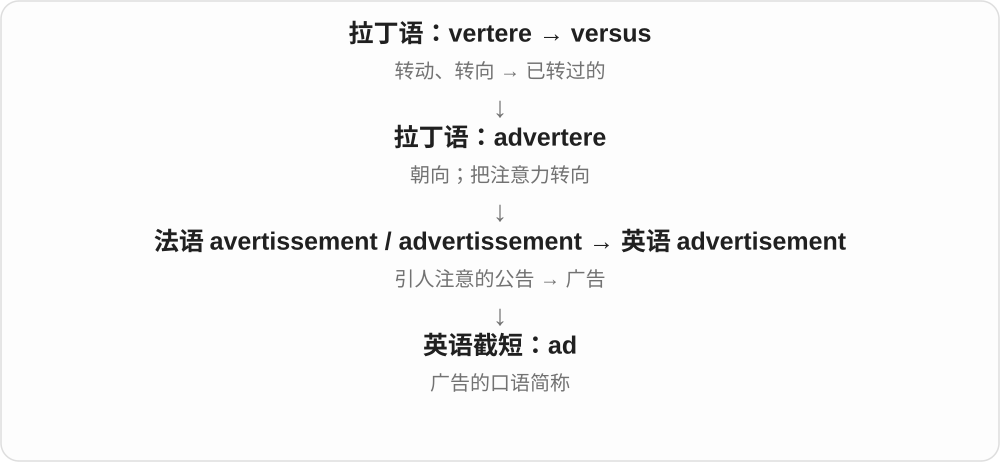

# 0044 · -ware — 器物、制品；现代软件类别命名材料

[逐词精讲目录](../00_逐词精讲目录.md) · [总目录](../00_总目录_按常用程度.md)

## 核心词根与来源

ware 本是古英语商品、制品的本族名词，独立常用复数 wares。合词可按材料、用途命名，如 earthenware、cookware；现代软件相关的 -ware 是沿 hardware／software 命名模式扩展，不能每个新词都再按实物商品逐字译。

**WARE：一类做出来、拿来用的东西；后来也给软件类别起名**

glassware 是玻璃器皿，tableware 是餐具；到了计算机，hardware 是硬件，software 是软件，firmware 又用 firm 命名贴近硬件的一层程序。

- **器物按材料命名**：glassware · silverware · stoneware；earth · earthen · earthenware
- **器物按用途命名**：tableware · dinnerware · cookware · kitchenware · homeware
- **计算机基础类别**：hardware · software · firm · firmware · middleware
- **用途、分发模式与风险类别**：freeware · shareware；malware · spyware · ransom · ransomware；ad · adware
- **soft 的比较形式：触感、声音、态度**：soft · softer · softest

## 词形与演化规律

earth + -en + ware，先有 earthen 土制的；ransom + -ware 是以赎金勒索为特征；ad + -ware 取 advertisement 的缩略。firmware 的 firm 是稳固、较固定的形容材料，不是公司。software、hardware 通常整体不可数，不写 two softwares 表两款软件。

不同感觉尺度由名词和上下文确定，不都只说硬度。

## 单词速览（按词族由简到繁）

同一基础词的相关扩展放在一起，先读基础形式，再读扩展；各组之间优先读常用的。具体词源关系见各词讲解。

| 单词 | 音标 | 核心意思 |
|---|---|---|
| [home](#w-21) | 英 /həʊm/；美 /hoʊm/ | 家；故乡；回家；在家；主场的 |
| [homeware](#w-20) | 英 /ˈhəʊmweə/；美 /ˈhoʊmwer/ | 家居用品 |
| [free](#w-22) | /friː/ | 自由的；空闲的；免费的；释放 |
| [freeware](#w-11) | 英 /ˈfriːweə/；美 /ˈfriːwer/ | 免费软件 |
| [hard](#w-23) | 英 /hɑːd/；美 /hɑːrd/ | 坚硬的；困难的；强烈的；努力地 |
| [hardware](#w-2) | 英 /ˈhɑːdweə/；美 /ˈhɑːrdwer/ | 五金、工具；硬件、设备 |
| [share](#w-24) | 英 /ʃeə/；美 /ʃer/ | 一份；股份；分享、共用、分担 |
| [shareware](#w-16) | 英 /ˈʃeəweə/；美 /ˈʃerwer/ | 共享试用软件；通常试用后付费的软件 |
| [middle](#w-25) | /ˈmɪdəl/ | 中间；中部；中间的 |
| [middleware](#w-10) | 英 /ˈmɪdəlweə/；美 /ˈmɪdəlwer/ | 中间件 |
| [earth](#w-26) | 英 /ɜːθ/；美 /ɜːrθ/ | 地球；大地；泥土；接地 |
| [earthen](#w-40) | 英 /ˈɜːθən/；美 /ˈɜːrθən/ | 土制的；陶制的 |
| [earthenware](#w-13) | 英 /ˈɜːθənweə/；美 /ˈɜːrθənwer/ | 陶器；陶制品 |
| [table](#w-27) | /ˈteɪbl/ | 桌子；表格；提出或搁置议题〔地区用法不同〕 |
| [tableware](#w-14) | 英 /ˈteɪblweə/；美 /ˈteɪblwer/ | 餐具〔总称〕 |
| [glass](#w-28) | 英 /ɡlɑːs/；美 /ɡlæs/ | 玻璃；玻璃杯、一杯；眼镜〔glasses〕 |
| [glassware](#w-6) | 英 /ˈɡlɑːsweə/；美 /ˈɡlæsweər/ | 玻璃器皿、玻璃制品〔总称〕 |
| [silver](#w-29) | 英 /ˈsɪlvə/；美 /ˈsɪlvər/ | 银；银色、银制的；银牌；镀银、使银白 |
| [silverware](#w-5) | 英 /ˈsɪlvəweə/；美 /ˈsɪlvərwer/ | 银器；刀叉匙等餐具〔尤美式，可非银制〕 |
| [stone](#w-30) | 英 /stəʊn/；美 /stoʊn/ | 石头、石材；果核；英制重量单位；去果核 |
| [stoneware](#w-12) | 英 /ˈstəʊnweə/；美 /ˈstoʊnwer/ | 炻器；一种致密坚硬的陶器 |
| [firm](#w-31) | 英 /fɜːm/；美 /fɝːm/ | 稳固的；坚定的；公司；使稳固 |
| [firmware](#w-4) | 英 /ˈfɜːmweə/；美 /ˈfɜːrmwer/ | 固件；设备基础控制程序 |
| [dinner](#w-32) | 英 /ˈdɪnə/；美 /ˈdɪnər/ | 正餐、主餐；晚餐；宴会 |
| [dinnerware](#w-17) | 英 /ˈdɪnəweə/；美 /ˈdɪnərwer/ | 餐具〔尤盘、碗、杯等一类器皿〕 |
| [soft](#w-34) | 英 /sɒft/；美 /sɔːft/、/sɑːft/ | 柔软的；轻柔的；温和、不强硬的 |
| [software](#w-1) | 英 /ˈsɒftweə/；美 /ˈsɔːftwer/ | 软件 |
| [softer](#w-41) | 英 /ˈsɒftə/；美 /ˈsɔːftər/、/ˈsɑːftər/ | 更软、更柔和、更温和的〔比较级〕 |
| [softest](#w-42) | 英 /ˈsɒftɪst/；美 /ˈsɔːftɪst/、/ˈsɑːftɪst/ | 最软、最柔和、最温和的〔最高级〕 |
| [ad](#w-33) | 英、美 /æd/ | 广告〔口语〕 |
| [cook](#w-35) | /kʊk/ | 烹调、做饭；厨师；编造、篡改〔特定搭配〕 |
| [cookware](#w-9) | 英 /ˈkʊkweə/；美 /ˈkʊkwer/ | 炊具；锅具等烹饪器皿 |
| [kitchen](#w-36) | /ˈkɪtʃən/ | 厨房、烹饪区域 |
| [kitchenware](#w-15) | 英 /ˈkɪtʃənweə/；美 /ˈkɪtʃənwer/ | 厨具、厨房用具总称 |
| [spy](#w-37) | /spaɪ/ | 间谍；暗中监视、搜集信息；看到、发现 |
| [spyware](#w-7) | 英 /ˈspaɪweə/；美 /ˈspaɪwer/ | 间谍软件 |
| [ransom](#w-38) | /ˈrænsəm/ | 赎金；付赎金赎回 |
| [ransomware](#w-8) | 英 /ˈrænsəmweə/；美 /ˈrænsəmwer/ | 勒索软件 |
| [ware](#w-39) | 英 /weə/；美 /wer/ | 货品、用品，常用复数 wares；警觉的〔旧形容词〕 |
| [malware](#w-3) | 英 /ˈmælweə/；美 /ˈmælwer/ | 恶意软件 |
| [adware](#w-19) | 英 /ˈædweə/；美 /ˈædwer/ | 广告软件；显示广告的程序 |

## 逐词讲解

### 1. home — 家；故乡；回家；在家；主场的

**音标**：英 /həʊm/；美 /hoʊm/

**先抓住这个画面**

不只是墙和屋顶，而是你回去、归属、过日子的地方。

**怎么拆**

接古英语 hām，经中古英语 hom 延续，早有居住地、村落等义。现代名词、副词及修饰语用法并存。

**怎么变成今天的意思**

**古英语 hām → 中古英语 hom**  
家；居住地、村落

↓

**英语 home**  
家；故乡；回家；主场等

go home、come home 中 home 作方向副词，通常不加 to；at home 是在家或自在。home team 是主队，home page 是网站入口页，不一定物理住处。

**常见搭配与例句**

at home；go home；feel at home；a home game；home page。

> I will be home by six.

我六点前会到家。

> She made the small apartment feel like home.

她让小公寓有了家的感觉。

> Our team is playing at home this weekend.

我们队这周末在主场比赛。

**别混淆**

house 侧重房屋建筑，home 侧重居住、归属与生活。租的公寓也可以是 home，不要求拥有一栋 house。

### 2. homeware — 家居用品

**音标**：英 /ˈhəʊmweə/；美 /ˈhoʊmwer/

**先抓住这个画面**

把杯盘、靠垫、摆设等用于布置、使用家庭空间的东西归成一类。

**怎么拆**

home（家庭）+ -ware（某类制品、用品），常见零售类别名称，也见 homewares 复数。

**怎么变成今天的意思**

**英语 home；-ware**  
组合时并列的两种材料

↓

**home + -ware → homeware**  
家庭使用、布置的一类物品

具体包括什么由商店分类决定，常有餐具、纺织品、装饰物，不等于一切与房子相关的建筑材料。

**常见搭配与例句**

a homeware shop；homeware and accessories；a homeware range。

> The shop sells clothing and homeware.

商店卖服装和家居用品。

> The designer launched a colourful homeware range.

设计师推出了色彩鲜明的家居用品系列。

**别混淆**

homeware 说物品类别，homewear 则可指在家穿的服装；ware 与 wear 发音相同，拼写与对象不同。

### 3. free — 自由的；空闲的；免费的；释放

**音标**：/friː/

**先抓住这个画面**

先问少了什么限制：人不受束缚，时间没被占用，服务不收费用。

**怎么拆**

接古英语 frēo 等形式。更早日耳曼语形式还与亲爱、自己群体中的自由成员等历史有关；不能简单宣称所有现代义都是“因为被爱所以自由”。动词 free“使自由”也有早期英语形式。

**怎么变成今天的意思**

**古英语 frēo / frēoh → 中古英语 fre**  
自由的；不受奴役的

↓

**英语 free**  
不受限制；不收费；释放

free to leave 是可以自由离开，free this afternoon 是下午有空，free admission 是免门票；free the bird 是释放鸟。free from fear 是不受恐惧困扰。

**常见搭配与例句**

free to do；free from；free of charge；free time；set free。

> Are you free for lunch tomorrow?

你明天有空一起吃午饭吗？

> Admission to the museum is free.

博物馆免费入场。

> They freed the bird from the net.

他们把鸟从网中解救出来。

**别混淆**

free 既可免费也可自由：free software 在某些技术语境强调使用修改的自由，不只价钱；a free seat 则可能是空座，需看语境。

### 4. freeware — 免费软件

**音标**：英 /ˈfriːweə/；美 /ˈfriːwer/

**先抓住这个画面**

这款软件允许按其条款免费使用，不代表作者把所有权利都交出来。

**怎么拆**

free（免费）+ -ware，后者从 software 等软件名称抽出形成构词成分。不是 free + wear“免费穿着”。

**怎么变成今天的意思**

**英语 free；-ware〔软件构词成分〕**  
并列组合的两部分

↓

**free + -ware〔软件构词成分〕 → freeware**  
按许可免费提供的软件

常与付费软件、试用软件对照。是否可修改、商用、再分发要读许可，freeware 这个标签本身不能确认。

**常见搭配与例句**

a freeware program；download freeware；a freeware utility。

> The utility is distributed as freeware.

这个工具以免费软件形式发布。

> She checked the licence before using the freeware at work.

她在工作中使用这款免费软件前查阅了许可。

**别混淆**

freeware 强调免费提供；open-source software 强调源代码及许可权利，free software 又有特定自由软件含义。三者不能只凭免费两字画等号。

### 5. hard — 坚硬的；困难的；强烈的；努力地

**音标**：英 /hɑːd/；美 /hɑːrd/

**先抓住这个画面**

手推不动、刀切不开是硬；任务也像一道阻力，需要用力才能过。

**怎么拆**

接古英语 heard，经中古英语 hard 延续。现代既可形容物体硬、任务难，也可直接作副词；work hard 不需要加 -ly。

**怎么变成今天的意思**

**古英语 heard → 中古英语 hard**  
坚硬、强固；难以克服

↓

**英语 hard**  
硬；困难；有力、努力地

a hard surface 是硬表面，a hard question 是难题，hard work 是艰苦工作，work hard 是努力工作；hit hard 是用力打击。

**常见搭配与例句**

work hard；try hard；a hard time；a hard surface；hard to do。

> The chair has a hard wooden seat.

椅子的木座面很硬。

> They worked hard to finish before Friday.

他们努力赶在周五前完成。

> It was hard to hear her over the noise.

噪声太大，很难听清她说话。

**别混淆**

hard 努力地，hardly 几乎不；He works hard 是他很努力，He hardly works 是他几乎不工作。

### 6. hardware — 五金、工具；硬件、设备

**音标**：英 /ˈhɑːdweə/；美 /ˈhɑːrdwer/

**先抓住这个画面**

可拿得住、装得上、拧得动的实体工具设备；电脑里也先看这些物理部件。

**怎么拆**

hard + -ware（用品、货品），中古英语已用于五金等硬质器物，计算机时代扩展为物理硬件。不是电脑软件变硬后才有 hardware。

**怎么变成今天的意思**

**古英语 heard → 中古英语 hard**  
坚硬、强固；难以克服

↓

**英语 hard**  
硬；困难；有力、努力地

↓

**中古英语 hardware → 五金、工具、设备**  
硬质用品的集合

↓

**计算机 hardware**  
与软件相对的物理部件

a hardware store 是五金店，computer hardware 是电脑硬件；词也可泛指机械、电子等设备。通常集合不可数，不直接用 a hardware 数一件。

**常见搭配与例句**

a hardware store；computer hardware；hardware requirements。

> He bought screws at the local hardware store.

他在当地五金店买了螺丝。

> The new application requires more powerful hardware.

新应用需要性能更强的硬件。

**别混淆**

hardware 是实体部件，software 是程序等软件；五金店的 hardware 往往与电脑无关。

### 7. share — 一份；股份；分享、共用、分担

**音标**：英 /ʃeə/；美 /ʃer/

**先抓住这个画面**

一整块分出你的一份；也可以把手里的东西拿来一起用，把责任拿来一起担。

**怎么拆**

名词接古英语 sċearu 切分、部分，与剪切词族相关；现代动作有分给、共同拥有使用等，不等于每次都真的切成几块。

**怎么变成今天的意思**

**古英语 sċearu → 中古英语 schare → share**  
切分、分出的部分，与 shear 等词族相关

↓

**英语 share**  
一份、股份；分享、共同使用、共同承担

share a room 合住一间房，share an idea 分享想法，share the cost 分担费用；a share of the cake 蛋糕一份，company shares 公司股份。

**常见搭配与例句**

share with；share the cost；a share of；have something in common。

> Can I share the table with you?

我可以和你共用这张桌子吗？

> Everyone should do their share of the work.

每个人都应完成自己那一份工作。

**别混淆**

share 信息不一定让原持有者失去它；share a burden 分担负担，也不是所有 share 都是金融股票。

### 8. shareware — 共享试用软件；通常试用后付费的软件

**音标**：英 /ˈʃeəweə/；美 /ˈʃerwer/

**先抓住这个画面**

可以先分发、试用，让人试过再决定是否继续使用、购买；共享不等于永远免费。

**怎么拆**

share 分享 + -ware 软件类构词部分，形成特定软件分发模式名称。不是把程序的所有权平均分给每位用户。

**怎么变成今天的意思**

**古英语 sċearu → 中古英语 schare → share**  
切分、分出的部分，与 shear 等词族相关

↓

**英语 share**  
一份、股份；分享、共同使用、共同承担

↓

**share + -ware → shareware**  
可分发、试用的软件模式

a shareware program 共享试用软件，download shareware 下载试用软件；试用期限、限制、付费条件依具体许可。

**常见搭配与例句**

shareware software；a shareware program；shareware distribution。

> The archive includes several old shareware programs.

档案里收录了几款旧共享试用软件。

> The shareware version lets users try the basic features.

共享试用版允许用户先体验基本功能。

**别混淆**

shareware 不等于 freeware 免费软件，也不等于 free/open-source software 自由、开源软件；免费试用与源码、修改权是不同维度。

### 9. middle — 中间；中部；中间的

**音标**：/ˈmɪdəl/

**先抓住这个画面**

两头之间的那一段，也能把一个过程、年龄或次序想成有开头和结尾的一条线。

**怎么拆**

继承古英语 middel，与 mid 中间的同族。现代 -le 在这里不是随意添加、表示小的英语后缀，不把历史词形硬拆成 mid + 小东西。

**怎么变成今天的意思**

**古英语 middel → 中古英语 middel、myddel → middle**  
中间、中心；与 mid 同族

↓

**现代 middle**  
空间中部 → 时间、次序、等级等的中间

in the middle of 在……中间，the middle seat 中间座位，the middle of the night 半夜；middle school 是学校阶段名称，具体学段因地区而异。

**常见搭配与例句**

in the middle of；the middle seat；the middle of the night；middle age。

> She sat in the middle of the row.

她坐在那一排中间。

> The phone rang in the middle of the meeting.

会议进行中，电话响了。

**别混淆**

middle 是中间区域，centre 常强调中心点；in the middle of a meeting 说会议进行中，不要求恰好进行到总时长一半。

### 10. middleware — 中间件

**音标**：英 /ˈmɪdəlweə/；美 /ˈmɪdəlwer/

**先抓住这个画面**

软件之间有时不能直接顺畅地合作，中间这层软件帮它们传递消息、连接功能或提供共同服务。

**怎么拆**

middle 中间 + -ware 软件类构词成分，按处在不同软件部分之间、提供连接服务的角色命名。

**怎么变成今天的意思**

**古英语 middel → 中古英语 middel、myddel → middle**  
中间、中心；与 mid 同族

↓

**现代 middle**  
空间中部 → 时间、次序、等级等的中间

↓

**middle + -ware → middleware**  
中间层的软件 → 中间件

middleware services 中间件服务，messaging middleware 消息中间件；不是只指屏幕上摆在正中的程序窗口。

**常见搭配与例句**

middleware services；messaging middleware；a middleware layer。

> The middleware connects the online shop to the inventory system.

中间件把网店与库存系统连接起来。

> The team added a middleware layer to handle messages.

团队增加了一层中间件来处理消息。

**别混淆**

middleman 是人与商业中的中间人，middleware 是软件；可用桥梁帮助理解，但实际产品职责要看系统。

### 11. earth — 地球；大地；泥土；接地

**音标**：英 /ɜːθ/；美 /ɜːrθ/

**先抓住这个画面**

手里抓的一把土、脚下的大地，再到我们生活的整个世界，同一个古老词有不同尺度。

**怎么拆**

继承古英语 eorþe。行星名常大写 Earth；土壤义通常小写。电气接地义取与地连接的概念，不是把电器埋进泥里。

**怎么变成今天的意思**

**古英语 eorþe → 中古英语 erthe → earth**  
泥土、大地；人所处的世界

↓

**现代 earth**  
土壤、地面 → 地球；材质、世俗生活与接地等

planet Earth 地球，damp earth 湿土，on earth 世界上；What on earth...? 表到底、究竟，down to earth 务实。

**常见搭配与例句**

planet Earth；on earth；damp earth；down to earth。

> The children dug in the soft earth.

孩子们在松软泥土里挖掘。

> What on earth happened to this chair?

这把椅子到底怎么了？

**别混淆**

earth 泥土与 Earth 行星靠语境、大小写；world 世界还可指人类社会、某领域，不总是天体本身。

### 12. earthen — 土制的；陶制的

**音标**：英 /ˈɜːθən/；美 /ˈɜːrθən/

**先抓住这个画面**

用泥土、黏土形成的材料或器物，强调它由什么做成。

**怎么拆**

earth + -en 材质形容词后缀，相应形式古英语已有。这里 -en 表由某材料制成，不是动词使变成。

**怎么变成今天的意思**

**古英语 eorþe → 中古英语 erthe → earth**  
泥土、大地；人所处的世界

↓

**现代 earth**  
土壤、地面 → 地球；材质、世俗生活与接地等

↓

**earth + -en → earthen**  
由土制成 → 土、陶制的

an earthen floor 土地面，an earthen pot 陶罐，an earthen wall 土墙。

**常见搭配与例句**

an earthen pot；an earthen floor；an earthen wall。

> Water was stored in a large earthen pot.

水储存在一个大陶罐里。

> The old house had an earthen floor.

老房子的地面是泥土。

**别混淆**

earthen pot 陶罐，earthy smell 泥土气味，earthly life 尘世生活；形似不等于可互换。

### 13. earthenware — 陶器；陶制品

**音标**：英 /ˈɜːθənweə/；美 /ˈɜːrθənwer/

**先抓住这个画面**

泥土做坯、烧成能盛东西的碗罐，是最容易认出的 earthenware 画面。不是把地球当商品卖。

**怎么拆**

earth 土 → earthen 土制的 + ware 制品；中间 -en 表材料这一层不要漏。英语早已有这种按材料给器物分类的构词。

**怎么变成今天的意思**

**earth + -en → earthen**  
土 → 土制的

↓

**earthen + ware → earthenware**  
陶制器物

an earthenware bowl 陶碗；earthenware pots 陶罐。作为材料、制品类别通常不可数，单件说 a piece of earthenware 或用 bowl、pot。

**常见搭配与例句**

an earthenware pot；glazed earthenware。

> She served the soup in an earthenware bowl.

她用一个陶碗盛汤。

> The market sells handmade earthenware.

市场卖手工陶器。

**别混淆**

earthenware 陶器与 porcelain 瓷器、stoneware 炻器在专业陶瓷分类里有区别；日常都像碗罐，不能因此视为完全同一材料。

### 14. table — 桌子；表格；提出或搁置议题〔地区用法不同〕

**音标**：/ˈteɪbl/

**先抓住这个画面**

一块平面既能摆饭菜，也能把文字、数字排得整整齐齐；于是有桌子和表格两种常用义。

**怎么拆**

最终接拉丁 tabula 板、列表；英语既有古英语阶段的早期借词，也有后来法语 table 的影响。家具义和表格义都围绕平面展开。

**怎么变成今天的意思**

**拉丁 tabula**  
板、写字板、列表

↓

**古英语 tabele 与古法语 table → 英语 table**  
早期借词与法语借词汇合；桌子、表格

a dining table 餐桌，a table of results 结果表，table of contents 目录。作动词 table a proposal，英式常指提交讨论，美式常指暂搁。

**常见搭配与例句**

set the table；a table of results；table of contents；table a proposal。

> The table shows the results for each month.

表格列出了每个月的结果。

> We booked a table for four near the window.

我们订了一张靠窗的四人桌。

**别混淆**

table a proposal 的地区意义可能相反，跨地区沟通用 submit for discussion 或 postpone 更明确。table 表格与 chart 图表也要按呈现方式选择。

### 15. tableware — 餐具〔总称〕

**音标**：英 /ˈteɪblweə/；美 /ˈteɪblwer/

**先抓住这个画面**

摆一桌饭要用的盘、碗、杯、刀叉等，统起来叫餐具。

**怎么拆**

table 餐桌 + ware 制品、用具，按使用场景形成集合名称。

**怎么变成今天的意思**

**拉丁 tabula**  
板、写字板、列表

↓

**古英语 tabele 与古法语 table → 英语 table**  
早期借词与法语借词汇合；桌子、表格

↓

**table + ware → tableware**  
餐桌上使用的器具总称

ceramic tableware 陶瓷餐具，a set of tableware 一套餐具。通常作不可数总称，具体几件可说 pieces of tableware。

**常见搭配与例句**

ceramic tableware；a set of tableware；disposable tableware。

> The shop sells simple ceramic tableware.

店里出售简洁的陶瓷餐具。

> They chose reusable tableware for the party.

他们为聚会选了可重复使用的餐具。

**别混淆**

tableware 是大范围总称；cutlery 侧重刀叉勺等，glassware 侧重玻璃器皿，范围并不完全相同。

### 16. glass — 玻璃；玻璃杯、一杯；眼镜〔glasses〕

**音标**：英 /ɡlɑːs/；美 /ɡlæs/

**先抓住这个画面**

先是透明硬材料，再用材料叫它做成的杯子、镜片。glass 不可数和 a glass 可数，镜头已经从材料移到具体制品。

**怎么拆**

古英语 glæs 经中古英语延续。更远与发光词的联系有不同分析，不必为了记忆强作确定结论。杯、杯中量、光学器具等义由材料与用途扩展。

**怎么变成今天的意思**

**古英语 glæs → 中古英语 glas → glass**  
玻璃这种材料

↓

**英语 glass 的材料、制品与镜片用法**  
玻璃 → 玻璃杯、杯中一份饮料；镜片 → 眼镜、光学器具

made of glass 玻璃做的，a glass of water 一杯水，a pair of glasses 一副眼镜。glasses 也可能是几个杯子，依上下文区分。

**常见搭配与例句**

a glass of water；broken glass；a pair of glasses；glass windows。

> The door is made of glass.

这扇门是玻璃做的。

> He put on his glasses and poured a glass of water.

他戴上眼镜，倒了一杯水。

**别混淆**

glass 材料不说 a glass，除非说一个杯子、某类玻璃等可数用法；glasses 眼镜通常用复数，不把一副写成 a glasses。

### 17. glassware — 玻璃器皿、玻璃制品〔总称〕

**音标**：英 /ˈɡlɑːsweə/；美 /ˈɡlæsweər/

**先抓住这个画面**

把杯、壶、玻璃碗或实验室瓶管放成一类，统称 glassware；不是只说一杯饮料。

**怎么拆**

glass 玻璃 + ware 制品，构成集合用语。-ware 告诉你这一类制品，不能拆成 glass + aware“意识到”。

**怎么变成今天的意思**

**古英语 glæs → 中古英语 glas → glass**  
玻璃这种材料

↓

**英语 glass 的材料、制品与镜片用法**  
玻璃 → 玻璃杯、杯中一份饮料；镜片 → 眼镜、光学器具

↓

**glass + ware → glassware**  
玻璃制成的一类器皿、用品

laboratory glassware 实验室玻璃器皿，delicate glassware 易碎玻璃器皿。通常不可数，一件说 a piece of glassware。

**常见搭配与例句**

laboratory glassware；wash the glassware；a piece of glassware。

> Please wash the glassware by hand.

请手洗这些玻璃器皿。

> The laboratory stores its glassware in this cabinet.

实验室把玻璃器皿放在这个柜子里。

**别混淆**

glassware 一类器物，glass 材料或杯子；crockery 常指陶瓷餐具，范围不相同。

### 18. silver — 银；银色、银制的；银牌；镀银、使银白

**音标**：英 /ˈsɪlvə/；美 /ˈsɪlvər/

**先抓住这个画面**

先是明亮的银白金属；不是真银的头发、月光，也可借它的颜色来形容。

**怎么拆**

本族词，接古英语 seolfor，中古英语 silver 等。较远来源不定；金属名、颜色名、银牌等用法相互联系，但不能看到银色就判材质是银。

**怎么变成今天的意思**

**古英语 seolfor → 中古英语 silver、selver → silver**  
银这种金属；更远来源未定

↓

**英语 silver**  
银、银器；银色；镀银或染成银灰等

a silver ring 银戒指，silver hair 银发，win silver 获银牌，silver the surface 给表面镀银或使银白。元素符号 Ag 接拉丁语 argentum，不是 silver 的首字母。

**常见搭配与例句**

a silver ring；silver hair；win silver；a silver medal。

> She polished the silver ring with a soft cloth.

她用软布擦亮了银戒指。

> The swimmer won silver in the final.

那位游泳选手在决赛中获得银牌。

**别混淆**

silver 可材料也可颜色，silvery 更明确说像银的光泽、颜色；a silver car 通常说颜色，不是整辆车用银造。

### 19. silverware — 银器；刀叉匙等餐具〔尤美式，可非银制〕

**音标**：英 /ˈsɪlvəweə/；美 /ˈsɪlvərwer/

**先抓住这个画面**

原来按银这种材料叫器物，后来美式日常也拿来统称刀叉匙，哪怕是不锈钢的。

**怎么拆**

silver + ware 制品，形成集合名词。银制器物的材料义与美式餐具泛称分开记。

**怎么变成今天的意思**

**古英语 seolfor → 中古英语 silver、selver → silver**  
银这种金属；更远来源未定

↓

**英语 silver**  
银、银器；银色；镀银或染成银灰等

↓

**silver + ware → silverware**  
银制器物；尤美式泛指刀叉匙等餐具

polish the silverware 擦亮银器，set out the silverware 摆好餐具；通常不可数，不把每把叉子叫一个 silverware。

**常见搭配与例句**

polish the silverware；set out the silverware；a drawer of silverware。

> She set out the silverware before dinner.

晚饭前她摆好了刀叉匙。

> The museum keeps its antique silverware in a locked case.

博物馆把古董银器保存在锁着的展柜里。

**别混淆**

silverware 美式可餐具，cutlery 英式常指刀叉匙；材质不能只靠名字判。glassware 是玻璃器皿，ware 成分相同。

### 20. stone — 石头、石材；果核；英制重量单位；去果核

**音标**：英 /stəʊn/；美 /stoʊn/

**先抓住这个画面**

硬硬的一块石头；桃子中间的硬核、首饰上的宝石，也都能用这个硬块的形象理解。

**怎么拆**

继承古英语 stān，经中古英语延续。材料、个体石块、果核、重量等义逐步形成；动词 stone 可去果核，也可投石，不能一律只由加石理解。

**怎么变成今天的意思**

**古英语 stān → 中古英语 ston → stone**  
石头、石材

↓

**现代 stone**  
实物石块 → 硬核、宝石；硬、冷的比喻及按用途命名

a stone 一块石头，made of stone 石制，a peach stone 桃核，stone the cherries 给樱桃去核。a stone’s throw 可比喻很近。

**常见搭配与例句**

made of stone；a peach stone；a stone’s throw；stone fruit。

> The wall is built of local stone.

墙用当地石材砌成。

> The station is only a stone’s throw from the hotel.

车站离酒店只有很短的距离。

**别混淆**

stone 可一块或材料总称，rock 可岩石整体或一块岩石，范围有重合。水果语境 stone 核，不是可食果肉。

### 21. stoneware — 炻器；一种致密坚硬的陶器

**音标**：英 /ˈstəʊnweə/；美 /ˈstoʊnwer/

**先抓住这个画面**

烧得致密、质地坚硬的一类陶器，杯碗餐盘里都能见到；名字借石的硬实感。

**怎么拆**

stone + ware 制品，固定为陶器类别词。不是用整块石头直接凿出的所有器皿。

**怎么变成今天的意思**

**古英语 stān → 中古英语 ston → stone**  
石头、石材

↓

**现代 stone**  
实物石块 → 硬核、宝石；硬、冷的比喻及按用途命名

↓

**stone + ware → stoneware**  
石般硬实的陶器类别 → 炻器

stoneware mugs 炻器杯，a stoneware bowl 炻器碗，stoneware pottery 炻器陶器。

**常见搭配与例句**

stoneware mugs；a stoneware bowl；stoneware pottery。

> The café serves coffee in stoneware mugs.

咖啡馆用炻器杯盛咖啡。

> She made a stoneware bowl in the pottery class.

她在陶艺课上做了一个炻器碗。

**别混淆**

stoneware 是陶瓷类别，stone bowl 字面石碗可能真由石头制成；porcelain 瓷器又是另一类别名称。

### 22. firm — 稳固的；坚定的；公司；使稳固

**音标**：英 /fɜːm/；美 /fɝːm/

**先抓住这个画面**

按下去不轻易塌，劝来劝去不轻易改，都是“稳住了”。公司义则经过签名与商号的历史形成。

**怎么拆**

形容词经古法语接 firmus；公司义接意大利 firma“签名”，相关商号用法也见德语 Firma，传播细节有不同说法。动词另经古法语 fermer 接拉丁 firmāre“使稳固”。

**怎么变成今天的意思**

**拉丁 firmus**  
稳固的

↓

**古法语 ferm / ferme → 中古英语 → firm**  
稳固的；坚定的

↓

**另支：拉丁 firmāre → 古法语 fermer → 英语 firm〔动词〕**  
使稳固、使确定

↓

**另支：拉丁 firmāre → 意大利 firmare / firma；德语 Firma**  
使确定 → 签名、商号

↓

**英语 firm〔公司义〕**  
用商号开展业务的公司

a firm mattress 是结实有支撑的床垫，不必硬得像木板；a firm decision 是不轻易变的决定。a law firm 指律师事务所，不能从“坚固”直接猜成某种建筑。

**常见搭配与例句**

a firm grip；a firm decision；a law firm；firm up plans。

> The mattress is firm but comfortable.

床垫有支撑力，但很舒服。

> She works for a small accounting firm.

她在一家小型会计师事务所工作。

> We need to firm up the travel plans this week.

我们需要在这周把旅行计划确定下来。

**别混淆**

hard 强调硬；firm 强调有支撑、不轻易变形。firm 作为公司名词与 company 多有重叠，常见于专业服务机构。

### 23. firmware — 固件；设备基础控制程序

**音标**：英 /ˈfɜːmweə/；美 /ˈfɜːrmwer/

**先抓住这个画面**

路由器、相机等设备里，负责让硬件按设计运转的一层基础程序，常叫 firmware。它属于程序，又比随手安装的普通应用更贴近设备。

**怎么拆**

firm 稳固的 + 从 software 等借来的 -ware，二十世纪形成，命名上居于 hardware 硬件和 software 软件之间。这里 firm 不是公司。

**怎么变成今天的意思**

**hardware、software 的命名对照**  
硬件与软件的词形材料

↓

**firm + -ware → firmware**  
与设备硬件紧密相关的基础控制程序

a firmware update 固件更新；router firmware 路由器固件。早期常与只读存储器相联，现代许多固件可以更新，不可把“固”误解成永远不能改。

**常见搭配与例句**

a firmware update；camera firmware。

> The camera received a firmware update.

相机收到了一个固件更新。

> The new firmware fixed a problem with the display.

新固件修复了显示方面的一个问题。

**别混淆**

firmware 是程序，hardware 是实体部件；更换固件通常不是把相机里的电路板换掉，也不是所有应用都叫 firmware。

### 24. dinner — 正餐、主餐；晚餐；宴会

**音标**：英 /ˈdɪnə/；美 /ˈdɪnər/

**先抓住这个画面**

今天很多人一天最完整的一餐在晚上，所以常译晚餐；但周日中午吃的一顿丰盛主餐，也可能叫 Sunday dinner。

**怎么拆**

接法语 disner，较早与结束空腹、吃首顿饭有关，英语里主餐时间逐渐变晚。不是词源本来就规定晚七点吃饭。

**怎么变成今天的意思**

**法语 disner〔吃一天首顿大餐等〕→ 中古英语 dyner → dinner**  
更早破斋、进食背景；用餐时间随时代变迁

↓

**英语 dinner**  
一天主餐，今天常晚餐，也可中午主餐、宴会

have dinner 吃晚餐、主餐，cook dinner 做正餐，a formal dinner 正式宴会，Sunday dinner 周日主餐。具体时间由地区、家庭、语境决定。

**常见搭配与例句**

have dinner；cook dinner；a formal dinner；Sunday dinner。

> We usually have dinner at seven.

我们通常七点吃晚餐。

> The family gathered for Sunday dinner at one o’clock.

一家人一点钟聚在一起吃周日正餐。

**别混淆**

dinner 一天主餐，supper 常较晚、较轻一餐或晚餐用词，习惯有重叠；不把所有 dinner 都强行改成中午或晚上唯一时段。

### 25. dinnerware — 餐具〔尤盘、碗、杯等一类器皿〕

**音标**：英 /ˈdɪnəweə/；美 /ˈdɪnərwer/

**先抓住这个画面**

吃正餐要摆出的盘、碗、杯等一套东西。ware 说制品类别，不是在说饭本身。

**怎么拆**

dinner 正餐 + ware 用品，形成集合名词。通常不可数，具体器件可说 a piece of dinnerware。

**怎么变成今天的意思**

**法语 disner〔吃一天首顿大餐等〕→ 中古英语 dyner → dinner**  
更早破斋、进食背景；用餐时间随时代变迁

↓

**英语 dinner**  
一天主餐，今天常晚餐，也可中午主餐、宴会

↓

**dinner + ware → dinnerware**  
供用餐的盘碗杯等器皿总称

a dinnerware set 一套餐具，ceramic dinnerware 陶瓷餐具，matching dinnerware 配套盘碗等。

**常见搭配与例句**

a dinnerware set；ceramic dinnerware；matching dinnerware。

> They chose a simple white dinnerware set.

他们选了一套简洁白色餐具。

> The shop sells ceramic dinnerware and glassware.

店里出售陶瓷餐具和玻璃器皿。

**别混淆**

dinnerware 偏盘碗杯器皿，silverware 美式常刀叉匙；tableware 更广的餐桌用品总称，范围有重叠。

### 26. soft — 柔软的；轻柔的；温和、不强硬的

**音标**：英 /sɒft/；美 /sɔːft/、/sɑːft/

**先抓住这个画面**

按一下会让开，是材料软；声音不刺耳、态度不强硬，也能借软的感觉来说。

**怎么拆**

继承古英语 softe、sefte 等柔软温和词，现代身体触感与感官、态度义并行。

**怎么变成今天的意思**

**古英语 softe、sefte → 中古英语 softe → soft**  
柔软、温和

↓

**现代 soft**  
材料容易变形 → 声音、态度柔和；硬件的相对软件命名

a soft pillow 软枕头，a soft voice 轻柔声音，soft light 柔光，be soft on someone 对某人宽容。

**常见搭配与例句**

a soft pillow；a soft voice；soft light；soft on。

> The blanket felt warm and soft.

毯子摸起来温暖柔软。

> She spoke in a soft voice.

她轻声说话。

**别混淆**

soft 声音轻柔不等于 slow 语速慢；soft material 柔软也不自动 fragile 易碎。

### 27. software — 软件

**音标**：英 /ˈsɒftweə/；美 /ˈsɔːftwer/

**先抓住这个画面**

电脑上能运行的程序、相关指令，和能摸到的硬件作对照；不是一块摸起来软的机器。

**怎么拆**

soft + -ware，仿 hardware 硬件的名称形成对照。soft 表非实体硬件这一命名方向，不等于代码没有物理存储。

**怎么变成今天的意思**

**古英语 softe、sefte → 中古英语 softe → soft**  
柔软、温和

↓

**现代 soft**  
材料容易变形 → 声音、态度柔和；硬件的相对软件命名

↓

**soft + -ware → software**  
与硬件对照的程序类称呼 → 软件

install software 安装软件，software updates 软件更新，a piece of software 一款软件；通常不可数。

**常见搭配与例句**

install software；software updates；a piece of software。

> The company develops software for hospitals.

公司为医院开发软件。

> Please install the latest software update.

请安装最新的软件更新。

**别混淆**

software 不常用 a software 或 many softwares 表多款；用 an application、software packages 等更自然。

### 28. softer — 更软、更柔和、更温和的〔比较级〕

**音标**：英 /ˈsɒftə/；美 /ˈsɔːftər/、/ˈsɑːftər/

**先抓住这个画面**

材料更容易被压出形状，是 softer；声音、光或态度少一点冲劲，也能说更柔和。

**怎么拆**

soft 继承古英语 softe、sefte 等柔软、温和材料。现代直接加完整比较级 -er，词尾已有 ft 辅音群，不双写 t。

**怎么变成今天的意思**

**古英语柔软、温和材料 → soft**  
触感软 → 声音、态度等柔和

↓

**soft + -er → softer**  
相关感觉上更软、更柔和

softer fabric 更软的布料；a softer voice 更柔和的声音；softer light 更柔和的光。

**常见搭配与例句**

a softer approach 更温和的做法；softer than before 比以前软。

> The blue fabric feels softer.

蓝色布料摸起来更软。

> He answered in a softer voice.

他用更柔和的声音回答。

**别混淆**

softer 的比较对象不一定摸得到。声音 softer 常是更轻、更柔和，不是声音像棉花一样可以按下去。

### 29. softest — 最软、最柔和、最温和的〔最高级〕

**音标**：英 /ˈsɒftɪst/；美 /ˈsɔːftɪst/、/ˈsɑːftɪst/

**先抓住这个画面**

几样材料里最容易变形、最柔软的，是 softest。比较声音、光线或态度时，则说最轻柔、最不冲。

**怎么拆**

soft 接古英语 softe、sefte 的继承材料。现代直接加完整最高级 -est，词尾读 /tɪst/，基词不另换形。

**怎么变成今天的意思**

**古英语 soft 对应材料 → soft**  
柔软、温和

↓

**soft + -est → softest**  
比较范围里最软、最柔和

the softest cloth 最柔软的布；the softest voice 最轻柔的声音；the softest light 最柔和的光。

**常见搭配与例句**

at its softest 最柔和时；one of the softest 最软的之一。

> This was the softest cloth in the box.

这是盒子里最柔软的布。

> She spoke in her softest voice.

她用最轻柔的声音说话。

**别混淆**

softest 的最高级仍要落在具体尺度上。布料比触感，声音比柔和程度，不能把所有最高级都只理解成体积最大、力度最强。

### 30. ad — 广告〔口语〕

**音标**：英、美 /æd/

**先抓住这个画面**

看板、短视频、网页弹出的一则宣传，随口就能说 an ad。这个短词背后仍是“把注意力转过来”的长历史。

**怎么拆**

advertisement 截短为 ad；此处不是拉丁语前缀 ad- 独立变成“广告”。

**怎么变成今天的意思**

可数，复数 ads。job ad 是招聘广告，personal ad 是个人分类广告；an ad 不等于广告行业 advertising。

**常见搭配与例句**

an online ad；a job ad；place an ad。

> I found the apartment through an online ad.

我通过一则网上广告找到了这套公寓。

> The video starts with a short ad.

视频开头是一则短广告。

**别混淆**

ad 是广告；add 是“添加”，读音相同，拼写与词源不同。

### 31. cook — 烹调、做饭；厨师；编造、篡改〔特定搭配〕

**音标**：/kʊk/

**先抓住这个画面**

把食材加热、处理成能吃的一餐；按这个工作也把做饭的人叫 cook。

**怎么拆**

很早借入的拉丁厨师、烹调词系，古英语有 cōc 等形式；不能当现代 cook 就是无来源的拟声。cook the books 后来比喻篡改账目。

**怎么变成今天的意思**

**拉丁 cocus、coquus 等 → 古英语 cōc → cook**  
厨师；相关烹调动词也很早进入日耳曼语、英语

↓

**现代 cook**  
做饭、烹调；厨师；加工编造等比喻

cook dinner 做晚饭，a good cook 手艺好的做饭者，cook through 完全熟透，cook the books 做假账。

**常见搭配与例句**

cook dinner；a good cook；cook through；cook the books。

> I’ll cook dinner tonight.

今晚我来做饭。

> My father is a very good cook.

我父亲做饭很拿手。

**别混淆**

cook 人或动作，cooker 常是器具；chef 常指专业厨师、主厨，a good cook 可以只是家里做饭好的人。

### 32. cookware — 炊具；锅具等烹饪器皿

**音标**：英 /ˈkʊkweə/；美 /ˈkʊkwer/

**先抓住这个画面**

做饭用的锅、煎锅等这一整类器物；ware 把它们归成用品。

**怎么拆**

cook + -ware 制品、器物。通常不可数，不等于所有拿来吃饭的盘、叉、杯。

**怎么变成今天的意思**

**拉丁 cocus、coquus 等 → 古英语 cōc → cook**  
厨师；相关烹调动词也很早进入日耳曼语、英语

↓

**现代 cook**  
做饭、烹调；厨师；加工编造等比喻

↓

**cook + ware → cookware**  
烹饪用的器物、炊具

nonstick cookware 不粘锅具，stainless steel cookware 不锈钢炊具，a set of cookware 一套锅具。

**常见搭配与例句**

nonstick cookware；stainless steel cookware；a set of cookware。

> The shop sells stainless steel cookware.

店里出售不锈钢炊具。

> They bought a new set of cookware for the kitchen.

他们给厨房买了一套新锅具。

**别混淆**

cookware 做饭用，tableware 摆桌吃饭用，cutlery 刀叉匙等餐具；用途不同，实际范围可能相交。

### 33. kitchen — 厨房、烹饪区域

**音标**：/ˈkɪtʃən/

**先抓住这个画面**

做饭的地方，可以独立房间，也可以是开放空间中的一个区域；厨房里的人、活动偶尔也借场所代称。

**怎么拆**

古英语 cycene 等接较早借入的拉丁 cocina、coquina 烹调处词，经中古英语到 kitchen。不是 kit 工具包 + chin 下巴。

**怎么变成今天的意思**

**拉丁 coquina、cocina 等，经日耳曼语早期借用 → 古英语 cycene → kitchen**  
烹调处、厨房

↓

**与 cuisine 同族的不同路径**  
kitchen 常指房间，cuisine 经法语常指烹饪风格

↓

**英语常用扩展**  
kitchenware 厨具总称；kitchenette 小厨房

a small kitchen 小厨房，an open kitchen 开放式厨房，a kitchen table 厨房桌子，everything but the kitchen sink 几乎什么都带上〔夸张〕。

**常见搭配与例句**

an open kitchen；a kitchen table；everything but the kitchen sink。

> The kitchen opens onto the garden.

厨房通向花园。

> We talked around the kitchen table.

我们围着厨房桌子聊天。

**别混淆**

kitchen 房间区域，cuisine 烹饪风格；同族不等于现代直接互换，把 Italian cuisine 译成意大利菜系更合适。

### 34. kitchenware — 厨具、厨房用具总称

**音标**：英 /ˈkɪtʃənweə/；美 /ˈkɪtʃənwer/

**先抓住这个画面**

锅、勺、量杯等厨房使用的一整类器具；ware 在后面说一类物品，不是在问 where 厨房在哪。

**怎么拆**

kitchen 厨房 + ware 器物总称，按使用地点和用途命名。通常不可数，需要数量时说 items、pieces。

**怎么变成今天的意思**

**拉丁 coquina、cocina 等，经日耳曼语早期借用 → 古英语 cycene → kitchen**  
烹调处、厨房

↓

**kitchen + ware → kitchenware**  
厨房使用的器物类别

a kitchenware shop 厨具店，stainless steel kitchenware 不锈钢厨具，items of kitchenware 若干厨房用具。

**常见搭配与例句**

a kitchenware shop；items of kitchenware；stainless steel kitchenware。

> The shop sells kitchenware and tableware.

店里卖厨具和餐具。

> She packed the kitchenware into two boxes.

她把厨具装进两个箱子。

**别混淆**

kitchenware 总称，一把具体锅勺要用自己的名称；a piece of kitchenware 可以数一件，通常不随意造 kitchenwares。

### 35. spy — 间谍；暗中监视、搜集信息；看到、发现

**音标**：/spaɪ/

**先抓住这个画面**

躲在对方不知情的地方观察、搜集消息，是 spy 的典型画面。但 spy a house in the distance 也能只是远远看见一座房子。

**怎么拆**

经古法语 espier、中古英语 espien、spien，前面的弱读音节省去，形成 spy。法语这条线本身联系日耳曼语观察词源，不是所有法语借词都起于拉丁语。

**怎么变成今天的意思**

**法兰克语等日耳曼语的观察相关形式 → 古法语 espier**  
观察、窥探

↓

**中古英语 espien／spien → spy**  
窥探、暗中搜集信息；也可说看到、发现

a spy novel 间谍小说，spy on someone 暗中监视某人，spy a familiar face 看见一张熟悉的脸。名词复数 spies，动词过去式 spied，但 spying 保留 y。

**常见搭配与例句**

a spy novel；spy on；spy a familiar face。

> She enjoys reading spy novels.

她喜欢读间谍小说。

> We spied a small café at the end of the street.

我们看见街尾有一家小咖啡馆。

**别混淆**

spy on 常突出暗中窥探；watch 更普通。及物 spy a bird 可以只是看到一只鸟，不必每次都有间谍活动。

### 36. spyware — 间谍软件

**音标**：英 /ˈspaɪweə/；美 /ˈspaɪwer/

**先抓住这个画面**

软件在用户不知情时悄悄记录、报告活动，像躲在设备里的窥探者，因此叫 spyware。

**怎么拆**

spy + -ware；-ware 取自 software 等软件名称的构词用法。把暗中搜集信息这一行为借给程序，不是有一个小人真的藏在里面。

**怎么变成今天的意思**

**法兰克语等日耳曼语的观察相关形式 → 古法语 espier**  
观察、窥探

↓

**中古英语 espien／spien → spy**  
窥探、暗中搜集信息；也可说看到、发现

↓

**spy + -ware → spyware**  
暗中监视、报告用户活动的程序类别

detect spyware 检测间谍软件，remove spyware 清除间谍软件，spyware detection 间谍软件检测。通常作不可数集合性名称，不把每个程序都常规说 a spyware。

**常见搭配与例句**

detect spyware；remove spyware；spyware detection。

> The scan detected spyware on the computer.

扫描在电脑上发现了间谍软件。

> The article explains how spyware can record a user’s activity.

文章解释了间谍软件如何记录用户活动。

**别混淆**

spyware 按暗中监控功能命名，virus 按特定传播、复制机制命名；不能把所有恶意软件都当同一种病毒。

### 37. ransom — 赎金；付赎金赎回

**音标**：/ˈrænsəm/

**先抓住这个画面**

有人或东西被扣着，对方要求交钱才放回，这笔钱是 ransom；动词就是付出相应代价赎回。

**怎么拆**

经中古英语 raunsoun 接古法语 raençon，来自拉丁 redemptio 赎回的材料，与 redemption 同源。不是 random 随机少一个字母的近义词。

**怎么变成今天的意思**

**拉丁 redemptio → 古法语 raençon**  
赎回、赎金的词族

↓

**中古英语 raunsoun → ransom**  
赎金；赎回

demand a ransom 索要赎金；hold someone for ransom 绑架索赎；pay a ransom 支付赎金。也可比喻某方拿关键资源要挟别人。

**常见搭配与例句**

a ransom demand；hold for ransom。

> The kidnappers demanded a ransom.

绑架者索要赎金。

> The novel follows a family trying to ransom a captive.

小说讲述一家人试图赎回被扣押者的故事。

**别混淆**

ransom 围绕扣押、勒索的赎回要求，fee 是费用；ransom 不是普通服务的收费。

### 38. ransomware — 勒索软件

**音标**：英 /ˈrænsəmweə/；美 /ˈrænsəmwer/

**先抓住这个画面**

恶意程序把文件或系统控制住，让受害者无法正常使用，再要求交钱；这像把数据扣做人质，所以叫 ransomware。

**怎么拆**

ransom 赎金 + 从 software 延伸的 -ware。这里不是一款帮你管理赎金的正常财务软件，而是以勒索为目的的恶意软件类别。

**怎么变成今天的意思**

**ransom**  
扣押后要求支付的赎金

↓

**ransom + -ware → ransomware**  
用控制、加密等手段索要赎金的软件

a ransomware attack 勒索软件攻击；ransomware can encrypt files 勒索软件可加密文件。也可能涉及窃取信息、威胁公开等，不能把所有案例锁定为一种技术过程。

**常见搭配与例句**

a ransomware attack；ransomware protection。

> The company reported a ransomware attack.

公司报告遭遇了勒索软件攻击。

> The training explains how ransomware can disrupt everyday work.

培训说明勒索软件怎样扰乱日常工作。

**别混淆**

malware 恶意软件是大类，ransomware 是其中以勒索为核心的一类；spyware 侧重窃探，不等于一定索取赎金。

### 39. ware — 货品、用品，常用复数 wares；警觉的〔旧形容词〕

**音标**：英 /weə/；美 /wer/

**先抓住这个画面**

摊主摆出的 wares 是待卖货品，kitchenware 是厨房用品。可 beware、wary 里接的却是旧时那个警觉的 ware，不是叫你提防一件商品。

**怎么拆**

货品接古英语 waru；警觉形容词接 wær，直接词形分开，远处可能同联系看守、留意。现代用品组合多用 -ware；单独的货品义通常用 wares。

**怎么变成今天的意思**

**古英语 waru → ware 名词**  
货品、用品；可能由受保管的贵重物品这一概念发展

↓

**古英语 wær → ware 旧形容词**  
警觉、留心；与名词可远溯看守相关概念

↓

**不同直接构词路线**  
货品 ware → warehouse、硬软件等 -ware；警觉 ware → wary、beware

display one’s wares 展示货品，sell handmade wares 卖手工制品，pottery ware 陶器类别。hardware、software 的后半保留这一类用品、产品的构词模式。

**常见搭配与例句**

display one’s wares；sell handmade wares；kitchenware。

> The traders displayed their wares along the street.

商贩沿街展示货品。

> The catalogue lists several types of ceramic ware.

目录列出了几类陶瓷制品。

**别混淆**

ware 与 wear 穿、磨损同音，别因发音相同就混拼。旧形容词 ware 不常单独用，但留在 wary、beware 的来路里。

### 40. malware — 恶意软件

**音标**：英 /ˈmælweə/；美 /ˈmælwer/

**先抓住这个画面**

表面是程序，实际用途是偷偷窃取、破坏、勒索或做其他有害的事。

**怎么拆**

mal- 坏 + -ware，后者来自 software 等软件词；也常解释为 malicious software 的缩合。

**怎么变成今天的意思**

**拉丁 malus 坏；male 坏地 → 法语 mal、英语 mal-**  
不良、有害、出错；不一定指道德邪恶

↓

**英语 mal- + -ware；联系 malicious software → malware**  
有害 + 软件 → 恶意软件的总称

scan for malware 是扫描恶意软件；malware infection 是设备受恶意软件侵入。通常不可数，不能把每个软件问题都归为 malware。

**常见搭配与例句**

detect malware；remove malware；malware infection；a malware sample。

> The security tool detected malware in the downloaded file.

安全工具在下载的文件中检测到恶意软件。

> A software bug is not necessarily a sign of malware.

软件故障不一定意味着存在恶意软件。

**别混淆**

virus 是恶意软件中的一种；malware 范围更广，还包括多种窃密、勒索等程序。

### 41. adware — 广告软件；显示广告的程序

**音标**：英 /ˈædweə/；美 /ˈædwer/

**先抓住这个画面**

程序运行时给你显示广告，这个广告相关的软件类别可叫 adware；是否令人讨厌、是否越界，还要看实际行为。

**怎么拆**

ad 在这里缩自 advertisement 广告 + -ware 软件类词尾。ad 还有别的缩略、拉丁材料，解释这个词时不能拿“朝向”的前缀义来硬套。

**怎么变成今天的意思**

**advertisement → ad**  
广告的缩略形式

↓

**ad + -ware → adware**  
与显示广告有关的软件

adware displays advertisements 广告软件显示广告；unwanted adware 不需要的广告软件。有的与免费软件的广告支持模式有关，有的会带来侵扰，须看软件做了什么。

**常见搭配与例句**

unwanted adware；remove adware。

> The scan detected unwanted adware.

扫描检测到了不需要的广告软件。

> The article explains the difference between adware and spyware.

文章解释了广告软件与间谍软件的区别。

**别混淆**

adware 以广告为特征，不自动等于所有 spyware 窃探软件；若同时追踪、窃取信息，就还涉及其他行为分类。

## 这一组要分清什么

firmware 程序／hardware 实体部件；ransomware 是恶意软件中的勒索类别；adware 与 spyware 特征不同，可能重叠；earthenware 陶器不等于所有陶瓷材料都一样。

## 串起来练习

The update changes the firmware, while the hardware remains the same.

这次更新改变的是固件，硬件还是原来的硬件。
