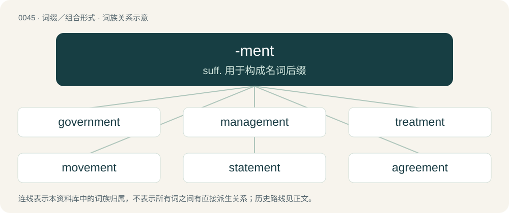

# 0047 · -ment — suff. 用于构成名词后缀

[总目录](../00_总目录_按常用程度.md)

**类型**：词缀／组合形式　｜　**来源语言**：见词源记录

## 核心含义与来源

- 核心含义：suff. 用于构成名词后缀
- 英文含义：Attached to a verb to form a noun meaning the action denoted by the verb or its result.
- 词形：-ment

**来源记录 1**（后缀／后置成分；Attached to a verb to form a noun meaning the action denoted by the verb or its result.）

From Middle English -ment, from Old French -ment, from Latin -mentum.

## 词族图

## 单词速览（常用到不常用）

| 单词 | 音标 | 释义 |
|---|---|---|
| [government](#w-1) | 英 /ˈɡʌv.ə.mənt/；美 /ˈɡʌv.ɚ(n).mənt/ | n. 政府, 内阁；\[经\] 政府, 政治, 政体 |
| [management](#w-2) | 英 /ˈmæn.ɪdʒ.mənt/；美 /ˈmæn.ɪdʒ.mənt/ | n. 经营, 支配, 管理；\[化\] 管理处 |
| [treatment](#w-3) | /ˈtɹiːtmənt/ | n. 治疗, 待遇, 处理；\[医\] 疗法, 治疗; 处理 |
| [movement](#w-4) | /ˈmuːv.mənt/ | n. 运动, 动作, 运转, 移动, 倾向, 变化, 活动, 乐章；\[医\] 运动 |
| [statement](#w-5) | 英 /ˈsteɪtm(ə)nt/；美 /ˈsteɪtmənt/ | n. 陈述, 指令, 声明；\[计\] 程序语句; 语句 |
| [agreement](#w-6) | /əˈɡɹiːmənt/ | n. 同意, 合约, 协议；\[经\] 契约, 协议, 协定 |
| [equipment](#w-7) | /ɪˈkwɪpmənt/ | n. 装备, 设备, 才能；\[化\] 设备; 装备; 装置 |
| [environment](#w-8) | 英 /ɪnˈvaɪ.ɹə.mənt/；美 /ɪnˈvaɪ.ɚn.mənt/ | n. 环境, 外界, 围绕；\[计\] 环境 |
| [investment](#w-9) | /ɪnˈvɛstmənt/ | n. 投资；\[医\] 包埋料, 围模料, 包埋法, 围模法 |
| [payment](#w-10) | /ˈpeɪmənt/ | n. 付款, 支付的款项(或实物), 偿还, 报应, 惩罚；\[经\] 支付, 缴纳, 支付款额 |
| [apartment](#w-11) | 英 /əˈpɑːt.mənt/；美 /əˈpɑɹt.mənt/ | n. 房间, 公寓 |
| [argument](#w-12) | 英 /ˈɑːɡjʊmənt/；美 /ˈɑɹɡjʊmənt/ | n. 争论, 论证, 论据, 自变量；\[计\] 参数 |
| [entertainment](#w-13) | 英 /ˌɛn.təˈteɪn.mənt/；美 /ˌɛn.(t)ɚˈteɪn.mənt/ | n. 娱乐, 款待, 娱乐表演 |
| [employment](#w-14) | /ɪmˈplɔɪmənt/ | n. 雇用, 职业, 工作；\[经\] 职业, 雇用, 职工招请 |
| [retirement](#w-15) | 英 /ɹəˈtaɪə(ɹ).mənt/ | n. 退休, 隐居, 撤退；\[经\] 退休, 退股, (固定资产)报废 |
| [appointment](#w-16) | 英 /əˈpɔɪnt.mɛnt/ | n. 约会, 委任的职位, 委派；\[经\] 任命, 派, 指定 |
| [settlement](#w-17) | /ˈsɛ.təl.mənt/ | n. 安顿, 解决, 处理, 结算, 殖民, 殖民地, 沉降；\[医\] 居住区; 沉渣 |
| [assessment](#w-18) | /əˈsɛsmənt/ | n. 评估, 估定, 评定的款额；\[化\] 评估 |
| [enforcement](#w-19) | 英 /ɪnˈfɔːsm(ə)nt/；美 /ɪnˈfoɹsm(ə)nt/ | n. 执行, 强制；\[法\] 实施, 加强, 厉行 |
| [replacement](#w-20) | /ɹɪˈpleɪsmənt/ | n. 归还, 更换, 代替者；\[医\] 复位, 置换 |
| [commitment](#w-21) | /kəˈmɪtmənt/ | n. 委托, 交押, 承担义务, 赞助；\[医\] 院禁 |
| [amendment](#w-22) | /əˈmɛndmənt/ | n. 修订, 改善, 改良, 改正；\[化\] 调理剂; 修正 |
| [achievement](#w-23) | /əˈt͡ʃiːv.mənt/ | n. 完成, 成就, 功业 |
| [punishment](#w-24) | /ˈpʌnɪʃmənt/ | n. 处罚, 刑罚, 惩罚；\[法\] 罚, 处罚, 刑罚 |
| [engagement](#w-25) | /ɪnˈɡeɪd͡ʒ.mənt/ | n. 诺言, 约会, 婚约, 交战；\[医\] 衔接 |
| [involvement](#w-26) | 美 /ɪnˈvɑlv.mənt/ | n. 卷入, 牵连, 包含, 困窘；\[经\] 财政困难, 经济上的困窘 |
| [judgment](#w-27) | 美 /ˈd͡ʒʌd͡ʒ.mɪnt/；/ˈd͡ʒʌd͡ʒ.mənt/ | n. 裁判, 宣告, 判决书；\[医\] 判断 |
| [requirement](#w-28) | 英 /ɹɪˈkwʌɪəm(ə)nt/；美 /ɹɪˈkwaɪɹmənt/ | n. 需求, 必要条件, 要求；\[化\] 要求; 合同要求 |
| [arrangement](#w-29) | /əˈɹeɪnd͡ʒmənt/ | n. 排列, 整齐, 安排；\[计\] 排列 |
| [excitement](#w-30) | /ɪkˈsaɪtmənt/ | n. 刺激, 兴奋；\[医\] 兴奋, 激动 |
| [basement](#w-31) | /ˈbeɪsmənt/ | n. 地下室, 墙脚；\[化\] 地下室 |
| [measurement](#w-32) | 英 /ˈmɛʒ.ə.mənt/；美 /ˈmɛʒ.ɚ.mənt/ | n. 尺寸, 度量, 度量单位；\[计\] 度量, 度量单位 |
| [placement](#w-33) | 英 /ˈpleɪ̯smənt/；/ˈpleːsmənt/ | n. 放置, 布置, 工作安排, 编班, 定位球；\[计\] 放置 |
| [disappointment](#w-34) | 英 /ˌdɪsəˈpɔɪntmənt/；美 /ˌdɪsəˈpɔɪntmənt/ | n. 失望 |
| [recruitment](#w-35) | /rɪˈkruːt.mənt / | n. 新兵征召；\[医\] 募集\[反应\], 募集\[现象\](生理), 复聪(耳科) |
| [enrollment](#w-36) | 英 /ənˈɹəʊl.mənt/；美 /ənˈɹol.mənt/ | n. 登记, 注册, 入伍；\[经\] 登记, 注册 |
| [imprisonment](#w-37) | 英 /ɪmˈpɹɪzn̩.mənt/ | n. 监禁, 下狱, 坐牢；\[法\] 监禁, 徒刑, 拘禁 |
| [adjustment](#w-38) | 英 /əˈd͡ʒʌst.mənt/ | n. 调整, 调节, 校正；\[化\] 调节 |
| [advertisement](#w-39) | 英 /ədˈvɜːtɪsmənt/；美 /ˈædvɚˌtaɪzmənt/ | n. 广告, 启事, 广告宣传；\[法\] 广告, 公告, 告示 |
| [advancement](#w-40) | 英 /ædˈvɑːns.mənt/；美 /ædˈvæns.mənt/ | n. 前进, 进步, 提升；\[医\] 徙前术 |
| [enjoyment](#w-41) | /ɪnˈd͡ʒɔɪ.mənt/ | n. 享乐, 快乐, 享受；\[经\] 使用权 |
| [embarrassment](#w-42) | /ɪmˈbæɹ.əs.mənt/ | n. 困难, 阻碍, 困窘；\[医\] 窘迫 |
| [shipment](#w-43) | 美 /ˈʃɪpmənt/ | n. 装船, 出货；\[经\] 运送, 运送(寄出)货物, 装载 |
| [endorsement](#w-44) | /ɪnˈdɔːɹs.mənt/ | n. 支持, 认可, 背书；\[经\] 背书, 担保, 保证 |
| [amusement](#w-45) | /əˈmjuzmənt/ | n. 兴味, 娱乐, 消遣；\[法\] 娱乐, 娱乐活动 |
| [accomplishment](#w-46) | 英 /əˈkɒm.plɪʃ.mənt/；美 /əˈkɑm.plɪʃ.mənt/ | n. 成就, 完成 |
| [enlightenment](#w-47) | /ɪnˈlaɪtənmənt/ | n. 启迪, 教化 |
| [disagreement](#w-48) | 英 /dɪsəˈɡɹiːmənt/；美 /ˌdɪsəˈɡɹimənt/ | n. 不合, 争论, 不一致；\[法\] 不一致, 不同意, 陪审团的意见不一 |
| [displacement](#w-49) | /dɪsˈpleɪsmɪnt/ | n. 换置, 移位, 移动, 取代；\[化\] 顶替展开法 |
| [enhancement](#w-50) | 英 /ɪnˈhɑːns.mənt/；美 /ɪnˈhæns.mənt/ | n. 提高, 美化, 增进, 增强, 增加；\[计\] 增强, 加强, 提高, 充实 |
| [infringement](#w-51) | /ɪnˈfɹɪnd͡ʒmənt/ | n. 违犯, 侵害, 违反, 侵犯；\[计\] 违反, 侵犯, 侵权, 侵犯 |
| [pavement](#w-52) | 英 /ˈpeɪvm(ə)nt/ | n. 路面, 人行道, 铺面路, 铺路材料 |
| [resentment](#w-53) | /ɹɪˈzɛnt.mənt/ | n. 怨恨, 愤恨 |
| [impeachment](#w-54) | /ɪmˈpiːt͡ʃ.mənt/ | \[法\] 控告, 检举, 弹劾 |
| [installment](#w-55) | 英 /ɪnˈstɔːl.mənt/；/ɪnˈstɔl.mənt/ | 【英文】The act of installing; installation. |
| [entitlement](#w-56) | /ənˈtaɪtəlmənt/ | n. 权利；\[法\] 权利 |
| [impairment](#w-57) | 英 /ɪmˈpɛəmənt/；美 /ɪmˈpɛɹmənt/ | n. 削弱, 减少, 损害, 损伤, 危害；\[计\] 减损 |
| [empowerment](#w-58) | /ɪmˈpaʊ.əɹ.mənt/ | n. 授权; 许可 |
| [endowment](#w-59) | 英 /ɪnˈdaʊmənt/；美 /ɛnˈdaʊmənt/ | n. 捐助, 天赋, 才能；\[经\] 捐赠, 捐款, 养老金 |
| [enrichment](#w-60) | /ɪnˈɹɪt͡ʃ.mənt/ | n. 丰富, 肥沃；\[化\] 富集 |
| [commencement](#w-61) | /kəˈmɛnsmənt/ | n. 开始, 毕业典礼；\[法\] 开始, 毕业典礼 |
| [containment](#w-62) | /kənˈteɪnmənt/ | n. 抑制, 牵制, 遏制；\[法\] 抑制, 牵制, 遏制 |
| [repayment](#w-63) | /riˈpeimənt/ | n. 付还, 偿还, 报复, 付还的钱；\[经\] 偿还, 付还 |
| [reinforcement](#w-64) | 英 /ˌɹiːɪnˈfɔːsmənt/；美 /ˌɹiɪnˈfoɹsmənt/ | n. 加强, 增援, 补充, 援军, 加固物；\[化\] 补强; 加强件 |
| [abandonment](#w-65) | /əˈbæn.d(ə)n.m(ə)nt/ | n. 放弃, 抛弃, 放纵；\[经\] 委付, 废弃, 放弃(采矿权) |
| [understatement](#w-66) | 英 /ˌʌndəˈsteɪtmənt/；美 /ˌʌndɚˈsteɪtmənt/ | n. 软弱无力的陈述, 克制的说法；\[经\] 少报 |
| [reimbursement](#w-67) | /ˌɹiː.ɪmˈbɜːs.mənt/ | n. 付还, 退还；\[经\] 偿付, 赔还 |
| [bombardment](#w-68) | 美 /bɑmbɑɹdmənt/ | n. 炮击；\[化\] 轰击 |
| [embodiment](#w-69) | /imˈbɒdimənt/ | n. 具体化, 化身 |
| [assortment](#w-70) | 英 /əˈsɔːtmənt/ | n. 分类, 各种各样；\[医\] \[遗传\]配列 |
| [accompaniment](#w-71) | /əˈkʌm.pə.ni.mənt/ | n. 伴随物, 附加物, 伴奏 |
| [enactment](#w-72) | 美 /ɛnˈæktmənt/ | n. 制定, 条例, 法规, 法令, 颁布, 规定；\[法\] 制定, 规定, 颁布 |
| [enlargement](#w-73) | 英 /ɪnˈlɑːd͡ʒ.mənt/；美 /ɪnˈlɑɹd͡ʒ.mənt/ | n. 扩大, 肿大, 肥大, 增大, 放大的照片, 放大, 扩建部分, 增补物, 扩展；\[计\] 增补, 扩大, 放大 |
| [refinement](#w-74) | /ɹəˈfaɪnmənt/ | n. 精致, 高尚, 精巧；\[医\] 精制, 精练 |
| [disarmament](#w-75) | 英 /dɪsˈɑː(r)məmənt/ | n. 裁军；\[法\] 裁军, 解除军备 |
| [attainment](#w-76) | /əˈteɪnmənt/ | n. 达到 |
| [embankment](#w-77) | 美 /ɪmˈbeɪ̯ŋkmənt/；/ɪmˈbæŋkmənt/ | n. 堤防, 筑堤 |
| [allotment](#w-78) | 美 /əˈlɔt.mɛnt/ | n. 分配, 拨款, 命运；\[经\] 分配, 拨款, 分配额分派认购额 |
| [acknowledgment](#w-79) | 英 /əkˈnɒl.ɪd͡ʒ.mənt/；美 /əkˈnɑ.lɪd͡ʒ.mənt/ | n. 承认, 答谢, 认可, 谢礼, 收到的通知, 收到的回音, 谢意；\[计\] 肯定, 确认认可 |
| [refurbishment](#w-80) |  | n. 整修; 翻新; 重新磨亮 |
| [atonement](#w-81) | /əˈtoʊnmənt/ | n. 赎罪, 补偿；\[法\] 补偿, 赎回, 赎罪 |
| [enrolment](#w-82) | /inˈrəulmənt/ | n. 登记, 注册, 入伍, 入学, 入会, 注册人数, 入学人数 |
| [nourishment](#w-83) | 英 /ˈnʌɹɪʃmənt/；美 /ˈnɝɪʃmənt/ | n. 滋养品, 养料, 营养；\[医\] 营养, 营养品 |
| [postponement](#w-84) | /pəustˈpəunmənt/ | n. 延迟, 延期；\[法\] 延期, 延迟 |
| [betterment](#w-85) | 英 /ˈbɛtəmənt/；美 /ˈbɛtɚmənt/ | n. 改进, 改善, (不动产)增值；\[法\] 改良, 改善, 地产增值 |
| [catchment](#w-86) | 英 /ˈkatʃmənt/；美 /ˈkɛt͡ʃmənt/ | n. 排水区, 集水, 流域 |
| [embezzlement](#w-87) | 美 /ˌɪmˈbɛzəlmənt/ | n. 盗用, 挪用, 侵占；\[经\] 贪污, 盗用(公款), 监守自盗 |
| [amazement](#w-88) | /əˈmeɪz.mənt/ | n. 惊愕, 惊异 |
| [consignment](#w-89) | /kənˈsaɪnmənt/ | n. 委托；\[经\] 委托, 寄销, 寄销品 |
| [internment](#w-90) | 英 /ɪnˈtɜːnmənt/；美 /ɪnˈtɝnmənt/ | n. 拘留；\[法\] 拘留, 收容, 禁闭 |
| [reinstatement](#w-91) |  | \[经\] 恢复, 补足(保险), 恢复原状 |
| [ailment](#w-92) | /ˈeɪ̯lmənt/ | n. 病痛, 疾病；\[医\] 疾病 |
| [mistreatment](#w-93) |  | n. 虐待 |
| [ointment](#w-94) | 英 /ˈɔɪntm(ə)nt/；美 /ˈɔɪn(t)m(ə)nt/ | n. 软膏, 油膏；\[化\] 软膏; 药膏 |
| [encampment](#w-95) | 英 /ɪnˈkæmpm(ə)nt/；美 /ɪnˈkæmpmənt/ | n. 露营, 宿营 |
| [fulfilment](#w-96) | 英 /fʊlˈfɪl.mənt/ | n. 履行, 结束, 完成, 实现, 满意, 称心；\[法\] 履行, 实现, 完成 |
| [bereavement](#w-97) | 英 /bɪˈriːvmənt/；美 /bɪˈrivmənt/ | n. 丧亲, 丧友 |
| [increment](#w-98) | /ˈɪŋkɹɪmn̩t/ | n. 增加, 增值, 盈余；\[计\] 增量 |
| [enlistment](#w-99) | /inˈlistmənt/ | n. 征募, 服役期限 |
| [entanglement](#w-100) | /ɪnˈtæŋɡəlmənt/ | n. 纠缠, 卷入, 缠绕物；\[化\] 缠结 |
| [enslavement](#w-101) | /inˈsleivmənt/ | n. 使做奴隶, 使受制, 制服, 束缚, 征服, 奴役；\[法\] 奴役, 征服, 盲从 |
| [astonishment](#w-102) | 英 /əˈstɒnɪʃmənt/；美 /əˈstɑːnɪʃmənt/ | n. 惊异, 惊愕, 使人惊异的事物 |
| [encroachment](#w-103) | /ɪŋˈkɹoʊt͡ʃmənt/ | n. 侵蚀, 侵犯；\[法\] 侵犯, 侵占, 侵入 |
| [incitement](#w-104) | /ɪnˈsaɪt.mənt/ | \[法\] 煽动, 刺激, 怂恿犯罪 |
| [entrapment](#w-105) | /ɪnˈtɹæpmənt/ | n. 诱捕, 使陷入罗网, 使陷入圈套, 使入陷阱, 使陷入困难, 诱使...妥协；\[化\] 包埋; 截留 |
| [arraignment](#w-106) | /əˈɹeɪnmənt/ | n. 提讯, 传讯, 责难；\[法\] 提审, 讯问, 审问 |
| [discernment](#w-107) |  | \[法\] 认识, 识别, 洞察力 |
| [banishment](#w-108) | /ˈbænɪʃmənt/ | n. 放逐, 驱逐；\[法\] 驱逐出境, 放逐, 流利 |
| [replenishment](#w-109) | /rɪˈplenɪʃmənt/ | n. 补给, 补充 |
| [abatement](#w-110) | 英 /əˈbeɪt.mənt/ | n. 减少, 减轻, 缓和, 折扣, 撤消, 中止；\[化\] 废料; 失效 |
| [rearrangement](#w-111) | /,riːəˈreindʒmənt/ | \[计\] 重排, 重列；\[化\] 重排 |
| [disbursement](#w-112) | /disˈbəːsmənt/ | n. 支付, 支出；\[经\] 支付 |
| [embellishment](#w-113) | /ɪmˈbɛlɪʃmənt/ | n. 装饰, 润色, 修饰 |
| [divestment](#w-114) | /daɪˈvɛstmənt/ | n. (=divesfiture) 剥夺, 夺取 |
| [endangerment](#w-115) | /ɪnˈdeɪndʒəmənt/ | n. 危害; 受到危害 |
| [adjournment](#w-116) | /əˈdʒəːnmənt/ | n. 延期, 休会, 休会期间；\[法\] 休庭, 休会, 延期 |
| [bewilderment](#w-117) | 英 /bɪˈwɪldəmənt/；美 /bɪˈwɪldəɹmənt/ | n. 困惑, 昏乱 |
| [dismemberment](#w-118) |  | \[医\] 肢体\[部分\]切断 |
| [maltreatment](#w-119) | 英 /malˈtɹiːtmənt/；美 /malˈtɹit.mɛnt/ | \[法\] 虐待, 粗暴对待 |
| [derangement](#w-120) | /dɪˈɹeɪnd͡ʒmənt/ | n. 捣乱, 紊乱, 精神错乱, 混乱, 搅乱, 扰乱；\[计\] 错位排列, 重排 |
| [estrangement](#w-121) | 美 /ɪsˈtɹeɪnd͡ʒmənt/ | n. 疏远 |
| [discouragement](#w-122) | /disˈkʌridʒmənt/ | n. 使泄气, 使气馁, 使沮丧, 使丧失信心, 使失去信心, 阻拦, 劝阻, 留难 |
| [inducement](#w-123) | 英 /ɪnˈdjuːsmənt/；/ɪnˈdusmənt/ | n. 诱因, 动机, 吸引力, 刺激物；\[法\] 诱惑, 引诱, 诱因 |
| [merriment](#w-124) | 美 /ˈmɛɹimɪnt/ | n. 欢喜, 嬉戏 |
| [endearment](#w-125) | /ɪnˈdɪəɹ.mənt/ | n. 亲爱, 钟爱 |
| [disenfranchisement](#w-126) | /ˌdɪs.ɪnˈfɹæn.t͡ʃaɪzmənt/ | \[法\] 剥夺公民权, 剥夺选举权, 剥夺特权 |
| [overstatement](#w-127) |  | \[经\] 估值过高, 夸大 |
| [apportionment](#w-128) | /əˈpɒːʃənmənt/ | n. 分配, 分摊, 分派；\[经\] 分派, 分配, 分摊 |
| [adornment](#w-129) | /əˈdɔːnm(ə)nt/ | n. 装饰, 装饰品 |
| [disfigurement](#w-130) | 美 /dɪsˈfɪɡ.jɚ.mənt/ | \[医\] 损形 |
| [wonderment](#w-131) | /ˈwʌndəmənt/ | n. 惊奇, 惊叹 |
| [retrenchment](#w-132) | 英 /ɹɪˈtɹɛn(t)ʃm(ə)nt/；美 /ɹəˈtɹɛnt͡ʃm(ə)nt/ | n. 紧缩, 节省, 删节；\[医\] 赘余组织切除术 |
| [abutment](#w-133) | 英 /əˈbʌt.mn̩t/；美 /əˈbʌt.mn̩t/ | n. 邻接, 接界, 桥台；\[医\] 桥基, 基牙 |
| [detainment](#w-134) | /dɪˈteɪn.mənt/ | \[经\] 扣留 |
| [deferment](#w-135) | 英 /dɪˈfɜːmənt/；美 /dɪˈfɚ.mənt/ | n. 迁延, 延期；\[经\] 递延项目, 延期 |
| [abolishment](#w-136) | 美 /əˈbɑl.ɪʃ.mənt/ | n. 废止, 革除, 消灭；\[法\] 废止, 废除, 取消 |
| [attunement](#w-137) | /əˈtjuːnmənt;/ | n. 协调；调音；调和 |
| [sustainment](#w-138) | /səˈsteɪnmənt/ | 支持, 维持, 支持物 |
| [elopement](#w-139) | /ɪˈloʊpmənt/ | n. 潜逃, 私奔；\[法\] 私奔, 逃亡, 出走 |
| [encirclement](#w-140) | /ɪnˈsɜː(ɹ)kəlmənt/ | n. 环绕, 围绕, 包围 |
| [impingement](#w-141) | /ɪmˈpɪnd͡ʒmənt/ | \[化\] 碰撞 |
| [entrainment](#w-142) | /inˈtreinmənt/ | n. \[化\]带走,夹带 |
| [curtailment](#w-143) | 英 /kɜːˈteɪlmənt/；美 /kɚˈteɪlmənt/ | n. 缩减, 缩短；\[经\] 削减, 紧缩 |
| [impoundment](#w-144) | /imˈpaundmənt/ | \[法\] 扣押, 保管 |
| [escapement](#w-145) | /ɪˈskeɪpmənt/ | n. 钟/表的司行轮, 棘轮装置, 摆轮；\[计\] 擒纵机构, 棘轮装置, 走格, 跳行, 移动 |
| [garnishment](#w-146) | /ˈgɑːniʃmənt/ | n. 装饰(品), (对第三债务人)扣押债权通知, (对第三债务人)出庭传票；\[经\] 扣押令 |
| [puzzlement](#w-147) | /ˈpʌzlmənt/ | n. 迷惑 |
| [aggrandizement](#w-148) | 美 /əˈɡrænˌdaɪ̯zmənt/；/əˈɡrændɪzmənt/ | n. 增大, 扩大, 夸大 |
| [disbandment](#w-149) | /dɪsˈbændmənt/ | n. 解散 |
| [disestablishment](#w-150) | /dɪs.ɪsˈtæblɪʃ.mənt/ | n. 解除官职；政教分离 |
| [secondment](#w-151) | /səˈkɒn(d)mənt/ | \[法\] 暂调, 调用 |
| [entrenchment](#w-152) | /inˈtrentʃmənt/ | n. 掘壕沟, 壕沟, 防卫工事 |
| [preferment](#w-153) | 英 /pɹɪˈfəːmənt/ | n. 晋升, 升任, 优先权, 选择, 偏爱；\[化\] 酶原 |
| [reapportionment](#w-154) |  | \[经\] 再分摊 |
| [enfranchisement](#w-155) | /-tʃizmənt/ | n. 释放, 解放 |
| [debasement](#w-156) | /dɪˈbeɪsmənt/ | \[经\] 降低(品质), 贬质 |
| [defilement](#w-157) | 英 /dɪˈfaɪəlmənt/ | n. 弄脏, 污秽, 污辱；\[法\] 污辱, 沾污, 污损 |
| [disbarment](#w-158) | 英 /dɪsˈbɑːmənt/ | \[法\] 取消律师资格, 将某律师除名, 驱逐出律师界 |
| [disinvestment](#w-159) | /disinˈvestmənt/ | n. 蚀本, 投资减缩；\[经\] 负投资, 停止投资, 减少投资 |
| [fitment](#w-160) | /ˈfitmənt/ | n. 家具, 配件, 装置 |
| [enablement](#w-161) | /ɛnˈeɪ.bəl.mənt/ | \[计\] 允许, 启动, 实现 |
| [upliftment](#w-162) |  | 【英文】Lifting up; elevation or promotion. |
| [extinguishment](#w-163) | /iksˈtiŋ^wiʃmənt/ | n. 消灭, 绝灭 |
| [admonishment](#w-164) | /ədˈmɔniʃmənt/ | n. 训戒；警告（等于admonition） |
| [enthronement](#w-165) | /inˈθrəunmənt/ | n. 即位, 登基典礼, 就任主教的仪式 |
| [malnourishment](#w-166) |  | n. 营养不良 |

## 逐词详解

### 1. government

**词性**：名词　｜　**音标**：英 /ˈɡʌv.ə.mənt/；美 /ˈɡʌv.ɚ(n).mənt/

**中文释义**：n. 政府, 内阁；\[经\] 政府, 政治, 政体

**英文义项**：The body with the power to make and/or enforce laws to control a country, land area, people or organization. / The relationship between a word and its dependents.

**构词拆分**：govern + -ment

**词源与演化**：

From Middle English governement, from Old French governement (modern French gouvernement), from governer (see govern) + -ment. Morphologically govern + -ment. Displaced native Old English gerec, leodweard, ræden, rǣding and ealdordōm.

**例句**：

> The Sunak government announced plans to stem the flow of migrants coming into Great Britain.

该用例对应义项：The tenure of a head of government; the ministry or administration led by a specified individual.

### 2. management

**词性**：名词　｜　**音标**：英 /ˈmæn.ɪdʒ.mənt/；美 /ˈmæn.ɪdʒ.mənt/

**中文释义**：n. 经营, 支配, 管理；\[化\] 管理处

**英文义项**：Administration; the use of limited resources combined with forecasting, planning, leadership and execution skills to achieve predetermined specific goals. / The executives of an organisation, especially senior executives.

**构词拆分**：manage + -ment

**词源与演化**：

From manage + -ment.

**例句**：

> Excellent time management helped her succeed in all facets of her life.

该用例对应义项：Judicious use of means to accomplish an end.

### 3. treatment

**词性**：名词　｜　**音标**：/ˈtɹiːtmənt/

**中文释义**：n. 治疗, 待遇, 处理；\[医\] 疗法, 治疗; 处理

**英文义项**：The process or manner of treating someone or something. / Medical care for an illness or injury.

**构词拆分**：treat + -ment

**词源与演化**：

From treat + -ment. Compare French traitement.

**例句**：

> He still has nightmares resulting from the abusive treatment he received from his captors.

该用例对应义项：The process or manner of treating someone or something.

### 4. movement

**词性**：名词　｜　**音标**：/ˈmuːv.mənt/

**中文释义**：n. 运动, 动作, 运转, 移动, 倾向, 变化, 活动, 乐章；\[医\] 运动

**英文义项**：Physical motion between points in space. / A system or mechanism for transmitting motion of a definite character, or for transforming motion, such as the wheelwork of a watch.

**构词拆分**：move + -ment

**词源与演化**：

From Middle English mevement, from Old French movement (modern French mouvement), from movoir + -ment; cf. also Medieval Latin movimentum, from Latin movere (“move”). Doublet of moment and momentum. In this sense, displaced native Old English styring, which led to Modern English stirring. Morphologically move + -ment.

**例句**：

> The labor movement has been struggling in America since the passage of the Taft-Hartley act in 1947.

该用例对应义项：A trend in various fields or social categories, a group of people with a common ideology who try together to achieve certain general goals.

### 5. statement

**词性**：名词　｜　**音标**：英 /ˈsteɪtm(ə)nt/；美 /ˈsteɪtmənt/

**中文释义**：n. 陈述, 指令, 声明；\[计\] 程序语句; 语句

**英文义项**：A declaration or remark. / A presentation of opinion or position.

**构词拆分**：state + -ment

**词源与演化**：

From state + -ment.

**用法示例／搭配（非完整句）**：

> publish a statement

该用例对应义项：A declaration or remark.

### 6. agreement

**词性**：名词　｜　**音标**：/əˈɡɹiːmənt/

**中文释义**：n. 同意, 合约, 协议；\[经\] 契约, 协议, 协定

**英文义项**：An understanding between entities to follow a specific course of conduct. / A state whereby several parties share a view or opinion; the state of not contradicting one another.

**构词拆分**：agree + -ment

**词源与演化**：

From Middle English agrement, agreement, from Old French agrement, agreement. Doublet of agrément. Morphologically agree + -ment.

**例句**：

> The results of my experiment are in agreement with those of Michelson and with the law of General Relativity.

该用例对应义项：A state whereby several parties share a view or opinion; the state of not contradicting one another.

### 7. equipment

**词性**：名词　｜　**音标**：/ɪˈkwɪpmənt/

**中文释义**：n. 装备, 设备, 才能；\[化\] 设备; 装备; 装置

**英文义项**：The act of equipping, or the state of being equipped, as for a voyage or expedition. / Any items used in equipping something or someone, for example things needed for an expedition or voyage.

**构词拆分**：equip + -ment

**词源与演化**：

From equip + -ment, or from French équipement.

**例句**：

> The sports shop sells different kits of famous clubs, and equipment from all kind of sports.

该用例对应义项：Any items used in equipping something or someone, for example things needed for an expedition or voyage.

### 8. environment

**词性**：名词　｜　**音标**：英 /ɪnˈvaɪ.ɹə.mənt/；美 /ɪnˈvaɪ.ɚn.mənt/

**中文释义**：n. 环境, 外界, 围绕；\[计\] 环境

**英文义项**：The surroundings of, and influences on, a particular item of interest. / The natural world or ecosystem.

**构词拆分**：By surface analysis, environ + -ment

**词源与演化**：

From Middle French environnement. Compare French environnement. By surface analysis, environ + -ment.

**例句**：

> That program uses the Microsoft Windows environment.

该用例对应义项：The software or hardware existing on any particular computer system.

### 9. investment

**词性**：名词　｜　**音标**：/ɪnˈvɛstmənt/

**中文释义**：n. 投资；\[医\] 包埋料, 围模料, 包埋法, 围模法

**英文义项**：The act of investing, or state of being invested. / A placement of capital in expectation of deriving income or profit from its use or appreciation.

**构词拆分**：invest + -ment

**词源与演化**：

From invest + -ment.

**例句**：

> Giving your children a good education is a wise long-term investment.

该用例对应义项：The act of investing, or state of being invested.

### 10. payment

**词性**：名词　｜　**音标**：/ˈpeɪmənt/

**中文释义**：n. 付款, 支付的款项(或实物), 偿还, 报应, 惩罚；\[经\] 支付, 缴纳, 支付款额

**英文义项**：The act of paying. / An instance of that act; a sum of money paid in exchange for goods or services, or the transaction that conveys it.

**构词拆分**：pay + -ment

**词源与演化**：

From Old French paiement. Equivalent to pay + -ment.

**例句**：

> Payment will be made at the end of the month.

该用例对应义项：The act of paying.

### 11. apartment

**词性**：名词　｜　**音标**：英 /əˈpɑːt.mənt/；美 /əˈpɑɹt.mənt/

**中文释义**：n. 房间, 公寓

**英文义项**：A complete domicile occupying only part of a building, especially one for rent; a flat. / A room within a house.

**构词拆分**：apart + -ment

**词源与演化**：

From French appartement, from Italian appartamento, from Spanish apartamiento (“separation, seclusion”), equivalent to apart + -ment. See apart and -ment.

**用法示例／搭配（非完整句）**：

> apartment dwellers

该用例对应义项：A complete domicile occupying only part of a building, especially one for rent; a flat.

### 12. argument

**词性**：名词　｜　**音标**：英 /ˈɑːɡjʊmənt/；美 /ˈɑɹɡjʊmənt/

**中文释义**：n. 争论, 论证, 论据, 自变量；\[计\] 参数

**英文义项**：A fact or statement used to support a proposition; a reason. / A series of propositions organized so that the final proposition is a conclusion which is intended to follow logically from the preceding propositions, which function as premises.

**构词拆分**：argue + -ment

**词源与演化**：

From Middle English argument, from Anglo-Norman and Old French arguement, from Latin argumentum. The English word is analysable as argue + -ment. Doublet of argumentum. Displaced native Old English racu and ġeflit.

**例句**：

> The neighbours got into an argument about the branches of the trees that extended over the fence.

该用例对应义项：A verbal dispute; a quarrel.

### 13. entertainment

**词性**：名词　｜　**音标**：英 /ˌɛn.təˈteɪn.mənt/；美 /ˌɛn.(t)ɚˈteɪn.mənt/

**中文释义**：n. 娱乐, 款待, 娱乐表演

**英文义项**：An activity designed to give pleasure, enjoyment, diversion, amusement, or relaxation to an audience, no matter whether the audience participates passively as in watching opera or a movie, or actively as in games. / A show put on for the enjoyment or amusement of others.

**构词拆分**：entertain + -ment

**词源与演化**：

From Middle English entretenement (“support, maintenance”), from Old French entretenement; see entertain. Morphologically entertain + -ment.

**例句**：

> The religion of one age is the literary entertainment of the next.

### 14. employment

**词性**：名词　｜　**音标**：/ɪmˈplɔɪmənt/

**中文释义**：n. 雇用, 职业, 工作；\[经\] 职业, 雇用, 职工招请

**英文义项**：The occupation or work for which one is used, and often paid. / The act of employing.

**词源与演化**：

From employ (itself from Middle French employer, from Middle French empleier, from Latin implicō (“enfold, involve, be connected with”), itself from in- + plicō (“fold”)) + -ment.

**例句**：

> The percentage of a country's population in employment used to be called "participation rate".

该用例对应义项：The state of being employed.

### 15. retirement

**词性**：名词　｜　**音标**：英 /ɹəˈtaɪə(ɹ).mənt/

**中文释义**：n. 退休, 隐居, 撤退；\[经\] 退休, 退股, (固定资产)报废

**英文义项**：An act of retiring; withdrawal. / The state of being retired; seclusion.

**构词拆分**：retire + -ment

**词源与演化**：

From French retirement, from retirer (“withdraw, retire”); corresponding to retire + -ment.

**例句**：

> The general lived the rest of his life peacefully after his retirement.

### 16. appointment

**词性**：名词　｜　**音标**：英 /əˈpɔɪnt.mɛnt/

**中文释义**：n. 约会, 委任的职位, 委派；\[经\] 任命, 派, 指定

**英文义项**：The act of appointing a person to hold an office or to have a position of trust. / The state of being appointed to a service or office; an office to which one is appointed.

**构词拆分**：appoint + -ment

**词源与演化**：

From Middle English appoyntement, apoyntement, from Old French appointement, equivalent to appoint + -ment.

**例句**：

> I’m leaving work early because I have a doctor’s appointment.

该用例对应义项：An arrangement between people to meet; an engagement.

### 17. settlement

**词性**：名词　｜　**音标**：/ˈsɛ.təl.mənt/

**中文释义**：n. 安顿, 解决, 处理, 结算, 殖民, 殖民地, 沉降；\[医\] 居住区; 沉渣

**英文义项**：The act of settling. / The state of being settled.

**构词拆分**：settle + -ment

**词源与演化**：

From settle + -ment.

**用法示例／搭配（非完整句）**：

> settlement of debt

该用例对应义项：The act of settling.

### 18. assessment

**词性**：名词　｜　**音标**：/əˈsɛsmənt/

**中文释义**：n. 评估, 估定, 评定的款额；\[化\] 评估

**英文义项**：The act of assessing or an amount (of tax, levy or duty etc) assessed. / An appraisal or evaluation.

**构词拆分**：assess + -ment

**词源与演化**：

From assess + -ment.

**例句**：

> The assessment for repairs outraged the club's membership.

该用例对应义项：an amount determined as payable

### 19. enforcement

**词性**：名词　｜　**音标**：英 /ɪnˈfɔːsm(ə)nt/；美 /ɪnˈfoɹsm(ə)nt/

**中文释义**：n. 执行, 强制；\[法\] 实施, 加强, 厉行

**英文义项**：The act of enforcing; compulsion. / A giving force to; a putting in execution.

**构词拆分**：enforce + -ment

**词源与演化**：

From Old French enforcement, see enforce + -ment.

**例句**：

> The payments were blocked just in time by alert law enforcement officials.

### 20. replacement

**词性**：名词　｜　**音标**：/ɹɪˈpleɪsmənt/

**中文释义**：n. 归还, 更换, 代替者；\[医\] 复位, 置换

**英文义项**：A person or thing that takes the place of another; a substitute. / The act of replacing something.

**构词拆分**：replace + -ment

**词源与演化**：

From replace + -ment.

**例句**：

> The replacement of that broken light-bulb will have to wait until I can buy a new one.

该用例对应义项：The act of replacing something.

### 21. commitment

**词性**：名词　｜　**音标**：/kəˈmɪtmənt/

**中文释义**：n. 委托, 交押, 承担义务, 赞助；\[医\] 院禁

**英文义项**：The act of sending a legislative bill to committee for review. / Official consignment sending a person to prison or a mental health institution.

**构词拆分**：commit + -ment

**词源与演化**：

From commit + -ment.

**例句**：

> His long commitment to public service.

该用例对应义项：the act of binding yourself (intellectually or emotionally) to a course of action

### 22. amendment

**词性**：名词　｜　**音标**：/əˈmɛndmənt/

**中文释义**：n. 修订, 改善, 改良, 改正；\[化\] 调理剂; 修正

**英文义项**：An alteration or change for the better; correction of a fault or of faults; reformation of life by quitting vices. / In public bodies, any alteration made or proposed to be made in a bill or motion that adds, changes, substitutes, or omits.

**构词拆分**：amend + -ment

**词源与演化**：

From French amendement, from Late Latin amendamentum, equivalent to amend + -ment.

**例句**：

> The First Amendment guarantees freedom of religion, speech, press, assembly, and petition.

该用例对应义项：An addition to and/or alteration to the Constitution.

### 23. achievement

**词性**：名词　｜　**音标**：/əˈt͡ʃiːv.mənt/

**中文释义**：n. 完成, 成就, 功业

**英文义项**：The act of achieving or performing; a successful performance; accomplishment. / A great or heroic deed or feat; something accomplished by valor or boldness.

**构词拆分**：achieve + -ment

**词源与演化**：

From Middle French achevement (compare Modern French achèvement), from Old French achevement, from the verb achever, achiever (“to finish”); equivalent to achieve + -ment. The heraldic sense may be influenced by hatchment.

**例句**：

> Finishing the game does not give you a 100% score until you have unlocked all of the achievements.

该用例对应义项：An award for completing a particular task or meeting an objective in a video game.

### 24. punishment

**词性**：名词　｜　**音标**：/ˈpʌnɪʃmənt/

**中文释义**：n. 处罚, 刑罚, 惩罚；\[法\] 罚, 处罚, 刑罚

**英文义项**：The act (action) or process of punishing, imposing and/or applying a sanction, typically by an authority or a person in authority (for example: a parent or teacher), especially when disappointed or dissatisfied with the behavior or actions of a child, student, or someone else being looked after. / A penalty to punish wrongdoing, especially for crime.

**构词拆分**：punish + -ment

**词源与演化**：

From Middle English punishement, from Old French punissement, from punir (“to punish”). Equivalent to punish + -ment. Displaced native Old English wīte.

**例句**：

> The naughty children were given a punishment by their teachers.

该用例对应义项：The act (action) or process of punishing, imposing and/or applying a sanction, typically by an authority or a person in authority (for example: a parent or teacher), especially when disappointed or dissatisfied with the behavior or actions of a child, student, or someone else being looked after.

### 25. engagement

**词性**：名词　｜　**音标**：/ɪnˈɡeɪd͡ʒ.mənt/

**中文释义**：n. 诺言, 约会, 婚约, 交战；\[医\] 衔接

**英文义项**：An appointment, especially to speak or perform. / Connection or attachment.

**构词拆分**：engage + -ment

**词源与演化**：

From French engagement. Equivalent to engage + -ment.

**例句**：

> After engagement it quickly became clear which of the fencers was going to prevail.

该用例对应义项：The point at which the fencers are close enough to join blades, or to make an effective attack during an encounter.

### 26. involvement

**词性**：名词　｜　**音标**：美 /ɪnˈvɑlv.mənt/

**中文释义**：n. 卷入, 牵连, 包含, 困窘；\[经\] 财政困难, 经济上的困窘

**英文义项**：The act of involving, or the state of being involved.

**构词拆分**：involve + -ment

**词源与演化**：

From involve + -ment.

**例句**：

> My involvement with her left me a physical and mental wreck.

### 27. judgment

**词性**：名词　｜　**音标**：美 /ˈd͡ʒʌd͡ʒ.mɪnt/；/ˈd͡ʒʌd͡ʒ.mənt/

**中文释义**：n. 裁判, 宣告, 判决书；\[医\] 判断

**英文义项**：The act of judging. / The power or faculty of performing such operations; especially, when unqualified, the faculty of judging or deciding rightly, justly, or wisely.

**构词拆分**：By surface analysis, judge + -ment

**词源与演化**：

From Middle English juggement, borrowed from Old French jugement, from Late Latin iūdicāmentum, from Latin iūdicō. Partially displaced doom. By surface analysis, judge + -ment.

**用法示例／搭配（非完整句）**：

> a man of judgment / a man of good judgment

该用例对应义项：The power or faculty of performing such operations; especially, when unqualified, the faculty of judging or deciding rightly, justly, or wisely.

### 28. requirement

**词性**：名词　｜　**音标**：英 /ɹɪˈkwʌɪəm(ə)nt/；美 /ɹɪˈkwaɪɹmənt/

**中文释义**：n. 需求, 必要条件, 要求；\[化\] 要求; 合同要求

**英文义项**：A necessity or prerequisite; something required or obligatory. Its adpositions are generally of in relation to who or what has given it, on in relation to whom or what it is given to, and for in relation to what is required. / Something asked.

**构词拆分**：require + -ment

**词源与演化**：

From require + -ment.

**例句**：

> The requirements of life as we know it include carbon, oxygen, hydrogen, water, and energy.

该用例对应义项：A necessity or prerequisite; something required or obligatory. Its adpositions are generally of in relation to who or what has given it, on in relation to whom or what it is given to, and for in relation to what is required.

### 29. arrangement

**词性**：名词　｜　**音标**：/əˈɹeɪnd͡ʒmənt/

**中文释义**：n. 排列, 整齐, 安排；\[计\] 排列

**英文义项**：The act of arranging. / The manner of being arranged.

**构词拆分**：arrange + -ment

**词源与演化**：

From French arrangement. Morphologically arrange + -ment.

**例句**：

> He changed the arrangement of the topics.

该用例对应义项：an organized structure for arranging or classifying

### 30. excitement

**词性**：名词　｜　**音标**：/ɪkˈsaɪtmənt/

**中文释义**：n. 刺激, 兴奋；\[医\] 兴奋, 激动

**英文义项**：The state of being excited (emotionally aroused). / Something that excites.

**构词拆分**：excite + -ment

**词源与演化**：

From Middle English excitement, from Old French excitement, equivalent to excite + -ment.

**用法示例／搭配（非完整句）**：

> to get caught up in the excitement

该用例对应义项：The state of being excited (emotionally aroused).

### 31. basement

**词性**：名词　｜　**音标**：/ˈbeɪsmənt/

**中文释义**：n. 地下室, 墙脚；\[化\] 地下室

**英文义项**：A floor of a building below ground level. / A mass of igneous or metamorphic rock forming the foundation over which a platform of sedimentary rocks is laid.

**构词拆分**：base + -ment

**词源与演化**：

From base + -ment.

**例句**：

> The basement of his house is constantly inundated with inexplicable water leaks.

### 32. measurement

**词性**：名词　｜　**音标**：英 /ˈmɛʒ.ə.mənt/；美 /ˈmɛʒ.ɚ.mənt/

**中文释义**：n. 尺寸, 度量, 度量单位；\[计\] 度量, 度量单位

**英文义项**：The act of measuring. / Value (quantity, magnitude, extent or amount) determined by an act of measuring.

**构词拆分**：measure + -ment

**词源与演化**：

From measure + -ment.

**例句**：

> In the imperial measurement system, four quarts equals one gallon.

### 33. placement

**词性**：名词　｜　**音标**：英 /ˈpleɪ̯smənt/；/ˈpleːsmənt/

**中文释义**：n. 放置, 布置, 工作安排, 编班, 定位球；\[计\] 放置

**英文义项**：The act of placing or putting in place; the act of locating or positioning; the state of being placed. / A location or position.

**构词拆分**：place + -ment

**词源与演化**：

From place + -ment.

**例句**：

> The agency does not guarantee placement, but they work on commission.

该用例对应义项：The act of matching a person with a job.

### 34. disappointment

**词性**：名词　｜　**音标**：英 /ˌdɪsəˈpɔɪntmənt/；美 /ˌdɪsəˈpɔɪntmənt/

**中文释义**：n. 失望

**英文义项**：The feeling or state of being disappointed: a feeling of sadness or frustration when something is not as good as one hoped or expected, or when something bad unexpectedly happens. / An example or the act of disappointing: a circumstance in which a positive expectation is not achieved.

**构词拆分**：disappoint + -ment

**词源与演化**：

From disappoint + -ment.

**例句**：

> The disappointment with our trip to California caused bickering.

该用例对应义项：An example or the act of disappointing: a circumstance in which a positive expectation is not achieved.

### 35. recruitment

**词性**：名词　｜　**音标**：/rɪˈkruːt.mənt /

**中文释义**：n. 新兵征召；\[医\] 募集\[反应\], 募集\[现象\](生理), 复聪(耳科)

**英文义项**：The process or art of finding candidates for a post in an organization, or recruits for the armed forces. / A style or process of recruiting.

**构词拆分**：recruit + -ment

**词源与演化**：

From recruit + -ment. French recrutement.

**例句**：

> The war was very unpopular, so recruitment of new soldiers became difficult.

### 36. enrollment

**词性**：名词　｜　**音标**：英 /ənˈɹəʊl.mənt/；美 /ənˈɹol.mənt/

**中文释义**：n. 登记, 注册, 入伍；\[经\] 登记, 注册

**英文义项**：The act of enrolling or the state of being enrolled. / The people enrolled, considered as a group.

**构词拆分**：enroll + -ment

**词源与演化**：

From Middle French enrollement. See enroll + -ment.

**例句**：

> The enrollment for the book exhibition will take place on July 11, 2024.

### 37. imprisonment

**词性**：名词　｜　**音标**：英 /ɪmˈpɹɪzn̩.mənt/

**中文释义**：n. 监禁, 下狱, 坐牢；\[法\] 监禁, 徒刑, 拘禁

**英文义项**：A confinement in a place, especially a prison or a jail, especially as punishment for a crime.

**构词拆分**：imprison + -ment

**词源与演化**：

From Anglo-Norman emprisonement, from Old French emprisonnement. See imprison + -ment.

**例句**：

> The joy was indescribably great when Tom was released from political imprisonment.

### 38. adjustment

**词性**：名词　｜　**音标**：英 /əˈd͡ʒʌst.mənt/

**中文释义**：n. 调整, 调节, 校正；\[化\] 调节

**英文义项**：The action of adjusting something. / The result of adjusting something; a small change; a minor correction; a modification or alteration.

**构词拆分**：adjust + -ment

**词源与演化**：

From French ajustement, or else adjust + -ment.

**例句**：

> The credit card company made an adjustment to my account to waive the late fee.

该用例对应义项：The settling or balancing of a financial account.

### 39. advertisement

**词性**：名词　｜　**音标**：英 /ədˈvɜːtɪsmənt/；美 /ˈædvɚˌtaɪzmənt/

**中文释义**：n. 广告, 启事, 广告宣传；\[法\] 广告, 公告, 告示

**英文义项**：A commercial solicitation designed to sell some commodity, service or similar. / A public notice.

**构词拆分**：advertise + -ment

**词源与演化**：

From Middle French advertissement (“statement calling attention”), compare French avertissement (“warning”). See advertise. Equivalent to advertise + -ment.

**例句**：

> The good manners and intelligence of the students are an advertisement for the school.

该用例对应义项：A recommendation of a particular product, service or person.

### 40. advancement

**词性**：名词　｜　**音标**：英 /ædˈvɑːns.mənt/；美 /ædˈvæns.mənt/

**中文释义**：n. 前进, 进步, 提升；\[医\] 徙前术

**英文义项**：The act of advancing; promotion to a higher place or dignity / The state of being advanced

**构词拆分**：advance + -ment

**词源与演化**：

From Middle English avancement, Old French avancement. See advance. Morphologically advance + -ment.

**用法示例／搭配（非完整句）**：

> the advancement of learning

该用例对应义项：The act of advancing; promotion to a higher place or dignity

### 41. enjoyment

**词性**：名词　｜　**音标**：/ɪnˈd͡ʒɔɪ.mənt/

**中文释义**：n. 享乐, 快乐, 享受；\[经\] 使用权

**英文义项**：The condition of enjoying anything. / An enjoyable state of mind; a feeling of satisfaction or delight from a situation.

**构词拆分**：enjoy + -ment

**词源与演化**：

From enjoy + -ment.

**例句**：

> Few activities better the enjoyment of a hearty meal eaten in good company.

该用例对应义项：The condition of enjoying anything.

### 42. embarrassment

**词性**：名词　｜　**音标**：/ɪmˈbæɹ.əs.mənt/

**中文释义**：n. 困难, 阻碍, 困窘；\[医\] 窘迫

**英文义项**：A state of discomfort arising from bashfulness or consciousness of having violated a social rule; humiliation. / A person or thing which is the cause of humiliation to another.

**构词拆分**：embarrass + -ment

**词源与演化**：

From embarrass + -ment.

**例句**：

> Losing this highly publicized case was an embarrassment to the firm.

该用例对应义项：A person or thing which is the cause of humiliation to another.

### 43. shipment

**词性**：名词　｜　**音标**：美 /ˈʃɪpmənt/

**中文释义**：n. 装船, 出货；\[经\] 运送, 运送(寄出)货物, 装载

**英文义项**：A load of goods that is transported by any method (not just by ship). / The act of transporting goods.

**构词拆分**：ship + -ment

**词源与演化**：

From ship + -ment.

**例句**：

> Shipment of hazardous waste on this route is strictly prohibited.

该用例对应义项：The act of transporting goods.

### 44. endorsement

**词性**：名词　｜　**音标**：/ɪnˈdɔːɹs.mənt/

**中文释义**：n. 支持, 认可, 背书；\[经\] 背书, 担保, 保证

**英文义项**：The act or quality of endorsing / An amendment or annotation to an insurance contract or other official document (such as a driving licence).

**构词拆分**：endorse + -ment

**词源与演化**：

From endorse + -ment.

**例句**：

> To transport gasoline, truckers must have a valid licence and the hazardous materials endorsement.

该用例对应义项：Permission to carry out a specific skill or application in a field in which the practitioner already has a general licence.

### 45. amusement

**词性**：名词　｜　**音标**：/əˈmjuzmənt/

**中文释义**：n. 兴味, 娱乐, 消遣；\[法\] 娱乐, 娱乐活动

**英文义项**：Entertainment. / An activity that is entertaining or amusing, such as dancing, gunning, or fishing.

**构词拆分**：amuse + -ment

**词源与演化**：

Borrowed from Middle French amusement, from amuser + -ment. Morphologically amuse + -ment.

**例句**：

> To my great amusement, the dog kept on chasing its tail and yelped when it bit it.

该用例对应义项：Entertainment.

### 46. accomplishment

**词性**：名词　｜　**音标**：英 /əˈkɒm.plɪʃ.mənt/；美 /əˈkɑm.plɪʃ.mənt/

**中文释义**：n. 成就, 完成

**英文义项**：The act of accomplishing; completion; fulfilment. / That which completes, perfects, or equips thoroughly; acquirement; attainment; that which constitutes excellence of mind, or elegance of manners, acquired by education or training.

**构词拆分**：accomplish + -ment

**词源与演化**：

\* First attested in the early 15th century. \* (completes, perfects, equips): First attested around 1600. \* accomplish + -ment \* Borrowed from French accomplissement, from accomplir

**例句**：

> Increasing sales by 20% in the last quarter was seen as a major accomplishment for the business.

该用例对应义项：Something accomplished; an achievement.

### 47. enlightenment

**词性**：名词　｜　**音标**：/ɪnˈlaɪtənmənt/

**中文释义**：n. 启迪, 教化

**英文义项**：An act of enlightening, or the state of being enlightened or instructed. / A concept in spirituality, philosophy and psychology related to achieving clarity of perception, reason and knowledge.

**构词拆分**：enlighten + -ment

**词源与演化**：

From enlighten + -ment.

**例句**：

> The most significant achievement of the Hungarian Enlightenment was the language reform.

### 48. disagreement

**词性**：名词　｜　**音标**：英 /dɪsəˈɡɹiːmənt/；美 /ˌdɪsəˈɡɹimənt/

**中文释义**：n. 不合, 争论, 不一致；\[法\] 不一致, 不同意, 陪审团的意见不一

**英文义项**：An argument or debate. / A condition of not agreeing or concurring.

**构词拆分**：dis- + agreement；disagree + -ment

**词源与演化**：

From dis- + agreement or disagree + -ment.

**例句**：

> They had a bit of a disagreement about what color to paint the bedroom, but they have reached a compromise.

该用例对应义项：An argument or debate.

### 49. displacement

**词性**：名词　｜　**音标**：/dɪsˈpleɪsmɪnt/

**中文释义**：n. 换置, 移位, 移动, 取代；\[化\] 顶替展开法

**英文义项**：The act of displacing, or the state of being displaced; a putting out of place. / The weight of a ship or other floating vessel, traditionally measured or calculated by finding the volume of the vessel below the waterline when afloat, the weight of the displaced liquid being equal to that of the whole displacing body.

**构词拆分**：displace + -ment

**词源与演化**：

From French déplacement. Morphologically displace + -ment.

**例句**：

> Many adults missed out on schooling because of warfare and displacement.

### 50. enhancement

**词性**：名词　｜　**音标**：英 /ɪnˈhɑːns.mənt/；美 /ɪnˈhæns.mənt/

**中文释义**：n. 提高, 美化, 增进, 增强, 增加；\[计\] 增强, 加强, 提高, 充实

**英文义项**：An improvement or supplement that tends to increase a sense of esteem. / The degree to which the image of a scan stands out as a bright area.

**构词拆分**：enhance + -ment

**词源与演化**：

From enhance + -ment.

**例句**：

> The original product, with its simplistic design, has undergone many enhancements over the years.

该用例对应义项：An improvement or supplement that tends to increase a sense of esteem.

### 51. infringement

**词性**：名词　｜　**音标**：/ɪnˈfɹɪnd͡ʒmənt/

**中文释义**：n. 违犯, 侵害, 违反, 侵犯；\[计\] 违反, 侵犯, 侵权, 侵犯

**英文义项**：A violation or breach, as of a law. / An encroachment on a right, a person, a territory, or a property.

**构词拆分**：infringe + -ment

**词源与演化**：

From infringe + -ment.

**例句**：

> Your thinking about my book is an infringement on my copyright.

### 52. pavement

**词性**：名词　｜　**音标**：英 /ˈpeɪvm(ə)nt/

**中文释义**：n. 路面, 人行道, 铺面路, 铺路材料

**英文义项**：A paved surface; a hard covering on the ground. / A paved path, for the use of pedestrians, located at the side of a road.

**构词拆分**：pave + -ment

**词源与演化**：

From Middle English pament, from Anglo-Norman pavement and reinforced by Middle French pavement; both from Latin pavīmentum (“paved surface or floor”), from pavīre (“to beat, to ram, to tread down”). Morphologically pave + -ment.

**例句**：

> The old man slipped, fell, and hit his head on the pavement.

### 53. resentment

**词性**：名词　｜　**音标**：/ɹɪˈzɛnt.mənt/

**中文释义**：n. 怨恨, 愤恨

**英文义项**：Anger or displeasure stemming from belief that one or one's group has been wronged or betrayed by others; indignation.

**构词拆分**：resent + -ment

**词源与演化**：

From resent + -ment, after Middle French and French ressentiment (in Old French as recentement), from an archaic usage of the verb ressentir via Old French sentir, from Latin sentiō, sentīre (“to feel”). Compare Italian risentimento, Portuguese ressentimento, and Spanish resentimiento. Doublet of resentiment and ressentiment, the former attested slightly earlier.

**例句**：

> There is a lot of distrust and resentment between Algeria and Morocco.

### 54. impeachment

**词性**：名词　｜　**音标**：/ɪmˈpiːt͡ʃ.mənt/

**中文释义**：\[法\] 控告, 检举, 弹劾

**英文义项**：The act of calling into question or challenging the accuracy or propriety of something. / A demonstration in a court of law, or before another finder of fact, that a witness was ingenuine before, and is therefore less likely to tell the truth now.

**构词拆分**：impeach + -ment

**词源与演化**：

From Middle English empechement (“hindrance, impediment, obstacle, obstruction; legal accusation or charge; act of calling into question or discrediting; challenge to a claim or right”), and thence either: \* from Middle English empechen, empeschen, empesche, enpechen, impechen (“to cause to get stuck; of a ship: to run aground; to block, obstruct; to hinder, impede; to prevent; to interfere with, harm; to criticize, disparage; to bring charges against; to formally accuse of treason or another high crime”) (from Anglo-Norman empecher, Old French empechier, empeechier) + -ment (suffix forming action nouns, concrete nouns, and nouns indicating a result or a condition or state); or \* from Old French empechement, empeechement, empeschement (“obstacle”) (modern French empêchement (“impediment, obstacle”)), from empeechier (“to fetter; to hinder”), empescher (“to inhibit, prevent”) + -ment (suffix forming nouns from verbs). The English word is analysable as impeach + -ment. Old French empechier, empeechier and empescher (compare modern French empêcher) are derived from Late Latin impedicāre (“to catch; to entangle”), present active infinitive of Latin impedicō (“to entangle; to fetter”), from im- (variant of in-) + pedica (“fetter, shackle; snare, trap”) (from pēs (“foot”), ultimately from Proto-Indo-European \*ped- (“to step, walk; to fall, stumble”)) + -ō. In senses 1.2 (“accusation that a person has committed a crime”) and 1.3 (“act of impeaching or charging a public official with misconduct”), the word has been used in place of Latin impetere, the present active infinitive of impetō (“to assail, attack, rush upon”).

**例句**：

> I call for the impeachment of the President of the United States of America.

### 55. installment

**词性**：名词　｜　**音标**：英 /ɪnˈstɔːl.mənt/；/ɪnˈstɔl.mənt/

**英文义项**：The act of installing; installation.

**构词拆分**：install + -ment

**词源与演化**：

From install + -ment, install from Old French installer, from Medieval Latin installare, from Medieval Latin in- and Medieval Latin stallum, stall from a Germanic source (compare Old High German stal).

### 56. entitlement

**词性**：名词　｜　**音标**：/ənˈtaɪtəlmənt/

**中文释义**：n. 权利；\[法\] 权利

**英文义项**：The right to have something. / A person's perceived but unjustified right to something; a tendency to claim what one does not deserve.

**构词拆分**：entitle + -ment

**词源与演化**：

From entitle + -ment.

**例句**：

> Narcissists often have a sense of entitlement and expect special treatment from others.

### 57. impairment

**词性**：名词　｜　**音标**：英 /ɪmˈpɛəmənt/；美 /ɪmˈpɛɹmənt/

**中文释义**：n. 削弱, 减少, 损害, 损伤, 危害；\[计\] 减损

**英文义项**：The result of being impaired. / A deterioration or weakening.

**构词拆分**：impair + -ment

**词源与演化**：

From Middle English empeirement, empeyrement, emparement, from Anglo-Norman empairement, emperement, enpeirement, from Old French ampirement, anpirement, enperement, equivalent to impair + -ment.

**用法示例／搭配（非完整句）**：

> visual impairment

该用例对应义项：A disability or handicap.

### 58. empowerment

**词性**：名词　｜　**音标**：/ɪmˈpaʊ.əɹ.mənt/

**中文释义**：n. 授权; 许可

**英文义项**：The achievement of political, social or economic power by an individual or group. / The process of supporting another person or persons to discover and claim personal power.

**构词拆分**：empower + -ment

**词源与演化**：

From empower + -ment.

**例句**：

> Stereotypical beliefs about femininity hinder women's empowerment and limit their opportunities for growth.

### 59. endowment

**词性**：名词　｜　**音标**：英 /ɪnˈdaʊmənt/；美 /ɛnˈdaʊmənt/

**中文释义**：n. 捐助, 天赋, 才能；\[经\] 捐赠, 捐款, 养老金

**英文义项**：Something with which a person or thing is endowed. / Property or funds invested for the support and benefit of a person or not-for-profit institution.

**构词拆分**：endow + -ment

**词源与演化**：

From Middle English endowement; equivalent to endow + -ment.

**例句**：

> The university's endowment has decreased steadily over the last ten years.

### 60. enrichment

**词性**：名词　｜　**音标**：/ɪnˈɹɪt͡ʃ.mənt/

**中文释义**：n. 丰富, 肥沃；\[化\] 富集

**英文义项**：The act of enriching or something enriched. / The process of making enriched uranium.

**构词拆分**：enrich + -ment

**词源与演化**：

From enrich + -ment.

**例句**：

> The enrichment of the soil with minerals allowed my corn to grow this tall.

### 61. commencement

**词性**：名词　｜　**音标**：/kəˈmɛnsmənt/

**中文释义**：n. 开始, 毕业典礼；\[法\] 开始, 毕业典礼

**英文义项**：The first existence of anything; act or fact of commencing; the beginning. / The day when degrees are conferred by colleges and universities upon students and others.

**构词拆分**：commence + -ment

**词源与演化**：

From French commencement; analyzable as commence + -ment.

**例句**：

> The time of Henry VII nearly coincides with the commencement of what is termed modern history.

该用例对应义项：The first existence of anything; act or fact of commencing; the beginning.

### 62. containment

**词性**：名词　｜　**音标**：/kənˈteɪnmənt/

**中文释义**：n. 抑制, 牵制, 遏制；\[法\] 抑制, 牵制, 遏制

**英文义项**：The state of being contained. / The state of containing.

**构词拆分**：contain + -ment

**词源与演化**：

From contain + -ment.

**例句**：

> The containment of the AIDS epidemic.

该用例对应义项：the act of containing; keeping something from spreading

### 63. repayment

**词性**：名词　｜　**音标**：/riˈpeimənt/

**中文释义**：n. 付还, 偿还, 报复, 付还的钱；\[经\] 偿还, 付还

**英文义项**：The act of repaying. / The money or other item that is repaid.

**构词拆分**：repay + -ment；re- + payment

**词源与演化**：

From repay + -ment, also equivalent to re- + payment.

**例句**：

> Student loan repayment begins next month.

### 64. reinforcement

**词性**：名词　｜　**音标**：英 /ˌɹiːɪnˈfɔːsmənt/；美 /ˌɹiɪnˈfoɹsmənt/

**中文释义**：n. 加强, 增援, 补充, 援军, 加固物；\[化\] 补强; 加强件

**英文义项**：The act, process, or state of reinforcing or being reinforced. / A thing that reinforces.

**构词拆分**：reinforce + -ment

**词源与演化**：

From reinforce + -ment.

**例句**：

> There's a website that can be a good learning reinforcement.

该用例对应义项：A thing that reinforces.

### 65. abandonment

**词性**：名词　｜　**音标**：/əˈbæn.d(ə)n.m(ə)nt/

**中文释义**：n. 放弃, 抛弃, 放纵；\[经\] 委付, 废弃, 放弃(采矿权)

**英文义项**：The act of abandoning, or the state of being abandoned; total desertion; relinquishment. / The voluntary leaving of a person to whom one is bound by a special relation, as a wife, husband or child; desertion.

**构词拆分**：abandon + -ment

**词源与演化**：

Borrowed from French abandonnement, from abandonner (“to abandon, relinquish”). abandonner was originally equivalent to mettre à bandon (“to leave to the jurisdiction, i.e. of another”), bandon being from Medieval Latin bandum, bannum (“order, decree, ban”). Equivalent to abandon + -ment. (See also English banns.)

**例句**：

> High-profile abandonments are harder to infiltrate for urban explorers due to their heightened security.

该用例对应义项：An abandoned building or structure.

### 66. understatement

**词性**：名词　｜　**音标**：英 /ˌʌndəˈsteɪtmənt/；美 /ˌʌndɚˈsteɪtmənt/

**中文释义**：n. 软弱无力的陈述, 克制的说法；\[经\] 少报

**英文义项**：A figure of speech whereby something is made to seem smaller or less important than it actually is, either through phrasing or lack of emphasis, often for ironic effect. / An instance of such phrasing or lack of emphasis; an incomplete statement.

**构词拆分**：under- + statement；understate + -ment

**词源与演化**：

From under- + statement or understate + -ment.

**例句**：

> Now that's an understatement.

该用例对应义项：An instance of such phrasing or lack of emphasis; an incomplete statement.

### 67. reimbursement

**词性**：名词　｜　**音标**：/ˌɹiː.ɪmˈbɜːs.mənt/

**中文释义**：n. 付还, 退还；\[经\] 偿付, 赔还

**英文义项**：The act of compensating someone for an expense.

**构词拆分**：reimburse + -ment

**词源与演化**：

From reimburse + -ment.

**例句**：

> The patient received full reimbursement for the cost of treatment.

该用例对应义项：The act of compensating someone for an expense.

### 68. bombardment

**词性**：名词　｜　**音标**：美 /bɑmbɑɹdmənt/

**中文释义**：n. 炮击；\[化\] 轰击

**英文义项**：The act of bombing, especially towns or cities. / Heavy artillery fire.

**构词拆分**：bombard + -ment

**词源与演化**：

From bombard + -ment.

**例句**：

> Nothing would escape a Chinese bombardment in Taiwan.

### 69. embodiment

**词性**：名词　｜　**音标**：/imˈbɒdimənt/

**中文释义**：n. 具体化, 化身

**英文义项**：The process of embodying. / A physical entity typifying an abstract concept.

**构词拆分**：embody + -ment

**词源与演化**：

From embody + -ment.

**例句**：

> You are the very embodiment of beauty.

该用例对应义项：A physical entity typifying an abstract concept.

### 70. assortment

**词性**：名词　｜　**音标**：英 /əˈsɔːtmənt/

**中文释义**：n. 分类, 各种各样；\[医\] \[遗传\]配列

**英文义项**：A collection of varying but related items.

**构词拆分**：assort + -ment

**词源与演化**：

From assort + -ment.

**例句**：

> This box has an assortment of chocolates. There's a picture on the cover so you know which is which.

该用例对应义项：A collection of varying but related items.

### 71. accompaniment

**词性**：名词　｜　**音标**：/əˈkʌm.pə.ni.mənt/

**中文释义**：n. 伴随物, 附加物, 伴奏

**英文义项**：A part, usually performed by instruments, that gives support or adds to the background in music, or adds for ornamentation; also, the harmony of a figured bass. / That which accompanies; something that attends as a circumstance, or which is added to give greater completeness to the principal thing, or by way of ornament, or for the sake of symmetry.

**构词拆分**：accompany + -ment

**词源与演化**：

From French accompagnement; equivalent to accompany + -ment. First attested in 1744.

**例句**：

> Brooks performed a saxophone solo on stage, with Robert as accompaniment on the bass.

该用例对应义项：A part, usually performed by instruments, that gives support or adds to the background in music, or adds for ornamentation; also, the harmony of a figured bass.

### 72. enactment

**词性**：名词　｜　**音标**：美 /ɛnˈæktmənt/

**中文释义**：n. 制定, 条例, 法规, 法令, 颁布, 规定；\[法\] 制定, 规定, 颁布

**英文义项**：The act of playing the part of. / The act of making (a bill) into law.

**构词拆分**：enact + -ment

**词源与演化**：

From enact + -ment.

**例句**：

> The enactments passed by the council that year included sweeping reforms.

该用例对应义项：A piece of legislation that has been properly authorized by a legislative body.

### 73. enlargement

**词性**：名词　｜　**音标**：英 /ɪnˈlɑːd͡ʒ.mənt/；美 /ɪnˈlɑɹd͡ʒ.mənt/

**中文释义**：n. 扩大, 肿大, 肥大, 增大, 放大的照片, 放大, 扩建部分, 增补物, 扩展；\[计\] 增补, 扩大, 放大

**英文义项**：An act or instance of making something larger. / A making more obvious or serious; exacerbation.

**构词拆分**：enlarge + -ment

**词源与演化**：

From enlarge + -ment.

**例句**：

> Rick was ashamed about the size of his penis, so he had a penis enlargement.

该用例对应义项：An act or instance of making something larger.

### 74. refinement

**词性**：名词　｜　**音标**：/ɹəˈfaɪnmənt/

**中文释义**：n. 精致, 高尚, 精巧；\[医\] 精制, 精练

**英文义项**：The act, or the result of refining; the removal of impurities, or a purified material / High-class style; cultivation.

**构词拆分**：refine + -ment

**词源与演化**：

From refine + -ment.

**例句**：

> He described a refinement of this technique.

该用例对应义项：the result of improving something

### 75. disarmament

**词性**：名词　｜　**音标**：英 /dɪsˈɑː(r)məmənt/

**中文释义**：n. 裁军；\[法\] 裁军, 解除军备

**英文义项**：The reduction or the abolition of the military forces and armaments of a nation, and of its capability to wage war. / The act of disarming an opponent in a fight.

**构词拆分**：disarm + -ment

**词源与演化**：

From disarm + -ment, modeled after armament. By surface analysis, dis + armament.

**例句**：

> The disarmament of the aggressor nations must be complete.

该用例对应义项：act of reducing or depriving of arms

### 76. attainment

**词性**：名词　｜　**音标**：/əˈteɪnmənt/

**中文释义**：n. 达到

**英文义项**：The act of attaining; the act of arriving at or reaching; the act of obtaining by effort or exertion. / That which is attained, or obtained by exertion.

**构词拆分**：attain + -ment

**词源与演化**：

From attain + -ment; compare Old French ataignement.

**例句**：

> My attainment of proficiency in German was due to years upon years of study.

该用例对应义项：The act of attaining; the act of arriving at or reaching; the act of obtaining by effort or exertion.

### 77. embankment

**词性**：名词　｜　**音标**：美 /ɪmˈbeɪ̯ŋkmənt/；/ɪmˈbæŋkmənt/

**中文释义**：n. 堤防, 筑堤

**英文义项**：A long mound of earth, stone, or similar material, usually built for purposes such as to hold back or store water, for protection from weather or enemies, or to support a road or railway.

**构词拆分**：embank + -ment

**词源与演化**：

From embank + -ment.

**例句**：

> Sami's body was discovered dumped over a highway embankment in Ontario.

### 78. allotment

**词性**：名词　｜　**音标**：美 /əˈlɔt.mɛnt/

**中文释义**：n. 分配, 拨款, 命运；\[经\] 分配, 拨款, 分配额分派认购额

**英文义项**：The act of allotting. / Something allotted; a share, part, or portion granted or distributed

**构词拆分**：By surface analysis, allot + -ment

**词源与演化**：

From Old French alotement (modern French allotement). By surface analysis, allot + -ment.

**例句**：

> My sister spends a lot of time on her little allotment.

### 79. acknowledgment

**词性**：名词　｜　**音标**：英 /əkˈnɒl.ɪd͡ʒ.mənt/；美 /əkˈnɑ.lɪd͡ʒ.mənt/

**中文释义**：n. 承认, 答谢, 认可, 谢礼, 收到的通知, 收到的回音, 谢意；\[计\] 肯定, 确认认可

**英文义项**：The act of acknowledging / The act of recognizing in a particular character or relationship; recognition of existence, authority, truth, or genuineness.

**构词拆分**：acknowledge + -ment

**词源与演化**：

From acknowledge + -ment.

**例句**：

> He just grunted in acknowledgment of my greeting.

该用例对应义项：The act of recognizing in a particular character or relationship; recognition of existence, authority, truth, or genuineness.

### 80. refurbishment

**词性**：名词

**中文释义**：n. 整修; 翻新; 重新磨亮

**英文义项**：The act of refurbishing; a renovation.

**构词拆分**：refurbish + -ment

**词源与演化**：

From refurbish + -ment.

**例句**：

> That ship was towed into the shipyard for refurbishment.

### 81. atonement

**词性**：名词　｜　**音标**：/əˈtoʊnmənt/

**中文释义**：n. 赎罪, 补偿；\[法\] 补偿, 赎回, 赎罪

**英文义项**：Making amends to restore a damaged relationship; expiation. / The reconciliation of God and mankind through the death of Jesus.

**构词拆分**：atone + -ment；at + onement

**词源与演化**：

Perhaps from atone + -ment as translation of Medieval Latin adūnāmentum; however, the noun is found earlier than the verb (atone); and in this light, the proper etymology is at + onement.

**例句**：

> Accept suffering and achieve atonement through it — that is what you must do.

### 82. enrolment

**词性**：名词　｜　**音标**：/inˈrəulmənt/

**中文释义**：n. 登记, 注册, 入伍, 入学, 入会, 注册人数, 入学人数

**英文义项**：UK standard spelling of enrollment.

**构词拆分**：enrol + -ment

**词源与演化**：

From enrol + -ment.

### 83. nourishment

**词性**：名词　｜　**音标**：英 /ˈnʌɹɪʃmənt/；美 /ˈnɝɪʃmənt/

**中文释义**：n. 滋养品, 养料, 营养；\[医\] 营养, 营养品

**英文义项**：The act of nourishing or the state of being nourished. / Something that nourishes; food.

**构词拆分**：nourish + -ment

**词源与演化**：

From Middle English norisshement, from Middle French, from Old French norissement, from norrir, equivalent to nourish + -ment.

**例句**：

> Her nourishment of the orphans saved many lives.

该用例对应义项：the act of nourishing

### 84. postponement

**词性**：名词　｜　**音标**：/pəustˈpəunmənt/

**中文释义**：n. 延迟, 延期；\[法\] 延期, 延迟

**英文义项**：A delay, as a formal delay in a proceeding.

**构词拆分**：postpone + -ment

**词源与演化**：

From postpone + -ment.

**例句**：

> The lawyer asked for a postponement in the trial so he could spend more time preparing before it began.

该用例对应义项：A delay, as a formal delay in a proceeding.

### 85. betterment

**词性**：名词　｜　**音标**：英 /ˈbɛtəmənt/；美 /ˈbɛtɚmənt/

**中文释义**：n. 改进, 改善, (不动产)增值；\[法\] 改良, 改善, 地产增值

**英文义项**：An improvement or amelioration. / An improvement to a property that adds to its value.

**构词拆分**：better + -ment

**词源与演化**：

From better + -ment.

**例句**：

> We can contribute to the betterment of society.

### 86. catchment

**词性**：名词　｜　**音标**：英 /ˈkatʃmənt/；美 /ˈkɛt͡ʃmənt/

**中文释义**：n. 排水区, 集水, 流域

**英文义项**：Any structure or land feature which catches and holds water; the collection of such water. / A catchment area, or the people it serves.

**构词拆分**：catch + -ment

**词源与演化**：

From catch + -ment.

**例句**：

> The hospital's catchment area is the hospital's city plus the 3 adjacent towns.

### 87. embezzlement

**词性**：名词　｜　**音标**：美 /ˌɪmˈbɛzəlmənt/

**中文释义**：n. 盗用, 挪用, 侵占；\[经\] 贪污, 盗用(公款), 监守自盗

**英文义项**：The fraudulent conversion of property from a property owner. / Such conversion from public property.

**构词拆分**：embezzle + -ment

**词源与演化**：

From embezzle + -ment.

**例句**：

> He was arrested for embezzlement of company funds.

该用例对应义项：The fraudulent conversion of property from a property owner.

### 88. amazement

**词性**：名词　｜　**音标**：/əˈmeɪz.mənt/

**中文释义**：n. 惊愕, 惊异

**英文义项**：The condition of being amazed; a state of overwhelming wonder, as from surprise or sudden fear, horror, or admiration; a feeling of intense astonishment or awe, as from witnessing something incredible and impressive. / Something which amazes.

**构词拆分**：amaze + -ment

**词源与演化**：

From amaze + -ment.

**例句**：

> The amazement that painting sparked in me lasted until the tour guide jolted me out of it.

该用例对应义项：The condition of being amazed; a state of overwhelming wonder, as from surprise or sudden fear, horror, or admiration; a feeling of intense astonishment or awe, as from witnessing something incredible and impressive.

### 89. consignment

**词性**：名词　｜　**音标**：/kənˈsaɪnmənt/

**中文释义**：n. 委托；\[经\] 委托, 寄销, 寄销品

**英文义项**：A collection of goods to be sent, in transit or having been sent. / The act of consigning.

**构词拆分**：consign + -ment

**词源与演化**：

From consign + -ment.

**例句**：

> In this store, we take items on consignment. We only pay you after someone buys them.

### 90. internment

**词性**：名词　｜　**音标**：英 /ɪnˈtɜːnmənt/；美 /ɪnˈtɝnmənt/

**中文释义**：n. 拘留；\[法\] 拘留, 收容, 禁闭

**英文义项**：The state of being imprisoned, usually without trial.

**构词拆分**：intern + -ment

**词源与演化**：

From intern + -ment.

**例句**：

> The result was my internment in Villete.

### 91. reinstatement

**词性**：名词

**中文释义**：\[经\] 恢复, 补足(保险), 恢复原状

**英文义项**：The act of restoring something to its previous state.

**构词拆分**：reinstate + -ment

**词源与演化**：

From reinstate + -ment.

**例句**：

> Many people are unhappy with the sacking of the chief constable and demand his immediate reinstatement.

该用例对应义项：The act of restoring something to its previous state.

### 92. ailment

**词性**：名词　｜　**音标**：/ˈeɪ̯lmənt/

**中文释义**：n. 病痛, 疾病；\[医\] 疾病

**英文义项**：Something which ails one; a disease; sickness.

**构词拆分**：ail + -ment

**词源与演化**：

From ail + -ment.

**例句**：

> The doctor immediately began to look for the cause of Boldi's ailment.

### 93. mistreatment

**词性**：名词

**中文释义**：n. 虐待

**英文义项**：Cruel, abusive, unfair, or thoughtless treatment of a person or animal (or rarely an object).

**构词拆分**：mistreat + -ment

**词源与演化**：

From mistreat + -ment.

**例句**：

> There were allegations of mistreatment at the prison.

该用例对应义项：Cruel, abusive, unfair, or thoughtless treatment of a person or animal (or rarely an object).

### 94. ointment

**词性**：名词　｜　**音标**：英 /ˈɔɪntm(ə)nt/；美 /ˈɔɪn(t)m(ə)nt/

**中文释义**：n. 软膏, 油膏；\[化\] 软膏; 药膏

**英文义项**：A viscous preparation of oils and/or fats, usually containing medication, used as a treatment or as an emollient. / A substance used to anoint, as in religious rituals.

**构词拆分**：oint + -ment

**词源与演化**：

A later form (as if oint + -ment) of Middle English oinement, borrowed from Old French oignement (“an anointing”), from oigner, oindre, ongier (“to anoint”), from Latin ung(u)ō (“I anoint”), from Proto-Indo-European \*h₃engʷ- (“to smear, anoint”). Partly displaced native Old English sealf, whence modern salve.

**例句**：

> The doctor prescribed an antibiotic ointment for the wound.

该用例对应义项：A viscous preparation of oils and/or fats, usually containing medication, used as a treatment or as an emollient.

### 95. encampment

**词性**：名词　｜　**音标**：英 /ɪnˈkæmpm(ə)nt/；美 /ɪnˈkæmpmənt/

**中文释义**：n. 露营, 宿营

**英文义项**：A place where people (such as displaced people, soldiers, or travellers) encamp, that is, stay in tents or other temporary structures; a camp or campsite. / A place where people or things stay temporarily.

**构词拆分**：encamp (“to establish a camp or temporary shelter”) + -ment (suffix forming nouns denoting actions or their results)

**词源与演化**：

From encamp (“to establish a camp or temporary shelter”) + -ment (suffix forming nouns denoting actions or their results).

**例句**：

> They will fight with great courage to protect the encampment.

### 96. fulfilment

**词性**：名词　｜　**音标**：英 /fʊlˈfɪl.mənt/

**中文释义**：n. 履行, 结束, 完成, 实现, 满意, 称心；\[法\] 履行, 实现, 完成

**英文义项**：The act of fulfilling or the state or quality of being fulfilled; consummation; completion; realization. / A feeling of satisfaction obtained from one's aspirations or needs being fulfilled.

**构词拆分**：fulfill + -ment

**词源与演化**：

From Middle English fulfillen, from Old English fullfyllan, from full (“full”) + fyllan (“to fill”). Equivalent to fulfill + -ment.

**例句**：

> Personal fulfilment comes from having a sense of purpose.

该用例对应义项：A feeling of satisfaction obtained from one's aspirations or needs being fulfilled.

### 97. bereavement

**词性**：名词　｜　**音标**：英 /bɪˈriːvmənt/；美 /bɪˈrivmənt/

**中文释义**：n. 丧亲, 丧友

**英文义项**：The state of being bereaved; deprivation; especially the loss of a relative by death.

**构词拆分**：bereave + -ment

**词源与演化**：

From bereave + -ment.

**例句**：

> I was very saddened by the news of your bereavement.

### 98. increment

**词性**：名词　｜　**音标**：/ˈɪŋkɹɪmn̩t/

**中文释义**：n. 增加, 增值, 盈余；\[计\] 增量

**英文义项**：The action of increasing or becoming greater. / The amount of increase.

**构词拆分**：increase + -ment

**词源与演化**：

From Middle English encrement, increment, from Latin incrēmentum, from incrēscō (whence increase), from in- + crēscō (“grow”). Equivalent to increase + -ment.

**例句**：

> Every time you go through the cycle, you increment the counter by one.

### 99. enlistment

**词性**：名词　｜　**音标**：/inˈlistmənt/

**中文释义**：n. 征募, 服役期限

**英文义项**：The act of enlisting. / Voluntary service based on an individual's desire to serve a cause.

**构词拆分**：enlist + -ment

**词源与演化**：

From enlist + -ment.

**例句**：

> Military enlistment must take place in the year that the Brazilian turns eighteen years old.

### 100. entanglement

**词性**：名词　｜　**音标**：/ɪnˈtæŋɡəlmənt/

**中文释义**：n. 纠缠, 卷入, 缠绕物；\[化\] 缠结

**英文义项**：The act of entangling. / The condition of being deeply involved and intricated (with politics, a group, another person, etc.)

**构词拆分**：entangle + -ment

**词源与演化**：

From entangle + -ment.

**例句**：

> Every government office seems to have problems in expediting matters without entanglement in its red tape system.

### 101. enslavement

**词性**：名词　｜　**音标**：/inˈsleivmənt/

**中文释义**：n. 使做奴隶, 使受制, 制服, 束缚, 征服, 奴役；\[法\] 奴役, 征服, 盲从

**英文义项**：The act of enslaving or the state of being a slave; bondage

**构词拆分**：enslave + -ment

**词源与演化**：

From enslave + -ment.

**例句**：

> Somewhere in the far future a diabolical brain plotted the enslavement of mankind.

### 102. astonishment

**词性**：名词　｜　**音标**：英 /əˈstɒnɪʃmənt/；美 /əˈstɑːnɪʃmənt/

**中文释义**：n. 惊异, 惊愕, 使人惊异的事物

**英文义项**：The feeling or experience of being astonished; great surprise. / Something very surprising.

**构词拆分**：astonish + -ment

**词源与演化**：

From astonish + -ment.

**例句**：

> The class looked on in astonishment as their teacher proceeded to tear the pages out of the textbook.

该用例对应义项：The feeling or experience of being astonished; great surprise.

### 103. encroachment

**词性**：名词　｜　**音标**：/ɪŋˈkɹoʊt͡ʃmənt/

**中文释义**：n. 侵蚀, 侵犯；\[法\] 侵犯, 侵占, 侵入

**英文义项**：An entry into a place or area that was previously uncommon; an advance beyond former borders; intrusion; incursion. / An intrusion upon another's possessions or rights; infringement.

**构词拆分**：encroach + -ment

**词源与演化**：

From encroach + -ment.

**例句**：

> A flood can be defined as the encroachment of water in an area or region which is usually dry.

### 104. incitement

**词性**：名词　｜　**音标**：/ɪnˈsaɪt.mənt/

**中文释义**：\[法\] 煽动, 刺激, 怂恿犯罪

**英文义项**：A call to act; encouragement to act, often in an illegal way.

**构词拆分**：incite + -ment

**词源与演化**：

From French incitement, from Latin incitāmentum (“incentive; incitement”), from incitō (“urge; quicken; incite”, verb). Equivalent to incite + -ment.

**例句**：

> The sheriff was constantly goading me into shooting trespassers, which should surely count as incitement at the very least.

该用例对应义项：A call to act; encouragement to act, often in an illegal way.

### 105. entrapment

**词性**：名词　｜　**音标**：/ɪnˈtɹæpmənt/

**中文释义**：n. 诱捕, 使陷入罗网, 使陷入圈套, 使入陷阱, 使陷入困难, 诱使...妥协；\[化\] 包埋; 截留

**英文义项**：The state of being entrapped. / Action by law enforcement personnel to lead an otherwise innocent person to commit a crime, in order to arrest and prosecute that person for the crime.

**构词拆分**：entrap + -ment

**词源与演化**：

From entrap + -ment.

**例句**：

> A detective asking you to buy illegal marijuana for a dying man would be police entrapment.

该用例对应义项：Action by law enforcement personnel to lead an otherwise innocent person to commit a crime, in order to arrest and prosecute that person for the crime.

### 106. arraignment

**词性**：名词　｜　**音标**：/əˈɹeɪnmənt/

**中文释义**：n. 提讯, 传讯, 责难；\[法\] 提审, 讯问, 审问

**英文义项**：The formal charging of a defendant with an offense; in many jurisdictions it includes their response in the form of a plea, typically as guilty, not guilty, or no contest.

**构词拆分**：arraign + -ment

**词源与演化**：

From arraign + -ment.

**例句**：

> Today's arraignment hearing offers the defendant his first opportunity to state his case personally.

### 107. discernment

**词性**：名词

**中文释义**：\[法\] 认识, 识别, 洞察力

**英文义项**：The act of distinguishing between things. / The ability to distinguish between things.

**构词拆分**：discern + -ment

**词源与演化**：

From Middle French discernement, equivalent to discern + -ment.

**例句**：

> I have complete faith in your discernment and believe you'll make the right choices.

### 108. banishment

**词性**：名词　｜　**音标**：/ˈbænɪʃmənt/

**中文释义**：n. 放逐, 驱逐；\[法\] 驱逐出境, 放逐, 流利

**英文义项**：The act of banishing. / The state of being banished, exile.

**构词拆分**：banish + -ment

**词源与演化**：

From banish + -ment.

**例句**：

> He has been in banishment from his home country for well over four years.

该用例对应义项：The state of being banished, exile.

### 109. replenishment

**词性**：名词　｜　**音标**：/rɪˈplenɪʃmənt/

**中文释义**：n. 补给, 补充

**英文义项**：The act of replenishing. / A new supply of something.

**构词拆分**：replenish + -ment

**词源与演化**：

From replenish + -ment.

**例句**：

> My collection was in need of replenishment.

### 110. abatement

**词性**：名词　｜　**音标**：英 /əˈbeɪt.mənt/

**中文释义**：n. 减少, 减轻, 缓和, 折扣, 撤消, 中止；\[化\] 废料; 失效

**英文义项**：The act of abating, or the state of being abated; a lessening, diminution, or reduction; a moderation; removal or putting an end to; the suppression. / The deduction of minor revenues incidental to an operation in calculating the cost of the operation.

**构词拆分**：abate + -ment

**词源与演化**：

From Middle English abatement, from Anglo-Norman abatre (“to abate”) (from Old French abatre), + -ment; equivalent to abate + -ment.

**例句**：

> The abatement of a nuisance is the suppression thereof.

该用例对应义项：The act of abating, or the state of being abated; a lessening, diminution, or reduction; a moderation; removal or putting an end to; the suppression.

### 111. rearrangement

**词性**：名词　｜　**音标**：/,riːəˈreindʒmənt/

**中文释义**：\[计\] 重排, 重列；\[化\] 重排

**英文义项**：The process of rearranging. / A rearrangement reaction.

**构词拆分**：re- + arrangement；rearrange + -ment

**词源与演化**：

From re- + arrangement or rearrange + -ment.

### 112. disbursement

**词性**：名词　｜　**音标**：/disˈbəːsmənt/

**中文释义**：n. 支付, 支出；\[经\] 支付

**英文义项**：The act, instance, or process of disbursing. / Money paid out or spent.

**构词拆分**：disburse + -ment

**词源与演化**：

From disburse + -ment.

### 113. embellishment

**词性**：名词　｜　**音标**：/ɪmˈbɛlɪʃmənt/

**中文释义**：n. 装饰, 润色, 修饰

**英文义项**：An act of embellishing. / An added touch; an ornamental addition; a flourish.

**构词拆分**：embellish + -ment

**词源与演化**：

From embellish + -ment.

### 114. divestment

**词性**：名词　｜　**音标**：/daɪˈvɛstmənt/

**中文释义**：n. (=divesfiture) 剥夺, 夺取

**英文义项**：The sale or other disposal of some kind of asset.

**构词拆分**：divest + -ment

**词源与演化**：

From divest + -ment.

**例句**：

> The fossil fuel divestment movement is calling on institutions to divest from the companies causing climate change.

该用例对应义项：The sale or other disposal of some kind of asset.

### 115. endangerment

**词性**：名词　｜　**音标**：/ɪnˈdeɪndʒəmənt/

**中文释义**：n. 危害; 受到危害

**英文义项**：The act of putting someone into danger, or the condition of being in danger. / The exposure of someone, especially a child, to danger or harm.

**构词拆分**：endanger + -ment

**词源与演化**：

From endanger + -ment.

**例句**：

> You can be charged with child endangerment for driving while intoxicated if you're carrying passengers younger than 15 years old.

### 116. adjournment

**词性**：名词　｜　**音标**：/əˈdʒəːnmənt/

**中文释义**：n. 延期, 休会, 休会期间；\[法\] 休庭, 休会, 延期

**英文义项**：The state of being adjourned, or action of adjourning. / Ampliatio.

**构词拆分**：adjourn + -ment

**词源与演化**：

From Middle English ajournement, from Old French ajornement, from ajourner (“to postpone”) + -ment. Equivalent to adjourn + -ment. Doublet of aggiornamento.

**例句**：

> At midnight we made a motion for adjournment and everyone went home tired.

该用例对应义项：The state of being adjourned, or action of adjourning.

### 117. bewilderment

**词性**：名词　｜　**音标**：英 /bɪˈwɪldəmənt/；美 /bɪˈwɪldəɹmənt/

**中文释义**：n. 困惑, 昏乱

**英文义项**：The state of being bewildered. / A confusing or perplexing situation.

**构词拆分**：bewilder + -ment

**词源与演化**：

From bewilder + -ment.

**例句**：

> She looked around in bewilderment.

该用例对应义项：The state of being bewildered.

### 118. dismemberment

**词性**：名词

**中文释义**：\[医\] 肢体\[部分\]切断

**英文义项**：The act of dismembering. / The state or condition of being dismembered.

**构词拆分**：dismember + -ment

**词源与演化**：

From dismember + -ment.

### 119. maltreatment

**词性**：名词　｜　**音标**：英 /malˈtɹiːtmənt/；美 /malˈtɹit.mɛnt/

**中文释义**：\[法\] 虐待, 粗暴对待

**英文义项**：Cruel or harmful treatment or abuse; mistreatment.

**构词拆分**：By surface analysis, maltreat + -ment

**词源与演化**：

By surface analysis, maltreat + -ment.

### 120. derangement

**词性**：名词　｜　**音标**：/dɪˈɹeɪnd͡ʒmənt/

**中文释义**：n. 捣乱, 紊乱, 精神错乱, 混乱, 搅乱, 扰乱；\[计\] 错位排列, 重排

**英文义项**：The property of being deranged. / An act or instance of deranging.

**构词拆分**：derange + -ment

**词源与演化**：

Borrowed from French dérangement, equivalent to derange + -ment.

### 121. estrangement

**词性**：名词　｜　**音标**：美 /ɪsˈtɹeɪnd͡ʒmənt/

**中文释义**：n. 疏远

**英文义项**：The act of estranging; the act of alienating; alienation. / The state of being alien; foreign, non-native.

**构词拆分**：By surface analysis, estrange + -ment (“act, state”)

**词源与演化**：

Old French estrangement. By surface analysis, estrange + -ment (“act, state”).

**例句**：

> William is working to rebuild his relationship with his son after a period of estrangement.

### 122. discouragement

**词性**：名词　｜　**音标**：/disˈkʌridʒmənt/

**中文释义**：n. 使泄气, 使气馁, 使沮丧, 使丧失信心, 使失去信心, 阻拦, 劝阻, 留难

**英文义项**：The loss of confidence or enthusiasm. / The act of discouraging.

**构词拆分**：discourage + -ment

**词源与演化**：

From discourage + -ment.

**例句**：

> The discouragement of petty theft.

该用例对应义项：the act of discouraging

### 123. inducement

**词性**：名词　｜　**音标**：英 /ɪnˈdjuːsmənt/；/ɪnˈdusmənt/

**中文释义**：n. 诱因, 动机, 吸引力, 刺激物；\[法\] 诱惑, 引诱, 诱因

**英文义项**：An incentive that helps bring about a desired state. / In some contexts, this can imply bribery.

**构词拆分**：induce + -ment

**词源与演化**：

From induce + -ment.

### 124. merriment

**词性**：名词　｜　**音标**：美 /ˈmɛɹimɪnt/

**中文释义**：n. 欢喜, 嬉戏

**英文义项**：A state of enjoyable exuberance. / Playful fun.

**构词拆分**：merry + -ment

**词源与演化**：

From merry + -ment.

**例句**：

> An extraordinary change had come over his face. It was writhing with inward merriment.

### 125. endearment

**词性**：名词　｜　**音标**：/ɪnˈdɪəɹ.mənt/

**中文释义**：n. 亲爱, 钟爱

**英文义项**：The act or process of endearing, of causing (something or someone) to be loved or to be the object of affection. / The state or characteristic of being endeared.

**构词拆分**：endear + -ment

**词源与演化**：

From endear + -ment.

**例句**：

> "Sky" and "heart" are terms of endearment in Spanish.

### 126. disenfranchisement

**词性**：名词　｜　**音标**：/ˌdɪs.ɪnˈfɹæn.t͡ʃaɪzmənt/

**中文释义**：\[法\] 剥夺公民权, 剥夺选举权, 剥夺特权

**英文义项**：Explicit or implicit revocation of, or failure to grant, the right to vote, to a person or group of people.

**构词拆分**：disenfranchise + -ment

**词源与演化**：

From disenfranchise + -ment.

**例句**：

> King led the campaign to end racial segregation and electoral disenfranchisement in the USA using very similar methods to Gandhi in India.

### 127. overstatement

**词性**：名词

**中文释义**：\[经\] 估值过高, 夸大

**英文义项**：An exaggeration; a statement in excess of what is reasonable. / The tendency to overstate.

**构词拆分**：overstate + -ment；over- + statement

**词源与演化**：

From overstate + -ment or over- + statement.

**例句**：

> The story he gave was something of an overstatement of the facts.

该用例对应义项：An exaggeration; a statement in excess of what is reasonable.

### 128. apportionment

**词性**：名词　｜　**音标**：/əˈpɒːʃənmənt/

**中文释义**：n. 分配, 分摊, 分派；\[经\] 分派, 分配, 分摊

**英文义项**：The act of apportioning or the state of being apportioned. / The distribution of members of the House of Representatives according to the population of the various states.

**构词拆分**：apportion + -ment

**词源与演化**：

From apportion + -ment.

**例句**：

> The apportionment of seats in the House of Representatives is based on the relative population of each state.

该用例对应义项：the act of distributing by allotting or apportioning; distribution according to a plan

### 129. adornment

**词性**：名词　｜　**音标**：/əˈdɔːnm(ə)nt/

**中文释义**：n. 装饰, 装饰品

**英文义项**：A decoration; that which adorns. / The act of decorating.

**构词拆分**：adorn + -ment

**词源与演化**：

From adorn + -ment.

**例句**：

> The draperies did little to keep out the light; rather, they were mainly there as adornment for the windows.

该用例对应义项：A decoration; that which adorns.

### 130. disfigurement

**词性**：名词　｜　**音标**：美 /dɪsˈfɪɡ.jɚ.mənt/

**中文释义**：\[医\] 损形

**英文义项**：The result of disfiguring; the state of being disfigured.

**构词拆分**：disfigure + -ment

**词源与演化**：

From disfigure + -ment.

### 131. wonderment

**词性**：名词　｜　**音标**：/ˈwʌndəmənt/

**中文释义**：n. 惊奇, 惊叹

**英文义项**：Wonder; astonishment. / A puzzle or curiosity.

**构词拆分**：wonder + -ment

**词源与演化**：

From wonder + -ment.

**例句**：

> The cat told the puppy a bedtime story with a series of trills, describing a world of swirling odors and wonderment.

### 132. retrenchment

**词性**：名词　｜　**音标**：英 /ɹɪˈtɹɛn(t)ʃm(ə)nt/；美 /ɹəˈtɹɛnt͡ʃm(ə)nt/

**中文释义**：n. 紧缩, 节省, 删节；\[医\] 赘余组织切除术

**英文义项**：A curtailment or reduction. / An act of reducing expenses; economizing.

**构词拆分**：retrench (“to cut down, reduce; to reduce expenses; to make (an employee) redundant”) + -ment

**词源与演化**：

Probably partly from both of the following: \* Middle French retrenchement, retranchement (“removal of a portion from a larger whole; reduction of expenses”) (modern French retranchement (“deduction, subtraction”)), from retrancher, retranchier (“to get rid of, remove completely; to remove a portion from a larger whole; to reduce expenses; to deprive (oneself) of”) \[and other forms\] + -ment (suffix forming nouns usually of an action or a state resulting from an action). Retrancher and retranchier are derived from Old French re- (prefix meaning ‘again, once more’) + tranchier, trenchier (“to cut”) \[and other forms\] (modern French trancher (“to slice”)); the further etymology is uncertain, but one possibility is that the Old French words are from Latin truncāre, the present active infinitive of truncō (“to mutilate by cutting off pieces; to truncate”), from truncus (“tree trunk; piece cut off”), ultimately from Proto-Indo-European \*twerḱ- (“to carve; to cut off, trim”). \* retrench (“to cut down, reduce; to reduce expenses; to make (an employee) redundant”) + -ment. Retrench is derived from Middle French retrancher, retranchier: see above.

### 133. abutment

**词性**：名词　｜　**音标**：英 /əˈbʌt.mn̩t/；美 /əˈbʌt.mn̩t/

**中文释义**：n. 邻接, 接界, 桥台；\[医\] 桥基, 基牙

**英文义项**：The point of junction between two things, in particular a support, that abuts. / The solid portion of a structure that supports the lateral pressure of an arch or vault.

**构词拆分**：abut + -ment

**词源与演化**：

First attested in 1644; engineering sense first attested in 1793. From Old French aboutement. Equivalent to abut + -ment.

### 134. detainment

**词性**：名词　｜　**音标**：/dɪˈteɪn.mənt/

**中文释义**：\[经\] 扣留

**英文义项**：The condition of being detained; detention.

**构词拆分**：detain + -ment

**词源与演化**：

From detain + -ment.

**例句**：

> Yanni is in the detainment room of the airport.

### 135. deferment

**词性**：名词　｜　**音标**：英 /dɪˈfɜːmənt/；美 /dɪˈfɚ.mənt/

**中文释义**：n. 迁延, 延期；\[经\] 递延项目, 延期

**英文义项**：An act or instance of deferring or putting off. / Officially sanctioned postponement of compulsory military service.

**构词拆分**：defer + -ment

**词源与演化**：

From defer + -ment.

### 136. abolishment

**词性**：名词　｜　**音标**：美 /əˈbɑl.ɪʃ.mənt/

**中文释义**：n. 废止, 革除, 消灭；\[法\] 废止, 废除, 取消

**英文义项**：The act of abolishing; abolition; destruction.

**构词拆分**：abolish + -ment

**词源与演化**：

From Middle French abolissement, from aboliss-, stem of some conjugated forms abolir, equivalent to abolish + -ment.

**例句**：

> Rodenbeck believes that the abolishment of these laws would be a sign of real change.

### 137. attunement

**词性**：名词　｜　**音标**：/əˈtjuːnmənt;/

**中文释义**：n. 协调；调音；调和

**英文义项**：The quality of being in tune with something / The process of attuning or becoming attuned

**构词拆分**：attune + -ment

**词源与演化**：

From attune + -ment.

### 138. sustainment

**词性**：名词　｜　**音标**：/səˈsteɪnmənt/

**中文释义**：支持, 维持, 支持物

**英文义项**：The act of sustaining something.

**构词拆分**：sustain + -ment

**词源与演化**：

From sustain + -ment.

**例句**：

> Fishing was their main sustainment.

该用例对应义项：the act of sustaining life by food or providing a means of subsistence

### 139. elopement

**词性**：名词　｜　**音标**：/ɪˈloʊpmənt/

**中文释义**：n. 潜逃, 私奔；\[法\] 私奔, 逃亡, 出走

**英文义项**：The act of running away from home with a paramour. / The act of running away secretly for the purpose of getting married.

**构词拆分**：elope + -ment

**词源与演化**：

From elope + -ment.

### 140. encirclement

**词性**：名词　｜　**音标**：/ɪnˈsɜː(ɹ)kəlmənt/

**中文释义**：n. 环绕, 围绕, 包围

**英文义项**：The act of encircling or the state of being encircled / The isolation of a target by the formation of a blockade around it

**构词拆分**：encircle + -ment

**词源与演化**：

From encircle + -ment.

**例句**：

> The US is pursuing the geopolitical encirclement of China.

### 141. impingement

**词性**：名词　｜　**音标**：/ɪmˈpɪnd͡ʒmənt/

**中文释义**：\[化\] 碰撞

**英文义项**：The act of impinging.

**构词拆分**：impinge + -ment

**词源与演化**：

From impinge + -ment.

**例句**：

> We shall not tolerate an impingement on human rights.

### 142. entrainment

**词性**：名词　｜　**音标**：/inˈtreinmənt/

**中文释义**：n. \[化\]带走,夹带

**英文义项**：The carrying away of droplets of liquid during violent boiling. / The movement of sediment in a stream of water or in a glacier.

**构词拆分**：entrain + -ment

**词源与演化**：

Partly from French entraînement and partly entrain + -ment.

### 143. curtailment

**词性**：名词　｜　**音标**：英 /kɜːˈteɪlmənt/；美 /kɚˈteɪlmənt/

**中文释义**：n. 缩减, 缩短；\[经\] 削减, 紧缩

**英文义项**：The act of curtailing.

**构词拆分**：curtail + -ment

**词源与演化**：

From curtail + -ment.

**例句**：

> Working, healthy people contribute to the reduction of medical expenses, the rise of the eligible age for benefits, and the curtailment of their costs.

### 144. impoundment

**词性**：名词　｜　**音标**：/imˈpaundmənt/

**中文释义**：\[法\] 扣押, 保管

**英文义项**：A body of water impounded within an enclosure, such as a reservoir. / The act of impounding.

**构词拆分**：impound + -ment

**词源与演化**：

From impound + -ment.

### 145. escapement

**词性**：名词　｜　**音标**：/ɪˈskeɪpmənt/

**中文释义**：n. 钟/表的司行轮, 棘轮装置, 摆轮；\[计\] 擒纵机构, 棘轮装置, 走格, 跳行, 移动

**英文义项**：The linkage in a (watch) that gives impulses to the timekeeping element and periodically releases the gear train to move forward, advancing the clock's hands. / A mechanism found in devices such as a typewriter or printer which controls lateral motion of the carriage.

**构词拆分**：escape + -ment

**词源与演化**：

From escape + -ment. The watch component is so called because it allows a tooth to escape from a pallet at each vibration.

**例句**：

> The escapement is the reason why clocks tick.

该用例对应义项：The linkage in a (watch) that gives impulses to the timekeeping element and periodically releases the gear train to move forward, advancing the clock's hands.

### 146. garnishment

**词性**：名词　｜　**音标**：/ˈgɑːniʃmənt/

**中文释义**：n. 装饰(品), (对第三债务人)扣押债权通知, (对第三债务人)出庭传票；\[经\] 扣押令

**英文义项**：A judgment that a third party should pay money owing to a defendant directly to a plaintiff.

**构词拆分**：garnish + -ment

**词源与演化**：

From garnish + -ment.

### 147. puzzlement

**词性**：名词　｜　**音标**：/ˈpʌzlmənt/

**中文释义**：n. 迷惑

**英文义项**：The confusing state of being puzzled; bewilderment. / A puzzle; something baffling.

**构词拆分**：puzzle + -ment

**词源与演化**：

From puzzle + -ment.

**例句**：

> The puzzlement caused by the complex system led to great anger.

该用例对应义项：The confusing state of being puzzled; bewilderment.

### 148. aggrandizement

**词性**：名词　｜　**音标**：美 /əˈɡrænˌdaɪ̯zmənt/；/əˈɡrændɪzmənt/

**中文释义**：n. 增大, 扩大, 夸大

**英文义项**：The act of aggrandizing, or the state of being aggrandized or exalted in power, rank, honor, or wealth; exaltation; enlargement.

**构词拆分**：aggrandize + -ment

**词源与演化**：

From French agrandissement, from agrandir; equivalent to aggrandize + -ment.

**例句**：

> The emperor seeks only the aggrandizement of his own family.

该用例对应义项：The act of aggrandizing, or the state of being aggrandized or exalted in power, rank, honor, or wealth; exaltation; enlargement.

### 149. disbandment

**词性**：名词　｜　**音标**：/dɪsˈbændmənt/

**中文释义**：n. 解散

**英文义项**：The act of disbanding

**构词拆分**：disband + -ment

**词源与演化**：

From disband + -ment.

**例句**：

> The orchestra faced the prospect of disbandment.

该用例对应义项：the act of disbanding

### 150. disestablishment

**词性**：名词　｜　**音标**：/dɪs.ɪsˈtæblɪʃ.mənt/

**中文释义**：n. 解除官职；政教分离

**英文义项**：The downgrading or dissolution of something that had been established. / Specifically, the removal of state privileges or patronage from a given church; the removal of a policy of having an official governing religion.

**构词拆分**：dis- + establishment + dis- + establish + -ment；dis- + establish + -ment

**词源与演化**：

By surface analysis, dis- + establishment or dis- + establish + -ment.

### 151. secondment

**词性**：名词　｜　**音标**：/səˈkɒn(d)mənt/

**中文释义**：\[法\] 暂调, 调用

**英文义项**：The process or state of being seconded, the temporary transfer of a person from their normal duty to another assignment.

**构词拆分**：second + -ment

**词源与演化**：

From second + -ment.

**例句**：

> He's on secondment from the Sydney branch so he's a bit confused where everything is.

### 152. entrenchment

**词性**：名词　｜　**音标**：/inˈtrentʃmənt/

**中文释义**：n. 掘壕沟, 壕沟, 防卫工事

**英文义项**：The process of entrenching or something which entrenches / A fortification constructed of trenches

**构词拆分**：entrench + -ment

**词源与演化**：

From entrench + -ment.

### 153. preferment

**词性**：名词　｜　**音标**：英 /pɹɪˈfəːmənt/

**中文释义**：n. 晋升, 升任, 优先权, 选择, 偏爱；\[化\] 酶原

**英文义项**：Advancement to a higher position or office; promotion. / A position (especially in the Church of England) that provides profit or prestige.

**构词拆分**：prefer + -ment

**词源与演化**：

From Middle English preferment, preferrement, prefferment; equivalent to prefer + -ment.

### 154. reapportionment

**词性**：名词

**中文释义**：\[经\] 再分摊

**英文义项**：The act of reapportioning; a second or subsequent apportionment. / Reassignment of representation in a legislature, especially of U.S. House of Representative seats, in accord with changes in the census population determination.

**构词拆分**：reapportion + -ment

**词源与演化**：

c. 1930 reapportion + -ment

### 155. enfranchisement

**词性**：名词　｜　**音标**：/-tʃizmənt/

**中文释义**：n. 释放, 解放

**英文义项**：The act of enfranchising / A release from slavery

**构词拆分**：enfranchise + -ment

**词源与演化**：

From enfranchise + -ment.

### 156. debasement

**词性**：名词　｜　**音标**：/dɪˈbeɪsmənt/

**中文释义**：\[经\] 降低(品质), 贬质

**英文义项**：The act of debasing or the state of being debased; a lowering or degradation, especially in character or quality. / The lowering of the value of a currency by reducing the amount of valuable metal in the coins.

**构词拆分**：debase + -ment

**词源与演化**：

From debase + -ment.

**例句**：

> Currencies throughout history have fallen victim to debasement. Today, we avoid this problem by omitting the precious metals altogether.

### 157. defilement

**词性**：名词　｜　**音标**：英 /dɪˈfaɪəlmənt/

**中文释义**：n. 弄脏, 污秽, 污辱；\[法\] 污辱, 沾污, 污损

**英文义项**：The act of defiling. / The state of being defiled.

**构词拆分**：defile + -ment

**词源与演化**：

From defile + -ment.

### 158. disbarment

**词性**：名词　｜　**音标**：英 /dɪsˈbɑːmənt/

**中文释义**：\[法\] 取消律师资格, 将某律师除名, 驱逐出律师界

**英文义项**：The disqualification of a lawyer from membership in a bar association, usually as punishment for wrongdoing; the result of being disbarred.

**构词拆分**：disbar + -ment

**词源与演化**：

From disbar + -ment.

### 159. disinvestment

**词性**：名词　｜　**音标**：/disinˈvestmənt/

**中文释义**：n. 蚀本, 投资减缩；\[经\] 负投资, 停止投资, 减少投资

**英文义项**：The process of disinvesting; negative investment.

**构词拆分**：disinvest + -ment

**词源与演化**：

From disinvest + -ment.

### 160. fitment

**词性**：名词　｜　**音标**：/ˈfitmənt/

**中文释义**：n. 家具, 配件, 装置

**英文义项**：A thing fitted to another in order to accomplish a specific purpose. / An item of permanent furniture or equipment.

**构词拆分**：fit + -ment

**词源与演化**：

From fit + -ment.

### 161. enablement

**词性**：名词　｜　**音标**：/ɛnˈeɪ.bəl.mənt/

**中文释义**：\[计\] 允许, 启动, 实现

**英文义项**：The act of enabling.

**构词拆分**：enable + -ment

**词源与演化**：

From Middle English enhablement, equivalent to enable + -ment.

### 162. upliftment

**词性**：名词

**英文义项**：Lifting up; elevation or promotion.

**构词拆分**：uplift + -ment

**词源与演化**：

From uplift + -ment.

### 163. extinguishment

**词性**：名词　｜　**音标**：/iksˈtiŋ^wiʃmənt/

**中文释义**：n. 消灭, 绝灭

**英文义项**：The act of extinguishing, putting out, or quenching, or the state of being extinguished. / The annihilation or extinction of a right or obligation.

**构词拆分**：extinguish + -ment

**词源与演化**：

From extinguish + -ment.

### 164. admonishment

**词性**：名词　｜　**音标**：/ədˈmɔniʃmənt/

**中文释义**：n. 训戒；警告（等于admonition）

**英文义项**：The act of admonishing.

**构词拆分**：admonish + -ment

**词源与演化**：

From admonish + -ment.

**例句**：

> My father's admonishment was hard to bear.

### 165. enthronement

**词性**：名词　｜　**音标**：/inˈθrəunmənt/

**中文释义**：n. 即位, 登基典礼, 就任主教的仪式

**英文义项**：The act of enthroning or the state of being enthroned.

**构词拆分**：enthrone + -ment

**词源与演化**：

From enthrone + -ment.

### 166. malnourishment

**词性**：名词

**中文释义**：n. 营养不良

**英文义项**：malnutrition, undernourishment

**构词拆分**：mal- + nourish + -ment

**词源与演化**：

From mal- + nourish + -ment.

**例句**：

> How many children are at risk of malnourishment in Algeria?
