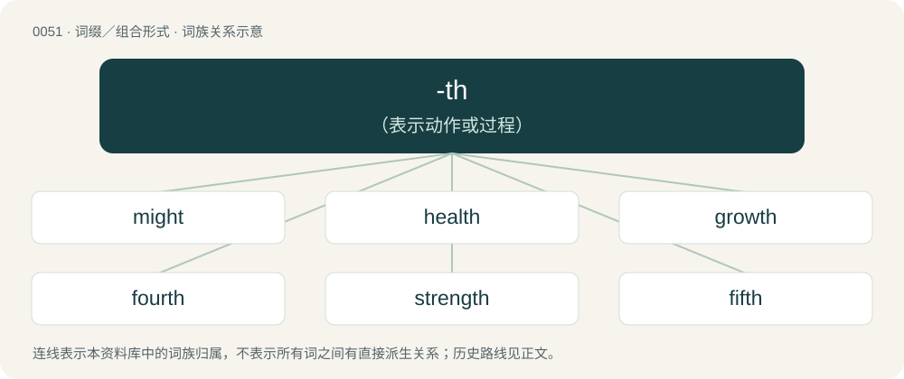

# 0053 · -th — （表示动作或过程）

[总目录](../00_总目录_按常用程度.md)

**类型**：词缀／组合形式　｜　**来源语言**：见词源记录

## 核心含义与来源

- 核心含义：（表示动作或过程）
- 英文含义：Used to form nouns from verbs of action.
- 词形：-th

**多个词源／构词路径**：同一拼写可能有不同来源；以下按词性和含义分别列出。

**来源记录 1**（后缀／后置成分；Used to form nouns from verbs of action.）

From Middle English -the, -th, -te, -t (abstract nominal suffix), from Old English -þ, -t, -þu, -tu, -þo, -to (“-th”, abstract nominal suffix), from Proto-Germanic \*-iþō, from Proto-Indo-European \*-iteh₂. Cognate with Scots -th, West Frisian -te, Dutch -te, Low German -de, Danish -de, Swedish -d, Icelandic -ð, -d, Gothic -𐌹𐌸𐌰 (-iþa), Latin -itās (“-ty, -ity”). See -ity, -t.

**来源记录 2**（后缀／后置成分；Used to form the ordinal numeral when the final term of the spelled number is not “first”, “second”, or “third”.）

From Middle English -the, -th, -te, -t (ordinal suffix), from Old English -þa, -þe, -oþa, -oþe, derived from a Proto-Indo-European superlative suffix.

## 词族图

## 单词速览（常用到不常用）

| 单词 | 音标 | 释义 |
|---|---|---|
| [might](#w-1) | /maɪt/ | n. 力量, 权力；aux. 可能, 也许 |
| [health](#w-2) | 英 /ˈhɛlθ/ | n. 健康, 卫生, 蓬勃, 健康状态；\[医\] 健康 |
| [growth](#w-3) | 英 /ɡɹəʊθ/；美 /ɡɹoʊθ/ | n. 生长, 栽培, 增长；\[计\] 等比级数 |
| [fourth](#w-4) | 英 /fɔːθ/；美 /fɔɹθ/ | num. 第四, 四分之一 |
| [strength](#w-5) | 美 /ˈstɹeɪŋθ/；/ˈstɹɛŋθ/ | n. 力量, 实力, 强度, 浓度, 人数, 抵抗力；\[化\] 强度 |
| [fifth](#w-6) | 英 /fɪfθ/ | num. 第五, 五分之一 |
| [birth](#w-7) | 英 /bɜːθ/；美 /bɜɹθ/ | n. 出生, 起源；\[医\] 生产, 分娩 |
| [length](#w-8) | 英 /lɛŋ(k)θ/；美 /leɪŋ(k)θ/ | n. 长度, 长, 期间, 一段；\[计\] 记录长度; 块长; 字长 |
| [youth](#w-9) | 英 /juːθ/；美 /juθ/ | n. 年轻, 青年时代, 青年们, 青春；\[法\] 青年, 青年时期, 青春时期 |
| [depth](#w-10) | /dɛpθ/ | n. 深度, 深处, 深奥；\[计\] 深度 |
| [wealth](#w-11) | /wɛlθ/ | n. 财富, 资源, 财产, 丰富, 富裕, 大量；\[经\] 财富 |
| [seventh](#w-12) | 英 /ˈsɛvnθ/；美 /ˈsɛvənθ/ | num. 第七, 七分之一 |
| [eighth](#w-13) | 英 /eɪtθ/；美 /eɪtθ/ | num. 第八, 八分之一 |
| [ninth](#w-14) | 英 /naɪnθ/ | num. 第九, 九分之一 |
| [width](#w-15) | /ˈwɪtθ/ | n. 宽度, 宽广, 广博；\[医\] 宽度 |
| [tenth](#w-16) | 英 /tɛnθ/ | num. 第十, 十分之一 |
| [warmth](#w-17) | 英 /wɔːmθ/；美 /wɔɹmθ/ | n. 温暖, 温情, 暖和, 激动, 生气 |
| [nineteenth](#w-18) | /ˌnaɪnˈtiːnθ/ | num. 第十九, 十九分之一 |
| [deed](#w-19) | /diːd/ | n. 行为, 实行, 契约；vt. 立契转让 |
| [wrath](#w-20) | 英 /ɹɒθ/；美 /ɹæθ/ | n. 愤怒, 激怒, 愤怒的举动, (自然现象等)严酷 |
| [feud](#w-21) | 英 /fjuːd/；美 /fjud/ | n. 不和, 封地, 争执；vi. 长期不和, 擦亮 |
| [stealth](#w-22) | /stɛlθ/ | n. 秘密行动, 秘密, 鬼祟；\[法\] 秘密行动, 鬼祟 |
| [twelfth](#w-23) | 英 /twɛlfθ/ \[tʰw̥ɛɫfθ\] | num. 第十二, 十二分之一 |
| [eighteenth](#w-24) | /ˌeɪˈtiːnθ/ | num. 第十八, 十八分之一 |
| [eleventh](#w-25) | 英 /ɪˈlɛv.ənθ/；美 /ɪˈlɛv.ənθ/ | num. 第十一, 十一分之一 |
| [breadth](#w-26) | /bɹɛdθ/ | n. 宽度；\[法\] 违背, 违犯, 未遵守 |
| [berth](#w-27) | 英 /bɜːθ/；美 /bɜɹθ/ | n. 船岸之间的水区, 锚地, 卧铺；vi. 停泊；vt. 使停泊 |
| [filth](#w-28) | /fɪlθ/ | n. 污秽, 不洁, 猥亵；\[法\] 污秽, 污物, 淫猥 |
| [broth](#w-29) | 英 /bɹɒθ/；美 /bɹɔθ/ | n. 原汁清汤, 肉汤；\[医\] 肉汤(培养基) |
| [sixteenth](#w-30) | /ˌsɪksˈtiːnθ/ | num. 第十六, 十六分之一 |
| [thirteenth](#w-31) | 英 /ˌθɜːˈtiːnθ/；美 /ˌθɝˈtiːnθ/ | num. 第十三, 十三分之一 |
| [fourteenth](#w-32) | 英 /ˌfɔːˈtiːnθ/；美 /ˌfɔɹˈtiːnθ/ | num. 第十四, 十四分之一 |
| [seventeenth](#w-33) | /ˌsɛvənˈtiːnθ/ | num. 第十七, 十七分之一 |
| [fifteenth](#w-34) | /ˌfɪfˈtiːnθ/ | num. 第十五, 十五分之一 |
| [sloth](#w-35) | 英 /sləʊθ/；美 /slɔθ/ | n. 怠惰, 懒惰 |
| [dearth](#w-36) | 英 /dɜːθ/；美 /dɝθ/ | n. 缺乏, 粮食不足, 饥馑 |
| [nth](#w-37) | /ɛnθ/ | a. 第n个的；n倍的；\[口\]最近的 |
| [millionth](#w-38) | /ˈmɪljənθ/ | a. 第一百万的, 百万分之一的；n. 第一百万, 百万分之一 |
| [hundredth](#w-39) | /ˈhʌndɹə(d)θ/ | a. 第一百的 |
| [mirth](#w-40) | 英 /mɜːθ/；美 /mɜɹθ/ | n. 欢笑, 欢乐, 愉快 |
| [ith](#w-41) | 英 /aɪθ/ | \[医\]\[=infantile transient hypogammaglobulinemia\]婴儿暂时性低丙种球蛋白血症 |
| [thousandth](#w-42) | /ˈθaʊzən(d)θ/ | a. 第一千的, 千分之一的 |
| [pith](#w-43) | 英 /paɪθ/ | 【英文】The ordinal form of the number pi (π; approximately 3.14159…). |
| [umpteenth](#w-44) | 英 /ˈʌmp.tiːnθ/ | a. &lt;口&gt;第无数次(个)的 |
| [mth](#w-45) | /ɛmθ/ | \[经\] 月 |
| [kth](#w-46) | /keɪθ/ | abbr. Kungliga Tekniska Hegskolan (Royal Institute of Technology, Stockholm) 斯德哥尔摩皇家工学院 |
| [billionth](#w-47) | /ˈbɪl.i.ənθ/ | num. 第十亿个, 十亿分之一 |

## 逐词详解

### 1. might

**词性**：名词　｜　**音标**：/maɪt/

**中文释义**：n. 力量, 权力；aux. 可能, 也许

**英文义项**：Power, strength, force, or influence held by a person or group. / Physical strength or force.

**词源与演化**：

From Middle English maught, might, miȝt, myght, from Old English maht, meaht, meht, mieht, miht, mæht (“ability, power; strength; virtue”), from Proto-West Germanic \*mahti, from Proto-Germanic \*mahtiz (“ability, power; force, strength”), from Proto-Indo-European \*(me)mógʰe (“to be able to, to have power”), from \*megʰ- (“to be able”), corresponding to Germanic \*maganą (“to be able, may”) + \*-þiz. Equivalent to may + -th. Cognates Cognate with Scots micht (“might”), Yola mought (“might”), Dutch macht (“might, power”), German Macht (“might, power”), Luxembourgish Muecht (“authority, might, power”), Yiddish מאַכט (makht, “might, power”), Faroese and Icelandic máttur (“might, strength”), Danish magt (“power; force”), Norwegian Bokmål makt (“power”), Norwegian Nynorsk and Swedish makt (“power; force”), mått (“might, power”), Gothic 𐌼𐌰𐌷𐍄𐍃 (mahts, “ability, might, power”), and further to Irish smacht (“ordinance, regulation, rule; dominion, sway; control, discipline, restraint; fine, penalty”), Greek μάγος (mágos, “magician; sorcerer, wizard”), Lithuanian mėgti (“to like”), Belarusian моц (moc, “might, power”), Bulgarian мощ (mošt, “might, power”), Czech and Polish moc (“might, power”), Macedonian моќ (moḱ, “might, power”), Russian мочь (močʹ, “power, might”) and мощь (moščʹ, “force, strength”), Serbo-Croatian мо̑ћ, mȏć (“power; strength; potency; authority”), Slovene moč (“power; strength”), Ukrainian міч (mič) and міць (micʹ, “might, power”), Armenian մոգ (mog, “magus; fire-worshiper, Zoroastrian; astrologer; diviner, enchanter, sorcerer, wizard”), Persian مغ (moġ, “magus”), Sanskrit मघ (magha, “power, wealth; bounty, gift, reward”). See more at may.

**例句**：

> He pushed with all his might, but still it would not move.

该用例对应义项：Physical strength or force.

### 2. health

**词性**：名词　｜　**音标**：英 /ˈhɛlθ/

**中文释义**：n. 健康, 卫生, 蓬勃, 健康状态；\[医\] 健康

**英文义项**：The state of being free from physical or psychological disease, illness, or malfunction; wellness. / A state of well-being or balance, often physical but sometimes also mental and social; the overall level of function of an organism from the cellular (micro) level to the social (macro) level.

**构词拆分**：heal + -th (abstract nominal suffix)

**词源与演化**：

Inherited from Middle English helthe, from Old English hǣlþ, from Proto-West Germanic \*hailiþu, from Proto-Germanic \*hailiþō, from \*hailaz + \*-iþō. Cognate with Old High German heilida. Analyzable as whole, hale, or heal + -th (abstract nominal suffix). More at heal. Doublet of wholth.

**例句**：

> The directors are concerned about the financial health of the project.

该用例对应义项：A state of well-being or balance, often physical but sometimes also mental and social; the overall level of function of an organism from the cellular (micro) level to the social (macro) level.

### 3. growth

**词性**：名词　｜　**音标**：英 /ɡɹəʊθ/；美 /ɡɹoʊθ/

**中文释义**：n. 生长, 栽培, 增长；\[计\] 等比级数

**英文义项**：An increase in size, number, value, or strength. / An increase in psychological strength or resilience; an increased ability to overcome adversity.

**构词拆分**：grow + -th (abstract nominal suffix)

**词源与演化**：

From grow + -th (abstract nominal suffix). Compare Old Frisian grēd ("meadow, pasture"; &gt; North Frisian greyde (“growth, pasture”)), Middle High German gruote, gruot (“greens, fresh growth, shoot”), Old Norse gróðr ("growth, crop"; &gt; Faroese grøði, Danish grøde (“fruits”), Swedish gröda (“crop, harvest”)). More at grow.

**例句**：

> Struggle, disappointment, and criticism all contribute to a person's growth.

该用例对应义项：An increase in psychological strength or resilience; an increased ability to overcome adversity.

### 4. fourth

**词性**：形容词　｜　**音标**：英 /fɔːθ/；美 /fɔɹθ/

**中文释义**：num. 第四, 四分之一

**英文义项**：The ordinal form of the number four.

**构词拆分**：four + -th (ordinal suffix)

**词源与演化**：

Inherited from Middle English fourthe, an alteration (due to four) of ferthe, from Old English fēorþa, fēowerþa, from Proto-West Germanic \*feurþō, from Proto-Germanic \*fedurþô, equivalent to four + -th (ordinal suffix). Cognates Compare West Frisian fjirde, Saterland Frisian fjädde, fjoode, Dutch vierde, German Low German feerde, feerd, German vierte, Danish fjerde, Icelandic fjórði.

**例句**：

> My office is on the fourth floor of that gray six-story building.

### 5. strength

**词性**：名词　｜　**音标**：美 /ˈstɹeɪŋθ/；/ˈstɹɛŋθ/

**中文释义**：n. 力量, 实力, 强度, 浓度, 人数, 抵抗力；\[化\] 强度

**英文义项**：The quality or degree of being strong. / The intensity of a force or power; potency.

**构词拆分**：strong + -th (abstract nominal suffix)

**词源与演化**：

From Middle English strengthe, from Old English strengþu (“strength”), from Proto-West Germanic \*strangiþu (“strongness; strength”), equivalent to strong + -th (abstract nominal suffix). Cognate with Dutch strengte (“strength”), German Low German Strengde, Strengte (“harshness; rigidity; strictness; severity”).

**例句**：

> It requires great strength to lift heavy objects.

该用例对应义项：The quality or degree of being strong.

### 6. fifth

**词性**：形容词　｜　**音标**：英 /fɪfθ/

**中文释义**：num. 第五, 五分之一

**英文义项**：The ordinal form of the number five.

**构词拆分**：five + -th (ordinal suffix)

**词源与演化**：

From Middle English fifthe, fifte, fift, from Old English fīfta (“fifth”), from Proto-Germanic \*fimftô (“fifth”) or \*femftô, equivalent to five + -th (ordinal suffix). Cognate with Scots fift, fyft (“fifth”), North Frisian fyfde (“fifth”), West Frisian fyfde (“fifth”), Dutch vijfde (“fifth”), Low German fifte, föfte, füfte (“fifth”), German fünfte (“fifth”), Danish femte (“fifth”), Swedish femte (“fifth”), Icelandic fimmta (“fifth”).

**例句**：

> I'll finish the work in a week, that is, on May fifth.

### 7. birth

**词性**：名词　｜　**音标**：英 /bɜːθ/；美 /bɜɹθ/

**中文释义**：n. 出生, 起源；\[医\] 生产, 分娩

**英文义项**：The process of childbearing; the beginning of life; the emergence of a human baby or other viviparous animal offspring from the mother's body into the environment. / An instance of childbirth.

**构词拆分**：bear + -th

**词源与演化**：

From Middle English birthe (1250), from earlier burthe, burde, from Old Norse burðr, byrd (Old Swedish byrth, Swedish börd), replacing Old English ġebyrd (rare variant byrþ), equivalent to bear + -th (thus a piecewise doublet of berth). The Old Norse is from Proto-Germanic \*burdiz (compare Old Frisian berde, berd); Old English ġebyrd is from prefixed \*gaburþiz (compare Dutch geboorte, German Geburt), from Proto-Indo-European \*bʰŕ̥tis (compare Latin fors (“luck”), Old Irish brith), from \*bʰer- (“to carry, bear”). More at bear.

**例句**：

> Intersex babies account for roughly one per cent of all births.

该用例对应义项：An instance of childbirth.

### 8. length

**词性**：名词　｜　**音标**：英 /lɛŋ(k)θ/；美 /leɪŋ(k)θ/

**中文释义**：n. 长度, 长, 期间, 一段；\[计\] 记录长度; 块长; 字长

**英文义项**：The distance measured along the longest dimension of an object. / Duration.

**构词拆分**：long + -th (abstract nominal suffix)

**词源与演化**：

From Middle English lengthe, from Old English lengþ, lengþu, from Proto-West Germanic \*langiþu, from Proto-Germanic \*langiþō, equivalent to long + -th (abstract nominal suffix). Cognate with Scots lenth, lainth (“length”), Saterland Frisian Loangte (“length”), West Frisian lingte, langte (“length”), Dutch lengte (“length”), German Low German Längde, Längd, Längte, Längt (“length”), Danish længde (“length”), Swedish längd (“length”), Icelandic lengd (“length”).

**用法示例／搭配（非完整句）**：

> five lengths ahead of the field

该用例对应义项：The length of a horse, used to indicate the distance between horses at the end of a race.

### 9. youth

**词性**：名词　｜　**音标**：英 /juːθ/；美 /juθ/

**中文释义**：n. 年轻, 青年时代, 青年们, 青春；\[法\] 青年, 青年时期, 青春时期

**英文义项**：The quality or state of being young. / The part of life following childhood; the period of existence preceding maturity or age; the whole early part of life, from childhood, or, sometimes, from infancy, to adulthood.

**构词拆分**：young + -th (abstract nominal suffix)

**词源与演化**：

From Middle English youthe, youghte, ȝouþe, from Old English ġeoguþ (“the state of being young; youth”), from Proto-West Germanic \*juwunþa, from Proto-Germanic \*jugunþō, \*jugunþiz (“youth”), corresponding to young + -th (abstract nominal suffix). Cognate with Saterland Frisian Juugd, West Frisian jeugd, Dutch jeugd, German Low German Jöögd, German Jugend.

**例句**：

> There was a group of youths hanging around the parking lot, reading fashion magazines and listening to music.

该用例对应义项：A young person.

### 10. depth

**词性**：名词　｜　**音标**：/dɛpθ/

**中文释义**：n. 深度, 深处, 深奥；\[计\] 深度

**英文义项**：the vertical distance below a surface; the degree to which something is deep / the distance between the front and the back, as the depth of a drawer or closet

**构词拆分**：deep + -th (abstract nominal suffix)

**词源与演化**：

From Middle English depthe, from Old English \*dīepþ (“depth”), from Proto-Germanic \*diupiþō (“depth”), equivalent to deep + -th (abstract nominal suffix). Cognates Cognate with Scots deepth, Saterland Frisian Djüpte, West Frisian djipte (“depth; abyss, chasm”), Dutch diepte, German Low German Deepd, Luxembourgish Déift, Danish, Norwegian Bokmål dybde (“depth”), Faroese dýpd (“depth”), Icelandic dýpt, Norwegian Nynorsk djupt, dypt, and Gothic 𐌳𐌹𐌿𐍀𐌹𐌸𐌰 (diupiþa, “depth”); further to Old English diepe, German Tiefe, Icelandic dýpi, Norwegian Nynorsk djup, djupn, Swedish djup.

**例句**：

> Measure the depth of the water in this part of the bay.

该用例对应义项：the vertical distance below a surface; the degree to which something is deep

### 11. wealth

**词性**：名词　｜　**音标**：/wɛlθ/

**中文释义**：n. 财富, 资源, 财产, 丰富, 富裕, 大量；\[经\] 财富

**英文义项**：Riches; a great amount of valuable assets or material possessions. / A great amount; an abundance or plenty.

**构词拆分**：weal + -th (abstract nominal suffix)

**词源与演化**：

Inherited from Middle English welth, welthe (“happiness, prosperity”), from Old English \*welþ, \*welþu, from Proto-West Germanic \*waliþu (“wealth”). Alternatively, possibly an alteration (due to similar words in -th: compare helth (“health”), derth (“dearth”)) of wele (“wealth, well-being, weal”), from Old English wela (“wealth, prosperity”), from Proto-Germanic \*walô (“well-being, prosperity”), from Proto-Indo-European \*wel- (“good, best”); equivalent to weal + -th (abstract nominal suffix). Cognate with West Frisian wielde (“wealth”), Dutch weelde (“wealth”), Low German Weelde (“wealth”), Old High German welida, welitha (“wealth”). Related also to German Wohl (“welfare, well-being, weal”), Danish vel (“weal, welfare”), Swedish väl (“well-being, weal”). More at weal, well.

**例句**：

> She brings a wealth of knowledge to the project.

该用例对应义项：A great amount; an abundance or plenty.

### 12. seventh

**词性**：形容词　｜　**音标**：英 /ˈsɛvnθ/；美 /ˈsɛvənθ/

**中文释义**：num. 第七, 七分之一

**英文义项**：The ordinal form of the number seven.

**构词拆分**：seven + -th

**词源与演化**：

From Middle English seventhe, sefte, from Old English seofoþa, from Proto-West Germanic \*sebundō, from Proto-Germanic \*sebundô. The -n-, lost in northern Proto-West Germanic, was later reinserted by analogy with seven, equivalent to seven + -th.

**例句**：

> Portuguese is at present the seventh most spoken language in the world.

### 13. eighth

**词性**：名词　｜　**音标**：英 /eɪtθ/；美 /eɪtθ/

**中文释义**：num. 第八, 八分之一

**英文义项**：The person or thing in the eighth position. / One of eight equal parts of a whole.

**构词拆分**：eight + -th (ordinal suffix)

**词源与演化**：

Inherited from Middle English eightethe, from Old English eahtoþa, from Proto-Germanic \*ahtudô; equivalent to eight + -th (ordinal suffix).

**例句**：

> Two bits equals two eighths of a dollar.

该用例对应义项：One of eight equal parts of a whole.

### 14. ninth

**词性**：形容词　｜　**音标**：英 /naɪnθ/

**中文释义**：num. 第九, 九分之一

**英文义项**：The ordinal form of the number nine.

**构词拆分**：nine + -th (ordinal suffix)

**词源与演化**：

From Middle English nynthe, nynte, from Old English niġoþa, from Proto-Germanic \*newundô; the -n- was reinserted by analogy with nine. Equivalent to nine + -th (ordinal suffix).

**例句**：

> Astronomers claim they have discovered the ninth planet of the Solar System.

### 15. width

**词性**：名词　｜　**音标**：/ˈwɪtθ/

**中文释义**：n. 宽度, 宽广, 广博；\[医\] 宽度

**英文义项**：The state of being wide. / The measurement of the extent of something from side to side.

**构词拆分**：wide + -th (abstract nominal suffix)

**词源与演化**：

From wide + -th (abstract nominal suffix), possibly by analogy with Old Norse vídd (“width”), though this is unlikely, as the word is not attested before the end of the 16th century and was historically unknown in Scots and the traditional dialect of Northern England, where one would expect Old Norse influence to be the strongest (these varieties traditionally employed wideness instead). Replaced Middle English wide, wyde (“width”).

**例句**：

> Manchester United like to play with width.

该用例对应义项：The use of all the width of the pitch, from one side to the other.

### 16. tenth

**词性**：形容词　｜　**音标**：英 /tɛnθ/

**中文释义**：num. 第十, 十分之一

**英文义项**：The ordinal numeral form of ten; next in order after that which is ninth. / Being one of ten equal parts of a whole.

**构词拆分**：ten (numeral) + -th (suffix forming ordinals)

**词源与演化**：

From Middle English tenth, tenthe. Old English had tēoþa (origin of Modern English tithe), but the force of analogy to the cardinal number "ten" caused Middle English speakers to recreate the regular ordinal and re-insert the nasal consonant. Ultimately from Proto-Germanic \*tehundô. Equivalent to ten (numeral) + -th (suffix forming ordinals).

**例句**：

> The ring sports three diamonds, each equaling one tenth of a carat.

### 17. warmth

**词性**：名词　｜　**音标**：英 /wɔːmθ/；美 /wɔɹmθ/

**中文释义**：n. 温暖, 温情, 暖和, 激动, 生气

**英文义项**：A moderate degree of heat; the sensation of being warm. / Friendliness, kindness or affection.

**构词拆分**：warm + -th (abstract nominal suffix)

**词源与演化**：

From Middle English warmth, warmeth, wermþe, from Old English \*wiermþu (“warmth”), from Proto-West Germanic \*warmiþu (“warmness; warmth”), corresponding to warm + -th (abstract nominal suffix). Cognate with Saterland Frisian Waarmte (“warmth”), West Frisian waarmte (“warmth”), Dutch warmte (“warmth”), German Low German Warmte, Warmt (“warmth”).

**例句**：

> An agreeable warmth in the house.

该用例对应义项：the quality of having a moderate degree of heat

### 18. nineteenth

**词性**：形容词　｜　**音标**：/ˌnaɪnˈtiːnθ/

**中文释义**：num. 第十九, 十九分之一

**英文义项**：The ordinal form of the number nineteen.

**构词拆分**：From nineteen + -th.

**词源与演化**：

From nineteen + -th.

**例句**：

> Mass production of steel began in the middle of the nineteenth century.

### 19. deed

**词性**：名词　｜　**音标**：/diːd/

**中文释义**：n. 行为, 实行, 契约；vt. 立契转让

**英文义项**：An action or act; something that is done. / A brave or noteworthy action; a feat or exploit.

**构词拆分**：do + -th

**词源与演化**：

From Middle English dede, from Old English dēd, dǣd (“deed, act”), from Proto-West Germanic \*dādi, from Proto-Germanic \*dēdiz (“deed”), from Proto-Indo-European \*dʰéh₁tis (“deed, action”). Analyzable through Proto-Germanic as do + -th. Doublet of thesis. The real estate sense derives from the fact that property deeds are traditionally used to demonstrate proof of ownership of a legal title in common law jurisdictions, such as England & Wales and most of the United States. Cognates Cognate with West Frisian died, Dutch daad (“deed, act”), German Low German Daad, German Tat (“deed, action”), Swedish, Norwegian and Danish dåd (“act, action”). The Proto-Indo-European root is also the source of Ancient Greek θέσις (thésis, “setting, arrangement”).

**例句**：

> One small deed can have one strong effect or more.

该用例对应义项：An action or act; something that is done.

### 20. wrath

**词性**：名词　｜　**音标**：英 /ɹɒθ/；美 /ɹæθ/

**中文释义**：n. 愤怒, 激怒, 愤怒的举动, (自然现象等)严酷

**英文义项**：Great anger; (countable) an instance of this. / Punishment, retribution, or vengeance resulting from anger; (countable) an instance of this.

**构词拆分**：wroth + -th (abstract nominal suffix)

**词源与演化**：

The noun is derived from Middle English wratthe (“anger, hostility, distress retribution”) \[and other forms\], from Old English wrǣþþu (“ire, wrath”) \[and other forms\], from Proto-West Germanic \*wraiþiþu (“anger, fury, wrath”), from \*wraiþ (“angry, furious, wroth; hostile, violent; bent, twisted”) (from Proto-Germanic \*wraiþaz (“angry, furious, wroth; hostile, violent; bent, twisted”), from Proto-Indo-European \*wreyt- (“to twist”)) + \*-iþu (suffix forming abstract nouns). Effectively analysable as wroth + -th (abstract nominal suffix); compare Dutch wreedte. The verb is derived from Middle English wratthen (“to be or become angry, to rage; to quarrel; to cause wrath, offend; to become troubled or vexed; to cause grief or harm, grieve, vex”) \[and other forms\], from wratthe, wretthe (noun) (see above) + -en (suffix forming the infinitive of verbs).

**例句**：

> Homer relates an episode in the Trojan War that reveals the tragic consequences of the wrath of Achilles.

该用例对应义项：Great anger; (countable) an instance of this.

### 21. feud

**词性**：名词　｜　**音标**：英 /fjuːd/；美 /fjud/

**中文释义**：n. 不和, 封地, 争执；vi. 长期不和, 擦亮

**英文义项**：A state of long-standing mutual hostility. / A staged rivalry between wrestlers.

**构词拆分**：foe + -th

**词源与演化**：

Inherited from Northern Middle English fede, feide, from Old French faide, feide, fede, from Proto-West Germanic \*faihiþu (“hatred, enmity”) (corresponding to foe + -th), from Proto-Indo-European \*peyḱ- (“hostile”). Cognate to Old English fǣhþ, fǣhþu, fǣhþo (“hostility, enmity, violence, revenge, vendetta”), German Fehde, and Dutch vete (“feud”) (directly inherited from Proto-West Germanic) alongside Danish fejde (“feud, enmity, hostility, war”) and Swedish fejd (“feud, controversy, quarrel, strife”) (borrowed from Middle Low German).

**例句**：

> You couldn't call it a feud exactly, but there had always been a chill between Phil Mickelson and Tiger Woods.

该用例对应义项：A state of long-standing mutual hostility.

### 22. stealth

**词性**：形容词　｜　**音标**：/stɛlθ/

**中文释义**：n. 秘密行动, 秘密, 鬼祟；\[法\] 秘密行动, 鬼祟

**英文义项**：Surreptitious; secret; not openly acknowledged. / Having properties that diminish radar signatures.

**构词拆分**：steal + -th (abstract nominal suffix)

**词源与演化**：

From Middle English stelthe, from Old English stǣlþ, from Proto-Germanic \*stēliþō, to Proto-Germanic \*stelaną (“to steal, to sneak”) + \*-iþō, equivalent to steal + -th (abstract nominal suffix). Compare Old English stalu (“theft, stealth”), Old High German stāla (“theft”), German Diebstahl (“theft”).

**用法示例／搭配（非完整句）**：

> go stealth; be stealth; live stealth

该用例对应义项：Hiding one's transgender status (in general or in specific areas of one's life, e.g. at work) after transition.

### 23. twelfth

**词性**：形容词　｜　**音标**：英 /twɛlfθ/ \[tʰw̥ɛɫfθ\]

**中文释义**：num. 第十二, 十二分之一

**英文义项**：The ordinal form of the number twelve, describing a person or thing in position number 12 of a sequence.

**构词拆分**：twelve + -th (ordinal suffix)

**词源与演化**：

From Middle English twelfthe, twelfte, from Old English twelfta (“twelfth”), from Proto-Germanic \*twaliftô (“twelfth”), equivalent to twelve + -th (ordinal suffix). Cognate with Scots twalt (“twelfth”), Saterland Frisian tweelfte (“twelfth”), West Frisian tolfde (“twelfth”), Dutch twaalfde (“twelfth”), German Low German twalfde, twalvde (“twelfth”), German zwölfte (“twelfth”), Danish tolvte (“twelfth”), Swedish tolfte (“twelfth”), Icelandic tólfta (“twelfth”).

**例句**：

> The answer appears on the twelfth page of the book.

该用例对应义项：The ordinal form of the number twelve, describing a person or thing in position number 12 of a sequence.

### 24. eighteenth

**词性**：形容词　｜　**音标**：/ˌeɪˈtiːnθ/

**中文释义**：num. 第十八, 十八分之一

**英文义项**：The ordinal form of the number eighteen.

**构词拆分**：eighteen + -th (ordinal suffix)

**词源与演化**：

Inherited from Middle English eightetenthe, eightetethe, from Old English eahtatēoþa, from Proto-Germanic \*ahtudô tehundô. Equivalent to eighteen + -th (ordinal suffix).

**例句**：

> It talks about the tragic fate of slaves in the eighteenth century.

### 25. eleventh

**词性**：形容词　｜　**音标**：英 /ɪˈlɛv.ənθ/；美 /ɪˈlɛv.ənθ/

**中文释义**：num. 第十一, 十一分之一

**英文义项**：The ordinal form of the number eleven.

**构词拆分**：eleven + -th

**词源与演化**：

From Middle English elleventhe, from elleven + -the, equivalent to eleven + -th. This re-formation replaced inherited forms such as ellefte, enlefte, from Old English endlefta, from Proto-Germanic \*ainaliftô.

**例句**：

> We'd better finish up this project before the eleventh hour.

### 26. breadth

**词性**：名词　｜　**音标**：/bɹɛdθ/

**中文释义**：n. 宽度；\[法\] 违背, 违犯, 未遵守

**英文义项**：The extent or measure of how broad or wide something is; width. / A piece of fabric of standard width.

**构词拆分**：broad + -th (abstract nominal suffix)

**词源与演化**：

From Middle English bredthe, alteration (due to nouns ending in -th: length, strength, wrength, etc.) of brede ("breadth"; see bread). Equivalent to broad + -th (abstract nominal suffix). Cognate with Scots bredth (“breadth”), Saterland Frisian Bratte (“breadth”), West Frisian breedte (“breadth”), Dutch breedte (“breadth”), German Low German Breddte, Breddt (“breadth”), German Breite (“breadth”), Danish bredde (“breadth”), Norwegian Bokmål bredde (“breadth”), Swedish bredd (“breadth”).

**例句**：

> The breadth of the corridor is 4.5 metres.

该用例对应义项：The extent or measure of how broad or wide something is; width.

### 27. berth

**词性**：名词　｜　**音标**：英 /bɜːθ/；美 /bɜɹθ/

**中文释义**：n. 船岸之间的水区, 锚地, 卧铺；vi. 停泊；vt. 使停泊

**英文义项**：A place for a vessel to lie at anchor or to moor. / A room in a vessel in which the officers or company mess (“eat together”) and reside; also, a room or other place in a vessel for storage.

**构词拆分**：bear + -th (suffix forming nouns from verbs)

**词源与演化**：

The noun is derived from Late Middle English birth (“(nautical) bearing away or off, clearance, berth”). Further etymology uncertain, but probably from beren (“to carry (away), bear”) + -th (suffix denoting a condition, quality, state of being, etc., forming nouns); if so, the English word is analysable as bear + -th (suffix forming nouns from verbs), and is a piecewise doublet of birth. The verb is derived from the noun.

**例句**：

> The first ships are expected to berth at the port in November.

### 28. filth

**词性**：名词　｜　**音标**：/fɪlθ/

**中文释义**：n. 污秽, 不洁, 猥亵；\[法\] 污秽, 污物, 淫猥

**英文义项**：Dirt; foul matter; that which soils or defiles. / Smut; that which sullies or defiles the moral character; corruption; pollution.

**构词拆分**：foul + -th (abstract nominal suffix)

**词源与演化**：

From Middle English filth, from Old English fȳlþu, from Proto-West Germanic \*fūliþu, equivalent to foul + -th (abstract nominal suffix).

**例句**：

> Before we start cooking we need to clean up the filth in this kitchen.

该用例对应义项：Dirt; foul matter; that which soils or defiles.

### 29. broth

**词性**：名词　｜　**音标**：英 /bɹɒθ/；美 /bɹɔθ/

**中文释义**：n. 原汁清汤, 肉汤；\[医\] 肉汤(培养基)

**英文义项**：Water in which food (meat, vegetable, etc.) has been boiled. / A soup made from broth and other ingredients such as vegetables, herbs or diced meat.

**构词拆分**：By surface analysis, brew + -th (abstract nominal suffix)

**词源与演化**：

From Middle English broth, from Old English broþ (“broth”), from Proto-West Germanic \*broþ (“broth”), from Proto-Germanic \*bruþą (“broth”), from Proto-Indo-European \*bʰrewh₁- (“to seethe, roil, brew”). By surface analysis, brew + -th (abstract nominal suffix).

**例句**：

> Add the Diced Tomatoes to the beef broth, and let it simmer.

### 30. sixteenth

**词性**：名词　｜　**音标**：/ˌsɪksˈtiːnθ/

**中文释义**：num. 第十六, 十六分之一

**英文义项**：One of sixteen equal parts of a whole.

**构词拆分**：sixteen + -th

**词源与演化**：

Inherited from Middle English sixtenthe, sixtethe, from Old English sixtēoþa, equivalent to sixteen + -th.

**例句**：

> A sixteenth of 320 is 20.

该用例对应义项：One of sixteen equal parts of a whole.

### 31. thirteenth

**词性**：形容词　｜　**音标**：英 /ˌθɜːˈtiːnθ/；美 /ˌθɝˈtiːnθ/

**中文释义**：num. 第十三, 十三分之一

**英文义项**：The ordinal form of the number thirteen.

**构词拆分**：thirteen + -th (ordinal suffix)

**词源与演化**：

Inherited from Middle English thrittenthe, thrittethe, from Old English þrēottēoþa; equivalent to thirteen + -th (ordinal suffix).

**例句**：

> A few days after his thirteenth birthday, Tony, too, graduated from school.

### 32. fourteenth

**词性**：形容词　｜　**音标**：英 /ˌfɔːˈtiːnθ/；美 /ˌfɔɹˈtiːnθ/

**中文释义**：num. 第十四, 十四分之一

**英文义项**：The ordinal form of the number fourteen.

**构词拆分**：fourteen + -th

**词源与演化**：

Inherited from Middle English fourtenthe, fourtethe, from Old English fēowertēoþa, equivalent to fourteen + -th.

**例句**：

> Miraculously, during the fourteenth century, Prague was spared from the Black Death.

### 33. seventeenth

**词性**：名词　｜　**音标**：/ˌsɛvənˈtiːnθ/

**中文释义**：num. 第十七, 十七分之一

**英文义项**：One of seventeen equal parts of a whole. / An interval of two octaves and a third.

**构词拆分**：seventeen + -th

**词源与演化**：

Inherited from Middle English sevententhe, seventethe, from Old English seofontēoþa, equivalent to seventeen + -th.

**例句**：

> In France, the seventeenth century is the period of classical literature.

### 34. fifteenth

**词性**：形容词　｜　**音标**：/ˌfɪfˈtiːnθ/

**中文释义**：num. 第十五, 十五分之一

**英文义项**：The ordinal form of the number fifteen.

**构词拆分**：fifteen + -th

**词源与演化**：

Inherited from Middle English fiftenthe, fiftethe, from Old English fīftēoþa, equivalent to fifteen + -th.

**例句**：

> Tom needs to renew his passport before the fifteenth of next month.

### 35. sloth

**词性**：名词　｜　**音标**：英 /sləʊθ/；美 /slɔθ/

**中文释义**：n. 怠惰, 懒惰

**英文义项**：Laziness; slowness of mind; disinclination to action or labour; a feeling combining indifference and lethargy; a dragging idleness. / Any member of species of the families Choloepodidae and Bradypodidae of herbivorous, arboreal South American mammals, noted for its slowness and inactivity.

**构词拆分**：slow + -th (abstract nominal suffix)

**词源与演化**：

From Middle English slouthe, slewthe (“laziness”), from Old English slǣwþ (“sloth, indolence, laziness, inertness, torpor”), from Proto-West Germanic \*slaiwiþu, from Proto-Germanic \*slaiwiþō (“slowness, lateness”), equivalent to slow + -th (abstract nominal suffix). Cognate with Scots sleuth (“sloth, slowness”).

**例句**：

> Hot summer days inspire a sense of sloth in me.

该用例对应义项：Laziness; slowness of mind; disinclination to action or labour; a feeling combining indifference and lethargy; a dragging idleness.

### 36. dearth

**词性**：名词　｜　**音标**：英 /dɜːθ/；美 /dɝθ/

**中文释义**：n. 缺乏, 粮食不足, 饥馑

**英文义项**：A period or condition when food is rare and hence expensive; famine. / Scarcity; a lack or short supply.

**构词拆分**：dear + -th (abstract nominal suffix)

**词源与演化**：

First attested at least as early as the late 1300s, and appearing in Tyndale’s Pentateuch (1530) as well as the Coverdale Bible (1535). From Middle English derth, derthe, derþe, probably from Old English \*dīerþ, \*dīerþu, from Proto-West Germanic \*diuriþu, from Proto-Germanic \*diuriþō (“costliness, preciousness, honour”); corresponding to dear + -th (abstract nominal suffix). Cognate with Old Saxon diuriða (“glory, honour; preciousness”), West Frisian djoerte (“love, dearness, value, worth”), Dutch duurte (“dearness; scarcity, dearth”), Icelandic dýrð (“honour, glory”).

**例句**：

> There is a dearth of sentences involving the word "dearth" on Tatoeba.

### 37. nth

**词性**：形容词　｜　**音标**：/ɛnθ/

**中文释义**：a. 第n个的；n倍的；\[口\]最近的

**英文义项**：Occurring at position n in a sequence. / Occurring at a relatively large but unspecified position in a series.

**构词拆分**：From n + -th (ordinal suffix).

**词源与演化**：

From n + -th (ordinal suffix).

**例句**：

> To the nth degree.

该用例对应义项：last or greatest in an indefinitely large series

### 38. millionth

**词性**：形容词　｜　**音标**：/ˈmɪljənθ/

**中文释义**：a. 第一百万的, 百万分之一的；n. 第一百万, 百万分之一

**英文义项**：The ordinal form of the number one million.

**构词拆分**：million + -th

**词源与演化**：

From million + -th (ordinal suffix).

**例句**：

> I wonder whose sentence will get the millionth tag.

### 39. hundredth

**词性**：形容词　｜　**音标**：/ˈhʌndɹə(d)θ/

**中文释义**：a. 第一百的

**英文义项**：The ordinal form of the number one hundred.

**构词拆分**：hundred + -th (ordinal suffix)

**词源与演化**：

From Middle English hundred (“hundredth”); equivalent to and remodelled after hundred + -th (ordinal suffix), displacing Old English hundtēontigoþa.

**例句**：

> I feel like this is the hundredth time I've told you this!

### 40. mirth

**词性**：名词　｜　**音标**：英 /mɜːθ/；美 /mɜɹθ/

**中文释义**：n. 欢笑, 欢乐, 愉快

**英文义项**：The emotion usually following humor and accompanied by laughter. / That which causes merriment.

**构词拆分**：merry + -th (abstract nominal suffix)

**词源与演化**：

From Middle English merth, myrthe, murhthe, from Old English myrgþ (“mirth, joy”), from Proto-West Germanic \*murgiþu (“briefness, brevity”); equivalent to merry + -th (abstract nominal suffix). Cognate with Middle Dutch merchte (“pleasure, joy, delight”).

**例句**：

> This joke is a source of mirth for the audience.

### 41. ith

**词性**：形容词　｜　**音标**：英 /aɪθ/

**中文释义**：\[医\]\[=infantile transient hypogammaglobulinemia\]婴儿暂时性低丙种球蛋白血症

**英文义项**：Occurring at position i in a sequence.

**构词拆分**：From i + -th (ordinal suffix).

**词源与演化**：

From i + -th (ordinal suffix).

### 42. thousandth

**词性**：形容词　｜　**音标**：/ˈθaʊzən(d)θ/

**中文释义**：a. 第一千的, 千分之一的

**英文义项**：The ordinal numeral form of one thousand; last in order of a series of a thousand; next after the nine hundred and ninety-ninth.

**构词拆分**：thousand + -th

**词源与演化**：

From thousand + -th (suffix forming an ordinal number).

**例句**：

> The chance of that happening is less than a thousandth of a percent.

### 43. pith

**词性**：形容词　｜　**音标**：英 /paɪθ/

**英文义项**：The ordinal form of the number pi (π; approximately 3.14159…).

**构词拆分**：pi (“constant representing the ratio of the circumference of a Euclidean circle to its diameter”) + -th (suffix forming ordinal numerals)

**词源与演化**：

From pi (“constant representing the ratio of the circumference of a Euclidean circle to its diameter”) + -th (suffix forming ordinal numerals).

**用法示例／搭配（非完整句）**：

> The pith root of pi is approximately 1.439…

该用例对应义项：The ordinal form of the number pi (π; approximately 3.14159…).

### 44. umpteenth

**词性**：形容词　｜　**音标**：英 /ˈʌmp.tiːnθ/

**中文释义**：a. &lt;口&gt;第无数次(个)的

**英文义项**：Occurring in a relatively large but unspecified position in a sequence.

**构词拆分**：From umpteen + -th.

**词源与演化**：

From umpteen + -th.

**例句**：

> That's the umpteenth time I've had to tell him not to swear in front of the children.

该用例对应义项：Occurring in a relatively large but unspecified position in a sequence.

### 45. mth

**词性**：形容词　｜　**音标**：/ɛmθ/

**中文释义**：\[经\] 月

**英文义项**：Occurring at position m in a sequence.

**构词拆分**：From m + -th (ordinal suffix).

**词源与演化**：

From m + -th (ordinal suffix).

### 46. kth

**词性**：形容词　｜　**音标**：/keɪθ/

**中文释义**：abbr. Kungliga Tekniska Hegskolan (Royal Institute of Technology, Stockholm) 斯德哥尔摩皇家工学院

**英文义项**：Occurring at position k in a sequence.

**构词拆分**：k + -th (ordinal suffix)

**词源与演化**：

From k + -th (ordinal suffix).

### 47. billionth

**词性**：形容词　｜　**音标**：/ˈbɪl.i.ənθ/

**中文释义**：num. 第十亿个, 十亿分之一

**英文义项**：The ordinal form of the number one billion.

**构词拆分**：billion + -th

**词源与演化**：

From billion + -th (ordinal suffix).

**例句**：

> Chilling atoms to within one ten billionth of a degree above 0 Kelvin causes them to slow down significantly, making them easier to study.
