# 0055 · -al — 相关性质形容词与动作、结果名词等多条历史

[逐词精讲目录](../00_逐词精讲目录.md) · [总目录](../00_总目录_按常用程度.md)

## 核心词根与来源

形容词把人、物放进某个领域：abdominal 腹部相关，fungal 真菌相关。名词则把动作、内容单独拿来谈：proposal 提案，rebuttal 反驳。结尾相同，句子里担当的工作不同。

**-AL：可能是与它有关，也可能是这件事及其结果**

occupation → occupational；propose → proposal；betray → betrayal；archive → archival。先看词性，再看词尾。

- **动作、内容与结果名词**：propose · proposal · betray · betrayal · portray · portrayal · arouse · arousal · rebut · rebuttal · upheaval
- **工作、过渡、处境与关键作用**：occupation · occupational · transition · transitional · situation · situational · pivot · pivotal · correctional · incremental
- **实证、思维、知觉与分类**：empirical · cerebral · perceptual · category · categorical · methodical · adversarial
- **身体、真菌与野化性质**：abdomen · abdominal · fungus · fungal · feral
- **仪式、谷物与档案**：ceremony · ceremonial · cereal · archive · archival
- **基部、胎儿、动脉与线粒体：科学名称的关系形容词**：base · basal · fetus · fetal · artery · arterial · mitochondrion · mitochondria · mitochondrial
- **-al：身体部位与福音相关形容词**：vagina · vaginal · evangelical
- **借入的 -al 形容词：palatial 与 fiscal**：palace · palatial · fiscal
- **custody 到 custodial：看管、照护的性质**：custody · custodial
- **propose → proposed：放到面前供考虑**：propose · proposed
- **situation → situations：所处位置与具体情境**：situation · situations
- **ceremony → ceremonies：礼仪与仪式**：ceremony · ceremonies
- **funeral → funerals：葬礼相关形容词的名词用法**：funeral · funerals
- **proposal → proposals：拿到面前供考虑的方案**：propose · proposal · proposals
- **cereal → cereals：谷物与早餐谷物种类**：cereal · cereals
- **-al 的形容词形式及 musical 的名词用法**：musical · musicals
- **rehearse → rehearsal：-al 的动作名词支**：rehearse · rehearsal · rehearsals
- **recital 的动作名词 -al 与多场演出**：recite · recital · recitals
- **betray、betrayed 与 betrayal 的同族对照**：betrayed
- **propose、proposes 与 proposal 同族对照**：proposes
- **spira 盘卷 + -al → spiral**：spiral · spiralling · spiraling

## 词形与演化规律

性质尾主要经法语、拉丁 -alis 等进入英语；动作名词尾有法语 -aille、拉丁相关形式及英语类推的发展。propose → proposal 去 e，betray → betrayal 留 y，rebut → rebuttal 双写 t；abdomen → abdominal 用 abdomin- 词干，fungus → fungal 用 fung-。categorical、methodical 还叠有 -ic 材料，不能每词只按最后两字母硬切。化学等专门命名另按领域，不混成统一性质义。

base + -al → basal；fetus 的词干 fet- + -al → fetal；arterial 历史有法语借入，同时与 artery 的词干构词对应；mitochondria 与 -al 形成 mitochondrial。不能把这些形容词都译成模糊的某某性质。

vaginal 历史借自新拉丁 vaginalis，现代对应 vagin- + -al；evangelical 接较早 evangelic + -al，具体宗教派别义需超出字面构词来学。

palatial 接 palace 同族的拉丁宫殿材料，fiscal 接 fiscus 国库及 fiscalis；均需保留法语、拉丁借入历史，不能全当现代英语加后缀。

custody 接拉丁 custodia 看管、保护，custodial 对应 custod- 与性质形容词材料；监护、拘押、楼宇照管的语境分别理解。

法语 pro- 与 poser 构成提出的词；放到面前的可以是计划，也可以是结婚请求。

拉丁位置材料经法语借入，现代 situate 与名词互相对应。

拉丁礼仪词整体借入，更早来源未定，不按现代字母硬拆。

拉丁 funus、funer- 与 alis 形成相关性质形容词，借入后用于葬礼名称。

propose 去 e 加名词尾 al，再加 s；前面的 propose 有法语 poser 改形背景。

罗马农业女神 Ceres 的相关拉丁形容词经法语借入，英语名词再有复数。

先认与音乐有关的 musical，再看它在剧目名称中的缩略名词用途。

rehearsal 可对应 rehearse 去 e 加名词 -al，历史也有法语名词借入分析；与 musical 的形容词后缀用途分开。

recite 去 e 接完整名词后缀 -al；可说逐项陈述，也能说音乐、舞蹈专场，具体体裁由语境决定。

betrayed 是 betray + -ed，不由 -al 派生。betray 接 be- 与中古英语 tray 的法语背叛材料，远连拉丁 tradere 交付，现代也说不自觉泄露情绪。

proposes 是 propose 保留 e 加 -s，/z/ 后读 /ɪz/；不是 -al 派生。propose 经法语 pro- + poser，与更早放置材料有混合史，现代建议、提议、求婚等分别讲。

spiral 经法语、拉丁 spiralis 接 spira、希腊 speira 盘卷。与 spir- 呼吸分源。英式常见 spiralling 双 l，美式通常 spiraling 单 l，-ing 完整解释。

## 单词速览（按词族由简到繁）

同一基础词的相关扩展放在一起，先读基础形式，再读扩展；各组之间优先读常用的。具体词源关系见各词讲解。

| 单词 | 音标 | 核心意思 |
|---|---|---|
| [national](#w-1) | /ˈnæʃənəl/ | 国家的；全国的；国民 |
| [political](#w-2) | 英 /pəˈlɪtɪkəl/；美 /pəˈlɪtɪkəl/、/pəˈlɪtəkəl/ | 政治的；涉及权力关系的 |
| [personal](#w-3) | 英 /ˈpɜːsənəl/；美 /ˈpɜːrsənəl/ | 个人的；私人的；针对本人的 |
| [original](#w-4) | 英 /əˈrɪdʒɪnəl/；美 /əˈrɪdʒənəl/ | 最初的；原件的；独创的；原作 |
| [natural](#w-5) | /ˈnætʃərəl/ | 自然的；天生的；不做作的；合乎情理的 |
| [situation](#w-477) | /ˌsɪtʃuˈeɪʃən/〔亦 /ˌsɪtjuˈeɪʃən/〕 | 情况、局面；处境；位置〔较正式〕 |
| [situations](#w-514) | /ˌsɪtʃuˈeɪʃənz/ | 情况、情境；处境〔situation 的复数〕 |
| [situational](#w-207) | /ˌsɪtʃuˈeɪʃənəl/ | 情境的；由具体处境、情况决定的 |
| [base](#w-496) | 英、美 /beɪs/ | 基础；底座；基地；以……为依据；卑劣的〔另源〕 |
| [basal](#w-499) | /ˈbeɪsəl/〔也见 /ˈbeɪzəl/〕 | 基部的、底层的；基础水平的 |
| [professional](#w-6) | /prəˈfeʃənəl/ | 职业的；专业的；符合职业标准的；专业人士 |
| [normal](#w-7) | 英 /ˈnɔːməl/；美 /ˈnɔːrməl/ | 正常的；通常的；垂直的；常态 |
| [global](#w-8) | 英 /ˈɡləʊbəl/；美 /ˈɡloʊbəl/ | 全球的；整体的；全局的 |
| [traditional](#w-9) | /trəˈdɪʃənəl/ | 传统的；沿袭旧有方式的 |
| [critical](#w-10) | 英、美 /ˈkrɪtɪkəl/ | 批评的；有分析判断力的；关键的；危急的 |
| [digital](#w-11) | /ˈdɪdʒɪtəl/ | 数字的；数码的；与手指或脚趾有关的 |
| [mental](#w-12) | 英、美 /ˈmentəl/ | 心理的；智力的；在脑中进行的 |
| [method](#w-478) | 英、美 /ˈmeθəd/ | 方法；做法；对象或类的方法〔编程〕 |
| [methodical](#w-232) | 英 /məˈθɒdɪkəl/；美 /məˈθɑːdɪkəl/ | 有条理、有步骤的；细致系统的 |
| [cultural](#w-13) | 英、美 /ˈkʌltʃərəl/ | 文化的；与群体习惯、艺术或观念有关的 |
| [multicultural](#w-155) | 英、美 /ˌmʌltiˈkʌltʃərəl/ | 多元文化的 |
| [technical](#w-14) | 英、美 /ˈteknɪkəl/ | 技术的；专业的；严格按规则的 |
| [propose](#w-484) | 英 /prəˈpəʊz/；美 /prəˈpoʊz/ | 提议、提出；求婚；打算〔较正式〕 |
| [proposed](#w-513) | 英 /prəˈpəʊzd/；美 /prəˈpoʊzd/ | 提出了；建议过；求婚了；拟议中的 |
| [proposal](#w-26) | 英 /prəˈpəʊzəl/；美 /prəˈpoʊzəl/ | 提案、建议；求婚 |
| [proposals](#w-518) | 英 /prəˈpəʊzəlz/；美 /prəˈpoʊzəlz/ | 提案、建议方案；求婚等〔复数〕 |
| [proposes](#w-527) | 英 /prəˈpəʊzɪz/；美 /prəˈpoʊzɪz/ | 提议；提出；打算；求婚〔第三人称单数〕 |
| [environmental](#w-15) | 英 /ɪnˌvaɪrənˈmentəl/；美 /ɪnˌvaɪrənˈmentəl/ | 环境的；环保相关的 |
| [historical](#w-16) | 英 /hɪˈstɒrɪkəl/；美 /hɪˈstɔːrɪkəl/ | 历史的；与过去有关的 |
| [emotional](#w-17) | 英 /ɪˈməʊʃənəl/；美 /ɪˈmoʊʃənəl/ | 情感的；情绪激动的；令人动情的 |
| [internal](#w-18) | 英 /ɪnˈtɜːnəl/；美 /ɪnˈtɜːrnəl/ | 内部的、体内的；国内的、机构内部的 |
| [educational](#w-19) | 英 /ˌedʒʊˈkeɪʃənəl/；美 /ˌedʒəˈkeɪʃənəl/ | 教育的；能学到东西的 |
| [typical](#w-20) | /ˈtɪpɪkəl/ | 典型的；通常的；有某人一贯特点的 |
| [category](#w-479) | 英 /ˈkætəɡəri/；美 /ˈkætəɡɔːri/ | 类别、种类；范畴 |
| [chemical](#w-21) | /ˈkemɪkəl/ | 化学的；化学物质 |
| [clinical](#w-22) | /ˈklɪnɪkəl/ | 临床的；诊疗实践的；冷静而不带感情的；冷白简素的 |
| [musical](#w-23) | /ˈmjuːzɪkəl/ | 音乐的；有音乐天赋的；音乐剧 |
| [musicals](#w-520) | /ˈmjuːzɪkəlz/ | 音乐剧〔复数〕 |
| [approval](#w-24) | 英 /əˈpruːvəl/；美 /əˈpruːvəl/ | 赞同；认可；批准 |
| [disapproval](#w-177) | 英 /ˌdɪsəˈpruːvəl/；美 /ˌdɪsəˈpruːvəl/ | 不赞同；反对的态度 |
| [universal](#w-25) | 英 /ˌjuːnɪˈvɜːsəl/；美 /ˌjuːnəˈvɜːrsəl/ | 普遍的；全体适用的；通用的 |
| [transition](#w-480) | /trænˈzɪʃən/ | 过渡、转变；转入、过渡到 |
| [transitional](#w-105) | /trænˈzɪʃənəl/ | 过渡的；转变时期的 |
| [formal](#w-27) | 英 /ˈfɔːməl/；美 /ˈfɔːrməl/ | 正式的；合乎规定形式的 |
| [palace](#w-508) | /ˈpæləs/ | 宫殿；豪华的大宅、建筑 |
| [palatial](#w-510) | /pəˈleɪʃəl/ | 宫殿般豪华、宏伟的；宫殿的 |
| [ceremony](#w-481) | 英 /ˈserəməni/；美 /ˈserəmoʊni/ | 仪式、典礼；礼节 |
| [ceremonies](#w-515) | 英 /ˈserəməniz/；美 /ˈserəmoʊniz/ | 仪式、典礼〔ceremony 的复数〕 |
| [ceremonial](#w-132) | 英 /ˌserəˈməʊniəl/；美 /ˌserəˈmoʊniəl/ | 仪式的；礼仪性、象征性的 |
| [electrical](#w-28) | /ɪˈlektrɪkəl/ | 电气的；与电有关的 |
| [funeral](#w-516) | /ˈfjuːnərəl/ | 葬礼；葬礼的 |
| [funerals](#w-517) | /ˈfjuːnərəlz/ | 葬礼〔funeral 的复数〕 |
| [survival](#w-29) | 英 /səˈvaɪvəl/；美 /sərˈvaɪvəl/ | 生存；存续；幸存；遗留下来的事物 |
| [removal](#w-30) | /rɪˈmuːvəl/ | 移除；搬迁；撤职 |
| [agricultural](#w-31) | 英、美 /ˌæɡrɪˈkʌltʃərəl/ | 农业的；农用的 |
| [constitutional](#w-32) | 英 /ˌkɒnstɪˈtjuːʃənəl/；美 /ˌkɑːnstəˈtuːʃənəl/ | 宪法的；合宪的；体质上的；保健散步〔名词〕 |
| [mechanical](#w-33) | /məˈkænɪkəl/ | 机械的；机械原理的；呆板、机械式的 |
| [experimental](#w-34) | /ɪkˌsperɪˈmentəl/ | 实验的、基于实验的；试验性的；创新探索的 |
| [classical](#w-35) | 英、美 /ˈklæsɪkəl/ | 古典的；古希腊罗马的；传统体系的 |
| [fiscal](#w-509) | /ˈfɪskəl/ | 财政的；财务年度等用语中的财务的 |
| [conventional](#w-36) | /kənˈvenʃənəl/ | 常规的；传统的；遵循惯例的 |
| [functional](#w-37) | /ˈfʌŋkʃənəl/ | 能正常工作的；实用的；功能方面的 |
| [naval](#w-38) | /ˈneɪvəl/ | 海军的；军舰的 |
| [serial](#w-39) | 英 /ˈsɪəriəl/；美 /ˈsɪriəl/ | 连续的；系列的；连载作品 |
| [custody](#w-511) | 英 /ˈkʌstədi/；美 /ˈkʌstədi/ | 保管、看护；监护；拘押、羁押 |
| [custodial](#w-512) | 英 /kʌˈstəʊdiəl/；美 /kʌˈstoʊdiəl/ | 看管、监护的；拘押、监禁的；楼宇照管维护的 |
| [magical](#w-40) | /ˈmædʒɪkəl/ | 有魔法的；神奇、美妙得像有魔法的 |
| [identical](#w-41) | /aɪˈdentɪkəl/，也读 /ɪˈdentɪkəl/ | 完全一样的；同一个的 |
| [operational](#w-42) | 英 /ˌɒpəˈreɪʃənəl/；美 /ˌɑːpəˈreɪʃənəl/ | 运行的；业务操作的；可投入使用的 |
| [occupation](#w-482) | 英 /ˌɒkjəˈpeɪʃən/；美 /ˌɑːkjəˈpeɪʃən/ | 职业；占用、居住；占领 |
| [occupational](#w-94) | 英 /ˌɒkjəˈpeɪʃənəl/；美 /ˌɑːkjəˈpeɪʃənəl/ | 职业的；与工作有关的 |
| [coastal](#w-43) | 英 /ˈkəʊstəl/；美 /ˈkoʊstəl/ | 海岸的；沿海的 |
| [congressional](#w-44) | 英、美 /kənˈɡreʃənəl/ | 国会的；议会的；代表大会的 |
| [perception](#w-483) | /pəˈsepʃən/ | 感知；看法 |
| [structural](#w-45) | /ˈstrʌktʃərəl/ | 结构的；影响整体基础或组织方式的 |
| [tropical](#w-46) | 英 /ˈtrɒpɪkəl/；美 /ˈtrɑpɪkəl/ | 热带的；具有热带特征的 |
| [colonial](#w-47) | 英 /kəˈləʊniəl/；美 /kəˈloʊniəl/ | 殖民的；殖民地的；群居的〔生物〕 |
| [logical](#w-48) | 英 /ˈlɒdʒɪkəl/；美 /ˈlɑːdʒɪkəl/ | 合乎逻辑的；合理的；逻辑上的 |
| [statistical](#w-49) | /stəˈtɪstɪkəl/ | 统计的；与统计分析有关的 |
| [electoral](#w-50) | /ɪˈlektərəl/ | 选举的；选举人的 |
| [minimal](#w-51) | /ˈmɪnɪməl/ | 极少、最低限度的；简约的 |
| [rental](#w-52) | /ˈrentəl/ | 租用、租赁；出租物；租赁的 |
| [viral](#w-53) | /ˈvaɪrəl/ | 病毒的；由病毒引起的；在网上迅速广传的 |
| [ethical](#w-54) | 英、美 /ˈeθɪkəl/ | 伦理方面的；合乎道德的 |
| [optical](#w-55) | 英 /ˈɒptɪkəl/；美 /ˈɑːptɪkəl/ | 光学的；视觉的 |
| [exceptional](#w-56) | /ɪkˈsepʃənəl/ | 特别、异常的；杰出、出众的 |
| [withdrawal](#w-57) | 英 /wɪðˈdrɔːəl/ 或 /wɪθˈdrɔːəl/；美 /wɪðˈdrɔːəl/ | 撤回、撤离、退出；取款；戒断反应〔专业语境〕 |
| [dimensional](#w-58) | /dɪˈmenʃənəl/，也读 /daɪˈmenʃənəl/ | 尺寸的；维度的；量纲的 |
| [continental](#w-59) | 英 /ˌkɒntɪˈnentəl/；美 /ˌkɑːntɪˈnentəl/ | 大陆的；洲的；欧洲大陆的 |
| [disposal](#w-60) | 英 /dɪˈspəʊzəl/；美 /dɪˈspoʊzəl/ | 处置、清除；支配、可使用；垃圾处理装置〔特定用法〕 |
| [institutional](#w-61) | 英 /ˌɪnstɪˈtjuːʃənl/；美 /ˌɪnstɪˈtuːʃənl/ | 机构的；制度性的；机构照护的 |
| [denial](#w-62) | /dɪˈnaɪəl/ | 否认；拒绝；不愿承认现实 |
| [instrumental](#w-63) | /ˌɪnstrəˈmentəl/ | 发挥重要作用的；器乐的；工具、仪器相关的；器乐曲 |
| [archive](#w-485) | 英 /ˈɑːkaɪv/；美 /ˈɑːrkaɪv/ | 档案、档案库；归档、存档；归档文件 |
| [archival](#w-176) | 英 /ɑːˈkaɪvəl/；美 /ɑːrˈkaɪvəl/ | 档案的；适合档案保存的 |
| [seasonal](#w-64) | /ˈsiːzənəl/ | 季节性的；随季节变化的；当季的 |
| [tactical](#w-65) | 英、美 /ˈtæktɪkəl/ | 战术的；策略性的；着眼于具体行动的 |
| [architectural](#w-66) | 英 /ˌɑːkɪˈtektʃərəl/；美 /ˌɑːrkɪˈtektʃərəl/ | 建筑的；建筑设计的；架构方面的 |
| [correction](#w-486) | 英、美 /kəˈrekʃən/ | 纠正；修改；修正量 |
| [correctional](#w-150) | /kəˈrekʃənəl/ | 矫正的；与刑罚矫正、监禁或改造有关的 |
| [optimal](#w-67) | 英 /ˈɒptɪməl/；美 /ˈɑptɪməl/ | 最佳的；最合适的 |
| [postal](#w-68) | 英 /ˈpəʊstəl/；美 /ˈpoʊstəl/ | 邮政的；邮递的 |
| [revival](#w-69) | /rɪˈvaɪvəl/ | 复苏；复兴；重新上演；宗教复兴活动 |
| [biblical](#w-70) | /ˈbɪblɪkəl/ | 《圣经》的；依据《圣经》的；规模惊人的〔比喻〕 |
| [aerial](#w-71) | 英 /ˈeəriəl/；美 /ˈeriəl/ | 空中的；从空中进行的；天线 |
| [optional](#w-72) | 英 /ˈɒpʃənəl/；美 /ˈɑːpʃənəl/ | 可选的；非必需的 |
| [recreational](#w-73) | 英、美 /ˌrekriˈeɪʃənəl/ | 休闲的；娱乐性的 |
| [territorial](#w-74) | 英 /ˌterɪˈtɔːriəl/；美 /ˌterəˈtɔːriəl/ | 领土的；领地性的；护地盘的 |
| [verbal](#w-75) | 英 /ˈvɜːbəl/；美 /ˈvɜrbəl/ | 语言的；口头的；动词的〔语法〕 |
| [confidential](#w-76) | 英 /ˌkɒnfɪˈdenʃəl/；美 /ˌkɑːnfɪˈdenʃəl/ | 保密的；机密的；私下的 |
| [promotional](#w-78) | 英 /prəˈməʊʃənəl/；美 /prəˈmoʊʃənəl/ | 宣传推广的；促销的 |
| [behavioral](#w-79) | 美 /bɪˈheɪvjərəl/；英 /bɪˈheɪvjərəl/ | 行为方面的〔常见美式拼写〕 |
| [fictional](#w-80) | /ˈfɪkʃənəl/ | 虚构故事中的；小说式的、虚构的 |
| [governmental](#w-82) | 英 /ˌɡʌvnˈmentl/；美 /ˌɡʌvərnˈmentl/ | 政府的；与政府或治理有关的 |
| [spiral](#w-528) | 英 /ˈspaɪrəl/；美 /ˈspaɪrəl/ | 螺旋；螺旋形的；盘旋；不断加剧 |
| [spiraling](#w-529) | 英、美 /ˈspaɪrəlɪŋ/ | 盘旋的；不断上涨、恶化的〔常见美式拼写〕 |
| [spiralling](#w-530) | 英、美 /ˈspaɪrəlɪŋ/ | 盘旋的；不断上涨、加剧的〔常见英式拼写〕 |
| [graphical](#w-140) | /ˈɡræfɪkəl/ | 图形的；图示的；使用图形界面的 |
| [geographical](#w-81) | /ˌdʒiːəˈɡræfɪkəl/ | 地理的；与位置、区域分布有关的 |
| [renewal](#w-83) | 英 /rɪˈnjuːəl/；美 /rɪˈnuːəl/ | 续期；续订；更新；重新焕发活力 |
| [organizational](#w-84) | 英 /ˌɔːɡənaɪˈzeɪʃənəl/；美 /ˌɔːrɡənəˈzeɪʃənəl/ | 组织方面的；机构的；组织安排能力的 |
| [accidental](#w-85) | /ˌæksɪˈdentəl/ | 意外的；非故意的；偶然的；临时变音记号 |
| [vagina](#w-505) | /vəˈdʒaɪnə/ | 阴道 |
| [vaginal](#w-507) | 英常 /vəˈdʒaɪnəl/；美也常 /ˈvædʒənəl/ | 阴道的；经阴道的 |
| [developmental](#w-86) | /dɪˌveləpˈmentəl/ | 与发展、发育过程有关的 |
| [neural](#w-87) | 英 /ˈnjʊərəl/；美 /ˈnʊrəl/ | 神经的；神经系统的 |
| [phenomenal](#w-88) | 英 /fəˈnɒmɪnəl/；美 /fəˈnɑːmɪnəl/ | 惊人的；非凡的；现象的 |
| [spatial](#w-89) | 英、美 /ˈspeɪʃəl/ | 空间的；位置、形状与距离关系的 |
| [betray](#w-491) | /bɪˈtreɪ/ | 背叛、出卖；泄露；无意显露 |
| [betrayed](#w-526) | 英、美 /bɪˈtreɪd/ | 背叛了；辜负了；泄露、显露了〔过去形式〕 |
| [betrayal](#w-97) | /bɪˈtreɪəl/ | 背叛、出卖；辜负信任的行为 |
| [inspirational](#w-90) | /ˌɪnspəˈreɪʃənəl/ | 有激励作用的；旨在鼓舞人的 |
| [cereal](#w-91) | 英 /ˈsɪəriəl/；美 /ˈsɪriəl/ | 谷类作物、谷物；早餐谷物食品 |
| [cereals](#w-519) | 英 /ˈsɪəriəlz/；美 /ˈsɪriəlz/ | 谷类作物、谷物种类；早餐谷物食品〔复数〕 |
| [bacterial](#w-92) | 英 /bækˈtɪəriəl/；美 /bækˈtɪriəl/ | 细菌的；细菌引起的 |
| [dismissal](#w-93) | /dɪsˈmɪsəl/ | 解雇；解散；不予考虑；驳回 |
| [marginal](#w-95) | 英 /ˈmɑːdʒɪnəl/；美 /ˈmɑːrdʒɪnəl/ | 边缘的；很小的、勉强的；边际的〔专门义〕 |
| [tidal](#w-96) | /ˈtaɪdəl/ | 潮汐的、受潮汐影响的 |
| [skeptical](#w-98) | /ˈskeptɪkl/ | 怀疑的；不轻信的 |
| [theatrical](#w-99) | 英 /θiˈætrɪkəl/；美 /θiˈætrɪkəl/ | 戏剧的、舞台的；夸张做作的 |
| [rehearse](#w-523) | 英 /rɪˈhɜːs/；美 /rɪˈhɜːrs/ | 排练、预演；反复练习、复述 |
| [rehearsal](#w-521) | 英 /rɪˈhɜːsəl/；美 /rɪˈhɜːrsəl/ | 排练、预演；一次排练 |
| [rehearsals](#w-522) | 英 /rɪˈhɜːsəlz/；美 /rɪˈhɜːrsəlz/ | 排练、预演〔复数〕 |
| [peripheral](#w-100) | /pəˈrɪfərəl/ | 外围的；次要的；周边的；计算机外设 |
| [provisional](#w-101) | /prəˈvɪʒənəl/ | 暂定的；临时的；有待确认的 |
| [artery](#w-497) | 英 /ˈɑːtəri/；美 /ˈɑːrtəri/ | 动脉；交通干线、大通道〔比喻〕 |
| [arterial](#w-502) | 英 /ɑːˈtɪəriəl/；美 /ɑːrˈtɪriəl/ | 动脉的；干线的、主干通道的 |
| [numerical](#w-102) | 英 /njuːˈmerɪkəl/；美 /nuːˈmerɪkəl/ | 数值的；数字表示的；数量上的 |
| [vocational](#w-103) | 英 /vəʊˈkeɪʃənəl/；美 /voʊˈkeɪʃənəl/ | 职业的；职业技能培训的 |
| [nutritional](#w-104) | 英 /njuːˈtrɪʃənəl/；美 /nuːˈtrɪʃənəl/ | 营养的；与营养有关的 |
| [portray](#w-487) | 英 /pɔːˈtreɪ/；美 /pɔːrˈtreɪ/ | 描绘；塑造；扮演 |
| [portrayal](#w-121) | 英 /pɔːˈtreɪəl/；美 /pɔːrˈtreɪəl/ | 描绘；塑造、演绎；所呈现的形象 |
| [computational](#w-106) | 英 /ˌkɒmpjuˈteɪʃənəl/；美 /ˌkɑːmpjuˈteɪʃənəl/ | 计算的；利用计算方法的 |
| [empirical](#w-107) | /ɪmˈpɪrɪkəl/ | 经验性的；以观察、实验为依据的 |
| [evangelical](#w-506) | /ˌiːvænˈdʒelɪkəl/ | 福音的；福音派的；热衷宣扬某种主张的；福音派基督徒 |
| [cerebral](#w-110) | /səˈriːbrəl/〔亦 /ˈserəbrəl/〕 | 脑的、大脑的；偏理智、费思考的 |
| [fetus](#w-498) | /ˈfiːtəs/ | 胎儿 |
| [fetal](#w-500) | /ˈfiːtəl/ | 胎儿的、与胎儿有关的 |
| [nominal](#w-111) | 英 /ˈnɒmɪnəl/；美 /ˈnɑːmɪnəl/ | 名义上的；象征性的、很少的；名词的；标称的 |
| [referral](#w-112) | 英 /rɪˈfɜːrəl/；美 /rɪˈfɜːrəl/ | 转介；转诊；推荐介绍 |
| [conditional](#w-113) | /kənˈdɪʃənəl/ | 有条件的；条件式的 |
| [cynical](#w-114) | /ˈsɪnɪkəl/ | 认为别人动机不纯的；冷嘲的；只顾自身利益的 |
| [economical](#w-115) | 英 /ˌiːkəˈnɒmɪkəl/ 或 /ˌekəˈnɒmɪkəl/；美 /ˌekəˈnɑːmɪkəl/ 或 /ˌiːkəˈnɑːmɪkəl/ | 节约的；省钱、省资源的；精简的 |
| [orbital](#w-116) | 英 /ˈɔːbɪtl/；美 /ˈɔːrbɪtl/ | 轨道的；眼窝的；原子或分子轨道 |
| [societal](#w-117) | 英 /səˈsaɪətəl/；美 /səˈsaɪətəl/ | 社会整体层面的 |
| [abdominal](#w-118) | 英 /æbˈdɒmɪnəl/；美 /æbˈdɑːmənəl/ | 腹部的；腹腔相关的 |
| [abdomen](#w-488) | /ˈæbdəmən/ | 腹部；腹腔〔依语境〕 |
| [doctoral](#w-119) | 英 /ˈdɒktərəl/；美 /ˈdɑːktərəl/ | 博士的；博士学位阶段的 |
| [mystical](#w-120) | /ˈmɪstɪkəl/ | 神秘主义的；具有神秘、超凡感的 |
| [physiological](#w-122) | 英 /ˌfɪziəˈlɒdʒɪkəl/；美 /ˌfɪziəˈlɑːdʒɪkəl/ | 生理的；与生命功能有关的 |
| [fungus](#w-489) | /ˈfʌŋɡəs/ | 真菌；霉菌、蘑菇等真菌类群成员 |
| [fungal](#w-171) | /ˈfʌŋɡəl/ | 真菌的；由真菌引起或与之有关的 |
| [sentimental](#w-123) | /ˌsentɪˈmentəl/ | 感伤的；怀旧的；感情用事的 |
| [bilingual](#w-124) | /baɪˈlɪŋɡwəl/ | 双语的；会使用两种语言的 |
| [sensational](#w-125) | /senˈseɪʃənəl/ | 轰动的；耸人听闻的；极出色的 |
| [instructional](#w-127) | /ɪnˈstrʌkʃənəl/ | 教学用的；提供操作指导的 |
| [procedural](#w-128) | 英 /prəˈsiːdʒərəl/；美 /prəˈsiːdʒərəl/ | 程序上的；按程序进行的；重办案过程的侦探作品 |
| [bridal](#w-129) | /ˈbraɪdəl/ | 新娘的、婚礼的 |
| [monumental](#w-130) | 英 /ˌmɒnjuˈmentl/；美 /ˌmɑːnjuˈmentl/ | 巨大的；意义重大的；纪念碑式的 |
| [pivot](#w-490) | /ˈpɪvət/ | 支点、枢轴；转动、转向；关键点 |
| [pivotal](#w-131) | /ˈpɪvətəl/ | 关键的、起枢纽作用的 |
| [gravitational](#w-133) | /ˌɡrævɪˈteɪʃənl/ | 引力的；与重力有关的 |
| [nautical](#w-134) | 英、美 /ˈnɔːtɪkəl/ | 航海的；船舶、水手相关的 |
| [supplemental](#w-135) | 英 /ˌsʌplɪˈmentəl/；美 /ˌsʌpləˈmentəl/ | 补充的；额外提供的 |
| [frontal](#w-136) | 英、美 /ˈfrʌntl/ | 正面的；前部的；额部的 |
| [motivational](#w-138) | 英 /ˌməʊtɪˈveɪʃənəl/；美 /ˌmoʊtɪˈveɪʃənəl/ | 激励性的；与动力有关的 |
| [existential](#w-139) | /ˌeɡzɪˈstenʃəl/ | 存在的；关乎存亡的；存在主义的 |
| [spectral](#w-141) | /ˈspektrəl/ | 光谱的；幽灵般的 |
| [topical](#w-143) | 英 /ˈtɒpɪkl/；美 /ˈtɑːpɪkl/ | 热门时事相关的；切合当前话题的；局部使用的 |
| [mythical](#w-144) | 英、美 /ˈmɪθɪkəl/ | 神话中的；虚构的、传说中的 |
| [sectional](#w-145) | /ˈsekʃənəl/ | 分段的；组合式的；局部群体的；组合沙发 |
| [ancestral](#w-147) | 英、美 /ænˈsestrəl/ | 祖先的；祖传的；祖居的 |
| [appraisal](#w-148) | /əˈpreɪzəl/ | 评估；估价；绩效评议 |
| [contractual](#w-149) | /kənˈtræktʃuəl/ | 合同规定的；合同上的 |
| [lyrical](#w-151) | /ˈlɪrɪkəl/ | 抒情的；富有诗意的；热情赞颂的 |
| [natal](#w-152) | /ˈneɪtəl/ | 出生的；与出生有关的 |
| [skeletal](#w-156) | /ˈskelɪtəl/ | 骨骼的；骨瘦如柴的；只有框架的 |
| [spherical](#w-157) | 英 /ˈsferɪkəl/；美 /ˈsfɪrɪkəl/，也读 /ˈsferɪkəl/ | 球形的；球面的 |
| [directional](#w-158) | 英、美 /dəˈrekʃənəl/，也读 /daɪˈrekʃənəl/ | 方向的；定向的 |
| [increment](#w-493) | 名词 /ˈɪŋkrəmənt/；动词也读 /ˈɪŋkrəment/ | 增量；增加的一步；使递增 |
| [incremental](#w-159) | /ˌɪŋkrəˈmentəl/ | 逐步增加的；增量的 |
| [longitudinal](#w-160) | 英 /ˌlɒŋɡɪˈtjuːdənəl/ 或 /ˌlɒndʒɪˈtjuːdənəl/；美 /ˌlɑːndʒəˈtuːdənəl/ | 沿长度方向的；纵向的；长期跟踪的 |
| [dysfunctional](#w-162) | /dɪsˈfʌŋkʃənəl/ | 运作失常的；功能不良的；关系模式有问题的 |
| [continual](#w-163) | /kənˈtɪnjuəl/ | 不断的；频繁反复的 |
| [cylindrical](#w-164) | /səˈlɪndrɪkl/ | 圆柱形的；圆筒状的 |
| [ornamental](#w-165) | 英 /ˌɔːnəˈmentəl/；美 /ˌɔːrnəˈmentəl/ | 装饰性的；供观赏的 |
| [causal](#w-166) | /ˈkɔːzəl/ | 因果的；涉及原因的 |
| [hormonal](#w-167) | 英 /hɔːˈməʊnəl/；美 /hɔːrˈmoʊnəl/ | 激素的；与激素有关的 |
| [primal](#w-170) | 英、美 /ˈpraɪməl/ | 最初的；根本的；本能的；初级分割的〔肉类〕 |
| [incidental](#w-172) | /ˌɪnsɪˈdentəl/ | 附带的；次要的；偶然伴随的 |
| [adversary](#w-492) | 英 /ˈædvəsəri/；美 /ˈædvərseri/ | 对手；敌手 |
| [adversarial](#w-273) | 英 /ˌædvəˈseəriəl/；美 /ˌædvərˈseriəl/ | 对抗性的；对手式相互挑战的 |
| [congenital](#w-173) | 英 /kənˈdʒenɪtəl/；美 /kənˈdʒenətəl/ | 先天的；出生时已存在的 |
| [feral](#w-174) | /ˈferəl/〔亦有 /ˈfɪərəl/〕 | 野化的；野性的、未驯服的 |
| [sequential](#w-175) | /sɪˈkwenʃəl/ | 按顺序的；依次发生的 |
| [generational](#w-178) | /ˌdʒenəˈreɪʃənəl/ | 代际的；某一代的；一代人中罕见的 |
| [recite](#w-524) | /rɪˈsaɪt/ | 背诵；朗诵；逐项陈述 |
| [recital](#w-180) | /rɪˈsaɪtəl/ | 独奏会；独唱会；表演会；详述 |
| [recitals](#w-525) | /rɪˈsaɪtəlz/ | 独奏、独唱或舞蹈专场；逐项陈述〔复数〕 |
| [divisional](#w-182) | /dɪˈvɪʒənəl/ | 部门的；分区的；师级的 |
| [mitochondrion](#w-504) | 英 /ˌmaɪtəʊˈkɒndriən/；美 /ˌmaɪtoʊˈkɑːndriən/ | 线粒体〔单数〕 |
| [mitochondrial](#w-501) | 英 /ˌmaɪtəˈkɒndriəl/；美 /ˌmaɪtəˈkɑːndriəl/ | 线粒体的、与线粒体有关的 |
| [mitochondria](#w-503) | 英 /ˌmaɪtəˈkɒndriə/；美 /ˌmaɪtoʊˈkɑːndriə/ | 线粒体〔mitochondrion 的复数〕 |
| [orchestral](#w-185) | 英 /ɔːˈkestrəl/；美 /ɔːrˈkestrəl/ | 管弦乐的；管弦乐队的 |
| [relational](#w-188) | /rɪˈleɪʃənəl/ | 关系的；与关系有关的；关系模型的 |
| [rotational](#w-189) | 英 /rəʊˈteɪʃənəl/；美 /roʊˈteɪʃənəl/ | 旋转的；与转动有关的；轮换的 |
| [alphabetical](#w-190) | 英美 /ˌælfəˈbetɪkəl/ | 按字母顺序的；字母的 |
| [pictorial](#w-191) | 英 /pɪkˈtɔːriəl/；美 /pɪkˈtɔːriəl/ | 图画的；用图片呈现的 |
| [anatomical](#w-192) | 英 /ˌænəˈtɒmɪkəl/；美 /ˌænəˈtɑːmɪkəl/ | 解剖学的；身体结构方面的 |
| [preferential](#w-194) | 英、美 /ˌprefəˈrenʃəl/ | 优待的；优先的；优惠的 |
| [upheaval](#w-210) | /ʌpˈhiːvəl/ | 剧变、动荡；隆起〔地质等〕 |
| [arouse](#w-494) | /əˈraʊz/ | 激起、唤起；使醒来；引起性兴奋 |
| [arousal](#w-211) | /əˈraʊzəl/ | 唤醒、唤起；身心激活状态；性唤起 |
| [rebut](#w-495) | /rɪˈbʌt/ | 反驳；用相反理由、证据回应 |
| [rebuttal](#w-217) | /rɪˈbʌtəl/ | 反驳；反驳陈述、回应 |
| [perceptual](#w-253) | /pəˈseptʃuəl/；美 /pərˈseptʃuəl/ | 知觉的；与感知有关的 |
| [categorical](#w-266) | 英 /ˌkætəˈɡɒrɪkəl/；美 /ˌkætəˈɡɔːrɪkəl/ | 明确断然的；类别的、分类的 |

## 逐词讲解

### 1. national — 国家的；全国的；国民

**音标**：/ˈnæʃənəl/

**先抓住这个画面**

national 把范围拉到一个国家：全国比赛、国家博物馆，或者某国国民，都围着这层身份。

**怎么拆**

来自中古法语 national；现代对应 nation + -al。

**怎么变成今天的意思**

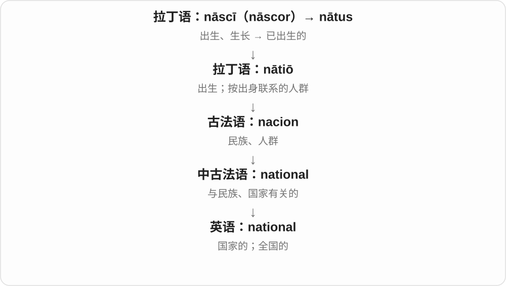

nation 从按出身联系的人群发展为国家、民族共同体，national 则说明与它有关。作名词可指某国国民。

**常见搭配与例句**

a national park；national identity；national news；foreign nationals。

> The story became national news.

这件事成了全国新闻。

> The museum displays objects of national importance.

博物馆展出具有全国性重要意义的物品。

**别混淆**

national 关心一个国家层面；international 涉及不同国家之间。national 不一定表示政府所有。

### 2. political — 政治的；涉及权力关系的

**音标**：英 /pəˈlɪtɪkəl/；美 /pəˈlɪtɪkəl/、/pəˈlɪtəkəl/

**先抓住这个画面**

问的不是一个人喜不喜欢某事，而是谁能作决定、谁的利益受到影响、大家怎样分配公共资源。

**怎么拆**

英语 politic + -al。politic 早先已有“政治的”意思，后来这一常用义主要由 political 承担。

**怎么变成今天的意思**

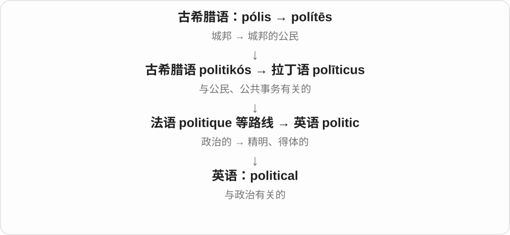

既能客观描述 political history，也能暗示某决定出于争取支持或权力盘算。形容人很 political，还可说此人关心政治、政治意识强。

**常见搭配与例句**

political debate；political power；a political decision；political science。

> The course examines the political history of the region.

这门课研究该地区的政治史。

> She felt that the appointment was a political decision.

她觉得这次任命是出于政治考虑。

**别混淆**

political 是政治相关；politic 多说做法明智、懂得分寸；polite 是有礼貌，属于另一词源。

### 3. personal — 个人的；私人的；针对本人的

**音标**：英 /ˈpɜːsənəl/；美 /ˈpɜːrsənəl/

**先抓住这个画面**

把事情拉回某个具体的人：他的物品、感受、经历，或针对他个人的评价。

**怎么拆**

现代对应 person + -al；历史经法语 personel、拉丁 persōnālis 一路进入英语，不只是在现代 person 后新加尾巴。

**怎么变成今天的意思**

**拉丁 persōna → 古法语 persone 等**  
戏剧面具、角色；后来的人、个体等义

↓

**拉丁 persōnālis → 法语 personel 等 → personal**  
属于个人、涉及个人的

personal belongings 是私人物品，personal experience 是亲身经历，a personal attack 是人身攻击。Don’t take it personally 常说别往心里去，personally 另是副词。

**常见搭配与例句**

personal information；personal experience；personal belongings；a personal attack。

> Please take all your personal belongings with you.

请带走所有私人物品。

> I can only speak from personal experience.

我只能根据亲身经历来谈。

**别混淆**

personal 个人的，personnel /ˌpɜːsəˈnel/ 是人员；拼写接近且历史有联系，现代词义、重音却不同。

### 4. original — 最初的；原件的；独创的；原作

**音标**：英 /əˈrɪdʒɪnəl/；美 /əˈrɪdʒənəl/

**先抓住这个画面**

一路往前追，找到最初那一份，而不是后来的改版或复制。

**怎么拆**

经法语 original、晚期拉丁 orīginālis 借入；现代可按 origin + -al 理解，历史上不是英语里才首次拼成。

**怎么变成今天的意思**

**拉丁 orīrī；分词 ortus**  
升起、出现、出生

↓

**拉丁 orīgō / orīgin-**  
出现之处 → 开始、来源

↓

**晚期拉丁 orīginālis → 古法语 original → 中古英语 original**  
与起点有关、最初的

↓

**英语 original**  
原来的、原本；独创的、原创作品

the original plan 是最初方案；an original painting 是原作。说 an original idea 则把重点放到“由自己生出来”，即有独创性。旧与新两种感觉来自不同对照：原版对改版，独创对模仿。

**常见搭配与例句**

the original version；an original idea；the original and a copy。

> We returned to the original plan.

我们回到了最初的方案。

> Her design is simple but highly original.

她的设计简单，却很有独创性。

> The museum keeps the original in a secure room.

博物馆把原件存放在一间安全的房间里。

**别混淆**

original 不总等于新：几百年前的原画仍是 original；new 也未必有原创性。

### 5. natural — 自然的；天生的；不做作的；合乎情理的

**音标**：/ˈnætʃərəl/

**先抓住这个画面**

natural 的核心是“本来就这样长出来、表现出来”。树木是自然的，熟练而不别扭的动作也可以 natural。

**怎么拆**

拉丁语 nātūrālis 经法语传入；现代可联系 nature + -al，但不是最初在英语里现拼。

**怎么变成今天的意思**

出生与本性带来天生、自然界的含义；符合本性或习惯的表现又成为自然、不做作、可以理解。

**常见搭配与例句**

natural resources；a natural smile；a natural reaction；a natural at music。

> She gave a warm, natural smile.

她露出温暖而自然的微笑。

> It is natural to feel nervous before a performance.

演出前紧张是很自然的事。

**别混淆**

natural 描述来源或状态，不自动等于安全、健康或更好；人工与天然不是好坏判断本身。

### 6. situation — 情况、局面；处境；位置〔较正式〕

**音标**：/ˌsɪtʃuˈeɪʃən/〔亦 /ˌsɪtjuˈeɪʃən/〕

**先抓住这个画面**

不是一件孤立东西，而是此刻各种条件凑成的局面。人像站在这个局面里，所以也译处境。

**怎么拆**

经法语接拉丁 situatio、situare、situs 等位置材料；现代与 situate 使处于的词族对应，不拆成 sit 坐 + 任意 uation。

**怎么变成今天的意思**

**拉丁 situs 位置 → situare、situatio → 法语 situation**  
放置、所处位置

↓

**英语 situation → situational**  
处境、情况；特定情境相关性质

the current situation 当前情况；a difficult situation 困难处境；deal with the situation 应对局面。

**常见搭配与例句**

the current situation；a difficult situation。

> We need to understand the situation before deciding.

作决定前，我们需要了解情况。

> She handled the difficult situation calmly.

她冷静处理了困难局面。

**别混淆**

situation 是当下条件、处境，location 更直接说地理位置；两个词的具体义有重叠，却不总能互换。

### 7. situations — 情况、情境；处境〔situation 的复数〕

**音标**：/ˌsɪtʃuˈeɪʃənz/

**先抓住这个画面**

人或事情处在什么条件、什么场合里面，就是 situations 的情境义；像把一个人放进一幅具体场景，再看他面临什么。

**怎么拆**

situation + -s，/n/ 后读 /z/。经法语接拉丁 situātio、situāre、situs 等位置材料；现代与 situate 使处于对应，但不拆成英语 sit 加一个任意尾巴。

**怎么变成今天的意思**

**拉丁位置、安置词族 → 法语 → situation**  
所处位置、安置 → 所处情境

↓

**situation + -s → situations**  
多种情况、不同处境

difficult situations 困难处境；everyday situations 日常情境；in similar situations 在相似情况下。

**常见搭配与例句**

situations described in the lesson；situations that require patience。

> The lessons use everyday situations to teach new words.

课程用日常情境来教新词。

> She remains calm in difficult situations.

她在困难情况下仍能保持冷静。

**别混淆**

situation 常把所处的一整个具体局面框出来；circumstances 更容易展开看围着它的各项条件。二者会重叠，读句子时看作者关注点。

### 8. situational — 情境的；由具体处境、情况决定的

**音标**：/ˌsɪtʃuˈeɪʃənəl/

**先抓住这个画面**

不是说一个人永远如此，而是当前环境、条件让反应变成这样，可以用 situational。

**怎么拆**

situation + -al → situational；性质尾保留整词的情境、处境材料，不加一个独立词 national。

**怎么变成今天的意思**

**拉丁 situs 位置 → situare、situatio → 法语 situation**  
放置、所处位置

↓

**英语 situation → situational**  
处境、情况；特定情境相关性质

↓

**situation + -al → situational**  
特定情境相关、依情况而变的

situational factors 情境因素；situational awareness 情境感知；situational constraints 具体环境的限制。

**常见搭配与例句**

situational factors；situational awareness。

> The study considers several situational factors.

研究考虑了几种情境因素。

> Good situational awareness helps the team notice changes.

良好的情境感知帮助团队察觉变化。

**别混淆**

situational 强调环境条件，dispositional 常强调较稳定倾向；不同解释角度，不一定二选一。

### 9. base — 基础；底座；基地；以……为依据；卑劣的〔另源〕

**音标**：英、美 /beɪs/

**先抓住这个画面**

让别的东西站得住、建得起来或展开行动的那一层。

**怎么拆**

基础名词经法语、拉丁语来自希腊语 basis“站立处”。base“低劣、卑鄙”另来自法语 bas、后期拉丁语 bassus“低”，不能把两个来源硬合。

**怎么变成今天的意思**

**古希腊语 bainein**  
走、迈步

↓

**古希腊语 basis → 拉丁语 basis**  
迈步、站立处 → 基座、基础

↓

**古法语 base → 中古英语 base → base**  
支撑底部；活动或判断的基础

↓

**英语 base 动词及各领域名词**  
以……为基础；基地、底座、化学上的碱

base a decision on evidence 是把证据作为决定的支撑。军事基地是行动的出发据点；化学 base 是能与酸发生相应反应的一类物质，不是地板。

**常见搭配与例句**

the base of a column；base A on B；a research base。

> The statue stands on a stone base.

雕像立在石座上。

> We based the decision on the available evidence.

我们依据现有证据作出了决定。

> The island served as a base for the research team.

这座岛是研究队的基地。

**别混淆**

basis 常指抽象依据；base 还能指实体底部、地点，也能作动词。base motives 的卑劣义另源。

### 10. basal — 基部的、底层的；基础水平的

**音标**：/ˈbeɪsəl/〔也见 /ˈbeɪzəl/〕

**先抓住这个画面**

把目光放到最下面、最基础的一层。植物基部、组织底层，或维持基本运行的水平，都可能用 basal。

**怎么拆**

base 基础、底部 + -al 相关的，形成关系形容词。科学语境常把底部、基本水平表达得比普通 basic 更具体。

**怎么变成今天的意思**

**base 底部、基础 + -al**  
与基部、底层有关的

↓

**basal 在科学描述中的使用**  
基部位置；基础状态或水平

basal leaves 基生叶、长在植株基部的叶；the basal layer 基底层；basal metabolic rate 基础代谢率。

**常见搭配与例句**

the basal part of the stem；basal activity。

> The plant has a cluster of basal leaves.

这株植物的基部簇生着一丛叶子。

> The diagram labels the basal layer of the tissue.

图解标出了该组织的基底层。

**别混淆**

basic 常说基础、基本的，范围很广；basal 常指具体基部、底层或特定基础水平。basic English 通常不改成 basal English。

### 11. professional — 职业的；专业的；符合职业标准的；专业人士

**音标**：/prəˈfeʃənəl/

**先抓住这个画面**

把某件事作为职业来做，或做得符合这份职业应有的标准。

**怎么拆**

profession + -al 的对应在中古英语已有形式；早期宗教职业背景，后来扩展到专业工作和以此谋生的活动。

**怎么变成今天的意思**

**拉丁 fatērī**  
承认、表明；与 fārī“说”相关

↓

**拉丁 pro- + fatērī → profitērī，分词 professus**  
公开说出、宣称

↓

**拉丁 professiō → 古法语 profession → 中古英语 professioun**  
公开声明，早期常指宗教誓言

↓

**中古英语 profession 相关形容词 professhennalle → 英语 professional**  
职业的；按专业规范做事的

a professional player 是以打球为职业；a professional manner 是做事负责得体。两义不能混成一个：拿工资不自动保证做得专业，业余者也可能有很高水准。

**常见搭配与例句**

professional advice；a professional musician；professional conduct；hire a professional。

> She became a professional photographer after years of practice.

练习多年后，她成了职业摄影师。

> He handled the complaint in a calm and professional manner.

他冷静、专业地处理了投诉。

**别混淆**

amateur 常指非以此谋生，不必表示技术差；professional 可以说职业身份，也可以评价做事标准。

### 12. normal — 正常的；通常的；垂直的；常态

**音标**：英 /ˈnɔːməl/；美 /ˈnɔːrməl/

**先抓住这个画面**

把现在的情形放到一把熟悉的尺子旁：如果落在平常会出现的范围里，就可说 normal。

**怎么拆**

来自拉丁 normalis，源于 norma“木工直角尺、准则”。现代可看作 norm + -al，但英语 normal 的记录早于英语名词 norm，不能据此倒写历史。

**怎么变成今天的意思**

**拉丁 norma**  
木工直角尺；由此指规则、标准

↓

**拉丁 normalis → 英语 normal**  
按直角尺的；合乎规则、常态的；几何中为垂直的

normal traffic 是平日的车流，back to normal 是恢复常态。几何里 normal to a surface 指垂直于表面在该点的切平面；这个“垂直”最接近木工直角尺的旧画面。normal school 的师范学校义另承法语 école normale“作为教学规范的学校”。

**常见搭配与例句**

under normal conditions；return to normal；a normal vector；normal school。

> The trains are running on a normal schedule again.

列车又按正常时刻表运行了。

> Draw a line normal to the surface at this point.

在这一点画一条垂直于表面的直线。

**别混淆**

normal 取决于所比较的情境；usual 强调平时常见。某事常见，不自动等于它理想或值得赞成。

### 13. global — 全球的；整体的；全局的

**音标**：英 /ˈɡləʊbəl/；美 /ˈɡloʊbəl/

**先抓住这个画面**

把视野从某个角落拉开，看整个地球或整个系统。

**怎么拆**

globe + -al；早期曾表示球形，后来在法语相关用法影响下发展全球义。计算机等领域的“全局”沿整个范围来理解，不必涉及地球。

**怎么变成今天的意思**

**拉丁 globus**  
圆团、球体

↓

**法语 globe／拉丁直接借入 → 中古英语 globe → 英语 globe**  
球体 → 地球、地球仪

↓

**英语 globe + -al → global**  
原有球形义；后来发展全球、整体范围义，受法语义项发展影响

a global market 是全球市场；a global view 是整体看法；global settings 是作用于较大整体范围的设置。具体覆盖范围由系统定义，不表示任何对象都无条件受影响。

**常见搭配与例句**

global trade；a global problem；a global perspective；global settings。

> The company sells its products in a global market.

这家公司面向全球市场销售产品。

> This option changes the global settings for the application.

这个选项会修改应用的全局设置。

**别混淆**

international 强调国家之间，两个国家之间也算；global 通常把范围放到世界或整体层面。

### 14. traditional — 传统的；沿袭旧有方式的

**音标**：/trəˈdɪʃənəl/

**先抓住这个画面**

看到一种做法，能认出它接着前人传下来的那条线，没有把方法全部换掉。

**怎么拆**

英语 tradition + -al，表示与传统有关；不是 trade“贸易”的派生词。

**怎么变成今天的意思**

**拉丁 trans／trans-**  
越过、穿过；在另一边

↓

**拉丁 trans- + dare → tradere；名词 traditio**  
交到别人手上；传递

↓

**古法语 tradicion／拉丁 → 中古英语 tradicioun → tradition**  
代代相传的做法、观念与故事

↓

**英语 tradition + -al → traditional**  
由传统而来的；沿袭旧式做法的

traditional music 是从既有文化传统中传承的音乐；traditional methods 强调沿用的方法。它不自动表示落后或优越，褒贬取决于语境。Traditional Chinese 作为文字名称指繁体中文。

**常见搭配与例句**

traditional methods；traditional music；traditional values；Traditional Chinese。

> The workshop combines traditional weaving with modern designs.

这间作坊把传统织造工艺与现代设计结合起来。

> The menu includes several traditional dishes from the region.

菜单上有几道当地传统菜。

**别混淆**

conventional 常说大家通常采用的；traditional 更突出传承。traditional 与 modern 的对比也不一定表示二者不能结合。

### 15. critical — 批评的；有分析判断力的；关键的；危急的

**音标**：英、美 /ˈkrɪtɪkəl/

**先抓住这个画面**

一支是认真分辨好坏；另一支是事情到了足以决定结果的关口。

**怎么拆**

critic + -al，并与拉丁语 criticus 相联；医学中的 critical 与 crisis“病情转折、危机”同属判断、决定这一词族。不要把所有意思都套成挑错。

**怎么变成今天的意思**

**希腊语 krinein**  
分开、辨别、判断

↓

**希腊语 kritikos → 拉丁语 criticus → 法语 critique → 英语 critic**  
善于判断的 → 评论者、批评者

↓

**英语 critic + -al → critical；亦有拉丁 criticus 的直接影响**  
判断、评论的；医学中与危急转折相联，扩展为关键的

critical of the plan 是对计划持批评态度；critical thinking 要检查依据；critical to success 是成功的关键；in critical condition 是病情危急。先看搭配，再选中文。

**常见搭配与例句**

be critical of；critical to；critical thinking；critical condition。

> Clean water is critical to the success of the project.

清洁水源是这个项目成功的关键。

> The course encourages critical thinking rather than blind acceptance.

这门课鼓励认真分析判断，而不是盲目接受。

> She was critical of the decision but offered an alternative.

她批评了这项决定，也提出了替代办法。

**别混淆**

a critical review 可以是认真分析的评论，不必全盘否定；a negative review 才明确偏负面。

### 16. digital — 数字的；数码的；与手指或脚趾有关的

**音标**：/ˈdɪdʒɪtəl/

**先抓住这个画面**

把信息表示成可以记录、处理的数字，而不只是说“用了电”。

**怎么拆**

借自拉丁 digitalis，来自 digitus；现代可看出 digit + -al 的关系，但不是电脑时代才新造的词。

**怎么变成今天的意思**

**拉丁语 digitus → digitalis**  
手指、脚趾 → 与其有关的

↓

**英语 digital**  
与数字有关；后来用于数字技术

digital camera 把图像保存为数字数据；digital clock 常指用数字显示时间的钟。新闻中的 digital services 则泛指通过数字技术提供的服务。词义范围会随语境变化，但“数字表示、处理”比“很先进”更能抓住核心。

**常见搭配与例句**

digital technology；a digital camera；digital skills；a digital clock。

> I keep digital copies of important documents.

我保存着重要文件的电子版。

> The course helps older adults develop digital skills.

这门课程帮助老年人掌握数字技术的使用技能。

**别混淆**

digital 不等于 electronic：电子设备也可能处理模拟信号。身体语境中的 digital 则可能仍是“手指或脚趾的”。

### 17. mental — 心理的；智力的；在脑中进行的

**音标**：英、美 /ˈmentəl/

**先抓住这个画面**

不是手脚正在做什么，而是脑中怎样思考、感受和处理事情。

**怎么拆**

心智义来自后期拉丁语 mentalis，基于 mens、mentis“心智”，经法语或直接拉丁语进入英语；解剖学中“颏部的”另接 mentum“下巴”，不能混为一根。

**怎么变成今天的意思**

**印欧语重建词根 \*men-**  
想、思考；星号表示语言学重建形式

↓

**拉丁语 mens / ment-**  
心智、思考、精神

↓

**后期拉丁语 mentalis → 法语、英语 mental**  
与心智有关的

↓

**并列另源：拉丁语 mentum → mental〔解剖学〕**  
下巴的；不由心理义演变

mental arithmetic 是心算；mental health 是心理健康。把人叫 mental 的俚语可能冒犯，正式描述宜说清具体状态。

**常见搭配与例句**

mental health；mental effort；mental arithmetic。

> The puzzle requires considerable mental effort.

这个谜题需要费不少脑力。

> She solved the problem by mental arithmetic.

她通过心算解出了题目。

**别混淆**

physical 关注身体；mental 关注心智，两方面可以互相影响，并非完全割裂。

### 18. method — 方法；做法；对象或类的方法〔编程〕

**音标**：英、美 /ˈmeθəd/

**先抓住这个画面**

目标在那里，method 是你选定的一条做事路线。

**怎么拆**

希腊 méthodos 含 meta-“追寻”与 hodós“路”，经拉丁、法语借入；th 对应历史上的送气音组合，不按 met + hod 两个英语词读。

**怎么变成今天的意思**

**古希腊 hodós**  
道路、旅程；做事的途径

↓

**希腊 meta- + hodós → méthodos**  
追寻、探究 → 有步骤的研究途径

↓

**拉丁 methodus；法语 méthode → 英语 method**  
做事或研究的方法

解决问题可以有不同方法。编程中 method 常指与对象或类关联的函数；the Method 还可指特定表演方法。

**常见搭配与例句**

a method of；a method for；a reliable method；call a method。

> This method uses less water than the old one.

这种方法比旧方法更省水。

> The object has a method that returns its current size.

这个对象有一个返回当前大小的方法。

**别混淆**

way 很通用；method 常暗示有一定步骤、能重复使用。

### 19. methodical — 有条理、有步骤的；细致系统的

**音标**：英 /məˈθɒdɪkəl/；美 /məˈθɑːdɪkəl/

**先抓住这个画面**

不是想到哪做到哪，而是有顺序地一项项核对、推进，就是 methodical。可以仔细而快，不必磨蹭。

**怎么拆**

希腊 methodikos 按方法办事，经拉丁等材料接 -al；与 method 方法对应。method 的重音在前，methodical 的常用重音移到中间。

**怎么变成今天的意思**

**希腊 methodos 方法、探求路径 → methodikos**  
按规则、方法进行的性质

↓

**相应拉丁、英语形式 + -al → methodical**  
有条理、细致系统的

a methodical approach 有条理的方法；a methodical search 有步骤的搜查；a methodical worker 做事细致有条理的人。

**常见搭配与例句**

a methodical approach；a methodical search。

> Her methodical notes made the problem easier to solve.

她有条理的笔记让问题更容易解决。

> The team carried out a methodical check of every file.

团队按步骤细查了每个文件。

**别混淆**

methodical 与 methodological 方法论相关的不同；前者评价做事方式，后者常说研究方法、方法论这一领域。

### 20. cultural — 文化的；与群体习惯、艺术或观念有关的

**音标**：英、美 /ˈkʌltʃərəl/

**先抓住这个画面**

把一个现象放回人们共同生活、学习和表达的方式中看。

**怎么拆**

culture + -al，表示与文化有关。

**怎么变成今天的意思**

**拉丁 colere；分词 cultus**  
耕作、照料；居住；尊敬、崇奉

↓

**拉丁 cultūra → 中古法语 culture 及英语借词**  
耕作、培养

↓

**英语 culture**  
培养 → 修养、群体生活方式；生物培养

↓

**英语 culture + -al → cultural**  
与文化、习俗或艺术有关

cultural differences 可以是问候方式、时间观念等差异；cultural events 常指演出、展览等活动。词本身不表示“有教养”。

**常见搭配与例句**

cultural differences；cultural heritage；cultural activities。

> The programme introduces students to cultural differences.

课程向学生介绍不同文化之间的差异。

> The old theatre is an important cultural landmark.

老剧院是一个重要的文化地标。

**别混淆**

cultured 才常形容人有艺术文学修养；cultural 是中性的“文化相关”。

### 21. multicultural — 多元文化的

**音标**：英、美 /ˌmʌltiˈkʌltʃərəl/

**先抓住这个画面**

同一个地方或群体里，有不止一种文化背景。

**怎么拆**

multi-“多个” + cultural；也可联系 multiculture + -al。

**怎么变成今天的意思**

**拉丁 colere；分词 cultus**  
耕作、照料；居住；尊敬、崇奉

↓

**拉丁 cultūra → 中古法语 culture 及英语借词**  
耕作、培养

↓

**英语 culture**  
培养 → 修养、群体生活方式；生物培养

↓

**英语 cultural + multi- → multicultural**  
包含多种文化的

multicultural city 可以是不同语言、传统和生活方式并存的城市。这个形容词描述多样性，不自动证明不同群体之间已经平等相处。

**常见搭配与例句**

a multicultural society；a multicultural classroom。

> The school serves a multicultural community.

学校服务于一个多元文化社群。

> The festival reflects the city’s multicultural character.

节日体现了这座城市的多元文化特点。

**别混淆**

intercultural 强调文化之间的交流；multicultural 强调存在多种文化。

### 22. technical — 技术的；专业的；严格按规则的

**音标**：英、美 /ˈteknɪkəl/

**先抓住这个画面**

进入某一行的具体做法和规则，普通人听来可能很专门，行内人却需要分得很细。

**怎么拆**

英语 technic + -al，technic 来自拉丁语 technicus、希腊语 tekhnikos；部分形成也受拉丁化希腊词直接影响。

**怎么变成今天的意思**

**希腊语 tekhnē**  
技艺、手艺、掌握方法的实践能力

↓

**希腊语 tekhnikos → 拉丁语 technicus → 英语 technic**  
与技艺有关的；有技巧的

↓

**英语 technic + -al → technical；亦受拉丁化希腊词形影响**  
技术、专业领域或专门规则的

a technical problem 是技术问题；technical vocabulary 是专门术语；a technical distinction 是严格按定义才有的区别。它并不只指电脑，也不自动表示事情很难。

**常见搭配与例句**

technical support；technical knowledge；a technical distinction。

> The manual explains the technical terms in plain language.

手册用简单语言解释专业术语。

> A technical fault delayed the broadcast.

一个技术故障延误了播出。

**别混淆**

technological 更突出技术体系、技术发展；technical 还可涉及音乐技巧、法律规则和各种专业细节。

### 23. propose — 提议、提出；求婚；打算〔较正式〕

**音标**：英 /prəˈpəʊz/；美 /prəˈpoʊz/

**先抓住这个画面**

把一个办法摆到大家面前，说“这样做怎么样”，就是 propose。向某人提出结婚请求，是它另一种常见场景。

**怎么拆**

借古法语 proposer，含 pro- 向前与 poser 放。poser 接较早 pausare 停下、使安放，并在法语中替代了拉丁 ponere 放的相关复合词形，因此与拉丁 proponere 意义相接，不能画成词形未经改变的直接继承。

**怎么变成今天的意思**

**古法语 pro- + poser → proposer → 英语 propose**  
向前放出、供考虑；法语 poser 在语义上替代了较早 ponere 相关词形

↓

**英语 propose → proposal**  
提出建议、求婚；所提出的计划、请求

propose a plan 提出计划；propose doing 建议做；propose to someone 向某人求婚；propose to do 较正式说打算做。

**常见搭配与例句**

propose a plan；propose doing；propose to someone。

> She proposed a simpler solution.

她提出了一个更简单的办法。

> He proposed to her during their holiday.

度假时他向她求婚。

**别混淆**

propose doing 常是建议，propose to do 常是打算；propose to a person 则可能是求婚，要看后接成分。

### 24. proposed — 提出了；建议过；求婚了；拟议中的

**音标**：英 /prəˈpəʊzd/；美 /prəˈpoʊzd/

**先抓住这个画面**

把一个想法摆到别人面前供考虑，是 proposed；一项还在商量、尚未实施的计划，也常被形容为 proposed。

**怎么拆**

propose 末尾已有 e，加 -d，/z/ 后读 /d/。propose 借古法语 proposer，含 pro- 向前与 poser 放；poser 在法语中替代较早 ponere 相关词形，不能把它说成拉丁 proponere 未经变化的直接延续。

**怎么变成今天的意思**

**古法语 pro- + poser → proposer → propose**  
向前摆出、提出；与较早放置词族发生替代联系

↓

**propose 去 e + -ed → proposed**  
提出过；被提议、拟议中的

proposed a solution 提出办法；proposed changing the date 建议改日期；proposed to her 向她求婚；the proposed bridge 拟建的大桥。

**常见搭配与例句**

a proposed change；had proposed several ideas。

> They proposed moving the meeting to Friday.

他们建议把会议改到周五。

> The map shows the route of the proposed road.

地图上标出了拟建道路的路线。

**别混淆**

a proposed change 是有人提出、仍待考虑的变化，不一定已经落实。proposed doing 多是建议做，proposed to someone 则在相应人际语境说求婚。

### 25. proposal — 提案、建议；求婚

**音标**：英 /prəˈpəʊzəl/；美 /prəˈpoʊzəl/

**先抓住这个画面**

propose 是把想法提出去，proposal 是被摆出来供考虑的那份内容，或求婚这个请求。它仍在等待评估、回应。

**怎么拆**

propose 去末尾 e 加名词尾 -al → proposal。这里 -al 形成动作、结果名词，不是所有结尾 -al 都是形容词。

**怎么变成今天的意思**

**古法语 pro- + poser → proposer → 英语 propose**  
向前放出、供考虑；法语 poser 在语义上替代了较早 ponere 相关词形

↓

**英语 propose → proposal**  
提出建议、求婚；所提出的计划、请求

↓

**propose + -al → proposal**  
提出的计划、建议，或求婚请求

a research proposal 研究计划书；submit a proposal 提交提案；a marriage proposal 求婚。

**常见搭配与例句**

submit a proposal；a research proposal；a marriage proposal。

> The committee discussed the proposal.

委员会讨论了这份提案。

> She accepted his marriage proposal.

她答应了他的求婚。

**别混淆**

proposal 是提议，不等于已批准的 agreement 协议；被提出与获同意是不同阶段。

### 26. proposals — 提案、建议方案；求婚等〔复数〕

**音标**：英 /prəˈpəʊzəlz/；美 /prəˈpoʊzəlz/

**先抓住这个画面**

不只是脑里想过，而是把想法拿到别人面前，请对方考虑接受，这样的方案就是 proposals。

**怎么拆**

propose 去 e 加名词尾 -al → proposal，再加 -s，/l/ 后读 /z/。propose 经法语相关词形，有 poser 的历史改形背景，不能把所有 pose 都原样接拉丁 ponere。

**怎么变成今天的意思**

**法语相关词 → propose；英语名词构形 proposal**  
提出供考虑 → 提出的安排、方案

↓

**proposal + -s → proposals**  
多项方案、提议；也可为求婚

submit proposals 提交方案；proposals for a new building 新建筑方案；consider proposals 审议提案。

**常见搭配与例句**

research proposals 研究计划；marriage proposals 求婚。

> The committee will consider three proposals.

委员会将审议三项提案。

> The students presented proposals for improving the library.

学生们提出了改善图书馆的方案。

**别混淆**

proposals 是拿来讨论、决定的方案；plans 可能已经是准备执行的计划。proposal 的 al 在这里构成名词，不是每个 al 结尾都为形容词。

### 27. proposes — 提议；提出；打算；求婚〔第三人称单数〕

**音标**：英 /prəˈpəʊzɪz/；美 /prəˈpoʊzɪz/

**先抓住这个画面**

把一个想法摆到大家面前，请大家考虑，是 proposes；提出与某人结婚的想法，就是求婚。

**怎么拆**

propose 保留末尾 e，加 -s → proposes，/z/ 后读 /ɪz/。经法语 pro- 向前 + poser 放置形成 proposer，与较早的拉丁放置词族有替换、影响史。

**怎么变成今天的意思**

**法语 proposer 把想法摆在面前 → 英语 propose**  
较早有形成意图、提出方案等用法

↓

**提议的常用义与求婚义 → proposes**  
现代第三人称，按宾语和介词区分

proposes a plan 是提出方案；proposes doing 是建议做；proposes to someone 是向某人求婚；proposes to do 也可说打算做。

**常见搭配与例句**

proposes a plan；proposes doing；proposes to someone。

> The report proposes a simpler way to organize the work.

报告提出了一种更简单的工作安排方式。

> In the final chapter, he proposes to his old friend.

最后一章里，他向老朋友求婚。

**别混淆**

proposes to a person 的 to 后是人，常是求婚；proposes to change... 的 to 后是动作，常是打算或提议改变。

### 28. environmental — 环境的；环保相关的

**音标**：英 /ɪnˌvaɪrənˈmentəl/；美 /ɪnˌvaɪrənˈmentəl/

**先抓住这个画面**

把注意力放到周围条件；现代新闻最常遇到的是自然环境、生态影响。

**怎么拆**

environment + -al，形容词后缀，主重音转到 ment 音节。环境本身与环境相关的性质分开。

**怎么变成今天的意思**

**法语 environ 周围、environner 围绕 → environ、environment**  
围起来 → 周围状态、条件

↓

**现代 environment**  
影响人、物的周围条件 → 自然环境；工作与软件运行环境

↓

**environment + -al → environmental**  
环境 → 环境相关的

environmental protection 环境保护，environmental conditions 环境条件，environmental impact 环境影响。

**常见搭配与例句**

environmental protection；environmental impact；environmental conditions。

> The report examines the environmental impact of the project.

报告研究项目的环境影响。

> Growth depends partly on environmental conditions.

生长部分取决于环境条件。

**别混淆**

environmental 环境相关不自动是环保有益；environmental damage 正是在说环境损害。

### 29. historical — 历史的；与过去有关的

**音标**：英 /hɪˈstɒrɪkəl/；美 /hɪˈstɔːrɪkəl/

**先抓住这个画面**

把一件事放在过去的时间里考察；不必给它加上重大意义。

**怎么拆**

在来自拉丁语 historicus 的词族基础上加 -al；现代可看成 historic + -al，或 history 对应的 -ical 形容词形式。

**怎么变成今天的意思**

**古希腊语 historía**  
探究所得的知识；记述

↓

**拉丁语 historia → 古法语 estoire / estorie → 中古英语 historie**  
叙述、纪事

↓

**英语 history**  
过去发生的事；关于过去的记录与研究

↓

**historicus 词族 + -al → historical**  
与历史、过去有关的

historical records 历史记录；a historical novel 历史小说，情节可以虚构，但设在历史背景中；historical data 过去的数据。

**常见搭配与例句**

historical evidence；a historical novel；historical context；historical data。

> The museum keeps historical records of the harbour.

博物馆保存着这个港口的历史记录。

> The novel mixes fictional characters with historical events.

这部小说把虚构人物与历史事件结合起来。

**别混淆**

historical 常说与历史有关；historic 常说历史上重要。历史小说不自动是重要到载入史册的小说。

### 30. emotional — 情感的；情绪激动的；令人动情的

**音标**：英 /ɪˈməʊʃənəl/；美 /ɪˈmoʊʃənəl/

**先抓住这个画面**

emotional 有时说“涉及心里的感受”，有时说感受涌上来、难以平静。

**怎么拆**

emotion + -al，构成形容词。

**怎么变成今天的意思**

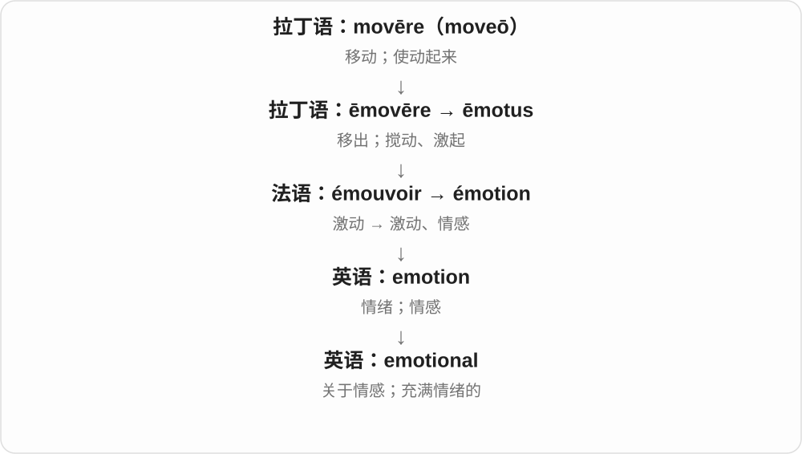

emotional support 是情感支持，不是“激动的支持”；an emotional farewell 则是充满情感的告别。

**常见搭配与例句**

emotional support；an emotional response；get emotional。

> She needed emotional support after the move.

搬家后，她需要情感上的支持。

> It was an emotional farewell.

那是一次令人动情的告别。

**别混淆**

emotional 不自动等于 irrational“不理性”；有情感并不代表判断错误。

### 31. internal — 内部的、体内的；国内的、机构内部的

**音标**：英 /ɪnˈtɜːnəl/；美 /ɪnˈtɜːrnəl/

**先抓住这个画面**

先划出一个身体、组织或国家的边界，再说事情发生在边界里面。不是只指藏在人心里的秘密。

**怎么拆**

中古英语 internall 等借自中世纪拉丁 internālis，接 internus 内部。现代可对照 intern 词族与 -al，但不说公司先招了实习生才产生内部的这个词。

**怎么变成今天的意思**

**拉丁 internus → 中世纪拉丁 internālis → internal**  
内部的、向内的

↓

**英语 internal**  
身体、组织或范围内部的

internal organs 内脏，internal communication 内部沟通，internal affairs 内部、国内事务，internal conflict 内部矛盾。

**常见搭配与例句**

internal organs；internal communication；internal affairs；internal conflict。

> This document is for internal use only.

这份文件仅供内部使用。

> The report identifies several internal problems.

报告指出了几个内部问题。

**别混淆**

internal 对 external 内部与外部；international 国际的含 inter- 国家之间，不是 internal 加一个任意 national。

### 32. educational — 教育的；能学到东西的

**音标**：英 /ˌedʒʊˈkeɪʃənəl/；美 /ˌedʒəˈkeɪʃənəl/

**先抓住这个画面**

educational 既能说一件事属于教育领域，也能说它让你学到了东西。参观工厂觉得长见识，就是 an educational visit。

**怎么拆**

education + -al，把名词“教育”变成形容词。

**怎么变成今天的意思**

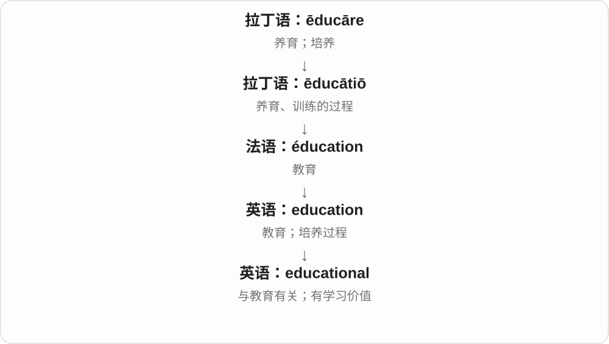

educational policy 是教育政策；educational game 则强调游戏有学习用途。前者是领域关系，后者是实际作用。

**常见搭配与例句**

educational resources（教育资源）；an educational visit（有教育意义的参观）；educational opportunities（教育机会）。

> The website offers free educational resources.

这个网站提供免费的教育资源。

> Our visit to the workshop was surprisingly educational.

这次参观车间出乎意料地让我们学到了很多。

**别混淆**

educational 形容活动或材料有教育性质；educated 形容人受过教育，不能互换。

### 33. typical — 典型的；通常的；有某人一贯特点的

**音标**：/ˈtɪpɪkəl/

**先抓住这个画面**

看到这个例子，就能想到这一类通常是什么样，或者某个人一向会怎么做。

**怎么拆**

经中世纪拉丁 typicalis，接 typicus 与希腊 typikos。现代看得出 type + -ical 的关系，历史上形容词有独立拉丁借入链。

**怎么变成今天的意思**

**古希腊 typtein / typtō → typos**  
敲击 → 打出的印记；形状、样式

↓

**希腊 typikos → 后期拉丁 typicus → 中世纪 typicalis**  
与类型、象征有关的

↓

**英语 typical**  
典型的、有代表性的；通常的

typical of the region 是当地的典型特征；It’s typical of him to help 是这很符合他一贯乐于助人的作风。单说 Typical! 也可带“果然又这样”的抱怨。

**常见搭配与例句**

typical of；a typical example；a typical day。

> The house is typical of local architecture.

这栋房子很能代表当地建筑风格。

> It is typical of her to check every detail.

她一向如此，会检查每一个细节。

**别混淆**

average 可指数值平均或水平一般；typical 说有代表性，不要求恰好等于平均数。

### 34. category — 类别、种类；范畴

**音标**：英 /ˈkætəɡəri/；美 /ˈkætəɡɔːri/

**先抓住这个画面**

按一个规则把相近东西放在同一个格子里，这个格子就是 category。规则变了，同一件东西也可能换分类。

**怎么拆**

经法语 catégorie、拉丁 categoria 接希腊 kategoria，远源是公开说出、断言、指控的材料，后来进入逻辑范畴和一般分类。不是 cat 猫加一个动物分类后缀。

**怎么变成今天的意思**

**希腊 kategoria、kategorein 等说出、指控材料**  
进入逻辑陈述、范畴命名

↓

**法语、拉丁相应形式 → category；categoricus + -al 等 → categorical**  
类别；分类性质或明确断言性质

a category of books 一类书；fall into a category 属于一类；a broad category 大类；different categories 不同类别。

**常见搭配与例句**

fall into a category；a broad category。

> The books are divided into three categories.

这些书分为三类。

> This example does not fit neatly into any single category.

这个例子不能很整齐地归入单一类别。

**别混淆**

category 是类别，criterion 是分类标准；先有标准，再据此决定把东西放到哪类。

### 35. chemical — 化学的；化学物质

**音标**：/ˈkemɪkəl/

**先抓住这个画面**

形容词说化学反应、成分等；名词 a chemical 说一种化学物质。日常有时偏说工业制品，但科学范围不只人工合成。

**怎么拆**

新拉丁 chēmicus 相关词基 + -al，经化学、炼金词族历史形成。名词从性质用法转称具体物质，不把 chem 解释成某种危险东西的固定词根。

**怎么变成今天的意思**

**新拉丁 chēmicus 等 → chemical**  
化学相关；较早与 chemistry、alchemy 词族有关

↓

**现代名词、副词及复合形容词**  
chemical 物质；chemically 方式；photo-/physico- 等限定过程

a chemical reaction 化学反应，chemical composition 化学组成，chemical substances 化学物质，store chemicals 存放化学品。

**常见搭配与例句**

a chemical reaction；chemical composition；chemical substances；store chemicals。

> The change involved a chemical reaction.

变化涉及一次化学反应。

> The laboratory stores chemicals in labelled containers.

实验室把化学品存放在有标签的容器里。

**别混淆**

chemical 科学上中性说化学或物质，不自动等于 synthetic 人造或 poisonous 有毒；具体性质要看是哪种物质。

### 36. clinical — 临床的；诊疗实践的；冷静而不带感情的；冷白简素的

**音标**：/ˈklɪnɪkəl/

**先抓住这个画面**

从书本或实验台走到真实的人面前，就是临床这一层面。再借医者观察、记录的形象，也能形容一种过分冷静、缺少温度的态度。

**怎么拆**

英语 clinic + -al，接较早的床旁、诊疗相关用法；不是等到 clinic 有了现代“诊所建筑”义才造出本词。clinical 的情感冷淡义是后来的比喻发展。

**怎么变成今天的意思**

**希腊 klinein／klinō → klinē**  
倾斜、躺下 → 床、卧榻

↓

**希腊 klinikos／klinikē〔technē〕 → 拉丁 clinicus**  
床边的；病床旁的诊疗；相关病人与医者称谓

↓

**法语、拉丁背景 → 早期英语 clinic〔形容词〕**  
与病床、床旁诊疗有关的

↓

**英语 clinic + -al → clinical**  
临床诊疗的；后引申冷静不动感情的

clinical experience 是实际接触病人的诊疗经验；clinical research 涉及人体健康、疾病与诊疗等研究。clinical detachment 是不动感情的疏离；a clinical room 常形容冷白、简素、缺少生活气息的房间。

**常见搭配与例句**

clinical practice；clinical experience；clinical research；clinical detachment；a clinical atmosphere。

> The course combines laboratory work with clinical experience.

课程把实验室学习与临床实践结合起来。

> He described the family argument with almost clinical detachment.

他几乎不带感情地描述了那场家庭争执。

> The room felt clinical until they added rugs and photographs.

直到添上地毯和照片，房间才不再显得冷冰冰、毫无生活气息。

**别混淆**

medical 范围更广；clinical 更侧重实际诊疗及相关研究。日常描述某人 clinical 通常不是说他“像一家诊所”，而是在说态度冷静得缺少温情。

### 37. musical — 音乐的；有音乐天赋的；音乐剧

**音标**：/ˈmjuːzɪkəl/

**先抓住这个画面**

把某件事和音乐联系起来；说一个人 musical，常是说他听、唱、演奏比较有感觉。

**怎么拆**

现代对应 music + -al；历史经法语、中世纪拉丁 mūsicālis 接 mūsica。名词音乐剧从 musical comedy 等名称缩短发展。

**怎么变成今天的意思**

**古希腊 Mousa → mousikē**  
缪斯 → 与缪斯诸艺有关的技艺

↓

**拉丁 mūsica → 法语 musique → 中古英语 musik**  
音乐

↓

**英语 music**  
音乐；乐曲

↓

**mūsicālis → musical；现代对应 music + -al**  
音乐的；有音乐感的

↓

**musical〔名词〕**  
音乐剧、音乐剧电影

a musical instrument 是乐器，a musical child 是有音乐天赋的孩子。see a musical 是看一部音乐剧，不是随便听一段音乐。

**常见搭配与例句**

a musical instrument；musical talent；a stage musical。

> She comes from a very musical family.

她来自一个很有音乐氛围、家人有音乐才能的家庭。

> We saw a musical at the theatre last night.

昨晚我们在剧院看了一部音乐剧。

**别混淆**

musical 形容词或可数名词，music 通常不可数。I like music 是喜欢音乐，I like musicals 是喜欢音乐剧。

### 38. musicals — 音乐剧〔复数〕

**音标**：/ˈmjuːzɪkəlz/

**先抓住这个画面**

人物不光说话，还把剧情唱出来、演出来，这类作品叫 musicals。它数的是剧目，不是在数“音乐的”这个性质。

**怎么拆**

musical 的名词用途缩自 musical comedy 等组合，再加 -s。形容词 musical 的历史还接法语、拉丁 musicalis，与 music 同族。

**怎么变成今天的意思**

**拉丁 musica → musicalis；法语、英语 musical**  
与音乐有关的

↓

**musical comedy 等 → musical → musicals**  
缩略为音乐剧名称；多部音乐剧

stage musicals 舞台音乐剧，film musicals 音乐歌舞电影；可以按表现媒介区别。

**常见搭配与例句**

Broadway musicals 百老汇音乐剧；watch musicals 看音乐剧。

> She enjoys both stage musicals and film musicals.

她既喜欢舞台音乐剧，也喜欢音乐歌舞电影。

> The theatre will present two new musicals this year.

剧院今年会推出两部新音乐剧。

**别混淆**

music 常指音乐本身，通常不靠加 -s 数作品；musicals 明确数一部部剧。

### 39. approval — 赞同；认可；批准

**音标**：英 /əˈpruːvəl/；美 /əˈpruːvəl/

**先抓住这个画面**

别人那个“可以”的点头，变成一种态度或一个获准的结果。

**怎么拆**

approve + -al，动词转为行为或状态名词。

**怎么变成今天的意思**

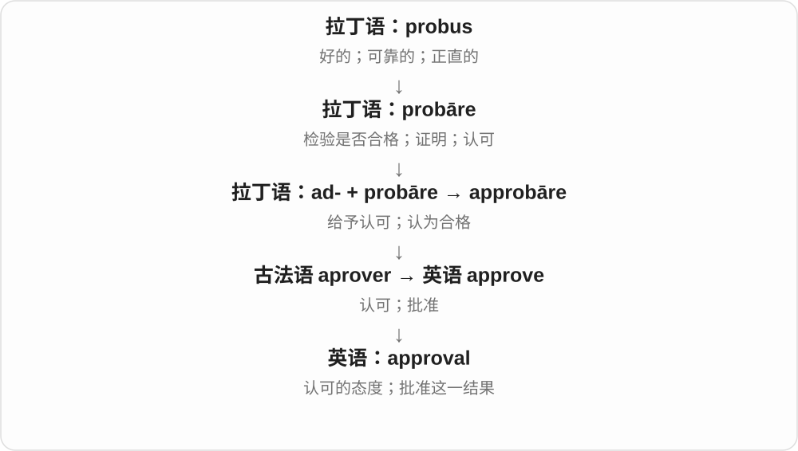

seek approval 可以是寻求批准，也可以是希望得到别人的认同；approval from the manager 则要看具体情境。

**常见搭配与例句**

get approval；seek approval；give approval；with someone’s approval。

> The project cannot begin without the owner’s approval.

没有业主批准，项目不能开始。

> She no longer needed everyone’s approval to feel confident.

她不再需要人人认可，才能感到自信。

**别混淆**

approval 是认可，appraisal 是评价、估价；做过评价并不保证最后批准。

### 40. disapproval — 不赞同；反对的态度

**音标**：英 /ˌdɪsəˈpruːvəl/；美 /ˌdɪsəˈpruːvəl/

**先抓住这个画面**

即使没有说“不”，一个眼神、语气或摇头也能把反对传达出来。

**怎么拆**

disapprove + -al；形式上也容易看出 dis- 与 approval 的对应。

**怎么变成今天的意思**

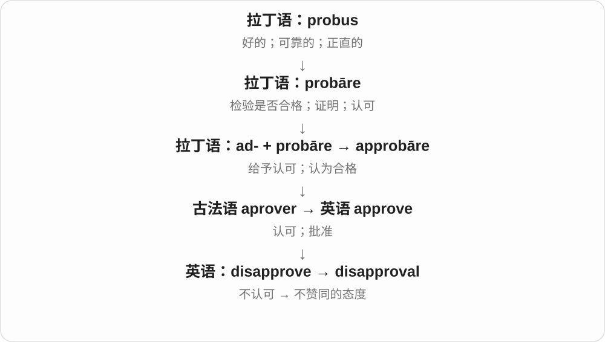

常搭 express、show、meet with。disapproval 可以很强烈，也可能只是冷淡的一眼。

**常见搭配与例句**

express disapproval；a look of disapproval；public disapproval。

> She expressed her disapproval in a brief email.

她用一封简短邮件表达了反对。

> His suggestion met with quiet disapproval.

他的建议遭到了不动声色的反对。

**别混淆**

disapproval 不一定阻止行动；a ban 才是禁止，不能把态度和规则混为一谈。

### 41. universal — 普遍的；全体适用的；通用的

**音标**：英 /ˌjuːnɪˈvɜːsəl/；美 /ˌjuːnəˈvɜːrsəl/

**先抓住这个画面**

universal 像给一个范围内的所有成员都打上勾：人人适用、处处存在，或能配合许多不同设备。

**怎么拆**

经古法语借入，来自拉丁语 ūniversālis；现代对应 universe + -al，但借入链不需要经过英语 universe。

**怎么变成今天的意思**

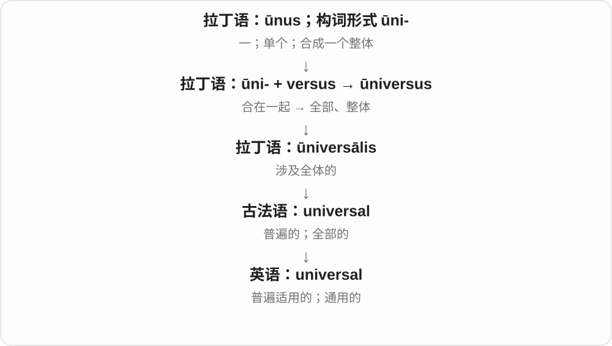

“整体”向“覆盖全体”发展。实际说 universal agreement 时，常是相关人群都同意，不是在调查整个宇宙。

**常见搭配与例句**

universal access；a universal principle；a universal adapter。

> The proposal did not receive universal support.

这个提议没有得到所有人的支持。

> The course asks whether the principle is universal.

课程讨论这条原则是否普遍适用。

**别混淆**

common 是常见；universal 声称覆盖全体，语气更强。通用产品也要看它实际支持的范围。

### 42. transition — 过渡、转变；转入、过渡到

**音标**：/trænˈzɪʃən/

**先抓住这个画面**

不是只看旧状态、新状态两个点，还看中间怎么换过去。学生走入职场、新系统替换旧系统，都有 transition。

**怎么拆**

借法语 transition，上接拉丁 transitio、transire 走过；trans- 越过与 ire 走的材料，后来用于状态变化。

**怎么变成今天的意思**

**拉丁 transitio，接 transire 走过 → 法语 transition**  
从一边、一种状态走到另一边

↓

**英语 transition → transitional**  
转变、过渡；过渡相关性质

a transition from A to B 从 A 到 B 的转变；a smooth transition 平稳过渡；transition to a new system 过渡到新系统。

**常见搭配与例句**

a smooth transition；transition from ... to ...。

> The transition from school to work can take time.

从学校到职场的转变可能需要时间。

> The team planned a smooth transition to the new system.

团队计划平稳过渡到新系统。

**别混淆**

transition 重阶段之间的转换，translation 是翻译，transaction 是交易；相似开头不能混成同一个名词。

### 43. transitional — 过渡的；转变时期的

**音标**：/trænˈzɪʃənəl/

**先抓住这个画面**

还不是最终稳定形态，而是在从旧走到新，便是 transitional。可以修饰时期、安排、风格。

**怎么拆**

transition + -al → transitional；-al 把过渡过程名词变成相关性质。

**怎么变成今天的意思**

**拉丁 transitio，接 transire 走过 → 法语 transition**  
从一边、一种状态走到另一边

↓

**英语 transition → transitional**  
转变、过渡；过渡相关性质

↓

**transition + -al → transitional**  
处于或服务于过渡的性质

a transitional period 过渡期；transitional arrangements 过渡安排；a transitional stage 过渡阶段。

**常见搭配与例句**

a transitional period；transitional arrangements。

> The organisation is in a transitional period.

机构正处于过渡期。

> These are transitional arrangements rather than the final design.

这些是过渡安排，还不是最终设计。

**别混淆**

transitional 过渡的，traditional 传统的；一个在描述改变阶段，一个在描述传统关系。

### 44. formal — 正式的；合乎规定形式的

**音标**：英 /ˈfɔːməl/；美 /ˈfɔːrməl/

**先抓住这个画面**

场合有一套规定：话怎样说、衣服怎样穿、事情怎样宣布，都照那套形式来。

**怎么拆**

来自古法语 formel、拉丁语 fōrmālis；现代可看成 form + -al。

**怎么变成今天的意思**

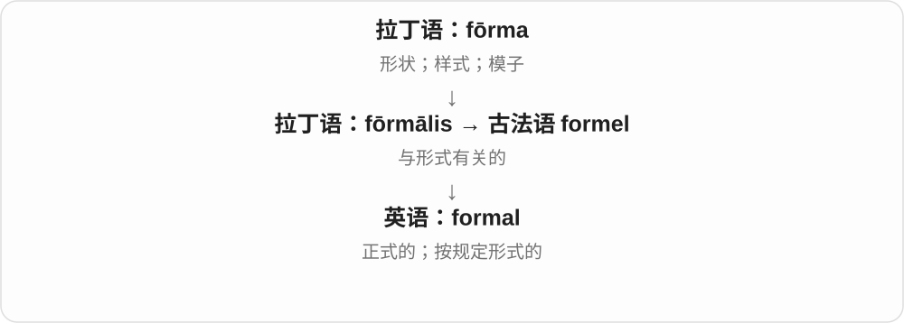

formal apology 是郑重或正式的道歉；formal clothes 是适合正式场合的服装。技术语境也可指依照明确符号规则的系统。

**常见搭配与例句**

formal agreement；formal language；formal training；formal logic。

> We have not received a formal invitation yet.

我们还没收到正式邀请。

> He has no formal training in music.

他没有受过正规的音乐训练。

**别混淆**

formal 不等于难懂或冷淡；一个正式通知也可以写得很清楚、很友好。

### 45. palace — 宫殿；豪华的大宅、建筑

**音标**：/ˈpæləs/

**先抓住这个画面**

不是普通住处，而是统治者或重要人物的宏伟住所。后来也可夸张地说一座特别豪华的大宅。

**怎么拆**

经法语 palais、中世纪拉丁 palacium 接拉丁 Palatium 罗马帕拉蒂尼山，那里有皇帝居所。地名转成宫殿通名；山名更远来源有不同解释，不强行指定唯一词根。

**怎么变成今天的意思**

**罗马地名 Palatium**  
帕拉蒂尼山，皇帝居所所在

↓

**拉丁宫殿名 → 法语 palais → palace**  
由特定地点转为宫殿、豪华住所的名称

a royal palace 王宫；the palace gardens 宫殿花园；a palace museum 以宫殿为馆舍的博物馆；a palace of glass 玻璃构成的宏伟建筑等。

**常见搭配与例句**

visit a palace；a former palace。

> The old palace is now open to visitors.

旧宫殿如今向游客开放。

> They spent the afternoon exploring the palace gardens.

他们下午在宫殿花园里游览。

**别混淆**

palace 重点是宫殿、豪华住所，castle 往往让人想到城防结构；真实建筑功能可以重叠，不能只凭外观大小互换名称。

### 46. palatial — 宫殿般豪华、宏伟的；宫殿的

**音标**：/pəˈleɪʃəl/

**先抓住这个画面**

房子不一定真是王宫，但宽敞、华丽得像宫殿，就可以形容为 palatial。

**怎么拆**

经法语 palatial 或相应拉丁材料接 palatium 宫殿的词干与形容词后缀。与 palace 同族；词干保留 palat-，不是在现代 palace 拼写后直接添 ial。

**怎么变成今天的意思**

**拉丁 palatium 及相应形容词材料**  
宫殿 → 宫殿相关的

↓

**英语 palatial**  
宫殿的；像宫殿一样宽敞豪华的

a palatial house 宫殿般的大宅；palatial surroundings 豪华环境；a palatial hotel 宏伟豪华的酒店。

**常见搭配与例句**

a palatial residence；palatial rooms。

> They stayed in a palatial hotel by the lake.

他们住在湖边一家宫殿般豪华的酒店。

> The entrance hall was palatial, with a sweeping staircase.

入口大厅宏伟华丽，有一道宽大的曲线楼梯。

**别混淆**

palatial 常带夸张、赞叹色彩，不等于这座房子具有真实王室身份。palace 是建筑名词，palatial 通常是性质形容词。

### 47. ceremony — 仪式、典礼；礼节

**音标**：英 /ˈserəməni/；美 /ˈserəmoʊni/

**先抓住这个画面**

通过一套安排好的动作、话语，郑重标记毕业、结婚、纪念等事情，是 ceremony。它不只限宗教场合。

**怎么拆**

接拉丁 caerimonia 等礼仪、敬意材料，经中古英语等延续；更早来源不确定，不硬编一个地方名起源。

**怎么变成今天的意思**

**拉丁 caerimonia、caeremonia 等 → ceremony**  
神圣礼仪、敬意等名称；更早来源未定

↓

**拉丁 caerimonialis 等 → ceremonial**  
仪式相关；用于礼仪、象征的性质

a graduation ceremony 毕业典礼；a wedding ceremony 婚礼仪式；without ceremony 不拘礼节地。

**常见搭配与例句**

a graduation ceremony；a wedding ceremony；without ceremony。

> The graduation ceremony began at ten.

毕业典礼十点开始。

> The town held a ceremony to remember the event.

镇上举行仪式，纪念那件事。

**别混淆**

ceremony 是仪式，celebration 是庆祝；哀悼、纪念仪式也可 ceremony，不必都是欢庆。

### 48. ceremonies — 仪式、典礼〔ceremony 的复数〕

**音标**：英 /ˈserəməniz/；美 /ˈserəmoʊniz/

**先抓住这个画面**

为了标记一件重要的事，按一定次序和礼节进行的一场场活动，是 ceremonies；毕业、开幕、颁奖都可以有典礼。

**怎么拆**

ceremony 的 y 前是辅音 n，变 y 为 i 加 -es，词尾 /z/。ceremony 经法语、中古英语接拉丁 caerimōnia 等礼仪、敬意词，更早来源不确定。

**怎么变成今天的意思**

**拉丁 caerimōnia 等 → 法语、中古英语 → ceremony**  
礼仪、敬意 → 一场正式仪式

↓

**ceremony → ceremonies**  
y 变 i 加 es；多场仪式、典礼

graduation ceremonies 毕业典礼；opening ceremonies 开幕式；award ceremonies 颁奖典礼。

**常见搭配与例句**

ceremonies held in the hall；ceremonies marking a new beginning。

> The hall is used for graduation ceremonies.

这个大厅用来举办毕业典礼。

> The exhibition shows photographs of local ceremonies.

展览展示了当地仪式活动的照片。

**别混淆**

ceremony 强调仪式、礼节上的次序和意义；celebration 强调庆祝。一次活动可以同时具有这两个性质。

### 49. ceremonial — 仪式的；礼仪性、象征性的

**音标**：英 /ˌserəˈməʊniəl/；美 /ˌserəˈmoʊniəl/

**先抓住这个画面**

服装是典礼穿的，职责主要用于礼仪、象征，都可以说 ceremonial。它并不自动意味着毫无价值。

**怎么拆**

接拉丁 caerimonialis 等相应形容词，现代与 ceremony + -al／-ial 材料对应；不是把 ceremony 的 y 原样后面直接拼 al。

**怎么变成今天的意思**

**拉丁 caerimonia、caeremonia 等 → ceremony**  
神圣礼仪、敬意等名称；更早来源未定

↓

**拉丁 caerimonialis 等 → ceremonial**  
仪式相关；用于礼仪、象征的性质

ceremonial dress 礼服；a ceremonial role 礼仪性职务；ceremonial duties 礼仪职责。

**常见搭配与例句**

ceremonial dress；a ceremonial role。

> The mayor has several ceremonial duties.

市长承担几项礼仪职责。

> The display includes ceremonial clothing from different periods.

展品包括不同时期的礼仪服装。

**别混淆**

ceremonial 强调仪式关联，ceremonious 常强调举止拘礼、郑重；固定搭配仍看实际用法。

### 50. electrical — 电气的；与电有关的

**音标**：/ɪˈlektrɪkəl/

**先抓住这个画面**

把线路、设备、供电和故障放在一个大框里，统称“电气方面”，这时 electrical 很自然。

**怎么拆**

英语用 electric 一类的电学词基加 -al；远源是近代拉丁 electricus。electrical 的早期记录甚至早于常引的 electric 记录，不把拼写更长当作必然更晚。

**怎么变成今天的意思**

**古希腊 elektron → 拉丁 electrum**  
琥珀；摩擦后能吸引轻小物体

↓

**近代拉丁 electricus**  
像琥珀那样具有电性；吉尔伯特在 1600 年用于这一现象

↓

**英语 electr(ic)- + -al → electrical**  
与电有关的；英语早期记录与 electric 形式先后不完全按词形长短排列

electrical engineering 是电气工程；an electrical fault 是电气故障；electrical equipment 是电气设备总称。它与 electric 有重叠，许多搭配靠长期习惯固定。

**常见搭配与例句**

electrical engineering；electrical equipment；an electrical fault。

> An electrical fault caused the lights to go out.

一处电气故障导致灯熄灭了。

> She studied electrical engineering at college.

她在大学学习电气工程。

**别混淆**

通常说 an electric kettle、electrical wiring、electronic controls：电水壶、电气布线、电子控制装置。

### 51. funeral — 葬礼；葬礼的

**音标**：/ˈfjuːnərəl/

**先抓住这个画面**

人去世后，亲友以仪式悼念、告别，是 funeral；具体的宗教和安排可以不同，词的中心是为逝者举行的告别仪式。

**怎么拆**

拉丁 fūnus，词干 fūner-，是葬礼、丧葬仪式，形成 fūnerālis 相关的形容词，并有 fūnerālia 礼仪用法。英语 funeral 较早作形容词，后来可从 funeral service 等表达省略成名词。

**怎么变成今天的意思**

**拉丁 fūnus、fūner- → fūnerālis、fūnerālia**  
丧葬仪式 → 葬礼相关的、葬礼仪式

↓

**英语 funeral 形容词、名词用法**  
葬礼的；一场葬礼

attend a funeral 参加葬礼；funeral service 葬礼仪式；funeral arrangements 葬礼安排。

**常见搭配与例句**

a funeral for a family member；the day of the funeral。

> The family gathered for the funeral.

家人聚在一起参加葬礼。

> The funeral service was held in a small chapel.

葬礼仪式在一间小礼拜堂举行。

**别混淆**

funeral 可作名词，也可在 funeral service 等组合中说明与葬礼相关。它常与 ceremony 仪式、mourn 悼念等词出现在同一语境。

### 52. funerals — 葬礼〔funeral 的复数〕

**音标**：/ˈfjuːnərəlz/

**先抓住这个画面**

把不同人、不同次举行的告别仪式分别谈，就用 funerals；共同都是亲友悼念、送别逝者的场合。

**怎么拆**

funeral + -s，/l/ 后读 /z/。底词接拉丁 fūner- 与葬礼相关形容词、礼仪名词材料；现代英语名词按普通规则形成复数。

**怎么变成今天的意思**

**拉丁葬礼词族 → 英语 funeral 名词**  
丧葬仪式、相关的 → 葬礼

↓

**funeral + -s → funerals**  
多场葬礼、不同的告别仪式

attend funerals 参加葬礼；customs at funerals 葬礼习俗；funerals in different traditions 不同传统中的葬礼。

**常见搭配与例句**

funerals described in the book；music played at funerals。

> The book describes customs at funerals in different communities.

这本书描述了不同群体的葬礼习俗。

> The choir sings at weddings and funerals.

这个合唱团在婚礼和葬礼上演唱。

**别混淆**

funerals 数仪式、场合；funeral music 中前面的 funeral 说明音乐用途，通常用单数形式。文化比较时，可用 funerals 谈不同传统的仪式。

### 53. survival — 生存；存续；幸存；遗留下来的事物

**音标**：英 /səˈvaɪvəl/；美 /sərˈvaɪvəl/

**先抓住这个画面**

把“挺过之后还在”作为一种结果来谈，可以是人的生命、企业经营，也可以是传统留下的痕迹。

**怎么拆**

英语 survive + -al，行为、结果名词。不是直接借一个拉丁 survival。

**怎么变成今天的意思**

**拉丁 super**  
在上方、超过、越过

↓

**后期拉丁 super- + vivere → supervivere**  
超过某时点而活着；比别人活得久

↓

**古法语／盎格鲁法语 survivre → 英语 survive**  
继续活着、幸存；继续存在

↓

**英语 survive + -al → survival**  
继续存在 → 生存、存续

survival skills 是维持生存的技能；a survival from the past 可指昔日留下的习俗或事物。公司 survival 则是还能继续经营，不是生物生命。

**常见搭配与例句**

survival skills；a matter of survival；the survival of a tradition。

> Clean water was essential to their survival.

洁净的水对他们活下来至关重要。

> The museum documents the survival of an ancient craft.

博物馆记录了一门古老手艺的延续。

**别混淆**

survivor 是幸存者；survival 是幸存、生存这件事。

### 54. removal — 移除；搬迁；撤职

**音标**：/rɪˈmuːvəl/

**先抓住这个画面**

removal 把“拿走、清掉、搬开”当成一项过程或结果来讲。

**怎么拆**

remove + -al，动词去掉词尾 e 后形成名词。

**怎么变成今天的意思**

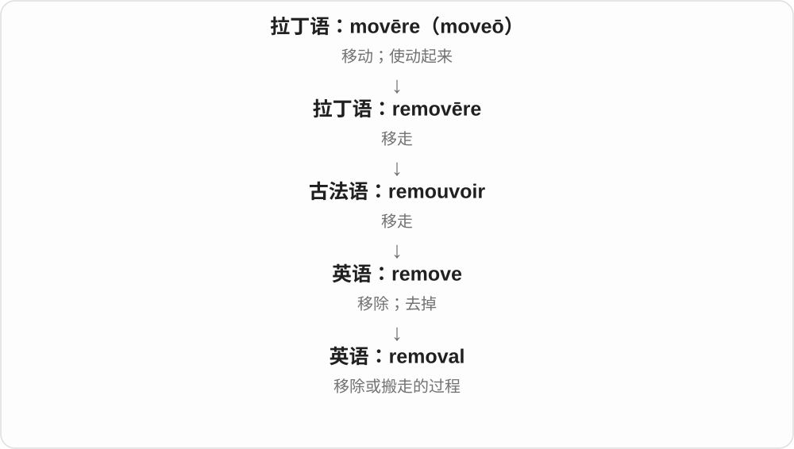

对象决定中文：snow removal 是清雪，removal from office 是免职；英式 removals 也常指搬家业务。

**常见搭配与例句**

waste removal；the removal of barriers；a removals company。

> The city arranged for the removal of fallen trees.

市政府安排清除倒下的树木。

> The removal of the wall made the room brighter.

拆掉这面墙后，房间更明亮了。

**别混淆**

removal 是移除；removable 是可移除的形容词。

### 55. agricultural — 农业的；农用的

**音标**：英、美 /ˌæɡrɪˈkʌltʃərəl/

**先抓住这个画面**

与农田、农作物、牲畜和农业生产有关。

**怎么拆**

agriculture + -al；加后缀后常把主重音移到 cul-。

**怎么变成今天的意思**

**拉丁 colere；分词 cultus**  
耕作、照料；居住；尊敬、崇奉

↓

**拉丁 ager + cultūra → agricultūra**  
田地 + 耕作 → 农业

↓

**中古法语 agriculture／拉丁词 → 中古英语、英语 agriculture**  
农业

↓

**英语 agriculture + -al → agricultural**  
农业相关的

agricultural land 是农业用地；agricultural equipment 是农机具。修饰产业和政策时也沿用这一范围。

**常见搭配与例句**

agricultural land；agricultural production；agricultural machinery。

> The factory makes agricultural machinery.

这家工厂生产农业机械。

> Much of the valley is agricultural land.

山谷里大部分是农业用地。

**别混淆**

rural 是乡村的；乡村还有旅游、手工业等，并非所有 rural 活动都是 agricultural。

### 56. constitutional — 宪法的；合宪的；体质上的；保健散步〔名词〕

**音标**：英 /ˌkɒnstɪˈtjuːʃənəl/；美 /ˌkɑːnstəˈtuːʃənəl/

**先抓住这个画面**

一个整体最基本的构成方式：放在国家是宪法，放在人身上则是体质。

**怎么拆**

英语 constitution + -al；名词 a constitutional 是 constitutional walk / exercise 的省略，不是另一部宪法。

**怎么变成今天的意思**

**拉丁 con- + statuere → constituere → constitutio**  
设立、安排 → 构成、制度

↓

**古法语 constitucion → 中古英语 constitucioun → constitution**  
安排、规则；后来指宪法、构成、体质

↓

**英语 constitution + -al → constitutional**  
与基本构成、体质有关；后来用于宪法

↓

**constitutional walk → a constitutional**  
有益健康的散步 → 保健散步

a constitutional question 是宪法问题；The law is constitutional 则说它符合宪法。早期体质义还留在 constitutional weakness 和散步名词中。

**常见搭配与例句**

constitutional reform；constitutional rights；take a morning constitutional。

> The court considered whether the rule was constitutional.

法院审查了这项规则是否符合宪法。

> He took his morning constitutional before breakfast.

早饭前，他照例出去散步锻炼。

**别混淆**

legal 是法律允许的；constitutional 更具体问是否符合宪法。关于宪法的争论可以是 constitutional debate，却不表示争论各方都合宪。

### 57. mechanical — 机械的；机械原理的；呆板、机械式的

**音标**：/məˈkænɪkəl/

**先抓住这个画面**

字面上说机器怎样动；比喻时说人像照程序运转，动作有了，心思没有跟上。

**怎么拆**

中古英语 mechanic + -al；接的是与器械、手艺相关的形容词支线，不是先有现代汽车修理工再变形。

**怎么变成今天的意思**

**古希腊语 mekhane；多里斯方言 makhana**  
工具、装置，也可指巧妙办法；更远来源有争议

↓

**希腊语 mekhanikos → 拉丁语 mechanicus；古法语 mecanique**  
与器械、技艺有关的

↓

**中古英语 mechanic + -al → mechanical**  
与技艺、机械有关的；后扩展为机械式的

mechanical failure 是机械故障；mechanical engineering 是机械工程；a mechanical smile 则是勉强、没什么感情的笑。少数名词用法见于旧戏剧、印刷或行业语境。

**常见搭配与例句**

mechanical engineering；a mechanical problem；a mechanical response。

> The delay was caused by a mechanical fault.

延误由一处机械故障造成。

> He gave a mechanical smile and returned to his work.

他机械地笑了一下，又回去工作了。

**别混淆**

mechanical 常说机器部件和物理运动；mechanistic 常说用机制解释事物的观点。后者不一定在批评呆板。

### 58. experimental — 实验的、基于实验的；试验性的；创新探索的

**音标**：/ɪkˌsperɪˈmentəl/

**先抓住这个画面**

可以说数据来自实验，也可以说新方法仍在试验；艺术里的 experimental 则常说在探索新形式，不按老套路来。

**怎么拆**

experiment + -al，形成关系性质形容词，历史已有经验、实验等用法。不是所有 experimental 都表示失败、不靠谱。

**怎么变成今天的意思**

**拉丁 experīrī → experimentum → 法语 esperiment → experiment**  
尝试、检验 → 一次试验、证明

↓

**experiment + -al → experimental**  
与实验有关、基于实验；作为尝试的

experimental results 实验结果，an experimental design 实验设计、试验性设计，experimental music 实验音乐。

**常见搭配与例句**

experimental results；an experimental design；experimental music。

> The paper presented the experimental results.

论文展示了实验结果。

> The festival included experimental music.

音乐节包含实验音乐。

**别混淆**

experimental 可以实验所得或试验性的；experienced 是有经验的，不要因开头相似把 experimental researcher 翻成资深研究员。

### 59. classical — 古典的；古希腊罗马的；传统体系的

**音标**：英、美 /ˈklæsɪkəl/

**先抓住这个画面**

它常给事物标出所属传统：古希腊罗马文化、古典音乐，或相对现代新理论而言的传统方法。

**怎么拆**

以拉丁语 classicus 的词干形成 -al 形容词；现代可联系 classic + -al。不同词典对英语早期造词细节有不同处理，不必假设现代 classic 一定先出现。

**怎么变成今天的意思**

classical music 日常可统称西方古典音乐，也可在音乐史中特指古典主义时期。classical physics 通常与量子物理相对；谈 classical mechanics 时常指牛顿力学体系，具体范围看语境。

**常见搭配与例句**

classical music；classical architecture；classical mechanics。

> She plays classical music but also enjoys jazz.

她演奏古典音乐，也喜欢爵士乐。

> The museum has a gallery devoted to classical sculpture.

博物馆有一间专门展示古希腊罗马雕塑的展厅。

**别混淆**

a classic song 是一首经典歌曲，可能是摇滚；classical music 才是古典音乐这一传统。

### 60. fiscal — 财政的；财务年度等用语中的财务的

**音标**：/ˈfɪskəl/

**先抓住这个画面**

把政府的钱想成一个公共钱袋：钱怎样收进来、怎样花出去，是 fiscal 常关心的范围。

**怎么拆**

经法语 fiscal 接晚期拉丁 fiscalis 国库的，来自 fiscus 国库，原指篮子、钱袋等。词根来源更远不明；-alis 是相应形容词材料。

**怎么变成今天的意思**

**拉丁 fiscus → fiscalis**  
钱篮、国库 → 国库相关的

↓

**法语 → 英语 fiscal**  
财政的；后扩到一些财务用语

fiscal policy 财政政策；fiscal year 财政年度、会计年度；fiscal revenue 财政收入；fiscal measures 财政措施。

**常见搭配与例句**

the end of the fiscal year；fiscal spending。

> The report covers the last fiscal year.

报告涵盖上一个财政年度。

> The lecture compared fiscal policy with monetary policy.

讲座比较了财政政策与货币政策。

**别混淆**

fiscal policy 常关心政府收入、支出，monetary policy 常关心货币与利率等政策。这里只辨词义；fiscal year 的起止日并非全球统一。

### 61. conventional — 常规的；传统的；遵循惯例的

**音标**：/kənˈvenʃənəl/

**先抓住这个画面**

大家通常就这么做，这个方案也沿着熟悉的路走，就是 conventional。

**怎么拆**

借自晚期拉丁语 conventiōnālis“与约定有关的”；现代可按 convention（惯例、约定）+ -al 理解。

**怎么变成今天的意思**

可以是中性的常规技术，也可暗示想法守旧、不新颖。conventional wisdom 是普遍接受的看法，不保证它一定正确。

**常见搭配与例句**

a conventional approach；conventional wisdom；conventional methods。

> The team chose a conventional design that was easy to maintain.

团队选择了便于维护的常规设计。

> Her findings challenged conventional wisdom.

她的研究结果挑战了普遍接受的看法。

**别混淆**

common 强调常见；conventional 强调符合习惯、通行模式。traditional 更突出历史传承。

### 62. functional — 能正常工作的；实用的；功能方面的

**音标**：/ˈfʌŋkʃənəl/

**先抓住这个画面**

先问“它能不能把该做的事做好”，再谈外观或其他特点。

**怎么拆**

现代可看作 function + -al；历史解释也包括中世纪拉丁 functionalis，都是“与履行作用有关”。

**怎么变成今天的意思**

**拉丁 fungi／fungor；分词词干 funct-**  
履行、执行、完成职责

↓

**两种历史分析：英语 function + -al；或中世纪拉丁 functionalis**  
两条路线都接“履行、功能”的来源，不互相当作先后阶段

↓

**英语 functional**  
与功能有关；能起作用、实用的

a functional kitchen 是好用、布局满足需要的厨房；fully functional 表示功能已正常可用。a functional difference 是功能上的区别。医学、数学和编程中另有专门用法，需跟着领域读，不能全部机械翻成“实用”。

**常见搭配与例句**

fully functional；functional design；functional requirements。

> The room is small but functional.

房间虽小，但很实用。

> The replacement system is now fully functional.

替换后的系统现在已能正常发挥全部功能。

**别混淆**

functional 说明能发挥作用或侧重实用；decorative 强调装饰。东西可以既 functional 又 attractive。

### 63. naval — 海军的；军舰的

**音标**：/ˈneɪvəl/

**先抓住这个画面**

把事物放到海上军事力量这个范围里：基地、军官、作战等。

**怎么拆**

经法语 naval 或直接接拉丁 navalis，来自 navis“船”；现代对应 navy 的形容词，但并非历史上由英语 navy 现造。

**怎么变成今天的意思**

**拉丁语 navis**  
船

↓

**拉丁语 navalis → 法语 naval / 英语 naval**  
船的 → 海军、军舰的

a naval base 是海军基地；a naval officer 是海军军官。它不表示藏蓝色，也不是一切与海洋有关的通用形容词。

**常见搭配与例句**

a naval base；naval forces；a naval officer。

> The ship returned to its naval base.

军舰返回了海军基地。

> The museum displays old naval uniforms.

博物馆展出了旧式海军制服。

**别混淆**

maritime 涉及航海、海事；naval 尤其聚焦海军。navel 是肚脐，另源同音。

### 64. serial — 连续的；系列的；连载作品

**音标**：英 /ˈsɪəriəl/；美 /ˈsɪriəl/

**先抓住这个画面**

事情不是只发生一次，而是按顺序、分成一段一段地接着来。

**怎么拆**

series 的词干 seri- + -al，形成英语形容词，并有拉丁语 serialis 作为构词参照。

**怎么变成今天的意思**

**拉丁语 serere**  
把东西连接、排列在一起

↓

**拉丁语 series → 英语 series**  
一列、一串；连续相关的事物

↓

**英语 series + -al；参照拉丁语 serialis**  
系列的、依次排列的

a serial number 是用于识别个体的编号；a serial entrepreneur 是不断创办新事业的人。a serial 作名词可指分期发表或播出的作品。

**常见搭配与例句**

a serial number；a serial entrepreneur；a radio serial。

> Please write down the device’s serial number.

请记下设备的序列号。

> The novel first appeared as a newspaper serial.

这部小说最初在报纸上连载。

**别混淆**

serial 常强调接连发生或分期；series 是相关的一整组。它与早餐麦片 cereal 同音但不同义。

### 65. custody — 保管、看护；监护；拘押、羁押

**音标**：英 /ˈkʌstədi/；美 /ˈkʌstədi/

**先抓住这个画面**

某个人或东西交到一方手里，由这一方看管、负责。对象是文物，可以是保管；对象是孩子，常谈监护照护；警方控制住人，则有拘押义。

**怎么拆**

接拉丁 custodia 看管、保护，也可指监禁，来自 custos、词干 custod- 看管者、保护者。英语沿看守、保管线发展，具体自由程度由场景决定。

**怎么变成今天的意思**

**拉丁 custos／custod- → custodia**  
看管者 → 看守、保护、拘押

↓

**英语 custody**  
保管、照护；监护；警方等的拘押

in the custody of a museum 由博物馆保管；custody of the children 对孩子的监护、照护安排；in police custody 被警方拘押；take someone into custody 将某人拘押。

**常见搭配与例句**

safe custody；have custody of something。

> The manuscript remains in the custody of the library.

手稿仍由图书馆保管。

> He was taken into custody after the incident.

事件发生后，他被拘押了。

**别混淆**

custody 的统一线索是由谁看管、负责，不能看到就一律译入狱。manuscripts in the library’s custody 是图书馆保管的手稿。

### 66. custodial — 看管、监护的；拘押、监禁的；楼宇照管维护的

**音标**：英 /kʌˈstəʊdiəl/；美 /kʌˈstoʊdiəl/

**先抓住这个画面**

custody 是看管这件事，custodial 把看管的性质放到职责、照护安排、刑罚或校舍工作上。

**怎么拆**

对应 custody 的词干 custod-、custodi- 与形容词 -al，英语、法语已有相应形式。具体义由看管对象展开：人、场所或被拘押者。

**怎么变成今天的意思**

**custody／custod- 看管词族**  
保管、照护、监护、拘押

↓

**custod-／custodi- + 形容词材料 → custodial**  
与相应看管职责或状态有关的

custodial care 看护、照护；custodial duties 管护职责；custodial staff 校舍、楼宇维护清洁人员等；a custodial sentence 监禁刑。

**常见搭配与例句**

custodial work；custodial responsibility。

> The custodial staff cleaned the classrooms after the event.

活动后，校舍管理清洁人员打扫了教室。

> The training covers custodial duties in public buildings.

培训涵盖公共建筑的管护职责。

**别混淆**

custodial staff 在学校语境常是清洁、维护、管理楼宇的人员；不能只因 custody 有拘押义就把所有 custodial 译成监狱的。

### 67. magical — 有魔法的；神奇、美妙得像有魔法的

**音标**：/ˈmædʒɪkəl/

**先抓住这个画面**

既可以是能施法的森林，也可以是一次真实而难忘的夜晚。后一种是在说体验像童话般美妙。

**怎么拆**

magic + -al，形成形容词。magic 自己也能作形容词，不能理解为加 -al 才第一次获得形容词资格。

**怎么变成今天的意思**

**伊朗语背景的称谓 → 希腊语 magos、magikos**  
祭司、术士等称谓；相应的术法

↓

**拉丁语 magicus、magica → 法语 magique → 中古英语 magik → magic**  
魔法、法术；后来也用于舞台魔术与神奇效果

↓

**magic + -al → magical**  
魔法的；令人感到神奇美妙的

magical powers 魔力，a magical evening 美妙夜晚，a magical atmosphere 梦幻气氛。

**常见搭配与例句**

magical powers；a magical moment；a magical atmosphere。

> In the story, the ring has magical powers.

故事里，那枚戒指有魔力。

> We spent a magical evening by the lake.

我们在湖边度过了一个美妙的夜晚。

**别混淆**

magic trick 是常用搭配；a magical experience 强调神奇体验。二者用法有重叠，不能硬定 magic 全指真的魔法、magical 全指假的。

### 68. identical — 完全一样的；同一个的

**音标**：/aɪˈdentɪkəl/，也读 /ɪˈdentɪkəl/

**先抓住这个画面**

两把钥匙看起来毫无分别，可以 identical；有时强调的不是两个相似物，而正是同一个东西。先问语境是在比较两份，还是确认同一件。

**怎么拆**

identic + -al，历史联系中古拉丁 identicus、晚期拉丁 identitās，最终联系 idem 相同。不要按英文 identity 去掉任意字母当作全部借入历史。

**怎么变成今天的意思**

**拉丁 idem 相同 → identitās、identicus**  
同一、相同的性质

↓

**identic + -al → identical**  
相同的、完全一样的

identical copies 完全一样的副本，be identical to 与……相同，identical twins 同卵双胞胎。日常也会把很像夸张说成 identical。

**常见搭配与例句**

be identical to；identical copies；identical twins。

> The two boxes looked identical from the outside.

两个盒子从外面看一模一样。

> Your answer is identical to mine.

你的答案和我的完全一样。

**别混淆**

similar 是相似，identical 通常要求相关方面一致；同卵双胞胎也不是生活经历、性格、所有细节都绝对相同。

### 69. operational — 运行的；业务操作的；可投入使用的

**音标**：英 /ˌɒpəˈreɪʃənəl/；美 /ˌɑːpəˈreɪʃənəl/

**先抓住这个画面**

从纸上的计划走到实际运行：人、设备和步骤都能够开始做事。

**怎么拆**

operation + -al；这里的 operation 可以是系统运行、日常业务或军事行动。

**怎么变成今天的意思**

**拉丁 opus〔属格 operis〕／opera**  
工作、劳动；做成的作品

↓

**拉丁 operārī → operātiō**  
做事 → 做事的过程

↓

**古法语 operacion → 中古英语 operacioun → 英语 operation**  
运行、行动；后来用于手术等有组织的操作

↓

**英语 operation + -al → operational**  
涉及实际运作；已经能运行

fully operational 是系统已可正常使用。operational costs 是维持实际运作的成本。研究里 operational definition 则把抽象概念换成可执行的观察或测量规则，例如“用哪项指标算作进步”。

**常见搭配与例句**

fully operational；operational costs；an operational plan；an operational definition。

> The new booking system will be fully operational on Monday.

新的预订系统将在周一全面投入运行。

> The report separates construction costs from operational costs.

报告把建设成本与运营成本分开列出。

**别混淆**

strategic 关心总体方向；operational 常关心怎样把日常运行或具体行动落实。

### 70. occupation — 职业；占用、居住；占领

**音标**：英 /ˌɒkjəˈpeɪʃən/；美 /ˌɑːkjəˈpeɪʃən/

**先抓住这个画面**

平常用什么工作占据时间，是职业；房屋被使用、地区被控制，则是占用、占领。共同材料是某处或某事被占据。

**怎么拆**

经法语接拉丁 occupatio、occupare 等占据材料；现代与 occupy 对应，不能把 occupation 每次都只译职业。

**怎么变成今天的意思**

**拉丁 occupare 占据、抓住 → occupatio → 法语 occupation**  
占用、从事的活动与控制关系

↓

**英语 occupation → occupational**  
职业、占用等；相关性质

state your occupation 填写职业；military occupation 军事占领；a building in occupation 有人使用、居住的建筑，后者较正式。

**常见搭配与例句**

state your occupation；military occupation。

> The form asks for your name and occupation.

表格要求填写姓名和职业。

> The book examines life during the occupation.

书中研究了占领时期的生活。

**别混淆**

occupation 通常职业，具体职位可说 job；occupation 的占领义不是在问从事哪个行业。

### 71. occupational — 职业的；与工作有关的

**音标**：英 /ˌɒkjəˈpeɪʃənəl/；美 /ˌɑːkjəˈpeɪʃənəl/

**先抓住这个画面**

工作带来的风险、按职业划分的群体，都是 occupational 的常见对象。它说相关领域，不直接评价专业能力高低。

**怎么拆**

occupation + -al → occupational；形容词尾把职业、从业活动等名词变成相关性质。其他占用等义须看具体文本。

**怎么变成今天的意思**

**拉丁 occupare 占据、抓住 → occupatio → 法语 occupation**  
占用、从事的活动与控制关系

↓

**英语 occupation → occupational**  
职业、占用等；相关性质

↓

**occupation + -al → occupational**  
与职业、从业活动等相关的

occupational health 职业健康；an occupational hazard 职业风险；occupational groups 职业群体。

**常见搭配与例句**

occupational health；an occupational hazard；occupational groups。

> The survey compares several occupational groups.

调查比较了几个职业群体。

> The report discusses occupational hazards in the industry.

报告讨论了行业中的职业风险。

**别混淆**

occupational 说与职业有关，professional 还可评价专业、职业化；occupational 不等于做得很专业。

### 72. coastal — 海岸的；沿海的

**音标**：英 /ˈkəʊstəl/；美 /ˈkoʊstəl/

**先抓住这个画面**

coast 是海岸，coastal 就把地点、天气或生活方式放到海岸附近。

**怎么拆**

英语 coast + -al；海岸名词构成形容词。

**怎么变成今天的意思**

**拉丁 costa**  
肋骨；身体或物体的侧边

↓

**古法语 coste → 中古英语 coste → coast**  
侧面、岸边 → 海岸

↓

**英语 coast + -al → coastal**  
海岸 → 海岸相关的

coastal town 不要求每栋房子都贴着沙滩，而是说这个镇处于沿海地区。常与 inland“内陆的”相对。

**常见搭配与例句**

coastal areas；a coastal town；coastal erosion。

> The storm damaged several coastal villages.

暴风雨破坏了几个沿海村庄。

> Coastal erosion is changing the shape of the beach.

海岸侵蚀正在改变沙滩的形状。

**别混淆**

costal 少一个 a，通常说肋骨；读音也少了 coast 中的双元音。

### 73. congressional — 国会的；议会的；代表大会的

**音标**：英、美 /kənˈɡreʃənəl/

**先抓住这个画面**

把某件事放到国会或代表大会的职权和活动范围里。

**怎么拆**

历史可接拉丁 congressiō 的词干 + -al；也可经英语较少用名词 congression 理解。现代与 congress 对应，但不只是在末尾直接加 -al。

**怎么变成今天的意思**

**拉丁 gradus；gradī / gradior**  
一步、台阶、等级；走、迈步

↓

**拉丁 congredī → congressus → congressiō**  
相会、集会

↓

**congressiō 词干 / 英语 congression + -al → congressional**  
与集会、国会有关的

常修饰 hearing、committee、election、district。一般形容词写小写，即使对应的 Congress 大写。

**常见搭配与例句**

a congressional hearing；a congressional committee；congressional elections。

> The witness spoke at a congressional hearing.

证人在国会听证会上发言。

> The report was prepared for a congressional committee.

这份报告是为一个国会委员会准备的。

**别混淆**

congress 是机构或大会；congressional 用来修饰该机构有关的事务。

### 74. perception — 感知；看法

**音标**：/pəˈsepʃən/

**先抓住这个画面**

同一件事进入不同人的脑中，会形成不同的“画面”。这种感知过程或形成的看法，就是 perception。

**怎么拆**

与 perceive 同源；拉丁语 perceptiō 来自 percipere 的相关词干。-ceive 与 -ception 的对应有历史依据，不是随意拼写变形。

**怎么变成今天的意思**

从接收感觉信息，到解释这些信息，便连接了“感知”和“观念”两个常见义。public perception 是公众怎么看，并不是公众掌握的全部事实。

**常见搭配与例句**

public perception；a perception of…；change someone’s perception。

> The campaign changed public perception of the product.

这次宣传改变了公众对该产品的看法。

> Poor lighting can affect our perception of color.

光线不足会影响我们对颜色的感知。

**别混淆**

perception 是感知和看法，perspective 是观察角度；两者有关，但“看法”不能总靠一个中文词机械互换。

### 75. structural — 结构的；影响整体基础或组织方式的

**音标**：/ˈstrʌktʃərəl/

**先抓住这个画面**

structural 像房子的梁柱，或公司里“谁管谁、钱怎么流”的安排：说的是支撑整体的组织方式。

**怎么拆**

structure + -al，英语中形成表示“与结构有关”的形容词。

**怎么变成今天的意思**

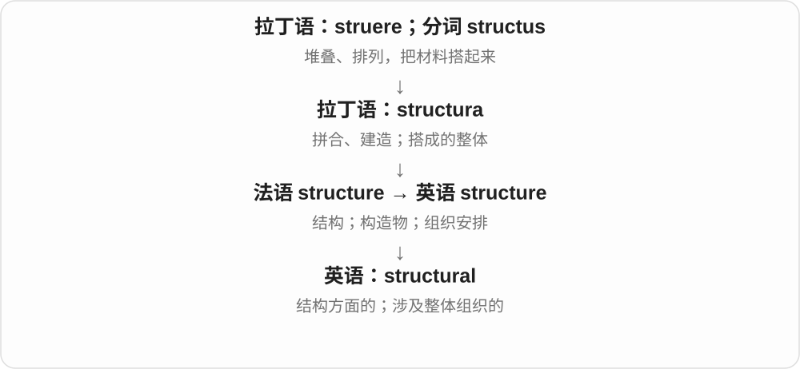

structural damage 可能影响建筑支撑；structural problems 也可指制度、组织造成的问题，不是换一个人或补一个小洞就能解决。

**常见搭配与例句**

structural damage；structural change；structural problems；structural engineering。

> The survey found no structural damage to the house.

勘查没有发现房屋结构受损。

> The company needs structural changes to reduce repeated delays.

公司需要调整组织结构，才能减少反复出现的延误。

**别混淆**

structural 强调内部安排或支撑；superficial 强调表面。结构问题未必肉眼立刻可见。

### 76. tropical — 热带的；具有热带特征的

**音标**：英 /ˈtrɒpɪkəl/；美 /ˈtrɑpɪkəl/

**先抓住这个画面**

地点、植物或天气与回归线之间的热带地区有关。

**怎么拆**

tropic + -al；从回归线和热带名词构成形容词。

**怎么变成今天的意思**

**希腊 trepein／tropos、tropē**  
转；方向；方式

↓

**希腊 tropikos → 英语 tropic／tropics**  
回归线 → 热带区域

↓

**tropic + -al → tropical**  
热带的

tropical fruit 是热带水果，tropical climate 是热带气候。普通描述常让人想到温暖、潮湿和茂密植物，但热带并非每个地方都湿润，不能把一个气候画面当成所有地区的定义。

**常见搭配与例句**

tropical fruit；a tropical island；tropical forests；a tropical storm。

> The market sells tropical fruit throughout the year.

市场全年出售热带水果。

> The researchers studied birds in a tropical forest.

研究人员考察了热带森林中的鸟类。

**别混淆**

tropical 指热带；subtropical 是亚热带、靠近热带的区域。tropospheric 指对流层，虽同有 trop-，不能混用。

### 77. colonial — 殖民的；殖民地的；群居的〔生物〕

**音标**：英 /kəˈləʊniəl/；美 /kəˈloʊniəl/

**先抓住这个画面**

与一个定居群体或受外来权力控制的殖民地有关。

**怎么拆**

colony + -al；现代用法分出政治历史、建筑风格和生物群居等支线。

**怎么变成今天的意思**

**拉丁 colere；分词 cultus**  
耕作、照料；居住；尊敬、崇奉

↓

**拉丁 colōnus → colōnia**  
耕作者、定居者 → 定居点

↓

**中古英语 colane / colonye → 英语 colony**  
殖民地；定居群体；生物群体

↓

**英语 colony + -al → colonial**  
殖民地的、殖民统治的；群居的

colonial rule 说殖民统治；colonial architecture 说殖民时期或相关风格的建筑。colonial organisms 则指成群或成群体结构生活的生物，不是在讲政治。

**常见搭配与例句**

colonial rule；the colonial period；colonial architecture。

> The archive contains records from the colonial period.

档案馆保存着殖民时期的记录。

> The biologist studies colonial organisms that live in connected groups.

这位生物学家研究以相连群体生活的群体生物。

**别混淆**

colonialist 常指支持或实行殖民主义的人或立场；colonial 本身可只是说明时代、关系或生物生活方式。

### 78. logical — 合乎逻辑的；合理的；逻辑上的

**音标**：英 /ˈlɒdʒɪkəl/；美 /ˈlɑːdʒɪkəl/

**先抓住这个画面**

前一步和后一步接得上，让人能看见为什么走到这里。

**怎么拆**

英语 logic + -al，表示与逻辑有关或符合逻辑。

**怎么变成今天的意思**

**希腊 légō / lógos**  
选取、收集 → 讲述；话语、说明、道理、计算

↓

**希腊 logikḗ → 拉丁 logica → 古法语 logike → 中古英语 logic**  
推理的技艺 → 逻辑

↓

**英语 logic + -al → logical**  
逻辑的；推理有条理的

a logical conclusion 是从所给条件合理推出的结论；the logical next step 是顺着已有目标自然应做的一步。技术中的 logical structure 常指概念关系，未必等于物理摆放位置。

**常见搭配与例句**

a logical explanation；the logical next step；logical structure。

> Testing the smaller model was the logical next step.

测试较小的模型是顺理成章的下一步。

> Her explanation was clear and logical.

她的解释清楚而有条理。

**别混淆**

logical 不保证每个前提都正确；先把未经证实的前提放进去，也可能推出形式上整齐的错误判断。

### 79. statistical — 统计的；与统计分析有关的

**音标**：/stəˈtɪstɪkəl/

**先抓住这个画面**

用数据的分布、数量和比较来研究问题，相关的方法或结果就是 statistical。

**怎么拆**

与 statistics 对应，加 -al 构成形容词；现代可见 statistic + -al 的形式关系，但不据此倒置历史顺序。

**怎么变成今天的意思**

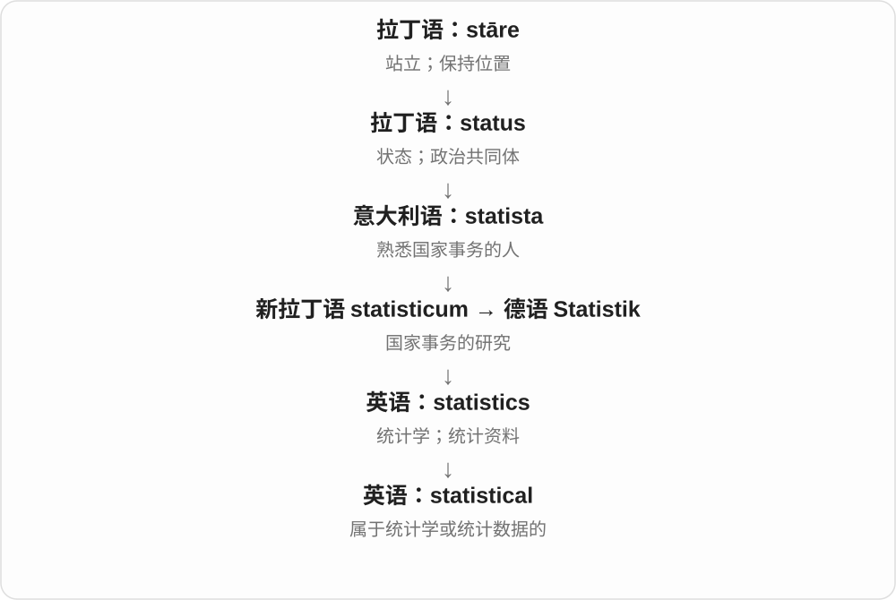

它可以修饰分析、证据、模型等。statistical significance 是一种特定统计判断，不自动等于现实影响很大。

**常见搭配与例句**

statistical analysis；statistical evidence；a statistical model。

> The report includes a statistical analysis of travel patterns.

报告包含对出行模式的统计分析。

> We need more than a statistical difference to explain the cause.

要解释原因，仅有统计差异还不够。

**别混淆**

statistical 不是 static“静态的”。statistical evidence 来自数据分析，仍可能需要解释背景。

### 80. electoral — 选举的；选举人的

**音标**：/ɪˈlektərəl/

**先抓住这个画面**

electoral 把某件事放到选举制度或投票过程里：规则、选区、结果都能受它修饰。

**怎么拆**

elector + -al，与拉丁语 ēlēctor“选择者”的词族相连。

**怎么变成今天的意思**

不是 electrical“电的”。electoral system 说选举如何运行；electoral victory 说选举获胜。

**常见搭配与例句**

an electoral system；electoral reform；electoral results。

> The article explains the electoral system.

文章解释了选举制度。

> The party celebrated an electoral victory.

该党庆祝选举胜利。

**别混淆**

electoral 关乎选举；elective 关乎可选或由选举产生。

### 81. minimal — 极少、最低限度的；简约的

**音标**：/ˈmɪnɪməl/

**先抓住这个画面**

东西、影响、投入少到接近最低限度，是 minimal；设计也可借少元素、少装饰的感觉形容。

**怎么拆**

联系拉丁 minimus 最小、最少，加相应 -al 性质形式；现代可对应 minimum 的词干 + -al，词尾不保留 -um。

**怎么变成今天的意思**

**拉丁 minimus 最小、最少 → minimal**  
最小程度、极少；现代也联系 minimum + -al

↓

**数量、程度 → 风格用法**  
最低限度；少元素、简约

minimal effort 最少努力，minimal damage 极小损害，minimal design 简约设计，minimal impact 很小影响。

**常见搭配与例句**

minimal effort；minimal damage；minimal impact。

> The change had minimal impact on the schedule.

变化对日程影响很小。

> The room has a minimal design with little decoration.

房间设计简约，装饰很少。

**别混淆**

minimal 不等于完全没有，minimal damage 仍有损害；minimum 常作最小值、最低限度的名词等，两词语法不完全相同。

### 82. rental — 租用、租赁；出租物；租赁的

**音标**：/ˈrentəl/

**先抓住这个画面**

car rental 可以是租车服务、租车这件事；a rental 又可以是那辆租来的车或一处出租房。

**怎么拆**

现代对应 rent + -al；历史有盎格鲁法语 rental、中世纪拉丁 rentale 等名词路径，早期还说租金簿、租金收入，不能只当现代英语临时加后缀。

**怎么变成今天的意思**

**古法语 rente、renter，相关中世纪拉丁形式 → rent〔租用词族〕**  
收入、应付款 → 租金、租用

↓

**盎格鲁法语 rental 等 → 英语 rental**  
租金记录、收入 → 租赁、出租物；相关形容词

car rental 租车，rental income 租金收入，a rental property 出租物业，a holiday rental 度假出租房。

**常见搭配与例句**

car rental；rental income；a rental property；a holiday rental。

> The price includes car rental for three days.

价格包括三天租车费用。

> They found a small holiday rental near the beach.

他们在海滩附近找到一处小度假出租房。

**别混淆**

rental 作名词、形容词都可，-al 不只形成形容词；rental income 收到租金的一方收入，rent payment 常是支付方付款。

### 83. viral — 病毒的；由病毒引起的；在网上迅速广传的

**音标**：/ˈvaɪrəl/

**先抓住这个画面**

医学里说与病毒有关；网络里说内容一传十、十传百。

**怎么拆**

英语 virus 的词干 vir- 加 -al。网络义借用了病毒传播的形象，但不表示内容有害或虚假。

**怎么变成今天的意思**

**拉丁 vīrus**  
毒液、毒物等

↓

**中古英语 virus → 现代英语 virus**  
从毒物、致病物到现代病毒概念；再比喻计算机病毒

↓

**英语 virus + -al → viral**  
病毒的；后来比喻迅速广传的

viral infection 是病毒感染；a video went viral 是视频迅速传开。后者描述传播效果，并不自动评价作品质量。

**常见搭配与例句**

a viral infection；viral marketing；go viral；a viral video。

> The report distinguishes viral infections from bacterial infections.

报告区分了病毒感染和细菌感染。

> Her short video went viral after thousands of people shared it.

数千人转发后，她的短视频迅速走红。

**别混淆**

viral 不等于 virulent“致病力强、恶毒的”。一个温暖的小故事也能 go viral。

### 84. ethical — 伦理方面的；合乎道德的

**音标**：英、美 /ˈeθɪkəl/

**先抓住这个画面**

有时只是在说“涉及对错的问题”，有时则是在肯定“这样做是正当的”。

**怎么拆**

英语 ethic + 形容词后缀 -al；更早的 ethic 经法语、拉丁语回到希腊 ēthos“品格”。

**怎么变成今天的意思**

**希腊 ēthos**  
习惯、品格、性情

↓

**希腊 ēthikos → ēthikē philosophia**  
关于品格的 → 道德哲学

↓

**后期拉丁 ethica → 古法语 etique**  
伦理、道德哲学

↓

**中古英语 ethik → 英语 ethic**  
早期指伦理研究；后来也指行为准则

↓

**英语 ethic + -al → ethical**  
伦理相关的；符合道德标准的

an ethical dilemma 是伦理两难，不是“道德高尚的两难”。ethical behaviour 才是在评价行为符合道德要求。先看它修饰 issue、question，还是 behaviour、practice，常能分出两种用法。

**常见搭配与例句**

ethical issues；an ethical dilemma；ethical standards；ethical sourcing。

> The experiment raises several ethical questions about consent.

这项实验提出了几个关于知情同意的伦理问题。

> The firm wants its suppliers to meet clear ethical standards.

公司希望供应商遵守明确的道德标准。

**别混淆**

ethical 与 legal 并不重合：合法只说符合法律，ethical 还会问是否公平、负责、尊重他人。

### 85. optical — 光学的；视觉的

**音标**：英 /ˈɒptɪkəl/；美 /ˈɑːptɪkəl/

**先抓住这个画面**

事情发生在光、镜片或我们怎么看见的这一层。

**怎么拆**

optic + -al；这是英语形容词扩展，不是把光本身叫作 optical。

**怎么变成今天的意思**

**希腊 ops / opsis；optos**  
眼睛／观看；被看见的

↓

**希腊 optikos**  
与视觉有关的

↓

**中世纪拉丁 opticus；古法语 optique**  
视觉的；两条借入途径

↓

**英语 optic**  
眼睛或视觉的

↓

**英语 optic + -al → optical**  
与光学或视觉有关的

optical equipment 靠光来观察、测量或工作；optical illusion 是眼睛与大脑形成的错觉，并不要求物体真的发生变化。

**常见搭配与例句**

optical instruments；optical illusion；optical zoom。

> The museum has a room full of optical illusions.

博物馆有一间展示各种视觉错觉的房间。

> The camera uses optical zoom to bring distant objects closer.

这台相机用光学变焦拉近远处物体的影像。

**别混淆**

optical zoom 通过镜头光学系统改变成像；digital zoom 常是裁切、放大图像，两者不是同一过程。

### 86. exceptional — 特别、异常的；杰出、出众的

**音标**：/ɪkˈsepʃənəl/

**先抓住这个画面**

不落在通常那一堆里，就是 exceptional 的例外感。能力超出一般，多是称赞；天气、事件异常，则不必是好事。

**怎么拆**

exception + -al，形成例外、超出一般的性质词。褒义出众是重要常用分支，不能取代全部异常义。

**怎么变成今天的意思**

**exception 例外 + -al → exceptional**  
不在一般情况之列

↓

**超出一般的评价**  
特别、出众；也可指异常情况

exceptional talent 杰出才能，exceptional circumstances 特殊情况，exceptional quality 出众品质。

**常见搭配与例句**

exceptional talent；exceptional circumstances。

> She showed exceptional skill in the final round.

最后一轮，她展现出出众的技艺。

> The road was closed because of exceptional weather conditions.

道路因异常天气而关闭。

**别混淆**

exceptional 不自动等于允许破例的法律、程序结论；它也不总是称赞，要看修饰什么。

### 87. withdrawal — 撤回、撤离、退出；取款；戒断反应〔专业语境〕

**音标**：英 /wɪðˈdrɔːəl/ 或 /wɪθˈdrɔːəl/；美 /wɪðˈdrɔːəl/

**先抓住这个画面**

把 withdraw 这一动作当成一件事来谈，是 withdrawal。银行里是取款，比赛里是退出，停止依赖物质后出现的反应也有固定专业用法。

**怎么拆**

withdraw + -al，形成动作、状态名词。不同对象下形成撤离、取款等具体意义，不能一律译成提款。

**怎么变成今天的意思**

**旧英语 with- 对抗、退回、离开等构词意义**  
与现代常用介词 with 一起不同

↓

**with- + draw → withdraw**  
向后拉、取回 → 撤离、撤回、取款

↓

**withdraw + -al → withdrawal**  
撤回、退出等行为；固定专业状态名

a cash withdrawal 现金取款，withdrawal from the competition 退出比赛，withdrawal symptoms 戒断症状。词尾 -al 在这里是名词构词。

**常见搭配与例句**

a cash withdrawal；withdrawal from；withdrawal symptoms。

> Her withdrawal from the competition surprised everyone.

她退出比赛，让大家都很意外。

> The receipt shows a cash withdrawal.

回单显示一笔现金取款。

**别混淆**

withdrawal 也可说不再交往、退缩；戒断是专业语境的固定义，不能凭任何不舒服都套这个词。

### 88. dimensional — 尺寸的；维度的；量纲的

**音标**：/dɪˈmenʃənəl/，也读 /daɪˈmenʃənəl/

**先抓住这个画面**

谈的是物体有多大、空间有几个方向，或物理量由哪些基本量组成。

**怎么拆**

dimension + -al。

**怎么变成今天的意思**

**拉丁 dis- + mētīrī → dīmētīrī**  
分开量、量定

↓

**拉丁 dīmēnsiō → 英语 dimension**  
测量、范围 → 尺寸、维度、方面

↓

**英语 dimensional**  
与尺寸、维度或量纲有关的

dimensional accuracy 是尺寸做得准不准；dimensional analysis 是分析量纲，如速度属于长度除以时间。具体是哪种意思，要看工程、数学还是物理语境。

**常见搭配与例句**

dimensional accuracy；dimensional analysis；dimensional stability。

> The parts were checked for dimensional accuracy.

这些零件经过了尺寸精度检查。

> Dimensional analysis can reveal an error in the formula.

量纲分析可以发现公式中的一个错误。

**别混淆**

dimensionless 在物理里说量纲为一；dimensional 不一定说物体是三维。

### 89. continental — 大陆的；洲的；欧洲大陆的

**音标**：英 /ˌkɒntɪˈnentəl/；美 /ˌkɑːntɪˈnentəl/

**先抓住这个画面**

continental 把注意力放到一整片大陆上，或者在英国语境里特指欧洲大陆。

**怎么拆**

continent + -al。

**怎么变成今天的意思**

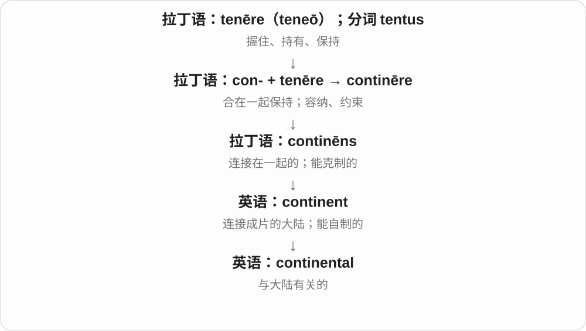

continental climate 说大陆性气候；continental breakfast 是习惯性餐饮名称，常指面包、饮料等较简单早餐，不按大陆面积理解。

**常见搭配与例句**

continental climate；continental Europe；a continental breakfast。

> The region has a continental climate with cold winters.

这个地区属大陆性气候，冬季寒冷。

> The hotel serves a continental breakfast.

酒店供应欧陆式早餐。

**别混淆**

intercontinental 是跨洲之间；continental 只是与大陆有关，没有自动包含跨越的意思。

### 90. disposal — 处置、清除；支配、可使用；垃圾处理装置〔特定用法〕

**音标**：英 /dɪˈspəʊzəl/；美 /dɪˈspoʊzəl/

**先抓住这个画面**

垃圾怎样处理是 disposal；工具放在你手边、任你使用，则是 at your disposal。两者都保留由谁安排、怎样处置的关系。

**怎么拆**

dispose + -al，去词尾 e。-al 在这里形成行为、权限等名词，不是一般的性质形容词。

**怎么变成今天的意思**

**拉丁 dis- 分开 + pōnere 放置 → dispōnere**  
安排、分配、布置

↓

**法语 disposer → 英语 dispose**  
安排、使倾向；dispose of 处置、处理掉

↓

**dispose + -al → disposal**  
处置行为；安排、支配的权限

waste disposal 废物处理，at your disposal 供你使用，disposal of assets 资产处置。a garbage disposal 可指厨房垃圾处理装置。

**常见搭配与例句**

waste disposal；at your disposal。

> A car will be at your disposal during the visit.

访问期间，有一辆车可供你使用。

> The plan includes a system for waste disposal.

计划包括一套废物处理系统。

**别混淆**

at your disposal 不是准备把你扔掉，而是可由你支配使用；后面的人、工具、时间各按对象理解。

### 91. institutional — 机构的；制度性的；机构照护的

**音标**：英 /ˌɪnstɪˈtjuːʃənl/；美 /ˌɪnstɪˈtuːʃənl/

**先抓住这个画面**

把视线从某一个人移到整个机构的安排、规则和运作方式上。

**怎么拆**

institution + -al；institution 的机构、制度两类意思都可能保留。

**怎么变成今天的意思**

**拉丁 stare → statuere**  
站立 → 使站稳、设立、安排

↓

**拉丁 in- + statuere → instituere**  
设立、安排、教导

↓

**拉丁 institutio → 古法语 institucion → 英语 institution**  
设立、安排 → 已建立的机构、制度、习惯

↓

**英语 institution + -al → institutional**  
机构、制度 → 机构相关、制度性的

institutional support 是机构支持；institutional barriers 是制度层面的障碍。institutional care 说在专门机构中的照护，不能与制度性问题那个意思混着读。

**常见搭配与例句**

institutional support；institutional investors；institutional barriers。

> The project cannot continue without institutional support.

没有机构层面的支持，这个项目就无法继续。

> The report identifies institutional barriers to equal access.

报告指出了妨碍平等获取机会的制度障碍。

**别混淆**

individual 是个人层面；institutional 是机构、制度层面。institutional investors 指基金等机构投资者，不是某个个人。

### 92. denial — 否认；拒绝；不愿承认现实

**音标**：/dɪˈnaɪəl/

**先抓住这个画面**

有人说“没有那回事”，或者把某项申请、权利挡在门外。

**怎么拆**

deny + -al；y 变 i，构成行为名词。后来的 in denial 又用来描述不愿面对事实的状态。

**怎么变成今天的意思**

**拉丁语 negare**  
否认、拒绝，说“不”

↓

**拉丁语 de- + negare → denegare**  
加强拒绝、否认

↓

**古法语 denoier → 中古英语 denyen → deny**  
否认；拒绝给予

↓

**英语 deny + -al → denial**  
否认、拒绝 → 这种行为、声明或心理状态

issue a denial 是发表否认声明；denial of access 是拒绝访问；be in denial 常说人不愿承认令人难受的现实。不能只看单词就判断否认是真是假。

**常见搭配与例句**

a firm denial；denial of access；be in denial about。

> The company issued a denial of the allegation.

公司发表声明否认了这项指控。

> He was still in denial about the scale of the problem.

他仍不愿承认问题有多严重。

**别混淆**

rejection 常指拒绝接纳；denial 也可是否认某事实存在。

### 93. instrumental — 发挥重要作用的；器乐的；工具、仪器相关的；器乐曲

**音标**：/ˌɪnstrəˈmentəl/

**先抓住这个画面**

工具帮助你办成事，所以一个人 instrumental in doing something 是在成事上发挥了关键作用；音乐里则说用乐器演奏。

**怎么拆**

与中世纪拉丁 īnstrūmentālis 对应，现代可看作 instrument + -al。名词 instrumental 是器乐作品等用法，不把关键作用义只锁在会弹琴。

**怎么变成今天的意思**

**拉丁 īnstruere → īnstrūmentum**  
装配、准备 → 工具、用具

↓

**法语 instrument → 英语 instrument**  
器具；乐器；测量仪器；达成目的的手段

↓

**instrument + -al 等对应 → instrumental**  
作为手段、发挥作用；与器乐、工具有关

be instrumental in doing 在……中发挥重要作用，instrumental music 器乐，an instrumental version 无主唱的器乐版。

**常见搭配与例句**

be instrumental in doing；instrumental music；an instrumental version。

> Her advice was instrumental in saving the project.

她的建议为挽救项目发挥了关键作用。

> The album ends with a short instrumental.

专辑以一首短器乐曲结束。

**别混淆**

He was instrumental in the decision 说他影响重大，不是他在决定时演奏乐器；instrumental in 后常接名词或 -ing。

### 94. archive — 档案、档案库；归档、存档；归档文件

**音标**：英 /ˈɑːkaɪv/；美 /ˈɑːrkaɪv/

**先抓住这个画面**

把不常用但值得保留的材料整理存好，方便以后查，就是 archive。档案可以是纸张，也可以是数字记录。

**怎么拆**

接法语等档案词，上接拉丁 archivum、希腊 arkheion 公共政务建筑和文书材料；名词常见复数 archives，后来作归档动词。

**怎么变成今天的意思**

**希腊 arkheion 公共政务建筑、档案 → 拉丁 archivum**  
政府文书及其存放处

↓

**法语等 → archive、archives**  
档案、保存处；归档

↓

**archive + -al → archival**  
档案相关或适合长期保存的性质

the city archives 城市档案；archive old emails 归档旧邮件；an archive file 归档文件；a digital archive 数字档案库。

**常见搭配与例句**

a digital archive；archive old emails；the city archives。

> The letters are kept in the city archive.

信件保存在城市档案库里。

> She archived the old project files.

她把旧项目文件归档了。

**别混淆**

archive 归档通常保留内容，delete 删除则移除；归档文件也不保证一定经过压缩。

### 95. archival — 档案的；适合档案保存的

**音标**：英 /ɑːˈkaɪvəl/；美 /ɑːrˈkaɪvəl/

**先抓住这个画面**

档案里的资料是 archival material；适合保存材料的纸盒、纸张也会称 archival。前者说来源、用途，后者说保存品质。

**怎么拆**

archive 去末尾 e 加 -al → archival，常见读音重音后移。不是 arch 建筑拱门加一个不相关的 ival。

**怎么变成今天的意思**

**希腊 arkheion 公共政务建筑、档案 → 拉丁 archivum**  
政府文书及其存放处

↓

**法语等 → archive、archives**  
档案、保存处；归档

↓

**archive + -al → archival**  
档案相关或适合长期保存的性质

archival material 档案材料；archival research 档案研究；archival paper 适合保存用途的纸。

**常见搭配与例句**

archival material；archival research；archival paper。

> The historian worked with archival material.

历史学家研究档案材料。

> The photographs are stored in archival boxes.

照片存放在档案保存盒里。

**别混淆**

archival paper 表适合保存的品质、用途，不保证永远不变；archival material 也不要求每件都印在特制纸上。

### 96. seasonal — 季节性的；随季节变化的；当季的

**音标**：/ˈsiːzənəl/

**先抓住这个画面**

日历转到某一段，它就特别常见、特别需要，或与别的季节不同。

**怎么拆**

season + -al，英语形容词；把季节或固定时段变成性质。

**怎么变成今天的意思**

**拉丁语 serere，分词 satus**  
播种、栽种

↓

**拉丁语 satio，宾格 sationem**  
播种行为 → 播种时节

↓

**古法语 seison / saison**  
时节；适当时候

↓

**中古英语 sesoun → season**  
季节；某项活动的固定时期

↓

**英语 season + -al → seasonal**  
与季节有关的

seasonal work 随旺季出现；seasonal vegetables 是当季蔬菜；seasonal variation 是按季节反复出现的变化。

**常见搭配与例句**

seasonal workers；seasonal produce；seasonal variation。

> The hotel hires seasonal workers during the summer.

这家酒店在夏季雇用季节工。

> The menu changes to include seasonal vegetables.

菜单会变化，以采用当季蔬菜。

**别混淆**

temporary 只说暂时；seasonal 还指出这种安排或变化与季节有关。

### 97. tactical — 战术的；策略性的；着眼于具体行动的

**音标**：英、美 /ˈtæktɪkəl/

**先抓住这个画面**

为了眼前这一步怎样更有效而作出的安排。

**怎么拆**

现代容易看成 tactic + -al；但 tactical 的早期记录更早，可能直接以希腊 taktikos 或拉丁 tactica 的词基加 -al 形成。不能强画成现代 tactic 名词生出所有 tactical 用法。

**怎么变成今天的意思**

**希腊 tassein / tasso；taxis、taktos**  
安排、列队；排列、被安排的

↓

**希腊 taktikos、taktike / taktika → 新拉丁 tactica**  
关于部署的；部署的技艺

↓

**英语 tactical；与希腊、拉丁 tactic- 词基及 -al 结合有关**  
战术上的；为眼前行动作安排的

a tactical change 可能只是临场换一种打法；a tactical delay 则可能是为了获得优势而暂缓行动。它强调行动层面的安排，不等于“做得高明”，因为也有 tactical error。

**常见搭配与例句**

a tactical advantage；a tactical error；a tactical change；a tactical decision。

> The coach made a tactical change at half-time.

教练在中场休息时作了战术调整。

> The delay was a tactical decision rather than an accident.

这次延迟是有意的策略安排，而非意外。

**别混淆**

strategic 更关整体布局；tactical 更关具体行动。tactful 是说话做事有分寸，不等于 tactical。

### 98. architectural — 建筑的；建筑设计的；架构方面的

**音标**：英 /ˌɑːkɪˈtektʃərəl/；美 /ˌɑːrkɪˈtektʃərəl/

**先抓住这个画面**

评价一个地方时，专门看它怎样设计和组织空间；评价系统时，也可看整体结构。

**怎么拆**

architecture 去词尾 e 加 -al；从建筑、架构名词形成形容词，不是 architect + 一个独立的 -ural。

**怎么变成今天的意思**

**希腊语 tektōn**  
建造者、木匠；与 tekhnē 常追至相同的制作远源，近源分支不同

↓

**希腊语 arkhi- + tektōn → arkhitektōn → 拉丁语 architectus**  
首席 + 建造者 → 主建筑师

↓

**拉丁语 architectura → 法语 architecture → 英语 architecture**  
建筑技艺；建筑与系统的整体设计

↓

**英语 architecture + -al → architectural**  
涉及建筑或架构的

architectural drawings 是建筑设计图；architectural heritage 是建筑遗产；软件中的 architectural decision 是影响整体结构的决定。

**常见搭配与例句**

architectural design；architectural features；architectural heritage。

> The building retains many original architectural features.

这座建筑保留了许多原有的建筑特色。

> The team reviewed the architectural decisions before adding new features.

团队在增加新功能前复查了架构方面的决定。

**别混淆**

structural 常关乎承重或组成结构；architectural 可同时涉及空间、用途、形式与整体设计。

### 99. correction — 纠正；修改；修正量

**音标**：英、美 /kəˈrekʃən/

**先抓住这个画面**

发现偏了，就把它往正确位置拉回来；也可以指纸上实际改掉的那一处。

**怎么拆**

拉丁语 correctio，经古法语 correccion 借入；与 correct 配套，但不是必须先有英语 correct 再造名词。

**怎么变成今天的意思**

**拉丁语：regere**  
引导、使直；治理

↓

**拉丁语：corrigere**  
纠正、使正

↓

**拉丁语：correctus**  
已经纠正的；corrigere 的分词形式

↓

**拉丁语 correctio → 古法语 correccion**  
纠正、使合乎标准

↓

**英语：correction**  
改错；一项修正

make a correction 是做一处修改；a correction to the report 是对报告的修正。仪器读数也可能需要加上一个 correction，抵消已知偏差。

**常见搭配与例句**

make corrections；a correction to；subject to correction。

> The newspaper printed a correction to yesterday’s story.

报纸刊登了对昨天报道的更正。

> I made two small corrections to the table.

我对表格做了两处小修改。

**别混淆**

revision 可以整体重写、调整；correction 特别针对错处或偏差。

### 100. correctional — 矫正的；与刑罚矫正、监禁或改造有关的

**音标**：/kəˈrekʃənəl/

**先抓住这个画面**

correction 本有纠正的意思；correctional 在机构、人员名称里，常进入关押、改造违法者的固定用法。不是每一处拼写纠错都这么叫。

**怎么拆**

correction + -al → correctional；性质尾接在纠正、矫正名词上，现代刑罚机构等语境很常见。

**怎么变成今天的意思**

**correct 纠正 → correction**  
纠正的行为、结果

↓

**correction + -al → correctional**  
矫正相关；刑罚矫正机构等固定性质

a correctional facility 矫正机构、监狱等；a correctional officer 惩教、矫正人员；correctional services 矫正相关服务。

**常见搭配与例句**

a correctional facility；a correctional officer。

> The report examines education in correctional facilities.

报告考察矫正机构里的教育。

> The course introduces the work of correctional officers.

课程介绍矫正人员的工作。

**别混淆**

corrective 通常更宽地说纠正问题的；correctional 在现代常有刑罚矫正领域的固定搭配，不能随意互换全部。

### 101. optimal — 最佳的；最合适的

**音标**：英 /ˈɒptɪməl/；美 /ˈɑptɪməl/

**先抓住这个画面**

像调烤箱：温度太低不熟，太高烤焦，适合当前食物的那个档位才是最佳。

**怎么拆**

optimum 的 optim- 词干 + -al；最终来自拉丁 optimus“最好”。

**怎么变成今天的意思**

**拉丁 optimus／其中性形式 optimum**  
最好的；最佳者

↓

**英语 optimum → optimal**  
最佳状态 → 最佳的

optimal conditions 是最有利于某个目标的条件；an optimal solution 是在指定规则下最好的解。这里的“最好”要看目标和限制，未必意味着最快、最大或最贵。

**常见搭配与例句**

optimal conditions；an optimal solution；optimal performance。

> We tested several settings to find the optimal temperature.

我们测试了几种设置，寻找最合适的温度。

> The fastest route is not always optimal if you want to avoid tolls.

如果想避开收费路段，最快的路线未必是最佳路线。

**别混淆**

optimal 是形容词；optimum 既可作名词也可作形容词。maximum 只说最大值，不保证最合适。

### 102. postal — 邮政的；邮递的

**音标**：英 /ˈpəʊstəl/；美 /ˈpoʊstəl/

**先抓住这个画面**

把信件、包裹从收取到分拣再送达的服务体系，用 postal 来修饰。

**怎么拆**

post（邮递）+ -al，构词受法语 postal 等对应形式影响。al 形成相关形容词，不是表示所有字母。

**怎么变成今天的意思**

**拉丁 postis → 古英语、古法语 post；另一路意大利 posta → 法语 poste**  
柱子；另有驿站、安置位置等词源

↓

**英语 post**  
柱、张贴；邮递；岗位、驻点等同形用法

↓

**post + -al → postal**  
与邮政、邮递相关的

the postal service 邮政服务，a postal address 邮寄地址，postal workers 邮政工作人员。并非一切在线消息都算邮政。

**常见搭配与例句**

the postal service；a postal address；postal workers；postal delivery。

> Please include your full postal address.

请填写完整邮寄地址。

> The postal service delivers to the village twice a week.

邮政服务每周向村里投递两次。

**别混淆**

postal address 是邮寄地址，email address 电子邮箱地址；发信方式不同，不凭 address 相同就混写。

### 103. revival — 复苏；复兴；重新上演；宗教复兴活动

**音标**：/rɪˈvaɪvəl/

**先抓住这个画面**

原本沉寂、衰落或退到一旁的东西重新活跃，整个回来的过程就是 revival。

**怎么拆**

revive + -al；英语名词派生。

**怎么变成今天的意思**

**拉丁 vīvus、vīvere；相关 vīta**  
活着的、生活；生命

↓

**拉丁 re- + vīvere → revīvere；古法语 revivre**  
再活起来；恢复

↓

**中古英语 → revive**  
恢复意识或活力；重新兴起

↓

**英语 revive + -al → revival**  
重新活跃 → 复苏、复兴

可说工艺、风格重新流行，也可指旧剧重新演出。宗教语境另有信仰复兴及相关集会的专门用法。

**常见搭配与例句**

a revival of interest；an economic revival；a stage revival。

> The town has seen a revival of traditional crafts.

小镇的传统手工艺重新兴盛起来。

> The theatre announced a revival of the musical.

剧院宣布将重新上演这部音乐剧。

**别混淆**

recovery 常说从损伤或低谷恢复；revival 常突出某事重新活跃、重新受关注。

### 104. biblical — 《圣经》的；依据《圣经》的；规模惊人的〔比喻〕

**音标**：/ˈbɪblɪkəl/

**先抓住这个画面**

把人物、故事、语言与《圣经》联系起来；在夸张说法中，也把某件事比作经书里巨大、震撼的事件。

**怎么拆**

现代可按 Bible 与 -ical 理解；历史构词还涉及中世纪拉丁 biblicus 与英语 -al。它不必是从今日 Bible 的完整拼写直接逐字接尾，读音也从 /baɪ/ 变成 /bɪ/。

**怎么变成今天的意思**

**希腊 byblos／biblos → biblion**  
纸草、书写材料 → 书卷、书；biblion 原为小称形式

↓

**中世纪拉丁 biblicus；英语 Bible 与 -ical 的构词背景**  
有关《圣经》的

↓

**英语 biblical**  
《圣经》的；像经书故事般宏大、惊人的

a biblical reference 是《圣经》典故；biblical studies 是圣经研究。a disaster of biblical proportions 是夸张地说灾难规模惊人，不是在给出一个宗教年代判断。

**常见搭配与例句**

biblical stories；biblical language；biblical studies；of biblical proportions。

> The poem contains several biblical references that the notes explain.

这首诗包含几处《圣经》典故，注释对此作了解释。

> The headline described the storm as a disaster of biblical proportions.

标题把那场风暴夸张地描述为规模惊人的大灾难。

**别混淆**

religious 范围包括各种宗教；biblical 特指与《圣经》有关。一本讨论 biblical imagery 的书也可能是文学研究，不必是劝人信教的书。

### 105. aerial — 空中的；从空中进行的；天线

**音标**：英 /ˈeəriəl/；美 /ˈeriəl/

**先抓住这个画面**

把观察位置移到空中：俯瞰地面，或者让信号经空中传来。

**怎么拆**

希腊 aerios → 拉丁 aerius，再接 -al；天线名词义由 aerial antenna 一类表达缩短而来。

**怎么变成今天的意思**

**希腊 aer，属格 aeros**  
空气

↓

**希腊 aerios → 拉丁 aerius → aerial**  
空气相关、在空中的

↓

**aerial antenna → aerial〔名词〕**  
空中天线 → 天线

an aerial photograph 是航拍照片；an aerial view 是鸟瞰图。英国英语里的 TV aerial 是电视天线，对应常用的 antenna。词尾 -ial 只表示相关性质，不是 air 加 real。

**常见搭配与例句**

an aerial view；aerial photography；aerial footage；a television aerial。

> The report includes aerial photographs of the coast.

报告中有海岸的航拍照片。

> The old television had a small aerial on top.

那台旧电视顶部装着一根小天线。

**别混淆**

aerial 说空中视角或相关事物，airy 常说通透轻盈。an aerial room 不是 airy room 的替代。

### 106. optional — 可选的；非必需的

**音标**：英 /ˈɒpʃənəl/；美 /ˈɑːpʃənəl/

**先抓住这个画面**

你可以选它，也可以不选；少了它不一定妨碍完成要求。

**怎么拆**

option + -al；在英语名词基础上形成表示性质的形容词。

**怎么变成今天的意思**

**拉丁语 optare**  
选择、希望；更早来源有争议

↓

**拉丁语 optio → 法语 option**  
选择、选择权

↓

**英语 option**  
选择余地；可选项；特定选择权

↓

**英语 option + -al → optional**  
有选择余地 → 可自行选择的

an optional course 是选修课；optional equipment 是额外可选配置。optional 不自动等于免费，也不意味着没人推荐，只说明不是规定必须。

**常见搭配与例句**

an optional extra；an optional course；attendance is optional。

> Attendance at the evening session is optional.

晚间场次可以自愿参加。

> The camera comes with an optional external microphone.

这款相机可选配外接麦克风。

**别混淆**

compulsory / mandatory 是必须；optional 是由你选择。

### 107. recreational — 休闲的；娱乐性的

**音标**：英、美 /ˌrekriˈeɪʃənəl/

**先抓住这个画面**

做这件事主要为了放松、享受或兴趣，而不是把它当作职业任务。

**怎么拆**

recreation 的休闲义 + -al；接的是短元音 /rek-/ 的娱乐一支，不是重建、再次创造那一义。

**怎么变成今天的意思**

**拉丁语 creare**  
使产生、创造、生育；远源与生长相联系

↓

**拉丁语 re- + creare → recreare / recreatio**  
重新使有生气 → 恢复、振作

↓

**古法语 recreacion → 中古英语 recreacioun → recreation**  
恢复精力 → 休闲娱乐

↓

**英语 recreation + -al → recreational**  
休闲娱乐 → 供休闲或出于兴趣的

recreational fishing 是休闲垂钓，recreational facilities 是休闲设施。词本身只说明目的，不自动保证某活动没有规则或风险。

**常见搭配与例句**

recreational activities；recreational use；recreational sports。

> The lake is popular for recreational boating.

这片湖很受休闲划船者欢迎。

> The centre offers recreational activities for all ages.

中心为各年龄段提供休闲活动。

**别混淆**

professional 说职业性质；recreational 说休闲目的。休闲参与者也可以很熟练。

### 108. territorial — 领土的；领地性的；护地盘的

**音标**：英 /ˌterɪˈtɔːriəl/；美 /ˌterəˈtɔːriəl/

**先抓住这个画面**

强调某块范围属于自己，或与某个地理辖区有关。

**怎么拆**

接晚期拉丁 territorialis；现代可按 territory 与 -al 联系，历史上是相应拉丁形容词的借入。

**怎么变成今天的意思**

**拉丁 territorium**  
城镇周边的土地、管辖区；常联系 terra，但更早构词仍有争论

↓

**晚期拉丁 territorialis → 英语 territorial**  
领地的；维护自己范围的

territorial boundaries 是领土或辖区界线；a territorial animal 会维护自己的活动区域；be territorial about a desk 可以形容人不愿别人碰自己的桌子。具体意思由后面的对象决定。

**常见搭配与例句**

territorial boundaries；territorial behaviour；territorial about。

> The map marks the territorial boundaries in red.

地图用红色标出了辖区边界。

> He is rather territorial about his workspace.

他很护自己的工作空间，不太愿意别人动。

**别混淆**

territorial 可是中性的地理分类，也可说维护地盘的态度；不是每次都表示侵略或争吵。

### 109. verbal — 语言的；口头的；动词的〔语法〕

**音标**：英 /ˈvɜːbəl/；美 /ˈvɜrbəl/

**先抓住这个画面**

把意思装进词语里；具体是说出来、写出来，还是语法分类，要看旁边的词。

**怎么拆**

经法语 verbal 或直接接晚期拉丁 verbalis，来自 verbum 词；不是所有用法都等于英语 verb 动词 + -al。

**怎么变成今天的意思**

**拉丁 verbum**  
词；话语；语法中的动词

↓

**晚期拉丁 verbalis → 法语 verbal／英语 verbal**  
与词语有关；语言的、口头的

verbal instructions 通常指口头指示；verbal ability 指理解和运用语言的能力，不只限于开口说话；a verbal noun 则是与动词有关的语法术语。抓住核心“词语相关”，再按场景判断。

**常见搭配与例句**

verbal instructions；verbal communication；verbal ability；a verbal noun。

> She gave us verbal instructions before sending the written guide.

她先口头说明，随后发来了书面指南。

> The test includes both verbal and numerical reasoning tasks.

测试包括语言推理和数字推理任务。

**别混淆**

oral 明确强调口头；verbal 有更广的语言相关义。与 written 对照时，verbal 常表示口头；与 nonverbal 对照时，往往表示使用语言。

### 110. confidential — 保密的；机密的；私下的

**音标**：英 /ˌkɒnfɪˈdenʃəl/；美 /ˌkɑːnfɪˈdenʃəl/

**先抓住这个画面**

这件事是基于信任交给你的，不能随便向外传。

**怎么拆**

以拉丁语 confidentia“信任”为基础配 -al 形成，可能也受法语对应词影响。它与 confidence 的私密交托义相连，不是“很自信的”。

**怎么变成今天的意思**

**拉丁语 fidere；同族名词 fides**  
信任、相信；信用、信义

↓

**拉丁语 confidere**  
con- 在这里通常作加强理解 + fidere → 充分信任

↓

**拉丁语 confidentia + -al → 英语 confidential**  
信任、私密交托 → 保密的；可能也受法语对应词影响

confidential information 是须保密的信息；a confidential conversation 是私下、不外传的谈话。政府或机构也可能把它作为具体保密级别，含义由各自制度规定。

**常见搭配与例句**

keep something confidential；confidential information；a confidential report。

> Please keep this information confidential.

请对这条信息保密。

> They arranged a confidential conversation with the adviser.

他们安排了与顾问的一次私下谈话。

**别混淆**

secret 是不为人知；confidential 特别强调限定接收者和保密责任。

### 111. promotional — 宣传推广的；促销的

**音标**：英 /prəˈməʊʃənəl/；美 /prəˈmoʊʃənəl/

**先抓住这个画面**

promotional 像把产品介绍递到潜在顾客手中，目的是让更多人知道并愿意选择它。

**怎么拆**

promotion + -al。

**怎么变成今天的意思**

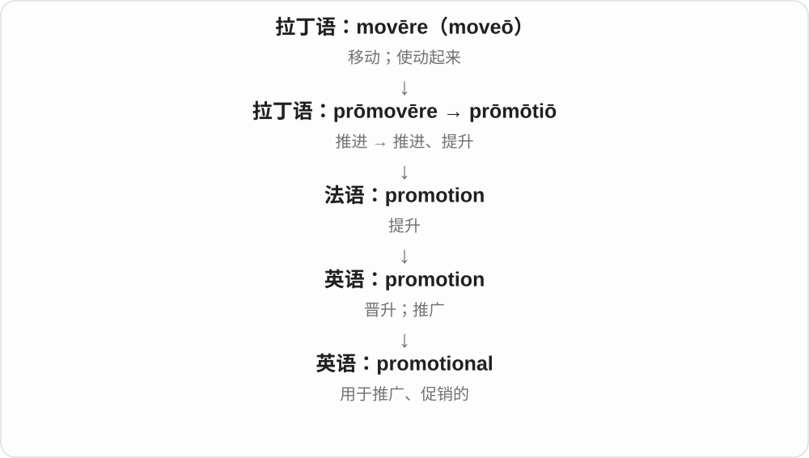

常修饰视频、材料、活动、价格。它说明用途，不自动说明里面每项内容都是客观评价。

**常见搭配与例句**

promotional material；a promotional video；a promotional offer。

> They released a promotional video for the exhibition.

他们发布了展览宣传视频。

> The shop offered a promotional price for the first week.

商店在第一周提供促销价。

**别混淆**

promotional 说宣传用途；informative 说信息有帮助，两者可以同时成立。

### 112. behavioral — 行为方面的〔常见美式拼写〕

**音标**：美 /bɪˈheɪvjərəl/；英 /bɪˈheɪvjərəl/

**先抓住这个画面**

把关注点放在行动和反应上。

**怎么拆**

behavior＋-al，英语形容词派生，表示与行为有关。

**怎么变成今天的意思**

**中古英语 behaven；aver／havour**  
行事；后者经古法语 aveir，词形受 have 影响

↓

**中古英语后期 behaviour／behavior**  
行为名词，结尾受 havour 影响

↓

**英语 behaviour／behavior**  
同一词的常见英式／美式拼写

↓

**behavior ＋ -al → behavioral**  
与行为或反应有关的

behavioral change 是行为变了，例如从总拖到最后才动手，变成提前完成。这个形容词只告诉你变化属于哪一方面，不自带“有问题”或“需要治疗”的判断。

**常见搭配与例句**

behavioral change；behavioral patterns；behavioral research；behavioral economics。

> The study compared behavioral patterns across age groups.

这项研究比较了不同年龄组的行为模式。

> A reminder on the screen led to a small behavioral change.

屏幕上的提醒带来了一点行为上的改变。

**别混淆**

behavioral 关注表现出的行为；emotional 关注情绪。二者会互相影响，但不是同义词。

### 113. fictional — 虚构故事中的；小说式的、虚构的

**音标**：/ˈfɪkʃənəl/

**先抓住这个画面**

人物和地点属于作者创造的世界；即使取材于现实，也没有承诺每个细节都能在真实世界找到一模一样的对应物。

**怎么拆**

英语 fiction + -al，形成与虚构文学、故事有关的形容词。比早已有的 fictitious 更明确地与 fiction 这一类别相配。

**怎么变成今天的意思**

**拉丁 fingere，分词 fictus**  
塑造、制成；也指编造、假装

↓

**拉丁 fictio／fictionem → 古法语 ficcion；另有直接拉丁借入**  
塑造、编造出的东西

↓

**中古英语 ficcioun → 英语 fiction**  
想象创作；小说、虚构故事；捏造

↓

**英语 fiction + -al → fictional**  
属于虚构故事或小说的

a fictional character 是虚构人物；a fictional town 是作者设置的小镇。fictional 可以很中性，告诉读者作品性质，而不是指责作者作假。

**常见搭配与例句**

a fictional character；a fictional world；a fictional account；a fictional setting。

> The novel takes place in a fictional town near the sea.

小说发生在一座虚构的海滨小镇。

> The detective is fictional, but many of the locations are real.

侦探是虚构人物，但许多地点是真实的。

**别混淆**

fictional 常谈故事中的虚构；fictitious 更常强调名字、资料、说法并不存在或是编造的。两者有重叠，不能只按“虚构”两个字机械替换。

### 114. governmental — 政府的；与政府或治理有关的

**音标**：英 /ˌɡʌvnˈmentl/；美 /ˌɡʌvərnˈmentl/

**先抓住这个画面**

把 government 变成一个性质词：这项机构、责任或措施是否属于政府这一边。

**怎么拆**

英语 government + -al。government 本身从法语名词借入；governmental 才是在英语里以该名词为基础形成的形容词。

**怎么变成今天的意思**

**古法语 governement → 英语 government**  
治理；政府

↓

**英语 government + -al → governmental**  
政府的、涉及政府的

governmental agencies 就是政府机构；governmental responsibility 是政府承担的职责。government 直接放在另一个名词前也很常见，所以 government policy 往往比 governmental policy 更日常，并非必须每处都加 -al。

**常见搭配与例句**

governmental bodies；governmental authority；governmental action；governmental responsibility。

> The report was sent to several governmental agencies.

报告被送交了几个政府机构。

> The debate focused on governmental responsibility for public transport.

辩论聚焦于政府在公共交通方面承担的责任。

**别混淆**

governmental 是政府相关，gubernatorial 则通常专指美国州长职务相关。一个总统政策是 governmental，并不因此是 gubernatorial。

### 115. spiral — 螺旋；螺旋形的；盘旋；不断加剧

**音标**：英 /ˈspaɪrəl/；美 /ˈspaɪrəl/

**先抓住这个画面**

绕着中心一圈圈转，同时向外扩开或向前推进，就是 spiral。事情也可能一圈带动下一圈，越走越失控，形成恶性循环的比喻。

**怎么拆**

经法语 spiral、拉丁 spiralis 螺旋形的，来自 spira 盘卷、希腊 speira 盘绕之物；-al 对应拉丁 -alis 形容词材料。它与 spir- 呼吸词根有不同来源。

**怎么变成今天的意思**

**希腊 speira 盘卷 → 拉丁 spira、spiralis → spiral 形容词**  
盘成一圈圈的形态提供名称

↓

**螺旋名词、盘旋动词与恶化的比喻**  
现代不仅说形状，也说费用、局势不断升级

a spiral staircase 是螺旋楼梯；draw a spiral 是画螺线；spiral out of control 是越来越失控。

**常见搭配与例句**

a spiral staircase；draw a spiral；spiral out of control。

> Draw a spiral from the centre of the page.

从纸页中心画出一条螺线。

> The costs began to spiral out of control.

费用开始不断增加，逐渐失控。

**别混淆**

a circle 是一个闭合圆圈，a spiral 一圈圈延展。a spiral of rising costs 常强调各因素互相推动，使成本不断上升。

### 116. spiraling — 盘旋的；不断上涨、恶化的〔常见美式拼写〕

**音标**：英、美 /ˈspaɪrəlɪŋ/

**先抓住这个画面**

事情绕着原来的问题一层层扩大，最后难以收住，可以说 spiraling。实际在空中打转、盘旋的动作也可以用它。

**怎么拆**

spiral + 完整 -ing → spiraling，美式通常保留一个 l；英式常写 spiralling。这个区别不改变词根、意思或发音。

**怎么变成今天的意思**

**希腊 speira、拉丁 spira 盘卷 → spiral**  
英语名词、形容词、动词围绕螺旋形态发展

↓

**spiral + -ing → spiraling**  
现代美式常用单 l，形状动作与局势加剧都能表达

spiraling prices 是不断上涨的价格；spiraling down 是盘旋而下；spiraling out of control 是越来越失控。

**常见搭配与例句**

spiraling prices；spiraling down；spiraling out of control。

> The leaves were spiraling down from the tree.

树叶从树上盘旋着落下。

> They were worried about spiraling prices.

他们担心价格不断上涨。

**别混淆**

spiraling 强调持续盘旋、扩大或恶化；spiral 单独可以是螺旋名词，也可以是基础动词。两种拼写 spiraling、spiralling 放在一起学习即可。

### 117. spiralling — 盘旋的；不断上涨、加剧的〔常见英式拼写〕

**音标**：英、美 /ˈspaɪrəlɪŋ/

**先抓住这个画面**

一圈接着一圈转下去，是 spiralling 的形状画面。谈费用时，它常说数字越涨越快，让人担心难以控制。

**怎么拆**

spiral + 完整 -ing → spiralling，常见英式拼写双写 l；美式通常 spiraling。spiral 的拉丁 spira 盘卷与 -alis 材料在更早阶段形成，现代直接在整个动词后变化。

**怎么变成今天的意思**

**希腊、拉丁盘卷词族 → spiral**  
螺旋形态、盘旋动作与不断加剧的比喻并存

↓

**spiral + -ing → spiralling**  
英式双 l 是拼写习惯，不因为这个词末音节一定重读

spiralling costs 是不断上涨的费用；spiralling upwards 是盘旋向上；spiralling out of control 是越来越失控。

**常见搭配与例句**

spiralling costs；spiralling upwards；spiralling out of control。

> Spiralling costs forced the team to revise the plan.

不断上涨的费用迫使团队修改计划。

> The paper strip was spiralling down through the air.

纸条在空中盘旋着落下。

**别混淆**

spiralling costs 比单说 rising costs 更容易带不断加速、互相推动或难以控制的感觉。spiralling 与 spiraling 是同词同形式的拼写变体。

### 118. graphical — 图形的；图示的；使用图形界面的

**音标**：/ˈɡræfɪkəl/

**先抓住这个画面**

原来要输入一串命令，现在可以点图标、拖窗口；graphical 把信息或操作变成看得见的图形。

**怎么拆**

与 graphic 同属希腊、拉丁 graphic- 词干在英语中的形容词系列；现代可拆 graphic + -al。

**怎么变成今天的意思**

**希腊 graphein／graphē**  
刻画、写；文字、图画

↓

**希腊 graphikos → 拉丁 graphicus**  
写画的；描绘生动的

↓

**英语 graphic／graphical 等词形**  
形象的；图形、图像方面的

↓

**英语 graphic／graphical 形容词系列**  
以图形表现或操作的

graphical user interface 通常缩写 GUI；graphical representation 是图形表示。这里并不是“画得漂亮”，简单方框和线条也可以 graphical。

**常见搭配与例句**

a graphical interface；a graphical representation；graphical tools。

> The program offers a graphical interface for arranging the steps.

程序提供图形界面来安排步骤。

> A graphical representation made the trend easier to see.

图形表示让趋势更容易看清。

**别混淆**

graphic 和 graphical 有重叠；形容内容血腥、露骨时通常用 graphic，谈界面时常用 graphical。

### 119. geographical — 地理的；与位置、区域分布有关的

**音标**：/ˌdʒiːəˈɡræfɪkəl/

**先抓住这个画面**

同一件事放到不同地方，距离、地形、位置会带来不同条件；geographical 让人注意这个空间角度。

**怎么拆**

接晚期拉丁 geographicus，再配英语 -al；该拉丁形容词来自希腊 geōgraphikos。现代可对照 geography + -ical，但历史中有独立形容词来源。

**怎么变成今天的意思**

**希腊 graphein／graphē**  
刻画、写；文字、图画

↓

**希腊 geōgraphia → geōgraphikos → 晚期拉丁 geographicus**  
地理描述 → 地理方面的

↓

**英语结合 -al → geographical**  
地理的

geographical location 是地理位置；geographical distribution 是某物在各地如何分布。不是只在地理课本里才用，商业、生态、文化研究都常见。

**常见搭配与例句**

geographical location；geographical distribution；geographical distance。

> The study compares the geographical distribution of the two species.

研究比较了两种物种的地理分布。

> Geographical distance made regular visits difficult.

地理距离使定期探访变得困难。

**别混淆**

geographic 与 geographical 通常意思相同，差别多在固定搭配或文体习惯，不必硬分为不同学科意义。

### 120. renewal — 续期；续订；更新；重新焕发活力

**音标**：英 /rɪˈnjuːəl/；美 /rɪˈnuːəl/

**先抓住这个画面**

从快到期、陈旧或低落，走到还能继续、重新有劲的那个过程。

**怎么拆**

英语 renew + 名词后缀 -al。这里 -al 造名词，不能一见这个后缀就断定是形容词。

**怎么变成今天的意思**

**拉丁来源 re-；中古英语 newen 使更新**  
外来前缀与日耳曼本族动词组合

↓

**中古英语 renewen → 英语 renew**  
使恢复新鲜、继续有效；可能受拉丁 renovare 类推影响

↓

**英语 renew + -al → renewal**  
使重新有效或恢复活力的过程

subscription renewal 是续订，a renewal notice 是续费提醒；urban renewal 是城市更新。更新可能涉及整修和改建，不单是把期限往后移。

**常见搭配与例句**

membership renewal；a renewal fee；urban renewal；a sense of renewal。

> The membership renewal notice arrived by email.

会员续期通知通过电子邮件发来了。

> The town’s renewal plan includes repairing old public buildings.

小镇的更新计划包括修缮旧公共建筑。

**别混淆**

renewal 是更新过程，renewable 是能够更新或再生的形容词；两者在句子里的位置不同。

### 121. organizational — 组织方面的；机构的；组织安排能力的

**音标**：英 /ˌɔːɡənaɪˈzeɪʃənəl/；美 /ˌɔːrɡənəˈzeɪʃənəl/

**先抓住这个画面**

问题不一定出在某个人，而可能出在分工、流程和部门之间怎么连接。

**怎么拆**

organization + -al，表示与组织或组织工作有关。

**怎么变成今天的意思**

**希腊 organon → 拉丁 organum → organizare**  
工具、器官 → 使各部分形成整体

↓

**英语 organization + -al → organizational**  
组织、安排 → 组织方面的

organizational structure 是机构结构，organizational change 是组织层面的变化；organizational skills 则是安排时间、人员和事务的能力，不专指创办机构。

**常见搭配与例句**

organizational structure；organizational culture；organizational change；organizational skills。

> The company announced major organizational changes.

公司宣布了重大的组织调整。

> The role requires strong organizational skills.

这个职位要求很强的组织安排能力。

**别混淆**

organized 是已经安排得有条理；organizational 是属于组织或安排这一方面。一个 organizational problem 恰好可能是缺乏条理。

### 122. accidental — 意外的；非故意的；偶然的；临时变音记号

**音标**：/ˌæksɪˈdentəl/

**先抓住这个画面**

结果出现了，但它并不是原先安排或有意做出的，用 accidental。

**怎么拆**

历史上经法语进入英语，背后是晚期拉丁语 accidentālis；现代可对应 accident + -al，不能因此把整个历史说成英语里才加尾巴。

**怎么变成今天的意思**

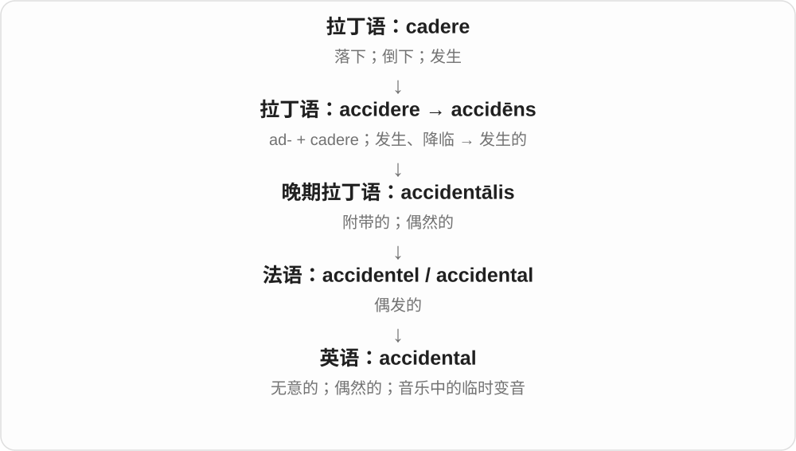

accidental damage 是意外造成的损坏，不是损坏很小。在音乐里，an accidental 指临时升降某个音的记号；这里谈的是调号之外的局部变化。

**常见搭配与例句**

accidental damage；an accidental discovery；an accidental meeting；a sharp accidental。

> The discovery was accidental, but the team recognized its value.

这一发现出于偶然，但团队意识到了它的价值。

> The score includes an accidental before the final note.

乐谱在最后一个音前标了一个临时变音记号。

**别混淆**

accidental 关注是否意外；incidental 关注是不是主要事情之外的附带部分。附带结果可能早就预料到了。

### 123. vagina — 阴道

**音标**：/vəˈdʒaɪnə/

**先抓住这个画面**

先明确它指一个具体内部通道：从外部阴道口通向宫颈的肌性管道。名称借了拉丁语鞘、套状覆盖物的旧词。

**怎么拆**

作为解剖学名称借自医学拉丁语，对拉丁 vagina 鞘、剑鞘、覆盖物作专门使用。古典拉丁该词并非已经以这个解剖义使用；更远词源不定。

**怎么变成今天的意思**

**古典拉丁 vagina**  
鞘、套、覆盖物等

↓

**医学拉丁专门化 → 英语 vagina**  
解剖学中的阴道名称

the wall of the vagina 阴道壁；the opening of the vagina 阴道口；an anatomy diagram of the vagina 阴道解剖示意图。作为名词指部位本身。

**常见搭配与例句**

vagina → vaginal；the vagina and cervix。

> The textbook includes a diagram of the vagina and cervix.

教材中有阴道和宫颈的示意图。

> The anatomy lesson explained the structure of the vagina.

解剖课讲解了阴道的结构。

**别混淆**

vagina 指内部管道，vulva 指外阴，cervix 指宫颈。学部位名时把位置分清，比笼统都译成生殖器更容易读懂说明。

### 124. vaginal — 阴道的；经阴道的

**音标**：英常 /vəˈdʒaɪnəl/；美也常 /ˈvædʒənəl/

**先抓住这个画面**

vagina 是部位本身；vaginal 把这个部位接到后面的名词上，说明组织、通道或过程与它有关。

**怎么拆**

历史借自新拉丁 vaginalis，源于 vagina 鞘、阴道 + 形容词 -alis；现代构词对应 vagin- + -al。较早可说鞘状结构相关，后来有现代常见解剖专门义。

**怎么变成今天的意思**

**拉丁 vagina → 新拉丁 vaginalis**  
鞘、阴道及相应形容词

↓

**英语 vaginal**  
与阴道有关、通过阴道的

vaginal tissue 阴道组织；the vaginal wall 阴道壁；vaginal birth 经阴道分娩。-al 在这里表示与某部位相关，具体关系由后面的名词决定。

**常见搭配与例句**

vaginal anatomy；vaginal delivery。

> The diagram labels the vaginal wall.

示意图标出了阴道壁。

> The chapter explains the term vaginal birth.

这一章解释经阴道分娩这个术语。

**别混淆**

英美常见读音的重音、元音有差别；看到 vaginal 仍按同一个关系形容词理解。vagina 是名词，vaginal 用来限定后面的名词。

### 125. developmental — 与发展、发育过程有关的

**音标**：/dɪˌveləpˈmentəl/

**先抓住这个画面**

看一个人或事物怎样经过不同阶段长起来、形成起来，重点在变化的过程。

**怎么拆**

development + -al，-al 表与……有关，重音落在 -mental 中的 men。不是单独把 mental 心理的加到 develop 后面。

**怎么变成今天的意思**

**古法语 desveloper → 法语 développer**  
解开包裹、展开

↓

**英语 develop；对应名词 development**  
逐渐形成、发展；发展的过程和结果

↓

**development + -al → developmental**  
发展过程 → 与发展阶段有关的

developmental stages 发展阶段，developmental psychology 发展心理学；developmental work 也可说产品等处于探索、形成过程的工作。

**常见搭配与例句**

developmental stages；developmental psychology；developmental changes。

> The book explains several developmental stages in early childhood.

这本书解释了幼儿时期的几个发展阶段。

> The project is still in a developmental phase.

项目仍处于探索成形的阶段。

**别混淆**

developmental 不等于 developed 已发展成熟的，也不自动表示生病；它首先说明与成长、形成过程有关。

### 126. neural — 神经的；神经系统的

**音标**：英 /ˈnjʊərəl/；美 /ˈnʊrəl/

**先抓住这个画面**

说明某个结构或过程属于身体的信息传递系统。

**怎么拆**

取希腊 neuron“神经”的词干 neur-，加 -al。英语 neural 的记录早于 neuron“神经元”这一现代细胞名，不能一概说先有英语 neuron 再去 -on。

**怎么变成今天的意思**

**希腊 neuron / neûron**  
筋、腱、弦；也指神经

↓

**近代英语 neur- + -al → neural**  
与神经、神经系统有关的

neural activity 是神经活动，neural pathways 是信号所经过的神经通路。AI 里的 neural network 借用了互相连接的处理单元这一思路，实际是计算模型，并不是把生物脑细胞装进电脑。

**常见搭配与例句**

neural activity；neural pathways；a neural network。

> The researchers recorded neural activity while volunteers listened to music.

研究人员记录了志愿者听音乐时的神经活动。

> The team trained a neural network to recognize handwritten numbers.

团队训练了一个识别手写数字的神经网络。

**别混淆**

neural 是中性的神经相关；nervous 在日常又常指紧张的。不能用 neural 来说“我面试前很紧张”。

### 127. phenomenal — 惊人的；非凡的；现象的

**音标**：英 /fəˈnɒmɪnəl/；美 /fəˈnɑːmɪnəl/

**先抓住这个画面**

强得、快得或好得让人忍不住把它当成特别的现象来看。

**怎么拆**

phenomenon 换成 -al 形容词形式，造词受到法语 phénoménal 影响；不是从意思“名声”的 fame 来。

**怎么变成今天的意思**

**希腊 phaínein／phaínesthai**  
使显现、显现出来；与光亮有关

↓

**希腊 phainómenon → 后期拉丁 phaenomenon**  
显现出来的事物

↓

**英语 phenomenon**  
可观察或认识到的现象；非凡的人或事

↓

**英语 phenomenon + -al〔受法语形容词影响〕**  
属于现象的 → 非同寻常、令人惊叹的

phenomenal growth 通常说增长幅度惊人，不只是“有增长现象”。哲学中的 phenomenal world 则保留“向经验呈现的世界”这一专门含义，不能译成极好的世界。

**常见搭配与例句**

phenomenal success；phenomenal growth；a phenomenal memory。

> Her memory for names is phenomenal.

她记人名的能力惊人。

> The company experienced phenomenal growth in its first year.

公司在第一年就实现了惊人的增长。

**别混淆**

excellent 是很优秀；phenomenal 往往更强，暗示远超一般水平。学术语境中的“现象的”不含称赞。

### 128. spatial — 空间的；位置、形状与距离关系的

**音标**：英、美 /ˈspeɪʃəl/

**先抓住这个画面**

不只问东西是什么，还问它在哪里、朝哪个方向、彼此隔多远。

**怎么拆**

英语采用拉丁语 spatium 的 spati- 加 -al，形成与 space 对应的形容词；不是 spacious 的缩写。

**怎么变成今天的意思**

**拉丁语 spatium**  
空间、范围、距离；也指一段时间，远源尚有不同解释

↓

**英语以拉丁语 spati- + -al 形成 spatial**  
与空间、空间安排有关的；与 temporal 对应

spatial awareness 是对周围位置和距离的把握；spatial arrangement 是空间布局。它通常不专指太空。

**常见搭配与例句**

spatial awareness；spatial relationships；spatial reasoning。

> The puzzle tests your spatial reasoning.

这个谜题考查你的空间推理能力。

> The study examines the spatial distribution of shops.

这项研究考察商店的空间分布。

**别混淆**

spacious 是宽敞的；spatial 只是空间相关，不说明地方大不大。

### 129. betray — 背叛、出卖；泄露；无意显露

**音标**：/bɪˈtreɪ/

**先抓住这个画面**

别人信你会守住，你却把秘密、利益交出去，是 betray；声音藏不住紧张，也能 betray your fear，不一定真在背叛谁。

**怎么拆**

be- 加旧 tray 出卖材料，后者接法语、拉丁交付的词族。现代显露、泄露义还受近形旧词 bewray 影响，不由一个现代托盘 tray 推出。

**怎么变成今天的意思**

**中古英语 be- + tray 等出卖材料 → betray**  
旧 tray 接法语 trahir 等，再接拉丁交付材料

↓

**现代 betray 的信任与显露用法**  
背叛、泄密；显露义还受近形 bewray 影响

betray a friend 背叛朋友；betray trust 辜负信任；betray a secret 泄密；betray fear 无意露出害怕。

**常见搭配与例句**

betray trust；betray a secret；betray fear。

> He refused to betray his friend’s trust.

他不愿辜负朋友的信任。

> Her voice betrayed her nervousness.

她的声音露出了紧张。

**别混淆**

betray a feeling 可只是显露情绪；不能每个 betray 都译成政治叛变或有意恶行。

### 130. betrayed — 背叛了；辜负了；泄露、显露了〔过去形式〕

**音标**：英、美 /bɪˈtreɪd/

**先抓住这个画面**

把别人托付的秘密、信任交给不该得到的人，是背叛；紧张时声音发抖，声音又会把心情“交出去”，无意显露出来。

**怎么拆**

betray + -ed → betrayed，-ed 读 /d/，y 不变。betray 含 be- 与旧英语 tray，后者接古法语背叛、欺骗的词族，远连拉丁 tradere 交付。

**怎么变成今天的意思**

**拉丁 tradere 交付 → 法语 trair、traine 等背叛材料**  
交到敌手、出卖信任的词义发展

↓

**中古英语 be- + tray → betray → betrayed**  
后来还有无意显露性情、情绪等用法

betrayed a friend 是背叛朋友；betrayed someone’s trust 是辜负信任；her voice betrayed fear 是声音显露出恐惧。

**常见搭配与例句**

betrayed a friend；betrayed his trust；betrayed her feelings。

> He felt that his friend had betrayed his trust.

他觉得朋友辜负了他的信任。

> Her trembling voice betrayed her nervousness.

她颤抖的声音暴露了紧张。

**别混淆**

betrayed feelings 不一定是故意泄密。声音、表情作主语时，常是在说情绪藏不住，自己露出来了。

### 131. betrayal — 背叛、出卖；辜负信任的行为

**音标**：/bɪˈtreɪəl/

**先抓住这个画面**

原本托付给你的东西，被你反着对待，别人感到的不只是失败，而是信任被伤害，这就是 betrayal 的重心。

**怎么拆**

betray + -al → betrayal，保留 y。-al 在这里把行为、结果命名成名词，不形成与托盘有关的性质。

**怎么变成今天的意思**

**中古英语 be- + tray 等出卖材料 → betray**  
旧 tray 接法语 trahir 等，再接拉丁交付材料

↓

**现代 betray 的信任与显露用法**  
背叛、泄密；显露义还受近形 bewray 影响

↓

**betray + -al → betrayal**  
背叛行为；信任被辜负的结果

a betrayal of trust 辜负信任；a sense of betrayal 被背叛的感觉；an act of betrayal 一次背叛行为。

**常见搭配与例句**

a betrayal of trust；a sense of betrayal。

> Publishing the private letter felt like a betrayal.

公开私人信件让人感到像是背叛。

> The novel centres on a betrayal of trust.

小说围绕一次信任被辜负的事件展开。

**别混淆**

betrayal 比普通 disappointment 失望多信任、忠诚遭破坏的成分；不只是任何没达到预期。

### 132. inspirational — 有激励作用的；旨在鼓舞人的

**音标**：/ˌɪnspəˈreɪʃənəl/

**先抓住这个画面**

不仅陈述事实，还希望听者相信自己能做点什么。

**怎么拆**

inspiration + -al，名词转成性质形容词。

**怎么变成今天的意思**

**拉丁语 spirare**  
吹气、呼吸；更远词源未定

↓

**拉丁语 inspirare → 晚期拉丁语 inspiratio**  
吹入、激发 → 启示、感发

↓

**古法语 inspiracion → 英语 inspiration**  
启示、灵感；另保留吸气义

↓

**英语 inspiration + -al → inspirational**  
鼓舞、启发 → 有此作用的

inspirational writing 或 speeches 常以鼓励读者、观众为目的。它可以真让人振奋，也可能只是作品类型的名称，效果仍由具体内容决定。

**常见搭配与例句**

an inspirational speaker；an inspirational message。

> The coach ended with an inspirational message.

教练最后说了一段鼓舞人心的话。

> The library displayed inspirational biographies for young readers.

图书馆为年轻读者展示了一批励志传记。

**别混淆**

inspiring 常直接评价带来的感受；inspirational 也常说作品或讲话的鼓舞性质与用途。

### 133. cereal — 谷类作物、谷物；早餐谷物食品

**音标**：英 /ˈsɪəriəl/；美 /ˈsɪriəl/

**先抓住这个画面**

麦、稻、燕麦等为人提供可食谷粒，属于 cereal crops；早餐碗里的加工谷物食品也常直接叫 cereal。

**怎么拆**

借法语 céréale，上接拉丁 Cerealis 与农业女神 Ceres 有关的，再用于谷物。不是 cerebral 脑的缩略，也不从英语 serial 连续的借义。

**怎么变成今天的意思**

**罗马农业女神 Ceres → 拉丁 Cerealis**  
与农业、谷物有关的性质

↓

**法语 céréale → cereal**  
谷类作物、谷粒；后来早餐谷物食品

cereal crops 谷类作物；breakfast cereal 早餐谷物食品；a bowl of cereal 一碗早餐麦片等。

**常见搭配与例句**

cereal crops；breakfast cereal；a bowl of cereal。

> She had a bowl of cereal for breakfast.

她早餐吃了一碗谷物食品。

> Wheat is an important cereal crop.

小麦是一种重要谷类作物。

**别混淆**

cereal 谷物与 serial 连续的常同音；cerebral 脑的又是近形异源词，不能用一种词根讲三者。

### 134. cereals — 谷类作物、谷物种类；早餐谷物食品〔复数〕

**音标**：英 /ˈsɪəriəlz/；美 /ˈsɪriəlz/

**先抓住这个画面**

几种提供谷粒的作物，或几种做早餐吃的谷物食品，可以叫 cereals。它既有农作物方向，也有餐桌上的成品方向。

**怎么拆**

cereal 经法语 cereale、céréale 接拉丁 Cerealis，与农业女神 Ceres 的名称相关，再用到谷类。现代名词加 -s，/l/ 后读 /z/。

**怎么变成今天的意思**

**罗马女神名 Ceres → 拉丁 Cerealis → 法语、英语 cereal**  
与农业、谷物有关的 → 谷类作物、食品

↓

**cereal + -s → cereals**  
不同谷类或早餐谷物种类

breakfast cereals 早餐谷物；different cereals 不同谷类、谷物食品；cereals grown on farms 农场种的谷类作物。

**常见搭配与例句**

boxes of cereals 几盒不同早餐谷物；cereals in the cupboard 橱柜里的谷物食品。

> The shop sells several breakfast cereals.

商店卖几种早餐谷物食品。

> The chapter introduces cereals grown in different regions.

这一章介绍了不同地区种植的谷类作物。

**别混淆**

a bowl of cereal 常不可数地说一碗早餐谷物；cereals 复数常在比较不同种类，不是把每一颗谷粒都叫一个 cereal。

### 135. bacterial — 细菌的；细菌引起的

**音标**：英 /bækˈtɪəriəl/；美 /bækˈtɪriəl/

**先抓住这个画面**

把某种生长、活动或感染归到细菌这一类。

**怎么拆**

英语 bacteria + -al，形成形容词。bacteri- 是能看见的词干，末尾 -al 只表示有关性质，不自行表示“杀死”。

**怎么变成今天的意思**

**古希腊语 baktērion**  
小杆、小棍，与 baktron / baktēria 杖、棍相关

↓

**19 世纪科学拉丁 bacterium；复数 bacteria**  
借杆状外形给微生物命名

↓

**英语 bacterium / bacteria**  
细菌的单数与复数；现代范围不限杆状

↓

**英语 bacteria + -al → bacterial**  
与细菌有关或由细菌引起的

bacterial growth 是细菌的生长，bacterial infection 是细菌造成的感染。这个词本身既不说明细菌是否有害，也不说明该怎样治疗，只负责指出对象或原因属于细菌。

**常见搭配与例句**

bacterial growth；a bacterial infection；bacterial cells；bacterial activity。

> The researchers measured bacterial growth at different temperatures.

研究人员测量了不同温度下细菌的生长情况。

> The report distinguishes bacterial infections from viral infections.

报告区分了细菌感染与病毒感染。

**别混淆**

bacterial 是与细菌有关，antibacterial 才是抗细菌的。viral 表示病毒的，不能因为都是感染就互换。

### 136. dismissal — 解雇；解散；不予考虑；驳回

**音标**：/dɪsˈmɪsəl/

**先抓住这个画面**

dismissal 是 dismiss 这个“让其退出”的动作或结果：员工被解除职务、建议被轻轻带过，或案件被驳回。

**怎么拆**

dismiss + -al，是英语中的名词构词。

**怎么变成今天的意思**

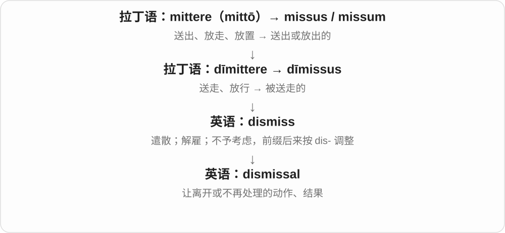

同一个名词跨多个场景，宾语决定是解雇人还是否定意见。正式案件里的 dismissal 具体效果取决于程序。

**常见搭配与例句**

dismissal from a job；the dismissal of a claim；summary dismissal。

> The employee appealed against her dismissal.

这名员工对解雇决定提出了申诉。

> His quick dismissal of the suggestion annoyed the team.

他很快就否定这个建议，让团队感到恼火。

**别混淆**

dismissal of an idea 是不予考虑；disagreement with an idea 只是不同意，可能仍认真讨论过。

### 137. marginal — 边缘的；很小的、勉强的；边际的〔专门义〕

**音标**：英 /ˈmɑːdʒɪnəl/；美 /ˈmɑːrdʒɪnəl/

**先抓住这个画面**

页边、群体边缘是位置；刚过一点线是程度；经济里的 marginal 则常问再增加一单位会多出什么。

**怎么拆**

借中世纪拉丁 marginālis，现代对应 margin + -al。不同义都与边缘、差额有关，但不能全译成不重要。

**怎么变成今天的意思**

**拉丁 margo/margin- → marginālis → marginal**  
边、边缘 → 边缘的、差距很小的

↓

**英语 marginal 的程度、专门用法**  
小幅、接近底线；经济中再增加一单位所带来的变化

marginal notes 页边注，a marginal improvement 小幅改善，marginal land 勉强适宜耕作的土地，marginal cost 边际成本。

**常见搭配与例句**

marginal notes；a marginal improvement；marginal land；marginal cost。

> The new design offers only a marginal improvement.

新设计只带来小幅改善。

> She added marginal notes beside the passage.

她在那段文字旁加了页边注。

**别混淆**

marginal cost 指增加一单位产出带来的额外成本，不是微不足道的成本；a marginal improvement 才通常说改善幅度小。

### 138. tidal — 潮汐的、受潮汐影响的

**音标**：/ˈtaɪdəl/

**先抓住这个画面**

海水的涨落会带动水位和水流变化；由这些变化形成、驱动、影响的东西，可以用 tidal 修饰。

**怎么拆**

通常按 tide + -al 理解，接关系形容词后缀。历史上也有中世纪拉丁语相关构词的分析；学习时先抓与潮汐有关。

**怎么变成今天的意思**

**古英语 tīd → 中古英语 tyde**  
时间、时节；与 time 有历史联系

↓

**按时往复的海水变化 → tide**  
潮汐；再比喻涌动的人群、趋势

↓

**tide + -al → tidal**  
潮汐相关的性质、运动、能量

a tidal river 受潮汐影响的河段，tidal currents 潮流，tidal energy 潮汐能。潮流与海面波浪并非一回事。

**常见搭配与例句**

tidal currents；tidal energy；a tidal river。

> The lower part of the river is tidal.

这条河的下游受潮汐影响。

> The model shows how tidal currents change direction.

模型展示潮流怎样改变方向。

**别混淆**

tidal wave 在日常表达中有时被拿来说海啸，但海啸通常不是潮汐造成。严谨区分时用 tsunami。

### 139. skeptical — 怀疑的；不轻信的

**音标**：/ˈskeptɪkl/

**先抓住这个画面**

听到了说法，但心里还没有点头。

**怎么拆**

skeptic + -al；英式常写 sceptical。早期 skeptic 本身也能作形容词。

**怎么变成今天的意思**

**希腊 skeptesthai → skeptikos**  
观察、审视 → 探究的；用于古代怀疑学派

↓

**拉丁 scepticus；法语 sceptique → 英语 skeptic / sceptic**  
怀疑学派成员 → 持怀疑态度的人

↓

**英语 skeptic + -al → skeptical**  
怀疑者、怀疑的 → 持怀疑态度的

be skeptical about a claim 是对主张存疑；a skeptical look 是不太相信的神情。可以之后被证据说服，不必理解成永远反对。

**常见搭配与例句**

skeptical about；skeptical of；a skeptical audience。

> She was skeptical about the promise of instant results.

她对立刻见效的承诺持怀疑态度。

> The demonstration won over a skeptical audience.

演示说服了原本存疑的观众。

**别混淆**

suspicious 常带觉得有隐情或不正当之处；skeptical 可以仅仅觉得证据还不足。

### 140. theatrical — 戏剧的、舞台的；夸张做作的

**音标**：英 /θiˈætrɪkəl/；美 /θiˈætrɪkəl/

**先抓住这个画面**

动作和表情像是特地放大给观众看的。

**怎么拆**

可辨认 theatre + -ical；历史词形也接拉丁 theatricus 与 -al，核心是与剧场有关。

**怎么变成今天的意思**

**希腊 thea／theaomai → theatron**  
观看 → 供人观看的地方

↓

**拉丁 theatrum → 古法语 theatre → 英语 theatre／theater**  
剧场 → 看演出的场所及戏剧艺术

↓

**拉丁 theatricus／英语 theatre + -ical → theatrical**  
剧场的 → 舞台的；像在演戏的

a theatrical production 只是舞台作品，没有贬义。a theatrical sigh 则是长长叹一口气，像故意让全屋人注意到自己的情绪。是否贬义要看语境，不能把所有 theatrical 都翻成装腔作势。

**常见搭配与例句**

a theatrical performance；a theatrical gesture；a theatrical release。

> She has extensive experience in theatrical production.

她有丰富的舞台制作经验。

> He gave a theatrical sigh and dropped into the chair.

他夸张地叹了口气，一屁股坐进椅子里。

**别混淆**

dramatic 可以说变化显著，也可以说戏剧性的；theatrical 更容易让人想到舞台表现、刻意展示。theatrical release 在电影业指院线上映。

### 141. rehearse — 排练、预演；反复练习、复述

**音标**：英 /rɪˈhɜːs/；美 /rɪˈhɜːrs/

**先抓住这个画面**

正式上场前，把要说、要做的内容一遍遍走过。像土地再耙一遍，熟悉的路线再过一次，就是这个词的老画面。

**怎么拆**

借法语相关形式：re- 再 + hercier 耙地、反复经过，后者接 herse 耙。不是 re- + hear 听，虽然排练常要听声音。

**怎么变成今天的意思**

**古法语 re- 再 + hercier 耙地、反复经过 → rehercier**  
再耙一遍土地的画面，已有重复、复述用途

↓

**法语相关形式 → 中古英语 rehearse**  
先有重讲、复述等义，后来发展为演出前练习

rehearse a play 排练戏剧，rehearse a speech 预练讲话；不局限于舞台音乐。

**常见搭配与例句**

rehearse the scene 排练这一场；rehearse for the concert 为音乐会排练。

> We need to rehearse the final scene again.

我们需要再排一次最后一场。

> I rehearse the opening of my speech at home.

我在家预练讲话的开头。

**别混淆**

practise 范围更广，rehearse 常为具体演出、讲话、行动先完整或分段走一遍。

### 142. rehearsal — 排练、预演；一次排练

**音标**：英 /rɪˈhɜːsəl/；美 /rɪˈhɜːrsəl/

**先抓住这个画面**

把准备上场的内容先做一遍，这项活动、这一次练习叫 rehearsal。星期三的那一场排练，就能说 a rehearsal。

**怎么拆**

现代对应 rehearse 去 e 加完整 -al，这里的 -al 形成动作名词；历史也有借古法语相应名词的分析，不是所有 -al 都作形容词。

**怎么变成今天的意思**

**古法语 re- 再 + hercier 耙地、反复经过 → rehercier**  
再耙一遍土地的画面，已有重复、复述用途

↓

**法语相关形式 → 中古英语 rehearse**  
先有重讲、复述等义，后来发展为演出前练习

↓

**rehearse + 名词后缀 -al；也有法语名词来源分析**  
重复、复述的活动，后用于演出前的排练

in rehearsal 是正在排练阶段；a dress rehearsal 常指按正式演出要求进行的彩排。

**常见搭配与例句**

a final rehearsal 最后一次排练；rehearsal time 排练时间。

> The rehearsal starts at six.

排练六点开始。

> The play is still in rehearsal.

这部戏仍在排练阶段。

**别混淆**

rehearse 是做排练的动作，rehearsal 是活动名称；rehearsal 里的 hear 字母不说明来自 hear 听。

### 143. rehearsals — 排练、预演〔复数〕

**音标**：英 /rɪˈhɜːsəlz/；美 /rɪˈhɜːrsəlz/

**先抓住这个画面**

一次排练是 a rehearsal，几次排练就是 rehearsals。它把一段准备工作分成一次次具体活动来数。

**怎么拆**

rehearsal + -s，末尾读 /z/；名词 -al 在复数前保留，不回到动词 rehearse 去变化。

**怎么变成今天的意思**

**古法语 re- 再 + hercier 耙地、反复经过 → rehercier**  
再耙一遍土地的画面，已有重复、复述用途

↓

**法语相关形式 → 中古英语 rehearse**  
先有重讲、复述等义，后来发展为演出前练习

↓

**rehearse + 名词后缀 -al；也有法语名词来源分析**  
重复、复述的活动，后用于演出前的排练

↓

**rehearsal + -s → rehearsals**  
多次排练活动

weekly rehearsals 每周的排练，several rehearsals 几次排练；都以活动次数为关注点。

**常见搭配与例句**

attend rehearsals 参加排练；cancel rehearsals 取消排练。

> We have three rehearsals before the concert.

音乐会前我们有三次排练。

> The evening rehearsals take place in the main hall.

晚间排练在大厅举行。

**别混淆**

rehearses 是动词说某人排练，rehearsals 是名词说几次排练；两者不能只按词尾都有 s 混用。

### 144. peripheral — 外围的；次要的；周边的；计算机外设

**音标**：/pəˈrɪfərəl/

**先抓住这个画面**

站在中心往外看，靠近边缘的部分；比喻时就是不在问题核心。

**怎么拆**

periphery 去掉 -y 加 -al；英语形容词后来又转用为名词，指外围设备。

**怎么变成今天的意思**

**希腊 perí／peri-**  
在周围、环绕；也可表示靠近

↓

**希腊 periphérein → periphéreia**  
带着绕行 → 外圈、圆周

↓

**拉丁 peripheria 与法语 périphérie 一系 → 英语 periphery**  
外围、边缘区域

↓

**英语 periphery + -al → peripheral**  
位于外围；与中心关系较远的

peripheral vision 是眼睛并未直视的两侧视野；a peripheral issue 是次要问题。计算机里的 a peripheral 是键盘、打印机等外围设备，不一定距离主机很远。

**常见搭配与例句**

peripheral vision；peripheral issues；a peripheral device；peripheral to the argument。

> She noticed movement in her peripheral vision before she turned her head.

她还没转头，就从侧方视野察觉到了动静。

> The discussion drifted into issues peripheral to the main question.

讨论转到了与核心问题关系不大的次要议题上。

**别混淆**

external 强调在外面；peripheral 强调相对于核心的位置或作用。外围问题可能仍发生在组织内部。

### 145. provisional — 暂定的；临时的；有待确认的

**音标**：/prəˈvɪʒənəl/

**先抓住这个画面**

provisional 像在计划上用铅笔先写一个答案：目前先这样，但还有可能改。

**怎么拆**

provision + -al，并有相关法语形式影响；在“预先安排”上形成暂定义。

**怎么变成今天的意思**

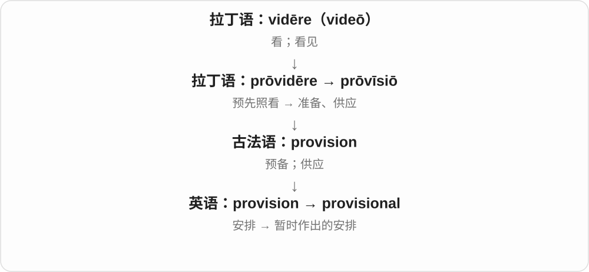

不是所有安排都永久有效，暂为应付当前需要而作的安排，就可以是 provisional。

**常见搭配与例句**

a provisional agreement；a provisional date；provisional results。

> We set a provisional date for the meeting.

我们给会议定了一个暂定日期。

> The results are provisional until all checks are complete.

全部核查完成前，结果仍是暂定的。

**别混淆**

temporary 主要表示时间有限；provisional 还常强调尚未最终确认。

### 146. artery — 动脉；交通干线、大通道〔比喻〕

**音标**：英 /ˈɑːtəri/；美 /ˈɑːrtəri/

**先抓住这个画面**

把血从心脏送出去的血管叫 artery。城市里承载大量交通的主干道，也像输送流量的大血管。

**怎么拆**

经法语及拉丁语 arteria，接希腊语 arteria 的气管、动脉等旧用法。英语现代主要保留动脉义，再扩展到主干输送通道。

**怎么变成今天的意思**

**希腊语 arteria → 拉丁语、法语 → 英语**  
较早身体管道名称进入英语

↓

**现代 artery 的解剖与通道比喻**  
动脉；交通、河流等主要通道

a major artery 一条大动脉，也可比喻重要干道；the coronary arteries 冠状动脉；traffic arteries 交通干线。复数 arteries。

**常见搭配与例句**

a main artery through the city；arteries and veins。

> The diagram shows an artery carrying blood away from the heart.

图解展示一条把血液从心脏送出的动脉。

> This road is a major artery through the city.

这条路是穿过城市的一条重要交通干道。

**别混淆**

artery 按血流从心脏流出的方向理解；vein 通常联系回流到心脏。交通比喻里的 artery 突出主干输送作用。

### 147. arterial — 动脉的；干线的、主干通道的

**音标**：英 /ɑːˈtɪəriəl/；美 /ɑːrˈtɪriəl/

**先抓住这个画面**

artery 叫动脉或主干道；arterial 把这层关系放到前面：arterial blood 是动脉血，arterial road 是交通干道。

**怎么拆**

历史有法语 arterial 等借入，与拉丁语 arteria 相连；现代可按 artery 的词干 arteri- 与 -al 认识其关系形容词结构。

**怎么变成今天的意思**

**arteria 词族与法语相关形容词 → 英语 arterial**  
动脉的、与动脉有关的

↓

**arterial 的交通比喻**  
承担主干输送作用的、干线的

arterial blood 动脉血；arterial pressure 动脉压力；an arterial road 一条主干道。常作名词前的修饰语。

**常见搭配与例句**

the arterial system；arterial traffic。

> The chart compares arterial and venous blood.

图表对比了动脉血和静脉血。

> The new arterial road connects the outer districts.

新建主干道把外围几个城区连接起来。

**别混淆**

artery 是名词，arterial 是形容词。主干道的比喻强调输送和分支关系，并不表示道路和血管结构完全一样。

### 148. numerical — 数值的；数字表示的；数量上的

**音标**：英 /njuːˈmerɪkəl/；美 /nuːˈmerɪkəl/

**先抓住这个画面**

把事情放到数值或数量上来比较、计算。

**怎么拆**

历史可按拉丁 numerus + -ical 分析，并可能受法语 numérique 影响。英语 numerical 的记录早于常见词典所列 numeric，因此现代 numeric + -al 的拆法不宜直接当作唯一历史路线。

**怎么变成今天的意思**

**拉丁 numerus**  
数；数量

↓

**英语以 numer- 配合 -ical；可能受法语 numérique 影响**  
与数有关的构词

↓

**英语 numerical**  
数值的；数量方面的

numerical order 是按数值排序；numerical superiority 是人数或数量占优；a numerical solution 用数值计算得到解，与纯符号公式不同。

**常见搭配与例句**

numerical order；numerical data；numerical superiority；a numerical solution。

> Arrange the files in numerical order.

按编号的数值顺序排列文件。

> The smaller team won despite its opponents’ numerical advantage.

人数较少的队伍战胜了人数占优的对手。

**别混淆**

numerous 表示很多；numerical 不表示多少，只限定在数值或数量这一方面。

### 149. vocational — 职业的；职业技能培训的

**音标**：英 /vəʊˈkeɪʃənəl/；美 /voʊˈkeɪʃənəl/

**先抓住这个画面**

学习内容直接面向“做某项工作需要会什么”：修车、烹饪、电工等课程，常叫 vocational training。

**怎么拆**

英语 vocation + -al，从职业、志业名词转成相关形容词；原来的宗教召唤色彩在职业培训语境里通常已经很淡。

**怎么变成今天的意思**

**拉丁 vocare**  
呼唤、叫来、称呼；与 vox“声音”同族

↓

**拉丁 vocatio → 法语 vocacion／直接借入 → 英语 vocation**  
召唤，尤其宗教召唤 → 志业、职业

↓

**英语 vocation + -al → vocational**  
与职业、职业技能有关的

vocational education 重点是工作需要的实践知识和技能。它不是“只有手工劳动”，也不表示课程一定低于学术课程，而是培养目标不同。

**常见搭配与例句**

vocational training；vocational education；vocational skills；vocational guidance。

> The college offers vocational courses in cooking and electrical work.

这所学院开设烹饪和电工职业课程。

> Students receive vocational guidance before choosing a training path.

学生在选择培训方向前会接受职业指导。

**别混淆**

professional 可以说专业人士、专业水准；vocational 更明确指向职业选择、准备或工作技能。

### 150. nutritional — 营养的；与营养有关的

**音标**：英 /njuːˈtrɪʃənəl/；美 /nuːˈtrɪʃənəl/

**先抓住这个画面**

只说明这件事谈的是营养，不自动保证它营养丰富。

**怎么拆**

nutrition 加形容词后缀 -al，表示与营养有关。

**怎么变成今天的意思**

**拉丁 nūtrīre**  
哺育、喂养、使生长

↓

**拉丁 nūtrītiō / nūtrītiōnem → 古法语 nutrition**  
滋养的过程

↓

**英语 nutrition；也有直接拉丁借入**  
营养；身体取得、利用营养的过程

↓

**英语 nutrition + -al → nutritional**  
涉及营养的

nutritional value 是营养价值，nutritional needs 是营养需求。a nutritional problem 也可能是缺乏、失衡，所以 nutritional 本身不是赞美食物。

**常见搭配与例句**

nutritional value；nutritional needs；nutritional information。

> The report compares the nutritional value of several foods.

报告比较了几种食物的营养价值。

> The menu was designed around the residents’ nutritional needs.

菜单是根据住户的营养需求设计的。

**别混淆**

nutritious 是有营养、能滋养身体；nutritional 只是与营养有关。

### 151. portray — 描绘；塑造；扮演

**音标**：英 /pɔːˈtreɪ/；美 /pɔːrˈtreɪ/

**先抓住这个画面**

portray 是把某个人或事物呈现成一个形象，可以用画笔、文字、镜头，也可以用表演。

**怎么拆**

来自法语 portraire；其 por- 与拉丁语 prō- 有关，traire 来自 trahere。不要把现代拼写拆成 port“港口”与 ray“光线”。

**怎么变成今天的意思**

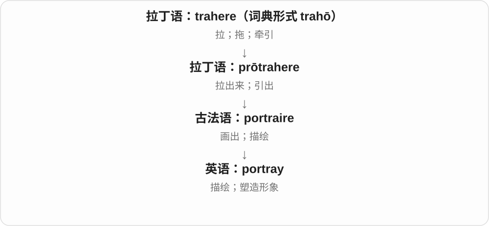

拉丁语“引出、拉出”在法语这一支发展为描画。现代既能描绘外貌，也能让读者形成某种看法，所以 portray A as B 很常见。

**常见搭配与例句**

portray someone as…；portray a character；portray daily life；accurately portray。

> The novel portrays life in a small fishing village.

小说描绘了一个小渔村的生活。

> The actor portrays a teacher who refuses to give up.

这位演员扮演一名不肯放弃的教师。

**别混淆**

portray 强调呈现出来的形象，不保证完全客观。某电影把人 portray as a hero，不等于他在现实中必然是英雄。

### 152. portrayal — 描绘；塑造、演绎；所呈现的形象

**音标**：英 /pɔːˈtreɪəl/；美 /pɔːrˈtreɪəl/

**先抓住这个画面**

演员怎么把角色演出来，文章怎么把某群人写出来，这种呈现和呈现出来的形象，都可叫 portrayal。

**怎么拆**

portray + -al → portrayal，保留 y；这里名词尾形成描绘行为、结果，不是与某种 tray 托盘有关的形容词。

**怎么变成今天的意思**

**法语 portraire 等描绘材料 → portray**  
描绘、表现，现代也用于表演

↓

**portray + -al → portrayal**  
描绘过程、塑造出的形象

a portrayal of a character 角色演绎；an accurate portrayal 准确描绘；media portrayal 媒体呈现。

**常见搭配与例句**

a portrayal of；an accurate portrayal。

> Her portrayal of the character won praise.

她对角色的演绎赢得了称赞。

> The article challenges the usual portrayal of the town.

文章挑战了对这座小镇惯常的描绘。

**别混淆**

portrayal 侧重如何呈现，reality 是实际情况；生动形象的 portrayal 仍可能不准确。

### 153. computational — 计算的；利用计算方法的

**音标**：英 /ˌkɒmpjuˈteɪʃənəl/；美 /ˌkɑːmpjuˈteɪʃənəl/

**先抓住这个画面**

一个研究问题不是只靠纸笔描述，而是建立模型、运行算法、处理数据；computational 标出它的计算方法。

**怎么拆**

computation + -al，英语形容词派生；不是 computer + -ational。

**怎么变成今天的意思**

**拉丁 putare**  
修剪、清理；计算、考虑、判断

↓

**拉丁 com- 一起 + putare → computare**  
合起来计算、盘算

↓

**拉丁 computatio → 中古法语 computation／直接借入**  
计算的行为、过程

↓

**中古英语 computacioun → computation**  
计算过程或结果

↓

**英语 computation + -al → computational**  
与计算有关的；采用计算方法的

computational cost 指完成算法需要的时间、存储等资源；computational linguistics 是用计算方法研究和处理语言。不能简单译成“电脑制造的”。

**常见搭配与例句**

computational methods；computational cost；computational linguistics。

> The researchers used a computational model to test the idea.

研究者用计算模型检验这一想法。

> The new method reduces the computational cost.

新方法降低了计算开销。

**别混淆**

computerized 强调已采用计算机系统；computational 强调计算方法或计算特性。

### 154. empirical — 经验性的；以观察、实验为依据的

**音标**：/ɪmˈpɪrɪkəl/

**先抓住这个画面**

先实际看、测、试，再用观察结果支持判断，是 empirical。不是只在脑中推，也不是随便一句“我凭感觉觉得”。

**怎么拆**

希腊 empeirikos 有经验的，接 en- 在其中 + peira 试验、经历，经拉丁 empiricus 等材料再形成 empirical，带 -al 性质尾。

**怎么变成今天的意思**

**希腊 en- + peira → empeiria、empeirikos**  
在实际尝试中获得经验；有经验的

↓

**拉丁 empiricus 等 + -al → empirical**  
源于经验、可由观察试验检验的

empirical evidence 实证证据；an empirical study 实证研究；empirical data 实测、观察数据。研究也可把理论与实证结合。

**常见搭配与例句**

empirical evidence；an empirical study；empirical data。

> The theory needs empirical support.

理论需要实证支持。

> The study combines a model with empirical data.

研究把模型与实测数据结合起来。

**别混淆**

empirical 与 theoretical 区分证据、方法侧重，不是宣布理论没用；一次主观印象也不自动代表充分实证。

### 155. evangelical — 福音的；福音派的；热衷宣扬某种主张的；福音派基督徒

**音标**：/ˌiːvænˈdʒelɪkəl/

**先抓住这个画面**

最早的字面线索是好消息、福音。现代谈宗教时常是特定信仰传统的名称；谈别的事时，也可比喻像传福音一样热心劝人接受。

**怎么拆**

较早 evangelic + -al，经法语、晚期拉丁福音相关材料，上接希腊 eu- 好与 angellein 宣告、angelos 使者词族。现代福音派的具体宗教含义在后来的历史中形成，不能只靠好消息三个字概括。

**怎么变成今天的意思**

**希腊 eu- 与宣告、使者词族 → 拉丁／法语相关词**  
好消息；基督教福音

↓

**evangelic + -al → evangelical**  
福音相关；后有福音派和热心宣扬的用法

an evangelical church 福音派教会；evangelical Christians 福音派基督徒，通常在新教传统中理解；evangelical about an idea 对某想法热心宣扬。

**常见搭配与例句**

evangelical beliefs；almost evangelical enthusiasm。

> She grew up in an evangelical church.

她在福音派教会的环境中长大。

> He is almost evangelical about the benefits of cycling.

他对骑自行车的好处热衷宣扬，几乎逢人就讲。

**别混淆**

evangelical 与 evangelistic 都可能涉及传教，但 evangelical 也作信仰传统标签。比喻说对某事热心宣扬时，不自动表示那个人有该宗教身份。

### 156. cerebral — 脑的、大脑的；偏理智、费思考的

**音标**：/səˈriːbrəl/〔亦 /ˈserəbrəl/〕

**先抓住这个画面**

医学里说脑相关；艺术评论里还可说作品偏思考、理智，得动脑去理解，而不是主要靠直接情感冲击。

**怎么拆**

接拉丁 cerebrum 脑的材料与 -al，历史也见法语 cérébral 对应。不是 cereal 谷物随便多加一个 b。

**怎么变成今天的意思**

**拉丁 cerebrum 脑 → 相应性质形式**  
脑相关的命名材料

↓

**英语 cerebral**  
脑的；比喻偏思维、理智的

cerebral blood flow 脑血流；the cerebral cortex 大脑皮层；a cerebral novel 偏理智、费思考的小说。

**常见搭配与例句**

the cerebral cortex；cerebral blood flow；a cerebral novel。

> The diagram labels the cerebral cortex.

图中标出了大脑皮层。

> The review describes the film as cerebral and demanding.

评论说电影偏理智，也很考验理解力。

**别混淆**

cerebral 比喻义不单纯等于智商高；cereal 是谷物、早餐谷物食品，两词来源不同。

### 157. fetus — 胎儿

**音标**：/ˈfiːtəs/

**先抓住这个画面**

指还在子宫内发育的后代。现代生物学、医学里常用来称胚胎期之后、出生之前的发育阶段。

**怎么拆**

从拉丁语 fetus 后代、产物等书面借入。较宽的后代、孕育材料进入现代术语后，具体用于胎儿阶段。

**怎么变成今天的意思**

**拉丁语 fetus 后代、产物等**  
孕育、出生相关的旧名词

↓

**英语 fetus 的现代术语义**  
子宫内发育的胎儿

the developing fetus 发育中的胎儿；a human fetus 人类胎儿；fetus 的常见复数 fetuses。英式也见 foetus。

**常见搭配与例句**

fetus and embryo；development of the fetus。

> The textbook explains how the fetus develops.

教材解释了胎儿怎样发育。

> The diagram shows the position of the fetus in the uterus.

图解展示了胎儿在子宫内的位置。

**别混淆**

embryo 是更早的胚胎阶段，fetus 是之后的胎儿阶段。两词在科学描述中有阶段区别，不能一律当同义词替换。

### 158. fetal — 胎儿的、与胎儿有关的

**音标**：/ˈfiːtəl/

**先抓住这个画面**

fetus 是胎儿这个名词；fetal 把它放到另一个名词前面，说明讨论的是胎儿的生长、心跳等。

**怎么拆**

fetus 的词干 fet- + -al，形成关系形容词。英式相应拼写还见 foetal，发音相同。

**怎么变成今天的意思**

**fetus 的词干 fet- + -al**  
与胎儿有关的

↓

**fetal 作名词修饰语**  
胎儿发育、胎儿心跳等

fetal development 胎儿发育；fetal movement 胎动；fetal heartbeat 胎儿心跳。

**常见搭配与例句**

fetal growth；the fetal stage。

> The chapter focuses on fetal development.

这一章重点讲胎儿发育。

> The recording captured the fetal heartbeat.

这段记录录下了胎儿的心跳。

**别混淆**

fetus 是名词，fetal 是形容词；fetal development 不能机械逐字换成 fetus development。foetal 是常见的另一拼写。

### 159. nominal — 名义上的；象征性的、很少的；名词的；标称的

**音标**：英 /ˈnɒmɪnəl/；美 /ˈnɑːmɪnəl/

**先抓住这个画面**

名称或牌面上是这样，实际情况可能另算；收费时也可只收象征性的一点。

**怎么拆**

来自拉丁 nominalis“名称的”，接 nomen／nominis；从名称相关，发展为仅在名称上成立，再到象征性金额等用法。

**怎么变成今天的意思**

**拉丁 nomen → nominalis**  
名字 → 名称相关的

↓

**英语 nominal**  
名词的；名义上的；象征性或标称的

a nominal leader 可能有头衔却没实权；a nominal fee 是象征性的小额费用，不是根本没收费。设备的 nominal value 是标称值，实际测量可能有允许偏差。共同点是关注名称、标定或形式上的量，而非每次都暗示骗人。

**常见搭配与例句**

a nominal fee；a nominal leader；nominal control；a nominal value；nominal forms。

> Visitors pay only a nominal fee to enter the garden.

游客只需支付一小笔象征性费用就能进入花园。

> He was the nominal leader, but the committee made the decisions.

他是名义上的负责人，实际由委员会作决定。

**别混淆**

nominal 不等于 normal“正常的”。名义、标称与实际的差别需看语境；象征性费用通常是很少，不是零。

### 160. referral — 转介；转诊；推荐介绍

**音标**：英 /rɪˈfɜːrəl/；美 /rɪˈfɜːrəl/

**先抓住这个画面**

把需要帮助的人送到更合适的门口，或者把一个可能需要服务的人介绍过去。

**怎么拆**

refer + -al，英语动作名词；双写 r。

**怎么变成今天的意思**

**拉丁语：ferre；第一人称 ferō**  
带、承载；承受；生出

↓

**拉丁语：re- + ferre → referre**  
带回；报告；提交处理

↓

**古法语 referer；也有直接拉丁借入**  
报告；归于、交付

↓

**中古英语 referren → 英语 refer**  
提到、指称；查阅；转交

↓

**英语：refer + -al → referral**  
转交处理或介绍过去的行为

医疗里指转诊，商业里可指顾客介绍。它说的是送往另一位专业人员、机构或渠道，不是普通的一次“提到”。

**常见搭配与例句**

a referral to a specialist；customer referrals；a referral letter。

> The clinic received a referral from her family doctor.

诊所收到了她家庭医生的转诊。

> Most of our new clients come through referrals from existing clients.

我们的新客户大多由老客户介绍而来。

**别混淆**

reference 常是查阅依据或推荐证明；referral 是把人或事项转过去。

### 161. conditional — 有条件的；条件式的

**音标**：/kənˈdɪʃənəl/

**先抓住这个画面**

“可以，但先得满足这一点。”conditional 说的不是直接答应，而是把决定系在某个条件上。

**怎么拆**

经法语 conditionnel / condicionel 传入，现代可按 condition + -al 理解。

**怎么变成今天的意思**

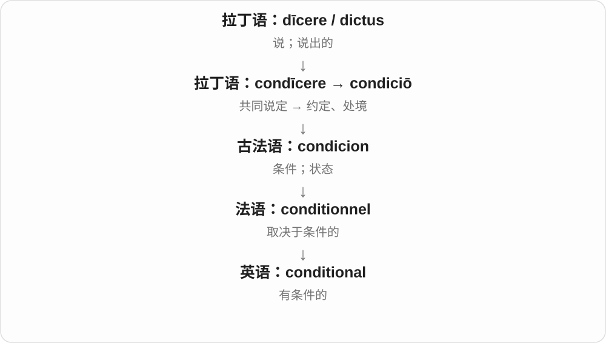

conditional approval 是满足附带条件才有效的批准。语法中的 conditional sentence 则讨论 if 等结构表达的条件关系。

**常见搭配与例句**

conditional on…；conditional approval；a conditional offer；a conditional sentence。

> The offer is conditional on your passing the final exam.

这份录取或聘用要约以你通过期末考试为条件。

> The council gave conditional approval to the plan.

委员会有条件地批准了这个计划。

**别混淆**

conditional 是有条件；conditioned 更常是已经受训练、处理或环境影响。

### 162. cynical — 认为别人动机不纯的；冷嘲的；只顾自身利益的

**音标**：/ˈsɪnɪkəl/

**先抓住这个画面**

要么觉得别人嘴上说得好听，背后都是算盘；要么自己就明知如此，仍为了利益去做。

**怎么拆**

cynic + -al，早期指像犬儒学派的，后来形成今天怀疑真诚、轻视道德动机的意义。不能把现代所有用法都当成古代学说的准确概括。

**怎么变成今天的意思**

**希腊 kyon，词干 kyn-，狗 → kynikos 像狗的、犬儒的**  
为何用狗命名该学派，有生活方式、绰号或地点等不同说法

↓

**拉丁 cynicus／法语 cynique → 英语 cynic**  
古代犬儒学派成员；后来另发展出现代怀疑人性动机的用法

↓

**英语 cynic + -al → cynical**  
从学派相关，扩展到怀疑动机或冷漠逐利的态度

cynical about promises 是不信承诺背后的真心；a cynical attempt to gain votes 可以说只是盘算选票、毫无真诚的举动。后一种不只是表示悲观。

**常见搭配与例句**

be cynical about；a cynical remark；a cynical attempt to gain support。

> She became cynical about the company’s promises.

她开始觉得公司的承诺都不真诚。

> The gesture was dismissed as a cynical attempt to win support.

人们认为这个姿态只是为拉取支持而作的算计，因而不予认可。

**别混淆**

skeptical 往往先要证据，cynical 往往先觉得动机不纯。sarcastic 是说话讽刺的方式，不一定来自犬儒态度。

### 163. economical — 节约的；省钱、省资源的；精简的

**音标**：英 /ˌiːkəˈnɒmɪkəl/ 或 /ˌekəˈnɒmɪkəl/；美 /ˌekəˈnɑːmɪkəl/ 或 /ˌiːkəˈnɑːmɪkəl/

**先抓住这个画面**

花较少的钱、材料或动作，把该做的事做好。

**怎么拆**

economic 词基 + -al，属于家计、资源管理这条历史线；现代主要保留节俭、少浪费的意义。

**怎么变成今天的意思**

**希腊 oîkos；相关 oikía**  
家、住处、家庭

↓

**希腊 oikonomikós → 拉丁及法语同系形容词**  
家计、资源管理的

↓

**英语 economic 词基 + -al → economical**  
从持家、经济相关走向节约、少浪费

an economical car 开起来省油、省费用，不一定买价最低；economical movements 是动作简练、没有多余消耗。重点是投入使用得有效，不是质量低。

**常见搭配与例句**

economical to run；economical with resources；an economical design；economical movements。

> The smaller machine is more economical to run.

小一些的机器运行成本更省。

> Her economical movements made the difficult task look effortless.

她动作精练，使这项难事看起来毫不费力。

**别混淆**

cheap 常说价格低；economical 考虑使用中是否节省。便宜买来却很耗电的设备，未必 economical。

### 164. orbital — 轨道的；眼窝的；原子或分子轨道

**音标**：英 /ˈɔːbɪtl/；美 /ˈɔːrbɪtl/

**先抓住这个画面**

作形容词时说明与运行轨道或眼窝有关；作化学名词时有专门含义。

**怎么拆**

现代可以按 orbit + -al 理解。历史分析有中古拉丁 orbitalis 借入说，也有英语 orbit 加 -al 的派生说；都接到 orbita。最早英语用法与眼窝有关，后来用于天体轨道，现代又成为量子化学名词。

**怎么变成今天的意思**

**拉丁语 orbis；相关词 orbita**  
圆、环；车轮留下的轨迹、运行路线

↓

**中古拉丁 orbitalis 或英语 orbit + -al**  
有关眼窝的；两种来源分析

↓

**现代英语 orbital**  
轨道的；后又用作量子化学名词

orbital period 是绕行一周的时间，orbital speed 是沿轨道运动的速度。化学里的 an orbital 则是描述一个电子空间状态的波函数；常画成电子出现概率的空间图，不是电子实际沿着跑的一条小圆圈。

**常见搭配与例句**

orbital motion；an orbital period；an atomic orbital；a molecular orbital。

> The team calculated the satellite’s orbital period.

团队计算了这颗卫星的绕行周期。

> The textbook compares the shapes of different atomic orbitals.

教材比较了不同原子轨道的形状。

**别混淆**

天文学的 orbit 是运动路线。量子化学的 orbital 即使译作“轨道”，也不能照搬小行星绕太阳的画面。

### 165. societal — 社会整体层面的

**音标**：英 /səˈsaɪətəl/；美 /səˈsaɪətəl/

**先抓住这个画面**

不只问一个人的选择，而是问制度、习惯和许多人共同受到的影响。

**怎么拆**

society + -al，形成与社会整体有关的形容词；不是 social 的随意长写。

**怎么变成今天的意思**

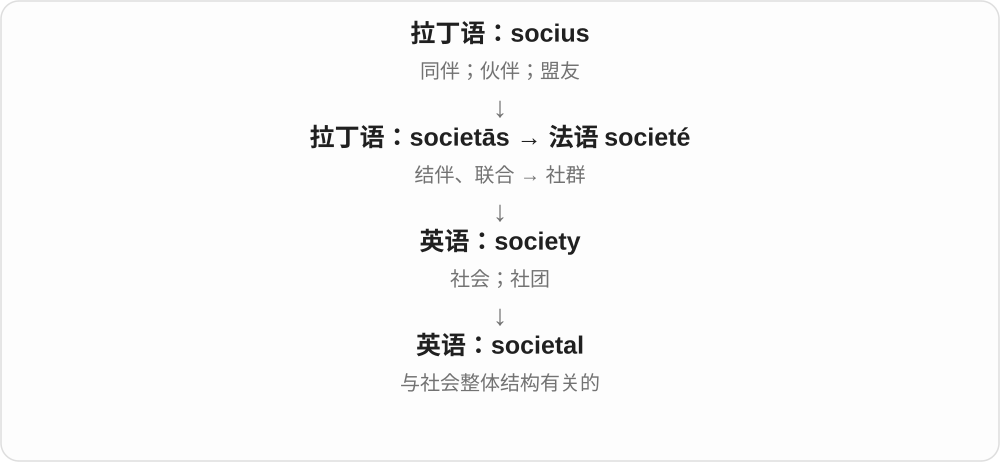

较正式，多见于研究和政策讨论。societal change 说社会整体变化，通常不表示朋友间多聚了几次会。

**常见搭配与例句**

societal change；societal expectations；societal impact。

> The study explores the societal impact of new technology.

研究探讨新技术对社会整体的影响。

> Attitudes changed alongside wider societal changes.

观念随着更广泛的社会变化而改变。

**别混淆**

social 范围更广；societal 通常把意思收窄到社会整体，避开普通社交义。

### 166. abdominal — 腹部的；腹腔相关的

**音标**：英 /æbˈdɒmɪnəl/；美 /æbˈdɑːmənəl/

**先抓住这个画面**

abdomen 是腹部，abdominal 把肌肉、疼痛、腔体等与腹部联系起来。形容词本身不说明某种疼痛的具体原因。

**怎么拆**

接新拉丁 abdominalis：abdomin- 是 abdomen 的历史词干，接 -al 相应性质尾；不凭空插一个 n 当记忆口诀。

**怎么变成今天的意思**

**拉丁 abdomen → 法语、英语 abdomen**  
腹部名，更早具体来源未定

↓

**拉丁词干 abdomin- + -alis → abdominal**  
采用腹部词干的相关形容词

abdominal muscles 腹肌；the abdominal cavity 腹腔；abdominal pain 腹痛；abdominals 也可简称腹肌。

**常见搭配与例句**

abdominal muscles；the abdominal cavity；abdominal pain。

> The chart labels the abdominal muscles.

图表标出了腹肌。

> The article explains the structure of the abdominal cavity.

文章解释了腹腔结构。

**别混淆**

abdominal 指腹部相关，cerebral 指脑相关；词尾相同只交代性质，不把身体部位合并。

### 167. abdomen — 腹部；腹腔〔依语境〕

**音标**：/ˈæbdəmən/

**先抓住这个画面**

胸部下面、骨盆上面这一片身体区域，是常见人体语境里的 abdomen。不是胃这个器官单独改了一个名字。

**怎么拆**

借法语、拉丁 abdomen；拉丁格变化给出 abdomin- 词干，供 abdominal 等派生。更早可能与隐藏等词有关，但不当作确定拆分。

**怎么变成今天的意思**

**拉丁 abdomen → 法语、英语 abdomen**  
腹部名，更早具体来源未定

↓

**拉丁词干 abdomin- + -alis → abdominal**  
采用腹部词干的相关形容词

the lower abdomen 下腹部；the upper abdomen 上腹部；the abdomen of an insect 昆虫腹部，动物学范围另按结构。

**常见搭配与例句**

the lower abdomen；the upper abdomen。

> The illustration shows the organs in the abdomen.

插图展示了腹部里的器官。

> The insect has a long abdomen.

这只昆虫的腹部很长。

**别混淆**

abdomen 是区域、腔体名称，stomach 主要是胃，也会口语泛说肚子；正式解剖语境不可随意合并。

### 168. doctoral — 博士的；博士学位阶段的

**音标**：英 /ˈdɒktərəl/；美 /ˈdɑːktərəl/

**先抓住这个画面**

围绕取得博士学位所做的研究、训练和评审。

**怎么拆**

doctor + -al，可能仿拉丁 doctorālis；这里取 doctor 的学位义，不是医生的职业义。

**怎么变成今天的意思**

**拉丁 docēre；完成分词 doctus**  
教；使人知道；有学问的

↓

**拉丁 doctor → 古法语／盎格鲁法语 doctour**  
教师、学者、精通学问的人

↓

**中古英语 doctour → 英语 doctor**  
博士；医生；后转为治疗、改动等动词

↓

**英语 doctor + -al → doctoral**  
与博士学位、博士培养有关的

a doctoral student 是攻读博士学位的人，doctoral research 是博士阶段研究。无论专业是化学、文学还是工程，都可以用这个词。

**常见搭配与例句**

a doctoral student；doctoral research；a doctoral thesis；a doctoral programme。

> Her doctoral research examines how children learn new words.

她的博士研究考察儿童如何学习新词。

> The department introduced a new doctoral programme in environmental history.

系里开设了新的环境史博士培养项目。

**别混淆**

doctoral 是形容词，doctorate 是学位名词。说 a doctoral degree 或 a doctorate，不能把两者当成同一词性。

### 169. mystical — 神秘主义的；具有神秘、超凡感的

**音标**：/ˈmɪstɪkəl/

**先抓住这个画面**

不像普通知识推理，更像一种难以言说的精神体验；也能形容仿佛超出日常的气氛。

**怎么拆**

mystic + -al；英语形容词扩展，不是 mystery 直接变 -ical。

**怎么变成今天的意思**

**希腊 myein 关闭 → mystēs 入秘仪者**  
可能联想到闭口保密或闭眼；具体连接未定

↓

**希腊 mystikos → 拉丁 mysticus；古法语 mistique → 英语 mystic**  
与秘仪相关 → 神秘体验、神秘主义相关

↓

**英语 mystic + -al → mystical**  
神秘的、象征性的 → 神秘体验相关的

a mystical experience 是神秘精神体验；a mystical atmosphere 可描写艺术或自然带来的超凡感。描写这种感觉不等于证明有超自然力量。

**常见搭配与例句**

a mystical experience；mystical traditions；a mystical quality。

> The music gives the scene an almost mystical quality.

音乐让这一幕带上近乎超凡的神秘感。

> The book compares mystical traditions from several cultures.

这本书比较了几种文化中的神秘主义传统。

**别混淆**

mysterious 常是尚未解释的；mystical 更容易涉及精神、宗教或超凡体验。

### 170. physiological — 生理的；与生命功能有关的

**音标**：英 /ˌfɪziəˈlɒdʒɪkəl/；美 /ˌfɪziəˈlɑːdʒɪkəl/

**先抓住这个画面**

关注身体怎样反应、调节和运作。

**怎么拆**

现代可按 physiology + -ical 理解；另有拉丁 physiologicus + -al 的来源分析，与 physio- + -logical 的分析并行。

**怎么变成今天的意思**

**希腊 physiología／physiologikós → 拉丁 physiologia／physiologicus**  
关于自然及其功能的学术形式

↓

**英语 physiological**  
可分析为拉丁形容词加 -al；现代与 physiology + -ical 对应

运动后心率变化可以是 physiological response。生理过程有正常调节，也可能受疾病改变；不能看到 physiological 就默认“没有问题”。

**常见搭配与例句**

a physiological response；physiological changes；physiological processes。

> The study recorded physiological responses to exercise.

研究记录了运动引起的生理反应。

> The plants showed physiological changes after several days without water.

这些植物缺水几天后出现了生理变化。

**别混淆**

physical 可以宽泛地指身体或物理性质；physiological 更集中于生命功能与机制。

### 171. fungus — 真菌；霉菌、蘑菇等真菌类群成员

**音标**：/ˈfʌŋɡəs/

**先抓住这个画面**

蘑菇、酵母、霉菌看着差别大，都有成员属于真菌。fungus 不是所有微小生物或所有污斑的统称。

**怎么拆**

借拉丁 fungus 蘑菇；现代科学概念扩展到真菌类群。复数常用 fungi，也有 funguses；派生形容词用 fung- 词干。

**怎么变成今天的意思**

**拉丁 fungus 蘑菇 → 英语 fungus**  
菌类名称，现代扩大为真菌类群成员

↓

**fungus 的 fung- 词干 + -al → fungal**  
真菌相关的性质形容词

a fungus growing on wood 木头上生长的真菌；fungi in the soil 土壤真菌；a type of fungus 一种真菌。

**常见搭配与例句**

a type of fungus；fungi in the soil。

> A fungus was growing on the fallen branch.

倒下的树枝上长着一种真菌。

> The book describes several fungi found in woodland.

书中描述了几种林地里的真菌。

**别混淆**

fungi 是现代独立类群，不能把所有真菌都定义成植物；bacteria 细菌也是另一类生物。

### 172. fungal — 真菌的；由真菌引起或与之有关的

**音标**：/ˈfʌŋɡəl/

**先抓住这个画面**

fungus 是真菌，fungal 把生长、孢子、感染等与真菌相连。它是性质词，不是复数菌名。

**怎么拆**

fungus 去拉丁词尾 -us，采用 fung- + -al → fungal；不是整个 fungus 原样直接拼上 al。

**怎么变成今天的意思**

**拉丁 fungus 蘑菇 → 英语 fungus**  
菌类名称，现代扩大为真菌类群成员

↓

**fungus 的 fung- 词干 + -al → fungal**  
真菌相关的性质形容词

↓

**fung- + -al → fungal**  
与真菌有关的性质

fungal growth 真菌生长；fungal spores 真菌孢子；a fungal infection 真菌感染。

**常见搭配与例句**

fungal growth；fungal spores。

> The study tracks fungal growth on different materials.

研究追踪不同材料上的真菌生长。

> The diagram shows how fungal spores spread.

图解展示真菌孢子如何传播。

**别混淆**

fungal 不是所有 microbial 微生物相关的通用替代；微生物还包括别的类群。

### 173. sentimental — 感伤的；怀旧的；感情用事的

**音标**：/ˌsentɪˈmentəl/

**先抓住这个画面**

一件旧东西本身不值钱，却把过去的人和事一下带回来，让你舍不得丢，这就是 sentimental 的典型场景。

**怎么拆**

sentiment + -al。

**怎么变成今天的意思**

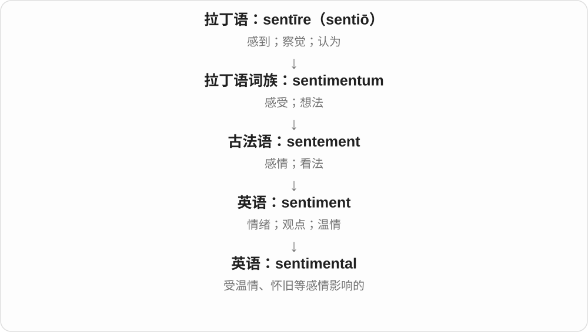

可温和地说有感情价值，也可批评作品或判断过分依赖温情。a sentimental person 并不表示身体感官特别灵敏。

**常见搭配与例句**

sentimental value；feel sentimental；a sentimental story。

> The watch has great sentimental value for me.

这只表对我有很大的感情价值。

> The film becomes too sentimental in its final scenes.

电影最后几场戏煽情过头了。

**别混淆**

emotional 广泛说有情绪或情绪强烈；sentimental 常偏温情、怀旧、感伤，有时带过度之意。

### 174. bilingual — 双语的；会使用两种语言的

**音标**：/baɪˈlɪŋɡwəl/

**先抓住这个画面**

同一个人能在两种语言之间交流，或同一份资料把两种语言并排呈现。

**怎么拆**

现代是 bi- 两 + lingual 语言的，也与拉丁 bilinguis“两种舌语的”相联系；有据拉丁词加 -al 的分析。不是身体里真的长了两条舌头。

**怎么变成今天的意思**

**拉丁 lingua**  
舌头；说话、语言

↓

**拉丁 bilinguis；英语 bi- 两 + lingual**  
两种语言的古典范词与英语构词结构

↓

**英语 bilingual**  
会用两种语言的；用两种语言写成的

a bilingual child 说会使用两种语言的孩子；a bilingual dictionary 是双语词典。具体熟练度可以不均衡，不必两种语言的听说读写都完全一样。

**常见搭配与例句**

a bilingual dictionary；bilingual education；be bilingual in English and French。

> The museum provides bilingual labels in Chinese and English.

博物馆提供中英双语展签。

> He is bilingual, but he writes more confidently in Spanish.

他会使用两种语言，但用西班牙语写作更有把握。

**别混淆**

fluent 强调流利程度；bilingual 主要说涉及两种语言。它也可作名词指双语使用者。

### 175. sensational — 轰动的；耸人听闻的；极出色的

**音标**：/senˈseɪʃənəl/

**先抓住这个画面**

它能一下子抓住大家的感觉：可能是真的精彩，也可能故意夸张刺激，让人忍不住点进去。

**怎么拆**

sensation + -al，表示会引起强烈感受或轰动的。

**怎么变成今天的意思**

a sensational performance 常是称赞；a sensational headline 可能批评靠刺激吸引眼球。不能只背一个“耸人听闻”。

**常见搭配与例句**

a sensational performance；sensational news；a sensational headline。

> The singer gave a sensational performance.

这位歌手的演出精彩极了。

> The article used a sensational headline to attract readers.

文章用耸动的标题吸引读者。

**别混淆**

sensational 的评价取决于对象；sensitive 则是接收刺激敏锐，不是制造轰动。

### 176. instructional — 教学用的；提供操作指导的

**音标**：/ɪnˈstrʌkʃənəl/

**先抓住这个画面**

instructional 像视频里一边做、一边指出下一步：它本来就是为了教会你。

**怎么拆**

instruction + -al，表示与教学、指导有关。

**怎么变成今天的意思**

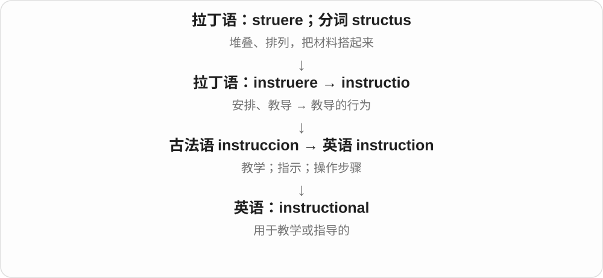

instructional materials 包括课件、示范视频、练习说明等。这个词主要说明用途，不能单凭它判断材料是否真讲得好。

**常见搭配与例句**

an instructional video；instructional materials；instructional design。

> She made an instructional video about repairing bicycle brakes.

她制作了一段讲解自行车刹车维修的教学视频。

> The teacher adapted the instructional materials for younger learners.

老师调整了教学材料，使其适合年纪更小的学生。

**别混淆**

instructional 强调用于教学；instructive 强调看完或经历后让人学到东西。事故也可能 instructive，却不是为教学设计的。

### 177. procedural — 程序上的；按程序进行的；重办案过程的侦探作品

**音标**：英 /prəˈsiːdʒərəl/；美 /prəˈsiːdʒərəl/

**先抓住这个画面**

把镜头对准事情如何一步步办理。

**怎么拆**

procedure + -al；名词用法常省略 police procedural 等短语后的 novel、drama。

**怎么变成今天的意思**

**拉丁 cēdere；分词词干 cess-**  
走、离开；让步、让出

↓

**拉丁 prō- + cēdere → prōcēdere**  
朝前走、推进

↓

**法语 procédure → 英语 procedure**  
做事推进的步骤与程序

↓

**英语 procedure + -al → procedural**  
与办理步骤有关；强调办案程序的作品

procedural error 指流程或办理方式出错，不一定说明最终内容判断错了。a police procedural 常写警员调查、取证、协作的具体过程。

**常见搭配与例句**

procedural rules；a procedural error；a police procedural。

> The application was delayed by a procedural error.

申请因程序上的错误而延误。

> She enjoys police procedurals that show how evidence is collected.

她喜欢描写取证过程的警察办案小说。

**别混淆**

substantive 关注事情本身的实质；procedural 关注如何处理。

### 178. bridal — 新娘的、婚礼的

**音标**：/ˈbraɪdəl/

**先抓住这个画面**

bridal dress 是新娘礼服，bridal suite 是婚礼、新婚相关套房。它今天像一个普通的相关形容词，但来历里藏着一场婚宴。

**怎么拆**

古英语 brȳdealo 是 brȳd 新娘 + ealu 麦芽酒，指婚宴。婚宴名词后来转作相关形容词，末尾又被理解得像 -al；现代可联想 bride + -al，历史却不只这一刀。

**怎么变成今天的意思**

**古英语 brȳd → bride**  
将结婚或新婚的女性；更远来源有争论

↓

**古英语 brȳd + ealu → brȳdealo**  
新娘酒宴、婚宴

↓

**婚宴名词 → bridal 形容词**  
婚礼、新娘相关；后来受 bride + -al 的形式理解影响

a bridal gown 新娘礼服，a bridal suite 新婚套房，a bridal shop 婚纱、婚礼用品店。

**常见搭配与例句**

a bridal gown；a bridal suite；a bridal shop。

> The shop displays bridal gowns in the window.

店铺橱窗里展示着婚纱。

> They booked the bridal suite for the wedding night.

他们为新婚之夜订了新婚套房。

**别混淆**

bridal 与 bridle 马勒同音而来源不同；bridal party 通常说婚礼中伴随新人的人员组合，不只是一次聚会。

### 179. monumental — 巨大的；意义重大的；纪念碑式的

**音标**：英 /ˌmɒnjuˈmentl/；美 /ˌmɑːnjuˈmentl/

**先抓住这个画面**

像一座大纪念碑那样显眼、分量很重，常用来放大成就、任务或错误。

**怎么拆**

借自晚期拉丁 monumentalis，接 monumentum；现代可对应 monument + -al，但并非只能看成英语内部派生。

**怎么变成今天的意思**

**拉丁语 monere**  
使想起、提醒、告诫

↓

**拉丁语 monumentum → 晚期拉丁 monumentalis → 英语 monumental**  
纪念物的 → 宏大、极其重要的

a monumental achievement 是非凡成就；a monumental mistake 是大错。它并不总在赞美，也可直指纪念性建筑和雕塑。

**常见搭配与例句**

a monumental task；a monumental achievement；a monumental mistake。

> Restoring the collection was a monumental task.

修复这批藏品是一项庞大的工程。

> Deleting the only backup was a monumental mistake.

删掉唯一的备份是个大错。

**别混淆**

important 只说重要；monumental 常强调规模或影响大得令人难以忽视。

### 180. pivot — 支点、枢轴；转动、转向；关键点

**音标**：/ˈpɪvət/

**先抓住这个画面**

门绕着轴转，计划也能围绕一个关键点改变方向。pivot 既可指支点，也能作转动、转向的动作。

**怎么拆**

借古法语 pivot 等枢轴名，远源未定；现代商业 pivot 改变方向，是转轴动作的比喻。

**怎么变成今天的意思**

**古法语 pivot → 英语 pivot**  
转轴、铰链轴等，更早来源有争论

↓

**pivot + -al → pivotal**  
枢轴相关；转为关键作用的比喻

turn on a pivot 围绕支点转；pivot towards a new approach 转向新做法；a central pivot 核心支点。

**常见搭配与例句**

turn on a pivot；pivot towards。

> The frame turns on a central pivot.

框架绕中心支点转动。

> The team pivoted towards a simpler approach.

团队转向了更简单的做法。

**别混淆**

pivot 转向，不保证完全抛弃原有一切；也不等于任何细微调整都构成战略转型。

### 181. pivotal — 关键的、起枢纽作用的

**音标**：/ˈpɪvətəl/

**先抓住这个画面**

像一个轴影响整个东西往哪转，pivotal 就是能左右局面、结果的关键作用。不是普通“有一点帮助”。

**怎么拆**

pivot + -al → pivotal，性质尾；先有枢轴关联，再有至关重要的比喻用法。

**怎么变成今天的意思**

**古法语 pivot → 英语 pivot**  
转轴、铰链轴等，更早来源有争论

↓

**pivot + -al → pivotal**  
枢轴相关；转为关键作用的比喻

↓

**pivot + -al → pivotal**  
像枢轴一样影响整体方向、结果

a pivotal role 关键作用；a pivotal moment 关键时刻；a pivotal decision 关键决定。

**常见搭配与例句**

a pivotal role；a pivotal moment。

> Her advice played a pivotal role in the project.

她的建议在项目中发挥了关键作用。

> The discovery marked a pivotal moment in the investigation.

这项发现成为调查中的关键转折点。

**别混淆**

pivotal 比普通 relevant 相关更强：相关未必关键；它也不自动等于事件唯一原因。

### 182. gravitational — 引力的；与重力有关的

**音标**：/ˌɡrævɪˈteɪʃənl/

**先抓住这个画面**

把引力这一作用贴到力、场、波等对象前面，说明讨论的是哪一种物理关系。

**怎么拆**

gravitation + -al，不是直接把 gravity 接成 gravitational。

**怎么变成今天的意思**

**拉丁语 gravis**  
重的；分量大、难承受、严肃的

↓

**拉丁 gravitas → 近代拉丁 gravitare / gravitatio → 英语 gravitation**  
重量、施加重量 → 引力作用；趋向

↓

**英语 gravitation + -al → gravitational**  
引力作用 → 引力相关的

gravitational attraction 是引力吸引；gravitational waves 是引力波。这个形容词不会自动说明作用强弱，也不等于某物很沉重。

**常见搭配与例句**

gravitational force；gravitational attraction；gravitational waves。

> The two stars are held together by gravitational attraction.

这两颗恒星靠引力联系在一起。

> The lecture explained how gravitational waves differ from sound waves.

讲座解释了引力波与声波的区别。

**别混淆**

gravity 常作名词；gravitational 是完整形容词。electromagnetic 说电磁作用，是另一种相互作用。

### 183. nautical — 航海的；船舶、水手相关的

**音标**：英、美 /ˈnɔːtɪkəl/

**先抓住这个画面**

把注意力放到船如何行驶、航线如何辨认，以及船上的生活。

**怎么拆**

来自法语 nautique，或经拉丁 nauticus 接希腊 nautikos；后接英语形容词形式 -al。希腊 nautēs 是水手，源于 naus“船”。不必假定先有一个更早的独立英语 nautic 再派生整个词。

**怎么变成今天的意思**

**希腊 naus → nautēs → nautikos**  
船 → 水手 → 航海相关的

↓

**拉丁 nauticus／法语 nautique**  
航海的

↓

**英语 nautical**  
船舶、航行及水手相关的

nautical chart 是为航行提供水深、海岸等信息的海图；nautical theme 则可以是装饰中的船锚、帆船等风格。词根指向航海领域，不要求正在进行实际航行。

**常见搭配与例句**

nautical charts；nautical terms；a nautical theme；nautical equipment。

> The museum explains several nautical terms used by sailors.

博物馆解释了几个水手使用的航海术语。

> The room has a nautical theme, with model boats on the shelves.

这个房间采用航海主题装饰，架子上摆着船模。

**别混淆**

marine 的范围可包括海洋生物与海洋环境；nautical 更直接围绕船和航行。naval 常用于海军。

### 184. supplemental — 补充的；额外提供的

**音标**：英 /ˌsʌplɪˈmentəl/；美 /ˌsʌpləˈmentəl/

**先抓住这个画面**

主件之外再添一份，用来补不足或应付新增需要。

**怎么拆**

supplement + -al；英语派生。

**怎么变成今天的意思**

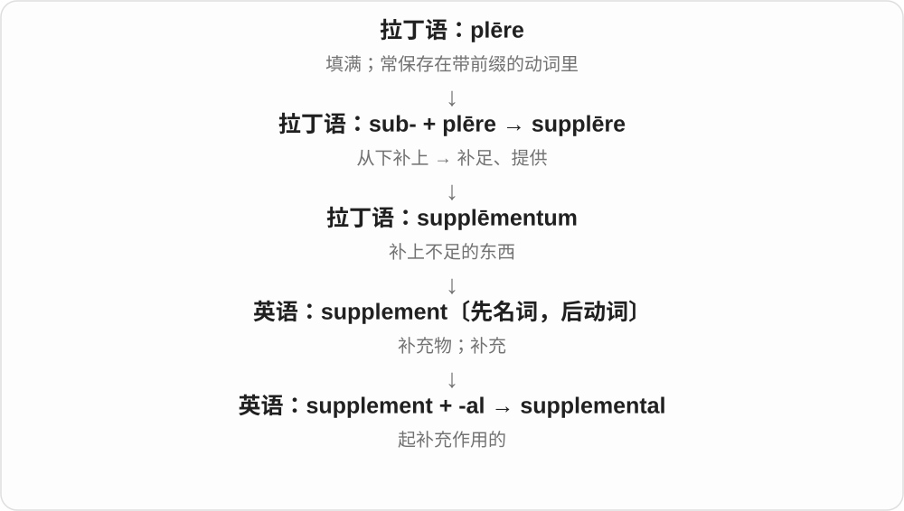

常见 supplemental funding、supplemental materials。与 supplementary 大量重叠，尤其在美式行政、教育语境常见，不能划出“一个必需、一个非必需”的硬界线。

**常见搭配与例句**

supplemental funding；supplemental materials；supplemental information。

> The project received supplemental funding for the final tests.

项目获得了一笔补充经费用于最后的测试。

> Supplemental reading materials are available online.

补充阅读材料可在网上获取。

**别混淆**

additional 只说另外加的；supplemental 更说明加来的东西为原有部分作补充。

### 185. frontal — 正面的；前部的；额部的

**音标**：英、美 /ˈfrʌntl/

**先抓住这个画面**

把关注点放在正前方，或额头附近的位置。

**怎么拆**

形容词借新拉丁 frontalis，接 frons/front-“前额”；部分英语用法也可分析为 front + -al。不是所有用法都由现代英语 front 临时加后缀而成。

**怎么变成今天的意思**

**拉丁语 frons，词干 front-**  
前额、正面、前部

↓

**新拉丁 frontalis → 英语 frontal**  
前额的、前部的；部分用法也由英语 front + -al 扩展

a frontal view 是从正面看的视角，a frontal collision 是迎面相撞。医学里的 frontal bone、frontal lobe 分别是额骨、额叶，保留了“前额”这条更具体的空间联系。

**常见搭配与例句**

a frontal view；a frontal collision；the frontal lobe；a frontal attack。

> The report includes both frontal and side views of the vehicle.

报告包含车辆的正面和侧面视图。

> The model shows the frontal lobe near the front of the brain.

模型展示了靠近大脑前部的额叶。

**别混淆**

front door 通常直接用 front，不说 frontal door。frontal 更适合描述方位、视角、相撞方向或解剖位置。

### 186. motivational — 激励性的；与动力有关的

**音标**：英 /ˌməʊtɪˈveɪʃənəl/；美 /ˌmoʊtɪˈveɪʃənəl/

**先抓住这个画面**

motivational 像给准备放弃的人加一把劲，或研究究竟什么让人愿意行动。

**怎么拆**

motivation + -al。

**怎么变成今天的意思**

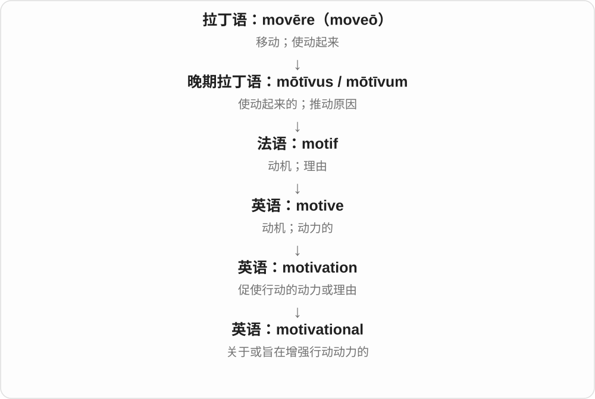

可以形容演讲、教练方式，也可形容心理学中的动力因素，不全是热血口号。

**常见搭配与例句**

a motivational speaker；motivational factors；a motivational message。

> The coach gave a short motivational talk.

教练作了一段简短的鼓劲讲话。

> The study explores motivational factors in learning.

研究探讨学习中的动力因素。

**别混淆**

motivational 描述目的或相关性质；motivated 描述一个人已经有动力的状态。

### 187. existential — 存在的；关乎存亡的；存在主义的

**音标**：/ˌeɡzɪˈstenʃəl/

**先抓住这个画面**

把问题推进到“它还能不能存在”或“我怎样度过自己的存在”这一层。

**怎么拆**

借后期拉丁 existentialis，来自 existentia“存在”；现代可对应 existence 的形容词形式，但哲学专门义是后来的发展。

**怎么变成今天的意思**

**拉丁 sistere〔与 stāre“站”相关〕**  
使站住、放置；站定、停住

↓

**拉丁 ex- + sistere → exsistere / existere**  
站出来、出现 → 存在

↓

**后期拉丁 existentia → existentialis → 英语 existential**  
与存在有关的；借入形容词

an existential threat 是威胁到某物继续存在，并非普通麻烦。an existential question 可以问人生意义和选择；逻辑中的 existential 则常表达“至少有一个”，不必涉及情绪危机。

**常见搭配与例句**

an existential threat；existential questions；an existential statement。

> Losing its only source of funding posed an existential threat to the museum.

失去唯一资金来源，让这家博物馆面临存亡威胁。

> The novel raises existential questions about freedom and responsibility.

小说提出了关于自由与责任的存在问题。

**别混淆**

existing 说现有的；existential 说与存在、存亡或相关哲学问题有关，不能互换。

### 188. spectral — 光谱的；幽灵般的

**音标**：/ˈspektrəl/

**先抓住这个画面**

spectral 有两个画面：实验仪器上的光谱，或小说里模糊飘忽的幽灵身影。

**怎么拆**

幽灵义由 spectre + -al 形成；光谱义对应 spectrum。两词更早都来自拉丁语 spectrum“影像”。

**怎么变成今天的意思**

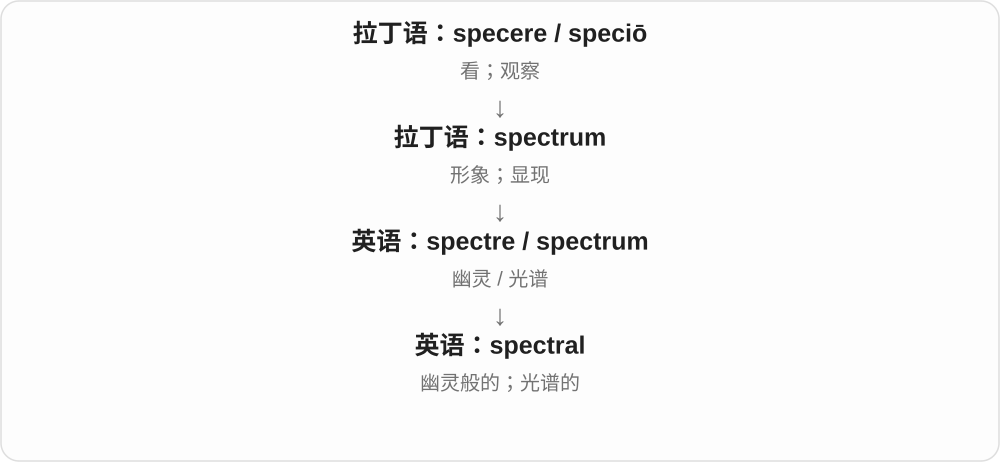

文学和科学保留了不同分支。spectral lines 是光谱线，spectral figure 则可能是幽灵般的人影。

**常见搭配与例句**

spectral analysis；spectral lines；a spectral figure。

> The scientist examined the spectral lines.

科学家检查了光谱线。

> A spectral figure appeared in the mist.

雾中出现了一个幽灵般的人影。

**别混淆**

spectral 不等于 spectacular：前者是光谱或幽灵的，后者是壮观的。

### 189. topical — 热门时事相关的；切合当前话题的；局部使用的

**音标**：英 /ˈtɒpɪkl/；美 /ˈtɑːpɪkl/

**先抓住这个画面**

一边是大家此刻正在谈的事，另一边是身体上某个具体位置。

**怎么拆**

早期接中世纪拉丁 topicalis，回到 topos“地方”；现代能按 topic + -al 记忆，但 topical 比现代单数 topic 更早进入英语。

**怎么变成今天的意思**

**古希腊语 topos**  
地方、位置；更早来源未定

↓

**希腊 topikos → 中世纪拉丁 topicalis → 英语 topical**  
局部、某一论题相关的；较早借入

↓

**英语 topical 的后续义项**  
身体局部使用；与当下热门话题相关

a topical joke 紧扣当下热门事件；a topical cream 是用于身体局部的药膏，不是热销话题里的药膏。两个意思都保留具体位置、具体话题的限制。

**常见搭配与例句**

a topical issue；topical humour；a topical treatment。

> The programme mixes interviews with topical humour.

节目把访谈与紧扣时事的幽默结合起来。

> The leaflet describes the medicine as a topical cream.

说明书将这种药品标为局部使用的药膏。

**别混淆**

current 说当前的；topical 更说跟当前受关注的话题有关。医学局部义与热度无关。

### 190. mythical — 神话中的；虚构的、传说中的

**音标**：英、美 /ˈmɪθɪkəl/

**先抓住这个画面**

在故事里说得很热闹，现实中却未必找得到。

**怎么拆**

对应 mythic + -al，也有从拉丁 mythicus 接英语 -al 的分析；两者都连回希腊 mythikos。现代可拆 myth + -ical 记忆，但它也早于英语单独的 myth。

**怎么变成今天的意思**

**希腊 mythos**  
话语、讲述、故事；后可指神话

↓

**希腊 mythikos → 后期拉丁 mythicus**  
故事、神话相关的

↓

**英语 mythic + -al；也可分析为拉丁词干 + -al**  
形成形容词 mythical

↓

**英语 mythical**  
神话中的；想象存在的

mythical creatures 如独角兽，是神话或幻想中的生物。说 a mythical perfect solution，则是有点怀疑地说那个“完美方案”只是想象中的东西。这个词有时也泛说传说中的，具体是否否认真实性要看上下文。

**常见搭配与例句**

a mythical creature；a mythical kingdom；a mythical perfect solution。

> The children drew mythical creatures with wings and golden horns.

孩子们画了长着翅膀和金色角的神话生物。

> We stopped waiting for a mythical perfect candidate and trained a promising beginner.

我们不再等那个想象中十全十美的候选人，而是培养了一位有潜力的新手。

**别混淆**

mythological 强调与一套神话内容有关；mythical 常突出事物存在于传说或想象中。两者可以修饰同一种生物，区别不是绝对的。

### 191. sectional — 分段的；组合式的；局部群体的；组合沙发

**音标**：/ˈsekʃənəl/

**先抓住这个画面**

整体由几个可以分开的部分拼成，或只站在其中一部分人的立场上。

**怎么拆**

section + -al；名词 sectional 常是 sectional sofa 的省略，用形容词代指这类沙发。

**怎么变成今天的意思**

**拉丁 secāre；分词 sectus**  
切、割；切开的

↓

**拉丁 sectiō／sectiōnem → 法语 section；也有拉丁直接借入**  
切分 → 划出的一部分

↓

**中古英语 seccioun → 英语 section**  
部分、区段、章节；切面

↓

**英语 section + -al → sectional**  
由区段组成的；某一部分或群体的

↓

**英语 sectional sofa → a sectional**  
组合式沙发 → 简称

a sectional sofa 可由多个模块组合；sectional interests 是某个局部群体的利益。两种用法都从“整体中的部分”来，不必理解成互不相关的词。

**常见搭配与例句**

a sectional sofa；sectional furniture；sectional interests；a sectional view。

> The sectional sofa can be rearranged to fit the room.

组合沙发可以重新排列，以适应房间布局。

> The policy must balance sectional interests with the needs of the whole community.

政策需要平衡局部群体利益与整个社区的需要。

**别混淆**

sectional 强调组成部分或局部群体；sectioned 常表示已经被分段、切开或作其他特殊处理。

### 192. ancestral — 祖先的；祖传的；祖居的

**音标**：英、美 /ænˈsestrəl/

**先抓住这个画面**

把眼前的房屋、土地或传统与家族前人连起来。

**怎么拆**

英语借盎格鲁法语 ancestrel，来自 ancestre“祖先”。今天可用 ancestor 对应 -al 形容词来记，但历史上法语已有这个形容词。

**怎么变成今天的意思**

**拉丁语 ante；古形式 anti-**  
在前面、在……之前

↓

**拉丁语 antecedere → antecessor**  
先行 → 先行者、前人

↓

**古法语 ancestre / ancessor**  
祖先；不同格形式影响词形

↓

**盎格鲁法语 ancestrel**  
与祖先有关的

↓

**英语 ancestral**  
祖先的、祖传的

an ancestral home 是前人居住并与家族历史相连的家园；ancestral traditions 是传下来的传统。这个词通常强调传承，而不只是物品很古老。

**常见搭配与例句**

an ancestral home；ancestral lands；ancestral traditions。

> The family returned to its ancestral village for the festival.

这一家人回到祖籍村庄参加节庆。

> She donated photographs of the ancestral home to the local archive.

她把祖宅的照片捐给了当地档案馆。

**别混淆**

ancient 只强调古老；ancestral 需要与前代传承有关。一栋 ancient building 未必与你的家族有什么关系。

### 193. appraisal — 评估；估价；绩效评议

**音标**：/əˈpreɪzəl/

**先抓住这个画面**

把看过之后形成的判断，作为一次评估或一份结果说出来。

**怎么拆**

appraise + 名词后缀 -al；不是这里常见的形容词 -al 功能。

**怎么变成今天的意思**

**拉丁 pretium**  
价格、价值、报酬

↓

**晚期拉丁 appretiāre → 古法语 aprisier**  
估量价值

↓

**中古英语 appreisen / apprize → appraise**  
估价；拼写受 praise 影响

↓

**英语 appraise + -al → appraisal**  
评估的过程或结果

a property appraisal 评估房产；a performance appraisal 评议工作表现。critical appraisal 是审慎评估，不意味着只挑毛病。

**常见搭配与例句**

an appraisal of；a performance appraisal；a critical appraisal。

> The report offers a balanced appraisal of the project.

报告对项目作出了平衡的评估。

> Her annual appraisal focused on progress and future goals.

她的年度绩效评议重点讨论进展和未来目标。

**别混淆**

appreciation 可以是感谢或赏析；appraisal 更强调依据标准作出的评价。

### 194. contractual — 合同规定的；合同上的

**音标**：/kənˈtræktʃuəl/

**先抓住这个画面**

contractual 指“写在合同关系里、因此需要履行的”：不能只说自己不想做，还得看当初答应了什么。

**怎么拆**

contract + -ual，形成“与合同有关的”形容词，历史基础仍是拉丁语 contractus。

**怎么变成今天的意思**

contract 表示约定本身；contractual 把这种关系加到责任、权利和条件上。它不表示所有相关事项都已经没有争议。

**常见搭配与例句**

contractual obligations；contractual rights；a contractual requirement；contractual terms。

> The company met all its contractual obligations.

公司履行了所有合同义务。

> The extra service is not a contractual requirement.

这项额外服务不是合同规定的要求。

**别混淆**

contractual 是来自合同的；voluntary 是自愿提供的。两者不一定冲突：自愿签约之后，也可能承担合同义务。

### 195. lyrical — 抒情的；富有诗意的；热情赞颂的

**音标**：/ˈlɪrɪkəl/

**先抓住这个画面**

文字、画面不是只交代事实，还像歌一样流露感情、带着节奏美，就是 lyrical。wax lyrical about 则是越说越热情，兴致勃勃地赞颂。

**怎么拆**

lyric + -al → lyrical，形成性质形容词。由抒情诗、歌唱相关，扩展到表达浓烈感情、富诗意的风格。

**怎么变成今天的意思**

**希腊语 lyra 里拉琴 → lyrikos → 拉丁 lyricus、法语 lyrique**  
由琴伴唱的诗、与抒情诗相关

↓

**英语 lyric → 歌词、抒情；+ -al、-ist、-ism**  
抒情性质；作词人；抒情风格

↓

**lyric + -al → lyrical**  
抒情、富诗意的性质；热情表达

lyrical prose 抒情散文；a lyrical passage 富有诗意的一段；wax lyrical about 热情赞颂。

**常见搭配与例句**

lyrical prose；wax lyrical about。

> The book is written in lyrical prose.

这本书用富有诗意的散文写成。

> He waxed lyrical about the beauty of the island.

他兴致勃勃地赞叹岛上的美景。

**别混淆**

lyrical 可形容没有歌词的器乐、电影画面；重点是抒情效果，不要求真的含 words。

### 196. natal — 出生的；与出生有关的

**音标**：/ˈneɪtəl/

**先抓住这个画面**

natal 把注意力放在出生这个时间点或来源位置，常见于较正式的出生地、生育和动物研究语境。

**怎么拆**

来自拉丁语 nātālis，连接 nātus“出生的”。它另有来自 natis“臀部”的同形解剖义，来源不同。

**怎么变成今天的意思**

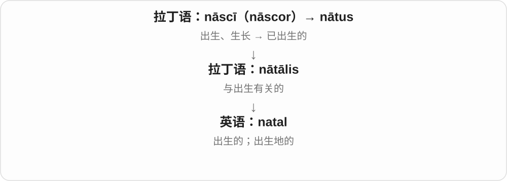

本页的出生支出现在 prenatal、postnatal 等词里；natal site 是出生地或孵化地。

**常见搭配与例句**

natal place；natal environment；a natal nest。

> The birds returned to their natal island.

这些鸟回到了它们出生的岛屿。

> The study recorded each animal’s natal location.

研究记录了每只动物的出生地点。

**别混淆**

natal 通常不是日常说宝宝新出生的首选；newborn 更直接。看见解剖语境中的 natal 要先判断词源支线。

### 197. skeletal — 骨骼的；骨瘦如柴的；只有框架的

**音标**：/ˈskelɪtəl/

**先抓住这个画面**

skeleton 是骨架，skeletal 说明与骨架有关。a skeletal outline 则像只搭了几根骨头的提纲，主要支点有了，细节还没长出来。

**怎么拆**

在 skeleton 的 skelet- 词干上接 -al → skeletal，不是保留整个 skeleton 再接成 skeletonal。由骨骼相关引出消瘦、缺乏细节等形象。

**怎么变成今天的意思**

**希腊语 skeletos 干枯的、干燥躯体 → 新拉丁语 sceleton → skeleton**  
骨架，后来泛指支撑结构、框架

↓

**skelet- + -al → skeletal；cyto- + skeleton → cytoskeleton**  
骨骼的、只剩框架的；细胞骨架

the skeletal system 骨骼系统；skeletal remains 骨骸；a skeletal outline 简略框架。

**常见搭配与例句**

the skeletal system；a skeletal outline。

> The lesson introduces the human skeletal system.

这节课介绍人体骨骼系统。

> The document provides only a skeletal outline of the proposal.

文件只给出提案的大致框架。

**别混淆**

skeletal 在提纲语境说缺少细节，在人体语境可说骨骼有关；不一律指瘦。

### 198. spherical — 球形的；球面的

**音标**：英 /ˈsferɪkəl/；美 /ˈsfɪrɪkəl/，也读 /ˈsferɪkəl/

**先抓住这个画面**

各个方向都像球一样鼓起，不只是从一个角度看着圆。

**怎么拆**

现代可分 sphere + -ical；词源词典有英语派生与希腊 sphairikos 经晚期拉丁进入英语的不同侧重，不把较晚出现的英语 spheric 固定画成必经阶段。

**怎么变成今天的意思**

**希腊 sphaira 球 → sphairikos；晚期拉丁 sphaericus**  
球形的古典形容词来源

↓

**英语 spherical；现代关系 sphere + -ical**  
Oxford 强调古典借入，Etyonline 记作英语 sphere 派生

a spherical object 是球状物；spherical coordinates 是球坐标。日常可以说 nearly spherical，承认真实物体只是接近完美球形。

**常见搭配与例句**

a spherical shape；nearly spherical；spherical coordinates；a spherical surface。

> The lamp has a spherical glass shade.

这盏灯有一个球形玻璃灯罩。

> The model treats the planet as perfectly spherical.

这个模型把行星视为完美球形。

**别混淆**

round 比较宽，盘子也能 round；spherical 明确是球状，不能拿来泛指任何圆形。

### 199. directional — 方向的；定向的

**音标**：英、美 /dəˈrekʃənəl/，也读 /daɪˈrekʃənəl/

**先抓住这个画面**

不是四面八方一视同仁，而是朝某个方向指、发射或接收。

**怎么拆**

direction + -al。

**怎么变成今天的意思**

**拉丁语：regere**  
引导、使直；治理

↓

**拉丁语：dirigere → directus**  
引向一定方向、摆直 → 直的

↓

**拉丁语 directio → 法语 direccion**  
引导、定向

↓

**英语：direction**  
方向；指导；用法说明

↓

**英语：direction + -al → directional**  
与方向有关；偏向特定方向

directional sign 用来指路；directional microphone 更擅长收取某些方向的声音，并非只能听到一条数学细线上的声源。

**常见搭配与例句**

directional signs；a directional microphone；directional control。

> Directional signs guide visitors through the museum.

指路标志引导游客穿行于博物馆。

> A directional microphone helped reduce noise from the sides.

定向麦克风有助于减少两侧传来的噪声。

**别混淆**

direct 表示直接或引导；directional 说明方向特性。

### 200. increment — 增量；增加的一步；使递增

**音标**：名词 /ˈɪŋkrəmənt/；动词也读 /ˈɪŋkrəment/

**先抓住这个画面**

从十到十二，多出来的二就是一个增量；若每次都加同样的一小份，就是按固定 increments 往上走。

**怎么拆**

借拉丁 incrementum，接 increscere“增加”的词干。不是把现代英语 increase 直接截短再加 -ment；动词由英语名词转用。

**怎么变成今天的意思**

**拉丁 crescere**  
生长、增加

↓

**拉丁 increscere → incrementum**  
增加 → 增长、增量

↓

**中古英语 increment → 英语 increment〔名词、后作动词〕**  
增量；按步增加

in increments of two 是每次加二，不必每次只加一。编程里 increment the counter 常表示给计数器加一；具体步长也可另行指定。

**常见搭配与例句**

small increments；in increments of ten；increment a counter。

> Raise the temperature in increments of two degrees.

每次把温度升高两度。

> The program increments the counter after each completed task.

程序每完成一个任务就给计数器加一。

**别混淆**

increase 泛指增加；increment 常聚焦某一小步或多出来的量。

### 201. incremental — 逐步增加的；增量的

**音标**：/ˌɪŋkrəˈmentəl/

**先抓住这个画面**

不一次全换完，而是一小步一小步添、改，就是 incremental 的典型感觉。数据处理里也可只处理新增、变化的部分。

**怎么拆**

increment 增量 + -al → incremental；increment 接拉丁增加、生长的材料。不是 increase 的拼写随意截短再接 mental 心理的。

**怎么变成今天的意思**

**拉丁 incrementum 等 → increment**  
增加量、一步增量

↓

**increment + -al → incremental**  
按增量、分步骤推进的性质

incremental change 渐进变化；incremental improvements 逐步改进；an incremental update 增量更新。

**常见搭配与例句**

incremental change；incremental improvements；an incremental update。

> The team made incremental improvements each week.

团队每周都作出逐步改进。

> The system processes an incremental update instead of rebuilding every record.

系统处理增量更新，无需重建每条记录。

**别混淆**

incremental 说明按增量、步骤推进，不保证每次变化都微不足道，也不等于所有渐进方案都慢。

### 202. longitudinal — 沿长度方向的；纵向的；长期跟踪的

**音标**：英 /ˌlɒŋɡɪˈtjuːdənəl/ 或 /ˌlɒndʒɪˈtjuːdənəl/；美 /ˌlɑːndʒəˈtuːdənəl/

**先抓住这个画面**

沿着一件东西的长轴看；研究中则像沿时间这条长轴，持续观察变化。

**怎么拆**

借中世纪拉丁 longitudinalis，接 longitudo 的词干 longitudin-；现代识别为 longitudin- + -al，不是简单在 longitude 后直接加字母。

**怎么变成今天的意思**

**拉丁 longus 长的、远的**  
这条拉丁线与英语本族词 long 的日耳曼线分开

↓

**拉丁 longitudo 长度，词干 longitudin-**  
由长的性质构成抽象名词

↓

**中世纪拉丁 longitudinalis → 英语 longitudinal**  
沿长度或经度方向；后来用于随时间跟踪的研究

longitudinal stripes 是沿长方向的条纹；a longitudinal study 常持续跟踪同一批人或其他研究对象，观察随时间的变化。不是所有用法都关乎地图经度。

**常见搭配与例句**

a longitudinal study；longitudinal data；a longitudinal section。

> The stem has narrow longitudinal stripes.

茎上有细长的纵向条纹。

> The longitudinal study followed the same children for ten years.

这项纵向研究跟踪了同一批儿童十年。

**别混淆**

transverse 是横着切过长轴；longitudinal 是顺着长轴。cross-sectional study 常比较某时点情况，longitudinal study 追踪时间变化。

### 203. dysfunctional — 运作失常的；功能不良的；关系模式有问题的

**音标**：/dɪsˈfʌŋkʃənəl/

**先抓住这个画面**

本来应当互相配合的环节，反而不断制造冲突、阻碍或伤害。

**怎么拆**

dysfunction + -al；也可看出 dys- 与 functional 的对应关系。

**怎么变成今天的意思**

**拉丁 fungi／fungor；分词词干 funct-**  
履行、执行、完成职责

↓

**拉丁 functio → 法语 fonction 等借入路线**  
执行、履行；某物承担的作用

↓

**英语 function**  
功能、职能；活动；起作用

↓

**英语 dysfunction → dysfunctional**  
运作失常 → 处于失常状态的

a dysfunctional team 可能职责不清、沟通失灵；a dysfunctional relationship 常说相处模式反复出问题。描述的是运作或关系状况，不应据此把一个人的全部价值概括成“坏掉了”。

**常见搭配与例句**

a dysfunctional organisation；a dysfunctional relationship；become dysfunctional。

> The committee became dysfunctional when members stopped sharing information.

成员不再共享信息后，委员会的运作出了问题。

> The novel explores a dysfunctional relationship between two friends.

小说探讨了两个朋友之间一种有问题的相处关系。

**别混淆**

inefficient 强调效率低；dysfunctional 更可能涉及基本配合方式有问题，不只是速度慢。

### 204. continual — 不断的；频繁反复的

**音标**：/kənˈtɪnjuəl/

**先抓住这个画面**

continual 像一件事隔不了多久又来一次，让人感觉总在发生。

**怎么拆**

经古法语 continuel 来自拉丁语 continuus“连续的”，历史上与 continuous 很接近。

**怎么变成今天的意思**

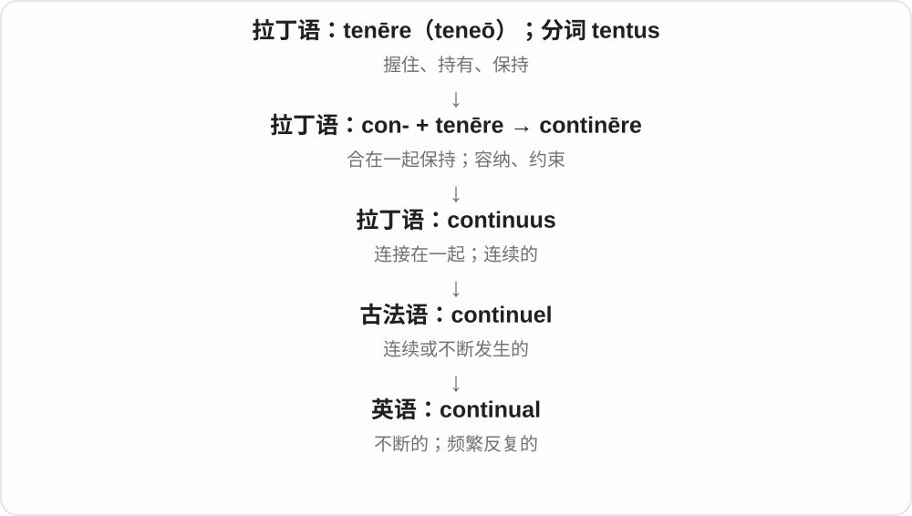

现代常用来描述持续反复的干扰、变化或要求。它也能表示连续，不必把实用辨析当成永远没有例外的规则。

**常见搭配与例句**

continual interruptions；continual change；a continual source of… 。

> Continual interruptions made it hard to finish the report.

接连不断的打扰让人难以写完报告。

> The garden is a continual source of new ideas for her paintings.

这座花园不断为她的绘画带来新想法。

**别混淆**

continuous 一般强调没有间断；continual 常强调反复不断。电话一再打来可以 continual，通话从不挂断才典型是 continuous。

### 205. cylindrical — 圆柱形的；圆筒状的

**音标**：/səˈlɪndrɪkl/

**先抓住这个画面**

不直接把东西叫圆柱，而是说它的外形像一根筒或柱。

**怎么拆**

现代可认出 cylindr- + -ical；历史接希腊 kylindrikos 的拉丁化词族。常分析为 cylindric + -al，但现存英语记录中 cylindrical 更早，不能据此断定后记录的词一定先产生。

**怎么变成今天的意思**

**希腊 kylindein 滚动 → kylindros 滚筒、圆柱**  
能滚动的圆形长体成为形状名称

↓

**希腊 kylindrikos 圆柱的及其拉丁化形式 → 英语 cylindrical**  
近代形成 -ical 形容词；与 cylindric 并存，借词先后须谨慎

a cylindrical container 是圆筒状容器，a cylindrical tower 是圆柱形塔。它描述形状，不保证里面是实心，也不表示物体一定能自由滚动。

**常见搭配与例句**

a cylindrical container；a cylindrical tower；a cylindrical shape。

> The samples were stored in small cylindrical containers.

样品存放在小圆筒容器里。

> A cylindrical tower rises above the entrance.

入口上方矗立着一座圆柱形塔。

**别混淆**

circular 主要说圆形或环形；cylindrical 说圆柱、圆筒这种立体形状。球形则是 spherical。

### 206. ornamental — 装饰性的；供观赏的

**音标**：英 /ˌɔːnəˈmentəl/；美 /ˌɔːrnəˈmentəl/

**先抓住这个画面**

主要任务是好看：它可以有用，但这句话强调它摆在那里供人欣赏。

**怎么拆**

ornament + -al，由装饰品扩展为与装饰用途有关的形容词。

**怎么变成今天的意思**

**拉丁 ornare**  
配备、布置；装饰

↓

**ornament + -al → ornamental**  
装饰物 → 用作装饰的

ornamental plants 是观赏植物；ornamental gates 是有装饰性的门。不能直接翻成“无用的”：观赏树也能遮阴，装饰门也可能正常开关，只是此处强调美观。

**常见搭配与例句**

ornamental plants；an ornamental pond；purely ornamental。

> They planted ornamental grasses beside the path.

他们在小路旁种了观赏草。

> The small balcony is purely ornamental.

这个小阳台纯粹起装饰作用。

**别混淆**

ornamental 说用途或作用，ornate 说装饰丰富、繁复。一个线条简洁的花瓶也能是 ornamental，却未必 ornate。

### 207. causal — 因果的；涉及原因的

**音标**：/ˈkɔːzəl/

**先抓住这个画面**

causal 要说的是“A 让 B 发生”，像两块多米诺骨牌之间确实存在推动关系。只是一起出现，还不够叫 causal。

**怎么拆**

来自拉丁语 causālis，由 causa 加形容词结尾形成。现代可用 cause + -al 帮助理解“与原因有关的”。

**怎么变成今天的意思**

cause 是原因这个东西；causal 是用来描述关系、解释或因素的形容词。a causal link 就是一个因素对另一个结果有影响，而非两个数字恰好一起升降。

**常见搭配与例句**

a causal link（因果联系）；a causal relationship（因果关系）；a causal explanation（说明为什么发生的解释）。

> The study found a causal link between the two events.

这项研究发现了两个事件之间的因果联系。

> We need a causal explanation, not just a list of events.

我们需要解释事情为什么发生，而不只是列出事件。

**别混淆**

causal 是因果的；casual 是随意的、休闲的。causal /ˈkɔːzəl/ 与 casual /ˈkæʒuəl/ 的拼写和发音都不同。

### 208. hormonal — 激素的；与激素有关的

**音标**：英 /hɔːˈməʊnəl/；美 /hɔːrˈmoʊnəl/

**先抓住这个画面**

说某个变化或过程和体内的化学信使有关，还没有单靠这个词交代全部原因。

**怎么拆**

hormone + -al，词尾 e 去掉；把激素这个名词变成表示关系的形容词。

**怎么变成今天的意思**

**古希腊 horman；horme**  
推动、激起；冲动、推动力

↓

**现代科学造词 hormone**  
引发生理反应的化学信号

↓

**hormone + -al → hormonal**  
与激素有关的

hormonal changes 是激素相关变化；hormonal regulation 是激素调节。口语里说某个人 is hormonal 有时暗指情绪受激素影响，但会显得武断或轻视，不能当作对人的认真解释。

**常见搭配与例句**

hormonal changes；hormonal regulation；hormonal signals。

> The textbook describes hormonal regulation of growth.

课本介绍了激素对生长的调节。

> Researchers compared hormonal changes in the two groups.

研究人员比较了两组的激素变化。

**别混淆**

hormonal 是关系形容词，不等于所有情绪波动都由激素造成。准确理解时要看具体讨论的是哪种信号、哪种变化。

### 209. primal — 最初的；根本的；本能的；初级分割的〔肉类〕

**音标**：英、美 /ˈpraɪməl/

**先抓住这个画面**

往人的感受最深处看，那里有饥饿、恐惧、求生等尚未经过复杂分析的反应。

**怎么拆**

主要联系中世纪拉丁语 primalis“最初的”，亦可有英语 prime + -al 的形成；肉类术语 primal cut 指初次大块分割得到的部分。

**怎么变成今天的意思**

**拉丁语 primus**  
第一、最先；地位最高、最重要

↓

**中世纪拉丁语 primalis → 英语 primal；部分用法亦可从 prime + -al 解释**  
最初的、基础的；本能层面的

a primal fear 是很深、近乎本能的恐惧；a primal urge 是原始强烈的冲动。肉类加工中的 primal 说分割阶段，不是肉品质最高等级。

**常见搭配与例句**

a primal fear；a primal instinct；a primal cut。

> The sudden roar triggered a primal fear.

突如其来的吼声激起了本能的恐惧。

> The butcher explained how primal cuts are divided into smaller portions.

肉铺师傅解释了初级分割大块如何再切成较小部分。

**别混淆**

primal 偏向最根本、本能层面；primary 常说首要、基础等级。prime meat 与 primal cut 也不是同一概念。

### 210. incidental — 附带的；次要的；偶然伴随的

**音标**：/ˌɪnsɪˈdentəl/

**先抓住这个画面**

你主要去做一件事，旁边顺带发生、花费或得到的东西，是 incidental。

**怎么拆**

incident + -al；从伴随发生的事，转成描述它在整体中所处的位置。

**怎么变成今天的意思**

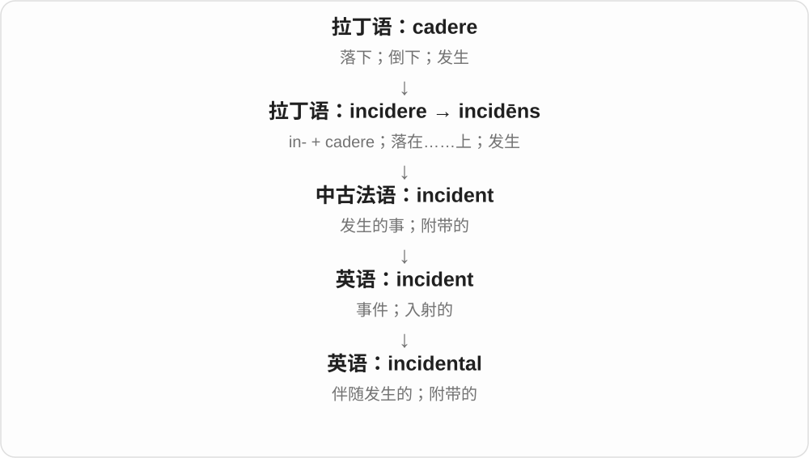

去开会时的零星开销，可以是 incidental expenses；修路时顺便发现古物，是 incidental discovery。重点在于它不是原来的主任务，不必每次都强调完全出乎意料。

**常见搭配与例句**

incidental expenses；incidental to…；an incidental benefit；incidentals（零星杂费）。

> The grant covers travel and incidental expenses.

这笔资助涵盖差旅和零星杂费。

> The extra storage space was an incidental benefit of the redesign.

额外的储物空间是这次重新设计带来的附加好处。

**别混淆**

accidental 说非故意、出于偶然；incidental 说附带、次要。一项收益可以 incidental，但也在预料之内。

### 211. adversary — 对手；敌手

**音标**：英 /ˈædvəsəri/；美 /ˈædvərseri/

**先抓住这个画面**

站在与你相对的一边、争取相反结果的人。可以很强硬，也可以是互相尊重的竞赛对手。

**怎么拆**

拉丁语 adversārius“处在对面的”，经法语 aversaire 等形式借入；现代形式可联系 adverse + -ary。

**怎么变成今天的意思**

语气较 opponent 正式，有时显得冲突更强，但并不必然表示私仇。a worthy adversary 是值得认真对待的强劲对手。

**常见搭配与例句**

a formidable adversary；a political adversary；face an adversary。

> She treated her adversary with respect throughout the debate.

整场辩论中，她都尊重对手。

> The champion finally met a formidable adversary.

这位冠军终于遇到了一个强劲的对手。

**别混淆**

enemy 常带敌对与伤害意味；adversary 可只是竞争或辩论中的对方。

### 212. adversarial — 对抗性的；对手式相互挑战的

**音标**：英 /ˌædvəˈseəriəl/；美 /ˌædvərˈseriəl/

**先抓住这个画面**

双方像站在对面，各自提出主张、找对方的问题，是 adversarial 的关系。可以是一种制度、测试安排，不一定私人相互仇恨。

**怎么拆**

通常由 adversary 对手 + -al，y 改 i → adversarial；adversary 上接拉丁转向相反一边的 adversus 等材料。

**怎么变成今天的意思**

**拉丁 adversus、adversarius 等 → adversary**  
相向、对立 → 对手

↓

**adversary + -al → adversarial**  
按对手关系展开的性质

an adversarial relationship 对抗关系；an adversarial approach 对抗式做法；adversarial testing 对抗式测试。

**常见搭配与例句**

an adversarial relationship；an adversarial approach。

> The meeting became unnecessarily adversarial.

会议变得不必要地充满对抗。

> The exercise uses an adversarial approach to test the argument.

练习用对手式挑战来检验论证。

**别混淆**

adversarial 描述对抗、挑战结构，不等于每个参与者都很 hostile 怀有敌意；也不等于 adverse 不利的所有用法。

### 213. congenital — 先天的；出生时已存在的

**音标**：英 /kənˈdʒenɪtəl/；美 /kənˈdʒenətəl/

**先抓住这个画面**

它与出生一起到来，而不是长大后才获得。

**怎么拆**

拉丁 con-“一起” + genitus“出生的”组成 congenitus，英语接 -al；不能按现代 genital 的器官义生搬。

**怎么变成今天的意思**

**拉丁 gignere、genitus；同族 genus、gener-**  
生出、产生；种类、出身

↓

**拉丁 con- + genitus → congenitus**  
与出生一起存在的

↓

**英语 congenital**  
先天的；出生时已存在的

congenital condition 说明某种情况在出生时就有，但可能较晚才被发现。它不自动等于遗传自父母；遗传、发育及环境因素都可能有关。

**常见搭配与例句**

a congenital condition；congenital heart disease；congenital differences。

> The condition was congenital, although it was diagnosed later.

这种情况是先天的，不过后来才得到诊断。

> The article distinguishes congenital conditions from hereditary ones.

文章区分了先天情况和遗传性情况。

**别混淆**

hereditary 强调遗传传递；congenital 强调出现时间，两者不是同一个分类角度。

### 214. feral — 野化的；野性的、未驯服的

**音标**：/ˈferəl/〔亦有 /ˈfɪərəl/〕

**先抓住这个画面**

家养动物的后代在野外自行生活，是 feral 的典型场景。也可能是在野外出生，重点是这条谱系、生活状态，不要求每只都曾进过家门。

**怎么拆**

接拉丁 fera 野兽、ferus 野的等材料与 -al，相应形式也可经法语、拉丁借入。不是 fear 害怕加 l。

**怎么变成今天的意思**

**拉丁 fera、ferus 的野兽、野性材料**  
未驯、野生的性质

↓

**feral 的现代使用**  
野化动物、未驯服状态，也有较宽野性义

a feral cat 野化、野生化猫；feral populations 野化种群；feral animals 野化动物。

**常见搭配与例句**

a feral cat；feral populations。

> The researchers counted feral cats near the old farm.

研究者统计了旧农场附近的野化猫。

> The article examines how feral populations become established.

文章考察野化种群如何形成。

**别混淆**

feral 与 wild 有重叠，前者常强调家养、圈养祖先后的野化；并非所有野生动物都需要叫 feral。

### 215. sequential — 按顺序的；依次发生的

**音标**：/sɪˈkwenʃəl/

**先抓住这个画面**

第一步走完再接第二步，步骤按预定次序排开，这种安排是 sequential。

**怎么拆**

拉丁语 sequentia“接续”词族加 -al 形成；现代与 sequence 对应，词中发音变为 /kwenʃ/。

**怎么变成今天的意思**

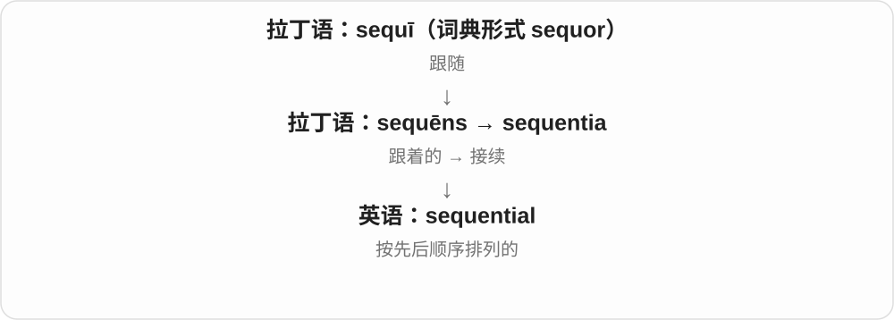

常用来描述编号、步骤、阅读或处理方式。强调有序推进，不一定每两个事件之间完全没有间隔。

**常见搭配与例句**

sequential steps；sequential numbering；sequential processing。

> The instructions describe five sequential steps.

说明书列出了五个依次进行的步骤。

> Each page is given a sequential number.

每页都有一个连续编号。

**别混淆**

sequential 说按顺序；simultaneous 说同时发生。consecutive 更强调连续、没有跳过中间项。

### 216. generational — 代际的；某一代的；一代人中罕见的

**音标**：/ˌdʒenəˈreɪʃənəl/

**先抓住这个画面**

把差异或变化放到一代接一代的尺度上。

**怎么拆**

generation + -al。

**怎么变成今天的意思**

**拉丁 gignere、genitus；同族 genus、gener-**  
生出、产生；种类、出身

↓

**拉丁 generāre → generātiō**  
产生 → 产生过程、后代

↓

**古法语 generacion → 中古英语 generacioun → generation**  
产生；同一代人；一代产品

↓

**英语 generation + -al → generational**  
与某代或代际变化有关的

generational differences 是不同代人的差异。a generational talent 是夸赞一代人中都少见的杰出人才，常见于体育、艺术评论。

**常见搭配与例句**

generational change；generational differences；a generational talent。

> The survey revealed generational differences in reading habits.

调查显示了不同代人在阅读习惯上的差异。

> Critics described the young pianist as a generational talent.

评论家把这位年轻钢琴家誉为一代人中罕见的天才。

**别混淆**

intergenerational 明确强调不同代之间的联系；generational 也可以只说某一代的特点。

### 217. recite — 背诵；朗诵；逐项陈述

**音标**：/rɪˈsaɪt/

**先抓住这个画面**

把记住或准备好的内容一项项叫出来，让别人听见。

**怎么拆**

re- 再、回 + 拉丁 citāre，经 recitāre、法语 réciter 借入。

**怎么变成今天的意思**

**拉丁 ciēre → citāre**  
使动起来、唤起 → 召唤、促动

↓

**拉丁 re- + citāre → recitāre → 法语 réciter → 英语 recite**  
再叫出来、读出 → 朗诵、背诵、逐一陈述

recite a poem 可以背诗或朗诵；recite the facts 是逐条说出事实，有时带机械照念的感觉。它不是“再次引用”的唯一意思。

**常见搭配与例句**

recite a poem；recite from memory；recite a list。

> She recited the poem from memory.

她凭记忆背诵了这首诗。

> He recited a long list of rules.

他一条条念出了一长串规则。

**别混淆**

read aloud 可以边看边读；recite 常带记忆或准备过的内容，但并非每次都必须脱稿。

### 218. recital — 独奏会；独唱会；表演会；详述

**音标**：/rɪˈsaɪtəl/

**先抓住这个画面**

把准备好的内容完整呈现给听众：可以是音乐，也可以是一串事实。

**怎么拆**

recite + 名词后缀 -al；音乐表演义受法语等使用影响发展。

**怎么变成今天的意思**

**拉丁 ciēre → citāre**  
使动起来、唤起 → 召唤、促动

↓

**拉丁 re- + citāre → recitāre → 法语 réciter → 英语 recite**  
再叫出来、读出 → 朗诵、背诵、逐一陈述

↓

**英语 recital**  
陈述、讲述 → 专场音乐或舞蹈表演等

a piano recital 常是钢琴独奏会；a dance recital 也可由多名学生展示。法律文件里 recitals 是背景事实陈述，不能因为看见 recital 就想到音乐厅。

**常见搭配与例句**

a piano recital；a dance recital；a recital of facts。

> We attended her piano recital on Friday.

星期五我们去听了她的钢琴独奏会。

> The meeting began with a lengthy recital of past problems.

会议一开始便冗长地历数过去的问题。

**别混淆**

concert 范围广；recital 常突出一位演奏者、一种表演或学生成果展示，但并非永远只有一个人。

### 219. recitals — 独奏、独唱或舞蹈专场；逐项陈述〔复数〕

**音标**：/rɪˈsaɪtəlz/

**先抓住这个画面**

乐器独奏、声乐独唱、学生舞蹈展示，都可能叫 recital；几场就是 recitals。先按实际演出内容理解这种专场名称。

**怎么拆**

recital + -s；recital 现代对应 recite 去 e 加名词 -al，历史由陈述、讲述发展到音乐、舞蹈表演等用途。

**怎么变成今天的意思**

**拉丁 ciere、citare → re- + citare → recitare**  
唤起、召唤 → 读出、再说出

↓

**法语 reciter → 英语 recite；recital 的后续发展**  
朗诵、背诵、逐项陈述；名词另发展为音乐、舞蹈专场

↓

**recital + -s → recitals**  
多场专场演出；多次详细陈述

piano recitals 钢琴独奏会，dance recitals 舞蹈专场；演出可以包含伴奏。

**常见搭配与例句**

student recitals 学生专场表演；give recitals 举行专场演出。

> She gives piano recitals across the country.

她在全国各地举办钢琴独奏会。

> The school holds student recitals every term.

学校每学期举行学生专场表演。

**别混淆**

concert 范围更广；音乐 recital 常以某位演奏者为主，dance recital 也可是一群学生的舞蹈展示。

### 220. divisional — 部门的；分区的；师级的

**音标**：/dɪˈvɪʒənəl/

**先抓住这个画面**

事情发生在一个 division 这个层级：全公司有总经理，每个事业部又有 divisional manager。

**怎么拆**

division + -al，是英语形容词派生。

**怎么变成今天的意思**

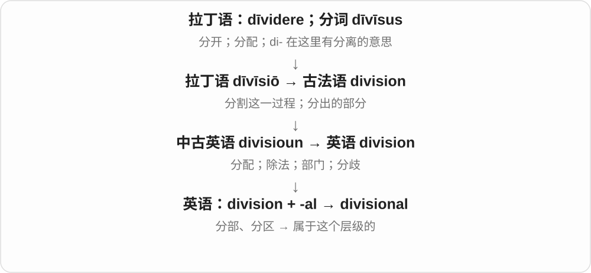

通常接 manager、meeting、headquarters 等名词。军事里 divisional 属于师这一编制；商业里属于某个分部。

**常见搭配与例句**

a divisional manager；divisional headquarters；divisional results。

> Each divisional manager submitted a monthly report.

每位部门经理都提交了月报。

> The divisional meeting focused on training.

这次部门会议主要讨论培训。

**别混淆**

divisional 说所属层级；divisive 说引起争执、分裂。

### 221. mitochondrion — 线粒体〔单数〕

**音标**：英 /ˌmaɪtəʊˈkɒndriən/；美 /ˌmaɪtoʊˈkɑːndriən/

**先抓住这个画面**

细胞里的一个小型能量转换站：把营养物质所含的能量转成细胞较方便使用的 ATP。名称却先描述外观——像细线，也像小颗粒。

**怎么拆**

希腊 mitos“丝线”与 khondrion“小颗粒”是并列材料。19 世纪末德国科学命名 Mitochondrium 采用这两部分，英语借用相应的新拉丁形式 mitochondrion；并不是 mitosis 再加上某个词尾。

**怎么变成今天的意思**

**希腊 mitos；khondrion**  
丝线；小颗粒

↓

**德语／新拉丁科学命名 Mitochondrium**  
以观察到的线状、颗粒状外形命名

↓

**英语 mitochondrion；复数 mitochondria**  
一个线粒体；多个线粒体

“发电站”是方便理解作用的比喻，不是它的字面词源。线粒体有内外两层膜，也有自己的少量 DNA；许多细胞用它制造大量 ATP，但不能理解成所有细胞、所有能量转换都只靠它。

**常见搭配与例句**

a mitochondrion；the inner membrane of a mitochondrion。复数 mitochondria，英 /ˌmaɪtəʊˈkɒndriə/，美 /ˌmaɪtoʊˈkɑːndriə/；复数通常不再加 -s。

> The diagram labels the inner and outer membranes of a mitochondrion.

示意图标出了一个线粒体的内膜和外膜。

> This muscle cell contains many mitochondria.

这个肌肉细胞含有许多线粒体。

**别混淆**

mitochondrion 是细胞器，mitosis 是细胞核分裂过程；两者只是都采用了“丝线”这一命名材料。

### 222. mitochondrial — 线粒体的、与线粒体有关的

**音标**：英 /ˌmaɪtəˈkɒndriəl/；美 /ˌmaɪtəˈkɑːndriəl/

**先抓住这个画面**

看到 mitochondrial DNA，就把它读成线粒体里的 DNA；它说明所属位置、研究对象，不是另一类细胞的名字。

**怎么拆**

mitochondria 与 -al 形容词材料组合，保留 mitochondri- 这一词干，形成与线粒体有关的修饰语。

**怎么变成今天的意思**

**mitochondrion、mitochondria 的线粒体词族**  
丝粒状结构的科学名称

↓

**mitochondri- + -al → mitochondrial**  
线粒体的

mitochondrial DNA 线粒体 DNA；mitochondrial membrane 线粒体膜；mitochondrial function 线粒体功能。

**常见搭配与例句**

mitochondrial genes；mitochondrial activity。

> The researchers compared mitochondrial DNA from several samples.

研究者比较了几个样本的线粒体 DNA。

> The diagram labels the mitochondrial membranes.

图解标出了线粒体膜。

**别混淆**

mitochondria 是复数名词，mitochondrial 是形容词。两者尾部变化承担当下语法功能，不是线粒体变成另一种东西。

### 223. mitochondria — 线粒体〔mitochondrion 的复数〕

**音标**：英 /ˌmaɪtəˈkɒndriə/；美 /ˌmaɪtoʊˈkɑːndriə/

**先抓住这个画面**

细胞里参与能量转换的一类小结构，常被形象地叫作供能站。mitochondria 说复数，mitochondrion 说一个。

**怎么拆**

近代科学名称借助希腊语 mitos 丝、线与 chondrion 小颗粒构成，经德语术语传播。名字先描写显微观察中的丝状、颗粒状外观，后来功能研究更深入。

**怎么变成今天的意思**

**希腊语 mitos + chondrion → 近代科学命名**  
丝、线 + 小颗粒，描写观察到的形态

↓

**mitochondrion → mitochondria**  
现代英语的单数与复数形式

mitochondria in a cell 细胞内的线粒体；mitochondria have their own DNA 线粒体有自身 DNA。标准复数搭配 mitochondria are。

**常见搭配与例句**

many mitochondria；the membranes of mitochondria。

> The cell contains many mitochondria.

这个细胞内含有许多线粒体。

> The lesson explains how mitochondria help supply energy to cells.

这一课解释线粒体怎样帮助细胞获得能量。

**别混淆**

细胞供能站是帮助理解功能的比喻；词源中的丝、颗粒则描写形态。不要用后来发现的功能替换原来的命名理由。

### 224. orchestral — 管弦乐的；管弦乐队的

**音标**：英 /ɔːˈkestrəl/；美 /ɔːrˈkestrəl/

**先抓住这个画面**

把 orchestra 变成修饰作品、音色或演奏形式的形容词。

**怎么拆**

英语 orchestra 加形容词后缀 -al，词尾 a 不再单独保留，形成 orchestral。历史主干仍是希腊表演场地经拉丁语发展出的 orchestra。

**怎么变成今天的意思**

**希腊语 orkheisthai → orchestra**  
跳舞 → 剧场中歌队表演的区域

↓

**拉丁语 orchestra → 英语 orchestra**  
古剧场区域；后来也指在那里演奏的乐队

↓

**英语 orchestra + -al → orchestral**  
适合或属于管弦乐队的

orchestral music 是管弦乐，orchestral accompaniment 是管弦乐伴奏。重点在编制或声音组织，不保证作品一定古老：电影、游戏也可以使用 orchestral music。

**常见搭配与例句**

orchestral music；an orchestral arrangement；orchestral accompaniment；an orchestral score。

> The film combines electronic sounds with orchestral music.

这部电影把电子音效与管弦乐结合起来。

> The singer performed with orchestral accompaniment.

歌手在管弦乐伴奏下演唱。

**别混淆**

orchestral 不等于 classical。前者说用什么演奏、怎样编配，后者常涉及音乐传统或风格。注意重音移到 /ˈkes/，不跟 orchestra 完全相同。

### 225. relational — 关系的；与关系有关的；关系模型的

**音标**：/rɪˈleɪʃənəl/

**先抓住这个画面**

把重点放在事物、人之间怎样联系；数据库里则是一个专门模型名，不只是泛泛说数据彼此有关系。

**怎么拆**

relation + -al 相关形容词。relational database 的 relation 取数学关系的专门含义，常以表来表示，不是把数据库当人际关系网。

**怎么变成今天的意思**

**拉丁 referre → relātus、relātiō → 法语 relacion → 英语 relation**  
带回、报告、联系相关对象等历史词族

↓

**现代 relation 词族**  
事物联系；亲属、关系及其性质

↓

**relation + -al → relational**  
关系 → 关系方面的；专门关系模型的

relational skills 人际关系技能，a relational database 关系数据库；两个场景同词但专业程度不同。

**常见搭配与例句**

relational skills；relational data；a relational database。

> The workshop focuses on relational skills in team leadership.

工作坊重点训练团队领导中的人际关系技能。

> The application stores customer records in a relational database.

应用把客户记录存入关系数据库。

**别混淆**

relational database 不是所有互相连接的数据都自动属于它；relationship 仍是名词，不能写 a relationship database 来替代正式术语。

### 226. rotational — 旋转的；与转动有关的；轮换的

**音标**：英 /rəʊˈteɪʃənəl/；美 /roʊˈteɪʃənəl/

**先抓住这个画面**

rotational 把视线放到“怎样转、转得怎样”上，也可说工作安排怎样轮流进行。

**怎么拆**

rotation + -al。

**怎么变成今天的意思**

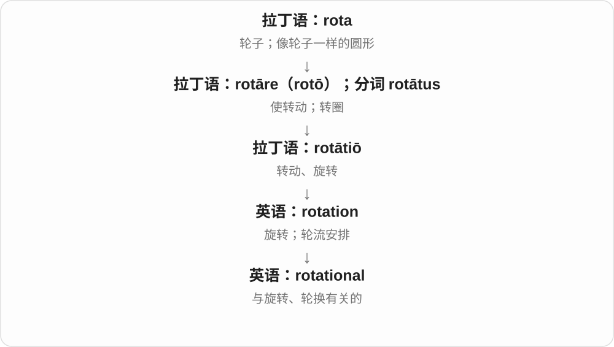

可用于角速度、对称性、岗位安排。流体中的 rotational 还可专指存在涡量，不能只凭水流路线弯不弯判断。

**常见搭配与例句**

rotational motion；rotational symmetry；rotational speed；a rotational programme。

> The experiment measures rotational speed.

实验测量旋转速度。

> The company offers a rotational training programme.

公司提供轮岗培训项目。

**别混淆**

rotary 多形容按旋转方式工作的机械；rotational 更适合说明运动、性质和安排。

### 227. alphabetical — 按字母顺序的；字母的

**音标**：英美 /ˌælfəˈbetɪkəl/

**先抓住这个画面**

让名字或词语按 A、B、C 的次序排队，方便查找。

**怎么拆**

现代可看作 alphabet + -ical；也有接拉丁形容词 alphabeticus 再加 -al 的分析。不要仅凭它比 alphabetic 长，就认定必定由较短英语词先派生出来。

**怎么变成今天的意思**

**腓尼基等闪语字母名 aleph、beth → 希腊 alpha、beta**  
希腊字母表开头的两个字母名

↓

**希腊 alphabetos → 拉丁 alphabetum**  
用头两个字母的名字指整套字母

↓

**拉丁形容词 alphabeticus 与英语 -al；亦有 alphabet + -ical 分析**  
英语 alphabetical：与字母有关，尤指按字母顺序的

an alphabetical list 是按字母顺序排的名单。in alphabetical order 是最常用搭配；这时它说的是排列规则，不是名单里的内容都只有单个字母。

**常见搭配与例句**

in alphabetical order；an alphabetical list；an alphabetical index。

> Please put the surnames in alphabetical order.

请把姓氏按字母顺序排列。

> An alphabetical index makes the terms easier to find.

按字母顺序编排的索引让术语更容易查找。

**别混淆**

chronological order 按时间，numerical order 按数字，alphabetical order 按字母。说按姓氏排，还要交代 by surname。

### 228. pictorial — 图画的；用图片呈现的

**音标**：英 /pɪkˈtɔːriəl/；美 /pɪkˈtɔːriəl/

**先抓住这个画面**

介绍一本地方历史，不只靠长篇文字，而用照片、地图和插图把它讲出来，这就是 pictorial 的方向。

**怎么拆**

拉丁 pictor 画家 → pictorius“绘画的”，英语再配 -al。不是把 picture 原样加 -ial；形式里的 pictor- 有自己的拉丁来源。

**怎么变成今天的意思**

**拉丁 pingere，过去分词 pictus**  
绘画、着色；用图像表现

↓

**拉丁 pictor → pictorius**  
画家 → 绘画的

↓

**英语依 pictorius 配 -al → pictorial**  
关于图画的；以图片表现的

a pictorial guide 是图片式指南；pictorial evidence 是图像证据。这个词说媒介或呈现方式，不自动表示景色优美。

**常见搭配与例句**

a pictorial guide；a pictorial history；pictorial representation；pictorial evidence。

> The museum published a pictorial history of the neighbourhood.

博物馆出版了一部街区图史。

> Pictorial instructions show how the parts fit together.

图示说明展示了各部件如何装配。

**别混淆**

picturesque 是风景如画、好看；pictorial 是与图片有关、通过图片呈现。

### 229. anatomical — 解剖学的；身体结构方面的

**音标**：英 /ˌænəˈtɒmɪkəl/；美 /ˌænəˈtɑːmɪkəl/

**先抓住这个画面**

谈的是身体“由哪些部分组成、彼此在什么位置”。

**怎么拆**

anatomy + -ical；历史上 anatomical 早于英语 anatomic，不机械把后者当祖先。

**怎么变成今天的意思**

**希腊 anatome → 拉丁 anatomia → 英语 anatomy**  
切开研究 → 解剖学

↓

**anatomy + -ical → anatomical**  
解剖学 → 身体结构方面的

anatomical drawing 是把结构画准确的图；anatomical differences 是身体构造上的差异。它强调结构这一角度，不只是说“和身体有关”。

**常见搭配与例句**

anatomical structure；anatomical drawings；anatomical differences；an anatomical model。

> The textbook includes detailed anatomical drawings.

这本教材包含详细的解剖结构图。

> The study identified anatomical differences between the two species.

研究发现了这两个物种在身体结构上的差异。

**别混淆**

anatomical 侧重结构；physiological 侧重功能和过程。器官形状与器官工作方式是相关的两个问题。

### 230. preferential — 优待的；优先的；优惠的

**音标**：英、美 /ˌprefəˈrenʃəl/

**先抓住这个画面**

同样排队，有人被给了更好的位置、更低的价格或更快的通道。

**怎么拆**

按 preference + -ial 的形式理解；Oxford 分析为仿 differential 的英语形容词派生，也有词典直接联系拉丁 preferentia 词干。

**怎么变成今天的意思**

**拉丁语：ferre；第一人称 ferō**  
带、承载；承受；生出

↓

**拉丁语：prae- + ferre → praeferre**  
放到前面；优先看待

↓

**中世纪拉丁语 preferentia → 法语 preference**  
优先选择、偏爱

↓

**英语：preference**  
偏好；优先权

↓

**英语：preference → preferential**  
获得优先、优惠待遇的

preferential treatment 常指有人受到特殊优待；preferential rates 是优惠费率。不一定含贬义，是否公平由语境决定。

**常见搭配与例句**

preferential treatment；preferential access；preferential rates。

> Members receive preferential rates for room bookings.

会员订房可享受优惠价格。

> Applicants complained that relatives were given preferential treatment.

申请者抱怨亲属受到优待。

**别混淆**

preferred 说“更被喜欢、被选中”；preferential 说制度或待遇向某一方倾斜。

### 231. upheaval — 剧变、动荡；隆起〔地质等〕

**音标**：/ʌpˈhiːvəl/

**先抓住这个画面**

像把原来稳定的地面从下面掀起来，原有秩序一下被打乱，就是社会、生活里 upheaval 的感觉。

**怎么拆**

upheave 向上抬、掀起 + -al，去末尾 e → upheaval。upheave 又由 up + heave 举、抬组成；不从 heaven 天空变形解释。

**怎么变成今天的意思**

**up + heave → upheave**  
从下面向上抬、掀起

↓

**upheave + -al → upheaval**  
地质隆起；比喻强烈动荡、剧变

social upheaval 社会剧变；political upheaval 政治动荡；a period of upheaval 动荡时期。

**常见搭配与例句**

social upheaval；a period of upheaval。

> Moving countries caused a major upheaval in their lives.

迁居国外使他们的生活发生重大变化。

> The book describes a period of social upheaval.

书中描写了一段社会剧变时期。

**别混淆**

upheaval 比普通 change 变化强，常带结构被打乱、需要重新适应的感觉，不只例行小调整。

### 232. arouse — 激起、唤起；使醒来；引起性兴奋

**音标**：/əˈraʊz/

**先抓住这个画面**

原来没起反应，后来好奇、怀疑、兴趣被叫醒，是 arouse 的常见画面。也能直说把人从睡眠中唤醒。

**怎么拆**

a- 加强 + rouse 唤起、使起来 → arouse；与 arise 出现、起身不同，不能随意互换两个动作的方向。

**怎么变成今天的意思**

**a- 加强 + rouse 唤起 → arouse**  
唤醒、使活跃的动作材料

↓

**arouse + -al → arousal**  
唤醒、激起的过程和状态

arouse curiosity 激起好奇；arouse suspicion 引起怀疑；arouse interest 激发兴趣；arouse someone from sleep 唤醒某人。

**常见搭配与例句**

arouse curiosity；arouse suspicion；arouse interest。

> The unusual sound aroused her curiosity.

不寻常的声音激起了她的好奇。

> His vague answer aroused suspicion.

他含糊的回答引起了怀疑。

**别混淆**

arouse 常是使别人、某种反应被唤起；arise 常是事情自己出现。Problems arise 不等于 problems arouse。

### 233. arousal — 唤醒、唤起；身心激活状态；性唤起

**音标**：/əˈraʊzəl/

**先抓住这个画面**

从低反应到警觉、情绪活跃，是较宽的 arousal；某些语境专指性唤起，要看 emotional、physiological、sexual 等限定。

**怎么拆**

arouse 去末尾 e 加名词尾 -al → arousal；不是形容词有唤醒性质的某某物，而是过程、状态名。

**怎么变成今天的意思**

**a- 加强 + rouse 唤起 → arouse**  
唤醒、使活跃的动作材料

↓

**arouse + -al → arousal**  
唤醒、激起的过程和状态

↓

**arouse + -al → arousal**  
被唤醒、激起的过程和状态

emotional arousal 情绪唤起；physiological arousal 生理激活；arousal from sleep 从睡眠中醒来。

**常见搭配与例句**

emotional arousal；physiological arousal；arousal from sleep。

> The study measured changes in physiological arousal.

研究测量了生理激活状态的变化。

> The textbook discusses arousal from sleep.

教材讨论从睡眠中醒来的过程。

**别混淆**

arousal 不只性语境，研究注意、情绪、睡眠时也常见；与 arrival 到达的拼写、意思不同。

### 234. rebut — 反驳；用相反理由、证据回应

**音标**：/rɪˈbʌt/

**先抓住这个画面**

别人把一个说法推过来，你拿理由、证据推回去，是理解 rebut 的画面。重点不只是大声说不。

**怎么拆**

借古法语 rebuter、rebouter 等，re- 回 + bouter 推、顶。后来的论证反驳义保留推回的方向。

**怎么变成今天的意思**

**古法语 re- + bouter 推、顶 → rebut**  
推回、驳回的动作材料

↓

**rebut + -al → rebuttal**  
提出相反论证、证据的反驳行为或内容

rebut an argument 反驳论证；rebut a claim 反驳主张；rebut an allegation 反驳指控。

**常见搭配与例句**

rebut an argument；rebut a claim。

> She rebutted the claim with records from the archive.

她用档案记录反驳了那个说法。

> The article rebuts the main argument point by point.

文章逐点反驳了主要论证。

**别混淆**

deny 可以只说不承认，rebut 通常更强调拿相反理由、证据回应；是否说服人仍看论证本身。

### 235. rebuttal — 反驳；反驳陈述、回应

**音标**：/rɪˈbʌtəl/

**先抓住这个画面**

rebut 是动作，rebuttal 可以是这一轮反驳，也可以是你写出来、说出来的回应内容。

**怎么拆**

rebut + -al，末音节重读、短元音后双写 t → rebuttal。名词尾不把它变成与反驳有关的形容词。

**怎么变成今天的意思**

**古法语 re- + bouter 推、顶 → rebut**  
推回、驳回的动作材料

↓

**rebut + -al → rebuttal**  
提出相反论证、证据的反驳行为或内容

↓

**rebut + -al → rebuttal**  
反驳行为、陈述或论证内容

a detailed rebuttal 详细反驳；a rebuttal to the claim 对说法的反驳；publish a rebuttal 发表反驳回应。

**常见搭配与例句**

a rebuttal to；a detailed rebuttal。

> The journal published her rebuttal.

期刊发表了她的反驳回应。

> He prepared a detailed rebuttal to the criticism.

他对批评准备了详细反驳。

**别混淆**

rebuttal 不等于任何 reply 回复；它通常有回应、反对某个具体论点的方向。

### 236. perceptual — 知觉的；与感知有关的

**音标**：/pəˈseptʃuəl/；美 /pərˈseptʃuəl/

**先抓住这个画面**

眼睛、耳朵等接收信息，脑中组织成形状、声音、距离的感受，这一层面可叫 perceptual。

**怎么拆**

接拉丁 perceptus 等感知、领会材料 + -al；现代可与 perception 知觉对照。并非每个 -ual 都是把现代名词随意删尾后新造。

**怎么变成今天的意思**

**拉丁 percipere、perceptus 等**  
接收、抓住，走向领会、感知

↓

**相关词干 + -al → perceptual**  
与知觉、感知过程有关的性质

perceptual skills 感知能力；perceptual differences 知觉差异；a perceptual illusion 知觉错觉。

**常见搭配与例句**

perceptual skills；perceptual differences。

> The task tests perceptual skills using shapes and colours.

任务用形状、颜色测试感知能力。

> The article describes a perceptual illusion.

文章描述了一种知觉错觉。

**别混淆**

perceptual 不等于 perceptive 敏锐、有洞察力；一个说明领域，一个评价察觉能力。

### 237. categorical — 明确断然的；类别的、分类的

**音标**：英 /ˌkætəˈɡɒrɪkəl/；美 /ˌkætəˈɡɔːrɪkəl/

**先抓住这个画面**

a categorical denial 是直接、明确、没有保留地否认；categorical data 则是按类别表示的数据。相同词有断言和分类两种常见领域。

**怎么拆**

接晚期拉丁 categoricus 等 + -al；现代对应 category、categoric、categorical 的词族。-ic、-al 性质材料可叠加，不按英文 category 原样加 al。

**怎么变成今天的意思**

**希腊 kategoria、kategorein 等说出、指控材料**  
进入逻辑陈述、范畴命名

↓

**法语、拉丁相应形式 → category；categoricus + -al 等 → categorical**  
类别；分类性质或明确断言性质

a categorical denial 断然否认；a categorical statement 明确断言；categorical data 类别数据。

**常见搭配与例句**

a categorical denial；categorical data。

> She gave a categorical denial.

她作出了断然否认。

> The table contains categorical data such as colour and type.

表格含有颜色、类型等类别数据。

**别混淆**

categorical 断然不等于说法已被证明正确；categorical data 也不是语气很强硬的数据。

## 这一组要分清什么

-al 不保证形容词；proposal、betrayal 都是常见名词。cereal 谷物与 cerebral 脑的分源；methodical 有条理与 methodological 方法论相关分用；archival 不等于删除。

## 串起来练习

The researcher used archival material to prepare a proposal and a methodical rebuttal.

研究者用档案材料准备提案，并作出有条理的反驳。
