# 0058 · -er — 人物、器具、比较级与熟悉缩词等多种尾，须按历史分源

[逐词精讲目录](../00_逐词精讲目录.md) · [总目录](../00_总目录_按常用程度.md)

## 核心词根与来源

最实用的入口是动作与角色，但别停在每个 -er 都是人。工具可按功能命名，作品可按效果命名，比较级则是另一条旧词尾。某些整词经外语借入，也不先假定都在现代英语现场拼成。

**-ER：谁在做、什么能做，也可能是更怎样**

researcher 研究者；browser 浏览器；drawer 能拉出的抽屉；stronger 更强；soccer 是缩词历史。

- **研究、借出、开采等人物**：research · researcher · lend · lender · mine · miner · midfield · midfielder · insider · toddler · cooper · sniper
- **器物、软件、作品及角色扩展**：browse · browser · draw · drawer · thrill · thriller · scoot · scooter · boost · booster · mix · mixer
- **旅行、餐饮与拼写对照**：travel · traveler · traveller · dine · diner
- **比较级与特殊缩词**：strong · stronger · rather · soccer
- **已有常用人物、器具与比较形式**：teacher · driver · writer · worker · manager · computer · printer · freezer · faster · longer · lower
- **活动执行者、装置及固定器物名**：coast · coaster · cruise · cruiser · wrestle · wrestler
- **同形的旧动词反复材料：hover**：hover · hovering
- **动作与实施动作的人：抢夺、追踪、编纂、染色与雕刻**：rob · robber · stalk · stalker · compile · compiler · slay · slayer · dye · dyer · golf · golfer · carve · carver · voyage · voyager
- **突袭、露营、球手与收割：-er 的具体角色**：raid · raider · roost · rooster · camp · camper · cricket · cricketer · troop · trooper · reap · reaper
- **旧词里的 -er 与不能硬拆的相似结尾**：splint · splinter · clot · clutter · banter · simmer · slumber
- **同形词尾对照：supper 的法语来源**：supper
- **看似 -er 的整词：掩体、铺位与坑口**：bunk · bunker · crater
- **sprint → sprinter：短程冲刺的人**：sprint · sprinter · sprinting
- **mow 与 mower：割草的人或机器**：mow · mower
- **glimmer：反复发光材料的历史词尾**：glimmer
- **undertaker：承办业务的人如何专指殡葬业者**：undertake · undertaker
- **glide 与 glider：平滑移动的动作和执行者**：glide · glider
- **lurk 与 crush 先学动作，再看 -er 人或机器**：lurk · lurker · crush · crusher
- **supper／soup：晚餐、浸食词族的借入路线**：supper · soup · soups · soupy
- **troop → troops：队伍、部队与成群行进**：troop · troops
- **mine → mining：矿井、采掘与数据挖掘**：mine · mining
- **research → researcher → researchers：深入查考的人**：research · researcher · researchers
- **mine → mines：矿井与相关地下装置**：mine · mines
- **dine → dining：用餐与相关场所**：dine · dining
- **crush → crushed：挤压到形状破坏**：crush · crushed · crusher
- **compile → compiled：把分散材料汇成一份**：compile · compiled
- **人物与动作名词成组：rob、robber、robbery；runner、runners**：rob · robber · robbery · runner · runners
- **thrill → thrilled：强烈感受传过身体，到开心激动**：thrill · thrilled · thriller
- **draw → draws：拉取、绘画、吸引与平局**：draw · draws
- **mine → miner → miners：矿井、开采者、矿工们**：mine · miner · miners
- **dance → dancer → dancers：完整表人后缀 er**：dance · dancer · dancers
- **carve → carved：切出形状**：carve · carved
- **performer → performers；rob → robbed：分词族看完整后缀**：perform · performer · performers · rob · robbed
- **lend → lending：借出、添上作用**：lend · lending
- **raid → raids：骑行出征到突然袭来**：raid · raids
- **camp → camper → campers：露营者与露营车**：camp · camper · campers
- **表执行者 er 名词 breaker 的复数**：breaker · breakers
- **draw → drawer → drawers：可拉出来的盒子**：draw · drawer · drawers
- **mow 的变化与 -er 执行者：人和割草机**：mow · mowed · mown · mowing · mower · mowers · lawnmower · lawnmowers
- **staple → stapler：钉扣动作的器具名及同族形式**：staple · staples · stapler · staplers · stapled · stapling
- **browser → browsers：浏览者、浏览器**：browser · browsers
- **-er 构成人名，复数再加 -s**：singer · singers · drummer · drummers
- **trumpet → trumpeter：小号到吹号者**：trumpet · trumpets · trumpeter · trumpeters
- **entertainer → entertainers：使观众愉快的表演者**：entertainer · entertainers
- **glimmer 的微光及常用变化**：glimmer · glimmers · glimmered · glimmering
- **glitter、shimmer 的旧反复动作构件 -er**：glitter · glitters · glittered · glittering · shimmer · shimmers · shimmered · shimmering
- **flicker 的旧反复动作 -er 与明灭不定**：flicker · flickers · flickered · flickering
- **mutter 的旧反复动作 -er：低低嘀咕**：mutter · mutters · muttered · muttering
- **stammer、stutter 的旧反复动作材料与现代词尾**：stammer · stammers · stammered · stammering · stutter · stutters · stuttered · stuttering
- **clatter 的旧反复动作形式**：clatter · clatters · clattered · clattering
- **spatter 的喷、溅材料与旧反复动作形式**：spatter · spatters · spattered · spattering
- **sprinkler、sprayer 的工具 -er**：sprinkle · sprinkler · sprinklers · spray · sprayer · sprayers
- **drier 的比较级与器具 -er**：dry · drier · dryer
- **squatter：占住地方的人**：squat · squatter · squatters
- **sprint、glide 基础动作与人物工具派生的上下文**：sprint · sprints · sprinted · sprinting · glide · glides · glided · gliding
- **lurker、prowler 的人物角色与复数**：lurk · lurks · lurked · lurking · lurker · lurkers · prowl · prowler · prowlers
- **stalk 的茎与潜行分路，stalker 的角色扩展**：stalk · stalks · stalked · stalking · stalker · stalkers
- **peeper、peepers 的行动者与眼睛口语用法**：peep · peeper · peepers
- **glum、grumpy、sulky 的比较程度**：glum · glummer · glummest · grumpy · grumpier · grumpiest · sulky · sulkier · sulkiest
- **jolly 的比较、欢闹与口语乐趣**：jolly · jollier · jolliest · jollity · jollies
- **rattler：发出连续响声的人物、动物称呼**：rattle · rattler · rattlers
- **sprinters：短距离全速冲刺的人**：sprint · sprinter · sprinters
- **quaver 的旧 -er：反复颤动，不是做事的人**：quaver · quavers · quavered · quavering
- **tumbler：翻腾者与杯子的旧命名**：tumble · tumbler · tumblers
- **crush：挤压、压倒与沉重打击**：crush · crushes · crushing · crushingly
- **swat：啪地拍打，到拍打工具 swatter**：swat · swats · swatted · swatting · swatter · swatters
- **punt：踢球、撑船、押注要分来源**：punt · punts · punted · punting · punter · punters
- **reap：收割庄稼与收获结果**：reap · reaps · reaped · reaping · reaper · reapers
- **dawdler：做事磨蹭的人**：dawdle · dawdler · dawdlers
- **loiterer：逗留不走、闲晃的人**：loiter · loiterer · loiterers
- **rambler、stroller：漫步的人与供人推行的车**：ramble · rambler · ramblers · stroll · stroller · strollers
- **bunk → bunks：铺位、睡铺动作等**：bunks
- **carpenter 木匠 → carpentry 木工技艺**：carpenter · carpentry
- **till 耕作 → tiller 耕作者、耕作机；tillage 耕作**：till · tiller · tillage

## 词形与演化规律

人物尾常接古英语 -ere 等；比较尾接 -ra、-re 等，不同于人物尾；soccer 等有近代校园熟悉命名用法。另有 wander、flicker 等旧动词的反复动作材料，及 river、butter 等不能按普通现代 -er 人物尾强拆的整词。write → writer 去 e；run → runner 双写 n；stronger 的 /ŋɡ/ 与 singer 的通常 /ŋ/ 要分。

coast + -er → coaster；cruise + -er → cruiser；wrestle + -er → wrestler。coaster 的杯垫义经过器物名称的历史变化。

hover 的旧 -er 是反复、持续动作材料，与表示人物的 -er 不同；可追溯中古英语 hoveren 与 hoven 逗留、悬浮的关系。

-er 常把动作联系到实施者，但历史不完全相同：robber、compiler、voyager 等还涉及法语借词；slayer 也承接较早人物名词。现代拆法帮助理解，不取代各词的历史。

-er 的对象由基础词决定：camper 可以是人或露营车，reaper 可以是人或机器；rooster 已固定为公鸡，不泛指一切栖息者。cricketer 接板球运动义，不能从蟋蟀义推出。

splinter 借自中古荷兰语，与 splint 同族，是碎片而非某类人。clutter、slumber 涉及旧动词反复材料；simmer 的早期拟声来源未定，banter 来源也不确定，不能把结尾都当人物后缀。

supper 借自古法语 soper、souper 等晚餐名；不能按 sup + 人物 -er 理解成喝汤的人。

bunker 的旧来源与苏格兰语相关器物名相连，bunk 铺位反而可能是 bunker 的缩短；crater 经拉丁语接希腊语调酒大碗名，不是普通英语人物尾。

sprint 是短距离全速跑；加 -er 指短跑选手，加 -ing 指冲刺动作或项目。更早跳起、窜出的词源路径含不确定环节。

mower 的 -er 可指人，后来也常指机器；mow 保留割草、刈割的古英语词族。

glimmer 的 -er 与发光动词的延展、反复材料有关，具体借入路径并非完全确定；属于词的历史构造，现代整体理解为微弱发光。

undertaker 较早泛指承揽事务的人；funeral undertaker 的专门用法后来让现代 undertaker 多指承办葬礼、安葬事务的人。

glide 去 e 加 -er；较早泛说滑行者、物，后来专用于滑翔机等名称。

lurker 是藏着观察的人，现代网络语境常指只看不发言者；crusher 是压碎者或破碎设备。

supper 的 -er 不是现代英语人物后缀。soup 经法语、晚期拉丁接日耳曼汤、浸食词族，与 supper 的晚餐词有共同历史材料；现代两词不是直接互相派生。

法语队伍词借入，是 trooper 等名词的基础材料，现代 troops 常合称军人。

矿井词的法语借入支线，是 miner 的基础材料，与我的 mine 另源。

research 加人物 er，学术、市场等领域均可用。

矿井接法语相关词，或有更早凯尔特背景；所属代词 mine 的古英语 min 是另源。

法语 disner 等接打破禁食的较早材料，现代去 e 加 ing，通常说正餐、用餐。

法语压碎、撞碎词，可能有法兰克语背景；er 人物工具词与过去形式放回基础词旁。

拉丁 compilare 经法语，现代汇编、编译多为中性整理过程。

robbery 经法语 roberie 借入；robber、runner 的人名词词尾与相关基础词对照，不倒推所有词都在英语才造出。

本族穿透材料后来有颤动、情绪强烈义，过去式 /l/ 后读 /d/。

古英语 dragan 经 drawen 与 drag 相关，现代三单和名词复数同形。

开采义 mine 去 e 加完整 er，整个名词再加 s；所属代词我的另源。

末尾 r 只是表面字母差；构词后缀是完整 er。

古英语 ceorfan 的继承词，现代去 e 加完整 ed。

执行者加 s；rob 双写 b 加完整 ed，各自近源不混为一根。

与 borrow 借入方向分清；过去式 lent，不把 lending 当过去式。

北部、苏格兰形式与 road 词族相连，现代名动词 s 同形。

er 表活动参与者或提供露营功能的事物，s 才是复数。

s 是后加的复数，不把 ers 整块认作新词根。

旧表动作执行者 er 后形成固定器物义，常用抽屉读音可压成一音节。

mow 继承古英语；mower 为 mow 加 er。mowed、mown 是现代分词变体，lawnmower 取机器义。

本组以 staple 动词加完整 er 的 stapler 为派生中心。staple 本身不是 er 词；其金属扣、基本用品两支历史分别解释。

browse 去 e 加完整的 er，再加复数 s；软件义是作用物名称的扩展。

singer 和 drummer 都是按所做的动作叫人；drum 加 -er 先双写 m，复数接在完整人名后。

trumpet 借古法语 trompette，其 -ette 原是小称材料；现代人物词再接完整 -er。

entertain 加完整 -er，复数再加 -s；不只歌手、演员才可被这样描述。

glimmer 接日耳曼发光材料，尾部可能含反复、延展构件；这里 -er 不表示从事者，具体早期借入路径未定。

尾部是旧日耳曼反复、细小动作材料，和现代人物 -er 分用；两词不是把一个现代动作改成发光的人。

古英语 flicorian 先有轻快振翅的动作画面，后来描述摇曳亮光；这里 -er 不表示做事的人。

中古英语 moteren 等拟声材料与反复动作构件相连，这里的 -er 不是做某事的人；现代变化接整个 mutter。

stammer 承古英语 stamerian，stutter 接较早 stutt 一系的反复动作形式；这里 -er 不是一个人，现代 -ed、-ing 作用于整个动词。

古英语 clatrung 动作名词提供较早证据，基础动词形式是据此推知；这里的 -er 是旧反复动作材料，不是指人的后缀。

spatter 可能联系荷兰语或低地德语 spatten 一系，再有反复动作形式；这里的 -er 属旧反复动作材料，现代直接以整个 spatter 为基础变化。

sprinkle 去 e 后加完整 -er 成 sprinkler；spray 保留 y 后加 -er 成 sprayer，再加复数 -s，不把 sprinkler 拆成只加了 -r。

drier 作比较级表示更干，作名词可表示使干燥的设备；同形的 -er 功能不同，不能把更干的天气解释成一台干燥机。

squat 双写 t + 完整 -er，squatters 再加复数 -s。占地者名词的记录早于 squat 相应占地动词义，不能机械按学习拆法安排年代。

本组补 sprinter、glider 等已有讲解周边的基础动作变化；sprint、glide 自身不是人物 -er 派生词。glided 的完整 -ed 读 /ɪd/。

lurk、prowl 分别加 -er 表示做这种动作的人，再加复数 -s；潜藏与游走搜寻是不同画面，列在同页作对照。

stalk 植物茎名词与潜行动词分别保留来源分析；stalker 是跟踪行动者，不从植物茎直接推出。

看这一支 peep 加 -er 可指偷看者，peepers 也口语说眼睛；另有出声、啾叫的一支，动物义需按那一路区分。

glummer、glummest 双写 m 加 -er、-est；grumpier、sulkier 一路改 y 为 i 加完整词尾。这里是后缀与近义情绪比较，不作全组同源归并。

jolly 经法语 jolif，远源未定；不能把北欧节日 jol 当确定起点。jollity 经法语名词 jolivete 一路，现代不是单靠替换 -y 说明全部借入过程。

rattler 由 rattle 加 -er，较早有人喋喋不休的用法；响尾蛇口语义是 rattlesnake 的缩称，不能按一个现代后缀故事替代两种近源。

sprinter 来自 sprint 加 -er，复数再加 -s；现代竞技用途接短距离高速跑，不把所有能跑的人都叫短跑选手。

quaver 可能承旧 cwavien 颤动材料加反复动作尾，远源可能拟声；八分音符名词由这一动词发展。相同 -er 外形不能一律译为某某者。

tumble 去 e 加 -er。早指翻腾艺人；杯义原联系圆底或尖底、容易翻倒的杯子，现代 tumbler 不要求仍会翻倒；锁内制动部件又是另一具体用法。

crush 经法语 cruissir、croissir，可能远接法兰克材料；抽象压倒义在早期英语已有。暗恋名词有后来的独立词义发展，不能给每个 crush 动词套上爱情解释。

swat 可能是旧 swap 打击义的变化，最终可能拟声；swatter 是 swat 双写 t 加 -er，后者常指苍蝇拍等工具。不要把现代交换义 swap 当作必经的语义中介。

踢球 punt 远源未定，撑船动词由平底船名转用，下注线接法语 ponter 等游戏材料；punter 的顾客口语义又由参与者用途扩展。人物 -er 相同，不代表基础动词只有一个祖先。

reap 接古英语收割动词，比较 ripe 成熟；收获行为结果的比喻在英语很早已有。reaper 可说收割者、收割机，人物、工具尾 -er 同形而对象不同。

现代形式 dawdle 去 e 加完整 -er，再加复数 -s；给人贴这个词通常带催促或不耐烦。

loiter 或借自、或近于中古荷兰语 loteren 松动、晃动等材料；现代加完整 -er 表人，再加复数 -s。

ramble 去 e 加完整 -er，stroll 直接加完整 -er，前者常指郊野漫步者、漫谈者，也可说蔓生植物；后者常见人称义与较晚的婴儿推车义。不能把词尾只写成 -r。

床铺名 bunk 常联系 bunker 座位义的缩短，现代复数 bunks；动词有在铺位睡、随意住宿或英式 bunk off 逃课逃工等用法。胡说 bunk 是 bunkum 缩略的另一支，不能归成床铺故事。

carpenter 是法语、晚期拉丁职业词的整体借入，远接 carpentum 车辆。可认职业者形式，不说现代英语有独立 carpen 加 -er。carpentry 借法语 carpenterie、charpenterie，含技艺、行业名词 -erie/-ery 的历史材料，英语形式经过收缩。

耕作 till 承古英语 tilian，tiller 的农业义对应 till+-er，tillage=till+-age。钱箱、收银机 till 来源不确定；舵柄 tiller 则经法语接拉丁织物、框架词族，不能都从耕地推出。

## 单词速览（按词族由简到繁）

同一基础词的相关扩展放在一起，先读基础形式，再读扩展；各组之间优先读常用的。具体词源关系见各词讲解。

| 单词 | 音标 | 核心意思 |
|---|---|---|
| [research](#w-1327) | 英 /rɪˈsɜːtʃ/〔亦 /ˈriːsɜːtʃ/〕；美 /ˈriːsɜːrtʃ/ | 研究、调查；从事研究 |
| [researcher](#w-117) | 英 /rɪˈsɜːtʃə/；美 /ˈriːsɜːrtʃər/ | 研究者；调查研究人员 |
| [researchers](#w-1408) | 英 /rɪˈsɜːtʃəz/；美 /ˈriːsɜːrtʃərz/，亦有后重音读法 | 研究人员、调查研究者〔复数〕 |
| [rather](#w-3) | 英 /ˈrɑːðə/；美 /ˈræðər/ | 宁愿；相当、有点；更确切地说 |
| [strong](#w-1328) | 英 /strɒŋ/；美 /strɔːŋ/、/strɑːŋ/ | 强的；坚固的；强烈的；浓的 |
| [stronger](#w-28) | 英 /ˈstrɒŋɡə/；美 /ˈstrɔːŋɡər/ | 更强壮的；更有力、更浓烈的 |
| [inside](#w-1329) | /ˌɪnˈsaɪd/〔方位常见〕；/ˈɪnsaɪd/〔名词、形容词常见〕 | 在里面；内部；内部的 |
| [insider](#w-148) | 英 /ɪnˈsaɪdə/；美 /ɪnˈsaɪdər/ | 内部人士；圈内人 |
| [player](#w-6) | 英 /ˈpleɪə/；美 /ˈpleɪər/ | 球员；玩家；演奏者；播放器；参与方 |
| [mine](#w-1330) | /maɪn/ | 我的〔独立使用〕；矿、矿井；开采；地雷、水雷 |
| [mining](#w-1407) | /ˈmaɪnɪŋ/ | 采矿、采掘；挖掘信息〔现在分词及名词〕 |
| [mines](#w-1409) | /maɪnz/ | 矿井、矿场；地雷、水雷等〔复数〕；采矿、开掘、挖掘资料〔第三人称单数〕 |
| [miner](#w-204) | 英 /ˈmaɪnə/；美 /ˈmaɪnər/ | 矿工；从事挖矿的人员、实体〔依领域〕 |
| [miners](#w-1417) | 英 /ˈmaɪnəz/；美 /ˈmaɪnərz/ | 矿工、采矿者〔复数〕 |
| [travel](#w-1331) | 英、美 /ˈtrævl/ | 旅行；移动；传开；行程 |
| [traveler](#w-1339) | 英 /ˈtrævələ/；美 /ˈtrævələr/ | 旅行者；出行的人 |
| [traveller](#w-247) | 英 /ˈtrævələ/；美 /ˈtrævələr/ | 旅行者〔常见英式拼写〕 |
| [computer](#w-11) | 英 /kəmˈpjuːtə/；美 /kəmˈpjuːtər/ | 计算机；旧指从事计算的人 |
| [manager](#w-12) | 英 /ˈmænɪdʒə/；美 /ˈmænɪdʒər/ | 经理；主管；管理程序 |
| [dance](#w-1418) | 英 /dɑːns/；美 /dæns/ | 跳舞；舞蹈；舞会 |
| [dancer](#w-105) | 英 /ˈdɑːnsə/；美 /ˈdænsər/ | 舞者；跳舞的人 |
| [dancers](#w-1419) | 英 /ˈdɑːnsəz/；美 /ˈdænsərz/ | 舞者、舞蹈演员；跳舞的人〔复数〕 |
| [teacher](#w-15) | 英 /ˈtiːtʃə/；美 /ˈtiːtʃər/ | 教师；教授技能、知识的人 |
| [coast](#w-1346) | 英 /kəʊst/；美 /koʊst/ | 海岸；滑行；不怎么费力地应付 |
| [coaster](#w-1342) | 英 /ˈkəʊstə/；美 /ˈkoʊstər/ | 杯垫；沿海航行的船；滑行者、滑行装置等 |
| [draw](#w-1332) | 英 /drɔː/；美 /drɔː/〔亦有 /drɑː/〕 | 画；拉、抽取；吸引；平局〔名词〕 |
| [draws](#w-1416) | 英 /drɔːz/；美 /drɔːz/，亦有 /drɑːz/ | 画、拉、抽取、吸引〔第三人称单数〕；平局、抽签〔复数〕 |
| [drawer](#w-145) | 抽屉常读英 /drɔː/、美 /drɔːr/；人物义亦有 /ˈdrɔːə/ 等 | 抽屉；拉取、绘制等动作的人〔依语境〕 |
| [drawers](#w-1428) | 抽屉常用英 /drɔːz/；美 /drɔːrz/，也有双音节读法 | 抽屉〔复数〕 |
| [winner](#w-16) | 英 /ˈwɪnə/；美 /ˈwɪnər/ | 获胜者；成功、受欢迎的事物 |
| [camp](#w-1366) | /kæmp/ | 营地；露营；训练营；阵营；夸张戏剧化的风格〔来源另论〕 |
| [camper](#w-1375) | 英 /ˈkæmpə/；美 /ˈkæmpər/ | 露营者；露营车、宿营车 |
| [campers](#w-1426) | 英 /ˈkæmpəz/；美 /ˈkæmpərz/ | 露营者；露营车、车载露营装置〔复数〕 |
| [till](#w-1573) | 英、美 /tɪl/ | 耕作、翻耕；收银机、钱箱〔不同来源〕 |
| [tiller](#w-1574) | 英 /ˈtɪlə/；美 /ˈtɪlər/ | 耕作机；耕作者；舵柄〔最后一义另源〕 |
| [tillage](#w-1575) | 英、美 /ˈtɪlɪdʒ/ | 耕作；翻耕、整地 |
| [driver](#w-18) | 英 /ˈdraɪvə/；美 /ˈdraɪvər/ | 司机；驱动因素；驱动程序 |
| [dry](#w-1490) | /draɪ/ | 干的；使干、变干；〔酒〕不甜的；枯燥的；冷面幽默的 |
| [dryer](#w-227) | 英 /ˈdraɪə/；美 /ˈdraɪər/ | 烘干机、干燥器；吹风机〔按搭配〕 |
| [drier](#w-1491) | 英 /ˈdraɪə/；美 /ˈdraɪər/ | 更干的、较少水分的；干燥器〔也拼 dryer〕 |
| [mix](#w-1333) | /mɪks/ | 混合；相处；混合物 |
| [mixer](#w-241) | 英 /ˈmɪksə/；美 /ˈmɪksər/ | 搅拌器；调音台；混合饮料配料；交流联谊活动 |
| [user](#w-21) | 英 /ˈjuːzə/；美 /ˈjuːzər/ | 使用者；用户 |
| [writer](#w-22) | 英 /ˈraɪtə/；美 /ˈraɪtər/ | 作者；作家；写作者 |
| [perform](#w-1421) | 英 /pəˈfɔːm/；美 /pərˈfɔːrm/ | 执行；表演；表现 |
| [performer](#w-139) | 英 /pəˈfɔːmə/；美 /pərˈfɔːrmər/ | 表演者；表现出某种水平的人或事物 |
| [performers](#w-1422) | 英 /pəˈfɔːməz/；美 /pərˈfɔːrmərz/ | 表演者、演出人员〔复数〕；表现主体〔依语境〕 |
| [troop](#w-1369) | /truːp/ | 一队、一群；军队、士兵〔常用复数 troops〕；成群行进 |
| [troops](#w-1406) | /truːps/ | 部队；军人、士兵〔集合复数〕；成群行进〔第三人称单数〕 |
| [trooper](#w-1371) | 英 /ˈtruːpə/；美 /ˈtruːpər/ | 骑兵、某些部队的士兵；州警；能吃苦坚持的人〔口语〕 |
| [consumer](#w-24) | 英 /kənˈsjuːmə/；美 /kənˈsuːmər/ | 消费者；消耗者 |
| [golf](#w-1350) | 英 /ɡɒlf/；美 /ɡɑːlf/ | 高尔夫球运动；打高尔夫球 |
| [golfer](#w-1362) | 英 /ˈɡɒlfə/；美 /ˈɡɑːlfər/ | 高尔夫球手、打高尔夫球的人 |
| [singer](#w-29) | 英 /ˈsɪŋə/；美 /ˈsɪŋər/ | 歌手；唱歌的人 |
| [singers](#w-1442) | 英 /ˈsɪŋəz/；美 /ˈsɪŋərz/ | 歌手、唱歌的人〔复数〕 |
| [speaker](#w-34) | 英 /ˈspiːkə/；美 /ˈspiːkər/ | 说话人；演讲者；扬声器；某些议会的议长 |
| [soccer](#w-35) | 英 /ˈsɒkə/；美 /ˈsɑːkər/ | 足球〔英式足球、协会足球〕 |
| [server](#w-38) | 英 /ˈsɜːvə/；美 /ˈsɜːrvər/ | 服务员；服务器；发球者 |
| [producer](#w-39) | 英 /prəˈdjuːsə/；美 /prəˈduːsər/ | 生产者；制作人；制片人 |
| [worker](#w-40) | 英 /ˈwɜːkə/；美 /ˈwɜːrkər/ | 工作者；工人 |
| [designer](#w-41) | 英 /dɪˈzaɪnə/；美 /dɪˈzaɪnər/ | 设计师；设计者；名牌设计的 |
| [boost](#w-1334) | /buːst/ | 促进、提升；推一把；提振 |
| [booster](#w-210) | 英 /ˈbuːstə/；美 /ˈbuːstər/ | 助推器、增强装置；支持者；加强剂次〔接种等语境〕 |
| [cricket](#w-1367) | /ˈkrɪkɪt/ | 板球运动；蟋蟀 |
| [cricketer](#w-1376) | 英 /ˈkrɪkɪtə/；美 /ˈkrɪkɪtər/ | 板球运动员、打板球的人 |
| [hunter](#w-47) | 英 /ˈhʌntə/；美 /ˈhʌntər/ | 猎人；搜寻、追求某物的人；猎犬、猎马等 |
| [reporter](#w-49) | 英 /rɪˈpɔːtə/；美 /rɪˈpɔːrtər/ | 记者；报道者；记录员 |
| [rob](#w-1351) | 英 /rɒb/；美 /rɑːb/ | 抢劫、掠夺；使失去、剥夺 |
| [robbery](#w-1413) | 英 /ˈrɒbəri/；美 /ˈrɑːbəri/ | 抢劫、劫掠；一起抢劫案 |
| [robbed](#w-1423) | 英 /rɒbd/；美 /rɑːbd/ | 抢劫了、被抢了；被剥夺的〔过去式、过去分词〕 |
| [robber](#w-1358) | 英 /ˈrɒbə/；美 /ˈrɑːbər/ | 抢劫者、强盗 |
| [reader](#w-50) | 英 /ˈriːdə/；美 /ˈriːdər/ | 读者；阅读器；读本 |
| [cooper](#w-56) | /ˈkuːpə/；美 /ˈkuːpər/ | 制桶、修桶工匠 |
| [baker](#w-59) | 英 /ˈbeɪkə/；美 /ˈbeɪkər/ | 面包师、烘焙师 |
| [maker](#w-60) | 英 /ˈmeɪkə/；美 /ˈmeɪkər/ | 制造者；制作人；制造设备 |
| [cruise](#w-1347) | 英、美 /kruːz/ | 乘船游览；巡航；轻松行进 |
| [cruiser](#w-1343) | 英 /ˈkruːzə/；美 /ˈkruːzər/ | 巡洋舰；巡游船；巡逻车等 |
| [employer](#w-63) | 英 /ɪmˈplɔɪə/；美 /ɪmˈplɔɪər/ | 雇主；用人单位 |
| [holder](#w-65) | 英 /ˈhəʊldə/；美 /ˈhoʊldər/ | 持有人；支架、容器、固定装置 |
| [developer](#w-67) | 英 /dɪˈveləpə/；美 /dɪˈveləpər/ | 开发者；地产开发商；显影剂 |
| [raid](#w-1368) | /reɪd/ | 突袭、突然搜查；突袭式取走〔口语〕 |
| [raids](#w-1425) | /reɪdz/ | 突袭、突然搜查；突然翻找取用〔复数、第三人称单数〕 |
| [raider](#w-1372) | 英 /ˈreɪdə/；美 /ˈreɪdər/ | 突袭者、劫掠者；进行突袭式行动的人 |
| [runner](#w-72) | 英 /ˈrʌnə/；美 /ˈrʌnər/ | 跑步者；参赛者；蔓生枝；长条毯等 |
| [runners](#w-1414) | 英 /ˈrʌnəz/；美 /ˈrʌnərz/ | 跑步者、赛跑选手〔复数〕 |
| [spray](#w-1484) | /spreɪ/ | 喷、喷洒；飞沫、喷雾、喷剂；带花小枝〔另源〕 |
| [sprayer](#w-1488) | 英 /ˈspreɪə/；美 /ˈspreɪər/ | 喷雾器、喷洒设备；喷洒者 |
| [sprayers](#w-1489) | 英 /ˈspreɪəz/；美 /ˈspreɪərz/ | 喷洒器、喷雾器；喷洒人员〔复数〕 |
| [crush](#w-1399) | /krʌʃ/ | 压扁、压碎；击垮；拥挤人群；迷恋、心仪的人 |
| [crushed](#w-1411) | /krʌʃt/ | 压碎、压扁了；被击垮的〔过去式、过去分词及形容词〕 |
| [crushing](#w-1539) | /ˈkrʌʃɪŋ/ | 正在压碎、挤压；压倒性的；沉重打击的 |
| [crushes](#w-1540) | /ˈkrʌʃɪz/ | 压碎、压倒〔第三人称单数〕；迷恋、暗恋对象〔复数〕 |
| [crusher](#w-1400) | 英 /ˈkrʌʃə/；美 /ˈkrʌʃər/ | 破碎机、压碎设备；压碎者 |
| [crushingly](#w-1541) | /ˈkrʌʃɪŋli/ | 令人受重挫地；极其、压倒性地 |
| [farmer](#w-74) | 英 /ˈfɑːmə/；美 /ˈfɑːrmər/ | 农民；农场经营者 |
| [supper](#w-1385) | 英 /ˈsʌpə/；美 /ˈsʌpər/ | 晚饭；晚间较简单的一餐、夜宵〔随习惯而异〕 |
| [soup](#w-1403) | /suːp/ | 汤；汤类食品 |
| [soups](#w-1404) | /suːps/ | 多种汤；几份汤〔点单等语境〕；soup 的可数复数 |
| [soupy](#w-1405) | /ˈsuːpi/ | 像汤一样稀的、浓稠流动的；浓雾弥漫的；过分感伤的〔部分口语语境〕 |
| [dine](#w-1340) | /daɪn/ | 用餐、进餐〔较正式〕 |
| [dining](#w-1410) | /ˈdaɪnɪŋ/ | 用餐、吃正餐〔现在分词、动名词及相关修饰用法〕 |
| [diner](#w-251) | 英 /ˈdaɪnə/；美 /ˈdaɪnər/ | 用餐者；便餐馆〔尤指美式〕；餐车 |
| [publisher](#w-77) | 英 /ˈpʌblɪʃə/；美 /ˈpʌblɪʃər/ | 出版商；出版社；发行者 |
| [reminder](#w-79) | 英 /rɪˈmaɪndə/；美 /rɪˈmaɪndər/ | 提醒；提醒物；使人想起的事物 |
| [defender](#w-80) | 英 /dɪˈfendə/；美 /dɪˈfendər/ | 保卫者；辩护者；后卫 |
| [voter](#w-82) | 英 /ˈvəʊtə/；美 /ˈvoʊtər/ | 选民；投票者 |
| [provider](#w-84) | 英 /prəˈvaɪdə/；美 /prəˈvaɪdər/ | 提供者；服务商；供养者 |
| [receiver](#w-87) | 英 /rɪˈsiːvə/；美 /rɪˈsiːvər/ | 接收者；接收器；听筒 |
| [trainer](#w-91) | 英 /ˈtreɪnə/；美 /ˈtreɪnər/ | 教练；培训师；英式运动鞋 |
| [supporter](#w-92) | 英 /səˈpɔːtə/；美 /səˈpɔːrtər/ | 支持者；拥护者；球迷 |
| [buyer](#w-95) | 英 /ˈbaɪə/；美 /ˈbaɪər/ | 买家；采购员 |
| [keeper](#w-99) | 英 /ˈkiːpə/；美 /ˈkiːpər/ | 看守者；保管者；值得留下的人或物 |
| [rider](#w-100) | 英 /ˈraɪdə/；美 /ˈraɪdər/ | 骑手；乘客；附加条款、附件 |
| [starter](#w-101) | 英 /ˈstɑːtə/；美 /ˈstɑːrtər/ | 起动装置；开胃菜〔尤英式〕；起步者、先发者 |
| [loser](#w-102) | 英 /ˈluːzə/；美 /ˈluːzər/ | 落败者；输家；没出息的人〔贬斥口语〕 |
| [seller](#w-103) | 英 /ˈselə/；美 /ˈselər/ | 卖家；卖方；畅销程度某种的商品 |
| [roller](#w-106) | 英 /ˈrəʊlə/；美 /ˈroʊlər/ | 滚轮；滚筒；滚刷；卷发筒 |
| [compile](#w-1359) | /kəmˈpaɪl/ | 汇编、编制；编译〔程序〕 |
| [compiled](#w-1412) | /kəmˈpaɪld/ | 汇编、编制、汇集；编译了〔过去式、过去分词〕 |
| [compiler](#w-1360) | 英 /kəmˈpaɪlə/；美 /kəmˈpaɪlər/ | 编纂者；编译器 |
| [sprint](#w-1389) | /sprɪnt/ | 短跑、冲刺；短时间集中完成的一轮工作 |
| [sprinter](#w-1390) | 英 /ˈsprɪntə/；美 /ˈsprɪntər/ | 短跑运动员；擅长冲刺的人 |
| [sprinters](#w-1531) | 英 /ˈsprɪntəz/；美 /ˈsprɪntərz/ | 短跑选手；全速短距离冲刺的人〔复数〕 |
| [sprints](#w-1496) | /sprɪnts/ | 短距离全速跑、冲刺〔第三人称单数〕；冲刺、短跑、短时集中工作〔复数〕 |
| [sprinting](#w-1391) | /ˈsprɪntɪŋ/ | 短跑、冲刺；sprint 的 -ing 形式 |
| [sprinted](#w-1497) | /ˈsprɪntɪd/ | 全速短跑、冲刺了 |
| [locker](#w-112) | 英 /ˈlɒkə/；美 /ˈlɑːkər/ | 可上锁储物柜；锁定装置等 |
| [adviser](#w-114) | 英 /ədˈvaɪzə/；美 /ədˈvaɪzər/ | 顾问；建议者 |
| [thrill](#w-1336) | /θrɪl/ | 兴奋、激动；使兴奋；一阵强烈感受 |
| [thrilled](#w-1415) | /θrɪld/ | 非常高兴、激动的；使激动〔过去式、过去分词〕 |
| [thriller](#w-119) | 英 /ˈθrɪlə/；美 /ˈθrɪlər/ | 惊险、悬疑作品；扣人心弦的事 |
| [painter](#w-115) | 英 /ˈpeɪntə/；美 /ˈpeɪntər/ | 画家；油漆工 |
| [printer](#w-116) | 英 /ˈprɪntə/；美 /ˈprɪntər/ | 打印机；印刷工；印刷商 |
| [lend](#w-1335) | /lend/ | 借出；提供、增添〔某种帮助或性质〕 |
| [lending](#w-1424) | /ˈlendɪŋ/ | 借出、出借；添上、赋予〔现在分词、动名词〕 |
| [lender](#w-183) | 英 /ˈlendə/；美 /ˈlendər/ | 出借者；放贷人、放贷机构 |
| [observer](#w-118) | 英 /əbˈzɜːvə/；美 /əbˈzɜːrvər/ | 观察者；旁观者；观摩人员 |
| [cleaner](#w-120) | 英 /ˈkliːnə/；美 /ˈkliːnər/ | 清洁工；清洁器、清洁剂；更干净的 |
| [voyage](#w-1352) | /ˈvɔɪɪdʒ/ | 航行、航程；远行〔尤指海上，也用于太空〕 |
| [voyager](#w-1365) | 英 /ˈvɔɪɪdʒə/；美 /ˈvɔɪɪdʒər/ | 航行者、远行者 |
| [browse](#w-1338) | /braʊz/ | 浏览、随意翻看；取食嫩枝叶 |
| [browser](#w-123) | 英 /ˈbraʊzə/；美 /ˈbraʊzər/ | 浏览器；浏览者；取食枝叶的动物 |
| [browsers](#w-1441) | 英 /ˈbraʊzəz/；美 /ˈbraʊzərz/ | 浏览器；浏览者；取食枝叶的动物〔复数〕 |
| [carve](#w-1357) | 英 /kɑːv/；美 /kɑːrv/ | 雕刻；切开熟肉；开辟、争取〔常与 out 连用〕 |
| [carved](#w-1420) | 英 /kɑːvd/；美 /kɑːrvd/ | 雕刻了、刻出的；切分了〔过去式、过去分词〕 |
| [carver](#w-1364) | 英 /ˈkɑːvə/；美 /ˈkɑːrvər/ | 雕刻者；切分熟肉的人 |
| [midfield](#w-1337) | /ˈmɪdfiːld/ | 中场；中场球员群体 |
| [midfielder](#w-130) | 英 /ˌmɪdˈfiːldə/；美 /ˌmɪdˈfiːldər/ | 中场球员 |
| [explorer](#w-133) | 英 /ɪkˈsplɔːrə/；美 /ɪkˈsplɔːrər/ | 探索者；探险家；浏览、查看工具〔特定语境〕 |
| [ruler](#w-134) | 英 /ˈruːlə/；美 /ˈruːlər/ | 尺子；统治者 |
| [supplier](#w-135) | 英 /səˈplaɪə/；美 /səˈplaɪər/ | 供应商；供货者 |
| [toddler](#w-136) | 英 /ˈtɒdlə/；美 /ˈtɑːdlər/ | 刚学步的幼儿；学步期小孩 |
| [dye](#w-1353) | /daɪ/ | 染料；染色 |
| [dyer](#w-1361) | 英 /ˈdaɪə/；美 /ˈdaɪər/ | 染工、染色的人 |
| [carpenter](#w-1571) | 英 /ˈkɑːpəntə/；美 /ˈkɑːrpəntɚ/ | 木匠；木工师傅 |
| [carpentry](#w-1572) | 英 /ˈkɑːpəntri/；美 /ˈkɑːrpəntri/ | 木工技艺；木工工作；木制构件 |
| [banker](#w-143) | 英 /ˈbæŋkə/；美 /ˈbæŋkər/ | 银行家；银行业从业者 |
| [presenter](#w-149) | 英 /prɪˈzentə/；美 /prɪˈzentər/ | 主持人；演示者、报告人 |
| [trader](#w-150) | 英 /ˈtreɪdə/；美 /ˈtreɪdər/ | 商人；交易员 |
| [viewer](#w-151) | 英 /ˈvjuːə/；美 /ˈvjuːər/ | 观看者；观众；查看程序 |
| [interviewer](#w-238) | 英 /ˈɪntəvjuːə/；美 /ˈɪntərvjuːər/ | 面试官；采访者 |
| [reviewer](#w-257) | 英 /rɪˈvjuːə/；美 /rɪˈvjuːər/ | 评论者；评审者；审稿人 |
| [rover](#w-153) | 英 /ˈrəʊvə/；美 /ˈroʊvər/ | 漫游者；巡游、行星探测车；海盗〔旧另源义〕 |
| [retailer](#w-156) | 英 /ˈriːteɪlə/；美 /ˈriːteɪlər/ | 零售商、零售企业 |
| [boxer](#w-157) | 英 /ˈbɒksə/；美 /ˈbɑːksər/ | 拳击手；拳师犬；复数可指平角内裤 |
| [folder](#w-158) | 英 /ˈfəʊldə/；美 /ˈfoʊldər/ | 文件夹；折叠者、折叠器具〔依语境〕 |
| [joker](#w-159) | 英 /ˈdʒəʊkə/；美 /ˈdʒoʊkər/ | 爱开玩笑的人；扑克牌中的王牌；家伙〔口语〕 |
| [sniper](#w-162) | 英 /ˈsnaɪpə/；美 /ˈsnaɪpər/ | 狙击手；伺机作精准攻击的人〔依语境〕 |
| [undertake](#w-1395) | 英 /ˌʌndəˈteɪk/；美 /ˌʌndərˈteɪk/ | 承担；着手进行；承诺 |
| [undertaker](#w-1396) | 英 /ˈʌndəteɪkə/；美 /ˈʌndərteɪkər/ | 殡葬业者；承办葬礼、安葬事务的人 |
| [lecturer](#w-163) | 英 /ˈlektʃərə/；美 /ˈlektʃərər/ | 讲课者；讲师 |
| [boiler](#w-164) | 英 /ˈbɔɪlə/；美 /ˈbɔɪlər/ | 锅炉；热水、供暖设备；煮沸容器 |
| [cutter](#w-167) | 英 /ˈkʌtə/；美 /ˈkʌtər/ | 切割工具、机器；裁剪者；某类快艇、船 |
| [jumper](#w-168) | 英 /ˈdʒʌmpə/；美 /ˈdʒʌmpər/ | 跳跃者；毛衣〔英式〕；无袖套裙〔美式〕；跳线 |
| [offender](#w-169) | 英 /əˈfendə/；美 /əˈfendər/ | 违法者；犯错者；造成问题的人或事物 |
| [footballer](#w-172) | 英 /ˈfʊtbɔːlə/；美 /ˈfʊtbɔːlər/ | 足球运动员；相应 football 运动的球员 |
| [drummer](#w-173) | 英 /ˈdrʌmə/；美 /ˈdrʌmər/ | 鼓手 |
| [drummers](#w-1443) | 英 /ˈdrʌməz/；美 /ˈdrʌmərz/ | 鼓手〔复数〕 |
| [staple](#w-1435) | /ˈsteɪpəl/ | 订书钉、金属扣；基本用品、主食；主要的；用钉扣固定 |
| [staples](#w-1436) | /ˈsteɪpəlz/ | 订书钉；主食、基本用品〔复数〕；订、用金属扣固定〔第三人称单数〕 |
| [stapled](#w-1437) | /ˈsteɪpəld/ | 订好了、用钉扣固定的 |
| [stapler](#w-1438) | 英 /ˈsteɪplə/；美 /ˈsteɪplər/ | 订书器、订钉器 |
| [staplers](#w-1440) | 英 /ˈsteɪpləz/；美 /ˈsteɪplərz/ | 订书器、订钉器〔复数〕 |
| [stapling](#w-1439) | /ˈsteɪplɪŋ/ | 正在订钉；订钉的过程 |
| [timer](#w-176) | 英 /ˈtaɪmə/；美 /ˈtaɪmər/ | 计时器；定时器；计时的人 |
| [believer](#w-177) | 英 /bɪˈliːvə/；美 /bɪˈliːvər/ | 相信者；信徒；某种做法的支持者 |
| [bunker](#w-1386) | 英 /ˈbʌŋkə/；美 /ˈbʌŋkər/ | 掩体、地堡；高尔夫沙坑；燃料舱等 |
| [bunk](#w-1388) | /bʌŋk/ | 铺位、上下铺的一层；胡说、瞎话〔另源〕 |
| [bunks](#w-1570) | 英、美 /bʌŋks/ | 铺位〔复数〕；睡、住宿〔第三人称〕；逃课、逃工〔常见英式 bunk off〕 |
| [hacker](#w-180) | 英 /ˈhækə/；美 /ˈhækər/ | 擅长动手探索、编程的人；计算机入侵者；砍削者等 |
| [freezer](#w-181) | 英 /ˈfriːzə/；美 /ˈfriːzər/ | 冷冻柜、冰柜；冰箱冷冻室 |
| [charger](#w-182) | 英 /ˈtʃɑːdʒə/；美 /ˈtʃɑːrdʒər/ | 充电器；另有冲锋战马等用法 |
| [stalk](#w-1354) | 英 /stɔːk/；美 /stɔːk/ 或 /stɑːk/ | 茎、梗；悄悄接近；跟踪、纠缠；大步走 |
| [stalking](#w-1507) | 英 /ˈstɔːkɪŋ/；美 /ˈstɔːkɪŋ/ 或 /ˈstɑːkɪŋ/ | 跟踪、尾随、纠缠；潜行跟进；stalk 的 -ing 形式 |
| [stalker](#w-1356) | 英 /ˈstɔːkə/；美 /ˈstɔːkər/ | 跟踪骚扰者；悄悄追踪猎物的人 |
| [stalkers](#w-1510) | 英 /ˈstɔːkəz/；美 /ˈstɔːkərz/ | 跟踪者；持续跟踪、纠缠他人的人〔复数〕 |
| [stalked](#w-1508) | 英 /stɔːkt/；美 /stɔːkt/ | 潜近、跟踪了；昂首或气冲冲地大步走了；有茎的 |
| [stalks](#w-1509) | 英 /stɔːks/；美 /stɔːks/ | 茎梗〔复数〕；潜行跟踪、昂首大步走〔第三人称单数〕 |
| [broadcaster](#w-186) | 英 /ˈbrɔːdkɑːstə/；美 /ˈbrɔːdkæstər/ | 广播电视机构；播音、主持人员 |
| [scorer](#w-189) | 英 /ˈskɔːrə/；美 /ˈskɔːrər/ | 得分者；记分员 |
| [tracker](#w-190) | 英 /ˈtrækə/；美 /ˈtrækər/ | 追踪者；跟踪器、记录工具 |
| [gamer](#w-191) | 英 /ˈɡeɪmə/；美 /ˈɡeɪmər/ | 玩家；电子游戏爱好者 |
| [caller](#w-193) | 英 /ˈkɔːlə/；美 /ˈkɔːlər/ 或 /ˈkɑːlər/ | 来电者；来访者；报号、领喊者 |
| [adapter](#w-195) | 英 /əˈdæptə/；美 /əˈdæptər/ | 适配器；转接头；改编者 |
| [breaker](#w-196) | 英 /ˈbreɪkə/；美 /ˈbreɪkər/ | 破坏、打破者；断路器；拍岸碎浪 |
| [breakers](#w-1427) | 英 /ˈbreɪkəz/；美 /ˈbreɪkərz/ | 碎浪、翻白的海浪；断路器；打破者〔复数〕 |
| [contender](#w-197) | 英 /kənˈtendə/；美 /kənˈtendər/ | 竞争者；有希望获胜的人 |
| [attacker](#w-198) | 英 /əˈtækə/；美 /əˈtækər/ | 攻击者；进攻队员 |
| [announcer](#w-202) | 英 /əˈnaʊnsə/；美 /əˈnaʊnsər/ | 播音员；报幕员；现场播报者 |
| [flyer](#w-203) | 英 /ˈflaɪə/；美 /ˈflaɪər/ | 飞行者；常乘飞机者；传单 |
| [trumpet](#w-1444) | /ˈtrʌmpɪt/ | 小号、喇叭；高声宣扬；发出号角般声音 |
| [trumpets](#w-1445) | /ˈtrʌmpɪts/ | 小号、号角〔复数〕；大声宣扬、鸣叫〔第三人称单数〕 |
| [trumpeter](#w-1446) | 英 /ˈtrʌmpɪtə/；美 /ˈtrʌmpɪtər/ | 小号手、吹号者；高声宣传者 |
| [trumpeters](#w-1447) | 英 /ˈtrʌmpɪtəz/；美 /ˈtrʌmpɪtərz/ | 小号手、吹号者〔复数〕 |
| [jolly](#w-1523) | 英 /ˈdʒɒli/；美 /ˈdʒɑːli/ | 愉快、乐呵呵的；很、相当〔英式口语〕 |
| [jollies](#w-1524) | 英 /ˈdʒɒliz/；美 /ˈdʒɑːliz/ | 乐趣、快感〔口语复数〕；逗乐、哄劝〔第三人称单数〕 |
| [jollity](#w-1525) | 英 /ˈdʒɒləti/；美 /ˈdʒɑːləti/ | 欢乐、欢闹；愉快热闹的气氛 |
| [jolliest](#w-1526) | 英 /ˈdʒɒliɪst/；美 /ˈdʒɑːliɪst/ | 最欢快、最乐呵呵的 |
| [jollier](#w-1527) | 英 /ˈdʒɒliə/；美 /ˈdʒɑːliər/ | 更欢快、乐呵呵的 |
| [organizer](#w-205) | 英 /ˈɔːɡənaɪzə/；美 /ˈɔːrɡənaɪzər/ | 组织者；整理收纳用品 |
| [winger](#w-208) | 英 /ˈwɪŋə/；美 /ˈwɪŋər/ | 边锋、侧翼球员；某一派的人〔组合中〕 |
| [scoot](#w-1341) | /skuːt/ | 迅速走开；挪动、溜走〔口语〕 |
| [scooter](#w-206) | 英 /ˈskuːtə/；美 /ˈskuːtər/ | 滑板车；小型踏板摩托车等 |
| [follower](#w-211) | 英 /ˈfɒləʊə/；美 /ˈfɑːloʊər/ | 追随者；支持者；社交平台关注者 |
| [glitter](#w-1452) | 英 /ˈɡlɪtə/；美 /ˈɡlɪtər/ | 闪闪发亮；闪光；闪粉 |
| [glittering](#w-1453) | 英 /ˈɡlɪtərɪŋ/；美 /ˈɡlɪtərɪŋ/ | 闪闪发亮的；辉煌耀眼的 |
| [glitters](#w-1456) | 英 /ˈɡlɪtəz/；美 /ˈɡlɪtərz/ | 闪闪发亮〔第三人称单数〕 |
| [glittered](#w-1458) | 英 /ˈɡlɪtəd/；美 /ˈɡlɪtərd/ | 闪闪发亮了 |
| [programmer](#w-213) | 英 /ˈprəʊɡræmə/；美 /ˈproʊɡræmər/ | 程序员；节目编排者；编程装置 |
| [promoter](#w-214) | 英 /prəˈməʊtə/；美 /prəˈmoʊtər/ | 推广者；活动主办者；启动子 |
| [scanner](#w-215) | 英 /ˈskænə/；美 /ˈskænər/ | 扫描仪；扫描器；扫描设备 |
| [crater](#w-1387) | 英 /ˈkreɪtə/；美 /ˈkreɪtər/ | 火山口；陨石坑、弹坑等碗状坑 |
| [heater](#w-221) | 英 /ˈhiːtə/；美 /ˈhiːtər/ | 加热器；取暖器 |
| [outsider](#w-222) | 英 /ˌaʊtˈsaɪdə/；美 /ˌaʊtˈsaɪdər/ | 外部人员；局外人；不被看好的竞争者 |
| [spoiler](#w-223) | 英 /ˈspɔɪlə/；美 /ˈspɔɪlər/ | 剧透信息、剧透者；扰流装置；破坏他人机会的竞争者 |
| [brewer](#w-224) | 英 /ˈbruːə/；美 /ˈbruːər/ | 酿酒师、酿酒者；酿酒企业 |
| [burner](#w-225) | 英 /ˈbɜːnə/；美 /ˈbɜːrnər/ | 炉头、燃烧器；刻录机；其他以燃烧、刻录命名的器具 |
| [catcher](#w-226) | 英 /ˈkætʃə/；美 /ˈkætʃər/ | 接住、捕捉的人或器具；棒球捕手 |
| [interpreter](#w-228) | 英 /ɪnˈtɜːprɪtə/；美 /ɪnˈtɜːrprɪtər/ | 口译员、手语传译员；解释者；计算机解释器 |
| [stroll](#w-1564) | 英 /strəʊl/；美 /stroʊl/ | 散步；悠闲地走 |
| [stroller](#w-1565) | 英 /ˈstrəʊlə/；美 /ˈstroʊlɚ/ | 散步的人；婴儿推车〔尤美式〕 |
| [strollers](#w-1568) | 英 /ˈstrəʊləz/；美 /ˈstroʊlɚz/ | 散步的人〔复数〕；婴儿推车〔复数，尤美式〕 |
| [insurer](#w-230) | 英 /ɪnˈʃɔːrə/；美 /ɪnˈʃʊrər/ | 保险公司；承保人 |
| [planner](#w-231) | 英 /ˈplænə/；美 /ˈplænər/ | 规划者；计划本；日程安排工具 |
| [reap](#w-1370) | /riːp/ | 收割；获得、收获〔成果、好处，也可指恶果〕 |
| [reaper](#w-1374) | 英 /ˈriːpə/；美 /ˈriːpər/ | 收割者；收割机；死神〔常见于 the Grim Reaper〕 |
| [reapers](#w-1556) | 英 /ˈriːpəz/；美 /ˈriːpɚz/ | 收割者；收割机〔复数〕 |
| [reaping](#w-1554) | /ˈriːpɪŋ/ | 正在收割；收获、承受相应结果 |
| [reaped](#w-1555) | /riːpt/ | 收割、收获了；得到相应结果了 |
| [reaps](#w-1557) | /riːps/ | 收割；收获、得到相应结果〔第三人称单数〕 |
| [lurk](#w-1401) | 英 /lɜːk/；美 /lɝːk/ | 潜伏、藏着待着；隐约存在；网络中只看不发言 |
| [lurking](#w-1500) | 英 /ˈlɜːkɪŋ/；美 /ˈlɝːkɪŋ/ | 潜伏、暗藏；隐约存在的；lurk 的 -ing 形式 |
| [lurks](#w-1501) | 英 /lɜːks/；美 /lɝːks/ | 潜伏、隐藏〔第三人称单数〕；〔网络〕只看不发言 |
| [lurked](#w-1503) | 英 /lɜːkt/；美 /lɝːkt/ | 躲藏、潜伏了；隐存着；〔网络〕曾只看不发言 |
| [lurker](#w-1402) | 英 /ˈlɜːkə/；美 /ˈlɝːkər/ | 潜伏者；论坛或群组中只看不发言的人 |
| [lurkers](#w-1505) | 英 /ˈlɜːkəz/；美 /ˈlɝːkərz/ | 潜伏、躲藏的人；〔网络〕只看不发言的人〔复数〕 |
| [beginner](#w-232) | 英 /bɪˈɡɪnə/；美 /bɪˈɡɪnər/ | 初学者；新手 |
| [examiner](#w-234) | 英 /ɪɡˈzæmɪnə/；美 /ɪɡˈzæmɪnər/ | 检查员、审查员；考官、阅卷人 |
| [listener](#w-235) | 英 /ˈlɪsənə/；美 /ˈlɪsənər/ | 听者；听众；善于倾听的人 |
| [subscriber](#w-236) | 英 /səbˈskraɪbə/；美 /səbˈskraɪbər/ | 订阅者；订户；定期支持者 |
| [wrestle](#w-1345) | /ˈresəl/ | 摔跤；扭打；努力应对、苦苦思索 |
| [wrestler](#w-1344) | 英 /ˈreslə/；美 /ˈreslər/ | 摔跤运动员、摔跤手 |
| [handler](#w-239) | 英 /ˈhændlə/；美 /ˈhændlər/ | 处理者；动物训练、控制人员；处理程序 |
| [banter](#w-1378) | 英 /ˈbæntə/；美 /ˈbæntər/ | 打趣、轻松斗嘴；互相开玩笑 |
| [punt](#w-1548) | /pʌnt/ | 手放球凌空踢；撑平底船；下注、试一把〔英口语〕；平底船 |
| [punter](#w-1549) | 英 /ˈpʌntə/；美 /ˈpʌntɚ/ | 凌空踢球手、撑船者；下注者；顾客〔英口语〕 |
| [punters](#w-1550) | 英 /ˈpʌntəz/；美 /ˈpʌntɚz/ | 凌空踢球手、撑船者、下注者〔复数〕；顾客、观众〔英口语〕 |
| [punting](#w-1551) | /ˈpʌntɪŋ/ | 撑平底船；凌空踢球；下注、暂缓处理〔依语境〕 |
| [punts](#w-1552) | /pʌnts/ | 凌空踢、撑船、下注〔第三人称单数〕；平底船、凌空踢〔复数〕 |
| [punted](#w-1553) | /ˈpʌntɪd/ | 凌空踢出、撑船了；把问题推后、转交了 |
| [squat](#w-1492) | 英 /skwɒt/；美 /skwɑːt/ | 蹲、蹲下；未经许可占住；矮胖的；深蹲、蹲姿；〔口语〕什么也没有 |
| [squatter](#w-1494) | 英 /ˈskwɒtə/；美 /ˈskwɑːtər/ | 未经许可占住者；〔squat 比较级〕更矮胖的 |
| [squatters](#w-1493) | 英 /ˈskwɒtəz/；美 /ˈskwɑːtərz/ | 未经许可占住房屋或土地的人〔复数〕 |
| [grumpy](#w-1514) | /ˈɡrʌmpi/ | 脾气不好的；烦躁、爱抱怨的 |
| [grumpier](#w-1517) | 英 /ˈɡrʌmpiə/；美 /ˈɡrʌmpiər/ | 更烦躁、脾气更不好的 |
| [grumpiest](#w-1518) | /ˈɡrʌmpiɪst/ | 脾气最不好的；最爱抱怨、最烦躁的 |
| [feeder](#w-263) | 英 /ˈfiːdə/；美 /ˈfiːdər/ | 喂食器、供料器；进食者；支线的〔修饰语〕 |
| [sleeper](#w-265) | 英 /ˈsliːpə/；美 /ˈsliːpər/ | 睡觉的人；卧铺车、卧铺；枕木；意外走红的作品 |
| [swat](#w-1542) | 英 /swɒt/；美 /swɑt/ | 啪地拍打、挥击；一拍 |
| [swatting](#w-1543) | 英 /ˈswɒtɪŋ/；美 /ˈswɑtɪŋ/ | 正在拍打、挥击；〔另一用法〕虚报警情引发武装警力出动 |
| [swatted](#w-1544) | 英 /ˈswɒtɪd/；美 /ˈswɑtɪd/ | 拍打、挥击了；拍开了 |
| [swats](#w-1545) | 英 /swɒts/；美 /swɑts/ | 拍打、挥击〔第三人称单数〕；一下一下拍击〔复数〕 |
| [swatter](#w-1546) | 英 /ˈswɒtə/；美 /ˈswɑtɚ/ | 苍蝇拍等拍打工具；拍打的人 |
| [swatters](#w-1547) | 英 /ˈswɒtəz/；美 /ˈswɑtɚz/ | 苍蝇拍等拍打工具〔复数〕；拍打者 |
| [amplifier](#w-266) | /ˈæm.plə.faɪ.ə/ | 放大器 |
| [entertainer](#w-268) | 英 /ˌentəˈteɪnə/；美 /ˌentərˈteɪnər/ | 演艺人员；表演者；娱乐大众的人 |
| [entertainers](#w-1448) | 英 /ˌentəˈteɪnəz/；美 /ˌentərˈteɪnərz/ | 艺人、娱乐表演者〔复数〕 |
| [racer](#w-270) | 英 /ˈreɪsə/；美 /ˈreɪsər/ | 竞速选手；赛车、赛马等 |
| [slay](#w-1363) | /sleɪ/ | 杀死〔较文学〕；表现极出色、惊艳〔俚语〕 |
| [slayer](#w-1355) | 英 /ˈsleɪə/；美 /ˈsleɪər/ | 杀死者、诛杀者〔常见于故事、称号〕 |
| [commuter](#w-274) | 英 /kəˈmjuːtə/；美 /kəˈmjuːtər/ | 通勤者；往返上班的人 |
| [tanker](#w-275) | 英 /ˈtæŋkə/；美 /ˈtæŋkər/ | 油轮、罐车；罐装运输船或飞机等 |
| [bearer](#w-276) | 英 /ˈbeərə/；美 /ˈberər/ | 携带者；持有者；传递者 |
| [blender](#w-277) | 英 /ˈblendə/；美 /ˈblendər/ | 搅拌机、食物搅拌器 |
| [tumble](#w-1536) | /ˈtʌmbəl/ | 翻滚、跌倒；急跌；一跤 |
| [tumbler](#w-1537) | 英 /ˈtʌmblə/；美 /ˈtʌmblɚ/ | 平底无柄饮用杯；翻腾艺人；锁内制动部件 |
| [tumblers](#w-1538) | 英 /ˈtʌmbləz/；美 /ˈtʌmblɚz/ | 饮用杯、翻腾艺人、锁内制动部件〔复数〕 |
| [peep](#w-1511) | /piːp/ | 偷看、探看；一瞥；啾叫；一点声响 |
| [peeper](#w-1513) | 英 /ˈpiːpə/；美 /ˈpiːpər/ | 偷看者；啾叫的小鸟、蛙等；眼睛〔较口语，常用复数〕 |
| [peepers](#w-1512) | 英 /ˈpiːpəz/；美 /ˈpiːpərz/ | 眼睛〔口语〕；偷看者；啾叫的小动物〔复数〕 |
| [sprinkle](#w-1485) | /ˈsprɪŋkəl/ | 撒、洒〔少量、分散地〕；零星小雨 |
| [sprinkler](#w-1486) | 英 /ˈsprɪŋklə/；美 /ˈsprɪŋklər/ | 洒水器；喷淋头、消防喷淋装置 |
| [sprinklers](#w-1487) | 英 /ˈsprɪŋkləz/；美 /ˈsprɪŋklərz/ | 洒水器、喷淋头、消防喷淋装置〔复数〕 |
| [hover](#w-1349) | 英 /ˈhɒvə/；美 /ˈhʌvər/ | 悬停；在附近徘徊、守候；鼠标指针停留 |
| [hovering](#w-1348) | 英 /ˈhɒvərɪŋ/；美 /ˈhʌvərɪŋ/ | 悬停、徘徊、守候；hover 的 -ing 形式 |
| [rattle](#w-1528) | /ˈrætəl/ | 哗啦响、咯咯响；摇得响；使慌乱；摇铃、连续碰撞声 |
| [rattler](#w-1529) | 英 /ˈrætlə/；美 /ˈrætlər/ | 响尾蛇〔口语〕；喋喋不休者等 |
| [rattlers](#w-1530) | 英 /ˈrætləz/；美 /ˈrætlərz/ | 响尾蛇〔复数，口语〕；喋喋不休者等〔复数〕 |
| [glide](#w-1397) | /ɡlaɪd/ | 平滑移动、滑行；滑翔；轻松通过 |
| [gliding](#w-1495) | /ˈɡlaɪdɪŋ/ | 滑行、滑翔；滑翔运动；glide 的 -ing 形式 |
| [glider](#w-1398) | 英 /ˈɡlaɪdə/；美 /ˈɡlaɪdər/ | 滑翔机；滑行、滑翔的人或物 |
| [glides](#w-1498) | /ɡlaɪdz/ | 滑行、平顺移动、滑翔〔第三人称单数〕；滑行动作、语音滑音〔复数〕 |
| [glided](#w-1499) | /ˈɡlaɪdɪd/ | 平滑移动、滑行、滑翔了；顺畅通过了 |
| [roost](#w-1377) | /ruːst/ | 鸟的栖息处、栖架；栖息、归栖 |
| [rooster](#w-1373) | 英 /ˈruːstə/；美 /ˈruːstər/ | 公鸡 |
| [splint](#w-1384) | /splɪnt/ | 夹板；细长的木片、金属条等 |
| [splinter](#w-1379) | 英 /ˈsplɪntə/；美 /ˈsplɪntər/ | 细碎片、木刺；裂成碎片、分裂 |
| [simmer](#w-1380) | 英 /ˈsɪmə/；美 /ˈsɪmər/ | 小火慢煮、微沸；情绪暗涌、怒气未消 |
| [clot](#w-1383) | 英 /klɒt/；美 /klɑːt/ | 凝块；凝结成块 |
| [clutter](#w-1381) | 英 /ˈklʌtə/；美 /ˈklʌtər/ | 杂物、杂乱堆积；把……堆得杂乱 |
| [slumber](#w-1382) | 英 /ˈslʌmbə/；美 /ˈslʌmbər/ | 睡眠、沉睡；睡着〔较文学〕 |
| [glimmer](#w-1394) | 英 /ˈɡlɪmə/；美 /ˈɡlɪmər/ | 微弱闪光；微光；一丝希望或迹象 |
| [glimmering](#w-1449) | /ˈɡlɪmərɪŋ/ | 微微发亮的；正在闪微光 |
| [glimmers](#w-1450) | 英 /ˈɡlɪməz/；美 /ˈɡlɪmərz/ | 微光、几丝迹象〔复数〕；微微发光〔第三人称单数〕 |
| [glimmered](#w-1451) | 英 /ˈɡlɪməd/；美 /ˈɡlɪmərd/ | 微微发光了；隐约显露了 |
| [flicker](#w-1460) | 英 /ˈflɪkə/；美 /ˈflɪkər/ | 摇曳、明灭不定；短暂一闪、微弱迹象 |
| [flickering](#w-1461) | /ˈflɪkərɪŋ/ | 摇曳、明灭不定的；短暂闪现的 |
| [flickers](#w-1463) | 英 /ˈflɪkəz/；美 /ˈflɪkərz/ | 明灭、摇曳〔第三人称单数〕；短暂闪光、迹象〔复数〕 |
| [flickered](#w-1462) | 英 /ˈflɪkəd/；美 /ˈflɪkərd/ | 摇曳、闪烁了；短暂显现了 |
| [mow](#w-1392) | 英 /məʊ/；美 /moʊ/ | 割草；刈割作物 |
| [mower](#w-1393) | 英 /ˈməʊə/；美 /ˈmoʊər/ | 割草机；割草的人 |
| [mowers](#w-1432) | 英 /ˈməʊəz/；美 /ˈmoʊərz/ | 割草者、割草机〔复数〕 |
| [lawnmower](#w-1431) | 英 /ˈlɔːnməʊə/；美 /ˈlɔːnmoʊər/ | 草坪割草机 |
| [lawnmowers](#w-1434) | 英 /ˈlɔːnməʊəz/；美 /ˈlɔːnmoʊərz/ | 草坪割草机〔复数〕 |
| [mowing](#w-1429) | 英 /ˈməʊɪŋ/；美 /ˈmoʊɪŋ/ | 正在割草；割草的活动 |
| [mowed](#w-1430) | 英 /məʊd/；美 /moʊd/ | 割过草了、割短了；割过的 |
| [mown](#w-1433) | 英 /məʊn/；美 /moʊn/ | 割过的、修剪过的；mow 的过去分词 |
| [stutter](#w-1469) | 英 /ˈstʌtə/；美 /ˈstʌtər/ | 结巴、说话停顿或重复；断断续续运行；说话不流畅的现象 |
| [stuttering](#w-1468) | 英 /ˈstʌtərɪŋ/；美 /ˈstʌtərɪŋ/ | 正在说话停顿、重复；断断续续、卡顿的 |
| [stutters](#w-1470) | 英 /ˈstʌtəz/；美 /ˈstʌtərz/ | 说话停顿、重复〔第三人称单数〕；断续运转 |
| [stuttered](#w-1472) | 英 /ˈstʌtəd/；美 /ˈstʌtərd/ | 断断续续说了；卡顿、断续运行了 |
| [shimmer](#w-1454) | 英 /ˈʃɪmə/；美 /ˈʃɪmər/ | 闪着柔光；微微颤动的光泽 |
| [shimmering](#w-1455) | /ˈʃɪmərɪŋ/ | 泛着柔光的；光影微颤的 |
| [shimmers](#w-1457) | 英 /ˈʃɪməz/；美 /ˈʃɪmərz/ | 闪着柔光〔第三人称单数〕；微颤光泽〔复数〕 |
| [shimmered](#w-1459) | 英 /ˈʃɪməd/；美 /ˈʃɪmərd/ | 泛起柔光、微微闪亮了 |
| [mutter](#w-1466) | 英 /ˈmʌtə/；美 /ˈmʌtər/ | 低声嘀咕、咕哝；一阵低语 |
| [muttering](#w-1464) | 英 /ˈmʌtərɪŋ/；美 /ˈmʌtərɪŋ/ | 正在低声嘀咕；一阵低语、抱怨 |
| [muttered](#w-1465) | 英 /ˈmʌtəd/；美 /ˈmʌtərd/ | 低声嘀咕、咕哝了 |
| [mutters](#w-1467) | 英 /ˈmʌtəz/；美 /ˈmʌtərz/ | 低声嘀咕〔第三人称单数〕；几句低语〔复数〕 |
| [ramble](#w-1566) | /ˈræmbəl/ | 漫步、漫游；漫无边际地说 |
| [rambler](#w-1567) | 英 /ˈræmblə/；美 /ˈræmblɚ/ | 郊野漫步者；说话漫无边际的人；蔓生植物 |
| [ramblers](#w-1569) | 英 /ˈræmbləz/；美 /ˈræmblɚz/ | 郊野漫步者〔复数〕；漫谈者；蔓生植物 |
| [prowl](#w-1502) | /praʊl/ | 潜行、徘徊搜寻；四处游走；觅食 |
| [prowler](#w-1504) | 英 /ˈpraʊlə/；美 /ˈpraʊlər/ | 暗中游荡、窥探的人；游走觅食的动物 |
| [prowlers](#w-1506) | 英 /ˈpraʊləz/；美 /ˈpraʊlərz/ | 暗中游荡、窥探的人；游走觅食的动物〔复数〕 |
| [clatter](#w-1476) | 英 /ˈklætə/；美 /ˈklætər/ | 哗啦、哒哒地响；碰响着移动；一阵硬物碰撞声 |
| [clattering](#w-1477) | 英 /ˈklætərɪŋ/；美 /ˈklætərɪŋ/ | 正在哗啦、哒哒响；一阵接连碰撞声 |
| [clattered](#w-1478) | 英 /ˈklætəd/；美 /ˈklætərd/ | 哗啦、哒哒地响了；碰响着移动了 |
| [clatters](#w-1479) | 英 /ˈklætəz/；美 /ˈklætərz/ | 哗啦、哒哒响〔第三人称单数〕；一阵阵碰响 |
| [glum](#w-1515) | /ɡlʌm/ | 沮丧的；闷闷不乐的；神情阴沉的 |
| [glummer](#w-1519) | 英 /ˈɡlʌmə/；美 /ˈɡlʌmər/ | 更沮丧的；神情更阴沉的 |
| [glummest](#w-1520) | /ˈɡlʌmɪst/ | 最沮丧、最闷闷不乐的 |
| [stammer](#w-1471) | 英 /ˈstæmə/；美 /ˈstæmər/ | 结巴、断续地说；说话时停顿、重复的现象 |
| [stammering](#w-1473) | 英 /ˈstæmərɪŋ/；美 /ˈstæmərɪŋ/ | 正在结巴、断续说话；说话不流畅的现象 |
| [stammered](#w-1474) | 英 /ˈstæməd/；美 /ˈstæmərd/ | 结结巴巴、断断续续地说了 |
| [stammers](#w-1475) | 英 /ˈstæməz/；美 /ˈstæmərz/ | 结巴、断续说〔第三人称单数〕 |
| [spatter](#w-1480) | 英 /ˈspætə/；美 /ˈspætər/ | 飞溅、溅上；一片溅点、溅痕 |
| [spattered](#w-1481) | 英 /ˈspætəd/；美 /ˈspætərd/ | 飞溅了、溅上了；沾满溅点的 |
| [spattering](#w-1482) | 英 /ˈspætərɪŋ/；美 /ˈspætərɪŋ/ | 正在飞溅、溅打；零星的溅点、一阵溅雨 |
| [spatters](#w-1483) | 英 /ˈspætəz/；美 /ˈspætərz/ | 飞溅、溅上〔第三人称单数〕；一片片溅点 |
| [loiter](#w-1561) | 英 /ˈlɔɪtə/；美 /ˈlɔɪtər/ | 闲逛、逗留；磨蹭、拖拉 |
| [loiterer](#w-1563) | 英 /ˈlɔɪtərə/；美 /ˈlɔɪtərɚ/ | 逗留不走、无所事事地闲晃的人 |
| [loiterers](#w-1562) | 英 /ˈlɔɪtərəz/；美 /ˈlɔɪtərɚz/ | 逗留不走、闲晃的人〔复数〕 |
| [sulky](#w-1516) | /ˈsʌlki/ | 生闷气的；闷闷不乐、不肯理人的 |
| [sulkier](#w-1521) | 英 /ˈsʌlkiə/；美 /ˈsʌlkiər/ | 更闷闷不乐的；更爱生闷气的 |
| [sulkiest](#w-1522) | /ˈsʌlkiɪst/ | 最爱生闷气的；最闷闷不乐的 |
| [dawdle](#w-1558) | 英 /ˈdɔːdəl/；美 /ˈdɔdəl/ | 磨蹭；慢吞吞地耽搁、耗时间 |
| [dawdler](#w-1559) | 英 /ˈdɔːdlə/；美 /ˈdɔdlɚ/ | 做事磨蹭的人 |
| [dawdlers](#w-1560) | 英 /ˈdɔːdləz/；美 /ˈdɔdlɚz/ | 做事磨蹭的人〔复数〕 |
| [quaver](#w-1534) | 英 /ˈkweɪvə/；美 /ˈkweɪvər/ | 声音发颤；微颤；颤音；八分音符〔英式音乐术语〕 |
| [quavers](#w-1532) | 英 /ˈkweɪvəz/；美 /ˈkweɪvərz/ | 声音发颤〔第三人称单数〕；颤音、八分音符〔复数〕 |
| [quavering](#w-1533) | 英 /ˈkweɪvərɪŋ/；美 /ˈkweɪvərɪŋ/ | 声音发颤的；正在颤声说、唱 |
| [quavered](#w-1535) | 英 /ˈkweɪvəd/；美 /ˈkweɪvərd/ | 声音发颤了；颤着声说了 |

## 逐词讲解

### 1. research — 研究、调查；从事研究

**音标**：英 /rɪˈsɜːtʃ/〔亦 /ˈriːsɜːtʃ/〕；美 /ˈriːsɜːrtʃ/

**先抓住这个画面**

不是随手看一眼，而是带着问题找资料、核对、分析，努力得到可靠认识。既能说研究这件事，也能作动词。

**怎么拆**

借法语 recerche、recercher 等仔细搜寻材料；re- 在此可能加强，不保证每次都表示把别人做过的研究重来一遍。

**怎么变成今天的意思**

**法语 recerche、recercher 等 → research**  
仔细搜寻、深入考察；re- 可能作加强

↓

**英语 research**  
有目的、系统的研究与调查

do research 做研究；research into a topic 对主题的研究；research a question 研究问题。普通泛称常不可数，说一项研究可用 a study、a piece of research。

**常见搭配与例句**

do research；research into；research a question。

> She does research into local history.

她研究地方历史。

> We researched the topic before writing the article.

写文章前，我们调查研究了这个主题。

**别混淆**

search 强调寻找，research 常重较系统的调查研究；搜一个号码不必都说成 scientific research。

### 2. researcher — 研究者；调查研究人员

**音标**：英 /rɪˈsɜːtʃə/；美 /ˈriːsɜːrtʃər/

**先抓住这个画面**

research 是深入查明问题，researcher 是做这件事的人。可以研究科学，也可以研究历史、社会、市场等。

**怎么拆**

research + -er → researcher，人物尾。与 research 一样可有前、后重音的读法，不能只凭工作单位给读音分职业。

**怎么变成今天的意思**

**法语 recerche、recercher 等 → research**  
仔细搜寻、深入考察；re- 可能作加强

↓

**英语 research**  
有目的、系统的研究与调查

↓

**research + -er → researcher**  
执行研究、调查的人

a university researcher 大学研究人员；an independent researcher 独立研究者；researchers found that ... 研究者发现……。

**常见搭配与例句**

an independent researcher；a university researcher。

> The researcher compared letters from several archives.

研究者比较了几家档案馆的信件。

> Independent researchers also contributed to the project.

独立研究者也为项目作出了贡献。

**别混淆**

researcher 不等于 professor 教授；研究活动、岗位、职称是不同层次。

### 3. researchers — 研究人员、调查研究者〔复数〕

**音标**：英 /rɪˈsɜːtʃəz/；美 /ˈriːsɜːrtʃərz/，亦有后重音读法

**先抓住这个画面**

不是只看一眼，而是持续找资料、核对、试验，想把问题弄明白的人，是 researchers。研究对象可以是自然现象，也可以是市场、历史或人的行为。

**怎么拆**

research + -er → researcher，再加 -s，结尾读 /z/。research 经法语 recherche 等接查找、深入搜索词族；re- 在较早构成中常起加强作用，不能凡事译成再次。

**怎么变成今天的意思**

**法语查找词 → research；加 -er → researcher**  
深入查考 → 从事研究的人

↓

**researcher + -s → researchers**  
多位研究者

medical researchers 医学研究人员；researchers studying language 研究语言的人员；a team of researchers 研究团队。

**常见搭配与例句**

researchers at a university 某大学研究人员；market researchers 市场研究人员。

> Researchers collected data from several schools.

研究人员从几所学校收集了数据。

> The researchers compared the results of two experiments.

研究人员比较了两次实验的结果。

**别混淆**

researcher 是身份、角色，不限定为有某种职称的科学家。research、researcher 的前后重音有变体，不能按专业领域硬分读法。

### 4. rather — 宁愿；相当、有点；更确切地说

**音标**：英 /ˈrɑːðə/；美 /ˈræðər/

**先抓住这个画面**

would rather 把选择往更愿意的一边推；rather cold 则把程度推得比预想高一点。现代几种固定用法要分别读。

**怎么拆**

接古英语 hrathor 等更早、更快的比较形式，联系旧 rathe 早、快；后来从更早、宁可发展为偏好等用法。不是 rat 老鼠加 her 她。

**怎么变成今天的意思**

**古英语 hraþe 早、快 → 比较形式 hraþor**  
更早、更快

↓

**中古英语 rather → rather**  
宁愿；程度、修正说法等现代用法

would rather do 宁愿做；rather cold 相当冷；or rather 或者更确切地说。would rather 后常直接接动词原形。

**常见搭配与例句**

would rather do；rather cold；or rather。

> I would rather walk than wait for another bus.

我宁愿走路，也不愿等下一班车。

> The room was rather cold.

房间相当冷。

**别混淆**

rather 作程度词不固定等于一个百分比；rather good 有时比 a little good 更明显地表达认可。

### 5. strong — 强的；坚固的；强烈的；浓的

**音标**：英 /strɒŋ/；美 /strɔːŋ/、/strɑːŋ/

**先抓住这个画面**

施得出力，也扛得住力；味道、感情、论据等也能有分量、有强度。

**怎么拆**

接古英语 strang、中古英语 strong 等，旧词族与紧、严格、有力相关。比较级 stronger、最高级 strongest，常见读音在 /ŋ/ 后带 /ɡ/。

**怎么变成今天的意思**

**古英语 strang → 中古英语 strong / strang**  
强、有力；更早有紧、严等相关义

↓

**英语 strong**  
力量大；坚固；强烈、浓的

a strong person 力气大的人，a strong bridge 坚固桥，strong coffee 浓咖啡，a strong argument 有力论据。对应不同对象，别都译强壮。

**常见搭配与例句**

strong coffee；strong evidence；strong support；a strong smell。

> The bridge must be strong enough to carry heavy vehicles.

桥必须足够坚固，能承载重型车辆。

> She made a strong case for changing the plan.

她为修改计划提出了有力理由。

**别混淆**

strong 能施力或承力，也能说浓度、说服力；hard 硬不保证 strong 抗破坏，脆硬材料仍可能易碎。

### 6. stronger — 更强壮的；更有力、更浓烈的

**音标**：英 /ˈstrɒŋɡə/；美 /ˈstrɔːŋɡər/

**先抓住这个画面**

绳子能承受更多、论据支持得更有力、茶味更浓，都能说 stronger。不是只有肌肉才有强弱。

**怎么拆**

strong + 比较级 -er，旧比较形式在古英语已有。常见读音中 /ŋ/ 后还读 /ɡ/，与 singer 的通常 /ŋ/ 不同。

**怎么变成今天的意思**

**古英语 strang 等 → strong**  
强、紧实、有力

↓

**旧比较形式与现代 strong + -er → stronger**  
在具体性质上更强

a stronger rope 更结实的绳；stronger evidence 更有力证据；stronger tea 更浓的茶。

**常见搭配与例句**

stronger evidence；a stronger rope；stronger tea。

> We need a stronger rope for this load.

这批重物需要更结实的绳子。

> The second argument is stronger than the first.

第二个论证比第一个更有力。

**别混淆**

stronger 是比较，不是最强 strongest；比较参照可以明说，也可以藏在上下文里。

### 7. inside — 在里面；内部；内部的

**音标**：/ˌɪnˈsaɪd/〔方位常见〕；/ˈɪnsaɪd/〔名词、形容词常见〕

**先抓住这个画面**

边界以内的空间，是从外面跨进去后待的地方。

**怎么拆**

中古英语 ynneside 等形式；现代对应 in + side。可作名词、介词、副词、形容词，重音常随用途、语境变化。

**怎么变成今天的意思**

**英语 in；side**  
并列组合的两个材料

↓

**in + side → inside**  
内侧、内部；在内部

inside the box 是在盒内，go inside 是进去，the inside of the door 是门内侧，inside information 是内部消息。on the inside 常说在内侧或内心。

**常见搭配与例句**

inside the house；from the inside；inside information；inside out。

> The keys are inside the drawer.

钥匙在抽屉里面。

> He wore his shirt inside out.

他把衬衫里外穿反了。

**别混淆**

inside 与 in 很多空间用法近义，但 inside 更突出边界内部；inside out 是里外翻转，不只是出去再回来。

### 8. insider — 内部人士；圈内人

**音标**：英 /ɪnˈsaɪdə/；美 /ɪnˈsaɪdər/

**先抓住这个画面**

不只身体在屋里，而是身处某个组织、行业、圈子，知道外人不容易知道的运作情况。

**怎么拆**

inside + -er，去末尾 e → insider；内部的位置画面走向关系、信息位置。

**怎么变成今天的意思**

**in + side → inside**  
里面；内部

↓

**inside + -er → insider**  
处在内部、拥有圈内知识的人

an industry insider 业内人士；a political insider 政治圈内人；insider knowledge 内部知识。

**常见搭配与例句**

an industry insider；insider knowledge。

> An industry insider explained how the process works.

一位业内人士解释了流程怎样运作。

> The book offers an insider’s view of the museum.

这本书从内部人士角度介绍博物馆。

**别混淆**

insider 不自动等于 spy 间谍，也不保证每个圈内人说的话都完全准确。

### 9. player — 球员；玩家；演奏者；播放器；参与方

**音标**：英 /ˈpleɪə/；美 /ˈpleɪər/

**先抓住这个画面**

活动里实际出手的那个人，或让录音视频播放出来的设备。

**怎么拆**

play + -er，-er 可以表人或装置；接古英语 pleġere 等人物形式，后来随 play 的用法扩展。

**怎么变成今天的意思**

**古英语 plegian／plegan；plega**  
游戏、活动；游戏这一名词

↓

**古英语 pleġere → 英语 player**  
参与游戏、运动的人；后来扩到演奏者等

↓

**现代 player 的装置及参与方义**  
播放器；有影响的行动者

a football player 是球员，a piano player 是演奏者，a media player 是播放器。a major player in the industry 是行业重要参与者。

**常见搭配与例句**

a team player；a key player；a video player；a football player。

> She is the youngest player on the team.

她是队里最年轻的球员。

> The company became a major player in the market.

公司成了市场上的重要参与者。

**别混淆**

player 不总是运动员；听到 software player 也不应按真人理解。a team player 还常夸能合作，不保证真的参加体育队。

### 10. mine — 我的〔独立使用〕；矿、矿井；开采；地雷、水雷

**音标**：/maɪn/

**先抓住这个画面**

This is mine 是这是我的；a mine 是矿井。两种意思完全同形，先分来源，就不会把矿工解释成“我的人”。

**怎么拆**

所属代词接古英语 min；矿井义借法语 mine 等，或接凯尔特矿石材料。爆炸装置名由地下工程、相关军事用法扩展，不来自“我的”这个代词。

**怎么变成今天的意思**

**古英语 min → mine 代词**  
我的；与 me、my 词族相关

↓

**法语 mine、拉丁 mina 等 → mine 矿**  
更早或接凯尔特矿石材料；矿业、地下工程义再扩展

a friend of mine 我的一位朋友；a coal mine 煤矿；mine coal 开采煤；mine information 从资料中挖掘信息；a mine 的爆炸装置义另按场景。

**常见搭配与例句**

a friend of mine；a coal mine；mine information。

> That notebook is mine.

那本笔记本是我的。

> The old mine closed many years ago.

旧矿井很多年前就关闭了。

**别混淆**

mine 的我的义与 my：my book 后接名词，the book is mine 独立；矿井、开采则是另一个词源支。

### 11. mining — 采矿、采掘；挖掘信息〔现在分词及名词〕

**音标**：/ˈmaɪnɪŋ/

**先抓住这个画面**

从地下矿层里把有用材料找出来、取出来，是 mining；把对象换成大量资料，便有数据挖掘的比喻。

**怎么拆**

矿井、采掘义 mine 去 e 加 -ing → mining。矿井词经法语 mine、miner 等与中世纪拉丁相关形式借入，更早可能联系凯尔特矿石词，来源未定；代词 mine 我的另源。

**怎么变成今天的意思**

**法语矿井、采掘词及相关拉丁形式 → mine**  
矿层、矿井 → 采掘

↓

**mine → mining；信息提取比喻**  
采矿活动 → 从资料中找出有用模式

coal mining 煤矿开采；a mining town 矿业城镇；data mining 数据挖掘。

**常见搭配与例句**

mining in the region；mining records for useful information。

> Mining was once the main industry in the town.

采矿曾是这个镇的主要产业。

> The course introduces data mining through simple examples.

这门课通过简单例子介绍数据挖掘。

**别混淆**

mining 的矿业与信息用法共享从大量材料里提取有用内容的画面。my、mine 所有格则不参与这条词形派生。

### 12. mines — 矿井、矿场；地雷、水雷等〔复数〕；采矿、开掘、挖掘资料〔第三人称单数〕

**音标**：/maɪnz/

**先抓住这个画面**

往地下开出工程，取出矿石，是 mines 的矿井、采矿画面。地下工程的相关军事发展又留下地雷、水雷等用法。

**怎么拆**

矿井 mine + -s，/n/ 后读 /z/，接法语 mine 等，可能有更早凯尔特材料。所属代词 mine 我的接古英语 min，是另一来源；爆炸装置义由地下工程等分支发展。

**怎么变成今天的意思**

**法语矿井材料 → mine；地下工程等后有军事分支**  
矿井、采矿 → 相关爆炸装置等

↓

**mine + -s → mines**  
多个矿场、地雷等；某人采矿或挖掘材料

coal mines 煤矿；abandoned mines 废弃矿井；mines historical records 从历史记录中挖掘材料。

**常见搭配与例句**

workers in the mines 矿工；sea mines 水雷。

> Several old mines have been turned into museums.

几处老矿井被改成了博物馆。

> The writer mines old letters for details about daily life.

作家从旧信件中挖掘日常生活的细节。

**别混淆**

mines 不是所属代词 mine 的复数；these books are mine 仍不加 s。采矿义与我的不能按相同拼写编成同一词源。

### 13. miner — 矿工；从事挖矿的人员、实体〔依领域〕

**音标**：英 /ˈmaɪnə/；美 /ˈmaɪnər/

**先抓住这个画面**

mine 是矿、开采，miner 站在做这项工作的一端。现代也会借给数字挖矿等专门活动，仍要看领域。

**怎么拆**

矿井、开采义 mine 去末尾 e 加 -er → miner；不取所属代词“我的”那支。另有澳洲鸟名同形，不由矿工直接推鸟种。

**怎么变成今天的意思**

**古英语 min → mine 代词**  
我的；与 me、my 词族相关

↓

**法语 mine、拉丁 mina 等 → mine 矿**  
更早或接凯尔特矿石材料；矿业、地下工程义再扩展

↓

**矿业 mine + -er → miner**  
矿工及后来相关活动的角色名称

a coal miner 煤矿工人；miners at work 工作中的矿工；a retired miner 退休矿工。

**常见搭配与例句**

a coal miner；a retired miner。

> Her grandfather was a coal miner.

她祖父曾是一名煤矿工人。

> The museum records the lives of local miners.

博物馆记录了当地矿工的生活。

**别混淆**

miner 与 minor 次要的、未成年者同音，但词源与意思不同；拼写中 i、e 的位置须分清。

### 14. miners — 矿工、采矿者〔复数〕

**音标**：英 /ˈmaɪnəz/；美 /ˈmaɪnərz/

**先抓住这个画面**

在矿井里、矿场上开采矿物的人，是 miners。词尾表人，核心工作对象是 mine 的矿业义。

**怎么拆**

mine 矿井、开采的法语借词路线，与所属代词 mine 我的分开。现代 mine 去末尾 e，加完整 -er 成 miner，再加复数 -s，读 /z/。

**怎么变成今天的意思**

**矿业 mine + -er → miner**  
矿井、开采 → 从事开采的人

↓

**miner + -s → miners**  
多位矿工、采矿者

coal miners 煤矿工人；miners at the site 矿场上的矿工；a group of miners 一群矿工。

**常见搭配与例句**

the miners’ work 矿工们的工作；miners in the photograph 照片里的矿工。

> The photograph shows a group of miners.

照片里是一群矿工。

> The museum tells the stories of local miners.

博物馆讲述了当地矿工的故事。

**别混淆**

miners 与 minors 未成年人常同音，靠拼写和语境判断。minerals 是矿物，不是给 miner 再加一个表人的后缀。

### 15. travel — 旅行；移动；传开；行程

**音标**：英、美 /ˈtrævl/

**先抓住这个画面**

人从一个地方到另一个地方；声音、消息甚至机器零件的移动，也能借用这个词。

**怎么拆**

来自中古英语 travail 的变体，近源是古法语 travailler“辛劳、受苦”。更早通常追到与木桩刑具有关的拉丁词族，但具体转变有疑问；旅行义大概与旧时出行辛苦有关。

**怎么变成今天的意思**

**晚期拉丁语 trepalium；常重建 \*tripalium、\*tripaliare**  
刑具及折磨；通常联系三根木桩，具体器形与转义细节不明

↓

**古法语 travailler、travail → 中古英语 travailen、travail**  
受苦、辛劳；艰难行程

↓

**中古英语 travel 等变体 → 英语 travel**  
辛劳、跋涉 → 旅行；进一步泛指移动

I travel for work 是因工作出行；news travels fast 是消息传得快。travel 作一般旅行名词通常不可数，说一次旅行常用 a trip；travels 可以指一系列旅途。

**常见搭配与例句**

travel abroad；travel light；air travel。

> She travels to different cities for work.

她因工作需要到不同城市出差。

> News of the discovery travelled quickly through the village.

这一发现的消息很快传遍了村庄。

> The keyboard has a short key travel.

这款键盘的按键行程很短。

**别混淆**

travel 泛指移动和旅行活动；trip 是一次具体出行。词源中的辛苦不代表今天的 travel 必须艰难。

### 16. traveler — 旅行者；出行的人

**音标**：英 /ˈtrævələ/；美 /ˈtrævələr/

**先抓住这个画面**

强调一个人在路上、在异地活动，不限定是旅游、探亲还是出差。

**怎么拆**

美式常写 traveler，英式通常 traveller；travel + -er。英语人员词尾把旅行这个动作变成进行它的人。

**怎么变成今天的意思**

**晚期拉丁语 trepalium；常重建 \*tripalium、\*tripaliare**  
刑具及折磨；通常联系三根木桩，具体器形与转义细节不明

↓

**古法语 travailler、travail → 中古英语 travailen、travail**  
受苦、辛劳；艰难行程

↓

**中古英语 travel 等变体 → 英语 travel**  
辛劳、跋涉 → 旅行；进一步泛指移动

↓

**英语 travel + -er → traveler / traveller**  
旅行 → 旅行者

a business traveler 是商务出行者；a frequent traveler 是常出门的人。英国大写 Traveller 还可能指特定游居社群，这不是普通旅游者的简单标签。

**常见搭配与例句**

a frequent traveler；a business traveler；a solo traveler。

> The lounge was crowded with business travelers.

休息室里挤满了商务旅客。

> As a solo traveler, she enjoyed choosing her own route.

作为独自旅行的人，她喜欢自己决定路线。

**别混淆**

tourist 主要为游览而来；traveler 的目的更广，不需要人为规定谁的旅行更高尚。

### 17. traveller — 旅行者〔常见英式拼写〕

**音标**：英 /ˈtrævələ/；美 /ˈtrævələr/

**先抓住这个画面**

travel 是旅行，traveller 是在路上的人。两个 l 与 traveler 的一个 l 主要反映拼写习惯，不改变是否远行。

**怎么拆**

travel + -er；英式通常双写 l，形成 traveller，美式通常 traveler。历史还有中古英语 traveler、travelour 等相应形式。

**怎么变成今天的意思**

**法语辛劳、行旅材料 → travel**  
艰苦历程走向旅行

↓

**travel + -er → traveller／traveler**  
执行旅行的人；主要拼写变体

a frequent traveller 经常旅行的人；a fellow traveller 同行旅者；a business traveller 商务旅客。某些大写 Traveller 群体称呼另按文化语境。

**常见搭配与例句**

a frequent traveller；a business traveller。

> The guide includes advice for the independent traveller.

指南收录了给独立旅行者的建议。

> She is a frequent traveller on this route.

她经常走这条路线。

**别混淆**

traveller 与 traveler 不表示不同次数、不同交通工具；同一篇文章按所选拼写习惯保持一致即可。

### 18. computer — 计算机；旧指从事计算的人

**音标**：英 /kəmˈpjuːtə/；美 /kəmˈpjuːtər/

**先抓住这个画面**

最初是“负责算数的人”；后来机器接手这项工作，名称也跟着转到了机器身上。

**怎么拆**

compute + -er，英语施事名词。它由英语动词派生，不是把法语动词 computer 原封不动借成同义名词。

**怎么变成今天的意思**

**拉丁 putare**  
修剪、清理；计算、考虑、判断

↓

**拉丁 com- 一起 + putare → computare**  
合起来计算、盘算

↓

**法语 computer／拉丁 computare → 英语 compute**  
计算、求值

↓

**英语 compute + -er → computer**  
先指做计算的人，后指计算机器

现代通常指按程序处理数据的计算机，不只用来加减乘除。历史材料中的 human computers 则可能真的指进行计算的人，不能一律译成机器。

**常见搭配与例句**

a personal computer；a computer program；work on a computer。

> She saved the draft on her computer.

她把草稿保存在电脑上。

> The archive describes a team of human computers who checked the tables.

档案描述了一组核对数表的人工计算员。

**别混淆**

calculator 通常侧重数值计算器；computer 的可编程处理范围更广。-er 这里早期确实指人。

### 19. manager — 经理；主管；管理程序

**音标**：英 /ˈmænɪdʒə/；美 /ˈmænɪdʒər/

**先抓住这个画面**

manager 是负责把某件事管起来的人：安排工作、协调问题，通常还要对结果负责。

**怎么拆**

manage + -er，去掉结尾 e 再加 -er。

**怎么变成今天的意思**

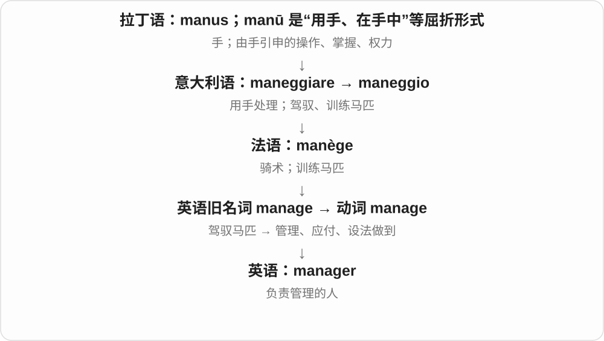

不只公司有 manager，球队、艺人和项目也有。file manager 是管理文件的程序，名称从人的职责转到软件功能。

**常见搭配与例句**

a project manager；a store manager；a file manager。

> The manager adjusted the schedule after two people called in sick.

两个人请病假后，经理调整了排班。

> Open the file manager to find the downloaded document.

打开文件管理器，找到下载的文档。

**别混淆**

owner 是所有者；manager 是管理者。老板可以亲自管理，也可以另外聘请经理。

### 20. dance — 跳舞；舞蹈；舞会

**音标**：英 /dɑːns/；美 /dæns/

**先抓住这个画面**

身体随节奏移动，也能用来描写火光、水光像在轻快跳动。

**怎么拆**

中古英语借法语相关舞蹈动词，远源有不同解释，不把一个重建来源说死。现代名词、动词都常用。

**怎么变成今天的意思**

**古法语、盎格鲁诺曼语 dancer、dauncer → 中古英语 dauncen**  
跳舞；更远来历不定

↓

**现代 dance**  
舞蹈活动、舞会；形象地说轻快跳动

dance to music 随音乐跳舞，a dance class 舞蹈课，a school dance 学校舞会；light danced on the water 水光跳动。

**常见搭配与例句**

dance to music；a dance class；a school dance；dance with。

> They danced to the music in the square.

他们在广场随音乐跳舞。

> Sunlight danced on the surface of the river.

阳光在河面上闪动。

**别混淆**

dance 舞蹈，a dance 也可一次舞会或一支舞；go dancing 说去跳舞，不必参加正式比赛。

### 21. dancer — 舞者；跳舞的人

**音标**：英 /ˈdɑːnsə/；美 /ˈdænsər/

**先抓住这个画面**

可以是职业演员，也可以只是当时正在跳舞的人，不要求必须拿专业证书。

**怎么拆**

dance 去末尾不发音 e，加完整表人后缀 -er → dancer，表示进行舞蹈活动的人。

**怎么变成今天的意思**

**古法语、盎格鲁诺曼语 dancer、dauncer → 中古英语 dauncen**  
跳舞；更远来历不定

↓

**现代 dance**  
舞蹈活动、舞会；形象地说轻快跳动

↓

**dance + -er → dancer**  
跳舞的人 → 舞者

a professional dancer 职业舞者，a ballet dancer 芭蕾舞演员，a good dancer 跳舞好的人。

**常见搭配与例句**

a professional dancer；a ballet dancer；a good dancer。

> The dancer rehearsed before the show.

舞者们在演出前排练。

> He is a good dancer but rarely goes to parties.

他舞跳得好，却很少参加派对。

**别混淆**

dancer 人，dance 舞种或活动；a good dancer 说能力，不自动是名人。

### 22. dancers — 舞者、舞蹈演员；跳舞的人〔复数〕

**音标**：英 /ˈdɑːnsəz/；美 /ˈdænsərz/

**先抓住这个画面**

舞台上或舞池里正在跳舞的几个人，是 dancers。它先告诉你这些人跳舞，不自动表示每个人都以跳舞为职业。

**怎么拆**

dance 经古法语、盎格鲁诺曼语 dancer、dauncer 等借入，更远来源未定。现代 dance 去 e 加完整表人后缀 -er → dancer，再加复数 -s；尾读 /z/。

**怎么变成今天的意思**

**法语跳舞动词 → 英语 dance**  
跳舞活动

↓

**dance 去 e + -er → dancer；dancer + -s → dancers**  
跳舞的人 → 多位舞者

ballet dancers 芭蕾舞演员；professional dancers 职业舞者；young dancers 年轻舞者。

**常见搭配与例句**

a group of dancers 一群舞者；experienced dancers 有经验的舞者。

> The dancers waited quietly behind the curtain.

舞者们在幕布后安静等候。

> Several dancers joined the final rehearsal.

几位舞者参加了最后一次排练。

**别混淆**

dance、dancer、dancers 是活动、一个做这件事的人、多个这样的人。dancer 的完整后缀是 -er，即使拼写看起来只比 dance 多了 r。

### 23. teacher — 教师；教授技能、知识的人

**音标**：英 /ˈtiːtʃə/；美 /ˈtiːtʃər/

**先抓住这个画面**

把 teach 这个动作换成做这件事的人；可以教学校课程，也可以教音乐、运动等。

**怎么拆**

teach + -er 人物后缀，有较早历史对应形式。职业称谓 teacher 不要求每次都在一所学校内工作。

**怎么变成今天的意思**

**古英语 tǣċan → 中古英语 techen → teach**  
指示、展示、指导、教导

↓

**现代 teach 词族**  
让人学会；教学者、活动及可教性

↓

**teach + -er → teacher**  
教导 → 从事教导的人

a schoolteacher 学校教师，a piano teacher 钢琴老师，a driving teacher 驾驶教师；后者也常用 driving instructor。

**常见搭配与例句**

a language teacher；a piano teacher；a teacher of history。

> Our history teacher encouraged us to ask questions.

历史老师鼓励我们提问。

> She works as a piano teacher.

她是一位钢琴老师。

**别混淆**

teacher 教的人，student、learner 学的人；professor 是特定高等教育头衔、职位用词，不是所有 teacher 都叫 professor。

### 24. coast — 海岸；滑行；不怎么费力地应付

**音标**：英 /kəʊst/；美 /koʊst/

**先抓住这个画面**

把陆地想成一个身体，挨着海的那条边就是它的“侧边”。动词还会让人想到不用继续踩踏板的滑行。

**怎么拆**

海岸义经法语 coste 接拉丁 costa；动词“沿边走”另接法语 costoier。滑行义的形成还涉及坡地义，不能全说成从海岸直接产生。

**怎么变成今天的意思**

**拉丁 costa**  
肋骨；身体或物体的侧边

↓

**古法语 coste → 中古英语 coste → coast**  
侧面、岸边 → 海岸

↓

**法语另支 costoier → 英语 coast〔动词〕**  
沿侧边前行；后来有滑行、不费力推进等义

最常用名词指陆地与海相接的区域。coast downhill 是顺坡滑行；coast through a course 则是只付出很少努力就混过去。

**常见搭配与例句**

on the coast；off the coast；coast downhill；coast through。

> We spent the weekend on the coast.

我们在海边过了周末。

> The bicycle coasted downhill without any pedalling.

自行车不用踩踏板就顺坡滑了下去。

> He tried to coast through the course without doing the reading.

他想不读指定材料，就这么轻松混过这门课。

**别混淆**

shore 多看水陆交接的岸，河湖也常用；coast 通常看海岸及其周边区域。

### 25. coaster — 杯垫；沿海航行的船；滑行者、滑行装置等

**音标**：英 /ˈkəʊstə/；美 /ˈkoʊstər/

**先抓住这个画面**

今天在桌边最常见的画面，是杯子下保护桌面的垫子。航运、滑行场景又会用到同词的其他分支。

**怎么拆**

coast 沿边移动、滑行等 + -er。杯垫义经较早的酒瓶托盘名称发展；一种常见解释是托盘能沿桌边滑动、传给客人，后来转为杯垫。

**怎么变成今天的意思**

**coast + -er**  
沿海行进的人、船；滑行者、装置

↓

**酒瓶托盘名称 → 饮杯下的垫子**  
移动托盘的命名转到桌面保护用品

put a glass on a coaster 把玻璃杯放在杯垫上；a set of coasters 一套杯垫。海运资料里 a coastal coaster 可说沿海运输船。

**常见搭配与例句**

a cork coaster；a coaster under the mug。

> Please put your mug on a coaster.

请把马克杯放在杯垫上。

> The shop sells a set of wooden coasters.

商店出售一套木制杯垫。

**别混淆**

-er 不只形成人物名，也能形成装置、器物名。coaster 的杯垫义经过历史转用，不能只靠今天 coast 滑行就完整猜出。

### 26. draw — 画；拉、抽取；吸引；平局〔名词〕

**音标**：英 /drɔː/；美 /drɔː/〔亦有 /drɑː/〕

**先抓住这个画面**

拉窗帘、抽出一张卡，都能抓住拉、抽的旧核心；画图时用拉出线条来帮助记忆，比赛平局则另按固定义学。

**怎么拆**

接古英语 dragan、古英语后期及中古英语的 drawen 等形式，与 drag 共享历史。过去式 drew，分词 drawn；现代画图义与拉取义同词，不任意加一个“画”的拉丁后缀。

**怎么变成今天的意思**

**古英语 dragan → 中古英语 drawen → draw**  
拖、拉；与 drag 同一历史词族

↓

**英语 draw 的多支发展**  
拉开、抽取、吸引；画图；形成平局等固定用法

draw a picture 画图；draw the curtains 拉窗帘；draw attention 吸引注意；end in a draw 平局收场。

**常见搭配与例句**

draw a picture；draw the curtains；draw attention；a draw。

> She drew a simple map on the paper.

她在纸上画了一张简图。

> The announcement drew a large crowd.

公告吸引了一大群人。

> The match ended in a draw.

比赛以平局结束。

**别混淆**

draw 画图通常偏线条、图形，paint 常涉及颜料绘画；但日常艺术分类还有重叠。

### 27. draws — 画、拉、抽取、吸引〔第三人称单数〕；平局、抽签〔复数〕

**音标**：英 /drɔːz/；美 /drɔːz/，亦有 /drɑːz/

**先抓住这个画面**

把东西拉出来、把线沿纸面带出来，能串起 draws 的拉与画。吸引注意像把目光拉过来；平局、抽签则要连固定场景一起记。

**怎么拆**

draw 接古英语 dragan，经中古英语 drawen，与 drag 有共同历史。现代直接加 -s，元音后读 /z/；过去式另为 drew，分词 drawn。

**怎么变成今天的意思**

**古英语 dragan → 中古英语 drawen → draw**  
拉、拖 → 绘画、抽取、吸引等多支

↓

**draw + -s → draws**  
某人画、拉、吸引；多场平局或抽签

draws a picture 画画；draws the curtains 拉窗帘；draws attention 吸引注意；three draws 三场平局。

**常见搭配与例句**

draws a name from a hat 从帽子里抽一个名字；draws a conclusion 得出结论。

> She draws animals in her notebook.

她在笔记本里画动物。

> The team finished the month with two wins and three draws.

这支队伍这个月以两胜三平收尾。

**别混淆**

draws the curtains 可能拉开也可能拉上，要看情境；不要仅靠拉的画面指定方向。draws a conclusion 则是得出结论的固定搭配。

### 28. drawer — 抽屉；拉取、绘制等动作的人〔依语境〕

**音标**：抽屉常读英 /drɔː/、美 /drɔːr/；人物义亦有 /ˈdrɔːə/ 等

**先抓住这个画面**

从柜子里拉出来装东西的盒子，就是抽屉。draw 的旧核心是拉，所以 drawer 不一定是画画的人。

**怎么拆**

draw + -er；历史先有执行拉取等动作的人，后来也命名能被拉出的箱盒。不同义项的常用读音可有一个或两个音节。

**怎么变成今天的意思**

**draw 拉、抽取 → drawer 人物词**  
拉水、拉运等动作的人

↓

**drawer 的器物义固定**  
柜子等里面可拉出的盒状容器

a desk drawer 书桌抽屉；a chest of drawers 多抽屉柜；the bottom drawer 最下面的抽屉。

**常见搭配与例句**

a desk drawer；a chest of drawers。

> She put the keys in the top drawer.

她把钥匙放进最上面的抽屉。

> The old chest of drawers belonged to her grandfather.

旧抽屉柜原来属于她祖父。

**别混淆**

drawer 抽屉取拉的那支，drawing 图画取绘画那支；同一基础动词的不同义可产生不同对象。

### 29. drawers — 抽屉〔复数〕

**音标**：抽屉常用英 /drɔːz/；美 /drɔːrz/，也有双音节读法

**先抓住这个画面**

柜子里面能拉出来的小盒状空间，是 drawers。它不是整个柜子，而是柜子里一格格可抽拉的储物部分。

**怎么拆**

drawer 为 draw 拉、抽取 + 完整 -er；历史先有拉取等动作执行者名词，后来也命名可拉出的箱盒。现代加复数 -s，尾 /z/。

**怎么变成今天的意思**

**draw + -er → drawer**  
拉取的执行者；后来可拉出的盒状容器

↓

**drawer + -s → drawers**  
多个抽屉

desk drawers 书桌抽屉；kitchen drawers 厨房抽屉；a chest of drawers 五斗柜、抽屉柜。

**常见搭配与例句**

open the drawers 打开抽屉；the top drawers 最上层抽屉。

> The desk has three small drawers.

书桌有三个小抽屉。

> She keeps old letters in the bottom drawers.

她把旧信放在下面几层抽屉里。

**别混淆**

drawers 的常用抽屉读音经常压成一音节。英语 -er 可命名作用物，这里的抽屉并不在自己拉别的东西，而是能被拉出。

### 30. winner — 获胜者；成功、受欢迎的事物

**音标**：英 /ˈwɪnə/；美 /ˈwɪnər/

**先抓住这个画面**

在比赛里拿到胜利的人，也可借来称一个很受欢迎、做得成功的选择。

**怎么拆**

win + -er，双写 n；中古英语已有 wynner、wynnere 等。不是英语 winter 冬天少一个 t 的词义联系。

**怎么变成今天的意思**

**古英语 winnan / ġewinnan → 中古英语 winnen**  
努力、争取；获得、征服

↓

**英语 win**  
赢；获得；争取到

↓

**win + -er → winner**  
获胜者；成功、讨喜的事物

the winner of a prize 获奖者，a clear winner 明显胜者；The recipe is a winner 夸菜谱成功、大家喜欢。

**常见搭配与例句**

the winner of；a clear winner；a prize winner；a real winner。

> The winner received a small trophy.

获胜者得到一座小奖杯。

> This simple recipe is a winner with children.

这道简单菜很受孩子欢迎。

**别混淆**

winner 是获胜者或成功事物，winning 既可形容获胜也可表示讨喜；winner 不保证一个人从此所有事都成功。

### 31. camp — 营地；露营；训练营；阵营；夸张戏剧化的风格〔来源另论〕

**音标**：/kæmp/

**先抓住这个画面**

先看一块供人暂时驻扎的地方；再看“待在同一边的人”，就能理解支持某种主张的 camp。

**怎么拆**

现代营地义经法语 camp、意大利 campo 接 campus。古英语也曾借入同源 camp 表战斗，但不能因此把现代露营义直接画成古英语一路传下。风格义 camp 来历不明，不能认定是营地的比喻。

**怎么变成今天的意思**

**拉丁 campus**  
开阔田地、平地；操练或战斗的场地

↓

**意大利 campo → 法语 camp**  
田地 → 军队驻扎的场地

↓

**英语 camp**  
营地；露营；引申为同一立场的阵营

↓

**另一路：camp〔夸张风格〕**  
二十世纪常见；更早来源不确定，不接在营地后当作确定演变

summer camp 是有组织的夏令营，未必住帐篷。the opposing camp 是另一阵营。camp style 则指有意夸张、戏剧化、常带玩味的审美；这是一条需另看的词源线。

**常见搭配与例句**

set up camp；go camping；a training camp；the two camps。

> We made camp beside a small lake.

我们在一个小湖边扎了营。

> The proposal divided the committee into two camps.

这项提议让委员会分成了两个阵营。

> The costumes gave the performance a playful camp style.

这些服装让表演带上了诙谐而夸张的风格。

**别混淆**

campsite 强调供扎营的地点；camp 可以是营地、营员群体或整个营期活动。

### 32. camper — 露营者；露营车、宿营车

**音标**：英 /ˈkæmpə/；美 /ˈkæmpər/

**先抓住这个画面**

camp 说扎营，camper 最容易想到住帐篷、参加营地活动的人；另一支把能住的露营车辆也叫 camper。

**怎么拆**

camp 动词 + -er。人物义指进行露营的人，车辆义则把为露营提供居住空间的设备纳入名称。

**怎么变成今天的意思**

**camp 扎营 + -er**  
露营活动的参与者

↓

**camper 的车辆用法**  
可供露营居住的车辆或相应装置

a group of campers 一群露营者；a camper van 露营车。单独 camper 是人还是车，要看动词和场景。

**常见搭配与例句**

summer campers；travel in a camper。

> The campers put up their tents before dark.

露营者们在天黑前搭好了帐篷。

> They travelled along the coast in a camper.

他们开着露营车沿海岸旅行。

**别混淆**

camp 是营地、露营等基础词，camper 指参与者或车辆。a happy camper 还常口语说满意的人，尤其见于 not a happy camper。

### 33. campers — 露营者；露营车、车载露营装置〔复数〕

**音标**：英 /ˈkæmpəz/；美 /ˈkæmpərz/

**先抓住这个画面**

参与露营的人，是 campers；能让人露营住宿的车辆或装置，也可以叫 campers。一个词可指使用者，也可指服务于这项活动的器物。

**怎么拆**

camp 动词加完整 -er → camper，先按露营活动理解参与者，再有相关车辆等用法。现代整个词加复数 -s，尾 /z/。

**怎么变成今天的意思**

**camp + -er → camper**  
扎营的人；相关露营车辆、装置

↓

**camper + -s → campers**  
多位露营者；多辆露营车等

young campers 年轻露营者；campers near the lake 湖边的露营者；parked campers 停放的露营车。

**常见搭配与例句**

a group of campers 一群露营者；campers with small tents 带小帐篷的露营者。

> The campers packed their tents before leaving.

露营者们离开前收好了帐篷。

> Several campers were parked beside the lake.

几辆露营车停在湖边。

**别混淆**

campers 是人还是车辆，要看动作：收帐篷、吃早饭多半是人；parked、driven 常能帮你认出车辆义。

### 34. till — 耕作、翻耕；收银机、钱箱〔不同来源〕

**音标**：英、美 /tɪl/

**先抓住这个画面**

农田里把土翻松，准备种植，是 till 的耕作义。商店里说钱进了 the till，又是收银机、钱箱；两个画面要分开。

**怎么拆**

耕作动词承古英语 tilian 劳作、耕种。收银钱箱名词接中古英语 tylle 等，可能与法语隔间、容器词或旧拉、抽动作词有关，来源未定。

**怎么变成今天的意思**

**古英语 tilian 劳作、耕种 → 英语 till 动词**  
劳动逐渐集中到耕地、为种植整地

↓

**中古英语容器名称 → till 钱箱、收银机**  
这一路的远源有不同分析，不从耕地义直接推出

till the soil 是翻耕土壤；money in the till 是收银钱箱里的钱；at the till 是在收银处。先看农业还是商店场景。

**常见搭配与例句**

till the soil；till the land；at the till。

> They till a small field behind the house.

他们在屋后耕种一小块田地。

> She put the coins in the till.

她把硬币放进了收银钱箱。

**别混淆**

till 的耕作义比 grow crops 种作物更突出土地处理；cash register 是收银机的另一常见说法。till Friday 中的 till 表直到，是另外的语法用法。

### 35. tiller — 耕作机；耕作者；舵柄〔最后一义另源〕

**音标**：英 /ˈtɪlə/；美 /ˈtɪlər/

**先抓住这个画面**

花园里的翻土机可以叫 tiller，耕地的人也能这样称呼。船上的 tiller 却是一根用来转舵的柄，同形但来源另有一条线。

**怎么拆**

农业义为 till 耕作 + 完整 -er，表示人或机器。舵柄义经古法语 telier 工具柄、织造框架，接中世纪拉丁 telarium、拉丁 tela 织物或织机词族。

**怎么变成今天的意思**

**英语 till + -er → tiller**  
执行翻耕的人、机器

↓

**拉丁 tela 相关材料 → 法语 telier → 英语 tiller 工具柄、舵柄**  
织造框架、工具柄的名称走向船舵的控制杆，与耕作词分源

a garden tiller 是园艺翻土机；a tiller of the soil 是耕作者，较书面；hold the tiller 是握住舵柄。

**常见搭配与例句**

a garden tiller；a tiller of the soil；hold the tiller。

> A small tiller stood beside the garden shed.

一台小型翻土机放在园艺棚旁。

> He held the tiller as the boat crossed the lake.

船横渡湖面时，他握着舵柄。

> The poem praises the patient tiller of the soil.

这首诗赞颂耐心耕耘土地的人。

**别混淆**

rudder 是船舵本身，tiller 通常是用来转动它的柄。农业机器义则与 till 耕地直接对应，不能把所有 -er 都翻成人。

### 36. tillage — 耕作；翻耕、整地

**音标**：英、美 /ˈtɪlɪdʒ/

**先抓住这个画面**

把土翻动、整理成适合种植的状态，这种操作或做法可以叫 tillage。农事讨论里，它常把注意力放在怎样处理土地。

**怎么拆**

till 耕作 + 完整 -age → tillage，中古英语已有相应形式。这里 -age 形成操作、过程名词，不是把年龄 age 接到耕地后。

**怎么变成今天的意思**

**古英语 tilian → till 耕作**  
劳动、种植、处理土地的动作词

↓

**till + -age → tillage**  
耕作的操作、过程；历史上也可说耕作过的土地

soil tillage 是土壤耕作；tillage methods 是耕作方式；reduced tillage 是减少翻耕的做法。具体效果取决于农事条件，词本身只是名称。

**常见搭配与例句**

soil tillage；tillage methods；reduced tillage。

> The course compares several methods of tillage.

这门课程比较了几种耕作方式。

> The report discusses how tillage changes the soil surface.

报告讨论了翻耕怎样改变土壤表面。

**别混淆**

agriculture 是农业的总称，tillage 范围更窄，重点在土地耕作。planting 是种下种子、苗木等动作，不能与 tillage 处处互换。

### 37. driver — 司机；驱动因素；驱动程序

**音标**：英 /ˈdraɪvə/；美 /ˈdraɪvər/

**先抓住这个画面**

让车走的是司机，让某个变化往前走的因素、让设备工作起来的软件，也借这个角色名。

**怎么拆**

drive + -er，去 e；中古英语 drivere 等已有做驱赶、驾驶工作的人名词。计算机驱动程序是后来技术扩展。

**怎么变成今天的意思**

**古英语 drīfan → 中古英语 driven**  
推着走、驱赶、使移动

↓

**英语 drive**  
驾驶；驱动；推动、逼使

↓

**drive + -er → driver**  
驾驶者；驱动某过程的因素、程序

a bus driver 公交司机，a key driver of demand 需求的重要推动因素，install a driver 安装驱动程序。软件语境不是在电脑里找人开车。

**常见搭配与例句**

a bus driver；a key driver of；a device driver；install a driver。

> The driver waited while we loaded the bags.

我们装包时，司机等着。

> The printer needs the correct driver.

打印机需要正确的驱动程序。

**别混淆**

driver 是人、因素或软件角色；drive 可指存储驱动器。更新 a driver 和更换 a drive 是两种工作。

### 38. dry — 干的；使干、变干；〔酒〕不甜的；枯燥的；冷面幽默的

**音标**：/draɪ/

**先抓住这个画面**

毛巾没水是干，话语没什么热闹情绪也可叫 dry。先抓没有湿润感，再把不甜、乏味、冷幽默分场景记，别强求都译成干。

**怎么拆**

形容词、动词各有古英语旧形。现代 dried、drying 等接这条本族词路径；酒、文章、幽默是后来各自形成的常用用法。

**怎么变成今天的意思**

**古英语 drȳġe〔形容词〕、drȳġan〔动词〕→ 中古英语 drye、drien**  
干的；使干、变干

↓

**英语 dry**  
干燥；使干；扩展到不甜、枯燥、冷面幽默等

dry clothes 干衣服，dry your hair 把头发弄干，dry wine 不甜的酒，dry humour 不动声色的幽默。a dry subject 可指枯燥题目，dry humour 却可能很好笑。

**常见搭配与例句**

dry your hands；dry weather；dry wine；a dry sense of humour。

> Dry your hands before touching the paper.

碰纸之前先把手擦干。

> Her dry sense of humour made the meeting more enjoyable.

她那不动声色的幽默让会议轻松了些。

**别混淆**

dry wine 仍是液体，dry humour 不一定枯燥；dried fruit 是经过脱水的水果。dry run 是演练、预演，不是人在干地上跑步。

### 39. dryer — 烘干机、干燥器；吹风机〔按搭配〕

**音标**：英 /ˈdraɪə/；美 /ˈdraɪər/

**先抓住这个画面**

把湿东西变干的设备。放衣服进去烘的是 clothes dryer，拿来吹头发的是 hair dryer。

**怎么拆**

dry + 器具后缀 -er，旧时已有相应人物、器具派生。dryer 常用于设备；drier 也有干燥器拼写，drier 还常是 dry 的比较级。

**怎么变成今天的意思**

**古英语 drȳġe〔形容词〕、drȳġan〔动词〕→ 中古英语 drye、drien**  
干的；使干、变干

↓

**英语 dry**  
干燥；使干；扩展到不甜、枯燥、冷面幽默等

↓

**dry + -er → dryer**  
使东西变干的人或设备；常用设备义

a tumble dryer 滚筒烘干机，a hair dryer 吹风机，put clothes in the dryer 把衣服放进烘干机。

**常见搭配与例句**

a clothes dryer；a hair dryer；use the dryer。

> The towels are still in the dryer.

毛巾还在烘干机里。

> I used a hair dryer to dry my hair.

我用吹风机吹干了头发。

**别混淆**

dryer 设备，dryness 干燥状态；天气更干常写 drier weather，不把 dryer 当作所有比较级的首选。

### 40. drier — 更干的、较少水分的；干燥器〔也拼 dryer〕

**音标**：英 /ˈdraɪə/；美 /ˈdraɪər/

**先抓住这个画面**

两处相比，水分少一点、天气没那么湿，叫 drier；作为名词又能指把东西弄干的器具，和 dryer 是同类拼法。

**怎么拆**

比较级：dry 变 y 为 i + 比较级 -er → drier。器具名词则是 dry 动词 + 执行者 -er 的另一层，名词 drier、dryer 均有，现代设备名常拼 dryer。

**怎么变成今天的意思**

**dry 形容词 + 比较级 -er → drier**  
更干、较少水分

↓

**dry 动词 + 器具 -er → drier、dryer**  
使东西变干的人或设备；不是把比较级直接变设备

drier weather 是较干的天气，a hair drier 是吹风机；an air dryer 也可说烘干、干燥设备，拼法和词性分别看。

**常见搭配与例句**

a little drier 稍干一点；a tumble drier 滚筒烘干机。

> The weather should be drier tomorrow.

明天的天气应该会干燥些。

> The hotel room had a hair drier.

酒店房间里有一台吹风机。

**别混淆**

drier 作比较级时回答干的程度，作器具名词时回答用什么干燥；同一 -er 外形有不同工作。

### 41. mix — 混合；相处；混合物

**音标**：/mɪks/

**先抓住这个画面**

把两种原本分开的东西放到一起搅：配料会 mix，人群也会 mix，声音同样能 mix。

**怎么拆**

现代不必再拆。常见词源分析把 mix 看作由中古英语 mixte 回构；另有联系古英语 miscian 的分析，不能只凭字母说从 miscēre 直接删减。

**怎么变成今天的意思**

**拉丁语 miscēre；过去分词 mixtus**  
混合；混合的

↓

**盎格鲁法语／中古英语 mixte**  
混合的

↓

**英语 mix**  
由旧分词形式回构动词的一种主流分析；混合

重点是合到一起，成分不一定彻底消失或均匀。mix with people 可说与人来往；名词 a mix 是混合的结果或组合。

**常见搭配与例句**

mix A with B；mix the ingredients；a mix of。

> Mix the flour with the water slowly.

把面粉和水慢慢混合。

> The class is a mix of beginners and experienced learners.

这个班既有初学者，也有有经验的学习者。

**别混淆**

blend 更突出调和、融成一体；mix 范围更宽，一把不同颜色的纽扣也可以是一种 mix。

### 42. mixer — 搅拌器；调音台；混合饮料配料；交流联谊活动

**音标**：英 /ˈmɪksə/；美 /ˈmɪksər/

**先抓住这个画面**

把材料混在一起是搅拌器，把声音混在一起是调音设备，把人聚来相互认识则是 a mixer。共同点是让原本分开的东西混合。

**怎么拆**

mix + -er → mixer；-er 在这里有工具、人物、活动等不同命名结果，不只一个职业尾。

**怎么变成今天的意思**

**mix 混合、交往**  
材料、声音、人群等的组合动作

↓

**mix + -er → mixer**  
搅拌设备、混合配料、交流活动等

a food mixer 食物搅拌器；an audio mixer 调音台；tonic as a mixer 用汤力水作调酒配料；a student mixer 学生交流活动。

**常见搭配与例句**

a food mixer；an audio mixer；a student mixer。

> The kitchen has a large food mixer.

厨房有一台大型食物搅拌器。

> The university held a mixer for new students.

大学为新生举办了一场交流活动。

**别混淆**

a mixer in the kitchen 常是设备，a mixer for new students 则常是活动；句法和场景帮你认对象。

### 43. user — 使用者；用户

**音标**：英 /ˈjuːzə/；美 /ˈjuːzər/

**先抓住这个画面**

user 把焦点转到正在用某个东西的人。设计一个按钮时，user 关心的是自己能否顺利完成操作。

**怎么拆**

use + -er；-er 在这里表示做这个动作的人。来自英语自身的派生，use 的动词 /z/ 保留下来。

**怎么变成今天的意思**

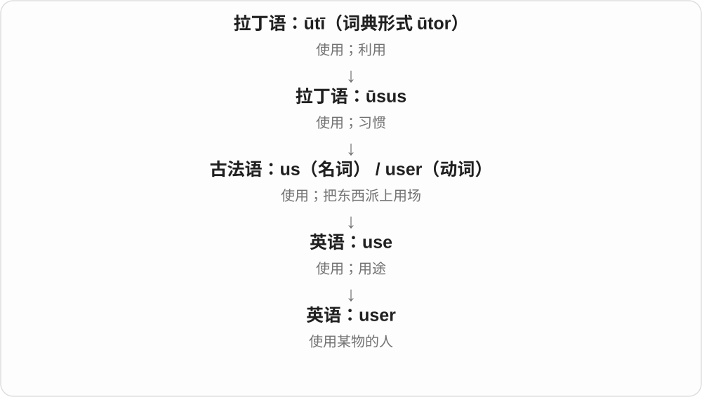

从工具使用者到软件用户，核心没变。user 描述的是使用关系，未必是购买关系：付钱的人和实际操作的人可能不同。

**常见搭配与例句**

a new user；a regular user；user feedback；a user account。

> New users can try the service for a week.

新用户可以试用这项服务一周。

> We watched a user struggle to find the save button.

我们看到一位用户费了不少劲才找到保存按钮。

**别混淆**

user 是使用者；customer 是顾客。单独称某人 a user，在特定人际语境还可能指“总是利用别人的人”，语气负面。

### 44. writer — 作者；作家；写作者

**音标**：英 /ˈraɪtə/；美 /ˈraɪtər/

**先抓住这个画面**

把想法变成文字的人，不一定只写长篇小说，也可能写剧本、报道、技术说明。

**怎么拆**

write 去掉末尾 e 后加 -er，上接古英语 wrītere 等。-er 表写的人，也可能用于写入设备等技术名称，具体看后接对象。

**怎么变成今天的意思**

**古英语 wrītan → 中古英语 writen**  
刻划、写出文字

↓

**古英语 wrītere → 中古英语 writer → writer**  
记录、创作文字的人

a fiction writer 是小说作者，a technical writer 是技术文档作者，a freelance writer 是自由撰稿人。有没有出版作品、是不是职业写作，靠上下文。

**常见搭配与例句**

a freelance writer；a technical writer；a writer of fiction。

> She works as a technical writer.

她从事技术文档写作。

> The writer visited the town before beginning the novel.

作者动笔写小说前到访了小镇。

**别混淆**

writer 范围很宽，novelist 特指小说家，author 常强调某作品作者；一本说明书的撰稿者也可以是 writer。

### 45. perform — 执行；表演；表现

**音标**：英 /pəˈfɔːm/；美 /pərˈfɔːrm/

**先抓住这个画面**

一件事不只停留在计划里，而是真正做出来：执行任务、演奏曲子，也能看机器跑得怎样。

**怎么拆**

主要源于古法语 parfornir“完成”，经 performer 进入英语，词形受 forme 影响；不能简单讲成拉丁 per- + forma。

**怎么变成今天的意思**

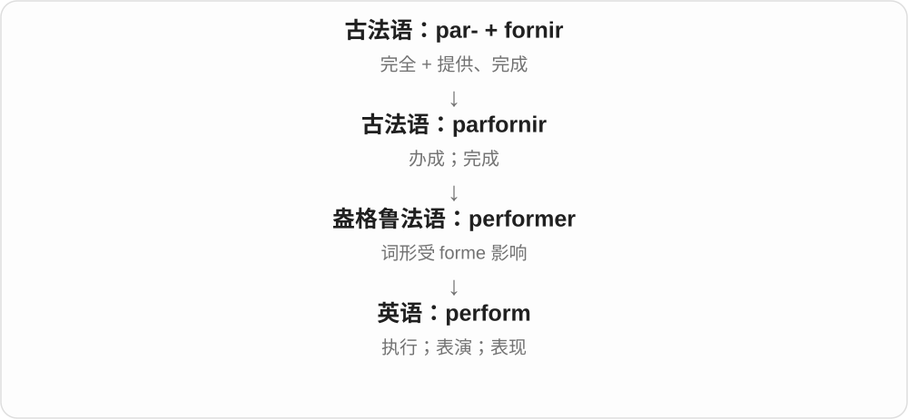

“把事情做出来”连起执行和表演。The computer performs well 说运行表现好，不是在演戏。

**常见搭配与例句**

perform a task；perform on stage；perform well；perform an experiment。

> The team performed a series of tests.

团队进行了一系列测试。

> The new laptop performs well even with several apps open.

即使同时打开几个应用，新笔记本电脑也运行良好。

**别混淆**

form 是形成；perform 是执行，历史来源不同，只发生过词形影响。

### 46. performer — 表演者；表现出某种水平的人或事物

**音标**：英 /pəˈfɔːmə/；美 /pərˈfɔːrmər/

**先抓住这个画面**

舞台上把作品演出来的人；扩展后，也可指某项工作中表现好的成员或产品。

**怎么拆**

perform + -er。

**怎么变成今天的意思**

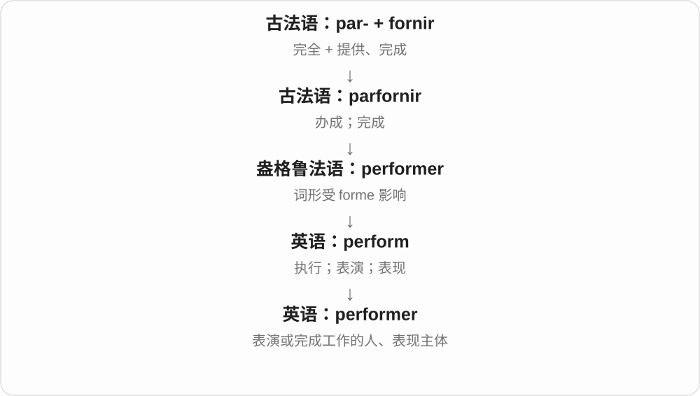

a talented performer 是有才华的表演者；a strong performer 可以是业绩好的部门、产品或人。

**常见搭配与例句**

a street performer；a skilled performer；a strong performer。

> The street performer gathered a small crowd.

街头艺人吸引了一小群观众。

> This model is a strong performer in low light.

这款机型在弱光条件下表现出色。

**别混淆**

performer 不必只指演员；actor 通常偏演戏，performer 也包括歌手、舞者、杂技演员等。

### 47. performers — 表演者、演出人员〔复数〕；表现主体〔依语境〕

**音标**：英 /pəˈfɔːməz/；美 /pərˈfɔːrmərz/

**先抓住这个画面**

把表演做出来给人看、听的人，是 performers。更广地说，也能按表现评价人、团队或产品，比如表现出色的选手。

**怎么拆**

perform 经法语 parfornir 完成、提供，后受 forme 影响词形。英语 perform 加完整表人 -er → performer，再加复数 -s，尾 /z/。

**怎么变成今天的意思**

**法语完成材料 → perform；词形受 forme 影响**  
办成 → 执行、表演、表现

↓

**perform + -er → performer；再加 -s → performers**  
做表演或有某种表现的主体

street performers 街头艺人；young performers 年轻演出者；top performers 表现出色者。

**常见搭配与例句**

the performers on stage 台上的表演者；a group of performers 一组演出者。

> The performers waited behind the stage.

演出者们在后台等候。

> The festival welcomed performers from several towns.

节庆活动迎来了几个城镇的表演者。

**别混淆**

performers 不必全是演员，歌手、乐手等也包括在内。top performers 在考试、工作等语境里说表现出色者，不一定在舞台演出。

### 48. troop — 一队、一群；军队、士兵〔常用复数 troops〕；成群行进

**音标**：/truːp/

**先抓住这个画面**

一批人、动物聚成一队，是 troop；作为动词，就是一群人一道走过去。军事语境里 troops 常指士兵们。

**怎么拆**

从法语 troupe 人群、队伍借入，更远来源仍有不同分析。由集体名词发展出成群行进的动词。

**怎么变成今天的意思**

**法语 troupe → 英语 troop**  
一群人、一个队伍

↓

**troop 的集体、军事与动词用法**  
一队；troops 士兵；成群前往

a troop of monkeys 一群猴子；a scout troop 一队童子军；troops stationed nearby 驻扎附近的军队；troop into a room 成群走进房间。

**常见搭配与例句**

a cavalry troop；send troops。

> A troop of monkeys crossed the path.

一群猴子穿过小路。

> The children trooped into the dining room.

孩子们成群走进餐厅。

**别混淆**

troupe 常说演员、舞者等演出团体；troop 常说军队、童子军、动物群等。两词同源、同音，现代拼写分工不同。

### 49. troops — 部队；军人、士兵〔集合复数〕；成群行进〔第三人称单数〕

**音标**：/truːps/

**先抓住这个画面**

聚成队伍的一群人，是 troop 的老画面；troops 在新闻里常合称军人、部队，不一定逐个数有多少支小队。

**怎么拆**

troop + -s，/p/ 后读 /s/。troop 借自法语 troupe 人群、队伍，更早来源有不同分析；英语又发展出成群行进的动词，troops 还有军人集合用法。

**怎么变成今天的意思**

**法语 troupe → 英语 troop**  
人群、队伍 → 一支队伍；成群走

↓

**troop + -s → troops；集合用途**  
多支队伍或军人总称；单数主语成群行进

troops arriving at the base 到达基地的部队；send troops 派出军人；troops of visitors 一群群访客。

**常见搭配与例句**

troops returning home；troops helping after the flood。

> The troops returned to the base before nightfall.

部队天黑前返回了基地。

> Troops helped clear the roads after the flood.

军人在洪水后协助清理道路。

**别混淆**

two troops 可按具体编制数两队；two hundred troops 在常见新闻用法里通常是两百名军人。计数对象要结合句子，不能一律把 troops 当成小队数量。

### 50. trooper — 骑兵、某些部队的士兵；州警；能吃苦坚持的人〔口语〕

**音标**：英 /ˈtruːpə/；美 /ˈtruːpər/

**先抓住这个画面**

本来是 troop 队伍里的士兵，后来也用于某些警察称呼。夸人撑得住、肯坚持时，口语也常见 a real trooper。

**怎么拆**

troop + -er，早期常指骑兵。州警等义随后发展；能吃苦的人这一口语义，又与 trouper 演员、不畏困难的人发生拼写和词义交汇。

**怎么变成今天的意思**

**troop 队伍 + -er**  
骑兵、队伍中的士兵

↓

**警察称呼及口语发展**  
州警等；与 trouper 交汇的坚持、能吃苦义

a state trooper 美国某些州的州警；a cavalry trooper 骑兵；You’re a real trooper. 你真能扛、真肯坚持。具体军衔、组织称呼随语境而定。

**常见搭配与例句**

a young trooper；carry on like a trooper。

> A state trooper helped the stranded driver.

一名州警帮助了那位被困的司机。

> You were a real trooper through that long rehearsal.

那次漫长排练中，你真能坚持。

**别混淆**

trouper 原指演出团体的演员，也发展出吃苦、敬业义。夸人能撑住常见两种拼写，不能把这一支只编成士兵勇敢的单一路径。

### 51. consumer — 消费者；消耗者

**音标**：英 /kənˈsjuːmə/；美 /kənˈsuːmər/

**先抓住这个画面**

一件东西被生产出来，最后有人买来或用掉；consumer 把镜头对准使用资源的这一端。

**怎么拆**

consume + -er；-er 表示做这件事的人或事物。

**怎么变成今天的意思**

**拉丁 sūmere；过去分词 sūmptus**  
拿取；取用

↓

**拉丁 con- + sūmere → cōnsūmere**  
完全取用、耗尽

↓

**古法语 consumer → 中古英语 consumen → consume**  
消耗；吃喝；吞没

↓

**英语 consume + -er → consumer**  
消耗 → 消费者、消耗者

商业里通常说购买产品或服务供自己使用的人；生态学里则说从其他生物取得食物能量的消费者。机器也可被描述为能源消耗者。

**常见搭配与例句**

consumer demand；consumer goods；a major consumer of。

> Consumers want clear information about the products they buy.

消费者希望清楚了解自己购买的产品。

> This factory is a major consumer of electricity.

这家工厂耗电量很大。

**别混淆**

customer 强调与某家商户交易；consumer 强调消费、使用，付款者和实际使用者可能不同。

### 52. golf — 高尔夫球运动；打高尔夫球

**音标**：英 /ɡɒlf/；美 /ɡɑːlf/

**先抓住这个画面**

用球杆把小球打向远处的洞，以完成各洞所用杆数比较成绩。golf 既能叫这项运动，也能说参加它。

**怎么拆**

英语接苏格兰语 gouf、golf 等旧形式，通常认为与中古荷兰语 colf、colve 球杆相连；更早借入关系存在讨论。运动名与器具名联系紧密。

**怎么变成今天的意思**

**苏格兰语 gouf、golf 与荷兰语球杆材料的联系**  
拿球杆进行的球类活动

↓

**golf 的现代运动名与动词**  
高尔夫球；打高尔夫球

play golf 打高尔夫；a round of golf 一轮高尔夫；a golf course 高尔夫球场。运动名前通常不用 a。

**常见搭配与例句**

a golf club；go golfing。

> They play golf on Sunday mornings.

他们星期日早晨打高尔夫。

> The hotel overlooks a golf course.

从酒店可以俯瞰一座高尔夫球场。

**别混淆**

golf club 可以是高尔夫球杆，也可以是高尔夫俱乐部，看是器材还是组织语境。golf 的名字有历史词源，不是几个现代英语词首字母组成。

### 53. golfer — 高尔夫球手、打高尔夫球的人

**音标**：英 /ˈɡɒlfə/；美 /ˈɡɑːlfər/

**先抓住这个画面**

给 golf 加上人物后缀，运动就转到参与运动的人。golfer 可以是周末爱好者，也可以是职业球手。

**怎么拆**

golf + -er；由运动名称形成参与者名称。并不要求先成为职业选手才能用。

**怎么变成今天的意思**

**golf 高尔夫运动 + -er**  
把运动联系到参与者

↓

**golfer 的普通与职业语境**  
高尔夫球手；高尔夫爱好者

a professional golfer 职业高尔夫球手；an amateur golfer 业余球手；a keen golfer 热衷打高尔夫的人。

**常见搭配与例句**

a talented golfer；a group of golfers。

> She is a keen golfer and plays every weekend.

她很爱打高尔夫，每个周末都去。

> The young golfer practised his putting.

年轻的高尔夫球手练习推杆。

**别混淆**

golfer 是打球的人，caddie 是帮助球手携带球具、提供场地相关帮助的球童，两者角色不同。

### 54. singer — 歌手；唱歌的人

**音标**：英 /ˈsɪŋə/；美 /ˈsɪŋər/

**先抓住这个画面**

做唱歌这件事的人，可能是职业表演者，也可能只是合唱团普通成员。

**怎么拆**

sing + -er，接中古英语同族人物词。常用歌手义保留 /ŋ/，与 finger 的 /ŋɡ/ 不同；另有来自 singe 的罕见同形词不在本页扩写。

**怎么变成今天的意思**

**古英语 singan → 中古英语 singen**  
唱、用声音形成旋律

↓

**英语 sing—sang—sung**  
保留不规则元音变化；singing、singer 继续派生

↓

**sing + -er → singer**  
从事或参与唱歌的人

a lead singer 主唱，a backing singer 伴唱，an opera singer 歌剧演唱者。不是只有明星才叫 singer。

**常见搭配与例句**

a lead singer；a backing singer；an opera singer。

> The band is looking for a new lead singer.

乐队在寻找新主唱。

> Several singers joined the choir this year.

今年有几位歌唱者加入合唱团。

**别混淆**

singer 唱歌者，songwriter 写歌者；一个人可以两者兼任。读音辨清 singer /ŋ/，不用照字母给 g 单独加音。

### 55. singers — 歌手、唱歌的人〔复数〕

**音标**：英 /ˈsɪŋəz/；美 /ˈsɪŋərz/

**先抓住这个画面**

把唱歌这个动作变成人的名称：sing → singer；几位唱歌的人就是 singers，不限于职业明星。

**怎么拆**

sing + 完整 -er → singer，再加 -s，末尾读 /z/。基础 sing 经中古英语接古英语 singan；ng 通常只读 /ŋ/。

**怎么变成今天的意思**

**古英语 singan → sing**  
唱歌

↓

**sing + -er → singer → singers**  
唱歌的人；几位歌手

lead singers 主唱，backing singers 伴唱；都按在演唱中承担的角色命名。

**常见搭配与例句**

opera singers 歌剧演员；a group of singers 一群歌手。

> The singers rehearsed together before the concert.

歌手们在音乐会前一起排练。

> Two backing singers joined her on stage.

两位伴唱和她一起登台。

**别混淆**

singer 的 ng 与 sing 一样，通常没有 finger 中紧接 /ŋ/ 的 /ɡ/；不是看见 ng 都读成同一种组合。

### 56. speaker — 说话人；演讲者；扬声器；某些议会的议长

**音标**：英 /ˈspiːkə/；美 /ˈspiːkər/

**先抓住这个画面**

人把话讲出来，设备把声音放出来，都可被叫 speaker；职务名又有固定历史用法。

**怎么拆**

speak + -er，旧英语已有相应人名词。后来扩展到发声设备；首字母大写 Speaker 等可表示特定议会职务，不是所有讲话者都担任该职。

**怎么变成今天的意思**

**古英语 specan；更早相关形式常见 sprecan**  
说话；早期形式关系有不同分析

↓

**中古英语 speken → 英语 speak**  
说话、讲某语言、发言；过去 spoke，分词 spoken

↓

**speak → speaker**  
说话 → 说话、演讲的人；后也说发声设备、议会职务

a guest speaker 嘉宾演讲者，a native speaker 母语使用者，wireless speakers 无线音箱。根据句中人、设备或制度语境判断。

**常见搭配与例句**

a guest speaker；a native speaker；a keynote speaker；wireless speakers。

> The guest speaker answered questions after the talk.

嘉宾演讲者在讲座后回答了问题。

> The music was coming from a small speaker on the shelf.

音乐从架上一只小音箱里传出来。

**别混淆**

speaker 母语使用者不自动是语言学专家；设备 speaker 是扬声器、音箱，不是 microphone 麦克风。

### 57. soccer — 足球〔英式足球、协会足球〕

**音标**：英 /ˈsɒkə/；美 /ˈsɑːkər/

**先抓住这个画面**

指通常十一人一队、主要用脚踢的那种足球。美式语境说 football 常想到另一种运动，所以 soccer 很实用。

**怎么拆**

来自 association football 的 association 缩略材料 Assoc.，再用英国校园俚语式 -er 形成。词起于英国，不是 sock 袜子 + -er，也不是足球运动员的名词尾。

**怎么变成今天的意思**

**association football → Assoc. 等缩略**  
与 rugby 等球类区分的足球名称

↓

**缩略材料 + 校园熟悉词尾 -er → soccer**  
先有英国用法，后来在多地使用

play soccer 踢足球；a soccer match 足球赛；a soccer player 足球运动员。

**常见搭配与例句**

play soccer；a soccer match；a soccer player。

> The children play soccer after school.

孩子们放学后踢足球。

> We watched a soccer match on Saturday.

星期六我们看了一场足球赛。

**别混淆**

soccer 指运动，player 才明确指球员；末尾 -er 在这里不是做事的人。

### 58. server — 服务员；服务器；发球者

**音标**：英 /ˈsɜːvə/；美 /ˈsɜːrvər/

**先抓住这个画面**

谁把你请求的东西送过来，谁就是这一环节里的 server：餐厅送餐，网络送数据。

**怎么拆**

serve + -er，原指提供服务的人，后来扩展到提供计算服务的程序或机器。

**怎么变成今天的意思**

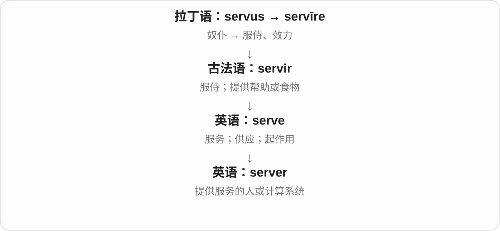

技术语境中的 server 可以指软件，也可以指运行软件的计算机；不一定是一台巨大的独立机器。

**常见搭配与例句**

a restaurant server；a web server；connect to a server。

> The server brought us a jug of water.

服务员给我们端来一壶水。

> The app sends the request to a server.

应用把请求发送到服务器。

**别混淆**

client 发出请求、使用服务；server 接收请求并提供服务。这是角色区别，不只看设备大小。

### 59. producer — 生产者；制作人；制片人

**音标**：英 /prəˈdjuːsə/；美 /prəˈduːsər/

**先抓住这个画面**

producer 是把东西做出来的一方。农业里可以是生产商；电影、音乐里常是组织制作、把项目推进完成的人。

**怎么拆**

produce + -er，表示实施生产或制作的人、企业。

**怎么变成今天的意思**

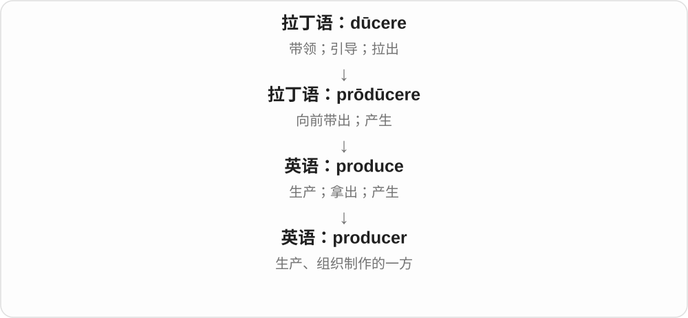

影视制作人的具体职责因项目而异，核心是把制作组织起来。生态学中 producer 又指能制造有机物的生产者，是专业用法。

**常见搭配与例句**

a food producer（食品生产商）；a film producer（电影制片人）；a music producer（音乐制作人）。

> The region is a major producer of olive oil.

这个地区是重要的橄榄油产区。

> The producer found funding for the documentary.

制片人为纪录片筹到了资金。

**别混淆**

producer 不等于 director：后者是导演，主要负责创作和拍摄指导；两种职责有时由同一个人承担。

### 60. worker — 工作者；工人

**音标**：英 /ˈwɜːkə/；美 /ˈwɜːrkər/

**先抓住这个画面**

同一项劳动，可以按谁在做来称呼：做这项事的人是 worker。

**怎么拆**

work + -er，-er 表执行动作的人；接中古英语相应形式。比旧词 wright 的现代适用范围更宽。

**怎么变成今天的意思**

**古英语 weorc；wyrcan → 中古英语 work／werken**  
工作、做出的事物；做、制作

↓

**英语 work**  
工作；运作；做出的成果

↓

**work + -er → worker**  
做工作的人

factory worker 是工厂工人，office worker 是办公室职员，social worker 是社会工作者。worker 不只指体力劳动，也可在昆虫语境说工蚁、工蜂。

**常见搭配与例句**

a factory worker；an office worker；a skilled worker。

> The workers stopped for a short break.

工人们停下来短暂休息。

> She is a social worker who supports local families.

她是一名为当地家庭提供支持的社会工作者。

**别混淆**

employee 强调被某雇主雇用的关系，worker 关注做劳动的人；自雇者也能算 worker。

### 61. designer — 设计师；设计者；名牌设计的

**音标**：英 /dɪˈzaɪnə/；美 /dɪˈzaɪnər/

**先抓住这个画面**

designer 是负责想清楚“它应该怎样做、怎样呈现”的人；放在服装前，也常暗指有知名设计品牌。

**怎么拆**

design + -er；先指设计的人，后来可修饰由知名设计师或品牌推出的商品。

**怎么变成今天的意思**

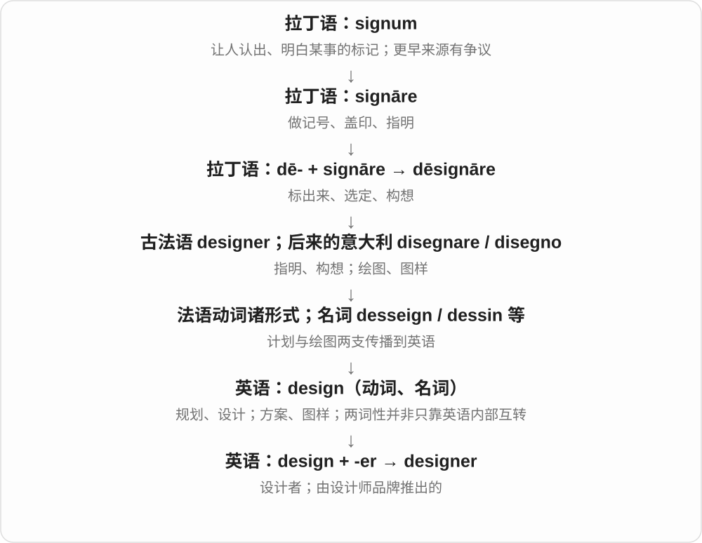

a graphic designer 是平面设计师；designer clothes 是名牌设计服装，不是所有由人设计过的衣服都这么叫。

**常见搭配与例句**

a fashion designer；a product designer；designer clothing。

> The designer tested several versions of the handle.

设计师测试了几种手柄方案。

> She buys practical clothes rather than expensive designer labels.

她买实用的衣服，不太买昂贵的设计师品牌。

**别混淆**

artist 强调艺术创作；designer 通常还要回应某种用途、使用者或项目要求，两者可重叠。

### 62. boost — 促进、提升；推一把；提振

**音标**：/buːst/

**先抓住这个画面**

从下面托一把，让人够到高处；后来信心、数量、效果往上走，也叫 boost。

**怎么拆**

近代英语出现，远源不定，有苏格兰方言等比较材料。物理推升是理解抽象提升的入口，不强接一个拉丁确定根。

**怎么变成今天的意思**

**英语 boost 由抬升、从后下方推动等发展**  
更早来源不确定

↓

**boost + -er → booster**  
帮助提高效果的人、物；多领域专门名称

boost confidence 增强信心；boost morale 提振士气；give someone a boost 帮某人一把、鼓励一下。

**常见搭配与例句**

boost confidence；boost morale；give a boost。

> The encouraging feedback boosted her confidence.

鼓励性的反馈增强了她的信心。

> The publicity gave attendance a boost.

宣传让到场人数有所增加。

**别混淆**

boost 是推动向上，不保证最后目标一定完成；a boost 也可以只是短时提振。

### 63. booster — 助推器、增强装置；支持者；加强剂次〔接种等语境〕

**音标**：英 /ˈbuːstə/；美 /ˈbuːstər/

**先抓住这个画面**

能额外给一把力的东西或人，叫 booster。可以推火箭、增信号、提振信心；接种词组里则指追加以加强、恢复效果的剂次。

**怎么拆**

boost + -er；人物、设备、物质或剂次的具体对象由领域决定。不是看见 -er 就一律有人在做动作。

**怎么变成今天的意思**

**英语 boost 由抬升、从后下方推动等发展**  
更早来源不确定

↓

**boost + -er → booster**  
帮助提高效果的人、物；多领域专门名称

↓

**boost + -er → booster**  
增加力量、效果的人或物；相应专门义

a confidence booster 提振信心的事物；a rocket booster 火箭助推器；a booster dose 加强剂次；an enthusiastic booster 热心支持者。

**常见搭配与例句**

a confidence booster；a rocket booster；a booster dose。

> The successful rehearsal was a confidence booster.

成功彩排让人信心大增。

> The diagram labels the rocket’s booster.

示意图标出了火箭助推器。

**别混淆**

booster 在火箭场景是推进部件，在接种场景是加强剂次；共同点是增强作用，具体对象不同。

### 64. cricket — 板球运动；蟋蟀

**音标**：/ˈkrɪkɪt/

**先抓住这个画面**

球场上的 cricket 是板球；草丛里叫的 cricket 是蟋蟀。两个常用意思同形同音，却应分开追词源。

**怎么拆**

蟋蟀名经古法语 criquet，与吱叫、咯吱声的拟声材料相连；板球名可能接古法语或荷兰语方言中木棍、球门柱等材料，细节未定。

**怎么变成今天的意思**

**蟋蟀这一支：古法语 criquet 等**  
从鸣声相关材料称呼昆虫

↓

**板球这一支：早期棍棒、球门材料的可能联系**  
形成球类运动名称，确切路径有讨论

play cricket 打板球；a cricket match 板球比赛；hear a cricket 听见一只蟋蟀叫。运动义通常不可数，昆虫义可数。

**常见搭配与例句**

a cricket bat；the chirping of crickets。

> They play cricket in the park on Saturdays.

他们星期六在公园打板球。

> A cricket was chirping outside the window.

窗外有只蟋蟀在叫。

**别混淆**

cricketer 是板球运动员，接运动义。用同一个 spelling 记住两义可以，但不要编造蟋蟀变成板球的故事。

### 65. cricketer — 板球运动员、打板球的人

**音标**：英 /ˈkrɪkɪtə/；美 /ˈkrɪkɪtər/

**先抓住这个画面**

cricket 取板球运动这一义，再加人物后缀，就是上场打板球的人。职业、业余球手都能用。

**怎么拆**

cricket 板球 + -er，构成参与运动的人物名词。加后缀时采用的是运动义，不能跨到同形的昆虫义。

**怎么变成今天的意思**

**cricket 板球运动 + -er**  
由运动形成参与者名称

↓

**cricketer 的现代使用**  
板球运动员、板球爱好者

a professional cricketer 职业板球运动员；a young cricketer 年轻板球球手；an amateur cricketer 业余板球球手。

**常见搭配与例句**

an outstanding cricketer；a team of cricketers。

> She became a professional cricketer at a young age.

她很年轻就成了职业板球运动员。

> The young cricketer spent hours practising his bowling.

那位年轻板球球手花了数小时练习投球。

**别混淆**

cricketer 是人；cricket 是运动或昆虫。其他球类通常有各自习惯称呼，不能把 cricketer 当所有持拍球手的总称。

### 66. hunter — 猎人；搜寻、追求某物的人；猎犬、猎马等

**音标**：英 /ˈhʌntə/；美 /ˈhʌntər/

**先抓住这个画面**

原来追踪猎物，后来追着工作机会、便宜货、人才找，也能用 hunter。对象常放在前面，告诉你这个人在找什么。

**怎么拆**

接中古英语 huntere，联系古英语 huntian 打猎、hunta 猎人。现代可按 hunt + -er 理解，-er 命名从事者；也可借指狩猎用动物。

**怎么变成今天的意思**

**古英语 huntian、hunta 等 → hunt、hunter**  
打猎；打猎者

↓

**中古英语 huntere → hunter**  
现代可按 hunt + -er 理解；扩到寻找某物的人

a hunter in the forest 林中猎人，a bargain hunter 找便宜货的人，a job hunter 求职者，a hunter trained for riding 供相应狩猎骑乘的马。

**常见搭配与例句**

a bargain hunter；a job hunter；a skilled hunter。

> The story follows a hunter through the forest.

故事跟随一名猎人穿过森林。

> Bargain hunters arrived before the shop opened.

找便宜货的顾客在店铺开门前就到了。

**别混淆**

hunter 不必真拿武器，bargain hunter 是主动找优惠的人。孤立的 a hunter 在马术、犬类等语境也不一定指人。

### 67. reporter — 记者；报道者；记录员

**音标**：英 /rɪˈpɔːtə/；美 /rɪˈpɔːrtər/

**先抓住这个画面**

reporter 是把现场信息带给公众或相关人的那个人。记者去采访、核查，再把事情说清楚。

**怎么拆**

现代对应 report + -er；历史上也有法语 reporteur 进入中古英语 reportour 的路线。

**怎么变成今天的意思**

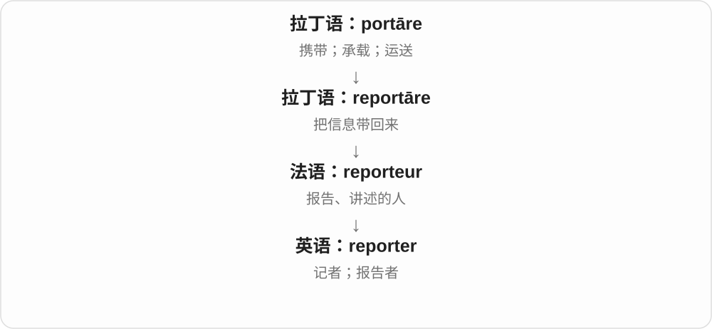

新闻记者是最常见用法，但 court reporter 可指法庭记录人员，工作重点是记录庭审内容。角色须看前面的修饰词。

**常见搭配与例句**

a news reporter（新闻记者）；a local reporter（地方记者）；a court reporter（法庭记录员）。

> The reporter interviewed residents near the station.

记者采访了车站附近的居民。

> A court reporter recorded the testimony.

法庭记录员记录了证词。

**别混淆**

reporter 侧重采访、报道或记录；editor 侧重编辑和审稿。一位 journalist 可能承担多种新闻工作。

### 68. rob — 抢劫、掠夺；使失去、剥夺

**音标**：英 /rɒb/；美 /rɑːb/

**先抓住这个画面**

从一个人、地方手里把东西夺走。镜头常对着受损的一方：rob a bank 是银行被抢，rob someone of sleep 是某人被夺走睡眠。

**怎么拆**

中古英语 robben 借自古法语 rober 抢夺；法语材料又接日耳曼语的抢掠、战利品词族。现代 rob 是一个完整基础动词。

**怎么变成今天的意思**

**日耳曼语抢掠词族 → 古法语 rober**  
掠夺、夺取财物

↓

**中古英语 robben → rob**  
抢劫；进一步比喻剥夺某人拥有的东西

rob someone of something 抢走某人的某物、使某人失去某物；rob a shop 抢劫商店。rob 常把人或地点放在宾语位置。

**常见搭配与例句**

rob a bank；rob someone of a chance。

> The thieves tried to rob a jewellery shop.

盗贼试图抢劫一家珠宝店。

> The constant noise robbed her of sleep.

持续的噪声让她无法安睡。

**别混淆**

steal 常直接接被偷的东西：steal a bag；rob 常接人或地方：rob a passenger。两词的常用宾语视角不同。

### 69. robbery — 抢劫、劫掠；一起抢劫案

**音标**：英 /ˈrɒbəri/；美 /ˈrɑːbəri/

**先抓住这个画面**

别人不愿意给，仍用强夺的方式拿走财物，就是 robbery 的抢劫画面。可以说这种行为，也能数一桩案件。

**怎么拆**

经中古英语 robberie、robry 等借古法语 roberie，来自 rober 抢夺加 -ie，较早有日耳曼掠夺材料。现代可对应 rob + -ery，但名词早已作为整词借入。

**怎么变成今天的意思**

**日耳曼抢掠材料 → 法语 rober、roberie → 中古英语 robberie**  
抢夺 → 抢劫行为、活动

↓

**英语 robbery 的现代计数**  
抢劫这种行为；一桩抢劫事件

a bank robbery 银行抢劫案；an attempted robbery 抢劫未遂事件；a story about robbery 关于抢劫的故事。

**常见搭配与例句**

investigate a robbery 调查抢劫案；highway robbery 路上抢劫，也口语比喻价格离谱。

> The detective investigated a robbery at the station.

侦探调查了车站的一起抢劫案。

> The novel opens with a failed robbery.

小说以一起失败的抢劫开篇。

**别混淆**

robbery 是行为、案件，robber 才是实施者。复数 robberies 改 y 为 ies，robbed、robbing 则是 rob 动词的双写 b 变化。

### 70. robbed — 抢劫了、被抢了；被剥夺的〔过去式、过去分词〕

**音标**：英 /rɒbd/；美 /rɑːbd/

**先抓住这个画面**

本来属于一个人的东西被夺走，是 robbed。可以是财物，也可以比喻安宁、机会、休息被夺走。

**怎么拆**

rob 经古法语 rober、较早日耳曼抢掠材料借入中古英语 robben。现代重读短元音后单个 b，双写 b 加完整 -ed；/b/ 后读 /d/。

**怎么变成今天的意思**

**日耳曼抢掠材料 → 古法语 rober → rob**  
夺取财物 → 抢劫；比喻剥夺

↓

**rob 双写 b + -ed → robbed**  
已经抢劫、被夺走

robbed of sleep 被剥夺睡眠；robbed of a chance 失去机会；was robbed 遭抢。

**常见搭配与例句**

robbed someone of something 夺走某人的某物；felt robbed 感到受了不公、被夺走应得之物。

> The noise robbed her of a good night’s sleep.

噪声让她一夜没能睡好。

> In the story, the traveller was robbed on the road.

故事里，旅人在路上遭了抢。

**别混淆**

robbed someone of something 把受害者放在前面；stole something 则把偷走的东西直接作宾语。别把两种结构照中文混用。

### 71. robber — 抢劫者、强盗

**音标**：英 /ˈrɒbə/；美 /ˈrɑːbər/

**先抓住这个画面**

rob 说抢，robber 把目光转向实施抢劫的人。故事里的拦路强盗、新闻里的银行抢劫者都能用。

**怎么拆**

英语较早 robber 与古法语 robeor 等人物名词相连；现代结构可理解为 rob + -er，书写双写 b。借词历史与英语内部的透明对应同时保留。

**怎么变成今天的意思**

**古法语 rober 与 robeor 等人物形式**  
抢夺 → 抢夺者

↓

**英语 robber 与 rob 的对应**  
实施抢劫的人；现代拼写 rob + -er → robber

a bank robber 银行抢劫者；an armed robber 持械抢劫者；a gang of robbers 一伙强盗。

**常见搭配与例句**

a masked robber；the robber escaped。

> The bank robber wore a dark jacket.

那名银行抢劫者穿着深色夹克。

> In the story, the travellers were stopped by robbers.

故事里，旅人被强盗拦住了。

**别混淆**

thief 泛指偷窃者；robber 更具体联系抢劫。burglar 则突出闯入建筑行窃这一类行为。

### 72. reader — 读者；阅读器；读本

**音标**：英 /ˈriːdə/；美 /ˈriːdər/

**先抓住这个画面**

把文字、编码读进去的，可以是人，也可以是设备；供练习阅读的书也叫 reader。

**怎么拆**

read + -er；接古英语 rǣdere、中古英语 redere 等。-er 常表人或执行某动作的东西，读本义则是供读者阅读的书籍名称。

**怎么变成今天的意思**

**古英语 rǣdan → 中古英语 reden**  
劝告、解释；读懂文字

↓

**古英语 rǣdere → 中古英语 redere → reader**  
读者等角色 → 阅读设备、读本等用法

a regular reader 是常读者，a card reader 是读卡器，a graded reader 是按难度分级的读本。学术职位 Reader 等另按当地体系理解。

**常见搭配与例句**

an avid reader；a card reader；a graded reader；readers of the magazine。

> The magazine invites readers to send in their stories.

杂志邀请读者投稿讲述自己的故事。

> Insert the card into the reader.

把卡插入读卡器。

**别混淆**

reader 不只指电子书设备；a reader of novels 常是读小说的人，a novel reader 又需按语境判断是读者还是软件。

### 73. cooper — 制桶、修桶工匠

**音标**：/ˈkuːpə/；美 /ˈkuːpər/

**先抓住这个画面**

把木条拼成圆桶、再用箍收紧的传统工匠叫 cooper。先记具体职业，别只看开头 co- 就猜合作。

**怎么拆**

与旧 coop 的桶、容器材料和人物尾对应；英语可能承接旧形式，也可能借低地德语、荷兰语相应职业名，接更早 cupa 桶类材料。

**怎么变成今天的意思**

**旧桶、容器材料；低地日耳曼语 kupe 等**  
木桶、容器

↓

**相应职业形式 cuper、kuper 等 → cooper**  
制、修木桶等容器的工匠

a skilled cooper 熟练制桶匠；a cooper’s workshop 制桶作坊；Cooper 大写也常为职业来源姓氏。

**常见搭配与例句**

a skilled cooper；a cooper’s workshop。

> The cooper repaired the old wooden barrel.

制桶匠修好了旧木桶。

> The museum recreated a cooper’s workshop.

博物馆复原了一间制桶作坊。

**别混淆**

cooper 不是 cooperate 合作的缩写；也不能因姓 Cooper 就断定当事人今天从事制桶。

### 74. baker — 面包师、烘焙师

**音标**：英 /ˈbeɪkə/；美 /ˈbeɪkər/

**先抓住这个画面**

常做面包、糕点等烘焙食品的人；这是职业、技能角色，不保证只做一种面包。

**怎么拆**

现代对应 bake + -er，但人物词古英语 bæcere 已有，不是现代人第一次把 -er 贴在 bake 上。

**怎么变成今天的意思**

**古英语 bacan → 中古英语 baken → bake**  
用干热把食物烘熟、烤熟

↓

**古英语 bæcere → 中古英语 bakere → baker**  
对应 bake + -er 的烘焙从业者

a skilled baker 熟练面包师，a local baker 当地面包师，an apprentice baker 学徒面包师。

**常见搭配与例句**

a skilled baker；a local baker；an apprentice baker。

> The baker starts work before dawn.

面包师天亮前就开工。

> She trained as a baker after leaving school.

离校后，她受训成为烘焙师。

**别混淆**

baker 是人，bakery 是地方或业务；go to the baker’s 常省说去面包师的店，不是店本身变成人。

### 75. maker — 制造者；制作人；制造设备

**音标**：英 /ˈmeɪkə/；美 /ˈmeɪkər/

**先抓住这个画面**

谁把东西做出来，谁就是 maker；换成一台专门做咖啡的机器，它也可以是 a coffee maker。-er 在这里不只指人。

**怎么拆**

make 去 e 加 -er，中古英语已有 maker／makere。早期可说创造者，后来广用于制造商、工匠及执行制作功能的器具。

**怎么变成今天的意思**

**英语 make；-er**  
制作；做事的人或器具

↓

**中古英语 maker／makere → 英语 maker**  
制造者、创作者；后来也说设备

car makers 是汽车制造商；a maker of violins 是制琴师。现代 maker 社群常指喜欢亲手设计、制作、改装东西的人。大写 the Maker 在宗教语境可指造物主。

**常见搭配与例句**

a furniture maker；a coffee maker；the maker of a product；maker culture。

> The maker’s name is engraved on the back of the watch.

制表者的名字刻在手表背面。

> Our old coffee maker still works perfectly.

我们的旧咖啡机仍然运转良好。

**别混淆**

maker 范围比 manufacturer 宽，个人手作、机器都能用；manufacturer 通常说生产商品的企业或生产者。

### 76. cruise — 乘船游览；巡航；轻松行进

**音标**：英、美 /kruːz/

**先抓住这个画面**

不是只为赶到终点，而是持续地航行、巡游；后来也能说做事一路顺畅。

**怎么拆**

从荷兰语 kruisen“交叉、来回航行”借入，来自 kruis“十字”，最终是拉丁语 crux；英语先有航行动词，再有旅行名词。

**怎么变成今天的意思**

**拉丁语 crux，词干 cruc-**  
木桩、十字架；更早来源未定

↓

**荷兰语 kruis → kruisen**  
十字 → 交叉、来回航行

↓

**英语 cruise 动词 → 名词**  
巡航 → 航程、游轮旅行

go on a cruise 是乘游轮旅行。飞机 cruise 指爬升、下降以外的巡航阶段；cruise to victory 把顺利获胜比作轻松前行。

**常见搭配与例句**

a river cruise；cruise at a steady speed；cruise to victory。

> They booked a short cruise along the coast.

他们预订了一次沿海短途游轮旅行。

> The team cruised to a comfortable victory.

球队轻松获胜。

**别混淆**

voyage 是一段航程；cruise 常突出游览或持续巡航。

### 77. cruiser — 巡洋舰；巡游船；巡逻车等

**音标**：英 /ˈkruːzə/；美 /ˈkruːzər/

**先抓住这个画面**

先抓住 cruise 巡航、巡游这个动作，再看执行它的是军舰、休闲船，还是某些语境中的巡逻车辆。

**怎么拆**

cruise + -er；cruise 的词族经荷兰语交叉航行、巡航等材料进入英语。后缀形成执行巡航任务或用于巡游的对象名。

**怎么变成今天的意思**

**cruise + -er**  
执行巡航、巡游的船或对象

↓

**cruiser 在不同领域固定用法**  
巡洋舰、巡游艇；部分语境的巡逻车等

a naval cruiser 海军巡洋舰；a cabin cruiser 有舱室的休闲游艇；a police cruiser 警用巡逻车〔美式常见〕。搭配决定具体类型。

**常见搭配与例句**

a cruiser in the harbour；a police cruiser。

> A naval cruiser entered the harbour at dawn.

一艘巡洋舰黎明时驶入港口。

> A police cruiser was parked outside the station.

警察局外停着一辆巡逻警车。

**别混淆**

cruiser 不是所有客轮的总称；cruise ship 常明确说邮轮。看修饰语，才能把军事、休闲和警用场景分开。

### 78. employer — 雇主；用人单位

**音标**：英 /ɪmˈplɔɪə/；美 /ɪmˈplɔɪər/

**先抓住这个画面**

为工作雇用别人的一方，可以是个人，也可以是一家公司或机构。

**怎么拆**

employ + -er，英语中常用 -er 表示做出动作的一方。

**怎么变成今天的意思**

**拉丁语 plicare**  
折叠、使相接；与编织、弯曲一组词有更早联系

↓

**拉丁语 in- + plicare → implicare**  
卷进去、牵连在内

↓

**古法语 emploiier / employer → 英语 employ**  
使投入某种用途；运用、雇用

↓

**英语 employ + -er → employer**  
雇用别人的一方

your employer 可能指签订雇用关系的公司，不必特指天天给你安排工作的直属上司。

**常见搭配与例句**

a prospective employer；a major employer；employer contributions。

> The hospital is the largest employer in the town.

这家医院是镇上最大的用人单位。

> She asked her employer about flexible working hours.

她向雇主询问了弹性工作时间的安排。

**别混淆**

boss 是老板或上司；employer 更强调雇用关系中的法律、组织角色。

### 79. holder — 持有人；支架、容器、固定装置

**音标**：英 /ˈhəʊldə/；美 /ˈhoʊldər/

**先抓住这个画面**

谁手上持有某物，谁是 holder；一个装置替你夹住、托住某物，也叫 holder。

**怎么拆**

hold + -er，后缀可表人、工具，不是所有词义都在说更拿得住的比较级。

**怎么变成今天的意思**

**古英语 healdan → 中古英语 holden**  
保持、照看、拿住

↓

**英语 hold**  
拿住、维持、容纳；举办；影响、控制等

↓

**hold + -er → holder**  
持有的人；固定、容纳的物

a passport holder 护照持有人，a cup holder 杯架，a candle holder 烛台。把前面限定物与人、物角色一起看。

**常见搭配与例句**

a passport holder；a cup holder；a ticket holder；a candle holder。

> The car has two cup holders.

车里有两个杯架。

> Ticket holders can enter through the side door.

持票者可从侧门进入。

**别混淆**

holder 持有者、支架，holding 常指持有状态或所持资产；a cup holder 不是经营茶杯的控股公司。

### 80. developer — 开发者；地产开发商；显影剂

**音标**：英 /dɪˈveləpə/；美 /dɪˈveləpər/

**先抓住这个画面**

把软件、地块等做成可用成果的人或公司；摄影里能让潜在影像显出来的药剂也叫 developer。

**怎么拆**

develop + -er，按不同 develop 义形成执行者、作用物。-er 可以是机构或化学用品，不只一个人。

**怎么变成今天的意思**

**古法语 desveloper → 法语 développer**  
解开包裹、展开；更远的包裹词来源不确定

↓

**英语 develop**  
逐渐形成、把潜能展开 → 发展、开发、产生等

↓

**develop + -er → developer**  
开发、显影 → 开发者、开发商、显影剂

a software developer 软件开发者，a property developer 地产开发商，photographic developer 显影剂。

**常见搭配与例句**

a software developer；a property developer；a web developer。

> The developer fixed the bug before the release.

开发者在发布前修复了漏洞。

> The property developer presented plans for the site.

地产开发商提交了这块地的开发方案。

**别混淆**

developer 具体职业由 software、property 等限定；不是每位开发者都写代码，也不是所有 developer 都是人物。

### 81. raid — 突袭、突然搜查；突袭式取走〔口语〕

**音标**：/reɪd/

**先抓住这个画面**

一群人突然冲到某处，快速攻击或搜查。口语 raid the fridge 则像突然向冰箱出击，翻找东西吃。

**怎么拆**

接苏格兰和英格兰北部 raid、rade 等骑行、出征词，向前追到古英语 rad，与 road 同族。现代突袭义不要求骑马。

**怎么变成今天的意思**

**古英语 rad → 北部、苏格兰语 raid**  
骑行出征、袭击

↓

**现代 raid 的扩大用法**  
军事突袭、突然搜查；口语突然翻找取用

a police raid 警方突查；an air raid 空袭；raid a warehouse 突袭仓库；raid the fridge 翻冰箱找吃的。名词和动词都常见。

**常见搭配与例句**

carry out a raid；a raid on a building。

> Police carried out a raid on the warehouse.

警方对仓库进行了突击搜查。

> The children raided the fridge after school.

孩子们放学后翻冰箱找东西吃。

**别混淆**

attack 范围较广；raid 常突出突然、快速进入某处的一次行动。raid 也可能用于查缉，并非只指军队攻击。

### 82. raids — 突袭、突然搜查；突然翻找取用〔复数、第三人称单数〕

**音标**：/reɪdz/

**先抓住这个画面**

不是按平常节奏来，而是突然冲进某处行动，是 raids。口语也会把猛地打开柜子找东西吃比作突袭。

**怎么拆**

raid 接苏格兰、英格兰北部 raid、rade 骑行出征材料，较早古英语 rad，与 road 同族。现代名词或动词加 -s，/d/ 后读 /z/。

**怎么变成今天的意思**

**古英语 rad → 北部、苏格兰 raid → 现代 raid**  
骑行、出征 → 突袭、突然搜查

↓

**raid + -s → raids**  
多次突袭；某人突然搜取、翻找

raids in the story 故事里的突袭；raids the fridge 突然翻冰箱找吃的〔口语〕。

**常见搭配与例句**

accounts of raids 对突袭的记述；raids the cupboard 翻柜子取东西。

> The history book describes several raids along the coast.

历史书描写了沿海的几次突袭。

> He often raids the fridge after rehearsal.

他排练后常会翻冰箱找吃的。

**别混淆**

现代 raids 不要求骑马。口语 raids the fridge 是夸张说法，不是真的把日常吃东西说成军事行动。

### 83. raider — 突袭者、劫掠者；进行突袭式行动的人

**音标**：英 /ˈreɪdə/；美 /ˈreɪdər/

**先抓住这个画面**

raid 是那次突然闯入，raider 是参加行动的人。旧的军事、劫掠画面也被借到商业、游戏等语境。

**怎么拆**

raid + -er，动作后加人物后缀。随着 raid 扩展到不同场景，raider 也能称不同类型的突袭行动者。

**怎么变成今天的意思**

**raid 突袭 + -er**  
执行突袭的人

↓

**raider 的具体与比喻用法**  
劫掠者、突袭者；突袭式收购等行动者

armed raiders 持械突袭者；a corporate raider 进行突袭式企业收购的人；raiders from the sea 从海上来的劫掠者。

**常见搭配与例句**

a band of raiders；the raiders retreated。

> The raiders escaped before dawn.

突袭者们在黎明前逃走了。

> The fort was built to defend the coast against raiders.

这座堡垒是为抵御劫掠者、保卫海岸而建的。

**别混淆**

rider 是 ride 骑乘的人，raider 则接 raid 突袭。两词只差一个 a，常用读音也不同：/ˈraɪdə/ 与 /ˈreɪdə/。

### 84. runner — 跑步者；参赛者；蔓生枝；长条毯等

**音标**：英 /ˈrʌnə/；美 /ˈrʌnər/

**先抓住这个画面**

人向前跑，植物长枝向外延伸，长条毯沿地面铺开；都借持续延伸、活动的画面。

**怎么拆**

run + -er，双写 n；中古英语已有 rennere、rynner 等跑者形式。不同专业引申义不靠一个跑步的人硬译。

**怎么变成今天的意思**

**古英语 rinnan / iernan、古诺尔斯语 rinna → 中古英语 rinnen / runnen**  
奔跑；流动

↓

**英语 run**  
跑；流动；运行、经营；连续进行

↓

**run + -er → runner**  
跑者、参赛者；延伸、运行相关事物

a marathon runner 马拉松跑者，a front runner 领先竞争者，a table runner 桌旗，strawberry runners 草莓匍匐茎。先学常见语境，不堆所有技术同形义。

**常见搭配与例句**

a marathon runner；a fast runner；a table runner；strawberry runners。

> The runners gathered at the starting line.

跑者们聚集在起跑线。

> A narrow runner covered the middle of the table.

一条窄桌旗铺在桌子中央。

**别混淆**

runner 跑者，runny 流得出、稀的；a runny egg 不是会跑步的鸡蛋。

### 85. runners — 跑步者、赛跑选手〔复数〕

**音标**：英 /ˈrʌnəz/；美 /ˈrʌnərz/

**先抓住这个画面**

把跑这件事落实到人，就是 runner；runners 是一群跑步、参加赛跑的人。

**怎么拆**

run 双写 n 加完整 -er → runner，再加复数 -s。中古英语已有 rennere、rynner 等跑者形式，现代透明结构与旧传承同时理解。

**怎么变成今天的意思**

**旧英语、北欧跑词 → 中古英语跑者名 → runner**  
跑的动作 → 跑步、参赛的人

↓

**runner + -s → runners**  
多位跑步者、赛跑选手

distance runners 长跑者；marathon runners 马拉松选手；runners at the start 起点的跑者。

**常见搭配与例句**

experienced runners 有经验的跑者；a group of runners 一群跑步者。

> The runners gathered at the starting line.

跑者们聚集在起跑线。

> The park is popular with local runners.

公园很受当地跑步者欢迎。

**别混淆**

runners 的双 n 来自 run 加元音开头后缀的拼写规则，读音仍一个 /n/。runner 另有机械、植物、长条物等专门用法，这里先掌握最常见的人物义。

### 86. spray — 喷、喷洒；飞沫、喷雾、喷剂；带花小枝〔另源〕

**音标**：/spreɪ/

**先抓住这个画面**

液体分成许多细滴向外散开，是 spray；浪打在石头上扬起飞沫，也可叫 spray。a spray of flowers 却是带花枝条，来自另一条词线。

**怎么拆**

喷洒动词通常借中古荷兰语 sprayen 等，联系散播、撒散词族；液滴名词相关。小枝义在中古英语已有，远源未明，可能联系古英语枝条形式。

**怎么变成今天的意思**

**中古荷兰语 sprayen 等 → spray 动词**  
撒散、喷洒液滴

↓

**动词 → 液滴、喷雾产品等名词**  
分散的细水滴；喷雾、喷剂

↓

**另源同形词 spray**  
小枝、带花小枝；与喷雾线分开

sea spray 海浪飞沫，a fine spray of water 细水雾，spray water on leaves 往叶子上喷水，spray the leaves with water 用水喷叶子，a spray of flowers 带花的小枝。

**常见搭配与例句**

sea spray；a fine spray；spray something with water。

> Sea spray reached the windows of the boat.

海浪飞沫溅到船窗上。

> She added a spray of small flowers to the arrangement.

她往插花中添了一小枝花。

**别混淆**

spray 液滴分散，pour 倒水更像液流；花枝义不能只按现代喷雾比喻倒推词源。

### 87. sprayer — 喷雾器、喷洒设备；喷洒者

**音标**：英 /ˈspreɪə/；美 /ˈspreɪər/

**先抓住这个画面**

把水、涂料等喷成细滴的器具，可以叫 sprayer。小喷瓶、大型喷洒设备都能按功能这样命名。

**怎么拆**

spray + -er，保留 y；-er 指执行喷洒功能的人或设备。

**怎么变成今天的意思**

**中古荷兰语 sprayen 等 → spray 动词**  
撒散、喷洒液滴

↓

**动词 → 液滴、喷雾产品等名词**  
分散的细水滴；喷雾、喷剂

↓

**spray + -er → sprayer**  
喷洒的人、器具或设备

a hand sprayer 手持喷雾器，a garden sprayer 园艺喷雾器，a paint sprayer 喷涂设备。

**常见搭配与例句**

a hand sprayer；a garden sprayer。

> She filled the hand sprayer with water.

她给手持喷雾器装了水。

> The gardener adjusted the sprayer before watering the plants.

园丁给植物喷水前，调整了喷雾器。

**别混淆**

sprayer 是较宽的功能名称，spray bottle 明确是喷瓶；不是所有喷洒设备都做成瓶子。

### 88. sprayers — 喷洒器、喷雾器；喷洒人员〔复数〕

**音标**：英 /ˈspreɪəz/；美 /ˈspreɪərz/

**先抓住这个画面**

把液体喷成细滴的设备、喷壶有几个，叫 sprayers；有时也指执行喷洒工作的人，先看说设备还是人员。

**怎么拆**

spray + 完整 -er → sprayer，保留 y，再加复数 -s，读 /z/；不要把 sprays、sprayers 混成同一层。

**怎么变成今天的意思**

**中古荷兰语 sprayen 等 → spray**  
分散喷洒液滴

↓

**spray + -er + -s → sprayers**  
多个喷洒器具、执行者

hand sprayers 是手持喷雾器，paint sprayers 是喷漆设备；-er 给出执行喷洒功能的东西，再用 -s 数多个。

**常见搭配与例句**

garden sprayers 园艺喷雾器；a row of sprayers 一排喷洒设备。

> The gardeners carried small hand sprayers.

园丁们带着小型手持喷雾器。

> The workshop uses paint sprayers for large panels.

作坊用喷漆设备处理大型板面。

**别混淆**

sprayers 侧重设备或人员，sprays 常是液体喷雾、喷剂或动词；有无 -er 决定是不是执行者。

### 89. crush — 压扁、压碎；击垮；拥挤人群；迷恋、心仪的人

**音标**：/krʌʃ/

**先抓住这个画面**

手把易拉罐压瘪，是 crush；失败把信心压垮，也用这个压力画面。a crush on someone 则是后来固定的迷恋说法。

**怎么拆**

经古法语 cruissir、croissir 等咬碎、撞碎词，可能接法兰克语相关材料。压碎、制服等比喻很早已有；拥挤人群和迷恋的名词义后来形成，迷恋这一分支的具体语义桥梁不完全明确。

**怎么变成今天的意思**

**古法语相关撞碎、咬碎材料 → crush**  
使破碎、用重压压扁；压倒

↓

**现代名词和比喻分支**  
挤在一起的人群；迷恋或心仪对象

crush a can 压扁罐子；crush garlic 压碎蒜；crush someone’s hopes 摧毁希望；have a crush on someone 迷恋某人；a crush of people 拥挤的人群。

**常见搭配与例句**

crush into small pieces；a secret crush。

> He crushed the empty can with his hand.

他用手把空罐子压瘪了。

> She had a crush on a colleague.

她曾迷恋一位同事。

**别混淆**

crush 强调压力、挤压带来的破坏；break 只说明打破。a crush 常是强烈、可能短暂的迷恋，不自动表示已经建立恋爱关系。

### 90. crushed — 压碎、压扁了；被击垮的〔过去式、过去分词及形容词〕

**音标**：/krʌʃt/

**先抓住这个画面**

压力大到东西原来的形状撑不住了，是 crushed。人的希望、心情也能被说成压垮、击碎。

**怎么拆**

crush + -ed，/ʃ/ 后读 /t/，不增加音节。crush 经法语 cruissir、croissir 等压碎、撞碎材料，较早可能联系法兰克语。

**怎么变成今天的意思**

**古法语压碎、撞碎词 → crush**  
使形状破坏；也比喻压倒、击垮

↓

**crush + -ed → crushed**  
已经压碎、压扁；感到被击垮

crushed ice 碎冰；crushed tomatoes 碎番茄；felt crushed 感到深受打击。

**常见搭配与例句**

crushed under a box 被箱子压扁；crushed hopes 被打碎的希望。

> The box was crushed during transport.

箱子运输途中被压扁了。

> She felt crushed by the rejection.

遭到拒绝让她感到很受打击。

**别混淆**

crushed 说压力、打击造成的结果；a crush on someone 则是相关名词的迷恋义，不能只凭同一个 crush 就把两种搭配意思套在一起。

### 91. crushing — 正在压碎、挤压；压倒性的；沉重打击的

**音标**：/ˈkrʌʃɪŋ/

**先抓住这个画面**

一块重物压下去，东西撑不住；一次失败让人觉得被压得抬不起头，也可以用 crushing。它说打击、优势的强度很重。

**怎么拆**

crush + -ing，动作形式也形成性质形容词。早期 crush 已有抽象压倒义，现代不能把每种心理用法都说成最近才从机器压碎借来。

**怎么变成今天的意思**

**古法语 cruissir、croissir → crush**  
咬碎、压碎等，更远可能接法兰克材料

↓

**压碎、压倒 → 心理上击垮等现代搭配**  
早期英语已有抽象压倒义，不能给所有意义硬排物理先、心理后

↓

**crush + -ing → crushing**  
正在压碎，或足以压倒、打垮的性质

a crushing defeat 惨败；a crushing blow 沉重打击；crushing pressure 巨大压力。

**常见搭配与例句**

crushing disappointment 极大的失望；crushing garlic 捣碎蒜。

> The team suffered a crushing defeat in the final.

球队在决赛中惨败。

> Losing the contract was a crushing blow to the business.

失去合同对这家公司是沉重打击。

**别混淆**

a crushing defeat 是自己惨败，a crushing victory 是己方压倒性获胜；crushing 的强度相近，成败方向由名词决定。

### 92. crushes — 压碎、压倒〔第三人称单数〕；迷恋、暗恋对象〔复数〕

**音标**：/ˈkrʌʃɪz/

**先抓住这个画面**

机器把石头压碎，是 it crushes；青春期偷偷喜欢过的几个人，也可以叫 crushes。词义已分支，不能把暗恋硬讲成真的把人压扁。

**怎么拆**

crush + -es，/ʃ/ 后读 /ɪz/；动词三单与名词复数同形。名词迷恋对象、迷恋感是较晚的英语用法，不能单凭压碎画面确立具体历史比喻步骤。

**怎么变成今天的意思**

**古法语 cruissir、croissir → crush**  
咬碎、压碎等，更远可能接法兰克材料

↓

**压碎、压倒 → 心理上击垮等现代搭配**  
早期英语已有抽象压倒义，不能给所有意义硬排物理先、心理后

↓

**crush + -es → crushes**  
它压碎、压倒；多次迷恋或多个迷恋对象

crushes rocks 压碎石头；school crushes 学生时代的暗恋对象。

**常见搭配与例句**

crushes the opposition 压倒对手；have crushes on people 迷恋别人。

> The machine crushes rocks into small pieces.

机器把石头压成小块。

> We laughed about our old school crushes.

我们说起学生时代的暗恋对象，笑了起来。

**别混淆**

crushes 作暗恋相关名词时，未必有确定恋爱关系；partners 则指伴侣、搭档等已建立的相应关系。

### 93. crusher — 破碎机、压碎设备；压碎者

**音标**：英 /ˈkrʌʃə/；美 /ˈkrʌʃər/

**先抓住这个画面**

把大石头送进去，出来变成小碎块。crusher 把 crush 压碎这个动作变成执行动作的设备名称。

**怎么拆**

crush + -er，-er 可指动作执行者，现代常命名机器；crush 本身经法语接压碎、撞碎词族。

**怎么变成今天的意思**

**crush**  
通过压力压扁、破碎

↓

**crush + -er → crusher**  
执行压碎动作的人或机器

a stone crusher 碎石机；an ice crusher 碎冰机；a can crusher 压罐器。前面的名词通常说明处理的对象。

**常见搭配与例句**

feed material into a crusher；a rock crusher。

> The stone crusher broke the rocks into smaller pieces.

碎石机把岩石破成了更小的块。

> The café bought a small ice crusher.

咖啡馆买了一台小型碎冰机。

**别混淆**

crusher 以压碎、破碎功能命名；cutter 以切割命名，grinder 常以研磨命名。具体设备可能兼有作用，但读词先抓主要动作。

### 94. crushingly — 令人受重挫地；极其、压倒性地

**音标**：/ˈkrʌʃɪŋli/

**先抓住这个画面**

一句话让人像被重物压住，信心一下垮下去，可以说 crushingly blunt；也能加强某些负面评价，如 crushingly dull 无聊得让人难受。

**怎么拆**

crushing 形容词 + -ly，写造成强烈压倒、挫败感的程度或方式。不是过去分词 crushed 加 -ly。

**怎么变成今天的意思**

**古法语 cruissir、croissir → crush**  
咬碎、压碎等，更远可能接法兰克材料

↓

**压碎、压倒 → 心理上击垮等现代搭配**  
早期英语已有抽象压倒义，不能给所有意义硬排物理先、心理后

↓

**crushing + -ly → crushingly**  
像被压倒般令人受挫地，或程度极强地

crushingly disappointing 令人极度失望的；crushingly blunt 直白得令人受打击的。

**常见搭配与例句**

crushingly dull 无聊透顶的；crushingly obvious 明摆着、毫无悬念的。

> The result was crushingly disappointing after months of work.

忙了几个月后，这个结果令人极度失望。

> Her reply was crushingly blunt.

她的回答直白得让人很受打击。

**别混淆**

crushingly 常有令人受挫、受压的强评价，very 更中性；不宜把它无差别加到所有积极形容词前。

### 95. farmer — 农民；农场经营者

**音标**：英 /ˈfɑːmə/；美 /ˈfɑːrmər/

**先抓住这个画面**

以种养、经营农场为业的人；不必然是自己拥有每一块田的地主。

**怎么拆**

现代可对应 farm + -er；历史经中古英语 fermour、法语 fermier 等，早有承租者、征收固定款项者等义，后农业义成为中心。

**怎么变成今天的意思**

**中古英语 ferme、法语 ferme 与中世纪拉丁 firma 等相关形式**  
固定租金、租约及租地；与古英语同形近义词的远源关系有争议

↓

**中古英语 fermour；接法语 fermier 等**  
承租、征收等人物词

↓

**现代 farmer**  
农民、农场经营者

a dairy farmer 奶牛养殖者，local farmers 当地农民，a tenant farmer 佃农、租地经营者。

**常见搭配与例句**

a dairy farmer；local farmers；a tenant farmer。

> Local farmers sell their produce at the weekend market.

当地农民在周末市场出售农产品。

> The farmer checks the animals every morning.

农场经营者每天早上查看牲畜。

**别混淆**

farmer 农业经营者，farmhand 农场雇工，landowner 地主；实际角色可以重合，词的着眼点不同。

### 96. supper — 晚饭；晚间较简单的一餐、夜宵〔随习惯而异〕

**音标**：英 /ˈsʌpə/；美 /ˈsʌpər/

**先抓住这个画面**

一天晚些时候吃的一餐。有人把正常晚饭叫 supper，有人用它指更晚、更轻便的一餐，要跟着家庭、地区习惯理解。

**怎么拆**

中古英语 soper 接古法语 soper、souper 晚餐，较早是吃晚饭动词的名词用法，与汤、浸食等旧词族相连。不是现代 sup 加人物 -er。

**怎么变成今天的意思**

**古法语 soper、souper 的吃晚餐、晚餐用法**  
动词不定式也用作餐名

↓

**英语 supper 的地区、家庭习惯**  
晚饭；晚间较简单或更晚的一餐

have supper 吃晚饭；come over for supper 过来吃晚饭；a light supper 一顿清淡的晚餐。通常不在普通餐名之前随意加 the。

**常见搭配与例句**

supper is ready；after supper。

> Supper will be ready in ten minutes.

晚饭再过十分钟就好了。

> Would you like to stay for supper?

你愿意留下吃晚饭吗？

**别混淆**

dinner 常指一天的主餐，很多人用来叫晚餐；supper 常较家常。两者并没有适用于所有地区、家庭的固定钟点界线。

### 97. soup — 汤；汤类食品

**音标**：/suːp/

**先抓住这个画面**

把食材放进液体里做成、能舀着喝或吃的食物，就是 soup。可以很清，也可以很浓，不由这个词限定一种配方。

**怎么拆**

借法语 soupe，接晚期拉丁 suppa 浸在汤里的面包，更早来自日耳曼相关词族。名称的关注点从浸食材料发展到汤本身；与 supper、sop 的早期材料有关，不是英语 supper 直接缩成 soup。

**怎么变成今天的意思**

**日耳曼相关浸食词 → 晚期拉丁 suppa → 法语 soupe**  
汤里浸的面包等材料 → 汤

↓

**法语 soupe → 英语 soup**  
汤类食品

vegetable soup 蔬菜汤；a bowl of soup 一碗汤；thick soup 浓汤；soup of the day 当日例汤。不同英语地区、菜系的具体汤品差别很大。

**常见搭配与例句**

make soup；serve soup with bread。

> We made vegetable soup from the carrots left in the fridge.

我们用冰箱里剩下的胡萝卜做了蔬菜汤。

> She brought a bowl of hot soup and some bread.

她端来一碗热汤和一些面包。

**别混淆**

soup 作为食物总称常不可数，如 some soup；餐厅点单时 a soup 可按一份来数，soups 也可说几种汤。broth 常更强调汤汁、清汤或烹调用汤底，具体名称会重叠。

### 98. soups — 多种汤；几份汤〔点单等语境〕；soup 的可数复数

**音标**：/suːps/

**先抓住这个画面**

把汤当一类食物时不必数；区分番茄汤、蘑菇汤几种选择，或点几份汤时，就能说 soups。

**怎么拆**

soup + -s，/p/ 后读 /s/。soup 经法语 soupe 接晚期拉丁 suppa 与更早日耳曼浸食词族，现代可数用法按种类、份量区分。

**怎么变成今天的意思**

**日耳曼相关材料 → 晚期拉丁 suppa → 法语 soupe → soup**  
浸食、汤的词族 → 英语汤名

↓

**soup + -s → soups**  
几种汤；约定场景里的几份汤

two soups 两种或两份汤；homemade soups 家常汤品；a selection of soups 多种可选汤品。

**常见搭配与例句**

soups on the menu；hot and cold soups。

> The menu offers three soups, including a cold tomato soup.

菜单上有三种汤，其中一种是冷番茄汤。

> We ordered two soups and a plate of bread.

我们点了两份汤和一盘面包。

**别混淆**

There is soup in the pot 说锅里有汤；The menu lists three soups 说菜单有三种汤。用复数时，通常能从语境看出你数的是种类还是份数。

### 99. soupy — 像汤一样稀的、浓稠流动的；浓雾弥漫的；过分感伤的〔部分口语语境〕

**音标**：/ˈsuːpi/

**先抓住这个画面**

先想汤那种可以流动、带水分的质感：菜做得太稀像汤，可以说 soupy；雾像一锅浓汤，也能借这个感觉形容。

**怎么拆**

soup + -y，-y 在这里形成像……的、带……性质的形容词，直接加在 p 后。部分情绪义是后来的比喻，具体要看语境。

**怎么变成今天的意思**

**法语 soupe 等 → 英语 soup**  
汤

↓

**soup + -y → soupy**  
汤一样的质感；再有雾浓、过分感伤等比喻

a soupy mixture 稀得像汤的混合物；soupy fog 浓得像汤的雾；soupy sentiment 过分感伤的情绪表达。

**常见搭配与例句**

too soupy；thick and soupy。

> The mixture looked too soupy, so we let it cook a little longer.

混合物看着太稀，我们就让它多煮了一会儿。

> A soupy fog covered the harbour at dawn.

黎明时，浓雾笼罩着港口。

**别混淆**

soupy 不固定等于稀薄：食物语境可能说水分多、太稀，雾的语境却强调又浓又浑。共同点是像汤的质感，具体评价要看它修饰什么。

### 100. dine — 用餐、进餐〔较正式〕

**音标**：/daɪn/

**先抓住这个画面**

吃正餐可以说 dine，比普通 eat 更像在描述用餐活动、场合。现代常联想到晚餐，但词本身不要求永远在晚上。

**怎么拆**

借古法语 disner 等，远源通常接拉丁打破禁食的材料；主餐时间的习惯后来变化，不凭旧词源强把今天 dine 全译成吃早餐。

**怎么变成今天的意思**

**古法语 disner 等 → dine**  
原接打破禁食、进主餐材料

↓

**dine + -er → diner 人物名；另有餐车名称发展**  
用餐者；餐车、相应风格便餐馆

dine at a restaurant 在餐馆用餐；dine with friends 与朋友吃饭；dine out 外出用餐。

**常见搭配与例句**

dine out；dine with friends。

> They dined at a small restaurant near the station.

他们在车站附近的小餐馆用餐。

> We rarely dine out during the week.

工作日我们很少外出用餐。

**别混淆**

dine 多偏正式的进餐活动；eat 更宽，吃零食、咬一口也可 eat，不必都用 dine。

### 101. dining — 用餐、吃正餐〔现在分词、动名词及相关修饰用法〕

**音标**：/ˈdaɪnɪŋ/

**先抓住这个画面**

坐下来正式或好好吃一顿，是 dining 的常见感觉。餐厅、餐桌等名称，也用它说明这个地方、东西是为用餐准备的。

**怎么拆**

dine 去 e 加 -ing → dining，只有一个 n。dine 借古法语 disner 等，更远通常接拉丁打破禁食的材料，主餐时间习惯后来发生变化。

**怎么变成今天的意思**

**古法语 disner 等 → dine**  
较早打破禁食、进餐材料 → 现代用餐

↓

**dine 去 e 加 -ing → dining**  
正在用餐；或修饰用餐场所、家具等

dining with friends 与朋友用餐；a dining room 餐厅、饭厅；a dining table 餐桌。

**常见搭配与例句**

outdoor dining 户外用餐；fine dining 精致餐饮。

> We are dining with friends tonight.

我们今晚和朋友一起用餐。

> The hotel has a quiet dining room.

酒店有一间安静的餐厅。

**别混淆**

dining 通常比 eating 更突出正餐、用餐场合；旧词源的打破禁食不要求今天每个 dine 都是吃早餐。

### 102. diner — 用餐者；便餐馆〔尤指美式〕；餐车

**音标**：英 /ˈdaɪnə/；美 /ˈdaɪnər/

**先抓住这个画面**

在桌边吃饭的人是 diner；美式路边那种供应便餐的小餐馆也叫 a diner，后者与餐车、仿餐车餐馆的历史有关。

**怎么拆**

人物义 dine 去 e 加 -er；餐车、便餐馆义后来沿相关餐饮命名发展，常联系 dining car。不是所有地点名都能只解释为“吃饭的人”。

**怎么变成今天的意思**

**古法语 disner 等 → dine**  
原接打破禁食、进主餐材料

↓

**dine + -er → diner 人物名；另有餐车名称发展**  
用餐者；餐车、相应风格便餐馆

↓

**dine + -er；餐车及相关餐馆命名发展**  
用餐者；餐车、便餐馆

diners at the restaurant 餐馆里的食客；a roadside diner 路边便餐馆；a railway diner 铁路餐车。

**常见搭配与例句**

a roadside diner；diners at a restaurant。

> The restaurant was full of diners.

餐馆里坐满了用餐的人。

> We stopped at a roadside diner for lunch.

我们在路边便餐馆停下来吃午饭。

**别混淆**

diner /ˈdaɪnə/ 用餐者、便餐馆；dinner /ˈdɪnə/ 正餐，元音长短、拼写都不同。

### 103. publisher — 出版商；出版社；发行者

**音标**：英 /ˈpʌblɪʃə/；美 /ˈpʌblɪʃər/

**先抓住这个画面**

把作品组织、制作并送到市场或读者面前的人或机构。

**怎么拆**

publish + -er；由出版、发行这个动作形成施事名词。

**怎么变成今天的意思**

**拉丁 populus → 早期 poplicus → publicus**  
民众 → 属于民众、公共的；词形变化可能受 pubes 影响

↓

**拉丁 publicare → 古法语 publier → 中古英语 publicen / publishen**  
使公众知道 → 公布；后发展为出版

↓

**英语 publish**  
出版、发表、公开发布

↓

**英语 publish + -er → publisher**  
出版 → 从事出版的人或机构

a book publisher 是图书出版社；a software publisher 则是软件发行商。词尾 -er 不保证一定指一个人，也可能是一家公司。

**常见搭配与例句**

an independent publisher；a book publisher；a software publisher。

> Several publishers were interested in the manuscript.

几家出版社对这份书稿感兴趣。

> The game’s publisher announced a new release date.

这款游戏的发行商公布了新的发行日期。

**别混淆**

author 创作内容；publisher 负责出版发行。一个人可能兼两种角色，但两个词描述的工作不同。

### 104. reminder — 提醒；提醒物；使人想起的事物

**音标**：英 /rɪˈmaɪndə/；美 /rɪˈmaɪndər/

**先抓住这个画面**

手机响一下、便笺贴在门上，都是把事情拉回注意力的小钩子。

**怎么拆**

remind + -er，表起提醒作用的人或物，现代常指消息、提示、事物。不是 reminder 只准是职业人员。

**怎么变成今天的意思**

**remind**  
使记起、提醒

↓

**remind + -er → reminder**  
提醒消息或让人想起的事物

set a reminder 设置提醒，a reminder of the past 使人想起过去的事物，a gentle reminder 委婉提醒。

**常见搭配与例句**

set a reminder；send a reminder；a gentle reminder；a reminder of。

> I set a reminder for tomorrow morning.

我设置了明早的提醒。

> The old ticket was a reminder of our first trip.

旧票根让人想起我们的第一次旅行。

**别混淆**

reminder 提醒线索，memory 记忆本身；一张照片可以是 reminder，唤起一段 memory。

### 105. defender — 保卫者；辩护者；后卫

**音标**：英 /dɪˈfendə/；美 /dɪˈfendər/

**先抓住这个画面**

站在受攻击的一方，帮忙挡住威胁或维护立场的人。

**怎么拆**

现代可拆 defend + -er；中古英语名称同时受到法语 defendour / defendëor 与本土 -er 构词影响。

**怎么变成今天的意思**

**拉丁语 de-**  
离开、向下；也可加强动作或表示解除

↓

**拉丁语 defendere → 法语 defendre / defendëor**  
保卫 → 保卫者

↓

**中古英语 defender / defendour；defenden + -ere**  
法语名称与英语构词交织

↓

**英语 defender**  
保卫者、立场维护者、后卫

足球 defender 通常是后卫；a defender of free speech 是积极维护言论自由的人，不一定是律师。

**常见搭配与例句**

a central defender；a defender of rights；a public defender。

> The defender blocked the shot.

后卫挡住了射门。

> She became a vocal defender of public libraries.

她成了积极发声支持公共图书馆的人。

**别混淆**

defendant 是被告；defender 是保护或辩护的人，不能按共同开头混用。

### 106. voter — 选民；投票者

**音标**：英 /ˈvəʊtə/；美 /ˈvoʊtər/

**先抓住这个画面**

以自己的一票参与选择的人。

**怎么拆**

vote 去末尾 e 加 -er；-er 命名执行投票动作的人。

**怎么变成今天的意思**

**拉丁语 vovēre**  
郑重许诺、起誓、奉献

↓

**拉丁语 vōtus → 中性名词 vōtum**  
许诺的 → 誓愿、愿望、所承诺之物

↓

**英语 vote 名词及动词**  
正式表达愿望、选择 → 投票与表决

↓

**英语 vote + -er → voter**  
投票 → 投票者、选民

registered voters 是已登记选民；eligible voters 是有资格投票的人。一个人被归为 voter，不一定说明他在每次选举中都实际投了票。

**常见搭配与例句**

a registered voter；eligible voters；voter turnout。

> The survey asked voters which issues mattered most to them.

调查询问选民最看重哪些议题。

> First-time voters received a guide to the process.

首次投票的选民收到了一份流程指南。

**别混淆**

voter 是人；a vote 是一票或表决；candidate 是供选择的候选人。

### 107. provider — 提供者；服务商；供养者

**音标**：英 /prəˈvaɪdə/；美 /prəˈvaɪdər/

**先抓住这个画面**

provider 是站在供应一端的人或组织：把网络、服务、生活所需等提供给别人。

**怎么拆**

provide + -er，表示做出提供行为的一方。

**怎么变成今天的意思**

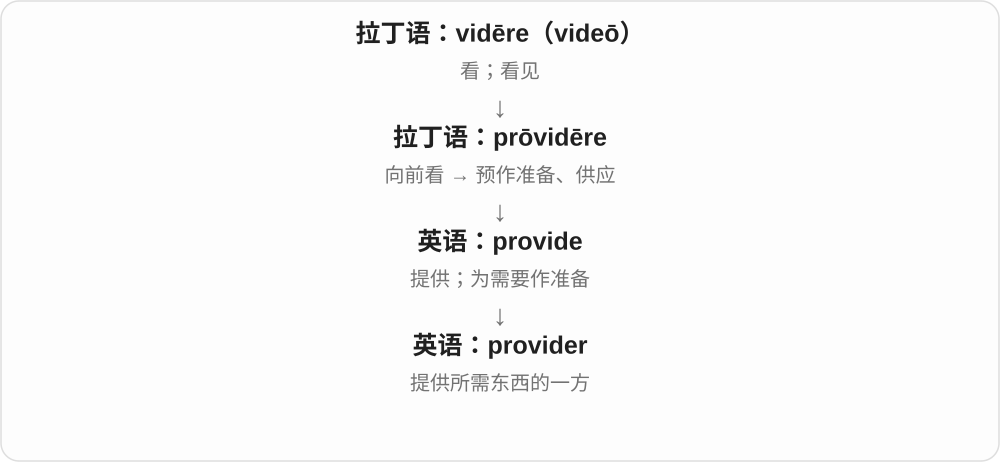

它可以是商业机构，也可以是家庭中承担供养的人；具体提供什么由前面的修饰词说明。

**常见搭配与例句**

a service provider；an internet provider；the main provider for a family。

> We changed our internet provider last month.

我们上个月换了网络服务商。

> For years, she was the main provider for the family.

多年来，她是家里的主要经济支柱。

**别混淆**

supplier 常突出货物供应；provider 特别常用于服务，也能用于生活供养。

### 108. receiver — 接收者；接收器；听筒

**音标**：英 /rɪˈsiːvə/；美 /rɪˈsiːvər/

**先抓住这个画面**

东西从一端发出，另一端负责接住，那一端就是 receiver。它可以是人，也可以是一台设备。

**怎么拆**

现代可拆 receive + -er“接收的人或物”；英语也继承了早期法语的相应名词形式。

**怎么变成今天的意思**

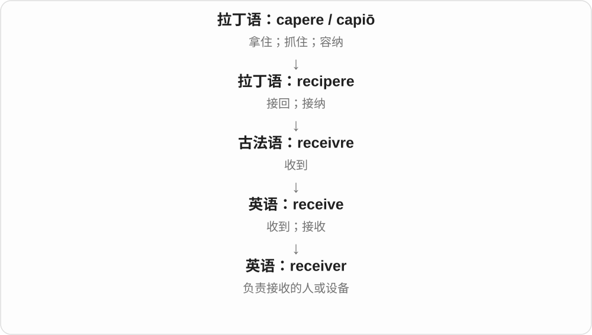

-er 不只造职业名，也能造工具名。收音机接收器接无线电信号，电话听筒让你接收声音；某些体育项目里也用它指接球者。

**常见搭配与例句**

a radio receiver；the sender and receiver；pick up the receiver。

> The receiver converts the signal into sound.

接收器把信号转换成声音。

> She picked up the receiver and dialed the number.

她拿起听筒，拨了那个号码。

**别混淆**

receiver 常涉及设备或信息传递角色；recipient 更常指礼物、邮件、帮助或奖项的获得者。

### 109. trainer — 教练；培训师；英式运动鞋

**音标**：英 /ˈtreɪnə/；美 /ˈtreɪnər/

**先抓住这个画面**

教人练习、帮助提升能力的人；英国口语里复数 trainers 也常是运动鞋。

**怎么拆**

train + -er，执行训练的人或器物。鞋的用法来自训练鞋的用途，不是鞋子在给人上课。

**怎么变成今天的意思**

**拉丁 trahere 拉 → 法语 traîner、train → 英语 train**  
拉出、延伸；一串随行之物

↓

**现代 train**  
火车；引导、培养 → 训练与培训

↓

**train + -er → trainer**  
训练者 → 教练、培训师；训练鞋

a personal trainer 私人健身教练，a staff trainer 员工培训师；a pair of trainers 一双运动鞋。

**常见搭配与例句**

a personal trainer；a staff trainer；a pair of trainers。

> The trainer explained the new booking system.

培训师讲解了新预订系统。

> She wore trainers for the walk.

她穿运动鞋去散步。

**别混淆**

trainer 培训者，trainee 受训者；trainers 复数在英式可指鞋，不能所有句子都译成多个教练。

### 110. supporter — 支持者；拥护者；球迷

**音标**：英 /səˈpɔːtə/；美 /səˈpɔːrtər/

**先抓住这个画面**

supporter 是在一个人、团队或主张后面出力的人。可能投票、捐款、声援，也可能每周去看球队比赛。

**怎么拆**

support + -er；中古英语已经有 supporter、supportour 等形式。

**怎么变成今天的意思**

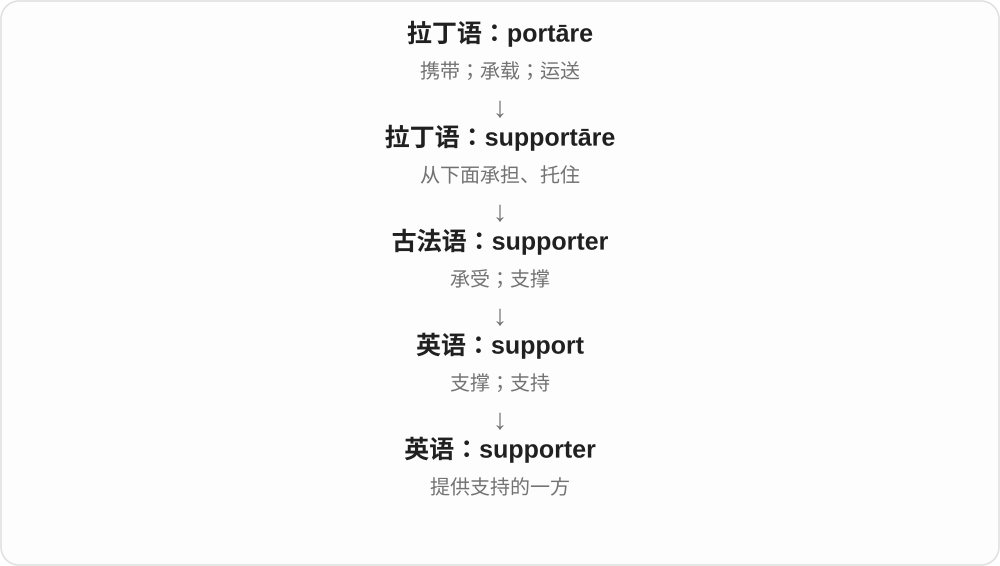

支撑从物理动作变成站在某人一边。a supporter of the plan 是赞同、支持这个计划的人，不要求他一定参与具体执行。

**常见搭配与例句**

a strong supporter（坚定支持者）；supporters of the proposal（提案支持者）；football supporters（足球迷）。

> She is a strong supporter of public libraries.

她坚定支持公共图书馆。

> The supporters cheered as the team entered the field.

球队进场时，球迷们欢呼起来。

**别混淆**

supporter 是支持的一方；participant 是参加者。参加过活动不必支持其全部观点。

### 111. buyer — 买家；采购员

**音标**：英 /ˈbaɪə/；美 /ˈbaɪər/

**先抓住这个画面**

站在交易中掏钱买入的那一边。

**怎么拆**

buy + -er，表示进行购买的人；职业语境也可指替商店或企业挑选、采购商品的人。

**怎么变成今天的意思**

**古英语 bycġan → 中古英语 byen**  
购买

↓

**英语 buy；过去式、过去分词 bought**  
买；也可比喻接受说法、换取时间

↓

**buy → buyer**  
购买 → 买的人；负责采购的人

a potential buyer 潜在买家，a first-time buyer 首次购房者等首次购买者，具体看语境。零售企业的 buyer 是为企业进货，未必为自己使用。

**常见搭配与例句**

a potential buyer；a buyer for a department store；find a buyer。

> The owner has found a buyer for the old house.

房主为老房子找到了买家。

> She works as a clothing buyer for a department store.

她在一家百货商店担任服装采购员。

**别混淆**

buyer 买入方，seller 卖出方；customer 更宽泛地强调与商家的顾客关系。

### 112. keeper — 看守者；保管者；值得留下的人或物

**音标**：英 /ˈkiːpə/；美 /ˈkiːpər/

**先抓住这个画面**

负责守住东西的人，或你看过后觉得值得留住的那一个。

**怎么拆**

keep + -er，接中古英语 kepere。-er 可表执行者；a keeper 另有值得保留者的口语用法，不是所有语境都指雇员。

**怎么变成今天的意思**

**古英语 cēpan → 中古英语 kepen**  
留意、守护、看管、保留

↓

**英语 keep**  
保持；保留；继续；照看

↓

**中古英语 kepere → keeper**  
看守者；延伸为值得保留的人物

a zoo keeper 是动物园饲养员，a goalkeeper 可简称 keeper；This photo is a keeper 是这张照片值得留下，口语也能夸某人值得珍惜。

**常见搭配与例句**

a zoo keeper；the keeper of records；This one is a keeper.。

> The keeper checked the animals every morning.

饲养员每天早晨查看动物。

> This photo is a keeper; everyone looks happy.

这张照片要留着，大家看起来都很开心。

**别混淆**

keeper 看守、保管，owner 拥有；博物馆保管员不是每件藏品的私人所有者。

### 113. rider — 骑手；乘客；附加条款、附件

**音标**：英 /ˈraɪdə/；美 /ˈraɪdər/

**先抓住这个画面**

先是骑在马或车上的人；条款义可想成附在主文件上的补充部分，跟着正文走。

**怎么拆**

古英语 rīdere 已有骑乘者义，现代可对应 ride + -er。附加条款义后来出现，不是把合同内容真的拿去骑马。

**怎么变成今天的意思**

**古英语 rīdan → 中古英语 riden**  
骑乘、乘坐着移动

↓

**英语 ride**  
骑马、骑车、乘车；一段乘坐经历

↓

**古英语 rīdere → rider**  
骑乘者 → 乘客；另发展出文件附加条款义

a bicycle rider 骑车者，bus riders 公交乘客，美式常用。a rider to an agreement 协议附加条款；演出合同中的 rider 可列场地、设备等额外要求。

**常见搭配与例句**

a skilled rider；bus riders；a rider to an agreement。

> The rider slowed down as she approached the bend.

骑手接近弯道时放慢了速度。

> The band sent the venue a rider listing its equipment needs.

乐队给场地方发了列明设备需求的合同附件。

**别混淆**

rider 不限骑马的人；driver 明确是驾驶者。附加条款义属于文件用法，具体效力由文本及适用规则决定。

### 114. starter — 起动装置；开胃菜〔尤英式〕；起步者、先发者

**音标**：英 /ˈstɑːtə/；美 /ˈstɑːrtər/

**先抓住这个画面**

先让后面的事情开起来：先吃的一道菜、让发动机起动的部件、首先出场的人。

**怎么拆**

start + -er，-er 可表人或用具。不同义项都抓开始的角色，不等于只有刚学英语的新手。

**怎么变成今天的意思**

**古英语 styrtan → 中古英语 sterten**  
突然跃起、冲出

↓

**英语 start**  
惊动、突然一动；开始、启动

↓

**start + -er → starter**  
开启某过程的人、物或先行部分

a starter motor 是起动机，have soup as a starter 是拿汤作前菜；a slow starter 可说起步慢的人。体育的 starter 可指发令者或先发选手，要看具体句子。

**常见搭配与例句**

a starter motor；a starter course；a slow starter；a conversation starter。

> We had soup as a starter.

我们先喝汤当开胃菜。

> The mechanic checked the starter motor.

修理工检查了起动机。

**别混淆**

starter 前菜与 dessert 甜点分处餐程前后；starter motor 起动发动机，不是整台发动机本身。

### 115. loser — 落败者；输家；没出息的人〔贬斥口语〕

**音标**：英 /ˈluːzə/；美 /ˈluːzər/

**先抓住这个画面**

比赛里没赢的那一方；骂人时则把一次输赢扩大成了对整个人的否定。

**怎么拆**

lose + -er，去掉末尾 e 再接 -er；从输、失去的人，扩展为口语里侮辱人的称呼。

**怎么变成今天的意思**

**古英语 losian → 中古英语 losen**  
丧失、失去

↓

**英语 lose**  
丢失、输掉、失去

↓

**lose + -er → loser**  
落败的人；贬斥人的称呼

a good loser 输得起，a bad loser 输不起，说的是面对失败的态度。单独骂 someone a loser 常很伤人，不是中性的参赛名次说明。

**常见搭配与例句**

the winner and the loser；a good loser；a bad loser。

> She is a good loser and always congratulates the winner.

她输得起，总会祝贺赢家。

> Losing one match does not make you a loser.

输一场比赛不等于你就是个失败者。

**别混淆**

loser 是人，loss 是损失、失败这件事；a good loser 不是经常赢的人，而是输了仍有风度的人。

### 116. seller — 卖家；卖方；畅销程度某种的商品

**音标**：英 /ˈselə/；美 /ˈselər/

**先抓住这个画面**

可以是卖东西的人或公司，也可以说某件东西卖得怎么样：a good seller 是好卖的产品。

**怎么拆**

sell + -er，中古英语已有同族人物名词。-er 在商品用法里指被卖得怎样的对象，不只主动卖东西者。

**怎么变成今天的意思**

**古英语 sellan → 中古英语 sellen**  
交给、给予；已发展为收钱转让

↓

**英语 sell**  
出售 → 推销商品、让别人接受主意

↓

**sell + -er → seller**  
出售者；某种销售表现的商品

a private seller 私人卖家，an online seller 网络卖家，a good seller 好卖的商品。

**常见搭配与例句**

a private seller；an online seller；a good seller。

> Contact the seller if the package does not arrive.

包裹没到的话，请联系卖家。

> The smaller model has been a good seller.

小型号一直卖得不错。

**别混淆**

seller 卖方，buyer 买方；a good seller 看语境可说优秀销售者，也可说畅销货，不能全译成卖货能手。

### 117. roller — 滚轮；滚筒；滚刷；卷发筒

**音标**：英 /ˈrəʊlə/；美 /ˈroʊlər/

**先抓住这个画面**

roller 是用滚动来完成工作的东西：圆筒滚过墙面涂漆，滚过地面压平，或让纸张顺着机器前进。

**怎么拆**

roll + -er，中古英语已有 rollere 形式。

**怎么变成今天的意思**

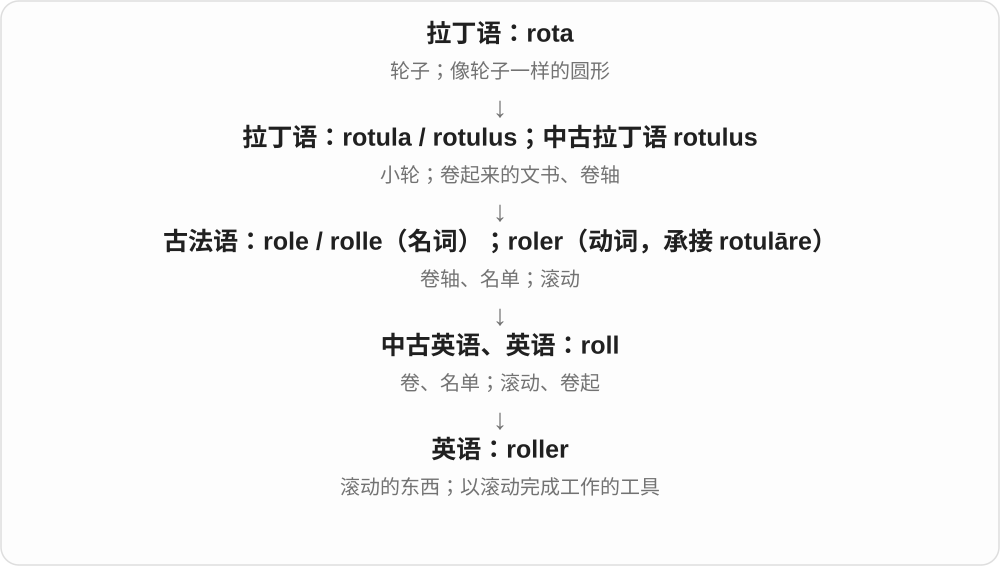

意思很依赖对象。paint roller 是滚刷；hair rollers 是卷发筒；机器里的 rollers 是滚筒或滚轮。

**常见搭配与例句**

a paint roller；hair rollers；a conveyor roller。

> Use a roller to paint the large wall.

用滚刷给这面大墙刷漆。

> The paper passes between two rubber rollers.

纸张从两个橡胶滚筒之间通过。

**别混淆**

wheel 多强调轮子支撑移动；roller 常强调圆筒或滚轮与表面接触、压过或带动物料。

### 118. compile — 汇编、编制；编译〔程序〕

**音标**：/kəmˈpaɪl/

**先抓住这个画面**

散落的资料先收起来，再按目的排成一份清单、书籍，是 compile。编程里则把源代码按语言规则翻译成另一种代码、中间形式。

**怎么拆**

经法语 compiler 接拉丁 compilare，早有搜掠、汇集材料的意思。现代汇编通常是中性整理；计算机编译是后来的技术用法。

**怎么变成今天的意思**

**拉丁 compilare 搜掠、汇集 → 法语 compiler**  
把来自各处的材料聚拢

↓

**英语 compile → compilation**  
汇编、编译；汇集过程与汇编作品

compile a list 编制清单；compile a report 汇编报告；compile code 编译代码。

**常见搭配与例句**

compile a list；compile code。

> She compiled a list of useful references.

她编了一份有用的参考资料清单。

> The tool compiles the code into a different format.

工具把代码编译成另一种格式。

**别混淆**

compile 比单纯 collect 收集常多整理成品的步骤；程序 compile 则按特定语言、工具规则转换，不只是把文本拼在一起。

### 119. compiled — 汇编、编制、汇集；编译了〔过去式、过去分词〕

**音标**：/kəmˈpaɪld/

**先抓住这个画面**

材料散在各处，把它们找来、整理成能一起使用的一份，就是 compiled；程序编译又是后来固定的技术用法。

**怎么拆**

compile 去 e 加完整 -ed，/l/ 后读 /d/。compile 经法语 compiler 接拉丁 compilare，较早有搜掠、汇集材料义，现代整理义通常中性。

**怎么变成今天的意思**

**拉丁 compilare → 法语 compiler → compile**  
搜掠、汇集材料 → 汇编、编制

↓

**compile 去 e + -ed → compiled**  
已经整理汇成；技术语境已编译

compiled a list 编制清单；compiled from records 根据记录汇编；compiled code 编译后的代码。

**常见搭配与例句**

carefully compiled 精心编制的；compiled a report 汇编报告。

> She compiled a list of useful books.

她编了一份实用书目。

> The report was compiled from local records.

报告根据当地记录汇编而成。

**别混淆**

compiled 不一定是原创每一条内容，常强调把材料汇集、整理。技术里的 compile 有具体转换含义，和普通把文件收进一个文件夹并不相同。

### 120. compiler — 编纂者；编译器

**音标**：英 /kəmˈpaɪlə/；美 /kəmˈpaɪlər/

**先抓住这个画面**

把分散材料收集、整理成有组织的东西，做这件事的人是 compiler；计算机里则是把源代码翻译成另一种代码的程序。

**怎么拆**

较早经法语 compilour、compileur 接拉丁语 compilator 人物名词，与 compile 同族。现代可对应 compile + -er；计算机义沿用执行编译任务者的名称。

**怎么变成今天的意思**

**拉丁语 compilator → 法语人物名词 → 英语 compiler**  
收集、编纂资料的人

↓

**compiler 在计算机语境的扩展**  
把源程序转换成目标代码的程序

the compiler of a dictionary 词典编纂者；a compiler error 编译器报错；a C compiler C 语言编译器。目标代码可以是机器码，也可以是其他代码形式。

**常见搭配与例句**

a compiler warning；the compiler of the collection。

> The compiler of the anthology selected poems from several centuries.

选集编纂者选入了跨越数百年的诗作。

> The compiler reported an error on line ten.

编译器报告第十行有错误。

**别混淆**

compiler 指编译程序，编译的产物不是 compiler。把它只理解成机器码生成器也偏窄，具体目标取决于编译器。

### 121. sprint — 短跑、冲刺；短时间集中完成的一轮工作

**音标**：/sprɪnt/

**先抓住这个画面**

最后一段路把速度一下提满，短时间全力跑。工作里的一轮 sprint 也借这种集中推进的画面。

**怎么拆**

较早英语 sprint 有跳起、窜出义，很可能改自 sprenten，并与古诺斯 spretta 等跳起材料有关；具体路径不是完全确定。后来发展为短距离全速跑。

**怎么变成今天的意思**

**较早 sprenten／sprint；可能有斯堪的纳维亚来源**  
跳起、窜出

↓

**现代 sprint**  
短距离冲刺；比喻集中推进的一轮

sprint to the bus 冲向公交车；a final sprint 最后冲刺；a hundred-metre sprint 百米短跑；a design sprint 一轮集中的设计工作。

**常见搭配与例句**

break into a sprint；sprint for the finish line。

> She sprinted to catch the bus.

她冲刺跑去赶公交车。

> He saved his energy for the final sprint.

他留着体力作最后冲刺。

**别混淆**

run 可泛指跑，sprint 把短时间全速冲刺突出出来。工作语境 sprint 的具体时长由采用的流程决定，词本身不固定等于某几天。

### 122. sprinter — 短跑运动员；擅长冲刺的人

**音标**：英 /ˈsprɪntə/；美 /ˈsprɪntər/

**先抓住这个画面**

把速度在短距离里迅速拉满的人，是 sprinter。重点是爆发式速度，不是一直慢慢跑得远。

**怎么拆**

sprint 短距离全速跑 + -er 表动作执行者，专门指参加短跑的选手，也能用于短距离比赛中的自行车手等。

**怎么变成今天的意思**

**sprint**  
短距离全力跑、冲刺

↓

**sprint + -er → sprinter**  
参加或擅长短程冲刺的人

a talented sprinter 有天赋的短跑选手；an Olympic sprinter 奥运短跑运动员；a powerful sprinter 爆发力强的冲刺选手。

**常见搭配与例句**

a hundred-metre sprinter；a track sprinter。

> The young sprinter won the hundred-metre race.

那位年轻短跑选手赢得了百米比赛。

> She is a strong sprinter but prefers longer races.

她冲刺能力很强，但更喜欢较长距离的比赛。

**别混淆**

runner 范围广，sprinter 特指短距离速度这一型。跑长距离的人通常 distance runner，不能仅因为也会跑就都叫 sprinter。

### 123. sprinters — 短跑选手；全速短距离冲刺的人〔复数〕

**音标**：英 /ˈsprɪntəz/；美 /ˈsprɪntərz/

**先抓住这个画面**

不是为了跑一整天，而是把速度在短距离里爆出来，这些人是 sprinters。运动项目里常就是短跑选手。

**怎么拆**

sprint + -er → sprinter，再加复数 -s，读 /z/；旧跳起、窜出材料发展为短距离全速跑后，-er 命名做事的人。

**怎么变成今天的意思**

**早期 sprenten、sprint 的跳起、窜出材料**  
很可能与斯堪的纳维亚相关形式相连，路线细节有不确定性

↓

**sprint 短距离冲刺 + -er → sprinter**  
命名做这类跑动的人，再用 -s 表复数

elite sprinters 顶尖短跑选手；the sprinters at the start 起跑线上的短跑选手。

**常见搭配与例句**

train sprinters；a race for sprinters。

> The sprinters crouched at the starting line.

短跑选手蹲在起跑线上。

> Elite sprinters practise their starts repeatedly.

顶尖短跑选手会反复练习起跑。

**别混淆**

sprinters 着重短距离全速，distance runners 着重长距离跑；两者训练、项目侧重点不同，不是所有跑者都叫 sprinters。

### 124. sprints — 短距离全速跑、冲刺〔第三人称单数〕；冲刺、短跑、短时集中工作〔复数〕

**音标**：/sprɪnts/

**先抓住这个画面**

一个人突然使出全速跑一段，是 sprints；训练里几次短冲刺，也叫 sprints。工作里限定时间集中做一轮任务，也借冲刺的画面。

**怎么拆**

sprint + -s，/t/ 后读 /s/，结尾 /nts/；动词三单和名词复数同形，工作用法是短时集中推进的借用。

**怎么变成今天的意思**

**较早 sprenten／sprint 的跃起、窜出材料**  
可能接北欧 spretta 等，具体改形路线保留不确定性

↓

**现代体育 sprint → 短距离全速跑及短时集中工作**  
冲刺名词与短跑复合词有记录关系，不把今天整词顺序当唯一史实

↓

**sprint + -s → sprints**  
他、她冲刺；多次短跑或多轮集中推进

sprints towards the line 是全速冲向终点，short sprints 是短距离冲刺；two-week sprints 是两周一轮的集中工作安排。

**常见搭配与例句**

sprints for the bus 冲跑赶公交；a series of sprints 一连串冲刺。

> She sprints towards the finish line.

她全速冲向终点。

> The team works in short sprints with a clear goal for each one.

团队分成短轮次集中工作，每轮都有明确目标。

**别混淆**

sprints 强调短时间、全力跑，jogs 常是较慢、可持续的慢跑；不同速度、持续方式让两词画面不同。

### 125. sprinting — 短跑、冲刺；sprint 的 -ing 形式

**音标**：/ˈsprɪntɪŋ/

**先抓住这个画面**

速度一下提上来，短时间全力向前。sprinting 可以把这段动作当作正在发生的事，也可以当运动项目来说。

**怎么拆**

sprint + -ing，-ing 形成进行结构中的分词，也形成动作名词。承接短距离全速跑这一现代分支。

**怎么变成今天的意思**

**sprint**  
短程冲刺、全速跑

↓

**sprint + -ing → sprinting**  
冲刺动作；短跑项目

was sprinting 正在冲刺；sprinting down the road 沿路飞奔；good at sprinting 擅长短跑；sprinting practice 短跑练习。

**常见搭配与例句**

a burst of sprinting；sprinting toward the finish。

> He was sprinting toward the finish line.

他正在向终点线冲刺。

> She prefers sprinting to jogging.

相比慢跑，她更喜欢短跑。

**别混淆**

sprinting 是全力短程跑，jogging 常是慢跑。-ing 是否表达正在，要看 was sprinting 等结构；I enjoy sprinting 说喜欢这项运动。

### 126. sprinted — 全速短跑、冲刺了

**音标**：/ˈsprɪntɪd/

**先抓住这个画面**

刚才突然拿出全速，冲到门口或终点，是 sprinted。重点像开了短时最大档，不是一路慢慢跑。

**怎么拆**

sprint + 完整 -ed，/t/ 后读 /ɪd/，多一个音节；nt 后直接加，不双写 t。

**怎么变成今天的意思**

**较早 sprenten／sprint 的跃起、窜出材料**  
可能接北欧 spretta 等，具体改形路线保留不确定性

↓

**现代体育 sprint → 短距离全速跑及短时集中工作**  
冲刺名词与短跑复合词有记录关系，不把今天整词顺序当唯一史实

↓

**sprint + -ed → sprinted**  
过去短时间全速跑动

sprinted across the field 是全速跑过球场，sprinted to catch the bus 是冲跑赶公交；方向可近可远，动作突出冲劲。

**常见搭配与例句**

sprinted for the door 冲向门口；sprinted the final stretch 冲刺最后一段。

> He sprinted across the field to catch the ball.

他全速跑过球场去接球。

> We sprinted the last few metres to the gate.

我们冲刺着跑完了通向大门的最后几米。

**别混淆**

sprinted 可以为赶车、玩耍或比赛，raced 有时另暗含竞赛；仅凭 sprinted 不需要假定旁边一定有对手。

### 127. locker — 可上锁储物柜；锁定装置等

**音标**：英 /ˈlɒkə/；美 /ˈlɑːkər/

**先抓住这个画面**

每个人放包、衣服的那一小格柜子，通常能锁上。-er 在这里并非一个专门替你锁门的人。

**怎么拆**

lock + -er，可表可锁容器或执行锁定的器具等。日常先掌握学校、健身房、车站储物柜。

**怎么变成今天的意思**

**古英语 loc〔闩、闭合装置等〕、lūcan〔关〕→ 中古英语 lok 等**  
闭住、固定；现代锁与上锁动作

↓

**lock + -er → locker**  
可上锁存物的柜、格等

a school locker 学校储物柜，a locker room 更衣室，a station locker 车站寄存柜。

**常见搭配与例句**

a school locker；a locker room；put it in a locker。

> He left his bag in a station locker.

他把包存在车站储物柜里。

> The players returned to the locker room.

队员们回到了更衣室。

**别混淆**

locker 储物柜，locksmith 锁匠；-er 常人物但不能对 locker 强套。locker room 是带柜、更衣等功能场所，不是锁匠工作室。

### 128. adviser — 顾问；建议者

**音标**：英 /ədˈvaɪzə/；美 /ədˈvaɪzər/

**先抓住这个画面**

adviser 是帮你作判断的人：先了解情况，再提出建议，不一定拥有最后决定权。

**怎么拆**

advise 去掉词尾 e 加 -er；advisor 是另一种常见拼写。

**怎么变成今天的意思**

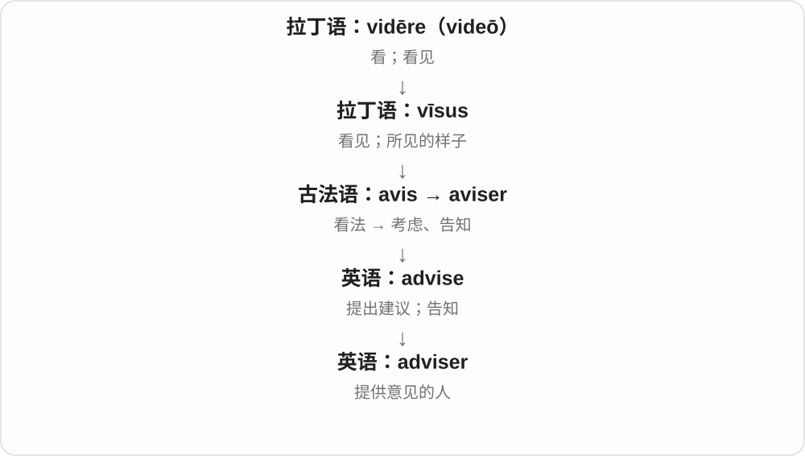

在 careers adviser 中是职业规划顾问；在政府等机构中可指某领域的咨询人员。

**常见搭配与例句**

a careers adviser；a senior adviser；an adviser on education。

> The careers adviser helped him prepare for the interview.

职业顾问帮他准备面试。

> She became an adviser on education policy.

她成了教育政策顾问。

**别混淆**

adviser 和 advisor 通常同义；advisory 则多是形容词，表示提供咨询的。

### 129. thrill — 兴奋、激动；使兴奋；一阵强烈感受

**音标**：/θrɪl/

**先抓住这个画面**

消息好到让人心里一颤，可以说 a thrill。旧词的穿透画面后来走向感觉仿佛穿过身体的强烈反应。

**怎么拆**

接古英语 þyrlian、þyrel 等穿透、孔洞材料，后有颤动、情绪激动义；不把它拆成 three 三的缩短。

**怎么变成今天的意思**

**古英语 thyrlian 等刺穿材料 → thrill**  
穿过、穿透；后来走向颤动、强烈感受

↓

**现代 thrill；+ -er → thriller**  
兴奋、激动；引起紧张兴奋的作品

a thrill of excitement 一阵兴奋；give someone a thrill 让人激动；thrill the audience 让观众兴奋。

**常见搭配与例句**

a thrill of excitement；give someone a thrill。

> Opening the letter gave her a thrill of excitement.

打开信时，她涌上一阵兴奋。

> The final performance thrilled the audience.

最后的表演让观众激动不已。

**别混淆**

thrill 重强烈而短促的激动，普通 pleasure 可以更平静、持续；并非每次开心都是 thrill。

### 130. thrilled — 非常高兴、激动的；使激动〔过去式、过去分词〕

**音标**：/θrɪld/

**先抓住这个画面**

好消息传来，开心一下子涌上来，是 thrilled。它通常比 pleased 更强，强调高兴得很激动。

**怎么拆**

thrill 的本族旧义和穿透、刺入有关，后来有一阵强烈感受传遍身体的意思。现代 thrill + 完整 -ed，/l/ 后读 /d/，不另加音节。

**怎么变成今天的意思**

**古英语穿透材料 → thrill**  
穿透 → 颤动、强烈感受

↓

**thrill + -ed → thrilled**  
被强烈的高兴打动；也可作过去式

be thrilled to hear… 听说……非常高兴；thrilled with the result 对结果很兴奋。

**常见搭配与例句**

absolutely thrilled 兴奋极了；thrilled about the trip 对这趟旅行很激动。

> We were thrilled to hear the news.

听到消息，我们高兴极了。

> The audience was thrilled by the final performance.

最后的表演让观众激动不已。

**别混淆**

thrilled 常侧重愉快的激动；thriller 是制造紧张悬念的作品。它们同族，但读到 thrilled 不必自动想成害怕。

### 131. thriller — 惊险、悬疑作品；扣人心弦的事

**音标**：英 /ˈθrɪlə/；美 /ˈθrɪlər/

**先抓住这个画面**

故事让人紧张地追着看，想知道下一秒会怎样，就是 thriller 的典型感受。-er 在这里可以是作品，而非一个发抖的人。

**怎么拆**

thrill + -er → thriller，表示能引起这种强烈感受的东西；后来成为小说、电影等类型名称。

**怎么变成今天的意思**

**古英语 thyrlian 等刺穿材料 → thrill**  
穿过、穿透；后来走向颤动、强烈感受

↓

**现代 thrill；+ -er → thriller**  
兴奋、激动；引起紧张兴奋的作品

↓

**thrill + -er → thriller**  
令人紧张兴奋的作品或事件

a psychological thriller 心理惊悚片、小说；a crime thriller 犯罪悬疑作品；a political thriller 政治惊险作品。

**常见搭配与例句**

a psychological thriller；a crime thriller。

> She borrowed a political thriller from the library.

她从图书馆借了一本政治惊险小说。

> The film is a tense psychological thriller.

这部电影是一部气氛紧张的心理惊悚片。

**别混淆**

thriller 常重悬念、紧张，horror 常重恐惧、惊骇；两类会重叠，不保证每部 thriller 都有恐怖怪物。

### 132. painter — 画家；油漆工

**音标**：英 /ˈpeɪntə/；美 /ˈpeɪntər/

**先抓住这个画面**

同样拿着画笔或漆刷，做的是艺术作品还是墙面施工，要从场景判断。

**怎么拆**

现代可对应 paint + -er，但历史名词经中古英语 peyntour、古法语 peintor，接拉丁 pictor“画者”，有独立借入路线。

**怎么变成今天的意思**

**拉丁 pingere，过去分词 pictus**  
绘画、着色；用图像表现

↓

**拉丁 pictor → 古法语 peintor → 中古英语 peyntour**  
从事绘画的人

↓

**英语 painter**  
画家；也指粉刷、刷漆的工人

portrait painter 是肖像画家；house painter 是房屋油漆工。另有船用系缆的同形词 painter，通常另接表示悬挂的词源，不属于这一绘画义。

**常见搭配与例句**

a landscape painter；a portrait painter；a house painter；a painter and decorator。

> The painter is best known for quiet coastal scenes.

这位画家最有名的是宁静的海岸风景画。

> The painter covered the floor before starting on the walls.

油漆工开始刷墙前先遮住了地板。

**别混淆**

artist 的创作领域更广；painter 在艺术语境中特指绘画者，在装修语境中则是工种。

### 133. printer — 打印机；印刷工；印刷商

**音标**：英 /ˈprɪntə/；美 /ˈprɪntər/

**先抓住这个画面**

负责把内容印出来的，可以是人、公司，也可以是桌上的机器。

**怎么拆**

print + -er；先可指从事印刷的人，后来也指执行打印的设备。

**怎么变成今天的意思**

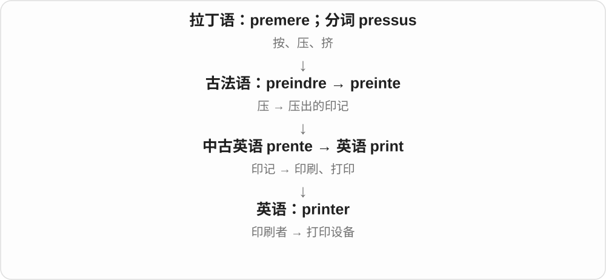

现代日常最常见的是打印机；a commercial printer 也可能指商业印刷商，要看是否在谈人、公司或机器。

**常见搭配与例句**

an inkjet printer；a laser printer；send files to the printer。

> The printer has run out of paper.

打印机没纸了。

> The publisher sent the final files to the printer.

出版社把定稿文件交给了印刷商。

**别混淆**

printer 负责印制，publisher 负责出版业务；两者可能合作，但职责不同。

### 134. lend — 借出；提供、增添〔某种帮助或性质〕

**音标**：/lend/

**先抓住这个画面**

东西先到别人手里用，约定还回来，是 lend 的方向。borrow 则站在把东西借进来的那一边。

**怎么拆**

接古英语 lænan、中古英语 lenen 等，现代末尾 d 在历史中加入；过去式、分词 lent，不写 lended。

**怎么变成今天的意思**

**古英语 lænan → 中古英语 lenen 等 → lend**  
借出、授予暂时使用；末尾 d 后来加入

↓

**lend + -er → lender**  
出借物品、资金的人或机构

lend someone a book 借书给某人；lend a book to someone 同义结构；lend a hand 帮个忙；lend support 提供支持。

**常见搭配与例句**

lend someone something；lend something to；lend a hand。

> Could you lend me your pen?

能把你的笔借我用一下吗？

> Her presence lent confidence to the group.

她的到来给大家增添了信心。

**别混淆**

lend 借出，borrow 借入；Can you lend me ... 是请对方出借，不写 borrow me。

### 135. lending — 借出、出借；添上、赋予〔现在分词、动名词〕

**音标**：/ˈlendɪŋ/

**先抓住这个画面**

东西原来在自己这里，暂时给别人用，是 lending。把支持、气氛等提供给某事，也能借这个给予的方向表达。

**怎么拆**

lend 接古英语 laenan、中古英语 lenen 等，末尾 d 在历史中加入。现代直接加完整 -ing，词干 lend 保留，不换成过去式 lent。

**怎么变成今天的意思**

**古英语 laenan → 中古英语 lenen → lend**  
暂给别人使用；历史加入末尾 d

↓

**lend + -ing → lending**  
借出的过程；给某事添上某种作用

lending a book 借出一本书；lending a hand 帮忙；lending support 提供支持。

**常见搭配与例句**

a lending library 借阅图书馆；lending colour to… 为……增添色彩、可信感等〔看语境〕。

> Thank you for lending me the map.

谢谢你把地图借给我。

> Several volunteers are lending a hand with the exhibition.

几位志愿者正在帮忙筹备展览。

**别混淆**

lending 是往外借，borrowing 是往里借。lending a hand 是提供帮助的固定说法，不是把手作为物品借走。

### 136. lender — 出借者；放贷人、放贷机构

**音标**：英 /ˈlendə/；美 /ˈlendər/

**先抓住这个画面**

lend 是给出去暂时用，lender 就是站在给出这一端的人、机构。它不只是一位具体个人。

**怎么拆**

lend + -er；中古英语已有相应 lenner、lendare 等人物形式。-er 交代动作角色，不交代具体收费、期限。

**怎么变成今天的意思**

**古英语 lænan → 中古英语 lenen 等 → lend**  
借出、授予暂时使用；末尾 d 后来加入

↓

**lend + -er → lender**  
出借物品、资金的人或机构

↓

**lend + -er → lender**  
出借、提供贷款的一方

a book lender 出借书的人；a mortgage lender 抵押贷款机构；the lender and the borrower 出借方和借入方。

**常见搭配与例句**

the lender and the borrower；a mortgage lender。

> The lender asked when the equipment would be returned.

出借方问设备何时归还。

> The form has separate sections for the lender and the borrower.

表格把出借方和借入方分在不同栏目。

**别混淆**

lender 与 borrower 方向相反；是否借钱、借物，是否收利息，要看具体语境。

### 137. observer — 观察者；旁观者；观摩人员

**音标**：英 /əbˈzɜːvə/；美 /əbˈzɜːrvər/

**先抓住这个画面**

站在一旁留心看发生了什么，可能作记录，但不一定直接参与决定。

**怎么拆**

observe + -er。

**怎么变成今天的意思**

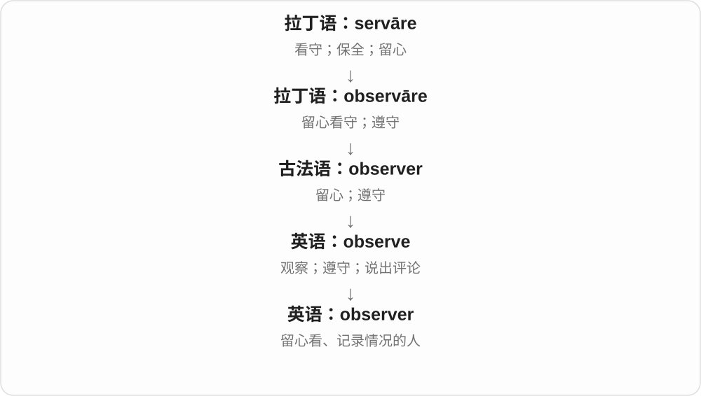

可以是普通目击者，也可以是正式派出的监督观察人员。observer status 表示可观察、参与某些活动，但权利不等同正式成员。

**常见搭配与例句**

an independent observer；a casual observer；observer status。

> An independent observer attended the counting process.

一名独立观察员到场观察了计票过程。

> To a casual observer, the two machines look identical.

在随便看一眼的人看来，这两台机器一模一样。

**别混淆**

participant 直接参与活动；observer 重点在观察。一个人也可能在不同阶段承担两种角色。

### 138. cleaner — 清洁工；清洁器、清洁剂；更干净的

**音标**：英 /ˈkliːnə/；美 /ˈkliːnər/

**先抓住这个画面**

可以是做清洁的人、工具、清洁液；也可能只是两样东西比较，一个更干净。

**怎么拆**

人物、工具名来自 clean 动词 + -er；形容词比较级另是 clean + 比较级 -er。两个后缀写得一样，功能不同。

**怎么变成今天的意思**

**古英语 clǣne → 中古英语 clene**  
干净、纯净、清楚

↓

**现代 clean**  
干净；使干净；无杂乱、清楚利落等延伸

↓

**clean + 人物工具 -er；clean + 比较级 -er**  
清洁主体；更干净的性质

a window cleaner 擦窗工或玻璃清洁剂，a vacuum cleaner 吸尘器；a cleaner room 更干净的房间。

**常见搭配与例句**

a window cleaner；a vacuum cleaner；a cleaner room。

> The cleaner arrives before the office opens.

清洁工在办公室开门前到。

> This cleaner removes marks from glass.

这种清洁剂能去掉玻璃上的污迹。

**别混淆**

比较级 cleaner 不是清洁工：The room is cleaner。a cleaner 则通常名词，结合上下文分人、工具、试剂。

### 139. voyage — 航行、航程；远行〔尤指海上，也用于太空〕

**音标**：/ˈvɔɪɪdʒ/

**先抓住这个画面**

船离港，穿过一大片海，到另一个地方去，这整段远行就是 voyage。太空旅行也借用这幅长途航行的画面。

**怎么拆**

拉丁语 via 道路 → viaticus 旅途所用的 → viaticum 旅途给养、后来也指旅程，经古法语 voiage 借入英语。英语后来尤常用于水上航程。

**怎么变成今天的意思**

**拉丁语 via → viaticum → 古法语 voiage**  
道路、旅途给养 → 旅程

↓

**英语 voyage 的常用范围**  
尤指海上航程，也用于太空等远行

a voyage across the Atlantic 横渡大西洋的航程；a maiden voyage 首航；a voyage of discovery 探索之旅。也能作动词说航行。

**常见搭配与例句**

a long sea voyage；a voyage into space。

> The ship began its voyage at dawn.

船在黎明时开始了航程。

> The book describes a voyage across the Pacific.

这本书描写了一次横渡太平洋的航行。

**别混淆**

trip 用途很广，voyage 常突出海上或太空的长程旅途。去街角商店的一次出门通常不叫 voyage，除非刻意夸张。

### 140. voyager — 航行者、远行者

**音标**：英 /ˈvɔɪɪdʒə/；美 /ˈvɔɪɪdʒər/

**先抓住这个画面**

voyage 是那段远途，voyager 是踏上旅程的人。词的气氛常偏探索、航海或文学叙述。

**怎么拆**

历史可追到古法语 voyagier 远行者，与 voiage 旅程相连；现代英语结构清楚对应 voyage + -er。两种分析分别说明借入历史和今天的构词联系。

**怎么变成今天的意思**

**古法语 voiage、voyagier 的旅途词族**  
旅程、远行者

↓

**英语 voyager 与 voyage 的对应**  
进行长途航行、探索旅行的人

an ocean voyager 远洋航行者；an intrepid voyager 无畏的远行者。大写 Voyager 还可能是专有名称，需按上下文区分。

**常见搭配与例句**

a seasoned voyager；early voyagers。

> The voyagers reached the island after weeks at sea.

航行者们在海上走了数周后抵达岛屿。

> Her diary records the hopes of a young voyager.

她的日记记录了一位年轻远行者的希望。

**别混淆**

traveller 是很宽泛的旅行者；voyager 往往令人想到较远、较长、带航行意味的旅程。

### 141. browse — 浏览、随意翻看；取食嫩枝叶

**音标**：/braʊz/

**先抓住这个画面**

像动物这里吃一点叶子、那里啃一点嫩芽，人在书架、店里也能这里看看那里翻翻，不必一开始就锁定目标。

**怎么拆**

借古法语 brouster 等取食芽叶的词，接 brost 芽、嫩枝材料。阅读、购物和网络浏览是后来的扩展，不是 brow 眉毛加 se。

**怎么变成今天的意思**

**古法语 brouster 等 → browse**  
取食嫩枝、芽、叶的材料

↓

**现代 browse；+ -er → browser**  
随意翻看、浏览；浏览者、浏览器

browse the shelves 浏览书架；browse through a book 随意翻书；browse the web 浏览网页；animals browse on leaves 动物吃嫩叶。

**常见搭配与例句**

browse the shelves；browse through；browse the web。

> She browsed through the book before buying it.

买书前，她随意翻看了一下。

> We spent an hour browsing the market stalls.

我们花了一小时逛市场摊位。

**别混淆**

browse 通常比仔细逐项 study 更轻松、选择性；但网络技术里浏览也可带明确目标。

### 142. browser — 浏览器；浏览者；取食枝叶的动物

**音标**：英 /ˈbraʊzə/；美 /ˈbraʊzər/

**先抓住这个画面**

browse 是浏览，browser 可以是做这件事的人，也可以是让你浏览网页的软件。词尾不只给人起职业名。

**怎么拆**

browse 去末尾 e 加 -er → browser；软件义在原有浏览者、相关对象名上扩展。

**怎么变成今天的意思**

**古法语 brouster 等 → browse**  
取食嫩枝、芽、叶的材料

↓

**现代 browse；+ -er → browser**  
随意翻看、浏览；浏览者、浏览器

↓

**browse + -er → browser**  
浏览的人、软件；也有取食枝叶者的动物义

a web browser 网页浏览器；open in a browser 在浏览器打开；a casual browser 随意浏览者。

**常见搭配与例句**

a web browser；open in a browser。

> The link opens in your web browser.

链接会在网页浏览器中打开。

> The shop welcomes casual browsers as well as serious buyers.

商店欢迎随意逛逛的人，也欢迎认真购物的人。

**别混淆**

browser 是程序，search engine 是搜索服务；浏览器可以访问不同搜索引擎，二者不是同一层。

### 143. browsers — 浏览器；浏览者；取食枝叶的动物〔复数〕

**音标**：英 /ˈbraʊzəz/；美 /ˈbraʊzərz/

**先抓住这个画面**

随意看看的人可叫 browsers，帮你浏览网页的程序也叫 browsers。词尾按作用起名，执行者未必是人。

**怎么拆**

browse 去末尾 e 加完整的 -er → browser，再加 -s；早期 browse 取食嫩枝叶的用途，后来扩到随意翻看。

**怎么变成今天的意思**

**browse → browser**  
浏览者；取食枝叶者；后来还有浏览软件

↓

**browser + -s → browsers**  
多个相应人、动物或程序

web browsers 网页浏览器；casual browsers 随意逛逛的人。

**常见搭配与例句**

different browsers 不同浏览器；browsers in the bookshop 书店里的浏览者。

> The page looked different in the two browsers.

这个页面在两个浏览器里显示得不一样。

> The bookshop welcomes browsers as well as buyers.

这家书店也欢迎随便看看、不买书的人。

**别混淆**

浏览器是访问网页的程序，search engines 是查找网页等内容的搜索服务；可以在浏览器中访问搜索引擎。

### 144. carve — 雕刻；切开熟肉；开辟、争取〔常与 out 连用〕

**音标**：英 /kɑːv/；美 /kɑːrv/

**先抓住这个画面**

一刀刀切掉材料，形状就露出来了。雕木头、切烤肉都保留切的动作；carve out a career 则像一步步给自己开出位置。

**怎么拆**

古英语 ceorfan 切，经中古英语 kerven 等发展。早期切的范围较广，现代常集中在雕刻、切分熟肉等用途。

**怎么变成今天的意思**

**古英语 ceorfan → 中古英语 kerven**  
切、割材料

↓

**现代 carve 的较专门与比喻用法**  
雕刻；切分肉；靠努力开辟机会或道路

carve a bird out of wood 用木头雕一只鸟；carve a name into stone 把名字刻进石头；carve the roast 切烤肉。

**常见搭配与例句**

carve out a niche；carve the turkey。

> He carved a small bird out of wood.

他用木头雕了一只小鸟。

> She carved out a successful career in design.

她在设计领域闯出了成功的事业。

**别混淆**

carve a figure 强调雕出形象，engrave letters 更常强调把文字、图案刻入表面；carve 也可以用于刻字，范围有交集。

### 145. carved — 雕刻了、刻出的；切分了〔过去式、过去分词〕

**音标**：英 /kɑːvd/；美 /kɑːrvd/

**先抓住这个画面**

把材料一点点切掉，留下想要的形状，是 carved。刻一个图案、把熟肉切成片，都沿着切出形状这个动作。

**怎么拆**

carve 继承古英语 ceorfan 切，经过中古英语 kerven 等形式，现代突出雕刻、切分熟肉等用途。去末尾 e 加完整 -ed，/v/ 后读 /d/。

**怎么变成今天的意思**

**古英语 ceorfan → 中古英语 kerven → carve**  
切、割 → 雕刻、切分

↓

**carve 去 e + -ed → carved**  
已经切出、刻出形状

carved wood 雕刻过的木料；carved a pattern 刻出图案；carved the meat 切分熟肉。

**常见搭配与例句**

carved into stone 刻进石头；carved out a role 靠努力为自己开辟位置。

> A small bird was carved into the wooden lid.

木盖上刻着一只小鸟。

> She carved the roast into thin slices.

她把烤肉切成薄片。

**别混淆**

carved 不只说艺术作品。carve out a role 借切出空间说争取到属于自己的位置，不是真切材料。

### 146. carver — 雕刻者；切分熟肉的人

**音标**：英 /ˈkɑːvə/；美 /ˈkɑːrvər/

**先抓住这个画面**

把 carve 的切、雕动作交给一个人：雕木头的是 carver，餐桌边负责切大块熟肉的人也可以这样叫。

**怎么拆**

carve + -er，形成动作实施者名称。具体雕刻还是切肉，取决于 carve 使用的是哪一支。

**怎么变成今天的意思**

**carve 雕刻、切分 + -er**  
由动作形成实施者名称

↓

**carver 的工艺与餐饮语境**  
雕刻者；负责切分熟肉的人

a wood carver 木雕工；a stone carver 石雕工；the carver at the table 餐桌边切肉的人。

**常见搭配与例句**

a skilled carver；a traditional wood carver。

> The carver worked slowly on the wooden mask.

雕刻者慢慢雕琢着那副木面具。

> At dinner, her father acted as the carver.

晚餐时，她父亲负责切分熟肉。

**别混淆**

sculptor 更宽泛地说雕塑家，可用塑造、焊接等方法；carver 更具体联系切削、雕刻的方法。

### 147. midfield — 中场；中场球员群体

**音标**：/ˈmɪdfiːld/

**先抓住这个画面**

球场中间这片区域，连接后场防守与前场进攻；也可用来说在这里承担职责的球员。

**怎么拆**

mid- 中间 + field 场地，形成球场中部及相应位置名称。具体职责与范围随运动项目和战术。

**怎么变成今天的意思**

**mid- 中间；field 场地**  
并列构词部分

↓

**midfield**  
场地中部及相应球员位置

control midfield 控制中场，play in midfield 踢中场；a midfield role 中场角色。并非只能站在中心点不动。

**常见搭配与例句**

control midfield；play in midfield；a midfield player。

> The team struggled to control midfield.

球队很难控制住中场。

> She moved from defence into midfield.

她从防守位置改踢中场。

**别混淆**

midfield 中场，infield 内场；两者不是中文里都在里面就能互换，尤其项目不同。

### 148. midfielder — 中场球员

**音标**：英 /ˌmɪdˈfiːldə/；美 /ˌmɪdˈfiːldər/

**先抓住这个画面**

在进攻线与防守线之间承担中场职责的人，是 midfielder。位置名称说主要角色，不表示整场只能站在中点。

**怎么拆**

midfield 中场 + -er 人物尾；midfield 又由 mid- 中间 + field 场地组成。

**怎么变成今天的意思**

**mid- + field → midfield**  
场地中部及相应球队角色区域

↓

**midfield + -er → midfielder**  
承担中场角色的球员

a central midfielder 中路中场；a defensive midfielder 防守型中场；play as a midfielder 担任中场。

**常见搭配与例句**

a central midfielder；play as a midfielder。

> She plays as a midfielder for the school team.

她在校队担任中场。

> The midfielder connected the defence with the attack.

中场球员衔接了防守与进攻。

**别混淆**

midfielder 不等于所有运动项目的 centre 位置；各项目按自身名称体系区分。

### 149. explorer — 探索者；探险家；浏览、查看工具〔特定语境〕

**音标**：英 /ɪkˈsplɔːrə/；美 /ɪkˈsplɔːrər/

**先抓住这个画面**

主动去查明新地方或未知情况的人；软件也借这个形象命名查看工具。

**怎么拆**

英语 explore + -er，形成施事名词；不是从拉丁 explorer 整词直接借入。

**怎么变成今天的意思**

**拉丁 explorare**  
调查、搜寻；传统解释联系 ex- + plorare，但内部来源有异说

↓

**法语 explorer 借入，或由英语 exploration 反构 → explore**  
查探、探究；英语动词晚于 exploration

↓

**英语 explore + -er → explorer**  
探索 → 从事探索的人；后来用于工具名称

an explorer 可以从事地理考察，也可比喻喜欢探索的人。file explorer 是浏览文件的工具名称，不需要把它理解成真人。

**常见搭配与例句**

a polar explorer；an intrepid explorer；a file explorer。

> The explorer kept detailed notes on the route.

那位探险者详细记录了行进路线。

> Use the file explorer to locate the saved document.

使用文件浏览工具找到已保存的文档。

**别混淆**

traveller 只说旅行者；explorer 更强调探查、了解某个不熟悉的地方。

### 150. ruler — 尺子；统治者

**音标**：英 /ˈruːlə/；美 /ˈruːlər/

**先抓住这个画面**

一边是把线画直的工具，一边是为群体定规则、掌握统治权的人。两义都围着 rule 转。

**怎么拆**

rule + -er。英语早期已有统治者义，随后也用于划线工具；不要编成“国王拿尺子所以叫 ruler”的故事。

**怎么变成今天的意思**

**拉丁语：regere**  
引导、使直；治理

↓

**拉丁语：regula**  
直尺、直条；准则

↓

**古法语 riule / reule；riuler**  
规则；管理、划直线〔名词和动词两路〕

↓

**英语：rule**  
规则；统治、裁定、划线

↓

**英语：rule + -er → ruler**  
统治者；划线、测量的工具〔两种用途〕

a plastic ruler 是塑料尺；the ruler of a kingdom 是王国的统治者。上下文通常很清楚，不必把两种意思强行混成一幅场景。

**常见搭配与例句**

a thirty-centimetre ruler；an absolute ruler。

> Use a ruler to draw a straight line.

用尺子画一条直线。

> The ruler ordered the city walls to be rebuilt.

统治者下令重建城墙。

**别混淆**

leader 可以只是带领者；ruler 通常强调统治、掌权。

### 151. supplier — 供应商；供货者

**音标**：英 /səˈplaɪə/；美 /səˈplaɪər/

**先抓住这个画面**

你需要材料或商品时，负责把它供给你的那个人或公司。

**怎么拆**

supply + -er；拼写中 y 变 i。

**怎么变成今天的意思**

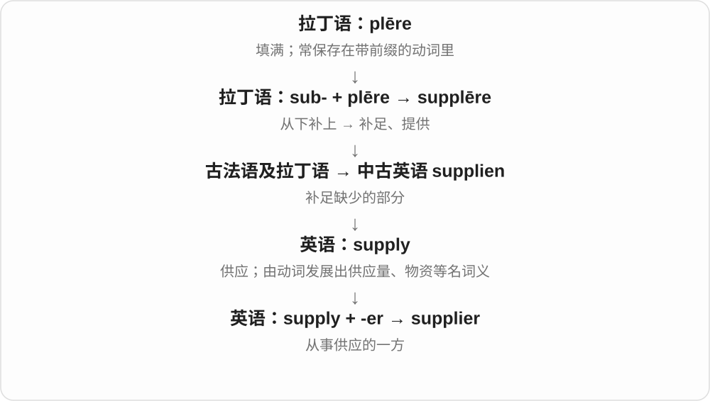

可以是零件供应商、食品供货商或能源供应商。supplier 不一定自己制造产品，也可能从别处进货再供应。

**常见搭配与例句**

a reliable supplier；a local supplier；a supplier of components。

> We asked the supplier to confirm the delivery date.

我们请供应商确认交货日期。

> The restaurant buys most of its vegetables from local suppliers.

这家餐馆的大部分蔬菜来自本地供应商。

**别混淆**

manufacturer 是制造商；supplier 是供应方，可能制造，也可能只是供货。

### 152. toddler — 刚学步的幼儿；学步期小孩

**音标**：英 /ˈtɒdlə/；美 /ˈtɑːdlər/

**先抓住这个画面**

走几步还摇摇晃晃、像随时要坐下的小孩，是 toddler 的典型画面。重点是学步阶段，不是所有婴儿统称。

**怎么拆**

toddle 摇摆、不稳地走 + -er，去末尾 e → toddler；toddle 更早来源不定，不从人名 Todd 强造历史。

**怎么变成今天的意思**

**toddle 蹒跚、不稳地走**  
动作词，更早来源未定

↓

**toddle + -er → toddler**  
按学步动作称呼幼儿

a toddler learning to walk 学步幼儿；a toddler’s shoes 幼儿鞋；parents of toddlers 学步期幼儿家长。

**常见搭配与例句**

a toddler’s shoes；parents of toddlers。

> The toddler took a few steps towards the sofa.

幼儿朝沙发走了几步。

> The playroom has books and toys for toddlers.

游戏室有适合学步期小孩的书和玩具。

**别混淆**

toddler 常对应开始走路的幼儿阶段，newborn 是新生儿；两词抓住的是不同发育阶段。

### 153. dye — 染料；染色

**音标**：/daɪ/

**先抓住这个画面**

让颜色进入布、线、头发等材料，把原来的颜色改掉。名词是用来染的颜色材料，动词是染这个动作。

**怎么拆**

名词接古英语 deag、deah 颜色，动词接 deagian 染色，经中古英语发展。现代 dye、die 的拼写区别后来才逐渐固定。

**怎么变成今天的意思**

**古英语颜色名词与染色动词**  
颜色材料；使材料着色

↓

**中古英语相关形式 → dye**  
现代名词染料、动词染色

dye your hair 染发；dye the fabric blue 把布染蓝；natural dye 天然染料。dye → dyed → dyeing，-ing 前保留 e。

**常见搭配与例句**

hair dye；dye a shirt black。

> She used a natural dye to colour the wool.

她用天然染料给羊毛上色。

> He dyed his hair blue for the play.

为了演出，他把头发染成了蓝色。

**别混淆**

dyeing 是染色，dying 是 die 的 -ing 形式，常说正在死亡。两者读音相同，拼写和来源不同。

### 154. dyer — 染工、染色的人

**音标**：英 /ˈdaɪə/；美 /ˈdaɪər/

**先抓住这个画面**

dye 是染，dyer 是把布、线等染上颜色的人。常用于纺织工艺、手工染色的语境。

**怎么拆**

dye + -er，组合时不重复写两个 e，形成 dyer。人物后缀把染色动作转成实施者名称。

**怎么变成今天的意思**

**dye 染色 + 人物后缀 -er**  
从动作转向做这件事的人

↓

**dyer 的职业、工艺用法**  
染工；从事染色的人

a skilled dyer 熟练的染工；a textile dyer 纺织品染工；natural dyers 使用天然材料染色的人。

**常见搭配与例句**

a wool dyer；the dyer’s workshop。

> The dyer tested the colour on a small piece of cloth.

染工先在一小块布上试了颜色。

> Local dyers used plants to colour the yarn.

当地染工用植物给纱线上色。

**别混淆**

dye 是染料或染色，dyer 是人。dry cleaner 是干洗店或干洗业者，也不等于 dyer。

### 155. carpenter — 木匠；木工师傅

**音标**：英 /ˈkɑːpəntə/；美 /ˈkɑːrpəntɚ/

**先抓住这个画面**

把木料量好、切开、接起来，做成门窗、结构或其他木制品的人，是 carpenter。先抓住做木工的师傅这个职业画面。

**怎么拆**

整体经英法语 carpenter、古北法语 carpentier 接晚期拉丁 carpentarius 造车者，来自 carpentum 车辆。职业词尾历史涉及法语、拉丁形式，不是现代英语有独立 carpen 再加 -er。

**怎么变成今天的意思**

**拉丁 carpentum 车辆 → carpentarius 造车者、木匠**  
车架制作与木工技艺相连，职业范围后来扩大

↓

**法语相关形式 → carpenter**  
现代泛指从事相应木工工作的人

a skilled carpenter 是熟练木匠；work as a carpenter 是做木工；a carpenter’s tools 是木匠工具。

**常见搭配与例句**

a skilled carpenter；work as a carpenter；a carpenter’s tools。

> The carpenter repaired the wooden door.

木匠修好了木门。

> She trained as a carpenter before starting her own workshop.

她受过木工训练，后来开了自己的作坊。

**别混淆**

carpenter 是人，carpentry 是技艺、工作。carpenter 常可做结构、安装等木工；具体工种分法依地区、工作习惯，不把它绝对限定成只做某一种木制品。

### 156. carpentry — 木工技艺；木工工作；木制构件

**音标**：英 /ˈkɑːpəntri/；美 /ˈkɑːrpəntri/

**先抓住这个画面**

木匠不是只会拿锯子，而是知道怎样把木料加工、拼接、安装，这整套手艺叫 carpentry。也可以说一栋建筑里的木工活。

**怎么拆**

经法语 carpenterie、charpenterie 木工技艺，接 carpenter 的木匠词族与 -erie/-ery 技艺、行业名词材料，英语形式发生收缩。学习时可对照 carpenter 人与 carpentry 工作，不把 -try 当通用后缀。

**怎么变成今天的意思**

**法语 carpenterie、charpenterie → carpentry**  
历史后缀用于职业活动、技艺，形成木工工作的名称

↓

**木工技艺 → 木工活、相应木制构件**  
现代常作不可数名词描述一门手艺或工程部分

learn carpentry 是学木工；basic carpentry 是基础木工；the carpentry in a house 是房屋里的木工活。

**常见搭配与例句**

learn carpentry；basic carpentry；carpentry skills。

> He learned basic carpentry from his grandfather.

他跟祖父学了基础木工。

> The renovation included repairs to the old carpentry.

翻修包括修复旧木制构件。

**别混淆**

carpenter 数做木工的人，carpentry 通常不数人。joinery 更常关注木件接合、门窗等细作，实际职业分工仍按当地习惯理解。

### 157. banker — 银行家；银行业从业者

**音标**：英 /ˈbæŋkə/；美 /ˈbæŋkər/

**先抓住这个画面**

以银行业务为职业的人；具体可以是经营、管理或专业服务，不只银行的所有者。

**怎么拆**

金融 bank + -er，历史也受法语 banquier 对应词影响。另有地形等同形用法，先掌握银行从业者义。

**怎么变成今天的意思**

**法语 banque ← 意大利语 banca 等**  
兑换钱的柜台、桌凳 → 银行

↓

**bank + -er → banker**  
从事银行工作的人

an investment banker 投资银行从业者，a private banker 私人银行业务人员；实际职位再由修饰语限定。

**常见搭配与例句**

an investment banker；a private banker；a former banker。

> She worked as an investment banker before starting her company.

她创办公司前曾在投资银行业工作。

> The banker explained the available account options.

银行工作人员解释了可选的账户类型。

**别混淆**

banker 不等于每一位坐柜台的 cashier 出纳、收银员，也不自动是银行老板。

### 158. presenter — 主持人；演示者、报告人

**音标**：英 /prɪˈzentə/；美 /prɪˈzentər/

**先抓住这个画面**

把节目、内容或成果带到观众面前的人。

**怎么拆**

present 展示、呈现 + -er，人名词；不从 present 礼物名词理解成送礼者这个通用称呼。

**怎么变成今天的意思**

**拉丁语 praesens；相关 praesentāre**  
在眼前、在场；把东西放到眼前、呈上

↓

**经法语进入英语 present 词族**  
当前、在场；礼物；展示、提交

↓

**present + -er → presenter**  
呈现、展示 → 主持、报告的人

a television presenter 电视主持人，a conference presenter 会议报告人。具体是主持整场还是作一份报告，按场景看。

**常见搭配与例句**

a TV presenter；a radio presenter；a conference presenter。

> The presenter introduced the next guest.

主持人介绍了下一位嘉宾。

> Each presenter has ten minutes to explain their research.

每位报告人有十分钟介绍研究。

**别混淆**

presenter 可以是主持人，也可以是报告人；audience 是受众，不能只看都在会议现场就混淆角色。

### 159. trader — 商人；交易员

**音标**：英 /ˈtreɪdə/；美 /ˈtreɪdər/

**先抓住这个画面**

从事买进卖出的人，可以在市场卖实物，也可以在金融市场交易。

**怎么拆**

trade + -er，去掉 trade 末尾 e 再加 -er，得到 trader。名词角色随交易对象而变化。

**怎么变成今天的意思**

**中古低地德语 trade 路径、轨迹 → 中古英语 trade**  
道路、做事的途径

↓

**现代 trade**  
惯常活动、行业 → 手艺、职业；商业交易

↓

**trade + -er → trader**  
从事交易的主体 → 商人、交易员

a market trader 市场摊商，a currency trader 外汇交易员；a sole trader 在某些地区还是个体经营的法律称呼。

**常见搭配与例句**

a market trader；a currency trader；a local trader。

> Local traders sell fruit in the square.

本地商贩在广场卖水果。

> She works as a currency trader.

她从事外汇交易工作。

**别混淆**

trader 突出买卖活动，tradesman 常突出熟练技术工；不是只换个性别后缀的关系。

### 160. viewer — 观看者；观众；查看程序

**音标**：英 /ˈvjuːə/；美 /ˈvjuːər/

**先抓住这个画面**

viewer 是正在看内容的一方，也可以是让你打开图像、文件来看的软件。

**怎么拆**

view + -er，指实施查看的人或工具。

**怎么变成今天的意思**

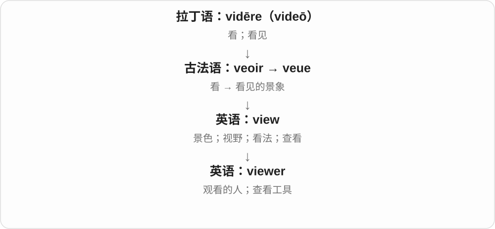

电视 viewers 是观众；image viewer 是图像查看器。后者不一定能编辑图像。

**常见搭配与例句**

television viewers；a regular viewer；an image viewer。

> The programme attracted millions of viewers.

这个节目吸引了数百万观众。

> Open the file in an image viewer.

用图像查看器打开这个文件。

**别混淆**

audience 可以指听众、读者等整体受众；viewer 明确强调观看。

### 161. interviewer — 面试官；采访者

**音标**：英 /ˈɪntəvjuːə/；美 /ˈɪntərvjuːər/

**先抓住这个画面**

interviewer 是问问题的一方，把话题带向需要了解的内容。

**怎么拆**

interview + -er，表示主持问答的人。

**怎么变成今天的意思**

求职场景是面试官，节目场景是采访者；同一个词跟随活动变化。

**常见搭配与例句**

an experienced interviewer；the interviewer’s question；a panel of interviewers。

> The interviewer asked about my previous experience.

面试官问起我以前的经历。

> A good interviewer leaves room for detailed answers.

好的采访者会给对方充分回答的空间。

**别混淆**

interviewer 问，interviewee 接受采访或面试。两者的后缀标明角色方向。

### 162. reviewer — 评论者；评审者；审稿人

**音标**：英 /rɪˈvjuːə/；美 /rɪˈvjuːər/

**先抓住这个画面**

reviewer 是看完作品或材料后给出评价的人：指出价值，也指出需要改进的地方。

**怎么拆**

review + -er。

**怎么变成今天的意思**

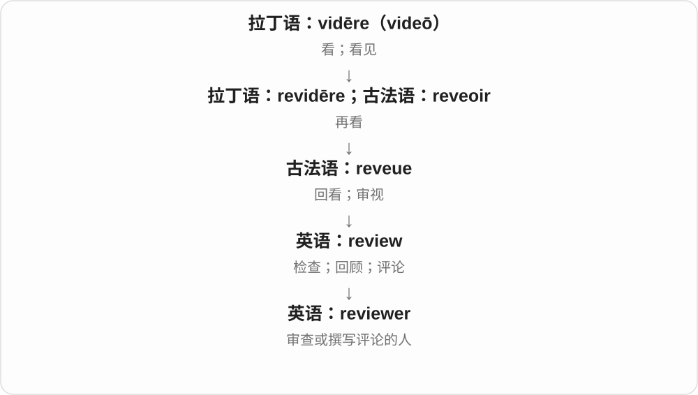

书评人评价读物，论文 reviewer 评审稿件；购物网站上的评价者也可以叫 reviewer。

**常见搭配与例句**

a book reviewer；a peer reviewer；an anonymous reviewer。

> The reviewer praised the novel’s dialogue.

书评人称赞了小说中的对话。

> An anonymous reviewer suggested a clearer explanation.

一位匿名审稿人建议把解释写得更清楚。

**别混淆**

reviewer 侧重审看评价；editor 还可能负责选稿、修改和出版流程。

### 163. rover — 漫游者；巡游、行星探测车；海盗〔旧另源义〕

**音标**：英 /ˈrəʊvə/；美 /ˈroʊvər/

**先抓住这个画面**

能四处移动、沿地面探索的探测车叫 rover。它把漫游者这个人物、动物画面延伸给了机器。

**怎么拆**

漫游支为 rove 漫游 + -er，去末尾 e；rove 更早来源未定。旧海盗义另借荷兰、低地德语掠夺者材料，不能把所有 rover 统一成随处闲逛。

**怎么变成今天的意思**

**rove 漫游 + -er → rover**  
四处行走的人、动物，后扩为探测车

↓

**另有荷兰、低地德语 rover 等 → 英语旧海盗义**  
来源不同的同形人物词

a robotic rover 机器人探测车；a lunar rover 月球探测车；a rover 的漫游者义较文学，技术语境常指机器。

**常见搭配与例句**

a robotic rover；a lunar rover。

> The rover carried cameras and scientific instruments.

探测车搭载了摄像机和科学仪器。

> The model shows a rover moving across rocky ground.

模型展示探测车驶过岩石地面。

**别混淆**

rover 探测车与 lander 着陆器不同；着陆器不因为到了地面就保证能像 rover 四处移动。

### 164. retailer — 零售商、零售企业

**音标**：英 /ˈriːteɪlə/；美 /ˈriːteɪlər/

**先抓住这个画面**

把货直接卖给消费者的那一方，可以是一家网店、连锁公司或具体商家；不是必然等于收银台后那个员工。

**怎么拆**

retail 零售 + -er，执行零售业务的主体。公司也能接这个人物式后缀来命名角色。

**怎么变成今天的意思**

**古法语 retaillier、retail 等**  
切下、分割；切下的小块

↓

**英语 retail 的零售义**  
像把整批货分开按件卖给最终顾客

↓

**英语 retail + -er → retailer**  
进行零售的商家、销售者

an online retailer 网络零售商，a clothing retailer 服装零售商，a major retailer 大型零售企业。

**常见搭配与例句**

an online retailer；a clothing retailer；a major retailer。

> The online retailer expanded its delivery service.

这家网络零售商扩大了配送服务。

> Several retailers sell the same brand.

几家零售商都在卖同一个品牌。

**别混淆**

retailer 是销售渠道角色，manufacturer 是制造者；同一家公司可能同时扮演两种角色，但两个词不是同义。

### 165. boxer — 拳击手；拳师犬；复数可指平角内裤

**音标**：英 /ˈbɒksə/；美 /ˈbɑːksər/

**先抓住这个画面**

基本是参与拳击的人；犬种、内裤等名称又借了拳击相关的形象或衣着。

**怎么拆**

box 击打 + -er 形成拳击手名词。boxers 内裤可由 boxer shorts 缩短；拳师犬名称有特定犬种命名史，不因名字就认定所有犬都按拳击动作命名。

**怎么变成今天的意思**

**中古英语 box 击打、打击**  
更远来源不确定；与盒子义分开

↓

**box → boxing、boxer**  
用拳击打 → 拳击运动、拳击手

↓

**box + -er → boxer**  
拳击的人；另有犬种、衣物称呼

a professional boxer 职业拳击手，a boxer dog 拳师犬，a pair of boxers 一条平角内裤。

**常见搭配与例句**

a professional boxer；a boxer dog；a pair of boxers。

> The boxer won his first professional match.

拳击手赢下了首场职业比赛。

> Their boxer dog waited by the gate.

他们的拳师犬在门边等着。

**别混淆**

boxer 不是装盒工的唯一固定译法；a pair of boxers 语境通常衣物，不能译一对拳击手。

### 166. folder — 文件夹；折叠者、折叠器具〔依语境〕

**音标**：英 /ˈfəʊldə/；美 /ˈfoʊldər/

**先抓住这个画面**

把一张硬纸折成能夹住散页的外层，是实物 folder 的好画面。电脑再借这个组织功能，把一组文件的容器也叫 folder。

**怎么拆**

fold + -er，可命名折叠者、器具，也固定指装散页的文件夹。虚拟文件夹由实体整理纸张的容器比喻而来。

**怎么变成今天的意思**

**古英语 fealdan → 中古英语 folden → fold 动词**  
把材料弯回、折叠

↓

**fold + -er → folder**  
折叠人物、器具；折叠成的文件夹

↓

**电脑中的 folder**  
组织文件、子文件夹的虚拟容器

a document folder 文件夹，create a folder 新建文件夹，a folder inside another folder 子文件夹。-er 在常用文件夹义里不指人。

**常见搭配与例句**

a document folder；create a folder；a subfolder。

> She put the receipts in a blue folder.

她把收据放进蓝色文件夹。

> Create a new folder for the photographs.

为这些照片新建一个文件夹。

**别混淆**

file 是文件，folder 是组织文件的容器；纸质 folder 也不必带活页夹的金属环。与 binder 的功能有交叠，结构通常不同。

### 167. joker — 爱开玩笑的人；扑克牌中的王牌；家伙〔口语〕

**音标**：英 /ˈdʒəʊkə/；美 /ˈdʒoʊkər/

**先抓住这个画面**

平时说笑的人叫 joker；牌里的特殊一张也用了这个名字。

**怎么拆**

joke + -er“做这件事的人”；扑克牌专义的命名还可能受到德语牌戏名 Jucker 的影响。

**怎么变成今天的意思**

**拉丁 iocus／jocus**  
玩笑、游戏、消遣

↓

**英语 joke，早期也写 joque**  
笑话、玩笑；也作动词表示开玩笑

↓

**英语 joke + -er → joker**  
说笑的人

↓

**后来 joker 的口语及扑克牌用法**  
家伙；牌中的特殊王牌，牌名历史可能有其他影响

He’s a joker 常说他爱逗人笑。a joker in a deck 指扑克牌里的王牌，具体怎样使用由游戏规则决定。说 some joker did this 往往带不满，类似“哪个家伙干的”，不一定在夸他幽默。

**常见搭配与例句**

a practical joker；the joker in the deck；some joker。

> My uncle is a joker who can make everyone laugh.

我叔叔很爱说笑，能把大家都逗乐。

> This game does not use the jokers.

这个游戏不使用王牌。

**别混淆**

joker 是人或牌；joke 是玩笑本身。牌义不要仅凭小丑图案编成唯一的历史来源。

### 168. sniper — 狙击手；伺机作精准攻击的人〔依语境〕

**音标**：英 /ˈsnaɪpə/；美 /ˈsnaɪpər/

**先抓住这个画面**

常指隐蔽位置作精确远距离射击的人。词源里有一种难打中的鸟 snipe，后来由猎鸟技巧转到神枪手、狙击人物。

**怎么拆**

snipe 的猎鸟、射击动词 + -er；鸟名更早接北欧语 snipa 等。不是 snip 剪一小下 + -er，元音、基础词都不同。

**怎么变成今天的意思**

**snipe 鸟名 → 猎这种鸟、射击的动词**  
猎鸟材料进入人物名称

↓

**snipe + -er → sniper**  
由相关射手称呼转为现代狙击人物

a sniper in a historical account 历史记述中的狙击手；sniper fire 狙击火力；现代也有竞价等引申用法，按上下文。

**常见搭配与例句**

a sniper；sniper fire。

> The novel describes a sniper’s role in the conflict.

小说描写了一名狙击手在冲突中的角色。

> The museum display explains the history of the term sniper.

博物馆展板解释了 sniper 一词的历史。

**别混淆**

sniper 不是所有 soldier 士兵的同义词；人物名称指具体角色，不是一般制服身份。

### 169. undertake — 承担；着手进行；承诺

**音标**：英 /ˌʌndəˈteɪk/；美 /ˌʌndərˈteɪk/

**先抓住这个画面**

把一项事情接到自己肩上，答应负责去做。

**怎么拆**

中古英语 under + take 的组合已有多种用法，后来稳定用于着手、承担。under- 的确切早期作用不完全透明，不把“从下面拿住”当作唯一确定来源。

**怎么变成今天的意思**

**中古英语 under；take**  
旧前缀；拿取

↓

**中古英语 undertaken 的着手、承担义**  
接下一项事情

↓

**现代 undertake**  
承担工作；承诺做某事

undertake a study 是开展研究；undertake to pay 是承诺付款。前者说负责做一件事，后者明确承诺将做。语气比 take on 或 promise 更正式。

**常见搭配与例句**

undertake–undertook–undertaken；undertake a project；undertake to do something。

> The team will undertake a detailed study of the site.

团队将对现场开展详细研究。

> The company undertook to repair the damage.

公司承诺修复损坏。

**别混淆**

undertake 常表示负责执行，undergo 表示经历、承受。团队 undertake an inspection，设备 undergo an inspection。

### 170. undertaker — 殡葬业者；承办葬礼、安葬事务的人

**音标**：英 /ˈʌndəteɪkə/；美 /ˈʌndərteɪkər/

**先抓住这个画面**

家属需要有人把葬礼、运送、安葬等事务承办起来。现代 undertaker 主要就是负责这类安排的职业人员。

**怎么拆**

undertake 承担、承揽，去末尾 e 加 -er。较早 undertaker 泛指承办某事、承揽生意的人；从 funeral undertaker 的专门称呼发展，现代殡葬义占主导。

**怎么变成今天的意思**

**undertake + -er → undertaker**  
承揽事务、经营业务的人

↓

**funeral undertaker 的专门化**  
承办葬礼与安葬事务的职业人员

contact the undertaker 联系殡葬业者；work as an undertaker 从事殡葬工作；the undertaker’s office 殡葬服务办公室。funeral director 也是常见职业名称。

**常见搭配与例句**

arrangements made by the undertaker；a local undertaker。

> The family contacted a local undertaker to arrange the funeral.

家属联系当地殡葬业者安排葬礼。

> He has worked as an undertaker for many years.

他从事殡葬工作已有多年。

**别混淆**

undertake 今天仍泛指承担任务；undertaker 却已主要专指一个职业。不能把 undertaker 用作所有接任务的人或一般项目承包商。

### 171. lecturer — 讲课者；讲师

**音标**：英 /ˈlektʃərə/；美 /ˈlektʃərər/

**先抓住这个画面**

lecturer 是把一个主题系统讲给听众的人，也可是一种高校职位。

**怎么拆**

lecture + -er。

**怎么变成今天的意思**

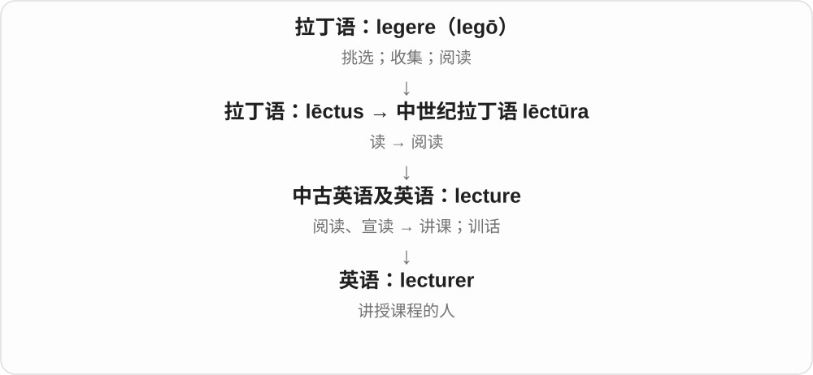

作为职称时，不同国家的级别和职责不同；不能一律套成同一职级。

**常见搭配与例句**

a university lecturer；a lecturer in history；a visiting lecturer。

> The lecturer illustrated the idea with a simple diagram.

讲师用一张简单的图解释了这个想法。

> She works as a lecturer in linguistics.

她从事语言学讲师的工作。

**别混淆**

lecturer 讲授；listener 听讲；professor 是另一职称，制度不同不能机械对应。

### 172. boiler — 锅炉；热水、供暖设备；煮沸容器

**音标**：英 /ˈbɔɪlə/；美 /ˈbɔɪlər/

**先抓住这个画面**

名字按 boil 的加热、沸腾功能命名。工业中可造蒸汽，住宅中也常说供暖、热水设备，具体用途要看系统。

**怎么拆**

boil + -er，后缀按功能命名设备。现代设备名称范围扩大，不能只凭字面断言每种 boiler 都在把水煮成蒸汽。

**怎么变成今天的意思**

**拉丁 bullīre 沸腾 → 法语 boillir → boil**  
沸腾、煮

↓

**boil + -er → boiler**  
煮沸、供热的容器、设备；现代也用于加热、储热水设备

a steam boiler 蒸汽锅炉，a gas boiler 燃气供暖锅炉，the boiler room 锅炉房。厨房设备的 boiler 也见特定组合。

**常见搭配与例句**

a steam boiler；a gas boiler；the boiler room。

> The boiler supplies hot water to the building.

锅炉为大楼供应热水。

> The engineer inspected the steam boiler.

工程师检查了蒸汽锅炉。

**别混淆**

boiler 通常比烧水壶 kettle 更偏供热、蒸汽系统等设备；但具体物件仍由搭配决定。

### 173. cutter — 切割工具、机器；裁剪者；某类快艇、船

**音标**：英 /ˈkʌtə/；美 /ˈkʌtər/

**先抓住这个画面**

最容易认的是负责切的人或工具；船名义是另外已经固定的用法。

**怎么拆**

cut + -er，形成执行动作的人、工具名称；航海的 cutter 经相应船型名称传统形成，不能只靠现代词缀猜成割东西的船。

**怎么变成今天的意思**

**中古英语 cutten → 英语 cut**  
切、割，较远来源不确定，通常联系北日耳曼语

↓

**英语 cut 的引申**  
切断连续部分 → 削减、删掉、中断等

↓

**cut + -er → cutter**  
切的人、工具；另有固定船型名

a cookie cutter 饼干模具，a glass cutter 玻璃切割工具；a coastguard cutter 海岸警卫队使用的一类船，不一定只有某个统一尺寸。

**常见搭配与例句**

a glass cutter；a paper cutter；a cookie cutter；a coastguard cutter。

> Use a paper cutter to trim the edges.

用裁纸刀修齐边缘。

> A coastguard cutter was visible near the harbour.

港口附近能看到一艘海岸警卫队巡逻船。

**别混淆**

cutter 可以是工具，不一定是人；cutter 船型用法需要按航海语境读，不能都译切割机。

### 174. jumper — 跳跃者；毛衣〔英式〕；无袖套裙〔美式〕；跳线

**音标**：英 /ˈdʒʌmpə/；美 /ˈdʒʌmpər/

**先抓住这个画面**

运动里可以是跳的人；英式穿衣语境却常是一件毛衣。不能把买毛衣误听成去买一个跳高者。

**怎么拆**

跳跃者为 jump + -er；衣物义接较早 jump 短上衣等词，可能涉及法语 jupe 等，深源不定，不能硬说因为穿着跳得高。电路跳线则借跨接两点的功能。

**怎么变成今天的意思**

**英语 jump 的跳跃、蹦起用法**  
来源不完全确定，拟声及其他语言联系有不同分析

↓

**jump + -er → jumper〔跳跃者等〕**  
跳跃者、跨接物

↓

**旧 jump〔衣物〕→ jumper〔衣物〕，深源不定**  
毛衣、套裙等地区用法

a high jumper 跳高运动员，a woollen jumper 羊毛毛衣，a jumper wire 跳线。美式 a jumper 可说穿在上衣外的无袖套裙。

**常见搭配与例句**

a high jumper；a woollen jumper；a jumper wire。

> She wore a warm woollen jumper.

她穿着一件暖和的羊毛毛衣。

> He was the best high jumper on the team.

他是队里最好的跳高运动员。

**别混淆**

英式 jumper 常近 sweater，美式衣物义常不同；jumping 动作不能解释每件 jumper 衣服的历史。

### 175. offender — 违法者；犯错者；造成问题的人或事物

**音标**：英 /əˈfendə/；美 /əˈfendər/

**先抓住这个画面**

把 offend 的行为落实到责任主体：谁违规、谁惹出问题，谁就是这里的 offender。

**怎么拆**

offend + -er；中古英语已有 offendour / offender 等形式。

**怎么变成今天的意思**

**拉丁 ob / ob-**  
朝向；在前面；对着；有时加强后面动作

↓

**拉丁 ob- + -fendere → offendere**  
对着撞击 → 触犯、伤害、使不快

↓

**法语 ofendre / offendre → 英语 offend**  
冒犯、触犯

↓

**中古英语 offendour / offender → offender**  
触犯者 → 违法者、造成问题者

a first offender 是初犯者。非法律场景也能说某个应用是耗电的 worst offender，这时是在拟人化地说它问题最大。

**常见搭配与例句**

a repeat offender；a first offender；the worst offender。

> The programme helps former offenders return to work.

这个项目帮助曾经违法的人重返工作岗位。

> Among the apps on my phone, this game is the worst offender for battery drain.

我手机里的应用中，这个游戏最耗电。

**别混淆**

suspect 是嫌疑人；offender 指实施违规或违法的人，二者不能在未确定事实时随便替换。

### 176. footballer — 足球运动员；相应 football 运动的球员

**音标**：英 /ˈfʊtbɔːlə/；美 /ˈfʊtbɔːlər/

**先抓住这个画面**

参与 football 的人，英国语境通常指足球运动员；其他地区先看 football 指哪种球类。

**怎么拆**

football + -er，按运动名称形成球员名。不能因为后缀相同就把所有地区的 footballer 都画成同一种球员。

**怎么变成今天的意思**

**foot + ball → football**  
以足部踢球为核心命名的球类词

↓

**现代不同地区的 football**  
具体运动按地区判断；球员、活动继续派生

↓

**football + -er → footballer**  
参加该球类运动的人

a professional footballer 职业足球运动员，a retired footballer 退役球员；足球语境也可说 football player。

**常见搭配与例句**

a professional footballer；a young footballer；a retired footballer。

> She hopes to become a professional footballer.

她希望成为职业足球运动员。

> The retired footballer now coaches a local team.

那位退役足球运动员如今执教本地球队。

**别混淆**

footballer 是人，football 是运动或球；在英国先理解足球，在美国 football 常指美式橄榄球。

### 177. drummer — 鼓手

**音标**：英 /ˈdrʌmə/；美 /ˈdrʌmər/

**先抓住这个画面**

打鼓、掌握节奏的人是 drummer。名字按动作角色来命名。

**怎么拆**

drum + -er，双写 m。最常用意义是演奏鼓的人；其他同形旧称不必混进基础鼓手义。

**怎么变成今天的意思**

**中古荷兰语 tromme 等日耳曼相关形式**  
鼓、鼓击；直接借入还是相关长词逆构有不同分析

↓

**drum + -er → drummer**  
演奏鼓的人

the band’s drummer 乐队鼓手，a jazz drummer 爵士鼓手。march to a different drummer 比喻按自己的想法行事。

**常见搭配与例句**

a jazz drummer；the band’s drummer。

> The drummer counted in the rest of the band.

鼓手数拍，带领其他乐手进入演奏。

> They are looking for a new drummer.

他们在找一位新鼓手。

**别混淆**

drummer 是人，drum 是乐器；percussionist 是打击乐演奏者，范围通常更宽。

### 178. drummers — 鼓手〔复数〕

**音标**：英 /ˈdrʌməz/；美 /ˈdrʌmərz/

**先抓住这个画面**

音乐往前走的拍子，常由鼓手用重复敲击撑起来。drummers 是这些打鼓的人。

**怎么拆**

drum 双写 m，加完整 -er → drummer；复数再加 -s。drum 的较远历史与荷兰语、低地德语等形式相关，具体早期形成有不同分析。

**怎么变成今天的意思**

**drum + -er → drummer〔双写 m〕**  
打鼓的人

↓

**drummer + -s → drummers**  
多位鼓手

jazz drummers、rock drummers 按音乐风格说鼓手；不只乐队架子鼓手才能这样叫。

**常见搭配与例句**

a group of drummers 一群鼓手；skilled drummers 熟练的鼓手。

> The drummers kept a steady beat.

鼓手们保持着稳定节拍。

> A group of drummers led the parade.

一群鼓手走在游行队伍前面。

**别混淆**

drummers 数人，drums 数鼓；percussionists 打击乐手的范围更广，还可能演奏其他打击乐器。

### 179. staple — 订书钉、金属扣；基本用品、主食；主要的；用钉扣固定

**音标**：/ˈsteɪpəl/

**先抓住这个画面**

弯成 U 形、两头穿入材料再固定的小金属件，是 staple。餐桌上总离不开的基本食物，也叫 a staple，但这条历史经过市场、主要商品。

**怎么拆**

金属扣支常接古英语 stapol、stapel 柱、支物等，后来的小扣与旧词如何连续演变仍有讨论。基本用品支经法语 estaple 指定市场、集散处，再到主要商品、核心成分；不能用金属钉固定食物编成唯一故事。

**怎么变成今天的意思**

**古英语支柱等材料 → staple 金属扣支**  
具体语义过渡未全确定；后来有订纸小钉

↓

**法语 estaple 市场 → staple 主要商品、基本用品**  
主要供应品 → 主食、核心成分等

a metal staple 金属扣；a staple food 主食；staple the pages together 把纸订在一起。

**常见搭配与例句**

a diet staple 日常基本食物；office staples 办公基本用品或订书钉〔看语境〕。

> Rice is a staple in many households.

米饭是许多家庭的主食。

> She used a staple to hold the pages together.

她用一枚订书钉把纸订在一起。

**别混淆**

staple 的常用两支要分别记：器具、固定动作一边，主要商品到基本所需一边。主食义不要求每种都在历史上当过某个指定市场的商品。

### 180. staples — 订书钉；主食、基本用品〔复数〕；订、用金属扣固定〔第三人称单数〕

**音标**：/ˈsteɪpəlz/

**先抓住这个画面**

一枚枚订书钉，是 staples；一类类常备必需品，也是 staples。句子里出现纸张还是米面、用品，会把两支分开。

**怎么拆**

金属扣 staple 与古英语支柱词有历史联系的分析；基本商品 staple 经法语市场名发展。现代各支加 -s，/l/ 后读 /z/，订钉动词也同形。

**怎么变成今天的意思**

**staple 的金属扣支、基本商品支**  
两条历史分别形成今日常用义

↓

**staple + -s → staples**  
多枚钉、基本用品；某人把东西订住

a box of staples 一盒订书钉；food staples 基本食物；staples the pages 把纸订在一起。

**常见搭配与例句**

household staples 家庭基本用品；replace the staples 更换订钉。

> The drawer held a box of staples.

抽屉里放着一盒订书钉。

> The cupboard was stocked with rice and other staples.

柜子里备着大米和其他基本食品。

**别混淆**

office staples 在具体办公耗材语境可能是订书钉，泛谈必需品时也可指基本用品。靠附近对象判断。

### 181. stapled — 订好了、用钉扣固定的

**音标**：/ˈsteɪpəld/

**先抓住这个画面**

几页纸已经被金属小钉扣在一起，就是 stapled。它说明固定动作做完或材料处在订好的状态。

**怎么拆**

staple 金属扣名转固定动词，现代去 e 加完整 -ed，/l/ 后读 /d/。这里取今日常用订钉义。

**怎么变成今天的意思**

**staple 金属扣 → 固定动词**  
用钉扣把材料接住

↓

**staple 去 e + -ed → stapled**  
过去订好了；已经订住的

stapled pages 订好的纸页；stapled together 订在一起。

**常见搭配与例句**

stapled the notice to the board 把通知钉到板上；a stapled booklet 钉订的小册子。

> She stapled the pages together.

她把纸页订在一起。

> The stapled booklet lay on the desk.

钉订的小册子放在桌上。

**别混淆**

stapled 侧重用金属钉扣固定，taped 则常是用胶带。两者都能接材料，但固定方式不同。

### 182. stapler — 订书器、订钉器

**音标**：英 /ˈsteɪplə/；美 /ˈsteɪplər/

**先抓住这个画面**

把一枚枚 U 形金属钉压进材料、扣住两边的器具，是 stapler。staple 是订钉动作，er 命名做这件事的工具。

**怎么拆**

现代器具名对应 staple 动词去 e，加完整 -er。金属扣名先形成相关固定动作，再由这个动作命名器具；旧同形行业称呼另有历史。

**怎么变成今天的意思**

**staple 金属扣 → staple 固定动作**  
把材料用钉扣接住

↓

**staple 去 e + -er → stapler**  
执行订钉的器具

a desk stapler 桌面订书器；a heavy stapler 厚重订书器。

**常见搭配与例句**

use a stapler 使用订书器；a stapler on the desk 桌上的订书器。

> She used a stapler to fasten the pages.

她用订书器把纸订好。

> The stapler was beside the scissors.

订书器放在剪刀旁。

**别混淆**

这里的 er 是完整器具后缀。基础词末尾 e 去掉后才接 er，不能只把最后 r 当成全部后缀。

### 183. staplers — 订书器、订钉器〔复数〕

**音标**：英 /ˈsteɪpləz/；美 /ˈsteɪplərz/

**先抓住这个画面**

几只把金属钉压入材料的工具，是 staplers。先有 staple 订钉动作，再用 er 给器具命名。

**怎么拆**

staple 去 e 加 -er → stapler，再加复数 -s，尾 /z/。这里数的是机器、器具，和一枚枚 staples 分开。

**怎么变成今天的意思**

**staple + -er〔去 e〕→ stapler**  
订钉动作的执行器具

↓

**stapler + -s → staplers**  
多只订书器

desk staplers 桌面订书器；office staplers 办公订书器。

**常见搭配与例句**

staplers in the drawer 抽屉里的订书器；repair the staplers 修订书器。

> The cupboard held two staplers.

柜子里放着两只订书器。

> Each desk had paper and staplers.

每张桌子上都有纸和订书器。

**别混淆**

staples 是被压入的钉，staplers 是压钉的工具。多出的 er 正好把作用关系分清。

### 184. stapling — 正在订钉；订钉的过程

**音标**：/ˈsteɪplɪŋ/

**先抓住这个画面**

一页页对齐，用器具把金属小钉压进去，过程正在进行，就是 stapling。

**怎么拆**

staple 去 e 加 -ing，常用读音里词尾弱音节可压缩，成为 /ˈsteɪplɪŋ/。

**怎么变成今天的意思**

**staple 的固定动词**  
把材料用钉扣订住

↓

**staple 去 e + -ing → stapling**  
正在订；订钉活动

stapling the pages 正在订纸；finish stapling 订完。

**常见搭配与例句**

stapling documents 把文件订起来；stapling equipment 订钉设备。

> He was stapling the documents when she arrived.

她到时，他正在把文件订起来。

> She finished stapling the pages before the meeting.

她在开会前订好了纸页。

**别混淆**

stapler 是工具，stapling 是动作过程，stapled 常是已完成状态。这三个形式围绕同一个订钉动作。

### 185. timer — 计时器；定时器；计时的人

**音标**：英 /ˈtaɪmə/；美 /ˈtaɪmər/

**先抓住这个画面**

设好五分钟，时间一到就响的厨房小设备是 timer；记录选手用了多久的器材或人，也可以用这个名称。

**怎么拆**

从 time 动词加 -er 形成；早期记录可指安排时刻的人，后来用于测量时间的器具，再用于自动按时启动或停止的装置。

**怎么变成今天的意思**

**古英语 tīma → 中古英语 time／tyme**  
一段时间、时机 → 时间

↓

**英语 time**  
时间、时点、次数；也形成安排时间、计时的动词用法

↓

**英语 time + -er → timer**  
做计时工作的人或器具；后来也指自动定时装置

有的 timer 倒数剩余时间，有的累计经过多久，有的到点控制设备。这个词不保证一定有表盘，也不保证只是闹钟。

**常见搭配与例句**

set a timer；a kitchen timer；a countdown timer；a timer switch。

> Set the timer for eight minutes before adding the pasta.

放入意面前，把定时器设为八分钟。

> The lights turn off automatically when the timer reaches zero.

计时器归零时，灯会自动关闭。

**别混淆**

clock 常显示现在几点；timer 更关注一个过程的时长或触发时刻。stopwatch 专门测经过的时间，是相关但更具体的工具。

### 186. believer — 相信者；信徒；某种做法的支持者

**音标**：英 /bɪˈliːvə/；美 /bɪˈliːvər/

**先抓住这个画面**

一个人不只偶尔点头，而是把某信念、做法当成自己支持的东西。

**怎么拆**

believe 去掉末尾 e 后接 -er，接中古英语 bileever 等形式；宗教信徒只是其中一类，不是唯一用法。

**怎么变成今天的意思**

**古英语 belīefan 等 → 中古英语 beleven / bileven**  
相信、信任；与准许、信赖旧词族相关

↓

**英语 believe**  
相信某说法；信赖某人或理念

↓

**believe + -er → believer**  
持相信、信赖立场的人

a firm believer in practice 是坚信练习有效的人，religious believers 是宗教信众。a believer in someone 可说对某人抱有信心者。

**常见搭配与例句**

a firm believer in；a strong believer in；religious believers。

> I’m a firm believer in regular practice.

我坚信经常练习的重要性。

> The exhibition explores the lives of believers from different traditions.

展览探讨不同信仰传统中信众的生活。

**别混淆**

believer 是持信念者，supporter 是支持者更广，可能提供资源、行动；两者可重合，但词义重心不同。

### 187. bunker — 掩体、地堡；高尔夫沙坑；燃料舱等

**音标**：英 /ˈbʌŋkə/；美 /ˈbʌŋkər/

**先抓住这个画面**

常见的两幅画面：人躲进坚固掩体；高尔夫球掉进沙坑。具体指什么，要看军事、运动还是船舶语境。

**怎么拆**

早期苏格兰语相关形式有箱凳、长凳等义，来源未定；后有沙坑、煤舱等发展。军事掩体义又涉及德语 Bunker 的传播。

**怎么变成今天的意思**

**苏格兰语 bunker 等器物名称**  
箱凳、座位等旧义，后来有沙坑、煤舱

↓

**近代军事等专门用法**  
掩体、地堡；沿用各领域的专门名称

an underground bunker 地下掩体；a golf bunker 高尔夫球沙坑；a coal bunker 煤舱、储煤处。

**常见搭配与例句**

take shelter in a bunker；hit the ball out of a bunker。

> The shelter was built inside an underground bunker.

避难处建在一座地下掩体里。

> Her ball landed in a bunker beside the green.

她的球落进了果岭旁的沙坑。

**别混淆**

bunker 不应按 bunk + 做事的人 -er 解释。铺位 bunk 反而可能从它的旧义缩短而来，历史方向须分清。

### 188. bunk — 铺位、上下铺的一层；胡说、瞎话〔另源〕

**音标**：/bʌŋk/

**先抓住这个画面**

船上、宿舍里上下叠着的床，一层可叫 bunk。That’s bunk! 则是在说胡说八道，需要换到另一支。

**怎么拆**

铺位义可能缩自苏格兰等语境的 bunker 座、箱凳等旧义；胡说义缩自 bunkum，而 bunkum 又与 Buncombe 地名及政治话语背景相连。

**怎么变成今天的意思**

**bunker 等座、箱凳材料 → bunk 铺位**  
具体传入细节未定

↓

**bunkum 缩短为 bunk**  
无意义的话、胡说

the top bunk 上铺；the bottom bunk 下铺；a bunk bed 上下铺；a load of bunk 一派胡言。

**常见搭配与例句**

sleep in a bunk；that’s complete bunk。

> He slept in the top bunk.

他睡在上铺。

> She dismissed the story as complete bunk.

她认为那套说法完全是胡说。

**别混淆**

bunk 的床位义和胡说义分源。阅读上可与 bunker 连着记，但不能断言所有 bunk 都来自床。

### 189. bunks — 铺位〔复数〕；睡、住宿〔第三人称〕；逃课、逃工〔常见英式 bunk off〕

**音标**：英、美 /bʌŋks/

**先抓住这个画面**

船舱、宿舍里一层层或紧凑布置的铺位，叫 bunks；he bunks with a friend 是和朋友同住、借住；bunks off 则可能是逃课逃工。

**怎么拆**

bunk + -s → bunks，/k/ 后读 /s/，词尾 /ŋks/。床铺名可能缩自 bunker 的座位义；睡铺动词接名词，逃课逃工用法另按短语历史理解。

**怎么变成今天的意思**

**bunker 座位义可能缩成 bunk 铺位**  
现代床铺名称及相关睡、住宿动词

↓

**bunk + -s → bunks；bunk off 为逃课逃工的短语**  
不同现代用法按搭配识别

upper bunks 是上铺；bunks with a friend 是和朋友同住；bunks off school 是逃课。

**常见搭配与例句**

upper bunks；bunks with a friend；bunks off school。

> The cabin has four bunks.

船舱里有四个铺位。

> He bunks with a friend when he visits the city.

他来城里时借住在朋友那里。

> The character often bunks off school in the story.

故事里那个角色经常逃课。

**别混淆**

胡说的 bunk 缩 bunkum，是另一来源支线；这里的复数床铺、睡铺动词不能从胡说义硬推。

### 190. hacker — 擅长动手探索、编程的人；计算机入侵者；砍削者等

**音标**：英 /ˈhækə/；美 /ˈhækər/

**先抓住这个画面**

先别只想蒙脸入侵的人。某些技术社群把 hacker 当褒义，指能深入理解系统、用巧办法做东西的人；新闻里又常指入侵者。

**怎么拆**

hack + -er 的砍削者用法很早。现代技术称呼有自身社群发展史，与巧做、实验的 hack 相连；不能说今天每个 hacker 都由一个砍木工直线变来。

**怎么变成今天的意思**

**中古英语 hacken，联系古英语 tohaccian 等**  
用力砍、粗切

↓

**现代技术、技巧义的扩展**  
动手巧做、临时修补、巧妙办法；也指未经授权入侵

↓

**hack + -er；现代技术社群扩展**  
进行相应活动的人；编程、技术能手或入侵者

a skilled hacker 技术高手〔需看上下文〕，an ethical hacker 从事授权安全测试的人，a hacker community 黑客技术社群。

**常见搭配与例句**

a hacker community；an ethical hacker；a hacker targeted the website。

> The documentary interviews hackers who build their own tools.

纪录片采访了自行制作工具的技术爱好者。

> A hacker gained access to the company’s website.

一名入侵者进入了公司的网站。

**别混淆**

hacker 的褒贬因语境不同；ethical hacker 不用入侵新闻里的恶意含义理解。早期砍削者、少见出租车司机同形义，也不能拿来解释所有现代头衔。

### 191. freezer — 冷冻柜、冰柜；冰箱冷冻室

**音标**：英 /ˈfriːzə/；美 /ˈfriːzər/

**先抓住这个画面**

把东西冻住、保持冷冻状态的设备或部分，是 freezer。家里可以是单独冰柜，也可以是冰箱中的冷冻室。

**怎么拆**

freeze + -er，去词尾 e，按冷冻功能命名设备。

**怎么变成今天的意思**

**古英语 frēosan → 中古英语 fresen → freeze**  
结冰、冷冻

↓

**freeze + -er → freezer**  
使物品保持冷冻的设备、空间

put food in the freezer 把食物放进冷冻室，a chest freezer 卧式冰柜，the freezer compartment 冷冻隔室。

**常见搭配与例句**

in the freezer；a chest freezer。

> There is a bag of peas in the freezer.

冷冻室里有一袋豌豆。

> They bought a small freezer for the garage.

他们买了一个小冰柜放在车库里。

**别混淆**

freezer 侧重冷冻；fridge 通常说冰箱、冷藏设备。实际一台 fridge freezer 可把冷藏与冷冻组合起来。

### 192. charger — 充电器；另有冲锋战马等用法

**音标**：英 /ˈtʃɑːdʒə/；美 /ˈtʃɑːrdʒər/

**先抓住这个画面**

把电能送进设备的东西，最熟悉就是手机充电器。

**怎么拆**

charge + -er，执行某种 charge 功能的主体。不同义项有各自历史；现代设备语境优先理解成充电器。

**怎么变成今天的意思**

**拉丁 carrus〔车〕→ 晚期拉丁 carricāre**  
把货装上车、装载

↓

**法语 chargier／charge → 英语 charge**  
负担、装入 → 责任、费用、指控、电荷等分支

↓

**charge + -er → charger**  
执行充电功能的设备；另有同族旧用法

a phone charger 手机充电器，a wireless charger 无线充电器，a charger cable 日常常说充电线。

**常见搭配与例句**

a phone charger；a wireless charger；connect the charger。

> I left my phone charger at home.

我把手机充电器落在家里了。

> The charger has two USB ports.

充电器有两个USB接口。

**别混淆**

charger 充电设备，battery 储能部件；charging cable 是传输连接线，日常有时混称，具体买什么要看对象。

### 193. stalk — 茎、梗；悄悄接近；跟踪、纠缠；大步走

**音标**：英 /stɔːk/；美 /stɔːk/ 或 /stɑːk/

**先抓住这个画面**

植物上支撑叶、花的一根茎可叫 stalk；动词则常让人想到悄悄靠近或不断跟随。两类用法分别记来源。

**怎么拆**

植物名词经中古英语 stalke 等，接日耳曼支撑、茎的词族；跟踪动词经中古英语 stalken 接旧英语悄悄移动材料，更远分析有分歧。不硬画成植物茎直接变成跟踪。

**怎么变成今天的意思**

**名词 stalk 的茎、支撑材料；动词 stalk 的移动材料**  
两条来源分析分别保留

↓

**现代不同词义并存**  
茎梗；悄悄接近、持续跟踪；大步走

a celery stalk 一根芹菜梗；a cat stalking a bird 悄悄靠近鸟的猫；stalk out of the room 大步走出房间。对人的持续跟踪、纠缠常带负面含义。

**常见搭配与例句**

flower stalks；stalk a target；stalk away。

> She cut a stalk of celery into small pieces.

她把一根芹菜梗切成了小段。

> The cat stalked a bird through the grass.

猫穿过草丛悄悄靠近一只鸟。

**别混淆**

植物 stem、stalk 有具体搭配习惯；动词 stalk 比普通 follow 更突出隐蔽、持续或令人不安的跟随。不同词义不能只靠一个动作画面全包。

### 194. stalking — 跟踪、尾随、纠缠；潜行跟进；stalk 的 -ing 形式

**音标**：英 /ˈstɔːkɪŋ/；美 /ˈstɔːkɪŋ/ 或 /ˈstɑːkɪŋ/

**先抓住这个画面**

把持续跟随、反复纠缠这件事当作一个行为来谈。也可在狩猎、动物活动中说隐蔽地接近。

**怎么拆**

动词 stalk + -ing；英语较早已有相应潜行动作名词。现代针对人的持续跟踪用法又发展出特定社会语境。

**怎么变成今天的意思**

**stalk 的潜行、跟进动词词族**  
悄悄移动、接近

↓

**stalk + -ing → stalking**  
潜行行为；持续跟踪、纠缠

report stalking 反映、举报跟踪纠缠；stalking behaviour 跟踪行为。也可说 a cat stalking prey 猫潜行接近猎物，此时是动词分词结构。

**常见搭配与例句**

persistent stalking；online stalking。

> The article discusses the impact of stalking on victims.

文章讨论了跟踪纠缠对受害者的影响。

> We watched a cat stalking its prey.

我们看见一只猫正在悄悄接近猎物。

**别混淆**

stalking 对人的用法常是持续、非自愿的纠缠，不等同于普通社交平台 follow 关注。动物狩猎语境的评价又不同。

### 195. stalker — 跟踪骚扰者；悄悄追踪猎物的人

**音标**：英 /ˈstɔːkə/；美 /ˈstɔːkər/

**先抓住这个画面**

从躲着、盯着猎物走的人，转到持续盯梢、打扰他人的人。现代日常语境常强调让被跟踪者不安的纠缠。

**怎么拆**

stalk 悄悄追踪 + -er。人物名称较早用于猎人等，后来扩展出执意跟踪骚扰人的意思；取的是 stalk 动词分支。

**怎么变成今天的意思**

**stalk 的悄悄接近、追踪动作**  
追着目标而尽量不惊动它

↓

**stalker 的人物用法**  
猎物追踪者；后来常说纠缠、跟踪骚扰者

an obsessive stalker 执意纠缠的跟踪者；a deer stalker 追踪鹿的猎人。现代孤立出现 stalker，常先想到骚扰人的义。

**常见搭配与例句**

a persistent stalker；identify the stalker。

> She blocked the stalker’s messages.

她屏蔽了那名跟踪骚扰者发来的消息。

> The experienced stalker moved quietly through the woods.

那位经验丰富的猎物追踪者悄悄穿过树林。

**别混淆**

stalker 和 follower 都可能跟在别人后面，但 stalker 常带隐蔽、执着、令人不安的意味；社交平台的普通关注者叫 follower。

### 196. stalkers — 跟踪者；持续跟踪、纠缠他人的人〔复数〕

**音标**：英 /ˈstɔːkəz/；美 /ˈstɔːkərz/

**先抓住这个画面**

一次巧合碰到不算这个画面；总跟着一个人、反复关注其去向，让对方摆脱不了的人，现代常叫 stalkers。

**怎么拆**

stalk + -er → stalker，再加复数 -s；构词接潜行、跟踪动词，不接花茎名词。

**怎么变成今天的意思**

**植物茎名词与悄悄移动动词的旧材料分别发展**  
潜行动词可接古英语 bestealcian 等，较远分析有分歧

↓

**现代 stalk：潜近、持续跟踪；另有昂首大步走**  
同形不同画面，不能从植物茎一路硬推所有动作义

↓

**stalk + -er + -s → stalkers**  
多个跟踪者；现代常指反复纠缠的人

online stalkers 在网上反复跟踪、纠缠别人的人；protect someone from stalkers 帮某人摆脱跟踪者。

**常见搭配与例句**

stalkers following a celebrity；unwanted contact from stalkers。

> The actor spoke about unwanted messages from stalkers.

那位演员谈到了跟踪纠缠者发来的骚扰消息。

> The novel follows two stalkers who keep appearing outside the same house.

小说写了两个跟踪者，他们总出现在同一栋房子外。

**别混淆**

followers 可以是普通关注者、追随者；stalkers 常带不受欢迎、持续纠缠的意味，不能只因关注账号就随意互换。

### 197. stalked — 潜近、跟踪了；昂首或气冲冲地大步走了；有茎的

**音标**：英 /stɔːkt/；美 /stɔːkt/

**先抓住这个画面**

猫压低动作接近目标，可以说 stalked；一个人生气后挺着身子大步离开，也能说 stalked out。不能只记成慢慢走。

**怎么拆**

动作词 stalk + -ed，/k/ 后读 /t/；形容植物有茎的 stalked 则可按茎名词加“具有”的 -ed 理解。

**怎么变成今天的意思**

**植物茎名词与悄悄移动动词的旧材料分别发展**  
潜行动词可接古英语 bestealcian 等，较远分析有分歧

↓

**现代 stalk：潜近、持续跟踪；另有昂首大步走**  
同形不同画面，不能从植物茎一路硬推所有动作义

↓

**stalk + -ed → stalked**  
动作过去式；另有以茎名词构成的有茎形容词

stalked a deer 悄悄跟踪鹿；stalked out 大步离开；a long-stalked flower 是长茎花，常见复合修饰语另看整体。

**常见搭配与例句**

stalked through the grass；stalked away without a word。

> The cat stalked the bird without making a sound.

猫不声不响地悄悄接近那只鸟。

> He stalked out of the room without saying goodbye.

他没道别，就气冲冲地大步走出了房间。

**别混淆**

stalked someone 在现代人物场景可说持续跟踪、纠缠；动物捕猎场景则通常是在说潜近猎物。

### 198. stalks — 茎梗〔复数〕；潜行跟踪、昂首大步走〔第三人称单数〕

**音标**：英 /stɔːks/；美 /stɔːks/

**先抓住这个画面**

花下面直直支撑着的几根茎是 stalks；猫悄悄接近猎物，动词也写 stalks。词性、宾语一变，画面就不同。

**怎么拆**

stalk + -s，词尾读 /s/；茎名词和移动动词保留不同来源分析，现代常见读音中 l 不单独发出。

**怎么变成今天的意思**

**植物茎名词与悄悄移动动词的旧材料分别发展**  
潜行动词可接古英语 bestealcian 等，较远分析有分歧

↓

**现代 stalk：潜近、持续跟踪；另有昂首大步走**  
同形不同画面，不能从植物茎一路硬推所有动作义

↓

**stalk + -s → stalks**  
多个茎梗；它潜近目标，或某人昂首大步走

flower stalks 花茎；stalks its prey 潜近猎物；stalks out of the room 高傲或气冲冲地大步出屋。

**常见搭配与例句**

celery stalks 芹菜梗；stalks through the grass。

> Cut the flower stalks before putting them in water.

把花插进水里前，先剪一下花茎。

> The cat stalks its prey through the grass.

猫穿过草丛，悄悄接近猎物。

**别混淆**

stalks 作动词有悄悄接近和大步走两种近乎相反的样子；有无猎物宾语、out 等方向词能帮助判断。

### 199. broadcaster — 广播电视机构；播音、主持人员

**音标**：英 /ˈbrɔːdkɑːstə/；美 /ˈbrɔːdkæstər/

**先抓住这个画面**

既可以是把节目送到千家万户的机构，也可以是经常在节目里发声、出镜的人。

**怎么拆**

broadcast + -er；-er 在这里不只指个人，也能指从事播送的组织。

**怎么变成今天的意思**

**古诺尔斯语 kasta → 中古英语 casten**  
投、扔；更早来源未定

↓

**英语 cast**  
投出、发出；铸造；安排角色、演员阵容

↓

**broadcast + -er → broadcaster**  
从事广播电视播送的人或机构

a public broadcaster 公共广播电视机构，an experienced broadcaster 资深播音或主持人员。指人的时候具体工作由上下文决定。

**常见搭配与例句**

a public broadcaster；a national broadcaster；an experienced broadcaster。

> The public broadcaster will show the debate live.

公共广播电视机构将直播这场辩论。

> She became a respected broadcaster after years of reporting.

经过多年报道工作，她成为受尊敬的广播电视从业者。

**别混淆**

broadcaster 不一定只是读新闻的 newsreader；机构也可以叫 broadcaster，不能一律译成主播。

### 200. scorer — 得分者；记分员

**音标**：英 /ˈskɔːrə/；美 /ˈskɔːrər/

**先抓住这个画面**

一个把分拿到手的人，或一个把大家的分记下来的人。-er 只告诉你跟这个动作有关，具体是哪种角色要看比赛语境。

**怎么拆**

score + -er，词尾 e 与后缀衔接形成 scorer。接得分、记分两条动词义。

**怎么变成今天的意思**

**古诺尔斯语 skor、skora 等 → 中古英语 scor、scoren**  
刻痕、刻记；用刻记计数

↓

**英语 score**  
刻线、记数 → 分数、得分；记录各声部的总谱等

↓

**score + -er → scorer**  
得分的人；负责记录比分的人

the top scorer 头号得分手，the official scorer 官方记分员；前者创造得分，后者记录得分。

**常见搭配与例句**

top scorer；leading scorer；official scorer。

> She finished the season as the team’s top scorer.

这个赛季结束时，她是全队得分最多的球员。

> The official scorer corrected the total after the break.

官方记分员在中场休息后更正了总分。

**别混淆**

scorer 得分者或记分员，score 分数；the leading scorer 通常是得分领先者，不是字写得最快的记分员。

### 201. tracker — 追踪者；跟踪器、记录工具

**音标**：英 /ˈtrækə/；美 /ˈtrækər/

**先抓住这个画面**

可能是沿足迹追的人，也可能是自动记录位置、活动、任务进度的设备或软件。

**怎么拆**

track + -er，执行追踪的主体；人物、仪器、软件功能都能用。

**怎么变成今天的意思**

**法语 trac 踪迹 → 中古英语 trak → track**  
足迹、行经路线；更早可能日耳曼来源，路线未定

↓

**现代 track**  
轨迹、跑道、轨道 → 追踪；音乐录音的一轨、一首

↓

**track + -er → tracker**  
追踪者或追踪工具

a fitness tracker 运动记录器，a task tracker 任务跟踪工具，a skilled tracker 熟练追踪者。

**常见搭配与例句**

a fitness tracker；a task tracker；a skilled tracker。

> Her fitness tracker records the number of steps she takes.

她的运动记录器记录步数。

> The tracker found fresh footprints near the river.

追踪者在河边发现了新鲜脚印。

**别混淆**

tracker 不必偷偷追踪，合法公开的包裹查询功能也可用；tracking 是活动，tracker 是执行主体。

### 202. gamer — 玩家；电子游戏爱好者

**音标**：英 /ˈɡeɪmə/；美 /ˈɡeɪmər/

**先抓住这个画面**

他不只是碰巧按了一下按钮，而是以玩游戏为一项经常参加的活动。

**怎么拆**

game + -er，去掉末尾 e。早期英语已有 gamer 相关用法；电子游戏普及后，这一类玩家义特别常见。

**怎么变成今天的意思**

**古英语 gamen → 中古英语 game / gamen**  
欢乐、娱乐、游戏

↓

**game + -er → gamer**  
参与游戏的人 → 常指电子游戏玩家

a casual gamer 是休闲玩家，a competitive gamer 是竞技玩家。称为 gamer 不必职业化，也不要求只玩某个平台。

**常见搭配与例句**

a casual gamer；a PC gamer；a competitive gamer。

> The controls are simple enough for a casual gamer.

操控对休闲玩家来说也足够简单。

> The survey asked gamers what they valued most in a game.

调查询问玩家最看重游戏的什么方面。

**别混淆**

gamer 是玩者，game developer 是开发者；两种身份可以重合，但不是词义自动等同。

### 203. caller — 来电者；来访者；报号、领喊者

**音标**：英 /ˈkɔːlə/；美 /ˈkɔːlər/ 或 /ˈkɑːlər/

**先抓住这个画面**

与某次呼叫、到访联系起来的人，具体任务由场景限定。

**怎么拆**

call + -er，接中古英语 callar 等形式。电话义随 call 打电话发展；旧式来访者义并不是先打电话才算到访。

**怎么变成今天的意思**

**古英语 ċeallian；古诺斯语 kalla → 中古英语 callen**  
呼喊、召唤、称作；相关来源共同影响

↓

**英语 call**  
叫、召唤；命名；打电话；作判断

↓

**call + -er → caller**  
呼叫、来访或领喊的人

an unknown caller 是未知来电者，a caller at the door 是上门访客；bingo caller 是报宾果号码的人。

**常见搭配与例句**

an unknown caller；caller ID；a radio caller；a bingo caller。

> The caller refused to give a name.

来电者拒绝透露姓名。

> The host invited callers to share their opinions.

主持人邀请听众打电话发表意见。

**别混淆**

caller 是呼叫一方，recipient 是接收者；call centre agent 可能接也可能拨，工作角色不等于每一次通话方向。

### 204. adapter — 适配器；转接头；改编者

**音标**：英 /əˈdæptə/；美 /əˈdæptər/

**先抓住这个画面**

两端原本接不上，中间加一个东西，让它们能一起用。

**怎么拆**

adapt + -er；adaptor 也是常见拼法。后缀可以指做事的人，也可以指起作用的装置。

**怎么变成今天的意思**

**拉丁语：ad**  
朝向；靠近；加到

↓

**拉丁语：aptāre → adaptāre**  
使合适 → 调整到合适

↓

**中古英语 adapten → 英语 adapt**  
适应；改编

↓

**英语：adapt + -er → adapter**  
使东西适用的人或装置

电源适配器会把供电方式变合适；简单的插头转接头可能只改变接口形状，不一定改变电压。

**常见搭配与例句**

a power adapter；a plug adapter；a USB adapter。

> You need an adapter to connect this screen to the laptop.

你需要一个转接器才能把这个显示器接到笔记本上。

> Check the voltage before using the travel adapter.

使用旅行转接头前，先检查电压。

**别混淆**

adapter 负责适配；converter 常强调转换某种量或格式，两者实际用途可能重叠。

### 205. breaker — 破坏、打破者；断路器；拍岸碎浪

**音标**：英 /ˈbreɪkə/；美 /ˈbreɪkər/

**先抓住这个画面**

能把连续状态打断的人或东西：规则被破、电流被切断，海浪到岸边也会翻碎。

**怎么拆**

break + -er，在中古英语已有相应形式。人、装置、波浪由不同 break 用法形成固定名词；另有少见同形词不在此串成一支。

**怎么变成今天的意思**

**古英语 brecan → 中古英语 breken**  
打破、折断

↓

**英语 break**  
破坏完整或连续状态；中断、休息、突破等引申

↓

**break + -er → breaker**  
打破者；断开装置；翻碎的浪

a rule breaker 违规者，a circuit breaker 断路器；breakers 复数常说翻卷拍碎的浪。单独 breaker 具体是哪种，靠环境判断。

**常见搭配与例句**

a circuit breaker；a rule breaker；waves breaking into breakers。

> The electrician inspected the circuit breaker.

电工检查了断路器。

> White breakers rolled towards the beach.

白色碎浪朝海滩涌来。

**别混淆**

breaker 是执行或产生作用的对象，breakage 是破损；海浪 breakers 不等于海里有什么人把东西砸坏。

### 206. breakers — 碎浪、翻白的海浪；断路器；打破者〔复数〕

**音标**：英 /ˈbreɪkəz/；美 /ˈbreɪkərz/

**先抓住这个画面**

能把完整、连续状态打断的人或东西，是 breakers。海浪临近岸边翻碎，叫 breakers；电路被断开，执行这个作用的装置也这样命名。

**怎么拆**

break 继承古英语 brecan，英语加完整 -er 形成 breaker，中古英语已有相应人物形式。现代再加复数 -s，尾 /z/。

**怎么变成今天的意思**

**古英语 brecan → break + -er → breaker**  
打破、断开 → 执行者、装置；翻碎的浪

↓

**breaker + -s → breakers**  
多个作用物、人或碎浪

circuit breakers 断路器；white breakers 翻白的碎浪；rule breakers 违反规则的人。

**常见搭配与例句**

breakers near the shore 近岸碎浪；the breakers on the panel 面板上的断路器。

> White breakers rolled towards the beach.

翻白的海浪涌向沙滩。

> The diagram labels the circuit breakers on the panel.

示意图标出了面板上的断路器。

**别混淆**

breakers 的具体对象要看搭配；不能一律译成破坏者。浪自己翻碎，装置则使电路断开，作用关系不同。

### 207. contender — 竞争者；有希望获胜的人

**音标**：英 /kənˈtendə/；美 /kənˈtendər/

**先抓住这个画面**

contender 是站在比赛或评选场里，真正有机会争取那个位置的人。

**怎么拆**

contend + -er。

**怎么变成今天的意思**

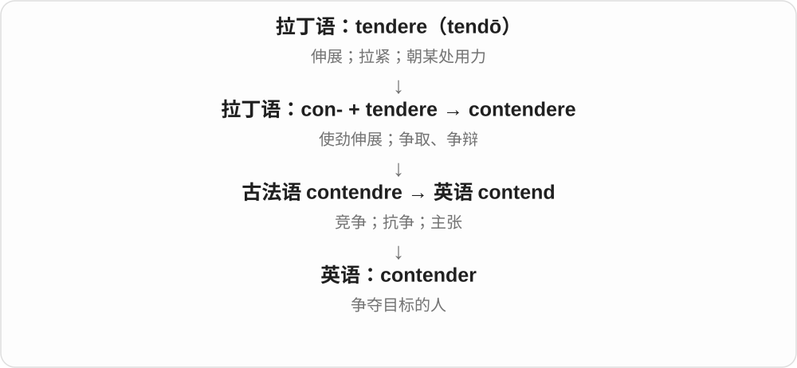

常与 for 或 to win 搭配，尤其谈冠军、职位或奖项。

**常见搭配与例句**

a serious contender；a contender for the title；a leading contender。

> She is a strong contender for the award.

她是这个奖项的有力竞争者。

> Three teams remain serious contenders for the title.

仍有三支球队有实力争夺冠军。

**别混淆**

participant 只说明参与；contender 往往带竞争资格或胜算的意味。

### 208. attacker — 攻击者；进攻队员

**音标**：英 /əˈtækə/；美 /əˈtækər/

**先抓住这个画面**

谁在实施攻击或承担进攻任务，就从这个角色称谁 attacker。

**怎么拆**

attack + -er，执行动作的主体。人物、动物及计算机安全中的攻击主体，都可能用这个名词。

**怎么变成今天的意思**

**意大利语 attaccare 接合、贴上 → 法语 attaquer、attaque**  
接战 → 进攻、攻击

↓

**英语 attack**  
攻击 → 抨击；疾病等突然发作；着手解决

↓

**attack + -er → attacker**  
执行攻击、进攻的主体

a skilled attacker 技术熟练的进攻队员，an unknown attacker 身份不明的攻击者；先看体育、案件还是网络上下文。

**常见搭配与例句**

an unknown attacker；a skilled attacker；identify the attacker。

> The defender blocked the attacker’s shot.

防守队员挡住了进攻队员的射门。

> The report did not identify the attacker.

报告未指明攻击者的身份。

**别混淆**

attacker 不永远是犯罪者，足球进攻队员正常参赛也叫 attacker；defender 是防守方。

### 209. announcer — 播音员；报幕员；现场播报者

**音标**：英 /əˈnaʊnsə/；美 /əˈnaʊnsər/

**先抓住这个画面**

通过广播或扩音设备，把节目、赛况或通知传给大家的人。

**怎么拆**

announce + -er，英语用人员词尾指出负责播报的人。

**怎么变成今天的意思**

**拉丁语 nuntius → nuntiare**  
传信者、消息 → 通报、传话；也见 nunci- 拼写

↓

**拉丁语 ad- + nuntiare → annuntiare**  
把消息传给别人

↓

**古法语 anoncier → 英语 announce**  
正式或公开宣布

↓

**英语 announce + -er → announcer**  
宣布 → 播报、报幕的人

a radio announcer 是电台播音员；a stadium announcer 会报出队员、比分或现场事项。具体职责可能和主持、解说有重叠。

**常见搭配与例句**

a radio announcer；a stadium announcer；the news announcer。

> The announcer read out the names of the finalists.

播音员读出了决赛选手的名字。

> The stadium announcer asked spectators to keep the exits clear.

体育场播报员请观众不要堵住出口。

**别混淆**

presenter 更突出主持节目；announcer 更突出向听众播报信息。

### 210. flyer — 飞行者；常乘飞机者；传单

**音标**：英 /ˈflaɪə/；美 /ˈflaɪər/

**先抓住这个画面**

能飞、经常乘飞机的人是一支；街头发的一张宣传纸也叫 flyer，是固定的传单义。

**怎么拆**

fly + -er，形成飞行者等名词；传单义是后来独立固定的引申，不把传单一定曾被从飞机扔下写成唯一来源。也有 flier 拼写，两种在不同地区、编辑习惯里分布不同。

**怎么变成今天的意思**

**古英语 flēogan；昆虫名词 flēoge 等**  
飞行动词与飞虫名词的历史相关词族

↓

**英语 fly**  
飞、快速移动；苍蝇；不同复合词各有固定对象

↓

**fly + -er → flyer**  
飞行者、乘机者；后来也指宣传单页

a frequent flyer 常乘飞机的人，hand out flyers 发传单；flyer 在宣传语里也可泛指单页广告。

**常见搭配与例句**

a frequent flyer；hand out flyers；a promotional flyer。

> She is a frequent flyer because of her work.

她因工作经常乘飞机。

> Volunteers handed out flyers for the concert.

志愿者为音乐会发传单。

**别混淆**

flyer 传单不等于所有报纸、册子；flier 与 flyer 常是同词拼写变体，不能武断说其中一种一律错。

### 211. trumpet — 小号、喇叭；高声宣扬；发出号角般声音

**音标**：/ˈtrʌmpɪt/

**先抓住这个画面**

先听一声响亮的号角：能召集人、让大家注意。名字后来既指乐器，也能说把消息大声宣传出去。

**怎么拆**

经中古英语借古法语 trompette，是 trompe 号角的小称；更远很可能接日耳曼拟声形式。不是从英语 trump 王牌再加一个现代词尾得来。

**怎么变成今天的意思**

**古法语 trompe + 小称 -ette → trompette**  
号、号角的相关乐器名；更远很可能有日耳曼拟声背景

↓

**中古英语 trompet → trumpet**  
小号、号角；后来又有高声宣扬等动词用法

play the trumpet 是吹小号；trumpet a success 是大肆宣扬一次成功。大象等发出类似号角的声音，也可用这个动词。

**常见搭配与例句**

a trumpet solo 小号独奏；trumpet the news 大声宣扬消息。

> She plays the trumpet in the school band.

她在学校乐队吹小号。

> The company will trumpet its success in the next campaign.

公司会在下次宣传中大力宣扬这次成功。

**别混淆**

trump 王牌、胜过的常用义与 triumph 的截短有关；trumpet 的乐器名是另一近源路线。

### 212. trumpets — 小号、号角〔复数〕；大声宣扬、鸣叫〔第三人称单数〕

**音标**：/ˈtrʌmpɪts/

**先抓住这个画面**

一排响亮的小号是 trumpets；说谁把消息高声传开，也能说 trumpets the news。

**怎么拆**

trumpet + -s，/t/ 后读 /s/。乐器名接古法语 trompette，动词由乐器名称发展，整个词再作数、人的变化。

**怎么变成今天的意思**

**古法语 trompe + 小称 -ette → trompette**  
号、号角的相关乐器名；更远很可能有日耳曼拟声背景

↓

**中古英语 trompet → trumpet**  
小号、号角；后来又有高声宣扬等动词用法

↓

**trumpet + -s → trumpets**  
多把小号；它高声宣扬或发出号角声

the trumpets in the band 可以按乐器名借指小号声部；trumpets its achievements 则说大肆宣传成就。

**常见搭配与例句**

brass trumpets 铜制小号；trumpets the results 大力宣扬结果。

> The trumpets entered at the end of the passage.

这一段末尾小号声部加入。

> The advertisement trumpets the product’s new design.

广告大肆宣扬产品的新设计。

**别混淆**

trumpets 是乐器或动作，trumpeters 是演奏者；多出来的 -er 把注意力转到人。

### 213. trumpeter — 小号手、吹号者；高声宣传者

**音标**：英 /ˈtrʌmpɪtə/；美 /ˈtrʌmpɪtər/

**先抓住这个画面**

号角是 trumpet，吹号让声音传出去的人是 trumpeter。把消息高声传开的人，也能借这个称呼描述。

**怎么拆**

trumpet + 完整 -er，形成做这件事的人。乐器名称更早经古法语进入英语，人物后缀接在完整基础词后。

**怎么变成今天的意思**

**古法语 trompe + 小称 -ette → trompette**  
号、号角的相关乐器名；更远很可能有日耳曼拟声背景

↓

**中古英语 trompet → trumpet**  
小号、号角；后来又有高声宣扬等动词用法

↓

**trumpet + -er → trumpeter**  
吹小号的人；借指高声宣布的人

a jazz trumpeter 是爵士小号手；trumpeter swan 则是因叫声命名的一种天鹅。

**常见搭配与例句**

a solo trumpeter 小号独奏者；a skilled trumpeter 熟练的小号手。

> A lone trumpeter played from the balcony.

一位小号手独自在阳台上吹奏。

> The band invited a guest trumpeter for the concert.

乐队邀请了一位客座小号手参加音乐会。

**别混淆**

trumpeter 是人名角色，trumpet 是乐器、吹奏或宣扬动作；这里 -er 不表示比较级。

### 214. trumpeters — 小号手、吹号者〔复数〕

**音标**：英 /ˈtrʌmpɪtəz/；美 /ˈtrʌmpɪtərz/

**先抓住这个画面**

几位小号手并排举起乐器，叫 trumpeters。数的是吹奏的人，手里的乐器才叫 trumpets。

**怎么拆**

trumpet + -er → trumpeter，再加 -s，末尾读 /z/；先变成人物名称，再数人。

**怎么变成今天的意思**

**trumpet + -er → trumpeter**  
吹号、吹小号的人

↓

**trumpeter + -s → trumpeters**  
多位演奏者

two trumpeters 是两位小号手；the trumpets 可指几把小号或整个小号声部，关注点不同。

**常见搭配与例句**

jazz trumpeters 爵士小号手；a line of trumpeters 一排吹号者。

> The trumpeters stood at the front of the band.

小号手们站在乐队前面。

> Two trumpeters took turns playing the melody.

两位小号手轮流演奏旋律。

**别混淆**

trumpeters 的重音仍在开头；复数 -s 接完整人物词，既不去 -er，也不把 trumpet 再变复数。

### 215. jolly — 愉快、乐呵呵的；很、相当〔英式口语〕

**音标**：英 /ˈdʒɒli/；美 /ˈdʒɑːli/

**先抓住这个画面**

人笑呵呵，聚会热闹愉快，常可叫 jolly。英式口语中 jolly good 又把它当程度词说“真不错”。

**怎么拆**

中古英语 joli、jolif 接古法语 joli、jolif 欢乐、节庆等义，更远来源未定。现代副词程度用法来自较早强烈、令人赞赏等表达。

**怎么变成今天的意思**

**古法语 joli、jolif → 中古英语相关形式**  
欢快、令人愉悦

↓

**现代 jolly 的形容词与程度词**  
乐呵呵的；英式口语很、相当

a jolly person 乐呵呵的人；a jolly evening 愉快的夜晚；jolly good 真不错。部分表达带传统英式语气。

**常见搭配与例句**

a jolly laugh；jolly well。

> He greeted us with a jolly laugh.

他笑呵呵地向我们打招呼。

> We had a jolly evening together.

我们一起度过了一个愉快的夜晚。

**别混淆**

jolly 不能只凭末尾 y 拆成现代 joll + -y；它有法语整词借入史。happy 更通用，jolly 常更显外露、热闹的愉快。

### 216. jollies — 乐趣、快感〔口语复数〕；逗乐、哄劝〔第三人称单数〕

**音标**：英 /ˈdʒɒliz/；美 /ˈdʒɑːliz/

**先抓住这个画面**

一个人觉得什么好玩、拿什么取乐，口语常说 get his jollies from it；动词 jollies 则是逗别人开心、哄着往前走。

**怎么拆**

jolly 的名词复数或动词三单都把 y 改为 ies；名词乐趣与动词逗乐分别看语法，基础仍是欢快词族。

**怎么变成今天的意思**

**古法语 jolif、joli → 英语 jolly**  
欢快、节庆等义，远源未定；北欧 jol 节日来源说存在明显争议

↓

**现代 jolly：乐呵呵；程度副词很、相当**  
jollity 经法语名词一路借入；jollies 另有口语乐趣用法

↓

**jolly → jollies**  
口语复数乐趣；或逗乐动词三单，改 y 为 ies

get your jollies from something 从某事取乐；jollies someone along 逗着、哄着某人继续。这个口语名词可带讽刺。

**常见搭配与例句**

gets his jollies from teasing；jollies the children along。

> He gets his jollies from teasing his friends.

他拿逗朋友取乐。

> She jollies the children along when they get tired on walks.

散步时孩子们累了，她就逗着他们继续走。

**别混淆**

jollies 不是正式的 joy 同义替换，常含某人图个什么乐的口语评价；有时语境带性意味，也不固定只有那一种。

### 217. jollity — 欢乐、欢闹；愉快热闹的气氛

**音标**：英 /ˈdʒɒləti/；美 /ˈdʒɑːləti/

**先抓住这个画面**

房间里笑声、玩笑、聊天声交织，大家都很放松，这种外露、热闹的欢乐气氛叫 jollity，较书面。

**怎么拆**

经古法语 jolivete 等名词借入，接 jolif 欢快词族；现代可与 jolly 对照，但不能只说英语当场把 y 换成 ity。

**怎么变成今天的意思**

**古法语 jolif、joli → 英语 jolly**  
欢快、节庆等义，远源未定；北欧 jol 节日来源说存在明显争议

↓

**现代 jolly：乐呵呵；程度副词很、相当**  
jollity 经法语名词一路借入；jollies 另有口语乐趣用法

↓

**古法语 jolivete 等 → jollity**  
欢闹、愉快的状态与活动；相关形式经历史借入

an air of jollity 欢乐的气氛；Christmas jollity 圣诞欢闹；forced jollity 勉强装出的欢乐。

**常见搭配与例句**

laughter and jollity；the general jollity。

> The room was full of laughter and jollity.

房间里满是笑声和欢乐气氛。

> There was a hint of forced jollity in his voice.

他的声音里有一点强装欢乐的味道。

**别混淆**

jollity 比 happiness 更容易写大家一起说笑的气氛；内心安静、持久的幸福不必带热闹。

### 218. jolliest — 最欢快、最乐呵呵的

**音标**：英 /ˈdʒɒliɪst/；美 /ˈdʒɑːliɪst/

**先抓住这个画面**

这群人里，他最爱笑、最能把大家带得开开心心，叫 the jolliest；一场活动也可以欢快到最突出。

**怎么拆**

jolly 改 y 为 i，加完整最高级 -est；这里比较 jolly 的欢快性质，不是副词 very 的某种最高级。

**怎么变成今天的意思**

**古法语 jolif、joli → 英语 jolly**  
欢快、节庆等义，远源未定；北欧 jol 节日来源说存在明显争议

↓

**现代 jolly：乐呵呵；程度副词很、相当**  
jollity 经法语名词一路借入；jollies 另有口语乐趣用法

↓

**jolly → jolliest**  
在范围内最欢快、最有愉悦气氛

the jolliest person 最乐呵的人；the jolliest party 最欢快的聚会。

**常见搭配与例句**

his jolliest laugh；the jolliest group。

> He was the jolliest person at the table.

他是桌边最乐呵呵的那个人。

> It turned out to be the jolliest party of the summer.

结果，那成了这个夏天最欢快的一场聚会。

**别混淆**

jolliest 常带外露、热闹的欢快感；calmest 是最平静，不是同一种正面状态的程度差。

### 219. jollier — 更欢快、乐呵呵的

**音标**：英 /ˈdʒɒliə/；美 /ˈdʒɑːliər/

**先抓住这个画面**

同样一次聚餐，这次大家更爱笑、更放松，气氛更乐呵，可以说 jollier。

**怎么拆**

jolly 改 y 为 i，加完整比较级 -er；jolly 的 ly 是基础借词的一部分，不能当普通副词 -ly。

**怎么变成今天的意思**

**古法语 jolif、joli → 英语 jolly**  
欢快、节庆等义，远源未定；北欧 jol 节日来源说存在明显争议

↓

**现代 jolly：乐呵呵；程度副词很、相当**  
jollity 经法语名词一路借入；jollies 另有口语乐趣用法

↓

**jolly → jollier**  
比较欢快、愉悦的程度

a jollier atmosphere 更欢快的气氛；look jollier 显得更乐呵；a jollier group 更爱说笑的一群人。

**常见搭配与例句**

jollier than before；a much jollier evening。

> The music made the whole occasion feel jollier.

音乐让整个场合显得更欢快。

> He seemed much jollier after lunch.

午饭后，他看起来乐呵多了。

**别混淆**

jollier 是形容词比较；jolly good 里的 jolly 是程度用法。两种语法关系要看所修饰的成分。

### 220. organizer — 组织者；整理收纳用品

**音标**：英 /ˈɔːɡənaɪzə/；美 /ˈɔːrɡənaɪzər/

**先抓住这个画面**

可以是把活动办起来的人，也可以是把零碎物品安排好的工具。

**怎么拆**

organize + -er，先按实施组织的人理解，也用于整理工具。英式常写 organiser。

**怎么变成今天的意思**

**希腊语 organon → 拉丁语 organum**  
工具、器官

↓

**中世纪拉丁语 organizare；法语 organiser**  
使具有器官、构成有组织的整体

↓

**英语 organize**  
组织、安排、成立组织

↓

**英语 organize + -er → organizer**  
组织者；帮助整理的物品

an event organizer 是活动组织者；a desk organizer 是桌面收纳用品。词尾 -er 不一定只表示人。

**常见搭配与例句**

the event organizer；a union organizer；a drawer organizer。

> The organizer emailed the final schedule.

组织者用电子邮件发来了最终日程。

> A small organizer keeps the cables in one place.

一个小收纳盒把线缆集中放在一起。

**别混淆**

host 可能是主持人或主人；organizer 更明确负责策划安排。

### 221. winger — 边锋、侧翼球员；某一派的人〔组合中〕

**音标**：英 /ˈwɪŋə/；美 /ˈwɪŋər/

**先抓住这个画面**

场地或阵型的边上有 wing，在那里活动的球员就可叫 winger；政治组合里也可说某一翼的人。

**怎么拆**

wing 侧翼 + -er 人物后缀。具体站位、任务随运动不同，不用同一个边锋定义盖住全部项目。

**怎么变成今天的意思**

**古诺斯语 vængr → 中古英语 wenge、winge → wing**  
动物翼；侧边伸出部分等

↓

**wing + -er → winger**  
在侧翼位置活动的人；所属一派的人

a left winger 左侧边锋，a fast winger 速度快的边锋，a right winger 右翼人物〔政治语境〕。

**常见搭配与例句**

a fast winger；a left winger；a right winger。

> The winger sent a cross into the penalty area.

边锋向禁区传中。

> The coach praised the young winger’s speed.

教练表扬了年轻边锋的速度。

**别混淆**

winger 运动边路或政治派别看上下文；wingman 支援搭档不必在球场边路。

### 222. scoot — 迅速走开；挪动、溜走〔口语〕

**音标**：/skuːt/

**先抓住这个画面**

赶紧过去、轻快溜走、给别人往旁边挪一点，都可能是 scoot。语气通常比正式 move 轻松。

**怎么拆**

来源不确定，或联系北欧语、英语方言的快速移动材料；不把它说成 scooter 去 -er 后才必然新造的动词。

**怎么变成今天的意思**

**英语 scoot 快速移动等**  
远源未定，有北欧语、方言等解释

↓

**scoot + -er → scooter**  
按轻快移动功能命名交通工具

scoot over 往旁边挪；scoot off 赶紧走；scoot across the room 快速穿过房间。

**常见搭配与例句**

scoot over；scoot off。

> Could you scoot over a little?

你能往旁边挪一点吗？

> The child scooted across the room to greet her.

孩子迅速穿过房间迎接她。

**别混淆**

scoot 不要求骑 scooter；人在沙发上挪一挪也能 scoot over。

### 223. scooter — 滑板车；小型踏板摩托车等

**音标**：英 /ˈskuːtə/；美 /ˈskuːtər/

**先抓住这个画面**

站在踏板上滑行的车可以是 scooter；坐着骑的小型踏板摩托也能用这个名。先看实物和 electric、motor 等限定。

**怎么拆**

scoot 快速移动 + -er → scooter，器物命名。具体车种从现代使用范围判断，不能只靠词尾推它一定有人力、发动机或座椅。

**怎么变成今天的意思**

**英语 scoot 快速移动等**  
远源未定，有北欧语、方言等解释

↓

**scoot + -er → scooter**  
按轻快移动功能命名交通工具

↓

**scoot + -er → scooter**  
与轻快移动相关的交通器具名

a kick scooter 人力滑板车；an electric scooter 电动滑板车或相关踏板车型；a motor scooter 踏板摩托车。

**常见搭配与例句**

a kick scooter；a motor scooter。

> The child left a small scooter by the gate.

孩子把一辆小滑板车放在门边。

> The illustration compares a kick scooter with a motor scooter.

插图比较人力滑板车与踏板摩托车。

**别混淆**

kick scooter 常靠脚蹬滑行，motor scooter 是动力踏板车；skateboard 滑板通常没有前者那种把手，别只按中文带板字就合并。

### 224. follower — 追随者；支持者；社交平台关注者

**音标**：英 /ˈfɒləʊə/；美 /ˈfɑːloʊər/

**先抓住这个画面**

有人在行动、思想上跟着一个人，也有人只是点击关注、接收更新。

**怎么拆**

follow + -er，形成执行跟随的主体名词。现代社交平台义沿用持续关注，不代表每位关注者都忠诚支持。

**怎么变成今天的意思**

**古英语 folgian → 中古英语 folwen → follow**  
跟随、追随

↓

**现代 follow**  
沿路或人物移动 → 遵守、理解、持续关注

↓

**follow + -er → follower**  
跟随者 → 支持者、平台关注者

a loyal follower 忠实追随者，social media followers 平台关注者；gain followers 增加关注者。

**常见搭配与例句**

a loyal follower；gain followers；social media followers。

> The writer gained many followers after the interview.

作家在访谈后增加了许多关注者。

> The leader expected unquestioning loyalty from his followers.

领导者要求追随者毫无质疑地忠诚。

**别混淆**

follower 平台关注者与 fan 粉丝不同，关注也可能为工作、研究或好奇。

### 225. glitter — 闪闪发亮；闪光；闪粉

**音标**：英 /ˈɡlɪtə/；美 /ˈɡlɪtər/

**先抓住这个画面**

许多细小反光点一起跳进眼睛，是 glitter；手工装饰撒下去的那种亮片粉，也按这个效果叫 glitter。

**怎么拆**

中古英语有 glideren、gliteren，可能承未留记录的古英语形式或借北欧相关词；尾部含旧反复动作材料，名词后由动词发展。

**怎么变成今天的意思**

**中古英语 glideren、gliteren，联系古英语或北欧来源**  
早期继承、借入路线未定；较远接日耳曼发光材料

↓

**glitter 动词 → 名词**  
细碎闪亮 → 闪光、后来命名装饰用闪粉

glitter in the light 是在光下细碎闪亮；a tube of glitter 是一管装饰闪粉，物质名通常不按颗粒逐个数。

**常见搭配与例句**

gold glitter 金色闪粉；glitter in the sun 在太阳下闪亮。

> The decorations glitter in the candlelight.

装饰物在烛光下闪闪发亮。

> She sprinkled glitter over the card.

她在卡片上撒了闪粉。

**别混淆**

glow 常是持续的光泽，glitter 更容易看见许多亮点反射；glitter 还可指制造这种效果的装饰材料。

### 226. glittering — 闪闪发亮的；辉煌耀眼的

**音标**：英 /ˈɡlɪtərɪŋ/；美 /ˈɡlɪtərɪŋ/

**先抓住这个画面**

眼前有亮点不断闪，或一个人的事业光彩照人，都可说 glittering。后者把视觉上的耀眼借给成就、地位。

**怎么拆**

glitter + -ing；r 后接元音，常见英式也读出 /r/。分词形容词保留细碎亮光，又能比喻辉煌。

**怎么变成今天的意思**

**中古英语 glideren、gliteren，联系古英语或北欧来源**  
早期继承、借入路线未定；较远接日耳曼发光材料

↓

**glitter 动词 → 名词**  
细碎闪亮 → 闪光、后来命名装饰用闪粉

↓

**glitter + -ing → glittering**  
正在闪亮；光彩、事业辉煌的

a glittering dress 是闪亮礼服，a glittering career 是辉煌事业；两者不都是指衣服上的闪粉。

**常见搭配与例句**

glittering jewels 闪亮珠宝；a glittering performance 耀眼的表演。

> She wore a glittering dress on stage.

她穿着闪亮礼服登台。

> The award capped a glittering career.

这个奖项为一段辉煌事业添上了收官荣誉。

**别混淆**

glittering 可强调华丽耀眼，glistening 更容易让人想到湿润、光滑表面的光泽。

### 227. glitters — 闪闪发亮〔第三人称单数〕

**音标**：英 /ˈɡlɪtəz/；美 /ˈɡlɪtərz/

**先抓住这个画面**

一件东西上有许多细小亮点反光，说它 glitters。真正发光的也许是太阳、灯，它的表面把光闪给你看。

**怎么拆**

glitter + -s，末尾读 /z/。基础发光动词已有旧反复动作材料，现代 -s 加在全词最后。

**怎么变成今天的意思**

**中古英语 glideren、gliteren，联系古英语或北欧来源**  
早期继承、借入路线未定；较远接日耳曼发光材料

↓

**glitter 动词 → 名词**  
细碎闪亮 → 闪光、后来命名装饰用闪粉

↓

**glitter + -s → glitters**  
它细碎闪亮

glitters with jewels 是珠宝在上面闪亮；glitters in the sun 是在阳光下闪光。

**常见搭配与例句**

glitters in the light 在光下闪亮；glitters like gold 像金子般闪光。

> The necklace glitters in the sunlight.

项链在阳光下闪闪发亮。

> The costume glitters with tiny sequins.

服装上的细小亮片闪闪发光。

**别混淆**

闪粉物质名 glitter 常不可数；这里 glitters 的 -s 最常是动词三单，别看见 s 就当许多闪粉。

### 228. glittered — 闪闪发亮了

**音标**：英 /ˈɡlɪtəd/；美 /ˈɡlɪtərd/

**先抓住这个画面**

刚才首饰、水面、雪地上出现一片细小反光，过去可说 glittered；重点在亮点一起闪的视觉效果。

**怎么拆**

glitter + 完整 -ed，末尾读 /d/。原有 tt 属于基础拼写，不是这次加 -ed 才双写出来。

**怎么变成今天的意思**

**中古英语 glideren、gliteren，联系古英语或北欧来源**  
早期继承、借入路线未定；较远接日耳曼发光材料

↓

**glitter 动词 → 名词**  
细碎闪亮 → 闪光、后来命名装饰用闪粉

↓

**glitter + -ed → glittered**  
过去发出细碎闪光

glittered in the light 在光下闪光；eyes glittered 还可形容眼里有鲜明神采、强烈情绪。

**常见搭配与例句**

glittered with jewels 珠宝闪光；glittered in the sun 在太阳下闪亮。

> The snow glittered in the morning sun.

雪在晨光中闪闪发亮。

> Her earrings glittered as she turned her head.

她转头时，耳环闪闪发亮。

**别混淆**

glittered 讲反光、闪亮现象，sparked 可讲冒火星或引起事情；亮光画面不同。

### 229. programmer — 程序员；节目编排者；编程装置

**音标**：英 /ˈprəʊɡræmə/；美 /ˈproʊɡræmər/

**先抓住这个画面**

把需要完成的工作变成一套可执行指令的人，现代最常想到程序员。

**怎么拆**

program + -er，拼写中双写 m；早期也可指安排节目的人，计算机时代强化了写程序义。

**怎么变成今天的意思**

**希腊语 graphein 与 gramma / grammat-**  
写、画 → 写下或画出的符号、字母

↓

**希腊语 prographein → programma**  
预先写出、公开写出 → 公告

↓

**后期拉丁语 programma → 法语 programme → 英语 program / programme**  
公告 → 事先列出的安排、节目；后来指计算机指令

↓

**英语 program + -er → programmer**  
安排程序的人或装置；程序员

程序员的工作不只是输入代码，还包括理解需求、排错和维护。技术语境的 device programmer 则可能是给芯片写入内容的设备。

**常见搭配与例句**

a computer programmer；a software programmer；a device programmer。

> The programmer traced the error to a missing condition.

程序员追查出错误来自一个遗漏的条件。

> A festival programmer selected the films for the event.

电影节的节目编排者为活动选出了参展影片。

**别混淆**

developer 常涵盖更广的软件开发工作；programmer 更直接点出编程这一职责，实际岗位名称有重叠。

### 230. promoter — 推广者；活动主办者；启动子

**音标**：英 /prəˈməʊtə/；美 /prəˈmoʊtər/

**先抓住这个画面**

promoter 是把活动或想法往前推的一方；生物学里，同样的“推动”形象用于帮助启动转录的 DNA 区域。

**怎么拆**

promote + -er，表示促成、推进的一方。

**怎么变成今天的意思**

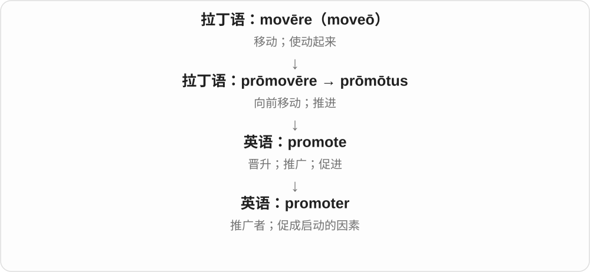

演出推广者可能负责组织宣传；科学中的 promoter 则是专业名称，不能按一般职业义理解。

**常见搭配与例句**

a concert promoter；a promoter of reform；a gene promoter。

> The promoter arranged three concerts in the city.

活动主办者在城里安排了三场演唱会。

> The diagram marks the gene’s promoter region.

图中标出了这个基因的启动子区域。

**别混淆**

promoter 是推动者；promotion 是推广或晋升的过程。promotor 还有特定大学职务用法。

### 231. scanner — 扫描仪；扫描器；扫描设备

**音标**：英 /ˈskænə/；美 /ˈskænər/

**先抓住这个画面**

沿对象读取信息，再把内容变成图像、数据或检测结果的设备。

**怎么拆**

scan + -er；双写 n 后加 -er，与 scanned、scanning 的拼写规律一致。

**怎么变成今天的意思**

**拉丁 scandere**  
攀登、上升；复合词里常见 -scendere

↓

**后期拉丁 scandere → 中古英语 scannen → scan**  
分析诗歌格律；从攀登到格律的确切联想未定

↓

**英语 scan 的扩展**  
逐项审看 → 扫描；另有快速浏览义

↓

**英语 scan + -er → scanner**  
执行扫描的装置

a document scanner 扫纸面文件；a barcode scanner 读条码；医疗 scanner 则是相应成像设备。共同点是扫描读取，不是内部原理完全相同。

**常见搭配与例句**

a barcode scanner；a document scanner；a medical scanner。

> The scanner could not read the damaged barcode.

扫描器读不出损坏的条码。

> She placed the photograph on the scanner.

她把照片放到扫描仪上。

**别混淆**

printer 输出内容；scanner 读入内容。复合办公设备可能同时有两种功能。

### 232. crater — 火山口；陨石坑、弹坑等碗状坑

**音标**：英 /ˈkreɪtə/；美 /ˈkreɪtər/

**先抓住这个画面**

地表凹下一大块，边缘围着、里面像碗，就是 crater 的常见形状。火山口、撞击坑、爆炸坑都可能这样叫。

**怎么拆**

拉丁语 crater 接希腊语 krater 调和酒水的大碗，后把碗状外形用于火山口，再扩大到其他坑。

**怎么变成今天的意思**

**希腊语 krater → 拉丁语 crater**  
调酒大碗，继而比喻火山口

↓

**现代 crater 的地形用法**  
火山口；撞击、爆炸等形成的坑

a volcanic crater 火山口；an impact crater 撞击坑；craters on the Moon 月面陨石坑；a bomb crater 弹坑。

**常见搭配与例句**

the rim of a crater；a deep crater。

> They walked around the rim of the volcanic crater.

他们沿着火山口边缘行走。

> The photograph shows several craters on the Moon.

照片显示了月球上的几个陨石坑。

**别混淆**

crater 描写这类坑状地形，并不保证成因是火山。月面很多 crater 来自撞击，需看具体地质背景。

### 233. heater — 加热器；取暖器

**音标**：英 /ˈhiːtə/；美 /ˈhiːtər/

**先抓住这个画面**

专门把水、空气或其他东西加热的设备；前面的词通常说明热什么。

**怎么拆**

heat + -er，后缀在这里形成器具名。不是凡是做饭、让人暖心的人都自然叫 heater。

**怎么变成今天的意思**

**古英语 hǣtu〔名词〕、hǣtan〔动词〕→ heat**  
热、热情；使热、变热，与 hot 同族

↓

**现代 heat**  
热量、热度；加热；激烈情绪、压力及比赛分组等用法

↓

**heat + -er → heater**  
执行加热的器具

a water heater 热水器，an electric heater 电暖器，a space heater 局部取暖器。

**常见搭配与例句**

a water heater；an electric heater；a space heater。

> The water heater is in the cupboard.

热水器在柜子里。

> He switched off the electric heater before leaving.

离开前，他关掉了电暖器。

**别混淆**

heater 通常指具体设备，heating 常指加热活动或供暖系统；hot water 是热水本身。

### 234. outsider — 外部人员；局外人；不被看好的竞争者

**音标**：英 /ˌaʊtˈsaɪdə/；美 /ˌaʊtˈsaɪdər/

**先抓住这个画面**

人在圈子外面：可能不属于这个群体，也可能没被纳入核心竞争。

**怎么拆**

outside＋-er，把处在外部的人命名出来。不是 out＋sider，更不说明此人一定来自国外。

**怎么变成今天的意思**

**英语 outside**  
在群体或边界之外

↓

**outside ＋ -er → outsider**  
外部的人；随后也用于被看低的竞争者

新来的员工可能觉得自己像 outsider，未必是别人排斥，也可能只是还不了解大家的默契。比赛里的 outsider 则是赛前不被看好的人或队伍，不是没有参赛资格。

**常见搭配与例句**

feel like an outsider；an outsider’s perspective；a complete outsider；an outsider in the race。

> As a newcomer, I sometimes felt like an outsider.

刚来时，我有时觉得自己像个局外人。

> The team entered the tournament as an outsider but reached the final.

这支队伍参赛时并不被看好，最后却打进了决赛。

**别混淆**

foreigner 指国籍或来自别国；outsider 指某个群体中的位置，同国同城的人也可能是 outsider。

### 235. spoiler — 剧透信息、剧透者；扰流装置；破坏他人机会的竞争者

**音标**：英 /ˈspɔɪlə/；美 /ˈspɔɪlər/

**先抓住这个画面**

提前把悬念拆穿，spoiler 就毁掉了惊喜。汽车、飞机上的 spoiler 则用技术方式改变气流、升力等表现；同词按“使原有作用减弱、改变”形成装置名。

**怎么拆**

spoil + -er，执行者、起作用的东西。人物、信息、空气动力装置等承不同 spoil 动词分支。

**怎么变成今天的意思**

**拉丁 spoliare 劫掠、剥夺 → 古法语 espoillier → spoil**  
使失去、损坏；名词战利品一支保留抢得的东西

↓

**spoil + -er → spoiler**  
破坏惊喜的人、信息；改变气流效果的装置

spoiler alert 剧透提醒，avoid spoilers 避开剧透，a rear spoiler 后扰流板。

**常见搭配与例句**

spoiler alert；avoid spoilers；a rear spoiler。

> The review contains major spoilers.

这篇影评有重大剧透。

> The car has a small rear spoiler.

汽车有一块小后扰流板。

**别混淆**

spoiler 剧透既可以人也可以内容；车辆上的装置名不能只按看起来像翅膀就与全部翼面结构混同。

### 236. brewer — 酿酒师、酿酒者；酿酒企业

**音标**：英 /ˈbruːə/；美 /ˈbruːər/

**先抓住这个画面**

把 brew 的过程交给一个负责制作的人，就是 brewer。商业报道里，也可能把整家酿酒公司当作这个制作主体。

**怎么拆**

brew + -er，中古英语已有 brewere。-er 这里命名制作的人，也能延伸指从事这一业务的企业。

**怎么变成今天的意思**

**古英语 brēowan → 中古英语 brewen → brew**  
酿造、调制等液体制作过程

↓

**现代具体与比喻用法**  
酿啤酒、泡茶或冲咖啡；风暴、麻烦正在酝酿

↓

**brew + -er → brewer**  
酿造者；酿造企业

a master brewer 酿酒大师、资深酿酒师，a local brewer 当地酿酒者或企业。一般语境多与啤酒酿造有关。

**常见搭配与例句**

a master brewer；a local brewer。

> The brewer described how the recipe had changed.

酿酒师讲解了配方如何发生变化。

> A local brewer supplied the restaurant with beer.

一家当地酿酒企业向餐馆供应啤酒。

**别混淆**

brewer 可以是人或企业，brewery 更直接说酿酒厂、酿酒公司。看招聘职位时，brewer 常是具体岗位。

### 237. burner — 炉头、燃烧器；刻录机；其他以燃烧、刻录命名的器具

**音标**：英 /ˈbɜːnə/；美 /ˈbɜːrnər/

**先抓住这个画面**

煤气在灶上某个小部件燃烧，是 burner；刻录光盘的设备也接 burn 刻录这一现代动作义。

**怎么拆**

burn + -er，器具、执行者派生，与较早 brennere 等词形式合流。-er 不保证一定是人。

**怎么变成今天的意思**

**古英语 bærnan、beornan 等；古诺尔斯语 brenna、brinna 等**  
使燃烧与自己燃烧的旧动词在英语中合流

↓

**中古英语 brennen、brinnen、birnen 等 → burn**  
读音次序变化；烧、燃、热痛、炽热情感等

↓

**burn + -er → burner**  
产生燃烧或执行刻录等动作的器具、人物

a gas burner 燃气炉头，a CD burner 光盘刻录机；put something on the back burner 暂把某事放到次要位置。

**常见搭配与例句**

a gas burner；a CD burner；on the back burner。

> She moved the pot to the smaller burner.

她把锅挪到了较小的炉头上。

> We put the project on the back burner until next month.

我们把项目暂时放后，等下个月再处理。

**别混淆**

burner 炉头、设备，burning 过程；back burner 比喻降低优先级，不要求真把文件放炉灶上。

### 238. catcher — 接住、捕捉的人或器具；棒球捕手

**音标**：英 /ˈkætʃə/；美 /ˈkætʃər/

**先抓住这个画面**

按接住这个任务命名；棒球里就是接投手来球的那个位置。

**怎么拆**

catch + -er，后缀可人或工具。棒球捕手是专门职位义，不能把每个接过球的人都说成正式 catcher。

**怎么变成今天的意思**

**拉丁 capere → captāre、晚期相关形式 → 法语 cachier 等**  
抓、拿 → 捕捉、追猎

↓

**中古英语 cacchen → catch**  
抓住、接住；捕捉到注意、信息等用法

↓

**catch + -er → catcher**  
执行接住、捕捉的人或器具；棒球职位

a baseball catcher 棒球捕手，the catcher’s glove 捕手手套；dreamcatcher 捕梦网的后部也用这个执行者、器具成分。

**常见搭配与例句**

a baseball catcher；the catcher’s glove；a trained catcher。

> The catcher signalled to the pitcher.

捕手向投手发出暗号。

> The catcher removed his mask after the play.

这轮攻防后，捕手摘下了面罩。

**别混淆**

catcher 捕手，pitcher 投手；catcher 不等于裁判 umpire，虽然几人可能都站在本垒附近。

### 239. interpreter — 口译员、手语传译员；解释者；计算机解释器

**音标**：英 /ɪnˈtɜːprɪtə/；美 /ɪnˈtɜːrprɪtər/

**先抓住这个画面**

在人之间传达话语或手语的是 interpreter；电脑中承担读取、执行程序指令这类工作的程序，也借用解释者这个角色名。

**怎么拆**

接法语、晚期拉丁相应人物词，现代对应 interpret + -er。不是所有 -er 都说明只在英语里首次新造，计算机义是后来的角色转用。

**怎么变成今天的意思**

**拉丁 interpres → interpretārī**  
中间人、传达者 → 解释、转达意思

↓

**法语相关形式 → 英语 interpret 等**  
解释、理解、口译；名词、人物词各有借入路线

↓

**现代专门用法**  
艺术演绎；计算机解释执行

↓

**法语、拉丁人物词 → interpreter**  
解释、传译的人；现代对照 interpret + -er

↓

**计算机角色用法**  
负责解释、执行指令的程序

a conference interpreter 会议口译员，a sign language interpreter 手语传译员，a language interpreter 程序语言解释器。

**常见搭配与例句**

a conference interpreter；a sign language interpreter；a language interpreter。

> A sign language interpreter stood beside the speaker.

一位手语传译员站在发言人旁边。

> The interpreter reported an error in the command.

解释器报告命令中有一个错误。

**别混淆**

interpreter 不只口头说话者，手语也在内；计算机解释器的内部可结合编译等步骤，不能把字面逐行解释当作所有实现的完整定义。

### 240. stroll — 散步；悠闲地走

**音标**：英 /strəʊl/；美 /stroʊl/

**先抓住这个画面**

吃过饭，没有任务地出去走一走，就是 take a stroll。重点是轻松走走，不是赶着把一段路走完。

**怎么拆**

基础词的来源未定，可能联系德语等语言的游荡词；现代不能可靠拆成更小的英语前后缀。

**怎么变成今天的意思**

**约十七世纪初 stroll 表示四处游荡**  
来源未定，可能接日耳曼语言中的流浪、游荡材料

↓

**游荡 → 不赶路、随意走一走**  
现代常指轻松散步，较远的语源猜测不拿来当确定拆分

take a stroll、go for a stroll 都说出去散步；stroll along the river 是沿河悠闲走。名词和动词都很常见。

**常见搭配与例句**

an evening stroll 傍晚散步；stroll into a shop 悠闲走进商店。

> We went for a stroll after dinner.

晚饭后，我们出去散了散步。

> You can stroll along the river and watch the boats.

你可以沿河悠闲地走，看来往的船。

**别混淆**

walk 是一般的走路；stroll 额外带轻松、不匆忙的感觉。通勤走得很急，通常只说 walk。

### 241. stroller — 散步的人；婴儿推车〔尤美式〕

**音标**：英 /ˈstrəʊlə/；美 /ˈstroʊlɚ/

**先抓住这个画面**

stroll 是慢慢散步，stroller 原可说散步者。现在美式日常说 a stroller，常指推着幼儿出门的轻便婴儿车。

**怎么拆**

stroll + 完整 -er；原词已有双 l，不另添。早期还见巡回表演者、游荡者义；婴儿推车义较晚，不是所有 -er 名词都只指人。

**怎么变成今天的意思**

**stroll 游走、散步 → stroller**  
较早可指巡回艺人、游荡或散步的人

↓

**stroller 后来常指婴儿推车**  
让孩子坐着、由大人推着行进的车

push a stroller 推婴儿车；an evening stroller 傍晚散步者。

**常见搭配与例句**

a folding stroller 折叠婴儿车；a stroller on the path。

> She folded the stroller before getting on the bus.

上公交车前，她把婴儿推车折起来。

> A lone stroller paused to watch the sunset.

一位独自散步的人停下来，看了看落日。

**别混淆**

stroller 尤美式常指推车，British English 常说 pushchair；不是步行学步车的同一个物件。

### 242. strollers — 散步的人〔复数〕；婴儿推车〔复数，尤美式〕

**音标**：英 /ˈstrəʊləz/；美 /ˈstroʊlɚz/

**先抓住这个画面**

公园里一群闲散步行的人，可以是 strollers；门口停着的几辆婴儿推车，也叫 strollers。看动词是在走，还是被推、停放。

**怎么拆**

stroller + -s，读 /z/；stroll 加 -er 后再取复数，不是 strolls 动词三单的扩展拼法。

**怎么变成今天的意思**

**stroll → stroller**  
散步动作，到人；后来有婴儿推车义

↓

**stroller + -s → strollers**  
多人散步，或多辆婴儿推车

parents with strollers 推着婴儿车的家长；evening strollers。

**常见搭配与例句**

folding strollers；strollers along the promenade。

> Parents left their strollers near the entrance.

家长们把婴儿推车放在入口附近。

> Evening strollers filled the riverside path.

傍晚散步的人走满了河边小路。

**别混淆**

strollers 可能是车也可能是人，walkers 也多义；阅读时靠具体动作、场景定指代。

### 243. insurer — 保险公司；承保人

**音标**：英 /ɪnˈʃɔːrə/；美 /ɪnˈʃʊrər/

**先抓住这个画面**

在保险关系里，承诺按约定承担赔付责任的一方是 insurer，通常是一家保险公司。

**怎么拆**

insure + -er（执行该业务的人或机构）。

**怎么变成今天的意思**

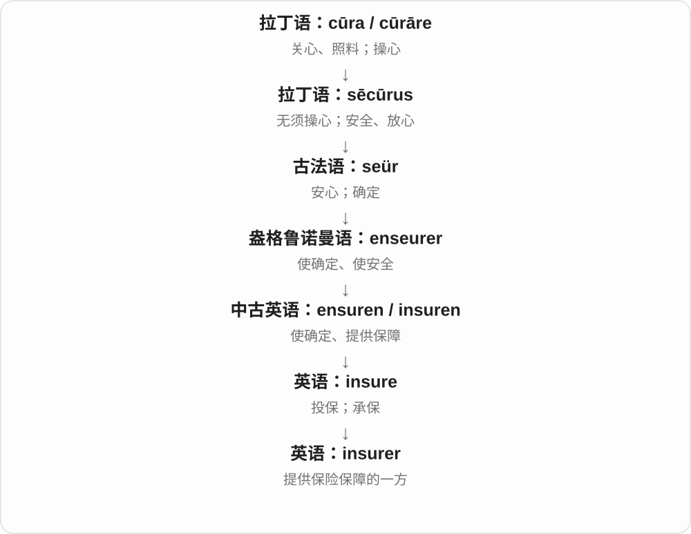

后缀把投保或承保的动作连接到业务主体。这里不是买保险的人，而是承担保险责任的那一边。

**常见搭配与例句**

an insurer；contact your insurer；the insurer’s decision。

> She contacted the insurer to update her address.

她联系保险公司更新地址。

> The insurer requested copies of the documents.

承保方要求提供文件副本。

**别混淆**

insured 是被保险人或受保的；insurer 是承保方。只差结尾，角色相反。

### 244. planner — 规划者；计划本；日程安排工具

**音标**：英 /ˈplænə/；美 /ˈplænər/

**先抓住这个画面**

既可以是替事情安排步骤的人，也可以是把那些步骤记下来的本子。

**怎么拆**

plan + -er，词尾 n 双写。

**怎么变成今天的意思**

**拉丁语：planus；planum**  
平坦的；平面、平地

↓

**法语 plan → 英语 plan**  
平面图 → 行动方案；后来也作动词

↓

**英语：plan + -er → planner**  
做规划的人；帮助规划的工具

a town planner 是城市规划师；a weekly planner 是周计划本或应用工具。

**常见搭配与例句**

an event planner；a daily planner。

> The town planner presented a new design for the square.

城市规划师提交了广场的新设计。

> I wrote the appointment in my weekly planner.

我把预约记进了周计划本。

**别混淆**

plan 是方案；planner 是制定方案的人或用来安排日程的东西。

### 245. reap — 收割；获得、收获〔成果、好处，也可指恶果〕

**音标**：/riːp/

**先抓住这个画面**

把田里长成的谷物割下来带走，是 reap；先前付出或行为的结果落到自己身上，也像到了收获的时候。

**怎么拆**

中古英语 repen 接古英语收割词族。由收取庄稼的动作转到收取劳动、行为带来的结果，比喻用法也有很长历史。

**怎么变成今天的意思**

**古英语收割词族 → 中古英语 repen**  
割下、收取成熟庄稼

↓

**现代 reap 的具体与比喻义**  
收割；得到先前努力、行为的结果

reap a harvest 收获庄稼；reap the benefits 获得好处；reap the rewards 得到回报；reap what you sow 自食其果、种什么得什么。

**常见搭配与例句**

reap the benefits of practice；reap a rich harvest。

> The farmers reaped the wheat before the rain.

农民们在下雨前收割了小麦。

> She is now reaping the benefits of years of practice.

她现在正收获多年练习带来的好处。

**别混淆**

reap 强调到了收取结果的一步；sow 是播种。reap 常见于好处、回报，但结果也可能负面，不能一概译成赚到。

### 246. reaper — 收割者；收割机；死神〔常见于 the Grim Reaper〕

**音标**：英 /ˈriːpə/；美 /ˈriːpər/

**先抓住这个画面**

reap 是收割，reaper 是做收割工作的人或机器。死神形象拿着镰刀、像收割生命，因此也借用 Reaper 这个名字。

**怎么拆**

中古英语人物词接较早古英语 ripere 等形式，与 reap + -er 对应。后来机器接手收割，名称也转到机器；文学中另有死神拟人用法。

**怎么变成今天的意思**

**reap 词族与旧人物名词**  
实施收割的人

↓

**reaper 的机器与拟人扩展**  
收割机；镰刀死神形象

a mechanical reaper 机械收割机；reapers in the field 田间收割者；the Grim Reaper 常见的死神名称。

**常见搭配与例句**

a grain reaper；the figure of the Reaper。

> The reapers worked in the field until sunset.

收割者们一直在田里干到日落。

> The old reaper is displayed in the farming museum.

那台老式收割机陈列在农业博物馆里。

**别混淆**

reaper 可以只负责收割；combine 常指把收割、脱粒等工序合在一起的联合收割机。两词不是所有场景都可互换。

### 247. reapers — 收割者；收割机〔复数〕

**音标**：英 /ˈriːpəz/；美 /ˈriːpɚz/

**先抓住这个画面**

镰刀一挥挥，把庄稼割下来的人，是 reapers；把相应工作交给机器，也可以把机器叫 reapers。-er 指能做这动作的人或工具。

**怎么拆**

reaper + -s，读 /z/；人物词接旧 reap、较早对应人物材料，机器义后来发展，现代可对应 reap + -er 认形。

**怎么变成今天的意思**

**古英语 repan、reopan 等 → reap**  
收割，和 ripe 的旧成熟材料可比较

↓

**英语早有收获行为结果的比喻**  
现代 reaps、reaped、reaping；reapers 可指人、机器

↓

**reap + -er → reaper → reapers**  
收割者、收割机及其复数

reapers in the field 田间收割者；mechanical reapers 机械收割机。

**常见搭配与例句**

a line of reapers；early reapers 早期收割机，按设备语境认。

> The reapers worked across the field in a long line.

收割者排成长队，在田里作业。

> The museum displayed early mechanical reapers.

博物馆展出了早期机械收割机。

**别混淆**

reapers 收割主要庄稼，gleaners 拾收割后留下的穗；工作阶段、获取方式不同。

### 248. reaping — 正在收割；收获、承受相应结果

**音标**：/ˈriːpɪŋ/

**先抓住这个画面**

现在拿到从前努力带来的好处，是 reaping the benefits；若之前的选择不好，也可能正在承受后果。它把时间拉出前后呼应。

**怎么拆**

reap + -ing；过程形式或活动名词。可对应字面收割、抽象收获，历史上抽象用法并非很晚的新奇比喻。

**怎么变成今天的意思**

**古英语 repan、reopan 等 → reap**  
收割，和 ripe 的旧成熟材料可比较

↓

**英语早有收获行为结果的比喻**  
现代 reaps、reaped、reaping；reapers 可指人、机器

↓

**reap + -ing → reaping**  
收割、得到相应结果的过程

reaping benefits 收获好处；reaping rewards 收获回报。

**常见搭配与例句**

reaping the harvest 收割庄稼；a reaping machine 收割机。

> The town is reaping the benefits of its new railway link.

小镇正在收获新铁路连接带来的好处。

> The painting shows workers reaping wheat.

画中是工人在收割小麦。

**别混淆**

reaping 是收割、收获结果，sowing 是播种；比喻里也常用它们把先前做事与后来结果串起来。

### 249. reaped — 收割、收获了；得到相应结果了

**音标**：/riːpt/

**先抓住这个画面**

多年努力后终于得回报，叫 reaped the rewards；田里谷物收下来了，也叫 reaped。把先前投入与后来所得联系起来就好记。

**怎么拆**

reap + 完整 -ed，/p/ 后读 /t/；过去式、过去分词。抽象、字面收割的旧用法都保留到现代。

**怎么变成今天的意思**

**古英语 repan、reopan 等 → reap**  
收割，和 ripe 的旧成熟材料可比较

↓

**英语早有收获行为结果的比喻**  
现代 reaps、reaped、reaping；reapers 可指人、机器

↓

**reap + -ed → reaped**  
过去收割、收获或得到结果

reaped the rewards 收获回报；reaped a good harvest 收成好。

**常见搭配与例句**

reaped benefits from 从……得到好处；reaped the consequences 承受后果。

> After years of training, she reaped the rewards.

经过多年训练，她收获了回报。

> The farmers reaped a good harvest that year.

那一年，农民获得了好收成。

**别混淆**

reaped rewards 常对应此前努力，won a prize 只明确赢得奖；回报不一定是颁发的奖品。

### 250. reaps — 收割；收获、得到相应结果〔第三人称单数〕

**音标**：/riːps/

**先抓住这个画面**

庄稼长好了，把它收回来，是 reaps；前面做的事情，后来得到好处或承受后果，也像收获一样。结果未必都是奖励。

**怎么拆**

reap + -s，/p/ 后读 /s/；reap 接古英语收割动词，抽象收获义在英语很早已有，不是现代才从农田借来。

**怎么变成今天的意思**

**古英语 repan、reopan 等 → reap**  
收割，和 ripe 的旧成熟材料可比较

↓

**英语早有收获行为结果的比喻**  
现代 reaps、reaped、reaping；reapers 可指人、机器

↓

**reap + -s → reaps**  
他或它收割、收获相应结果

reaps the benefits 获得好处；reaps rewards 收获回报；reaps what he sows 自食其果、种什么得什么。

**常见搭配与例句**

reaps a harvest 收获庄稼；reaps the results。

> The company reaps the benefits of years of research.

公司收获了多年研究带来的好处。

> In the story, he finally reaps what he has sown.

故事里，他最终自食其果。

**别混淆**

reaps benefits 强调得到前面行为带来的好处，receives a gift 只是收到礼物；前因后果的感觉不同。

### 251. lurk — 潜伏、藏着待着；隐约存在；网络中只看不发言

**音标**：英 /lɜːk/；美 /lɝːk/

**先抓住这个画面**

人藏在不显眼的地方，旁边的人没有马上注意到。网络里看讨论却不发言，也借这个不露面的画面。

**怎么拆**

中古英语 lurken 躲藏等，可能与斯堪的纳维亚相关词相连，具体更早来源不确定。后来可说暗中移动、风险潜在，也用于网络旁观。

**怎么变成今天的意思**

**中古英语 lurken；可能接北欧相关材料**  
躲藏、藏而不露

↓

**现代 lurk**  
潜伏；疑虑隐存；在论坛只看不发言

lurk in the shadows 潜伏在阴影里；danger lurks 危险潜伏；lurk on a forum 在论坛潜水、只看不发言。

**常见搭配与例句**

lurk nearby；lurk in the background。

> A cat lurked behind the garden wall.

一只猫躲在花园围墙后面。

> I usually lurk on the forum rather than post comments.

我通常在论坛只看，不发评论。

**别混淆**

hide 直接说躲藏，lurk 常有不露面、还可能出现或行动的感觉。网络潜水用法并不自动带恶意，是不发言的参与方式。

### 252. lurking — 潜伏、暗藏；隐约存在的；lurk 的 -ing 形式

**音标**：英 /ˈlɜːkɪŋ/；美 /ˈlɝːkɪŋ/

**先抓住这个画面**

表面看着平静，后面还藏着一个疑虑或风险。lurking 常让人感觉事情尚未明摆出来，但并没有消失。

**怎么拆**

lurk + -ing，继承藏而不露的旧动词义，再用分词描写隐藏的人、危险、疑虑；网络中也可说正在潜水浏览。

**怎么变成今天的意思**

**lurk**  
躲藏、藏而不露

↓

**lurk + -ing → lurking**  
潜伏的动作；尚未显露的状态

a lurking danger 潜在危险；a lurking suspicion 隐约挥之不去的怀疑；lurking behind the door 藏在门后；lurking online 网上只看不发言。

**常见搭配与例句**

lurking in the background；a lurking doubt。

> There was a lurking doubt in her mind.

她心里一直隐隐有个疑问。

> We noticed a cat lurking behind the bins.

我们注意到一只猫藏在垃圾桶后面。

**别混淆**

lurking 修饰 doubt、suspicion 时说疑虑隐存，读成背景中尚在、并未消失的感觉即可。

### 253. lurks — 潜伏、隐藏〔第三人称单数〕；〔网络〕只看不发言

**音标**：英 /lɜːks/；美 /lɝːks/

**先抓住这个画面**

东西就在那儿，却没摆到明面上：角落藏着危险，心里留着疑虑，都可以用 lurks。人在群里只看不说话，也是这种不露面。

**怎么拆**

lurk + -s，/k/ 后读 /s/；基础词可能借自北欧语言，现代不再拆出额外前缀。

**怎么变成今天的意思**

**中古英语 lurken：躲藏、藏而不露 → lurk**  
可能接北欧相关材料，较远来源不完全确定

↓

**不露面的存在 → 危险、疑虑隐存；网络只看不发言**  
现代有隐藏、不易察觉的感觉，不要求人一直在移动

↓

**lurk + -s → lurks**  
它隐存；他、她躲着或只看不发言

danger lurks 危险潜伏；doubt lurks at the back of the mind 疑虑藏在心底；lurks on the forum 在论坛潜水。

**常见搭配与例句**

lurks in the shadows；lurks behind a friendly smile。

> A small doubt still lurks at the back of my mind.

我心底还藏着一点疑虑。

> He lurks on the forum but never posts anything.

他在论坛里潜水，却从不发帖。

**别混淆**

prowls 侧重四处找目标的活动；lurks 可以一动不动地藏着，核心是存在却不显露。

### 254. lurked — 躲藏、潜伏了；隐存着；〔网络〕曾只看不发言

**音标**：英 /lɜːkt/；美 /lɝːkt/

**先抓住这个画面**

过去有个人藏在后面，或某种担心一直没说出口，就用 lurked；它强调没露面，不一定突然跳出来。

**怎么拆**

lurk + 完整 -ed，/k/ 后读 /t/，结尾 /kt/；拼写仍是 ed。

**怎么变成今天的意思**

**中古英语 lurken：躲藏、藏而不露 → lurk**  
可能接北欧相关材料，较远来源不完全确定

↓

**不露面的存在 → 危险、疑虑隐存；网络只看不发言**  
现代有隐藏、不易察觉的感觉，不要求人一直在移动

↓

**lurk + -ed → lurked**  
过去处在隐藏、不显露的状态

lurked behind the door 藏在门后；fear lurked beneath the excitement 兴奋底下藏着害怕。

**常见搭配与例句**

lurked online for months；lurked in the background。

> A fox lurked behind the shed.

一只狐狸藏在棚子后面。

> I lurked in the group for weeks before introducing myself.

我在群里潜水了几周，才作自我介绍。

**别混淆**

lurked 可以写持续隐存，hid 更一般地说藏起来或藏着；不是每个隐藏场景都带 lurk 的潜在、暗中感。

### 255. lurker — 潜伏者；论坛或群组中只看不发言的人

**音标**：英 /ˈlɜːkə/；美 /ˈlɝːkər/

**先抓住这个画面**

群里有人每天看消息，却很少开口；网络语境中这样的人常自称 a lurker。

**怎么拆**

lurk + -er，早期指藏着、不露面的人；互联网发展后借来命名阅读但不发帖的参与者。

**怎么变成今天的意思**

**lurk + -er → lurker**  
保持隐蔽、躲着观察的人

↓

**现代互联网专门用法**  
只看讨论而不主动发言的人

a forum lurker 论坛潜水者；a longtime lurker 长期只看不发帖的人；a lurker in the shadows 藏在阴影里的人。

**常见搭配与例句**

a quiet lurker；from lurker to contributor。

> I have been a lurker here for years, but this is my first post.

我在这里潜水多年，这是第一次发帖。

> The survey asked lurkers why they rarely commented.

调查询问只看不发言的用户为什么很少评论。

**别混淆**

lurker 在论坛自我介绍里常是中性或带自嘲的词；在悬疑故事里可能让人觉得可疑。具体色彩来自场景。

### 256. lurkers — 潜伏、躲藏的人；〔网络〕只看不发言的人〔复数〕

**音标**：英 /ˈlɜːkəz/；美 /ˈlɝːkərz/

**先抓住这个画面**

一个群里，发言的人只有几个，默默看消息的却可能很多；这些只看不公开回应的人就是 lurkers。

**怎么拆**

lurk + -er → lurker，再加 -s；人物名词很早已有，网络义是后来把不露面的画面搬到线上。

**怎么变成今天的意思**

**中古英语 lurken：躲藏、藏而不露 → lurk**  
可能接北欧相关材料，较远来源不完全确定

↓

**不露面的存在 → 危险、疑虑隐存；网络只看不发言**  
现代有隐藏、不易察觉的感觉，不要求人一直在移动

↓

**lurk + -er + -s → lurkers**  
多个藏着不露面的人；后来也指网络潜水者

forum lurkers 论坛潜水者；welcome the lurkers 邀请一直默默看的人也参与。

**常见搭配与例句**

lurkers and regular posters 潜水者与经常发帖者；many silent lurkers。

> The forum has far more lurkers than regular posters.

论坛里潜水的人远比经常发帖的人多。

> Several lurkers introduced themselves during the anniversary event.

周年活动时，几位一直潜水的成员作了自我介绍。

**别混淆**

lurkers 在线上并不自动指恶意窥探者，往往只是选择不发言的读者；动机不能只凭这个名词判断。

### 257. beginner — 初学者；新手

**音标**：英 /bɪˈɡɪnə/；美 /bɪˈɡɪnər/

**先抓住这个画面**

在这件事上刚起步的人；人生经验丰富，也可能在新技能上是 beginner。

**怎么拆**

begin + -er，双写 n，人物词表示开始学、做某事的人，后来固定为初学者。

**怎么变成今天的意思**

**古英语 beginnan → 中古英语 beginnen → begin**  
开始，含旧前缀 be- 与旧动词部分

↓

**现代 begin**  
从未发生、未进行转入开始发生、进行

↓

**begin + -er → beginner**  
开始 → 初学者、新手

a complete beginner 完全的新手，a course for beginners 初学者课程；a beginner at chess 国际象棋初学者。

**常见搭配与例句**

a complete beginner；a course for beginners；a beginner at。

> This course is suitable for complete beginners.

这门课适合完全没有基础的初学者。

> I am still a beginner at chess.

我下国际象棋还只是新手。

**别混淆**

beginner 初学者不是儿童年龄标签；a beginner course 初级课，a beginning teacher 也可说刚开始任教的教师。

### 258. examiner — 检查员、审查员；考官、阅卷人

**音标**：英 /ɪɡˈzæmɪnə/；美 /ɪɡˈzæmɪnər/

**先抓住这个画面**

不是去接受考核的学生，而是拿着标准检查、提问或评卷的人；不同机构安排不同任务。

**怎么拆**

examine + -er，去末尾不发音 e，人物后缀；不把 examiner 当作一次考试的另一种名词。

**怎么变成今天的意思**

**拉丁 exāmen、exāmināre**  
称量、检验、仔细考虑，较远与 exigere 等联系

↓

**法语 examiner、examinacion → 英语 examine、examination**  
检查、询问与检验过程分别借入

↓

**examine + -er → examiner**  
实施检查、考核或阅卷的人

a driving examiner 驾驶考试考官，an external examiner 校外考官、外审人员，a patent examiner 专利审查员。

**常见搭配与例句**

a driving examiner；an external examiner；a patent examiner。

> The examiner asked her to explain the answer.

考官请她解释答案。

> The patent examiner reviewed the application.

专利审查员审阅了申请。

**别混淆**

examiner 是实施者，examinee 是受考者；具体 examiner 负责出题、面试还是阅卷，需看考试安排。

### 259. listener — 听者；听众；善于倾听的人

**音标**：英 /ˈlɪsənə/；美 /ˈlɪsənər/

**先抓住这个画面**

把注意力给说话、音乐或节目的人；说 good listener，还在夸他肯听懂别人的感受。

**怎么拆**

listen + -er，形成听者人物词；t 同样不发音。不是仅有耳朵就自动被叫 a good listener。

**怎么变成今天的意思**

**古英语 hlysnan 等 → 中古英语 listenen、listnen**  
留神听、听取

↓

**英语 listen**  
主动把注意力放在声音或他人表达上

↓

**listen + -er → listener**  
留神听 → 听者、听众

radio listeners 广播听众，a good listener 善于倾听的人；listeners to a podcast 播客听众。

**常见搭配与例句**

a good listener；radio listeners；regular listeners。

> The programme invites questions from listeners.

节目欢迎听众提问。

> She is a patient and thoughtful listener.

她是个耐心、体贴的倾听者。

**别混淆**

listener 听的人，speaker 说话、演讲者；audience 可以是看、听演出的整群观众，范围依场景。

### 260. subscriber — 订阅者；订户；定期支持者

**音标**：英 /səbˈskraɪbə/；美 /səbˈskraɪbər/

**先抓住这个画面**

subscriber 是已经说好“以后继续给我这个内容或服务”的人。可以是付费订户，也可以是免费通讯的订阅者。

**怎么拆**

subscribe 去结尾不发音 e，加完整后缀 -er，表示进行订阅或支持的人。

**怎么变成今天的意思**

它强调持续关系，不只是偶然看过一次。subscriber 数量统计的是订阅关系，未必等于每一期都实际阅读的人数。

**常见搭配与例句**

a paying subscriber（付费订户）；newsletter subscribers（通讯订阅者）；gain subscribers（增加订阅者）。

> Every subscriber receives the report on Friday.

每位订阅者周五收到报告。

> The magazine welcomed a new subscriber.

杂志迎来了一位新订户。

**别混淆**

reader 是读者，subscriber 是订阅者。有人读到转发内容却没有订阅，也有人订阅却暂时没读。

### 261. wrestle — 摔跤；扭打；努力应对、苦苦思索

**音标**：/ˈresəl/

**先抓住这个画面**

两个人缠住对方、用力争夺位置，是摔跤；脑子里与难题反复较劲，也能说 wrestle with a problem。

**怎么拆**

经中古英语 wrestlen 接古英语 wrǣstlian，联系 wræstan 扭转、用力扭的词族。-le 反映旧的反复动作材料；开头 w、词中 t 现代通常不发音。

**怎么变成今天的意思**

**旧英语扭转词族 + 反复动作形式**  
扭打、身体上的角力

↓

**现代 wrestle 的比喻发展**  
与困难、决定反复较劲

wrestle with an opponent 和对手摔跤；wrestle with a difficult decision 为艰难决定反复思量。比喻里 with 后面常接问题、抉择。

**常见搭配与例句**

wrestle with a problem；wrestle for control。

> The children wrestled on the grass.

孩子们在草地上摔跤玩。

> She wrestled with the decision for several days.

她为这个决定反复思量了好几天。

**别混淆**

wrestle 强调纠缠、角力和费力应对；fight 范围更广，不一定是摔跤式身体接触。

### 262. wrestler — 摔跤运动员、摔跤手

**音标**：英 /ˈreslə/；美 /ˈreslər/

**先抓住这个画面**

wrestle 是做摔跤动作，wrestler 是参加这项运动的人。-er 把动作接成相应人物。

**怎么拆**

经中古英语 wrastlere 等延续，现代对应 wrestle 去末尾 e 加 -er。旧词中已有人物名称，并非英语很晚才临时造出。

**怎么变成今天的意思**

**wrestle 的旧英语、中古英语词族**  
摔跤、角力

↓

**相应人物形式 wrestler**  
摔跤运动员、摔跤手

an Olympic wrestler 奥运摔跤运动员；a professional wrestler 职业摔跤手。具体运动、表演传统由语境说明。

**常见搭配与例句**

a skilled wrestler；train as a wrestler。

> The wrestler trained every morning.

那位摔跤运动员每天早晨训练。

> She interviewed an Olympic wrestler after the match.

她在赛后采访了一位奥运摔跤运动员。

**别混淆**

wrestler 是人，wrestling 常说这项运动、摔跤活动；不能把职业人物名与活动名随意互换。

### 263. handler — 处理者；动物训练、控制人员；处理程序

**音标**：英 /ˈhændlə/；美 /ˈhændlər/

**先抓住这个画面**

负责接住、控制某个对象的人或程序：牵犬的人，响应事件的软件代码都可以。

**怎么拆**

handle + -er，中古英语已有对应人物词。计算机处理程序是后来按执行处理的角色命名。

**怎么变成今天的意思**

**古英语 handlian、handle 等 → handle**  
用手接触、操弄；把手等相关形式

↓

**现代 handle**  
操作、处理；把手；昵称等支线

↓

**handle + -er → handler**  
处理、控制者；后有程序处理器用法

a dog handler 训犬、带犬人员，a baggage handler 行李搬运员，an event handler 事件处理程序。

**常见搭配与例句**

a dog handler；a baggage handler；an event handler。

> The dog waited for a signal from its handler.

狗等着带犬人员发出信号。

> The event handler saves the user’s changes.

事件处理程序保存用户的更改。

**别混淆**

handler 执行处理的人、代码，handling 过程或性能；event handler 不是举办活动的主持人这个固定译法。

### 264. banter — 打趣、轻松斗嘴；互相开玩笑

**音标**：英 /ˈbæntə/；美 /ˈbæntər/

**先抓住这个画面**

你逗我一句，我回你一句，气氛轻松、不把话当真。这种来回的玩笑、调侃，就是 banter。

**怎么拆**

十七世纪英语已有动词，随后出现名词；更早来源不确定，有伦敦俚语背景的说法。现代不能据此虚构一个常用 bant 基础词。

**怎么变成今天的意思**

**较早英语 banter 动词**  
用玩笑话调侃

↓

**名词 banter 与现代用法**  
轻松诙谐的来回打趣、斗嘴

friendly banter 友善打趣；exchange banter 互相斗嘴；banter with colleagues 和同事说笑。名词通常不可数。

**常见搭配与例句**

lighthearted banter；playful banter。

> The two friends exchanged friendly banter.

两个朋友轻松地互相打趣。

> They bantered with each other while preparing dinner.

他们一边准备晚餐，一边说笑。

**别混淆**

banter 通常把交流看成轻松玩笑；insult 强调侮辱。某人称话为 banter，不代表听的人一定觉得好笑。

### 265. punt — 手放球凌空踢；撑平底船；下注、试一把〔英口语〕；平底船

**音标**：/pʌnt/

**先抓住这个画面**

一手把球放下、落地前用脚踢出去，是 punt；剑桥河上用长杆撑的平底船也叫 punt。英口语 take a punt 则像说试一把、押个结果。

**怎么拆**

这些同形义来源不同：踢球远源未定；船名接拉丁 ponto 等平底船材料，再转撑船动词；下注线接法语 ponter、西班牙 punto 等游戏术语。不把球踢出去编成赌钱来历。

**怎么变成今天的意思**

**同形三线：踢球来源未定；船名接拉丁 ponto；下注接法语 ponter 等**  
现代不能混成一种动作的所有比喻

↓

**相应动词 + 现代词尾、人物 -er**  
顾客 punter 属相关口语扩展，按场景认

punt the ball 把手放球凌空踢出；go for a punt 撑船游玩；take a punt on something 押一把、试某个选择。

**常见搭配与例句**

punt down the river 撑船顺河走；punt on the issue 延后作决定。

> The player prepared to punt the ball downfield.

球员准备把手中放下的球凌空踢向前场。

> We hired a punt for a quiet trip along the river.

我们租了一条平底船，沿河悠游。

**别混淆**

punt 是手放球、落地前踢的动作，drop-kick 则在球触地弹起时踢；船、下注和拖延用法各看语境。

### 266. punter — 凌空踢球手、撑船者；下注者；顾客〔英口语〕

**音标**：英 /ˈpʌntə/；美 /ˈpʌntɚ/

**先抓住这个画面**

美式橄榄球里的 punter 是负责相应踢球的人；英式口语里的 ordinary punter 却可能只是普通顾客、观众。先看他正在做什么、处在什么场景。

**怎么拆**

相应 punt + -er 人物尾；踢球、撑船、下注各接不同的基础词源。顾客、观众义从相关参与者称呼扩展，不能拿球员一条词源解释全部。

**怎么变成今天的意思**

**同形三线：踢球来源未定；船名接拉丁 ponto；下注接法语 ponter 等**  
现代不能混成一种动作的所有比喻

↓

**相应动词 + 现代词尾、人物 -er**  
顾客 punter 属相关口语扩展，按场景认

↓

**punt + -er → punter**  
做对应动作的人；英口语也泛指顾客、参与者

a team’s punter 球队的凌空踢球手；the average punter 普通顾客。

**常见搭配与例句**

a skilled punter 熟练撑船者或踢球者，须看语境；an ordinary punter。

> The team signed a new punter before the season.

赛季前，球队签下一位新的凌空踢球手。

> The owner wanted to know what the average punter thought of the café.

店主想知道普通顾客怎么看这家咖啡馆。

**别混淆**

punter 在英式商业、演出语境可能近于 customer、audience member；并不保证对方正在下注。

### 267. punters — 凌空踢球手、撑船者、下注者〔复数〕；顾客、观众〔英口语〕

**音标**：英 /ˈpʌntəz/；美 /ˈpʌntɚz/

**先抓住这个画面**

店里来来往往的顾客，酒吧里掏钱消费的人，英口语常叫 punters。体育报道里的同形词，又可能是专门踢球的队员。

**怎么拆**

punter + -s，读 /z/；内层 punt + -er 依相应动作来源区分，顾客义属于既定口语用法。

**怎么变成今天的意思**

**同形三线：踢球来源未定；船名接拉丁 ponto；下注接法语 ponter 等**  
现代不能混成一种动作的所有比喻

↓

**相应动词 + 现代词尾、人物 -er**  
顾客 punter 属相关口语扩展，按场景认

↓

**punter + -s → punters**  
多位相应角色；英口语顾客等

regular punters 常客；punters at a racecourse 赛马场下注者。

**常见搭配与例句**

attract punters 吸引顾客；punters in the team 球队踢球手。

> The pub was full of regular punters on Friday night.

周五晚上，酒吧里满是常客。

> The coach watched the punters practise on the field.

教练看着凌空踢球手在场上训练。

**别混淆**

punters 可能是顾客、下注者或球员，不能只看到前面的 sports 就忽略完整句子；动作、地点、角色共同决定。

### 268. punting — 撑平底船；凌空踢球；下注、暂缓处理〔依语境〕

**音标**：/ˈpʌntɪŋ/

**先抓住这个画面**

长杆顶住河底，身体一推，船往前滑，这种游河方式叫 punting。体育和英式下注场景里，同形词又选别的动作。

**怎么拆**

punt + -ing；撑船动词来自船名，踢球动词远源未定，下注线接法语等游戏术语。-ing 只把当前动作写成过程、活动。

**怎么变成今天的意思**

**同形三线：踢球来源未定；船名接拉丁 ponto；下注接法语 ponter 等**  
现代不能混成一种动作的所有比喻

↓

**相应动词 + 现代词尾、人物 -er**  
顾客 punter 属相关口语扩展，按场景认

↓

**punt + -ing → punting**  
相应动作的过程、活动名词

go punting 去撑船游玩；punting practice 凌空踢球训练。

**常见搭配与例句**

punting on a result 押结果；punting on a decision 暂缓作决定。

> We spent the afternoon punting on the river.

我们下午在河上撑船游玩。

> The coach added extra punting practice before the match.

比赛前，教练增加了凌空踢球训练。

**别混淆**

punting on the river 通常是撑杆，rowing 通常是划桨；两种船行进方式不同。

### 269. punts — 凌空踢、撑船、下注〔第三人称单数〕；平底船、凌空踢〔复数〕

**音标**：/pʌnts/

**先抓住这个画面**

河上停着几条撑杆平底船，是 punts；球员把球放下、落地前踢出，动词也可用 punts。相同结尾并没有把两条来历合并。

**怎么拆**

punt + -s，/t/ 后读 /s/；可接不同来源的同形名词、动词。当前常见船、踢球、英式下注义须各按对象判断。

**怎么变成今天的意思**

**同形三线：踢球来源未定；船名接拉丁 ponto；下注接法语 ponter 等**  
现代不能混成一种动作的所有比喻

↓

**相应动词 + 现代词尾、人物 -er**  
顾客 punter 属相关口语扩展，按场景认

↓

**punt + -s → punts**  
相应名词复数，或动词三单

punts along the river 河上的平底船；punts the ball 凌空踢球。

**常见搭配与例句**

a row of punts；punts on the outcome 押结果。

> Several punts were tied up beside the river.

几条平底船拴在河边。

> The player punts the ball before it touches the ground.

球员在球触地前把它凌空踢出。

**别混淆**

punts 名词可能是船，也可能是踢球次数；前后出现 river、football 等词，通常比单看结尾更能帮助判断。

### 270. punted — 凌空踢出、撑船了；把问题推后、转交了

**音标**：/ˈpʌntɪd/

**先抓住这个画面**

把球往前场踢远是 punted；把棘手问题“踢”给下次会议处理，也可说 punted the decision。后者常暗示暂时不面对。

**怎么拆**

punt + 完整 -ed，/t/ 后读 /ɪd/。体育的拖延、转交比喻与撑船、下注同形线分开，不能都认成同一来源。

**怎么变成今天的意思**

**同形三线：踢球来源未定；船名接拉丁 ponto；下注接法语 ponter 等**  
现代不能混成一种动作的所有比喻

↓

**相应动词 + 现代词尾、人物 -er**  
顾客 punter 属相关口语扩展，按场景认

↓

**punt + -ed → punted**  
过去相应动作；踢球线还有转交、推后问题的比喻

punted the ball downfield 把球踢向前场；punted the decision 推迟决定。

**常见搭配与例句**

punted along the river；punted the issue to another committee。

> The player punted the ball far downfield.

球员把球凌空踢向远处前场。

> The committee punted the decision to the next meeting.

委员会把决定推到了下次会议。

**别混淆**

punted a decision 常带把难题踢开的口气，postponed 更中性；不是每次合理延期都要用 punted。

### 271. squat — 蹲、蹲下；未经许可占住；矮胖的；深蹲、蹲姿；〔口语〕什么也没有

**音标**：英 /skwɒt/；美 /skwɑːt/

**先抓住这个画面**

两脚撑地，把屁股、身体压低，是 squat。矮矮宽宽的罐子也像这个低而厚的形状；squat in a building 则是没获许可就占住那里。

**怎么拆**

经古法语 esquatir 的压扁、压下义进入英语，上溯拉丁语 coactus 一系。现代不拆成 squ- 加 -at；动作、形状和占用是不同用法。

**怎么变成今天的意思**

**拉丁语 coactus 等压拢材料 → 古法语 esquatir → 英语 squat**  
压扁、压下的旧动作，较远联系 cogere 的聚拢、驱使

↓

**压低 → 蹲着；矮胖；占住地方等现代分支**  
身体压低是直观形状；占用房地与占地者的相关词形后来发展

do a squat 是做一次深蹲，a squat building 是矮而敦实的建筑，know squat 是口语几乎什么都不知道；语境会分清。

**常见搭配与例句**

squat down 蹲下；squat beside the stream 蹲在溪边；a squat jar 矮胖罐子。

> She had to squat beside the pond to see the tiny fish.

她得蹲在池塘边，才能看清小鱼。

> A squat stone tower stood at the corner.

拐角处立着一座矮壮的石塔。

**别混淆**

squat 强调身体压低，kneel 强调膝着地；crouch 也可弯身蹲伏，姿态比 squat 更宽，不保证同样的蹲法。

### 272. squatter — 未经许可占住者；〔squat 比较级〕更矮胖的

**音标**：英 /ˈskwɒtə/；美 /ˈskwɑːtər/

**先抓住这个画面**

把一块地、一间空房占下来住，却没有相应许可，这样的人叫 squatter。另一种用法是比较形状：这个罐子更矮、更敦实。

**怎么拆**

名词是 squat 双写 t + 完整 -er，表示做这件事的人；形容词比较级也同样加 -er，但功能不同。占地者名词记录早于相应占地动词义。

**怎么变成今天的意思**

**拉丁语 coactus 等压拢材料 → 古法语 esquatir → 英语 squat**  
压扁、压下的旧动作，较远联系 cogere 的聚拢、驱使

↓

**压低 → 蹲着；矮胖；占住地方等现代分支**  
身体压低是直观形状；占用房地与占地者的相关词形后来发展

↓

**squat + -er → squatter**  
占住者的人名词；矮胖形容词的比较级同形

a squatter in the building 是楼里的未经许可占住者；a squatter bottle 是更矮胖的瓶子，比较级不能译成“占住者瓶子”。

**常见搭配与例句**

an urban squatter 城市中的占住者；shorter and squatter 更矮、更敦实。

> A squatter had been living in the empty building.

一名未经许可占住的人一直住在那栋空楼里。

> The new jar is squatter than the old one.

新罐子比旧罐子更矮胖。

**别混淆**

名词 squatter 与租客 tenant 的关系不同，后者通常按租赁安排居住；同形比较级只是尺寸、外形比较。

### 273. squatters — 未经许可占住房屋或土地的人〔复数〕

**音标**：英 /ˈskwɒtəz/；美 /ˈskwɑːtərz/

**先抓住这个画面**

好几个人把空楼或土地占下来居住，却没有相应许可，叫 squatters。重点在占住关系，不是在说他们此刻蹲着。

**怎么拆**

squat 双写 t + 完整 -er → squatter，再加复数 -s，读 /z/；这里是指人的名词复数。

**怎么变成今天的意思**

**拉丁语 coactus 等压拢材料 → 古法语 esquatir → 英语 squat**  
压扁、压下的旧动作，较远联系 cogere 的聚拢、驱使

↓

**压低 → 蹲着；矮胖；占住地方等现代分支**  
身体压低是直观形状；占用房地与占地者的相关词形后来发展

↓

**squat + -er + -s → squatters**  
多个占住者；词尾先造人名词，再标复数

squatters in an empty warehouse 是空仓库里的占住者，a group of squatters 是一群占住者；常见于报道居住状况。

**常见搭配与例句**

squatters moved in 占住者搬了进去；a building occupied by squatters 被占住者使用的楼。

> Several squatters were living in the disused warehouse.

几名未经许可占住的人住在停用的仓库里。

> The report included interviews with squatters in the city.

报道采访了城里一些占住空房的人。

**别混淆**

people squatting 可以只是在蹲着，squatters 通常已是占住房地的一类人；身体动作不能直接替代这个人名词。

### 274. grumpy — 脾气不好的；烦躁、爱抱怨的

**音标**：/ˈɡrʌmpi/

**先抓住这个画面**

一点小事就嫌烦，别人来搭话也没好气，是 grumpy。它不只是安静地难过，更容易表现为不耐烦。

**怎么拆**

grump + -y → grumpy；日常性质形容词，不需要一个真的正在抱怨的动作才可用。

**怎么变成今天的意思**

**grump 的较早不快、抱怨材料**  
更早来源未定，可能联系 grum 或受 grumble、grunt 等影响

↓

**grump + -y → grumpy**  
不高兴、容易烦躁的性质

↓

**现代 grump 也指爱抱怨的人**  
该人物义的记录晚于 grumpy，不把所有名词义都排在形容词之前

feel grumpy 感到烦躁；a grumpy reply 没好气的回答；grumpy in the morning 早上脾气不好。

**常见搭配与例句**

feel grumpy；a grumpy reply。

> Lack of sleep makes him grumpy.

睡眠不足会让他脾气不好。

> She gave a grumpy reply and went back to her book.

她没好气地应了一句，又继续看书。

**别混淆**

grumpy 常说当下情绪或习性，gloomy 常偏低落、悲观；quiet 安静本身不含烦躁。

### 275. grumpier — 更烦躁、脾气更不好的

**音标**：英 /ˈɡrʌmpiə/；美 /ˈɡrʌmpiər/

**先抓住这个画面**

原来还耐着性子，后来一点小事就不高兴，说话也更冲，叫 grumpier。

**怎么拆**

grumpy 改 y 为 i，加完整比较级 -er；内层是 grump + -y，把不快、爱抱怨当作性质。

**怎么变成今天的意思**

**grump：不快、抱怨材料 → grumpy**  
grump 更早来源未定，可能联系 grum，或受 grumble、grunt 等影响

↓

**grump + -y → grumpy，再加程度、方式、性质词尾**  
早期不快状态名词先有，现代爱抱怨的人义是较晚发展，不倒排全部记录

↓

**grumpy → grumpier**  
比较易烦躁、脾气不好的程度

get grumpier 变得更烦躁；grumpier than usual 比平常更没好气。

**常见搭配与例句**

feel grumpier；a grumpier reply。

> I get grumpier when I skip breakfast.

不吃早饭时，我会更容易烦躁。

> He sounded grumpier than usual on the phone.

电话里，他听起来比平常更没好气。

**别混淆**

glummer 偏更低落，grumpier 偏更容易对事、对人不耐烦；两种不快的外在表现不一样。

### 276. grumpiest — 脾气最不好的；最爱抱怨、最烦躁的

**音标**：/ˈɡrʌmpiɪst/

**先抓住这个画面**

这一天里，刚睡醒那会儿最容易嫌烦，叫 at his grumpiest；几个角色里最爱发脾气的，也可叫 the grumpiest。

**怎么拆**

grumpy 改 y 为 i，加完整最高级 -est；这里 -est 比较的是坏脾气、烦躁程度。

**怎么变成今天的意思**

**grump：不快、抱怨材料 → grumpy**  
grump 更早来源未定，可能联系 grum，或受 grumble、grunt 等影响

↓

**grump + -y → grumpy，再加程度、方式、性质词尾**  
早期不快状态名词先有，现代爱抱怨的人义是较晚发展，不倒排全部记录

↓

**grumpy → grumpiest**  
把易烦躁的程度放到比较范围内最高

at her grumpiest 她脾气最不好的时候；the grumpiest customer 最爱抱怨的顾客。

**常见搭配与例句**

the grumpiest person in the room；his grumpiest voice。

> He is at his grumpiest before his first cup of tea.

喝第一杯茶之前，他脾气最不好。

> Even our grumpiest neighbour smiled at the puppies.

连我们那位最爱抱怨的邻居，看见小狗也笑了。

**别混淆**

grumpiest 可以写一个时段的状态，不必等于这个人永远难相处；at his grumpiest 就常是暂时一面。

### 277. feeder — 喂食器、供料器；进食者；支线的〔修饰语〕

**音标**：英 /ˈfiːdə/；美 /ˈfiːdər/

**先抓住这个画面**

给鸟不断供谷粒的装置，是 feeder；把人、货或水流送到主干线的支线，也借供应关系来理解。

**怎么拆**

feed + -er，旧英语阶段后的派生已有中古英语形式。可表人物、动物、器具；修饰语里的 feeder 说为较大系统供给。

**怎么变成今天的意思**

**古英语 fēdan → 中古英语 feden → feed**  
喂养、供给食物；与 food 同族

↓

**英语 feed**  
喂养；供应材料、数据、信息等；饲料、信息流

↓

**feed + -er → feeder**  
进食、喂养者；供给器；向主系统输送的

a bird feeder 鸟食器，a paper feeder 送纸器，a feeder road 支路，a bottom feeder 底部觅食动物等。

**常见搭配与例句**

a bird feeder；a paper feeder；a feeder road。

> We hung a bird feeder outside the window.

我们在窗外挂了一个鸟食器。

> A feeder road connects the village to the highway.

一条支路把村子连接到公路干线。

**别混淆**

feeder 不只指喂食的人；feeder road 为主路送入车流，不是路边有餐馆的路。

### 278. sleeper — 睡觉的人；卧铺车、卧铺；枕木；意外走红的作品

**音标**：英 /ˈsliːpə/；美 /ˈsliːpər/

**先抓住这个画面**

最直观是睡的人；也可指供人睡的卧铺。看起来没动静、后来突然成功的作品又借来叫 sleeper。

**怎么拆**

sleep + -er 可解释睡者与睡眠用品等义；铁路枕木的历史还有与北欧木料词联系的解释，不把每个同形义都强说成木头在睡觉。

**怎么变成今天的意思**

**古英语 slēpan、slǣp → 中古英语 slepen、slepe**  
睡觉；睡眠

↓

**现代 sleep**  
动作、睡眠状态 → 困意、睡眠者和相关物件

↓

**sleep + -er → sleeper**  
睡的人；与睡眠有关的设施

↓

**其他 sleeper 用法**  
意外成功者的比喻；枕木另有词源讨论

a light sleeper 容易醒的人，a heavy sleeper 睡得沉的人，a sleeper train 卧铺列车；a sleeper hit 起初不显眼后来走红的作品。

**常见搭配与例句**

a light sleeper；a heavy sleeper；a sleeper train；a sleeper hit。

> I am a light sleeper, so even quiet noises wake me.

我睡得浅，很小的声音也会把我吵醒。

> We took a sleeper train to the coast.

我们乘卧铺列车去了海边。

**别混淆**

light sleeper 容易醒，不是体重轻的睡者；railway sleeper 是枕木，不是躺在轨道旁的人。

### 279. swat — 啪地拍打、挥击；一拍

**音标**：英 /swɒt/；美 /swɑt/

**先抓住这个画面**

蚊子停在手臂上，手掌啪地拍过去，叫 swat。也能写把球、东西一把拍开，动作短而直接。

**怎么拆**

见于美国和英格兰北部方言，可能是中古英语 swap 打击义的变化，最终可能拟声。不要先绕到现代 swap 交换再解释拍打。

**怎么变成今天的意思**

**方言 swat；有接旧 swap 打击义或方言 squat 的不同分析**  
远源未定，拟声也只是分析；旧打击义不等于现代交换义

↓

**拍打动词 → swat 一拍；swat + -er → swatter**  
人物、工具尾常具体指拍苍蝇的工具

swat a fly 拍苍蝇；swat at a mosquito 挥手拍蚊子；a quick swat 快速一拍。

**常见搭配与例句**

swat away 拍开；take a swat at 朝……挥打一记。

> She tried to swat a fly with a rolled-up newspaper.

她想用卷起的报纸拍苍蝇。

> He gave the cushion a quick swat to remove the dust.

他啪地拍了一下靠垫，把灰尘拍掉。

**别混淆**

swat at a fly 写朝苍蝇拍，不保证拍中；swat a fly 更直接把苍蝇作为拍击对象，是否打死仍看句子。

### 280. swatting — 正在拍打、挥击；〔另一用法〕虚报警情引发武装警力出动

**音标**：英 /ˈswɒtɪŋ/；美 /ˈswɑtɪŋ/

**先抓住这个画面**

边走边挥手赶虫，是 swatting at insects。网络新闻里的 swatting 却常是另一回事：故意虚报警情，把警察引到别人那里。

**怎么拆**

拍打动作是 swat 双写 t 加 -ing。虚报警情的 swatting 另接缩写 SWAT 的相关动词材料，不能拿拍苍蝇画面解释全部词义。

**怎么变成今天的意思**

**方言 swat；有接旧 swap 打击义或方言 squat 的不同分析**  
远源未定，拟声也只是分析；旧打击义不等于现代交换义

↓

**拍打动词 → swat 一拍；swat + -er → swatter**  
人物、工具尾常具体指拍苍蝇的工具

↓

**swat + -ing → swatting；另有 SWAT 缩写相关用法**  
普通拍打的动作形式；虚报警情义有另一条近源

swatting at flies 挥手拍苍蝇；a swatting incident 一起虚报警情引发出警的事件。

**常见搭配与例句**

keep swatting away insects；reports of swatting。

> We spent the picnic swatting at flies.

野餐时，我们一直挥手拍苍蝇。

> The report described a swatting incident targeting a streamer.

报道描述了一起针对主播的虚报警情出警事件。

**别混淆**

小写 swatting 在新闻中可能是固定的虚报警情用法；在花园拍虫的句子里，通常仍按普通动作理解。

### 281. swatted — 拍打、挥击了；拍开了

**音标**：英 /ˈswɒtɪd/；美 /ˈswɑtɪd/

**先抓住这个画面**

小虫在眼前晃，人顺手一拍，过去动作就是 swatted；它也可以写球员一下把球拍走。

**怎么拆**

swat 双写 t 加完整 -ed，/t/ 后读 /ɪd/，多一个音节。

**怎么变成今天的意思**

**方言 swat；有接旧 swap 打击义或方言 squat 的不同分析**  
远源未定，拟声也只是分析；旧打击义不等于现代交换义

↓

**拍打动词 → swat 一拍；swat + -er → swatter**  
人物、工具尾常具体指拍苍蝇的工具

↓

**swat + -ed → swatted**  
过去挥拍、拍开，双写末尾 t

swatted at the fly 朝苍蝇拍去；swatted the ball away 把球拍开。

**常见搭配与例句**

swatted away the insects；swatted a mosquito。

> He swatted at a mosquito near his face.

他挥手拍脸边的一只蚊子。

> The goalkeeper swatted the ball away.

守门员把球拍开了。

**别混淆**

swatted at 写尝试挥打，不保证拍中；swatted away 更突出把东西挥开，方向和结果由 away 补出来。

### 282. swats — 拍打、挥击〔第三人称单数〕；一下一下拍击〔复数〕

**音标**：英 /swɒts/；美 /swɑts/

**先抓住这个画面**

猫拿爪子一把拍向玩具，是 it swats；几下短促拍打，也可叫 swats。动作都像迅速挥过去的一掌。

**怎么拆**

swat + -s，/t/ 后读 /s/；动词三单与名词复数同形。

**怎么变成今天的意思**

**方言 swat；有接旧 swap 打击义或方言 squat 的不同分析**  
远源未定，拟声也只是分析；旧打击义不等于现代交换义

↓

**拍打动词 → swat 一拍；swat + -er → swatter**  
人物、工具尾常具体指拍苍蝇的工具

↓

**swat + -s → swats**  
它挥拍；多次短促拍打

swats at the toy 朝玩具挥爪；a few swats 几下拍打。

**常见搭配与例句**

swats the ball aside 把球拍到一边；swats away insects。

> The cat swats at the toy hanging above it.

猫伸爪拍上方吊着的玩具。

> A few swats with the towel drove the insects away.

毛巾挥打几下，就把虫子赶开了。

**别混淆**

swats 常是短促挥打，strokes 常是顺着表面轻抚；猫爪伸向玩具和手抚猫背，动作劲头不同。

### 283. swatter — 苍蝇拍等拍打工具；拍打的人

**音标**：英 /ˈswɒtə/；美 /ˈswɑtɚ/

**先抓住这个画面**

把 swat 拍打变成“用来拍的东西”，就得到 swatter。日常说 a swatter，常是长柄带拍面的苍蝇拍。

**怎么拆**

swat 双写 t 加 -er；人物、器具尾在此常具体指拍苍蝇的工具，不是 swat 加表示比较的 -er。

**怎么变成今天的意思**

**方言 swat；有接旧 swap 打击义或方言 squat 的不同分析**  
远源未定，拟声也只是分析；旧打击义不等于现代交换义

↓

**拍打动词 → swat 一拍；swat + -er → swatter**  
人物、工具尾常具体指拍苍蝇的工具

↓

**swat + -er → swatter**  
做拍打动作的人或工具，常指苍蝇拍

a fly swatter 苍蝇拍；a plastic swatter 塑料苍蝇拍。

**常见搭配与例句**

reach for a swatter 伸手拿苍蝇拍；an insect swatter。

> There is a fly swatter hanging by the door.

门边挂着一个苍蝇拍。

> She reached for the swatter when a fly landed on the table.

苍蝇落到桌上时，她伸手去拿苍蝇拍。

**别混淆**

swatter 常供拍打虫子，net 常供网住虫子；拍击和捕捉的动作不同，工具形状也通常不同。

### 284. swatters — 苍蝇拍等拍打工具〔复数〕；拍打者

**音标**：英 /ˈswɒtəz/；美 /ˈswɑtɚz/

**先抓住这个画面**

杂货店里挂着一排苍蝇拍，可以叫 swatters。-er 指工具，最后的 -s 再把一个工具变成多个。

**怎么拆**

swatter + -s，读 /z/；内层 swat 双写 t 加 -er。现代新闻中由 SWAT 衍生的同形人物用法须另按上下文理解。

**怎么变成今天的意思**

**方言 swat；有接旧 swap 打击义或方言 squat 的不同分析**  
远源未定，拟声也只是分析；旧打击义不等于现代交换义

↓

**拍打动词 → swat 一拍；swat + -er → swatter**  
人物、工具尾常具体指拍苍蝇的工具

↓

**swatter + -s → swatters**  
多个拍打工具或做动作的人

plastic swatters 塑料苍蝇拍；fly swatters 苍蝇拍。

**常见搭配与例句**

sell swatters；a pack of swatters。

> The shop sells fly swatters near the cleaning supplies.

商店把苍蝇拍放在清洁用品附近卖。

> We bought two plastic swatters for the kitchen.

我们给厨房买了两个塑料苍蝇拍。

**别混淆**

swatters 是工具或人物，swats 是拍打动作的复数、动词三单；-er 这一层改变了词指向的对象。

### 285. amplifier — 放大器

**音标**：/ˈæm.plə.faɪ.ə/

**先抓住这个画面**

一段很弱的信号进来，变成足以推动扬声器的信号出去：amplifier 负责把作用放大。

**怎么拆**

amplify + -er，y 变 i；-er 表示执行放大功能的人或设备。

**怎么变成今天的意思**

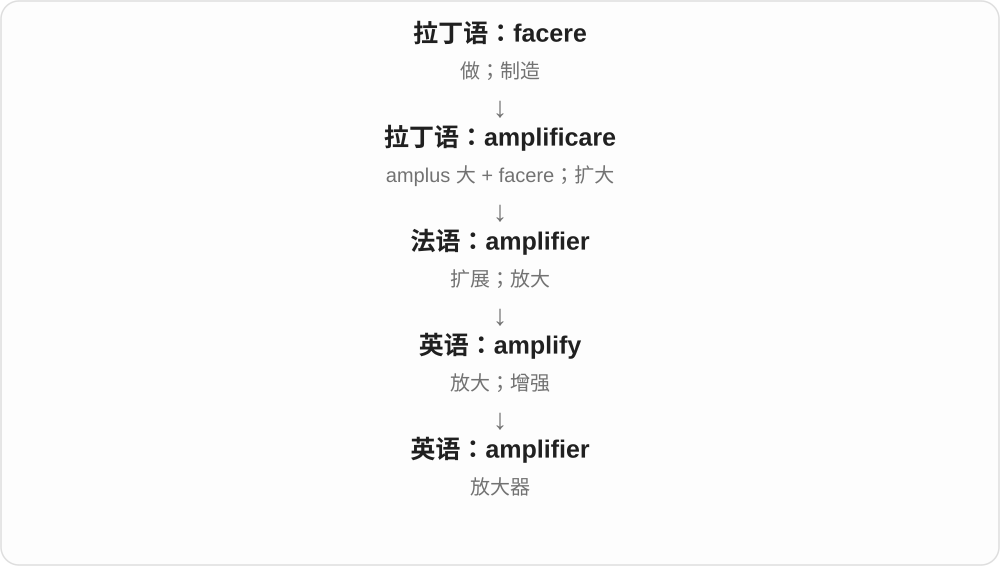

amplus 是大，amplify 是使变大，amplifier 就是做这件事的工具。比喻时也可指让信息影响扩大的渠道。

**常见搭配与例句**

a guitar amplifier；an audio amplifier；signal amplifier。

> He connected the guitar to an amplifier.

他把吉他接到放大器上。

> A noisy amplifier can spoil an otherwise clear recording.

有噪声的放大器会破坏原本清晰的录音效果。

**别混淆**

speaker 把电信号变成声音；amplifier 放大信号，两者常配合但功能不同。

### 286. entertainer — 演艺人员；表演者；娱乐大众的人

**音标**：英 /ˌentəˈteɪnə/；美 /ˌentərˈteɪnər/

**先抓住这个画面**

entertainer 像靠表演把观众留住的人，可以唱歌、变魔术、讲笑话，不只限于演员。

**怎么拆**

entertain + -er。

**怎么变成今天的意思**

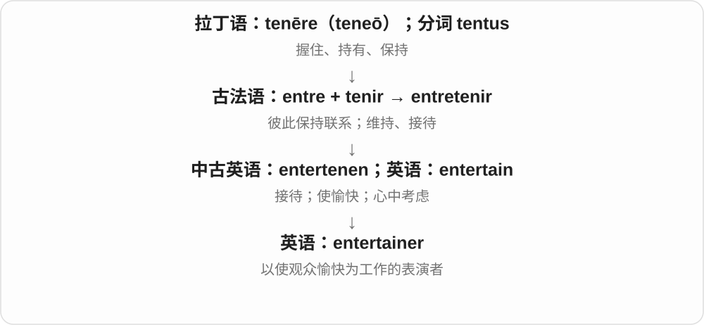

这个名称按表演的目的概括职业，不规定具体艺术形式。

**常见搭配与例句**

a professional entertainer；a children’s entertainer；a talented entertainer。

> The entertainer kept the children engaged with simple magic tricks.

表演者用简单的魔术吸引住了孩子们。

> She worked as an entertainer on a passenger ship.

她曾在客船上担任演艺人员。

**别混淆**

actor 主要表演角色；entertainer 范围更广，主持人、歌手、魔术师都可能属于它。

### 287. entertainers — 艺人、娱乐表演者〔复数〕

**音标**：英 /ˌentəˈteɪnəz/；美 /ˌentərˈteɪnərz/

**先抓住这个画面**

有人唱歌、讲笑话，有人表演魔术，工作都是让观众看得开心；这些人可统称 entertainers。

**怎么拆**

entertain + 完整 -er → entertainer，再加 -s。基础 entertain 的接待、使愉快义经法语接 tenir 保持。

**怎么变成今天的意思**

**拉丁 tenere 保持 → 法语 entre + tenir → entretenir**  
维持、接待、彼此维系等用途

↓

**英语 entertain 及相关名词**  
招待、使愉快；心里容纳、考虑一个想法

↓

**entertain + -er → entertainer → entertainers**  
为观众提供娱乐的人；多位表演者

street entertainers 是街头艺人，children’s entertainers 是给儿童表演的艺人；身份范围比演员更广。

**常见搭配与例句**

live entertainers 现场艺人；a group of entertainers 一群表演者。

> Street entertainers drew a crowd in the square.

街头艺人在广场吸引了人群。

> The hotel hired entertainers for the evening programme.

酒店为晚间节目聘请了艺人。

**别混淆**

actors 常突出扮演角色，entertainers 突出给观众提供娱乐，歌手、喜剧演员、魔术师都可能包括。

### 288. racer — 竞速选手；赛车、赛马等

**音标**：英 /ˈreɪsə/；美 /ˈreɪsər/

**先抓住这个画面**

参加速度比赛的人、动物或车辆，先看句子到底说谁在参赛。

**怎么拆**

race 的竞速动词义 + -er；-er 不一定只形成表示人的词。另有按快速移动命名的动物用法，本轮主学常用竞赛义。

**怎么变成今天的意思**

**古英语 rǣs、古诺尔斯语 rás 等 → 英语竞速 race**  
奔涌、快跑 → 速度竞赛

↓

**race + -er → racer**  
竞速 → 参赛人、动物、车辆

a motorcycle racer 摩托车赛车手，a road racer 公路赛选手或赛车；a racer 在车辆叙述中也可能是车本身。

**常见搭配与例句**

a motorcycle racer；a professional racer；a racing car and its racer。

> The young racer completed every lap.

年轻赛车手跑完了每一圈。

> The old racer is now displayed in a museum.

那辆旧赛车如今陈列在博物馆里。

**别混淆**

racer 竞速者，racist 种族主义者；两者不能只按更短、更长的人物后缀互换。

### 289. slay — 杀死〔较文学〕；表现极出色、惊艳〔俚语〕

**音标**：/sleɪ/

**先抓住这个画面**

在英雄故事里，slay 是杀死敌人、怪物；夸赞表演时，说 someone slays 则是“太出色了，震住全场”。先辨认场景和语气。

**怎么拆**

古英语 slean 有击打、杀死等义，经中古英语演变而来。击倒、压倒的比喻后来也用于令人赞叹；现代俚语中常作强烈赞美。

**怎么变成今天的意思**

**古英语 slean → 中古英语相关形式**  
击打；以武器杀死

↓

**现代 slay 的文学义与比喻义**  
杀死；压倒性地令人赞叹、表现出色

slay a dragon 杀死巨龙；slay on stage 在台上表现惊艳。标准变位 slay → slew → slain；部分现代俚语用法也见规则形式 slayed。

**常见搭配与例句**

the hero slew the monster；slay the performance。

> In the legend, the hero slew a dragon.

传说中，英雄杀死了一条巨龙。

> You absolutely slayed on stage tonight!

你今晚在台上简直太惊艳了！

**别混淆**

普通叙述死亡或杀人更常用 kill；slay 常带文学、戏剧色彩。She slays! 作为夸赞，语体很口语，不能见到 slay 就套杀死。

### 290. slayer — 杀死者、诛杀者〔常见于故事、称号〕

**音标**：英 /ˈsleɪə/；美 /ˈsleɪər/

**先抓住这个画面**

slay 的镜头从动作转到行动者：谁杀死了怪物，谁就被故事称作它的 slayer。这个词常带英雄叙事或戏剧感。

**怎么拆**

经中古英语 slear、sleere 等形式，承接古英语 slaga 等旧人物词；现代结构对应 slay + -er。不能把整段历史缩成近期临时加后缀。

**怎么变成今天的意思**

**古英语旧人物词 → 中古英语相关形式**  
实施杀死动作的人

↓

**现代 slayer 与 slay 的对应**  
杀死者，尤其用于故事、称号等

a dragon slayer 屠龙者；the slayer of the monster 杀死怪物的人。单独 slayer 语气往往比普通 killer 更具叙事色彩。

**常见搭配与例句**

a legendary slayer；the monster’s slayer。

> The villagers welcomed the slayer of the dragon.

村民们迎接杀死巨龙的人。

> The story follows a young monster slayer.

故事讲述一位年轻的怪物诛杀者的经历。

**别混淆**

slayer 与 killer 意义相近，但 slayer 常出现在传奇、奇幻或强调性的称呼里；它不自动表示这个人正义。

### 291. commuter — 通勤者；往返上班的人

**音标**：英 /kəˈmjuːtə/；美 /kəˈmjuːtər/

**先抓住这个画面**

经常沿一条路线在住处和工作地点之间来回的人。

**怎么拆**

现代看是 commute + -er；历史却先有把多次车船费折成一笔的 commutation ticket 定期票，commuter 先指这种票的持有者，再泛指通勤者。commute 的通勤义反而较晚。

**怎么变成今天的意思**

**拉丁 mutare 改变、交换**  
不是只指现代生物学突变，原来是广泛的改变动作

↓

**拉丁 commutare 折换、替换 → 英语 commute、commutation**  
把多次付款换成一笔付款

↓

**commutation ticket 定期票 → commuter 持票常客、通勤者**  
后来 commute 本身也发展出往返上班的动词义

rail commuters 是乘火车通勤的人；a commuter town 是居民常去邻近城市上班的城镇。今天不用真的持有定期票才能叫 commuter。

**常见搭配与例句**

daily commuters；rail commuters；a commuter train；a commuter town。

> The station was crowded with commuters at eight o’clock.

八点时，车站挤满了通勤者。

> The new cycle route is popular with commuters.

新自行车路线很受通勤者欢迎。

**别混淆**

passenger 是乘客，不限出行目的；commuter 强调经常往返工作地点。tourist 是游客，通常不属于这个日常往返关系。

### 292. tanker — 油轮、罐车；罐装运输船或飞机等

**音标**：英 /ˈtæŋkə/；美 /ˈtæŋkər/

**先抓住这个画面**

带着大罐去运液体、气体，交通工具的名字抓住 tank 储罐；并不是单看 -er 就变成开坦克的士兵。

**怎么拆**

tank 储罐 + -er，命名装罐运输的船、卡车，也用于空中加油机等。取容器、运输装备一支。

**怎么变成今天的意思**

**葡萄牙语 tanque 与南亚相关水池词的传播背景 → tank**  
水池、储水容器；更远路径有不同分析

↓

**tank + -er → tanker**  
带储罐运输的工具；相关供油飞机

an oil tanker 油轮，a road tanker 公路罐车，a tanker aircraft 空中加油机。

**常见搭配与例句**

an oil tanker；a road tanker；a tanker aircraft。

> The tanker carried fuel to the island.

运输船把燃油运到岛上。

> A road tanker delivered milk to the factory.

一辆公路罐车把牛奶送到工厂。

**别混淆**

tanker 多运液体、气体，不只石油；tank crew 才通常说坦克乘员，不能按词尾把每辆 tanker 译成坦克兵。

### 293. bearer — 携带者；持有者；传递者

**音标**：英 /ˈbeərə/；美 /ˈberər/

**先抓住这个画面**

带着某样东西的人：手里拿着文件，或把消息带到你面前。

**怎么拆**

bear 携带 + -er；旧英语已有相应的人名词，现代构词关系依然清楚。

**怎么变成今天的意思**

**古英语 beran → 中古英语 beren**  
承载、带来；生育；忍受

↓

**英语 bear；过去式 bore，过去分词通常 borne**  
承受、携带、产生；出生表达中使用 born

↓

**bear → bearer**  
携带 → 携带、持有或传递的人

the bearer of good news 带来好消息的人；the bearer of a ticket 票券持有人。banner bearer 可指实际举旗者，也可比喻代表某项事业的人。

**常见搭配与例句**

the bearer of bad news；a ticket bearer；a standard bearer。

> I’m happy to be the bearer of good news today.

我很高兴今天能给大家带来好消息。

> The pass allows the bearer to enter the exhibition twice.

持这张通行证可以进入展览两次。

**别混淆**

bearer 强调带着、持有，不必是物主；owner 才明确说拥有者。带来坏消息的人也不一定制造了坏事。

### 294. blender — 搅拌机、食物搅拌器

**音标**：英 /ˈblendə/；美 /ˈblendər/

**先抓住这个画面**

把食材放进去，旋转刀片将它打碎、搅匀，让几样东西成为较一致的混合物，这就是厨房 blender。

**怎么拆**

blend + -er，工具后缀形成执行混合功能的装置名称。这里 -er 按功能称呼装置，不限于人。

**怎么变成今天的意思**

**中古英语 blenden**  
联系古英语 blandan 和古诺尔斯 blanda 混合，具体影响路线有不同分析

↓

**混到一起 → 协调、融入**  
物料、颜色、声音、人物都可按场景理解

↓

**blend + -er → blender**  
负责搅碎、混合的装置

an electric blender 电动搅拌机，put ingredients in a blender 把配料放进搅拌机，a hand blender 手持搅拌器。

**常见搭配与例句**

an electric blender；a hand blender。

> She used a blender to make the soup smooth.

她用搅拌机把汤打得顺滑。

> The blender crushed the fruit into a thick drink.

搅拌机把水果打成了浓稠饮品。

**别混淆**

blender 通常兼有刀片打碎和搅合功能；mixer 可以更偏混合、打发等，具体设备名称仍看功能。

### 295. tumble — 翻滚、跌倒；急跌；一跤

**音标**：/ˈtʌmbəl/

**先抓住这个画面**

箱子没放稳，里面的球一股脑滚出来；人脚下一绊，翻着跌下去，都是 tumble。它常带着翻转、失去平稳的感觉。

**怎么拆**

中古英语 tumblen 可能由旧 tumben 加反复动作尾，与古英语 tumbian 跃动、舞动相关，远源未定。不能把结尾 -ble 直接认作现代 -able 能够。

**怎么变成今天的意思**

**古英语 tumbian 等：跃动、舞动 → 中古英语 tumben、tumblen**  
可能有反复动作尾，更远来源未定

↓

**翻身、失足跌落 → 翻滚；后来也说价格急跌**  
名词再写一次跌落、翻滚或混乱

tumble down the stairs 从楼梯上跌滚下来；take a tumble 跌一跤；prices tumble 价格急跌。

**常见搭配与例句**

tumble out of a bag 从包里滚落出来；tumble into bed 倒上床。

> The apples began to tumble out of the torn bag.

苹果开始从破袋子里滚落出来。

> She took a tumble on the icy path.

她在结冰的小路上摔了一跤。

**别混淆**

fall 泛指掉落，tumble 更容易让人看到翻滚、失去平稳；价格 tumble 则借急跌画面，不表示数字实际转圈。

### 296. tumbler — 平底无柄饮用杯；翻腾艺人；锁内制动部件

**音标**：英 /ˈtʌmblə/；美 /ˈtʌmblɚ/

**先抓住这个画面**

餐桌上不用杯柄、也没有高脚的水杯，常叫 tumbler。名字里虽有翻滚，现代杯子照样可以稳稳站在桌上。

**怎么拆**

tumble 去 e 加 -er，早指翻腾艺人；杯义原指底部圆或尖、易翻倒的杯子，之后名称留给这类饮用杯。锁内制动部件另是按具体运动、机构理解的用法。

**怎么变成今天的意思**

**tumble 翻滚 + -er → tumbler**  
早指表演翻腾的人

↓

**圆底、尖底易倒的杯子 → 饮用杯名；另用于锁内制动部件**  
现代杯子可以平底，不必照着旧形状造定义

a tumbler of water 一杯水；a glass tumbler 玻璃饮用杯；lock tumbler 锁内制动部件。

**常见搭配与例句**

fill a tumbler；an acrobatic tumbler 翻腾艺人。

> She poured water into a tall tumbler.

她往一个高饮用杯里倒了水。

> The tumbler performed a series of flips across the stage.

那位翻腾艺人在舞台上连续翻了几个跟头。

**别混淆**

tumbler 常是无柄、无高脚杯，mug 常带柄；现代 travel tumbler 可用金属等材料，不能永远只认玻璃材质。

### 297. tumblers — 饮用杯、翻腾艺人、锁内制动部件〔复数〕

**音标**：英 /ˈtʌmbləz/；美 /ˈtʌmblɚz/

**先抓住这个画面**

桌上摆着几个无柄水杯，可以说 tumblers；节目里几位翻腾艺人，也可以这么叫。杯子和人各按场景认。

**怎么拆**

tumbler + -s，读 /z/；内层 tumble 去 e 加 -er。现代复数保留基础词的不同具体义。

**怎么变成今天的意思**

**tumble 翻滚 + -er → tumbler**  
早指表演翻腾的人

↓

**圆底、尖底易倒的杯子 → 饮用杯名；另用于锁内制动部件**  
现代杯子可以平底，不必照着旧形状造定义

↓

**tumbler + -s → tumblers**  
多个杯子、艺人或锁内制动部件

a set of tumblers 一套饮用杯；acrobats and tumblers 杂技演员与翻腾艺人。

**常见搭配与例句**

glass tumblers；the tumblers inside a lock。

> Six tumblers were arranged beside the jug.

水壶旁摆着六个饮用杯。

> The show featured jugglers and tumblers.

表演包括杂耍演员和翻腾艺人。

**别混淆**

tumblers 是这一类杯或部件、艺人，tumblings 则偏向翻滚活动的名词形式；不能只按字母多一个 s 就互换。

### 298. peep — 偷看、探看；一瞥；啾叫；一点声响

**音标**：/piːp/

**先抓住这个画面**

从门缝看一眼，可以是 peep；小鸡啾一下，也叫 peep。这是两条来源的同形词，要分别记画面。

**怎么拆**

看的一支可能联系旧 peek 材料；出声的一支最终有拟声背景。现代名词、动词都用，不把看和叫编成同一演化链。

**怎么变成今天的意思**

**看这一支：中古英语 pepen，可能联系 peek 的旧看词**  
从遮挡处探看、短暂看；后来也说东西刚露出一点

↓

**声音这一支：旧啾叫材料，可能与 pipen 等有关**  
拟声的短叫形成轻声、最小声响的名词；不是从眼睛偷看派生出来

peep through the curtains 从窗帘后偷看；have a peep 看一眼；not hear a peep 一点声音都没听见；chicks peep 小鸡啾叫。

**常见搭配与例句**

a peep at the garden；the first peep of daylight 刚露出的晨光。

> I had a peep through the curtains.

我从窗帘后偷看了一眼。

> We did not hear a peep from the children.

我们一点也没听到孩子们出声。

**别混淆**

peek 与 peep 在偷看场景很接近；peep 还可以是轻叫、声响，这一支不能用 peek 替换。

### 299. peeper — 偷看者；啾叫的小鸟、蛙等；眼睛〔较口语，常用复数〕

**音标**：英 /ˈpiːpə/；美 /ˈpiːpər/

**先抓住这个画面**

谁在从遮挡后偷偷看，-er 就能给这个行动者命名为 peeper。也有按声音给小动物命名的一支，口语 peepers 又能直接说眼睛。

**怎么拆**

peep + -er；看与啾叫各自都能造行动者词，具体所指看上下文，不把所有动物都从窥看者演化出来。

**怎么变成今天的意思**

**看这一支：中古英语 pepen，可能联系 peek 的旧看词**  
从遮挡处探看、短暂看；后来也说东西刚露出一点

↓

**声音这一支：旧啾叫材料，可能与 pipen 等有关**  
拟声的短叫形成轻声、最小声响的名词；不是从眼睛偷看派生出来

↓

**peep + -er → peeper**  
看的一支可指偷看者，复数也口语说眼睛；出声的一支可命名啾叫动物

a peeper at the window 在窗边偷看的人；spring peeper 是一种按叫声命名的小蛙；eyes 的口语用法常用 peepers。

**常见搭配与例句**

an unwelcome peeper；a tiny peeper calling。

> The story begins when a peeper is spotted at the window.

故事从有人发现窗边有个偷看者开始。

> A tiny peeper called from the reeds.

一只小小的啾叫蛙从芦苇里发出叫声。

**别混淆**

peeper 带偷看的感觉时不同于普通 viewer 观众；动物名称则依叫声理解，角色不同。

### 300. peepers — 眼睛〔口语〕；偷看者；啾叫的小动物〔复数〕

**音标**：英 /ˈpiːpəz/；美 /ˈpiːpərz/

**先抓住这个画面**

keep your peepers open 像说“眼睛睁大点，多留心”；放到池塘、夜声场景里，peepers 也能是啾叫的小蛙等动物。

**怎么拆**

peeper + -s，词尾读 /z/；内层 peep + -er 的看、出声两支分别保留，眼睛口语通常用这个复数。

**怎么变成今天的意思**

**看这一支：中古英语 pepen，可能联系 peek 的旧看词**  
从遮挡处探看、短暂看；后来也说东西刚露出一点

↓

**声音这一支：旧啾叫材料，可能与 pipen 等有关**  
拟声的短叫形成轻声、最小声响的名词；不是从眼睛偷看派生出来

↓

**peep + -er → peeper**  
看的一支可指偷看者，复数也口语说眼睛；出声的一支可命名啾叫动物

↓

**peeper + -s → peepers**  
多个看或叫的对象；口语直接说眼睛

keep your peepers open 留心看；shut your peepers 闭眼，语气随意；peepers calling by the pond 池边啾叫的小蛙。

**常见搭配与例句**

sleepy peepers 困倦的眼睛；a chorus of peepers 一片小蛙叫声。

> Keep your peepers open for a red sign.

眼睛留神点，找一块红牌子。

> We heard peepers calling near the pond.

我们听见池塘附近小蛙在啾啾叫。

**别混淆**

peepers 说眼睛很口语、常带玩笑，不适合代替所有正式 eye 用法；叫声场景则通常是动物名词。

### 301. sprinkle — 撒、洒〔少量、分散地〕；零星小雨

**音标**：/ˈsprɪŋkəl/

**先抓住这个画面**

不是整杯倒下去，而是把小颗粒、小水滴分散落在表面，像在面包上撒芝麻，就是 sprinkle。

**怎么拆**

经中古英语接荷兰语相关 sprenkelen 等分散洒落的材料，带反复动作尾；现代不必另造独立的 sprink 才能理解。

**怎么变成今天的意思**

**荷兰语相关形式 → 中古英语 sprenkelen、sprynklen**  
分散、反复洒落

↓

**英语 sprinkle**  
少量地撒、洒；零星降雨

sprinkle sugar on something 往某物撒糖；sprinkle something with water 给某物洒水；a sprinkle of rain 一点小雨。

**常见搭配与例句**

sprinkle on；sprinkle with；a sprinkle of。

> Sprinkle a little sugar over the fruit.

往水果上撒一点糖。

> She sprinkled the plants with water.

她给植物洒了些水。

**别混淆**

sprinkle 重小量、分散，pour 重倾倒；同样是加水，动作画面不同。

### 302. sprinkler — 洒水器；喷淋头、消防喷淋装置

**音标**：英 /ˈsprɪŋklə/；美 /ˈsprɪŋklər/

**先抓住这个画面**

把水分散成小滴、洒到一片地面或室内空间的装置，叫 sprinkler。花园浇草坪、建筑消防都可能见到。

**怎么拆**

sprinkle 去 e + 完整 -er → sprinkler；-er 在这里指做撒洒动作的器具，不是只加一个 -r。

**怎么变成今天的意思**

**sprinkle 的分散撒洒动作 → sprinkler**  
去末尾 e，再加执行者、工具后缀 -er

↓

**器具名词 → 现代洒水、消防喷淋器**  
把水分散洒到一片范围，具体用途由修饰词说明

a lawn sprinkler 是草坪洒水器，a fire sprinkler 是消防喷淋头；都从分散洒水这一功能命名。

**常见搭配与例句**

turn on the sprinkler 打开洒水器；a sprinkler system 喷淋系统。

> We put a sprinkler in the middle of the lawn.

我们在草坪中央放了一个洒水器。

> The building has a fire sprinkler system.

这栋楼装有消防喷淋系统。

**别混淆**

sprinkler 常负责向一片范围分散洒水，sprayer 范围更广，可是手持喷壶、喷雾器等；用途能重合。

### 303. sprinklers — 洒水器、喷淋头、消防喷淋装置〔复数〕

**音标**：英 /ˈsprɪŋkləz/；美 /ˈsprɪŋklərz/

**先抓住这个画面**

草坪上有几台洒水器、天花板上有多个喷淋头，叫 sprinklers。是可数器具，和撒糖粒的 sprinkles 分开。

**怎么拆**

sprinkle 去 e + 完整 -er → sprinkler，再加复数 -s，读 /z/；工具层和数量层都写出来。

**怎么变成今天的意思**

**sprinkle 的分散撒洒动作 → sprinkler**  
去末尾 e，再加执行者、工具后缀 -er

↓

**器具名词 → 现代洒水、消防喷淋器**  
把水分散洒到一片范围，具体用途由修饰词说明

↓

**sprinkler + -s → sprinklers**  
多个洒水、喷淋器具

garden sprinklers 是花园洒水器，ceiling sprinklers 是天花板喷淋头；工具叫什么，取决于它执行撒洒动作。

**常见搭配与例句**

automatic sprinklers 自动喷淋装置；turn off the sprinklers 关掉洒水器。

> The sprinklers turn on early in the morning.

洒水器清晨启动。

> We could see several sprinklers in the ceiling.

我们看见天花板上有几个喷淋头。

**别混淆**

sprinklers 是器具，sprinkles 可指蛋糕彩糖粒或撒洒三单；多出的 -er 对意思很关键。

### 304. hover — 悬停；在附近徘徊、守候；鼠标指针停留

**音标**：英 /ˈhɒvə/；美 /ˈhʌvər/

**先抓住这个画面**

直升机待在空中同一处，鼠标停在图标上，人又在门边迟迟不走。都像在某个位置附近停留、微微活动。

**怎么拆**

经中古英语 hoveren，接较早 hoven 悬浮、逗留等及旧反复动作材料 -er。更远来源分析不一；这个 -er 不是做某事的人。

**怎么变成今天的意思**

**较早 hoven + 反复动作材料 → hoveren**  
悬浮、来回微动、逗留

↓

**现代 hover 的场景扩展**  
空中悬停；附近守候；指针停留

hover above the ground 在地面上方悬停；hover near the door 在门边徘徊；hover over an icon 把鼠标悬停在图标上。

**常见搭配与例句**

a helicopter hovers；hover over a button。

> The helicopter hovered above the field.

直升机在田野上方悬停。

> Hover over the icon to see a short description.

把鼠标悬停在图标上，就能看到简短说明。

**别混淆**

hover 常保持在某处或附近；fly 只说飞行，不一定停在一处。电脑 hover 是把空间停留的画面用于指针。

### 305. hovering — 悬停、徘徊、守候；hover 的 -ing 形式

**音标**：英 /ˈhɒvərɪŋ/；美 /ˈhʌvərɪŋ/

**先抓住这个画面**

保持在某个位置附近不离开。可以是飞行器，也可以是一个总在旁边转、让人感觉被盯着的人。

**怎么拆**

hover + -ing；由悬停、逗留的动词进入分词和状态描写。不同对象保留附近停留这一核心。

**怎么变成今天的意思**

**hover 的悬浮、逗留词义 + -ing**  
持续维持附近位置

↓

**hovering 的具体与人物描写**  
正在悬停；在附近徘徊、过分守候

a hovering helicopter 悬停的直升机；hovering by the entrance 在入口边徘徊；hovering over someone 总在某人旁边转、盯着。

**常见搭配与例句**

hovering above the water；hovering nearby。

> A bird was hovering above the water.

一只鸟在水面上方悬停。

> He kept hovering by the door, unsure whether to leave.

他一直在门边徘徊，不确定该不该走。

**别混淆**

hovering over a person 可能带让对方不自在的照管、监督意味；hovering over an icon 则通常是中性的电脑动作。

### 306. rattle — 哗啦响、咯咯响；摇得响；使慌乱；摇铃、连续碰撞声

**音标**：/ˈrætəl/

**先抓住这个画面**

摇一个装着硬币的盒子，里面一连串“哗啦、咯咯”响，叫 rattle；借来说人，就是把原本镇定的心搅乱。

**怎么拆**

承中古英语 ratelen，可能借中古荷兰语同类形式，也有本土来源分析。古英语基础动词没有直接记录，不把推定形式写成确证。

**怎么变成今天的意思**

**中古英语 ratelen → rattle**  
连续碰撞的声音材料；可能借中古荷兰语，也有本土来源分析

↓

**声音 → 摇出响声、说得飞快 → 搅得人慌乱**  
名词还可指婴儿摇铃等发出哗啦声的器具

rattle the keys 是把钥匙摇得哗啦响；rattle off a list 是一口气飞快报出清单；rattle someone 是使人心慌、不镇定。

**常见搭配与例句**

a baby’s rattle 婴儿摇铃；rattle around 在里面晃得哗啦响。

> Loose coins began to rattle inside the box.

松散的硬币开始在盒子里哗啦响。

> The unexpected question did not rattle her.

突如其来的问题没有让她慌乱。

**别混淆**

rattle 不一定代表东西破了：钥匙、玩具本来就能这样响。比喻人被 rattled 则是镇定被打乱。

### 307. rattler — 响尾蛇〔口语〕；喋喋不休者等

**音标**：英 /ˈrætlə/；美 /ˈrætlər/

**先抓住这个画面**

北美故事里 a rattler 常是响尾蛇，尾巴会发连续响声；旧时也可指说话又快又多、像哗啦声不停的人。

**怎么拆**

说话者等用法可按 rattle 去 e 加 -er；响尾蛇义则常是 rattlesnake 的口语缩称。两条近源都和 rattle 发响材料有关，但形成方式要分清。

**怎么变成今天的意思**

**rattle 连续碰撞声 → rattler**  
rattle 去 e 加 -er，较早可命名说得又快又多的人

↓

**rattlesnake → 口语 rattler**  
响尾蛇的缩称；这一路近源不必讲成重新从蛇尾造了一次词

a rattler on the path 小路上的响尾蛇；hear a rattler 听到响尾蛇的尾响。

**常见搭配与例句**

a young rattler；the rattler’s tail。

> A rattler lay beside the path.

一条响尾蛇伏在小路旁。

> We heard the dry sound of a rattler’s tail.

我们听见响尾蛇尾巴发出的干涩响声。

**别混淆**

rattler 动物义通常口语，rattlesnake 是完整称呼；不要因为 -er 常命名人，就在荒野场景里只找一个爱说话的人。

### 308. rattlers — 响尾蛇〔复数，口语〕；喋喋不休者等〔复数〕

**音标**：英 /ˈrætləz/；美 /ˈrætlərz/

**先抓住这个画面**

在北美荒野叙述里，几条 rattlers 通常就是几条响尾蛇；词尾只把单个称呼变成复数，具体是哪类角色仍看场景。

**怎么拆**

rattler + -s，读 /z/；响尾蛇义的单数常缩自 rattlesnake，旧人物称呼则由 rattle + -er。

**怎么变成今天的意思**

**rattle 连续碰撞声 → rattler**  
rattle 去 e 加 -er，较早可命名说得又快又多的人

↓

**rattlesnake → 口语 rattler**  
响尾蛇的缩称；这一路近源不必讲成重新从蛇尾造了一次词

↓

**rattler + -s → rattlers**  
多个响尾蛇等被命名对象

rattlers in the desert 沙漠中的响尾蛇；watch for rattlers 留意响尾蛇。

**常见搭配与例句**

two rattlers；the sound of rattlers。

> The guide pointed out places where rattlers sometimes rested.

向导指出了响尾蛇有时停留的地方。

> The book describes several kinds of rattlers found in the region.

书里描述了这个地区的几种响尾蛇。

**别混淆**

rattlers 动物义不是 rattles 摇铃的复数；人或动物名字中的 -er 不能在变复数时省掉。

### 309. glide — 平滑移动、滑行；滑翔；轻松通过

**音标**：/ɡlaɪd/

**先抓住这个画面**

天鹅在水面不紧不慢地划过，看起来几乎不费劲。glide 把移动的平顺、连续、轻巧突出出来。

**怎么拆**

接古英语 glidan 平滑移动、滑过等旧强变化词族；后来现代常用规则过去式 glided。更远与哪些 gl- 词有关存在推测，不把所有 gl 开头词都当一个可拆前缀。

**怎么变成今天的意思**

**古英语 glidan → 中古英语相关形式**  
滑行、顺畅地移动

↓

**现代 glide；过去常 glided**  
平滑移动、滑翔；比喻顺利通过

glide across the water 滑过水面；glide through the air 在空中滑翔；glide through an exam 轻松通过考试；glide into the room 轻巧地走进房间。

**常见搭配与例句**

glide smoothly；glide past。

> A swan glided across the lake.

一只天鹅平滑地游过湖面。

> She seemed to glide through the crowded room.

她在拥挤的房间里穿行，显得轻巧从容。

**别混淆**

slide 常关注沿表面滑动，也可滑倒；glide 更突出顺滑、轻巧的移动。滑翔语境还要按飞行方式理解，不能都译成地面滑行。

### 310. gliding — 滑行、滑翔；滑翔运动；glide 的 -ing 形式

**音标**：/ˈɡlaɪdɪŋ/

**先抓住这个画面**

鸟儿展开翅膀平稳掠过，船沿水面顺畅前进，都能看到 gliding。作为运动名词时，常说驾驶滑翔机的活动。

**怎么拆**

glide 去词末 e 加 -ing，既形成动作分词，也形成滑行、滑翔的活动名词；继承旧平滑移动词族。

**怎么变成今天的意思**

**glide**  
平滑移动、滑行、滑翔

↓

**glide + -ing → gliding**  
动作、方式；滑翔运动

gliding over the water 滑过水面；a gliding motion 平顺的滑动；go gliding 去玩滑翔；a gliding club 滑翔俱乐部。

**常见搭配与例句**

smooth gliding；birds gliding overhead。

> We watched birds gliding above the cliffs.

我们看着鸟儿在峭壁上方滑翔。

> He joined a gliding club last summer.

他去年夏天加入了一个滑翔俱乐部。

**别混淆**

gliding 作活动名词不必译成正在：She enjoys gliding 是喜欢滑翔运动。was gliding 才在相应时态中说正在滑行、滑翔。

### 311. glider — 滑翔机；滑行、滑翔的人或物

**音标**：英 /ˈɡlaɪdə/；美 /ˈɡlaɪdər/

**先抓住这个画面**

把 glide 这个动作落到执行它的人或物上，就得到 glider。日常最容易遇到的是滑翔机：靠机翼在空气中滑翔。

**怎么拆**

glide 去末尾 e 加 -er；较早泛指滑行者、物，后来用于无动力飞机等名称。-er 不只给人命名，机器、动物等也可按动作得名。

**怎么变成今天的意思**

**glide + -er → glider**  
滑行、滑翔的人或物

↓

**后来的航空等专门名称**  
滑翔机；其他滑翔相关对象

a glider pilot 滑翔机飞行员；a model glider 模型滑翔机；launch a glider 让滑翔机升空。具体设计和起飞方式要看所指机型。

**常见搭配与例句**

a glider circling overhead；fly a glider。

> The glider circled silently above the field.

滑翔机在田野上方静静盘旋。

> The children built a small model glider.

孩子们制作了一架小型滑翔机模型。

**别混淆**

gliding 是活动或动作，glider 是执行者或器具。不要因为看到 -er 就只找一个人；a model glider 明确是模型飞行器。

### 312. glides — 滑行、平顺移动、滑翔〔第三人称单数〕；滑行动作、语音滑音〔复数〕

**音标**：/ɡlaɪdz/

**先抓住这个画面**

天鹅在水上不急不颠地过去，溜冰者几乎不费劲地划过冰面，是 glides；说事情轻易过关，也能借这种顺滑感。

**怎么拆**

glide + -s，/d/ 后读 /z/，结尾 /dz/；动词三单与滑行、滑音等名词复数同形。

**怎么变成今天的意思**

**古英语 glidan 的平顺滑动材料 → glide**  
早期强变化动词；现代常用规则 glided

↓

**平滑移动 → 滑翔；事情、话题顺畅通过**  
现代核心常是不颠、不费劲地从一点移过另一点

↓

**glide + -s → glides**  
它平滑移动；几次滑行或几种滑音

glides across the water 是滑过水面，glides through an exam 是轻松通过考试；语音 glides 指顺滑过渡的音类。

**常见搭配与例句**

glides above the trees 在树上方滑翔；glides from one topic to another 顺畅地换话题。

> The swan glides across the lake.

天鹅平顺地滑过湖面。

> She glides from one topic to another without losing the audience.

她顺畅地转换话题，听众仍跟得上。

**别混淆**

glides 让人觉得平滑、轻松，slides 更能中性地说在表面滑动；滑倒、失去控制的 slide 不一定有 glide 的从容感。

### 313. glided — 平滑移动、滑行、滑翔了；顺畅通过了

**音标**：/ˈɡlaɪdɪd/

**先抓住这个画面**

刚才船、鸟或滑冰者顺滑地过去，是 glided；一个人轻松通过难关，也能借用这幅没有磕绊的动作。

**怎么拆**

glide 去末尾不发音 e + 完整 -ed → glided，/d/ 后读 /ɪd/。基础虽接古英语强变化词，现代常用规则过去式。

**怎么变成今天的意思**

**古英语 glidan 的平顺滑动材料 → glide**  
早期强变化动词；现代常用规则 glided

↓

**平滑移动 → 滑翔；事情、话题顺畅通过**  
现代核心常是不颠、不费劲地从一点移过另一点

↓

**glide 去 e + -ed → glided**  
现代规则过去式；平顺地移过

glided into the room 是轻巧平顺地进入房间，glided over the water 是滑过水面；glided through the test 是轻松通过测试。

**常见搭配与例句**

glided past 平顺掠过；glided down towards the field 滑翔着降向田野。

> The canoe glided silently across the water.

独木舟无声地滑过水面。

> The bird glided down towards the field.

鸟滑翔着向田野降去。

**别混淆**

glided 更突出动作顺滑，flew 只说飞；鸟 glided 时常借气流少拍或不拍翅膀，讲它在怎样飞。

### 314. roost — 鸟的栖息处、栖架；栖息、归栖

**音标**：/ruːst/

**先抓住这个画面**

天黑后，鸡、鸟停在一根架子或固定地方休息。roost 可以叫那处地方，也可以说回那里歇下。

**怎么拆**

古英语 hrost 有木构架、鸟栖架等义，经中古英语 roste 延续。作为栖架的东西，进一步联系鸟栖息的动作。

**怎么变成今天的意思**

**古英语 hrost → 中古英语 roste**  
木架；家禽歇息的栖架

↓

**现代 roost 的名词、动词**  
栖息处；鸟在固定地方栖息

birds roost in trees 鸟在树上歇息；return to the roost 回栖处。rule the roost 是当家做主、掌控局面。

**常见搭配与例句**

a communal roost；come home to roost。

> The birds roost in the old oak tree.

这些鸟在那棵老橡树上栖息。

> The chickens returned to their roost at sunset.

日落时，鸡回到了栖架上。

**别混淆**

nest 通常是筑巢、产卵育雏的巢；roost 侧重休息的地方。come home to roost 也可说先前的行为终于带来不良后果。

### 315. rooster — 公鸡

**音标**：英 /ˈruːstə/；美 /ˈruːstər/

**先抓住这个画面**

构词上是 roost 加 -er，现代意思却已经收窄成公鸡。记住这个固定名称，就能把动物和夜里上架歇息的习性连起来。

**怎么拆**

roost 栖息 + -er，较早也有 roost cock 这类表达。rooster 后来尤其在美式英语中普及为公鸡名。

**怎么变成今天的意思**

**roost 的栖息动作与旧相关名称**  
栖架上歇息的家禽

↓

**rooster 的固定动物名称**  
公鸡，尤常见于美式表达

a rooster crows 公鸡啼叫；a rooster and several hens 一只公鸡和几只母鸡。复数 roosters。

**常见搭配与例句**

a crowing rooster；the farm’s rooster。

> The rooster crowed before sunrise.

公鸡在日出前啼叫。

> A rooster stood beside the hens in the yard.

院子里，一只公鸡站在母鸡旁边。

**别混淆**

hen 是母鸡，rooster 是公鸡；chicken 可泛指鸡。rooster 的 -er 虽能看出构词联系，词义已固定，不能泛指所有栖息的鸟。

### 316. splint — 夹板；细长的木片、金属条等

**音标**：/splɪnt/

**先抓住这个画面**

先想一条细长而较硬的材料：可用于支撑，也能成为固定受伤部位的夹板。

**怎么拆**

中古英语 splent、splint 等借自中古低地德语、荷兰语的薄条材料，与分裂、劈开词族相关。由薄条扩展到具有特定支撑用途的器具。

**怎么变成今天的意思**

**日耳曼语薄片、细条材料 → 中古英语 splint**  
劈出的细长材料、护甲薄条等

↓

**splint 的专门器具义**  
用于支撑、固定的夹板

a wooden splint 木夹板；a finger splint 手指夹板；an arm in a splint 用夹板固定着的手臂。

**常见搭配与例句**

a thin wooden splint；a splint for the wrist。

> His wrist was supported by a splint.

他的手腕用夹板支撑着。

> The model was made from thin wooden splints.

模型是用细木条做的。

**别混淆**

splint 常是作为材料或器具的细条、夹板；splinter 常是裂出来、可能扎人的细碎片。两词同族，现代用法不同。

### 317. splinter — 细碎片、木刺；裂成碎片、分裂

**音标**：英 /ˈsplɪntə/；美 /ˈsplɪntər/

**先抓住这个画面**

木板裂开，蹦出一条尖尖的细片，就是 splinter。团队裂成几小块，也借这个画面说 splinter。

**怎么拆**

名词经中古荷兰语 splinter 借入，与 splint 的薄片词族相连；英语再由名词发展出裂成细片、使分裂的动词。

**怎么变成今天的意思**

**中古荷兰语 splinter → 英语名词**  
劈裂后的细长碎片

↓

**名词 → 动词与群体比喻**  
裂碎；团队、组织分裂

a splinter of wood 一根木刺；a splinter in your finger 手指上的木刺；a splinter group 分裂出去的小团体。

**常见搭配与例句**

wood splinters；splinter into small groups。

> A splinter of wood caught in his sleeve.

一根木刺挂住了他的袖子。

> The group splintered into several smaller factions.

这个团体分裂成了几个较小派别。

**别混淆**

splinter 的 -er 在这里不表示做事的人。shard 常说玻璃、陶器等硬物碎片，splinter 常突出细长、尖的碎片。

### 318. simmer — 小火慢煮、微沸；情绪暗涌、怒气未消

**音标**：英 /ˈsɪmə/；美 /ˈsɪmər/

**先抓住这个画面**

锅里轻轻冒泡，热着但没有翻腾；怒气藏在表面下面，也像锅里一直有热度。

**怎么拆**

由较早 simperen 等慢煮、轻响形式变化而来，可能有拟声成分，更远来源未定。轻微加热的画面后来用于情绪。

**怎么变成今天的意思**

**较早 simperen 等 → simmer**  
液体轻响、缓慢加热、微沸

↓

**simmer 的情绪与固定搭配**  
压着的怒气或紧张持续；simmer down 平静下来

simmer the soup 小火慢煮汤；simmer with anger 生着闷气；let it simmer 让它慢慢煮。具体时间由食谱决定。

**常见搭配与例句**

bring to a simmer；simmer down。

> Leave the soup to simmer gently.

让汤用小火轻轻煮着。

> He sat silently, simmering with anger.

他默默坐着，心里憋着怒气。

**别混淆**

boil 常说明显沸腾；simmer 是轻微冒泡、温和持续加热。情绪 simmer 则突出热度压在表面下。

### 319. clot — 凝块；凝结成块

**音标**：英 /klɒt/；美 /klɑːt/

**先抓住这个画面**

原来能流动或分散的东西，聚到一起成一团。现代最常遇到 blood clot 血凝块、血栓这样的搭配。

**怎么拆**

古英语 clott 团块，经中古英语延续。团块名词后来专用于血液等凝块，也可作动词说凝结。

**怎么变成今天的意思**

**古英语 clott → 中古英语 clot**  
圆团、块状物

↓

**现代 clot 的凝块名词、动词**  
凝结成的一团；形成凝块

a blood clot 血凝块、血栓；blood clots 血液凝结；a clot of cream 一团凝结的奶油。这里说明词义与搭配。

**常见搭配与例句**

clot formation；form a clot。

> The diagram shows how blood forms a clot.

图解展示血液怎样形成凝块。

> A small clot of cream floated on the surface.

表面浮着一小团凝结的奶油。

**别混淆**

clot 强调聚成或凝成一块；clutter 则联系堆成一团的旧词族，但现代常说杂物，不是血凝块的另一种叫法。

### 320. clutter — 杂物、杂乱堆积；把……堆得杂乱

**音标**：英 /ˈklʌtə/；美 /ˈklʌtər/

**先抓住这个画面**

桌上小东西越积越多，挡手又碍眼，这些杂乱堆着的东西是 clutter；动词则说它们把空间挤乱了。

**怎么拆**

中古英语 cloteren 等有结成团块、堆积义，与 clot 团块及旧反复动作材料相连。后来集中说东西无序地挤在一起。

**怎么变成今天的意思**

**clot 团块词族 → cloteren 等旧动词**  
聚成团、堆上去

↓

**现代 clutter 名词、动词**  
杂乱堆积的物品；把地方弄得拥挤凌乱

clear the clutter 清理杂物；clutter the desk 把桌子堆乱；visual clutter 视觉上过多、杂乱的元素。名词通常不可数。

**常见搭配与例句**

clutter up a room；a desk full of clutter。

> Old papers cluttered the desk.

旧文件把桌子堆得乱七八糟。

> She cleared the clutter from the hallway.

她清理了走廊里的杂物。

**别混淆**

clutter 不要求东西是垃圾；有用的物品堆得太多太乱，也叫 clutter。litter 常指随处丢弃的垃圾。

### 321. slumber — 睡眠、沉睡；睡着〔较文学〕

**音标**：英 /ˈslʌmbə/；美 /ˈslʌmbər/

**先抓住这个画面**

比 sleep 更容易让人想到安静睡着、沉在梦里。日常还常在 slumber party 留宿聚会中遇到。

**怎么拆**

中古英语 slumeren、slomberen 等与较早 slumen 打盹、古英语 sluma 相连，带旧动词反复动作材料。后来名词也表示睡眠。

**怎么变成今天的意思**

**较早 sluma、slumen → 中古英语相关动词**  
轻睡、打盹、反复浅睡

↓

**现代 slumber 名词、动词**  
睡眠、沉睡；比喻休眠、不活跃

fall into a deep slumber 沉沉入睡；awake from slumber 从睡梦中醒来；a slumber party 通常是孩子、青少年留宿的聚会。

**常见搭配与例句**

peaceful slumber；slumber peacefully。

> The baby fell into a peaceful slumber.

婴儿安静地睡着了。

> The children are having a slumber party on Friday.

孩子们星期五要办留宿聚会。

**别混淆**

sleep 是普通用词，slumber 多较文学、柔和。它的历史有浅睡背景，但现代 deep slumber 很自然，不应机械限制成只能浅睡。

### 322. glimmer — 微弱闪光；微光；一丝希望或迹象

**音标**：英 /ˈɡlɪmə/；美 /ˈɡlɪmər/

**先抓住这个画面**

远处黑暗里有一点光，亮度不大，却让人看见方向。a glimmer of hope 就把这一点微光搬到希望上。

**怎么拆**

中古英语已有相关动词，可能借自或关联荷兰语、低地德语发光词；与 *glim- 发光材料相连，尾部可能是反复、延展成分。现代微弱发光义后来占主导，具体路径保留不确定性。

**怎么变成今天的意思**

**中古英语与相关日耳曼语发光材料**  
发光；后来偏向微弱发光

↓

**现代 glimmer 名词、动词**  
微光、微闪；一丝希望或理解

a glimmer of light 一点微光；a glimmer of hope 一线希望；a glimmer of understanding 一点理解的迹象；lights glimmered 灯光微闪。

**常见搭配与例句**

a faint glimmer；glimmer in the distance。

> A light glimmered through the trees.

一点灯光透过树木微微闪着。

> The news offered a glimmer of hope.

那个消息带来了一线希望。

**别混淆**

glimmer 常把微弱、不太稳定的亮点突出出来；glare 则常刺眼。词尾 -er 在这里属于词的历史，不是普通表示人的名词后缀。

### 323. glimmering — 微微发亮的；正在闪微光

**音标**：/ˈɡlɪmərɪŋ/

**先抓住这个画面**

光还在，却不刺眼，只在黑暗中微弱闪着，叫 glimmering。也能用它描述刚刚露头的理解、希望。

**怎么拆**

glimmer + -ing；r 后接元音，常见英式也读出 /r/。不把整个 -er 当人物后缀删掉。

**怎么变成今天的意思**

**中古英语与荷兰语、低地德语发光材料的联系**  
借入或关联路线未定，尾部可能有反复、延展材料

↓

**现代 glimmer**  
后来微弱发光义占主导；微光 → 一丝希望、理解

↓

**glimmer + -ing → glimmering**  
微弱发亮的过程、状态

glimmering lights 是微微发亮的灯；glimmering hope 把微光形象借给希望。

**常见搭配与例句**

glimmering in the dark 在黑暗中微亮；a glimmering light 一点微光。

> We followed the glimmering lights along the path.

我们沿路朝微微发亮的灯走去。

> A candle was glimmering behind the window.

窗后有一支蜡烛微微发亮。

**别混淆**

glowing 常容易想到持续、温暖的光泽，glimmering 更突出微弱、隐约；实际可按光线场景理解。

### 324. glimmers — 微光、几丝迹象〔复数〕；微微发光〔第三人称单数〕

**音标**：英 /ˈɡlɪməz/；美 /ˈɡlɪmərz/

**先抓住这个画面**

黑暗里只露出一点点亮，或者事情还没好转却已有一丝希望，都可用 glimmers。

**怎么拆**

glimmer + -s，末尾读 /z/。基础词接日耳曼发光材料，早期来源有不同分析，现代常偏向微弱光。

**怎么变成今天的意思**

**中古英语与荷兰语、低地德语发光材料的联系**  
借入或关联路线未定，尾部可能有反复、延展材料

↓

**现代 glimmer**  
后来微弱发光义占主导；微光 → 一丝希望、理解

↓

**glimmer + -s → glimmers**  
几处微光、几丝迹象；它微微发亮

glimmers of hope 是几丝希望，a light glimmers 是灯微微发光；具体与抽象都保留一点点出现的感觉。

**常见搭配与例句**

faint glimmers 微弱亮光；glimmers through the mist 透过雾微微发亮。

> We saw faint glimmers of light through the trees.

我们透过树木看见微弱亮光。

> The result offers the first glimmers of hope.

这个结果带来了最初的几丝希望。

**别混淆**

glimmers of hope 说希望初露，不像 confidence 那样直接表示已有信心；这是程度很轻的形象说法。

### 325. glimmered — 微微发光了；隐约显露了

**音标**：英 /ˈɡlɪməd/；美 /ˈɡlɪmərd/

**先抓住这个画面**

刚才灯光在远处一闪一闪，或者一点理解从眼神里露出来，可以说 glimmered。亮度、确定感都比较轻。

**怎么拆**

glimmer + 完整 -ed，词尾读 /d/。基础词中的 -er 不去掉，变化作用于整个 glimmer。

**怎么变成今天的意思**

**中古英语与荷兰语、低地德语发光材料的联系**  
借入或关联路线未定，尾部可能有反复、延展材料

↓

**现代 glimmer**  
后来微弱发光义占主导；微光 → 一丝希望、理解

↓

**glimmer + -ed → glimmered**  
过去微弱发亮、隐约显现

glimmered in the distance 是在远处微亮；understanding glimmered in her eyes 是她眼里隐约露出明白的神情。

**常见搭配与例句**

glimmered through the fog 透过雾微亮；glimmered faintly 微微闪光。

> A small light glimmered through the fog.

一盏小灯透过雾微微发亮。

> A hint of amusement glimmered in his eyes.

他眼里隐约露出一点笑意。

**别混淆**

gleamed 常让人看到清楚反光，glimmered 更容易是暗处、远处的一点微亮；两者可有重叠。

### 326. flicker — 摇曳、明灭不定；短暂一闪、微弱迹象

**音标**：英 /ˈflɪkə/；美 /ˈflɪkər/

**先抓住这个画面**

蜡烛受风，光忽强忽弱，好像在轻轻抖，就是 flicker。一个表情只露一下，也像一丝光闪过。

**怎么拆**

接古英语 flicorian 鸟翼轻快动作、中古英语 flikeren，含旧反复动作材料；摇曳发光义后来发展，名词由动词形成。

**怎么变成今天的意思**

**古英语 flicorian → 中古英语 flikeren**  
鸟翼轻快反复动作，带旧日耳曼反复构件

↓

**英语 flicker 的光与名词用途**  
摇曳、明灭的光 → 短暂一闪、情绪迹象

a flicker of hope 是一丝短暂希望；lights flicker 是灯光明灭不稳，不必每次彻底熄灭。

**常见搭配与例句**

a flicker of a smile 一闪而过的笑意；flicker in the wind 在风中摇曳。

> The candle began to flicker in the draught.

蜡烛在气流中开始摇曳。

> I noticed a flicker of a smile on her face.

我注意到她脸上一闪而过的笑意。

**别混淆**

glow 常是持续光泽，flicker 强调不稳定地变亮、变暗；画面里有轻微反复变化。

### 327. flickering — 摇曳、明灭不定的；短暂闪现的

**音标**：/ˈflɪkərɪŋ/

**先抓住这个画面**

火光、屏幕亮度正在轻轻跳动，像不断小幅开合，就是 flickering 的状态。

**怎么拆**

flicker + -ing；r 后接元音，常见英式也读出 /r/。分词可形容光源，也可直接讲动作在进行。

**怎么变成今天的意思**

**古英语 flicorian → 中古英语 flikeren**  
鸟翼轻快反复动作，带旧日耳曼反复构件

↓

**英语 flicker 的光与名词用途**  
摇曳、明灭的光 → 短暂一闪、情绪迹象

↓

**flicker + -ing → flickering**  
明灭、摇曳的过程、状态

flickering candlelight 是摇曳烛光，a flickering screen 是闪烁屏幕；原因随具体设备、环境而异。

**常见搭配与例句**

flickering flames 摇曳火焰；flickering lights 忽明忽暗的灯。

> We ate by the flickering candlelight.

我们在摇曳烛光中吃饭。

> The image kept flickering on the old screen.

图像在旧屏幕上不断闪烁。

**别混淆**

shimmering 常让人看到表面柔光微颤，flickering 常把注意力放到光本身忽强忽弱。

### 328. flickers — 明灭、摇曳〔第三人称单数〕；短暂闪光、迹象〔复数〕

**音标**：英 /ˈflɪkəz/；美 /ˈflɪkərz/

**先抓住这个画面**

一盏灯亮度轻轻跳动，是 flickers；几丝短暂露头的希望，也可以叫 flickers of hope。

**怎么拆**

flicker + -s，末尾读 /z/。旧词的反复动作形象保留，现代名词、动词分别加尾。

**怎么变成今天的意思**

**古英语 flicorian → 中古英语 flikeren**  
鸟翼轻快反复动作，带旧日耳曼反复构件

↓

**英语 flicker 的光与名词用途**  
摇曳、明灭的光 → 短暂一闪、情绪迹象

↓

**flicker + -s → flickers**  
它摇曳；几丝闪光、迹象

the screen flickers 是屏幕闪烁，flickers of recognition 是刚刚认出来的一点神情。

**常见搭配与例句**

flickers on and off 忽明忽暗；faint flickers 微弱闪光。

> The old lamp flickers whenever the door closes.

每当门关上，那盏旧灯就闪几下。

> There were faint flickers of hope in his words.

他的话里透出几丝微弱希望。

**别混淆**

flickers 可以不规则、像灯接触不稳，blinks 则常描述一次次短暂开关；二者仍可重叠。

### 329. flickered — 摇曳、闪烁了；短暂显现了

**音标**：英 /ˈflɪkəd/；美 /ˈflɪkərd/

**先抓住这个画面**

刚才灯光晃了几下，或者某种情绪从脸上短暂掠过，都可以说 flickered。

**怎么拆**

flicker + 完整 -ed，词尾读 /d/。基础词 -er 保留，不先当作人物后缀删掉。

**怎么变成今天的意思**

**古英语 flicorian → 中古英语 flikeren**  
鸟翼轻快反复动作，带旧日耳曼反复构件

↓

**英语 flicker 的光与名词用途**  
摇曳、明灭的光 → 短暂一闪、情绪迹象

↓

**flicker + -ed → flickered**  
过去明灭不稳、短暂显现

flickered across her face 是神情在脸上一闪而过；flickered in the wind 是光在风中摇曳。

**常见搭配与例句**

flickered briefly 短暂闪动；flickered out 闪几下后熄灭。

> The candle flickered in the breeze.

蜡烛在微风中摇曳。

> A look of surprise flickered across her face.

她脸上一闪而过惊讶的神情。

**别混淆**

flashed 可以是明亮地突然一闪，flickered 更突出微弱、不稳的反复变化。

### 330. mow — 割草；刈割作物

**音标**：英 /məʊ/；美 /moʊ/

**先抓住这个画面**

把一片草的顶部割下来，让地面变整齐，就是 mow。它关注成片割过，不只是剪掉单独一根枝条。

**怎么拆**

接古英语 mawan，用镰刀等割草、谷物；属于古老割草词族。现代过去式 mowed，过去分词 mowed 或 mown，保留不同历史形式。

**怎么变成今天的意思**

**古英语 mawan → 中古英语相关形式**  
用刃具割下草、作物

↓

**现代 mow、mowed、mown／mowed**  
割草；现代机器也执行此动作

mow the lawn 修剪草坪；mow the grass 割草；freshly mown grass 新割过的草。mow down 还能比喻一下扫倒、击倒，需按上下文理解。

**常见搭配与例句**

mow regularly；the lawn needs mowing。

> I need to mow the lawn this weekend.

我这周末需要修剪草坪。

> The field had been freshly mown.

那片地刚刚割过草。

**别混淆**

mow 多说成片草地、作物的割切；trim 可说修整边缘、枝条等。注意动词 mow 的常见读音与 go 押韵。

### 331. mower — 割草机；割草的人

**音标**：英 /ˈməʊə/；美 /ˈmoʊər/

**先抓住这个画面**

以前是挥镰刀割草的人，后来机器接手了这个动作，名字也能落到机器上。日常说 the mower 多半是割草机。

**怎么拆**

mow + -er，较早指割草的人；机械割草设备出现后，同一动作执行者词尾也用于机器。

**怎么变成今天的意思**

**mow + -er → mower**  
执行割草动作的人

↓

**机械化之后的常见用法**  
割草机；lawn mower 是草坪割草机

a lawn mower 草坪割草机；an electric mower 电动割草机；a ride-on mower 乘坐式割草机。

**常见搭配与例句**

push the mower；start the mower。

> He pushed the mower across the lawn.

他推着割草机穿过草坪。

> Our electric mower is much quieter than the old one.

我们的电动割草机比旧机器安静得多。

**别混淆**

mower 的 -er 不保证一定指人；机器名里同样常见。mower 的发音随 mow 走，别读成 mouse 的 /maʊ/。

### 332. mowers — 割草者、割草机〔复数〕

**音标**：英 /ˈməʊəz/；美 /ˈmoʊərz/

**先抓住这个画面**

做割草这件事的人或机器，是 mowers。现代设备语境里常直接用它简称割草机。

**怎么拆**

mow 继承古英语 mawan；mow + -er → mower，人物义早于机器义。现代加 -s，尾 /z/。

**怎么变成今天的意思**

**mow + -er → mower**  
割草的人；后来执行动作的机器

↓

**mower + -s → mowers**  
多个割草者、割草机

electric mowers 电动割草机；mowers at work 正在工作的割草机、割草者。

**常见搭配与例句**

push mowers 手推式割草机；repair mowers 修割草机。

> The mowers were stored behind the workshop.

割草机放在车间后面。

> The catalogue includes small electric mowers.

目录里有小型电动割草机。

**别混淆**

看 engine、repair、electric 多半是机器；人物、手持镰刀的旧场景也可以是人。-er 的作用物范围随着技术发展扩大。

### 333. lawnmower — 草坪割草机

**音标**：英 /ˈlɔːnməʊə/；美 /ˈlɔːnmoʊər/

**先抓住这个画面**

机器沿草坪走，把高出的草割短，就是 lawnmower。lawn 说明草坪，mower 说明割草的机器。

**怎么拆**

lawn 草地 + mower，mower 可拆 mow 割草 + 完整 -er，早期也指割草的人，后来用于机器。这个组合取机器义。

**怎么变成今天的意思**

**古英语 mawan → mow；mow + -er → mower**  
割草 → 割草的人、后来割草机器

↓

**lawn + mower → lawnmower**  
用于草坪的割草机器

an electric lawnmower 电动割草机；push the lawnmower 推割草机。

**常见搭配与例句**

a petrol lawnmower 汽油割草机〔英式表达〕；repair a lawnmower 修割草机。

> He pushed the lawnmower across the grass.

他推着割草机走过草坪。

> The lawnmower was stored in the shed.

割草机放在棚子里。

**别混淆**

lawnmower 也可分写 lawn mower。这里 mower 已固定取机器义，不把整个组合逐字译成草坪上的人。

### 334. lawnmowers — 草坪割草机〔复数〕

**音标**：英 /ˈlɔːnməʊəz/；美 /ˈlɔːnmoʊərz/

**先抓住这个画面**

多台修剪草坪的机器，就是 lawnmowers。按用途 lawn，加上割草机器 mower，整个词能直接形成器物画面。

**怎么拆**

lawn + mow + -er → lawnmower，现代整词再加复数 -s，尾 /z/。也常分写 lawn mowers。

**怎么变成今天的意思**

**lawn + mower → lawnmower**  
草坪用割草机

↓

**lawnmower + -s → lawnmowers**  
多台机器

electric lawnmowers 电动割草机；repair lawnmowers 修割草机。

**常见搭配与例句**

lawnmowers in the workshop 车间里的割草机；different lawnmowers 不同割草机。

> The shop repairs lawnmowers.

这家店修理割草机。

> Two lawnmowers stood outside the workshop.

车间外停着两台割草机。

**别混淆**

复数 s 加在完整词末，前面的 lawn 保持单数形式来说明用途。

### 335. mowing — 正在割草；割草的活动

**音标**：英 /ˈməʊɪŋ/；美 /ˈmoʊɪŋ/

**先抓住这个画面**

刀或机器一片片把草割短，过程正在展开，就是 mowing。

**怎么拆**

mow 接古英语 mawan；现代直接加 -ing，保留 w，不额外双写，mow 的元音后接 /ɪŋ/。

**怎么变成今天的意思**

**古英语 mawan → mow**  
割草的本族继承词

↓

**mow + -ing → mowing**  
正在割草；割草这项活动

mowing the lawn 正在修剪草坪；regular mowing 定期割草。

**常见搭配与例句**

finish mowing 割完草；mowing equipment 割草设备。

> She was mowing the lawn when we arrived.

我们到时，她正在修剪草坪。

> He finished mowing before the rain.

他赶在下雨前割完了草。

**别混淆**

mowing 可作活动名，也可跟在 is、was 后组成进行形式；mower 则是做这件事的人或机器。

### 336. mowed — 割过草了、割短了；割过的

**音标**：英 /məʊd/；美 /moʊd/

**先抓住这个画面**

把一片高草割短，这件事发生过，就说 mowed。结果是草的高度被整理下来。

**怎么拆**

mow 继承古英语 mawan 割草，现代加 -ed，元音后读 /d/。普通过去式 mowed，过去分词 mowed 或 mown。

**怎么变成今天的意思**

**古英语 mawan → mow**  
割草、谷物的动作

↓

**mow + -ed → mowed**  
过去式；也是一种过去分词形式

mowed the lawn 修剪了草坪；freshly mowed grass 刚割过的草。

**常见搭配与例句**

has mowed 已割过；mowed last week 上周修剪过。

> He mowed the lawn before lunch.

他午饭前修剪了草坪。

> The freshly mowed grass smelled sweet.

刚割过的青草闻起来清香。

**别混淆**

mowed 能写普通过去动作；mown 更常出现在分词、形容词位置。两者都在现代标准用法中。

### 337. mown — 割过的、修剪过的；mow 的过去分词

**音标**：英 /məʊn/；美 /moʊn/

**先抓住这个画面**

眼前草已经被割过，描述这个结果时常见 mown，尤其在 freshly mown grass 里。

**怎么拆**

mow 的较早古英语分词 mawen 有 n；mown 与这一类强变化历史相接。现代 mow → mowed → mown 或 mowed，不能把 n 当成所有动词都能自由使用的分词尾。

**怎么变成今天的意思**

**古英语 mawan、分词 mawen → mow、mown**  
古老割草动词及分词路线

↓

**现代分词 mown 或 mowed**  
已经割过的草、地面状态

freshly mown grass 刚割过的草；a mown lawn 修剪过的草坪。

**常见搭配与例句**

newly mown 新割过的；has been mown 已被修剪过。

> The path crossed a freshly mown lawn.

小路穿过一片刚修剪过的草坪。

> The grass has been mown.

草已经修剪过了。

**别混淆**

通常说 He mowed the lawn，而不是把 mown 直接作普通过去式。形容草坪状态时，mown 与 mowed 都可出现。

### 338. stutter — 结巴、说话停顿或重复；断断续续运行；说话不流畅的现象

**音标**：英 /ˈstʌtə/；美 /ˈstʌtər/

**先抓住这个画面**

声音想往前走，却重复一下、停住一下，是 stutter。也能用来写引擎、进展像这样断断续续。

**怎么拆**

接较早 stutt、stutten 一系的旧反复动作形式，-er 不指一个人。更早停住材料与说话义如何相连、是否借入，存在不同分析。

**怎么变成今天的意思**

**中古英语 stutt、stutten 等 → 带旧反复动作材料的 stutter**  
停住、迟疑与说话断续；也有低地德语、荷兰语借入分析

↓

**现代 stutter 名词、动词**  
声音、音节重复或停顿；也比喻机器、进展断断续续

have a stutter 是说话有停顿、重复现象；stutter out a reply 是断断续续答出来；the engine stutters 是引擎断续运转。

**常见搭配与例句**

a slight stutter 轻微的说话不流畅；stutter over a name 说名字时卡顿。

> He has a slight stutter.

他说话时有些停顿、重复。

> The old engine began to stutter on the hill.

旧引擎上坡时开始断续运转。

**别混淆**

stutter 与 stammer 大量重合，不硬规定成两种完全不同的表现；stutter 还常扩展到机器、过程的卡顿。

### 339. stuttering — 正在说话停顿、重复；断断续续、卡顿的

**音标**：英 /ˈstʌtərɪŋ/；美 /ˈstʌtərɪŋ/

**先抓住这个画面**

声音、话语或机器运转正一步一停，是 stuttering。它能写进行中的动作，也能修饰这种断续状态。

**怎么拆**

stutter + 完整 -ing，英式后接元音时发 /r/；旧反复动作构件已经在基础词里，不另剥成指人后缀。

**怎么变成今天的意思**

**中古英语 stutt、stutten 等 → 带旧反复动作材料的 stutter**  
停住、迟疑与说话断续；也有低地德语、荷兰语借入分析

↓

**现代 stutter 名词、动词**  
声音、音节重复或停顿；也比喻机器、进展断断续续

↓

**stutter + -ing → stuttering**  
断续说话、运行的过程或状态

a stuttering reply 是断续的答复，a stuttering engine 是运转不连贯的引擎。

**常见搭配与例句**

stuttering over a word 说某词时卡顿；a stuttering start 断断续续、不顺利的开头。

> He was stuttering as he tried to introduce himself.

他想作自我介绍，话说得有些停顿、重复。

> After a stuttering start, the project gained momentum.

起初进展断断续续，后来项目逐渐推进得顺了。

**别混淆**

stuttering 与 stammering 在说话场景常同义；写进展 a stuttering start 时，则是把说话卡顿的形象借给过程。

### 340. stutters — 说话停顿、重复〔第三人称单数〕；断续运转

**音标**：英 /ˈstʌtəz/；美 /ˈstʌtərz/

**先抓住这个画面**

说一个人发音会有停顿、重复，用 stutters；机器忽停忽走，也可以用这个动词形象地写。

**怎么拆**

stutter + -s，词尾读 /z/。词中 tt 留在原处，三单直接接在整个动词后。

**怎么变成今天的意思**

**中古英语 stutt、stutten 等 → 带旧反复动作材料的 stutter**  
停住、迟疑与说话断续；也有低地德语、荷兰语借入分析

↓

**现代 stutter 名词、动词**  
声音、音节重复或停顿；也比喻机器、进展断断续续

↓

**stutter + -s → stutters**  
他、她说话断续；它断续运行

stutters on certain sounds 是说某些声音时卡顿；the engine stutters 是引擎断续运转。

**常见搭配与例句**

occasionally stutters 偶尔说得断续；stutters into motion 断断续续开始运转。

> She sometimes stutters on the first sound of a word.

她有时会在一个词的第一个声音处停顿、重复。

> The engine stutters whenever the car climbs a steep hill.

汽车每次爬陡坡，引擎都会断续运转。

**别混淆**

stutters 描述声音、动作推进的不流畅，mumbles 描述说话含糊；一个词可以重复得很清楚，也可以含糊却不停顿。

### 341. stuttered — 断断续续说了；卡顿、断续运行了

**音标**：英 /ˈstʌtəd/；美 /ˈstʌtərd/

**先抓住这个画面**

刚才一句话说得重复、停顿，用 stuttered；引擎刚才断续响了几下，也能用同一形象。

**怎么拆**

stutter + 完整 -ed，词尾读 /d/；基础词最后是轻元音或 r，不因里面有 t 就把词尾读成 /ɪd/。

**怎么变成今天的意思**

**中古英语 stutt、stutten 等 → 带旧反复动作材料的 stutter**  
停住、迟疑与说话断续；也有低地德语、荷兰语借入分析

↓

**现代 stutter 名词、动词**  
声音、音节重复或停顿；也比喻机器、进展断断续续

↓

**stutter + -ed → stuttered**  
过去说话停顿、重复；断续运行

stuttered a reply 是断续回答了，stuttered into life 是机器断断续续启动了。

**常见搭配与例句**

stuttered out his name 断断续续说出名字；stuttered and stopped 卡顿后停下了。

> He stuttered out his name at the reception desk.

他在接待处断断续续说出了名字。

> The motor stuttered and then stopped.

马达断续响了几下，随后停住。

**别混淆**

stuttered 可描述一次不流畅，也可在长期特征的叙述中出现；仅靠过去式，不区分两种时间范围。

### 342. shimmer — 闪着柔光；微微颤动的光泽

**音标**：英 /ˈʃɪmə/；美 /ˈʃɪmər/

**先抓住这个画面**

丝绸一动，水面微波一晃，光像薄薄一层在颤，这是 shimmer 很直观的感觉。

**怎么拆**

接古英语 scimerian、中古英语 shimeren，关联旧 scimian 发亮等材料；尾部有旧反复动作构件，名词后来由动词发展。

**怎么变成今天的意思**

**古英语 scimerian、scimian 等 → 中古英语 shimeren**  
发光，带旧反复、细小动作材料

↓

**英语 shimmer；名词由动词发展**  
柔和、颤动的光感；与 shine 在更远重构层有联系

a shimmer of light 是一层微颤柔光；silk shimmers 是丝绸泛着会随角度变化的光泽。

**常见搭配与例句**

a soft shimmer 柔和微光；shimmer in the sunlight 在阳光下泛柔光。

> The water began to shimmer in the evening light.

水面在暮光中开始泛起微颤柔光。

> The fabric had a soft shimmer.

布料带着柔和光泽。

**别混淆**

glitter 容易看见细碎亮点，shimmer 更像柔光铺在表面、微微波动；这是感受区别，不是两套物理分类。

### 343. shimmering — 泛着柔光的；光影微颤的

**音标**：/ˈʃɪmərɪŋ/

**先抓住这个画面**

把柔光在水面、衣料上轻轻晃的样子定格，就是 shimmering；眼睛感到的是薄而流动的一层光。

**怎么拆**

shimmer + -ing，r 后接元音，常见英式也读出 /r/。分词形容词可直接放在物体前描写光泽。

**怎么变成今天的意思**

**古英语 scimerian、scimian 等 → 中古英语 shimeren**  
发光，带旧反复、细小动作材料

↓

**英语 shimmer；名词由动词发展**  
柔和、颤动的光感；与 shine 在更远重构层有联系

↓

**shimmer + -ing → shimmering**  
正在泛柔光；微颤闪亮的状态

a shimmering dress 是泛柔光的礼服，shimmering water 是光影轻动的水面。

**常见搭配与例句**

shimmering silk 泛柔光丝绸；a shimmering reflection 微颤的倒影。

> She wore a dress made of shimmering silk.

她穿着泛柔光的丝绸礼服。

> We watched the shimmering reflections on the lake.

我们看着湖面上微微颤动的倒影。

**别混淆**

glowing 常让人想到持续暖光，shimmering 更突出表面光影的轻微颤动；可以用具体画面选词。

### 344. shimmers — 闪着柔光〔第三人称单数〕；微颤光泽〔复数〕

**音标**：英 /ˈʃɪməz/；美 /ˈʃɪmərz/

**先抓住这个画面**

说一片水、一块丝绸表面的光微微晃动，常用 shimmers；几片这样的光感也能用作名词复数。

**怎么拆**

shimmer + -s，末尾读 /z/。基础动词接古英语的发光、反复动作材料，现代变化不删掉 -er。

**怎么变成今天的意思**

**古英语 scimerian、scimian 等 → 中古英语 shimeren**  
发光，带旧反复、细小动作材料

↓

**英语 shimmer；名词由动词发展**  
柔和、颤动的光感；与 shine 在更远重构层有联系

↓

**shimmer + -s → shimmers**  
它泛柔光；数处微颤光泽

shimmers in the light 是在光下泛柔光；the lake shimmers 常是水面光影轻轻波动。

**常见搭配与例句**

shimmers softly 柔和泛光；shimmers in the heat 热气中呈现颤动光影。

> The silk shimmers when she moves.

她一动，丝绸就泛起柔光。

> The sea shimmers in the afternoon sun.

海面在午后阳光下泛着微颤柔光。

**别混淆**

shimmers 可是物体表面光泽，也能是热气造成的视觉晃动；不一定是物体自身发光。

### 345. shimmered — 泛起柔光、微微闪亮了

**音标**：英 /ˈʃɪməd/；美 /ˈʃɪmərd/

**先抓住这个画面**

刚才湖面、衣料上有一层波动的光，或热气里的远处景物看着轻轻晃动，都可说 shimmered。

**怎么拆**

shimmer + 完整 -ed，词尾读 /d/。两个 m 已在 shimmer 的基础拼写中，不是这次过去式才双写。

**怎么变成今天的意思**

**古英语 scimerian、scimian 等 → 中古英语 shimeren**  
发光，带旧反复、细小动作材料

↓

**英语 shimmer；名词由动词发展**  
柔和、颤动的光感；与 shine 在更远重构层有联系

↓

**shimmer + -ed → shimmered**  
过去泛柔光、呈现微颤光影

shimmered in the sun 是在阳光下微闪；shimmered in the heat 可说热气中影像微颤。

**常见搭配与例句**

shimmered softly 柔和泛光；shimmered on the water 在水面微闪。

> The lake shimmered in the moonlight.

湖面在月光下泛着微颤柔光。

> The road shimmered in the afternoon heat.

道路在午后热气中看起来微微晃动。

**别混淆**

glinted 更像一点清亮反光，shimmered 更像一层柔光波动；观察尺度不同，实际场景也可重叠。

### 346. mutter — 低声嘀咕、咕哝；一阵低语

**音标**：英 /ˈmʌtə/；美 /ˈmʌtər/

**先抓住这个画面**

嘴里压着声音念几句，旁人像能听见又不全听清，是 mutter。它常带不满，也可能只是对自己念叨。

**怎么拆**

中古英语 moteren、muteren 等有拟声背景，-er 在这里是旧反复动作构件，不是做某事的人；与拉丁 muttire 等可以比较，不等于由现代 mute 变出来。

**怎么变成今天的意思**

**中古英语 moteren、muteren → mutter**  
低低说话的拟声材料；有旧反复动作 -er

↓

**现代 mutter；名词沿动词发展**  
压着声音嘀咕，常带不满，也可只是私下念叨

mutter under your breath 是压低声音嘀咕；mutter about the delay 是为延误低声抱怨。

**常见搭配与例句**

a low mutter 一阵低语；mutter a few words 低声念几句。

> He began to mutter about the long wait.

他开始为等得太久低声抱怨。

> Her reply was no more than a mutter.

她的回答只是低低咕哝了一句。

**别混淆**

mutter 常突出低声、私下念叨及其态度，mumble 更突出字句含糊；两者有重合。

### 347. muttering — 正在低声嘀咕；一阵低语、抱怨

**音标**：英 /ˈmʌtərɪŋ/；美 /ˈmʌtərɪŋ/

**先抓住这个画面**

低低的念叨还在继续，是 muttering。它也能把一群人的私下不满写成一阵低语。

**怎么拆**

mutter + 完整 -ing，英式元音相接处发 /r/。旧反复动作 -er 在基础词里，现代 -ing 接整个词。

**怎么变成今天的意思**

**中古英语 moteren、muteren → mutter**  
低低说话的拟声材料；有旧反复动作 -er

↓

**现代 mutter；名词沿动词发展**  
压着声音嘀咕，常带不满，也可只是私下念叨

↓

**mutter + -ing → muttering**  
低声嘀咕的过程、声音

muttering to himself 是正在自言自语；muttering about the cost 是正在小声抱怨费用。

**常见搭配与例句**

quiet muttering 低低的咕哝；muttering under her breath 压低声音嘀咕。

> He walked away, muttering about the unfair decision.

他走开了，还低声抱怨那个不公平的决定。

> I could hear quiet muttering from the crowd.

我能听见人群里的低低议论声。

**别混淆**

muttering 常带私下念叨的感觉，whispering 可以是有意轻声向对方说清楚；说话目的不总相同。

### 348. muttered — 低声嘀咕、咕哝了

**音标**：英 /ˈmʌtəd/；美 /ˈmʌtərd/

**先抓住这个画面**

刚才把话压在嘴边说出来，用 muttered。小说里常接一两句不愿公开说的大实话、抱怨或自言自语。

**怎么拆**

mutter + 完整 -ed，词尾 /d/；基础词最后一个音不是字母 t 的 /t/，不把它读成 /ɪd/。

**怎么变成今天的意思**

**中古英语 moteren、muteren → mutter**  
低低说话的拟声材料；有旧反复动作 -er

↓

**现代 mutter；名词沿动词发展**  
压着声音嘀咕，常带不满，也可只是私下念叨

↓

**mutter + -ed → muttered**  
过去低声嘀咕

muttered under her breath 是压低声音嘀咕了；muttered a prayer 是低声念了祈祷词，不一定抱怨。

**常见搭配与例句**

muttered an apology 低声咕哝着道歉；muttered to himself 自言自语了。

> He muttered something under his breath.

他压低声音嘀咕了几句。

> She muttered a quick prayer before opening the letter.

打开信之前，她匆匆低声祈祷了几句。

**别混淆**

muttered 可以带不满，也可只是低声念话；complained 明确说抱怨，不应每次互相替换。

### 349. mutters — 低声嘀咕〔第三人称单数〕；几句低语〔复数〕

**音标**：英 /ˈmʌtəz/；美 /ˈmʌtərz/

**先抓住这个画面**

说他读东西时会压着声音念，用 mutters；周围几句低低的议论，也可数作 mutters。

**怎么拆**

mutter + -s，词尾 /z/；整个动词作现代变化，不先去掉结尾 -er。

**怎么变成今天的意思**

**中古英语 moteren、muteren → mutter**  
低低说话的拟声材料；有旧反复动作 -er

↓

**现代 mutter；名词沿动词发展**  
压着声音嘀咕，常带不满，也可只是私下念叨

↓

**mutter + -s → mutters**  
他、她低声嘀咕；几句低语

mutters to himself 是自言自语，mutters about the rules 是为规则低声抱怨。

**常见搭配与例句**

mutters a complaint 小声抱怨；mutters of disapproval 几声不满的低语。

> She mutters to herself while checking the list.

她核对清单时会独自低声念叨。

> Mutters of disapproval spread through the room.

不满的低语在房间里传开。

**别混淆**

mutters 可以是有词句的低语，grunts 更常是一个短低哼声；不肯说话时可以只 grunt。

### 350. ramble — 漫步、漫游；漫无边际地说

**音标**：/ˈræmbəl/

**先抓住这个画面**

脚步没按一条紧凑路线走，是 ramble；说话东拉西扯，没守住一条线，也像在话题里漫游。

**怎么拆**

接旧漫游动词的反复形式，常与 roam 的词族联系；具体中间形式、元音变化有不同解释。不要把现代 ram 公羊当作确定基础。

**怎么变成今天的意思**

**旧漫游、行走材料 → 中古英语相关形式**  
来回走动、漫游

↓

**英语 ramble**  
漫步；引申为说话写作游移不集中

ramble through the woods 在林中漫步；ramble on 说个没完；a ramble in the countryside 乡间漫游。

**常见搭配与例句**

ramble through；ramble on。

> We rambled through the woods all afternoon.

我们整个下午都在树林里漫步。

> He rambled on without answering the question.

他东拉西扯说个没完，没有回答问题。

**别混淆**

ramble 的说话义常在批评不够集中，chat 只说聊天；一起聊很久未必就是离题乱说。

### 351. rambler — 郊野漫步者；说话漫无边际的人；蔓生植物

**音标**：英 /ˈræmblə/；美 /ˈræmblɚ/

**先抓住这个画面**

喜欢沿乡间小路走走的人，是 rambler；说话东拉西扯的人也能这样叫。园艺里的 rambler 常说枝条能蔓延的植物，像枝条也在到处走。

**怎么拆**

ramble 去 e 加完整 -er；基础动词可能接 roam 的反复动作材料，也有荷兰语影响等分析。不同现代意义围绕漫步、延伸展开。

**怎么变成今天的意思**

**ramble 漫步、漫谈；近源有不同分析**  
走路方向游移，到话题游移

↓

**ramble + -er → rambler**  
漫步者、漫谈者，或枝条蔓延的植物

a keen rambler 热爱郊野漫步的人；a rambling rose / a rambler 蔓生月季。

**常见搭配与例句**

an experienced rambler；a talkative rambler。

> An experienced rambler showed us the path across the fields.

一位有经验的郊野漫步者给我们指了穿过田野的小路。

> We planted a rambler to cover the old arch.

我们种了一株蔓生月季，让它爬满旧拱架。

**别混淆**

rambler 作为人常偏郊野漫步，rover 更宽泛地游走；植物义也不能直接译成一个散步的人。

### 352. ramblers — 郊野漫步者〔复数〕；漫谈者；蔓生植物

**音标**：英 /ˈræmbləz/；美 /ˈræmblɚz/

**先抓住这个画面**

小路上一群结伴走乡野的人，是 ramblers；花园里几株向四处伸展的蔓生月季，也可能叫 ramblers。

**怎么拆**

rambler + -s，读 /z/；先由 ramble 去 e 加 -er 成名词，再说多人、多株等。

**怎么变成今天的意思**

**ramble 漫步、漫谈 → rambler**  
人可在路径、话题间游移，植物可蔓延

↓

**rambler + -s → ramblers**  
多个漫步者、漫谈者或蔓生植物

a group of ramblers；a path popular with ramblers。

**常见搭配与例句**

rose ramblers 蔓生月季；ramblers over an arch。

> The path is popular with local ramblers.

这条小路很受当地郊野漫步者欢迎。

> Pink ramblers covered the garden arch.

粉色蔓生月季爬满了花园拱架。

**别混淆**

ramblers 是人或植物等名词，rambles 可说几次漫步、漫谈；一次行程和参加的人不是同一单位。

### 353. prowl — 潜行、徘徊搜寻；四处游走；觅食

**音标**：/praʊl/

**先抓住这个画面**

猫贴着暗处走走停停，盯着能抓的小东西；人四处转着找某种目标，这种带搜索感的游走叫 prowl。

**怎么拆**

中古英语 prollen 的延续，来源未定；现代 ow 读 /aʊ/，不因旧拼写少 w 就沿用旧读音。

**怎么变成今天的意思**

**中古英语 prollen → prowl**  
早已有悄悄游走、四处寻找的意思，来源未定；w 是后来拼写中出现的

↓

**潜行寻找 → 动物觅食、人在某处游走找目标**  
现代可以很有目的，不等于随意散步

prowl the streets 在街上四处游走搜寻；on the prowl 在四处找猎物、目标；也能用 around。

**常见搭配与例句**

prowl around the house；a cat on the prowl 一只出动觅食的猫。

> Foxes prowl around the village at night.

狐狸夜里会在村子周围游走觅食。

> The cat was on the prowl near the garden wall.

那只猫正在花园墙边游走觅食。

**别混淆**

roam 可以只是自由活动；prowl 更常突出暗中寻找、随时准备接近目标的状态。

### 354. prowler — 暗中游荡、窥探的人；游走觅食的动物

**音标**：英 /ˈpraʊlə/；美 /ˈpraʊlər/

**先抓住这个画面**

夜里在屋外转来转去、像在找机会的人，可以叫 a prowler；动物一带一带寻找猎物，也能这样称呼。

**怎么拆**

prowl + 人物、行动者后缀 -er；它点名做这个动作的对象，基础 prowl 的来源未定。

**怎么变成今天的意思**

**中古英语 prollen → prowl：四处潜行搜寻**  
基础词更早来源未定

↓

**prowl + -er → prowler**  
把游走搜寻的动作变成行动者；用于人时常带可疑、暗中窥探的感觉

a prowler outside the house 房子外暗中游荡的人；a nocturnal prowler 夜间游走觅食的动物、行动者。

**常见搭配与例句**

spot a prowler；a prowler in the garden。

> The camera caught a prowler near the back door.

摄像头拍到有人在后门附近暗中游荡。

> The fox is a patient nocturnal prowler.

狐狸是耐心的夜间游猎者。

**别混淆**

passerby 只是经过的人；prowler 会让人感觉对方正在附近搜寻、窥探，语气更可疑。

### 355. prowlers — 暗中游荡、窥探的人；游走觅食的动物〔复数〕

**音标**：英 /ˈpraʊləz/；美 /ˈpraʊlərz/

**先抓住这个画面**

不止一个人在暗处四处转、找目标，或有几只夜间觅食动物，这些对象合起来叫 prowlers。

**怎么拆**

prowl + -er → prowler，再加复数 -s，词尾读 /z/；不是动词三单，动词三单是 prowls。

**怎么变成今天的意思**

**中古英语 prollen → prowl：四处潜行搜寻**  
基础词更早来源未定

↓

**prowl + -er → prowler**  
把游走搜寻的动作变成行动者；用于人时常带可疑、暗中窥探的感觉

↓

**prowler + -s → prowlers**  
多个暗中游走、寻找目标的行动者

night prowlers 夜间游荡、觅食的行动者；keep prowlers away 防止可疑游荡者靠近。

**常见搭配与例句**

prowlers around the building；a pair of nocturnal prowlers。

> The lights switch on when prowlers approach the gate.

有人暗中游荡到门边时，灯就会亮起。

> The camera revealed several nocturnal prowlers in the garden.

摄像头拍到了花园里几只夜间游走觅食的动物。

**别混淆**

prowlers 写行动者，prowls 可以是动词三单或活动名词复数；多了 -er，视角从做什么转到谁在做。

### 356. clatter — 哗啦、哒哒地响；碰响着移动；一阵硬物碰撞声

**音标**：英 /ˈklætə/；美 /ˈklætər/

**先抓住这个画面**

一摞盘子、几个锅盖碰来碰去“哗啦哗啦”，或马蹄在石路上“哒哒哒”，都像 clatter：硬物一连串碰响。

**怎么拆**

接中古英语 clateren；较早证据有古英语动作名词 clatrung，基础动词形式是推知的。-er 含旧反复动作材料，不是“某种人”。

**怎么变成今天的意思**

**较晚古英语 clatrung 等动作名词证据 → 中古英语 clateren → clatter**  
碰撞、喧响；古英语基础动词形式据名词推知，带旧反复动作材料

↓

**动词 → 声音名词及移动描写**  
硬物接连碰响；带着这种声音哒哒、哗啦地移动

the clatter of dishes 是餐具碰响，clatter down the stairs 是哒哒、咚咚地走下楼梯；声音也跟着移动。

**常见搭配与例句**

a loud clatter 哗啦一阵响；clatter onto the floor 哗啦掉到地上。

> The pans fell with a loud clatter.

平底锅掉下来，哗啦响成一片。

> We heard horses clatter along the cobbled street.

我们听见马蹄在石板街上哒哒响。

**别混淆**

clatter 常是响亮、连续的硬碰撞；rustle 偏轻薄材料的沙沙声，不能只按“有声音”混用。

### 357. clattering — 正在哗啦、哒哒响；一阵接连碰撞声

**音标**：英 /ˈklætərɪŋ/；美 /ˈklætərɪŋ/

**先抓住这个画面**

锅碗、车轮、马蹄的硬碰撞正一声接一声地响，叫 clattering。它也能写人在这种响声中移动。

**怎么拆**

clatter + 完整 -ing；英式接元音时发 /r/。旧反复动作材料已在基础词里，现代直接变化。

**怎么变成今天的意思**

**较晚古英语 clatrung 等动作名词证据 → 中古英语 clateren → clatter**  
碰撞、喧响；古英语基础动词形式据名词推知，带旧反复动作材料

↓

**动词 → 声音名词及移动描写**  
硬物接连碰响；带着这种声音哒哒、哗啦地移动

↓

**clatter + -ing → clattering**  
连续碰响、响着移动的过程

clattering dishes 是碰得响的餐具，the clattering of hooves 是马蹄哒哒声；可以作背景声音名词。

**常见搭配与例句**

clattering down the stairs 咚咚下楼；a clattering cart 哐当响的车。

> The clattering of dishes came from the kitchen.

厨房里传来餐具哗啦碰响的声音。

> A clattering cart passed beneath the window.

一辆哐当响的车从窗下经过。

**别混淆**

clattering 比 tapping 通常更响、更杂乱；tapping 往往是一下一下较轻、较有控制的敲击。

### 358. clattered — 哗啦、哒哒地响了；碰响着移动了

**音标**：英 /ˈklætəd/；美 /ˈklætərd/

**先抓住这个画面**

硬物刚才撞出一阵急促响声，或人、车带着哒哒、哐当声走过，用 clattered。

**怎么拆**

clatter + 完整 -ed，读 /d/；词内虽有 tt，基础词末尾是轻元音或 r，不读 /ɪd/。

**怎么变成今天的意思**

**较晚古英语 clatrung 等动作名词证据 → 中古英语 clateren → clatter**  
碰撞、喧响；古英语基础动词形式据名词推知，带旧反复动作材料

↓

**动词 → 声音名词及移动描写**  
硬物接连碰响；带着这种声音哒哒、哗啦地移动

↓

**clatter + -ed → clattered**  
过去连续碰响、响着移动

clattered to the floor 是哗啦掉到地上；clattered down the stairs 是踩得楼梯咚咚、哒哒响着下楼。

**常见搭配与例句**

clattered past 哐当经过；clattered against the wall 碰墙发出一阵响。

> The tray clattered to the floor.

托盘哗啦一声掉到地上。

> She clattered down the stairs in heavy boots.

她穿着沉重的靴子，咚咚地走下楼梯。

**别混淆**

clattered 可以只有一个物件连续撞击，不一定需要一大堆东西；关键是接连的硬响。

### 359. clatters — 哗啦、哒哒响〔第三人称单数〕；一阵阵碰响

**音标**：英 /ˈklætəz/；美 /ˈklætərz/

**先抓住这个画面**

手推车走起来一路哐当响，或硬物落下接连碰响，用 clatters。复数名词也能指几阵碰撞声。

**怎么拆**

clatter + -s，读 /z/；旧动作 -er 留在基础词中，现代词尾加在整个动词、名词后。

**怎么变成今天的意思**

**较晚古英语 clatrung 等动作名词证据 → 中古英语 clateren → clatter**  
碰撞、喧响；古英语基础动词形式据名词推知，带旧反复动作材料

↓

**动词 → 声音名词及移动描写**  
硬物接连碰响；带着这种声音哒哒、哗啦地移动

↓

**clatter + -s → clatters**  
它接连碰响；多阵碰响

clatters down the steps 是沿台阶哒哒、哐当而下，clatters onto the table 是碰得桌面一阵响。

**常见搭配与例句**

clatters noisily 哗啦作响；clatters along the road 一路哐当走。

> The old trolley clatters across the tiled floor.

旧手推车哐当哐当地驶过瓷砖地面。

> The metal lid clatters onto the kitchen floor.

金属盖子掉到厨房地上，哗啦一响。

**别混淆**

clatters 能把“移动加声音”一起写出来；moves 只说移动，不能让人听见轮子、马蹄或硬鞋底。

### 360. glum — 沮丧的；闷闷不乐的；神情阴沉的

**音标**：/ɡlʌm/

**先抓住这个画面**

好消息没等来，脸上的光像暗下去，人不太说话、提不起劲，这种样子叫 glum。常从脸和气氛看出来。

**怎么拆**

接中古英语 gloumen 等材料，或受低地德语相关形式影响；较远来源未定，glum 与 gloom 的现代形式差异不能代替历史依据。

**怎么变成今天的意思**

**中古英语 gloumen 等暗下、阴沉地看材料 → glum**  
也有低地德语 glum 等影响分析；与 gloom 的旧材料相关，较远来源未定

↓

**不快、阴沉的表情 → 现代沮丧、闷闷不乐**  
不接成已证实的古英语 glom 暮色路线，也不必把现代 gloom 名词排在所有形式之前

look glum 显得沮丧；a glum face 闷闷不乐的脸；glum silence 低落沉闷的安静。

**常见搭配与例句**

feel glum；a glum expression。

> He looked glum after hearing the result.

听见结果后，他显得很沮丧。

> Do not be so glum; we can try again tomorrow.

别这么闷闷不乐，明天我们还能再试。

**别混淆**

glum 常写低落、不快的神态，sulky 更常带怨气、不愿理人的行为；人可以 glum 却仍愿意好好说话。

### 361. glummer — 更沮丧的；神情更阴沉的

**音标**：英 /ˈɡlʌmə/；美 /ˈɡlʌmər/

**先抓住这个画面**

原来还有点笑意，消息一来，脸又沉下去一截，叫 glummer。比较的是低落、不快的程度。

**怎么拆**

glum 双写末尾 m，加完整比较级 -er → glummer；基础不是 glummy，所以不改 y。

**怎么变成今天的意思**

**中古英语 gloumen 等暗下、阴沉地看材料 → glum**  
也有低地德语 glum 等影响分析；与 gloom 的旧材料相关，较远来源未定

↓

**不快、阴沉的表情 → 现代沮丧、闷闷不乐**  
不接成已证实的古英语 glom 暮色路线，也不必把现代 gloom 名词排在所有形式之前

↓

**glum → glummer**  
双写 m，加 -er，比较阴沉低落程度

look glummer 显得更沮丧；grow glummer 情绪、神情更加低落。

**常见搭配与例句**

glummer than before；a glummer expression。

> He looked even glummer when the rain began.

一下起雨，他显得更加沮丧了。

> The news left us glummer than before.

这消息让我们比先前更低落。

**别混淆**

glummer 描写情绪、表情更低落，darker 也可写光线更暗；二者不能只按阴暗一词随意替换。

### 362. glummest — 最沮丧、最闷闷不乐的

**音标**：/ˈɡlʌmɪst/

**先抓住这个画面**

同样听到坏消息，这一张脸最沉、最没有精神，可以说 the glummest face。

**怎么拆**

glum 双写 m，加完整最高级 -est → glummest；词尾读 /ɪst/。

**怎么变成今天的意思**

**中古英语 gloumen 等暗下、阴沉地看材料 → glum**  
也有低地德语 glum 等影响分析；与 gloom 的旧材料相关，较远来源未定

↓

**不快、阴沉的表情 → 现代沮丧、闷闷不乐**  
不接成已证实的古英语 glom 暮色路线，也不必把现代 gloom 名词排在所有形式之前

↓

**glum → glummest**  
在比较范围内神情或情绪最低落

the glummest face 最沮丧的脸；at his glummest 他最闷闷不乐的时候。

**常见搭配与例句**

the glummest person in the room；the glummest expression。

> He wore the glummest expression I had seen all week.

他脸上那副表情，是我这一周见过最沮丧的。

> Even at her glummest, she could still make us laugh.

即使最闷闷不乐的时候，她也还能逗我们笑。

**别混淆**

glummest 常描述场景中的暂时状态；at her glummest 不自动说她平时一直如此。

### 363. stammer — 结巴、断续地说；说话时停顿、重复的现象

**音标**：英 /ˈstæmə/；美 /ˈstæmər/

**先抓住这个画面**

话想往外说，却在某些声音、音节处停住或重复，叫 stammer。它可以描述一次说话，也能作名词说持续存在的说话特征。

**怎么拆**

承古英语 stamerian，经中古英语 stameren 延续，带旧反复动作材料。-er 在这里不是指人的后缀，指人要看另一个词 stammerer。

**怎么变成今天的意思**

**古英语 stamerian → 中古英语 stameren → stammer**  
说话迟疑、停顿、重复；旧反复动作材料

↓

**现代 stammer 名词、动词**  
说话不流畅、断续；不规定每次都是同一种原因

stammer an apology 是断断续续道歉；have a stammer 是说话有结巴现象。具体原因不能只靠这个词推定。

**常见搭配与例句**

stammer out an answer 结结巴巴答出来；a slight stammer 轻微的说话不流畅。

> He began to stammer when everyone suddenly looked at him.

大家突然都看向他时，他开始说得结结巴巴。

> She has a slight stammer.

她说话时有些停顿、重复。

**别混淆**

stammer 与 stutter 大量重合，不能硬分成一个一定由紧张造成、另一个一定不是；mumble 则更重含糊不清。

### 364. stammering — 正在结巴、断续说话；说话不流畅的现象

**音标**：英 /ˈstæmərɪŋ/；美 /ˈstæmərɪŋ/

**先抓住这个画面**

话正在某些声音处停住、重复，叫 stammering。作名词时可以把这种说话现象整体提出来。

**怎么拆**

stammer + 完整 -ing；英式在后接元音时发 /r/。已有动词整体变化，不把 -er 剥成指人名词。

**怎么变成今天的意思**

**古英语 stamerian → 中古英语 stameren → stammer**  
说话迟疑、停顿、重复；旧反复动作材料

↓

**现代 stammer 名词、动词**  
说话不流畅、断续；不规定每次都是同一种原因

↓

**stammer + -ing → stammering**  
说话不流畅的过程、现象

a stammering reply 是一个断续的回答，started stammering 是开始说得不流畅。

**常见搭配与例句**

stammering over a name 说名字时卡顿；stammering out a sentence 断断续续说出一句话。

> He was stammering as he tried to explain the surprise.

他想解释那件意外的事，话说得断断续续。

> She gave a stammering reply before taking a breath.

她断续地答了几句，随后吸了一口气。

**别混淆**

stammering 与 stuttering 常同义；作为词汇理解时，不凭一次叙述就推断某种固定原因。

### 365. stammered — 结结巴巴、断断续续地说了

**音标**：英 /ˈstæməd/；美 /ˈstæmərd/

**先抓住这个画面**

刚才那句话停了又说、音节有些重复，用 stammered。叙事里常接一个回答、名字、道歉。

**怎么拆**

stammer + 完整 -ed，词尾 /d/；不是看到词中 m、r 就改成不规则过去式。

**怎么变成今天的意思**

**古英语 stamerian → 中古英语 stameren → stammer**  
说话迟疑、停顿、重复；旧反复动作材料

↓

**现代 stammer 名词、动词**  
说话不流畅、断续；不规定每次都是同一种原因

↓

**stammer + -ed → stammered**  
过去断续地说

stammered an apology 是结结巴巴道歉了；stammered out his name 是断断续续说出了名字。

**常见搭配与例句**

stammered a reply 结巴着回答了；stammered in surprise 吃惊得说话断续了。

> He stammered an apology and stepped aside.

他结结巴巴道了歉，站到一旁。

> “I did not know,” she stammered.

“我不知道。”她结结巴巴地说。

**别混淆**

stammered 关注停顿、重复，whispered 关注声音轻；一个人的话可以轻却很流畅，也可以两种特征都有。

### 366. stammers — 结巴、断续说〔第三人称单数〕

**音标**：英 /ˈstæməz/；美 /ˈstæmərz/

**先抓住这个画面**

说一个人某些时候说话会停住、重复音节，用 stammers。重点是话怎么说出来，不是评价他有没有想明白。

**怎么拆**

stammer + -s，词尾读 /z/；基础词的 mm 保留，不因三单再变化。

**怎么变成今天的意思**

**古英语 stamerian → 中古英语 stameren → stammer**  
说话迟疑、停顿、重复；旧反复动作材料

↓

**现代 stammer 名词、动词**  
说话不流畅、断续；不规定每次都是同一种原因

↓

**stammer + -s → stammers**  
他、她说话断续

stammers when speaking 是说话时有停顿、重复；stammers an answer 是结结巴巴回答。

**常见搭配与例句**

occasionally stammers 偶尔说话断续；stammers over a word 说某个词时卡住。

> He sometimes stammers when answering a question.

他回答问题时有时会说得断断续续。

> She stammers over the first few words and then continues.

她头几个词说得有点卡顿，随后继续讲下去。

**别混淆**

stammers 不表示一个人不理解内容；它描写表达声音的流畅度，与知道答案与否分开。

### 367. spatter — 飞溅、溅上；一片溅点、溅痕

**音标**：英 /ˈspætə/；美 /ˈspætər/

**先抓住这个画面**

泥、雨、漆变成一粒粒点飞出去、落在表面，叫 spatter。重点常是散开的滴点、斑痕。

**怎么拆**

可能接荷兰语或低地德语 spatten 喷、迸裂材料的反复动作形式；-er 不指人，不能把 spat 当此处必有的现代基础词。

**怎么变成今天的意思**

**十六世纪 spattering 等材料 → spatter**  
可能是荷兰语、低地德语 spatten 喷、迸裂一系的反复动作形式

↓

**水、泥、漆点飞散 → 溅点、斑痕名词**  
后来名词也指已落下的零星液点，不限于飞的瞬间

spatter mud on the wall 是把泥点溅上墙，a spatter of paint 是一片漆点；主动溅、被溅都能说。

**常见搭配与例句**

spatter the pavement 溅得人行道上都是点；spatter with mud 溅上泥。

> We heard the rain spatter against the glass.

我们听见雨点溅打玻璃。

> A spatter of paint covered the edge of the table.

桌沿上留着一片漆点。

**别混淆**

spatter、splatter 在普通飞溅场景常可互换；spatter 容易突出滴点，splatter 常更显四散、凌乱，不要当作绝对规则。

### 368. spattered — 飞溅了、溅上了；沾满溅点的

**音标**：英 /ˈspætəd/；美 /ˈspætərd/

**先抓住这个画面**

泥水、油漆刚才散成滴点落下来，用 spattered；说衣服 spattered with mud，则是上面留了一片片泥点。

**怎么拆**

spatter + 完整 -ed，读 /d/；基础词末尾不是 /t/，不能被词内 tt 误导成 /ɪd/。

**怎么变成今天的意思**

**十六世纪 spattering 等材料 → spatter**  
可能是荷兰语、低地德语 spatten 喷、迸裂一系的反复动作形式

↓

**水、泥、漆点飞散 → 溅点、斑痕名词**  
后来名词也指已落下的零星液点，不限于飞的瞬间

↓

**spatter + -ed → spattered**  
过去飞溅；已溅上滴点

spattered with paint 是沾满漆点，rain spattered the steps 是雨点溅打台阶；可用液体或被溅表面作主语。

**常见搭配与例句**

spattered across the wall 溅到墙上各处；mud-spattered shoes 沾泥点的鞋。

> Mud spattered the lower part of his trousers.

泥水溅上了他的裤腿。

> The floor was spattered with blue paint.

地板上满是蓝色漆点。

**别混淆**

spattered 与 painted 不同：前者说散点飞溅，后者泛指涂画；一面墙可以被有意画上去，也可被意外溅脏。

### 369. spattering — 正在飞溅、溅打；零星的溅点、一阵溅雨

**音标**：英 /ˈspætərɪŋ/；美 /ˈspætərɪŋ/

**先抓住这个画面**

滴点正一个个散开、打到表面，叫 spattering；a spattering of rain 也可以把零星小阵雨整体说出来。

**怎么拆**

spatter + 完整 -ing；英式接元音时发 /r/。可作分词或活动、少量飞溅物名词，具体看句子位置。

**怎么变成今天的意思**

**十六世纪 spattering 等材料 → spatter**  
可能是荷兰语、低地德语 spatten 喷、迸裂一系的反复动作形式

↓

**水、泥、漆点飞散 → 溅点、斑痕名词**  
后来名词也指已落下的零星液点，不限于飞的瞬间

↓

**spatter + -ing → spattering**  
点状飞溅过程；一阵、一片飞溅物

spattering against the window 是飞点溅打窗户，a spattering of mud 是一片泥点；不限于水。

**常见搭配与例句**

a light spattering of rain 零星一阵雨；spattering paint 泼溅漆点。

> We felt a light spattering of rain.

我们感到零星雨点落下来。

> Paint was spattering onto the floor as he worked.

他干活时，漆点正溅到地板上。

**别混淆**

spattering 的零星、分散感与 a steady stream 的连续细流不同；不是看见液体都用同一个喷、流词。

### 370. spatters — 飞溅、溅上〔第三人称单数〕；一片片溅点

**音标**：英 /ˈspætəz/；美 /ˈspætərz/

**先抓住这个画面**

雨、泥或漆一粒粒溅开，用 spatters；桌面、纸上的零星液点也能用复数名词。

**怎么拆**

spatter + -s，读 /z/；三单、飞溅物名词复数同形，旧反复动作材料留在基础词中。

**怎么变成今天的意思**

**十六世纪 spattering 等材料 → spatter**  
可能是荷兰语、低地德语 spatten 喷、迸裂一系的反复动作形式

↓

**水、泥、漆点飞散 → 溅点、斑痕名词**  
后来名词也指已落下的零星液点，不限于飞的瞬间

↓

**spatter + -s → spatters**  
它滴点飞溅；多片溅点、斑痕

spatters onto the ground 是飞点溅到地上，ink spatters 是墨汁溅点；名词不要求液体还在移动。

**常见搭配与例句**

spatters against the roof 溅打屋顶；small spatters of mud 小片泥点。

> Rain spatters against the kitchen window.

雨点溅打着厨房窗户。

> There were ink spatters on his sleeve.

他的袖子上有墨汁溅点。

**别混淆**

spatters 与 spots 可都指斑点；spatters 常额外交代或让人想到液体飞溅留下的过程。

### 371. loiter — 闲逛、逗留；磨蹭、拖拉

**音标**：英 /ˈlɔɪtə/；美 /ˈlɔɪtər/

**先抓住这个画面**

别人已经准备出发，你还在门口看看这儿、摸摸那儿；或者没明确事情做，却一直在一个地方晃，都可以说 loiter。

**怎么拆**

中古英语已有，可能联系荷兰语松散、摇晃行动的词；末尾 er 是旧基础形式的一部分。

**怎么变成今天的意思**

**中古英语 loitren 等形式 → loiter**  
可能联系中古荷兰语摇晃、散漫行动的材料，远源未定

↓

**行动拖拉、不赶着做事 → 闲站、闲逛、逗留**  
相关 loitering 形式在英语记录也很早，不把所有词义强排成单线出现

loiter outside a shop 在商店外逗留；loiter on the way home 是回家路上磨蹭。可以走动，也可以站着待着。

**常见搭配与例句**

loiter around the entrance；do not loiter 别磨蹭、别逗留。

> Please do not loiter by the entrance.

请不要在入口处逗留。

> We cannot loiter here all afternoon.

我们不能整个下午都在这儿磨蹭。

**别混淆**

linger 常能带舍不得离开的感觉；loiter 更容易让人看到无明确目的或拖拖拉拉的状态。

### 372. loiterer — 逗留不走、无所事事地闲晃的人

**音标**：英 /ˈlɔɪtərə/；美 /ˈlɔɪtərɚ/

**先抓住这个画面**

门口有人待了很久，看不出要做什么，可能被叫作 a loiterer。它常带别人觉得此人不该久留的眼光。

**怎么拆**

loiter + 完整 -er，表做这种动作的人；loiter 原有 er 是动词的一部分，后一个 -er 才是这里的人称后缀。

**怎么变成今天的意思**

**loiter 或借自、或接近中古荷兰语 loteren 等材料**  
有松动、晃动等意思；近源分析仍需保留可能性

↓

**英语闲耗时间、逗留 → loiterer**  
现代指无明确事情地逗留的人

↓

**loiter + -er → loiterer**  
在某处闲晃、逗留的人

a loiterer outside the shop 店外逗留的人；move a loiterer along。

**常见搭配与例句**

a lone loiterer；a loiterer near the entrance。

> A loiterer stood near the entrance for most of the afternoon.

一个人在入口附近闲待了大半个下午。

> The guard asked the loiterer to move away from the doorway.

门卫请那个逗留的人离开门口。

**别混淆**

loiterer 带无明确事情而逗留的感觉，passerby 是经过的人；经过和停着不走不是同一个动作。

### 373. loiterers — 逗留不走、闲晃的人〔复数〕

**音标**：英 /ˈlɔɪtərəz/；美 /ˈlɔɪtərɚz/

**先抓住这个画面**

几个人待在商店门口没明确事情，可能被写作 loiterers。它是对逗留方式的描述，常含不欢迎他们久留的语气。

**怎么拆**

loiterer + -s，读 /z/；由 loiter 加 -er 表人，再加复数。

**怎么变成今天的意思**

**loiter 或借自、或接近中古荷兰语 loteren 等材料**  
有松动、晃动等意思；近源分析仍需保留可能性

↓

**英语闲耗时间、逗留 → loiterer**  
现代指无明确事情地逗留的人

↓

**loiter → loiterer → loiterers**  
逗留动作，到逗留者，再到多人

loiterers outside the station 车站外逗留的人；discourage loiterers。

**常见搭配与例句**

a group of loiterers；ask loiterers to move on。

> The shopkeeper asked the loiterers to keep the doorway clear.

店主请那些逗留的人别堵着门口。

> A few loiterers remained in the square after the crowd left.

人群离开后，广场上还有几个闲晃的人没走。

**别混淆**

loiterers 并不等于 customers；有人久留不一定在购物，客户也可能很快就走。

### 374. sulky — 生闷气的；闷闷不乐、不肯理人的

**音标**：/ˈsʌlki/

**先抓住这个画面**

事情不如意，脸一沉、话不说，别人好声好气也不想理，这种态度叫 sulky。

**怎么拆**

更早来源不明，有联系旧英语迟缓、倦怠材料等分析；sulk 常从 sulky 逆构。现代可看 sulk 与 -y 的对应，但别把它当历史顺序。

**怎么变成今天的意思**

**英语 sulky 的较早记录**  
闷闷不乐、带怨气；更早来源不确定

↓

**从 sulky 逆构 sulk；名词随动词发展**  
不说话地生闷气；现代可辨 sulk 与 -y，但历史不是短词必在先

a sulky child 是生闷气的孩子，a sulky silence 是带怨气、不肯说话的沉默。

**常见搭配与例句**

a sulky look 闷闷不乐的神情；in a sulky mood 正闹别扭。

> He gave a sulky shrug and turned away.

他闷闷不乐地耸了耸肩，转过身去。

> She sat through dinner in a sulky silence.

她整顿晚饭都生着闷气，不肯说话。

**别混淆**

sad 只说悲伤，sulky 常多出对不如意的怨气、不愿回应；单纯伤心的人不一定在闹别扭。

### 375. sulkier — 更闷闷不乐的；更爱生闷气的

**音标**：英 /ˈsʌlkiə/；美 /ˈsʌlkiər/

**先抓住这个画面**

本来还会回话，后来脸一沉、嘴一闭，更不愿理人，这种生闷气的样子变重了，就是 sulkier。

**怎么拆**

sulky 改 y 为 i，加完整比较级 -er；基础 sulky 来源未定，记录早于从中逆构的 sulk。

**怎么变成今天的意思**

**英语 sulky 的较早记录：沉默、带怨气**  
具体更早来源未定，有迟缓、倦怠材料等分析

↓

**sulky → 后来逆构 sulk；现代比较、方式扩展**  
学习时可从短词到长词排，历史上却不是短的动词一定先出现

↓

**sulky → sulkier**  
比较沉默带怨气、生闷气的程度

get sulkier 变得更爱生闷气；a sulkier expression 更闷闷不乐的表情。

**常见搭配与例句**

sulkier than before；even sulkier 更加闷闷不乐。

> He grew sulkier when nobody agreed with him.

没人赞同时，他越发沉着脸生闷气。

> She looked even sulkier after we changed the plan.

我们改了计划后，她看起来更闷闷不乐了。

**别混淆**

sulkier 比 sadder 更突出带怨气、以沉默拒人；伤心不一定会不理别人。

### 376. sulkiest — 最爱生闷气的；最闷闷不乐的

**音标**：/ˈsʌlkiɪst/

**先抓住这个画面**

几种表情里，这一张最沉、最不想搭理别人，可以叫 the sulkiest；它把无声怨气的程度推到最高。

**怎么拆**

sulky 改 y 为 i，加完整最高级 -est；不是仅加 -st。

**怎么变成今天的意思**

**英语 sulky 的较早记录：沉默、带怨气**  
具体更早来源未定，有迟缓、倦怠材料等分析

↓

**sulky → 后来逆构 sulk；现代比较、方式扩展**  
学习时可从短词到长词排，历史上却不是短的动词一定先出现

↓

**sulky → sulkiest**  
在范围内沉默怨气最明显

the sulkiest expression 最闷闷不乐的表情；one of the sulkiest characters 最爱生闷气的角色之一。

**常见搭配与例句**

the sulkiest face；the sulkiest person in the room。

> He put on his sulkiest face when told to tidy the room.

一听要收拾房间，他就摆出最不高兴的脸。

> She was the sulkiest character in the story.

她是故事里最爱生闷气的角色。

**别混淆**

sulkiest 比较的是这种神态、脾气，不等于人生最痛苦；情绪种类与程度要分开。

### 377. dawdle — 磨蹭；慢吞吞地耽搁、耗时间

**音标**：英 /ˈdɔːdəl/；美 /ˈdɔdəl/

**先抓住这个画面**

鞋穿了一半又看窗外，走几步又停下，明明该出门却一直没走：这就是 dawdle。不是单纯速度慢，而是磨蹭得耽误事。

**怎么拆**

来源未定，可能是 daddle 摇晃行走的变体，也可能受 daw 鸟名影响。不能把这种可能解释成已证实的 daw 加 -dle。

**怎么变成今天的意思**

**dawdle 近源未定，或接 daddle 摇晃行走**  
也可能受 daw 鸟名影响，不把猜测写成定论

↓

**闲磨、耗时间 → 现代慢吞吞地耽搁**  
可以联想走走停停，但学习画面不等于已证实词源

dawdle over breakfast 吃早餐磨磨蹭蹭；dawdle along 慢吞吞地走。

**常见搭配与例句**

do not dawdle 别磨蹭；dawdle away the morning 磨掉一上午。

> Do not dawdle, or we will miss the bus.

别磨蹭了，不然赶不上公交车。

> We had time to dawdle over breakfast.

我们有时间慢悠悠地吃早餐。

**别混淆**

walk slowly 可以是认真欣赏或身体需要，dawdle 常带该快一点的催促；慢走不一定是磨蹭。

### 378. dawdler — 做事磨蹭的人

**音标**：英 /ˈdɔːdlə/；美 /ˈdɔdlɚ/

**先抓住这个画面**

大家准备走了，总有一个人还没收拾好，能被叫作 a dawdler。它说做事的表现，通常带一点催促、不耐烦，也可自嘲。

**怎么拆**

dawdle 去 e 加完整 -er，表示做这种动作的人；不是只加一个 r。

**怎么变成今天的意思**

**dawdle 近源未定，或接 daddle 摇晃行走**  
也可能受 daw 鸟名影响，不把猜测写成定论

↓

**闲磨、耗时间 → 现代慢吞吞地耽搁**  
可以联想走走停停，但学习画面不等于已证实词源

↓

**dawdle + -er → dawdler**  
经常磨蹭的人

a habitual dawdler 一贯磨蹭的人；a slow dawdler。

**常见搭配与例句**

call someone a dawdler；be a dawdler in the morning。

> I am a terrible dawdler in the morning.

我早晨特别爱磨蹭。

> The guide waited patiently for the last dawdler.

导游耐心地等着最后那个磨磨蹭蹭的人。

**别混淆**

dawdler 是人，dawdling 是动作；不把行为名词直接当成做事者。

### 379. dawdlers — 做事磨蹭的人〔复数〕

**音标**：英 /ˈdɔːdləz/；美 /ˈdɔdlɚz/

**先抓住这个画面**

队伍走远了，后面还有几个人停停走走，他们就可能被叫作 dawdlers。它指人，语气常带催促，不能当作所有走得慢的人的中性名称。

**怎么拆**

dawdler + -s，读 /z/；先由 dawdle 去 e 加 -er 成为做事者，再用复数说多人。

**怎么变成今天的意思**

**dawdle 近源未定，或接 daddle 摇晃行走**  
也可能受 daw 鸟名影响，不把猜测写成定论

↓

**闲磨、耗时间 → 现代慢吞吞地耽搁**  
可以联想走走停停，但学习画面不等于已证实词源

↓

**dawdle → dawdler → dawdlers**  
磨蹭动作，到磨蹭的人，再到多人

wait for the dawdlers 等磨蹭的人；a group of dawdlers。

**常见搭配与例句**

hurry the dawdlers along 催磨蹭的人往前走；morning dawdlers。

> The teacher called the dawdlers back into line.

老师把那几个磨磨蹭蹭的人叫回队伍。

> We left early to give the dawdlers plenty of time.

我们早点出发，好给爱磨蹭的人留足时间。

**别混淆**

dawdlers 是磨蹭者，latecomers 是迟到者；有人磨蹭但还没迟到，也有人因堵车迟到。

### 380. quaver — 声音发颤；微颤；颤音；八分音符〔英式音乐术语〕

**音标**：英 /ˈkweɪvə/；美 /ˈkweɪvər/

**先抓住这个画面**

努力说稳，尾音却一颤一颤，这声音会 quaver；音乐里 a quaver 在英式叫八分音符，不是只有唱得发抖才算这个音符。

**怎么拆**

可能承旧 cwavien 颤动材料的反复形式，远源可能拟声；名词颤音、八分音符由动词发展，不能把 -er 当人名尾。

**怎么变成今天的意思**

**旧 cwavien 等颤抖材料 → quaveren、quaver**  
可能有反复动作尾，远源可能拟声，不能把 quav 说成现代独立英语词

↓

**颤动、声音发颤 → 名词颤音与音乐八分音符**  
八分音符名词记录早于某些声音一颤名词记录，不按现代讲解顺序倒排

a quaver in the voice 声音里一丝颤；voice begins to quaver 声音开始发颤。

**常见搭配与例句**

play a quaver 演奏一个八分音符；quaver with emotion 激动得声音发颤。

> Her voice began to quaver as she spoke.

她说着说着，声音开始发颤。

> The score calls for a quaver followed by a rest.

谱面要求先奏一个八分音符，再休止。

**别混淆**

a quaver 是英式八分音符，美式常说 an eighth note；它标记时值，不直接保证音高、音量或唱得颤。

### 381. quavers — 声音发颤〔第三人称单数〕；颤音、八分音符〔复数〕

**音标**：英 /ˈkweɪvəz/；美 /ˈkweɪvərz/

**先抓住这个画面**

他的嗓音一谈到家人就抖，是 his voice quavers；乐谱上一串八分音符，则是 quavers。名词音乐义不等于所有声音都不稳定。

**怎么拆**

quaver + -s，读 /z/；动词三单与不同名词义的复数同形。

**怎么变成今天的意思**

**旧 cwavien 等颤抖材料 → quaveren、quaver**  
可能有反复动作尾，远源可能拟声，不能把 quav 说成现代独立英语词

↓

**颤动、声音发颤 → 名词颤音与音乐八分音符**  
八分音符名词记录早于某些声音一颤名词记录，不按现代讲解顺序倒排

↓

**quaver + -s → quavers**  
声音发颤；多个八分音符、颤音

a pair of quavers 两个八分音符；his voice quavers 他的声音发颤。

**常见搭配与例句**

quavers with emotion；a passage of quavers 一段八分音符。

> His voice quavers when he talks about home.

他谈到家时，声音会发颤。

> The melody begins with two quavers.

旋律以两个八分音符开始。

**别混淆**

quavers 写时值，quivering 写颤动；八分音符可以弹得很稳，不必字面模仿动词发抖。

### 382. quavering — 声音发颤的；正在颤声说、唱

**音标**：英 /ˈkweɪvərɪŋ/；美 /ˈkweɪvərɪŋ/

**先抓住这个画面**

话不是平稳出来，而是尾音细细摇，叫 a quavering voice。它常在故事里把紧张、激动、虚弱等表现写进声音。

**怎么拆**

quaver + -ing；动作形式也可作形容词，描述声音里颤动、不稳的性质。

**怎么变成今天的意思**

**旧 cwavien 等颤抖材料 → quaveren、quaver**  
可能有反复动作尾，远源可能拟声，不能把 quav 说成现代独立英语词

↓

**颤动、声音发颤 → 名词颤音与音乐八分音符**  
八分音符名词记录早于某些声音一颤名词记录，不按现代讲解顺序倒排

↓

**quaver + -ing → quavering**  
声音发颤的过程或性质

a quavering voice 发颤的声音；a quavering note 颤动的音。

**常见搭配与例句**

quavering with emotion；a quavering reply 颤声回答。

> He answered in a quavering voice.

他用发颤的声音回答。

> The singer held a long, quavering note.

歌手拖住一个长长的颤音。

**别混淆**

quavering voice 可以透露不稳，loud voice 只说明声音大；大声也会发颤，不是固定反义。

### 383. quavered — 声音发颤了；颤着声说了

**音标**：英 /ˈkweɪvəd/；美 /ˈkweɪvərd/

**先抓住这个画面**

一句话说出口，尾音不稳、像压着情绪，是 quavered；叙事里也能直接接引语，表示颤声说。

**怎么拆**

quaver + 完整 -ed，读 /d/；规则过去形式，承颤动到声音颤动的动词支线。

**怎么变成今天的意思**

**旧 cwavien 等颤抖材料 → quaveren、quaver**  
可能有反复动作尾，远源可能拟声，不能把 quav 说成现代独立英语词

↓

**颤动、声音发颤 → 名词颤音与音乐八分音符**  
八分音符名词记录早于某些声音一颤名词记录，不按现代讲解顺序倒排

↓

**quaver + -ed → quavered**  
过去声音发颤，或颤声说

her voice quavered 她的声音发颤了；quavered with fear 怕得声音发颤。

**常见搭配与例句**

quavered an answer 颤声回答；the final note quavered 尾音发颤。

> “Are you sure?” she quavered.

“你确定吗？”她颤声问。

> His voice quavered on the final word.

他说到最后一个词时，声音发颤了。

**别混淆**

quavered 常突出嗓音不稳，whispered 是低声耳语；声音可以轻但稳定，也可以轻且发颤。

## 这一组要分清什么

drawer 不必是画家，thriller 不必是人，soccer 不是穿袜子的人。miner 与 minor 同音异义，diner 与 dinner 则连元音都不同；lender、borrower 的借贷方向相反。

## 串起来练习

The researcher opened a browser, found a stronger argument, and saved the notes in a drawer.

研究者打开浏览器，找到更有力的论证，把笔记存进抽屉。
