# 0067 · -ion — 动作、状态、结果；多条借词与英语构词路径

[逐词精讲目录](../00_逐词精讲目录.md) · [总目录](../00_总目录_按常用程度.md)

## 核心词根与来源

不要把所有 -ion 都记成同一种中文。medication 能指药物，opinion 是看法，affection 是温暖感情，demolition 是拆除。词尾帮你认出名词，具体义还要看它接了哪条历史。

**-ION：把做的事、形成的状态或结果，拿出来当名词谈**

vibrate 振动 → vibration 振动过程；fabricate 制造、编造 → fabrication 制造活动、捏造内容。

- **看法、感情与直接领会**：opinion · affect · affection · intuition · intuitive · intuitively
- **用药、规则与争讼**：medicate · medication · violate · violation · litigate · litigation
- **拆毁、刺杀与报复**：demolish · demolition · assassinate · assassination · retaliate · retaliation
- **振动、燃烧、抽吸与渗入**：vibrate · vibration · combustion · suck · suction · infiltrate · infiltration
- **开启、制造、吸引与变化**：initiate · initiation · fabricate · fabrication · fascinate · fascination · deteriorate · deterioration
- **尺度、顶点与清楚表达**：calibrate · calibration · culminate · culmination · articulate · articulation
- **opinion → opinions：认为与具体看法**：opinion · opinions
- **frustrate 与 frustration：努力被挡住，变成落空的烦闷**：frustrate · frustration
- **meditate 与 meditation：学习按词形，历史上名词较早**：meditate · meditation
- **violate、violation → violations：违背、侵害的行为**：violate · violation · violations
- **violate → violated：规则或边界被越过、侵犯**：violate · violation · violated
- **计算名词 calculation 的复数**：calculate · calculation · calculations
- **suck 动作词的常用形式**：suck · sucked · sucking
- **orchestration 的多种配器、编配结果**：orchestration · orchestrations
- **ovation：从欢庆的动作名词到热烈掌声**：ovation · ovations
- **projection 的投影、预测及具体结果**：projection · projections
- **irritation 的刺激、恼怒与具体烦心事**：irritation · irritations

## 词形与演化规律

常经法语 -ion、拉丁 -io、-ion- 等进入英语；不少词连同拉丁词干整体借入。现代常见 -ate → -ation，如 vibrate → vibration；但 demolish／demolition 用不同历史词干，suction 接拉丁 suct-，opinion 也不能硬拆成一段现代动词。对应关系不等于每个名词都在英语中晚于动词出现。

拉丁 opinio 经法语等借入，与 opine 是历史词族，现代不强拆任意词尾。

frustration 借拉丁 frustratio 的动作名词，不把全部历史压成英语去 e 加 ion。

meditation 经法语、拉丁借入；meditate 有从较早名词逆构或借拉丁分词的分析。

violation 经法语、拉丁名词借入，与 violate 对应而不强定现代现场构词。

拉丁 violatus、violare 材料，现代去 e 加完整 ed，t 后读 id。

不是把 calculate 的整个 e 直接加 tion；现代词形对应与历史路线分开讲。

吸吮、吸走、吸引注意力与口语很差义按各自语境看。

英语 orchestration 借法语同形名词；复数数不同编配、组织方案，不能倒写成英语动词先造名词。

法语或拉丁 ovatio、ovare 欢呼、欢庆的一支；近源与 ovum 蛋不同，不按同样的 ov 字母归进卵的词族。

名词有拉丁、法语词史，现代与 project 对应；复数数不同影像、预测、突出部分等。

拉丁 irritatio、法语 irritacion 进入英语，名词的借入记录比 irritate 更早；多条语言路线各自保留。

## 单词速览（按词族由简到繁）

同一基础词的相关扩展放在一起，先读基础形式，再读扩展；各组之间优先读常用的。具体词源关系见各词讲解。

| 单词 | 音标 | 核心意思 |
|---|---|---|
| [education](#w-1) | 英 /ˌedʒʊˈkeɪʃən/；美 /ˌedʒəˈkeɪʃən/ | 教育；受教育的经历或过程 |
| [action](#w-2) | /ˈækʃən/ | 行动；动作；作用；诉讼 |
| [reaction](#w-18) | /riˈækʃən/ | 反应；回应；化学反应 |
| [situation](#w-3) | /ˌsɪtʃuˈeɪʃən/〔亦 /ˌsɪtjuˈeɪʃən/〕 | 情况、局面；处境；位置〔较正式〕 |
| [election](#w-4) | /ɪˈlekʃən/ | 选举；正式选择 |
| [association](#w-5) | 英 /əˌsəʊsiˈeɪʃən/；美 /əˌsoʊsiˈeɪʃən/；/si/ 也常读 /ʃi/ | 协会；关联；联想；交往 |
| [population](#w-6) | 英 /ˌpɒpjuˈleɪʃən/；美 /ˌpɑːpjuˈleɪʃən/ | 人口；居民；种群；总体〔统计〕 |
| [construction](#w-7) | /kənˈstrʌkʃən/ | 建造；建筑工程；构造；语法结构；理解方式 |
| [deconstruction](#w-198) | /ˌdiːkənˈstrʌkʃən/ | 拆解；解构；揭示内部假设的分析 |
| [collection](#w-8) | /kəˈlekʃən/ | 收集；收藏品；一组物品 |
| [opinion](#w-9) | /əˈpɪnjən/ | 意见、看法；评价 |
| [opinions](#w-282) | /əˈpɪnjənz/ | 看法、意见、判断〔opinion 的复数〕 |
| [administration](#w-10) | 英 /ədˌmɪnɪˈstreɪʃən/；美 /ədˌmɪnəˈstreɪʃən/ | 管理；行政；一届政府；施用、给予 |
| [direction](#w-11) | 英、美 /dəˈrekʃən/，也读 /daɪˈrekʃən/ | 方向；指导；说明、指路〔常用复数〕 |
| [operation](#w-12) | 英 /ˌɒpəˈreɪʃən/；美 /ˌɑːpəˈreɪʃən/ | 运行；操作；行动；手术；运算 |
| [cooperation](#w-43) | 英 /kəʊˌɒpəˈreɪʃən/；美 /koʊˌɑːpəˈreɪʃən/ | 合作；配合；协作 |
| [location](#w-13) | 英 /ləʊˈkeɪʃən/；美 /loʊˈkeɪʃən/ | 位置；地点；外景拍摄地 |
| [protection](#w-14) | /prəˈtekʃən/ | 保护；防护；保护措施 |
| [option](#w-15) | 英 /ˈɒpʃən/；美 /ˈɑːpʃən/ | 选择；选项；选择权；期权 |
| [connection](#w-16) | /kəˈnekʃən/ | 连接；关系；衔接；人脉 |
| [investigation](#w-17) | /ɪnˌvestɪˈɡeɪʃən/ | 调查；查证过程 |
| [communication](#w-19) | /kəˌmjuːnɪˈkeɪʃən/ | 交流、沟通；信息传递；通知、来函；通信〔按语境〕 |
| [selection](#w-20) | /sɪˈlekʃən/ | 选择；所选的一组；可供挑选的范围 |
| [affect](#w-263) | 动词 /əˈfekt/；名词 /ˈæfekt/ | 影响；使感动；装出 |
| [affection](#w-83) | /əˈfekʃən/ | 喜爱、爱意；温柔的感情 |
| [constitution](#w-21) | 英 /ˌkɒnstɪˈtjuːʃən/；美 /ˌkɑːnstɪˈtuːʃən/ | 宪法；组成、构造；体质 |
| [depression](#w-22) | 英 /dɪˈpreʃən/；美 /dɪˈpreʃən/ | 凹陷；低气压；经济萧条；抑郁 |
| [expression](#w-23) | 英 /ɪkˈspreʃən/；美 /ɪkˈspreʃən/ | 表达；说法；表情；表达式；基因表达 |
| [legislation](#w-24) | /ˌledʒɪˈsleɪʃən/ | 立法；法律法规 |
| [permission](#w-25) | 英 /pəˈmɪʃən/；美 /pərˈmɪʃən/ | 许可；允许 |
| [migration](#w-61) | /maɪˈɡreɪʃən/ | 迁移；迁徙；移民流动；数据迁移 |
| [immigration](#w-26) | /ˌɪmɪˈɡreɪʃən/ | 移民迁入；入境事务；入境检查部门 |
| [suck](#w-264) | /sʌk/ | 吸、吮；吸走；糟透了〔粗俗口语〕 |
| [sucking](#w-291) | /ˈsʌkɪŋ/ | 吸、吮吸、吸走〔现在分词、动名词〕 |
| [sucked](#w-292) | /sʌkt/ | 吸入了、吮吸了；吸走了、吸引住了〔过去式、过去分词〕 |
| [institution](#w-27) | 英 /ˌɪnstɪˈtjuːʃən/；美 /ˌɪnstɪˈtuːʃən/ | 机构；制度；惯例；确立 |
| [promotion](#w-28) | 英 /prəˈməʊʃən/；美 /prəˈmoʊʃən/ | 晋升；推广；促销活动 |
| [vacation](#w-29) | /veɪˈkeɪʃən/ | 假期；休假、度假 |
| [translation](#w-30) | /trænzˈleɪʃən/ | 翻译过程；译文、译本；转移、平移 |
| [possession](#w-31) | /pəˈzeʃən/ | 占有、持有；财物；球权；被附身的状态 |
| [regulation](#w-32) | 英、美 /ˌreɡjəˈleɪʃən/ | 规章；监管；调节；符合规定的 |
| [exhibition](#w-33) | /ˌeksɪˈbɪʃən/ | 展览；公开展示；某种表现 |
| [consumption](#w-34) | /kənˈsʌmpʃən/ | 消费；消耗；消耗量 |
| [corruption](#w-35) | /kəˈrʌpʃən/ | 腐败；败坏；数据损坏 |
| [exception](#w-36) | /ɪkˈsepʃən/ | 例外 |
| [impression](#w-37) | 英 /ɪmˈpreʃən/；美 /ɪmˈpreʃən/ | 印象；印痕；模仿表演 |
| [compensation](#w-38) | 英 /ˌkɒmpenˈseɪʃən/；美 /ˌkɑːmpenˈseɪʃən/ | 补偿；赔偿；报酬、薪酬 |
| [infection](#w-39) | /ɪnˈfekʃən/ | 感染；感染性疾病；计算机受感染的状态 |
| [intention](#w-40) | /ɪnˈtenʃən/ | 意图；打算；目的 |
| [innovation](#w-41) | /ˌɪnəˈveɪʃən/ | 创新；革新；新方法或新成果 |
| [discrimination](#w-42) | /dɪˌskrɪmɪˈneɪʃən/ | 歧视；辨别、区分能力或过程 |
| [celebration](#w-44) | 英 /ˌselɪˈbreɪʃən/；美 /ˌseləˈbreɪʃən/ | 庆祝、庆典、庆祝活动 |
| [execution](#w-45) | /ˌeksɪˈkjuːʃən/ | 执行、完成；完成方式、表现；程序运行；处决 |
| [collaboration](#w-46) | /kəˌlæbəˈreɪʃən/ | 合作；合作成果；与敌方合作 |
| [concentration](#w-47) | 英 /ˌkɒnsənˈtreɪʃən/；美 /ˌkɑːnsənˈtreɪʃən/ | 专注；集中；浓度 |
| [federation](#w-48) | /ˌfedəˈreɪʃən/ | 联邦；联合会；结成联合体 |
| [abortion](#w-49) | 英 /əˈbɔːʃən/；美 /əˈbɔːrʃən/ | 流产；人工终止妊娠 |
| [suggestion](#w-50) | 英 /səˈdʒestʃən/；美 /səɡˈdʒestʃən/ | 建议；暗示；一点迹象 |
| [integration](#w-51) | 英 /ˌɪntɪˈɡreɪʃən/；美 /ˌɪntəˈɡreɪʃən/ | 整合；融合；取消隔离；积分 |
| [disintegration](#w-179) | 英 /dɪsˌɪntɪˈɡreɪʃən/；美 /dɪsˌɪntəˈɡreɪʃən/ | 碎裂；解体；瓦解；衰变 |
| [confusion](#w-52) | /kənˈfjuːʒən/ | 困惑；混乱；混淆 |
| [animation](#w-53) | /ˌænɪˈmeɪʃən/ | 动画；动画制作；生气、活力 |
| [adoption](#w-54) | 英 /əˈdɒpʃən/；美 /əˈdɑːpʃən/ | 收养；采纳；采用、普及过程 |
| [reflection](#w-55) | /rɪˈflekʃən/ | 倒影、映像；反射；反思、考虑 |
| [violate](#w-265) | /ˈvaɪəleɪt/ | 违反；侵犯；亵渎 |
| [violation](#w-57) | /ˌvaɪəˈleɪʃən/ | 违反、侵犯；违规行为 |
| [violations](#w-287) | /ˌvaɪəˈleɪʃənz/ | 违反、违背、侵害行为〔复数〕 |
| [violated](#w-288) | /ˈvaɪəleɪtɪd/ | 违反了、侵犯了；受到侵害的〔过去式、过去分词〕 |
| [medicate](#w-280) | /ˈmedɪkeɪt/ | 给……用药；用药治疗 |
| [medication](#w-56) | /ˌmedɪˈkeɪʃən/ | 药物；用药、药物治疗 |
| [addiction](#w-58) | /əˈdɪkʃən/ | 成瘾、上瘾；难以割舍的痴迷〔口语〕 |
| [conviction](#w-59) | 英、美 /kənˈvɪkʃən/ | 坚定信念；确信；定罪 |
| [instruction](#w-60) | /ɪnˈstrʌkʃən/ | 教学；指示；说明步骤；计算机指令 |
| [separation](#w-62) | /ˌsepəˈreɪʃən/ | 分开；分离；隔离距离；分居 |
| [attraction](#w-63) | /əˈtrækʃən/ | 吸引力；吸引人的事物；景点 |
| [assumption](#w-64) | /əˈsʌmpʃən/ | 假设；想当然的看法；承担 |
| [graduation](#w-65) | 英、美 /ˌɡrædʒuˈeɪʃən/ | 毕业；毕业典礼；刻度；分级 |
| [accommodation](#w-66) | 英 /əˌkɒməˈdeɪʃən/；美 /əˌkɑːməˈdeɪʃən/ | 住宿；适应性安排；迁就、和解；眼的调节 |
| [demonstration](#w-67) | /ˌdemənˈstreɪʃən/ | 演示；证明；表现；示威活动 |
| [prosecution](#w-68) | 英 /ˌprɒsɪˈkjuːʃən/；美 /ˌprɑːsəˈkjuːʃən/ | 起诉；公诉；控方 |
| [navigation](#w-69) | /ˌnævɪˈɡeɪʃən/ | 导航；航行；页面浏览路径 |
| [equation](#w-70) | /ɪˈkweɪʒən/ | 方程、等式；等同看待；影响局面的因素组合 |
| [isolation](#w-71) | /ˌaɪsəˈleɪʃən/ | 隔离；孤立；分离；孤独隔绝状态 |
| [precision](#w-72) | /prɪˈsɪʒən/ | 精确；精密程度；精密度 |
| [donation](#w-73) | 英 /dəʊˈneɪʃən/；美 /doʊˈneɪʃən/ | 捐赠；捐款；捐赠物 |
| [injection](#w-74) | 英、美 /ɪnˈdʒekʃən/ | 注射；注入；单射〔数学〕 |
| [speculation](#w-75) | /ˌspekjəˈleɪʃən/ | 推测；猜测；投机 |
| [suspicion](#w-76) | /səˈspɪʃən/ | 怀疑；嫌疑 |
| [frustrate](#w-284) | /frʌˈstreɪt/〔亦有 /ˈfrʌstreɪt/〕 | 使受挫、懊恼；阻挠、挫败 |
| [frustration](#w-283) | /frʌˈstreɪʃən/ | 挫败、受挫的烦闷；阻挠、使落空 |
| [circulation](#w-77) | 英 /ˌsɜːkjəˈleɪʃən/；美 /ˌsɜːrkjəˈleɪʃən/ | 循环；流通；传播；发行量 |
| [prediction](#w-78) | /prɪˈdɪkʃən/ | 预测；预言的内容 |
| [meditate](#w-286) | /ˈmedɪteɪt/ | 冥想；沉思、思量 |
| [meditation](#w-285) | /ˌmedɪˈteɪʃən/ | 冥想、沉思；关于某主题的沉思之作 |
| [rebellion](#w-79) | 英美 /rɪˈbeljən/ | 反叛；起义；抗拒、叛逆行为 |
| [simulation](#w-80) | /ˌsɪmjəˈleɪʃən/ | 模拟；仿真；模拟场景；假装 |
| [elimination](#w-81) | /ɪˌlɪmɪˈneɪʃən/ | 消除、排除；淘汰；消元 |
| [litigate](#w-281) | /ˈlɪtɪɡeɪt/ | 进行诉讼；通过诉讼争论、解决 |
| [litigation](#w-82) | /ˌlɪtɪˈɡeɪʃən/ | 诉讼；法律争讼过程 |
| [liberation](#w-84) | /ˌlɪbəˈreɪʃən/ | 解放；摆脱束缚；释放 |
| [deliberation](#w-176) | /dɪˌlɪbəˈreɪʃən/ | 深思熟虑、权衡；慎重商议 |
| [coordination](#w-85) | 英 /kəʊˌɔːdɪˈneɪʃən/；美 /koʊˌɔːrdəˈneɪʃən/ | 协调；配合；协调能力 |
| [discretion](#w-86) | /dɪˈskreʃən/ | 审慎；保密分寸；自行决定的权力 |
| [elevation](#w-87) | /ˌeləˈveɪʃən/ | 高度；抬高、提升；立面图 |
| [obsession](#w-88) | /əbˈseʃən/ | 挥之不去的念头；痴迷；过度关注的事物 |
| [confession](#w-89) | /kənˈfeʃən/ | 坦白；供认；告解；信仰宣认 |
| [calculate](#w-289) | 英 /ˈkælkjʊleɪt/；美 /ˈkælkjəleɪt/ | 计算；估算、盘算 |
| [calculation](#w-100) | 英 /ˌkælkjʊˈleɪʃən/；美 /ˌkælkjəˈleɪʃən/ | 计算；计算结果；盘算 |
| [calculations](#w-290) | 英 /ˌkælkjʊˈleɪʃənz/；美 /ˌkælkjəˈleɪʃənz/ | 计算、计算结果；盘算、估计〔复数〕 |
| [correlation](#w-90) | 英 /ˌkɒrəˈleɪʃən/；美 /ˌkɔːrəˈleɪʃən/ | 相关、关联；相关程度 |
| [manipulation](#w-91) | 英 /məˌnɪpjuˈleɪʃən/；美 /məˌnɪpjəˈleɪʃən/ | 操作、处理；操纵、摆布 |
| [activation](#w-92) | /ˌæktɪˈveɪʃən/ | 激活；启动；使生效 |
| [compression](#w-94) | 英 /kəmˈpreʃən/；美 /kəmˈpreʃən/ | 压缩；挤压 |
| [decoration](#w-95) | 英、美 /ˌdekəˈreɪʃən/ | 装饰；装饰物；勋章 |
| [assassinate](#w-270) | /əˈsæsɪneɪt/ | 暗杀、刺杀〔尤指重要人物〕 |
| [assassination](#w-93) | /əˌsæsɪˈneɪʃən/ | 暗杀、刺杀事件 |
| [automation](#w-96) | 英 /ˌɔːtəˈmeɪʃən/；美 /ˌɔːtəˈmeɪʃən/，也读 /ˌɑːtəˈmeɪʃən/ | 自动化 |
| [projection](#w-97) | 英、美 /prəˈdʒekʃən/ | 投影；预测；突出物；心理投射 |
| [projections](#w-296) | /prəˈdʒekʃənz/ | 投影、预测；突出部分〔复数〕 |
| [distraction](#w-98) | /dɪˈstrækʃən/ | 分心；干扰；消遣 |
| [objection](#w-99) | 英、美 /əbˈdʒekʃən/ | 反对；异议；反对理由 |
| [restriction](#w-101) | /rɪˈstrɪkʃən/ | 限制；限制条件 |
| [evacuation](#w-102) | /ɪˌvækjuˈeɪʃən/ | 疏散、撤离；排空 |
| [initiate](#w-266) | 动词 /ɪˈnɪʃieɪt/；名词 /ɪˈnɪʃiət/ | 发起、启动；使入门；新加入者〔名词，较正式〕 |
| [initiation](#w-125) | /ɪˌnɪʃiˈeɪʃən/ | 开始、启动；入门；入会仪式 |
| [acceleration](#w-103) | /əkˌseləˈreɪʃən/ | 加速；加速度；进程加快 |
| [devotion](#w-104) | 英 /dɪˈvəʊʃən/；美 /dɪˈvoʊʃən/ | 挚爱；忠诚投入；虔诚；宗教祈祷活动 |
| [persecution](#w-105) | 英 /ˌpɜːsɪˈkjuːʃən/；美 /ˌpɜːrsəˈkjuːʃən/ | 迫害；持续压迫 |
| [prostitution](#w-106) | 英 /ˌprɒstɪˈtjuːʃən/；美 /ˌprɑːstɪˈtuːʃən/ | 卖淫活动；出卖才能或原则 |
| [penetration](#w-107) | /ˌpenɪˈtreɪʃən/ | 穿透、渗透；进入程度；深入理解 |
| [stimulation](#w-108) | 英 /ˌstɪmjʊˈleɪʃən/；美 /ˌstɪmjəˈleɪʃən/ | 刺激；激发；刺激带来的活动 |
| [insulation](#w-109) | 英 /ˌɪnsjuˈleɪʃən/；美 /ˌɪnsəˈleɪʃən/ | 隔热；绝缘；隔音；隔离材料 |
| [exemption](#w-110) | /ɪɡˈzempʃən/ | 豁免；免除；获准例外的资格 |
| [cultivation](#w-111) | 英 /ˌkʌltɪˈveɪʃən/；美 /ˌkʌltəˈveɪʃən/ | 耕作；栽培；培养 |
| [demolish](#w-271) | 英 /dɪˈmɒlɪʃ/；美 /dɪˈmɑːlɪʃ/ | 拆毁、拆除；彻底驳倒 |
| [demolition](#w-112) | 英 /ˌdeməˈlɪʃən/；美 /ˌdeməˈlɪʃən/ | 拆除、拆毁；彻底击溃 |
| [regeneration](#w-113) | /rɪˌdʒenəˈreɪʃən/ | 再生；重建；复兴 |
| [segregation](#w-114) | 英、美 /ˌseɡrɪˈɡeɪʃən/ | 隔离；种族等群体隔离；分离 |
| [ventilation](#w-115) | 英美 /ˌventɪˈleɪʃn/ | 通风；空气交换；肺通气 |
| [vibrate](#w-274) | /vaɪˈbreɪt/ | 振动、震动；使振动 |
| [vibration](#w-116) | /vaɪˈbreɪʃən/ | 振动；震动、颤动感 |
| [combustion](#w-117) | /kəmˈbʌstʃən/ | 燃烧；燃烧过程 |
| [intuitive](#w-267) | 英 /ɪnˈtjuːɪtɪv/；美 /ɪnˈtuːɪtɪv/ | 凭直觉的；直观易懂的 |
| [intuitively](#w-275) | 英 /ɪnˈtjuːɪtɪvli/；美 /ɪnˈtuːɪtɪvli/ | 凭直觉地；直观上 |
| [concussion](#w-118) | 英、美 /kənˈkʌʃən/ | 脑震荡；猛烈震动、冲击 |
| [encryption](#w-119) | /ɪnˈkrɪpʃən/ | 加密；加密过程 |
| [implication](#w-120) | 英、美 /ˌɪmplɪˈkeɪʃən/ | 暗示；可能的影响、后果；牵涉 |
| [interrogation](#w-121) | 英 /ɪnˌterəˈɡeɪʃən/；美 /ɪnˌterəˈɡeɪʃən/ | 审问；盘问 |
| [humiliation](#w-122) | /hjuːˌmɪliˈeɪʃən/ | 羞辱；受辱；丢脸的事 |
| [retaliate](#w-273) | /rɪˈtælieɪt/ | 报复、反击 |
| [retaliation](#w-123) | /rɪˌtæliˈeɪʃən/ | 报复；报复性反击 |
| [articulate](#w-268) | 动词：英 /ɑːˈtɪkjʊleɪt/、美 /ɑːrˈtɪkjəleɪt/；形容词：英 /ɑːˈtɪkjʊlət/、美 /ɑːrˈtɪkjələt/ | 清楚表达、清楚发音；善于表达的 |
| [articulation](#w-170) | 英 /ɑːˌtɪkjʊˈleɪʃən/；美 /ɑːrˌtɪkjəˈleɪʃən/ | 清楚表达；发音；关节、连接 |
| [intuition](#w-124) | 英 /ˌɪntjuˈɪʃən/；美 /ˌɪntuˈɪʃən/ | 直觉；直观理解 |
| [repression](#w-126) | 英 /rɪˈpreʃən/；美 /rɪˈpreʃən/ | 压制；压抑 |
| [regression](#w-127) | 英、美 /rɪˈɡreʃən/ | 退回；倒退；回归分析；回归故障 |
| [differentiation](#w-128) | /ˌdɪfərenʃiˈeɪʃən/ | 区分；差异化；分化；求导 |
| [exhaustion](#w-129) | /ɪɡˈzɔːstʃən/ | 精疲力竭；耗尽 |
| [fabricate](#w-276) | /ˈfæbrɪkeɪt/ | 制造、装配；捏造、编造 |
| [fabrication](#w-130) | /ˌfæbrɪˈkeɪʃən/ | 制造、加工；捏造；虚构的说法 |
| [fascinate](#w-279) | /ˈfæsɪneɪt/ | 使着迷；强烈吸引 |
| [fascination](#w-131) | /ˌfæsɪˈneɪʃən/ | 着迷；强烈兴趣；吸引力 |
| [notation](#w-132) | 英 /nəʊˈteɪʃən/；美 /noʊˈteɪʃən/ | 符号表示法；记谱法；记号；简短记录 |
| [contraction](#w-133) | /kənˈtrækʃən/ | 收缩；缩减；缩约形式 |
| [deduction](#w-134) | /dɪˈdʌkʃən/ | 推断；演绎；扣除；扣除额 |
| [estimation](#w-135) | /ˌestɪˈmeɪʃən/ | 估算过程或结果；看法、评价；敬重 |
| [excavation](#w-136) | /ˌekskəˈveɪʃən/ | 挖掘；考古发掘；挖掘现场或坑穴 |
| [abduction](#w-137) | /əbˈdʌkʃən/ | 绑架；外展；溯因推理 |
| [deteriorate](#w-272) | 英 /dɪˈtɪəriəreɪt/；美 /dɪˈtɪriəreɪt/ | 恶化；变差；退化 |
| [deterioration](#w-138) | 英 /dɪˌtɪəriəˈreɪʃən/；美 /dɪˌtɪriəˈreɪʃən/ | 恶化；衰退；品质下降 |
| [irritation](#w-297) | /ˌɪrɪˈteɪʃən/ | 恼怒、烦躁；刺激、不适；烦心事 |
| [irritations](#w-298) | /ˌɪrɪˈteɪʃənz/ | 烦心事、引起不快的小事〔复数〕；多次刺激、不适 |
| [deviation](#w-139) | /ˌdiːviˈeɪʃən/ | 偏离；偏差；偏离的量 |
| [diffusion](#w-140) | /dɪˈfjuːʒən/ | 扩散；传播；散布 |
| [inhibition](#w-141) | /ˌɪnhɪˈbɪʃən/ | 抑制；顾虑；拘谨 |
| [intimidation](#w-142) | /ɪnˌtɪmɪˈdeɪʃən/ | 恐吓；威吓 |
| [iteration](#w-143) | /ˌɪtəˈreɪʃən/ | 迭代；一轮重复；一个版本 |
| [reiteration](#w-261) | /riˌɪtəˈreɪʃən/ | 重申；重复强调 |
| [incarceration](#w-144) | 英 /ɪnˌkɑːsəˈreɪʃən/；美 /ɪnˌkɑːrsəˈreɪʃən/ | 监禁；被关押的状态或时期 |
| [insertion](#w-145) | 英 /ɪnˈsɜːʃən/；美 /ɪnˈsɜːrʃən/ | 插入；插入的内容或结构 |
| [suction](#w-146) | /ˈsʌkʃən/ | 吸力；抽吸 |
| [illumination](#w-147) | /ɪˌluːmɪˈneɪʃən/ | 照明；启发；阐明；手稿彩饰 |
| [propagation](#w-149) | 英 /ˌprɒpəˈɡeɪʃən/；美 /ˌprɑːpəˈɡeɪʃən/ | 繁殖；传播、扩展 |
| [calibrate](#w-277) | /ˈkælɪbreɪt/ | 校准；校定；细致调整〔引申〕 |
| [calibration](#w-148) | /ˌkælɪˈbreɪʃən/ | 校准；校准过程、对应关系 |
| [approximation](#w-150) | 英 /əˌprɒksɪˈmeɪʃən/；美 /əˌprɑksɪˈmeɪʃən/ | 近似；近似值；近似表达或模拟 |
| [escalation](#w-151) | /ˌeskəˈleɪʃən/ | 升级；加剧；上报处理 |
| [complication](#w-152) | 英 /ˌkɒmplɪˈkeɪʃən/；美 /ˌkɑːmplɪˈkeɪʃən/ | 复杂情况；麻烦；并发症 |
| [abstraction](#w-153) | /əbˈstrækʃən/ | 抽象；抽象概念；提炼共同点 |
| [aspiration](#w-154) | /ˌæspəˈreɪʃən/ | 志向；愿望；送气〔语音〕；抽吸、误吸〔医学〕 |
| [modulation](#w-155) | 英 /ˌmɒdjuˈleɪʃən/；美 /ˌmɑːdʒəˈleɪʃən/ | 调制；音调变化；转调 |
| [ovation](#w-294) | 英 /əʊˈveɪʃən/；美 /oʊˈveɪʃən/ | 热烈欢迎；热烈鼓掌、欢呼 |
| [ovations](#w-295) | 英 /əʊˈveɪʃənz/；美 /oʊˈveɪʃənz/ | 一阵阵热烈掌声、热烈欢迎〔复数〕 |
| [punctuation](#w-156) | 英、美 /ˌpʌŋktʃuˈeɪʃən/ | 标点；标点符号的使用 |
| [liquidation](#w-158) | /ˌlɪkwɪˈdeɪʃən/ | 清算；资产变现；出售持仓 |
| [multiplication](#w-159) | /ˌmʌltɪplɪˈkeɪʃən/ | 乘法；增殖；增加 |
| [culminate](#w-278) | /ˈkʌlmɪneɪt/ | 达到高潮；最终以……告终 |
| [culmination](#w-157) | /ˌkʌlmɪˈneɪʃən/ | 高潮；最终成果、顶点 |
| [infiltrate](#w-269) | /ˈɪnfɪltreɪt/ | 渗入、渗透；潜入 |
| [infiltration](#w-160) | /ˌɪnfɪlˈtreɪʃən/ | 渗入、渗透；潜入过程 |
| [deletion](#w-161) | 英、美 /dɪˈliːʃən/ | 删除；删去的内容；缺失 |
| [presumption](#w-162) | 英、美 /prɪˈzʌmpʃən/ | 推定；假定；擅自做主；冒昧 |
| [circumcision](#w-163) | 英 /ˌsɜːkəmˈsɪʒən/；美 /ˌsɜːrkəmˈsɪʒən/ | 包皮环切术；割礼 |
| [dispersion](#w-164) | 英 /dɪˈspɜːʃən/；美 /dɪˈspɜːrʒən/ | 分散；散布；离散程度；色散 |
| [hydration](#w-165) | /haɪˈdreɪʃən/ | 补水；水合；使已有页面可交互〔编程〕 |
| [refrigeration](#w-166) | /rɪˌfrɪdʒəˈreɪʃən/ | 制冷；冷藏 |
| [duplication](#w-167) | 英 /ˌdjuːplɪˈkeɪʃən/；美 /ˌduːplɪˈkeɪʃən/ | 复制；重复；重复劳动 |
| [reincarnation](#w-168) | 英 /ˌriːɪnkɑːˈneɪʃən/；美 /ˌriːɪnkɑːrˈneɪʃən/ | 转世、轮回；比喻：以新形态重现 |
| [eradication](#w-169) | /ɪˌrædɪˈkeɪʃən/ | 根除；彻底消除的行动或结果 |
| [evaporation](#w-173) | 英、美 /ɪˌvæpəˈreɪʃən/ | 蒸发；消散 |
| [dilution](#w-174) | 英、美 /daɪˈluːʃən/ | 稀释；冲淡；权益比例等被摊薄 |
| [superannuation](#w-180) | 美 /ˌsuːpərˌænjəˈweɪʃən/ | 退休、养老给付；澳大利亚等地的退休储蓄安排 |
| [aberration](#w-181) | /ˌæbəˈreɪʃən/ | 异常；偏离常态的现象；像差 |
| [conduction](#w-182) | /kənˈdʌkʃən/ | 传导 |
| [ovulation](#w-183) | 英 /ˌɒvjuˈleɪʃn/；美 /ˌɑːvjuˈleɪʃn/ | 排卵 |
| [pollination](#w-184) | 英 /ˌpɒləˈneɪʃən/；美 /ˌpɑːləˈneɪʃən/ | 授粉 |
| [deflation](#w-186) | 英、美 /dɪˈfleɪʃən/ | 放气；通货紧缩 |
| [facilitation](#w-188) | /fəˌsɪlɪˈteɪʃən/ | 促进；引导过程 |
| [subtraction](#w-189) | /səbˈtrækʃən/ | 减法；减去；扣除 |
| [capitulation](#w-190) | 英 /kəˌpɪtjʊˈleɪʃən/；美 /kəˌpɪtʃəˈleɪʃən/ | 投降；屈服；投降协定 |
| [indoctrination](#w-191) | 英 /ɪnˌdɒktrɪˈneɪʃən/；美 /ɪnˌdɑːktrəˈneɪʃən/ | 思想灌输 |
| [annotation](#w-192) | /ˌænəˈteɪʃən/ | 注释；标注；添加注释的过程 |
| [fluctuation](#w-193) | /ˌflʌktʃuˈeɪʃən/ | 波动；起伏；波动幅度或一次变化 |
| [dilation](#w-195) | /daɪˈleɪʃən/ | 扩张；扩大；数学中的位似变换；时间膨胀 |
| [retraction](#w-196) | /rɪˈtrækʃən/ | 收回；撤回声明；缩回 |
| [lactation](#w-201) | /lækˈteɪʃən/ | 泌乳；乳汁分泌期 |
| [negation](#w-202) | /nɪˈɡeɪʃən/ | 否定；否认；与之相反或抵消的东西 |
| [elaboration](#w-203) | /ɪˌlæbəˈreɪʃən/ | 详细阐述；展开；精细加工 |
| [attenuation](#w-204) | /əˌtenjuˈeɪʃən/ | 衰减；减弱；变细 |
| [rejuvenation](#w-206) | /rɪˌdʒuːvəˈneɪʃən/ | 恢复活力；焕新；年轻化 |
| [castration](#w-208) | /kæˈstreɪʃən/ | 阉割；去势 |
| [conjugation](#w-210) | 英 /ˌkɒndʒəˈɡeɪʃən/；美 /ˌkɑːndʒəˈɡeɪʃən/ | 动词变位；一类动词的变位系统 |
| [desecration](#w-211) | 英 /ˌdesɪˈkreɪʃən/；美 /ˌdesəˈkreɪʃən/ | 亵渎；污损神圣之物 |
| [domestication](#w-212) | /dəˌmestɪˈkeɪʃən/ | 驯化；适应家居生活的过程 |
| [orchestration](#w-213) | 英 /ˌɔːkɪˈstreɪʃn/；美 /ˌɔːrkɪˈstreɪʃn/ | 配器；管弦乐编配；统筹安排 |
| [orchestrations](#w-293) | 英 /ˌɔːkɪˈstreɪʃənz/；美 /ˌɔːrkɪˈstreɪʃənz/ | 管弦乐编配、配器方案〔复数〕 |
| [urination](#w-214) | 英 /ˌjʊərɪˈneɪʃən/；美 /ˌjʊrɪˈneɪʃən/ | 排尿 |
| [requisition](#w-216) | /ˌrekwɪˈzɪʃən/ | 正式申领；申请单；征用；申领、征用某物 |
| [inoculation](#w-217) | 英 /ɪˌnɒkjuˈleɪʃən/；美 /ɪˌnɑːkjuˈleɪʃən/ | 接种；接种过程 |
| [asphyxiation](#w-218) | /əsˌfɪksiˈeɪʃən/ | 窒息过程；窒息 |
| [alleviation](#w-220) | /əˌliːviˈeɪʃən/ | 减轻；缓解 |
| [ideation](#w-221) | 英、美 /ˌaɪdiˈeɪʃən/ | 构思；形成想法的过程 |
| [speciation](#w-222) | /ˌspiːʃiˈeɪʃən/，亦 /ˌspiːsiˈeɪʃən/ | 物种形成；物种分化 |
| [encapsulation](#w-223) | 英 /ɪnˌkæpsjuˈleɪʃən/；美也读 /ɪnˌkæpsəˈleɪʃən/ | 封装；包裹；精炼概括 |
| [repudiation](#w-224) | /rɪˌpjuːdiˈeɪʃən/ | 坚决否认；拒绝承认；弃绝 |
| [extrapolation](#w-226) | /ɪkˌstræpəˈleɪʃən/，亦 /ekˌstræpəˈleɪʃən/ | 外推；外推所得的估计 |
| [incineration](#w-227) | /ɪnˌsɪnəˈreɪʃən/ | 焚烧；焚化处理 |
| [levitation](#w-228) | /ˌlevɪˈteɪʃən/ | 悬浮；悬浮现象或效果 |
| [convolution](#w-232) | 英 /ˌkɒnvəˈluːʃən/；美 /ˌkɑːnvəˈluːʃən/ | 盘曲、褶皱；曲折复杂之处；卷积 |
| [inundation](#w-233) | /ˌɪnʌnˈdeɪʃən/ | 洪水淹没；大量涌入 |
| [reverberation](#w-236) | 英 /rɪˌvɜːbəˈreɪʃən/；美 /rɪˌvɜːrbəˈreɪʃən/ | 回响；混响；持续的反响 |
| [carbonation](#w-238) | 英 /ˌkɑːbəˈneɪʃən/；美 /ˌkɑːrbəˈneɪʃən/ | 碳酸化；饮料中二氧化碳带来的含气状态 |
| [obliteration](#w-240) | /əˌblɪtəˈreɪʃən/ | 抹除；彻底毁灭；痕迹被遮没 |
| [circumvention](#w-243) | 英 /ˌsɜːkəmˈvenʃən/；美 /ˌsɜːrkəmˈvenʃən/ | 规避；绕过；设法避开限制 |
| [invalidation](#w-247) | 英、美 /ɪnˌvælɪˈdeɪʃən/ | 使无效；宣布无效；否定他人感受 |

## 逐词讲解

### 1. education — 教育；受教育的经历或过程

**音标**：英 /ˌedʒʊˈkeɪʃən/；美 /ˌedʒəˈkeɪʃən/

**先抓住这个画面**

education 是一个人被培养、不断学会理解和做事的过程。学校教育是其中一部分，也可以谈职业训练和终身学习。

**怎么拆**

来自拉丁语 ēducātiō“养育、训练”，经法语等路线进入英语；现代与 educate 对照理解。

**怎么变成今天的意思**

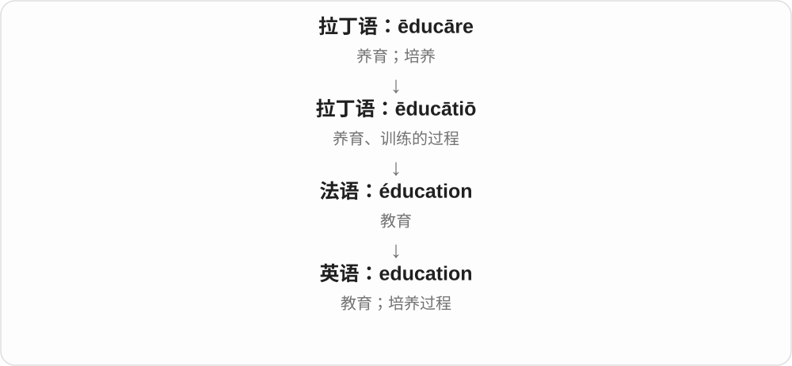

它从培养、养育发展到系统教学，也能指某人的教育背景。an education 可指某一段或某一种教育经历；泛指教育常不可数。

**常见搭配与例句**

higher education（高等教育）；access to education（受教育机会）；a good education（良好教育）。

> Everyone should have access to a good education.

每个人都应有机会接受良好教育。

> His education continued long after he left school.

离开学校很久以后，他仍在不断学习。

**别混淆**

education 是教育过程和经历；qualification 是取得的资历或资格。受过教育不等于一定持有某张证书。

### 2. action — 行动；动作；作用；诉讼

**音标**：/ˈækʃən/

**先抓住这个画面**

action 像从“讨论要怎么办”转到“事情已经做起来了”。

**怎么拆**

现代可对应 act + -ion；历史经法语来自拉丁语 āctiō，并不是英语 act 后来才加上后缀。

**怎么变成今天的意思**

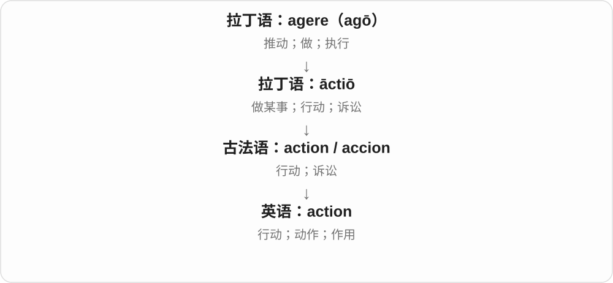

take action 是采取措施；in action 是正在发挥作用。法律里的 action 指诉讼，电影里的 action 也可指激烈动作场面。

**常见搭配与例句**

take action；a course of action；in action；legal action。

> The team agreed on a course of action.

团队商定了一套行动方案。

> We watched the new machine in action.

我们观看了新机器实际运转的情况。

**别混淆**

action 强调做什么或怎样起作用；activity 可以只是正在进行的活动，不必指解决问题的措施。

### 3. reaction — 反应；回应；化学反应

**音标**：/riˈækʃən/

**先抓住这个画面**

reaction 是外界先给出一个刺激，另一方随后发生的变化或回应。

**怎么拆**

现代可对应 re- + action 或 react + -ion；历史还联系拉丁语 reāctiō 和法语 réaction，不能只画成英语 react 的后代。

**怎么变成今天的意思**

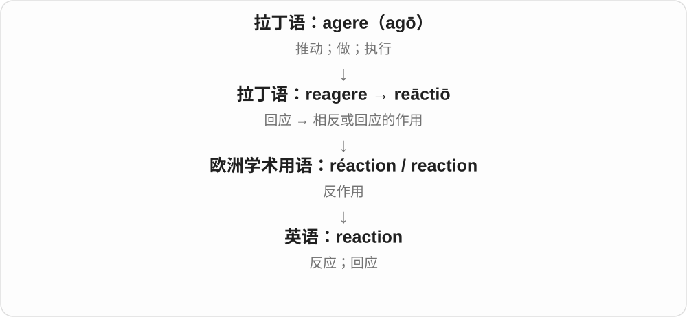

可以是听到消息后的表情，也可以是物质之间的化学变化。化学反应中的“反”并非一定往相反方向走。

**常见搭配与例句**

a reaction to the news；a chemical reaction；reaction time。

> Her first reaction was surprise.

她的第一反应是惊讶。

> The mixture changed colour during the reaction.

混合物在反应过程中变了颜色。

**别混淆**

reaction 可是自动反应；response 也常指经过组织的回答或应对，两者有交叉。

### 4. situation — 情况、局面；处境；位置〔较正式〕

**音标**：/ˌsɪtʃuˈeɪʃən/〔亦 /ˌsɪtjuˈeɪʃən/〕

**先抓住这个画面**

不是一件孤立东西，而是此刻各种条件凑成的局面。人像站在这个局面里，所以也译处境。

**怎么拆**

经法语接拉丁 situatio、situare、situs 等位置材料；现代与 situate 使处于的词族对应，不拆成 sit 坐 + 任意 uation。

**怎么变成今天的意思**

**拉丁 situs 位置 → situare、situatio → 法语 situation**  
放置、所处位置

↓

**英语 situation → situational**  
处境、情况；特定情境相关性质

the current situation 当前情况；a difficult situation 困难处境；deal with the situation 应对局面。

**常见搭配与例句**

the current situation；a difficult situation。

> We need to understand the situation before deciding.

作决定前，我们需要了解情况。

> She handled the difficult situation calmly.

她冷静处理了困难局面。

**别混淆**

situation 是当下条件、处境，location 更直接说地理位置；两个词的具体义有重叠，却不总能互换。

### 5. election — 选举；正式选择

**音标**：/ɪˈlekʃən/

**先抓住这个画面**

election 像从多个候选人中，把要担任某个职位的人选出来。

**怎么拆**

现代对应 elect + -ion；历史经法语来自拉丁语 ēlēctiō，名词有独立借入链。

**怎么变成今天的意思**

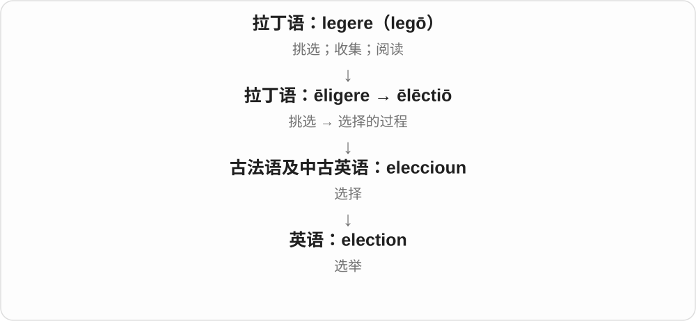

最常见是投票选人，也可在正式文体中表示选择。它不等于竞选活动本身。

**常见搭配与例句**

hold an election；win an election；a general election。

> The club will hold an election next month.

俱乐部下个月将举行选举。

> She won the election by a narrow margin.

她以微弱优势赢得了选举。

**别混淆**

election 是选举；campaign 是争取支持的竞选过程。

### 6. association — 协会；关联；联想；交往

**音标**：英 /əˌsəʊsiˈeɪʃən/；美 /əˌsoʊsiˈeɪʃən/；/si/ 也常读 /ʃi/

**先抓住这个画面**

人连在一起可以组成协会；脑中两个东西连起来是联想；数据里两个变化相关也是 association。

**怎么拆**

来自拉丁语 associātiō，可能经法语 association；现代对应 associate + -ion，但名词有自己的借入历史。

**怎么变成今天的意思**

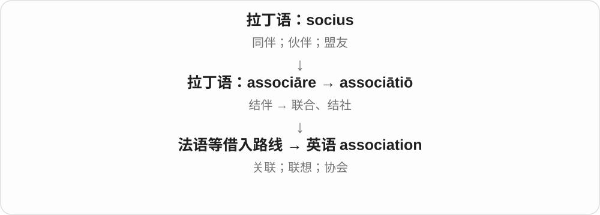

同一个核心“联系”在不同场合变成不同对象。association between A and B 只先说存在关联，不自动说明谁造成谁。

**常见搭配与例句**

a professional association；in association with；an association between…。

> She joined a professional association for translators.

她加入了一个译者专业协会。

> The smell has a strong association with childhood for me.

对我来说，这种气味和童年有很强的联系。

**别混淆**

association 是关系或组织；associate 可指其中的人或建立联系的动作。

### 7. population — 人口；居民；种群；总体〔统计〕

**音标**：英 /ˌpɒpjuˈleɪʃən/；美 /ˌpɑːpjuˈleɪʃən/

**先抓住这个画面**

先把研究范围画出来，再把范围内的成员作为一个整体看。

**怎么拆**

借晚期拉丁 populātiō“人群”，与 populus 相连；现代对应 populate，但名词有独立借入路线。

**怎么变成今天的意思**

**拉丁 populus**  
人民、人群；更早来源未定

↓

**晚期拉丁 populātiō → 英语 population**  
人群 → 一地居民、人口数量

↓

**英语生物学及统计用法**  
种群；作为研究对象的总体

a population of ten thousand 说人数；the local population 说当地居民。生物学可说鸟的种群，统计学的 population 还可是一批零件，不一定有人。

**常见搭配与例句**

the population of；a growing population；a bird population；a sample from a population。

> The town has a population of about ten thousand.

这个镇大约有一万人口。

> The study sampled a small part of the total population of components.

研究从全部零件这一总体中抽取了一小部分样本。

**别混淆**

sample 是抽出的样本；population 是研究想覆盖的总体，不能把调查到的一小部分自动当成所有人。

### 8. construction — 建造；建筑工程；构造；语法结构；理解方式

**音标**：/kənˈstrʌkʃən/

**先抓住这个画面**

construction 既能指“正在搭”，也能指“是怎样搭起来的”。

**怎么拆**

经古法语 construction 来自拉丁 constructio；与 construct 是同源借词。现代可按 construct + -ion 理解，但历史上并非先有英语动词再统一加后缀。

**怎么变成今天的意思**

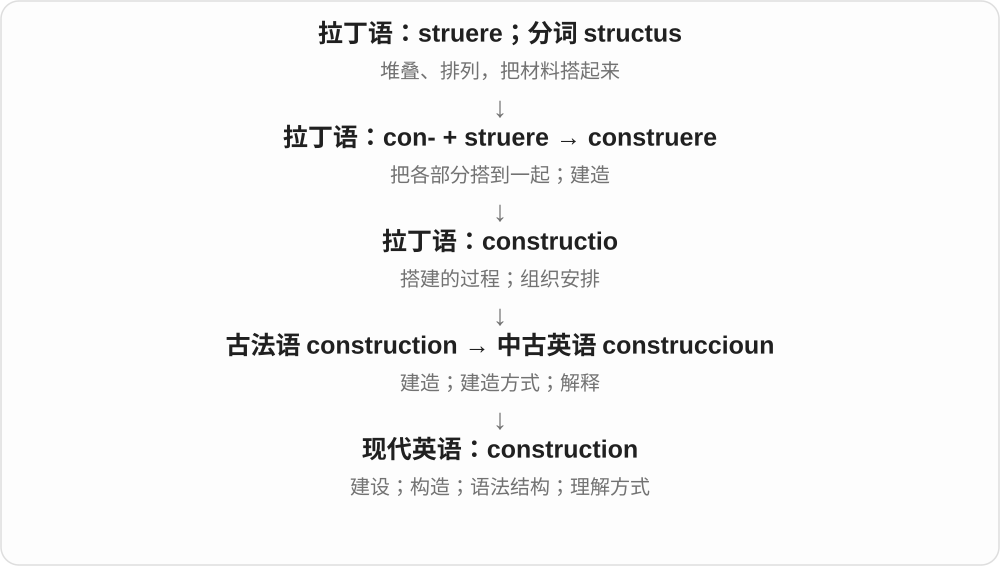

under construction 是正在施工；the construction of a sentence 是句子的组织方式。put a different construction on something 较正式，表示给某件事另一种解释，像把同一批线索拼出不同理解。

**常见搭配与例句**

under construction；the construction industry；sentence construction；put a construction on。

> The new library is still under construction.

新图书馆仍在施工。

> The teacher explained the construction of the sentence.

老师解释了这个句子的结构。

**别混淆**

construction 偏建造过程或组织方式；structure 偏已经形成的整体及其内部关系。

### 9. deconstruction — 拆解；解构；揭示内部假设的分析

**音标**：/ˌdiːkənˈstrʌkʃən/

**先抓住这个画面**

deconstruction 像把一个看似天经地义的说法拆开，检查它靠哪些词、对立和默认前提才站起来。

**怎么拆**

现代解构理论用语经法语 déconstruction 传播，与德里达的作品有关；英语更早也有建筑拆解义。可见成分是 de- 拆开 + construction 构造，不能把所有用法都说成由更晚的英语 deconstruct 加 -ion。

**怎么变成今天的意思**

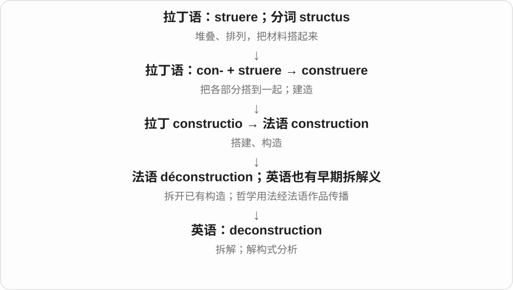

文学、哲学中的解构会检查文本怎样建立对立或高低关系，以及文本自身怎样使这些关系不稳定。广义用法则可以是深入拆析论点；建筑语境仍可指拆解以回收材料。

**常见搭配与例句**

a deconstruction of an argument；literary deconstruction；careful deconstruction of a building。

> Her essay offers a deconstruction of the novel’s sharp division between nature and culture.

她的论文解构了小说中自然与文化之间截然分开的界线。

> Careful deconstruction allowed most of the timber to be reused.

细致拆解使大部分木料得以重新使用。

**别混淆**

destruction 强调毁坏；deconstruction 可以为了看清内部关系或回收部件。理论中的解构也不是随便宣布“什么都没有意义”。

### 10. collection — 收集；收藏品；一组物品

**音标**：/kəˈlekʃən/

**先抓住这个画面**

collection 像散落各处的东西被归拢到同一处，既可说归拢过程，也可说最后那一组。

**怎么拆**

现代对应 collect + -ion；来自拉丁语 collēctiō，经法语等路线传入。

**怎么变成今天的意思**

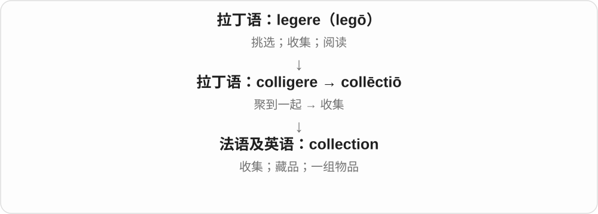

藏书、样本、服装系列都可以是一份 collection；waste collection 说的则是收运过程。

**常见搭配与例句**

a collection of stories；data collection；a private collection。

> The museum owns a large collection of maps.

博物馆收藏了大量地图。

> Data collection took three weeks.

数据收集用了三周。

**别混淆**

collection 是聚在一起的一组；selection 常强调经过挑选的一组。

### 11. opinion — 意见、看法；评价

**音标**：/əˈpɪnjən/

**先抓住这个画面**

同一部电影，有人觉得精彩，有人觉得拖沓：各自作出的判断就是 opinion。它可以有依据，也可能只是偏好。

**怎么拆**

经中古英语、法语 opinion 接拉丁 opinio、opinari 认为。今天可与 opine 发表看法对应，但常用 opinion 不是靠一个现代 op 加 inion 拆出来。

**怎么变成今天的意思**

**拉丁 opinari → opinio**  
认为、判断 → 看法、评价

↓

**法语 opinion → 英语 opinion**  
个人或群体形成的意见

in my opinion 在我看来；an opinion on/about something 对某事的意见；public opinion 舆论；a second opinion 另一位专业人士的意见。

**常见搭配与例句**

in my opinion；public opinion；ask for an opinion。

> In my opinion, the shorter version is clearer.

在我看来，短版更清楚。

> She asked for my opinion on the design.

她问我对这个设计的看法。

**别混淆**

opinion 是判断、看法，fact 是事实；意见可以受事实支持，但不能只因说得肯定就当作事实。

### 12. opinions — 看法、意见、判断〔opinion 的复数〕

**音标**：/əˈpɪnjənz/

**先抓住这个画面**

面对同一件事，不同人会觉得怎样、判断怎样，这些就是 opinions。把一个人的看法说清，不等于已经把事情本身说明白。

**怎么拆**

opinion + -s，/n/ 后读 /z/。经法语 opinion、中古英语相关形式接拉丁 opīniō，与 opīnārī 认为相连；和 opine 发表意见形成词族。

**怎么变成今天的意思**

**拉丁 opīnārī、opīniō → 法语、英语 opinion**  
认为、判断 → 具体看法

↓

**opinion + -s → opinions**  
多个意见、不同人的看法

different opinions 不同意见；express opinions 表达看法；opinions on the plan 对计划的意见。

**常见搭配与例句**

opinions shared in the meeting；opinions that differ。

> The students expressed different opinions about the story.

学生们表达了对故事的不同看法。

> We asked visitors for their opinions on the new display.

我们征求访客对新展陈的意见。

**别混淆**

opinions on 或 about something 说明针对什么事情。in my opinion 是从自己的判断角度说；facts 则把注意放在可查明的情况本身。

### 13. administration — 管理；行政；一届政府；施用、给予

**音标**：英 /ədˌmɪnɪˈstreɪʃən/；美 /ədˌmɪnəˈstreɪʃən/

**先抓住这个画面**

把一套事务真正运转起来：人员怎么安排、规则怎么执行、资源怎么发放。

**怎么拆**

经法语 administration 借自拉丁语 administratio，来自 administrare 的名词支线；英语现代构词分析可联系 administer，但名词有独立借入历史。

**怎么变成今天的意思**

**拉丁语：minor / minus**  
较小、较少；小于另一方

↓

**拉丁语：minister**  
居从属位置的服务者、助手

↓

**拉丁语：ministrare**  
服侍、提供服务

↓

**拉丁语：ad- + ministrare → administrare**  
协助料理、管理、执行

↓

**拉丁语 administratio → 法语 administration → 英语 administration**  
料理事务；管理、行政

医院 administration 是管理工作或管理层；某届 administration 可指该届政府。药物的 administration 则是给药过程。

**常见搭配与例句**

public administration；the current administration；drug administration。

> She works in university administration.

她从事大学行政管理工作。

> The new administration promised to improve public transport.

新一届政府承诺改善公共交通。

> The chart records the time of each medication administration.

表格记录了每次给药的时间。

**别混淆**

management 范围很广；administration 常突出组织运作、手续执行或政府班子。

### 14. direction — 方向；指导；说明、指路〔常用复数〕

**音标**：英、美 /dəˈrekʃən/，也读 /daɪˈrekʃən/

**先抓住这个画面**

一支箭头告诉你往哪里去；扩展到做事，就是告诉你下一步怎么走。

**怎么拆**

古法语 direccion 与拉丁语 directio 的借入，来自 dirigere；现代可与 direct 配套理解，但名词有自己的历史路线。

**怎么变成今天的意思**

**拉丁语：regere**  
引导、使直；治理

↓

**拉丁语：dirigere → directus**  
引向一定方向、摆直 → 直的

↓

**拉丁语 directio → 法语 direccion**  
引导、定向

↓

**英语：direction**  
方向；指导；用法说明

in that direction 是朝那边；under her direction 是在她指导下；follow the directions 是照操作说明或指路走。复数不一定表示好几个方位。

**常见搭配与例句**

in the direction of；ask for directions；under someone’s direction。

> We walked in the direction of the river.

我们朝河边走去。

> Follow the directions on the packet.

请按照包装上的说明操作。

**别混淆**

instruction 常是一条要求或指令；directions 常给出完成事情的步骤或路线。

### 15. operation — 运行；操作；行动；手术；运算

**音标**：英 /ˌɒpəˈreɪʃən/；美 /ˌɑːpəˈreɪʃən/

**先抓住这个画面**

让一件事按一套步骤真正做起来。

**怎么拆**

现代可对应 operate + -ion，但名词经法语独立借自拉丁 operātiō，英语里比 operate 更早，不能倒画成只有英语动词派生。

**怎么变成今天的意思**

**拉丁 opus〔属格 operis〕／opera**  
工作、劳动；做成的作品

↓

**拉丁 operārī → operātiō**  
做事 → 做事的过程

↓

**古法语 operacion → 中古英语 operacioun → 英语 operation**  
运行、行动；后来用于手术等有组织的操作

机器 in operation 是正在运转；rescue operation 是有组织的救援行动；an operation on a knee 是膝部手术。数学的 operation 则把输入按规则变成结果，比如相加。几个意思共同强调“执行一套动作”。

**常见搭配与例句**

in operation；a rescue operation；have an operation；the operation of a machine。

> The new water pump is now in operation.

新的水泵现已投入运行。

> The rescue operation continued through the night.

救援行动持续了一整夜。

> She had an operation on her knee last month.

她上个月做了膝部手术。

**别混淆**

process 强调过程怎样展开；operation 常强调一项有目的的运作、行动或操作。不是每个 operation 都是手术。

### 16. cooperation — 合作；配合；协作

**音标**：英 /kəʊˌɒpəˈreɪʃən/；美 /koʊˌɑːpəˈreɪʃən/

**先抓住这个画面**

各方的动作能接得上，一起把同一件事往前推。

**怎么拆**

经法语 coopération 或直接借后期拉丁 cooperātiō；现代可对应 cooperate + -ion，不等于历史上只能由英语动词派生。

**怎么变成今天的意思**

**拉丁 opus〔属格 operis〕／opera**  
工作、劳动；做成的作品

↓

**后期拉丁 co- + operārī → cooperārī**  
一同工作

↓

**后期拉丁 cooperātiō → 法语 coopération／直接借入路线**  
共同工作的过程

↓

**英语 cooperation**  
合作与配合

国际合作可以是共同研发；Thank you for your cooperation 也可能只是感谢你按要求排队、提供资料。重点是参与和配合，不要求大家成为朋友，也不要求共同拥有一个公司。

**常见搭配与例句**

cooperation between teams；in cooperation with；international cooperation。

> The bridge project depends on cooperation between the two towns.

建桥项目有赖于两座城镇之间的合作。

> Thank you for your cooperation during the safety inspection.

感谢大家在安全检查期间的配合。

**别混淆**

collaboration 常强调共同完成具体作品或项目；cooperation 还可指较宽泛的相互支持、配合。

### 17. location — 位置；地点；外景拍摄地

**音标**：英 /ləʊˈkeɪʃən/；美 /loʊˈkeɪʃən/

**先抓住这个画面**

在地图上落一个点：事情、人物或设施具体在哪里。

**怎么拆**

借自拉丁语 locatio，来自 locare“放置、出租”。现代对应 locate，但名词本身有拉丁借入路线。

**怎么变成今天的意思**

**拉丁语 locus**  
地方、位置

↓

**拉丁语 locare**  
放置、安置；也指出租

↓

**拉丁语 locatio → 英语 location**  
放置、出租 → 位置、地点

a good location 可以说店铺位置好；on location 在影视里指到实际场景拍摄，而非仅在摄影棚里。

**常见搭配与例句**

the exact location；on location；a location map。

> Please send me the exact location of the entrance.

请把入口的准确位置发给我。

> The film was shot on location in a coastal village.

这部电影在一个海边村庄实地拍摄。

**别混淆**

place 是普通的地方；location 特别适合强调位置、选址和定位信息。

### 18. protection — 保护；防护；保护措施

**音标**：/prəˈtekʃən/

**先抓住这个画面**

把人或东西挡在伤害之外的安排，以及受到遮护的状态。

**怎么拆**

晚期拉丁 prōtectiō 经古法语或直接借入中古英语；现代可看 protect + -ion，但英语名词有独立借入路线。

**怎么变成今天的意思**

**拉丁 tegere / tectus**  
盖住；tectus 是分词词干

↓

**拉丁 prō- + tegere → prōtegere / prōtectus**  
在前面遮护、保护

↓

**晚期拉丁 prōtectiō → 古法语 proteccion／拉丁借词 → 中古英语 protection**  
遮护的行为、状态或手段

under protection 是受到保护，provide protection 是提供防护。它既可以说具体物件的保护作用，也可说制度上的保障；某些语境还指避孕或防性传播感染的防护措施，须结合上下文。

**常见搭配与例句**

protection from the rain；protection against damage；under police protection。

> The cover provides protection from dust.

罩子能防尘。

> The witness was placed under police protection.

这名证人被安排接受警方保护。

**别混淆**

protection 强调防护作用；protector 是提供这种作用的人或装置。

### 19. option — 选择；选项；选择权；期权

**音标**：英 /ˈɒpʃən/；美 /ˈɑːpʃən/

**先抓住这个画面**

面前有几条可走的路，其中一条就是一个 option。

**怎么拆**

经法语 option 接拉丁 optio；英语 option 早于 opt，不能把“看起来 opt + -ion”当成实际借入顺序。

**怎么变成今天的意思**

**拉丁语 optare**  
选择、希望；更早来源有争议

↓

**拉丁语 optio → 法语 option**  
选择、选择权

↓

**英语 option**  
选择余地；可选项；特定选择权

have no option 是没有选择余地；a cheaper option 是更便宜的方案。金融期权给持有人按约定条件买或卖的权利，通常并非必须执行；具体权利取决于合约。动词 option 也可指取得作品等的选用权。

**常见搭配与例句**

consider your options；have the option of；an option to buy。

> Taking the train is our cheapest option.

坐火车是我们最便宜的选择。

> The contract gives the tenant an option to renew the lease.

合同赋予租户续租的选择权。

**别混淆**

choice 可以强调作决定的动作；option 常强调摆在面前的方案或保留的选择权。

### 20. connection — 连接；关系；衔接；人脉

**音标**：/kəˈnekʃən/

**先抓住这个画面**

connection 是接上之后形成的那条线或关系：网络连通、两件事有关、车次接得上，都可以这样说。

**怎么拆**

来自拉丁语 connexiō，经中古英语传入；现代 connection 的拼写使 connect + -ion 的关系更明显。

**怎么变成今天的意思**

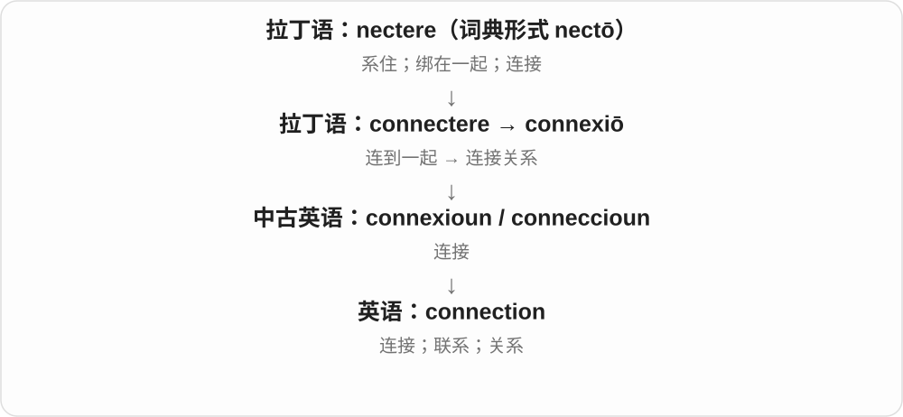

联系可以是物理的，也可以是因果、社交和交通上的。connections 还常指认识的人，因为这些关系能提供信息或机会。

**常见搭配与例句**

an internet connection；a connection between…；miss a connection；have connections；in connection with… 。

> We lost our internet connection during the meeting.

开会时，我们的网络连接断了。

> Is there a connection between these two problems?

这两个问题之间有联系吗？

**别混淆**

connection 只说明有某种联系，不自动证明因果。两件事同时发生，也需要进一步解释它们怎样有关。

### 21. investigation — 调查；查证过程

**音标**：/ɪnˌvestɪˈɡeɪʃən/

**先抓住这个画面**

把找线索、核对证据、追问原因这一整套过程叫出来。

**怎么拆**

来自拉丁 investigatio，经古法语进入英语；现代可按 investigate + -ion 记，但英语名词的记载早于动词。

**怎么变成今天的意思**

**拉丁 vestigium**  
脚印、足迹、留下的痕迹

↓

**拉丁 vestigare → in- + vestigare → investigare**  
沿足迹追踪 → 深入查找、调查

↓

**拉丁 investigatio → 古法语 investigacion → 英语 investigation**  
追查这个过程 → 调查

under investigation 是正在被调查，不等于已经被证明有问题。an investigation into the cause 说明调查对象是原因；后面可以接 into、of 等，取决于具体表达。

**常见搭配与例句**

an investigation into；under investigation；launch an investigation。

> The cause of the fire is still under investigation.

起火原因仍在调查中。

> The investigation revealed an error in the original records.

调查发现原始记录中有一处错误。

**别混淆**

inspection 常偏检查现场或是否合格；investigation 更强调查清问题、原因或事实。

### 22. communication — 交流、沟通；信息传递；通知、来函；通信〔按语境〕

**音标**：/kəˌmjuːnɪˈkeɪʃən/

**先抓住这个画面**

把内容从一方送到另一方的过程；也可以指送来的那一份正式消息。不可数过程和可数来函要分清。

**怎么拆**

经法语 communicacion、拉丁语 commūnicātiōn- 进入中古英语，本身有独立名词借入链，在英语中早于 communicate。现代可对照 communicate 与 -ion，但不画成较晚英语动词生出较早名词。

**怎么变成今天的意思**

**拉丁语 commūnicāre → commūnicātiō、commūnicātiōnem**  
使共享 → 交流、传达的动作名词

↓

**法语 communicacion 等 → 中古英语 communicacioun → communication**  
沟通、交流；传达内容、通信方式

clear communication 清楚沟通，a breakdown in communication 沟通中断，an official communication 正式通知，communications equipment 通信设备。

**常见搭配与例句**

communication skills；clear communication；an official communication；a breakdown in communication。

> Good communication helped the teams avoid mistakes.

良好沟通帮助各团队避免出错。

> We received an official communication from the museum.

我们收到博物馆的一份正式通知。

**别混淆**

communication 过程或信息，conversation 对话是具体交流形式；网络通了不保证双方真正理解，但都可讨论 communication。

### 23. selection — 选择；所选的一组；可供挑选的范围

**音标**：/sɪˈlekʃən/

**先抓住这个画面**

selection 像从整盘水果里挑出几颗：可以指挑选动作，也可以指挑出的那部分。

**怎么拆**

现代可看作 select + -ion；直接历史来源是拉丁语 sēlēctiō。

**怎么变成今天的意思**

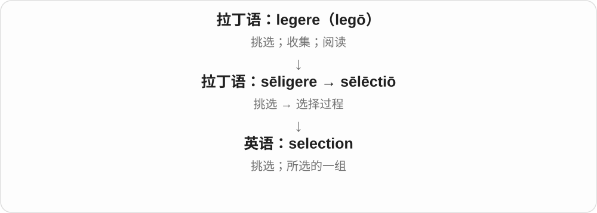

a wide selection 常指提供很多选择，并非已经替你挑好；selection criteria 是如何挑的标准。

**常见搭配与例句**

a wide selection；selection criteria；natural selection。

> The shop offers a wide selection of notebooks.

店里有多种笔记本可供选择。

> The selection process includes an interview.

选拔流程包括面试。

**别混淆**

collection 强调聚集；selection 强调筛选或可选择范围。

### 24. affect — 影响；使感动；装出

**音标**：动词 /əˈfekt/；名词 /ˈæfekt/

**先抓住这个画面**

风吹到水面，水面随之改变：affect 说的是外来的东西对对象起作用。它不一定把对象完全改变。

**怎么拆**

ad-（朝向）+ facere 形成 afficere。影响义联系 affectus“受作用形成的状态”；装出姿态义另经 affectare、法语 affecter 发展，不能混成一条直线。

**怎么变成今天的意思**

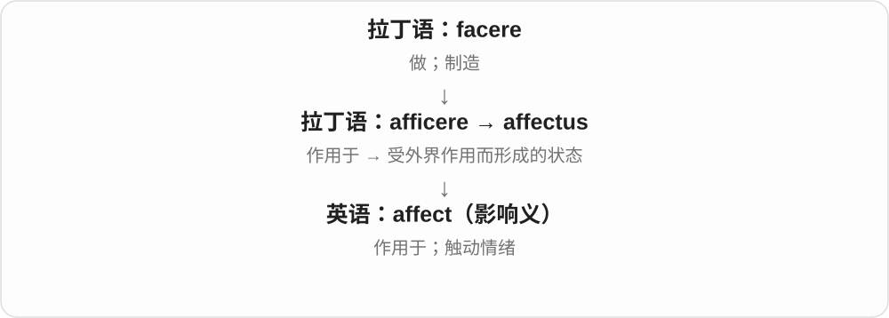

主图画的是影响这一支：外来作用改变对象或触动情绪。另一支 affectare 原有刻意追求、模仿的意思，经法语发展出装出姿态的用法。两支历史上有交织；名词 affect 则是心理学中的情感表现。

**常见搭配与例句**

affect the result；deeply affected；affect an accent。

> Lack of sleep can affect your concentration.

睡眠不足会影响注意力。

> She was deeply affected by his kindness.

他的善意使她深受感动。

**别混淆**

通常用 affect 作动词、effect 作名词；affect 的“装作”义更正式，也常带批评。

### 25. affection — 喜爱、爱意；温柔的感情

**音标**：/əˈfekʃən/

**先抓住这个画面**

看到熟悉的人或宠物，心里自然柔软起来，愿意亲近、照顾，这种温暖的喜欢是 affection。

**怎么拆**

经法语接拉丁 affectio 状态、心情，关联 afficere 影响、使处于某状态；后来偏向温暖的感情。现代与 affect 同族，不把每个 affect 的义项原样搬入。

**怎么变成今天的意思**

**拉丁 afficere → affectio**  
使受到影响 → 状态、感受

↓

**法语、英语 affection**  
情感 → 常见的爱意、喜爱

affection for someone 对某人的喜爱；show affection 表达爱意；with affection 带着感情。常不含恋爱关系。

**常见搭配与例句**

show affection；affection for；with affection。

> She has great affection for her old teacher.

她对以前的老师怀有深厚感情。

> The dog showed its affection by staying close to him.

狗一直贴在他身边，表达亲近。

**别混淆**

affection 是温暖的喜欢，affectation 是装腔作势；拼写近，意思差很远。affection 也不只用于情侣。

### 26. constitution — 宪法；组成、构造；体质

**音标**：英 /ˌkɒnstɪˈtjuːʃən/；美 /ˌkɑːnstɪˈtuːʃən/

**先抓住这个画面**

把一个整体“怎样组织起来”写成基本安排：国家有宪法，身体有自身的体质，材料也有其构成。

**怎么拆**

来自拉丁语 cōnstitūtiō，经古法语进入；和 constitute 对应，但不是最初在英语里简单加 -ion 造出的。

**怎么变成今天的意思**

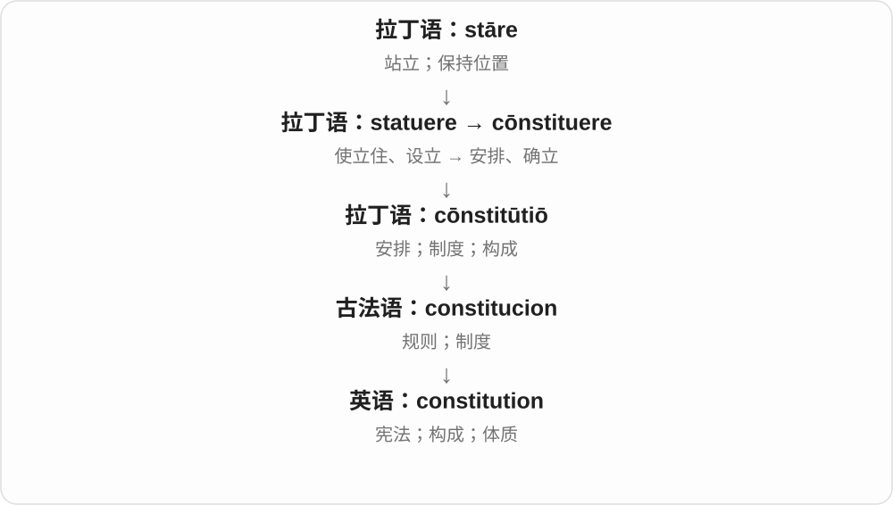

规则规定国家怎样构成和运作，身体的构成体现为体质。三个义项都围绕“一个整体的基本组织方式”。

**常见搭配与例句**

a written constitution；a strong constitution；the constitution of a substance。

> The constitution sets out the main powers of government.

宪法规定了政府的主要权力。

> She has a strong constitution and rarely misses a day of work.

她体质好，很少因身体原因缺勤。

**别混淆**

constitution 是基本组织或基本法；institution 是机构或制度。the constitution 常按语境特指某部宪法。

### 27. depression — 凹陷；低气压；经济萧条；抑郁

**音标**：英 /dɪˈpreʃən/；美 /dɪˈpreʃən/

**先抓住这个画面**

把“往下沉”放到不同场景：地面低一块，经济活动低迷，情绪与生活功能也可能长期受影响。

**怎么拆**

经法语 depression 来自拉丁语 depressiō，与 deprimere 同族；名词不是在现代英语里临时拼出来的。

**怎么变成今天的意思**

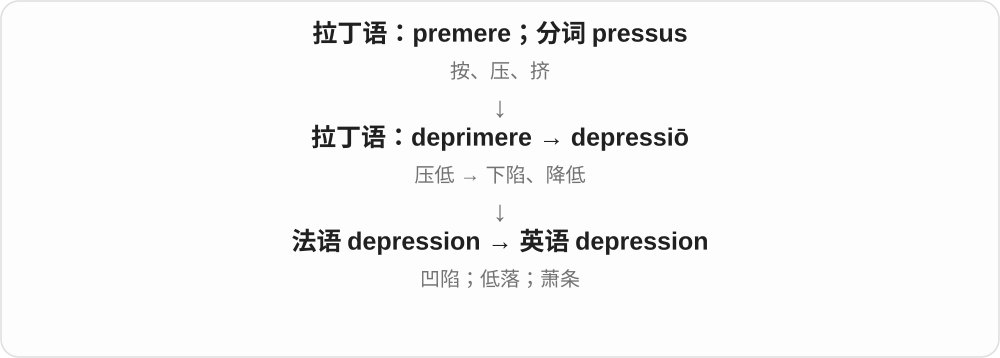

a depression in the ground 是洼地；an economic depression 是严重经济萧条。医学里的 depression 是抑郁症相关用语，不能与一次普通失落直接画等号。

**常见搭配与例句**

a shallow depression；an economic depression；clinical depression。

> Rainwater collected in a shallow depression in the ground.

雨水积在地面一处浅浅的凹陷里。

> The book describes everyday life during the Great Depression.

这本书描写大萧条时期的日常生活。

**别混淆**

recession 通常指经济衰退；depression 一般表示更严重、持续更久的萧条，但没有各机构通用的唯一数值界线。

### 28. expression — 表达；说法；表情；表达式；基因表达

**音标**：英 /ɪkˈspreʃən/；美 /ɪkˈspreʃən/

**先抓住这个画面**

心里的内容找到了一个外面的样子：一句话、一张脸上的神情，或一串表示关系的符号。

**怎么拆**

经法语 expression 来自拉丁语 expressiō，与 exprimere 同族；不是只有英语 express 加 -ion 这一层历史。

**怎么变成今天的意思**

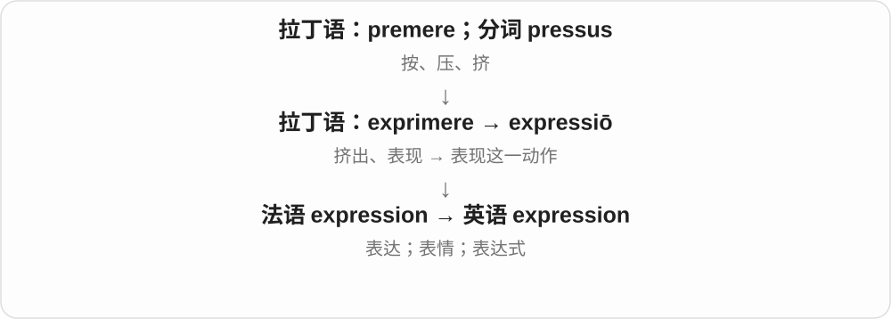

an expression of gratitude 是表达感谢；a puzzled expression 是疑惑的表情；数学 expression 可为 2x + 3，不一定含等号。生物学里指基因信息被用于产生 RNA 或蛋白质等产物的过程。

**常见搭配与例句**

facial expression；freedom of expression；a mathematical expression。

> Her expression changed when she heard the news.

她听到消息时，表情变了。

> The expression “a piece of cake” means that something is easy.

“a piece of cake”这个说法表示某件事很容易。

**别混淆**

expression 是表现出来的样子；impression 是它在别人心中留下的感觉。

### 29. legislation — 立法；法律法规

**音标**：/ˌledʒɪˈsleɪʃən/

**先抓住这个画面**

既能说“把规则正式制定出来”这件事，也能说制定出来的那一批法律。

**怎么拆**

后期拉丁 legislatio 经法语进入英语，也有直接借入分析；legis 是法律，latio 是带来、提出。英语 legislation 早于动词 legislate。

**怎么变成今天的意思**

**拉丁语 lex，属格 legis**  
法律、规则

↓

**后期拉丁语 legis latio / legislatio**  
提出、制定法律

↓

**法语 législation → 英语 legislation〔也有直接拉丁借入分析〕**  
立法；制定的法律

pass legislation 是通过法律；new legislation 可以指一项或一批新法，通常当不可数名词用。若要明确一项，可说 a piece of legislation。

**常见搭配与例句**

pass legislation；draft legislation；legislation on…。

> The committee reviewed proposed legislation on water quality.

委员会审查了有关水质的拟议立法。

> New legislation changed how the agency reports its spending.

新的法律改变了该机构报告支出的方式。

**别混淆**

a bill 通常是待审议的法案；legislation 可说立法过程，也可说已经制定的法律。

### 30. permission — 许可；允许

**音标**：英 /pəˈmɪʃən/；美 /pərˈmɪʃən/

**先抓住这个画面**

permission 像原本关闭的门被有权决定的人打开：“你可以做这件事。”它谈的是准许这件事本身。

**怎么拆**

经法语 permission 来自拉丁语 permissiō；与 permit 同族，但名词有自己的借入路线。

**怎么变成今天的意思**

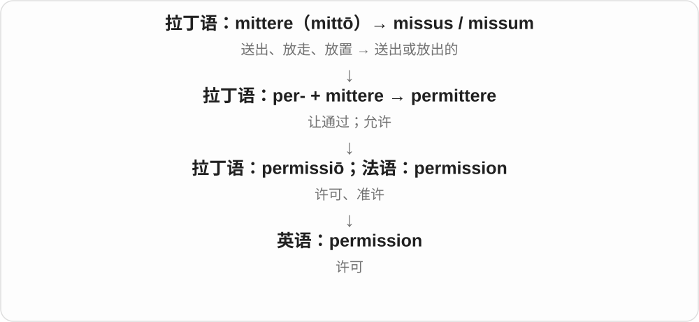

不需要真的发出纸质证件；口头同意、系统授权也能叫 permission。普通的“许可”通常不可数。

**常见搭配与例句**

ask for permission；give permission；without permission；permission to do… 。

> Please ask for permission before using the equipment.

使用设备前请先征得许可。

> She gave us permission to quote the letter.

她允许我们引用这封信。

**别混淆**

permit 作名词常是具体许可证；permission 是允许的状态或授权。通常说 get permission，不说 get a permission。

### 31. migration — 迁移；迁徙；移民流动；数据迁移

**音标**：/maɪˈɡreɪʃən/

**先抓住这个画面**

把许多次移动或一次完整搬迁过程当成一个现象来观察。

**怎么拆**

拉丁 migratio 经法语或直接进入英语，接 migrare；英语名词记录早于常见动词 migrate，不能只按现代动词加 -ion 写历史。

**怎么变成今天的意思**

**拉丁语 migrare**  
从一处迁到另一处

↓

**拉丁语 migratio → 法语 migration / 英语 migration**  
迁移行动 → 人口、动物或数据迁移

bird migration 是鸟类迁徙；rural-to-urban migration 是从乡村向城市的人口迁移；data migration 是数据搬到新环境的过程。迁移可以在一国内发生，也可以跨国。

**常见搭配与例句**

seasonal migration；internal migration；data migration；migration patterns。

> The wetlands are an important stop during bird migration.

这些湿地是鸟类迁徙途中重要的停歇地。

> The report tracks migration from rural areas to cities.

报告追踪了从农村到城市的人口迁移。

> Data migration will take place over the weekend.

数据迁移将在周末进行。

**别混淆**

immigration 特别从迁入地观察人口移动；migration 是更广的总称，不自带“外国人”判断。

### 32. immigration — 移民迁入；入境事务；入境检查部门

**音标**：/ˌɪmɪˈɡreɪʃən/

**先抓住这个画面**

可以谈人迁进一个国家的现象，也可以谈机场负责检查入境资格的那一关。

**怎么拆**

immigrate + -ion，-ate 对应 -ation；英语从迁入动词形成过程名词，后来又简称相关主管机关或检查环节。

**怎么变成今天的意思**

**拉丁语 migrare**  
从一处迁到另一处

↓

**拉丁语 in- + migrare → immigrare**  
进入 + 迁移 → 迁入

↓

**拉丁语 immigratus → 英语 immigrate**  
迁入的分词形式 → 迁入某国定居

↓

**英语 immigrate → immigration**  
迁入 → 移民迁入现象；入境事务与部门

immigration policy 是移民政策；go through immigration 是接受入境检查，旅客不必真的在该国移民定居。这里的机场用法是部门、程序的简称。

**常见搭配与例句**

immigration policy；immigration officials；go through immigration。

> The museum traces the city’s history of immigration.

博物馆追溯了这座城市的移民迁入历史。

> We waited in line at immigration after landing.

降落后，我们在入境检查处排队等候。

**别混淆**

customs 主要检查货物、申报物品；immigration 主要处理人员入境，两道环节常相邻却不同。

### 33. suck — 吸、吮；吸走；糟透了〔粗俗口语〕

**音标**：/sʌk/

**先抓住这个画面**

吸管里把饮料吸上来；机器也能吸走灰。某件事不断把精力抽走，又能说 suck the energy out；This sucks 则是在骂太差劲。

**怎么拆**

接古英语 sūcan，日耳曼语与更远语言都有吸吮相关材料。现代负面俚语是另外发展出的约定用法，不能把每个吸都翻成糟糕。

**怎么变成今天的意思**

**古英语 sūcan → 中古英语 souken → suck**  
用嘴吸入液体、吮吸

↓

**英语 suck**  
吸取；吸走力量、资源；俚语说很差

suck through a straw 用吸管吸，suck up dust 吸灰，suck the energy out of 抽干精力；This sucks! 真差劲！语气随意、可显粗鲁。

**常见搭配与例句**

suck through a straw；suck up dust；suck the energy out of；This sucks!。

> The machine sucked up the dust.

机器吸走了灰尘。

> This job sucks the energy out of me.

这份工作把我的精力都耗干了。

**别混淆**

suck 用吸力，sip 小口喝；小口喝不一定必须用吸管。suck up to someone 是奉承、巴结的整组用法。

### 34. sucking — 吸、吮吸、吸走〔现在分词、动名词〕

**音标**：/ˈsʌkɪŋ/

**先抓住这个画面**

一股吸力正把东西往里带，是 sucking。也能借吸走画面，说某个过程不断消耗精力、乐趣。

**怎么拆**

suck 接古英语 sūcan 吸吮，后来扩大到吸取、耗走等用法。现代直接加完整 -ing，词尾 ck 保留，读 /kɪŋ/。

**怎么变成今天的意思**

**古英语 sūcan → suck**  
吸入液体 → 吸取、耗走

↓

**suck + -ing → sucking**  
正在吸、不断吸走

sucking water from… 从……吸水；sucking up dust 吸走灰尘；sucking the fun out of… 耗掉……的乐趣。

**常见搭配与例句**

a sucking sound 吸吮声；sucking through a straw 用吸管吸。

> The machine was sucking up dust from the floor.

机器正在吸走地板上的灰尘。

> The repeated delays were sucking the fun out of the trip.

一次次延误正在耗掉旅行的乐趣。

**别混淆**

sucking 不必总是嘴做动作，泵、吸尘器也能这样工作。抽象宾语 energy、fun 则表示某种好东西在被耗走。

### 35. sucked — 吸入了、吮吸了；吸走了、吸引住了〔过去式、过去分词〕

**音标**：/sʌkt/

**先抓住这个画面**

靠吸力把东西往里面带，是 sucked。故事把人吸进去、某件事把精力吸走，都能借这个方向来理解。

**怎么拆**

suck 继承古英语 sūcan，经中古英语 souken 延续。现代直接加完整 -ed，/k/ 后读 /t/；词尾已有 ck，不额外双写 k。

**怎么变成今天的意思**

**古英语 sūcan → 中古英语 souken → suck**  
用嘴吸入 → 吸取、吸引、耗走

↓

**suck + -ed → sucked**  
已经吸入；相关吸引、消耗已经发生

sucked through a straw 用吸管吸了；sucked in dust 吸进灰尘；sucked into the story 被故事吸引住。

**常见搭配与例句**

sucked up water 吸起水；sucked the joy out of… 把……的乐趣都耗掉。

> The pump sucked water from the tank.

泵从水箱里吸出了水。

> The opening scene sucked me into the story.

开场那一幕一下把我吸引进故事里。

**别混淆**

sucked in 可以是物体被吸进去，也可以是人被吸引、被卷进去。判断被吸入的是什么，比死记一个中文词更有用。

### 36. institution — 机构；制度；惯例；确立

**音标**：英 /ˌɪnstɪˈtjuːʃən/；美 /ˌɪnstɪˈtuːʃən/

**先抓住这个画面**

某种安排已经立住，成了大家持续依靠或照着运作的东西。

**怎么拆**

经古法语 institucion 接拉丁 institutio，来自 instituere；它有独立名词借入历史，不是只在现代英语 institute 后加 -ion。

**怎么变成今天的意思**

**拉丁 stare → statuere**  
站立 → 使站稳、设立、安排

↓

**拉丁 in- + statuere → instituere**  
设立、安排、教导

↓

**拉丁 institutio → 古法语 institucion → 英语 institution**  
设立、安排 → 已建立的机构、制度、习惯

a financial institution 是金融机构，the institution of marriage 是婚姻制度。某家老店也可被称为 a local institution，意思是它已成当地生活的一部分。

**常见搭配与例句**

an educational institution；a public institution；a local institution。

> The museum is one of the city’s oldest cultural institutions.

这家博物馆是城里历史最久的文化机构之一。

> Sunday lunch has become an institution in our family.

周日午餐已经成了我们家的固定传统。

**别混淆**

organization 多指有组织的人群或单位；institution 还能指制度、惯例，而不一定有办公楼。

### 37. promotion — 晋升；推广；促销活动

**音标**：英 /prəˈməʊʃən/；美 /prəˈmoʊʃən/

**先抓住这个画面**

promotion 是一次“往前推”的安排：把员工往上提，或把商品推到顾客面前。

**怎么拆**

来自拉丁语 prōmōtiō，经法语传入；与 promote 对应，但有独立的名词历史。

**怎么变成今天的意思**

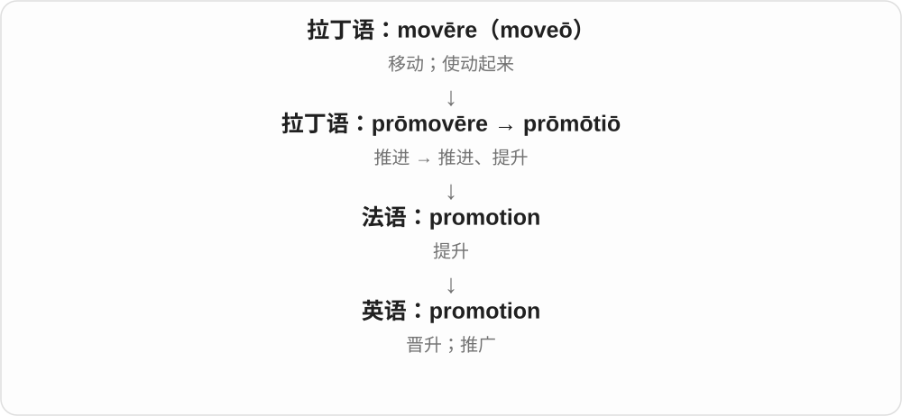

工作语境多指升职，商业语境多指宣传推广，也可具体指一次促销。

**常见搭配与例句**

get a promotion；sales promotion；the promotion of learning。

> He received a promotion after three years.

工作三年后，他获得了晋升。

> The store is running a summer promotion.

商店正在举办夏季促销活动。

**别混淆**

promotion 可能包含打折，但不等于 discount；不降价的宣传也可算 promotion。

### 38. vacation — 假期；休假、度假

**音标**：/veɪˈkeɪʃən/

**先抓住这个画面**

把一段时间从日常工作里空出来，让自己暂时不被原来的职责占满。

**怎么拆**

经法语等路线来自拉丁 vacatio，与 vacare“空着、闲着”有关；英语 vacation 早于 vacate，不能说是后者才造出的名词。

**怎么变成今天的意思**

**拉丁语 vacare／vacuus**  
空着、闲着／空的

↓

**拉丁 vacatio → 法语 vacacion**  
免于职责、空闲

↓

**英语 vacation**  
工作或学习的休止期；假期

vacation 在美式英语里常说假期或度假。on vacation 是正在休假，不一定已经坐飞机去远方，在家休息也可以。词根帮你抓住“从惯常事务里空出来”，不要误解为假期必须什么都不做。

**常见搭配与例句**

take a vacation；go on vacation；summer vacation；vacation in a place。

> I’m taking a short vacation after the project ends.

项目结束后，我准备休一个短假。

> We spent our vacation at home and explored the neighbourhood.

我们在家度过假期，逛了逛附近的街区。

**别混淆**

英式英语常用 holiday；vacancy 则是房间或职位的空缺，不能互换。

### 39. translation — 翻译过程；译文、译本；转移、平移

**音标**：/trænzˈleɪʃən/

**先抓住这个画面**

既可以说搬意思这件事，也可以说搬完留下的那份文本；a translation 往往就是某一个译本。

**怎么拆**

借法语 translacion 或拉丁 trānslātiō，来自 trānslāt- 这条旧分词词干。现代对应 translate + -ion，但英语名词有自己的借入链，不是只从现代动词现场新造。

**怎么变成今天的意思**

**拉丁 trāns-；ferre 与其不规则分词 lātus**  
跨过；携带，与被带过去的形式

↓

**拉丁 trānslātus、trānslātiō、trānslātor 等**  
带过；转移过程；执行者，形成同族的平行词

↓

**拉丁 trānslātiō → 法语、英语 translation**  
跨语言转换及其结果；相应转移义

a translation of the novel 小说译本，in translation 以译文形式，lost in translation 翻译中丢失，machine translation 机器翻译。

**常见搭配与例句**

a translation of；in translation；machine translation；lost in translation。

> I read the novel in translation.

我读的是这部小说的译本。

> Some of the humour was lost in translation.

有些幽默在翻译中丢失了。

**别混淆**

translation 可过程、结果；interpretation 还可解释、口译等，特定职业语境常用来区分口笔译，但日常动词 translate 也能谈口头语言转换。

### 40. possession — 占有、持有；财物；球权；被附身的状态

**音标**：/pəˈzeʃən/

**先抓住这个画面**

possession 先问“东西现在在谁手里、受谁控制”，也能直接指手里的那件东西。

**怎么拆**

源自拉丁 possessio，经古法语及直接拉丁借入；英语名词并非统一由更晚的 possess 加 -ion 形成。现代构词仍可把两者联系起来。

**怎么变成今天的意思**

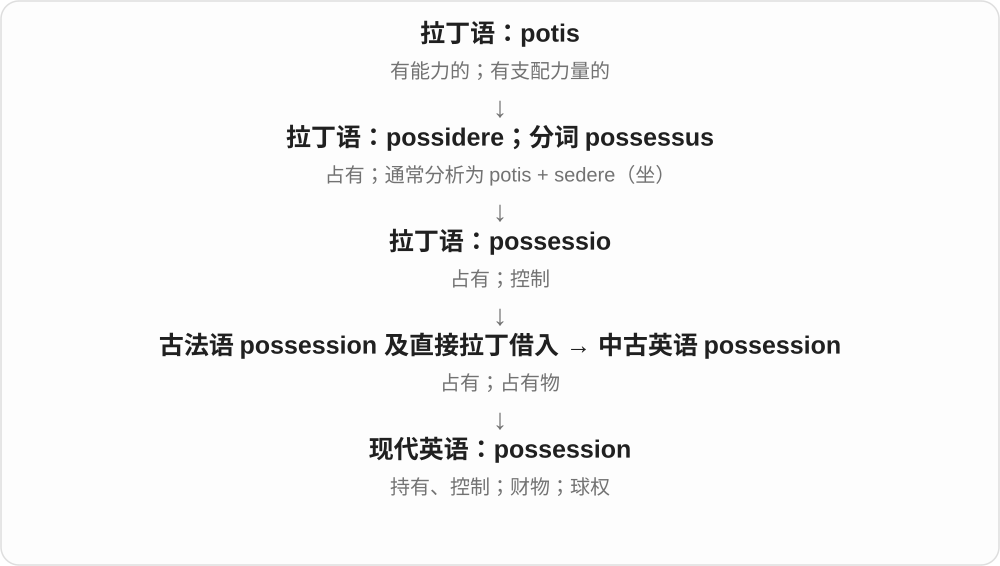

in possession of the keys 是持有钥匙；a prized possession 是珍爱的物品；复数 possessions 常指个人财物。足球里的 keep possession 是控住球，恐怖故事里的 demonic possession 则是被恶魔控制。

**常见搭配与例句**

in possession of；take possession of；personal possessions；retain possession。

> The original letter is still in her possession.

原信仍由她保存着。

> He packed his few possessions into one suitcase.

他把不多的个人物品装进了一个行李箱。

> Our team kept possession for most of the second half.

下半场大部分时间是我们队在控球。

**别混淆**

possession 可强调实际持有或控制；ownership 强调所有权。借来的书在你手里，也可能是 in your possession。

### 41. regulation — 规章；监管；调节；符合规定的

**音标**：英、美 /ˌreɡjəˈleɪʃən/

**先抓住这个画面**

可以是写下来的“一条规矩”，也可以是不断把系统调在合适范围内这件事。

**怎么拆**

regulate + -ion，英语的动作名词；之后发展成一条规章，也可作定语表示合乎规定。

**怎么变成今天的意思**

**拉丁语：regere**  
引导、使直；治理

↓

**拉丁语：regula**  
直尺、直条；准则

↓

**后期拉丁语：regulare → regulatus**  
按准则调节、管理

↓

**英语：regulate**  
调节；监管

↓

**英语：regulate + -ion → regulation**  
调节、监管 → 一条规定

a regulation 是一条规定，regulation of temperature 是温度调节。regulation uniform 指规定式样的制服，不是说制服会控制别人。

**常见搭配与例句**

safety regulations；comply with regulations；temperature regulation。

> All visitors must follow the safety regulations.

所有访客都必须遵守安全规定。

> The device improves the regulation of water pressure.

这个装置让水压调节更稳定。

**别混淆**

law 通常由特定立法程序形成；regulation 常是更具体的管理规则，实际关系取决于制度。

### 42. exhibition — 展览；公开展示；某种表现

**音标**：/ˌeksɪˈbɪʃən/

**先抓住这个画面**

把一组作品、产品或成果安排好，让人集中观看，是一场 exhibition。

**怎么拆**

经古法语 exhibicion 来自拉丁语 exhibitiō，与 exhibēre“呈现”对应；现代与 exhibit 构成词族。

**怎么变成今天的意思**

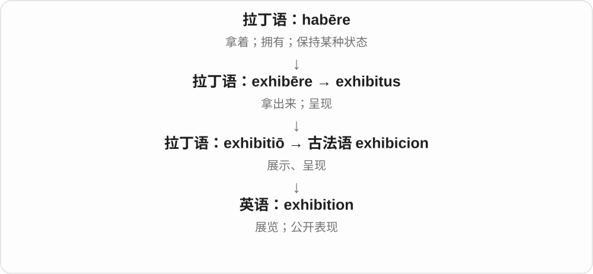

从展示的行为到一场展览。an exhibition of skill 还可指技艺的精彩表现，不一定在博物馆里。

**常见搭配与例句**

hold an exhibition；an art exhibition；on exhibition；an exhibition of skill。

> The exhibition brings together drawings from five countries.

这场展览汇集了来自五个国家的绘画作品。

> The match was an impressive exhibition of teamwork.

这场比赛精彩地展现了团队协作。

**别混淆**

exhibition 是活动或整体展示；exhibit 常指单件展品。show 比两者都更口语、更宽泛。

### 43. consumption — 消费；消耗；消耗量

**音标**：/kənˈsʌmpʃən/

**先抓住这个画面**

看着油箱的油一点点减少，你看到的是 consumption；它既能说使用过程，也能说用了多少。

**怎么拆**

拉丁 cōnsūmptiō 经法语进入英语，含 sūmpt- 分词词干；不是把 consume 的拼写机械地加 tion。

**怎么变成今天的意思**

**拉丁 sūmere；过去分词 sūmptus**  
拿取；取用

↓

**拉丁 cōnsūmere → cōnsūmptiō**  
消耗 → 消耗的行为

↓

**古法语 consumpcion → 中古英语 → consumption**  
消费、消耗；消耗量

energy consumption 是能源消耗，for human consumption 是供人食用。旧文学里的 consumption 还可能指使人消瘦的肺病，尤其肺结核；不要按现代购物义硬译。

**常见搭配与例句**

fuel consumption；water consumption；fit for human consumption。

> The new lights reduced electricity consumption.

新灯具降低了耗电量。

> The packaging states that the product is not for human consumption.

包装注明该产品不供人食用。

**别混淆**

production 把产品做出来；consumption 把产品或资源投入使用。消费不一定是浪费。

### 44. corruption — 腐败；败坏；数据损坏

**音标**：/kəˈrʌpʃən/

**先抓住这个画面**

原本应该可靠的规则、品行或内容，从内部变坏了。

**怎么拆**

经法语 corruption 或直接借拉丁 corruptio，接 corrumpere。现代与 corrupt + -ion 对应，但名词在拉丁语中已经形成。

**怎么变成今天的意思**

**拉丁 rumpere；完成分词 ruptus**  
打破、断裂；被打破的

↓

**拉丁 corrumpere → corruptio → 法语 corruption**  
败坏、毁坏 → 腐化、损坏

↓

**英语 corruption**  
腐败行为；文字或数据等损坏

political corruption 指滥用权力谋取不当利益等；data corruption 是数据内容损坏，未必有人故意造假。两者共同点是可信的运行或内容被破坏。

**常见搭配与例句**

political corruption；combat corruption；data corruption；corruption of a text。

> The investigation examined allegations of corruption in public contracting.

调查审查了公共合同领域的腐败指控。

> A checksum can help detect accidental data corruption.

校验和有助于发现意外的数据损坏。

**别混淆**

corruption 可以是道德或技术问题；不能因为文件出现 corruption，就推断一定有人贪污或恶意篡改。

### 45. exception — 例外

**音标**：/ɪkˈsepʃən/

**先抓住这个画面**

规则把大多数情况圈进来，exception 是被单独拿出来、不能照常处理的那个情况。

**怎么拆**

属于 except 的名词词族，历史上经法语来自拉丁语 exceptiō。现代可用 except + -ion 对照记忆。

**怎么变成今天的意思**

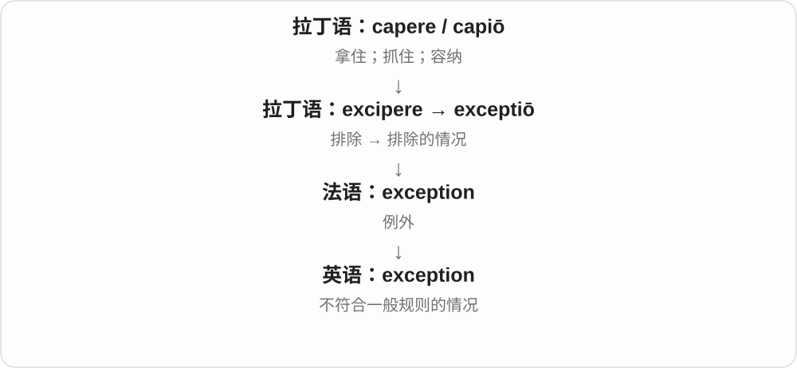

“拿出去”的不是必须讨厌的东西，也可能是被特别允许的情况。所以 make an exception 是破例，而不是制造一个错误。

**常见搭配与例句**

make an exception；with the exception of…；an exception to the rule。

> We do not usually allow pets, but we made an exception this time.

我们通常不允许带宠物，但这次破了例。

> Her case is an exception to the general rule.

她的情况是一般规则之外的一个例外。

**别混淆**

exception 不等于 mistake。程序中的 exception 是需要另行处理的异常情况，也不必然等于程序员写错代码。

### 46. impression — 印象；印痕；模仿表演

**音标**：英 /ɪmˈpreʃən/；美 /ɪmˈpreʃən/

**先抓住这个画面**

印章在泥上留下痕迹；一个人的举止，也在你脑中留下大致感觉。

**怎么拆**

来自拉丁语 impressiō，经法语 impression 借入；现代能看出 impress 与 -ion 的关系，历史上名词有自己的借入路线。

**怎么变成今天的意思**

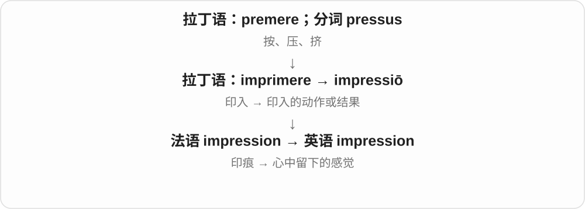

a first impression 是初印象；be under the impression that 是一直以为，可能误解。do an impression of someone 是模仿他的声音或举止。

**常见搭配与例句**

make an impression；give the impression；a convincing impression。

> My first impression was that the office was very welcoming.

我的第一印象是这间办公室让人感到很亲切。

> He does a funny impression of our old teacher.

他模仿我们以前的老师，十分有趣。

**别混淆**

impression 是主观印象，不自动等于事实；expression 更强调内在意思怎样表现出来。

### 47. compensation — 补偿；赔偿；报酬、薪酬

**音标**：英 /ˌkɒmpenˈseɪʃən/；美 /ˌkɑːmpenˈseɪʃən/

**先抓住这个画面**

把“补回来”的结果当成一项给付或安排：可以是弥补损失的钱，也可以是工作换来的薪酬。

**怎么拆**

接拉丁 compensatio／compensationem，来自 compensare 的词族。英语名词记录早于常用动词 compensate，不能在历史里只画成英语动词加 -ion。

**怎么变成今天的意思**

**拉丁 pendere → pensare**  
称量 → 反复称量、权衡

↓

**拉丁 com- + pensare → compensare；分词 compensatus**  
放在一起称 → 抵平、补足

↓

**拉丁 compensatio／compensationem → 中古英语 compensation**  
抵平、弥补的动作或结果名词

↓

**现代 employment 等用法**  
损失补偿；工作报酬或薪酬安排

compensation for damage 是损失补偿；a compensation package 在招聘中通常说薪酬及相关待遇。具体包含哪些项目要看上下文，不能每次都翻成赔偿金。

**常见搭配与例句**

receive compensation；compensation for；a compensation package；adequate compensation。

> They received compensation for the damaged equipment.

他们为受损设备获得了补偿。

> The job advertisement describes the compensation package.

招聘广告介绍了这份工作的薪酬待遇。

**别混淆**

compensation 可以指报酬或补偿；complaint 是投诉，读音和拼写有一点像，但与这条称量词根无关。

### 48. infection — 感染；感染性疾病；计算机受感染的状态

**音标**：/ɪnˈfekʃən/

**先抓住这个画面**

不是表面碰了一下，而是感染性因素进入宿主、建立相应过程。电脑被恶意程序侵入也借这个感染的画面。

**怎么拆**

经古法语 infection、infeccion 等接晚期拉丁 īnfectiō、inficere。更早有浸染、沾染的意义；现代对应 infect + -ion，不是 in- 否定 + fiction 小说。

**怎么变成今天的意思**

**拉丁 in- 向内 + facere 的相关形式 → inficere**  
浸入、染色；沾染、污染

↓

**拉丁 īnfectiō 经法语等 → infection**  
污染、感染；现代也借用于计算机感染

a bacterial infection 细菌感染，prevent infection 预防感染，a computer infection 计算机感染。infection 可说过程，也能可数说一次、某种感染。

**常见搭配与例句**

a bacterial infection；prevent infection；a computer infection。

> The textbook distinguishes bacterial and viral infections.

教材区分了细菌感染和病毒感染。

> The scan found signs of infection on the computer.

扫描发现了电脑受感染的迹象。

**别混淆**

infection 感染与 inflammation 炎症不同：前者说感染过程，后者说机体反应，不能只因中文相近便互换。

### 49. intention — 意图；打算；目的

**音标**：/ɪnˈtenʃən/

**先抓住这个画面**

intention 是行动前心里指向的目标：你本来想让什么发生。

**怎么拆**

来自拉丁语 intentiō，经古法语 entencion；现代可与 intend / intent 对照，但不是英语 intent 生出所有历史形式。

**怎么变成今天的意思**

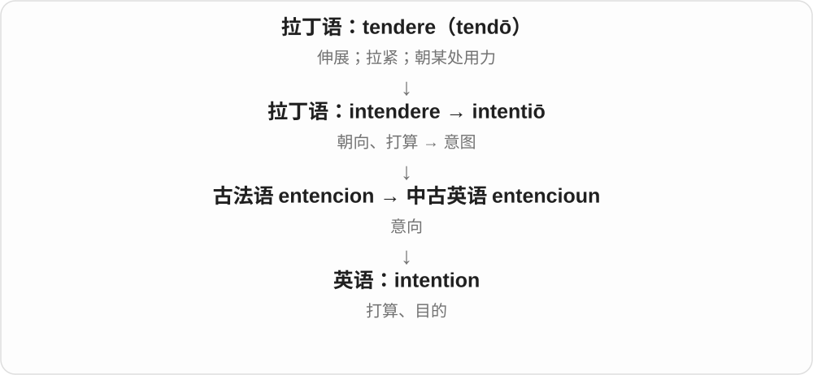

have no intention of doing 是完全不打算做；good intentions 不保证最后效果好。

**常见搭配与例句**

with the intention of；have every intention of；good intentions。

> My intention was to help, not to interrupt.

我原本是想帮忙，不是打断。

> She has no intention of leaving the team.

她完全没有离开团队的打算。

**别混淆**

intention 是想达到的目的；result 是实际发生的结果。

### 50. innovation — 创新；革新；新方法或新成果

**音标**：/ˌɪnəˈveɪʃən/

**先抓住这个画面**

把一种新做法带进原本的流程，让事情换一种方式运转，这就是 innovation 的中心。

**怎么拆**

后期拉丁 innovātiō，经法语或直接拉丁传入；英语名词出现早于 innovate，不画成后者的产物。

**怎么变成今天的意思**

**拉丁 novus**  
新的

↓

**拉丁 innovāre → 后期拉丁 innovātiō；法语 innovation**  
更新、改变 → 革新

↓

**英语 innovation**  
创新过程；引入的新变化

可不可数地说鼓励 innovation，也可数 a useful innovation。它可以是技术、流程、服务等变化，不一定是一件刚发明的实体机器。

**常见搭配与例句**

technological innovation；encourage innovation；an innovation in。

> The company encourages innovation in everyday work.

公司鼓励在日常工作中尝试新方法。

> This small innovation made the process much easier.

这项小革新让流程轻松了许多。

**别混淆**

invention 常强调发明一个东西或方法；innovation 强调把新变化引入实践，两者可能重叠。

### 51. discrimination — 歧视；辨别、区分能力或过程

**音标**：/dɪˌskrɪmɪˈneɪʃən/

**先抓住这个画面**

可以是对人不公平地分三六九等，也可以是耳朵能分清两个相近音；要看对象和搭配。

**怎么拆**

借拉丁 discrīminātiō 等动作名词，现代对应 discriminate + -ion。不是凡 discrimination 都指社会歧视。

**怎么变成今天的意思**

**拉丁 discernere → discrīmen / discrīmināre**  
分开、辨别 → 区别、作区分

↓

**拉丁相应形式 → 英语 discriminate/discrimination**  
辨别；按群体特征作不利区别对待

↓

**性质与否定形式**  
discriminatory 歧视性的；indiscriminate 不加分辨的

↓

**discrīminātiō → discrimination**  
区分过程、辨别力；后有不利群体对待的常见义

racial discrimination 种族歧视，age discrimination 年龄歧视，auditory discrimination 听觉辨别，discrimination between two signals 两个信号的区分。

**常见搭配与例句**

racial discrimination；age discrimination；auditory discrimination。

> The report documents discrimination in recruitment.

报告记录了招聘中的歧视。

> The exercise develops discrimination between similar speech sounds.

练习培养区分相近语音的能力。

**别混淆**

discrimination 社会议题里常负面，技术里的区分义可中性。description 描述与它拼音近，却是另一词。

### 52. celebration — 庆祝、庆典、庆祝活动

**音标**：英 /ˌselɪˈbreɪʃən/；美 /ˌseləˈbreɪʃən/

**先抓住这个画面**

把庆祝这件事或专门办的活动当名词来说；复数 celebrations 可包括一连串庆祝安排。

**怎么拆**

借法语 celebration、拉丁 celebrātiō 的相应名词；现代可对照 celebrate 去 e 加 -ion，不把历史画成只有英语后来才造这一条路。

**怎么变成今天的意思**

**拉丁 celeber → celebrāre、celebrātus → celebrate**  
人多、著名等 → 聚集纪念、赞颂、庆祝

↓

**拉丁 celebrātiō → 法语 celebration → celebration**  
庆祝、纪念的活动或行为

a birthday celebration 生日庆祝，in celebration of 为庆祝，a cause for celebration 值得庆祝的事。

**常见搭配与例句**

a birthday celebration；in celebration of；a cause for celebration。

> The town held a celebration in the square.

小镇在广场举行庆典。

> Their safe return was a cause for celebration.

他们平安归来值得庆祝。

**别混淆**

celebration 可一场活动或庆祝行为，celebrity 名人是同族另一分支，不是庆祝活动的复数。

### 53. execution — 执行、完成；完成方式、表现；程序运行；处决

**音标**：/ˌeksɪˈkjuːʃən/

**先抓住这个画面**

想法写得好是一回事，真正做出来做得如何，是 execution；节目里说 superb execution，可能是在夸动作完成得漂亮。

**怎么拆**

借法语 execution，接拉丁 exsecūtiō 行为名词，现代对应 execute + -ion，末尾形态与读音变化，不是直接把整个 execute 原样保留。

**怎么变成今天的意思**

**拉丁 ex- + sequī → exsequī；分词 exsecūtus**  
跟随到底、把事做完

↓

**法语 executer → 英语 execute**  
执行、实行；执行刑罚等

↓

**现代专门用法**  
完成动作、运行程序；execution 指执行过程或方式

↓

**拉丁 exsecūtiō → 法语 execution → 英语 execution**  
执行的过程、结果或方式；现代对应 execute + -ion

the execution of a plan 计划执行，flawless execution 完美完成，program execution 程序运行，public execution 公开处决。

**常见搭配与例句**

the execution of a plan；flawless execution；program execution。

> The idea was promising, but the execution was poor.

想法很有希望，但做出来的效果很差。

> The error interrupted program execution.

这个错误中断了程序运行。

**别混淆**

execution 是动作及完成方式，executor 是执行某任务的人或专门法律角色；听到 execution 时必须连同上下文理解，不能默认处决。

### 54. collaboration — 合作；合作成果；与敌方合作

**音标**：/kəˌlæbəˈreɪʃən/

**先抓住这个画面**

重点放在共同工作的过程，或由共同工作做出来的作品。

**怎么拆**

借自法语 collaboration，接拉丁 collaborare；英语名词记录早于 collaborate，现代可对应动词 + -ion，但历史不能倒过来。

**怎么变成今天的意思**

**拉丁语 labor**  
劳动、费力、辛苦；更早来源不确定

↓

**拉丁语 laborare**  
劳动、努力

↓

**拉丁语 com- + laborare → collaborare**  
一起工作

↓

**法语 collaboration → 英语 collaboration**  
共同劳动 → 合作活动、合作成果

in collaboration with 表示与某人合作；a collaboration between two artists 可以是一件具体作品。占领史中的 collaboration 可能带有通敌含义，需要语境。

**常见搭配与例句**

in collaboration with；close collaboration；a creative collaboration。

> The exhibition was developed in collaboration with local artists.

展览由本地艺术家共同参与策划。

> The album is a collaboration between a singer and a string quartet.

这张专辑是歌手与一个弦乐四重奏组合的合作作品。

**别混淆**

cooperation 可以不共享最终作品；collaboration 常把双方的工作交织成一个成果。

### 55. concentration — 专注；集中；浓度

**音标**：英 /ˌkɒnsənˈtreɪʃən/；美 /ˌkɑːnsənˈtreɪʃən/

**先抓住这个画面**

注意力、人或某种成分，都挤到较小的范围里。

**怎么拆**

现代可按 concentrate + -ion；历史资料另有新拉丁 concentrātiō 的借入分析，不能只凭词尾把它当唯一英语派生。

**怎么变成今天的意思**

**希腊 kéntron → 拉丁 centrum**  
尖点、刺；圆规固定的一点 → 圆心、中心

↓

**近代拉丁 concentrāre → concentrātiō；罗曼语亦有对应形式**  
聚到中心 → 聚集、浓缩

↓

**英语 concentration**  
借入或与 concentrate 派生相连；集中、浓度、专注

学习时 concentration 是注意力集中；溶液 concentration 是一定量溶液或溶剂中含多少溶质；人口 concentration 是人口聚集。

**常见搭配与例句**

lose concentration；a high concentration of；the concentration of a solution。

> The noise broke my concentration.

噪声打断了我的专注。

> The sample contains a low concentration of salt.

这份样品中的盐浓度较低。

**别混淆**

concentrate 是动作或浓缩物；concentration 是集中状态、过程或浓度指标。

### 56. federation — 联邦；联合会；结成联合体

**音标**：/ˌfedəˈreɪʃən/

**先抓住这个画面**

原来各自独立的几个单位，搭起一个共同框架来办事。

**怎么拆**

经法语 fédération 借入，接后期拉丁 foederātiō、拉丁 foederāre“结盟”。现代与 federate + -ion 对应，但名词有独立借入路线。

**怎么变成今天的意思**

**拉丁 foedus；属格 foederis**  
盟约、条约、联盟

↓

**拉丁 foederāre → 后期拉丁 foederātiō → 法语 fédération**  
按盟约结合 → 联合的行为或组织

↓

**英语 federation**  
联邦；联合会；结成联合体

a federation 可以是政治联邦，也可以是体育组织、行业团体的联合会。成员仍有自己的身份，整个联合体又承担共同协调任务；不要求所有场景都采用同一套权力安排。

**常见搭配与例句**

a federation of clubs；form a federation；a national sports federation。

> The local clubs formed a federation to organise regional competitions.

地方俱乐部组成联合会，举办地区比赛。

> Each member of the federation sends delegates to the annual meeting.

联合会的每个成员单位都派代表参加年会。

**别混淆**

association 泛指协会；federation 通常突出由若干已有单位组成。政治术语中 federation 与 confederation 的权力结构有所区别，但历史名称未必严格反映制度。

### 57. abortion — 流产；人工终止妊娠

**音标**：英 /əˈbɔːʃən/；美 /əˈbɔːrʃən/

**先抓住这个画面**

原本进行中的妊娠没有继续到出生；词源抓住的是发展中止。

**怎么拆**

借拉丁 abortiō，接 aborīrī“流产、失败”；现代能看出 abort 与 -ion，但名词有独立借入历史。

**怎么变成今天的意思**

**拉丁 orīrī；分词 ortus**  
升起、出现、出生

↓

**拉丁 ab- + orīrī → aborīrī；分词 abortus**  
偏离正常出现、未能成长 → 流产、失败

↓

**拉丁 abortiō / abortiōn- → 英语 abortion**  
流产、终止妊娠

医学语境可用 spontaneous abortion 指自然流产，induced abortion 指人工终止妊娠；日常单说 abortion 多指后者。谈任务中断时常直接用动词 abort。

**常见搭配与例句**

have an abortion；induced abortion；spontaneous abortion〔医学〕。

> The article explains the difference between induced abortion and miscarriage.

文章解释了人工终止妊娠与自然流产的区别。

> She asked the clinic for information about abortion care.

她向诊所咨询了终止妊娠相关医疗服务的信息。

**别混淆**

miscarriage 是自然流产的常用词；abortion 在日常表达中通常指人工终止，读专业材料要留意限定词。

### 58. suggestion — 建议；暗示；一点迹象

**音标**：英 /səˈdʒestʃən/；美 /səɡˈdʒestʃən/

**先抓住这个画面**

别人递来一个可考虑的办法，或者一个细节让你隐约想到别的事。

**怎么拆**

拉丁语 suggestio，经古法语及盎格鲁法语 suggestioun 进入中古英语。英语名词早于 suggest 动词，不能画成现代动词加后缀才诞生。

**怎么变成今天的意思**

**拉丁语：sub + gerere → suggerere**  
从下送上、提供 → 把想法提到面前

↓

**拉丁语：suggestio**  
提出、提示这一行为

↓

**古法语／盎格鲁法语 suggestioun → 英语 suggestion**  
建议；让人联想到某事的迹象

a useful suggestion 是一条建议；a suggestion of a smile 是嘴角一点笑意。后者说量很少，不是笑容给你出主意。

**常见搭配与例句**

make a suggestion；at someone’s suggestion；a suggestion of…。

> Your suggestion saved us a lot of time.

你的建议替我们省了不少时间。

> There was a suggestion of amusement in her voice.

她的声音里隐约带着一点笑意。

**别混淆**

advice 通常不可数；suggestion 可以一条条数：two suggestions。

### 59. integration — 整合；融合；取消隔离；积分

**音标**：英 /ˌɪntɪˈɡreɪʃən/；美 /ˌɪntəˈɡreɪʃən/

**先抓住这个画面**

关注接成整体的过程，以及各部分能否真正一起工作。

**怎么拆**

经法语 intégration、后期拉丁 integratio 借入；现代可与 integrate 对照，但英语名词有独立借入路线。

**怎么变成今天的意思**

**拉丁 integer**  
完整、未受损；历史上与否定 in- 和 tangere 触碰的词根有关

↓

**拉丁 integrare → integratio；法语 intégration**  
使完整 → 恢复、合成整体

↓

**英语 integration**  
整合、融合；数学中指积分

system integration 说系统整合；social integration 说社会融合。数学积分把变化量按一定方式累积，或寻找原函数，不能只理解成把两个数相加。

**常见搭配与例句**

integration with existing systems；social integration；integration by parts。

> Integration with the old database took several weeks.

与旧数据库的整合花了几个星期。

> The lesson introduces integration as a way to calculate accumulated change.

这节课介绍如何用积分计算累积变化。

**别混淆**

integrity 是完整性或正直；integration 是整合过程。二者不是同一名词的不同拼法。

### 60. disintegration — 碎裂；解体；瓦解；衰变

**音标**：英 /dɪsˌɪntɪˈɡreɪʃən/；美 /dɪsˌɪntəˈɡreɪʃən/

**先抓住这个画面**

把整体一步步散开的过程当成一件事来讲。

**怎么拆**

可分析为 disintegrate + -ion，或 dis- + integration；不必把两种构词解释硬排成前后祖先。

**怎么变成今天的意思**

**拉丁 integer**  
完整、未受损；历史上与否定 in- 和 tangere 触碰的词根有关

↓

**英语 disintegrate + -ion／dis- + integration → disintegration**  
失去完整性、分解的过程

the disintegration of a coalition 是联盟瓦解；在核物理里也可指放射性衰变及一次衰变事件。普通句子里通常是整体撑不住、逐渐散开。

**常见搭配与例句**

the disintegration of；gradual disintegration；radioactive disintegration。

> The novel follows the gradual disintegration of a family business.

小说描写一家家族企业逐渐瓦解的过程。

> The report describes the disintegration of the rock into smaller fragments.

报告描写岩石碎裂成较小碎块的过程。

**别混淆**

integration 是整合，disintegration 是解体；disagreement 仅是分歧，并不必然意味着群体已经瓦解。

### 61. confusion — 困惑；混乱；混淆

**音标**：/kənˈfjuːʒən/

**先抓住这个画面**

几件事缠在一起，大家不知道哪个是真的、该去哪、该怎么做。

**怎么拆**

经古法语 confusion 来自拉丁语 confūsiō，与 confundere 同族；是独立借入的名词，不是现代 confuse 才加 -ion。

**怎么变成今天的意思**

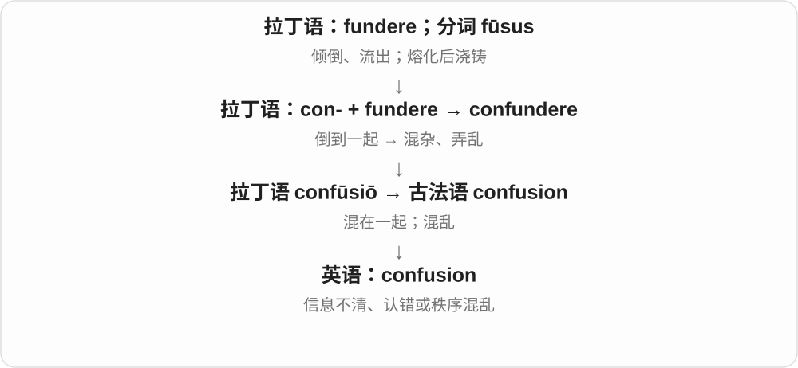

cause confusion 是造成混乱；confusion between A and B 是把二者搞混；in confusion 可说现场乱成一团。

**常见搭配与例句**

cause confusion；clear up the confusion；confusion over dates。

> The changed date caused confusion among the guests.

日期变动让客人们弄不清楚了。

> Let us clear up the confusion before we continue.

我们先把混淆的地方理清，再继续。

**别混淆**

confusion 是状态或问题；a mistake 是某个具体错误。没有犯错也可能先感到 confusion。

### 62. animation — 动画；动画制作；生气、活力

**音标**：/ˌænɪˈmeɪʃən/

**先抓住这个画面**

一张画本来不动，连续呈现变化后却像活起来了；动画义正好保留“赋予生命”的比喻。

**怎么拆**

借拉丁 animātiō，来自动词 animāre；现代与 animate 对应，但历史名词本身也是借词。

**怎么变成今天的意思**

**拉丁 anima；相关 animus**  
呼吸、生命、灵魂；心意、精神

↓

**拉丁 animāre → animātiō → 英语 animation**  
赋予生命、活力 → 生动；动画

可说技术、创作过程或作品片段。with animation 还可表示说话有精神，不一定与屏幕有关。动画可以手绘、定格或计算机制作。

**常见搭配与例句**

computer animation；an animation studio；speak with animation。

> She studies animation and wants to create short films.

她学习动画，希望创作短片。

> He spoke with animation when the subject turned to music.

话题转到音乐时，他说得兴致勃勃。

**别混淆**

animation 是媒介或制作方式；cartoon 可以是动画片，也可以只是一张漫画，范围不完全相同。

### 63. adoption — 收养；采纳；采用、普及过程

**音标**：英 /əˈdɒpʃən/；美 /əˈdɑːpʃən/

**先抓住这个画面**

接纳这件事本身，以及某个方法逐渐被用起来的过程。

**怎么拆**

经古法语 adopcion 或直接接拉丁 adoptio；英语名词早于动词 adopt 的记录，不能把历史一律画成 adopt 加后缀。

**怎么变成今天的意思**

**拉丁语 optare**  
选择、希望；更早来源有争议

↓

**拉丁语 ad- + optare → adoptare**  
为自己选择 → 接纳、收养

↓

**拉丁语 adoptio → 古法语 adopcion；亦可直接借拉丁语**  
接纳为家庭成员

↓

**中古英语 adopcioun → adoption**  
收养；采纳、采用

adoption of a child 说收养；adoption of a policy 说正式采纳政策；technology adoption 关注人们实际开始使用技术，未必等于购买一次设备。

**常见搭配与例句**

the adoption process；the adoption of a policy；widespread adoption。

> The family kept records of the adoption process.

这个家庭保存了收养过程的记录。

> The new format gained widespread adoption among publishers.

这种新格式在出版商中得到了广泛采用。

**别混淆**

adaptation 是适应、改编；adoption 是接纳与采用。

### 64. reflection — 倒影、映像；反射；反思、考虑

**音标**：/rɪˈflekʃən/

**先抓住这个画面**

看见水中的自己，或把一件事放回脑中，重新看一遍。

**怎么拆**

现代可对应 reflect + -ion；历史上名词由晚期拉丁 reflexio 经法语借入，是同源名词支线。

**怎么变成今天的意思**

**拉丁 flectere；分词 flexus**  
弯曲、使转向

↓

**拉丁 reflectere → 晚期拉丁 reflexio**  
折回 → 折回这一行为

↓

**法语 reflexion／refleccion → 英语 reflection**  
反射、映像、思考；ct 拼写受 reflect 等影响

a reflection in the mirror 是镜中的像；after reflection 是经过考虑之后。说 something is a reflection of a society，是把社会想成被照出的对象：从这个现象能看出社会的一部分。反思义常不可数，具体的想法也可用复数 reflections。

**常见搭配与例句**

see your reflection；on reflection（再想想之后）；a reflection of；reflections on life。

> Her reflection disappeared as the water began to ripple.

水面泛起波纹，她的倒影便消失了。

> On reflection, we decided to delay the launch.

再三考虑后，我们决定推迟发布。

**别混淆**

reflection 可以是看见的像，也可以是思考过程；reflex 常指无需有意识决定的反应，不能因都译过“反射”就互换。

### 65. violate — 违反；侵犯；亵渎

**音标**：/ˈvaɪəleɪt/

**先抓住这个画面**

规则或权利像一条应当守住的边界，行为越过去、破坏它，就是 violate。重心不是一般不同意，而是侵害了应受尊重的约束。

**怎么拆**

接拉丁 violatus，来自 violare 侵害、冒犯，关联 vis 力量的材料；-ate 对应动词形式。不是 violin 小提琴的派生。

**怎么变成今天的意思**

**拉丁 vis 力量等材料 → violare**  
强行侵害、冒犯、破坏

↓

**violare、violatio → 英语 violate、violation**  
侵犯或违反；相应行为、事件

violate a rule 违规；violate an agreement 违反协议；violate privacy 侵犯隐私；violate rights 侵犯权利。

**常见搭配与例句**

violate a rule；violate privacy；violate an agreement。

> The new policy may violate the agreement.

新政策可能违反这份协议。

> Sharing the private messages would violate her privacy.

分享那些私人消息会侵犯她的隐私。

**别混淆**

violate 是违反、侵犯；disagree 是持不同意见。你可不同意规则，却仍遵守它。

### 66. violation — 违反、侵犯；违规行为

**音标**：/ˌvaɪəˈleɪʃən/

**先抓住这个画面**

violate 是越过边界去做，violation 则把这个行为当成一件事来讨论、记录。一次违规可以说 a violation。

**怎么拆**

经法语 violation 接拉丁 violatio；现代对应 violate 去 e 加 -ion，形成动作、事件名词。

**怎么变成今天的意思**

**拉丁 vis 力量等材料 → violare**  
强行侵害、冒犯、破坏

↓

**violare、violatio → 英语 violate、violation**  
侵犯或违反；相应行为、事件

↓

**violatio → violation；与 violate 对应**  
违反行为或受侵犯的状态

a violation of the rules 违规；a privacy violation 侵犯隐私；in violation of 与……相违；a traffic violation 交通违规。

**常见搭配与例句**

a violation of；in violation of；a privacy violation。

> The referee reported a violation of the rules.

裁判报告了一次违规。

> The company apologised for the privacy violation.

公司为侵犯隐私一事道歉。

**别混淆**

violation 不只用于法律，也可说违反平台规则或协议；是否违法要看被违反的具体规范。

### 67. violations — 违反、违背、侵害行为〔复数〕

**音标**：/ˌvaɪəˈleɪʃənz/

**先抓住这个画面**

原本应被遵守的规则或受到尊重的边界，被人越过去破坏了，这些行为是 violations。重点是违背了具体哪条要求或权利。

**怎么拆**

violation 经法语、拉丁 violatio 借入，连 violare 侵害、冒犯；现代可对应 violate 去 e 加 -ion。名词再加 -s，/n/ 后读 /z/。

**怎么变成今天的意思**

**拉丁 violare、violatio → 法语、英语 violation**  
强行侵害、冒犯 → 违背、违反的行为

↓

**violation + -s → violations**  
多项违反、侵害事件

violations of the rules 违规行为；privacy violations 隐私侵害；record the violations 记录违规事件。

**常见搭配与例句**

repeated violations 反复违规；minor violations 较轻的违规行为。

> The referee recorded three violations of the rules.

裁判记录了三次违规。

> The story describes repeated violations of their agreement.

故事写了他们的约定被反复违背的情况。

**别混淆**

violations 常要说明违反什么，of 后引规则、约定等。它不只说礼貌上不讨喜，而是存在被违背、侵犯的要求或边界。

### 68. violated — 违反了、侵犯了；受到侵害的〔过去式、过去分词〕

**音标**：/ˈvaɪəleɪtɪd/

**先抓住这个画面**

该遵守的规则被违背，该受到尊重的边界被越过去，是 violated。它常带着破坏某种应被维护的要求或权利的意味。

**怎么拆**

violate 接拉丁 violatus、violare 侵害、冒犯，关联力量材料。现代去末尾 e，加完整 -ed，/t/ 后读 /ɪd/。

**怎么变成今天的意思**

**拉丁 violare、violatus → violate**  
强行侵害、冒犯 → 违背、侵犯

↓

**violate 去 e + -ed → violated**  
已经违反；受到侵害

violated the rules 违反规则；violated their agreement 违背约定；violated her privacy 侵犯隐私。

**常见搭配与例句**

a violated promise 被违背的承诺；the rule was violated 规则被违反。

> The player violated the rules of the game.

那名队员违反了比赛规则。

> The novel shows how their agreement was violated.

小说展示了他们的约定怎样遭到违背。

**别混淆**

violated 不只是让别人不高兴，通常有某种规则、权利或边界被破坏。具体有没有违反，需要对照内容，不能单由使用这个词来认定。

### 69. medicate — 给……用药；用药治疗

**音标**：/ˈmedɪkeɪt/

**先抓住这个画面**

把药物作为处理病情的一部分，是 medicate。它强调用药这个动作，不保证用了就已经治好。

**怎么拆**

接拉丁 medicare、medicari 等医治材料，与 medic- 医药及 -ate 动词形对应；不是现代 medicine 原样加 ate。

**怎么变成今天的意思**

**拉丁 mederi 治疗 → medicus、medicari 等**  
医治、医者及用药治疗的材料

↓

**法语、英语相应形式 → medicate、medication**  
用药治疗；药物或用药过程

medicate a patient 给病人用药；be medicated 被给予药物；medicated 作修饰语可说含药成分的，如 medicated shampoo 药用洗发水。

**常见搭配与例句**

medicate a patient；be medicated；medicated shampoo。

> The vet medicated the injured animal.

兽医给受伤的动物用了药。

> The article discusses when doctors choose to medicate.

文章讨论医生何时会选择用药治疗。

**别混淆**

medicate 聚焦药物处理，treat 治疗范围更广；cure 才强调治愈，三者不能当作同一结果。

### 70. medication — 药物；用药、药物治疗

**音标**：/ˌmedɪˈkeɪʃən/

**先抓住这个画面**

旅行时要带上的那几种药，可以统称 medication；在较正式的语境里，也能指给药这个治疗过程。

**怎么拆**

经中古英语、法语接拉丁 medicatio，用药治疗的名词；现代对应 medicate 去 e 加 -ion，但借词历史不只是在英语里现场拼接。

**怎么变成今天的意思**

**拉丁 mederi 治疗 → medicus、medicari 等**  
医治、医者及用药治疗的材料

↓

**法语、英语相应形式 → medicate、medication**  
用药治疗；药物或用药过程

↓

**拉丁 medicatio → 法语、英语 medication**  
用药治疗；后来也指所用的药物

take medication 服药；be on medication 正在用药；prescription medication 处方药。指具体种类时也可用 medications。

**常见搭配与例句**

take medication；be on medication；prescription medication。

> She packed her medication before the trip.

出发前她把药装进了行李。

> The form asks whether you are taking any medication.

表格询问你是否正在服用任何药物。

**别混淆**

medication 常着眼于药或用药，medicine 还可指医学这门领域；study medicine 通常不是研究自己那几盒药。

### 71. addiction — 成瘾、上瘾；难以割舍的痴迷〔口语〕

**音标**：/əˈdɪkʃən/

**先抓住这个画面**

重点不只是很喜欢，而是控制越来越困难，明知有损害也难停下。轻松聊天里也会夸张说某个爱好是 an addiction，要按语气分辨。

**怎么拆**

拉丁 addictiō、addiction- 表判给、交付，英语也可联系 addict + -ion。早期有倾向、投身等义，后来成瘾状态义日益突出。

**怎么变成今天的意思**

**拉丁 ad- 向、给予 + dīcere 宣告 → addīcere**  
宣告归属、判给；转为交付、献身

↓

**addictus → 英语 addict、addicted**  
交付、投身 → 对某事依赖、难以控制

↓

**addictiō 等 → addiction**  
交付、投身的名词 → 成瘾状态

drug addiction 药物成瘾，addiction research 成瘾研究，an addiction to something 对某物的成瘾、痴迷。具体专业定义还依对象和领域区分。

**常见搭配与例句**

drug addiction；addiction research；an addiction to something。

> The book explains how addiction differs from an ordinary habit.

书中解释成瘾与普通习惯有何不同。

> The course includes an introduction to addiction research.

课程包括成瘾研究入门。

**别混淆**

habit 是习惯，不必造成危害或失去控制；addiction 的专业用法不能仅凭频繁使用、喜爱就认定。

### 72. conviction — 坚定信念；确信；定罪

**音标**：英、美 /kənˈvɪkʃən/

**先抓住这个画面**

一条线是心里认定“就是这样”；另一条线是法庭认定“确实有罪”。

**怎么拆**

来自拉丁语 convictio，经法语进入英语，背后是 convincere 的分词 convictus。它与 convince 同源，但不是现代英语先造动词再简单加 -tion。

**怎么变成今天的意思**

**拉丁语 vincere；分词 victus**  
战胜、克服；vinc- 与 vict- 是同一动词的不同词干

↓

**拉丁语 convincere → convictus → convictio**  
证实、驳倒 → 证明有罪等行为

↓

**法语 conviction → 英语 conviction**  
定罪；后来也指确信、坚定信念

criminal conviction 是刑事定罪；a deep conviction 是深信不疑的看法；speak with conviction 是说得笃定。信念坚定并不保证内容正确。

**常见搭配与例句**

a criminal conviction；a firm conviction；with conviction。

> She spoke with conviction about the importance of public libraries.

她坚定地谈到公共图书馆的重要性。

> His conviction was overturned after new evidence emerged.

新证据出现后，对他的定罪被撤销了。

**别混淆**

conviction 的信念义比普通 opinion 更坚定；法律义也区别于 accusation“指控”。

### 73. instruction — 教学；指示；说明步骤；计算机指令

**音标**：/ɪnˈstrʌkʃən/

**先抓住这个画面**

instruction 是把“该怎么做”说清楚；几条 instructions 放在一起，就成了可照着走的步骤。

**怎么拆**

经古法语 instruccion 来自拉丁 instructio；现代与 instruct + -ion 对应，历史上是名词自己的借入路线。

**怎么变成今天的意思**

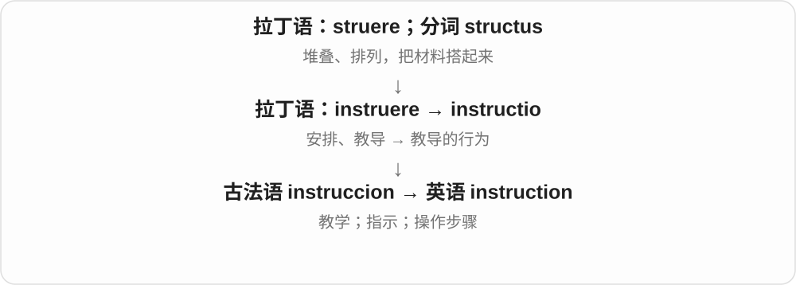

教学义常不可数，如 receive instruction；操作说明通常用复数 instructions。a machine instruction 是计算机可以执行的一条指令。

**常见搭配与例句**

follow the instructions；clear instructions；instruction in a subject；a machine instruction。

> Read the instructions before assembling the shelf.

组装书架前先阅读说明步骤。

> The course provides instruction in basic photography.

这门课程教授摄影基础知识。

**别混淆**

information 只是提供信息；instructions 通常明确告诉你怎样做或要求你做什么。

### 74. separation — 分开；分离；隔离距离；分居

**音标**：/ˌsepəˈreɪʃən/

**先抓住这个画面**

separation 像把原来连着、混着或一起生活的东西拉开，让两边不再贴在一起。

**怎么拆**

来自拉丁 sēparātiō，经法语 separacion；现代可联系 separate 与 -ion。

**怎么变成今天的意思**

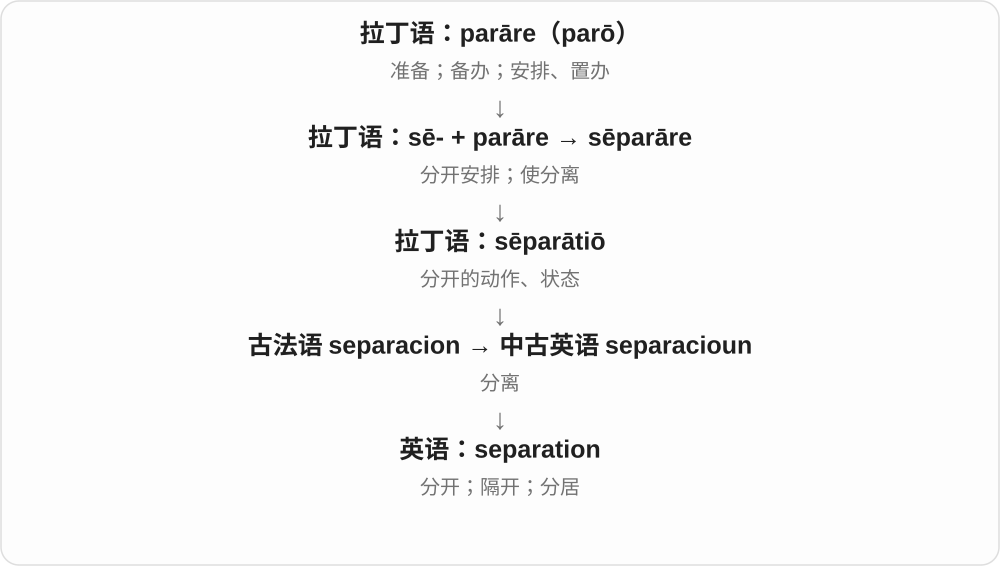

可以是物理分离，也可以是职能划分或伴侣分居。separation 本身不等于已经完成 divorce“离婚”。

**常见搭配与例句**

separation of powers；separation from family；a period of separation。

> The filter allows the separation of solids from the liquid.

过滤器能把固体从液体中分离出来。

> They remained in contact during the separation.

分居期间，他们仍保持联系。

**别混淆**

division 常把一个整体分成部分；separation 更突出让两方分开、不混在一起。

### 75. attraction — 吸引力；吸引人的事物；景点

**音标**：/əˈtrækʃən/

**先抓住这个画面**

attraction 既可以是把人拉过去的力量，也可以是那个值得去看的东西。

**怎么拆**

经古法语 attraction，来自拉丁语 attractiō；现代可对照 attract + -ion。

**怎么变成今天的意思**

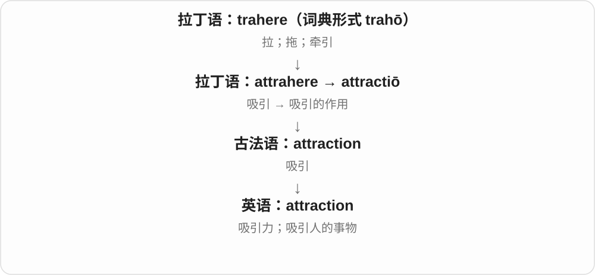

“它有吸引力”容易进一步变成“它就是一个吸引人的去处”，于是有 tourist attraction。人与人之间的 attraction 也不一定已经发展成爱情。

**常见搭配与例句**

a tourist attraction；the main attraction；physical attraction；an attraction to… 。

> The old castle is the town’s main attraction.

那座古堡是镇上最吸引游客的地方。

> She felt an immediate attraction to his sense of humor.

他的幽默感一下就吸引了她。

**别混淆**

attraction 可以指吸引本身；destination 只是目的地。不是所有旅行目的地都叫 tourist attraction。

### 76. assumption — 假设；想当然的看法；承担

**音标**：/əˈsʌmpʃən/

**先抓住这个画面**

在推理开始前，先拿一块砖当作地基。那块暂时接受、未在此证明的前提，就是 assumption。

**怎么拆**

拉丁 assūmptiō 经法语及直接借入路线进入英语，接 assūmere；英语名词借入早于现代动词义，不能只画 assume 加后缀。

**怎么变成今天的意思**

**拉丁 sūmere；过去分词 sūmptus**  
拿取；取用

↓

**拉丁 assūmere → assūmptiō；古法语 assumpcion**  
取用、接纳 → 接受、承担

↓

**中古英语 assumpcioun → assumption**  
承担；后来发展出假定、前提义

常说 make an assumption。假设可能合理，也可能错误；这个词本身不等于“错误猜想”。assumption of duties 仍保留接任义。

**常见搭配与例句**

on the assumption that；a reasonable assumption；assumption of responsibility。

> Our plan rests on the assumption that the road will remain open.

我们的计划以道路会保持畅通为前提。

> His assumption of leadership brought greater stability to the team.

他接任领导后，团队更加稳定。

**别混淆**

hypothesis 常是等待检验的解释；assumption 常是讨论暂时采用的起点。

### 77. graduation — 毕业；毕业典礼；刻度；分级

**音标**：英、美 /ˌɡrædʒuˈeɪʃən/

**先抓住这个画面**

既可以是到达学业的一阶，也可以是在尺子上划出一阶阶。

**怎么拆**

英语 graduate + -ion；早期分级、刻度用法与后来的毕业义共用“按等级划分”的背景。

**怎么变成今天的意思**

**拉丁 gradus；gradī / gradior**  
一步、台阶、等级；走、迈步

↓

**中古拉丁 graduāre → graduātus → 中古英语 graduat**  
授予学位 → 已获学位的

↓

**中古英语 graduat；由此形成动词 graduaten → 英语 graduate**  
毕业生；毕业、授予学位、分刻度

↓

**英语 graduate + -ion → graduation**  
分等级、标刻度；完成学业或举行典礼

日常最常谈毕业；量具上的 graduations 是刻度线。不要把刻度义想成“量筒毕业了”。

**常见搭配与例句**

a graduation ceremony；after graduation；fine graduations。

> Her parents came to the graduation ceremony.

她父母来参加了毕业典礼。

> The cylinder has graduations every five millilitres.

量筒每五毫升有一道刻度。

**别混淆**

graduation 可指完成学业本身；ceremony 才明确是仪式。

### 78. accommodation — 住宿；适应性安排；迁就、和解；眼的调节

**音标**：英 /əˌkɒməˈdeɪʃən/；美 /əˌkɑːməˈdeɪʃən/

**先抓住这个画面**

把条件安排到人能住下、能参与、能彼此配合；眼睛也会调整焦点来适应距离。

**怎么拆**

法语 accommodation，来自拉丁语 accommodatio“调整”，是 accommodare 的名词旁支；现代可联系 accommodate，但不能只写成英语动词加 -ion 的历史。

**怎么变成今天的意思**

**拉丁语：modus**  
尺度、分寸；方式

↓

**拉丁语：commodus**  
合适的、便利的〔com- + modus〕

↓

**拉丁语：commodare → accommodare**  
使合适 → 使适合某种需要〔ad- 同化为 ac-〕

↓

**拉丁语 accommodatio → 法语 accommodation**  
适应、调整这一过程

↓

**英语：accommodation**  
满足需要的安排；住宿等专义

英式住宿通常用不可数 accommodation，美式常用 accommodations。考试或工作中的 accommodations 是为需要作的安排；眼的 accommodation 是改变聚焦能力。

**常见搭配与例句**

student accommodation；reasonable accommodations；reach an accommodation。

> The university helped us find affordable accommodation.

大学帮我们找到了负担得起的住处。

> The school arranged accommodations for the student’s learning needs.

学校根据这名学生的学习需要作了适当安排。

**别混淆**

housing 偏住房供给；accommodation 还可涵盖临时住宿、调整和妥协。

### 79. demonstration — 演示；证明；表现；示威活动

**音标**：/ˌdemənˈstreɪʃən/

**先抓住这个画面**

把技术、事实或诉求公开摆出来的一次活动或展示。

**怎么拆**

拉丁 demonstratio 经古法语或直接进入英语；名词早于英语 demonstrate，现代拆 demonstrate + -ion 只说明词形对应。

**怎么变成今天的意思**

**拉丁语 monere → monstrum**  
提醒、警告 → 被视为征兆的异常现象

↓

**拉丁语 monstrare**  
把东西显示、指给人看

↓

**拉丁语 de- + monstrare → demonstrare**  
加强显示 → 指明、证明

↓

**拉丁语 demonstratio → 古法语 demonstration / 英语 demonstration**  
证明、指明 → 演示；公开表达诉求的活动

a cooking demonstration 是烹饪示范；a demonstration of support 是公开表示支持；a peaceful demonstration 是和平示威。核心都在让某种内容变得可见。

**常见搭配与例句**

give a demonstration；a product demonstration；a demonstration of support；a peaceful demonstration。

> The shop offers a demonstration of the new coffee machine.

商店提供新咖啡机的操作演示。

> Hundreds of people joined the peaceful demonstration.

数百人参加了和平示威。

**别混淆**

presentation 可以只作介绍；demonstration 常亲自展示操作或效果。示威义也不是任何普通人群聚集。

### 80. prosecution — 起诉；公诉；控方

**音标**：英 /ˌprɒsɪˈkjuːʃən/；美 /ˌprɑːsəˈkjuːʃən/

**先抓住这个画面**

它既可以指把案件往前推进的过程，也可以把负责这一边的人统称为 the prosecution。

**怎么拆**

晚期拉丁语 prōsecutiō 经法语进入英语；与 prosecute 同族，名词并非仅由现代英语动词现场加后缀。

**怎么变成今天的意思**

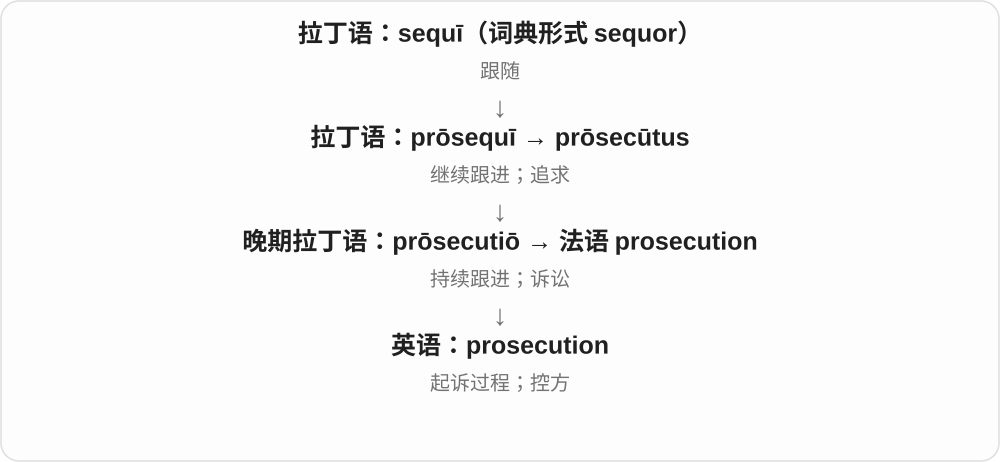

the prosecution 对应诉讼中提出指控的一方；a prosecution 可指一次起诉。是否胜诉是另一件事。

**常见搭配与例句**

face prosecution；the prosecution’s case；a prosecution witness。

> The prosecution called three witnesses.

控方传唤了三名证人。

> The article traces the prosecution of the case.

文章梳理了这起案件的起诉过程。

**别混淆**

prosecution 与 conviction 不同：前者是起诉或控方，后者是定罪。

### 81. navigation — 导航；航行；页面浏览路径

**音标**：/ˌnævɪˈɡeɪʃən/

**先抓住这个画面**

navigation 是弄清“我在哪里、接下来往哪里走”，最初在海上，后来也在道路和网页里。

**怎么拆**

现代可对应 navigate + -ion；历史经法语来自拉丁语 nāvigātiō，英语名词并非必须从英语动词派生。

**怎么变成今天的意思**

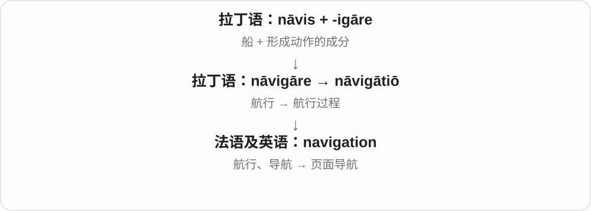

从驾驶船只扩展到为车辆定位和引路；网站 navigation 是帮助用户找到各个页面的结构。

**常见搭配与例句**

satellite navigation；a navigation system；website navigation。

> The boat carried basic navigation equipment.

船上带着基本的导航设备。

> Clear navigation helps users find the right page.

清晰的导航帮助用户找到所需页面。

**别混淆**

navigation 关注位置与路线；transportation 关注把人或物送到目的地。

### 82. equation — 方程、等式；等同看待；影响局面的因素组合

**音标**：/ɪˈkweɪʒən/

**先抓住这个画面**

数学里让两边接上等号；日常说法里，把几种因素放在一起考虑。

**怎么拆**

经法语借自拉丁 aequatio“使相等”，接 aequare；不是先有现代英语 equate 才在英语中造出这个名词。

**怎么变成今天的意思**

**拉丁 aequus**  
平、等量、公平、平稳

↓

**拉丁 aequare → aequatio／aequation- → 法语 équation**  
使相等 → 使相等的过程

↓

**中古英语 equacioun → equation**  
等同；后来用于数学等式、方程

solve an equation 是求出让等式成立的未知量；bring something into the equation 是把某个因素考虑进来。读音中 -tion 常读 /ʒən/，不同于很多词的 /ʃən/。

**常见搭配与例句**

solve an equation；a linear equation；a chemical equation；part of the equation。

> The equation has two real solutions.

这个方程有两个实数解。

> Travel time is another factor in the equation.

交通耗时也是需要考虑的一个因素。

**别混淆**

expression 是表达式，不必有等号；equation 声明两边相等。公式 formula 可以以 equation 的形式写出，两者关注点不同。

### 83. isolation — 隔离；孤立；分离；孤独隔绝状态

**音标**：/ˌaɪsəˈleɪʃən/

**先抓住这个画面**

周围的联系被切断，或为了观察某件事，把它暂时从其他因素中单独拿出来。

**怎么拆**

英语可按 isolate 与 -ion 分析；历史也可能直接借法语 isolation。两条解释都接法语 isoler、isolé 与意大利 isolato 这条岛屿词族。

**怎么变成今天的意思**

**拉丁 insula 岛**  
再早的来源未定；不硬拆为 in 加某个英语词

↓

**意大利 isolato → 法语 isolé、isoler；法语 isolation 或英语 isolate 的名词构形**  
英语 isolation 的直接来源有两种常见解释

↓

**英语 isolation**  
分开、隔离的行为或状态；也用于脱离背景单独观察

social isolation 是社会联系不足；in isolation 是单独看、脱离其他因素。讨论某个数字 in isolation，意思是不把它放回整体背景。

**常见搭配与例句**

social isolation；geographical isolation；in isolation；isolation from others。

> Working from home increased his sense of isolation.

居家工作加重了他与人隔绝的感觉。

> These figures cannot be understood in isolation.

这些数字不能脱离背景单独理解。

**别混淆**

solitude 常指独处，本身可令人愉快；isolation 往往强调缺少联系或被分开。它也可纯粹是实验、分析的技术描述。

### 84. precision — 精确；精密程度；精密度

**音标**：/prɪˈsɪʒən/

**先抓住这个画面**

把注意力放到结果有多细、重复得有多稳，而不是笼统说“做得不错”。

**怎么拆**

拉丁 praecisio“切去”经法语 précision 或直接借入；与 precise 同源，但名词有独立历史。重音后是 /sɪʒ/。

**怎么变成今天的意思**

**拉丁 caedere，分词 caesus；复合词常见 -cidere / -cisus**  
切、砍、击杀

↓

**拉丁 prae- + caedere → praecidere；分词 praecisus**  
切去、截短；界定清楚

↓

**拉丁 praecisio；法语 précision → 英语 precision**  
切去多余部分 → 明确、精密

日常可说动作、语言精确；测量中常说重复测量结果的接近程度。一把总偏高、但每次都偏得相近的秤，可以精密而不准确。

**常见搭配与例句**

with precision；measurement precision；precision engineering。

> The parts must be cut with great precision.

这些零件必须切割得非常精确。

> The readings showed good precision but a consistent bias.

这些读数彼此很接近，却存在一致的偏差。

**别混淆**

accuracy 问离真值多近；precision 在测量里问各次结果聚得多紧。多写小数位也不自动提高真实精密度。

### 85. donation — 捐赠；捐款；捐赠物

**音标**：英 /dəʊˈneɪʃən/；美 /doʊˈneɪʃən/

**先抓住这个画面**

可以是给出去的那笔钱、那批东西，也可以是捐出的行为。

**怎么拆**

拉丁 donatio 经法语或直接借入英语，来自 donare；这个名词早于 donate，现代 -ation 的对应只是理解线索。

**怎么变成今天的意思**

**拉丁 donum → donare**  
礼物 → 赠与、给出

↓

**拉丁 donatio → 法语 donacion → 英语 donation**  
赠与行为、赠品 → 捐赠、捐赠物

make a donation 是捐赠；a donation of books 是一批捐赠图书。它不只限于钱，blood donation 等还可以说捐献过程。

**常见搭配与例句**

make a donation；a generous donation；a donation of books。

> The museum received a large donation from a local family.

博物馆收到一个本地家庭的大额捐赠。

> A donation of winter coats arrived just before the cold weather.

寒冷天气来临前，送来了一批捐赠的冬衣。

**别混淆**

donor 是提供捐赠的人或机构；donation 是捐赠行为或捐出的东西。

### 86. injection — 注射；注入；单射〔数学〕

**音标**：英、美 /ɪnˈdʒekʃən/

**先抓住这个画面**

从外面送进一点东西：可以是药液、资金，也可以是抽象模型中的输入。

**怎么拆**

经法语 injection 借自拉丁语 iniectio，来自 inicere 的名词支线。数学义后来从法语数学术语借入，不是医疗注射直接变成函数。

**怎么变成今天的意思**

**拉丁语：iacere；分词 iactus**  
投掷、抛出

↓

**拉丁语：in- + iacere → inicere / iniect-**  
投入、注入

↓

**拉丁语 iniectio → 法语及英语 injection**  
投入、注入

↓

**后来术语：数学 injection**  
单射：不同输入不会落到同一输出

an injection of funds 是资金注入。数学里单射只要求不同输入对应不同输出，不要求覆盖目标集合所有元素。

**常见搭配与例句**

give an injection；an injection of cash；an injection between sets。

> The nurse prepared the injection.

护士准备好了注射剂。

> The project received an injection of new funding.

项目获得了一笔新资金注入。

**别混淆**

infusion 常指持续输注；injection 常是注入这一动作或一次注射。

### 87. speculation — 推测；猜测；投机

**音标**：/ˌspekjəˈleɪʃən/

**先抓住这个画面**

speculation 是信息还不够时，大脑先试着拼出一幅图；在交易里，则是押注未来价格变化。

**怎么拆**

经法语来自拉丁语 speculātiō，与 speculārī“观察、思考”有关；不是名词必定从现代 speculate 造出。

**怎么变成今天的意思**

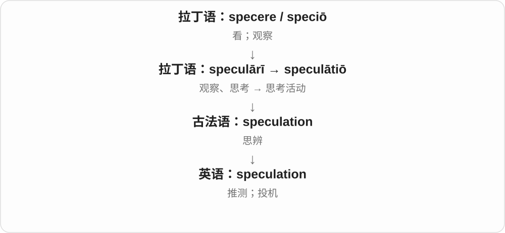

推测义强调尚未得到充分证实；投机义强调根据未来判断承担风险求利。共同点是面对还未确定的情况作判断。

**常见搭配与例句**

speculation about；fuel speculation；financial speculation。

> Her absence led to speculation about her plans.

她的缺席引发了人们对她计划的猜测。

> The historian studies land speculation in the nineteenth century.

这位历史学家研究十九世纪的土地投机。

**别混淆**

speculation 是猜测，evidence 是证据；报道说 amid speculation，不等于已确认。

### 88. suspicion — 怀疑；嫌疑

**音标**：/səˈspɪʃən/

**先抓住这个画面**

suspicion 像一个还没有坐实的问号：“这里是不是有问题？”

**怎么拆**

来自拉丁语 suspīciō；英语也受盎格鲁诺曼语相关形式影响。与 suspect 同族，但不是简单加 -ion 的现代造词。

**怎么变成今天的意思**

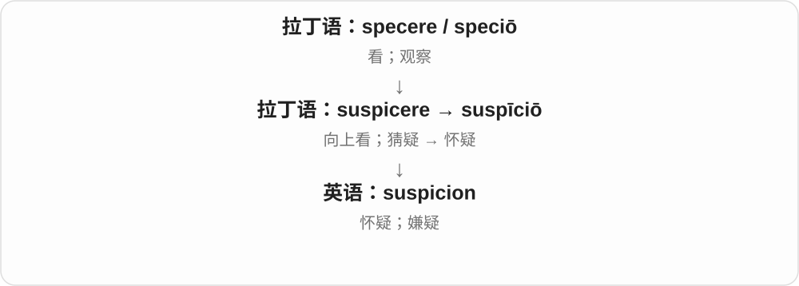

它可指怀疑的心理，也可指某人处于被怀疑的状态。a suspicion of 还可表示一点点迹象或隐约感觉。

**常见搭配与例句**

arouse suspicion；under suspicion；have a suspicion that。

> The unusual payment aroused suspicion.

这笔不寻常的付款引起了怀疑。

> I have a suspicion that we have met before.

我隐约觉得我们以前见过。

**别混淆**

suspicion 与 proof 的距离很大。疑心可以促使检查，却不能自动作为结论。

### 89. frustrate — 使受挫、懊恼；阻挠、挫败

**音标**：/frʌˈstreɪt/〔亦有 /ˈfrʌstreɪt/〕

**先抓住这个画面**

想往前走，却反复被卡住，这种使努力落空的力量会 frustrate 人；它也可直接挫败计划。

**怎么拆**

接拉丁 frustratus 等分词材料，联系 frustra 徒然、无效。不是把 fruit 水果变化成某种心情词。

**怎么变成今天的意思**

**拉丁 frustra 徒然 → frustrari、frustratus 等 → frustrate**  
使落空、挫败

↓

**英语 frustrate**  
阻挠目标；让人因进展受阻而烦恼

frustrate someone 让某人受挫；frustrate an attempt 挫败一次尝试；frustrate plans 阻挠计划。

**常见搭配与例句**

frustrate someone；frustrate an attempt。

> The repeated errors frustrated everyone on the team.

反复出错让团队里的每个人都很懊恼。

> Bad weather frustrated their plans for an outdoor concert.

坏天气使他们的户外音乐会计划受挫。

**别混淆**

frustrate 比普通 annoy 更常含目标受阻、想做却做不成的成分；具体人也可能感到生气。

### 90. frustration — 挫败、受挫的烦闷；阻挠、使落空

**音标**：/frʌˈstreɪʃən/

**先抓住这个画面**

明明想往前走，却一直被挡住，努力落了空，这种又急又烦的感觉就是 frustration。

**怎么拆**

借拉丁 frustratio、frustration-，来自 frustrari 使落空、使徒劳，联系 frustra 徒然。现代可和 frustrate、frustrated 对照，名词有独立借入史。

**怎么变成今天的意思**

**拉丁 frustra → frustrari → frustratio**  
徒然、无效 → 使落空 → 挫败、落空

↓

**英语 frustration 的现代重点**  
目标受阻的状态；由此产生的烦闷

a sense of frustration 挫败感；in frustration 因受挫而烦躁；frustration with delays 对延误的烦闷。

**常见搭配与例句**

express frustration 表达受挫的不满；growing frustration 越来越强的烦闷。

> She sighed in frustration when the file would not open.

文件打不开，她烦闷地叹了口气。

> The repeated delays caused growing frustration.

反复延误让人越来越烦躁。

**别混淆**

frustration 常带目标被挡住、进展不如意的背景，annoyance 可只是一般烦恼。情绪本身常不可数，具体烦心事也可数成 frustrations。

### 91. circulation — 循环；流通；传播；发行量

**音标**：英 /ˌsɜːkjəˈleɪʃən/；美 /ˌsɜːrkjəˈleɪʃən/

**先抓住这个画面**

看一件东西怎样在一个系统里流动，或总共有多少份在读者间流传。

**怎么拆**

拉丁 circulatio 进入英语，接 circulare；名词早于常见动词 circulate，不能只当成英语动词后加 -ion。

**怎么变成今天的意思**

**拉丁语 circus**  
圆环、环形场地；与希腊语 kirkos 的具体关系有不同分析

↓

**拉丁语 circulus〔指小形式〕**  
小圈、圆环

↓

**拉丁语 circulare / circulatus**  
使成圆、循环处理

↓

**拉丁语 circulatio → 英语 circulation**  
循环过程 → 血液、空气、信息、出版物等的流通

blood circulation 是血液循环；money in circulation 是流通中的货币；a newspaper’s circulation 是发行量，并不等于每份报纸实际被多少个人阅读。out of circulation 可说停止流通，也可口语说暂不参加社交。

**常见搭配与例句**

blood circulation；air circulation；in circulation；a daily circulation。

> The diagram shows the circulation of blood through the heart.

示意图展示了血液经过心脏的循环过程。

> These old coins are no longer in circulation.

这些旧硬币已不再流通。

> The newspaper reported a decline in circulation.

这家报纸报告称发行量有所下降。

**别混淆**

distribution 强调分配、送达；circulation 还强调在系统中的流转，报刊语境常指发行数量。

### 92. prediction — 预测；预言的内容

**音标**：/prɪˈdɪkʃən/

**先抓住这个画面**

predict 是提前作判断，prediction 是你提前说出的那个判断。它可以拿来与后来发生的事实比较。

**怎么拆**

来自拉丁语 praedictiō；现代也能按 predict + -ion 理解为预测的行为或结果。

**怎么变成今天的意思**

说出来的预测成为一条可讨论、可验证的内容。make a prediction 强调作出判断；an accurate prediction 说明后来与事实相符。

**常见搭配与例句**

make a prediction；an accurate prediction；a prediction about…；against all predictions。

> Her prediction about the election turned out to be correct.

她对选举结果的预测后来证明是对的。

> We should compare the prediction with the actual result.

我们应该把预测和实际结果作比较。

**别混淆**

prediction 不等于计划 plan：前者判断会发生什么，后者安排希望怎样做。

### 93. meditate — 冥想；沉思、思量

**音标**：/ˈmedɪteɪt/

**先抓住这个画面**

主动把注意力安放下来，是常见的冥想场景；较书面的 meditate on 则是围绕一个问题持续思量。

**怎么拆**

有从较早的英语名词 meditation 逆构，或接拉丁 meditatus 借入的分析；两路都连到 meditari 思考、练习、考虑。

**怎么变成今天的意思**

**拉丁 meditari、meditatio → 法语、英语 meditation**  
思量、练习 → 沉思、冥想的名词

↓

**英语 meditate 的两路分析**  
从较早 meditation 逆构，或借拉丁 meditatus

meditate every morning 每天早晨冥想；meditate on a question 沉思问题；meditate for ten minutes 冥想十分钟。

**常见搭配与例句**

meditate on；meditate for。

> She likes to meditate before breakfast.

她喜欢早餐前冥想。

> He found a quiet place to meditate on the poem.

他找了个安静地方沉思这首诗。

**别混淆**

meditate 是冥想、沉思，mediate 是调解；两者很容易漏看一个 t，却不是同一动作。

### 94. meditation — 冥想、沉思；关于某主题的沉思之作

**音标**：/ˌmedɪˈteɪʃən/

**先抓住这个画面**

把注意力安放到某个对象、想法上，持续地沉思，是 meditation。今天也常用它称冥想活动。

**怎么拆**

经古法语 meditacion 或直接借拉丁 meditatio，来自 meditari 思考、练习。英语 meditation 名词较早，meditate 动词有从它逆构或借拉丁分词的分析；现代认形不等于历史先后。

**怎么变成今天的意思**

**拉丁 meditari → meditatio → 古法语、英语 meditation**  
反复思量、练习 → 沉思、冥想活动

↓

**与英语 meditate 的关系**  
名词出现较早；动词可能逆构，或独立借入相关拉丁形式

in meditation 在冥想、沉思中；a meditation on memory 关于记忆的沉思之作。

**常见搭配与例句**

quiet meditation 安静沉思；a period of meditation 一段冥想时间。

> She spent ten minutes in meditation.

她冥想了十分钟。

> The book is a meditation on memory.

这本书是一部关于记忆的沉思之作。

**别混淆**

活动 meditation 通常不可数，a meditation on 可以说一篇沉思文章、作品。mediation 少一个 t，是调解，动作和用法不同。

### 95. rebellion — 反叛；起义；抗拒、叛逆行为

**音标**：英美 /rɪˈbeljən/

**先抓住这个画面**

把一个人的“不服”扩大成一场行动，或把内心拒绝服从的劲头当成一件事来说。

**怎么拆**

来自古法语 rebellion，也可直接接拉丁 rebellio、宾格 rebellionem；拉丁名词与 rebellis“反抗的”相连。现代能联想 rebel + -ion，但历史不是英语临时加后缀造出的名词。

**怎么变成今天的意思**

**拉丁 bellum → bellare**  
战争 → 作战

↓

**拉丁 rebellare／rebellis**  
反抗、重新作战／反抗的

↓

**拉丁 rebellio → 古法语 rebellion／拉丁直接借入**  
反叛；重新开战

↓

**中古英语 rebellioun → rebellion**  
反叛行动；引申为抗拒权威

a rebellion 常是一场反抗事件；teenage rebellion 则常指青少年的抗拒倾向，不必涉及暴力。in rebellion against 表示以行动反对某种权威或规矩。

**常见搭配与例句**

a rebellion against the ruler；an act of rebellion；teenage rebellion；in open rebellion。

> The history book explains why the rebellion spread to nearby towns.

这本历史书解释了这场反叛为何蔓延到邻近城镇。

> For him, refusing the family business was an act of rebellion.

对他来说，拒绝接手家族生意是一种反抗。

**别混淆**

rebellion 讲反抗本身，不保证成功改变制度；revolution 常突出较根本的改变。rebelliousness 更常概括一个人的叛逆性情。

### 96. simulation — 模拟；仿真；模拟场景；假装

**音标**：/ˌsɪmjəˈleɪʃən/

**先抓住这个画面**

做出一个替代场景，让它在关键方面像真实情况。

**怎么拆**

拉丁 simulātiō，经古法语及拉丁借入中古英语；英语名词早于现代 simulate 动词，不能把历史只画成动词加 -ion。

**怎么变成今天的意思**

**拉丁 similis**  
相像、同类；与 simul“一起、同时”同族

↓

**拉丁 simulāre → simulātiō → 古法语 simulation / simulacion → 中古英语**  
模仿、假装 → 模拟或假象

↓

**现代英语 simulation**  
训练、试验用的模拟；也可指假装

飞行模拟保留重要操作，却不把飞机真开上天。模拟能帮助理解和训练，但它的结论取决于模型保留了什么、简化了什么；不是现实的自动复制品。

**常见搭配与例句**

run a simulation；a computer simulation；a training simulation。

> The team ran a simulation of traffic through the new junction.

团队模拟了车辆通过新路口的情况。

> The emergency drill used a realistic simulation of a power failure.

应急演练逼真地模拟了一次停电。

**别混淆**

imitation 常看外观或动作是否像；simulation 常让一个过程或系统按设定运行，观察其反应。

### 97. elimination — 消除、排除；淘汰；消元

**音标**：/ɪˌlɪmɪˈneɪʃən/

**先抓住这个画面**

把 eliminate 的动作当成一个过程来谈：去掉错误、排除选项、淘汰选手，或在方程里消去某个未知量。

**怎么拆**

与 eliminate + -ion 的名词结构对应，来源联系拉丁 ēlīminātiō。词尾从动词 -ate 对应到名词 -ation，重音移到 /neɪ/ 这一段。

**怎么变成今天的意思**

**拉丁 ē- 向外 + līmen 门槛 → ēlīmināre**  
把人赶出门，逐出

↓

**拉丁 ēlīmināt- → 英语 eliminate**  
移除、排除；淘汰等领域用法

↓

**eliminate／拉丁 ēlīminātiō → elimination**  
逐出、消除这一过程；淘汰、消元

the elimination of errors 错误的消除，an elimination round 淘汰轮，solve by elimination 用消元法解题，a process of elimination 逐一排除法。

**常见搭配与例句**

the elimination of；an elimination round；by elimination。

> We found the answer by a process of elimination.

我们用逐一排除法找到了答案。

> The next stage is an elimination round.

下一阶段是淘汰轮。

**别混淆**

elimination 看去掉某项这一过程；selection 看选择留下谁。逐一排除得出答案，不代表只有凭直觉乱猜。

### 98. litigate — 进行诉讼；通过诉讼争论、解决

**音标**：/ˈlɪtɪɡeɪt/

**先抓住这个画面**

双方把争议带进法律程序，由法院来处理，就是 litigate。它说选择怎样争，不说谁最后会赢。

**怎么拆**

借拉丁 litigatus，接 litigare 争讼；前部 lit- 与 lis 诉讼有关，后部接行动的动词材料，不按英语 lit 点亮来拆。

**怎么变成今天的意思**

**拉丁 lis、lit- 诉讼 + agere 行动的相关材料 → litigare**  
把争议带入法律程序争讼

↓

**拉丁 litigatus、litigatio → litigate、litigation**  
进行诉讼；诉讼过程

litigate a dispute 就争议诉讼；litigate against someone 与某人打官司；选择和解时常与 settle 对照。

**常见搭配与例句**

litigate a dispute；litigate against；choose to litigate。

> The parties chose to settle rather than litigate.

双方选择和解，没有继续打官司。

> The dispute was litigated for several years.

这场争议经历了数年的诉讼。

**别混淆**

litigate 是进行法律争讼，不等于普通争吵 argue，也不等于已经判决或执行判决。

### 99. litigation — 诉讼；法律争讼过程

**音标**：/ˌlɪtɪˈɡeɪʃən/

**先抓住这个画面**

律师准备材料、当事人参与法院程序，这整段法律争讼可以叫 litigation。它是过程名词，不是某一方自动获胜的证明。

**怎么拆**

接拉丁 litigatio，与 litigare 争讼同族；现代对应 litigate 去 e 加 -ion。

**怎么变成今天的意思**

**拉丁 lis、lit- 诉讼 + agere 行动的相关材料 → litigare**  
把争议带入法律程序争讼

↓

**拉丁 litigatus、litigatio → litigate、litigation**  
进行诉讼；诉讼过程

↓

**litigatio → litigation**  
法律争讼的进行及相关过程

civil litigation 民事诉讼；pending litigation 尚未结束的诉讼；the cost of litigation 诉讼费用。常作不可数名词。

**常见搭配与例句**

civil litigation；pending litigation；litigation costs。

> The company faces costly litigation.

公司面临代价高昂的诉讼。

> The agreement ended years of litigation.

这份协议结束了多年的诉讼。

**别混淆**

a lawsuit 常指一宗具体诉讼，litigation 更常说进行诉讼的过程、活动；不能机械说 a litigation 代替每个案子。

### 100. liberation — 解放；摆脱束缚；释放

**音标**：/ˌlɪbəˈreɪʃən/

**先抓住这个画面**

限制终于被解除的那段过程，或随后获得自由的状态。

**怎么拆**

英语经法语 libération 或直接借拉丁 liberatio／liberationem，来自 liberare 的分词词干。英语名词记录早于常用动词 liberate，现代对应 -ion 不等于实际由英语动词新造。

**怎么变成今天的意思**

**拉丁 liber**  
自由的；不受束缚的

↓

**拉丁 liberare → liberatio／liberation-**  
使自由 → 释放、解放这一过程

↓

**法语 libération／直接拉丁借入 → 英语 liberation**  
解放；摆脱限制

national liberation 是民族解放；a sense of liberation 是终于不再被某种压力捆住的感觉。具体从什么状态解脱，要由句子说明。

**常见搭配与例句**

liberation from fear；a liberation movement；a sense of liberation。

> Leaving the rigid routine gave him a sense of liberation.

离开那套僵硬的日常安排，让他感到解脱。

> The exhibition traces the history of a national liberation movement.

展览梳理了一个民族解放运动的历史。

**别混淆**

liberty 常说自由本身，liberation 更突出获得自由、解除束缚的过程。

### 101. deliberation — 深思熟虑、权衡；慎重商议

**音标**：/dɪˌlɪbəˈreɪʃən/

**先抓住这个画面**

把赞成、反对、后果摆出来，认真考虑再决定，这个过程是 deliberation。多人一起做，就可以是慎重商议。

**怎么拆**

经法语 deliberation、拉丁 deliberātiō 传入；现代可对应 deliberate + -ion。名词选择权衡、讨论支线，不是每次表示故意。

**怎么变成今天的意思**

**拉丁 libra 天平、lībrāre 称量相关词**  
称量、使平衡

↓

**dēlīberāre → dēlīberātus → deliberate**  
充分权衡 → 深思熟虑、故意；仔细考虑

↓

**deliberātiō → 法语、英语 deliberation**  
权衡、慎重商议的过程

after careful deliberation 深思熟虑后，the jury’s deliberations 陪审团商议，with deliberation 慎重地、从容地。

**常见搭配与例句**

after careful deliberation；lengthy deliberations。

> After careful deliberation, they chose the smaller house.

深思熟虑后，他们选了较小的房子。

> The board’s deliberations continued into the evening.

董事会的商议一直持续到晚上。

**别混淆**

deliberation 常说考虑、商议，deliberateness 则更直接命名有意、从容等性质。不能只按中文故意套给所有派生词。

### 102. coordination — 协调；配合；协调能力

**音标**：英 /kəʊˌɔːdɪˈneɪʃən/；美 /koʊˌɔːrdəˈneɪʃən/

**先抓住这个画面**

手在接球，眼睛在追球，身体在移动，几个部分正好配合上，这就是 coordination。

**怎么拆**

法语 coordination 或中世纪拉丁 coōrdinātiō 的借入；英语名词记录早于 coordinate，不能只画成英语动词加 -ion。

**怎么变成今天的意思**

**拉丁语：ōrdō；词干 ōrdin-**  
一行、一列；次序、等级、安排

↓

**拉丁语 ōrdinātiō → coōrdinātiō**  
安排 → 共同安排

↓

**法语 coordination 或直接拉丁语 → 英语 coordination**  
有秩序地组合；配合、协调

可讲团队安排，也可讲身体动作的配合。hand-eye coordination 是手眼协调；in coordination with 表示与某方配合。

**常见搭配与例句**

close coordination；improve coordination；coordination between teams。

> The event required close coordination between three teams.

这场活动需要三个团队密切协调。

> Catching a ball improves hand-eye coordination.

接球可以提高眼手协调能力。

**别混淆**

cooperation 强调愿意合作；coordination 强调分工、时机和动作能对得上。愿意帮忙也可能配合失序。

### 103. discretion — 审慎；保密分寸；自行决定的权力

**音标**：/dɪˈskreʃən/

**先抓住这个画面**

discretion 像把判断权交到一个懂分寸的人手里：他知道哪些该说，也能判断该怎样办。

**怎么拆**

拉丁 discrētiō“区分、判断”经法语和中古英语借入；与 discreet 同族，但不是后来英语形容词才加 -ion。

**怎么变成今天的意思**

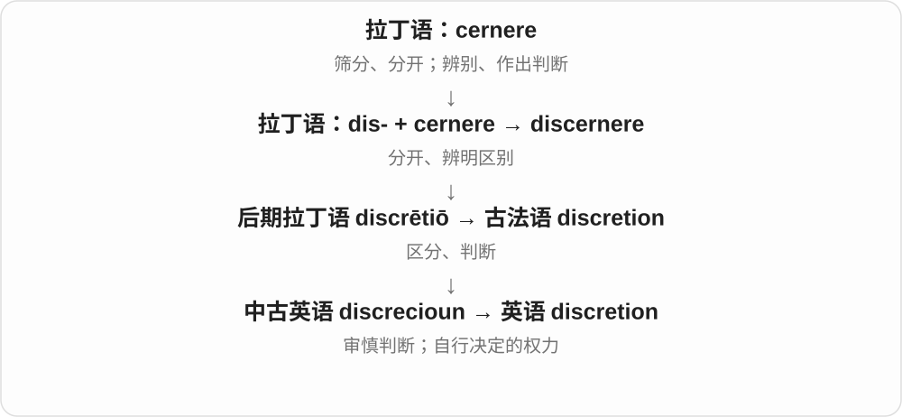

use discretion 是审慎判断；at your discretion 是由你酌情决定；thank you for your discretion 可是感谢守口如瓶、处理得体。

**常见搭配与例句**

at someone’s discretion；exercise discretion；use your discretion。

> Refunds may be offered at the manager’s discretion.

经理可酌情决定是否退款。

> Thank you for handling the matter with discretion.

谢谢你谨慎得体地处理这件事。

**别混淆**

permission 是获得允许；discretion 是在一定范围内自己判断怎么做的空间。它也可指谨慎品质，要看搭配。

### 104. elevation — 高度；抬高、提升；立面图

**音标**：/ˌeləˈveɪʃən/

**先抓住这个画面**

既可以说“往上抬”这件事，也可以说“抬到哪里、从正面看是什么样”。

**怎么拆**

经法语 elevation 接拉丁 elevatio，来自 elevare；与 elevate 同源，英语名词有自己的借入路线。

**怎么变成今天的意思**

**拉丁 levis → levare**  
轻 → 抬起、使负担减轻

↓

**拉丁 elevare → elevatio**  
抬起 → 抬高这一动作

↓

**法语 elevation → 英语 elevation**  
升高、提升；高度；建筑立面

the elevation of a village 通常说村庄相对海平面等基准的高度。an elevation of a building 在建筑图纸里是从某一面正看过去的投影，不是俯视的平面图。elevation to office 则是职位晋升。

**常见搭配与例句**

at an elevation of；above sea level；the front elevation。

> The village stands at an elevation of about one thousand metres.

这个村庄大约位于海拔一千米处。

> The drawing shows the front elevation of the library.

这张图展示了图书馆的正立面。

**别混淆**

elevation 是相对指定基准的高度；建筑的 front elevation 是正立面图，floor plan 是平面图。

### 105. obsession — 挥之不去的念头；痴迷；过度关注的事物

**音标**：/əbˈseʃən/

**先抓住这个画面**

obsession 像一个念头把脑海围住，别的事情都很难挤进去。

**怎么拆**

来自拉丁 obsessiō“围困”，由 obsidēre“坐守、包围”而来；不要倒画成英语 obsess 先造出拉丁名词。

**怎么变成今天的意思**

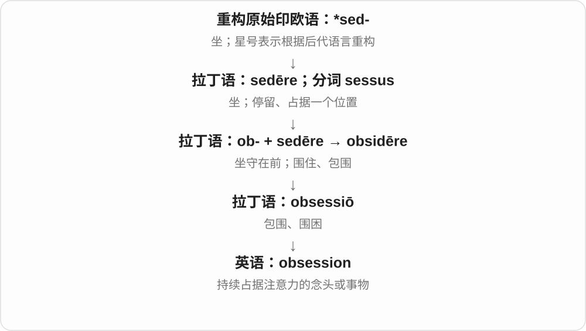

口语的 an obsession with trains 可以说对火车极度着迷；心理健康语境的 obsession 可指反复闯入的困扰性念头，两者不能随意等同。

**常见搭配与例句**

an obsession with；become an obsession；a growing obsession。

> What began as a hobby became an obsession.

一开始只是爱好，后来变成了难以放下的痴迷。

> His obsession with tiny details delayed the whole project.

他过度纠结细枝末节，拖慢了整个项目。

**别混淆**

interest 是兴趣；obsession 强调占据注意力的程度很强，有时让人难以摆脱。

### 106. confession — 坦白；供认；告解；信仰宣认

**音标**：/kənˈfeʃən/

**先抓住这个画面**

把一直藏着的事，或自己所信的东西，明确说出来。

**怎么拆**

拉丁 confessiō 经法语独立借入；现代可拆 confess + -ion，但不是只有英语动词加后缀这一条历史路线。

**怎么变成今天的意思**

**拉丁 fatērī**  
承认、表明；与 fārī“说”相关

↓

**拉丁 con- + fatērī → confitērī，分词 confessus**  
坦承、承认

↓

**拉丁 confessiō → 古法语 confession**  
承认、坦白这一行为

↓

**中古英语 confessioun → 英语 confession**  
坦白、认罪；宗教中的告解或信仰宣认

a confession of guilt 是认罪；宗教里的 confession 也可说向神父告解，或正式陈述信仰。口语 I have a confession to make 常只是“我得坦白一件事”，未必真犯了罪。

**常见搭配与例句**

make a confession；a written confession；a confession of faith。

> I have a confession to make: I ate the last piece of cake.

我得坦白：最后一块蛋糕是我吃的。

> The detective recorded the suspect’s confession.

侦探记录了嫌疑人的供认。

**别混淆**

admission 可承认任何事实；confession 常带此前隐瞒、羞于承认或宗教表明的色彩。

### 107. calculate — 计算；估算、盘算

**音标**：英 /ˈkælkjʊleɪt/；美 /ˈkælkjəleɪt/

**先抓住这个画面**

桌上摆小石子，移来移去，把数量算清楚。

**怎么拆**

来自拉丁 calculare 的分词词干 calculat-；更早 calculus 是小石子、计数筹码。不要按现代拼写拆成 cal + cute。

**怎么变成今天的意思**

**拉丁 calx，词干 calc-**  
石灰、石灰石

↓

**拉丁 calculus → calculare**  
小石子、计数筹码 → 计算

↓

**拉丁 calculatus → 英语 calculate**  
经过计算的 → 计算、估算

最初的画面是用小石子帮助计数。今天 calculate a total 是算总数，calculate the risks 是估量风险。数字可以精确相加，人的行为只能估计，所以这个词既能用于数学，也能用于做决定前的盘算。

**常见搭配与例句**

calculate the cost；calculate how much；calculate a percentage；calculate the risk。

> We calculated the total cost before booking the trip.

预订旅行前，我们算了总费用。

> The app calculates how much time you need to reach the station.

这个应用会估算你到车站需要多久。

**别混淆**

calculate 通常按信息或规则推算；guess 可以只是猜。estimate 强调估计值，未必精确。

### 108. calculation — 计算；计算结果；盘算

**音标**：英 /ˌkælkjʊˈleɪʃən/；美 /ˌkælkjəˈleɪʃən/

**先抓住这个画面**

把数字一步步处理，再得到一个结果；也可以把利弊在心里过一遍。

**怎么拆**

现代可对应 calculate + -ion；历史上名词经拉丁 calculatio／calculationem 借入，不能画成英语 calculate 先造出 calculation。

**怎么变成今天的意思**

**拉丁 calx，词干 calc-**  
石灰、石灰石

↓

**拉丁 calculus → calculare**  
小石子、计数筹码 → 计算

↓

**拉丁 calculatio／calculationem → 中古英语 calculation**  
计算这一行为 → 计算、计算结果

check my calculations 是检查我的计算过程或结果。cold calculation 说冷静甚至冷酷的利益盘算，未必涉及写数字。这个词连接的不是所有思考，而是把各项因素算进去、看看会得到什么。

**常见搭配与例句**

make a calculation；check the calculations；a rough calculation；by my calculations。

> A quick calculation showed that we could afford the tickets.

简单一算，我们发现买得起这些票。

> Her decision involved careful calculation, not just excitement.

她的决定经过仔细权衡，不只是出于一时兴奋。

**别混淆**

calculation 可以指数学计算，也可指有目的的盘算；calculator 通常是执行计算的工具。

### 109. calculations — 计算、计算结果；盘算、估计〔复数〕

**音标**：英 /ˌkælkjʊˈleɪʃənz/；美 /ˌkælkjəˈleɪʃənz/

**先抓住这个画面**

拿数字、条件一步步推，得出多少或该怎样安排，是 calculations。也能说为了行动而作的盘算，不一定写在纸上。

**怎么拆**

calculation 接拉丁 calculatio，连 calculare 计算、calculus 小石子，旧时小石子可作计数筹码。名词有独立借入史；现代加 -s，/n/ 后读 /z/。

**怎么变成今天的意思**

**拉丁 calculus、calculare、calculatio → 英语 calculation**  
小石子计数 → 计算、结果

↓

**calculation + -s → calculations**  
多步计算、若干估算或盘算

check the calculations 核对计算；rough calculations 粗略计算；careful calculations 仔细盘算。

**常见搭配与例句**

calculations on paper 纸上运算；according to the calculations 根据计算结果。

> She checked the calculations before drawing the chart.

她画图表前核对了计算。

> Our rough calculations suggest that we need more paint.

粗略估算后，我们觉得还需要更多油漆。

**别混淆**

calculations 可以数一道道运算，也可以整体说用于判断的推算。calculation 的历史不必画成现代英语 calculate 先出现、再现场造名词。

### 110. correlation — 相关、关联；相关程度

**音标**：英 /ˌkɒrəˈleɪʃən/；美 /ˌkɔːrəˈleɪʃən/

**先抓住这个画面**

一组数据变大时，另一组也常跟着变，或常朝相反方向变，可能有 correlation。它说变化模式联系，并不直接告诉你是谁让谁变。

**怎么拆**

借法语 correlation，上接共同关联的词族，现代与 correlate + -ion 对应。一般相互关系义在统计中发展为衡量关联方向、强弱的用法。

**怎么变成今天的意思**

**法语 correlation，接共同关联的拉丁材料 → correlation**  
相互关系；现代可对应 correlate + -ion

↓

**auto- 自己 + correlation → autocorrelation**  
把一条序列与自己的滞后版本比较

a correlation between A and B 两者之间的相关；a positive correlation 正相关；a negative correlation 负相关；correlation does not establish causation 相关本身不能确立因果。

**常见搭配与例句**

a correlation between；a positive correlation。

> The study found a correlation between the two measurements.

研究发现两项测量之间存在相关。

> The chart shows a negative correlation between the variables.

图表显示变量之间存在负相关。

**别混淆**

负相关仍是相关；常见 Pearson 指标偏线性关联，接近零不自动排除其他关系。

### 111. manipulation — 操作、处理；操纵、摆布

**音标**：英 /məˌnɪpjuˈleɪʃən/；美 /məˌnɪpjəˈleɪʃən/

**先抓住这个画面**

manipulation 像手指拨动零件，也像有人躲在后面拨动别人选择的方向；前者可以中性，后者常有欺骗意味。

**怎么拆**

借自法语 manipulation，远连拉丁 manipulus“一把”；英语 manipulate 反而由这个名词逆构，别把历史顺序画反。

**怎么变成今天的意思**

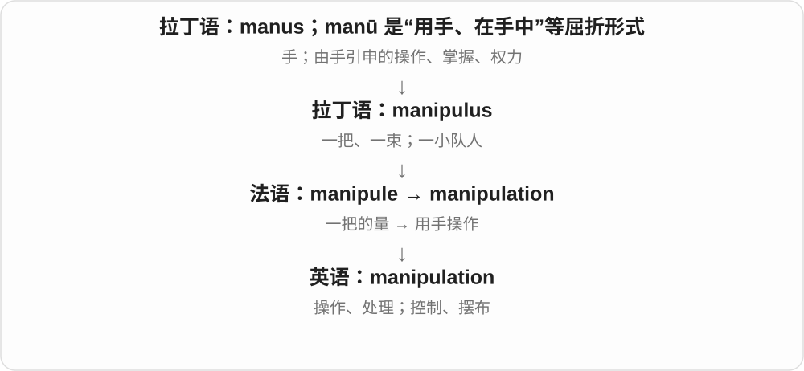

data manipulation 可以只是整理、转换数据；emotional manipulation 常是利用情绪控制他人。不要见到这个词就一律判成造假。

**常见搭配与例句**

data manipulation；image manipulation；emotional manipulation。

> The software allows basic image manipulation.

这款软件支持基本图像处理。

> She recognized the repeated guilt trips as emotional manipulation.

她意识到，对方反复让她内疚是在操控她的情绪。

**别混淆**

operation 是一般操作；manipulation 更突出细致调整，有时突出为了自己的目的控制或篡改。

### 112. activation — 激活；启动；使生效

**音标**：/ˌæktɪˈveɪʃən/

**先抓住这个画面**

activation 像把准备好的设备从待命切到工作，关键是开始发挥作用。

**怎么拆**

activate + -ion，也可对应 active + -ation；现代英语构词。

**怎么变成今天的意思**

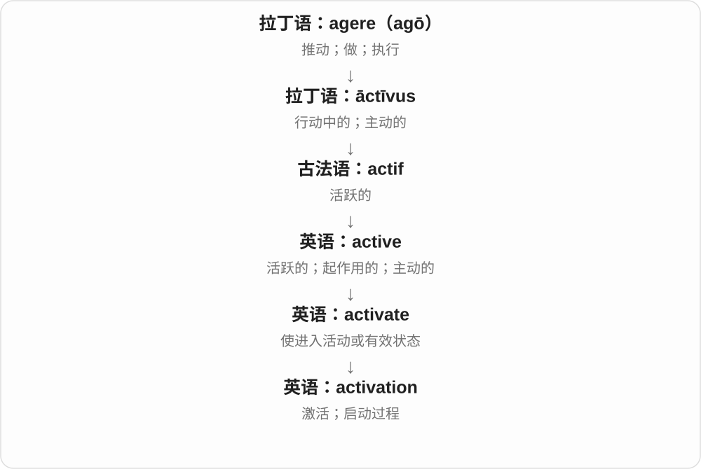

可说账号启用、设备触发或某个过程开始起作用。具体学科中的 activation 有自己的判据，不一定真有一个开关。

**常见搭配与例句**

account activation；activation energy；automatic activation。

> Account activation takes only a few minutes.

账号激活只需几分钟。

> The sensor controls the activation of the alarm.

传感器控制警报的触发。

**别混淆**

activity 是活动状态或活动量；activation 是进入这种有效状态的过程。

### 113. compression — 压缩；挤压

**音标**：英 /kəmˈpreʃən/；美 /kəmˈpreʃən/

**先抓住这个画面**

本来占很大一块，现在挤得更紧、更小；这个过程和程度就是 compression。

**怎么拆**

来自法语 compression、拉丁语 compressiō；与 compress 对应，名词具有自己的借入历史。

**怎么变成今天的意思**

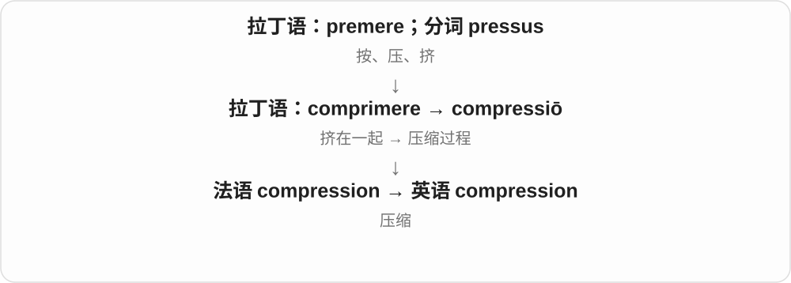

可谈物理体积、数据大小或声音动态范围。数据压缩有无损和有损，不能把所有压缩都理解为删掉信息。

**常见搭配与例句**

data compression；compression ratio；under compression。

> Lossless compression allows the original data to be recovered exactly.

无损压缩允许原始数据被精确恢复。

> The material changes shape under compression.

这种材料受压时会变形。

**别混淆**

compression 是过程或状态；compressor 是执行它的设备或工具。

### 114. decoration — 装饰；装饰物；勋章

**音标**：英、美 /ˌdekəˈreɪʃən/

**先抓住这个画面**

可以说装饰这件事，也可以数桌上、墙上的一件件装饰；授勋场景下则是荣誉的标志。

**怎么拆**

接中世纪拉丁 decoratio／decorationem，来自 decorare。名词有早期独立借入路线，不能因为现代对应 decorate + -ion，就断定一定由现代英语动词后造。

**怎么变成今天的意思**

**拉丁 decus → decorare**  
美、荣誉 → 装饰

↓

**中世纪拉丁 decoratio／decorationem → 英语 decoration**  
装饰这一行为；后也指装饰物、勋章

for decoration 是为了装饰；put up decorations 是挂上、布置装饰物。military decorations 指军功勋章等荣誉标志，不是衣服上的普通花纹。

**常见搭配与例句**

interior decoration；Christmas decorations；for decoration；military decorations。

> The bowl is for decoration, not for serving food.

这个碗是装饰用的，不用来盛食物。

> The children helped put up the decorations before the party.

聚会前，孩子们帮忙挂起了装饰物。

**别混淆**

decor 常指一个空间整体的装饰风格；decoration 可指装饰行为或具体装饰物。单数不可数与复数可数用法要看句子。

### 115. assassinate — 暗杀、刺杀〔尤指重要人物〕

**音标**：/əˈsæsɪneɪt/

**先抓住这个画面**

这个动词常见于历史、政治叙述：某人因为身份或立场而遭到有意刺杀。它比一般 kill 杀死的范围窄。

**怎么拆**

由 assassin 与 -ate 对应，受法语 assassiner、中世纪拉丁 assassinare 等影响。assassin 的远源关联历史团体称谓；不能把传说中的用药故事当成可靠构词依据。

**怎么变成今天的意思**

**中世纪地中海语言中的历史团体名称 → assassin**  
群体称谓扩展为刺客；有关用药的传说不能当作已证事实

↓

**assassiner、assassinare 等 → assassinate、assassination**  
刺杀重要人物；这类事件的名词

an assassinated leader 遭刺杀的领导人；attempt to assassinate 企图刺杀；在历史叙述中关注事件与动机。

**常见搭配与例句**

assassinate a leader；an attempt to assassinate。

> The documentary examines why the leader was assassinated.

纪录片考察那位领导人为何遭到刺杀。

> In the novel, a failed attempt to assassinate the king changes the plot.

小说里，一次刺杀国王未遂的事件改变了情节走向。

**别混淆**

kill 泛指杀死，assassinate 常指有针对性的刺杀。不要因为词尾相近，就把 assassination 的历史记录硬排在英语动词之后。

### 116. assassination — 暗杀、刺杀事件

**音标**：/əˌsæsɪˈneɪʃən/

**先抓住这个画面**

assassinate 说发生了怎样的行动，assassination 把这件刺杀作为历史事件来谈。新闻中常看它造成的政治、社会影响。

**怎么拆**

现代可对应 assassinate 去 e 加 -ion；历史上英语 assassination 的记录约在 1600 年，早于该动词的约 1610 年代记录。因此这是词形对应，不是证明英语里一定先有动词。

**怎么变成今天的意思**

**中世纪地中海语言中的历史团体名称 → assassin**  
群体称谓扩展为刺客；有关用药的传说不能当作已证事实

↓

**assassiner、assassinare 等 → assassinate、assassination**  
刺杀重要人物；这类事件的名词

↓

**英语 assassination 的较早记录**  
刺杀事件；现代与 assassinate 构成对应词族

a political assassination 政治暗杀；an assassination attempt 刺杀企图；the aftermath of an assassination 刺杀事件的后果。

**常见搭配与例句**

a political assassination；an assassination attempt。

> The assassination changed the course of the country’s history.

那次刺杀改变了这个国家的历史进程。

> The museum has an exhibition about the assassination attempt.

博物馆有一个关于那次刺杀未遂事件的展览。

**别混淆**

assassination attempt 不表示一定成功；event 的名词结构不能抹掉 attempt 企图这个限定。

### 117. automation — 自动化

**音标**：英 /ˌɔːtəˈmeɪʃən/；美 /ˌɔːtəˈmeɪʃən/，也读 /ˌɑːtəˈmeɪʃən/

**先抓住这个画面**

把原来需要人反复做、反复盯着的步骤，交给预先安排的机器或软件流程来完成。

**怎么拆**

二十世纪中期由 automatic 词族配 -ion 形成的工业用语，后来扩展到软件等领域。它早于常用动词 automate 的出现，不能倒画成先有 automate 才有 automation。

**怎么变成今天的意思**

**希腊 autos**  
自己；自身；同一

↓

**希腊 automatos／automaton**  
自行活动的；自行动作之物

↓

**新拉丁 automaticus → 英语 automatic**  
自动的；不经有意识控制的

↓

**英语 automatic 词族 + -ion → automation**  
二十世纪工业用词：自动化

工厂流水线自动化是 automation，自动整理表单、生成报告也可以是 automation。一个流程可以只自动化其中一部分，仍需要人检查或处理例外。

**常见搭配与例句**

industrial automation；office automation；workflow automation；the automation of routine tasks。

> Automation reduced the time spent copying data between systems.

自动化减少了在系统之间反复复制数据的时间。

> The factory introduced automation in one part of the production line.

工厂在生产线的一个环节引入了自动化。

**别混淆**

mechanization 侧重用机器替代体力操作；automation 更突出按设定过程自动执行和控制。使用机器不必然等于整个流程自动化。

### 118. projection — 投影；预测；突出物；心理投射

**音标**：英、美 /prəˈdʒekʃən/

**先抓住这个画面**

把东西往前、往外延伸：影像到屏幕上，数字到未来，自身感受到别人身上。

**怎么拆**

经法语 projection 或直接拉丁语 proiectio，来自 proicere 的名词支线；不是由英语 project 唯一生成。

**怎么变成今天的意思**

**拉丁语：iacere；分词 iactus**  
投掷、抛出

↓

**拉丁语：pro- + iacere → proicere / proiect-**  
向前投、伸出

↓

**拉丁语 proiectio → 法语及英语 projection**  
向前投、伸出；投射

financial projections 是根据假设作出的预测，不是保证。心理投射是把自身某些感受或动机归给别人。

**常见搭配与例句**

a map projection；sales projections；image projection。

> The projections assume that demand will remain stable.

这些预测以需求保持稳定为假设。

> Every map projection distorts some aspect of the Earth’s surface.

每一种地图投影都会使地球表面的某些性质产生失真。

**别混淆**

forecast 与 projection 都可作预测；projection 经常特别依赖所设条件。

### 119. projections — 投影、预测；突出部分〔复数〕

**音标**：/prəˈdʒekʃənz/

**先抓住这个画面**

把影像往前投是一种 projection，把现有数据往未来推着看也是；墙上伸出的部分又是空间里“往外突”。

**怎么拆**

projection + -s。名词有拉丁、法语路线，接 pro- 向前 + iacere 投的词族；现代与 project 对应，但不靠任意加一段字母解释全部词史。

**怎么变成今天的意思**

**拉丁 pro- 向前 + iacere 投 → proicere、proiectus 等**  
把东西向前投出、伸出

↓

**英语 project、projection 等词族**  
投射光与声音；计划、预测；突出部分等

↓

**projection + -s → projections**  
多幅投影、多项预测或多个突出部分

sales projections 是销售预测，video projections 是视频投影，projections from a wall 是墙上的突出部分。

**常见搭配与例句**

make projections 作预测；wall projections 墙上投影或突出部分，按语境认。

> The exhibition uses projections on all four walls.

展览在四面墙上都使用投影。

> Their projections suggest that attendance will rise.

他们的预测显示参观人数将增加。

**别混淆**

projections 是投射结果、预测、突出部分，projectors 是设备；词尾不同，关注的对象也不同。

### 120. distraction — 分心；干扰；消遣

**音标**：/dɪˈstrækʃən/

**先抓住这个画面**

distraction 可以是注意力被拉走的状态，也可以是那个拉走你的东西，比如响个不停的通知。

**怎么拆**

经法语 distraction，来自拉丁语 distractiō；现代可对照 distract + -ion。

**怎么变成今天的意思**

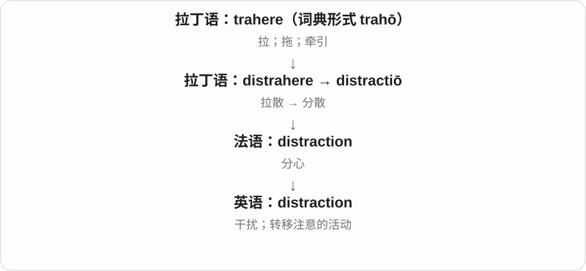

离开原来的关注点，有时是干扰，有时是休息。a welcome distraction 常是让人暂时不再忧虑的好事。

**常见搭配与例句**

avoid distractions；a distraction from…；a welcome distraction；work without distraction。

> I turned off notifications to reduce distractions.

我关闭了通知，以减少干扰。

> The children’s laughter was a welcome distraction from the long wait.

孩子们的笑声让漫长的等待不那么难熬，是一种令人愉快的消遣。

**别混淆**

interruption 强调活动被打断；distraction 强调注意力转移。人还在工作，脑子却飘走，也算 distraction。

### 121. objection — 反对；异议；反对理由

**音标**：英、美 /əbˈdʒekʃən/

**先抓住这个画面**

一项方案往前推进时，有人把一个问题放到面前：等一下，这里不行。

**怎么拆**

经古法语 objeccion、法语 objection 或直接拉丁语 obiectio 借入；与 object 动词同源，名词有自己的借入历史。

**怎么变成今天的意思**

**拉丁语：iacere；分词 iactus**  
投掷、抛出

↓

**拉丁语：ob- + iacere → obicere / obiect-**  
放在面前；提出反对

↓

**拉丁语 obiectio → 法语及英语 objection**  
摆在面前的反驳；异议

raise an objection 是提出异议；have no objection to doing 是不反对做某事。

**常见搭配与例句**

raise objections；an objection to；overcome an objection。

> She raised an objection to the proposed timetable.

她对拟议的时间表提出了异议。

> I have no objection to moving the meeting online.

我不反对把会议改成线上。

**别混淆**

complaint 常是对不满的表达；objection 更直接针对某个主张或做法表示反对。

### 122. restriction — 限制；限制条件

**音标**：/rɪˈstrɪkʃən/

**先抓住这个画面**

那条把人、资源或活动卡住的规定，也可以指受限的状态。

**怎么拆**

现代可对照 restrict + -ion；历史上经法语 restriction 或直接从晚期拉丁 restrictio 借入，英语名词早于 restrict 动词。

**怎么变成今天的意思**

**拉丁语 stringere**  
拉紧、捆紧、压在一起

↓

**拉丁语 re- + stringere → restringere**  
往回拉紧 → 限制、抑制

↓

**晚期拉丁 restrictio → 法语 restriction / 直接借入 → 英语 restriction**  
限制、约束的名词支线

a restriction on travel 是对出行的限制；lift restrictions 是解除限制。dietary restrictions 是饮食禁忌或限制条件，不必来自政府规定。

**常见搭配与例句**

impose restrictions；lift restrictions；restrictions on access；dietary restrictions。

> There are no restrictions on how many books you can reserve.

预约图书的数量没有限制。

> Please tell us about any dietary restrictions before the event.

活动前请告知我们您的饮食禁忌或限制。

**别混淆**

a restriction 是具体边界或限制措施；a rule 可以规定很多事，不都在缩小自由。

### 123. evacuation — 疏散、撤离；排空

**音标**：/ɪˌvækjuˈeɪʃən/

**先抓住这个画面**

把人员向外转移这件事，作为一次行动或一个流程来谈。

**怎么拆**

经法语及晚期拉丁 evacuatio 借入；与 evacuate 平行同源，现代能对应动词与 -ion 的关系。

**怎么变成今天的意思**

**拉丁语 vacare／vacuus**  
空着、闲着／空的

↓

**拉丁 evacuare → evacuatio**  
排空 → 排空行为

↓

**法语 evacuation → 英语 evacuation**  
排空；后来用于人员撤离

an evacuation plan 是撤离安排，an evacuation drill 是练习怎么撤离。这个词强调过程，不等于灾害已经发生；演练也可以涉及 evacuation。新闻里的 mass evacuation 则指大量人员转移。

**常见搭配与例句**

an evacuation plan；an evacuation drill；order an evacuation。

> The school holds an evacuation drill every term.

学校每学期都进行一次疏散演练。

> Heavy rain delayed the evacuation of the village.

大雨延误了村庄人员的撤离。

**别混淆**

evacuation 是撤离过程；rescue 是救援，二者可能重叠，但不完全相同。

### 124. initiate — 发起、启动；使入门；新加入者〔名词，较正式〕

**音标**：动词 /ɪˈnɪʃieɪt/；名词 /ɪˈnɪʃiət/

**先抓住这个画面**

一个项目原先没动，你把它启动；一个新人还不了解某领域，你领他入门，这两种带进开始都能用 initiate。

**怎么拆**

接拉丁 initiatus，来自 initiare 开始、引入，与 initium 开始相连，更早有进入的材料。-ate 在常用动词读 /eɪt/，名词新加入者末尾弱读。

**怎么变成今天的意思**

**拉丁 in- 进入 + ire 去 → initium 开始 → initiare**  
进入某个过程；开始、引入

↓

**initiatus、initiatio → initiate、initiation**  
发起、引导入门；开始或入门过程

initiate a project 启动项目；initiate talks 发起谈判；initiate someone into something 引导某人入门。名词 an initiate 指新入门的人，较正式。

**常见搭配与例句**

initiate talks；initiate a process；initiate someone into。

> The council initiated a review of the plan.

委员会启动了对计划的审查。

> Her tutor initiated her into the basics of the subject.

导师带她学习这门学科的基础。

**别混淆**

initiate 强调让事情开始，implement 是把计划付诸执行；启动讨论不等于方案已落实。

### 125. initiation — 开始、启动；入门；入会仪式

**音标**：/ɪˌnɪʃiˈeɪʃən/

**先抓住这个画面**

把事情开启，或带新人迈过门槛，这个过程是 initiation。仪式只是其中一种场景，不必每次都想到秘密组织。

**怎么拆**

接法语、拉丁 initiatio 等开始、入门材料；现代对应 initiate 去 e 加 -ion。

**怎么变成今天的意思**

**拉丁 in- 进入 + ire 去 → initium 开始 → initiare**  
进入某个过程；开始、引入

↓

**initiatus、initiatio → initiate、initiation**  
发起、引导入门；开始或入门过程

↓

**initiatio → initiation**  
开启过程；被引导进入某种知识、群体

the initiation of a project 项目启动；an initiation into something 对某领域的初步接触；an initiation ceremony 入会、入门仪式。

**常见搭配与例句**

the initiation of；an initiation into；an initiation ceremony。

> The initiation of the project was delayed.

项目的启动推迟了。

> The course was my initiation into modern art.

这门课是我接触现代艺术的入门课。

**别混淆**

initiation 是开始或引入过程，initiative 常是主动性或倡议；相同词族并不意味着名词可互换。

### 126. acceleration — 加速；加速度；进程加快

**音标**：/əkˌseləˈreɪʃən/

**先抓住这个画面**

关心的不是现在有多快，而是在一段时间里变化得有多快。

**怎么拆**

来自拉丁 acceleratio／accelerationem，加快这一动作的名词，基于 accelerare。与英语 accelerate 对应，但有独立的拉丁名词借入链。

**怎么变成今天的意思**

**拉丁 celer → celerare**  
迅速的 → 使加快

↓

**拉丁 accelerare → acceleratio**  
使加快 → 加快这一过程

↓

**英语 acceleration**  
加速；物理中的加速度

车的 acceleration 好，常指提速快；an acceleration in growth 是增长速度加快。物理里加速度是速度随时间的变化率，转弯或减速同样可能有加速度。

**常见搭配与例句**

rapid acceleration；an acceleration in growth；constant acceleration。

> The car offers smooth acceleration.

这辆车提速很平顺。

> The report noted an acceleration in demand.

报告指出需求增长正在加快。

> A car can have acceleration even when its speed stays constant during a turn.

汽车转弯时，即使速率不变，也可以有加速度。

**别混淆**

speed 是速率，acceleration 是速度变化率。跑得很快但沿直线匀速运动，加速度可以为零；匀速转弯则不是零。

### 127. devotion — 挚爱；忠诚投入；虔诚；宗教祈祷活动

**音标**：英 /dɪˈvəʊʃən/；美 /dɪˈvoʊʃən/

**先抓住这个画面**

长期愿意把心力交给一个人、一种信念或一件事。

**怎么拆**

经古法语 devocion 或直接借自拉丁语 dēvōtiō；它在英语中的出现早于现代 devote 动词，不应只画成 devote + -ion。

**怎么变成今天的意思**

**拉丁语 vovēre**  
郑重许诺、起誓、奉献

↓

**拉丁语 de- + vovēre → dēvovēre**  
以誓愿献出、郑重奉献

↓

**拉丁语 dēvōtiō → 古法语 devocion／直接借入 → 英语 devotion**  
誓愿奉献 → 虔诚、忠诚与投入

her devotion to her family 是她对家庭的深厚投入；religious devotion 是宗教虔诚；复数 devotions 常指祈祷、敬拜等活动。普通的爱护不必含宗教意义。

**常见搭配与例句**

devotion to；show devotion；religious devotion；daily devotions。

> Her devotion to the children was clear in everything she did.

她做的每件事都体现出对孩子们的深厚关爱。

> The diary describes his daily devotions.

日记描述了他每天的祈祷活动。

**别混淆**

dedication 常突出投入和坚持；devotion 还容易带出深厚感情、忠诚或宗教敬意。

### 128. persecution — 迫害；持续压迫

**音标**：英 /ˌpɜːsɪˈkjuːʃən/；美 /ˌpɜːrsəˈkjuːʃən/

**先抓住这个画面**

把一连串追逼与伤害作为整体来看，就是 persecution。重点是持续受到不公正的针对。

**怎么拆**

教会拉丁语 persecūtiō 经法语进入英语，来自 persequī“追赶、紧追”。

**怎么变成今天的意思**

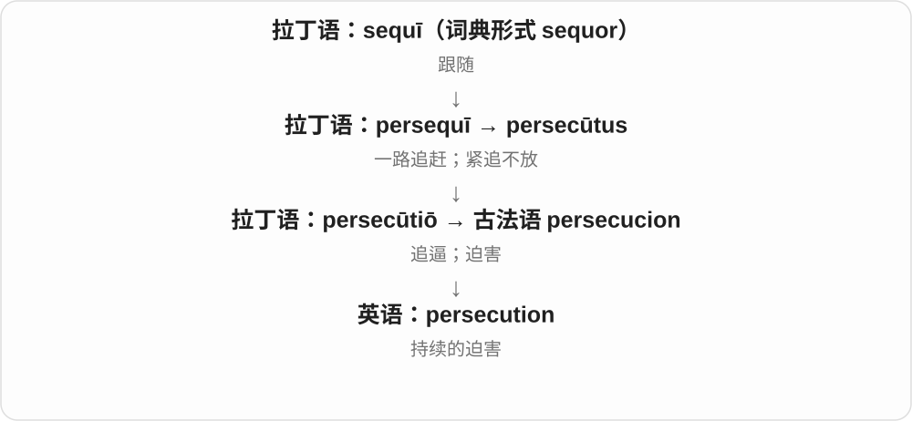

它把迫害行为作为社会现象或个人遭遇来谈。比一般 disagreement“意见不合”或 criticism“批评”严重得多。

**常见搭配与例句**

religious persecution；escape persecution；fear of persecution。

> The family fled the country to escape persecution.

这个家庭为躲避迫害逃离了国家。

> The museum documents the persecution of minority communities.

博物馆记录了少数群体遭受迫害的历史。

**别混淆**

prosecution 是起诉；persecution 是迫害。多出来的 er 不能在拼写时忽略。

### 129. prostitution — 卖淫活动；出卖才能或原则

**音标**：英 /ˌprɒstɪˈtjuːʃən/；美 /ˌprɑːstɪˈtuːʃən/

**先抓住这个画面**

把目光从某个人转到有偿性服务这项活动，或比喻把原则拿去交换利益。

**怎么拆**

接晚期拉丁 prostitutio，可经法语借入；现代能与 prostitute + -ion 对照，但历史名词在英语借入前已经存在。

**怎么变成今天的意思**

**拉丁 stare → statuere**  
站立 → 使站稳、设立、安排

↓

**拉丁 pro- + statuere → prostituere**  
摆在前面、公开展示；在拉丁语中已有卖淫相关义

↓

**晚期拉丁 prostitutio → 法语或直接借入 → 英语 prostitution**  
相关活动的名词；后来也用于才能、原则的出卖

research on prostitution 是关于这一社会现象的研究；the prostitution of art 则是带批评的比喻，说艺术被用于只顾利益等目的。法律讨论要按具体地区理解，词本身不规定当地法律。

**常见搭配与例句**

research on prostitution；forced prostitution；the prostitution of talent。

> The book examines the history of prostitution in the port city.

这本书研究了这座港口城市的卖淫活动史。

> The critic described the campaign as a prostitution of artistic talent.

那位评论家认为，这场宣传是在出卖艺术才华。

**别混淆**

prostitute 可指人；prostitution 指活动。sex work 是更宽泛的表达，不能在所有句子里当严格同义词。

### 130. penetration — 穿透、渗透；进入程度；深入理解

**音标**：/ˌpenɪˈtreɪʃən/

**先抓住这个画面**

penetrate 是往里穿、往里渗，penetration 把这个过程或深入程度作为名词。water penetration 看水进到里面，market penetration 看产品、服务进入目标市场的程度。

**怎么拆**

承中古英语 penetracioun，经古法语上接拉丁语 penetratio。现代与 penetrate + -ion 对应，去末尾 e → penetration；过程、结果、程度各随对象展开。

**怎么变成今天的意思**

**拉丁语 penetrare 进入内部、穿入 → penetratus → penetrate**  
上游 penes 等与内部联系

↓

**penetratio → 法语、英语 penetration；现代对应 penetrate + -ion**  
穿透、渗入的过程与程度，也用于理解、市场覆盖等

water penetration 渗水；light penetration 光的穿透；market penetration 市场渗透、覆盖程度。

**常见搭配与例句**

water penetration；light penetration；market penetration。

> The coating reduced water penetration into the wood.

涂层减少了水向木材内部渗透。

> The report compares internet penetration across regions.

报告比较了不同地区的互联网普及程度。

**别混淆**

penetration 不是任何增长的泛称；谈市场时通常看进入、覆盖的范围或程度，具体指标依文本定义。

### 131. stimulation — 刺激；激发；刺激带来的活动

**音标**：英 /ˌstɪmjʊˈleɪʃən/；美 /ˌstɪmjəˈleɪʃən/

**先抓住这个画面**

把注意力放在刺激这个过程，或人从环境、活动里得到的输入。

**怎么拆**

现代能与 stimulate、-ion 对应；实际借入拉丁 stimulatio、stimulationem，英语记录早于 stimulate，不能把借词史倒画成英语动词加后缀。

**怎么变成今天的意思**

**拉丁 stimulus 尖棒、赶牲口的刺棒**  
由戳一下催动，引申为促使行动

↓

**拉丁 stimulare → stimulatio / stimulationem → 英语 stimulation**  
催动、激发的动作名词，独立进入英语

mental stimulation 是让头脑活跃起来的思想输入；sensory stimulation 是感官刺激；electrical stimulation 是电刺激。多少合适取决于场景，词本身不等于娱乐。

**常见搭配与例句**

mental stimulation；sensory stimulation；electrical stimulation；a lack of stimulation。

> The job offers plenty of mental stimulation.

这份工作能让人不断动脑。

> The researchers measured responses to electrical stimulation.

研究人员测量了对电刺激的反应。

**别混淆**

stimulus 是引起反应的东西；stimulation 是刺激过程或受到的刺激。一个声音是 stimulus，声音带来的感官输入可谈 stimulation。

### 132. insulation — 隔热；绝缘；隔音；隔离材料

**音标**：英 /ˌɪnsjuˈleɪʃən/；美 /ˌɪnsəˈleɪʃən/

**先抓住这个画面**

既可以指阻止传递的作用，也可以指实际铺在墙里、包在电线外的那层材料。

**怎么拆**

insulate 对应的动作名词，-ate 换成 -ation；英语后来也把动作名词用作材料名称。

**怎么变成今天的意思**

**拉丁 insula 岛**  
再早的来源未定；不硬拆为 in 加某个英语词

↓

**拉丁 insulatus 像岛一样分隔，或 insula + 英语 -ate → insulate**  
英语早期使成为岛，后来用于隔热、绝缘等；具体构形有两种常见分析

↓

**英语 insulate → insulation**  
隔离作用；后来也指实施隔离的材料

roof insulation 是屋顶隔热层；electrical insulation 是电气绝缘；sound insulation 是隔音。具体挡的是热、电还是声音，靠前面的词或语境辨认。

**常见搭配与例句**

thermal insulation；electrical insulation；sound insulation；install insulation。

> The house needs better roof insulation.

这所房子需要更好的屋顶隔热层。

> The report found damage to the electrical insulation.

报告发现电气绝缘层有损坏。

**别混淆**

insulator 常指一种具体材料或器件；insulation 常说作用、系统或材料总称。isolation 的社会孤立义不能都换成 insulation。

### 133. exemption — 豁免；免除；获准例外的资格

**音标**：/ɪɡˈzempʃən/

**先抓住这个画面**

把“可以不用履行某项要求”这件事当作一个名词来谈。

**怎么拆**

现代可联系 exempt + -ion，但历史上来自古法语 exemption、exencion，或直接借拉丁 exemptio、exemptionem；拉丁名词接 eximere 的分词词干。

**怎么变成今天的意思**

**拉丁语 emere；分词 emptus**  
买、取得；更早有“取”的含义

↓

**拉丁语 eximere → exemptio、exemptionem**  
取出、免除 → 免除这件事

↓

**古法语 exemption、exencion；直接拉丁借入也是来源**  
英语名词的借入路线

↓

**中古英语 exempcioun → 英语 exemption**  
豁免、免除资格

an exemption from an exam 是获准不用参加那场考试。它像一张有适用范围的通行证：重点在“免哪一项”，所以 from 后面的要求很重要。

**常见搭配与例句**

apply for an exemption；grant an exemption；an exemption from a requirement；a tax exemption。

> He applied for an exemption from the language test.

他申请免参加语言测试。

> The exemption applies only to the registration fee.

这项豁免只适用于报名费。

**别混淆**

exception 是任何偏离通常规则的例外；exemption 更具体，常指免去一项本应适用的义务、费用或要求。

### 134. cultivation — 耕作；栽培；培养

**音标**：英 /ˌkʌltɪˈveɪʃən/；美 /ˌkʌltəˈveɪʃən/

**先抓住这个画面**

为了让某种东西慢慢长好，持续投入功夫。

**怎么拆**

有法语 cultivation 借入路线，也有拉丁 cultivāt- 接 -ion 的分析；现代可联系 cultivate + -ion。

**怎么变成今天的意思**

**拉丁 colere；分词 cultus**  
耕作、照料；居住；尊敬、崇奉

↓

**晚期拉丁 cultīvus → 中世纪拉丁 cultivāre / cultivātus → 法语 cultivation**  
耕种、培养的行为

↓

**英语 cultivation**  
耕作；培养知识、习惯或关系

rice cultivation 是水稻栽培；the cultivation of patience 是培养耐心。英语早期的相关记录也有精神培养义，不宜把现代各义硬排成固定年代阶梯。

**常见搭配与例句**

under cultivation；the cultivation of；rice cultivation。

> The land has been under cultivation for many years.

这片土地已经耕种多年。

> The course encourages the cultivation of careful observation.

课程鼓励培养细致观察的习惯。

**别混淆**

culture 范围更宽，常已指形成的群体生活；cultivation 更突出有意识投入的培养过程。

### 135. demolish — 拆毁、拆除；彻底驳倒

**音标**：英 /dɪˈmɒlɪʃ/；美 /dɪˈmɑːlɪʃ/

**先抓住这个画面**

原来立着的一座楼，被拆到不再成其为楼，是 demolish。论点被逐条推翻，也可借这个拆毁画面来讲。

**怎么拆**

借法语 demoliss- 等动词形式，上接拉丁 demoliri 拆掉：de- 向下等 + moliri 营造，后者与 moles 大块、体量相关。

**怎么变成今天的意思**

**拉丁 de- 向下等 + moliri 营造、建造 → demoliri**  
把建起来的东西拆掉

↓

**法语 demolir、demoliss- 与拉丁 demolitio 等 → demolish、demolition**  
拆除；拆除活动或结果

demolish a building 拆楼；demolish an argument 彻底驳倒论证；口语还可夸张说迅速吃光一份食物。

**常见搭配与例句**

demolish a building；demolish an argument。

> The old warehouse will be demolished next year.

旧仓库明年将被拆除。

> Her evidence demolished the main argument.

她的证据彻底推翻了主要论点。

**别混淆**

damage 是损坏，demolish 常强调拆毁、摧毁整体；不是墙上出现一个小裂口就自然叫 demolish。

### 136. demolition — 拆除、拆毁；彻底击溃

**音标**：英 /ˌdeməˈlɪʃən/；美 /ˌdeməˈlɪʃən/

**先抓住这个画面**

把 demolish 的动作整体拿来谈：拆除何时开始、需要多长时间，这时常用 demolition。

**怎么拆**

经法语接拉丁 demolitio、demolition-，来自 demoliri 的 demolit- 词干。与 demolish 同源，但不是任何英语 -sh 都能换成 -ition。

**怎么变成今天的意思**

**拉丁 de- 向下等 + moliri 营造、建造 → demoliri**  
把建起来的东西拆掉

↓

**法语 demolir、demoliss- 与拉丁 demolitio 等 → demolish、demolition**  
拆除；拆除活动或结果

↓

**拉丁 demolit- + 名词材料 → demolition**  
把建造物拆下的活动、事件

scheduled for demolition 计划拆除；demolition work 拆除作业；the demolition of a building 建筑物的拆除。

**常见搭配与例句**

demolition work；scheduled for demolition。

> Demolition of the factory began in June.

工厂的拆除工作六月开始。

> The building was saved from demolition.

这座建筑保住了，没有被拆掉。

**别混淆**

demolition 指拆除或彻底摧毁，renovation 是翻修；后者通常保留建筑并改善它。

### 137. regeneration — 再生；重建；复兴

**音标**：/rɪˌdʒenəˈreɪʃən/

**先抓住这个画面**

已有的东西受损或衰退后，重新长出、重新恢复活力。

**怎么拆**

古法语 regeneracion 及晚期拉丁 regenerātiō 借入；名词在英语里早于现代 regenerate 动词。

**怎么变成今天的意思**

**拉丁 gignere、genitus；同族 genus、gener-**  
生出、产生；种类、出身

↓

**拉丁 re- + generāre → regenerāre → 晚期拉丁 regenerātiō**  
重新生出 → 重生

↓

**古法语 regeneracion 及拉丁词 → 中古英语 regeneration**  
重生；组织再生；更新

tissue regeneration 是组织再生；urban regeneration 是衰落城区的更新。宗教文字中的 spiritual regeneration 说精神重生。共同点是重新获得生机，过程并不相同。

**常见搭配与例句**

tissue regeneration；urban regeneration；forest regeneration。

> The researchers studied the regeneration of damaged tissue.

研究者研究受损组织的再生。

> The old dock area is undergoing regeneration.

旧码头地区正在进行更新改造。

**别混淆**

repair 可以修补原来的东西；regeneration 常突出重新生长、重建或恢复活力。

### 138. segregation — 隔离；种族等群体隔离；分离

**音标**：英、美 /ˌseɡrɪˈɡeɪʃən/

**先抓住这个画面**

重点在把某类人与另一类人隔开，并长期保持这种分开；有些场景也只是物品的分类分离。

**怎么拆**

接晚期拉丁 segregatio／segregationem，来自 segregare 的词族。名词已有独立借入路线，现代虽对应 segregate + -ion，历史不只这一步。

**怎么变成今天的意思**

**拉丁 grex，词干 greg-**  
一群，尤指一群动物

↓

**拉丁 segregare → 晚期拉丁 segregatio／segregationem**  
隔开 → 隔离、分离的行为

↓

**英语 segregation**  
分类隔开；在人群中尤其指种族等隔离

racial segregation 是种族隔离；segregation in housing 是住房方面的人群隔离。它可以涉及规则、制度，也可以讨论形成的居住格局；具体机制要由上下文说明。

**常见搭配与例句**

racial segregation；residential segregation；end segregation；segregation in schools。

> The museum documents the history of racial segregation.

博物馆记录了种族隔离的历史。

> The researchers studied residential segregation across the city.

研究人员考察了全市的居住隔离情况。

**别混淆**

separation 可以只是分开的位置或动作；segregation 在社会讨论中常指群体被隔开并受到不同对待。

### 139. ventilation — 通风；空气交换；肺通气

**音标**：英美 /ˌventɪˈleɪʃn/

**先抓住这个画面**

把空气怎样进入、流动、排出去当作一个完整过程来看，而不是只看一阵风。

**怎么拆**

名词接拉丁 ventilatio／ventilationem，由 ventilare“扇动、使接触空气”形成，也有经法语 ventilation 的借入路线。现代与 ventilate 对应，但名词并非只在英语中把动词加 -ion 才产生。

**怎么变成今天的意思**

**拉丁 ventus → ventulus**  
风 → 微风、小风

↓

**拉丁 ventilare → ventilatio／ventilationem**  
扇动、使接触空气 → 这一动作的名词

↓

**法语 ventilation 与拉丁词形 → 英语 ventilation**  
扇风；后来发展为空气交换和肺通气

建筑里的 ventilation 是换气，常见于 ventilation system“通风系统”。医学里的 mechanical ventilation 是机械通气：设备辅助气体进出肺。两种场景共享气体流动的核心，但对象不同。

**常见搭配与例句**

good ventilation；natural ventilation；a ventilation system；mechanical ventilation。通常不可数。

> The renovation improved ventilation throughout the building.

这次改造改善了整栋楼的通风。

> The article compares different methods of mechanical ventilation.

文章比较了不同的机械通气方式。

**别混淆**

circulation 可以只说空气在原地循环；ventilation 常着重室内外空气交换。肺通气也不能直接等同于血液已经充分获得氧气，通气只是呼吸过程中的一环。

### 140. vibrate — 振动、震动；使振动

**音标**：/vaɪˈbreɪt/

**先抓住这个画面**

手机在桌上嗡嗡响，琴弦在原位快速来回动，都是 vibrate。重点是反复的小幅运动，不是整个东西一路搬走。

**怎么拆**

接拉丁 vibratus，来自 vibrare 摇动、挥动，现代 -ate 形成动词形；与 vibrant 同族，但用法不同。

**怎么变成今天的意思**

**拉丁 vibrare 摇动、挥动 → vibratus、vibratio**  
快速来回运动及相应活动名词

↓

**英语 vibrate、vibration**  
振动；可感到的震动

a phone vibrates 手机振动；a vibrating string 振动的琴弦；vibrate with excitement 可形容兴奋得颤动。

**常见搭配与例句**

vibrate gently；a vibrating string；a phone vibrates。

> My phone vibrated in my pocket.

手机在我口袋里振动了。

> The strings vibrate when you play the instrument.

演奏这件乐器时，琴弦会振动。

**别混淆**

vibrate 是运动过程，vibrant 常说充满活力；a vibrant city 不是整座城市一直物理震动。

### 141. vibration — 振动；震动、颤动感

**音标**：/vaɪˈbreɪʃən/

**先抓住这个画面**

vibrate 是来回动，vibration 是这次运动或它传到手上、地板上的颤动感。机器、声音和手机都能带来它。

**怎么拆**

法语 vibration 接拉丁 vibratio，来自 vibrare；现代对应 vibrate 去 e 加 -ion。

**怎么变成今天的意思**

**拉丁 vibrare 摇动、挥动 → vibratus、vibratio**  
快速来回运动及相应活动名词

↓

**英语 vibrate、vibration**  
振动；可感到的震动

↓

**vibratio → vibration**  
振动过程；一次或一类震动

reduce vibration 减少振动；feel a vibration 感到震动；mechanical vibration 机械振动。可数时常谈若干次或若干种振动。

**常见搭配与例句**

feel a vibration；reduce vibration；mechanical vibration。

> We could feel the vibration through the floor.

我们能感觉到地板传来的震动。

> The new supports reduce vibration from the motor.

新支架减少了电机带来的振动。

**别混淆**

vibration 本身不必令人不快，乐器发声也靠振动；不能只把它当故障或地震。

### 142. combustion — 燃烧；燃烧过程

**音标**：/kəmˈbʌstʃən/

**先抓住这个画面**

燃料发生反应，明显放出热，往往还会发光，这个燃烧过程是 combustion。汽车发动机里也能谈它，不只是眼前的大火。

**怎么拆**

经法语 combustion 接拉丁 combustio，来自 comburere 燃烧的 combust- 词干；更早与 urere 烧的材料相连。不是把英语 combine 与 bust 随意拼接。

**怎么变成今天的意思**

**拉丁 comburere → combust-、combustio**  
烧、烧尽 → 燃烧的过程

↓

**法语 combustion → 英语 combustion**  
燃烧；发动机等领域中的燃烧过程

internal combustion engine 内燃机；spontaneous combustion 自燃；combustion of fuel 燃料燃烧。通常作不可数名词。

**常见搭配与例句**

internal combustion；spontaneous combustion；combustion of fuel。

> The engine uses the heat produced by combustion.

发动机利用燃烧产生的热。

> The report compares emissions from different combustion processes.

报告比较了不同燃烧过程产生的排放。

**别混淆**

combustion 常有明显放热，氧化的范围更广；金属缓慢生锈虽是氧化，一般不按日常用法叫燃烧。也不必每次都有可见火焰。

### 143. intuitive — 凭直觉的；直观易懂的

**音标**：英 /ɪnˈtjuːɪtɪv/；美 /ɪnˈtuːɪtɪv/

**先抓住这个画面**

还没把推理一步步说出来，已经大致抓到了答案；界面一看就知道怎么操作，也可以说 intuitive。

**怎么拆**

借法语 intuitif 等，上接中世纪拉丁 intuitivus、拉丁 intueri 注视、考虑；in- 在这里是朝向，tueri 是看，不是否定前缀。

**怎么变成今天的意思**

**拉丁 in- 朝向 + tueri 看 → intueri**  
注视、考虑

↓

**中世纪拉丁 intuitivus；法语 intuitif 等 → intuitive**  
直观把握的；凭直觉的

↓

**intuitive + -ly → intuitively**  
凭直觉、直观地

an intuitive understanding 直觉式理解；an intuitive interface 易懂易用的界面；an intuitive sense 直觉判断。感觉可来自经验，也可能判断错误。

**常见搭配与例句**

intuitive understanding；an intuitive interface；an intuitive sense of。

> The app has an intuitive interface that new users can understand quickly.

这个应用的界面直观，新用户很快就能看懂。

> Years of practice gave her an intuitive sense of timing.

多年练习让她对时机形成了直觉。

**别混淆**

intuitive 容易凭直觉把握，counterintuitive 与直觉预期相反；后者不自动等于错误，前者也不保证正确。

### 144. intuitively — 凭直觉地；直观上

**音标**：英 /ɪnˈtjuːɪtɪvli/；美 /ɪnˈtuːɪtɪvli/

**先抓住这个画面**

你可能还没写出证明，但心里先觉得应该这样。intuitively 交代的是判断方式，不给结论盖正确印章。

**怎么拆**

intuitive + -ly → intuitively，保留末尾 e 再接 -ly；副词用于理解、感觉、使用等动作或整句判断。

**怎么变成今天的意思**

**拉丁 in- 朝向 + tueri 看 → intueri**  
注视、考虑

↓

**中世纪拉丁 intuitivus；法语 intuitif 等 → intuitive**  
直观把握的；凭直觉的

↓

**intuitive + -ly → intuitively**  
凭直觉、直观地

intuitively understand 凭直觉理解；intuitively obvious 直观上显而易见；Intuitively, ... 从直觉上说……。

**常见搭配与例句**

intuitively understand；intuitively obvious；intuitively appealing。

> She intuitively understood what the child was trying to say.

她凭直觉明白了孩子想表达什么。

> The result seems intuitively obvious, but it still needs a proof.

结果直观上似乎显然，但仍需要证明。

**别混淆**

intuitively 并不必然是天生就会；长期训练形成的熟练模式也能让判断看起来不经刻意思考。

### 145. concussion — 脑震荡；猛烈震动、冲击

**音标**：英、美 /kənˈkʌʃən/

**先抓住这个画面**

日常最常见的是头部或身体受到冲击后，大脑功能受到影响的一类脑损伤。

**怎么拆**

拉丁语 concutere“猛烈摇动”的名词 concussio 进入英语，原有震动、冲击义；医学中专门化为脑震荡。不是现代 concuss 动词出现后才造出这个名词。

**怎么变成今天的意思**

**拉丁语 quatere / quatio；反复动作形式 quassare**  
摇动、击打；quassare 表示猛烈摇动、击碎

↓

**拉丁语 con- + quatere → concutere；分词 concussus**  
猛烈摇动、震动

↓

**拉丁语 concussio → 英语 concussion**  
猛烈摇动、冲击 → 医学中的脑震荡

脑震荡可以由头部直接受击引起，也可由身体受击使头和脑快速运动而发生。普通英文也有爆炸 concussion 的震荡义，需看语境。

**常见搭配与例句**

suffer a concussion；a concussion diagnosis；the concussion of an explosion。

> The player was assessed for concussion after the collision.

碰撞后，球员接受了脑震荡评估。

> The concussion of the blast rattled the windows.

爆炸的冲击震得窗户作响。

**别混淆**

concussion 是脑损伤，不等于头骨骨折；具体判断也不靠单独一个外表伤口。

### 146. encryption — 加密；加密过程

**音标**：/ɪnˈkrɪpʃən/

**先抓住这个画面**

给信息套上的不是文件名伪装，而是一层需要解开的数学转换。

**怎么拆**

英语 encrypt + -ion，把加密动作变成过程名词；词尾 -tion 在这里读 /ʃən/。

**怎么变成今天的意思**

**希腊语 kryptein；kryptos**  
藏起来；隐藏的

↓

**英语 en- + crypt- → encrypt**  
现代构词：使信息成为隐藏内容的形式

↓

**英语 encrypt + -ion → encryption**  
加密的过程或处理方式

data encryption 讨论数据如何被保护，encryption key 是参与这种处理的密钥。加密保护的是数据内容的可读性；具体能保护到哪里，要看系统实现和密钥管理。

**常见搭配与例句**

data encryption；encryption software；an encryption key；enable encryption。

> Encryption protects the contents of the messages while they travel across the network.

加密保护了消息在网络传输中的内容。

> The team enabled encryption on all company laptops.

团队为所有公司笔记本电脑启用了加密。

**别混淆**

password 是身份验证等用途的口令，encryption 是数据转换过程。界面要求输入密码，不代表所有存储内容已经加密。

### 147. implication — 暗示；可能的影响、后果；牵涉

**音标**：英、美 /ˌɪmplɪˈkeɪʃən/

**先抓住这个画面**

一句话里卷着没明说的意思，一项决定里也卷着未来的后果。

**怎么拆**

来自拉丁语 implicatio，基于 implicare“卷入、纠缠”；与 imply、implicate 有共同历史基础，但不必经现代英语两个动词才能形成。

**怎么变成今天的意思**

**拉丁语 plicare**  
折叠、使相接；与编织、弯曲一组词有更早联系

↓

**拉丁语 in- + plicare → implicare**  
卷进去、牵连在内

↓

**拉丁语 implicatio → 英语 implication**  
牵连、包含 → 暗含意思及所带后果

the implication of a remark 常指言外之意；the implications of a policy 多指政策会带来的影响。逻辑中的 implication 是条件关系，要按相应逻辑规则理解。

**常见搭配与例句**

implications for；practical implications；by implication。

> What are the implications of the change for small businesses?

这一变化会对小企业产生哪些影响？

> I disliked the implication that I had been careless.

我不喜欢话里暗示我粗心的那层意思。

**别混淆**

inference 是听者推出来的结论；implication 是话语暗含的意思，或事情可能牵出的后果。

### 148. interrogation — 审问；盘问

**音标**：英 /ɪnˌterəˈɡeɪʃən/；美 /ɪnˌterəˈɡeɪʃən/

**先抓住这个画面**

问题一个接一个地追过来，问话者想把事实、口供或矛盾问清楚。

**怎么拆**

拉丁语 inter- + rogare“问”形成 interrogare，再有 interrogatio，经古法语进入英语。这里 inter- 加强反复问讯，不能机械译成“在两个问题之间”。

**怎么变成今天的意思**

**拉丁语：inter- + rogare → interrogare**  
追问、盘问

↓

**拉丁语 interrogatio → 古法语 interrogacion**  
讯问

↓

**英语：interrogation**  
审问；密集追问

通常比 questioning 更严肃、有压力；也可夸张地说家人对你的行踪盘根问底。

**常见搭配与例句**

under interrogation；a lengthy interrogation。

> The witness asked for a lawyer before the interrogation began.

讯问开始前，证人要求有律师在场。

> Dinner turned into an interrogation about my new job.

晚饭变成了对我新工作的一连串盘问。

**别混淆**

interview 可以是友好的采访或面试；interrogation 通常由问话者掌握主动。

### 149. humiliation — 羞辱；受辱；丢脸的事

**音标**：/hjuːˌmɪliˈeɪʃən/

**先抓住这个画面**

像被人当众压低一截，觉得尊严受到伤害。

**怎么拆**

晚期拉丁 humiliatio 经法语或直接借入英语；英语名词早于 humiliate，不能只画成现代动词加 -ion。

**怎么变成今天的意思**

**拉丁 humus 地面 → humilis**  
在低处、地位低 → 谦卑的

↓

**晚期拉丁 humiliare → humiliatio；法语 humiliation → 英语 humiliation**  
使低下 → 贬抑、受辱的行为或感受

public humiliation 是公开羞辱；suffer humiliation 是遭受羞辱。也可数地说一次让人难堪的经历，但不只是普通小失误。

**常见搭配与例句**

public humiliation；suffer humiliation；a sense of humiliation。

> Being mocked in front of the class caused him deep humiliation.

在全班面前遭嘲笑让他深感受辱。

> The team wanted to recover from the humiliation of last week’s defeat.

球队希望从上周惨败的耻辱中振作起来。

**别混淆**

embarrassment 可以是短暂尴尬；humiliation 往往更重，牵涉尊严和地位受损。

### 150. retaliate — 报复、反击

**音标**：/rɪˈtælieɪt/

**先抓住这个画面**

别人先伤害或打压你，你又用行动还回去，这个回击是 retaliate。它解释回应关系，不自动替行为判对错。

**怎么拆**

接拉丁 retaliatus，来自 retaliare；re- 回、还与 talio 对等回报、报复的材料相连，后接动词形式。

**怎么变成今天的意思**

**拉丁 re- 回、还 + talio 对等回报的材料 → retaliare**  
把对方的行为还回去

↓

**retaliatus、retaliatio 等 → retaliate、retaliation**  
因先前伤害而报复；报复行为

retaliate against someone 报复某人；retaliate for an attack 因袭击而报复；retaliate by doing 用某种行动反击。

**常见搭配与例句**

retaliate against；retaliate for；retaliate by doing。

> She refused to retaliate after the insult.

受到侮辱后，她拒绝报复。

> The company retaliated by cancelling the contract.

公司以取消合同作为反击。

**别混淆**

retaliate 含有对先前伤害的回应；attack 只是攻击，不一定是回击。回应也可能加重冲突。

### 151. retaliation — 报复；报复性反击

**音标**：/rɪˌtæliˈeɪʃən/

**先抓住这个画面**

retaliate 是还击，retaliation 是这场还击或对还击的担忧。新闻里常问某个行动会不会招来它。

**怎么拆**

由拉丁 retaliatio 等材料进入相应名词词族，现代对应 retaliate 去 e 加 -ion；re- 的回报方向保留下来。

**怎么变成今天的意思**

**拉丁 re- 回、还 + talio 对等回报的材料 → retaliare**  
把对方的行为还回去

↓

**retaliatus、retaliatio 等 → retaliate、retaliation**  
因先前伤害而报复；报复行为

↓

**retaliate／retaliation 的动词名词对应**  
回击行为；报复的可能或结果

in retaliation for 为报复……；fear retaliation 害怕报复；retaliation against someone 对某人的报复。

**常见搭配与例句**

in retaliation for；fear retaliation。

> They closed the border in retaliation for the attack.

他们关闭边境，以报复那次袭击。

> Some employees feared retaliation if they complained.

一些员工担心投诉后会遭到报复。

**别混淆**

retaliation 不等于 compensation 补偿：一个是回击对方，一个是弥补损失，实际行动和目的不同。

### 152. articulate — 清楚表达、清楚发音；善于表达的

**音标**：动词：英 /ɑːˈtɪkjʊleɪt/、美 /ɑːrˈtɪkjəleɪt/；形容词：英 /ɑːˈtɪkjʊlət/、美 /ɑːrˈtɪkjələt/

**先抓住这个画面**

脑中一团模糊的想法，被你一段段说得清楚，让别人接得上，就是 articulate。形容词 an articulate speaker 说这个人表达清晰。

**怎么拆**

借拉丁 articulatus 分节的、有关节的，接 articulus 小关节、分节。先抓分出部分又连接起来，再理解清楚发音、表达。动词末尾 /eɪt/，形容词弱读 /ət/。

**怎么变成今天的意思**

**拉丁 articulus 小关节、分节 → articulare、articulatus**  
分节相连；把声音清楚分出

↓

**英语 articulate、articulation**  
表达清楚；清楚发音；关节或连接

articulate an idea 清楚表达想法；articulate a concern 说清担忧；an articulate speaker 表达清晰的讲述者；专业语境还可说关节相接。

**常见搭配与例句**

articulate an idea；an articulate speaker。

> She struggled to articulate her concerns.

她一时难以把担忧说清楚。

> He is an articulate speaker who explains difficult ideas simply.

他表达清晰，能把难懂的想法讲得简单。

**别混淆**

articulate 不只等于说得多：话很多却让人听不懂，不算表达清晰。形容词、动词的末尾发音要分开。

### 153. articulation — 清楚表达；发音；关节、连接

**音标**：英 /ɑːˌtɪkjʊˈleɪʃən/；美 /ɑːrˌtɪkjəˈleɪʃən/

**先抓住这个画面**

说话时每个音是否交代清楚，是 articulation；两个部件像关节那样接起来，也能用这个词。相同的分节、连接材料走进了不同领域。

**怎么拆**

经法语、拉丁 articulatio 等分节、关节材料进入英语；现代对应 articulate 去 e 加 -ion。不能只按今天常用表达义回推全部历史。

**怎么变成今天的意思**

**拉丁 articulus 小关节、分节 → articulare、articulatus**  
分节相连；把声音清楚分出

↓

**英语 articulate、articulation**  
表达清楚；清楚发音；关节或连接

↓

**articulatio → articulation**  
关节连接；清楚分出声音、表达内容

clear articulation 清楚发音或表达；the articulation of an idea 想法的清楚表达；a joint/articulation 在解剖、机械领域说连接。

**常见搭配与例句**

clear articulation；the articulation of an idea。

> The teacher praised her clear articulation.

老师表扬她发音清楚。

> The diagram shows the articulation between the two bones.

图中展示了两块骨头之间的关节连接。

**别混淆**

articulation 强调声音或内容怎样分明地表达，accent 是口音；有地方口音也完全可以 articulation 清晰。

### 154. intuition — 直觉；直观理解

**音标**：英 /ˌɪntjuˈɪʃən/；美 /ˌɪntuˈɪʃən/

**先抓住这个画面**

你暂时讲不出一串推理，却觉得“这里不对劲”，或一下抓住解题方向，这种直接领会可以叫 intuition。经验常能喂养它，但它也会错。

**怎么拆**

经法语接中世纪拉丁 intuitio 观看、直接认识，来自 intueri 看着、思量；in- 朝向等与 tueri 观看的材料。现代不必先会较少用的 intuit 才能理解它。

**怎么变成今天的意思**

**拉丁 in- + tueri → intueri → intuitio**  
看向、审视 → 直接领会

↓

**英语 intuition → intuitive 等词族**  
直觉；无需逐步明说推理的理解

trust your intuition 相信直觉；an intuition that ... 直觉认为……；an intuitive interface 直观易用的界面，后者是形容词 intuitive。

**常见搭配与例句**

trust your intuition；an intuition that；intuition about。

> My intuition told me that something was missing.

直觉告诉我少了点什么。

> Practice can help students develop an intuition for numbers.

练习能帮助学生培养对数字的直观感觉。

**别混淆**

intuition 是领会方式，不是正确率保证；有时经验让判断快，有时偏见也会装成直觉。

### 155. repression — 压制；压抑

**音标**：英 /rɪˈpreʃən/；美 /rɪˈpreʃən/

**先抓住这个画面**

把某种表达、活动或心理内容按回去，这种持续的控制就是 repression。

**怎么拆**

可能由英语 repress 派生，也可能借自中世纪拉丁语 repressiō；不能确定地画成先有英语动词、再有法语名词。

**怎么变成今天的意思**

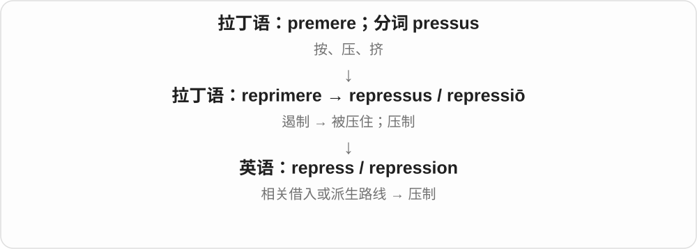

political repression 是政治压制；emotional repression 是情感压抑。精神分析中的专门含义属于特定理论框架。

**常见搭配与例句**

political repression；repression of dissent；emotional repression。

> The memoir describes years of censorship and repression.

回忆录描写了多年审查与压制的生活。

> The chapter compares repression with conscious emotional control.

这一章比较了压抑与有意识的情绪控制。

**别混淆**

repression 是压抑或压制；depression 是低落、凹陷等状态。相近拼写并不等于相同概念。

### 156. regression — 退回；倒退；回归分析；回归故障

**音标**：英、美 /rɪˈɡreʃən/

**先抓住这个画面**

回到较早状态；统计学借这个词描述一类估计关系的方法。

**怎么拆**

借拉丁 regressiō，来自 regredī“往回走”；现代可按 regress + -ion 理解。

**怎么变成今天的意思**

**拉丁 gradus；gradī / gradior**  
一步、台阶、等级；走、迈步

↓

**拉丁 regredī → regressiō → 英语 regression**  
返回 → 状态退回

↓

**统计等专业用法扩展**  
回归均值背景下的回归分析；软件旧问题再次出现

统计 regression 可以估计变量之间的关系，不自动证明因果。软件 regression 是本来正常的功能因修改又出问题。

**常见搭配与例句**

regression analysis；regression to the mean；a regression test。

> The analyst used regression to estimate the relationship between size and price.

分析员用回归分析估计面积与价格之间的关系。

> The update introduced a regression in the search feature.

这次更新让搜索功能出现了回归故障。

**别混淆**

correlation 概括关联程度；regression 通常还建立用于解释或预测的具体关系模型。

### 157. differentiation — 区分；差异化；分化；求导

**音标**：/ˌdɪfərenʃiˈeɪʃən/

**先抓住这个画面**

从“看起来一样、作用差不多”到“各有特点和分工”的过程。数学里则是计算导数这个操作的名称。

**怎么拆**

differentiate + -ion，英语动作名词；早期用例有数学背景。

**怎么变成今天的意思**

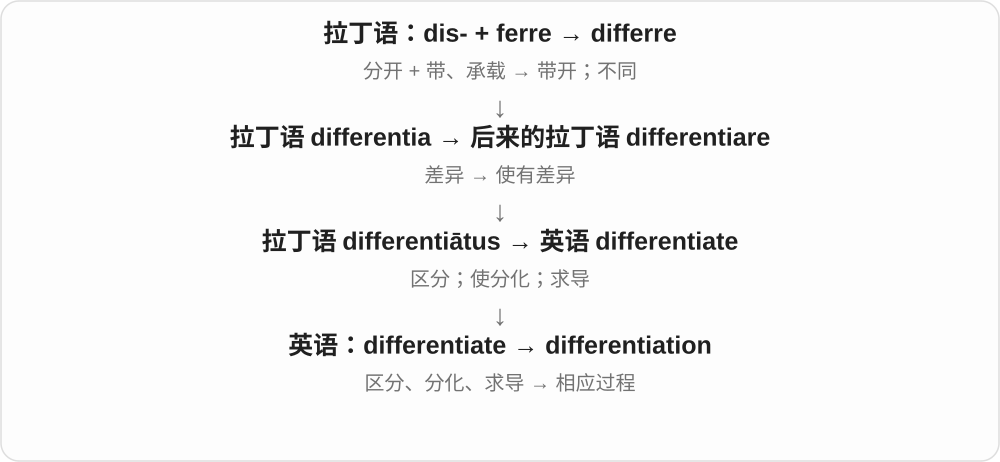

product differentiation 是让产品形成可识别的差别；cell differentiation 是细胞形成特定结构与功能。它不自动等于等级高低。

**常见搭配与例句**

product differentiation；cell differentiation；differentiation rules。

> Better service became the company’s main source of differentiation.

更好的服务成了这家公司区别于同行的主要特点。

> The lesson introduces differentiation through simple functions.

这节课通过简单函数介绍求导。

**别混淆**

difference 是差别本身；differentiation 是形成、辨明差别的过程，或数学求导。

### 158. exhaustion — 精疲力竭；耗尽

**音标**：/ɪɡˈzɔːstʃən/

**先抓住这个画面**

把力气或资源被抽空后的状态，作为一个名词来讲。

**怎么拆**

现代对应 exhaust + -ion；词源也有从中古拉丁 exhaustio 借入的分析，两条都接 exhaurire 耗尽。

**怎么变成今天的意思**

**拉丁 haurire → ex- + haurire → exhaurire**  
汲取水 → 抽尽、耗尽

↓

**拉丁过去分词 exhaustus**  
已抽空、已用尽

↓

**英语 exhaust + -ion；或中古拉丁 exhaustio 借入 → exhaustion**  
抽尽力量、物资 → 极度疲劳、耗尽状态

physical exhaustion 是身体极度疲劳；the exhaustion of reserves 是储备耗尽。词尾 -tion 在这里读 /tʃən/，不要套用所有 -tion 的 /ʃən/。

**常见搭配与例句**

physical/mental exhaustion；the exhaustion of resources；to the point of exhaustion。

> She fell asleep almost immediately from exhaustion.

她累得几乎一躺下就睡着了。

> The report warns about the exhaustion of local water reserves.

报告警示当地水资源储备可能耗尽。

**别混淆**

exhaustion 是状态，exhaustive 是范围全面；词根相同，实际指向不同。

### 159. fabricate — 制造、装配；捏造、编造

**音标**：/ˈfæbrɪkeɪt/

**先抓住这个画面**

在工坊里把零件做出来，是 fabricate；把根本没发生的证据做出来，也是 fabricate。一个做实物，一个造假话。

**怎么拆**

接拉丁 fabricatus，来自 fabricari 制作，关联 fabrica 工坊、制作与 faber 工匠；现代有 -ate 动词形。不是 fabric 布料这一义能解释全部。

**怎么变成今天的意思**

**拉丁 faber 工匠 → fabrica 工坊、制作 → fabricari**  
动手制造、建造

↓

**fabricatus、fabricatio → fabricate、fabrication**  
制造；后来也说把虚假的故事编造出来

fabricate metal parts 制造金属零件；fabricate evidence 伪造证据；fabricate a story 编造故事。宾语会决定是制造还是造假。

**常见搭配与例句**

fabricate components；fabricate evidence；fabricate a story。

> The workshop fabricates metal frames.

这间工坊制造金属框架。

> He admitted that he had fabricated the story.

他承认那个故事是他编造的。

**别混淆**

fabricate components 通常是中性制造，不是在指责工厂撒谎；fabricate an excuse 才常有编造、不真实的评价。

### 160. fabrication — 制造、加工；捏造；虚构的说法

**音标**：/ˌfæbrɪˈkeɪʃən/

**先抓住这个画面**

车间的 fabrication 是生产加工；报道里 a complete fabrication 则说整件事都是编的。不要只背成一个中文义。

**怎么拆**

接拉丁 fabricatio，经相关借词路径进入英语；现代对应 fabricate 去 e 加 -ion，两个常见义都保留做出来的材料。

**怎么变成今天的意思**

**拉丁 faber 工匠 → fabrica 工坊、制作 → fabricari**  
动手制造、建造

↓

**fabricatus、fabricatio → fabricate、fabrication**  
制造；后来也说把虚假的故事编造出来

↓

**fabricatio → fabrication**  
制作过程；编造行为或编出来的内容

metal fabrication 金属加工；the fabrication of evidence 伪造证据；a complete fabrication 彻底捏造的说法。

**常见搭配与例句**

metal fabrication；a complete fabrication。

> The factory specialises in steel fabrication.

这家工厂专做钢材加工。

> The accusation was a complete fabrication.

那项指控完全是捏造的。

**别混淆**

fiction 可以是大家知道的文学虚构，fabrication 的造假义常含把假事冒充真实；两者态度不同。

### 161. fascinate — 使着迷；强烈吸引

**音标**：/ˈfæsɪneɪt/

**先抓住这个画面**

你本来只想看一眼，结果越看越想知道，注意力像被吸住了：这个东西 fascinates you。

**怎么拆**

借拉丁 fascinatus，来自 fascinare 施魔法、蛊惑。现代用法多转为吸引注意与兴趣，不是在说真有魔法。

**怎么变成今天的意思**

**拉丁 fascinare 施魔法、蛊惑 → fascinatus、fascinatio**  
像被控制注意力一样无法移开目光

↓

**英语 fascinate、fascination**  
使深深着迷；强烈兴趣与吸引力

something fascinates someone 某物使某人着迷；be fascinated by 对……着迷。事物作主语、感兴趣的人作宾语很常见。

**常见搭配与例句**

fascinate someone；be fascinated by。

> The night sky has always fascinated me.

夜空一直让我着迷。

> The children were fascinated by the tiny machine.

孩子们被那台小机器深深吸引。

**别混淆**

fascinating 说令人着迷，fascinated 说人感到着迷；I am fascinating 是说我本人很吸引人。

### 162. fascination — 着迷；强烈兴趣；吸引力

**音标**：/ˌfæsɪˈneɪʃən/

**先抓住这个画面**

fascinate 是把注意力吸住，fascination 是那股忍不住继续看、继续研究的劲头，也能说事物本身的魅力。

**怎么拆**

接法语、拉丁 fascinatio 等迷惑、施魅材料；现代对应 fascinate 去 e 加 -ion，主要说强烈兴趣。

**怎么变成今天的意思**

**拉丁 fascinare 施魔法、蛊惑 → fascinatus、fascinatio**  
像被控制注意力一样无法移开目光

↓

**英语 fascinate、fascination**  
使深深着迷；强烈兴趣与吸引力

↓

**fascinatio → fascination**  
旧迷惑材料 → 着迷、吸引力

a fascination with something 对某物的迷恋；watch in fascination 入迷地看；hold a fascination for 对某人有吸引力。

**常见搭配与例句**

a fascination with；watch in fascination。

> Her fascination with languages began at school.

她对语言的浓厚兴趣始于上学时。

> We watched in fascination as the sculpture took shape.

我们入迷地看着雕塑逐渐成形。

**别混淆**

fascination 不保证认同：你可能对一个谜团或危险现象极感兴趣，却并不赞成它。

### 163. notation — 符号表示法；记谱法；记号；简短记录

**音标**：英 /nəʊˈteɪʃən/；美 /noʊˈteɪʃən/

**先抓住这个画面**

先约定一套符号，再用这些符号把东西记下来。

**怎么拆**

借法语 notation 或拉丁 notatio，接 notare“做标记”。英语 notation 早于动词 notate；虽然今天能对照成一对，不能把名词一概画成由后来的英语动词产生。

**怎么变成今天的意思**

**拉丁 nota → notare**  
标记、符号；做记号、记下

↓

**拉丁 notatio / notation-**  
标记、记录的行为或方式

↓

**法语 notation／直接拉丁借入 → 英语 notation**  
记号；符号表示法

数学有 mathematical notation，音乐有 musical notation。这个词既能说整套符号系统，也能说纸上写下的一条简短记录，要看上下文。

**常见搭配与例句**

scientific notation；musical notation；standard notation；a notation in the margin。

> The teacher explained the notation used in the equation.

老师解释了这个方程使用的符号。

> She added a brief notation beside the date.

她在日期旁写了一条简短记录。

**别混淆**

annotation 通常是给既有内容加注释；notation 更常说用什么符号记、符号系统本身。

### 164. contraction — 收缩；缩减；缩约形式

**音标**：/kənˈtrækʃən/

**先抓住这个画面**

contraction 是从展开变紧凑：肌肉缩紧，经济规模变小，或者 do not 缩成 don’t。

**怎么拆**

来自拉丁语 contractiō，经法语传入；现代可对照 contract + -ion。

**怎么变成今天的意思**

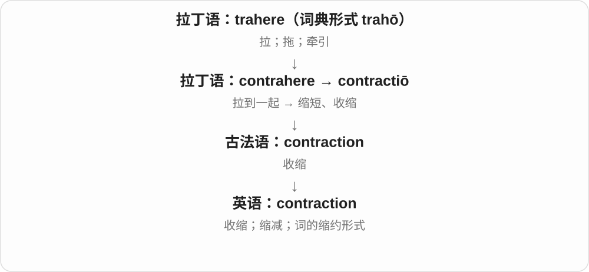

几种意义共享“变短、变小、变紧”的结果。分娩语境的 contractions 特指子宫收缩，语言里的 contraction 则是压缩后的词形。

**常见搭配与例句**

muscle contraction；economic contraction；a contraction of…；the contraction don’t。

> The device measures muscle contractions.

这台设备测量肌肉的收缩。

> “Can’t” is a contraction of “cannot.”

can’t 是 cannot 的缩约形式。

**别混淆**

contraction 不等于 contract“合同”的数量变化。abbreviation 泛指缩写，contraction 常涉及删去中间音或字母并缩合。

### 165. deduction — 推断；演绎；扣除；扣除额

**音标**：/dɪˈdʌkʃən/

**先抓住这个画面**

deduction 一头是“从已有信息引出结论”，另一头是“从总数拿掉一部分”。所以它既能是推断，也能是扣款。

**怎么拆**

来自法语 déduction、拉丁语 dēductiō。它与 deduce“推断”和 deduct“扣除”共享来源，两种现代动词不能互换。

**怎么变成今天的意思**

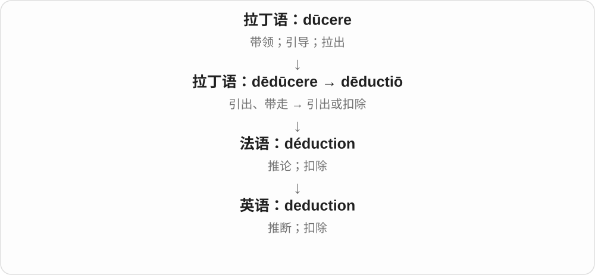

读句子时看周围：logical deduction 谈推理；a deduction from pay 谈钱。一个名词保留两条意思，不代表所有同族动词也有两条。

**常见搭配与例句**

make a deduction（作出推断）；logical deduction（逻辑演绎）；a deduction from wages（工资扣款）。

> Your deduction fits all the facts we know.

你的推断与我们已知的事实都相符。

> The receipt shows a deduction of twenty dollars.

收据显示扣除了二十美元。

**别混淆**

deduce a conclusion 是推出结论；deduct a fee 是扣掉费用。两者的名词都可用 deduction。

### 166. estimation — 估算过程或结果；看法、评价；敬重

**音标**：/ˌestɪˈmeɪʃən/

**先抓住这个画面**

既能说正在估算，也能把某人在你心里的分量叫 estimation：in my estimation 就是按我的判断。

**怎么拆**

经古法语 estimacion 接拉丁 aestimātiō；现代对应 estimate + -ion，但不是英语 estimate 出现后才临时造出所有历史名词义。

**怎么变成今天的意思**

**拉丁 aestimāre / aestimātus**  
估价、判断价值及其相应形式

↓

**英语 estimate；法语 estimacion → estimation**  
估算、评估；过程、结果、评价

↓

**aestimātiō → estimacion → estimation**  
估算、评价；现代对应 estimate + -ion

cost estimation 成本估算，in my estimation 依我判断，rise in someone’s estimation 在某人心中评价提高。

**常见搭配与例句**

cost estimation；in my estimation；rise in someone’s estimation。

> In my estimation, this is the best option.

依我看，这是最好的选择。

> The course teaches several methods of cost estimation.

这门课教授几种成本估算方法。

**别混淆**

estimate 常直接指一个估算值或报价；estimation 更常用于过程和评价用法。in my estimation 不一定是在报一个数字。

### 167. excavation — 挖掘；考古发掘；挖掘现场或坑穴

**音标**：/ˌekskəˈveɪʃən/

**先抓住这个画面**

把“挖出去”的动作扩大成一项工作，也可以指它挖出的地方。

**怎么拆**

拉丁 excavatio、excavationem 借入；现代可对应 excavate + -ion。

**怎么变成今天的意思**

**拉丁 cavus**  
空的、凹的

↓

**拉丁 excavare → excavatio → 英语 excavation**  
挖空 → 挖掘工作

↓

**excavation 的结果义**  
挖掘 → 挖出的坑或发掘现场

excavation work 是挖掘作业；during the excavation 可以说在发掘过程中。复数 excavations 也常用于一组考古发掘活动或遗址中的发掘区。

**常见搭配与例句**

archaeological excavation；excavation work；during excavation；an excavation site。

> The excavation revealed the remains of a small temple.

发掘揭示了一座小庙的遗迹。

> Excavation work began before the foundations were laid.

铺设地基之前，挖掘作业先开始了。

**别混淆**

excavate 是做动作；excavation 是活动、过程或结果。名词有自己的拉丁借入路线，并非只有现代英语加尾缀这一层历史。

### 168. abduction — 绑架；外展；溯因推理

**音标**：/əbˈdʌkʃən/

**先抓住这个画面**

abduction 的字面画面是“带离”。人被强行带走，是绑架；手臂离开身体中线，是外展。

**怎么拆**

拉丁语 ab-（离开）+ dūcere（带领），形成 abdūctiō 等词形。现代与 abduct 对照记忆。

**怎么变成今天的意思**

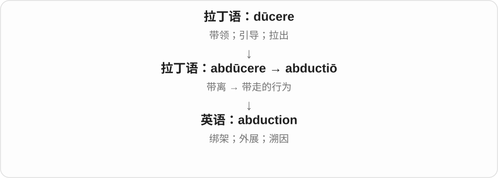

推理中的 abduction 是根据现象提出较能解释它的假设，常译“溯因推理”。这是专门术语，不能理解为结论已经得到必然证明。

**常见搭配与例句**

an abduction case（绑架案件）；arm abduction（手臂外展）；abductive reasoning / abduction（溯因推理）。

> The novel begins with an abduction.

小说以一起绑架事件开场。

> The diagram illustrates abduction of the arm.

图中展示了手臂外展。

**别混淆**

abduction 是离开身体中线；adduction 是靠近身体中线。绑架与关节动作是不同语境，不要混在一起。

### 169. deteriorate — 恶化；变差；退化

**音标**：英 /dɪˈtɪəriəreɪt/；美 /dɪˈtɪriəreɪt/

**先抓住这个画面**

原来还能用的房屋越来越破，原来稳定的关系越来越紧张，这种向更坏方向走就是 deteriorate。常看一段时间的变化。

**怎么拆**

借晚期拉丁 deterioratus，来自 deteriorare，基础是 deterior 更差。不要只看到 de- 就编造一个现代 terior 好的基础词。

**怎么变成今天的意思**

**拉丁 deterior 更差 → 晚期拉丁 deteriorare**  
变得更糟、使变坏

↓

**相应过去分词与名词 → deteriorate、deterioration**  
状况恶化；恶化过程

conditions deteriorate 情况恶化；relations deteriorate 关系恶化；deteriorate rapidly 快速变差。常见不及物用法，不需再加 be。

**常见搭配与例句**

deteriorate rapidly；deteriorating conditions。

> The condition of the road has deteriorated.

道路状况已经变差了。

> Relations between the two teams deteriorated after the dispute.

争议发生后，两个团队的关系恶化了。

**别混淆**

deteriorate 比 worsen 更正式，常描述状况、品质持续变差；不同于单次打破的 break。

### 170. deterioration — 恶化；衰退；品质下降

**音标**：英 /dɪˌtɪəriəˈreɪʃən/；美 /dɪˌtɪriəˈreɪʃən/

**先抓住这个画面**

deteriorate 是变坏，deterioration 把这段下降过程当成对象：看到它、记录它、试着减慢它。

**怎么拆**

接晚期拉丁 deterioration- 等恶化名词材料；现代对应 deteriorate 去 e 加 -ion。

**怎么变成今天的意思**

**拉丁 deterior 更差 → 晚期拉丁 deteriorare**  
变得更糟、使变坏

↓

**相应过去分词与名词 → deteriorate、deterioration**  
状况恶化；恶化过程

↓

**deterioration- → deterioration**  
变差的过程或程度

a deterioration in conditions 情况恶化；prevent further deterioration 防止继续变差；physical deterioration 物理、身体状况的衰退，需看对象。

**常见搭配与例句**

a deterioration in；further deterioration。

> The report notes a deterioration in air quality.

报告指出空气质量恶化。

> Repairs are needed to prevent further deterioration of the roof.

屋顶需要维修，以防继续损坏。

**别混淆**

deterioration 带变差方向，change 只说改变；降低的是价格时，不一定就能把下降称为 deterioration。

### 171. irritation — 恼怒、烦躁；刺激、不适；烦心事

**音标**：/ˌɪrɪˈteɪʃən/

**先抓住这个画面**

心理上像小东西反复戳着，让人烦；身体上则是皮肤、眼睛等受刺激的不适。irritation 把这种反应拿来当名词谈。

**怎么拆**

名词经法语 irritacion 或直接拉丁 irritatio 借入。现代能对应 irritate 去 e + -ion，但名词的英语记录更早，不能说它必由现代英语动词新造。

**怎么变成今天的意思**

**拉丁 irritare → irritatio；古法语 irritacion 等**  
刺激、激起及相应活动名词

↓

**中古英语 irritation 的借入 → 现代用途**  
早有身体刺激义，后来常说恼怒；英语记录早于 irritate 这一动词形式

with irritation 是带着烦躁，skin irritation 是皮肤刺激不适；a minor irritation 还可指一件小烦心事。

**常见搭配与例句**

show irritation 露出不耐烦；a source of irritation 烦恼来源。

> He could not hide his irritation at the delay.

他掩饰不住对耽误的不耐烦。

> The dust caused irritation in his eyes.

灰尘让他的眼睛受到刺激。

**别混淆**

irritant 是引起反应的人、物，irritation 是产生的刺激、不快，或具体烦心事；原因和反应分开。

### 172. irritations — 烦心事、引起不快的小事〔复数〕；多次刺激、不适

**音标**：/ˌɪrɪˈteɪʃənz/

**先抓住这个画面**

车晚点、门吱响、消息反复打断，一件件让人烦的小事，可以数作 irritations。

**怎么拆**

irritation + -s，末尾 /n/ 后读 /z/。在可数用途里数烦心事、刺激事件；基础名词本有法语、拉丁借入路线。

**怎么变成今天的意思**

**拉丁 irritare → irritatio；古法语 irritacion 等**  
刺激、激起及相应活动名词

↓

**中古英语 irritation 的借入 → 现代用途**  
早有身体刺激义，后来常说恼怒；英语记录早于 irritate 这一动词形式

↓

**irritation + -s → irritations**  
一件件烦心事、刺激事件

daily irritations 是日常小烦恼；minor irritations 是小麻烦，常与重大问题区别开。

**常见搭配与例句**

little irritations 小烦心事；a series of irritations 一连串不快。

> We laughed about the day’s small irritations.

我们笑着聊起这一天的小烦心事。

> The delays were among several irritations during the trip.

延误是旅途中几件烦心事之一。

**别混淆**

抽象感受的 irritation 常不可数；irritations 更容易把让人不快的事分成一件件数。

### 173. deviation — 偏离；偏差；偏离的量

**音标**：/ˌdiːviˈeɪʃən/

**先抓住这个画面**

把“偏了”变成一件可描述、甚至可测量的事。

**怎么拆**

经中古法语 deviation、上溯中世纪拉丁 deviatio 独立借入；现代可对应 deviate + -ion，但英语名词的记录早于这个英语动词。

**怎么变成今天的意思**

**拉丁 via**  
道路、路径

↓

**晚期拉丁 dē viā → dēviāre**  
离开道路 → 偏离

↓

**中世纪拉丁 deviatio → 中古法语 deviation → 英语 deviation**  
偏离的行为或结果；独立名词路线

路线有 deviation，数值相对参考值也有 deviation。统计中的 standard deviation 是按特定公式计算的离散程度，不能随意解释成“所有差值的普通平均”。

**常见搭配与例句**

a deviation from the plan；a small deviation；standard deviation。

> Any deviation from the agreed route must be reported.

凡偏离约定路线的情况，都必须报告。

> The instrument showed a deviation of two degrees from the reference angle.

仪器显示的角度与参考角度相差两度。

**别混淆**

deviation 可中性地说数值偏离；deviance 更常讨论违反社会规范。

### 174. diffusion — 扩散；传播；散布

**音标**：/dɪˈfjuːʒən/

**先抓住这个画面**

原来集中在一处的东西，逐渐分散到更大范围，像颜色在水里慢慢晕开。

**怎么拆**

借自拉丁语 diffūsiō，与 diffundere“倒开、散开”同族；现代对应 diffuse，但不是只有英语加 -ion 一条来源。

**怎么变成今天的意思**

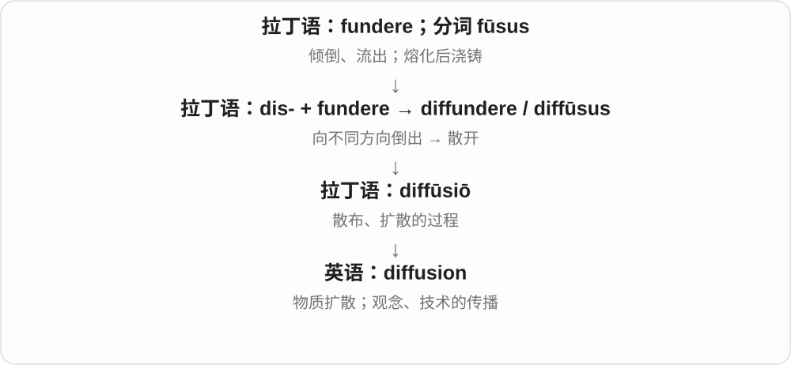

科学里的 diffusion 常涉及粒子随机运动造成的总体扩散；文化或技术的 diffusion 则是比喻性的传播。并非所有向外流动都叫扩散。

**常见搭配与例句**

diffusion of gases；diffusion of ideas；the rate of diffusion。

> The experiment demonstrates the diffusion of dye in water.

这个实验展示染料在水中的扩散。

> The book traces the diffusion of printing technology.

这本书追溯了印刷技术的传播。

**别混淆**

diffusion 是散开过程；fusion 是合成一体，不能因为都含 fus- 就混为一谈。

### 175. inhibition — 抑制；顾虑；拘谨

**音标**：/ˌɪnhɪˈbɪʃən/

**先抓住这个画面**

想开口，却被“别人会不会笑我”拦住，这道心里的刹车可以叫 inhibition。

**怎么拆**

经古法语 inibicion 来自拉丁语 inhibitiō，与 inhibēre“限制、制止”对应。

**怎么变成今天的意思**

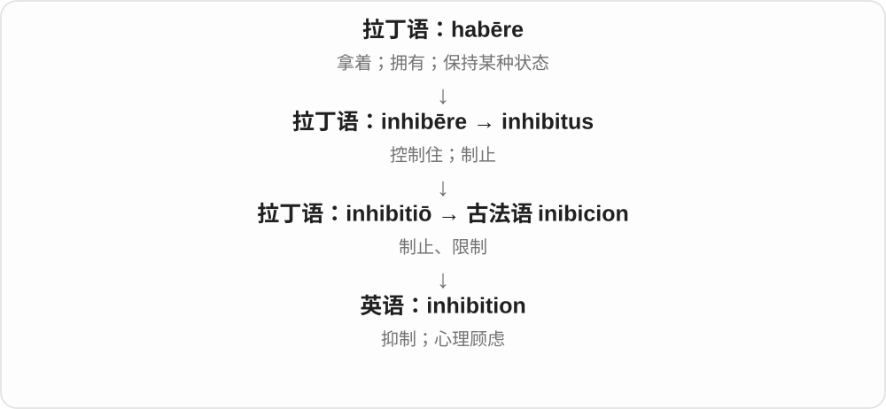

技术语境可说反应受到抑制；复数 inhibitions 在日常语境常指让人放不开的顾虑。lose your inhibitions 是放下这些心理束缚。

**常见搭配与例句**

inhibition of growth；social inhibitions；overcome inhibitions；without inhibition。

> The children sang without inhibition.

孩子们毫无拘束地唱着歌。

> The experiment measured the inhibition of the reaction.

实验测量了该反应受到抑制的程度。

**别混淆**

inhibition 常是过程或心理受到压制；prohibition 是明确的禁令。没有规则禁止，也可能有 inhibition。

### 176. intimidation — 恐吓；威吓

**音标**：/ɪnˌtɪmɪˈdeɪʃən/

**先抓住这个画面**

通过制造害怕，让别人不敢反对、不敢退出，或被迫照做。

**怎么拆**

英语 intimidate 的动作名词，可能参照法语 intimidation 形成。-ation 把使人害怕的行为整体当作名词来谈。

**怎么变成今天的意思**

**拉丁 timidus → 中世纪拉丁 intimidare、intimidatus**  
胆怯 → 使害怕

↓

**英语 intimidate**  
恐吓；使人感到压力、不敢行动

↓

**英语 intimidate → intimidation**  
使人害怕 → 恐吓、威吓这种行为

workplace intimidation 可以是用威胁、敌意或强势态度压人。它通常比普通的紧张更强调外来的压迫：不是我自己怯场，而是有人在让别人不敢自由表达或行动。重点是用害怕给对方施压，让人觉得没有自由选择的余地。

**常见搭配与例句**

threats and intimidation；a campaign of intimidation；intimidation tactics。

> The employees reported repeated threats and intimidation.

员工报告称，他们多次遭到威胁和恐吓。

> The school made it clear that intimidation had no place in the debate.

学校明确表示，辩论中不允许用威吓压制别人。

**别混淆**

timidity 是自身胆怯的状态；intimidation 是使人害怕的行为。二者不能因为都带害怕就混译。

### 177. iteration — 迭代；一轮重复；一个版本

**音标**：/ˌɪtəˈreɪʃən/

**先抓住这个画面**

按同一套步骤再走一轮，也可以指这一轮产生的版本。

**怎么拆**

来自拉丁 iteratio 重复，由 iterare 再做构成；它在英语里的历史早于动词 iterate，不宜只画成英语动词加 -ion。

**怎么变成今天的意思**

**拉丁 iterum → iterare**  
再次 → 再做、重复

↓

**拉丁 iteratio → 英语 iteration**  
重复、再做一轮

做设计时，第一版拿去试，发现问题，再做下一版，每一轮都可叫 an iteration。在程序或数学里，它可指一次重复执行；并不是每次都一定改进成功。the latest iteration of a product 常说产品的最新版本，重点是它属于连续变化中的一版。

**常见搭配与例句**

the next iteration；several iterations；the latest iteration of the design。

> The second iteration of the design uses fewer buttons.

这个设计的第二版用了更少的按钮。

> Each iteration of the loop checks one item in the list.

循环每执行一轮，就检查列表中的一个项目。

**别混淆**

repetition 广义上是重复；iteration 常把重复分成一轮轮可数的过程。version 只说版本，不一定强调它怎样反复产生。

### 178. reiteration — 重申；重复强调

**音标**：/riˌɪtəˈreɪʃən/

**先抓住这个画面**

把再次强调这件事，或那段重复的内容，当作一个整体来谈。

**怎么拆**

来自中世纪拉丁 reiteratio 重复，与 reiterare 同族。现代与 reiterate 形成名动对应，历史上则有独立的拉丁名词借入。

**怎么变成今天的意思**

**拉丁 iterum → iterare**  
再次 → 再做、重复

↓

**拉丁 reiterare → 中世纪拉丁 reiteratio**  
再次重复 → 重复这件事

↓

**英语 reiteration**  
重申、重复的表述

a reiteration of a promise 是把已经许过的承诺再说一遍。它可以巩固立场，也可能被批评为只有重复、没有新信息。是否有价值取决于场合：重要规则值得重申，空洞承诺的重复则未必令人满意。

**常见搭配与例句**

a reiteration of a position；constant reiteration；a clear reiteration of support。

> The statement was a reiteration of the position announced last week.

这份声明重申了上周公布的立场。

> The audience wanted specific plans, not another reiteration of familiar promises.

听众想听具体计划，而不是又一次重复那些熟悉的承诺。

**别混淆**

reiteration 侧重重申原有内容；revision 是修改内容。把原话重新说一遍，并不自动构成新版本或新承诺。

### 179. incarceration — 监禁；被关押的状态或时期

**音标**：英 /ɪnˌkɑːsəˈreɪʃən/；美 /ɪnˌkɑːrsəˈreɪʃən/

**先抓住这个画面**

把“被关在里面、不能自由离开”作为一段经历或一种制度做法来讨论。

**怎么拆**

英语借中世纪拉丁 incarceratio／incarceration-，接 incarcerare“监禁”的名词支线。这个英语名词的记录早于常见动词用法，因此不能硬画成现代英语 incarcerate 先产生它。

**怎么变成今天的意思**

**拉丁 carcer → 中世纪拉丁 incarcerare**  
监狱 → 监禁

↓

**中世纪拉丁 incarceratio／incarceration-**  
监禁行为或状态

↓

**英语 incarceration**  
监禁；被关押的经历

a period of incarceration 指被关押的一段时期；mass incarceration 则讨论大规模监禁的社会现象。这个名词可把视角从某一个人扩大到政策、社会成本和家庭影响。

**常见搭配与例句**

a period of incarceration；incarceration rates；mass incarceration；the effects of incarceration。

> The study follows people after a period of incarceration.

这项研究追踪了一段监禁经历之后的人们的生活。

> The book examines the effects of incarceration on families.

这本书考察监禁对家庭的影响。

**别混淆**

incarceration 侧重关押状态；conviction 是定罪，sentence 在司法语境是判刑或刑期。三者涉及不同概念。

### 180. insertion — 插入；插入的内容或结构

**音标**：英 /ɪnˈsɜːʃən/；美 /ɪnˈsɜːrʃən/

**先抓住这个画面**

重点放在“添进去”这个过程，也可以指添进去的那一块。

**怎么拆**

经法语 insertion 或直接借自后期拉丁语 insertio，来自 inserere 的名词支线；现代可拆作 insert + -ion，但历史有独立借入。

**怎么变成今天的意思**

**拉丁语 serere**  
把东西连接、排列在一起

↓

**拉丁语 in- + serere → inserere / insertus**  
接入、植入、插入

↓

**后期拉丁语 insertio → 法语 insertion / 英语 insertion**  
放入的行为；放入的东西

文字编辑可说 insertion of a paragraph。遗传学里 insertion 指序列新增一段；解剖学里还可指肌肉止点，需看领域。

**常见搭配与例句**

the insertion of text；an insertion point；a DNA insertion。

> The insertion of one word changed the meaning of the sentence.

插入一个词就改变了句子的意思。

> The software highlights each insertion in green.

软件用绿色标出每处插入内容。

**别混淆**

insert 名词常是具体插页、嵌件；insertion 更常命名动作或插入现象。

### 181. suction — 吸力；抽吸

**音标**：/ˈsʌkʃən/

**先抓住这个画面**

吸尘器让里面气压更低，外面的空气带着灰尘涌进去，便产生你感觉到的吸力。吸盘贴住表面，也与内外压差有关。

**怎么拆**

借晚期拉丁 suctio、suction-，来自 sugere 吸的过去分词词干 suct-。和英语 suck 意义相通，却不是现代 suck 加 -tion 的直接构词。

**怎么变成今天的意思**

**拉丁 sugere 吸 → suct- → suctio**  
吸的动作及相应名词

↓

**英语 suction**  
抽吸；由压差产生的吸附效果

suction power 吸力；a suction cup 吸盘；lose suction 失去吸力。日常常把整个压差效果称为吸，不必想成里面有只无形的手在拉。

**常见搭配与例句**

suction power；a suction cup；lose suction。

> The vacuum cleaner has lost suction.

吸尘器没什么吸力了。

> A suction cup holds the hook against the glass.

一个吸盘把挂钩固定在玻璃上。

**别混淆**

suction 的场景常涉及较低气压，adhesion 是黏附的更广概念；胶水黏住东西不必靠吸盘式压差。

### 182. illumination — 照明；启发；阐明；手稿彩饰

**音标**：/ɪˌluːmɪˈneɪʃən/

**先抓住这个画面**

把照亮当作一件事或一种结果：眼前亮起来，脑子里也可能一下明白了。

**怎么拆**

接晚期拉丁 illuminatio，可经法语借入；英语名词早于 illuminate，不只用英语动词换尾解释。

**怎么变成今天的意思**

**拉丁 in- + luminare → illuminare**  
把光照上去；in- 在 l 前同化为 il-

↓

**晚期拉丁 illuminatio → 法语或直接借入 → 英语 illumination**  
照亮、启迪的名词；后来也用于照明和彩饰

adequate illumination 是足够照明；provide illumination on a subject 是帮助说明。复数 illuminations 也可指节庆灯饰，或手稿中的彩饰。

**常见搭配与例句**

provide illumination；street illumination；a moment of illumination。

> The room needs better illumination for detailed work.

要在这个房间里做精细工作，需要更好的照明。

> The letters provide valuable illumination on her early career.

这些信件为理解她的早期职业经历提供了宝贵线索。

**别混淆**

illumination 是照明或阐明；illustration 可以是配图或例证，两者常有帮助理解的作用，但并非同一个词。

### 183. propagation — 繁殖；传播、扩展

**音标**：英 /ˌprɒpəˈɡeɪʃən/；美 /ˌprɑːpəˈɡeɪʃən/

**先抓住这个画面**

新生命、信号或想法从一个起点继续传到别处。

**怎么拆**

法语 propagation、古法语 propagacion 接拉丁 prōpāgātiō，来自 prōpāgāre；现代可与 propagate + -ion 对照，但历史上是独立的名词借入。

**怎么变成今天的意思**

**拉丁 pangere**  
固定、钉牢；复合动词中可变为 -pingere，分词有 -pactus

↓

**拉丁 prōpāgō〔名词〕 → prōpāgāre**  
压条、枝条、后代 → 用压条繁殖、扩展；prō- 表向前

↓

**拉丁 prōpāgātiō → 古法语 propagacion → 法语／英语 propagation**  
繁衍、延伸；传播过程

植物 propagation 可以靠种子，也可以靠插枝等方式；不要因为拉丁原义涉及压条，就认为今天只限一种繁殖方法。wave propagation 说波向外传递，不是物质整体一路搬过去。

**常见搭配与例句**

plant propagation；wave propagation；the propagation of ideas。

> The course introduces several methods of plant propagation.

这门课程介绍几种植物繁殖方法。

> The experiment measures the speed of sound propagation in water.

实验测量声音在水中的传播速度。

**别混淆**

reproduction 常聚焦产生后代；propagation 还广泛用于信号、误差和思想如何传开。

### 184. calibrate — 校准；校定；细致调整〔引申〕

**音标**：/ˈkælɪbreɪt/

**先抓住这个画面**

拿已知的标准来和仪器读数对照，弄清它显示的数与实际量值怎样对应，是 calibrate 的核心。再往日常引申，就是把反应调到合适尺度。

**怎么拆**

calibre 口径、尺寸等 + -ate → calibrate；现代用于测量设备，也可比喻细调言语、反应。不要把计量上的校准一概说成拧旋钮改数值。

**怎么变成今天的意思**

**calibre、caliber 口径、尺寸材料 + -ate → calibrate**  
按标准检查尺度与读数的对应

↓

**calibrate + -ion → calibration**  
建立仪器示值与参考量值的关系；校准过程

calibrate an instrument 校准仪器；calibrate a response 审慎调整回应的力度。计量上建立对应关系，与随后是否调整设备是不同操作。

**常见搭配与例句**

calibrate an instrument；calibrate a response。

> The laboratory calibrates its instruments regularly.

实验室定期校准仪器。

> She carefully calibrated her response to the criticism.

她仔细拿捏了回应批评的分寸。

**别混淆**

calibrate 常参照标准建立关系，adjust 是调整；校准发现偏差后可以再调整，但两词不总是同一步。

### 185. calibration — 校准；校准过程、对应关系

**音标**：/ˌkælɪˈbreɪʃən/

**先抓住这个画面**

不是只问仪器有没有亮，而是用参考标准确定“它显示这个数，对应怎样的量值”。这种有标准可对照的工作叫 calibration。

**怎么拆**

calibrate 去 e 加 -ion → calibration，接前面的 calibre、caliber 尺度材料；把动词过程名词化。

**怎么变成今天的意思**

**calibre、caliber 口径、尺寸材料 + -ate → calibrate**  
按标准检查尺度与读数的对应

↓

**calibrate + -ion → calibration**  
建立仪器示值与参考量值的关系；校准过程

↓

**calibrate + -ion → calibration**  
校准这一过程及相关结果

instrument calibration 仪器校准；a calibration curve 校准曲线；calibration data 校准数据。严格计量含量值关系及不确定度，不简单等于把设备调好。

**常见搭配与例句**

a calibration curve；instrument calibration；calibration data。

> The report includes the calibration data.

报告包含校准数据。

> The scale is due for calibration next month.

这台秤下个月该校准了。

**别混淆**

calibration 建立测量关系，adjustment 改变设备，verification 核查是否符合要求；实际工作中可能先后使用它们。

### 186. approximation — 近似；近似值；近似表达或模拟

**音标**：英 /əˌprɒksɪˈmeɪʃən/；美 /əˌprɑksɪˈmeɪʃən/

**先抓住这个画面**

给真实情况画一张够用的简图：保留关键部分，接受一定误差。

**怎么拆**

approximate 动词 + -ion；从靠近这一动作，发展为靠近的结果、近似值。

**怎么变成今天的意思**

**拉丁 prope → proximus**  
近 → 最近的、紧邻的

↓

**晚期拉丁 ad- + proximare → approximare**  
向……靠近

↓

**英语 approximate**  
近似的；使接近、近似估计

↓

**approximate → approximation**  
使接近、估计 → 近似过程或结果

a rough approximation 是粗略近似；a good approximation to reality 是对现实较好的近似描述。它不一定只是数字，也可以是模型、形状、声音或风格上的接近。

**常见搭配与例句**

a rough approximation；a close approximation；an approximation to something。

> The sketch is only a rough approximation of the final design.

这张草图只是最终设计的大致样子。

> Using 3.14 gives a familiar approximation to pi.

用 3.14 可以得到圆周率的一个常见近似值。

**别混淆**

estimate 常强调估算未知量；approximation 强调用一个接近对象的结果替代原对象。近似可有严谨误差界限，并非胡猜。

### 187. escalation — 升级；加剧；上报处理

**音标**：/ˌeskəˈleɪʃən/

**先抓住这个画面**

把不断变严重、变昂贵或升到更高处理层级的过程拿出来谈。

**怎么拆**

escalate + -ion，-ate 对应 -ation；它来自英语动词的派生，不是动词反而从这个名词起源。

**怎么变成今天的意思**

**拉丁语 scala，常用复数 scalae**  
梯子、台阶；与 scandere“攀登”相连

↓

**意大利语 scalare / scalata → 法语 escalade → 英语 escalade**  
爬梯 → 用梯攀登

↓

**商标 Escalator → 普通名词 escalator**  
通常解释为 escalade 与 elevator 的造词形式结合 → 自动扶梯

↓

**英语 escalator → 逆构 escalate**  
自动扶梯 → 使用扶梯；后来指上升、升级

↓

**英语 escalate → escalation**  
上升、升级 → 升级过程或程度

an escalation of violence 是暴力升级；cost escalation 是成本上升；an escalation procedure 是把问题逐级上报的流程。最后一种是组织流程，不自动表示危险。

**常见搭配与例句**

an escalation in costs；further escalation；an escalation procedure。

> Both sides wanted to prevent further escalation of the dispute.

双方都希望防止争端进一步升级。

> The handbook sets out an escalation procedure for unresolved complaints.

手册列明了未解决投诉的逐级上报流程。

**别混淆**

escalator 是具体扶梯；escalation 是升级过程。名词里的 -ation 不等于机械设备名称。

### 188. complication — 复杂情况；麻烦；并发症

**音标**：英 /ˌkɒmplɪˈkeɪʃən/；美 /ˌkɑːmplɪˈkeɪʃən/

**先抓住这个画面**

事情本来有一条处理路线，后来又缠进一个问题，使它更难处理。

**怎么拆**

来自法语 complication、拉丁语 complicatio，基于 complicare“折在一起、纠缠”；名词独立借入，不能只当英语 complicate 后加 -ion。

**怎么变成今天的意思**

**拉丁语 plicare**  
折叠、使相接；与编织、弯曲一组词有更早联系

↓

**拉丁语 com- + plicare → complicare**  
折在一起、缠在一起

↓

**拉丁语 complicatio → 法语 complication → 英语 complication**  
缠在一起 → 复杂情形、额外问题

旅行多出签证问题可以是 a complication。医学中的 complication 是疾病或治疗过程中出现的额外健康问题，不必等于医疗失误。

**常见搭配与例句**

an unexpected complication；further complications；medical complications。

> A missing document added another complication to the move.

缺少一份文件，给搬迁又添了一层麻烦。

> The report lists complications observed during recovery.

报告列出了恢复期间观察到的并发症。

**别混淆**

complexity 多说复杂程度；a complication 常指让事情更难的具体因素或并发问题。

### 189. abstraction — 抽象；抽象概念；提炼共同点

**音标**：/əbˈstrækʃən/

**先抓住这个画面**

abstraction 就是把不需要的细节暂时拿走，留下你眼下要研究的那一层。

**怎么拆**

来自中古法语 abstraction 或中世纪拉丁语 abstrāctiō“分离”，现代可对照 abstract + -ion。

**怎么变成今天的意思**

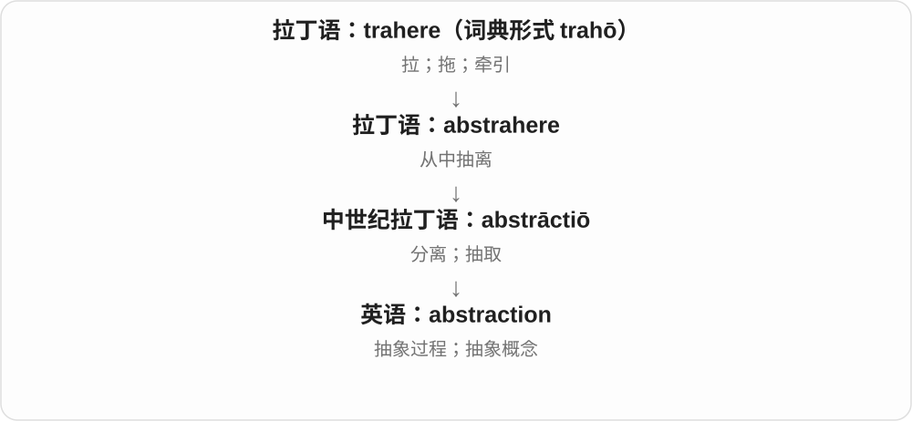

它可以指抽离细节的过程，也可以指得到的概念。地图省掉每棵树，保留道路关系，就是容易理解的抽象画面。

**常见搭配与例句**

a level of abstraction；an abstract concept / an abstraction；abstraction from detail。

> A subway map is a useful abstraction of the city’s transport network.

地铁图是对城市交通网络的一种有用抽象。

> The discussion stayed at a high level of abstraction.

讨论一直停留在很抽象的层面。

**别混淆**

abstraction 是有选择地忽略细节；oversimplification 是省略得过头，导致判断失真。抽象并不必然错误。

### 190. aspiration — 志向；愿望；送气〔语音〕；抽吸、误吸〔医学〕

**音标**：/ˌæspəˈreɪʃən/

**先抓住这个画面**

日常是向往更高目标；专业语境则回到气流、吸入和抽出的动作。

**怎么拆**

接拉丁 aspiratio、aspirare 及相关借入路线。英语早期已有呼气、语音用义，志向义随后发展；不应把专业名词都画成后来英语 aspirate 动词的产物。

**怎么变成今天的意思**

**拉丁语 spirare**  
吹气、呼吸；更远词源未定

↓

**拉丁语 aspirare → aspiratio；英语早期 aspiration**  
吹气 → 呼吸、语音送气等义

↓

**英语 aspiration 的多条发展**  
志向；语音送气；医学抽吸或误吸

career aspirations 是职业志向。语音学 aspiration 指某些辅音释放后的一股气；医学里可指抽取液体或组织，也可指食物、液体误入气道。后两种需要上下文分辨。

**常见搭配与例句**

career aspirations；aspirations for the future；needle aspiration。

> Her aspirations changed as she gained more experience.

随着经验增加，她的志向也发生了变化。

> English “pin” usually begins with an audible burst of aspiration.

英语 pin 开头通常带有可听出的送气。

> The clinician explained that aspiration here meant drawing out a fluid sample.

医生解释说，这里的 aspiration 指抽取液体样本。

**别混淆**

aspiration 的志向义不等于一般 appetite“胃口”；医学抽吸是操作，误吸是物质进入错误通道，不能互译。

### 191. modulation — 调制；音调变化；转调

**音标**：英 /ˌmɒdjuˈleɪʃən/；美 /ˌmɑːdʒəˈleɪʃən/

**先抓住这个画面**

让一种有规律的变化带上另一层变化：讲话有轻重，信号也能用变化携带消息。

**怎么拆**

拉丁语 modulatio 经法语或直接借入，来自 modulari 的节律、调音支线；英语名词早于现代 modulate，不能倒接。

**怎么变成今天的意思**

**拉丁语：modus**  
尺度、分寸；方式

↓

**拉丁语：modulus**  
小尺度；度量单位、标准

↓

**拉丁语：modulatio**  
调节节律、声音的过程

↓

**法语及拉丁语 → 英语 modulation**  
音调变化；转调；信号调制

通信里 modulation 改变载波的某种性质来传信息；音乐里可指从一个调转到另一个调。两者共享调节这一画面，但具体操作不同。

**常见搭配与例句**

frequency modulation；voice modulation；a modulation to another key。

> The receiver supports frequency modulation.

接收器支持调频。

> A sudden modulation gives the final chorus a brighter character.

一次突然转调让最后一段副歌显得更明亮。

**别混淆**

variation 泛指变化；modulation 往往是有结构、有用途的调整。

### 192. ovation — 热烈欢迎；热烈鼓掌、欢呼

**音标**：英 /əʊˈveɪʃən/；美 /oʊˈveɪʃən/

**先抓住这个画面**

全场一起热烈鼓掌，声音久久不落，给人很强的欢迎、赞许，这一阵回应叫 an ovation。

**怎么拆**

经法语或直接拉丁 ovatio，接 ovare 欢庆、欢呼，远源可能与呼声拟声有关；不是 ovum 蛋那条词根。

**怎么变成今天的意思**

**拉丁 ovare 欢庆、欢呼 → ovatio；法语或拉丁路线 → ovation**  
原有古罗马较低一级凯旋庆典的历史用途

↓

**英语 ovation 的后起比喻义**  
一群人热烈鼓掌、欢呼的欢迎或赞许

a standing ovation 是全场或许多人起立鼓掌；warm ovation 是热烈欢迎、掌声。

**常见搭配与例句**

receive an ovation 获得热烈掌声；give someone an ovation 向某人热烈鼓掌。

> The audience gave her a standing ovation.

观众起立向她热烈鼓掌。

> The team received a warm ovation on their return.

队伍归来时受到热烈欢迎。

**别混淆**

applause 泛说掌声，ovation 更强调一群人热烈而显著的欢迎、赞许；a standing ovation 又加上起立画面。

### 193. ovations — 一阵阵热烈掌声、热烈欢迎〔复数〕

**音标**：英 /əʊˈveɪʃənz/；美 /oʊˈveɪʃənz/

**先抓住这个画面**

不同场次、不同节目后各有一阵热烈的集体回应，这些可以数作 ovations。

**怎么拆**

ovation + -s，末尾 /n/ 后读 /z/。拉丁、法语的欢庆名称借入英语后，现代可数用法再加复数。

**怎么变成今天的意思**

**拉丁 ovare 欢庆、欢呼 → ovatio；法语或拉丁路线 → ovation**  
原有古罗马较低一级凯旋庆典的历史用途

↓

**英语 ovation 的后起比喻义**  
一群人热烈鼓掌、欢呼的欢迎或赞许

↓

**ovation + -s → ovations**  
多次热烈鼓掌、欢迎

standing ovations 是多次起立鼓掌；如果只泛说持续掌声，通常用不可数 applause。

**常见搭配与例句**

receive ovations 获得热烈掌声；repeated ovations 一次次热烈欢迎。

> The performers received standing ovations in several cities.

表演者在几个城市都获得了起立鼓掌。

> The two soloists received equally warm ovations.

两位独奏者都获得了同样热烈的掌声。

**别混淆**

ovations 数一场场显著回应，不按鼓掌者的人数数；许多人共同鼓掌可形成一次 ovation。

### 194. punctuation — 标点；标点符号的使用

**音标**：英、美 /ˌpʌŋktʃuˈeɪʃən/

**先抓住这个画面**

逗号、句号等小记号，帮你看清哪里停、哪里接、哪些话属于一组。

**怎么拆**

单独借自中世纪拉丁语 punctuatio，来自 punctuare“用点作标记”；它并非历史上必由英语 punctuate 加 -ion 而来。

**怎么变成今天的意思**

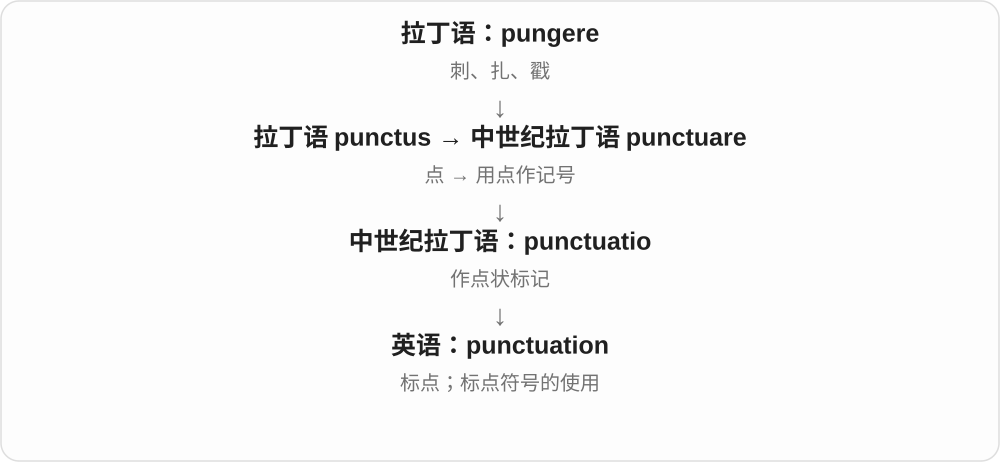

punctuation 通常不可数；一个具体符号叫 a punctuation mark。标点帮助表现句法和意思，不是只照着说话喘气的位置加。

**常见搭配与例句**

correct punctuation；punctuation marks；check the punctuation。

> The words are clear, but the punctuation needs attention.

词句本身很清楚，但标点需要留意。

> Changing the punctuation changes who is being addressed.

改变标点，会改变这句话是在对谁说。

**别混淆**

spelling 是字母怎样拼成词；punctuation 是词句之间用什么符号组织。

### 195. liquidation — 清算；资产变现；出售持仓

**音标**：/ˌlɪkwɪˈdeɪʃən/

**先抓住这个画面**

把资产和债务清理、结算，或把所持资产出售换成钱的过程。

**怎么拆**

经法语 liquidation 接 liquider，最终到拉丁 liquidare；也可分析其 liquidat- 词干与名词后缀。现代与 liquidate 配对，但名词的早期借入路线不能省成唯一英语派生。

**怎么变成今天的意思**

**拉丁 liquēre**  
呈液态；流动；清澈

↓

**拉丁 liquidus → liquidare**  
液态、清楚；使清楚、清理

↓

**法语 liquider → liquidation → 英语 liquidation**  
账务清理；清算；出售资产

a company in liquidation 是处于清算中的公司；liquidation of assets 是资产出售变现。清算常与经营失败一起出现，但不应把“所有清算都是资不抵债”当作词义。

**常见搭配与例句**

go into liquidation；voluntary liquidation；liquidation of assets。

> The company went into liquidation after negotiations failed.

谈判失败后，公司进入了清算程序。

> The report records the liquidation of several investment holdings.

报告记录了几项投资持仓的出售变现。

**别混淆**

liquidity 是资金流动性；liquidation 是处理、变现或清算的过程。一个是性质或能力，一个是行动。

### 196. multiplication — 乘法；增殖；增加

**音标**：/ˌmʌltɪplɪˈkeɪʃən/

**先抓住这个画面**

把“乘、增多”当作一个过程来说。

**怎么拆**

经法语 multiplicacion，借拉丁 multiplicātiō，接 multiplicāre。现代与 multiply 对应，但名词在拉丁语中已形成，不是英语 multiply 直接加 -cation。

**怎么变成今天的意思**

**拉丁 multus／multi- + -plex → multiplex**  
多 + 重、折 → 多重的

↓

**拉丁 multiplicāre → multiplicātiō → 古法语 multiplicacion**  
使增多 → 增加的过程

↓

**中古英语 multiplicacioun → 英语 multiplication**  
增多；数学乘法

a multiplication table 是乘法表；cell multiplication 是细胞增殖。这个词也可说机构、程序等越变越多，不只用于算术。

**常见搭配与例句**

multiplication tables；a multiplication sign；cell multiplication。

> The children practised multiplication with small numbers.

孩子们用小数目练习乘法。

> The report criticised the multiplication of unnecessary procedures.

报告批评了不必要程序的不断增加。

**别混淆**

addition 是加法；multiplication 是乘法。整数乘法可用重复相加入门，但乘法的范围不限整数。

### 197. culminate — 达到高潮；最终以……告终

**音标**：/ˈkʌlmɪneɪt/

**先抓住这个画面**

前面一连串事情像沿坡往上走，最后抵达最突出的一幕或最终结果，就是 culminate。结局可以好，也可以坏。

**怎么拆**

接中世纪拉丁 culminatus，来自 culminare，与拉丁 culmen 顶点、culmin- 词干相关；不是用现代英文 cull、min 拼起来。

**怎么变成今天的意思**

**拉丁 culmen、culmin- 顶点、山峰 → culminare**  
到达最高点、登顶的材料

↓

**英语 culminate、culmination**  
到达高潮或最终结果；这一终点、成果

culminate in something 最终发展为某结果；culminate with an event 以某事件达到高潮或结束。常前有一段累积过程。

**常见搭配与例句**

culminate in；culminate with。

> Months of rehearsal culminated in a successful performance.

数月排练终于汇成一场成功的演出。

> The dispute culminated in the director’s resignation.

争议最终以主管辞职告终。

**别混淆**

culminate 比普通 end 更突出前面过程汇聚到一个顶点、结果；不保证这是快乐的成功。

### 198. culmination — 高潮；最终成果、顶点

**音标**：/ˌkʌlmɪˈneɪʃən/

**先抓住这个画面**

长期努力最后集中呈现的那一刻、那件成果，可以说 the culmination。它让人看到结果背后有一条走过来的路。

**怎么拆**

接法语 culmination、中世纪拉丁相关材料；现代对应 culminate 去 e 加 -ion，保留 culmen 顶点的画面。

**怎么变成今天的意思**

**拉丁 culmen、culmin- 顶点、山峰 → culminare**  
到达最高点、登顶的材料

↓

**英语 culminate、culmination**  
到达高潮或最终结果；这一终点、成果

↓

**culmination 的名词用法**  
一连串过程到达的高点、最终结果

the culmination of years of work 多年工作的最终成果；reach its culmination 达到高潮；a culmination 不只是任意最后一项。

**常见搭配与例句**

the culmination of；reach its culmination。

> The exhibition is the culmination of five years of work.

这次展览是五年工作的最终成果。

> The celebrations reached their culmination on Sunday.

庆祝活动在星期日达到高潮。

**别混淆**

culmination 着眼汇聚后的顶点，conclusion 可泛指结束或结论；小事随便停止，不一定算 culmination。

### 199. infiltrate — 渗入、渗透；潜入

**音标**：/ˈɪnfɪltreɪt/

**先抓住这个画面**

水没有整块推开土壤，而是沿细小空隙慢慢进来；这种进入方式是 infiltrate。用在人群、组织上时，常带隐蔽进入的意思。

**怎么拆**

接中世纪拉丁 infiltratus、infiltrare，in- 向内与 filtrare 过滤材料相连。核心是穿过间隙进入，不等于把东西从里面滤出去。

**怎么变成今天的意思**

**中世纪拉丁 in- 向内 + filtrare 过滤 → infiltrare**  
穿过孔隙向内渗入

↓

**相应分词、名词 → infiltrate、infiltration**  
渗透进入；液体或其他事物的渗入过程

water infiltrates the soil 水渗入土壤；infiltrate an organisation 潜入组织；可及物，也可说 infiltrate into。

**常见搭配与例句**

infiltrate the soil；infiltrate into。

> Rainwater infiltrates the soil through small pores.

雨水通过细小孔隙渗入土壤。

> In the novel, a spy infiltrates the organisation.

小说中，一名间谍潜入了那个组织。

**别混淆**

filter 可说滤去杂质，infiltrate 重进入内部；液体渗入并不含有人蓄意潜伏的动机。

### 200. infiltration — 渗入、渗透；潜入过程

**音标**：/ˌɪnfɪlˈtreɪʃən/

**先抓住这个画面**

infiltrate 是怎么进入，infiltration 把这整个渗入过程拿来研究，比如雨水进入土壤的速度。

**怎么拆**

经中世纪拉丁 infiltratio 等相应形式；现代对应 infiltrate 去 e 加 -ion，不是先从英语 filtration 前随意加一个表示否定的 in-。

**怎么变成今天的意思**

**中世纪拉丁 in- 向内 + filtrare 过滤 → infiltrare**  
穿过孔隙向内渗入

↓

**相应分词、名词 → infiltrate、infiltration**  
渗透进入；液体或其他事物的渗入过程

↓

**infiltratio → infiltration**  
向内渗入的过程、程度

water infiltration 水渗入；infiltration rate 渗入速率；infiltration into an organisation 潜入组织。具体介质决定技术含义。

**常见搭配与例句**

water infiltration；infiltration rate。

> The study measures water infiltration after heavy rain.

研究测量大雨后水的渗入情况。

> The report describes infiltration into the network.

报告描述了对该网络的渗透。

**别混淆**

infiltration 是进入内部，evaporation 是蒸发，runoff 常指沿表面流走；一场雨后水可以走不同路径。

### 201. deletion — 删除；删去的内容；缺失

**音标**：英、美 /dɪˈliːʃən/

**先抓住这个画面**

原本在一串内容中的一段，现在被拿掉了，留下的整体因此改变。

**怎么拆**

借拉丁语 deletio / deletionem，基于 delere“抹掉、消灭”。传统词源把 delere 联系 de- 与 linere“涂抹”的擦除动作；现代与 delete + -ion 对应。

**怎么变成今天的意思**

**拉丁语 de-**  
离开、向下；也可加强动作或表示解除

↓

**拉丁语 delere → deletus / deletio**  
抹去 → 擦除的行为

↓

**英语 deletion**  
删除行为或删掉的内容；遗传学中的片段缺失

可说文件、句子或 DNA 片段的删除、缺失。电脑里的 deletion 并不自动等于数据已不可恢复。

**常见搭配与例句**

accidental deletion；a deletion from the text；a gene deletion。

> The deletion of one paragraph made the argument clearer.

删掉一段文字后，论证更清楚了。

> The backup protected us against accidental deletion.

备份让我们不怕误删数据。

**别混淆**

omission 可能是一开始没写进去；deletion 常说已有内容被去除。

### 202. presumption — 推定；假定；擅自做主；冒昧

**音标**：英、美 /prɪˈzʌmpʃən/

**先抓住这个画面**

证据或许可还没完全到位，就先拿某个判断当作出发点。

**怎么拆**

经古法语 presumcion 或直接来自拉丁语 praesumptio、praesumption-，基于 praesumere“事先拿取”。不是英语 presume 机械加 -tion。

**怎么变成今天的意思**

**拉丁语 prae + sumere → praesumere**  
事先 + 拿取 → 预先认定；擅自承担

↓

**拉丁语 praesumptio / praesumption- → 古法语 presumcion → 英语 presumption**  
预先认定；越过应有界限的自信、擅自做主

the presumption of innocence 是法律上的无罪推定，不是法院已证明某人绝不可能犯罪。日常说 someone’s presumption，也可批评对方未经允许就自作主张。

**常见搭配与例句**

on the presumption that；the presumption of innocence；a rebuttable presumption。

> We booked two rooms on the presumption that everyone would come.

我们按所有人都会来的假定订了两个房间。

> She was annoyed by his presumption in speaking for the whole team.

他擅自代表整个团队发言，让她很恼火。

**别混淆**

assumption 常指采用的假设；presumption 可以是依据现有情况或规则先作出的推定，也保留冒昧义。

### 203. circumcision — 包皮环切术；割礼

**音标**：英 /ˌsɜːkəmˈsɪʒən/；美 /ˌsɜːrkəmˈsɪʒən/

**先抓住这个画面**

词的原始动作是围着切去一圈；现代常用名词指去除部分或全部阴茎包皮的手术，也见于宗教文化讨论。

**怎么拆**

拉丁 circumcisio 已是名词，来自 circumcidere“围绕切”；经古法语 circumcisiun 进入中古英语，不是必须由英语 circumcise 派生。

**怎么变成今天的意思**

**拉丁 caedere，分词 caesus；复合词常见 -cidere / -cisus**  
切、砍、击杀

↓

**拉丁 circum- + caedere → circumcidere；分词 circumcisus**  
围绕切除

↓

**拉丁 circumcisio → 古法语 circumcisiun → 中古英语 circumcisioun**  
环切、割礼

↓

**英语 circumcision**  
手术名称；相关仪式

医学通常指男性包皮环切。某些文本的 female circumcision 指另一类女性生殖器切割行为，不能理解为男女完全相同的手术。

**常见搭配与例句**

male circumcision；religious circumcision。

> The leaflet explains what circumcision means in medical language.

宣传册解释了 circumcision 在医学中的含义。

> The historian discusses circumcision in several religious traditions.

历史学家讨论了几种宗教传统中的割礼。

**别混淆**

incision 是切口或切开，circumcision 是有特定对象与范围的名称，不是所有环状切口。

### 204. dispersion — 分散；散布；离散程度；色散

**音标**：英 /dɪˈspɜːʃən/；美 /dɪˈspɜːrʒən/

**先抓住这个画面**

既能说散开的现象，也能说数据或不同成分分开得有多大。

**怎么拆**

历史上经古法语 dispersion 接拉丁 dispersio、dispersionem，接 dispergere 的分词词干。现代可联系 disperse 与 -ion，但名词有独立借入史。

**怎么变成今天的意思**

**拉丁语 spargere；分词 sparsus**  
撒开、散布；散开的

↓

**拉丁语 dis- + spargere → dispergere、dispersus**  
向各处分开、散开

↓

**拉丁语 dispersio、dispersionem → 古法语 dispersion**  
分散、散布的名词

↓

**中古英语 dispersioun → 英语 dispersion**  
分散；各领域按“分开”发展专门意义

统计中的 dispersion 看数值有多分散：平均数一样，两组数据仍可能一个集中、一个起伏很大。光学里的色散则可让不同波长的光分开，如白光经棱镜显出多种颜色。

**常见搭配与例句**

the dispersion of particles；a measure of dispersion；wide dispersion；dispersion of light。

> The two samples have the same mean but different levels of dispersion.

这两个样本均值相同，离散程度却不同。

> The prism demonstrates the dispersion of white light into different colours.

棱镜展示了白光分成不同颜色的色散现象。

**别混淆**

average 说中心大概在哪里，dispersion 说围绕中心散得多开。dispersal 更常强调人群、种子等散开的过程，不常替代统计术语。

### 205. hydration — 补水；水合；使已有页面可交互〔编程〕

**音标**：/haɪˈdreɪʃən/

**先抓住这个画面**

把水分补进去；在网页里，也借这个词说让已有页面获得交互能力。

**怎么拆**

hydrate 对应 -ation 名词，亦有法语 hydration 借入的可能。编程义是后来借用的比喻用法。

**怎么变成今天的意思**

**希腊 hydōr，词干 hydr-**  
水；近代构词常用 hydro-

↓

**法语 hydrate → 英语 hydrate〔名词〕**  
水合物

↓

**英语 hydrate〔动词〕，也受法语 hydrater 对应形式影响**  
与水结合 → 补水、使保持水分

↓

**英语 hydration；也可能经法语 hydration**  
与水结合或补水的过程

身体语境讲水分补充或状态；化学语境讲水合。React 的 hydration 则是在服务器已生成的 HTML 上接入客户端逻辑，让页面可交互，并非重新生成整页的同义词。

**常见搭配与例句**

adequate hydration；skin hydration；a hydration reaction；hydration mismatch。

> The sports centre provides information about hydration during exercise.

运动中心提供运动期间补水的相关信息。

> The team traced the hydration mismatch to different text on the server and client.

团队发现水合不匹配来自服务端与客户端文本不同。

**别混淆**

dehydration 是缺水或去水；hydration 是补水、水合。网页中的 hydration 不能照字面译成给设备加水。

### 206. refrigeration — 制冷；冷藏

**音标**：/rɪˌfrɪdʒəˈreɪʃən/

**先抓住这个画面**

把热量带走，让空间或物品保持较低温度的过程。

**怎么拆**

来自拉丁 refrigeratio、refrigeration- 冷却，是 refrigerare 的动作名词。英语先有这个名词，再有 refrigerate 的记录。

**怎么变成今天的意思**

**拉丁 refrigerare → refrigeratio**  
使冷却 → 冷却过程

↓

**英语 refrigeration**  
制冷、冷藏；现代也指相关技术和系统

domestic refrigeration 是家用制冷，refrigeration equipment 是制冷设备。它讨论的不只是一个箱子，而是让物品保持冷却状态的过程与技术；家庭冰箱和冷藏运输都涉及它。

**常见搭配与例句**

refrigeration equipment；a refrigeration system；require refrigeration；commercial refrigeration。

> The building has a separate room for refrigeration equipment.

这栋建筑有一间单独存放制冷设备的房间。

> The package states that the product requires refrigeration.

包装上注明这种产品需要冷藏。

**别混淆**

refrigerator 是设备，refrigeration 是过程或技术；air conditioning 重点是调节室内空气环境，范围与制冷有交叉。

### 207. duplication — 复制；重复；重复劳动

**音标**：英 /ˌdjuːplɪˈkeɪʃən/；美 /ˌduːplɪˈkeɪʃən/

**先抓住这个画面**

同样的东西又出现一份，可能是需要的备份，也可能是没必要的重复。

**怎么拆**

经法语 duplication 借后期拉丁语 duplicatio，基于 duplicare“使成双”；名词不是只从现代英语 duplicate 才造出来。

**怎么变成今天的意思**

**拉丁语 duplex / duplic-**  
两重、双倍；duo“二”与表示折、重的成分相合

↓

**拉丁语 duplicare / duplicatus**  
使成双、加倍

↓

**后期拉丁语 duplicatio → 法语 duplication → 中古英语 duplicacioun**  
成双、加倍的过程

↓

**英语 duplication**  
复制；重复工作或重复内容

duplication of effort 是两边重复做同样的事，常暗示浪费。gene duplication 则是基因片段多出一份的生物学名称。

**常见搭配与例句**

avoid duplication；duplication of effort；data duplication。

> The shared calendar helps avoid duplication of effort.

共享日历有助于避免重复劳动。

> The audit found unnecessary duplication in the records.

审查发现记录中有不必要的重复内容。

**别混淆**

replication 常强调再现、重复验证；duplication 更容易直接指同一东西又多一份，具体学科另有约定。

### 208. reincarnation — 转世、轮回；比喻：以新形态重现

**音标**：英 /ˌriːɪnkɑːˈneɪʃən/；美 /ˌriːɪnkɑːrˈneɪʃən/

**先抓住这个画面**

一个生命结束后又有了新的身体；比喻使用时，则像旧事物换了一副外壳重新出现。

**怎么拆**

英语 re-“再次”+ incarnation“成为肉身、化身”。它不是必须先有动词 reincarnate 才能形成；早期名词记录反而早于通常列出的动词记录。

**怎么变成今天的意思**

**拉丁 incarnatio → 法语 incarnacion → 英语 incarnation**  
成为肉身、化身

↓

**英语 re- + incarnation → reincarnation**  
再次成为肉身

↓

**现代信仰与比喻用法**  
转世；旧事物的新形态

belief in reincarnation 是对转世的信仰。a reincarnation of an old band 也可以比喻一支旧乐队换成员、换风格后重现。不同宗教对转生的理解并不完全一样，读到这个词时先抓住“再次获得生命形态”的共同轮廓。

**常见搭配与例句**

believe in reincarnation；a belief in reincarnation；a reincarnation of something。

> The novel explores a character’s belief in reincarnation.

小说探讨了一个人物对转世的信仰。

> Critics saw the new magazine as a reincarnation of a much older publication.

评论者把这本新杂志看作一份老刊物以新面貌重现。

**别混淆**

resurrection 通常是死而复生；reincarnation 关注新的生命形态，常涉及另一个身体。比喻场景里两者都可写复兴，但画面不同。

### 209. eradication — 根除；彻底消除的行动或结果

**音标**：/ɪˌrædɪˈkeɪʃən/

**先抓住这个画面**

把连根去掉这件事作为一个整体目标、过程或成果来讲。

**怎么拆**

拉丁 eradicatio 从 eradicare 形成，借入英语；不只是在现代英语 eradicate 后临时加 -ion。

**怎么变成今天的意思**

**拉丁 radix，属格 radicis**  
植物的根；引申为根源、基础

↓

**拉丁 e-〔ex-〕+ radix → eradicare**  
从根部拔出 → 根除

↓

**拉丁 eradicatio → 中古英语 eradicacioun → eradication**  
连根拔除的行为 → 彻底消除

the eradication of a pest 是某种害虫的根除；an eradication programme 是以彻底去除为目标的计划。具体是否达到目标，需要证据，不能只看计划名称。

**常见搭配与例句**

the eradication of；an eradication programme；complete eradication。

> The reserve began an eradication programme for the invasive plant.

保护区启动了针对这种入侵植物的根除计划。

> The eradication of the problem will require more than a temporary fix.

要根除这个问题，不能只靠临时修补。

**别混淆**

prevention 是防止发生，eradication 是消除已经存在的问题；suppression 可能只是压低数量。

### 210. evaporation — 蒸发；消散

**音标**：英、美 /ɪˌvæpəˈreɪʃən/

**先抓住这个画面**

把液体从表面一点点进入气态的过程当成一件事来讨论。

**怎么拆**

经古法语 évaporation 或拉丁 evaporatio / evaporationem 借入，接 evaporare 的分词词干。现代对应 evaporate + -ion，但英语名词有独立而较早的借入记录。

**怎么变成今天的意思**

**拉丁 vapor / vaporem**  
热气、蒸气

↓

**拉丁 ex- + vapor → evaporare；分词 evaporatus**  
使蒸气散出；蒸发

↓

**拉丁 evaporatio / evaporationem；古法语 évaporation**  
蒸气散出的过程

↓

**英语 evaporation**  
蒸发；比喻消散

evaporation rate 说蒸发有多快。干燥、有风的环境往往会加快水分散失；盖上盖子可以减少液体与外界交换。基础物理中通常把表面蒸发与液体内部产生气泡的 boiling 分开讲。

**常见搭配与例句**

the rate of evaporation；water loss through evaporation；reduce evaporation。

> The lid reduced water loss through evaporation.

盖子减少了蒸发造成的水分流失。

> The students compared evaporation from a wide tray and a narrow bottle.

学生比较了宽盘和窄口瓶中的蒸发情况。

**别混淆**

evaporation 与 condensation 方向相反：前者液态变气态，后者气态变液态。蒸发不是必须达到沸点才会发生。

### 211. dilution — 稀释；冲淡；权益比例等被摊薄

**音标**：英、美 /daɪˈluːʃən/

**先抓住这个画面**

把同一份东西摊进更大的总量里，单位浓度或所占比例就下降了。

**怎么拆**

现代可把 dilute 与 -ion 对照理解；历史名词借自晚期拉丁 dilutio，接 diluere“冲淡”的动作名词，不必经过现代英语动词才生成。

**怎么变成今天的意思**

**拉丁 diluere／dilutus**  
洗散、冲淡

↓

**晚期拉丁 dilutio → 英语 dilution**  
稀释这一过程或结果

↓

**抽象、财经用法**  
主张被冲淡；原有权益比例或每股指标被摊薄

股权 dilution 可以想成总份数增加，而你手里的份数不变，于是占比降低。这个词描述比例或相关指标的变化，不单凭它就能判断整个公司价值一定升还是降。

**常见搭配与例句**

dilution with water；dilution of ownership；share dilution；dilution of a principle。

> Dilution with water reduced the strength of the flavour.

加水稀释后，味道变淡了。

> The new share issue caused dilution of existing shareholders’ ownership percentages.

新股发行摊薄了原有股东的持股比例。

**别混淆**

dilution 是过程或结果；a dilution 在实验语境还可指某个稀释样品或程度。金融语境要看说的是持股比例还是每股收益等指标。

### 212. superannuation — 退休、养老给付；澳大利亚等地的退休储蓄安排

**音标**：美 /ˌsuːpərˌænjəˈweɪʃən/

**先抓住这个画面**

工作时往退休储蓄里积累，离开工作岗位后用来支持生活；在澳大利亚，常简称 super。

**怎么拆**

superannuate + -ion，沿动词的 -ate 形成 -ation 名词；其更早顺序是拉丁来源 → 英语 superannuated → 逆构 superannuate。

**怎么变成今天的意思**

**拉丁 annus**  
一年

↓

**拉丁 super 超过 + annus → 中世纪拉丁 superannatus**  
超过一岁，曾用于牲畜

↓

**新拉丁 superannuatus → 英语 superannuated**  
词形可能受 annual 影响；年老退出使用、过时的

↓

**英语逆构 superannuate**  
使因年老退休

↓

**英语 superannuate → superannuation**  
退休、养老给付；退休储蓄安排

旧义包括因年老退休及其津贴；当代澳大利亚语境通常说工作期间积累的退休储蓄制度和资金。不能只按字面误读为“超级年度费用”。

**常见搭配与例句**

a superannuation fund；superannuation contributions；superannuation savings。

> The statement shows the contributions paid into her superannuation fund.

对账单列出了存入她退休基金的缴款。

> The guide explains how superannuation supports income after retirement.

指南解释了退休储蓄怎样支持退休后的收入。

**别混淆**

pension 可以泛指养老金；superannuation 在特定地区是制度名称，未必等于政府直接发的养老金。

### 213. aberration — 异常；偏离常态的现象；像差

**音标**：/ˌæbəˈreɪʃən/

**先抓住这个画面**

平常轨迹一直这样走，这一次突然偏了出去。

**怎么拆**

借拉丁 aberrātiō，接 aberrāre：ab-“离开” + errāre“游移、走偏”。不是从英语 aberrant 简单换尾就能代表全部历史。

**怎么变成今天的意思**

**拉丁 errāre**  
走偏、漫游；引申为判断或行为出错

↓

**拉丁 ab- + errāre → aberrāre → aberrātiō**  
离开通常路线；偏离

↓

**英语 aberration**  
异常、偏离常态；科学中的特定偏差

把一次糟糕表现称为 an aberration，是说它偏离了平时水平，不能代表常态。光学的 aberration 则是成像偏离理想情况的像差。

**常见搭配与例句**

an isolated aberration；a temporary aberration；an aberration from the norm。

> The coach called the heavy defeat an aberration.

教练说这场惨败只是一次反常表现。

> The unusually warm week was an aberration in an otherwise cold winter.

那个异常温暖的星期，是这个寒冬里的一次反常现象。

**别混淆**

error 直接说错；aberration 先强调偏离平常模式，未必都是有人犯错。

### 214. conduction — 传导

**音标**：/kənˈdʌkʃən/

**先抓住这个画面**

conduction 像把接力棒一段段传过去：热、电或神经信号通过某种材料或组织传递。

**怎么拆**

来自拉丁语 conductiō“带到一起”，现代可对照 conduct + -ion 理解。

**怎么变成今天的意思**

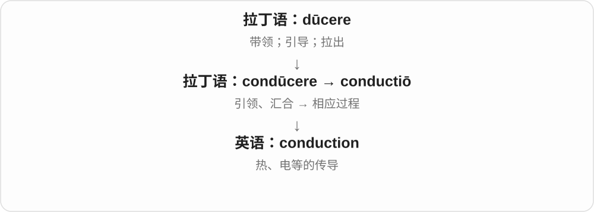

最常见的学习场景是热传导和电传导。把它想成“通过接触或介质内部传递”有帮助，但具体机制依领域而异。

**常见搭配与例句**

heat conduction（热传导）；electrical conduction（电传导）；nerve conduction（神经传导）。

> Heat reaches the handle by conduction through the metal.

热量通过金属传导到把手上。

> The experiment compared electrical conduction in two materials.

实验比较了两种材料的导电情况。

**别混淆**

conduction 是过程；conductor 是材料或参与传导的对象。convection“对流”依靠流体整体运动，是另一种传热方式。

### 215. ovulation — 排卵

**音标**：英 /ˌɒvjuˈleɪʃn/；美 /ˌɑːvjuˈleɪʃn/

**先抓住这个画面**

卵巢把卵释放出来这一过程。

**怎么拆**

19 世纪从学术拉丁 ovulum“小卵”加 -ation 构成。这个名词早于现代动词 ovulate；现代成对学习时可联想动词加 -ion，历史顺序却不能因此倒过来。

**怎么变成今天的意思**

**拉丁语 ovum**  
卵、蛋

↓

**后期学术拉丁 ovulum**  
小卵，ovum 的小称形式

↓

**19 世纪英语 ovulation**  
以 ovulum 加 -ation 命名产卵、排卵过程

不要把 ovulation 想成“怀孕”或“月经”的另一个名字。它说的是卵从卵巢释放出来这一环节；后面是否受精，是另一件事。名称里的卵是核心，-ation 把它组织成过程名词。

**常见搭配与例句**

the timing of ovulation；before ovulation；after ovulation；ovulation testing。

> The chart marks the estimated time of ovulation.

图表标出了估计的排卵时间。

> The lesson explains how ovulation differs from fertilization.

这节课解释了排卵与受精的区别。

**别混淆**

ovulation 是排卵，fertilization 是受精，menstruation 是月经。三者相关，却不是同一个事件。

### 216. pollination — 授粉

**音标**：英 /ˌpɒləˈneɪʃən/；美 /ˌpɑːləˈneɪʃən/

**先抓住这个画面**

花粉从产生的位置被送到接受的位置，这段转移过程叫授粉。

**怎么拆**

与法语 pollination 有关，法语据拉丁 pollin- 花粉词干构成；英语记录略早于 pollinate。今天二者是名词、动词配对，历史顺序不必照现代拆分倒推。

**怎么变成今天的意思**

**拉丁 pollen、pollin- → 法语 pollination**  
花粉 → 授粉过程的名称

↓

**英语 pollination**  
授粉；与 pollinate 构成现代词类配对

在开花植物中，授粉通常说花粉从花药到达柱头。它可以在同一朵花、同一株植物的不同花之间发生，也可以跨植株。成功送到花粉以后，还要有后续过程才可能形成种子。

**常见搭配与例句**

successful pollination；wind pollination；insect pollination；the process of pollination。

> The lesson explains the difference between pollination and fertilization.

这节课解释了授粉与受精的区别。

> The orchard depends partly on insects for pollination.

这片果园的授粉部分依靠昆虫。

**别混淆**

pollination 不是蜜蜂采蜜的同义词；采蜜可能顺便帮助授粉，但这两个动作的目标和结果不同。

### 217. deflation — 放气；通货紧缩

**音标**：英、美 /dɪˈfleɪʃən/

**先抓住这个画面**

像气球放气后缩小；经济中则是整体价格水平持续下降。

**怎么拆**

英语 deflate + -ion；早期说放气，随后进入经济用语。与 inflation 不同，这个名词可明确接英语动词派生路线。

**怎么变成今天的意思**

**拉丁 flare**  
吹气、吹起

↓

**拉丁 in- + flare → inflare → inflatus**  
向里面吹气 → 吹胀；分词形式

↓

**中古英语 inflaten → inflate**  
使膨胀；后来也指抬高、夸大

↓

**近代英语以 de- 替换 inflate 的 in- → deflate**  
放掉气、使缩小；后来也说打击自信

↓

**英语 deflate + -ion → deflation**  
放气；后来用于总体价格水平下降

a tyre’s deflation 是轮胎失去气体；经济里的 deflation 看的是总体物价下降，不是某家店打折。先认清讨论对象，才能判断它是在讲一个物体还是整个价格环境。

**常见搭配与例句**

a period of deflation；the risk of deflation；rapid deflation of a tyre。

> The report warned of a prolonged period of deflation.

报告警告可能出现一段持续的通货紧缩。

> The valve allows controlled deflation of the air cushion.

这个阀门可以控制气垫的放气过程。

**别混淆**

deflation 是价格水平下降；disinflation 是上涨速度放慢。价格仍上涨但涨得更慢，不应直接叫 deflation。

### 218. facilitation — 促进；引导过程

**音标**：/fəˌsɪlɪˈteɪʃən/

**先抓住这个画面**

讨论卡住时，有人把问题理清，让每个人都说得上话，这个帮助事情顺畅推进的过程叫 facilitation。

**怎么拆**

facilitate + -ion，对应使某事更容易的过程。

**怎么变成今天的意思**

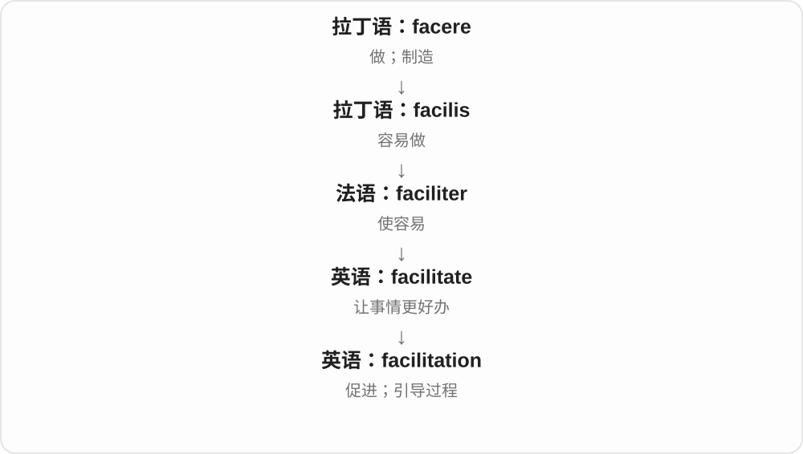

动词是做帮助推进的动作，名词则让这种工作本身成为讨论对象。重点在创造条件、协调过程。

**常见搭配与例句**

group facilitation；trade facilitation；facilitation skills。

> Good facilitation kept the discussion focused.

良好的引导使讨论始终围绕主题。

> The course teaches basic facilitation skills.

这门课程教授基本的讨论引导技巧。

**别混淆**

instruction 偏向直接讲授；facilitation 更常帮助参与者自己思考、协作。

### 219. subtraction — 减法；减去；扣除

**音标**：/səbˈtrækʃən/

**先抓住这个画面**

subtraction 讨论的是“从原数拿走一部分”这个运算，而不是被拿走的那个数字。

**怎么拆**

来自晚期拉丁语 subtractiō；现代可拆解理解为 subtract + -ion。

**怎么变成今天的意思**

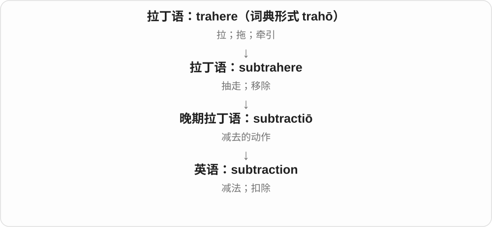

subtract 是动词“减去”，subtraction 是名词“减法或减去过程”。它也能用于材料、数量的减少，不只用于课本。

**常见搭配与例句**

addition and subtraction；a subtraction problem；subtraction of expenses。

> The children practiced subtraction with small blocks.

孩子们用小积木练习减法。

> The final amount is calculated by subtraction of the expenses.

最后的金额通过扣除各项支出来计算。

**别混淆**

subtraction 是减去的操作；difference 可以是相减后的差。做减法和所得结果要分开。

### 220. capitulation — 投降；屈服；投降协定

**音标**：英 /kəˌpɪtjʊˈleɪʃən/；美 /kəˌpɪtʃəˈleɪʃən/

**先抓住这个画面**

不再继续抵抗、接受条件的那一步，或写下这些条件的协定，就是 capitulation。

**怎么拆**

借自法语 capitulation，联系 capituler；名词有自己的法语借入路线，现代才容易对应 capitulate + -ion。

**怎么变成今天的意思**

**拉丁语：caput；属格 capitis**  
头；首领；顶端、主要部分

↓

**拉丁语：capitulum**  
小头；文章纲目、章节

↓

**中世纪拉丁 capitulare → 法语 capituler / capitulation**  
列出条件 → 议定条件及协议

↓

**英语：capitulation**  
协议条款 → 投降、屈服

unconditional capitulation 是无条件投降；a capitulation to pressure 可比喻对压力让步。早期“协议条款”的意思比现代投降义宽。

**常见搭配与例句**

terms of capitulation；a complete capitulation。

> The agreement set out the terms of capitulation.

协议列出了投降条件。

> Critics called the decision a capitulation to pressure.

批评者把这个决定称为向压力屈服。

**别混淆**

negotiation 是谈判过程；capitulation 强调放弃抵抗的结果。

### 221. indoctrination — 思想灌输

**音标**：英 /ɪnˌdɒktrɪˈneɪʃən/；美 /ɪnˌdɑːktrəˈneɪʃən/

**先抓住这个画面**

反复把一套观点装进去，却不给人充分质疑和比较的空间。

**怎么拆**

indoctrinate 的行为名词，-ate 变为 -ation；早期也可泛指教导，现代通常带不鼓励独立判断的负面意味。

**怎么变成今天的意思**

**拉丁 docēre；完成分词 doctus**  
教；使人知道；有学问的

↓

**拉丁 doctrīna → 古法语 doctrine**  
教导、学问、一套教义

↓

**中古英语及英语 doctrine**  
系统传授或认可的原则、教义

↓

**英语 in- + doctrine + -ate → indoctrinate**  
向人灌输一套观念；早期也泛指教导

↓

**英语 indoctrinate → indoctrination**  
灌输观念这一过程

讨论 indoctrination 时，重点常是教育方式：是否要求无条件接受、是否封锁反对信息。讲授某一学说本身不必自动叫灌输，要看怎么教、是否容许检验。

**常见搭配与例句**

political indoctrination；ideological indoctrination；a programme of indoctrination。

> The novel depicts a school where repetition replaces discussion and becomes indoctrination.

小说描写了一所用反复背诵取代讨论、进而进行思想灌输的学校。

> The historian distinguishes education about an ideology from indoctrination into it.

历史学家区分了介绍某种意识形态的教育与让人盲从它的思想灌输。

**别混淆**

education 是广泛的教育；indoctrination 通常批评把人引向不加质疑地接受某种信念。

### 222. annotation — 注释；标注；添加注释的过程

**音标**：/ˌænəˈteɪʃən/

**先抓住这个画面**

原内容旁边那一层补充说明，或把它加上去的工作。

**怎么拆**

直接接拉丁 annotatio，来自 annotare“加注”。现代可与 annotate + -ion 对照，但英语 annotation 的记录早于 annotate，历史上是独立名词借入。

**怎么变成今天的意思**

**拉丁 nota → notare**  
标记、符号；做记号、记下

↓

**拉丁 ad- + notare → adnotare / annotare**  
给某物加记号、注释

↓

**拉丁 annotatio / annotation-**  
注解、说明

↓

**英语 annotation**  
注释内容与标注过程

一本书的 annotations 可以是编辑解释的典故；data annotation 则是给数据加标签、边界或其他描述。注释不一定长，哪怕一个标签也可以是 annotation。

**常见搭配与例句**

an annotation in the margin；data annotation；text annotation。

> A handwritten annotation explains the unusual abbreviation.

一条手写注释解释了这个不常见的缩写。

> Consistent annotation makes the dataset easier to compare.

一致的标注让这份数据集更便于比较。

**别混淆**

notation 是表示系统或记录；annotation 强调附加到已有内容上的说明。

### 223. fluctuation — 波动；起伏；波动幅度或一次变化

**音标**：/ˌflʌktʃuˈeɪʃən/

**先抓住这个画面**

把 fluctuate 的上下起伏截下来观察，就得到一次 fluctuation，或一段时间里的 fluctuations。

**怎么拆**

拉丁 fluctuātiō 来自 fluctuāre，作为名词借入；现代对应 fluctuate + -ion。

**怎么变成今天的意思**

**拉丁 fluere；分词 fluēns、fluxus；相关 fluvius**  
流动；流动的；河流

↓

**拉丁 fluctus → fluctuāre → fluctuātiō**  
波浪 → 起伏 → 起伏的过程

↓

**英语 fluctuation**  
波动；起伏变化

常见 fluctuations in temperature、price fluctuations。既能说整体波动现象，也能数多次变化。

**常见搭配与例句**

seasonal fluctuations；a fluctuation in；wide fluctuations。

> The graph shows daily fluctuations in temperature.

图表显示了气温每天的波动。

> Small fluctuations do not necessarily change the overall trend.

小幅波动不一定改变总体趋势。

**别混淆**

trend 是较长期方向；fluctuations 是过程中的上下变化，短期波动未必改变趋势。

### 224. dilation — 扩张；扩大；数学中的位似变换；时间膨胀

**音标**：/daɪˈleɪʃən/

**先抓住这个画面**

把 dilate 的变化过程当成一件事来谈，例如瞳孔扩大；在专业词组中还表示按比例缩放或相对论的时间效应。

**怎么拆**

英语 dilate 对应的 -ion 名词，形成较短的 dilation；较早另有经法语、拉丁借入的 dilatation。两种拼法都有历史，不能把 dilation 一律判为误写。

**怎么变成今天的意思**

**拉丁 latus 宽的**  
这一支讲宽广，不是英语 late 晚，也不是表示携带的分词 latus

↓

**拉丁 dis- 分开 + latus → dilatare 扩宽**  
使两边分开，让空间或范围变大

↓

**法语 dilater／拉丁 dilatare → 英语 dilate**  
扩张；也曾用于展开、详述一个话题

↓

**英语 dilate → dilation**  
扩张的过程；与较早独立借入的 dilatation 并存

pupil dilation 是瞳孔扩大。几何里的 dilation 按同一中心、同一比例缩放，比例小于一时也会缩小。time dilation 是相对论术语，涉及不同运动或引力条件下的钟所测时间差别。

**常见搭配与例句**

pupil dilation；a dilation with scale factor 2；time dilation。

> The diagram shows pupil dilation in dim light.

示意图展示了昏暗光线下瞳孔的扩大。

> A dilation with a scale factor of one half makes the triangle smaller.

比例因子为二分之一的位似变换会使三角形缩小。

> The article introduces time dilation through a comparison of two clocks.

文章通过比较两只钟来介绍时间膨胀。

**别混淆**

dilation 和 dilatation 都可说扩张，具体学科有习惯差别。几何中的 dilation 不一定扩大；不能只靠日常词义判断比例小于一的情况。

### 225. retraction — 收回；撤回声明；缩回

**音标**：/rɪˈtrækʃən/

**先抓住这个画面**

retraction 是收回这个动作，也可以是正式说明“先前那段内容不再成立”的声明。

**怎么拆**

现代可对照 retract + -ion；也可见 re- 与 traction 的结构联系。实际用法要沿 retract“收回”理解。

**怎么变成今天的意思**

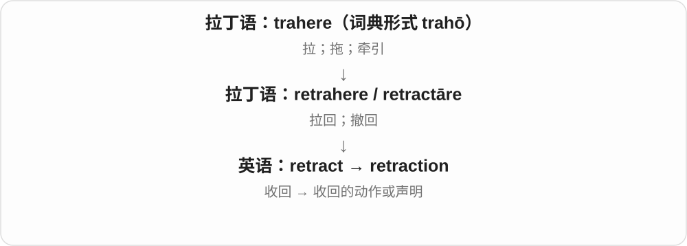

在机构、媒体和学术场景里，它常指纠正已公开内容的撤回。机械里的 retraction 则仍是很直接的缩回。

**常见搭配与例句**

issue a retraction；publish a retraction；demand a retraction；retraction of the landing gear。

> The journal published a retraction of the article.

期刊发表声明，撤回了那篇文章。

> The mechanism allows smooth retraction of the cable.

这个机构能让电缆平稳地收回。

**别混淆**

correction 可以只修改错误部分；retraction 通常意味着撤回相关内容。是否撤回全文，要看具体声明。

### 226. lactation — 泌乳；乳汁分泌期

**音标**：/lækˈteɪʃən/

**先抓住这个画面**

身体开始生产乳汁，供幼儿或幼崽获取营养；这个过程有了一个专门名称。

**怎么拆**

经法语 lactation，来自后期拉丁 lactatio／lactationem，出自 lactare 哺乳。英语早先有哺乳过程义，后来也明确表示乳汁生成与分泌。

**怎么变成今天的意思**

**拉丁 lac，属格 lactis**  
乳、奶

↓

**拉丁 lactare → lactatio；法语 lactation**  
哺乳的过程

↓

**英语 lactation**  
乳汁生成、分泌及其时期

常见于育儿和生理学文章。lactation consultant 是提供哺乳相关支持的专业人员；during lactation 是在泌乳期。作为生理过程，它与婴儿正在吸吮这一具体动作相关，却不完全相同。

**常见搭配与例句**

milk production during lactation；a lactation consultant；the onset of lactation。

> The course explains the hormones involved in lactation.

这门课介绍参与泌乳过程的激素。

> She asked a lactation consultant for help with feeding.

她向哺乳顾问寻求喂养方面的帮助。

**别混淆**

lactation 关注乳汁产生与分泌；breastfeeding 关注用母乳喂养。谈论不同环节时，不能总把两词机械互换。

### 227. negation — 否定；否认；与之相反或抵消的东西

**音标**：/nɪˈɡeɪʃən/

**先抓住这个画面**

给一个说法加上“不”，或把某种原则整个反过来。

**怎么拆**

经法语 negacion 或拉丁 negatio 借入，接 negare；英语名词早于 negate 的通常记录。

**怎么变成今天的意思**

**拉丁语 negare**  
否认、拒绝，说“不”

↓

**拉丁语 negatio → 古法语 negacion → 英语 negation**  
否认行为 → 逻辑、语法中的否定等

语法中的 negation 可通过 not、never 等表达。the negation of a principle 是对某原则的否定、背离，不一定仅指一句口头反对。

**常见搭配与例句**

logical negation；double negation；the negation of a claim。

> The lesson explains how English expresses negation.

这节课解释英语如何表达否定。

> For her, censorship was the negation of free inquiry.

在她看来，审查制度是对自由探究的否定。

**别混淆**

denial 常带某人否认某事实的行为；negation 还适合讨论语言、逻辑的否定结构。

### 228. elaboration — 详细阐述；展开；精细加工

**音标**：/ɪˌlæbəˈreɪʃən/

**先抓住这个画面**

把最初的一句话、一个构想逐步补成有细节的版本。

**怎么拆**

接晚期拉丁 elaboratio，也有法语 élaboration 的借入说明；英语名词早于 elaborate 的常见记录，不能只画英语动词加 -ion。

**怎么变成今天的意思**

**拉丁语 labor**  
劳动、费力、辛苦；更早来源不确定

↓

**拉丁语 laborare**  
劳动、努力

↓

**拉丁 elaborare → 晚期拉丁 elaboratio；法语 élaboration**  
费力做出来 → 展开、加工的名词

↓

**英语 elaboration**  
历史早期有生理形成义，后常指详细展开

without further elaboration 是不再详细解释；an elaboration of an earlier idea 可以是旧构想发展出的更细方案。它强调展开，不只是把同一句再说一次。

**常见搭配与例句**

further elaboration；an elaboration of an idea；need no elaboration。

> He rejected the proposal without further elaboration.

他否决了提议，没有进一步说明。

> The new design is an elaboration of a much simpler earlier sketch.

这个新设计是在一张简单得多的早期草图基础上细化而成的。

**别混淆**

explanation 重点是让人理解；elaboration 重点是补细节、扩展开，有时是解释的一部分。

### 229. attenuation — 衰减；减弱；变细

**音标**：/əˌtenjuˈeɪʃən/

**先抓住这个画面**

不是盯着东西本身，而是量它在传播或处理后弱了多少。

**怎么拆**

接拉丁 attenuatio，来自 attenuare 使变薄。英语名词的记录早于现代动词 attenuate；现代能按动词与 -ion 联系，但那不是唯一历史解释。

**怎么变成今天的意思**

**拉丁 tenuis 细、薄、弱**  
由此有动词 tenuare 使变薄；薄弱结构也成为不牢靠关系的比喻

↓

**拉丁 ad- 向着 + tenuare → attenuare**  
使变薄、减少；ad- 同化成 at-

↓

**拉丁 attenuatio → 英语 attenuation**  
变薄、减少；后来用于声音、光、信号等的衰减

signal attenuation 是信号衰减，sound attenuation 是声音减弱。它可以是传播中的损失，也可以是设计者有意降低强度。

**常见搭配与例句**

signal attenuation；sound attenuation；measure attenuation。

> The engineers measured signal attenuation along the cable.

工程师测量了信号沿电缆传输时的衰减。

> The panel provides sound attenuation between the two rooms.

这块板能减弱两个房间之间传递的声音。

**别混淆**

distortion 是形状或波形被改变，attenuation 重点是强度下降；信号可以变弱而大致保持原来的形状。

### 230. rejuvenation — 恢复活力；焕新；年轻化

**音标**：/rɪˌdʒuːvəˈneɪʃən/

**先抓住这个画面**

把由疲弱、陈旧变得新鲜、有生气的整个过程说出来。

**怎么拆**

rejuvenate + -ion，末尾 -ate 对应 -ation，主重音移到 /neɪ/；名词记录晚于动词，按英语派生链理解即可。

**怎么变成今天的意思**

**拉丁 iuvenis / juvenis**  
年轻的；年轻人

↓

**近代英语 re- + juven- + -ate → rejuvenate**  
重新赋予年轻的状态或活力

↓

**英语 rejuvenate + -ion → rejuvenation**  
恢复活力或年轻状态的过程

可以说地区、社团、文化活动的 rejuvenation，也能描述一个人休息后恢复精力。具体发生了什么，要看对象，不能一律译成美容上的年轻化。

**常见搭配与例句**

the rejuvenation of a town；cultural rejuvenation；rest and rejuvenation。

> The park became a symbol of the neighbourhood’s rejuvenation.

这座公园成了街区恢复活力的象征。

> For her, the holiday was a period of rest and rejuvenation.

对她来说，这次假期是一段休息和恢复精力的时光。

**别混淆**

renovation 通常强调修缮；rejuvenation 强调变得有新鲜活力，物理修缮只是可能的手段。

### 231. castration — 阉割；去势

**音标**：/kæˈstreɪʃən/

**先抓住这个画面**

把去除或抑制性腺功能这一过程作为名词来谈，常见于兽医、医学和历史。

**怎么拆**

经中古法语或直接借拉丁 castratio，来自 castrare；英语 castration 的记录早于 castrate 动词，现代可互认词形，但不要倒写历史。

**怎么变成今天的意思**

**拉丁 castrare 阉割、修剪**  
与 castus 的更远关系不能仅凭近形断定

↓

**拉丁 castratio；中古法语 castration → 中古英语 castracioun → castration**  
先借入过程名词；后来英语出现相应动词

surgical castration 指手术去势；chemical castration 是使用药物抑制相关功能的名称，并不意味着手术切除。日常读文章时，先看限定词再理解具体所指。

**常见搭配与例句**

surgical castration；chemical castration；a history of castration。

> The textbook distinguishes surgical castration from chemical castration.

教材区分了手术去势和药物去势。

> The museum label discusses the historical use of castration in animal husbandry.

博物馆说明牌介绍了畜牧业中阉割的历史用途。

**别混淆**

sterilization 强调失去生育能力；castration 牵涉性腺或其功能，范围与作用并不完全相同。

### 232. conjugation — 动词变位；一类动词的变位系统

**音标**：英 /ˌkɒndʒəˈɡeɪʃən/；美 /ˌkɑːndʒəˈɡeɪʃən/

**先抓住这个画面**

把动词的不同形式排成表，看清它在句子里怎样变化。

**怎么拆**

拉丁 coniugatio 原义连接、组合，也成为语法术语。英语直接承接这个名词，早于英语 conjugate 的语法动词用法；现代虽可按 conjugate 与 -ion 联系，却不是英语中才第一次造出的名词。

**怎么变成今天的意思**

**拉丁 coniugare → coniugatio**  
连接 → 组合；语法中的动词变化类别

↓

**英语 conjugation**  
动词变位，或按相同方式变位的一类动词

一张法语动词变位表会把我说、你说、他说等对应形式放在一起。这里的一组不是词义相近的词，而是同一动词的不同语法形式。这个词在生物学也有专门用法；学习语言时先抓住动词变位这一义。

**常见搭配与例句**

verb conjugation；a conjugation table；irregular conjugations；learn French conjugations。

> The textbook includes a conjugation table for each irregular verb.

教材为每个不规则动词附了一张变位表。

> I understand the sentence, but I still need to check the verb conjugation.

我理解这句话，但还需要核对动词变位是否正确。

**别混淆**

conjugation 管动词形式变化；pronunciation 管读音。会读一个动词，不等于会在不同人称和时态中正确变位。

### 233. desecration — 亵渎；污损神圣之物

**音标**：英 /ˌdesɪˈkreɪʃən/；美 /ˌdesəˈkreɪʃən/

**先抓住这个画面**

损害的不只是物体本身，还包括人们赋予它的神圣、纪念或尊严意义。

**怎么拆**

desecrate 去末尾 e 加 -ion；来自英语表示亵渎的动词，而非直接继承一个同义拉丁名词。

**怎么变成今天的意思**

**拉丁语 de-**  
离开、向下；也可加强动作或表示解除

↓

**拉丁语 sacrare / consecrare → 英语 consecrate**  
使成为神圣的

↓

**英语 de- + consecrate 的词干 → desecrate**  
逆转神圣的地位；亵渎

↓

**英语 desecrate + -ion → desecration**  
亵渎行为或结果

破坏墓地、宗教场所或纪念物时常见这个词。其是否被认为神圣，与具体文化、信仰背景有关。

**常见搭配与例句**

the desecration of a grave；an act of desecration。

> The community condemned the desecration of the cemetery.

社区谴责了亵渎墓地的行为。

> The novel describes the desecration of an ancient shrine.

小说描述了一座古老神祠遭到亵渎的事件。

**别混淆**

damage 只说损坏；desecration 强调对神圣或受尊敬之物的冒犯。

### 234. domestication — 驯化；适应家居生活的过程

**音标**：/dəˌmestɪˈkeɪʃən/

**先抓住这个画面**

把野生种群与人的生活长期联系起来，经过一代代饲养、培育而发生变化。

**怎么拆**

domesticate + -ion，-ate 对应 -ation；是英语中表示动作、过程或状态的名词。

**怎么变成今天的意思**

**拉丁语 domus**  
家、房屋、家庭

↓

**拉丁语 domesticus → 中世纪拉丁语 domesticare / domesticatus**  
家里的 → 驯养、使适应家庭使用

↓

**英语 domesticate〔也可能经法语 domestiquer〕**  
驯化；使适应家庭生活

↓

**英语 domesticate → domestication**  
驯化 → 长期驯化过程、驯化状态

the domestication of wheat 说作物驯化史；animal domestication 说动物与人类长期关系的变化。不能把它简化成某天某人第一次喂了一只动物。

**常见搭配与例句**

plant domestication；animal domestication；the process of domestication。

> The exhibition traces the domestication of cereal crops.

展览追溯了谷类作物的驯化过程。

> Domestication changed the relationship between people and these animals.

驯化改变了人与这些动物之间的关系。

**别混淆**

training 是训练具体行为；domestication 讨论更长时段、涉及繁殖和群体变化的过程。

### 235. orchestration — 配器；管弦乐编配；统筹安排

**音标**：英 /ˌɔːkɪˈstreɪʃn/；美 /ˌɔːrkɪˈstreɪʃn/

**先抓住这个画面**

关注各部分怎样被分工、衔接，组成一个完整效果。

**怎么拆**

英语借法语 orchestration，联系 orchestre“乐队”。它在英语中的记录早于 orchestrate；现代虽然能配对成 orchestrate + -ion，也不能据此倒写成英语动词先产生名词。

**怎么变成今天的意思**

**希腊语 orchestra → 拉丁语 orchestra**  
剧场中的表演区域

↓

**法语 orchestre → orchestration**  
乐队 → 为乐队安排各声部

↓

**英语 orchestration**  
配器、管弦乐编配

↓

**英语 orchestration 的比喻义**  
协调多个环节的组织安排

同一段旋律交给长笛或铜管，会产生不同效果；这样的分配与组合属于 orchestration。工作语境借的也是这个画面：各部分单独运行还不够，需要安排它们何时接上、如何配合。

**常见搭配与例句**

the orchestration of a piece；rich orchestration；careful orchestration of an event。

> The new orchestration gives the melody a lighter texture.

新的配器让这段旋律的织体更轻盈。

> The opening ceremony required careful orchestration of many teams.

开幕式需要对多个团队进行细致的统筹安排。

**别混淆**

composition 可以指作曲本身，orchestration 特别看怎样交给不同乐器实现。比喻用法也突出多环节协调，不是任何一份计划都必须叫 orchestration。

### 236. orchestrations — 管弦乐编配、配器方案〔复数〕

**音标**：英 /ˌɔːkɪˈstreɪʃənz/；美 /ˌɔːrkɪˈstreɪʃənz/

**先抓住这个画面**

同一段旋律，给小乐队和大乐队的分工可以完全不同；这些具体编配方案叫 orchestrations。

**怎么拆**

orchestration + -s。英语名词借法语 orchestration，记录早于英语 orchestrate；复数数的是不同编配成果或安排。

**怎么变成今天的意思**

**法语 orchestration → 英语 orchestration**  
为乐队安排声部的活动、结果

↓

**orchestration + -s → orchestrations**  
不同编配、配器方案

different orchestrations of a song 是同一首歌的不同配器；不是仅仅数演奏了几遍。

**常见搭配与例句**

new orchestrations 新编配；compare orchestrations 比较配器方案。

> We compared two orchestrations of the same song.

我们比较了同一首歌的两种配器。

> The new production uses lighter orchestrations.

新制作采用了更轻盈的管弦乐编配。

**别混淆**

compositions 数作品，orchestrations 可数同一作品的不同乐器编配，两个数目不一定相同。

### 237. urination — 排尿

**音标**：英 /ˌjʊərɪˈneɪʃən/；美 /ˌjʊrɪˈneɪʃən/

**先抓住这个画面**

把一次身体动作当作过程来谈。

**怎么拆**

来自中世纪拉丁 urinatio，接 urinare“排尿”，中古英语已有 urinacioun。现代可理解为 urinate 对应的 -ion 名词，但英语名词的记录更早，不应把图写成必然由现代动词派生。

**怎么变成今天的意思**

**拉丁 urina**  
尿；与希腊 ouron 通常认为有更早同源关系

↓

**中世纪拉丁 urinare → urinatio**  
排尿 → 排尿这个过程

↓

**中古英语 urinacioun → 英语 urination**  
排尿

frequent urination 是排尿频繁；pain during urination 是排尿时疼痛。它描述动作或发生情况，不是给某一种疾病直接命名。

**常见搭配与例句**

frequent urination；pain during urination；normal urination；the frequency of urination。

> The patient described pain during urination.

患者描述了排尿时的疼痛。

> The study recorded the frequency of urination over twenty-four hours.

这项研究记录了二十四小时内的排尿次数。

**别混淆**

urination 是排尿过程，urinary 是形容词。尿的量、排尿的次数和排尿是否疼痛是不同信息，不能只看一个词就混在一起。

### 238. requisition — 正式申领；申请单；征用；申领、征用某物

**音标**：/ˌrekwɪˈzɪʃən/

**先抓住这个画面**

requisition 像有制度、有权限支撑的领用单：“请按流程把这些物资调过来。”

**怎么拆**

来自拉丁及中世纪拉丁 requisitio，经法语、再入英语；英语动词又由名词转用。其 -sition 不是可以任意套在 require 后面的普通后缀。

**怎么变成今天的意思**

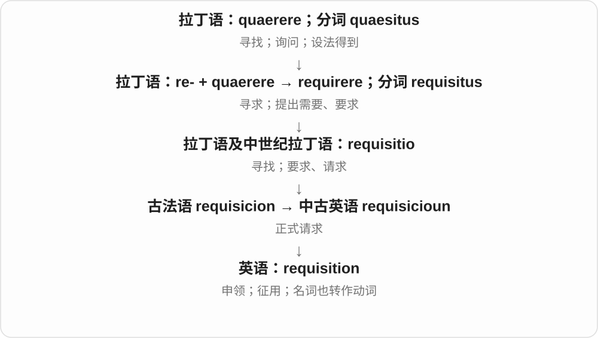

办公室里的 purchase requisition 是采购申请；战时 requisition a building 是征用建筑。共同点是正式调取，但申请与强制征用的力度不同，要看场景。

**常见搭配与例句**

a purchase requisition；a requisition form；requisition supplies；requisition a building。

> The technician submitted a requisition for replacement parts.

技术员提交了一份更换零件的申领单。

> The army requisitioned the empty warehouse for storage.

军队征用了那座空仓库来存放物资。

**别混淆**

request 范围广，也可以很私人；requisition 常有组织流程或正式权力作为背景。

### 239. inoculation — 接种；接种过程

**音标**：英 /ɪˌnɒkjuˈleɪʃən/；美 /ɪˌnɑːkjuˈleɪʃən/

**先抓住这个画面**

说的是把材料引入的这件事；常见于接种记录，也用于实验室中引入微生物。

**怎么拆**

接拉丁 inoculatio 嫁接这一动作名词，来自 inoculare。英语早期也说嫁接，后来发展出医学义；现代可联想 inoculate 与 -ion，但名词有自己的拉丁借入路线。

**怎么变成今天的意思**

**拉丁 oculus 眼；也指芽眼**  
形状或功能相像的东西也可借眼命名

↓

**拉丁 in- 入 + oculus 芽 → inoculare 嫁接芽**  
这里最初是把芽接入植物，并不是把东西送进眼睛

↓

**拉丁 inoculatio → 英语 inoculation**  
先有嫁接背景，后来用于医学接种

↓

**英语中扩展到实验与比喻用法**  
将材料引入，或预先建立抵抗力

an inoculation 可以指一次接种，inoculation 也可不可数地谈过程。实验室的 inoculation of a culture 是向培养体系引入材料，不一定涉及人体或疫苗。

**常见搭配与例句**

an inoculation record；inoculation against a disease；inoculation of a culture。

> The archive contains records of smallpox inoculation.

档案中保存着天花接种记录。

> The lab recorded the time of inoculation for each culture.

实验室记录了每个培养物的接种时间。

**别混淆**

injection 只是注射这一给入方式；inoculation 说接种，不应把每一次注射都叫 inoculation。现代日常谈疫苗也常用 vaccination。

### 240. asphyxiation — 窒息过程；窒息

**音标**：/əsˌfɪksiˈeɪʃən/

**先抓住这个画面**

句子不再说谁被弄得窒息，而是把整个过程作为一件事来讨论。

**怎么拆**

英语 asphyxiate 对应名词 asphyxiation，-ate 与 -ation 配对。远接 asphyxia 的现代窒息义，不回到已经过时的无脉定义。

**怎么变成今天的意思**

**希腊 a- 无；sphyxis 脉搏、sphyzein 跳动**  
否定成分与脉搏词族共同构成名称

↓

**希腊 asphyxia → 近代拉丁 asphyxia → 英语 asphyxia**  
古义脉搏停止；英语后来改用于窒息

↓

**英语 asphyxiate → asphyxiation**  
从动作形成过程或状态名词

death from asphyxiation 是因窒息死亡；risk of asphyxiation 是窒息风险。词本身不要求每次都已经死亡，具体结果由句子交代。

**常见搭配与例句**

the risk of asphyxiation；death by asphyxiation；accidental asphyxiation。

> The safety review identified a risk of asphyxiation in the enclosed chamber.

安全审查发现，封闭舱室中存在窒息风险。

> The documentary explains the difference between asphyxiation and ordinary breathlessness.

纪录片解释了窒息与普通气喘之间的区别。

**别混淆**

asphyxia 偏状态名称，asphyxiation 常突出发生过程；实际文章中二者有很大重叠，不能人为划成绝不相交的两类。

### 241. alleviation — 减轻；缓解

**音标**：/əˌliːviˈeɪʃən/

**先抓住这个画面**

把原来沉重或难受的情况变轻一点的过程和结果。

**怎么拆**

借自中世纪拉丁 alleviatio，来自 alleviare；现代可联系 alleviate 与 -ation，不能把现代拆分当作先后顺序。

**怎么变成今天的意思**

**拉丁 levis → levare**  
轻 → 抬起、使负担减轻

↓

**晚期拉丁 alleviare → 中世纪拉丁 alleviatio**  
减轻 → 减轻这一过程

↓

**英语 alleviate／alleviation**  
缓和问题／问题得到缓解

poverty alleviation 关注减少贫困带来的困难；pain alleviation 说痛苦减轻。这个词多用于正式文本，日常聊天常用 relief 或直接说 things got easier。

**常见搭配与例句**

poverty alleviation；the alleviation of suffering。

> The programme focuses on poverty alleviation in rural areas.

这个项目着重缓解农村地区的贫困。

> They measured the alleviation of discomfort after the adjustment.

他们测量了调整之后不适减轻的程度。

**别混淆**

alleviation 不等于 eradication“根除”：前者允许问题仍然存在，只是程度减轻。

### 242. ideation — 构思；形成想法的过程

**音标**：英、美 /ˌaɪdiˈeɪʃən/

**先抓住这个画面**

先打开思路，尽量产生不同可能，暂时不急着把每一个细节都定下来。

**怎么拆**

英语 idea + -ation，表示形成观念的过程。它原先是思想、心理活动的术语，后来在设计和产品工作中广泛用来讲构思。

**怎么变成今天的意思**

**idea**  
脑中的观念、想法

↓

**英语 idea + -ation → ideation**  
形成想法的过程

↓

**设计与工作语境**  
产生并探索可能方案的构思阶段

an ideation session 是集中想点子的讨论。它可以包括草图、提问或头脑风暴，但还不是实施阶段。较正式的心理学文字也会用 ideation 泛指观念或想法活动，所以不能在所有语境都翻成“创意工作坊”。

**常见搭配与例句**

an ideation session；the ideation stage；ideation techniques；move from ideation to testing。

> We began with an ideation session before choosing a design.

我们先进行了一轮构思讨论，然后才选择设计方案。

> The team moved from ideation to testing a small prototype.

团队从构思阶段转入了小型原型的测试阶段。

**别混淆**

idea 是一个想法；ideation 是形成想法的过程。brainstorming 是可用于构思的一种方式，不涵盖所有 ideation。

### 243. speciation — 物种形成；物种分化

**音标**：/ˌspiːʃiˈeɪʃən/，亦 /ˌspiːsiˈeɪʃən/

**先抓住这个画面**

speciation 像原本相连的种群逐渐分开发展，最后形成可以区分的新物种。

**怎么拆**

speciate（形成物种）+ -ion；词基来自 species。

**怎么变成今天的意思**

说的是过程，不是某一种动物的名字。化学中也可指一个元素存在于哪些化学形态，语境不同。

**常见搭配与例句**

speciation events；the process of speciation；chemical speciation。

> Geographic isolation can contribute to speciation.

地理隔离可能促成物种形成。

> The lecture explains different patterns of speciation.

讲座解释了物种形成的不同模式。

**别混淆**

species 是物种，speciation 是形成或分化过程；specialization 是专门化。

### 244. encapsulation — 封装；包裹；精炼概括

**音标**：英 /ɪnˌkæpsjuˈleɪʃən/；美也读 /ɪnˌkæpsəˈleɪʃən/

**先抓住这个画面**

把内容收进一个有边界的整体，或用很短的表达保住它的要点。

**怎么拆**

encapsulate 对应的动作名词，-ate 换为 -ation；英语也可按 en- + capsule + -ation 分析。包裹义与比喻概括义各有发展，不必假设后者一定先出现在动词中。

**怎么变成今天的意思**

**拉丁 capsa 盒、箱**  
装东西的容器；各支借入英语的时间和路线不同

↓

**拉丁 capsula 小盒 → 法语 capsule → 英语 capsule**  
小容器、囊；后来用于药物胶囊、太空舱等

↓

**英语 en- + capsule + -ate → encapsulate；动作名词 encapsulation**  
字面封装、包裹的词族

↓

**encapsulation 发展出精炼概括与软件封装等用法**  
将内容组织为完整而可控制边界的单位

a neat encapsulation of an argument 是对论点的精炼概括。软件中的 encapsulation 把状态和操作组织起来，并限制外部直接碰内部细节；它不是把文件压小。

**常见搭配与例句**

data encapsulation；a concise encapsulation；encapsulation of an idea。

> Her final sentence was a neat encapsulation of the argument.

她最后一句话精炼地概括了整个论点。

> Encapsulation lets us change the internal code without changing the public interface.

封装让我们可以修改内部代码而不改变公开接口。

**别混淆**

compression 是压缩体积或数据长度；encapsulation 强调封在一个边界内。encryption 是加密，目的和操作都不同。

### 245. repudiation — 坚决否认；拒绝承认；弃绝

**音标**：/rɪˌpjuːdiˈeɪʃən/

**先抓住这个画面**

把“我不接受、不承认”这一步当成一件明确的行动。

**怎么拆**

独立借拉丁 repudiatio／repudiationem，接 repudiare。现代可与 repudiate + -ion 对应，但不能只画成英语动词先造出名词；与 pudere 的远源关系仍不确定。

**怎么变成今天的意思**

**拉丁 repudium 拒绝、解除婚姻关系**  
是否与 pudere 羞耻同源有争议，不能当成已确认的连接

↓

**拉丁 repudiare 拒绝、抛弃**  
后来可以拒绝主张、责任或关系

↓

**拉丁 repudiatio／repudiationem → 英语 repudiation**  
早期解除婚姻关系；后指拒绝、否认、弃绝

a clear repudiation of violence 是明确反对并拒绝暴力；a repudiation of responsibility 是不认责任。of 后面通常接被拒绝的对象。

**常见搭配与例句**

a public repudiation of something；a firm repudiation；repudiation of responsibility。

> Her statement was a clear repudiation of political violence.

她的声明明确表达了对政治暴力的反对与拒绝。

> The letter contained an explicit repudiation of responsibility for the delay.

信中明确否认了对延误负有责任。

**别混淆**

denial 更常说否认真假，repudiation 还可拒绝价值观或关系。disagreement 只是不同意，通常轻得多。

### 246. extrapolation — 外推；外推所得的估计

**音标**：/ɪkˌstræpəˈleɪʃən/，亦 /ekˌstræpəˈleɪʃən/

**先抓住这个画面**

把已有趋势向外延长的过程，或者这样延长后得到的估计。

**怎么拆**

extrapolate + -ion，沿用 interpolation 的构词样式；重音移到 -lation 的 /leɪ/。

**怎么变成今天的意思**

**拉丁 exterus／extrā**  
外面的；在外面

↓

**英语 extra- 替换 interpolate 的 inter-**  
把“在里面推算”改成“往范围外推算”

↓

**英语 extrapolate**  
根据已有资料向未观察的范围推断

↓

**英语 extrapolate + -ion → extrapolation**  
外推这一过程或结果

比如只测了低温区的数据，就估计高温区会怎样，这是一项 extrapolation。它不是瞎猜，但也不是新范围内的实测；原规律可能在边界外变了。

**常见搭配与例句**

linear extrapolation；an extrapolation from limited data；extrapolation beyond the observed range。

> The estimate is an extrapolation from only three years of records.

这个估计是根据仅有的三年记录外推出来的。

> A straight-line extrapolation may fail if growth begins to slow.

如果增长开始放缓，直线外推就可能失准。

**别混淆**

prediction 是预测的广义名称；extrapolation 指把已有数据关系延伸到范围外的特定思路。

### 247. incineration — 焚烧；焚化处理

**音标**：/ɪnˌsɪnəˈreɪʃən/

**先抓住这个画面**

把“进行焚烧”这件事作为处理方法或过程来讨论，例如比较焚烧和其他废物处理方式的成本与结果。

**怎么拆**

经法语 incinération 借入，来自中世纪拉丁 incineratio、incinerationem，接 incinerare“化为灰烬”的分词词干。现代可与 incinerate 的 -ation 名词对应，但历史并非简单从现代英语动词才造出。

**怎么变成今天的意思**

**拉丁 in-；cinis〔词干 ciner-〕**  
使进入某种状态；灰烬

↓

**中世纪拉丁 incinerare → incineratus**  
烧成灰 → 已被烧成灰的

↓

**中世纪拉丁 incineratio／incinerationem**  
烧成灰的动作或过程

↓

**法语 incinération → 英语 incineration**  
焚烧、焚化过程

waste incineration 说处理方式，an incineration plant 说进行这种处理的设施。讨论这种方式时，还会涉及烟气与残余灰的处理；词义本身不保证“烧掉后就什么也没有了”。

**常见搭配与例句**

waste incineration；an incineration plant；incineration costs；residues from incineration。通常不可数。

> The report compares incineration with other methods of waste treatment.

报告比较了焚烧与其他废物处理方法。

> Ash remains after incineration and must be managed separately.

焚烧后仍会留下灰，需要另行处理。

**别混淆**

incinerate 是动作，incineration 是过程名称，incinerator 是设备。三个词的词义可这样配对，历史借入路线却不是一条简单的连续派生链。

### 248. levitation — 悬浮；悬浮现象或效果

**音标**：/ˌlevɪˈteɪʃən/

**先抓住这个画面**

把“离开支撑、悬在空中”这个现象作为一个名词来说。

**怎么拆**

与 levitate 共同接拉丁 levis／levitas 的“轻”意；现代可认作对应 -ation 名词，但英语名词记录早于动词记录，不能写成动词先诞生再派生名词。

**怎么变成今天的意思**

**拉丁 levis → levitas**  
轻 → 轻盈、轻率

↓

**十七世纪 levitation／levitate 一组新造词**  
表达升起、悬浮；名词与动词的记录并不同步

↓

**英语 levitation**  
悬浮这一现象、过程或效果

magnetic levitation 是磁悬浮；a levitation trick 是营造悬浮效果的魔术。名词只给现象命名，不说明所有悬浮依靠同一种机制。

**常见搭配与例句**

magnetic levitation；a levitation demonstration；a levitation effect。

> The demonstration explained the principle of magnetic levitation.

演示说明了磁悬浮的原理。

> The stage lighting helped create the illusion of levitation.

舞台灯光帮助营造了悬浮的错觉。

**别混淆**

levity 是轻率或轻松；levitation 是悬浮。两词都连到“轻”，现代意思却不能互换。

### 249. convolution — 盘曲、褶皱；曲折复杂之处；卷积

**音标**：英 /ˌkɒnvəˈluːʃən/；美 /ˌkɑːnvəˈluːʃən/

**先抓住这个画面**

普通义看一层层卷曲；数学义则是把两份信息按滑动的位置组合起来，算出新的结果。

**怎么拆**

由拉丁语 convolutus“卷在一起的”这一分词词干形成动作或状态名词。英语 convolution 的记录早于现代常用的 convolute；不能只按今天词形推历史先后。

**怎么变成今天的意思**

**拉丁语 volvere；分词 volutus**  
滚、转、卷；卷起的

↓

**拉丁语 con- + volvere → convolvere；convolutus**  
卷在一起；卷曲的

↓

**拉丁语分词词干 + 名词形式 → 英语 convolution**  
盘绕、褶曲

↓

**后来的专门用法**  
脑表面褶曲；数学卷积运算

the convolutions of a plot 是情节绕来绕去。数学卷积可直观理解为：将一个函数翻转、平移，再按重叠位置相乘并求和或积分；它不是随便把两张图叠起来。

**常见搭配与例句**

the convolutions of the brain；a convolution kernel；perform a convolution。

> I lost track of the plot’s many convolutions.

情节转折太多，我看得理不清了。

> The exercise asks us to compute the convolution of two short sequences.

这道练习要求我们计算两个短序列的卷积。

**别混淆**

convolution 是名词；convoluted 常形容复杂难懂。机器学习中的“卷积层”实现常采用互相关，名称与严格数学操作有时不完全一致。

### 250. inundation — 洪水淹没；大量涌入

**音标**：/ˌɪnʌnˈdeɪʃən/

**先抓住这个画面**

把水漫过土地、事情接连涌来的整个过程当成一个名词。

**怎么拆**

拉丁 inundatio 经法语或直接借入，英语记录早于现代动词 inundate；现代对应 -ate / -ation 不等于历史先动词后名词。

**怎么变成今天的意思**

**拉丁 unda → undare**  
波浪 → 起浪、涌流

↓

**拉丁 in- + undare → inundare**  
涌上来、漫过 → 淹没

↓

**拉丁 inundatio；法语 inundacion → 英语 inundation**  
洪水漫过、淹没的过程；英语名词较早出现

coastal inundation 是沿海地区被水淹没；an inundation of calls 是电话大量涌入。较 flood 更正式，常见于报告。

**常见搭配与例句**

coastal inundation；the risk of inundation；an inundation of requests。

> The map shows areas at risk of coastal inundation.

地图显示了可能遭受海水淹没的地区。

> An inundation of applications overwhelmed the small admissions team.

申请大量涌入，让规模不大的招生团队忙不过来。

**别混淆**

inundation 指淹没或涌入，infiltration 是渗透、进入；水一下漫过与逐渐渗入不是同一个画面。

### 251. reverberation — 回响；混响；持续的反响

**音标**：英 /rɪˌvɜːbəˈreɪʃən/；美 /rɪˌvɜːrbəˈreɪʃən/

**先抓住这个画面**

声音已经发完，房间里却还留着一段拖尾。

**怎么拆**

英语经法语 reverberacion 及中世纪拉丁 reverberatio 借入，关联拉丁 reverberare 击回。名词在英语中早于 reverberate，现代可联系 -ation，但历史不是英语动词直接新造。

**怎么变成今天的意思**

**拉丁 reverberare → 中世纪拉丁 reverberatio；法语 reverberacion**  
击回、反射 → 反射现象

↓

**英语 reverberation**  
反射、回响；声音混响及比喻的余波

空房间拍手后那段不马上消失的声音，是理解 reverberation 的好入口。它来自许多反射声叠在一起。复数 reverberations 常写事件留下的影响，例如政治决定持续引起讨论与变化。

**常见搭配与例句**

reverberation in a room；reverberation time；the political reverberations of an event。

> Thick curtains reduced the reverberation in the room.

厚窗帘减轻了房间里的混响。

> The political reverberations of the announcement lasted for months.

这项公告引发的政治反响持续了几个月。

**别混淆**

reverberation 不一定是一声清清楚楚的回声；很多反射密集叠加时，会形成连着的声音尾巴。普通语境可宽泛说回响，声学语境则更精确。

### 252. carbonation — 碳酸化；饮料中二氧化碳带来的含气状态

**音标**：英 /ˌkɑːbəˈneɪʃən/；美 /ˌkɑːrbəˈneɪʃən/

**先抓住这个画面**

把气体溶进饮料；开盖后，气体又以泡泡的形式跑出来。

**怎么拆**

carbonate 动词 + -ion，-ate 的词尾变为 -ation，表示过程或状态。

**怎么变成今天的意思**

**拉丁 carbo，词干 carbon-**  
木炭、煤

↓

**法语 carbone → 英语 carbon**  
借旧有的炭名命名化学元素碳

↓

**英语 carbonate → carbonation**  
使液体含二氧化碳 → 碳酸化、含气状态

饮料里的 carbonation 既可说充入二氧化碳的过程，也可说含气程度。汽水放久了变 flat，是它失去了许多溶解的二氧化碳，不是糖消失了。较专业的材料语境也用 carbonation，不能见到它就一定翻成汽水。

**常见搭配与例句**

natural carbonation；the level of carbonation；lose carbonation。

> The drink lost most of its carbonation overnight.

这杯饮料放了一夜，大部分气都跑掉了。

> I prefer sparkling water with gentle carbonation.

我更喜欢气泡温和的气泡水。

**别混淆**

carbonation 说二氧化碳进入液体或相关反应；carbonization 是炭化，通常指有机材料变成富碳材料，差一个音节也不是同一回事。

### 253. obliteration — 抹除；彻底毁灭；痕迹被遮没

**音标**：/əˌblɪtəˈreɪʃən/

**先抓住这个画面**

把“抹到不见”的动作或结果，作为一件事单独说出来。

**怎么拆**

来自晚期拉丁 obliteratio／obliterationem，与 obliterare 同族；今天可和 obliterate 对照，但名词有自己的借入路线。

**怎么变成今天的意思**

**拉丁 obliterare → 晚期拉丁 obliteratio**  
抹去、使消失 → 抹除、消失

↓

**英语 obliteration**  
抹除、彻底毁坏的过程或结果

the obliteration of a record 可以是记录被彻底抹掉；the obliteration of a landmark 是地标被毁到难以辨认。它是强烈的名词，不能把普通修改、轻微损伤都叫 obliteration。

**常见搭配与例句**

complete obliteration；the obliteration of all traces。

> The storm caused the obliteration of the old path.

风暴使那条旧小路完全失去了踪迹。

> The archivist noticed the deliberate obliteration of several names.

档案管理员注意到有几个名字被人刻意抹去了。

**别混淆**

obliterate 是做这个动作；obliteration 是动作或结果。它们同源，不等于历史上英语名词一定由英语动词现造。

### 254. circumvention — 规避；绕过；设法避开限制

**音标**：英 /ˌsɜːkəmˈvenʃən/；美 /ˌsɜːrkəmˈvenʃən/

**先抓住这个画面**

把“找一条旁路避开限制”这件事作为一个过程或问题来讨论，用 circumvention。

**怎么拆**

来自拉丁语 circumventionem，是 circumventiō 的宾格，根在 circumvenīre；现代与 circumvent + -ion 对应。英语名词的早期记录还早于动词，历史不能只按词尾反推。

**怎么变成今天的意思**

常见于规则、监管和技术讨论，语气比 get around 正式。重点是限制原本在那里，却被一条旁路避开；并不自动说明行为合法或非法。

**常见搭配与例句**

circumvention of the rules；prevent circumvention；a means of circumvention。

> The new policy aims to prevent circumvention of the reporting rules.

新政策旨在防止人们规避申报规定。

> The engineers discussed whether circumvention of the limitation was worth the extra cost.

工程师们讨论了绕开这项限制是否值得付出额外成本。

**别混淆**

evasion 也可指逃避，强调躲开责任或要求；circumvention 更容易让人想到绕开某个具体机制。

### 255. invalidation — 使无效；宣布无效；否定他人感受

**音标**：英、美 /ɪnˌvælɪˈdeɪʃən/

**先抓住这个画面**

把某事原先拥有或声称拥有的效力撤掉；在人际语境里，也可能是把别人的感受说成不值一提。

**怎么拆**

invalidate 的 -ate 变 -ation；也能按 in- + validation 分析。

**怎么变成今天的意思**

既可指结果、票据被判无效，也能指 emotional invalidation。后者不是普通意见不一致，而是把对方的感受直接否定掉。

**常见搭配与例句**

invalidation of results；the invalidation of a vote；emotional invalidation。

> The error led to the invalidation of the test results.

这个错误导致测试结果被判无效。

> The discussion focused on how repeated invalidation affects trust.

讨论聚焦于反复否定对方感受会怎样影响信任。

**别混淆**

disagreement 是观点不同；invalidation 在情感语境中强调否定感受的合理存在。

## 这一组要分清什么

名词后缀不能代替逐词理解：fabrication 既能是制造，也能是捏造；initiation 不只入会仪式；calibration 与 adjustment 有明确区别；articulate 的动词、形容词发音不同。

## 串起来练习

The report gives a clear articulation of the problem and proposes further investigation.

报告清楚表述了问题，并提出进一步调查。
