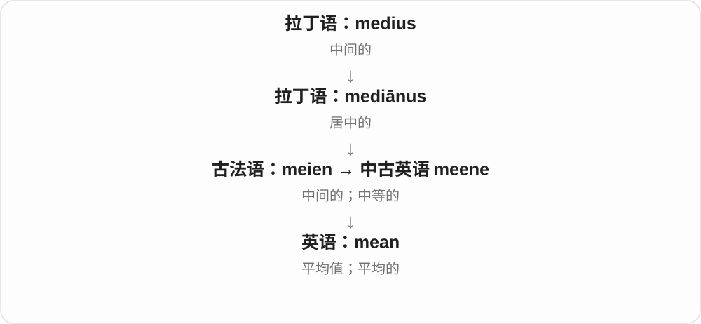

# 0070 · -ie — 亲昵称呼、小称；口语化的人、物名称

[逐词精讲目录](../00_逐词精讲目录.md) · [总目录](../00_总目录_按常用程度.md)

## 核心词根与来源

有些像给词换上一种熟人口气，有些则已经成了常用名词。goalie 不表示小球门，rookie 不一定是小孩子，meanie 还有孩子气的责怪。先看整个词指什么，再判断语气。

**-IE：把词说得更顺口、亲近，但未必都可爱**

self → selfie 自拍；cab → cabbie 出租车司机；best → bestie 死党；blanket 缩成 blankie 小毯子。有人、物，也有整个短语缩短的结果。

- **自己、独立创作与初来者**：selfie · independent · indie · rookie
- **食物与澳式烧烤**：vegetable · vegetarian · veggie · barbie · blondie
- **金发词形与随意昵称**：blond · blonde · blondie
- **人物关系和职业**：goal · goalie · cab · cabbie · best · bestie · roommate · roomie · bookmaker · bookie
- **亲昵、孩子气与软软的物品**：budgie · mean · meanie · plush · plushie · blanket · blankie
- **短活动与文化标签**：quickie · yuppie
- **一些熟悉的已固定词**：movie · cookie · hoodie · sweetie · foodie · freebie
- **blank 与 blanket：同一白色词的不同发展**：blank · blanket
- **vegetable → vegetables → veggie：蔬菜与口语缩短**：vegetable · vegetables
- **blanket → blankets：白色毛织物到覆盖物**：blanket · blankets
- **-ie 小称、熟称的衣物名及复数**：hoodie · hoodies · beanie · beanies
- **bookies：bookmaker 的口语短称**：bookie · bookies
- **self + -ie → selfie → selfies：自拍及复数**：selfie · selfies
- **vegetable → veggie → veggies：蔬菜的口语称呼**：veggie · veggies

## 词形与演化规律

是 -y 小称、爱称类用法的常见拼写变体，早期在苏格兰语、苏格兰英语昵称中已有使用，后来广泛用于口语普通名词；更早来源的具体融合有不同解释，不与 rainy 形容词尾完全混同。常见先缩短再接尾：independent → indie、goalkeeper → goalie、budgerigar → budgie、blanket → blankie。cab → cabbie 有双写。cookie 借荷兰语 koekje 小糕点等材料，不是英语 cook 厨师直接加 -ie；rookie 的确切来源仍有争议。

blank 接法语 blanc 白，blanket 接其小称、白色毛织物名称；现代 blanket 不必是白色，也不是空白加通用 et。

能生长、有生命的旧词义，后来常用于可食用植物的蔬菜义。

法语 blanc 相关名称借入，现代毯子不限白色。

hoodie 用帽兜特征命名；beanie 接 bean 的头部俚语；复数都在完整 -ie 后加 -s。

bookie 是 bookmaker 博彩用法的缩短形式并带 -ie，bookie 以 -ie 结尾，直接加 -s 写 bookies。

self 自己 + 口语名词后缀 -ie → selfie 自拍；现代 selfies 直接在已经写成 -ie 的词后加 s，不是把一个不存在的 selfy 当作实际来源。

veggie 缩短 vegetable 并采用 -ie 等口语名词形式；veggies 直接在已以 ie 结尾的词后加 s，不再多套一遍 y 变 i。这里先学常用的蔬菜义。

## 单词速览（按词族由简到繁）

同一基础词的相关扩展放在一起，先读基础形式，再读扩展；各组之间优先读常用的。具体词源关系见各词讲解。

| 单词 | 音标 | 核心意思 |
|---|---|---|
| [best](#w-88) | /best/ | 最好的；最好地；最大努力；胜过〔动词〕 |
| [mean](#w-89) | /miːn/ | 平均值；中间的；另有表示、打算及刻薄义 |
| [meanie](#w-57) | /ˈmiːni/ | 讨厌鬼；刻薄、小气的人〔儿童式口语〕 |
| [self](#w-90) | /self/ | 自我；本人、自己这一身份或状态 |
| [selfie](#w-6) | /ˈselfi/ | 自拍照 |
| [selfies](#w-110) | 英、美 /ˈselfiz/ | 自拍照〔复数〕 |
| [movie](#w-1) | /ˈmuːvi/ | 电影；影片 |
| [goal](#w-91) | 英 /ɡəʊl/；美 /ɡoʊl/ | 目标；球门；进球得分 |
| [quick](#w-92) | /kwɪk/ | 快的；迅速的；反应灵敏的；活的〔旧义〕 |
| [quickie](#w-38) | /ˈkwɪki/ | 匆忙完成的短事、快作；短暂性行为〔口语〕 |
| [independent](#w-93) | 英、美 /ˌɪndɪˈpendənt/ | 独立的；自主的；不受相关一方控制的；无党派人士 |
| [vegetable](#w-97) | /ˈvedʒtəbəl/ | 蔬菜；植物的〔部分搭配〕 |
| [vegetables](#w-105) | /ˈvedʒtəbəlz/ | 蔬菜〔vegetable 的复数〕 |
| [vegetarian](#w-99) | 英 /ˌvedʒɪˈteəriən/；美 /ˌvedʒəˈteriən/ | 素食者；素食的、不含肉类的 |
| [blank](#w-104) | /blæŋk/ | 空白的、未填写的；茫然的；空白处；一时想不起来〔动词〕 |
| [blanket](#w-94) | /ˈblæŋkɪt/ | 毯子；覆盖层；全面的；覆盖 |
| [blankets](#w-106) | /ˈblæŋkɪts/ | 毯子；覆盖层〔复数〕；全面覆盖〔第三人称单数〕 |
| [blankie](#w-85) | /ˈblæŋki/ | 小毯子、安抚毯〔儿童式口语〕 |
| [rookie](#w-2) | /ˈrʊki/ | 新手；新兵；职业队新人 |
| [cookie](#w-3) | /ˈkʊki/ | 曲奇、甜饼〔美式〕；网站小型数据记录 |
| [blonde](#w-95) | 英 /blɒnd/；美 /blɑːnd/ | 金发的；金发女性〔常见名词用法〕 |
| [indie](#w-4) | /ˈɪndi/ | 独立制作的；独立音乐、电影等；独立创作者、公司 |
| [cab](#w-96) | /kæb/ | 出租车；驾驶室 |
| [cabbie](#w-45) | /ˈkæbi/ | 出租车司机〔口语〕 |
| [roommate](#w-98) | /ˈruːmˌmeɪt/ | 室友；同住者〔尤美式〕 |
| [barbecue](#w-100) | 英 /ˈbɑːbɪkjuː/；美 /ˈbɑːrbɪkjuː/ | 烧烤；烧烤炉；烧烤聚会；烧烤食物 |
| [sweetie](#w-8) | /ˈswiːti/ | 亲爱的；可爱、讨人喜欢的人；糖果〔英式〕 |
| [barbie](#w-9) | 英 /ˈbɑːbi/；美 /ˈbɑːrbi/ | 烧烤炉；烧烤聚会〔澳式口语等〕 |
| [blond](#w-101) | 英 /blɒnd/；美 /blɑːnd/ | 金色头发的；浅金色的；金发者 |
| [blondie](#w-26) | 英 /ˈblɒndi/；美 /ˈblɑːndi/ | 金发者的随意昵称；浅色布朗尼式甜点 |
| [goalie](#w-11) | 英 /ˈɡəʊli/；美 /ˈɡoʊli/ | 守门员〔口语〕 |
| [veggie](#w-19) | /ˈvedʒi/ | 蔬菜〔口语，常复数〕；素食的；素食者〔口语〕 |
| [veggies](#w-111) | 英、美 /ˈvedʒiz/ | 蔬菜〔口语复数〕 |
| [hoodie](#w-12) | /ˈhʊdi/ | 连帽卫衣 |
| [hoodies](#w-107) | /ˈhʊdiz/ | 连帽上衣、连帽卫衣〔复数〕 |
| [plush](#w-102) | /plʌʃ/ | 长毛绒；毛绒的；豪华舒适的 |
| [plushie](#w-73) | /ˈplʌʃi/ | 毛绒玩具〔口语〕 |
| [cutie](#w-14) | /ˈkjuːti/ | 可爱的人、小可爱；可爱的动物〔口语〕 |
| [auntie](#w-15) | /ˈɑːnti/ 或 /ˈænti/ | 阿姨、姑姨等的亲昵称呼；〔部分文化〕熟悉的女性长辈 |
| [junkie](#w-16) | /ˈdʒʌŋki/ | 〔贬称〕吸毒成瘾者；〔口语、夸张〕对某事着迷的人 |
| [birdie](#w-17) | 英 /ˈbɜːdi/；美 /ˈbɜːrdi/ | 小鸟〔儿语、爱称〕；小鸟球〔高尔夫，低于标准杆一杆〕 |
| [homie](#w-18) | 英 /ˈhəʊmi/；美 /ˈhoʊmi/ | 哥们；熟人；同乡伙伴〔俚语〕 |
| [smoothie](#w-21) | /ˈsmuːði/ | 果昔、浓果蔬饮；圆滑、善于讨好的人 |
| [brownie](#w-22) | /ˈbraʊni/ | 布朗尼巧克力点心；家务小精灵〔民间故事〕 |
| [foodie](#w-25) | /ˈfuːdi/ | 美食爱好者 |
| [hottie](#w-27) | 英 /ˈhɒti/；美 /ˈhɑːti/ | 性感迷人的人；口语称呼 |
| [beanie](#w-28) | /ˈbiːni/ | 贴头小帽；常指针织便帽 |
| [beanies](#w-108) | /ˈbiːniz/ | 贴头便帽、毛线帽〔复数〕 |
| [bookmaker](#w-103) | 英 /ˈbʊkmeɪkə/；美 /ˈbʊkmeɪkər/ | 博彩经营者；制书者〔历史或特定语境〕 |
| [bookie](#w-42) | /ˈbʊki/ | 收受赌注、开赔率的经纪人、庄家〔口语〕 |
| [bookies](#w-109) | /ˈbʊkiz/ | 接收投注、经营赌注业务的人或机构〔口语复数〕 |
| [kiddie](#w-29) | /ˈkɪdi/ | 小孩〔亲昵口语〕；儿童用的〔作修饰语〕 |
| [freebie](#w-31) | /ˈfriːbi/ | 赠品；免费得到的东西〔口语〕 |
| [goodie](#w-37) | /ˈɡʊdi/ | 好吃的小东西；小礼物；故事里的好人〔口语〕 |
| [wheelie](#w-41) | /ˈwiːli/ | 翘前轮行驶的动作 |
| [groupie](#w-43) | /ˈɡruːpi/ | 狂热追随明星的人；追随乐队的粉丝〔口语，可能贬〕 |
| [oldie](#w-44) | 英 /ˈəʊldi/；美 /ˈoʊldi/ | 老歌；老片、旧物；老人〔口语〕 |
| [bestie](#w-47) | /ˈbesti/ | 最好的朋友；死党〔口语〕 |
| [techie](#w-51) | /ˈteki/ | 技术人员、技术爱好者〔口语〕 |
| [baddie](#w-52) | /ˈbædi/ | 坏人；反派〔非正式〕 |
| [budgie](#w-53) | /ˈbʌdʒi/ | 虎皮鹦鹉〔口语〕 |
| [roadie](#w-54) | 英 /ˈrəʊdi/；美 /ˈroʊdi/ | 乐队巡演的器材、舞台等工作人员〔口语〕 |
| [roomie](#w-55) | /ˈruːmi/ | 室友〔口语，尤美式〕 |
| [yuppie](#w-62) | /ˈjʌpi/ | 雅皮士；追求体面消费的年轻城市专业人士 |
| [normie](#w-63) | 英 /ˈnɔːmi/；美 /ˈnɔːrmi/ | 普通人；主流圈外人〔俚语〕 |
| [softie](#w-65) | 英 /ˈsɒfti/；美 /ˈsɔːfti/ | 心肠软的人；感情丰富、容易心软的人 |
| [baggie](#w-67) | /ˈbæɡi/ | 小塑料袋〔口语〕 |
| [townie](#w-76) | /ˈtaʊni/ | 城镇本地人；大学城中的当地居民，口语 |
| [nightie](#w-82) | /ˈnaɪti/ | 睡裙〔口语〕 |
| [preemie](#w-84) | /ˈpriːmi/ | 〔口语，尤美〕早产儿 |

## 逐词讲解

### 1. best — 最好的；最好地；最大努力；胜过〔动词〕

**音标**：/best/

**先抓住这个画面**

把正在比较的一组放在一起，挑出最符合当前标准的那个。

**怎么拆**

古英语 betest、betst 等最高级形式，接与 better 相关的词族；不是 good + -est。它早已与 good、well 配套，后来又有名词和动词用法。

**怎么变成今天的意思**

**古英语 betest／betst 等最高级形式**  
与 better 同属比较词族，而不是 good 的加尾形式

↓

**英语 best**  
最好的、最好地；名词最强表现，后来也可作胜过的动词

the best option 要有比较范围；do your best 是尽最大努力。best a rival 是击败对手，属于较书面用法。best wishes 则是祝愿语，不是在给祝福排名。

**常见搭配与例句**

the best choice；do your best；at best；a personal best；best wishes。

> This is the best route if we want to avoid traffic.

如果想避开拥堵，这就是最好的路线。

> She did her best even though the equipment was unfamiliar.

虽然不熟悉设备，她还是尽了最大努力。

**别混淆**

better 只要求更好，best 在所谈范围中最高；at best 常说至多、充其量，与 at your best 状态最佳不同。

### 2. mean — 平均值；中间的；另有表示、打算及刻薄义

**音标**：/miːn/

**先抓住这个画面**

本页先抓“平均”这一支：把高低不同的数放到一条线上，用一个中间水平概括它们。mean 的其他常用意思来自另外的词源。

**怎么拆**

平均义经古法语 meien 来自拉丁语 mediānus“在中间的”。动词 mean“表示、打算”来自古英语 mǣnan；刻薄义来自古英语表示“普通、低下”的词族。

**怎么变成今天的意思**

“中间水平”成为数学平均值。不能把 I mean it 或 a mean person 都讲成“在中间”：这些同形词走的是不同历史路线。

**常见搭配与例句**

the mean temperature；calculate the mean；What do you mean?；mean to do something。

> The mean of two, three and ten is five.

二、三和十的算术平均值是五。

> I did not mean to interrupt you.

我不是有意打断你的。

**别混淆**

mean 通常指加总后除以数量的算术平均值；median 是排序后居中的值。2、3、10 的 mean 是 5，median 是 3。

### 3. meanie — 讨厌鬼；刻薄、小气的人〔儿童式口语〕

**音标**：/ˈmiːni/

**先抓住这个画面**

不让别人加入游戏，或故意不分享，小孩可能气呼呼叫他 meanie。常是带孩子气的责怪，不是很正式的性格分析。

**怎么拆**

mean 刻薄、不友善的这一形容词义 + -ie；与数学平均值 mean 无关。

**怎么变成今天的意思**

**mean 的不友善、吝啬等义**  
待人不厚道

↓

**mean + -ie → meanie**  
带孩子气的讨厌鬼、小气鬼称呼

Don’t be a meanie. 别这么小气、讨厌；you meanie! 你这个讨厌鬼！语气可认真也可玩笑。

**常见搭配与例句**

a meanie；don’t be a meanie。

> Don’t be a meanie; let him join the game.

别这么小气，让他一起玩吧。

> She called her brother a meanie for hiding the toy.

哥哥藏起玩具，她就叫他讨厌鬼。

**别混淆**

meanie 不是所有 mean 的义项都通用：a mean value 平均值不会变成数学上的 meanie。

### 4. self — 自我；本人、自己这一身份或状态

**音标**：/self/

**先抓住这个画面**

说某人真实的性格、平常状态，或把目光回到那个人本身，就会谈到 self。her old self 是她原先熟悉的那种状态。

**怎么拆**

延续古英语 self、sylf 等本人、相同、自己的材料。旧时可跟在人称词后面加强本人义，后来形成 myself、herself 等反身、强调形式。复数 selves。

**怎么变成今天的意思**

**古英语 self、sylf**  
本人、自己的、同一个

↓

**现代 self；myself 等**  
自我；反身、强调的复合词材料

a sense of self 自我感；your true self 真实自我；be your old self 恢复平常的状态。

**常见搭配与例句**

a sense of self；her true self。

> After a good night’s sleep, she felt like her old self again.

睡好一晚后，她又恢复了平常的状态。

> The story explores the character’s sense of self.

故事探索角色的自我感。

**别混淆**

self 可作名词谈自我；普通句子里我自己常用 myself。I taught myself 是我自学，不能直接写 I taught self 来替换。

### 5. selfie — 自拍照

**音标**：/ˈselfi/

**先抓住这个画面**

自己举起相机或手机，把自己拍进画面，得到的照片叫 selfie；和朋友一起也能拍一张合照式自拍。

**怎么拆**

self 自己 + -ie，二十一世纪初在澳式英语中已有记录，后来广泛流行。这里 -ie 让名词口语化，不表示照片尺寸小。

**怎么变成今天的意思**

**self + -ie**  
自己相关的口语名词构词

↓

**selfie**  
通常由画中人自己拍摄的照片

take a selfie 拍自拍；a group selfie 集体自拍。

**常见搭配与例句**

take a selfie；a group selfie。

> We took a selfie in front of the station.

我们在车站前拍了张自拍合照。

> She sent me a selfie from the mountain summit.

她从山顶发来一张自拍。

**别混淆**

selfie 通常强调自己拍自己，portrait 是肖像；别人替你拍的普通肖像照不自动叫 selfie。

### 6. selfies — 自拍照〔复数〕

**音标**：英、美 /ˈselfiz/

**先抓住这个画面**

把镜头对向自己拍出的照片，是 selfies。几个人一起自拍也可以叫 selfies，并不要求每张只能出现一个人。

**怎么拆**

self 自己 + -ie 口语名词后缀 → selfie；selfie + -s → selfies，基础词已以 ie 结尾，直接加 s，词尾 /iz/。

**怎么变成今天的意思**

**self 自己 + -ie → selfie 自拍**  
口语名词构词，拍摄者也在照片中

↓

**selfie + -s → selfies**  
复数直接加 s；不漏 -ie，也不误用 y 变 i 的规则

take selfies 是自拍；group selfies 是多人自拍照；holiday selfies 是旅行自拍照。

**常见搭配与例句**

take selfies；group selfies；holiday selfies。

> We took selfies by the lake.

我们在湖边拍了自拍照。

> Her phone is full of holiday selfies.

她的手机里全是旅行自拍照。

**别混淆**

photos 泛指照片，selfies 则说明拍摄者把自己也拍了进去；别人替你拍的普通人像不因只有你一人就自动是自拍。

### 7. movie — 电影；影片

**音标**：/ˈmuːvi/

**先抓住这个画面**

一张张画面连起来像在动，moving picture 的活动画面就被缩短叫 movie。

**怎么拆**

从 moving picture 的 moving 缩短，再加昵称式 -ie 形成，先在美式英语常见。不是 move 加表示人的后缀。

**怎么变成今天的意思**

**moving picture 活动画面 → movie**  
moving 的缩短昵称式表达

↓

**现代 movie**  
电影、影片；美式尤常见

watch a movie 看电影，go to the movies 去看电影，a movie star 电影明星；英式 film 也很常见。

**常见搭配与例句**

watch a movie；go to the movies；a movie star；a movie theatre。

> We watched a movie after dinner.

晚饭后，我们看了一部电影。

> Do you want to go to the movies this weekend?

你这周末想去看电影吗？

**别混淆**

movie 与 film 很多场景可互换，film 还能指胶片、薄膜；movie 不泛指一切会动的东西。

### 8. goal — 目标；球门；进球得分

**音标**：英 /ɡəʊl/；美 /ɡoʊl/

**先抓住这个画面**

你要到达的终点，是目标；球要送进的地方是球门；成功送进去的得分也叫 goal。

**怎么拆**

中古英语 gol 有边界、界限义，后用于竞赛终点与目标；更远的障碍、标记词联系有不确定性，不强作定论。

**怎么变成今天的意思**

**中古英语 gol 边界、界限 → goal**  
赛程终点、目标位置；更远来源不确定

↓

**现代 goal**  
球门、进球；想达成的结果

set a goal 设定目标，achieve a goal 达成目标，score a goal 进球，in goal 担任门将。

**常见搭配与例句**

set a goal；achieve a goal；score a goal；in goal。

> Our goal is to make the service easier to use.

我们的目标是让服务更好用。

> She scored the winning goal.

她打进了制胜球。

**别混淆**

goal 想达成的结果，plan 达到结果的安排；一个 goal 可有多种 plan。goal 与同音近音的 go 不按现代加 l 造义。

### 9. quick — 快的；迅速的；反应灵敏的；活的〔旧义〕

**音标**：/kwɪk/

**先抓住这个画面**

人一有反应就马上动起来，一件事没多久就做完；快是今天的中心，活着是旧起点。

**怎么拆**

继承古英语 cwic 活着、有生命，后来活跃、敏捷义走向迅速。旧活义还留在 quicksand、quicksilver 等组合里。

**怎么变成今天的意思**

**古英语 cwic → 中古英语 quik**  
活着的、有生命的；敏捷的

↓

**现代 quick**  
有活力、反应灵 → 快、耗时短

a quick reply 迅速回复，a quick learner 学得快的人，a quick look 快速看一眼，be quick to do 很快就做。

**常见搭配与例句**

a quick reply；a quick learner；a quick look；quick to do。

> Thanks for your quick reply.

谢谢你迅速回复。

> She is quick to notice changes in tone.

她很快就能注意到语气变化。

**别混淆**

quick 常强调响应快、耗时短，fast 更常说持续运动速度高；用法有重合，不能每句机械互换。

### 10. quickie — 匆忙完成的短事、快作；短暂性行为〔口语〕

**音标**：/ˈkwɪki/

**先抓住这个画面**

核心是短时间、很快来一下：作品、活动可这样称呼；但单独说 have a quickie 很容易让人想到短暂性行为，不能随便当成开短会的普通邀约。

**怎么拆**

quick 快 + -ie；将快的性质变成一件快速完成的事。具体所指受场景影响很大。

**怎么变成今天的意思**

**quick + -ie**  
快 → 快做的一件事

↓

**quickie 的不同口语用法**  
快作、短活动；也有性行为义

a quickie sketch 随手快画；a quickie meeting 可指短会，但工作场景直接说 a quick meeting 更清楚。

**常见搭配与例句**

a quickie；a quickie sketch。

> The meeting was a quickie, over in ten minutes.

这场会开得很短，十分钟就结束了。

> The sketch was only a quickie, not a finished design.

这张草图只是快速画的一笔，并非完成的设计。

**别混淆**

quickie 是口语名词，不是 quick 的普通副词；做得快用 do it quickly，不写 do it quickie。

### 11. independent — 独立的；自主的；不受相关一方控制的；无党派人士

**音标**：英、美 /ˌɪndɪˈpendənt/

**先抓住这个画面**

自己站得住，或者能作判断而不受某个外部控制者牵着走。独立总要看“相对于谁、在哪方面”。

**怎么拆**

in-“不”+ dependent，英语近代形成的否定形容词；法语 indépendant 等有平行形式。in- 不是“进入”，所以不是“向里依赖”。

**怎么变成今天的意思**

**拉丁 pendēre；相关动词 pendere**  
悬垂；使悬挂、称量

↓

**拉丁 dependere 的分词 dependens；法语 dependant**  
依附、依赖的

↓

**英语 dependent／名词也拼 dependant**  
需要依靠的；受供养的人

↓

**英语 in-“不”+ dependent → independent**  
不依赖、能自主；法语也有相应形式

financially independent 是经济独立；an independent review 是由与被审查方有适当独立性的一方作评估。独立不等于永远不合作，也不保证每个判断必定正确。

**常见搭配与例句**

independent of；an independent company；independent research；an independent candidate。

> She wants to become financially independent.

她想在经济上独立。

> An independent team reviewed the findings.

一个独立团队复核了这些发现。

**别混淆**

alone 是独自一个人；independent 是自主、不依赖或不受控制。有人相伴仍可以 independent，独处也不一定自主。

### 12. vegetable — 蔬菜；植物的〔部分搭配〕

**音标**：/ˈvedʒtəbəl/

**先抓住这个画面**

做饭时说 vegetables，通常是一盘菜里的青菜、胡萝卜等蔬菜。把它从植物这个大类别里分化出来，才有今天最熟悉的食物义。

**怎么拆**

经法语接拉丁 vegetabilis 能生长、活着的，接 vegetare 使有活力等材料。虽然尾部像 -able，现代不是一个常用英语 veget 动词再临时拼成。

**怎么变成今天的意思**

**拉丁 vegetabilis → 法语 vegetable → 英语 vegetable**  
能生长、有生命的植物等旧义

↓

**现代 vegetable → veggie**  
蔬菜；缩短成口语称呼

↓

**vegetarian 也可缩短为 veggie**  
素食者、素食的相关口语用法

fresh vegetables 新鲜蔬菜；vegetable soup 蔬菜汤；vegetable oil 植物油，范围比日常一盘蔬菜更广。

**常见搭配与例句**

fresh vegetables；vegetable soup。

> The soup contains several kinds of vegetables.

汤里有好几种蔬菜。

> They grow fresh vegetables behind the house.

他们在房后种新鲜蔬菜。

**别混淆**

vegetable 蔬菜与 vegetarian 素食者、素食的不同；吃一顿蔬菜的人不自动就是长期素食者。

### 13. vegetables — 蔬菜〔vegetable 的复数〕

**音标**：/ˈvedʒtəbəlz/

**先抓住这个画面**

胡萝卜、豆子、青菜等作为食物的植物部分，日常常归在 vegetables 这一类。这个词的早期范围更广，曾与能生长、有生命的植物有关。

**怎么拆**

vegetable + -s，/l/ 后读 /z/。vegetable 经法语接拉丁 vegetābilis 能生长、活着的，关联 vegetāre 使有活力；后来蔬菜义成为常见核心。

**怎么变成今天的意思**

**拉丁 vegetāre、vegetābilis → 法语、英语 vegetable**  
有活力、能生长 → 植物相关

↓

**vegetable + -s → vegetables**  
多种蔬菜；通常指可食用植物部分

fresh vegetables 新鲜蔬菜；root vegetables 根类蔬菜；green vegetables 绿色蔬菜；fruit and vegetables 水果与蔬菜。

**常见搭配与例句**

grow vegetables；a basket of vegetables。

> The basket contained fresh vegetables from the garden.

篮子里装着花园里采来的新鲜蔬菜。

> They grow vegetables behind the house.

他们在屋后种蔬菜。

**别混淆**

vegetables 是可数复数；fruit 在统称水果时常不可数。日常食物分类与植物学的果实分类并不完全一样，要看是在谈饮食还是植物结构。

### 14. vegetarian — 素食者；素食的、不含肉类的

**音标**：英 /ˌvedʒɪˈteəriən/；美 /ˌvedʒəˈteriən/

**先抓住这个画面**

把不吃动物肉类作为饮食方式的人；菜单上 vegetarian dish 则指给这种饮食方式准备的菜。

**怎么拆**

由 vegetable 植物、蔬菜的部分词干加 -arian 类推形成，不是把完整 vegetable 原样再粘尾巴。后来随素食社团发展广泛使用；不必把来源改讲成单独由拉丁 vegetus 健康造词。

**怎么变成今天的意思**

**拉丁 -ārius/-āriānus 等相关词尾**  
与某事有关；相关的人或立场

↓

**英语 -arian 的借入、类推构词**  
职业身份、思想立场、生活原则；也可作形容词

↓

**vegetable 的词干 + -arian → vegetarian**  
以素食方式生活的人；相应饮食的

a vegetarian diet 素食饮食，a vegetarian meal 素餐，be a vegetarian 是素食者。通常不吃肉、鱼，蛋奶是否包含要看具体类型。

**常见搭配与例句**

a vegetarian diet；a vegetarian meal；a vegetarian option。

> The restaurant offers several vegetarian dishes.

餐馆提供几道素菜。

> My sister is a vegetarian, so we made a meal without meat or fish.

姐姐吃素，所以我们做了不含肉和鱼的一餐。

**别混淆**

vegetarian 不自动等于 vegan：后者对动物来源制品有更广的排除。vegetarian 也不是只吃叶菜，谷物、豆类等都可在其饮食中。

### 15. blank — 空白的、未填写的；茫然的；空白处；一时想不起来〔动词〕

**音标**：/blæŋk/

**先抓住这个画面**

纸上本该有内容的地方还空着，是 blank；别人问你问题，脑子里一时什么也抓不到，也可说 your mind went blank。

**怎么拆**

经古法语 blanc 白、发亮，较早接日耳曼语白亮词。英语先有白、无色义，后来突出未写内容的空白，再用于无表情、想不起来的状态。

**怎么变成今天的意思**

**日耳曼语白亮词 → 法语 blanc → blank**  
白、浅色、无色

↓

**未写内容的白面 → 空白及比喻**  
未填、未记录；表情或头脑一时无内容

a blank page 空白页；leave it blank 留空；a blank expression 茫然表情；fill in the blanks 填空；draw a blank 一无所获、想不起来。

**常见搭配与例句**

go blank；a blank screen。

> Please leave this section blank.

这一栏请留空。

> My mind went blank when I stood up to speak.

我站起来发言时，脑子突然一片空白。

**别混淆**

blank 强调预期内容缺失，empty 更广地说里面没有东西。a blank page 可以有纸张颜色，关键是还没有相应内容。

### 16. blanket — 毯子；覆盖层；全面的；覆盖

**音标**：/ˈblæŋkɪt/

**先抓住这个画面**

先是一条盖在身上的毯子。雾像毯子铺满山谷，可以作动词 blanket；规定把所有情况一概罩住，就有 blanket ban 全面禁令。

**怎么拆**

经古北法语相应形式，历史关联 blanc 白与白色毛织物名称；不是现代 blank 空白直接加一个万能 et。

**怎么变成今天的意思**

**古北法语 blanket、blancet 等**  
白色毛织物、小白物等旧名称，关联 blanc 白

↓

**英语 blanket**  
毯子；像毯子一样全面覆盖

↓

**blanket 缩短 + -ie → blankie**  
毯子的儿童式、亲昵称呼

a woollen blanket 羊毛毯；a blanket of snow 一层覆盖的雪；a blanket ban 全面禁令；fog blankets the valley 雾覆盖山谷。

**常见搭配与例句**

a warm blanket；a blanket of；a blanket ban。

> She wrapped a blanket around her shoulders.

她把毯子裹在肩上。

> A thick fog blanketed the valley.

浓雾笼罩了山谷。

**别混淆**

blanket 说毯子或全面覆盖，sheet 常说薄床单、片；两种床品、材料形态不同。

### 17. blankets — 毯子；覆盖层〔复数〕；全面覆盖〔第三人称单数〕

**音标**：/ˈblæŋkɪts/

**先抓住这个画面**

把人或物一大片盖住的毯子，是 blankets。雪、雾等把一个地方全罩住，也像盖上毯子，动词可以用 blankets。

**怎么拆**

blanket 经古北法语 blanket、blancet 等，历史关联 blanc 白和白色毛织物名称。英语毯子义发展全面覆盖的比喻；现代加 -s，/t/ 后读 /s/。

**怎么变成今天的意思**

**法语白色毛织物名称 → blanket**  
布料 → 毯子、大片覆盖层

↓

**blanket + -s → blankets**  
多条毯子；某物全面盖住

warm blankets 保暖毯；blankets of snow 大片积雪；snow blankets the fields 雪覆盖田野。

**常见搭配与例句**

fold the blankets 叠毯子；blankets the town 笼罩全镇。

> Clean blankets were folded on the shelf.

干净毯子叠放在架子上。

> In the final scene, snow blankets the village.

最后一幕里，雪覆盖了整个村庄。

**别混淆**

blankets 的现代毯子义不限白色。动词通常比 cover 更突出一大片、全面铺开的覆盖感。

### 18. blankie — 小毯子、安抚毯〔儿童式口语〕

**音标**：/ˈblæŋki/

**先抓住这个画面**

小孩总抱着、睡觉离不开的那条毯子，家里可能亲昵地叫 blankie。重点是孩子气、亲近的称呼，不是一个正式材质分类。

**怎么拆**

blanket 缩短，接 -ie → blankie；不是 blank 空白直接加 ie 就自动得到毯子。

**怎么变成今天的意思**

**古北法语 blanket、blancet 等**  
白色毛织物、小白物等旧名称，关联 blanc 白

↓

**英语 blanket**  
毯子；像毯子一样全面覆盖

↓

**blanket 缩短 + -ie → blankie**  
毯子的儿童式、亲昵称呼

a child’s blankie 孩子的安抚毯；bring your blankie 带上你的小毯子。

**常见搭配与例句**

a favourite blankie；a baby’s blankie。

> The toddler would not sleep without his blankie.

那个小孩没有小毯子就不肯睡。

> She packed the baby’s favourite blankie.

她装上了宝宝最喜欢的小毯子。

**别混淆**

blankie 比 blanket 更儿童式、亲昵；正式产品说明通常还会用 blanket，不把每条成人毯子都这样叫。

### 19. rookie — 新手；新兵；职业队新人

**音标**：/ˈrʊki/

**先抓住这个画面**

刚进这行、还在熟悉门道的人，口语可叫 rookie。球队里常说新人赛季，并不表示这个人从来没练过这项运动。

**怎么拆**

十九世纪已有新兵义，确切来源未定；有 recruit 新兵、rook 的某些旧用法等解释。不能因为末尾 -ie 就把 rook 乌鸦 + 小可爱讲成确定词源。

**怎么变成今天的意思**

**十九世纪 rookie、rookey 等**  
新兵；确切词源有分歧

↓

**现代 rookie**  
新手、刚进入某职业或队伍的人

a rookie mistake 新手常犯的错；a rookie season 新人赛季；a rookie driver 新手司机。

**常见搭配与例句**

a rookie mistake；a promising rookie。

> I made a rookie mistake and forgot to save the file.

我犯了个新手错误，忘了保存文件。

> The team signed a promising rookie.

球队签下了一位很有潜力的新人。

**别混淆**

rookie 说在这个领域、级别的新手，amateur 说业余者。职业新人可以是 rookie，同时已不是 amateur。

### 20. cookie — 曲奇、甜饼〔美式〕；网站小型数据记录

**音标**：/ˈkʊki/

**先抓住这个画面**

吃的是小甜饼，浏览器里的 cookie 则是网站保存、读取的一小份数据；两种场景先分清。

**怎么拆**

借荷兰语 koekie、koekje 等 cake 小称形式，不能拆成英语 cook + -ie。计算机义接 magic cookie 等既有技术比喻，不由烤饼工序直接推到网页。

**怎么变成今天的意思**

**荷兰语 koek〔饼〕+ 小称形式 → cookie**  
小饼；不是英语 cook 加后缀

↓

**技术比喻 magic cookie 等 → 网络 cookie**  
小型数据记录的专门名称

a chocolate chip cookie 巧克力豆曲奇，accept cookies 接受网站 cookie，delete cookies 删除相关浏览数据。

**常见搭配与例句**

a chocolate chip cookie；accept cookies；delete cookies。

> She offered me a chocolate chip cookie.

她给了我一块巧克力豆曲奇。

> The website uses a cookie to remember your language choice.

网站用一份 cookie 记住你的语言选择。

**别混淆**

cookie 在本页是形似辨析，不是 cook 后代。网络 cookie 不是程序、病毒的统一名称，也不保证每份都只记录同一种信息。

### 21. blonde — 金发的；金发女性〔常见名词用法〕

**音标**：英 /blɒnd/；美 /blɑːnd/

**先抓住这个画面**

和 blond 读音相同；a blonde 尤常指金发女性，作形容词也可见 blonde hair。末尾 e 常承接法语性别拼写传统。

**怎么拆**

来自法语 blond 的相应阴性形式 blonde，英语保留两种常用拼写；现代用法有地区、文体差异，不是两个不同颜色。

**怎么变成今天的意思**

**古法语 blond 等 → 英语 blond、blonde**  
浅黄、金发的材料；更远来源有不同解释

↓

**blond + -ie → blondie**  
金发者的昵称；浅色甜点的命名

blonde hair 金发；a blonde woman 金发女性；a natural blonde 天生金发者。

**常见搭配与例句**

blonde hair；a natural blonde。

> She had long blonde hair.

她留着长长的金发。

> The actor wore a blonde wig for the role.

演员为这个角色戴了金色假发。

**别混淆**

blonde 是金发相关，不是 blondie 那种随意昵称；陌生人之间按发色叫人 blondie 可能显得不礼貌。

### 22. indie — 独立制作的；独立音乐、电影等；独立创作者、公司

**音标**：/ˈɪndi/

**先抓住这个画面**

不靠大厂牌、大制片体系主导，自己或小团队按较独立方式制作、发行，常被叫 indie；后来也会指某种文化风格。

**怎么拆**

independent 缩短后加 -ie；不是 India 印度、Indian 印度人的任意简写。

**怎么变成今天的意思**

**independent**  
独立的、不依附的

↓

**缩短 + -ie → indie**  
独立制作、相应音乐电影和创作者等

an indie film 独立电影；indie music 独立音乐；an indie developer 独立开发者。

**常见搭配与例句**

an indie game；an indie label。

> She directed a small indie film.

她执导了一部小成本独立电影。

> The festival supports indie game developers.

这个节日活动支持独立游戏开发者。

**别混淆**

indie 不等于 amateur 业余；独立团队也可以技术成熟、商业成功。具体是否独立要看制作、发行等语境。

### 23. cab — 出租车；驾驶室

**音标**：/kæb/

**先抓住这个画面**

坐车时常指出租车；谈卡车、火车时，通常是司机坐的那一间。

**怎么拆**

交通工具义是 cabriolet 的缩短形式。cabriolet 原为轻便马车名，远处连着山羊跳跃的词族；现代 cab 已不包含“山羊”的意思。

**怎么变成今天的意思**

**拉丁语 caper、capreolus**  
山羊；野山羊等动物名称

↓

**意大利语 capriola、capriolare**  
像小山羊那样的跳跃；跃起

↓

**法语 cabriole → cabriolet**  
跳跃 → 轻便马车的名称

↓

**英语 cabriolet**  
轻便马车；后来也指敞篷汽车

↓

**英语 cab**  
cabriolet 的简称；扩展到出租车和驾驶室

车辆换了时代，名称留下来了：先是马车，再是出租汽车。另一路把车辆中供司机操作的部分叫 cab，所以 a truck cab 是卡车驾驶室，不能翻成卡车出租车。

**常见搭配与例句**

call a cab；take a cab；a cab driver；the cab of a truck。

> We shared a cab to the station.

我们合乘出租车去了车站。

> The driver climbed into the cab of the truck.

司机爬进了卡车驾驶室。

**别混淆**

taxi 与出租车义 cab 很接近；cabin 可指船舱、机舱或小屋，不能把每个 cabin 都缩成 cab。音箱语境中的 cab 还可能是 cabinet 的简称，是另一条缩略路线。

### 24. cabbie — 出租车司机〔口语〕

**音标**：/ˈkæbi/

**先抓住这个画面**

路边出租车里开车的人，口语可以叫 cabbie。一个短称呼就把职业说出来。

**怎么拆**

cab 出租车 + -ie，b 双写 → cabbie；也有 cabby 的拼写，但这里用常见的 cabbie。

**怎么变成今天的意思**

**cab**  
出租车

↓

**cab + -ie → cabbie**  
开出租车的人

a friendly cabbie 友善的出租车司机；ask the cabbie for directions 向出租车司机问路。

**常见搭配与例句**

a London cabbie；a local cabbie。

> The cabbie knew a quieter route to the station.

出租车司机知道一条去车站更清静的路。

> A friendly cabbie helped us with the bags.

一位友善的出租车司机帮我们搬行李。

**别混淆**

cab 是车，cabbie 是司机；这个 -ie 不表示小出租车。

### 25. roommate — 室友；同住者〔尤美式〕

**音标**：/ˈruːmˌmeɪt/

**先抓住这个画面**

共享住宿空间的那个人；有时共一间卧室，有时只是同一套房。

**怎么拆**

room + mate（同伴）；mate 选一起生活、活动的人，不是这里只说配偶。实际发音两个 m 常连成一段。

**怎么变成今天的意思**

**room；mate**  
并列组合部分

↓

**roommate**  
共享房间或住所的人

a college roommate 大学室友。美式可用来称合租同一套房但卧室不同的人；英式 flatmate、housemate 更明确同套房、同房屋。

**常见搭配与例句**

share with a roommate；a college roommate；a former roommate。

> My roommate works at the local library.

我室友在当地图书馆工作。

> We were roommates during our first year at university.

大学一年级时，我们是室友。

**别混淆**

roommate 不自动等于 romantic partner 伴侣；也不总保证两人睡同一间卧室，要看地区和住所。

### 26. barbecue — 烧烤；烧烤炉；烧烤聚会；烧烤食物

**音标**：英 /ˈbɑːbɪkjuː/；美 /ˈbɑːrbɪkjuː/

**先抓住这个画面**

在户外烤食物，是 barbecue 的熟悉场景。这个词可以指做法、设备，也可以指大家聚在一起吃烧烤的活动。

**怎么拆**

经美洲西班牙语 barbacoa 接加勒比地区阿拉瓦克语族相关的架高木架名称；从木架、烘烤做法走到食物、聚会。不是法语从胡子到尾巴的传说式拼词。

**怎么变成今天的意思**

**加勒比地区相关木架名称 → 西班牙语 barbacoa**  
架在支柱上的木制结构等材料

↓

**英语 barbecue**  
烧烤做法、用具、食物、聚会等用法

have a barbecue 办烧烤聚会；barbecue sauce 烧烤酱；barbecue chicken 烧烤鸡肉。部分美国饮食传统还特指慢烤、烟熏等做法。

**常见搭配与例句**

have a barbecue；barbecue sauce。

> We invited the neighbours to a barbecue.

我们邀请邻居来参加烧烤聚会。

> They barbecued vegetables in the garden.

他们在花园里烤蔬菜。

**别混淆**

barbecue 可说活动、食物和炉具，grill 更常突出烤架或直接烤制；二者日常会重合，不能只由中文烧烤断定每种地方饮食都完全相同。

### 27. sweetie — 亲爱的；可爱、讨人喜欢的人；糖果〔英式〕

**音标**：/ˈswiːti/

**先抓住这个画面**

把一个让你喜欢、疼爱的人叫作小甜心；常用于孩子、伴侣，也可夸一个人真好。

**怎么拆**

sweet + 亲昵小称 -ie。这个词历史上也用于甜食、糖果；今日人称和食物义要靠语境分清。

**怎么变成今天的意思**

**古英语 swēte → 中古英语 swete → sweet**  
甜；感官愉悦、令人喜爱等义也很早

↓

**现代 sweet**  
味甜、声香悦人、待人贴心；也作赞叹

↓

**sweet + -ie → sweetie**  
亲昵的小称；甜食或讨人喜爱的人

Hi, sweetie. 亲爱的，你好。She’s a sweetie. 她是个很可爱、很好的人。对不熟悉的人这样称呼可能显得过分亲昵。

**常见搭配与例句**

Hi, sweetie；be a sweetie；a bag of sweeties。

> Come here, sweetie, and put your coat on.

亲爱的，过来把外套穿上。

> He brought a small bag of sweeties for the children.

他给孩子们带了一小袋糖果。

**别混淆**

sweetie 是亲昵称呼，不等于正式称赞一个人的专业能力；sweetheart 也是常见亲昵名词，可接着对照。

### 28. barbie — 烧烤炉；烧烤聚会〔澳式口语等〕

**音标**：英 /ˈbɑːbi/；美 /ˈbɑːrbi/

**先抓住这个画面**

澳大利亚朋友说 have a barbie，常是在约烧烤，不是在说要买一个芭比娃娃。

**怎么拆**

barbecue 缩短后加 -ie → barbie；这里是小写普通名词。大写 Barbie 的玩偶品牌来自另外的命名。

**怎么变成今天的意思**

**barbecue**  
烧烤、烧烤炉、烧烤聚会

↓

**缩短 + -ie → barbie**  
相同场景的澳式等口语说法

put food on the barbie 把食物放上烧烤炉；have a barbie 办烧烤聚会。

**常见搭配与例句**

on the barbie；have a barbie。

> We are having a barbie on Saturday.

我们周六要办烧烤聚会。

> He put the vegetables on the barbie.

他把蔬菜放上了烧烤炉。

**别混淆**

小写 barbie 的常见澳式烧烤义与大写 Barbie 玩偶名区分；这个口语词不是所有英语地区都同样常说。

### 29. blond — 金色头发的；浅金色的；金发者

**音标**：英 /blɒnd/；美 /blɑːnd/

**先抓住这个画面**

头发浅黄、金黄，可以说 blond hair；也能用作名词说金发的人。它说颜色，不表示一定染过头发。

**怎么拆**

借法语 blond。更远日耳曼语联系有多种分析，不把“混合”或“失明”的假设路线硬当成今天颜色的唯一来源。

**怎么变成今天的意思**

**古法语 blond 等 → 英语 blond、blonde**  
浅黄、金发的材料；更远来源有不同解释

↓

**blond + -ie → blondie**  
金发者的昵称；浅色甜点的命名

blond hair 金发；a blond child 金发孩子；blond wood 也可指浅金色木材。

**常见搭配与例句**

blond hair；a natural blond。

> He had blond hair when he was a child.

他小时候是金发。

> The room was furnished with pale blond wood.

房间配了浅金色木制家具。

**别混淆**

blond 与 blonde 都常见；传统用法对性别有拼写倾向，英语形容词的实际惯例并不绝对按性别划死。

### 30. blondie — 金发者的随意昵称；浅色布朗尼式甜点

**音标**：英 /ˈblɒndi/；美 /ˈblɑːndi/

**先抓住这个画面**

一条是拿金发颜色叫人的口语昵称；另一条是甜点，像 brownie，却以浅金色、香草等风味为特点，常叫 blondie。

**怎么拆**

blond + -ie；甜点借浅金色的材料命名。不是把 -ie 固定成女人，也不把每种 blondie 都理解成人。

**怎么变成今天的意思**

**古法语 blond 等 → 英语 blond、blonde**  
浅黄、金发的材料；更远来源有不同解释

↓

**blond + -ie → blondie**  
金发者的昵称；浅色甜点的命名

a batch of blondies 一盘浅色布朗尼式甜点；人的称呼义要注意熟悉程度和语气。

**常见搭配与例句**

bake blondies；a vanilla blondie。

> She baked a batch of vanilla blondies.

她烤了一盘香草味浅色布朗尼式甜点。

> The café sells brownies and blondies.

咖啡馆卖巧克力布朗尼和浅色布朗尼式甜点。

**别混淆**

blondie 是随意昵称或甜点；blonde／blond 是通常说金发的词。不要把昵称当作对所有陌生人的中性称呼。

### 31. goalie — 守门员〔口语〕

**音标**：英 /ˈɡəʊli/；美 /ˈɡoʊli/

**先抓住这个画面**

足球、冰球等比赛里负责守住球门的那个人，口语常叫 goalie。不是得分最多的人。

**怎么拆**

goalkeeper、goaltender 等缩短并加 -ie；现代能看出 goal 球门的材料，但不能只译成小目标。

**怎么变成今天的意思**

**goalkeeper、goaltender**  
守门员

↓

**缩短 + -ie → goalie**  
守门员的口语名

a football goalie 足球守门员；a hockey goalie 冰球守门员。

**常见搭配与例句**

the team’s goalie；a brilliant goalie。

> The goalie made an excellent save.

守门员作出了一次精彩扑救。

> She has played as a goalie since school.

她从上学时就开始当守门员。

**别混淆**

goalie 是守门员，goalscorer 是进球者；同有 goal，不代表职责相同。

### 32. veggie — 蔬菜〔口语，常复数〕；素食的；素食者〔口语〕

**音标**：/ˈvedʒi/

**先抓住这个画面**

菜谱里 add some veggies 是加点蔬菜；a veggie burger 是素食汉堡。它可能缩自 vegetable，也可能接 vegetarian，按场景判断。

**怎么拆**

vegetable 或 vegetarian 缩短，接 -ie；常见拼写有 gg，帮助对应 /dʒ/。不是一个字母 g 一律再读 /ɡ/。

**怎么变成今天的意思**

**拉丁 vegetabilis → 法语 vegetable → 英语 vegetable**  
能生长、有生命的植物等旧义

↓

**现代 vegetable → veggie**  
蔬菜；缩短成口语称呼

↓

**vegetarian 也可缩短为 veggie**  
素食者、素食的相关口语用法

fresh veggies 新鲜蔬菜；a veggie meal 素食餐；I’m a veggie 可是我是素食者的口语说法。

**常见搭配与例句**

roasted veggies；a veggie burger。

> Add the chopped veggies to the pan.

把切好的蔬菜倒进锅里。

> She ordered a veggie burger.

她点了一个素食汉堡。

**别混淆**

veggie、vegetarian 语境通常不自动等于 vegan 纯素；是否包含蛋奶等仍看具体食物和标识。

### 33. veggies — 蔬菜〔口语复数〕

**音标**：英、美 /ˈvedʒiz/

**先抓住这个画面**

饭桌上说多来点菜，口语可以说 more veggies。比 vegetables 短，也更随意。

**怎么拆**

vegetable 缩短后形成口语名词 veggie，采用 -ie 形式，另有 vegie 拼写；veggie + -s → veggies，原 /i/ 后接 /z/。

**怎么变成今天的意思**

**vegetable → veggie、vegie**  
截短并用口语名词形式表达蔬菜

↓

**veggie + -s → veggies**  
基础词以 ie 结尾，直接加 s，不再改一遍 y

fresh veggies 是新鲜蔬菜；roasted veggies 是烤蔬菜；fruit and veggies 是水果和蔬菜的口语说法。

**常见搭配与例句**

fresh veggies；roasted veggies；fruit and veggies。

> The soup is full of fresh veggies.

汤里放了很多新鲜蔬菜。

> We served roasted veggies with the rice.

我们用烤蔬菜配米饭。

**别混淆**

这里的 veggies 数蔬菜、谈菜肴；vegetarian、vegan 是人物、饮食方式相关称呼，不能看到同样 veg 开头就全部译成蔬菜。

### 34. hoodie — 连帽卫衣

**音标**：/ˈhʊdi/

**先抓住这个画面**

卫衣上带一顶连着的帽子，就形成 hoodie 这个日常服装名称。可以是套头款，也可以带拉链。

**怎么拆**

hood + -ie，小称、熟悉称呼形式。原本的头罩成为整件衣服名称的识别特征。

**怎么变成今天的意思**

**古英语 hōd → 中古英语 hood／hod → hood**  
罩头的覆盖物；连衣帽

↓

**覆盖形状、功能的扩展**  
罩子、发动机盖、排气罩等

↓

**hood + -ie → hoodie**  
以连帽特征命名的卫衣

a grey hoodie 灰色连帽卫衣，a zip-up hoodie 拉链连帽卫衣，the hood of a hoodie 连帽卫衣的帽子。某些报道也用 hoodie 称穿这种衣服的年轻人，可能带刻板、贬义语气。

**常见搭配与例句**

a grey hoodie；a zip-up hoodie；the hood of a hoodie。

> He wore a grey hoodie on the walk.

散步时他穿着灰色连帽卫衣。

> She put the hoodie in her bag when it got warm.

天暖后，她把连帽卫衣放进了包里。

**别混淆**

hood 是帽子、罩的部分，hoodie 通常是整件连帽卫衣。穿 hoodie 本身不表示某种行为或身份。

### 35. hoodies — 连帽上衣、连帽卫衣〔复数〕

**音标**：/ˈhʊdiz/

**先抓住这个画面**

上衣带着一个帽兜，便能按这个显眼特征叫 hoodie。多件就是 hoodies。

**怎么拆**

hood 帽兜加熟称、小称 -ie 成 hoodie，用局部特征命名整件衣物。现代 hoodie 保留词尾 -ie，直接加 -s；/i/ 后接 /z/，整体 /ˈhʊdiz/。

**怎么变成今天的意思**

**hood + -ie → hoodie**  
有帽兜特征的上衣

↓

**hoodie + -s → hoodies**  
多件连帽上衣

cotton hoodies 棉质连帽上衣；zip hoodies 带拉链的连帽上衣。

**常见搭配与例句**

warm hoodies 保暖连帽上衣；hoodies on the rack 挂架上的连帽上衣。

> The students wore matching hoodies.

学生们穿着同款连帽上衣。

> Two hoodies hung beside the coats.

大衣旁挂着两件连帽上衣。

**别混淆**

hoodies 常指连帽卫衣类服装，具体是否有拉链、厚薄如何，要看修饰语。-ie 在这里有日常熟称色彩。

### 36. plush — 长毛绒；毛绒的；豪华舒适的

**音标**：/plʌʃ/

**先抓住这个画面**

摸上去厚厚软软、有绒毛，是 plush 的材质感觉；房间坐具很舒服、很讲究，也能说 plush，转到豪华舒适。

**怎么拆**

借法语 peluche 绒毛、长毛绒的材料。柔软织物与奢华陈设的历史使用有联系；不是 plus 加一个表示小的 h。

**怎么变成今天的意思**

**法语 peluche → 英语 plush**  
绒毛、长绒织物

↓

**plush 的柔软、奢华用法 → plushie**  
毛绒的、豪华舒适的；毛绒玩具

a plush toy 毛绒玩具；a plush hotel 豪华酒店；plush fabric 长毛绒面料。

**常见搭配与例句**

a plush sofa；a plush toy。

> The child hugged a plush rabbit.

孩子抱着一只毛绒兔子。

> They stayed in a plush hotel near the theatre.

他们住在剧院附近一家豪华舒适的酒店。

**别混淆**

plush 形容旅馆可强调豪华舒适，不要求每堵墙都覆绒毛；plushie 则是具体玩具等口语名词。

### 37. plushie — 毛绒玩具〔口语〕

**音标**：/ˈplʌʃi/

**先抓住这个画面**

那只软软的、可以抱着的毛绒小熊，口语里可说 a plushie。-ie 把材质相关的东西变成一个亲切称呼。

**怎么拆**

plush 长毛绒、毛绒的 + -ie；通常说 plush toy 的随意名称，不是只能指尺寸很小的玩具。

**怎么变成今天的意思**

**法语 peluche → 英语 plush**  
绒毛、长绒织物

↓

**plush 的柔软、奢华用法 → plushie**  
毛绒的、豪华舒适的；毛绒玩具

a bear plushie 小熊毛绒玩具；collect plushies 收藏毛绒玩具。

**常见搭配与例句**

a plushie；a collection of plushies。

> She keeps a small plushie on her desk.

她在桌上放着一个小毛绒玩具。

> The shop sells plushies of the game’s characters.

商店出售游戏角色的毛绒玩具。

**别混淆**

plushie 是物品名词，plush 既可指材质也可作形容词；说旅馆豪华用 plush hotel，不说 plushie hotel。

### 38. cutie — 可爱的人、小可爱；可爱的动物〔口语〕

**音标**：/ˈkjuːti/

**先抓住这个画面**

把可爱的对象直接叫“小可爱”，可亲昵、调情，也可能让不熟的人不舒服，语气和关系很重要。

**怎么拆**

cute + -ie，去末尾 e 接人物、亲昵词尾；cute 更早来自 acute 的缩短。并非正式性别或年龄类别。

**怎么变成今天的意思**

**acute 的截短 cute**  
原有机灵、聪明等旧义 → 现代可爱、讨喜

↓

**cute + 人物、语气词尾**  
cutie 可爱的人或动物；cutesy 过度装可爱

a little cutie 小可爱，what a cutie 真可爱，a cutie in the photo 照片中的可爱对象。

**常见搭配与例句**

a little cutie；what a cutie；a cutie in the photo。

> Your puppy is such a cutie.

你的小狗真是个小可爱。

> Everyone called the smiling baby a cutie.

大家都说那个爱笑的宝宝很可爱。

**别混淆**

cutie 名词，cute 形容；Cuties 等也可商标名称，不用把果品品牌反推成 cutie 人物义的来源。

### 39. auntie — 阿姨、姑姨等的亲昵称呼；〔部分文化〕熟悉的女性长辈

**音标**：/ˈɑːnti/ 或 /ˈænti/

**先抓住这个画面**

aunt 是亲属类别，auntie 更像叫一声阿姨、姑姑那样亲近。某些文化里也会这样称呼没有血缘关系的熟悉女性长辈。

**怎么拆**

aunt + -ie，亲昵、小称后缀，另有 aunty 拼写。不是把姨母年龄变小，而是称呼的语气更亲近。

**怎么变成今天的意思**

**拉丁 amita**  
原指父亲的姐妹

↓

**古法语 ante、盎格鲁法语 aunte → aunt**  
现代涵盖父母双方姐妹及相应姻亲等

↓

**aunt + -ie → auntie**  
亲昵称呼；一些文化中也用于熟悉女性长辈

Auntie Jane 简阿姨，visit my auntie 去看姑姨等。是否适合称呼陌生人，要看当地习惯、双方关系。

**常见搭配与例句**

Auntie Jane；my auntie。

> The children ran to greet Auntie Jane.

孩子们跑去迎接简阿姨。

> I used to stay with my auntie during the holidays.

假期里，我过去常住在姑妈家。

**别混淆**

auntie 的亲昵不保证对所有人都合适；普通正式介绍可用 aunt。中文也要按实际亲属关系翻译。

### 40. junkie — 〔贬称〕吸毒成瘾者；〔口语、夸张〕对某事着迷的人

**音标**：/ˈdʒʌŋki/

**先抓住这个画面**

先是毒品俚语形成的人物称呼，后来 news junkie、adrenaline junkie 借依赖得离不开的夸张画面，说特别迷新闻、追求刺激的人。

**怎么拆**

junk 的毒品俚语义 + 人物后缀 -ie；不是简单给普通杂物加可爱尾巴。爱好者义从强烈依赖的比喻扩展。

**怎么变成今天的意思**

**中古英语 junk 等旧船缆词**  
旧绳索、船上废弃材料，深源未定

↓

**废船材 → 杂物、废旧品等**  
再扩展到低劣内容及毒品俚语

↓

**毒品俚语 junk + -ie → junkie**  
成瘾者称呼 → 对某活动着迷的人

a news junkie 新闻迷，an adrenaline junkie 追求刺激的人。称具体吸毒者的用法带贬意；爱好用法常是本人或熟人夸张。

**常见搭配与例句**

a news junkie；an adrenaline junkie。

> He calls himself a news junkie and reads several papers every morning.

他自称新闻迷，每天早上看好几份报纸。

> The character is dismissed as a junkie by the people around him.

周围的人只把这个角色当作瘾君子，不屑一顾。

**别混淆**

兴趣比喻不表示医学诊断；junky 破烂的与 junkie 人物称呼同音，常用拼写有区别。

### 41. birdie — 小鸟〔儿语、爱称〕；小鸟球〔高尔夫，低于标准杆一杆〕

**音标**：英 /ˈbɜːdi/；美 /ˈbɜːrdi/

**先抓住这个画面**

孩子指一只小鸟，birdie 带亲昵语气；高尔夫里，一洞比标准杆少用一杆也叫 birdie，是好成绩。

**怎么拆**

bird + 亲昵、小称 -ie。高尔夫用法可能接 bird 表出色事物的旧美式俚义，不把某位球手一次击球的故事当唯一确定来源。

**怎么变成今天的意思**

**古英语 bridd、bird 等 → 中古英语 brid、bird → bird**  
幼鸟等旧义；更早来源不定，词形有音序差别

↓

**英语 bird 的范围扩大**  
幼鸟称呼逐渐成为鸟的通称；与较早通称 fowl 的范围变化相伴

↓

**bird + -ie → birdie；后有高尔夫分数用法**  
小鸟爱称；低于标准杆一杆的成绩

a little birdie 一只小鸟，make a birdie 打出小鸟球，a birdie on the last hole 最后一洞低于标准杆一杆。

**常见搭配与例句**

a little birdie；make a birdie；a birdie on the last hole。

> “Look at the birdie,” she said to the child.

她对孩子说：“看那只小鸟。”

> He made a birdie on the final hole.

他在最后一洞打出了小鸟球。

**别混淆**

birdie 高尔夫比标准杆少一杆，eagle 少两杆；这里少用杆数更好，不把鸟的大小当现实物种排名。

### 42. homie — 哥们；熟人；同乡伙伴〔俚语〕

**音标**：英 /ˈhəʊmi/；美 /ˈhoʊmi/

**先抓住这个画面**

从同一个地方、圈子走出来，彼此熟悉，把对方当自己人。

**怎么拆**

home + -ie 的人物昵称形式，与 homeboy 等美国俚语称呼相关。home 的本地、同乡联系参与意义，不是温馨形容词的标准写法。

**怎么变成今天的意思**

**古英语 hām → 中古英语 hom**  
家；居住地、村落

↓

**英语 home**  
家；故乡；回家；主场等

↓

**home 与俚语伙伴称呼的 -ie → homie**  
同圈子、同乡的伙伴

语气很口语，有特定社群与文化背景，后来流传更广。普通正式邮件称同事不用强行换成 homie。

**常见搭配与例句**

my homie；old homies；hanging out with homies。

> He spent the weekend catching up with his old homies.

他周末与老哥们叙旧。

> The dialogue uses homie as an informal word for a friend.

对白把 homie 用作朋友的非正式称呼。

**别混淆**

homie 是伙伴名词，homey 是像家的形容词。声音近似，也要按句法分。

### 43. smoothie — 果昔、浓果蔬饮；圆滑、善于讨好的人

**音标**：/ˈsmuːði/

**先抓住这个画面**

把果肉等打得细腻顺滑，喝下去不是清澈果汁而是有稠度的果昔；另一个旧义把善于周旋的人也叫 smoothie。

**怎么拆**

smooth + -ie，口语名词形式。圆滑人物义在记录中早于现代果蔬饮用法；两支都借 smooth 的顺滑，不是人物用法由喝饮料倒推。

**怎么变成今天的意思**

**古英语 smēþe、smōþ 等 → 中古英语 smothe → smooth**  
表面平、无粗糙；柔和

↓

**英语扩展**  
触感、运动、进程或话语没有明显磕绊

↓

**smooth + -ie → smoothie 人物称呼**  
圆滑、镇定、会周旋的人

↓

**饮料名称 smoothie**  
口感顺滑的饮料；现代常见果昔

a banana smoothie 香蕉果昔，a fruit smoothie 水果昔，make a smoothie 打果昔；He’s a real smoothie 说他很圆滑、很会讨人喜欢。

**常见搭配与例句**

a banana smoothie；a fruit smoothie；a real smoothie。

> She made a banana smoothie for breakfast.

她早餐做了一杯香蕉果昔。

> Everyone thought the salesman was a real smoothie.

大家都觉得那个推销员很圆滑、很会讨人喜欢。

**别混淆**

smoothie 通常保留打碎的果肉等，juice 果汁常更偏液汁；配方各异，不要求每杯都加牛奶、冰或酸奶。

### 44. brownie — 布朗尼巧克力点心；家务小精灵〔民间故事〕

**音标**：/ˈbraʊni/

**先抓住这个画面**

菜单上通常是颜色深褐、口感浓厚的小块巧克力点心；老故事里还有帮做家务的小精灵。

**怎么拆**

brown + 小称 -ie。精灵义较早见于苏格兰民间用语，甜点义后来出现；不能把点心画成小精灵变出来的。

**怎么变成今天的意思**

**古英语 brūn → 中古英语 broun**  
深色、棕褐色

↓

**现代 brown**  
棕色；使食物表面变褐；按颜色命名甜点、石材

↓

**brown + -ie → brownie**  
棕色小精灵旧称；另发展出褐色巧克力点心名

a chocolate brownie 巧克力布朗尼，a tray of brownies 一盘布朗尼。Brownie 大写在其他专名中另有用法。

**常见搭配与例句**

a chocolate brownie；a tray of brownies；bake brownies。

> She baked a tray of chocolate brownies.

她烤了一盘巧克力布朗尼。

> Would you like a brownie with your coffee?

喝咖啡时要来块布朗尼吗？

**别混淆**

brownie 点心与 brownish 偏棕色不是同一后缀；-ie 小称形成名词，-ish 描述相近性质。

### 45. foodie — 美食爱好者

**音标**：/ˈfuːdi/

**先抓住这个画面**

不只是饿了吃饭，还喜欢研究、品尝和谈论食物的人。

**怎么拆**

food + 非正式称人后缀 -ie，形成现代称呼；20世纪后期在餐饮写作中流行。

**怎么变成今天的意思**

**古英语 fōda → 中古英语 fode / foode**  
食物

↓

**英语 food**  
供人或动物吃、维持生长的东西

↓

**food + -ie → foodie**  
食物 → 对食物有浓厚兴趣的人

a foodie destination 美食爱好者喜欢去的地方；a foodie friend 喜欢探店、研究吃喝的朋友。通常偏轻松口语。

**常见搭配与例句**

a keen foodie；a foodie destination；foodie culture。

> My foodie friend always knows where to find good noodles.

我那位爱研究美食的朋友总知道哪家的面好吃。

> The old market has become a popular destination for foodies.

老市场成了美食爱好者的热门去处。

**别混淆**

foodie 不自动等于专业厨师或美食评论家，也不只指饭量大的人。

### 46. hottie — 性感迷人的人；口语称呼

**音标**：英 /ˈhɒti/；美 /ˈhɑːti/

**先抓住这个画面**

把 hot 形容人的性感、吸引力，直接变成对人的称呼。

**怎么拆**

hot 性感的 + 非正式称呼后缀 -ie，双写 t 形成 hottie。不是把所有很热的人都这样称呼。

**怎么变成今天的意思**

**古英语 hāt → 中古英语 hot / hoot**  
热的

↓

**英语 hot**  
温度高；辣；热门；激烈；口语还可说性感或赃物

↓

**hot + -ie → hottie**  
性感、有吸引力的 → 相应的人物称呼

a movie hottie 影视里的性感人物，口语、娱乐文字可见。它着重外貌、性感吸引力，较随便，不是普通的漂亮或尊敬称呼。

**常见搭配与例句**

a movie hottie；describe someone as a hottie。

> The magazine described the adult actor as a rising screen hottie.

杂志把那位成年演员称作冉冉上升的银幕性感明星。

> In the comedy, she jokingly calls her husband a hottie.

喜剧中，她开玩笑地称丈夫是个性感帅哥。

**别混淆**

hottie 比 attractive person 更随便，且更强调性感；不能只因为某人出汗、觉得热就用 hottie。

### 47. beanie — 贴头小帽；常指针织便帽

**音标**：/ˈbiːni/

**先抓住这个画面**

一顶小帽紧紧包着脑袋，就是常见 beanie。bean 在这里先是头的俚语，加 -ie 后拿来称罩头的小帽。

**怎么拆**

bean 头的俚语 + -ie 指小形式；现代常指贴头针织帽，也有其他布料、版型的小帽。

**怎么变成今天的意思**

**古英语 bēan → 中古英语 bene → bean**  
豆类、豆粒名称，更远来源有讨论

↓

**豆粒外形与日常比喻**  
coffee bean 等不必属于同一植物科；bean 也曾作头的俚语

↓

**bean 头 + -ie → beanie**  
罩在头上的贴头小帽

a woollen beanie 羊毛针织便帽，pull on a beanie 戴上小帽，a knitted beanie 针织便帽。

**常见搭配与例句**

a knitted beanie；pull on a beanie。

> She pulled on a knitted beanie before going outside.

出门前，她戴上了针织便帽。

> His blue beanie covered his ears.

他的蓝色便帽盖住了耳朵。

**别混淆**

beanie 名字并不表示帽子装满豆；某些同名玩具的填充用法有另一具体商品背景，普通帽义先认头。

### 48. beanies — 贴头便帽、毛线帽〔复数〕

**音标**：/ˈbiːniz/

**先抓住这个画面**

贴着头戴的小帽子，可以叫 beanies。想起 bean 在俚语里能指头，再加小称，就能记住这个帽名。

**怎么拆**

beanie 接 bean 头的俚语义与 -ie 小称。现代在完整 beanie 后加 -s，复数尾 /z/ 接在 /i/ 后，整体 /ˈbiːniz/。

**怎么变成今天的意思**

**bean 的头部俚语 + -ie → beanie**  
戴在头上的小便帽

↓

**beanie + -s → beanies**  
多顶贴头帽、毛线帽

wool beanies 羊毛便帽；knitted beanies 针织帽。

**常见搭配与例句**

wear beanies 戴便帽；colourful beanies 彩色便帽。

> They wore wool beanies in the cold wind.

他们在冷风里戴着羊毛便帽。

> The shop displayed colourful beanies by the door.

店门旁陈列着彩色便帽。

**别混淆**

现代 beanies 很常见的是针织毛线帽，但这个名称并不把所有历史款式都限定成同一种材料。

### 49. bookmaker — 博彩经营者；制书者〔历史或特定语境〕

**音标**：英 /ˈbʊkmeɪkə/；美 /ˈbʊkmeɪkər/

**先抓住这个画面**

现代常见义不是替你写小说，而是接受、记录赌注并经营相关业务的人。

**怎么拆**

book + maker，历史有制作、编书者义；博彩义接 make a book 等记赌注的旧表达，book 选记录册义。

**怎么变成今天的意思**

**英语 book〔记录册等义〕；maker**  
并列组合的两部分

↓

**book〔记录册等义〕 + maker → bookmaker**  
制书者；后来常指经营赌注业务者

a bookmaker’s shop 是博彩营业场所，a licensed bookmaker 是获许可经营者这一描述；具体许可制度随地区，不由词名保证。

**常见搭配与例句**

a bookmaker’s shop；a licensed bookmaker；local bookmakers。

> The article examines the history of bookmakers in Britain.

文章考察英国博彩经营者的历史。

> The character works in a bookmaker’s shop.

这个角色在一家博彩店工作。

**别混淆**

bookmaker 现代常是博彩经营者，bookbinder 装订，publisher 出版；看到 book 不要把三类职业混成书店。

### 50. bookie — 收受赌注、开赔率的经纪人、庄家〔口语〕

**音标**：/ˈbʊki/

**先抓住这个画面**

别人到他那里下注，他提供赔率、收注和处理输赢，口语里这个人叫 bookie。不是写书的人。

**怎么拆**

bookmaker 缩短后加 -ie；这里 book 是记录投注等词族用法，不能只按一本书猜成书商、作家。

**怎么变成今天的意思**

**bookmaker**  
接受投注、经营相关业务的人

↓

**缩短 + -ie → bookie**  
同义口语称呼

place a bet with a bookie 向赌注经纪人下注；a local bookie 当地的赌注经纪人。

**常见搭配与例句**

a bookie；the bookie’s odds。

> The novel’s character owed money to a bookie.

小说中的人物欠赌注经纪人钱。

> The reporter interviewed a retired bookie.

记者采访了一位退休的赌注经纪人。

**别混淆**

bookie 不是 bookseller 书商，也不是 author 作家。词形来自缩略的整体，不能删尾后就把 book 按最常见义硬套。

### 51. bookies — 接收投注、经营赌注业务的人或机构〔口语复数〕

**音标**：/ˈbʊkiz/

**先抓住这个画面**

顾客把赌注交给他们，他们按约定接注、支付输赢，这些人或机构口语叫 bookies。book 在这里连着投注记录，不是书店售货。

**怎么拆**

bookie + -s → bookies；bookie 是 bookmaker 博彩义的口语缩短形式，带 -ie。复数直接在 -ie 后加 -s。

**怎么变成今天的意思**

**book + maker → bookmaker**  
较早可说制作书籍的人

↓

**记录投注的 book、make a book 等 → 博彩经营者；bookie 短称**  
bookmakers、bookies 是各自人物名词的复数

↓

**bookmaker → bookie → bookies**  
博彩经营者的口语短称及其复数

local bookies 当地接注者；bookies at the racecourse 赛马场的接注商。

**常见搭配与例句**

bets placed with bookies；bookies and bettors。

> The novel describes several bookies working near the racecourse.

小说描写了几位在赛马场附近经营接注的人。

> The report examined how bookies kept records of bets.

报告考察了接注商如何记录赌注。

**别混淆**

bookies 接收投注，booksellers 卖书；词里都有 book，却选了记录册、书籍的不同具体用法。

### 52. kiddie — 小孩〔亲昵口语〕；儿童用的〔作修饰语〕

**音标**：/ˈkɪdi/

**先抓住这个画面**

不仅可以叫孩子，也常给小孩专用的东西贴上一个轻松标签，比如浅浅的儿童戏水池。

**怎么拆**

kid + 亲昵小称 -ie，双写 d；另有 kiddy 拼写。这里不表示更小的山羊才是唯一意思。

**怎么变成今天的意思**

**古诺尔斯语 kið → 中古英语 kide → kid**  
小山羊

↓

**现代 kid**  
小孩的口语称呼；另有开玩笑、逗弄的动词用法

↓

**kid + -ie → kiddie**  
小孩；供儿童使用的

a kiddie pool 儿童戏水池，a kiddie ride 儿童游乐设施；kiddies 可亲昵说孩子们。

**常见搭配与例句**

a kiddie pool；a kiddie ride；the kiddies。

> The children splashed in the kiddie pool.

孩子们在儿童戏水池里玩水。

> The park has a small area of kiddie rides.

公园有一小片儿童游乐设施区。

**别混淆**

kiddie 常口语、亲昵或有童趣，children’s 在正式、中性描述里更通用。

### 53. freebie — 赠品；免费得到的东西〔口语〕

**音标**：/ˈfriːbi/

**先抓住这个画面**

买东西、参加活动时，额外拿到一件不用付钱的小物品。

**怎么拆**

free + -bie，或分析为 free 加过渡音 b 与昵称式 -ie；这是口语词形，不是 bee“蜜蜂”。

**怎么变成今天的意思**

**古英语 frēo / frēoh → 中古英语 fre**  
自由的；不受奴役的

↓

**英语 free**  
不受限制；不收费；释放

↓

**free + -bie 等分析 → freebie**  
免费给出的东西

常见于展会礼品、活动赠品，也可泛指免费好处。用词较随意，正式条款多说 complimentary item、free sample 等。

**常见搭配与例句**

hand out freebies；a bag of freebies；get a freebie。

> Visitors received a bag of freebies at the exhibition.

参观者在展会上收到一袋赠品。

> The notebook was a freebie from the conference.

这个笔记本是会议送的赠品。

**别混淆**

freebie 是免费物品，不等于自由职业者 freelancer；同有 free，后半所指对象完全不同。

### 54. goodie — 好吃的小东西；小礼物；故事里的好人〔口语〕

**音标**：/ˈɡʊdi/

**先抓住这个画面**

可以是一袋让人高兴的小赠品，也可以是故事中被当作好人阵营的角色。

**怎么拆**

good + -ie，是 goody 的常见拼法；直接材料仍是好的与亲切称呼词尾。人物用法把好人当作一个角色标签。

**怎么变成今天的意思**

**英语 good 好；口语后缀 -ie／-y**  
与 goody 属于同一组形式

↓

**英语 goodie**  
好东西、小礼物；也指故事中的好人

goodie bags 是活动发的小礼品袋；the goodies and the baddies 是故事里的好人和坏人。具体译法看讲的是礼物还是人物。

**常见搭配与例句**

a goodie bag；free goodies；the goodies and the baddies。

> Each visitor received a goodie bag with a notebook and a pencil.

每位来访者都领到一个装有笔记本和铅笔的小礼品袋。

> The film makes it hard to tell the goodies from the baddies.

这部电影让人很难分清谁是好人、谁是坏人。

**别混淆**

它不是另一个独立古词根，与 goody 在主要名词义上是拼写变体；goodies 不必都是食物。

### 55. wheelie — 翘前轮行驶的动作

**音标**：/ˈwiːli/

**先抓住这个画面**

前轮翘起，主要靠后轮继续前进，画面是一边抬、一边滚；这是动作名，不是一个很小的轮子。

**怎么拆**

wheel + -ie，口语名词；词尾在这里形成动作名称，不保证是人物或小称。

**怎么变成今天的意思**

**古英语 hwēol 等 → 中古英语 whel → wheel**  
轮子；更早重叠构词通常联系转、转动

↓

**wheel + -ie → wheelie**  
翘起前轮、后轮行进的动作名

do a wheelie 做翘前轮动作，pop a wheelie 翘起前轮，a bicycle wheelie 自行车翘轮动作。

**常见搭配与例句**

do a wheelie；pop a wheelie；a bicycle wheelie。

> The video showed a rider doing a wheelie.

视频里，一位骑手正做翘前轮动作。

> The crowd cheered at the final wheelie.

最后那个翘轮动作赢得了观众欢呼。

**别混淆**

wheelie 动作，wheeler 常按组合指车辆；小轮一般说 a small wheel，不能拿 -ie 作万能小称。

### 56. groupie — 狂热追随明星的人；追随乐队的粉丝〔口语，可能贬〕

**音标**：/ˈɡruːpi/

**先抓住这个画面**

不只是喜欢一首歌，而是围着明星、乐队追，希望进入他们身边的圈子。

**怎么拆**

group（这里尤其指乐队）+ -ie；20世纪流行音乐文化中形成的称呼。不能从词尾断定追随者一定是什么性别。

**怎么变成今天的意思**

**意大利语 gruppo / groppo → 法语 groupe**  
结、团块 → 一群、一组

↓

**英语 group**  
成组的人、物；分组

↓

**group + -ie → groupie**  
围绕乐队、明星活动的狂热追随者

a band’s groupies 指非常贴近乐队活动的追随者。传统用法有时暗含寻求亲密甚至性接触，给普通粉丝贴这个称呼可能带轻视；也可泛说对某人的狂热追随。

**常见搭配与例句**

a rock groupie；a band’s groupies；call someone a groupie。

> The documentary includes interviews with former rock groupies.

纪录片采访了一些曾追随摇滚乐队的人。

> She disliked being called a groupie simply because she loved the band.

她只是喜欢这支乐队，不喜欢别人就叫她狂热追星族。

**别混淆**

fan 是范围更宽、通常较中性的粉丝；groupie 往往带更强的围绕名人、寻求接近的意味，不能见粉丝就用。

### 57. oldie — 老歌；老片、旧物；老人〔口语〕

**音标**：英 /ˈəʊldi/；美 /ˈoʊldi/

**先抓住这个画面**

有些旧作品一出现，立刻把人带回过去，尤其是一首熟悉老歌。

**怎么拆**

old + -ie，-ie 带口语、亲昵的命名色彩。常说老歌、旧作品，称人时态度需看关系和语境。

**怎么变成今天的意思**

**古英语 ald / eald → 中古英语 old**  
年老、古老、存在已久

↓

**英语 old**  
年纪大；旧的；以前的

↓

**old + -ie → oldie**  
旧时代的作品或人，尤老歌

radio oldies 是电台播放的经典老歌，an oldie but a goodie 是虽老但经典。年代相对，不是固定在某个十年。

**常见搭配与例句**

play oldies；a golden oldie；an oldie but a goodie。

> The station plays oldies from several decades ago.

电台播放几十年前的老歌。

> That film is an oldie, but it still makes us laugh.

那是部老电影，却仍让我们发笑。

**别混淆**

oldie 是名词，可数；old 是形容词。a collection of oldies 常是一批老歌，不是抽象“年老”。

### 58. bestie — 最好的朋友；死党〔口语〕

**音标**：/ˈbesti/

**先抓住这个画面**

不是泛指认识的人，而是特别亲近、常一起分享事情的好朋友。bestie 的语气比 best friend 更随意、亲昵。

**怎么拆**

best 最好的 + -ie；通常从 best friend 的关系理解，不是 best 动词胜过别人再形成的职业。

**怎么变成今天的意思**

**best friend**  
关系最亲近的朋友

↓

**best + -ie → bestie**  
好朋友、死党的亲昵口语称呼

my bestie 我的死党；childhood besties 从小就是特别要好的朋友。

**常见搭配与例句**

my bestie；old besties。

> My bestie helped me move into the new flat.

我的死党帮我搬进新公寓。

> They have been besties since primary school.

他们从小学起就是特别要好的朋友。

**别混淆**

bestie 不限女性，也不必是恋人；partner 可以指伴侣、合作伙伴，关系类型不同。

### 59. techie — 技术人员、技术爱好者〔口语〕

**音标**：/ˈteki/

**先抓住这个画面**

修电脑、做程序、爱折腾设备的人，口语里可叫 techie；语气随场景，可亲切，也可稍带刻板印象。

**怎么拆**

tech 技术简称 + 人物后缀 -ie，不是技术学科的正式学位名称。tech 本身由 technology、technician 等长词截短。

**怎么变成今天的意思**

**希腊 tékhnē 等技艺词族 → technology、technical 等**  
技艺、技术

↓

**英语长词截短 → tech**  
technology、technician 等的口语简称

↓

**tech + -ie/-y**  
懂技术的人；技术味较重的

a computer techie 电脑技术人员，ask a techie 问懂技术的人，a team of techies 一队技术人员。

**常见搭配与例句**

a computer techie；ask a techie；a team of techies。

> A techie helped us fix the projector.

一位懂技术的人帮我们修好了投影仪。

> The event brought artists and techies together.

活动把艺术家和技术人士聚到了一起。

**别混淆**

techie 人物名词，techy 常形容技术性、懂技术；技术人员的具体职位仍需 technician、engineer 等词说明。

### 60. baddie — 坏人；反派〔非正式〕

**音标**：/ˈbædi/

**先抓住这个画面**

故事里专门给主角制造麻烦、做坏事的那个人。

**怎么拆**

bad + -ie，接后缀时双写 d；不是把 buddy“伙伴”换个元音。这里先学电影、故事里的常见反派义。

**怎么变成今天的意思**

**中古英语 bad / badde**  
坏、不好的

↓

**英语 bad**  
质量差、令人不快、道德不好等；更早来源不确定

↓

**bad + -ie → baddie**  
故事中的坏人、反派等非正式称呼

the film’s baddie 是片中反派，the goodies and the baddies 是故事里的好人和坏人。网络上还可能有其他俚语用法，具体按社群语境识别。

**常见搭配与例句**

play the baddie；the main baddie；goodies and baddies。

> He plays the main baddie in the film.

他在片中扮演主要反派。

> The children argued about which baddie was the scariest.

孩子们争论哪个反派最吓人。

**别混淆**

baddie 非正式，villain 也是反派、恶棍但更通用；现实中复杂人物不一定适合简单贴好人坏人标签。

### 61. budgie — 虎皮鹦鹉〔口语〕

**音标**：/ˈbʌdʒi/

**先抓住这个画面**

家里常养的那种小型长尾鹦鹉，英语口语常说 budgie；是 budgerigar 的短称，不是所有宠物鸟的统称。

**怎么拆**

budgerigar 缩短后加 -ie；长名来自澳大利亚相关语言的借入传统，更远具体分析有分歧，这个短名不从 budget 预算而来。

**怎么变成今天的意思**

**budgerigar**  
虎皮鹦鹉的完整名称

↓

**缩短 + -ie → budgie**  
同一种鸟的日常短称

a pet budgie 宠物虎皮鹦鹉；a blue budgie 蓝色虎皮鹦鹉。

**常见搭配与例句**

a pet budgie；a budgie cage。

> A blue budgie sat on the perch.

一只蓝色虎皮鹦鹉停在栖木上。

> She keeps two budgies as pets.

她养了两只虎皮鹦鹉作宠物。

**别混淆**

budgie 是特定小鹦鹉，parrot 是更大类；它也不等于 birdie 所说的小鸟、鸟儿等用法。

### 62. roadie — 乐队巡演的器材、舞台等工作人员〔口语〕

**音标**：英 /ˈrəʊdi/；美 /ˈroʊdi/

**先抓住这个画面**

歌手在台上演，背后有人跟着巡演，搬运、安装和维护器材；这类工作人员常叫 roadie。

**怎么拆**

road 巡演、在路上这一用法 + -ie，形成较随意的人物称呼。不是游客、卡车司机的通用名称。

**怎么变成今天的意思**

**古英语 rād → 中古英语 rode**  
骑行、行程、出行等

↓

**英语 road**  
由出行转到通行的路；现代还有旅途、途径比喻

↓

**road + -ie → roadie**  
跟巡演在路上 → 巡演工作人员

a band’s roadie 乐队巡演工作人员，work as a roadie 做巡演器材、舞台等工作；不同职位可能专管音响、灯光、搬运等。

**常见搭配与例句**

work as a roadie；a band’s roadies；touring roadies。

> He worked as a roadie before joining the band.

加入乐队前，他做过巡演工作人员。

> The roadies packed the equipment after the show.

演出后，巡演工作人员收好了器材。

**别混淆**

roadie 支持巡演的工作人员，performer 表演者；一个人也可兼任两种角色，但名称强调的工作不同。

### 63. roomie — 室友〔口语，尤美式〕

**音标**：/ˈruːmi/

**先抓住这个画面**

一起住的人，尤其同宿舍、同套住所的伙伴，口语会叫 roomie。不是形容房间很大。

**怎么拆**

room 的材料 + -ie，可视作 roommate 的随意称呼。原来的空间名词变成与之相关的人。

**怎么变成今天的意思**

**room、roommate**  
房间；室友

↓

**room + -ie → roomie**  
室友的口语称呼

my college roomie 我的大学室友；a new roomie 新室友。

**常见搭配与例句**

my roomie；a former roomie。

> My roomie left a note on the fridge.

室友在冰箱上留了张字条。

> She met her former college roomie for lunch.

她和以前的大学室友一起吃午饭。

**别混淆**

roomie 是室友；roomy 是宽敞的，虽然常同音，词性和词源用法不同。室友也未必总共用同一卧室。

### 64. yuppie — 雅皮士；追求体面消费的年轻城市专业人士

**音标**：/ˈjʌpi/

**先抓住这个画面**

常让人想到二十世纪八十年代的城市白领形象：收入不错、重视事业与精致消费。这个标签往往带讽刺，不只是年轻上班族的中性总称。

**怎么拆**

通常以 young urban professional 年轻城市专业人士的首字母材料加 -ie 理解；历史也有 upwardly mobile 等竞争性说法，不把每一种展开都当同一个确切造词记录。

**怎么变成今天的意思**

**young urban professional 等缩略命名材料**  
年轻城市专业人士

↓

**yuppie**  
八十年代流行并带讽刺色彩的社会标签

yuppie culture 雅皮士文化；a yuppie lifestyle 雅皮士生活方式。

**常见搭配与例句**

yuppie culture；a yuppie neighbourhood。

> The film satirizes yuppie culture in the 1980s.

电影讽刺了八十年代的雅皮士文化。

> The article traces the changing image of the yuppie.

文章追溯雅皮士形象的变化。

**别混淆**

yuppie 是特定社会文化标签；professional 是专业人士。不能见到年轻专业人士就自动加上物质主义的评价。

### 65. normie — 普通人；主流圈外人〔俚语〕

**音标**：英 /ˈnɔːmi/；美 /ˈnɔːrmi/

**先抓住这个画面**

圈内人谈得热火朝天，旁边的人完全不懂他们的梗；他们可能半开玩笑地把那个人叫 normie。

**怎么拆**

norm + -ie，或 normal 截短后加 -ie；-ie 带口语化的人称感觉。两种分析都能说明它与“普通、主流”的联系。

**怎么变成今天的意思**

**拉丁 norma**  
木工直角尺；由此指规则、标准

↓

**拉丁 normalis → 英语 normal**  
按直角尺的；合乎规则、常态的；几何中为垂直的

↓

**英语 normal 截短 + -ie；或 norm + -ie**  
普通人、没有特定圈内兴趣的人

↓

**俚语 normie；也可作修饰语**  
主流圈外人；普通、主流的

它经常从某个小群体的视角，把别人的爱好或生活称为“普通”。可以是自嘲，也可能是看不起圈外人的口吻；normie 不表示一个客观的智力等级。

**常见搭配与例句**

a total normie；normie tastes；a normie audience。

> I’m a normie when it comes to that game; I barely know the rules.

说到那个游戏，我就是个圈外人，连规则都不太懂。

> The joke made sense to fans but confused the normies in the room.

粉丝听懂了那个笑话，屋里的圈外人却一头雾水。

**别混淆**

outsider 只是圈外人；normie 额外带“主流、普通”的评价色彩，比 normal person 更有网络俚语感。

### 66. softie — 心肠软的人；感情丰富、容易心软的人

**音标**：英 /ˈsɒfti/；美 /ˈsɔːfti/

**先抓住这个画面**

表面可能严肃，遇到小动物、熟人求情时却容易心软，常带亲昵、打趣。

**怎么拆**

soft + -ie，人物昵称后缀，也写 softy。不是材料柔软的所有物件都叫 softie。

**怎么变成今天的意思**

**古英语 softe、sefte → 中古英语 softe → soft**  
柔软、温和

↓

**现代 soft**  
材料容易变形 → 声音、态度柔和；硬件的相对软件命名

↓

**soft + -ie → softie**  
心软的人物称呼

a big softie 心肠很软的人，a softie at heart 内心柔软的人。

**常见搭配与例句**

a big softie；a softie at heart；a bit of a softie。

> He looks stern, but he is a big softie with animals.

他看着严肃，对动物却很心软。

> She admitted she was a softie at heart.

她承认自己内心是个容易心软的人。

**别混淆**

softie 亲昵评价可正面，weak 软弱更直接负面；是否嘲弄要看关系、语气。

### 67. baggie — 小塑料袋〔口语〕

**音标**：/ˈbæɡi/

**先抓住这个画面**

装一小份零食、三明治或小物件的薄塑料袋。口语里常这么叫。

**怎么拆**

可按 bag + 小称 -ie 认识，双写 g；实际使用也有 Baggies 等商品名称影响的背景。不是形容词 baggy 的同一用法。

**怎么变成今天的意思**

**古诺尔斯语 baggi → 中古英语 bagge → bag**  
袋、包、包裹；更远来源不定

↓

**英语 bag**  
袋子；装袋；形状松垮或取得战利品等扩展

↓

**bag + -ie → baggie；兼有商品名称影响背景**  
小袋，常指小塑料袋

a plastic baggie 小塑料袋，a baggie of nuts 一小袋坚果，put something in a baggie 装进小塑料袋。

**常见搭配与例句**

a plastic baggie；a baggie of snacks；put it in a baggie。

> She packed the nuts in a small baggie.

她把坚果装进一个小塑料袋。

> Keep the tiny screws in a baggie.

把这些小螺丝放在小塑料袋里。

**别混淆**

baggie 小袋名词、baggy 宽松形容词，常同音；baggy trousers 不能写成 baggie trousers 来表示宽松。

### 68. townie — 城镇本地人；大学城中的当地居民，口语

**音标**：/ˈtaʊni/

**先抓住这个画面**

相对于外来的学生或游客，这个人是镇上生活的人。

**怎么拆**

town + 非正式称人后缀 -ie，形成当地人、城里人的称呼；具体对比对象由环境决定。

**怎么变成今天的意思**

**古英语 tūn → 中古英语 toun**  
围起来的地方、庄园、聚落等

↓

**英语 town**  
城镇；城区；当地居民整体

↓

**town + -ie → townie**  
城镇 → 本地居民、城里人这一口语称呼

students and townies 学生与当地居民；乡村语境也可能用 townie 说城里人。有时只是随便称呼，有时带轻蔑、对立感。

**常见搭配与例句**

students and townies；a local townie；describe oneself as a townie。

> The café was popular with both students and townies.

咖啡馆既受学生欢迎，也受本地居民喜欢。

> He jokingly called himself a townie who knew nothing about farming.

他开玩笑地说自己是个对农事一无所知的城里人。

**别混淆**

townie 的语气不像 resident 那么中性；不要把大学城居民自动理解成没受教育或一定讨厌学生。

### 69. nightie — 睡裙〔口语〕

**音标**：/ˈnaɪti/

**先抓住这个画面**

把 nightgown、nightdress 这类睡裙叫得短一点、随意一点。

**怎么拆**

night + -ie，-ie 带口语昵称式色彩；night 的 gh 仍不发音，不读成夜晚另加一个 g。

**怎么变成今天的意思**

**古英语 niht → 中古英语 night / nighte**  
夜间、黑夜

↓

**英语 night**  
夜晚；夜里的某次活动或时段

↓

**night + -ie → nightie**  
睡裙的口语名称

日常对话、服饰销售可见，nighty 是另一拼写。正式类别名称常用 nightdress、nightgown。

**常见搭配与例句**

a cotton nightie；a new nightie；change into a nightie。

> She bought a light cotton nightie for summer.

她买了件适合夏天的薄棉睡裙。

> The suitcase contained a nightie and a pair of slippers.

行李箱里装着睡裙和一双拖鞋。

**别混淆**

nightie 是衣物名词，nightly 是每晚的、副词等；听音时 /ti/ 与 /tli/ 要分清。

### 70. preemie — 〔口语，尤美〕早产儿

**音标**：/ˈpriːmi/

**先抓住这个画面**

把 premature 缩短，再加亲昵、口语的 -ie，就有了 preemie，专门指早于正常妊娠期出生的宝宝。

**怎么拆**

premature 的缩略部分 + -ie → preemie。双 e 帮助表示 /iː/；不是 pre- + 一个独立的 emie。

**怎么变成今天的意思**

**拉丁 prae- 先 + maturus 成熟 → praematurus**  
在应当成熟、完成之前

↓

**premature 的缩短形式 + -ie → preemie**  
早产的 → 早产宝宝的口语称呼

a preemie 早产儿；parents of preemies 早产儿的父母。正式写作常用 premature baby 或 preterm infant。

**常见搭配与例句**

a preemie；parents of preemies。

> She wrote a book about her experience as the mother of a preemie.

她写了一本书，讲述自己作为早产儿母亲的经历。

> The charity supports families with preemies.

这家慈善机构支持有早产儿的家庭。

**别混淆**

preemie 说出生时间早，不是所有体形小的婴儿都这样称呼；-ie 改的是称呼风格。

## 这一组要分清什么

indie 不等于业余；barbie 的烧烤义带地区色彩；veggie 不自动等于 vegan；quickie 单独邀约可能有性行为歧义；roomie 室友与 roomy 宽敞常同音；-ie 也可带责怪、贬义，不能一律译成小可爱。

## 串起来练习

My bestie took a selfie while our cabbie helped load the bags.

我的死党在自拍，出租车司机则帮忙装行李。
