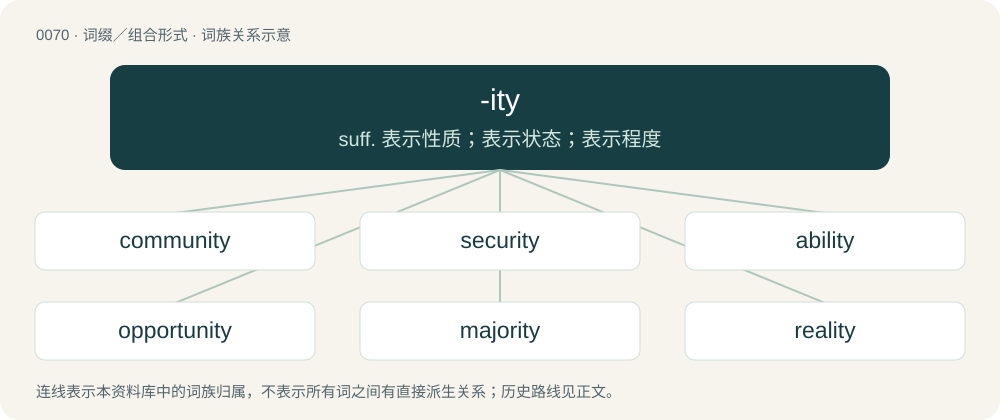

# 0070 · -ity — suff. 表示性质；表示状态；表示程度

[总目录](../00_总目录_按常用程度.md)

**类型**：词缀／组合形式　｜　**来源语言**：见词源记录

## 核心含义与来源

- 核心含义：suff. 表示性质；表示状态；表示程度
- 英文含义：Used to form an uncountable noun from an adjective; especially, to form the noun referring to the state, property, or quality of conforming to the adjective's description.
- 词形：-ity

**来源记录 1**（后缀／后置成分；Used to form an uncountable noun from an adjective; especially, to form the noun referring to the state, property, or quality of conforming to the adjective's description.）

From Middle English -ite, -itee, from Old French -ite, -ete, -eteit (“-ity”), from Latin -itātem, from -itās, from Proto-Indo-European \*-teh₂ts (suffix). Cognate with Gothic -𐌹𐌸𐌰 (-iþa, “-th”), Old High German -ida (“-th”), Old English -þo, -þu, -þ (“-th”). More at -th. By surface analysis, -i- (“connecting vowel”) + -ty.

## 词族图

## 单词速览（常用到不常用）

| 单词 | 音标 | 释义 |
|---|---|---|
| [community](#w-1) | 英 /kəˈmjuːnɪ.ti/；美 /k(ə)ˈmju.nə.ti/ | n. 社区, 公众, 共有, 共同体；\[经\] 公众, 共有, 社会 |
| [security](#w-2) | 英 /sɪˈkjʊəɹɪti/；美 /səˈkjʊɹ.ɪti/ | n. 安全, 安全性, 防护物, 保安, 可靠性, 担保人, 抵押品, 保证金；\[计\] 安全性, 保密性, 安全检查程序 |
| [ability](#w-3) | /əˈbɪl.ə.ti/ | n. 能力, 才干；\[经\] 能力, 才能 |
| [opportunity](#w-4) | 英 /ˌɒp.əˈtjuː.nɪ.tɪ/；美 /ˌɑ.pɚˈt(j)u.nə.ti/ | n. 机会, 时机 |
| [majority](#w-5) | 英 /məˈd͡ʒɒ.ɹɪti/；美 /məˈd͡ʒɑ.ɹɪti/ | n. 多数, 大半；\[计\] 多数逻辑 |
| [reality](#w-6) | 英 /ɹiːˈælɪti/；美 /ɹiˈæləti/ | n. 实在, 事实, 实体, 逼真；\[法\] 现实, 实在存在的事物, 实在性 |
| [activity](#w-7) | 英 /ækˈtɪv.ɪ.ti/；/ækˈtɪv.ə.ti/ | n. 活动, 行动, 活跃, 活力；\[计\] 活动 |
| [responsibility](#w-8) | 英 /ɹɪˌspɒn.səˈbɪl.ɪ.ti/；美 /ɹɪˌspɑn.səˈbɪl.ə.ti/ | n. 责任, 职责, 负担, 可靠性；\[化\] 职责 |
| [electricity](#w-9) | 英 /ˌiːlɛkˈtɹɪsɪti/；美 /ɪˌlɛkˈtɹɪsɪti/ | n. 电, 电流, 电学, 热情, 电力供应；\[化\] 电学; 电 |
| [minority](#w-10) | 英 /maɪˈnɒɹ.ɪ.ti/；美 /maɪˈnoɹ.ɪ.ti/ | n. 少数, 未成年, 少数民族；a. 少数的, 属于少数派的 |
| [priority](#w-11) | 英 /pɹaɪˈɒɹɪti/；美 /pɹaɪˈoɹəti/ | n. 优先权, 优先；\[计\] 优先级 |
| [density](#w-12) | 英 /ˈdɛn.sɪ.ti/；美 /ˈdɛn.sə.ti/ | n. 密度；\[化\] 密度 |
| [diversity](#w-13) | /daɪˈvɜː(ɹ)sɪti/ | n. 差异, 多样性；\[化\] 多样性 |
| [equality](#w-14) | 英 /ɪˈkwɒl.ɪ.ti/；美 /ɪˈkwɑ.lɪ.ti/ | n. 平等, 均匀, 相等；\[法\] 同等, 平等, 相等 |
| [popularity](#w-15) | 英 /ˌpɒp.jəˈlæɹ.ɪ.ti/；美 /ˌpɑ.pjəˈlæɹ.ə.ti/ | n. 名声, 受大众欢迎, 流行 |
| [disability](#w-16) | /dɪsəˈbɪlɪti/ | n. 无力, 无能, 残疾；\[医\] 劳动能力丧失, 病废 |
| [gravity](#w-17) | /ˈɡɹævɪti/ | n. 地心引力, 重力；\[化\] 重力 |
| [liability](#w-18) | /laɪəˈbɪlɪti/ | n. 责任, 债务, 倾向；\[经\] 责任, 义务, 负债 |
| [productivity](#w-19) | 英 /ˌpɹɒdʌkˈtɪvəti/；美 /ˌpɹoʊdʌkˈtɪvəti/ | n. 生产力；\[经\] 生产率, 生产能力 |
| [intensity](#w-20) | /ɪnˈtɛnsɪti/ | n. 强烈, 紧张, 强度；\[计\] 强度; 亮度 |
| [availability](#w-21) | 英 /əˌveɪ.ləˈbɪl.ɪ.ti/；美 /əˌveɪ.ləˈbɪl.ɪ.ti/ | n. 有效性, 可利用性, 可利用的人；\[计\] 有效性; 可用性 |
| [capability](#w-22) | 英 /ˌkeɪ.pəˈbɪl.ɪ.ti/；美 /ˌkeɪ.pəˈbɪl.ə.ti/ | n. 能力, 性能, 约束力；\[化\] 能力 |
| [complexity](#w-23) | /kəmˈplɛk.sɪ.ti/ | n. 复杂, 复杂性, 复杂的事物 |
| [flexibility](#w-24) | 英 /ˌflɛksɪˈbɪlɪti/ | n. 弹性, 适应性；\[计\] 灵活性; 适应性 |
| [creativity](#w-25) | /kri.eɪˈtɪv.ᵻ.ti/ | n. 创造力, 创造性 |
| [publicity](#w-26) | /pʌbˈlɪsɪti/ | n. 名声, 宣传, 公开场合；\[经\] 宣传, 广告 |
| [sensitivity](#w-27) | 英 /ˌsɛn.sɪˈtɪv.ɪ.ti/；美 /ˌsɛn.səˈtɪv.ə.ti/ | n. 敏感, 灵敏度；\[计\] 灵敏度 |
| [inequality](#w-28) | 英 /ˌɪn.ɪˈkwɒl.ɪ.ti/；美 /ˌɪn.ɪˈkwɑ.lɪ.ti/ | n. 不平等, 不同, 不平坦, 不平均；n. 不平等, 不等式；\[计\] 不等式 |
| [reliability](#w-29) | /ri.laiəˈbiliti/ | n. 信度, 可靠性；\[计\] 可靠性 |
| [accountability](#w-30) | 英 /əˌkaʊn.təˈbɪl.ə.ti/；美 /əˌkaʊn.təˈbɪl.ə.ti/ | n. 负有责任, 可说明性；\[化\] 衡算计量 |
| [immunity](#w-31) | /ɪˈmjuːnəti/ | n. 免疫, 免疫性, 免除；\[化\] 免疫性 |
| [prosperity](#w-32) | 英 /pɹɒˈspɛɹ.ɪ.ti/；美 /pɹɑˈspɛɹ.ɪ.ti/ | n. 繁荣, 茂盛, 成功；\[经\] 繁荣 |
| [clarity](#w-33) | 英 /ˈklæɹ.ɪ.ti/；美 /ˈklæɹ.ɪ.ti/ | n. 清楚, 明晰；\[化\] 透明度; 透明性; 清晰性 |
| [mortality](#w-34) | 美 /mɔɹˈtælɪti/ | n. 必死的命运, 死亡数目, 死亡率；\[医\] 必死性, 死亡率 |
| [solidarity](#w-35) | 英 /ˌsɒl.ɪˈdæɹ.ə.ti/；美 /ˌsɑ.ləˈdæɹ.ə.ti/ | n. 团结, 团结一致, 共同一致；\[法\] 团结, 共同责任 |
| [proximity](#w-36) | 英 /pɹɒkˈsɪm.ɪ.ti/；美 /pɹɑkˈsɪm.ɪ.ti/ | n. 接近, 亲近 |
| [morality](#w-37) | 英 /məˈɹælɪti/ | n. 道德, 教训, 品行；\[法\] 道德, 道义 |
| [vicinity](#w-38) | 英 /vɪˈsɪnɪti/；美 /vəˈsɪnəti/ | n. 附近, 邻近, 附近地区, 近处；\[法\] 附近, 邻近, 附近地区 |
| [fertility](#w-39) | 英 /fə(ɹ)ˈtɪlɪti/；美 /fɝˈtɪləti/ | n. 肥沃, 丰饶, 生产力；\[医\] 生育力 |
| [visibility](#w-40) | 英 /ˌvɪz.əˈbɪl.ɪ.ti/ | n. 可见性, 能见度, 能见距离；\[计\] 可见性 |
| [continuity](#w-41) | 英 /ˌkɒn.tɪˈnjuː.ɪ.ti/；美 /ˌkɑn.tɪˈn(j)u.ə.ti/ | n. 连续性；\[化\] 连续性 |
| [mentality](#w-42) | /mɛnˈtæləti/ | n. 精神力, 智力, 头脑作用, 心态；\[医\] 智力 |
| [homosexuality](#w-43) | 英 /ˌhəʊmə(ʊ)sɛkʃʊˈælɪti/；美 /ˌhoʊməˌsɛkʃuˈælɪti/ | n. 同性恋；\[医\] 同性性欲, 同性恋爱 |
| [vanity](#w-44) | 英 /ˈvænɪti/；美 /ˈvænəti/ | n. 虚荣心, 虚无, 自负, 空虚, 时髦的小摆饰 |
| [ethnicity](#w-45) | /ɛθˈnɪsɪti/ | n. 种族划分 |
| [insanity](#w-46) | 美 /ɪnˈsænɪti/ | n. 疯狂, 愚顽, 精神错乱；\[医\] 精神病 |
| [nationality](#w-47) | /ˌnæʃ.əˈnæl.ɪ.ti/ | n. 国籍, 国家, 民族性；\[法\] 国家, 民族, 国民 |
| [municipality](#w-48) | 英 /mjʊˌnɪsɪˈpælɪti/ | n. 自治区, 市当局, 市民；\[法\] 市, 自治市, 自治地区 |
| [functionality](#w-49) | /,fʌŋkəʃəˈnæliti/ | \[计\] 功能性, 泛函性；\[化\] 官能度 |
| [validity](#w-50) | /vəˈlɪd.ɪ.ti/ | n. 有效性, 正确性；\[计\] 有效性 |
| [vulnerability](#w-51) | 英 /ˌvʌln(ə)ɹəˈbɪlɪti/；美 /ˌvʌln(ə)ɹəˈbɪləti/ | n. 易受伤, 易受责难, 易受伤部位；\[医\] 易损性 |
| [purity](#w-52) | 英 /ˈpjʊəɹɪti/；美 /ˈpjʊɹɪti/ | n. 纯净, 纯正, 纯粹；\[化\] 纯度 |
| [locality](#w-53) | 英 /ləʊˈkæl.ɪ.ti/；美 /loʊˈkæl.ɪ.ti/ | n. 地方, 所在, 位置；\[法\] 位置, 场所, 地区 |
| [neutrality](#w-54) | 英 /njuːˈtɹæləti/；美 /nuˈtɹæləti/ | n. 中立, 不偏不倚, 中间状态；\[医\] 中性; 无作用\[性\] |
| [stupidity](#w-55) | 英 /stjuːˈpɪdɪti/；美 /stuˈpɪdɪti/ | n. 愚蠢, 糊涂事；\[医\] 迟钝 |
| [generosity](#w-56) | 英 /ˌd͡ʒɛn.əˈɹɒs.ɪ.ti/；美 /ˌd͡ʒɛn.əˈɹɑ.sə.ti/ | n. 慷慨, 宽大 |
| [affinity](#w-57) | /əˈfɪnɪti/ | n. 吸引, 姻亲关系, 类同；\[化\] 亲合力; 亲合能; 亲合势; 近似; 类似 |
| [authenticity](#w-58) | 美 /ɑθɛnˈtɪsɪti/ | n. 可靠性, 真实性；\[经\] 确实性, 真实性 |
| [brutality](#w-59) | /ˌbɹuːˈtælɪti/ | n. 残忍, 无慈悲, 野蛮的行为 |
| [humility](#w-60) | /hjuːˈmɪlɪti/ | n. 谦逊, 谦虚, 谦卑 |
| [superiority](#w-61) | 英 /sʊˌpɪə(ɹ).iˈɒ.ɹɪ.ti/ | n. 优越, 高傲；\[化\] 优越性 |
| [similarity](#w-62) | 英 /ˌsɪm.ɪˈlæɹ.ɪ.ti/；美 /ˌsɪm.əˈlæɹ.ə.ti/ | n. 类似, 类似处；\[法\] 类似, 相似, 类似事例 |
| [toxicity](#w-63) | 英 /tɒkˈsɪs.ə.ti/；美 /tɑkˈsɪs.ə.ti/ | n. 毒性；\[医\] 毒力, 毒性 |
| [connectivity](#w-64) | /kənekˈtiviti/ | \[计\] 连通性, 连通度 |
| [accessibility](#w-65) | 英 /əkˌsɛs.əˈbɪl.ɪ.ti/；美 /əkˌsɛs.əˈbɪl.ə.ti/ | n. 易接近, 可进入；\[化\] 可及性; 可达性; 可接近性; 吸湿性 |
| [profitability](#w-66) | 英 /ˌpɹɒf.ɪ.təˈbɪl.ɪ.ti/；美 /ˌpɹɑ.fɪ.təˈbɪl.ɪ.ti/ | n. 收益性, 利益率；\[经\] 可获利润率 |
| [negativity](#w-67) | /ˌnɛɡ.əˈtɪ.vɪ.ti/ | n. 否定性, 消极性 |
| [volatility](#w-68) | 英 /ˌvɒl.əˈtɪl.ə.ti/；美 /ˌvɑ.ləˈtɪl.ə.ti/ | n. 挥发性, 挥发度, 轻快, 易变, 短暂；\[计\] 变更率 |
| [virginity](#w-69) | /və(ɹ)ˈd͡ʒɪnɪti/ | n. 处女身份, 处女贞洁, 童贞；\[医\] 童贞, 纯洁 |
| [nobility](#w-70) | 英 /nəʊˈbɪlɪti/；美 /noʊˈbɪlɪti/ | n. 贵族, 高尚, 贵族阶级 |
| [confidentiality](#w-71) |  | \[计\] 机密性；\[经\] 保密 |
| [divinity](#w-72) | 英 /dɪˈvɪnɪti/；美 /dɪˈvɪnɪti/ | n. 神, 神性 |
| [durability](#w-73) | 英 /ˈdʲʊɹəbɪləti/；美 /dəɹəˈbɪləti/ | \[计\] 耐久性, 耐用性, 持久性 |
| [liquidity](#w-74) | /lɪkˈwɪdəti/ | n. 流动性, 流畅；\[经\] 流动性 |
| [viability](#w-75) | 美 /ˌvaɪəˈbɪlɪti/ | n. 生存能力, 发育能力；\[医\] \[生\]活\[能\]力, 生机 |
| [antiquity](#w-76) | 英 /ænˈtɪk.wɪ.ti/；美 /ænˈtɪk.wə.ti/ | n. 古老, 古代, 古代人, 古物 |
| [plurality](#w-77) | /plʊˈɹæləti/ | n. 复数, 较大的数, 多数状态, 兼职；\[法\] 大多数, 较多数, 复数 |
| [austerity](#w-78) | 美 /ɔˈstɛɹɪti/ | n. 朴素, 苦行, 严格, 严峻 |
| [immortality](#w-79) | 英 /ˌɪmɔːˈtæləti/；美 /ˌɪmɔːɹˈtæləti/ | n. 不朽, 不灭的声望 |
| [vitality](#w-80) | /vaɪˈtælɪti/ | n. 活力, 生命力；\[医\] 生机, 活力, 生活 |
| [familiarity](#w-81) | 英 /fəmɪliˈæɹɪti/ | n. 熟悉, 精通, 亲密 |
| [anonymity](#w-82) | 英 /ænəˈnɪmɪti/ | n. 匿名, 姓氏不明；\[计\] 匿名信件 |
| [nudity](#w-83) | 英 /ˈnjudɪˌti/；美 /ˈnudɪti/ | n. 裸露, 裸露物, 裸体像 |
| [variability](#w-84) | 英 /ˌvɛəɹ.i.əˈbɪl.ə.ti/；美 /ˌvæɹ.i.əˈbɪl.ə.ti/ | n. 易变, 变化性, 变异性；\[化\] 可变性; 变异性 |
| [ambiguity](#w-85) | 英 /æm.bɪˈɡjuː.ɪ.ti/；美 /æm.bɪˈɡju.ɪ.ti/ | n. 不明确, 含糊；\[计\] 二义性; 多义性 |
| [legality](#w-86) | 美 /liˈɡælɪti/ | n. 合法, 正当；\[经\] 合法性 |
| [masculinity](#w-87) | 美 /ˌmæskjəˈlɪnɪti/ | n. 男子气, 刚毅, 大丈夫气概；\[医\] 男子本性, 男性 |
| [rarity](#w-88) | 英 /ˈɹɛəɹəti/；/ˈɹeɹəti/ | n. 稀罕, 罕有, 珍奇, 稀薄 |
| [relativity](#w-89) | /ɹɛl.əˈtɪv.ɪ.ti/ | n. 有关系, 相关性, 相对性；\[化\] 相对性 |
| [sincerity](#w-90) | /sɪnˈsɛɹəti/ | n. 诚实, 真实, 诚心诚意 |
| [agility](#w-91) | 英 /əˈd͡ʒɪl.ɪ.ti/；美 /əˈd͡ʒɪl.ə.ti/ | n. 敏捷, 灵活, 机敏 |
| [positivity](#w-92) | 英 /ˌpɒz.ɪˈtɪv.ɪ.ti/；美 /ˌpɑ.zɪˈtɪv.ɪ.ti/ | n. 确实, 确信, 肯定性 |
| [versatility](#w-93) | 英 /ˌvɜː.səˈtɪl.ɪ.tiː/；美 /ˌvɜɹ.səˈtɪl.ɪ.ti/ | n. 多用途, 多才多艺, 易变 |
| [serenity](#w-94) | /səˈɹɛnɪti/ | n. 宁静, 沉着, 晴朗 |
| [infidelity](#w-95) | /ˌɪnfɪˈdɛlɪti/ | n. 不信神, 无信仰, 背信 |
| [modernity](#w-96) | 英 /məˈdɜːnɪti/；美 /məˈdɝnɪti/ | n. 现代性, 现代状态, 现代东西 |
| [specificity](#w-97) | 英 /spɛsɪˈfɪsɪti/ | n. 特异性, 专一性, 特殊性, 特性, 特征；\[化\] 专一性 |
| [absurdity](#w-98) | 英 /əbˈsɜːd.ɪ.ti/；美 /æbˈsɝd.ɪ.ti/ | n. 荒谬, 悖理, 荒谬的言行 |
| [acidity](#w-99) | /əˈsɪd.ɪ.ti/ | n. 酸性；\[化\] 酸度; 酸性; 酸性反应 |
| [individuality](#w-100) | /ˌɪndɪvɪd͡ʒuˈælɪti/ | n. 个性, 个人, 特征 |
| [fatality](#w-101) | 英 /fəˈtælətɪ/；美 /feɪˈtælɪti/ | n. 不幸, 厄运, 致命性, 死亡者, 厄运, 天命 |
| [formality](#w-102) | /fɔːrˈmælɪti/ | n. 礼节, 拘谨, 正式手续；\[化\] 克式浓度 |
| [chastity](#w-103) | 英 /ˈt͡ʃastɪti/；美 /ˈt͡ʃæstɪti/ | n. 纯洁, 贞操；\[法\] 贞操, 纯洁 |
| [conductivity](#w-104) | /.kɒndʌkˈtiviti/ | n. 导电率, 传导率, 传导性；\[化\] 电导率 |
| [duality](#w-105) | /d(j)uːˈælɪti/ | n. 二元性；\[化\] 二象性; 双偶性 |
| [viscosity](#w-106) | 英 /vɪsˈkɒsɪti/；美 /vɪsˈkɑsɪti/ | n. 粘稠, 粘性；\[化\] 内摩擦; 粘度 |
| [femininity](#w-107) | /fɛmɪˈnɪnɪti/ | n. 妇女特质, 温柔, 柔弱性；\[医\] 女子本性, 女性, 女子气 |
| [actuality](#w-108) | /ˌækt͡ʃuˈælɪti/ | n. 事实, 现实, 现状 |
| [elasticity](#w-109) | 英 /ɪ.læsˈtɪs.ɪ.ti/；美 /ɪ.læsˈtɪs.ɪ.ti/ | n. 弹力, 弹性；\[化\] 弹性 |
| [objectivity](#w-110) | 英 /ˌɒbd͡ʒɛkˈtɪvɪti/；美 /ˌɑbd͡ʒɛkˈtɪvɪti/ | n. 客观, 客观现实, 客观性；\[经\] 客观性 |
| [rationality](#w-111) | /ˌraʃəˈnalɪti/ | n. 合理性, 纯理性 |
| [susceptibility](#w-112) | 英 /səˌsɛptəˈbɪlɪti/；美 /səˌsɛptəˈbɪləti/ | n. 敏感性, 感情；\[电\] 磁化系数 |
| [exclusivity](#w-113) | /ˌɛkskluːˈsɪvɪti/ | \[经\] 独占 |
| [inactivity](#w-114) | /ˌɪn.ækˈtɪ.vɪ.ti/ | n. 不活动, 不活泼, 休止状态；\[经\] 商业呆滞 |
| [impossibility](#w-115) | 英 /ɪmˌpɒsɪˈbɪliti/；美 /ɪmˌpɑsɪˈbɪliti/ | n. 不可能之事, 不可能；\[法\] 不可能性, 不可能的事 |
| [civility](#w-116) | /sɪˈvɪl.ɪ.ti/ | n. 礼貌, 礼仪 |
| [enmity](#w-117) | 英 /ˈɛn.mɪ.ti/；美 /ˈɛn.mɪ.ti/ | n. 敌意, 憎恨 |
| [usability](#w-118) | /ˌjuːzəˈbɪlɪti/ | n. 可用性；\[化\] 工艺性 |
| [rigidity](#w-119) | /ɹɪˈd͡ʒɪdɪti/ | n. 坚硬, 僵化, 坚硬, 刚性, 刚度；\[化\] 刚度系数 |
| [fragility](#w-120) | /fɹəˈd͡ʒɪlɪti/ | n. 脆弱, 虚弱；\[化\] 易碎性 |
| [totality](#w-121) | 美 /toʊˈtælɪti/ | n. 全体, 总数, 全食 |
| [inferiority](#w-122) | /in.fiəriˈɒriti/ | n. 自卑, 次等；\[医\] 下位, 下级, 次级, 劣等 |
| [plasticity](#w-123) | 英 /ˌplæs.ˈtɪs.ɪ.ti/；美 /ˌplæs.ˈtɪs.ɪ.ti/ | n. 可塑性, 柔软性, 立体感；\[化\] 可塑性; 塑性力学 |
| [practicality](#w-124) | /.præktiˈkæliti/ | n. 实际性, 实用性, 实际事物 |
| [salinity](#w-125) | 英 /səˈlɪnɪti/；美 /səˈlɪnɪti/ | n. 盐性, 盐度；\[化\] 盐度 |
| [morbidity](#w-126) | /mɒːˈbiditi/ | n. 病态, 发病, 罹病率；\[医\] 成病, 发病, 发病率 |
| [constitutionality](#w-127) | /ˈkɔnsti,tjuːʃəˈnæləti/ | n. 合宪法性；\[法\] 符合宪法, 合宪性, 立宪 |
| [interoperability](#w-128) | 英 /ˌɪntəɹɒpəɹəˈbɪləti/ | \[计\] 互用性, 互操作性 |
| [normality](#w-129) | 英 /nɔːˈmæl.ɪ.ti/；美 /nɔɹˈmæl.ə.ti/ | n. 常态；\[化\] 规定浓度; 当量浓度 |
| [permeability](#w-130) | 英 /ˌpɜːmi.əˈbɪlɪti/；美 /ˌpɝmi.əˈbɪlɪti/ | n. 渗透性, 可透性, 磁导率；\[化\] 渗透性; 渗透率 |
| [applicability](#w-131) | /.æplikəˈbiliti/ | n. 适用性, 应用性；\[法\] 适用性, 适应性 |
| [radioactivity](#w-132) | /ˌreɪdɪəʊakˈtɪvɪti/ | n. 放射性；\[化\] 放射性 |
| [inevitability](#w-133) | /ɪˌnɛvɪtəˈbɪlɪti/ | n. 无法逃避之事, 不可逃避, 必然性；\[法\] 不能避免 |
| [luminosity](#w-134) | /.luːmiˈnɒsiti/ | n. 光明, 光辉, 光度, 亮度；\[计\] 亮度 |
| [obscenity](#w-135) | /ɒbˈsiːniti/ | n. 淫秽, 淫秽的语言(或行为、动作), 可憎的事；\[法\] 猥亵, 淫诲, 猥亵的言语或行动 |
| [portability](#w-136) | /.pɒːtəˈbiliti/ | n. 可携带, 轻便；\[计\] 可移植性 |
| [abnormality](#w-137) | 英 /ˌæbnɔːˈmælɪtɪ/；美 /ˌæbˌnɔɹˈmæl.ət.i/ | n. 反常, 畸形, 变态；\[化\] 反常; 非正态性 |
| [reactivity](#w-138) | /rɪˈakˈtɪvɪti/ | n. 反应, 反动, 反应性, 活动性, 反应率；\[医\] 反应性 |
| [adaptability](#w-139) | 英 /əˌdæptəˈbɪlɪti/；美 /əˌdæptəˈbɪləti/ | n. 适应性；\[计\] 自适应性; 适应性 |
| [opacity](#w-140) | 美 /oʊˈpæsɪti/ | n. 不透明, 电波不透过, 不透明体；\[医\] 浑浊, 不透明, 不透光, 不透明区, 浊斑 |
| [subjectivity](#w-141) | 英 /ˌsʌbd͡ʒɛkˈtɪvɪti/；美 /ˌsʌbd͡ʒɛkˈtɪvɪti/ | n. 主观, 主观性；\[医\] 主观性 |
| [physicality](#w-142) | /fiziˈkæliti/ | n. 肉体性 |
| [technicality](#w-143) | /ˌtɛknɪˈkælɪti/ | n. 专门性, 学术性, 技术的使用；\[法\] 专门的事项, 细节, 用语 |
| [sentimentality](#w-144) | /.sentimenˈtæliti/ | n. 多愁善感；\[医\] 情感生活 |
| [selectivity](#w-145) | /.silekˈtiviti/ | n. 选择性, 选择度；\[化\] 选择性 |
| [principality](#w-146) | /pɹɪnsɪˈpælɪti/ | n. 公国, 封色, 侯国, 首长的职位, 校长的权力, 校长的职位, 首长的权力 |
| [oddity](#w-147) | 英 /ˈɒdɪti/；美 /ˈɑdɪti/ | n. 奇异, 奇特, 怪人, 怪事, 怪僻 |
| [irritability](#w-148) | /ˌɪɹɪtəˈbɪlɪti/ | n. 易怒, 刺激物, 兴奋性；\[医\] 应激性, 兴奋性, 刺激感受性, 兴奋增盛, 过敏 |
| [tranquillity](#w-149) | /tɹæŋˈkwɪl.ɪ.ti/ | 心神稳定 |
| [incompatibility](#w-150) | /ˌɪnkəmˌpætɪˈbɪlɪti/ | n. 互不相容的东西, 不相容；\[计\] 不兼容性 |
| [readability](#w-151) | 英 /ˌɹiːdəˈbɪlɪti/；美 /ˌɹidəˈbɪləti/ | n. 易读, 可读性；\[计\] 可读性 |
| [serendipity](#w-152) | 英 /ˌsɛɹ.ənˈdɪp.ɪ.ti/；美 /ˌsɛɹ.ənˈdɪp.ɪ.ti/ | n. 偶然发现珍宝的运气/才能, 易遇奇缘的运气 |
| [punctuality](#w-153) | 英 /pʌŋktjʊˈæləti/；美 /ˌpʌŋkt͡ʃuˈæləti/ | n. 严守时间, 正确 |
| [porosity](#w-154) | /pɒːˈrɒsiti/ | n. 多孔性, 有孔性；\[计\] 多孔性 |
| [impurity](#w-155) | 美 /ɪmˈpjɝɪti/ | n. 杂质, 不洁, 不纯；\[化\] 杂质 |
| [scalability](#w-156) | 英 /ˌskeɪ.ləˈbɪl.ɪ.ti/ | \[计\] 可伸缩性 |
| [eventuality](#w-157) | /ɪˌvɛntjuˈælɪti/ | n. 可能发生的事, 可能性 |
| [motility](#w-158) | /məuˈtiliti/ | n. 运动性, 自动力；\[医\] 能动性, 机动性, 能动力 |
| [bisexuality](#w-159) | /ˈbai,seksjuˈæliti/ | 雌雄同体\[株\] |
| [desirability](#w-160) | /di.zairəˈbiliti/ | n. 值得想望, 可取；\[经\] 合意性, 可用性 |
| [illegality](#w-161) | /.iliːˈgæliti/ | n. 非法行为, 犯规；\[法\] 违法, 不合法, 非法 |
| [irresponsibility](#w-162) | /ˌɪə.ɹəˌspɒn.sɪˈbɪ.lɪ.ti/ | n. 无责任, 不承担责任的行为；\[法\] 不负责任, 无责任, 不承担责任 |
| [proportionality](#w-163) | /pɹəpɔɹʃəˈnæləti/ | n. 比例性, 相称, 均衡性；\[机\] 比例, 均整 |
| [religiosity](#w-164) | 英 /ɹɪˌlɪd͡ʒɪˈɒsɪti/；美 /ɹɪˌlɪd͡ʒɪˈɑsəti/ | n. 笃信, 虚伪信仰, 虔诚, 宗教狂 |
| [vulgarity](#w-165) | 美 /vʌlˈɡɜɹɪti/ | n. 粗俗, 粗鄙, 粗话；\[法\] 粗鄙, 粗野行为 |
| [solidity](#w-166) | /səˈlɪdɪti/ | n. 固体性, 坚硬, 坚固, 稳健, 体积 |
| [bestiality](#w-167) | 英 /ˈbɛstʃəlˌlɪtɪ/；美 /ˈbistiˌælɪti/ | n. 兽性, 兽行, 兽欲；\[法\] 兽奸, 兽性, 兽行 |
| [centrality](#w-168) | 英 /sɛnˈtɹæl.ɪ.ti/；美 /sɛnˈtɹæl.ə.ti/ | n. 中心, 中央, 向心性；\[医\] 中央性, 归中性 |
| [finality](#w-169) | /faɪˈnælɪti/ | n. 终结, 定局, 终结性言行；\[法\] 终结, 定局, 决定性 |
| [unpopularity](#w-170) | /ˌʌnˌpɒpjʊˈlæɹɪti/ | n. 不受欢迎, 失人心 |
| [indignity](#w-171) | /ɪnˈdɪɡ.nɪ.ti/ | n. 侮辱；\[法\] 侮辱的言行, 无礼, 有伤尊严 |
| [passivity](#w-172) | /pæˈsɪvɪti/ | n. 被动, 被动性, 无抵抗, 钝性, 被动结构；\[化\] 钝态 |
| [virtuosity](#w-173) | /ˌvɜː(ɹ)tjuˈɒsɪti/ | n. 精湛技巧, 对古董等的爱好 |
| [naivety](#w-174) | /nɑːˈiːvti/ | n. 无邪的行为；天真烂漫（等于naivete） |
| [employability](#w-175) | /ɪmˌplɔɪəˈbɪləti/ | 可雇性; 可用性; 适于雇用; 受雇就业能力 |
| [irregularity](#w-176) | 英 /ɪˌɹɛ.ɡjʊˈlæ.ɹɪ.ti/；/ɪˌɹɛ.ɡjəˈlɛɹ.ɪ.ti/ | n. 不规则, 例外, 违反规则的行为；\[化\] 不匀度 |
| [inhumanity](#w-177) | /.inhjuːˈmæniti/ | n. 不人道, 残暴；\[法\] 无人性, 野蛮, 残酷 |
| [irrationality](#w-178) | 美 /ɪˌɹæʃ.əˈnæl.ə.ti/ | n. 不合理, 无条理, 无理性 |
| [linearity](#w-179) | 英 /ˌlɪniˈæɹəti/；美 /ˌlɪniˈæɹəti/ | n. 线性, 直线性；\[电\] 直线性 |
| [festivity](#w-180) | /fɛˈstɪvəti/ | n. 节日, 喜庆日, 欢宴, 欢庆 |
| [solemnity](#w-181) | /səˈlɛmnɪti/ | n. 严肃, 一本正经；\[法\] 要式, 庄严的仪式, 严肃 |
| [unanimity](#w-182) | /ˌjuːnəˈnɪmɪti/ | n. 无异议, 同意, (全体)一致；\[法\] 全体一致, 一致同意, 合意 |
| [incredulity](#w-183) | /ˌɪnkɹɪˈdjuːlɪti/ | n. 不轻信, 怀疑, 疑心 |
| [heterosexuality](#w-184) | /,hetərəu,seksjuˈæliti/ | n. 异性爱；\[医\] 异性性欲 |
| [lethality](#w-185) | /liˈθælɪti/ | n. 致死性；\[医\] 致死率 |
| [duplicity](#w-186) | /duˈplɪ.sɪ.ti/ | n. 口是心非, 不诚实, 表里不一；\[医\] 并胚, 双畸胎, 联胎 |
| [inclusivity](#w-187) | /ˌɪŋkluːˈsɪvɪti/ | n. 包容性 |
| [peculiarity](#w-188) | 英 /pɪˌkjuːliˈæɹɪti/；美 /pɪˌkjuliˈɛɹɪti/ | n. 特质, 特性, 怪癖 |
| [seasonality](#w-189) | /ˌsiːzəˈnæləti/ | 季节性 |
| [materiality](#w-190) | /mə.tiəriˈæliti/ | n. 实质性, 物质性, 实体；\[经\] 重要性 |
| [reproducibility](#w-191) | /riprə,djuːsəˈbiliti/ | \[计\] 再现情, 笪复情；\[化\] 实验室间重复性; 再现性 |
| [intersectionality](#w-192) | 英 /ɪntəˌsɛkʃəˈnælɪti/；美 /ɪntɚˌsɛkʃəˈnæləti/ | 【英文】The quality or state of being intersectional, that is, of being characterized by intersection (especially of multiple forms of discrimination). |
| [virility](#w-193) | /vəˈɹɪlɪti/ | n. 成年, 男性生殖力, 男子气概, 精力充沛, 雄浑, 刚强有力；\[医\] 男性, 有男性征 |
| [musicality](#w-194) | /ˌmju.zɪˈkæ.lɪ.ti/ | n. 和谐, 音乐才能, 悦耳 |
| [resistivity](#w-195) | /ri.zisˈtiviti/ | n. 抵抗力, 电阻系数；\[化\] 电阻率 |
| [banality](#w-196) | /bəˈnælɪti/ | n. 平凡, 陈腐 |
| [futurity](#w-197) | /fjuːˈtjʊəɹɪti/ | n. 将来, 未来, 未来的事, 远景 |
| [reflectivity](#w-198) | /.riːflekˈtiviti/ | n. 反射率；\[化\] 反射率 |
| [historicity](#w-199) | /ˌhɪstəˈɹɪsɪti/ | n. 史实性, 实际存在 |
| [criticality](#w-200) | /ˈkɹɪtɪˌkælɪti/ | \[计\] 危急程度 |
| [modularity](#w-201) | /,mɔdjuˈlæriti/ | \[计\] 模块性 |
| [rapidity](#w-202) | /ɹəˈpɪd.ɪ.ti/ | n. 迅速, 急速, 速度 |
| [traceability](#w-203) | /ˌtɹeɪsəˈbɪlɪti/ | n. 可描绘, 可描写,可追溯 |
| [domesticity](#w-204) | /.dəumesˈtisiti/ | n. 专心于家务, 恋家, 家庭生活 |
| [granularity](#w-205) | 英 /ˌɡɹæn.jəˈlæɹ.ə.ti/；美 /ˌɡɹæn.jəˈlɝ.ə.ti/ | n. 间隔尺寸；\[计\] 间隔尺寸 |
| [impulsivity](#w-206) | /ɪmpʌlˈsɪvɪtɪ/ | 认知的熟虑性？冲动性 |
| [immobility](#w-207) | /.iməuˈbiliti/ | n. 不动性, 不动, 固定；\[医\] 不动\[性\] |
| [timidity](#w-208) | /tɪˈmɪdɪti/ | n. 胆小, 胆怯, 羞怯 |
| [credulity](#w-209) | 英 /kɹɪˈd͡ʒuːlɪti/；美 /kɹɪˈduːlɪti/ | n. 易信, 轻信 |
| [alkalinity](#w-210) | /.ælkəˈliniti/ | n. 碱度；\[化\] 碱度; 碱性 |
| [falsity](#w-211) | 英 /ˈfɔːl.sɪ.ti/；美 /ˈfɔl.sɪ.ti/ | n. 虚伪, 错误, 不忠实, 谎言；\[经\] 伪造, 篡改 |
| [favorability](#w-212) |  | 【英文】The quality or degree of being viewed favorably |
| [infirmity](#w-213) | 英 /ɪnˈfɜːmɪti/；美 /ɪnˈfɜɹməti/ | n. 虚弱, 病身, 疾病；\[医\] 衰弱 |
| [cardinality](#w-214) | 英 /kɑːdɪˈnælɪti/；美 /kɑɹdɪˈnælɪti/ | \[计\] 基数 |
| [theatricality](#w-215) | /θi.ætriˈkæləti/ | n. 戏剧风格, 不自然 |
| [complementarity](#w-216) | /ˌkɒmpləmɛnˈtæɹɪti/ | n. 互补性, 互为补充；\[经\] 互补性 |
| [fecundity](#w-217) | 英 /fɪˈkʌndɪtɪ/；美 /fɪˈkʌndətɪ/ | n. 多产, 丰饶, 肥沃, 繁殖力；\[医\] 生殖能, 生殖力 |
| [immensity](#w-218) | /ɪˈmɛn.sɪ.ti/ | n. 广大, 无边, 巨物 |
| [intelligibility](#w-219) | /ɪnˌtɛl.ə.d͡ʒəˈbɪl.ɪ.ti/ | n. 可理解性, 明了；\[计\] 可识度, 可懂度, 清晰度 |
| [playability](#w-220) |  | n. playable（可游戏的, 宜玩的）的变形 |
| [intentionality](#w-221) | /ɪnˌtenʃəˈnælɪtɪ/ | 意向性 |
| [particularity](#w-222) | 英 /pəˌtɪkjʊˈlæɹɪti/；美 /pə(ɹ)ˌtɪkjəˈlɛɹəti/ | n. 特殊性, 特质, 个性, 细致, 苛求 |
| [admissibility](#w-223) | /ədˌmɪsəˈbɪləti/ | n. 有入场的资格, 可容许；\[法\] 可采纳, 可接受, 有资格加入 |
| [congeniality](#w-224) | /kənˌd͡ʒiːniˈælɪti/ | n. 一致, 意气相投, 适意 |
| [diggity](#w-225) |  | 【英文】An expletive or partially reduplicative form used in word games or idioms. |
| [seismicity](#w-226) | /saɪzˈmɪsɪtɪ/ | n. 地震活动; 受震强度 |
| [habitability](#w-227) | /,hæbitəˈbiləti/ | n. 可居住性, 适于居住 |
| [instrumentality](#w-228) | 英 /ˌɪnstɹʊmɛnˈtælɪti/ | n. 媒介, 手段, 机构；\[法\] 媒介, 工具, 手段 |
| [perversity](#w-229) | /pə(ɹ)ˈvɜː(ɹ)sɪti/ | n. 乖僻, 倔强, 任性, 反常, 性变态 |
| [senility](#w-230) | /səˈnɪlɪti/ | n. 高龄, 老迈, 老态龙钟；\[医\] 衰老, 老年 |
| [comorbidity](#w-231) | 英 /ˌkəʊmɔːˈbɪdɪti/；美 /ˌkoʊmoɹˈbɪdɪti/ | \[医\]同病 |
| [informality](#w-232) | /.infɒːˈmæliti/ | n. 非正式 |
| [invalidity](#w-233) | /.invəˈliditi/ | n. 无效, 无价值, 病弱；\[医\] 病废, 劳动能力丧失 |
| [spasticity](#w-234) |  | \[医\] 痉挛状态, 强直 |
| [inflexibility](#w-235) | /in.fleksəˈbiliti/ | n. 刚性, 顽固, 不变性 |
| [potentiality](#w-236) | 英 /pəˌtɛnʃiˈælɪti/；美 /pəˌtɛn(t)ʃiˈæləti/ | n. 潜在性, 可能性 |
| [collectivity](#w-237) | /.kɒlekˈtiviti/ | n. 集体性, 总体, 集体 |
| [superficiality](#w-238) | 英 /ˌsuː.pə.fɪʃ.iˈæl.ɪ.ti/ | n. 表面性的事物, 肤浅, 浅薄 |
| [directionality](#w-239) | /di.rekʃəˈnæləti. dai-/ | n. 定向性, 方向性；方向感知 |
| [fallibility](#w-240) | 美 /fæləˈbɪləti/ | n. 易错, 易误, 出错性 |
| [permittivity](#w-241) | /,pəːmiˈtiviti/ | n. 介电常数, 电容率；\[化\] 电容率; 介电常数 |
| [perplexity](#w-242) | 英 /pəˈplɛksɪti/；美 /pəɹˈplɛksəti/ | n. 困惑, 混乱状态, 使人困惑的事物 |
| [prematurity](#w-243) | /.preməˈtjuərəti/ | n. 提早, 早熟, 过早, 不成熟, 早产；\[医\] 早熟 |
| [mutuality](#w-244) | /ˌmjuːtjuˈælɪti/ | n. 相互关系, 相关；\[法\] 相互性, 相互关系, 相关 |
| [gullibility](#w-245) | /ɡʌlɪˈbɪlɪti/ | n. 易受骗 |
| [optimality](#w-246) | /,ɔptiˈmæliti/ | \[计\] 最佳性 |
| [convexity](#w-247) | /kɒnˈveksiti/ | n. 中凸, 凸状, 凸面；\[化\] 凸度; 焊缝凸度 |
| [receptivity](#w-248) | /.riːsepˈtiviti/ | n. 感受性, 接受能力 |
| [extensibility](#w-249) | 美 /ɛkˌstɛn.səˈbɪ.lə.ti/ | n. 可延长性, 展开性；\[计\] 可扩充性 |
| [pathogenicity](#w-250) | /ˌpæθəd͡ʒəˈnɪsɪti/ | n. 致病力, 致病原因；\[医\] 致病性 |
| [ductility](#w-251) | 美 /dʌkˈtɪlɪdi/ | n. 延展性, 粘性, 可塑性, 可锻性, 韧性, 柔顺, 驯良；\[计\] 延性, 延度 |
| [serviceability](#w-252) | /ˌsɜː(ɹ)vɪsəˈbɪlɪti/ | \[计\] 服务能力, 可服务性, 可维修性, 可用性；\[化\] 操作上的可靠性; 使用可靠性 |
| [externality](#w-253) | 英 /ɛkstəˈnælɪti/；美 /ɛkstɚˈnælɪti/ | n. 外形, 外在性 |
| [chirality](#w-254) | /kaɪˈɹælɪti/ | \[医\] 偏光力 |
| [conditionality](#w-255) | /kən.diʃəˈnæliti/ | n. 受限制性, 制约性 |
| [vorticity](#w-256) | /vɒːˈtisiti/ | n. 旋涡；\[化\] 涡量 |
| [asexuality](#w-257) | 英 /ˌeɪ.sɛk.ʃuːˈæ.lɪ.ti/；美 /ˌeɪ.sɛk.ʃuˈæ.lə.ti/ | n. 无性别, 无性；\[医\] 性欲缺乏 |
| [grandiosity](#w-258) | /.grændiˈɒsiti/ | n. 宏伟, 夸张；\[医\] 夸大 |
| [triviality](#w-259) | /ˌtɹɪviˈæləti/ | n. 琐事, 平凡, 浅薄 |
| [sagacity](#w-260) | /səˈɡæ.sə.ti/ | n. 睿智, 聪敏 |
| [insularity](#w-261) | 英 /ɪn.sjuːˈlæ.ɹɪ.ti/；美 /ɪn.sjəˈlæ.ɹɪ.ti/ | n. 岛屿生活状况, 孤立, 岛国性质 |
| [notability](#w-262) | 美 /ˌnoʊ.təˈbɪl.ə.ti/ | n. 显著, 著名, 著名人物 |
| [sociality](#w-263) | 英 /ˌsəʊ.ʃiˈælɪti/；美 /ˌsoʊ.ʃiˈæləti/ | n. 好交际, 社交性, 社交行为, 社会性, 群居性 |
| [temporality](#w-264) | /.teməˈræliti/ | n. 暂时性, 暂存事物, 俗人；\[法\] 临时性, 一时的事物, 物质方面的权利与财产 |
| [emotionality](#w-265) | /i.məuʃəˈnæliti/ | n. 富于感情, 多情, 动情 |
| [immunogenicity](#w-266) | /ɪmjʊnəʊdʒeˈnɪsɪtɪ/ | 免疫原性; 致免疫力 |
| [infectivity](#w-267) | /.infekˈtiviti/ | n. 传染性, 易传染；\[医\] 传染性, 传染力 |
| [reversibility](#w-268) | /ri,vəːsəˈbiliti/ | n. 可逆, 可逆性, 两面可用, 两面可用性, 可撤销, 可撤销性；\[计\] 可逆性 |
| [territoriality](#w-269) | 英 /tɛɹɪtɔːɹɪˈalɪti/ | \[法\] 领土权, 领土性质或状态 |
| [artificiality](#w-270) | 英 /ˌɑː(ɹ).tɪˌfɪʃ.iˈæl.ɪ.ti/ | n. 人工制造, 虚假性, 不自然 |
| [conviviality](#w-271) | /kənvɪviˈælɪti/ | n. 欢宴, 欢乐, 高兴 |
| [diffusivity](#w-272) | /difjuˈsiviti/ | n. 扩散性, 扩散能力, 扩散系数, 扩散率；\[化\] 扩散系数 |

## 逐词详解

### 1. community

**词性**：名词　｜　**音标**：英 /kəˈmjuːnɪ.ti/；美 /k(ə)ˈmju.nə.ti/

**中文释义**：n. 社区, 公众, 共有, 共同体；\[经\] 公众, 共有, 社会

**英文义项**：A group sharing common characteristics, such as the same language, law, religion, or tradition. / A residential or religious collective; a commune.

**构词拆分**：By surface analysis, commun(e) + -ity

**词源与演化**：

From Late Middle English communite, borrowed from Old French communité, comunité, comunete (modern French communauté), from Classical Latin commūnitās (“community; public spirit”), from commūn(is) (“common, ordinary; of or for the community, public”) + -itās. By surface analysis, commun(e) + -ity. Displaced native Old English ġemǣnsċipe. Doublet of communitas.

**例句**：

> Volunteering gave me a sense of community.

该用例对应义项：A feeling of togetherness or connectedness, common identity or of possessing a similar outlook, perspective and purpose with some group of people.

### 2. security

**词性**：名词　｜　**音标**：英 /sɪˈkjʊəɹɪti/；美 /səˈkjʊɹ.ɪti/

**中文释义**：n. 安全, 安全性, 防护物, 保安, 可靠性, 担保人, 抵押品, 保证金；\[计\] 安全性, 保密性, 安全检查程序

**英文义项**：The condition of not being threatened, especially physically, psychologically, emotionally, or financially. / Something that secures.

**构词拆分**：secure + -ity

**词源与演化**：

From secure + -ity, from Middle English securite, from Middle French securité (modern sécurité), from Latin sēcūritās, from Latin sēcūrus (“safe, secure”), from sē- (“without”) + cūra (“care”); see cure. Similar to Latin sine cūrā (“without care, carefree”), which led to English sinecure. Doublet of surety.

**例句**：

> The pink blanket gives little Mary lots of security.

该用例对应义项：The condition of not being threatened, especially physically, psychologically, emotionally, or financially.

### 3. ability

**词性**：名词　｜　**音标**：/əˈbɪl.ə.ti/

**中文释义**：n. 能力, 才干；\[经\] 能力, 才能

**英文义项**：Suitableness. / The quality or state of being able; capacity to do or of doing something; having the necessary power.

**构词拆分**：able + -ity

**词源与演化**：

First attested in the 1300s. From Middle English abilite (“suitability, aptitude, ability”), from Old French ableté, from Latin habilitās (“aptness, ability”), from habilis (“apt, fit, skillful, able”); equivalent to able + -ity.

**例句**：

> This wood has the ability to fight off insects, fungus, and mold for a considerable time.

该用例对应义项：The quality or state of being able; capacity to do or of doing something; having the necessary power.

### 4. opportunity

**词性**：名词　｜　**音标**：英 /ˌɒp.əˈtjuː.nɪ.tɪ/；美 /ˌɑ.pɚˈt(j)u.nə.ti/

**中文释义**：n. 机会, 时机

**英文义项**：A chance for advancement, progress or profit. / A favorable circumstance or occasion.

**构词拆分**：opportune + -ity

**词源与演化**：

From opportune + -ity, from Middle French opportunité, from Latin opportūnitās.

**例句**：

> You'll get a second opportunity if you miss this one.

该用例对应义项：A chance for advancement, progress or profit.

### 5. majority

**词性**：名词　｜　**音标**：英 /məˈd͡ʒɒ.ɹɪti/；美 /məˈd͡ʒɑ.ɹɪti/

**中文释义**：n. 多数, 大半；\[计\] 多数逻辑

**英文义项**：More than half (50%) of some group. / Any share or fraction that is bigger than any one of its counterpart shares or fractions (of the same whole).

**构词拆分**：major + -ity

**词源与演化**：

From Middle French maiorité, from Medieval Latin maiōritātem, accusative of Latin maiōritās, from Latin maior (“greater”). Morphologically major + -ity.

**例句**：

> Those opposing the building plans were in the majority, so the building project was canceled.

该用例对应义项：More than half (50%) of some group.

### 6. reality

**词性**：名词　｜　**音标**：英 /ɹiːˈælɪti/；美 /ɹiˈæləti/

**中文释义**：n. 实在, 事实, 实体, 逼真；\[法\] 现实, 实在存在的事物, 实在性

**英文义项**：The state of being actual or real; realness. / The real world.

**构词拆分**：real + -ity

**词源与演化**：

From French réalité (“quality of being real”), from Middle French realité (“property, possession”), from Medieval Latin reālitās, from Late Latin reālis (“real”), equivalent to real + -ity. Recorded since 1550 as a legal term in the sense of “fixed property” (compare real estate, realty); the sense “real existence” is attested from 1647. First attested in c. 1540.

**例句**：

> The reality of the crash scene on TV dawned upon him only when he saw the victim was no actor but his friend.

该用例对应义项：The state of being actual or real; realness.

### 7. activity

**词性**：名词　｜　**音标**：英 /ækˈtɪv.ɪ.ti/；/ækˈtɪv.ə.ti/

**中文释义**：n. 活动, 行动, 活跃, 活力；\[计\] 活动

**英文义项**：The state or quality of being active; activeness. / Something done as an action or a movement.

**构词拆分**：active + -ity

**词源与演化**：

From Middle French activité, from Latin activitas. Equivalent to active + -ity.

**例句**：

> The activity for the morning was a walk to the store.

该用例对应义项：Something done as an action or a movement.

### 8. responsibility

**词性**：名词　｜　**音标**：英 /ɹɪˌspɒn.səˈbɪl.ɪ.ti/；美 /ɹɪˌspɑn.səˈbɪl.ə.ti/

**中文释义**：n. 责任, 职责, 负担, 可靠性；\[化\] 职责

**英文义项**：The state of being responsible, accountable, or answerable. / The state of being liable, culpable, or responsible for something in particular.

**构词拆分**：responsible + -ity

**词源与演化**：

From responsible + -ity. Although the components are of French origin, the compound appears to have been formed in English. Later-attested French responsabilité is modeled on the English word, and Italian responsabilità is in turn modeled on the French.

**例句**：

> Why didn't you clean the house? That was your responsibility!

该用例对应义项：A duty, obligation or liability for which someone is held accountable.

### 9. electricity

**词性**：名词　｜　**音标**：英 /ˌiːlɛkˈtɹɪsɪti/；美 /ɪˌlɛkˈtɹɪsɪti/

**中文释义**：n. 电, 电流, 电学, 热情, 电力供应；\[化\] 电学; 电

**英文义项**：Originally, a property of amber and certain other nonconducting substances to attract lightweight material when rubbed, or the cause of this property; now understood to be a phenomenon caused by the distribution and movement of charged subatomic particles and their interaction with the electromagnetic field. / The study of electrical phenomena; the branch of science dealing with such phenomena.

**构词拆分**：electric + -ity

**词源与演化**：

From electric + -ity.

**例句**：

> Last year this portion of the grid consumed more than a thousand megawatt-hours of electricity.

该用例对应义项：Electrical energy, as supplied by power stations or generators.

### 10. minority

**词性**：名词　｜　**音标**：英 /maɪˈnɒɹ.ɪ.ti/；美 /maɪˈnoɹ.ɪ.ti/

**中文释义**：n. 少数, 未成年, 少数民族；a. 少数的, 属于少数派的

**英文义项**：The state or condition of being smaller, inferior, or subordinate to something or someone else; lesserness. / The state of being a minor; youth, the period of a person's life prior to reaching adulthood.

**构词拆分**：minor + -ity

**词源与演化**：

From Late Middle English minoritie, from Middle French minorité, and its source Late Latin minōritās, from Latin minor. Morphologically minor + -ity.

**例句**：

> Most people agreed, but a sizable minority were upset by the decision.

该用例对应义项：Any subgroup that does not form a numerical majority.

### 11. priority

**词性**：名词　｜　**音标**：英 /pɹaɪˈɒɹɪti/；美 /pɹaɪˈoɹəti/

**中文释义**：n. 优先权, 优先；\[计\] 优先级

**英文义项**：An item's relative importance. / A goal of a person or an organisation.

**构词拆分**：prior + -ity

**词源与演化**：

From Old French priorite, from Latin priōritās. Surface analysis: prior + -ity.

**例句**：

> In bankruptcy law, a business' debt to its employees has priority over its debt to a landlord, so the employees must be paid first.

该用例对应义项：The quality of being earlier or coming first compared to another thing; the state of being prior.

### 12. density

**词性**：名词　｜　**音标**：英 /ˈdɛn.sɪ.ti/；美 /ˈdɛn.sə.ti/

**中文释义**：n. 密度；\[化\] 密度

**英文义项**：A measure of the mass of matter contained by a unit volume. / The ratio of one quantity, representing something of interest, to another quantity representing space, area, or extent in which the thing of interest is distributed.

**构词拆分**：dense + -ity

**词源与演化**：

Borrowed from Middle French densité or Latin densitas. Morphologically dense + -ity.

**例句**：

> There's only so much density that pedagogy can penetrate.

该用例对应义项：Stupidity.

### 13. diversity

**词性**：名词　｜　**音标**：/daɪˈvɜː(ɹ)sɪti/

**中文释义**：n. 差异, 多样性；\[化\] 多样性

**英文义项**：The quality of being diverse or different; a difference or unlikeness. / A variety; diverse types or examples.

**构词拆分**：diverse + -ity

**词源与演化**：

From Middle English diversite, from Old French diversité, from Latin dīversitās, equivalent to diverse + -ity. Displaced native Old English mislīcnes.

**例句**：

> Using Esperanto for international communication is the solution for preserving linguistic diversity.

### 14. equality

**词性**：名词　｜　**音标**：英 /ɪˈkwɒl.ɪ.ti/；美 /ɪˈkwɑ.lɪ.ti/

**中文释义**：n. 平等, 均匀, 相等；\[法\] 同等, 平等, 相等

**英文义项**：The fact of being equal. / The fact of being equal, of having the same value.

**构词拆分**：By surface analysis, equal + -ity

**词源与演化**：

Borrowed from Middle French equalité (modern French égalité), from Latin aequālitās, aequālitātem. Doublet of equity. By surface analysis, equal + -ity

**例句**：

> People in the world are always advocating for more freedom and equality.

### 15. popularity

**词性**：名词　｜　**音标**：英 /ˌpɒp.jəˈlæɹ.ɪ.ti/；美 /ˌpɑ.pjəˈlæɹ.ə.ti/

**中文释义**：n. 名声, 受大众欢迎, 流行

**英文义项**：The quality or state of being popular; especially, the state of being widely liked or in favor with the people at large.

**构词拆分**：popular + -ity

**词源与演化**：

From popular + -ity, from Latin popularitas (“an effort to please the people”).

**例句**：

> This destination has increased in popularity after great reviews in the guide books.

该用例对应义项：The quality or state of being popular; especially, the state of being widely liked or in favor with the people at large.

### 16. disability

**词性**：名词　｜　**音标**：/dɪsəˈbɪlɪti/

**中文释义**：n. 无力, 无能, 残疾；\[医\] 劳动能力丧失, 病废

**英文义项**：A condition characterised by a significant limitation in a person's physical or intellectual powers or ability. / The state of having such a condition; the state of being disabled.

**构词拆分**：disable + -ity

**词源与演化**：

Circa 1570 disable + -ity.

**例句**：

> I had to go on disability after the accident.

该用例对应义项：Regular payments received by a disabled person, usually from the state.

### 17. gravity

**词性**：名词　｜　**音标**：/ˈɡɹævɪti/

**中文释义**：n. 地心引力, 重力；\[化\] 重力

**英文义项**：Of an activity such as a ceremony, a person's conduct, etc.: the quality of being deeply serious and solemn, especially in a dignified manner; seriousness, solemnity; (countable, archaic or obsolete) a serious or solemn thing, such as a matter, a comment, etc. / Of an activity, situation, words, etc.: the quality of having important or serious consequences; importance, seriousness.

**构词拆分**：grave (“serious”) + -ity (suffix forming nouns, especially abstract nouns)

**词源与演化**：

Borrowed from French gravité (“seriousness, solemnity; severity; (physics) gravity”), or from its etymon Latin gravitās (“heaviness, weight; seriousness; severity”), equivalent to grave (“serious”) + -ity (suffix forming nouns, especially abstract nouns). Gravitās is derived from gravis (“heavy; grave, serious”) (ultimately from Proto-Indo-European \*gʷreh₂- (“heavy”)) + -tās (suffix forming feminine abstract nouns indicating states of being). The English word was first used figuratively, and gained the senses relating to physical qualities in the 17th century. Doublet of gravitas.

**例句**：

> I hope you appreciate the gravity of the situation.

该用例对应义项：Of an activity, situation, words, etc.: the quality of having important or serious consequences; importance, seriousness.

### 18. liability

**词性**：名词　｜　**音标**：/laɪəˈbɪlɪti/

**中文释义**：n. 责任, 债务, 倾向；\[经\] 责任, 义务, 负债

**英文义项**：An obligation, debt or responsibility owed to someone. / Any kind of debt recorded on the right-hand side of a balance sheet.

**构词拆分**：liable + -ity

**词源与演化**：

From liable + -ity.

**例句**：

> You're a bloody liability sometimes!

该用例对应义项：A person on a team that is more of a hindrance than a help.

### 19. productivity

**词性**：名词　｜　**音标**：英 /ˌpɹɒdʌkˈtɪvəti/；美 /ˌpɹoʊdʌkˈtɪvəti/

**中文释义**：n. 生产力；\[经\] 生产率, 生产能力

**英文义项**：The state of being productive, fertile, or efficient. / The rate at which goods or services are produced by a standard population of workers; those workers' degree of efficiency.

**构词拆分**：productive + -ity

**词源与演化**：

From productive + -ity.

**例句**：

> You can see the computer age everywhere but in the productivity statistics.

该用例对应义项：The rate at which goods or services are produced by a standard population of workers; those workers' degree of efficiency.

### 20. intensity

**词性**：名词　｜　**音标**：/ɪnˈtɛnsɪti/

**中文释义**：n. 强烈, 紧张, 强度；\[计\] 强度; 亮度

**英文义项**：The quality of being intense. / The degree of strength.

**构词拆分**：intense + -ity

**词源与演化**：

From intense + -ity. Cf. also Medieval Latin intensitas.

**例句**：

> He adjusted the intensity of the sound.

该用例对应义项：the amount of energy transmitted (as by acoustic or electromagnetic radiation)

### 21. availability

**词性**：名词　｜　**音标**：英 /əˌveɪ.ləˈbɪl.ɪ.ti/；美 /əˌveɪ.ləˈbɪl.ɪ.ti/

**中文释义**：n. 有效性, 可利用性, 可利用的人；\[计\] 有效性; 可用性

**英文义项**：The quality of being available. / That which is available.

**构词拆分**：available + -ity

**词源与演化**：

From available + -ity; attested since the early 1800s.

**例句**：

> What is your availability this week?

该用例对应义项：The quality of being available.

### 22. capability

**词性**：名词　｜　**音标**：英 /ˌkeɪ.pəˈbɪl.ɪ.ti/；美 /ˌkeɪ.pəˈbɪl.ə.ti/

**中文释义**：n. 能力, 性能, 约束力；\[化\] 能力

**英文义项**：The power or ability to generate an outcome. / A digital token allowing a user or process to interact in a specified way with an object that is subject to access control.

**构词拆分**：capable + -ity

**词源与演化**：

Formed in Modern English as capable + -ity.

**例句**：

> The upgrade improves the system's ability to process data and adds a new search capability.

这次升级提高了系统处理数据的能力，并增加了一项搜索功能。

### 23. complexity

**词性**：名词　｜　**音标**：/kəmˈplɛk.sɪ.ti/

**中文释义**：n. 复杂, 复杂性, 复杂的事物

**英文义项**：The state of being complex; intricacy; entanglement. / That which is and renders complex; intricacy; complication.

**构词拆分**：complex + -ity

**词源与演化**：

From complex + -ity. Partially displaced native English manifoldness.

**例句**：

> He enjoyed the complexity of modern computers.

该用例对应义项：the quality of being intricate and compounded

### 24. flexibility

**词性**：名词　｜　**音标**：英 /ˌflɛksɪˈbɪlɪti/

**中文释义**：n. 弹性, 适应性；\[计\] 灵活性; 适应性

**英文义项**：The quality of being flexible, whether physically or metaphorically. / The quality of having options.

**构词拆分**：flexible + -ity；flex + -ibility

**词源与演化**：

From French flexibilité, from Late Latin flexibilitās, from Latin flectō (“to bend, curve”). Equivalent to flexible + -ity = flex + -ibility.

**例句**：

> I had some flexibility in terms of whether to stay in a hotel or in a bed-and-breakfast.

该用例对应义项：The quality of having options.

### 25. creativity

**词性**：名词　｜　**音标**：/kri.eɪˈtɪv.ᵻ.ti/

**中文释义**：n. 创造力, 创造性

**英文义项**：The ability to use imagination to produce a novel idea or product.

**构词拆分**：creative + -ity

**词源与演化**：

From creative + -ity.

**例句**：

> We make our products using our creativity as a service to you.

### 26. publicity

**词性**：名词　｜　**音标**：/pʌbˈlɪsɪti/

**中文释义**：n. 名声, 宣传, 公开场合；\[经\] 宣传, 广告

**英文义项**：Advertising or other activity designed to rouse public interest in something. / Public interest attracted in this way.

**构词拆分**：public + -ity

**词源与演化**：

From French publicité, From Medieval Latin pūblicitātem, accusative singular of pūblicitās, from Latin pūblicus (“public, general”). Morphologically public + -ity.

**例句**：

> The publicity of the court room.

该用例对应义项：the quality of being open to public view

### 27. sensitivity

**词性**：名词　｜　**音标**：英 /ˌsɛn.sɪˈtɪv.ɪ.ti/；美 /ˌsɛn.səˈtɪv.ə.ti/

**中文释义**：n. 敏感, 灵敏度；\[计\] 灵敏度

**英文义项**：The quality or state of being sensitive; sensitiveness. / The ability of an organism or organ to respond to external stimuli.

**构词拆分**：sensitive + -ity

**词源与演化**：

From sensitive + -ity.

**例句**：

> Since he played with high sensitivity, he only needed to move the mouse a tiny distance to rotate a full 360 degrees.

该用例对应义项：The rate at which the player's facing direction or position changes relative to input device movement.

### 28. inequality

**词性**：名词　｜　**音标**：英 /ˌɪn.ɪˈkwɒl.ɪ.ti/；美 /ˌɪn.ɪˈkwɑ.lɪ.ti/

**中文释义**：n. 不平等, 不同, 不平坦, 不平均；n. 不平等, 不等式；\[计\] 不等式

**英文义项**：A condition or state (of social, cultural, or legal matters) that is not equal; especially, such a condition that is thereby also unfair. / A statement that of two quantities one is specifically less than (or greater than) another. Symbol: &lt; or ≤ or &gt; or ≥ or ne , as appropriate.

**构词拆分**：inequal + -ity；in- + equality

**词源与演化**：

From Middle English inequalite, from Old French inequalité, from Medieval Latin inaequālitās, from Latin inaequālis (“unequal”), from in- (“not”) + aequālis (“equal”). Morphologically inequal + -ity and in- + equality.

**例句**：

> The inequality in living standards led to a civil war as the have-nots rebelled.

该用例对应义项：A condition or state (of social, cultural, or legal matters) that is not equal; especially, such a condition that is thereby also unfair.

### 29. reliability

**词性**：名词　｜　**音标**：/ri.laiəˈbiliti/

**中文释义**：n. 信度, 可靠性；\[计\] 可靠性

**英文义项**：The quality of being reliable, dependable, or trustworthy. / the ability to measure the same thing consistently (of a measurement indicating the degree to which the measure is consistent); that is, repeated measurements would give the same result (See also validity).

**构词拆分**：reliable + -ity

**词源与演化**：

From reliable + -ity.

**例句**：

> RAID-1 focuses on reliability, at the expense of storage size.

### 30. accountability

**词性**：名词　｜　**音标**：英 /əˌkaʊn.təˈbɪl.ə.ti/；美 /əˌkaʊn.təˈbɪl.ə.ti/

**中文释义**：n. 负有责任, 可说明性；\[化\] 衡算计量

**英文义项**：The state of being accountable; liability to be called on to render an account or give an explanation; liability to be held responsible or answerable for something. / An open determination of one's responsibility for something and imposition of consequences.

**构词拆分**：accountable + -ity

**词源与演化**：

From accountable + -ity.

**例句**：

> Accountability is in the interest of the Government and the citizenry alike.

### 31. immunity

**词性**：名词　｜　**音标**：/ɪˈmjuːnəti/

**中文释义**：n. 免疫, 免疫性, 免除；\[化\] 免疫性

**英文义项**：Protective resistance against disease. / An exemption from specified duties, such as payments or services.

**构词拆分**：immune + -ity

**词源与演化**：

From Middle English immunite, from Old French immunité, from Latin immūnitās, in the legal sense; for the medical use see immunization. Equivalent to immune + -ity. Displaced native Old English frēols (“privilege, immunity”).

**例句**：

> Superbugs are bacteria that develop an immunity to antibiotics.

该用例对应义项：A resistance to a specific thing.

### 32. prosperity

**词性**：名词　｜　**音标**：英 /pɹɒˈspɛɹ.ɪ.ti/；美 /pɹɑˈspɛɹ.ɪ.ti/

**中文释义**：n. 繁荣, 茂盛, 成功；\[经\] 繁荣

**英文义项**：The condition of being prosperous: having good fortune and a fortune.

**构词拆分**：prosper + -ity

**词源与演化**：

From Middle English prosperite, from Old French prosperitet, from Latin prosperitās, equivalent to prosper + -ity.

**例句**：

> The prosperity of a country depends more or less on its citizens.

### 33. clarity

**词性**：名词　｜　**音标**：英 /ˈklæɹ.ɪ.ti/；美 /ˈklæɹ.ɪ.ti/

**中文释义**：n. 清楚, 明晰；\[化\] 透明度; 透明性; 清晰性

**英文义项**：The state or measure of being clear, either in appearance, thought or style; lucidity. / The ability to be easily understood.

**构词拆分**：clear + -ity

**词源与演化**：

From Middle English claritee, from Old French clarté, from Latin clāritās, from clārus (“clear”); equivalent to clear + -ity.

**例句**：

> Lack of clarity on the part of the teacher will cause confusion among the students.

该用例对应义项：The ability to be easily understood.

### 34. mortality

**词性**：名词　｜　**音标**：美 /mɔɹˈtælɪti/

**中文释义**：n. 必死的命运, 死亡数目, 死亡率；\[医\] 必死性, 死亡率

**英文义项**：The state of being susceptible to death. / The quality of being punishable by death.

**构词拆分**：mortal + -ity

**词源与演化**：

From Old French mortalite, from Latin mortālitās, from mortālis (“relating to death”), from mors (“death”); equivalent to mortal + -ity.

**例句**：

> Above the moon, everything is eternal; below, there is nothing save mortality.

### 35. solidarity

**词性**：名词　｜　**音标**：英 /ˌsɒl.ɪˈdæɹ.ə.ti/；美 /ˌsɑ.ləˈdæɹ.ə.ti/

**中文释义**：n. 团结, 团结一致, 共同一致；\[法\] 团结, 共同责任

**英文义项**：A bond of unity or agreement between individuals, united around a common goal or against a common enemy, such as the unifying principle that defines the labor movement; mutual support within a group. / Willingness to support another person in a difficult position or needs affection.

**构词拆分**：solidary + -ity

**词源与演化**：

By surface analysis, from English solidary + -ity, or from French solidarité (“solidarity”), from solidaire (“characterized by solidarity”), from Latin solidum (“whole sum”), neuter of solidus (“solid”).

**例句**：

> Only the solidarity provided by her siblings allowed Margaret to cope with her mother's harrowing death.

该用例对应义项：Willingness to support another person in a difficult position or needs affection.

### 36. proximity

**词性**：名词　｜　**音标**：英 /pɹɒkˈsɪm.ɪ.ti/；美 /pɹɑkˈsɪm.ɪ.ti/

**中文释义**：n. 接近, 亲近

**英文义项**：Closeness; the state of being near in space, time, or relationship.

**构词拆分**：proxim(ate) + -ity

**词源与演化**：

From proxim(ate) + -ity, from Middle French proximité, from Latin proximitās, proximitāt-, from proximus.

**例句**：

> The proximity of the heat source allowed it to be detected by the sensor.

该用例对应义项：Closeness; the state of being near in space, time, or relationship.

### 37. morality

**词性**：名词　｜　**音标**：英 /məˈɹælɪti/

**中文释义**：n. 道德, 教训, 品行；\[法\] 道德, 道义

**英文义项**：Recognition of the distinction between good and evil or between right and wrong; respect for and obedience to the rules of right conduct; the mental disposition or characteristic of behaving in a manner intended to produce morally good results. / A set of social rules, customs, traditions, beliefs, or practices which specify proper, acceptable forms of conduct.

**构词拆分**：moral + -ity

**词源与演化**：

From Anglo-Norman moralité, Middle French moralité, from Late Latin mōrālitās (“manner, characteristic, character”), from Latin mōrālis (“relating to manners or morals”), from mōs (“manner, custom”). equivalent to moral + -ity.

**例句**：

> Today we are going to discuss this problem in terms of morality.

### 38. vicinity

**词性**：名词　｜　**音标**：英 /vɪˈsɪnɪti/；美 /vəˈsɪnəti/

**中文释义**：n. 附近, 邻近, 附近地区, 近处；\[法\] 附近, 邻近, 附近地区

**英文义项**：Proximity; the state of being near. / Neighbourhood; nearby region; surrounding area.

**构词拆分**：vicine + -ity

**词源与演化**：

From vicine + -ity, from Latin vīcīnitās (“neighborhood”) (compare French vicinité), from vīcīnus (“neighbor”) (compare French voisin), from vīcus (“village”).

**例句**：

> There was a crackling sound in the vicinity of my right ear.

该用例对应义项：Proximity; the state of being near.

### 39. fertility

**词性**：名词　｜　**音标**：英 /fə(ɹ)ˈtɪlɪti/；美 /fɝˈtɪləti/

**中文释义**：n. 肥沃, 丰饶, 生产力；\[医\] 生育力

**英文义项**：The condition, or the degree, of being fertile. / The birthrate of a population; the number of live births per 1000 people per year.

**构词拆分**：fertile + -ity

**词源与演化**：

From Middle French fertilité, from Latin fertilitās, equivalent to fertile + -ity.

**例句**：

> Muckspreading increases the fertility of the soil.

该用例对应义项：The condition, or the degree, of being fertile.

### 40. visibility

**词性**：名词　｜　**音标**：英 /ˌvɪz.əˈbɪl.ɪ.ti/

**中文释义**：n. 可见性, 能见度, 能见距离；\[计\] 可见性

**英文义项**：The condition of being visible. / The degree to which things may be seen.

**构词拆分**：visible + -ity

**词源与演化**：

From Middle French visibilité, from Late Latin visibilitas; equivalent to visible + -ity.

**例句**：

> The visibility from that angle was good.

该用例对应义项：The degree to which things may be seen.

### 41. continuity

**词性**：名词　｜　**音标**：英 /ˌkɒn.tɪˈnjuː.ɪ.ti/；美 /ˌkɑn.tɪˈn(j)u.ə.ti/

**中文释义**：n. 连续性；\[化\] 连续性

**英文义项**：Lack of interruption or disconnection; the quality of being continuous in space or time. / A characteristic property of a continuous function.

**构词拆分**：By surface analysis, continu(e) + -ity

**词源与演化**：

Borrowed from Middle French continuité, from Latin continuitas. By surface analysis, continu(e) + -ity.

**例句**：

> Considerable continuity of attention is needed to read German philosophy.

该用例对应义项：Lack of interruption or disconnection; the quality of being continuous in space or time.

### 42. mentality

**词性**：名词　｜　**音标**：/mɛnˈtæləti/

**中文释义**：n. 精神力, 智力, 头脑作用, 心态；\[医\] 智力

**英文义项**：A mindset; a way of thinking; a set of beliefs. / The characteristics of a mind described as a system of distinctive structures and processes based in biology, language, or culture, etc.; a mental system.

**构词拆分**：mental + -ity

**词源与演化**：

From mental + -ity. Doublet of mentalité.

**例句**：

> Before he can succeed, he will have to shed the mentality that he can get by without hard work.

该用例对应义项：A mindset; a way of thinking; a set of beliefs.

### 43. homosexuality

**词性**：名词　｜　**音标**：英 /ˌhəʊmə(ʊ)sɛkʃʊˈælɪti/；美 /ˌhoʊməˌsɛkʃuˈælɪti/

**中文释义**：n. 同性恋；\[医\] 同性性欲, 同性恋爱

**英文义项**：The state of being sexually and romantically attracted primarily or exclusively to persons of the same sex, sometimes (potentially offensive) restricted to same-sex attraction between males. / Sexual activity with a person of the same sex, sometimes (potentially offensive) restricted to same-sex sex between males.

**构词拆分**：homosexual + -ity；homo- + sexuality

**词源与演化**：

From homosexual + -ity, equivalent to homo- + sexuality and after the model of German Homosexualität, coined by journalist Karl Maria Kertbeny in 1869, and French homosexualité, attested in 1891.

**例句**：

> Is it still allowed to think that homosexuality is a sin?

### 44. vanity

**词性**：名词　｜　**音标**：英 /ˈvænɪti/；美 /ˈvænəti/

**中文释义**：n. 虚荣心, 虚无, 自负, 空虚, 时髦的小摆饰

**英文义项**：That which is vain, futile, or worthless; that which is of no value, use or profit. / Excessive pride in or admiration of one's own abilities, appearance, achievements, or possessions.

**构词拆分**：va(i)n + -ity

**词源与演化**：

From va(i)n + -ity, from Middle English vanite, from Old French vanité, from Latin vānitas, from vānus, whence English vain. Doublet of vanitas.

**例句**：

> It is a vanity to say that if two stones are dropped from a tower, the heavier will experience the greater acceleration.

该用例对应义项：Any idea, theory or statement that is without foundation.

### 45. ethnicity

**词性**：名词　｜　**音标**：/ɛθˈnɪsɪti/

**中文释义**：n. 种族划分

**英文义项**：The common characteristics of a group of people, especially regarding ancestry, culture, language or national experiences. / An ethnic group.

**构词拆分**：ethnic + -ity

**词源与演化**：

From ethnic + -ity.

**例句**：

> Ethnicity has a strong influence on community status relations.

该用例对应义项：an ethnic quality or affiliation resulting from racial or cultural ties

### 46. insanity

**词性**：名词　｜　**音标**：美 /ɪnˈsænɪti/

**中文释义**：n. 疯狂, 愚顽, 精神错乱；\[医\] 精神病

**英文义项**：The state of being insane; madness.

**构词拆分**：insane + -ity；in- + sanity

**词源与演化**：

A three-part word (root 'sane', prefix 'in-' meaning 'not', suffix '-ity', meaning 'the state of'). Derived from Latin precursory equivalents. Two possible candidates for construction order: \* insane + -ity: īnsānus (“unhealthy; insane”) + -itās \*: Latin īnsānus (“unsound in mind; mad, insane”), from in- + sānus (“sound, sane”). Modern forms of roots: in- + sane \* in- + sanity: in- (“lacking; without”) + sānitās (“health; sanity”) \*: Latin sānitās (“sound in mind; sane”), from sānus + -itās. Modern forms of roots: sane + -ity

**例句**：

> The defendant pleaded insanity in the hope of getting a reduced sentence.

该用例对应义项：The state of being insane; madness.

### 47. nationality

**词性**：名词　｜　**音标**：/ˌnæʃ.əˈnæl.ɪ.ti/

**中文释义**：n. 国籍, 国家, 民族性；\[法\] 国家, 民族, 国民

**英文义项**：Legal membership of a particular nation or state, by origin, birth, naturalization, ownership, allegiance or otherwise. / A people sharing a common origin, culture and/or language, and possibly constituting a nation-state.

**构词拆分**：national + -ity

**词源与演化**：

From national + -ity, perhaps after French nationalité; ultimately from Latin nātio (“nation, people”).

**例句**：

> By living in the country for five years, you are entitled to get nationality.

该用例对应义项：Legal membership of a particular nation or state, by origin, birth, naturalization, ownership, allegiance or otherwise.

### 48. municipality

**词性**：名词　｜　**音标**：英 /mjʊˌnɪsɪˈpælɪti/

**中文释义**：n. 自治区, 市当局, 市民；\[法\] 市, 自治市, 自治地区

**英文义项**：A district with a government that typically encloses no other governed districts; a borough, city, or incorporated town or village. / The governing body of such a district.

**构词拆分**：municipal + -ity

**词源与演化**：

Borrowed from French municipalité (Edmund Burke), from municipal + -ité, from Latin municipalis, from municipium (“free city, township”), from municeps (“citizen of a free city or township”), from mūnus (“duty, service”) + -ceps (“taker, catcher”). Equivalent to municipal + -ity.

**例句**：

> The municipality has recently imposed an overtaking ban for this road.

### 49. functionality

**词性**：名词　｜　**音标**：/,fʌŋkəʃəˈnæliti/

**中文释义**：\[计\] 功能性, 泛函性；\[化\] 官能度

**英文义项**：The ability to do a task, performance, or execution; a set of functions that something is able or equipped to perform. / In trademark law, the tendency of a product design to serve a function other than the identification of the product, preventing that design from being protected as a trademark.

**构词拆分**：functional + -ity

**词源与演化**：

From functional + -ity.

**例句**：

> Many software companies offer free versions of their products, albeit with limited functionality.

### 50. validity

**词性**：名词　｜　**音标**：/vəˈlɪd.ɪ.ti/

**中文释义**：n. 有效性, 正确性；\[计\] 有效性

**英文义项**：The state of being valid, authentic or genuine. / State of having legal force.

**构词拆分**：valid + -ity

**词源与演化**：

From valid + -ity, borrowed from Middle French validité, from Late Latin validitas.

**例句**：

> The validity of gender identity disorder has become highly controversial in politics.

### 51. vulnerability

**词性**：名词　｜　**音标**：英 /ˌvʌln(ə)ɹəˈbɪlɪti/；美 /ˌvʌln(ə)ɹəˈbɪləti/

**中文释义**：n. 易受伤, 易受责难, 易受伤部位；\[医\] 易损性

**英文义项**：The state of being vulnerable; susceptibility to attack or injury, either physical or emotional; the state or condition of being weak or poorly defended. / A specific weakness in the protections or defences that (literally or figuratively) surround someone or something.

**构词拆分**：vulnerable + -ity

**词源与演化**：

From vulnerable + -ity.

**例句**：

> The country recognized their defence vulnerability after an airplane landed in front of the central square without any consequences.

该用例对应义项：The state of being vulnerable; susceptibility to attack or injury, either physical or emotional; the state or condition of being weak or poorly defended.

### 52. purity

**词性**：名词　｜　**音标**：英 /ˈpjʊəɹɪti/；美 /ˈpjʊɹɪti/

**中文释义**：n. 纯净, 纯正, 纯粹；\[化\] 纯度

**英文义项**：The state or degree of being pure.

**构词拆分**：pure + -ity

**词源与演化**：

From pure + -ity, from Old French purete, from Latin puritas.

**例句**：

> The purity of the water was tested in a laboratory.

该用例对应义项：The state or degree of being pure.

### 53. locality

**词性**：名词　｜　**音标**：英 /ləʊˈkæl.ɪ.ti/；美 /loʊˈkæl.ɪ.ti/

**中文释义**：n. 地方, 所在, 位置；\[法\] 位置, 场所, 地区

**英文义项**：The fact or quality of having a position in space. / The features or surroundings of a particular place.

**构词拆分**：local + -ity

**词源与演化**：

From French localité, from Late Latin localitas, equivalent to local + -ity.

**用法示例／搭配（非完整句）**：

> a rural locality

该用例对应义项：The features or surroundings of a particular place.

### 54. neutrality

**词性**：名词　｜　**音标**：英 /njuːˈtɹæləti/；美 /nuˈtɹæləti/

**中文释义**：n. 中立, 不偏不倚, 中间状态；\[医\] 中性; 无作用\[性\]

**英文义项**：The state or quality of being neutral; the condition of being unengaged in contests between others; state of taking no part on either side. / The quality or state of being neutral.

**构词拆分**：neutral + -ity

**词源与演化**：

From Middle French neutralité, from Medieval Latin neutralitas. Morphologically neutral + -ity.

**例句**：

> In 1949, Norway abandoned neutrality and became a member of NATO.

### 55. stupidity

**词性**：名词　｜　**音标**：英 /stjuːˈpɪdɪti/；美 /stuˈpɪdɪti/

**中文释义**：n. 愚蠢, 糊涂事；\[医\] 迟钝

**英文义项**：The property of being stupid. / An act that is stupid.

**构词拆分**：stupid + -ity

**词源与演化**：

From Latin stupiditātem, accusative of Latin stupiditās, equivalent to stupid + -ity.

**例句**：

> I suppose you can put it down to gross stupidity, but that's not much of an excuse.

该用例对应义项：The property of being stupid.

### 56. generosity

**词性**：名词　｜　**音标**：英 /ˌd͡ʒɛn.əˈɹɒs.ɪ.ti/；美 /ˌd͡ʒɛn.əˈɹɑ.sə.ti/

**中文释义**：n. 慷慨, 宽大

**英文义项**：The trait of being willing to donate money, resources, or time. / A desire to give or share without expecting payment; charity; an eager willingness to demonstrate openness and empathy or to provide a charitable outlook on something; a desire to share either emotionally or in resources, time, etc.

**构词拆分**：generous + -ity

**词源与演化**：

From Middle English generosite, from Latin generōsitās, equivalent to generous + -ity.

**例句**：

> He ate everything, despite the generosity of the portions.

该用例对应义项：The trait of being abundant, more than adequate.

### 57. affinity

**词性**：名词　｜　**音标**：/əˈfɪnɪti/

**中文释义**：n. 吸引, 姻亲关系, 类同；\[化\] 亲合力; 亲合能; 亲合势; 近似; 类似

**英文义项**：A natural attraction or feeling of kinship to a person or thing. / A family relationship through marriage of a relative (e.g. sister-in-law), as opposed to consanguinity (e.g. sister).

**构词拆分**：affine + -ity

**词源与演化**：

From Middle English affinite, from Old French affinité. Ostensibly equivalent to affine + -ity. See also af-.

**例句**：

> An affinity for politics.

该用例对应义项：a natural attraction or feeling of kinship

### 58. authenticity

**词性**：名词　｜　**音标**：美 /ɑθɛnˈtɪsɪti/

**中文释义**：n. 可靠性, 真实性；\[经\] 确实性, 真实性

**英文义项**：The quality of being genuine or not corrupted from the original, of having the same origin (or attribution, commitment, intention, etc.) as claimed.

**构词拆分**：authentic + -ity

**词源与演化**：

From authentic + -ity.

**例句**：

> The authenticity of this painting is questionable.

该用例对应义项：The quality of being genuine or not corrupted from the original, of having the same origin (or attribution, commitment, intention, etc.) as claimed.

### 59. brutality

**词性**：名词　｜　**音标**：/ˌbɹuːˈtælɪti/

**中文释义**：n. 残忍, 无慈悲, 野蛮的行为

**英文义项**：The state of being brutal. / A cruel or savage act.

**构词拆分**：brutal + -ity

**词源与演化**：

From brutal + -ity.

**用法示例／搭配（非完整句）**：

> police brutality

该用例对应义项：The use of excessive physical force, often in the form of violence.

### 60. humility

**词性**：名词　｜　**音标**：/hjuːˈmɪlɪti/

**中文释义**：n. 谦逊, 谦虚, 谦卑

**英文义项**：The characteristic of being humble; humbleness in character and behavior.

**构词拆分**：humble + -ity

**词源与演化**：

From Middle English humilite, from Old French (h)umilité, from Latin humilitas (“lowness, meanness, baseness, in Late Latin humility”), from humilis (“low, lowly, humble, earth”). Equivalent to humble + -ity, with /mb/ reduced to /m/ (compare plumbing). Displaced native Old English ēaþmōdnes. Doublet of omertà.

**例句**：

> You can tell his humility is real by how he treats ordinary people.

该用例对应义项：The characteristic of being humble; humbleness in character and behavior.

### 61. superiority

**词性**：名词　｜　**音标**：英 /sʊˌpɪə(ɹ).iˈɒ.ɹɪ.ti/

**中文释义**：n. 优越, 高傲；\[化\] 优越性

**英文义项**：The state of being superior.

**构词拆分**：superior + -ity

**词源与演化**：

From Middle English superiorite, from Old French superiorite, from Medieval Latin superioritas, from Latin superior. Morphologically superior + -ity.

**例句**：

> Many US colleges want to achieve superiority in the sport of football.

该用例对应义项：The state of being superior.

### 62. similarity

**词性**：名词　｜　**音标**：英 /ˌsɪm.ɪˈlæɹ.ɪ.ti/；美 /ˌsɪm.əˈlæɹ.ə.ti/

**中文释义**：n. 类似, 类似处；\[法\] 类似, 相似, 类似事例

**英文义项**：Closeness of appearance to something else. / The relation of sharing properties.

**构词拆分**：similar + -ity

**词源与演化**：

From French similarité. Morphologically similar + -ity

**例句**：

> Have you noticed the similarity in pronunciation between the Polish and Portuguese languages?

### 63. toxicity

**词性**：名词　｜　**音标**：英 /tɒkˈsɪs.ə.ti/；美 /tɑkˈsɪs.ə.ti/

**中文释义**：n. 毒性；\[医\] 毒力, 毒性

**英文义项**：The quality or degree of being toxic.

**构词拆分**：toxic + -ity

**词源与演化**：

From toxic + -ity.

**例句**：

> Researchers tested the toxicity of the chemical compound.

该用例对应义项：The quality or degree of being toxic.

### 64. connectivity

**词性**：名词　｜　**音标**：/kənekˈtiviti/

**中文释义**：\[计\] 连通性, 连通度

**英文义项**：The state of being connected. / The ability to make a connection between two or more points in a network.

**构词拆分**：connective + -ity

**词源与演化**：

From connective + -ity.

**例句**：

> Algeria needs to take steps to improve Internet connectivity.

### 65. accessibility

**词性**：名词　｜　**音标**：英 /əkˌsɛs.əˈbɪl.ɪ.ti/；美 /əkˌsɛs.əˈbɪl.ə.ti/

**中文释义**：n. 易接近, 可进入；\[化\] 可及性; 可达性; 可接近性; 吸湿性

**英文义项**：The quality of being accessible, or of admitting approach; receptiveness. / Features that increase software usability for users with certain impairments.

**构词拆分**：accessible + -ity

**词源与演化**：

From accessible + -ity, after Late Latin accessibilitas, from Latin accessibilis.

**例句**：

> The accessibility of the railroad attracted new residents and made dairy farming profitable.

### 66. profitability

**词性**：名词　｜　**音标**：英 /ˌpɹɒf.ɪ.təˈbɪl.ɪ.ti/；美 /ˌpɹɑ.fɪ.təˈbɪl.ɪ.ti/

**中文释义**：n. 收益性, 利益率；\[经\] 可获利润率

**英文义项**：The state or quality of being profitable; capacity to make a profit.

**构词拆分**：profitable + -ity

**词源与演化**：

From profitable + -ity.

**例句**：

> We need to evaluate the long-term profitability of the project.

该用例对应义项：The state or quality of being profitable; capacity to make a profit.

### 67. negativity

**词性**：名词　｜　**音标**：/ˌnɛɡ.əˈtɪ.vɪ.ti/

**中文释义**：n. 否定性, 消极性

**英文义项**：The characteristic of being pessimistic or contrarian. / Negative sentiment.

**构词拆分**：negative + -ity

**词源与演化**：

From negative + -ity.

**例句**：

> The English teacher's negativity fosters an atmosphere of discrimination and exclusion.

### 68. volatility

**词性**：名词　｜　**音标**：英 /ˌvɒl.əˈtɪl.ə.ti/；美 /ˌvɑ.ləˈtɪl.ə.ti/

**中文释义**：n. 挥发性, 挥发度, 轻快, 易变, 短暂；\[计\] 变更率

**英文义项**：The state of being volatile. / The state of having a low boiling point and evaporating readily.

**构词拆分**：volatile + -ity

**词源与演化**：

From volatile + -ity.

**例句**：

> The volatility of the market drove many investors away.

该用例对应义项：the trait of being unpredictably irresolute

### 69. virginity

**词性**：名词　｜　**音标**：/və(ɹ)ˈd͡ʒɪnɪti/

**中文释义**：n. 处女身份, 处女贞洁, 童贞；\[医\] 童贞, 纯洁

**英文义项**：The state or characteristic of being a virgin.

**构词拆分**：virgin + -ity

**词源与演化**：

From Middle English virginite, from Old French virginite, from Latin virginitas. Equivalent to virgin + -ity. Displaced native Old English mæġeþhād (compare modern English maidhood), originally meaning “girlhood.”

**用法示例／搭配（非完整句）**：

> to lose one's virginity

该用例对应义项：The state or characteristic of being a virgin.

### 70. nobility

**词性**：名词　｜　**音标**：英 /nəʊˈbɪlɪti/；美 /noʊˈbɪlɪti/

**中文释义**：n. 贵族, 高尚, 贵族阶级

**英文义项**：A noble or privileged social class, historically accompanied by a hereditary title; aristocracy. / The quality of being noble.

**构词拆分**：noble + -ity

**词源与演化**：

From Old French nobilité, from Latin nobilitas. Equivalent to noble + -ity.

**例句**：

> He displayed nobility of character when helping his rivals.

该用例对应义项：The quality of being noble.

### 71. confidentiality

**词性**：名词

**中文释义**：\[计\] 机密性；\[经\] 保密

**英文义项**：The property of being confidential. / Something told in confidence; a secret.

**构词拆分**：confidential + -ity

**词源与演化**：

From confidential + -ity.

**例句**：

> You must respect the confidentiality of your client's communications.

该用例对应义项：the state of being secret

### 72. divinity

**词性**：名词　｜　**音标**：英 /dɪˈvɪnɪti/；美 /dɪˈvɪnɪti/

**中文释义**：n. 神, 神性

**英文义项**：The state, position, or fact of being a god or God. / Synonym of deity.

**构词拆分**：divine + -ity

**词源与演化**：

From Old French divinité, from Latin divinitas. Composed of divine + -ity. Displaced native Old English godcundnes.

**例句**：

> I studied divinity at Harvard Divinity School.

该用例对应义项：The study of religion or religions.

### 73. durability

**词性**：名词　｜　**音标**：英 /ˈdʲʊɹəbɪləti/；美 /dəɹəˈbɪləti/

**中文释义**：\[计\] 耐久性, 耐用性, 持久性

**英文义项**：The ability to last a long time by virtue of the power to resist stress or force.

**构词拆分**：durable + -ity

**词源与演化**：

From Middle English durabilite, from Old French durabilité, from Latin dūrābilitās (“durability”). Corresponding to durable + -ity.

**例句**：

> They advertised the durability of their products.

该用例对应义项：permanence by virtue of the power to resist stress or force

### 74. liquidity

**词性**：名词　｜　**音标**：/lɪkˈwɪdəti/

**中文释义**：n. 流动性, 流畅；\[经\] 流动性

**英文义项**：The state or property of being liquid. / The degree of which something is in high supply and demand, making it easily convertible to cash.

**构词拆分**：liquid + -ity

**词源与演化**：

From liquid + -ity, from Latin liquiditas. In their financial and economic senses, this and various associated terms all involve portraying assets figuratively as if they were liquids and solids, dissolving the solids with solvents, freezing and thawing, and so on.

**例句**：

> Some stocks are traded so rarely that they lack liquidity.

该用例对应义项：An asset's property of being able to be sold without affecting its value; the degree to which it can be easily converted into cash.

### 75. viability

**词性**：名词　｜　**音标**：美 /ˌvaɪəˈbɪlɪti/

**中文释义**：n. 生存能力, 发育能力；\[医\] \[生\]活\[能\]力, 生机

**英文义项**：The property of being viable; the ability to live or to succeed.

**构词拆分**：viable + -ity

**词源与演化**：

From viable + -ity.

**例句**：

> Etsy is responsible for Imogen of the Internet's entire economic viability.

### 76. antiquity

**词性**：名词　｜　**音标**：英 /ænˈtɪk.wɪ.ti/；美 /ænˈtɪk.wə.ti/

**中文释义**：n. 古老, 古代, 古代人, 古物

**英文义项**：Ancient times; faraway history; former ages. / The people of ancient times.

**构词拆分**：antique + -ity

**词源与演化**：

From Middle English antiquyte, antiquite, antiquytee, a borrowing from Old French antiquité, antiquitet, from Latin antiquitas, from antiquus. Equivalent to antique + -ity. See antique, antic. Compare with French antiquité.

**例句**：

> Cicero was an eloquent orator of antiquity.

该用例对应义项：Ancient times; faraway history; former ages.

### 77. plurality

**词性**：名词　｜　**音标**：/plʊˈɹæləti/

**中文释义**：n. 复数, 较大的数, 多数状态, 兼职；\[法\] 大多数, 较多数, 复数

**英文义项**：The state of being plural. / The holding of multiple benefices.

**构词拆分**：plural + -ity

**词源与演化**：

From plural + -ity, from Middle English pluralite, from Old French pluralité (“multitude, state of being plural”), from Latin plūrālitās.

**例句**：

> A plurality of ideas were put forth at the meeting, most of which were rejected out of hand.

该用例对应义项：A group of many entities: a large number.

### 78. austerity

**词性**：名词　｜　**音标**：美 /ɔˈstɛɹɪti/

**中文释义**：n. 朴素, 苦行, 严格, 严峻

**英文义项**：Severity of manners or life; extreme rigor or strictness; harsh discipline. / Freedom from adornment; plainness; severe simplicity.

**构词拆分**：austere + -ity

**词源与演化**：

From Ancient Greek αὐστηρότης (austērótēs, “bitter, harsh”). Morphologically austere + -ity.

**例句**：

> The austerity measures that many city governments have implemented are hugely unpopular.

### 79. immortality

**词性**：名词　｜　**音标**：英 /ˌɪmɔːˈtæləti/；美 /ˌɪmɔːɹˈtæləti/

**中文释义**：n. 不朽, 不灭的声望

**英文义项**：Never dying / Being remembered forever

**构词拆分**：immortal + -ity

**词源与演化**：

From Middle English immortalitee, immortalite, from Old French immortalité, from Latin immortālitās. Morphologically immortal + -ity.

**例句**：

> In Greek mythology, Tithonus was granted immortality but not eternal youth.

该用例对应义项：Never dying

### 80. vitality

**词性**：名词　｜　**音标**：/vaɪˈtælɪti/

**中文释义**：n. 活力, 生命力；\[医\] 生机, 活力, 生活

**英文义项**：The capacity to live and develop. / Energy or vigour.

**构词拆分**：vital + -ity

**词源与演化**：

From vital + -ity, from Middle French vitalité, from Latin vitalitas (“vital force, life”), from vitalis (“vital”); see vital.

**例句**：

> The city’s cultural vitality impressed the visitors.

该用例对应义项：Energy or vigour.

### 81. familiarity

**词性**：名词　｜　**音标**：英 /fəmɪliˈæɹɪti/

**中文释义**：n. 熟悉, 精通, 亲密

**英文义项**：The state of being extremely friendly; intimacy. / Undue intimacy; inappropriate informality, impertinence.

**构词拆分**：familiar + -ity

**词源与演化**：

From Middle French familiarité, from Latin familiāritātem. Displaced native Old English hīwcūþnes. Morphologically familiar + -ity.

**例句**：

> Our company's visual identity was designed to evoke a sense of trust and familiarity.

### 82. anonymity

**词性**：名词　｜　**音标**：英 /ænəˈnɪmɪti/

**中文释义**：n. 匿名, 姓氏不明；\[计\] 匿名信件

**英文义项**：The quality or state of being anonymous (nameless or unidentified). / That which is anonymous.

**词源与演化**：

From Latin anonymus or its etymon Ancient Greek ἀνώνυμος (anṓnumos, “anonymous”) + -ity. Compare French anonymité.

**例句**：

> She's garbed her philanthropic activities in anonymity.

该用例对应义项：The quality or state of being anonymous (nameless or unidentified).

### 83. nudity

**词性**：名词　｜　**音标**：英 /ˈnjudɪˌti/；美 /ˈnudɪti/

**中文释义**：n. 裸露, 裸露物, 裸体像

**英文义项**：The state or quality of being without clothing on the body; specifically, the quality of being without clothing on the genitals. / Something or someone without clothes.

**构词拆分**：nude + -ity

**词源与演化**：

From nude + -ity. Compare Late Latin nūditās.

**例句**：

> In places such as Scandinavia, public nudity is legal.

该用例对应义项：The state or quality of being without clothing on the body; specifically, the quality of being without clothing on the genitals.

### 84. variability

**词性**：名词　｜　**音标**：英 /ˌvɛəɹ.i.əˈbɪl.ə.ti/；美 /ˌvæɹ.i.əˈbɪl.ə.ti/

**中文释义**：n. 易变, 变化性, 变异性；\[化\] 可变性; 变异性

**英文义项**：The state or characteristic of being variable. / The degree to which a thing is variable. In data or statistics this is often a measurement of distance from the mean or a description of data range.

**构词拆分**：variable + -ity

**词源与演化**：

Derived form of variable, from Old French variable; see variable + -ity.

**例句**：

> The experiment showed considerable variability in the results.

该用例对应义项：The state or characteristic of being variable.

### 85. ambiguity

**词性**：名词　｜　**音标**：英 /æm.bɪˈɡjuː.ɪ.ti/；美 /æm.bɪˈɡju.ɪ.ti/

**中文释义**：n. 不明确, 含糊；\[计\] 二义性; 多义性

**英文义项**：The state of being ambiguous; the state of leaving room for more than one interpretation. / An instance of this state: words or statements that are open to more than one interpretation, explanation or meaning, especially if that meaning cannot be determined from the context.

**构词拆分**：ambiguous + -ity

**词源与演化**：

From Middle English ambiguite, from Old French ambiguite (French ambiguïté), from Latin ambiguitas, equivalent to ambiguous + -ity.

**例句**：

> His speech was made with such great ambiguity that neither supporter nor opponent could be certain of his true position.

该用例对应义项：The state of being ambiguous; the state of leaving room for more than one interpretation.

### 86. legality

**词性**：名词　｜　**音标**：美 /liˈɡælɪti/

**中文释义**：n. 合法, 正当；\[经\] 合法性

**英文义项**：Lawfulness. / A dice game; the same as chuck-a-luck.

**构词拆分**：legal + -ity

**词源与演化**：

From legal + -ity.

**例句**：

> Belarus, in a move of dubious legality, has just banned citizens from renewing their passports from abroad.

### 87. masculinity

**词性**：名词　｜　**音标**：美 /ˌmæskjəˈlɪnɪti/

**中文释义**：n. 男子气, 刚毅, 大丈夫气概；\[医\] 男子本性, 男性

**英文义项**：The degree or property of being masculine or manly; manliness.

**构词拆分**：masculine + -ity

**词源与演化**：

From French masculinité, from Old French, equivalent to masculine + -ity. Earlier in same sense was masculineness.

**例句**：

> Over time, society's ideas of masculinity has greatly broadened.

该用例对应义项：The degree or property of being masculine or manly; manliness.

### 88. rarity

**词性**：名词　｜　**音标**：英 /ˈɹɛəɹəti/；/ˈɹeɹəti/

**中文释义**：n. 稀罕, 罕有, 珍奇, 稀薄

**英文义项**：A measure of the scarcity of an object. / Thinness; the property of having low density

**构词拆分**：rare + -ity

**词源与演化**：

From rare + -ity, borrowed from Middle French rarité, from Latin rāritās; compare French rareté. See also rare.

**例句**：

> Being in the south of England, snow is a rarity for us.

### 89. relativity

**词性**：名词　｜　**音标**：/ɹɛl.əˈtɪv.ɪ.ti/

**中文释义**：n. 有关系, 相关性, 相对性；\[化\] 相对性

**英文义项**：The state of being relative to something else; the absence of universally applicable rules or standards; relativism; (countable) an instance of this. / Also Einsteinian relativity: the reliance of the nature of physical phenomena (such as gravity, light, mass, and time) on the relative motion between an observer and the thing observed, as developed by Albert Einstein in two theories, special relativity and general relativity.

**构词拆分**：relative (“connected to or depending on something else”) + -ity (suffix forming nouns from adjectives where the nouns refer to the properties, qualities, or states described by the adjectives)；relative + -ity

**词源与演化**：

From relative (“connected to or depending on something else”) + -ity (suffix forming nouns from adjectives where the nouns refer to the properties, qualities, or states described by the adjectives). Sense 2.1 (“reliance of the nature of physical phenomena on the relative motion between an observer and the thing observed”) is a translation of German Relativität (“relativity”) used in the works of the German-American theoretical physicist Albert Einstein (1879–1955). Morphologically relative + -ity.

**例句**：

> The results are perfectly in line with the theory of general relativity.

### 90. sincerity

**词性**：名词　｜　**音标**：/sɪnˈsɛɹəti/

**中文释义**：n. 诚实, 真实, 诚心诚意

**英文义项**：The quality or state of being sincere.

**构词拆分**：sincere + -ity

**词源与演化**：

From Middle English sinceritie, from Old French sincerité and Medieval Latin sincēritās; both from Latin sincēritās, from sincērus + -tās. Equivalent to sincere + -ity.

**例句**：

> His sincerity inspired belief.

该用例对应义项：the quality of being open and truthful; not deceitful or hypocritical

### 91. agility

**词性**：名词　｜　**音标**：英 /əˈd͡ʒɪl.ɪ.ti/；美 /əˈd͡ʒɪl.ə.ti/

**中文释义**：n. 敏捷, 灵活, 机敏

**英文义项**：The quality of being agile; the power of moving the limbs quickly and easily; quickness of motion / A faculty of being agile in body, mind, or figuratively.

**构词拆分**：agile + -ity

**词源与演化**：

From late Middle English, borrowed from Middle French agilité, from Latin agilitās, from agilis (“nimble, fleet, quick”), equivalent to agile + -ity.

**例句**：

> His superior agility countered his lack of strength.

该用例对应义项：The quality of being agile; the power of moving the limbs quickly and easily; quickness of motion

### 92. positivity

**词性**：名词　｜　**音标**：英 /ˌpɒz.ɪˈtɪv.ɪ.ti/；美 /ˌpɑ.zɪˈtɪv.ɪ.ti/

**中文释义**：n. 确实, 确信, 肯定性

**英文义项**：The condition of being positive (in all senses); positivism; optimism. / The result of being positive.

**构词拆分**：positive + -ity

**词源与演化**：

From positive + -ity.

**例句**：

> I want to spread a message of positivity through my artwork.

### 93. versatility

**词性**：名词　｜　**音标**：英 /ˌvɜː.səˈtɪl.ɪ.tiː/；美 /ˌvɜɹ.səˈtɪl.ɪ.ti/

**中文释义**：n. 多用途, 多才多艺, 易变

**英文义项**：The property of being versatile or having many different abilities.

**构词拆分**：versatile + -ity

**词源与演化**：

From versatile + -ity.

**例句**：

> The advantage of our method lies in its simplicity and versatility.

### 94. serenity

**词性**：名词　｜　**音标**：/səˈɹɛnɪti/

**中文释义**：n. 宁静, 沉着, 晴朗

**英文义项**：The state of being serene; calmness; peacefulness. / A lack of agitation or disturbance.

**构词拆分**：serene + -ity

**词源与演化**：

From Middle English serenyte, from Old French serenité, from Latin serēnitās, equivalent to serene + -ity.

**例句**：

> The main thing that Islam has brought to my life is serenity.

### 95. infidelity

**词性**：名词　｜　**音标**：/ˌɪnfɪˈdɛlɪti/

**中文释义**：n. 不信神, 无信仰, 背信

**英文义项**：Unfaithfulness in a marriage or an intimate (sexual or romantic) relationship: practice or instance of having a sexual or romantic affair with someone other than one's spouse, without the consent of the spouse. / Unfaithfulness in some other moral obligation.

**构词拆分**：infidel + -ity

**词源与演化**：

From Middle English infidelite, from Middle French infidelité (modern French infidélité) and its etymon Latin īnfidēlitās. Equivalent to infidel + -ity.

**例句**：

> Tom is finding it hard to come to terms with Mary's infidelity.

### 96. modernity

**词性**：名词　｜　**音标**：英 /məˈdɜːnɪti/；美 /məˈdɝnɪti/

**中文释义**：n. 现代性, 现代状态, 现代东西

**英文义项**：The quality of being modern or contemporary. / Modern times.

**构词拆分**：modern + -ity

**词源与演化**：

From modern + -ity, a calque of Latin modernitās.

**例句**：

> The organization survived from ancient times to modernity.

该用例对应义项：Modern times.

### 97. specificity

**词性**：名词　｜　**音标**：英 /spɛsɪˈfɪsɪti/

**中文释义**：n. 特异性, 专一性, 特殊性, 特性, 特征；\[化\] 专一性

**英文义项**：The state of being specific rather than general. / The probability, in a binary classification test, of a true negative being correctly identified.

**构词拆分**：specific + -ity

**词源与演化**：

From specific + -ity, perhaps modelled after French spécificité. First attested in 1829.

**例句**：

> Add a desirable note of specificity to the discussion.

该用例对应义项：the quality of being specific rather than general

### 98. absurdity

**词性**：名词　｜　**音标**：英 /əbˈsɜːd.ɪ.ti/；美 /æbˈsɝd.ɪ.ti/

**中文释义**：n. 荒谬, 悖理, 荒谬的言行

**英文义项**：That which is absurd; an absurd action; a logical contradiction. / The quality of being absurd or inconsistent with obvious truth, reason, or sound judgment.

**构词拆分**：absurd + -ity

**词源与演化**：

First attested around 1472. From Middle English absurdite, then from either Middle French absurdité, or from Late Latin absurditas (“dissonance, incongruity”), from Latin absurdus + -itas (“quality, state, degree”). Equivalent to absurd + -ity.

**例句**：

> They say everything's bigger in Texas, and that includes absurdity in law enforcement.

### 99. acidity

**词性**：名词　｜　**音标**：/əˈsɪd.ɪ.ti/

**中文释义**：n. 酸性；\[化\] 酸度; 酸性; 酸性反应

**英文义项**：The quality or state of being acid. / Sourness; tartness; sharpness to the taste.

**构词拆分**：acid + -ity

**词源与演化**：

From French acidité, from Latin aciditātem, accusative singular of aciditās (“sourness, acidity”), from acidus (“sour, acid”). Equivalent to acid + -ity.

**例句**：

> Empty stomachs lead to acidity and leave a sour taste in the mouth.

该用例对应义项：Sourness; tartness; sharpness to the taste.

### 100. individuality

**词性**：名词　｜　**音标**：/ˌɪndɪvɪd͡ʒuˈælɪti/

**中文释义**：n. 个性, 个人, 特征

**英文义项**：The characteristics that contribute to the differentiation or distinction of someone or something from a group of otherwise comparable identity. / A person.

**构词拆分**：individual + -ity

**词源与演化**：

From individual + -ity. Displaced native Old English hād.

**例句**：

> Within his marriage, he must keep his individuality and freedom of action.

### 101. fatality

**词性**：名词　｜　**音标**：英 /fəˈtælətɪ/；美 /feɪˈtælɪti/

**中文释义**：n. 不幸, 厄运, 致命性, 死亡者, 厄运, 天命

**英文义项**：The state proceeding from destiny; invincible necessity, superior to, and independent of, free and rational control. / Tendency to death, destruction or danger, as if by decree of fate.

**构词拆分**：fatal + -ity

**词源与演化**：

From French fatalité. equivalent to fatal + -ity. The video game move sense was popularized by the Mortal Kombat series.

**例句**：

> Oslo and Helsinki did not record a single pedestrian fatality in 2019.

### 102. formality

**词性**：名词　｜　**音标**：/fɔːrˈmælɪti/

**中文释义**：n. 礼节, 拘谨, 正式手续；\[化\] 克式浓度

**英文义项**：The state of being formal. / Something said or done as a matter of form.

**构词拆分**：formal + -ity

**词源与演化**：

From Middle French formalité. equivalent to formal + -ity.

**例句**：

> The examination for priesthood is no mere formality, so we have to study well.

该用例对应义项：A customary ritual without substance, real consequence, or unique meaning.

### 103. chastity

**词性**：名词　｜　**音标**：英 /ˈt͡ʃastɪti/；美 /ˈt͡ʃæstɪti/

**中文释义**：n. 纯洁, 贞操；\[法\] 贞操, 纯洁

**英文义项**：The quality of being chaste: the state of abstaining from any sexual activity considered immoral; avoidance of sexual sins.

**构词拆分**：chaste + -ity

**词源与演化**：

From Middle English chastite, from Old French chasteté, a semi-learned adaptation of Latin castitas, equivalent to chaste + -ity.

**例句**：

> The monk took a vow of chastity.

该用例对应义项：The quality of being chaste: the state of abstaining from any sexual activity considered immoral; avoidance of sexual sins.

### 104. conductivity

**词性**：名词　｜　**音标**：/.kɒndʌkˈtiviti/

**中文释义**：n. 导电率, 传导率, 传导性；\[化\] 电导率

**英文义项**：The ability of a material to conduct electricity, heat, fluid or sound / The reciprocal of resistivity

**构词拆分**：conductive + -ity

**词源与演化**：

From conductive + -ity.

**例句**：

> Gold’s resistance to corrosion and its excellent electrical conductivity makes it very useful in the electronics industry, especially in smart phones.

### 105. duality

**词性**：名词　｜　**音标**：/d(j)uːˈælɪti/

**中文释义**：n. 二元性；\[化\] 二象性; 双偶性

**英文义项**：The quality of containing or comprising two often opposed parts or aspects. / The aggregate of two complementary subclasses or parts.

**构词拆分**：dual + -ity

**词源与演化**：

From Latin duālitās. Equivalent to dual + -ity.

**例句**：

> He was fascinated by the duality of human nature.

该用例对应义项：The quality of containing or comprising two often opposed parts or aspects.

### 106. viscosity

**词性**：名词　｜　**音标**：英 /vɪsˈkɒsɪti/；美 /vɪsˈkɑsɪti/

**中文释义**：n. 粘稠, 粘性；\[化\] 内摩擦; 粘度

**英文义项**：The state of being viscous. / A quantity expressing the magnitude of internal friction in a fluid, as measured by the force per unit area resisting uniform flow.

**构词拆分**：viscous + -ity

**词源与演化**：

From Middle French viscosité, from Old French viscosité, from Medieval Latin viscositas; analysable as viscous + -ity.

**例句**：

> The oil needs to have the correct viscosity.

### 107. femininity

**词性**：名词　｜　**音标**：/fɛmɪˈnɪnɪti/

**中文释义**：n. 妇女特质, 温柔, 柔弱性；\[医\] 女子本性, 女性, 女子气

**英文义项**：The sum of all attributes that are feminine or convey womanhood.

**构词拆分**：feminine + -ity

**词源与演化**：

From Middle English femynynytee, femyninytee, variants of femynyte (archaic modern English feminity), equivalent to feminine + -ity.

**例句**：

> The devaluation of femininity perpetuates harmful gender stereotypes and restricts individual expression.

### 108. actuality

**词性**：名词　｜　**音标**：/ˌækt͡ʃuˈælɪti/

**中文释义**：n. 事实, 现实, 现状

**英文义项**：The state of existing; existence. / An instance or quality of being actual or factual; fact.

**构词拆分**：actual + -ity

**词源与演化**：

From actual + -ity. \* (television): Influenced by French actualité.

**例句**：

> A hope that progressed from possibility to actuality.

该用例对应义项：the state of actually existing objectively

### 109. elasticity

**词性**：名词　｜　**音标**：英 /ɪ.læsˈtɪs.ɪ.ti/；美 /ɪ.læsˈtɪs.ɪ.ti/

**中文释义**：n. 弹力, 弹性；\[化\] 弹性

**英文义项**：The property by virtue of which a material deformed under load can regain its original dimensions when unloaded / The sensitivity of changes in a quantity with respect to changes in another quantity.

**构词拆分**：elastic + -ity

**词源与演化**：

From elastic + -ity.

**例句**：

> If the sales of an item drop by 5% when the price increases by 10%, its price elasticity is −0.5.

该用例对应义项：The sensitivity of changes in a quantity with respect to changes in another quantity.

### 110. objectivity

**词性**：名词　｜　**音标**：英 /ˌɒbd͡ʒɛkˈtɪvɪti/；美 /ˌɑbd͡ʒɛkˈtɪvɪti/

**中文释义**：n. 客观, 客观现实, 客观性；\[经\] 客观性

**英文义项**：The state of being objective, just, unbiased, and not influenced by irrational emotions or personal prejudices. / The world as it really is; reality.

**构词拆分**：objective + -ity

**词源与演化**：

From objective + -ity.

**例句**：

> The scientist’s objectivity was questioned after the funding controversy.

该用例对应义项：The state of being objective, just, unbiased, and not influenced by irrational emotions or personal prejudices.

### 111. rationality

**词性**：名词　｜　**音标**：/ˌraʃəˈnalɪti/

**中文释义**：n. 合理性, 纯理性

**英文义项**：The quality or state of being rational; due exercise of reason; reasonableness. / Objective consideration.

**构词拆分**：rational + -ity

**词源与演化**：

From rational + -ity, from French rationalité, from Late Latin rationalitas (“rationality, reasonableness”), from Latin rationalis (“reasonable”).

**例句**：

> Such a discussion deserves rationality, not emotional gut reactions.

该用例对应义项：Objective consideration.

### 112. susceptibility

**词性**：名词　｜　**音标**：英 /səˌsɛptəˈbɪlɪti/；美 /səˌsɛptəˈbɪləti/

**中文释义**：n. 敏感性, 感情；\[电\] 磁化系数

**英文义项**：The condition of being susceptible; vulnerability. / A way in which one is susceptible.

**构词拆分**：susceptible + -ity

**词源与演化**：

From susceptible + -ity.

**例句**：

> Exposure to radiation causes susceptibility to mutations.

### 113. exclusivity

**词性**：名词　｜　**音标**：/ˌɛkskluːˈsɪvɪti/

**中文释义**：\[经\] 独占

**英文义项**：The quality of being exclusive.

**构词拆分**：exclusive + -ity

**词源与演化**：

From exclusive + -ity.

**例句**：

> The news agency had access, with exclusivity, to the security cameras that recorded the crime.

### 114. inactivity

**词性**：名词　｜　**音标**：/ˌɪn.ækˈtɪ.vɪ.ti/

**中文释义**：n. 不活动, 不活泼, 休止状态；\[经\] 商业呆滞

**英文义项**：The quality of being inactive; idleness; passiveness.

**构词拆分**：in- + activity + inactive + -ity；in- + activity；inactive + -ity

**词源与演化**：

From in- + activity or inactive + -ity.

**例句**：

> Now I'm trying to make up for my 5-year-long inactivity on Tatoeba.

### 115. impossibility

**词性**：名词　｜　**音标**：英 /ɪmˌpɒsɪˈbɪliti/；美 /ɪmˌpɑsɪˈbɪliti/

**中文释义**：n. 不可能之事, 不可能；\[法\] 不可能性, 不可能的事

**英文义项**：Something that is impossible. / The quality of being impossible.

**构词拆分**：impossible + -ity

**词源与演化**：

From Middle French impossibilité, from Latin impossibilitās. By surface analysis, im- + possibility and impossible + -ity.

**例句**：

> Meeting the deadline is an impossibility; there is no way we can be ready in time.

该用例对应义项：Something that is impossible.

### 116. civility

**词性**：名词　｜　**音标**：/sɪˈvɪl.ɪ.ti/

**中文释义**：n. 礼貌, 礼仪

**英文义项**：Speech or behaviour that is fit for civil interactions; politeness, courtesy. / An individual act or expression of polite behaviour; a courtesy.

**构词拆分**：civil + -ity

**词源与演化**：

Borrowed from Latin civilitas: compare French civilité. English equivalent civil + -ity.

**例句**：

> One step forward is a step towards civility.

### 117. enmity

**词性**：名词　｜　**音标**：英 /ˈɛn.mɪ.ti/；美 /ˈɛn.mɪ.ti/

**中文释义**：n. 敌意, 憎恨

**英文义项**：The quality of being an enemy; a hostile or unfriendly disposition. / A state or feeling of opposition, hostility, hatred or animosity.

**构词拆分**：By surface analysis, en(e)m(y) + -ity

**词源与演化**：

From Middle English enemyte, from Old French enemisté, ennemistié, from Late Latin, Vulgar Latin \*inimīcitās, \*inimīcitātem, from Latin inimīcus (“enemy”). Cognate with French inimitié, Portuguese inimizade, Spanish enemistad. By surface analysis, en(e)m(y) + -ity.

**例句**：

> The incident earned Dan the enmity of his boss.

### 118. usability

**词性**：名词　｜　**音标**：/ˌjuːzəˈbɪlɪti/

**中文释义**：n. 可用性；\[化\] 工艺性

**英文义项**：The state or condition of being usable. / The degree to which an object, device, software application, etc. is easy to use with no specific training.

**构词拆分**：usable + -ity；use + -ability

**词源与演化**：

From usable + -ity or use + -ability.

**例句**：

> Usability testing should include feedback from users with disabilities.

### 119. rigidity

**词性**：名词　｜　**音标**：/ɹɪˈd͡ʒɪdɪti/

**中文释义**：n. 坚硬, 僵化, 坚硬, 刚性, 刚度；\[化\] 刚度系数

**英文义项**：The quality or state of being rigid; lack of pliability; the quality of resisting change of physical shape. / The amount of resistance with which a body opposes change of form.

**构词拆分**：rigid + -ity

**词源与演化**：

From rigid + -ity, from Latin rigiditas.

**例句**：

> The metal’s rigidity made it hard to bend.

该用例对应义项：The quality or state of being rigid; lack of pliability; the quality of resisting change of physical shape.

### 120. fragility

**词性**：名词　｜　**音标**：/fɹəˈd͡ʒɪlɪti/

**中文释义**：n. 脆弱, 虚弱；\[化\] 易碎性

**英文义项**：The condition or quality of being fragile; brittleness; frangibility. / Weakness; feebleness.

**构词拆分**：fragile + -ity

**词源与演化**：

Borrowed from Middle French fragilité, from Latin fragilitās. Doublet of frailty. Morphologically fragile + -ity.

**例句**：

> You tread lightly, as though you understand the fragility of life.

### 121. totality

**词性**：名词　｜　**音标**：美 /toʊˈtælɪti/

**中文释义**：n. 全体, 总数, 全食

**英文义项**：The state of being total. / An aggregate quantity obtained by addition.

**构词拆分**：total + -ity

**词源与演化**：

From total + -ity.

**用法示例／搭配（非完整句）**：

> the totality of your offspring

该用例对应义项：An aggregate quantity obtained by addition.

### 122. inferiority

**词性**：名词　｜　**音标**：/in.fiəriˈɒriti/

**中文释义**：n. 自卑, 次等；\[医\] 下位, 下级, 次级, 劣等

**英文义项**：The quality or state of being inferior. / An inferior value or quality.

**构词拆分**：inferior + -ity

**词源与演化**：

Morphologically inferior + -ity.

**例句**：

> Despite Algeria's military inferiority, it managed to kick France out in 1962.

### 123. plasticity

**词性**：名词　｜　**音标**：英 /ˌplæs.ˈtɪs.ɪ.ti/；美 /ˌplæs.ˈtɪs.ɪ.ti/

**中文释义**：n. 可塑性, 柔软性, 立体感；\[化\] 可塑性; 塑性力学

**英文义项**：The quality or state of being plastic. / The property of a solid body whereby it undergoes a permanent change in shape or size when subjected to a stress exceeding a particular value (the yield value).

**构词拆分**：plastic + -ity

**词源与演化**：

From plastic + -ity.

**例句**：

> Pilewort exhibits great phenotypic plasticity, its size and growth habit varying wildly on different sites.

### 124. practicality

**词性**：名词　｜　**音标**：/.præktiˈkæliti/

**中文释义**：n. 实际性, 实用性, 实际事物

**英文义项**：The state of being practical or feasible. / The practical aspect of something.

**构词拆分**：practical + -ity

**词源与演化**：

From practical + -ity.

**例句**：

> He is inclined to look at everything from the standpoint of its practicality and is neither stingy nor extravagant.

### 125. salinity

**词性**：名词　｜　**音标**：英 /səˈlɪnɪti/；美 /səˈlɪnɪti/

**中文释义**：n. 盐性, 盐度；\[化\] 盐度

**英文义项**：The quality of being saline. / The concentration of salt in a solution.

**构词拆分**：saline + -ity

**词源与演化**：

From saline + -ity.

**例句**：

> Predators like baboon and hyena are deterred by the lake's high salinity.

### 126. morbidity

**词性**：名词　｜　**音标**：/mɒːˈbiditi/

**中文释义**：n. 病态, 发病, 罹病率；\[医\] 成病, 发病, 发病率

**英文义项**：The quality of being unhealthful or diseased, sometimes including the cause. / The quality of being morbid; an attitude or state of mind marked by gloom.

**构词拆分**：morbid + -ity

**词源与演化**：

Recorded since 1721; from morbid + -ity, from Latin morbidus (“diseased”), from morbus (“disease”), from the root of morī (“to die”) or from Proto-Indo-European \*mer- (“to rub, pound, wear away”).

**例句**：

> His fear of being alone verges on morbidity.

该用例对应义项：an abnormally gloomy or unhealthy state of mind

### 127. constitutionality

**词性**：名词　｜　**音标**：/ˈkɔnsti,tjuːʃəˈnæləti/

**中文释义**：n. 合宪法性；\[法\] 符合宪法, 合宪性, 立宪

**英文义项**：The status of being constitutional; of being in accord with the provisions of the appropriate constitution.

**构词拆分**：constitutional + -ity

**词源与演化**：

From constitutional + -ity.

### 128. interoperability

**词性**：名词　｜　**音标**：英 /ˌɪntəɹɒpəɹəˈbɪləti/

**中文释义**：\[计\] 互用性, 互操作性

**英文义项**：The capability of a product or system, to interact and function with others reciprocally. / The capacity for a service, piece of equipment etc., to be operated by different forces or groups.

**构词拆分**：interoperable + -ity；inter- + operability

**词源与演化**：

From interoperable + -ity; alternatively analyzed as inter- + operability.

**例句**：

> It is an important aim in Europe to accomplish the interoperability of railway systems.

### 129. normality

**词性**：名词　｜　**音标**：英 /nɔːˈmæl.ɪ.ti/；美 /nɔɹˈmæl.ə.ti/

**中文释义**：n. 常态；\[化\] 规定浓度; 当量浓度

**英文义项**：The state of being normal or usual; normalcy. / The concentration of a solution expressed in gram equivalent weights of solute per litre of solution.

**构词拆分**：normal + -ity

**词源与演化**：

From normal + -ity, perhaps modelled on French normalité.

**例句**：

> Jessie was going to wear pants to school, but her brother persuaded her to wear shorts to preserve normality.

该用例对应义项：The state of being normal or usual; normalcy.

### 130. permeability

**词性**：名词　｜　**音标**：英 /ˌpɜːmi.əˈbɪlɪti/；美 /ˌpɝmi.əˈbɪlɪti/

**中文释义**：n. 渗透性, 可透性, 磁导率；\[化\] 渗透性; 渗透率

**英文义项**：The property of being permeable. / The rate of flow of a fluid through a porous material.

**构词拆分**：permeable + -ity

**词源与演化**：

From French perméabilité, equivalent to permeable + -ity.

**例句**：

> The high permeability of gravel makes it a poor choice for a dam.

### 131. applicability

**词性**：名词　｜　**音标**：/.æplikəˈbiliti/

**中文释义**：n. 适用性, 应用性；\[法\] 适用性, 适应性

**英文义项**：The degree to which a thing is applicable.

**构词拆分**：applicable + -ity

**词源与演化**：

From applicable + -ity.

**例句**：

> The applicability of any given comment depends on topics already established within the conversation.

### 132. radioactivity

**词性**：名词　｜　**音标**：/ˌreɪdɪəʊakˈtɪvɪti/

**中文释义**：n. 放射性；\[化\] 放射性

**英文义项**：Spontaneous emission of ionizing radiation as a consequence of a nuclear reaction, or directly from the breakdown of an unstable nucleus. / The radiation so emitted; including gamma rays, alpha particles, neutrons, electrons, positrons, etc.

**构词拆分**：radioactive + -ity；radio- + activity

**词源与演化**：

From radioactive + -ity or radio- + activity.

**例句**：

> What do you think of when you hear the word "radioactivity"?

### 133. inevitability

**词性**：名词　｜　**音标**：/ɪˌnɛvɪtəˈbɪlɪti/

**中文释义**：n. 无法逃避之事, 不可逃避, 必然性；\[法\] 不能避免

**英文义项**：The condition of being inevitable. / An inevitable condition or outcome.

**构词拆分**：inevitable + -ity

**词源与演化**：

From inevitable + -ity.

**例句**：

> Humans worship choices. Alpha doesn't choose. It executes inevitability.

### 134. luminosity

**词性**：名词　｜　**音标**：/.luːmiˈnɒsiti/

**中文释义**：n. 光明, 光辉, 光度, 亮度；\[计\] 亮度

**英文义项**：the state of being luminous, or a luminous object; brilliance or radiance / the ratio of luminous flux to radiant flux at the same wavelength; the luminosity factor

**构词拆分**：luminous + -ity

**词源与演化**：

Borrowed from French luminosité or else a native formation from luminous + -ity.

**例句**：

> Its luminosity is measured relative to that of our sun.

该用例对应义项：the quality of being luminous; emitting or reflecting light

### 135. obscenity

**词性**：名词　｜　**音标**：/ɒbˈsiːniti/

**中文释义**：n. 淫秽, 淫秽的语言(或行为、动作), 可憎的事；\[法\] 猥亵, 淫诲, 猥亵的言语或行动

**英文义项**：Something that is obscene. / An act of obscene behaviour.

**构词拆分**：obscene + -ity

**词源与演化**：

From obscene + -ity, from Latin obscenitas.

**例句**：

> Bestiality was outlawed as an obscenity in the strongly conservative community.

该用例对应义项：An act of obscene behaviour.

### 136. portability

**词性**：名词　｜　**音标**：/.pɒːtəˈbiliti/

**中文释义**：n. 可携带, 轻便；\[计\] 可移植性

**英文义项**：The ability of a program (or software system) to execute properly on multiple hardware platforms. / The ability of an employee to move between different social security schemes without losing their contributions.

**构词拆分**：portable + -ity

**词源与演化**：

From portable + -ity.

### 137. abnormality

**词性**：名词　｜　**音标**：英 /ˌæbnɔːˈmælɪtɪ/；美 /ˌæbˌnɔɹˈmæl.ət.i/

**中文释义**：n. 反常, 畸形, 变态；\[化\] 反常; 非正态性

**英文义项**：The state or quality of being abnormal; variation; irregularity. / Something abnormal; an aberration; an abnormal occurrence or feature.

**构词拆分**：abnormal + -ity

**词源与演化**：

From abnormal + -ity. First attested in the mid 19th century.

**例句**：

> We have detected an abnormality on your x-ray.

### 138. reactivity

**词性**：名词　｜　**音标**：/rɪˈakˈtɪvɪti/

**中文释义**：n. 反应, 反动, 反应性, 活动性, 反应率；\[医\] 反应性

**英文义项**：responsiveness to stimulation / relative susceptibility to chemical reaction

**构词拆分**：reactive + -ity

**词源与演化**：

From reactive + -ity.

### 139. adaptability

**词性**：名词　｜　**音标**：英 /əˌdæptəˈbɪlɪti/；美 /əˌdæptəˈbɪləti/

**中文释义**：n. 适应性；\[计\] 自适应性; 适应性

**英文义项**：The quality of being adaptable; a quality that renders adaptable. / Variability in respect to, or under the influence of, external conditions; susceptibility of an organism to that variation whereby it becomes suited to or fitted for its conditions of environment; the capacity of an organism to be modified by circumstances.

**构词拆分**：adaptable + -ity + adapt + -ability；adaptable + -ity；adapt + -ability

**词源与演化**：

From adaptable + -ity or adapt + -ability.

**例句**：

> The adaptability of humans in difficult circumstances is nothing short of amazing.

### 140. opacity

**词性**：名词　｜　**音标**：美 /oʊˈpæsɪti/

**中文释义**：n. 不透明, 电波不透过, 不透明体；\[医\] 浑浊, 不透明, 不透光, 不透明区, 浊斑

**英文义项**：The state or quality of being opaque, not allowing light to pass through. / The state or quality of being inaccessible to understanding.

**构词拆分**：opaque + -ity

**词源与演化**：

From opaque + -ity, from French opacité, from Latin opācitās, from opācus.

**例句**：

> We could not see the sandbar due to the opacity of the muddy water.

该用例对应义项：The state or quality of being opaque, not allowing light to pass through.

### 141. subjectivity

**词性**：名词　｜　**音标**：英 /ˌsʌbd͡ʒɛkˈtɪvɪti/；美 /ˌsʌbd͡ʒɛkˈtɪvɪti/

**中文释义**：n. 主观, 主观性；\[医\] 主观性

**英文义项**：The state of being subjective. / A subjective thought or idea.

**构词拆分**：subjective + -ity

**词源与演化**：

From French subjectivité, equivalent to subjective + -ity.

**例句**：

> Philosophy is the self-correction by consciousness of its own initial excess of subjectivity.

### 142. physicality

**词性**：名词　｜　**音标**：/fiziˈkæliti/

**中文释义**：n. 肉体性

**英文义项**：Physical attributes. / Obsession with physical urges.

**构词拆分**：physical + -ity

**词源与演化**：

From physical + -ity.

**例句**：

> His culture was not concerned so much about physicality.

### 143. technicality

**词性**：名词　｜　**音标**：/ˌtɛknɪˈkælɪti/

**中文释义**：n. 专门性, 学术性, 技术的使用；\[法\] 专门的事项, 细节, 用语

**英文义项**：The quality or state of being technical. / That which is technical, or peculiar to any trade, profession, sect, or the like.

**构词拆分**：technical + -ity

**词源与演化**：

From technical + -ity.

**例句**：

> His death is a minor technicality, I'm sure you don't mind.

### 144. sentimentality

**词性**：名词　｜　**音标**：/.sentimenˈtæliti/

**中文释义**：n. 多愁善感；\[医\] 情感生活

**英文义项**：An act or state of being sentimental.

**构词拆分**：sentimental + -ity

**词源与演化**：

From sentimental + -ity. The music sense is a calque of German Empfindsamkeit.

**例句**：

> We don't have time to indulge in sentimentality.

### 145. selectivity

**词性**：名词　｜　**音标**：/.silekˈtiviti/

**中文释义**：n. 选择性, 选择度；\[化\] 选择性

**英文义项**：The quality of being selective, or extent to which something is selective. / The ability of a radio receiver to separate a desired signal frequency from others.

**构词拆分**：selective + -ity

**词源与演化**：

From selective + -ity.

**例句**：

> Psychologists attribute that social selectivity to a recognition that time is growing too short to waste it on people we don’t like.

### 146. principality

**词性**：名词　｜　**音标**：/pɹɪnsɪˈpælɪti/

**中文释义**：n. 公国, 封色, 侯国, 首长的职位, 校长的权力, 校长的职位, 首长的权力

**英文义项**：A region or sovereign nation headed by a prince or princess. / A spiritual being, specifically in Christian angelology, the third lowest level of angels, ranked above archangels and below powers.

**构词拆分**：principal + -ity

**词源与演化**：

From Middle English principalte, principalite, from Anglo-Norman principalté, Middle French principalté, from Late Latin prīncipālitās, from Latin prīncipālis (“principal”) + -tās. Equivalent to principal + -ity.

**例句**：

> The Principality of Liechtenstein was established within the Holy Roman Empire in 1719.

### 147. oddity

**词性**：名词　｜　**音标**：英 /ˈɒdɪti/；美 /ˈɑdɪti/

**中文释义**：n. 奇异, 奇特, 怪人, 怪事, 怪僻

**英文义项**：An odd or strange thing or opinion. / A strange person; an oddball.

**构词拆分**：odd + -ity

**词源与演化**：

From odd + -ity.

### 148. irritability

**词性**：名词　｜　**音标**：/ˌɪɹɪtəˈbɪlɪti/

**中文释义**：n. 易怒, 刺激物, 兴奋性；\[医\] 应激性, 兴奋性, 刺激感受性, 兴奋增盛, 过敏

**英文义项**：The state or quality of being irritable; quick excitability. / A natural susceptibility, characteristic of all living organisms, tissues, and cells, to the influence of certain stimuli, response being manifested in a variety of ways.

**构词拆分**：irritable + -ity

**词源与演化**：

From Latin irritabilitās, equivalent to irritable + -ity.

**用法示例／搭配（非完整句）**：

> irritability of temper

该用例对应义项：The state or quality of being irritable; quick excitability.

### 149. tranquillity

**词性**：名词　｜　**音标**：/tɹæŋˈkwɪl.ɪ.ti/

**中文释义**：心神稳定

**英文义项**：The state of being tranquil; peacefulness, the absence of disturbance or stress; serenity; calm.

**构词拆分**：tranquil + -ity

**词源与演化**：

From tranquil + -ity, from Middle English tranquillite, from Old French tranquillite, tranquilité, from Latin tranquillitas.

**例句**：

> Tom dreamed of retiring in an adobe house, surrounded by tranquillity.

### 150. incompatibility

**词性**：名词　｜　**音标**：/ˌɪnkəmˌpætɪˈbɪlɪti/

**中文释义**：n. 互不相容的东西, 不相容；\[计\] 不兼容性

**英文义项**：The quality or state of being incompatible; inconsistency; irreconcilability.

**构词拆分**：incompatible + -ity

**词源与演化**：

From incompatible + -ity.

### 151. readability

**词性**：名词　｜　**音标**：英 /ˌɹiːdəˈbɪlɪti/；美 /ˌɹidəˈbɪləti/

**中文释义**：n. 易读, 可读性；\[计\] 可读性

**英文义项**：The property of being capable of being read; legibility. / The property of being easy or engaging to read.

**构词拆分**：readable + -ity；read + -ability

**词源与演化**：

From readable + -ity or read + -ability.

**例句**：

> The book had a clever plot, but lacked readability.

该用例对应义项：The property of being easy or engaging to read.

### 152. serendipity

**词性**：名词　｜　**音标**：英 /ˌsɛɹ.ənˈdɪp.ɪ.ti/；美 /ˌsɛɹ.ənˈdɪp.ɪ.ti/

**中文释义**：n. 偶然发现珍宝的运气/才能, 易遇奇缘的运气

**英文义项**：The phenomenon of making an unplanned, fortunate discovery through a combination of unexpected circumstances and insightful recognition. / An unsought, unintended or unexpected, but fortunate, discovery or learning experience that occurs by accident.

**构词拆分**：Serendip&gt; + -ity；Serendip (“variant of Serendib: Ceylon, Sri Lanka”) + -ity

**词源与演化**：

From Serendip (“variant of Serendib: Ceylon, Sri Lanka”) + -ity. Coined by English writer and politician Horace Walpole in 1754 based on the Persian story of the Three Princes of Serendip, who (Walpole wrote to a friend) were “always making discoveries, by accidents and sagacity, of things which they were not in quest of”.

**例句**：

> Serendipity is the ability to make, accidentally, happy and unexpected discoveries.

### 153. punctuality

**词性**：名词　｜　**音标**：英 /pʌŋktjʊˈæləti/；美 /ˌpʌŋkt͡ʃuˈæləti/

**中文释义**：n. 严守时间, 正确

**英文义项**：The state of being punctual

**构词拆分**：punctual + -ity

**词源与演化**：

From punctual + -ity.

**例句**：

> In Europe and America, people regard punctuality as a matter of course.

### 154. porosity

**词性**：名词　｜　**音标**：/pɒːˈrɒsiti/

**中文释义**：n. 多孔性, 有孔性；\[计\] 多孔性

**英文义项**：The state of being porous. / A measure of how porous a material is; the ratio of the volume of pores to the total volume

**构词拆分**：porous + -ity

**词源与演化**：

From porous + -ity.

### 155. impurity

**词性**：名词　｜　**音标**：美 /ɪmˈpjɝɪti/

**中文释义**：n. 杂质, 不洁, 不纯；\[化\] 杂质

**英文义项**：The condition of being impure; because of contamination, pollution, adulteration or insufficient purification. / A component or additive that renders something else impure.

**构词拆分**：impure + -ity

**词源与演化**：

From impure + -ity. From Middle French impurité, from Latin impuritas.

**例句**：

> With his cheating, lying and stealing, he epitomised the impurity of humanity.

该用例对应义项：A state of immorality or sin; especially the weakness of the flesh: inchastity.

### 156. scalability

**词性**：名词　｜　**音标**：英 /ˌskeɪ.ləˈbɪl.ɪ.ti/

**中文释义**：\[计\] 可伸缩性

**英文义项**：The property of being scalable.

**构词拆分**：scale + -ability；scalable + -ity

**词源与演化**：

From scale + -ability or scalable + -ity.

**例句**：

> Some products may not have the scalability or the demand here in this country.

### 157. eventuality

**词性**：名词　｜　**音标**：/ɪˌvɛntjuˈælɪti/

**中文释义**：n. 可能发生的事, 可能性

**英文义项**：A possible event; something that may happen.

**构词拆分**：eventual + -ity

**词源与演化**：

Calque of French éventualité, eventual + -ity

**例句**：

> We need to be ready for any eventuality.

### 158. motility

**词性**：名词　｜　**音标**：/məuˈtiliti/

**中文释义**：n. 运动性, 自动力；\[医\] 能动性, 机动性, 能动力

**英文义项**：The state of being motile (moving). / The degree to which something is motile.

**构词拆分**：motile + -ity

**词源与演化**：

From motile + -ity.

**例句**：

> Sperm motility is one of the things tested in a semen analysis.

### 159. bisexuality

**词性**：名词　｜　**音标**：/ˈbai,seksjuˈæliti/

**中文释义**：雌雄同体\[株\]

**英文义项**：The state of being sexually attracted to members of either sex; experiencing both heterosexual and homosexual attraction. / The state of being bisexual (“having both male and female parts or roles”).

**构词拆分**：bisexual + -ity

**词源与演化**：

From bisexual + -ity.

**例句**：

> I suspect bisexuality, whether open, closeted, or repressed, is the most common orientation.

### 160. desirability

**词性**：名词　｜　**音标**：/di.zairəˈbiliti/

**中文释义**：n. 值得想望, 可取；\[经\] 合意性, 可用性

**英文义项**：The state of being desirable.

**构词拆分**：desirable + -ity；desire + -ability

**词源与演化**：

Morphologically desirable + -ity and desire + -ability.

**例句**：

> Scads of online daters constantly check their desirability.

### 161. illegality

**词性**：名词　｜　**音标**：/.iliːˈgæliti/

**中文释义**：n. 非法行为, 犯规；\[法\] 违法, 不合法, 非法

**英文义项**：the state of being illegal / a defense to the validity of a contract because it was in violation of the law

**构词拆分**：il- + legality；illegal + -ity

**词源与演化**：

From French illégalité, equivalent to il- + legality or illegal + -ity.

**例句**：

> When sued for refusing to pay for services provided by a prostitute, the customer raised the defense of illegality.

该用例对应义项：a defense to the validity of a contract because it was in violation of the law

### 162. irresponsibility

**词性**：名词　｜　**音标**：/ˌɪə.ɹəˌspɒn.sɪˈbɪ.lɪ.ti/

**中文释义**：n. 无责任, 不承担责任的行为；\[法\] 不负责任, 无责任, 不承担责任

**英文义项**：The character or state of being irresponsible; lack of or freedom from responsibility; want of accountability.

**构词拆分**：ir- + responsibility；irresponsible + -ity

**词源与演化**：

From ir- + responsibility or irresponsible + -ity.

**例句**：

> You call it thirst for adventure, and I call it irresponsibility.

### 163. proportionality

**词性**：名词　｜　**音标**：/pɹəpɔɹʃəˈnæləti/

**中文释义**：n. 比例性, 相称, 均衡性；\[机\] 比例, 均整

**英文义项**：the property of being proportional / the principle that government action ought to be proportional to the ends achieved (e.g. the military should not be deployed to stop petty vandalism)

**构词拆分**：proportional + -ity

**词源与演化**：

From proportional + -ity, from Latin proportionalitas.

### 164. religiosity

**词性**：名词　｜　**音标**：英 /ɹɪˌlɪd͡ʒɪˈɒsɪti/；美 /ɹɪˌlɪd͡ʒɪˈɑsəti/

**中文释义**：n. 笃信, 虚伪信仰, 虔诚, 宗教狂

**英文义项**：The quality of being religious or pious, especially when zealous.

**构词拆分**：religio(u)s + -ity

**词源与演化**：

From religio(u)s + -ity, from Latin religiositas.

**例句**：

> Religiosity is dropping faster in the United States than almost any other country.

### 165. vulgarity

**词性**：名词　｜　**音标**：美 /vʌlˈɡɜɹɪti/

**中文释义**：n. 粗俗, 粗鄙, 粗话；\[法\] 粗鄙, 粗野行为

**英文义项**：The quality of being vulgar. / An offensive or obscene act or expression.

**构词拆分**：vulgar + -ity

**词源与演化**：

From vulgar + -ity, from Latin vulgaritas.

**例句**：

> I don't mind your smoking, but I mind your vulgarity.

### 166. solidity

**词性**：名词　｜　**音标**：/səˈlɪdɪti/

**中文释义**：n. 固体性, 坚硬, 坚固, 稳健, 体积

**英文义项**：The state or quality of being solid. / Moral firmness; validity; truth; certainty.

**构词拆分**：solid + -ity

**词源与演化**：

From solid + -ity, from Middle French solidité, from Latin soliditās.

**例句**：

> The solidity of the evidence worked in his favor.

该用例对应义项：the quality of being solid and reliable financially or factually or morally

### 167. bestiality

**词性**：名词　｜　**音标**：英 /ˈbɛstʃəlˌlɪtɪ/；美 /ˈbistiˌælɪti/

**中文释义**：n. 兽性, 兽行, 兽欲；\[法\] 兽奸, 兽性, 兽行

**英文义项**：Sexual activity between a human and another animal species. / Bestial nature, savagery, inhumanity, like (or akin to) an animal's.

**构词拆分**：bestial + -ity

**词源与演化**：

From bestial + -ity.

**例句**：

> As wars and murders show, bestiality is a typical feature of the human race.

### 168. centrality

**词性**：名词　｜　**音标**：英 /sɛnˈtɹæl.ɪ.ti/；美 /sɛnˈtɹæl.ə.ti/

**中文释义**：n. 中心, 中央, 向心性；\[医\] 中央性, 归中性

**英文义项**：The state of being central. / A tendency to remain at, or move towards the centre.

**构词拆分**：central + -ity

**词源与演化**：

From central + -ity.

**例句**：

> He became convinced of his own indispensability and centrality to the process.

### 169. finality

**词性**：名词　｜　**音标**：/faɪˈnælɪti/

**中文释义**：n. 终结, 定局, 终结性言行；\[法\] 终结, 定局, 决定性

**英文义项**：The state of being final; the condition from which no further changes occur.

**构词拆分**：final + -ity

**词源与演化**：

Borrowed from Middle French finalité. equivalent to final + -ity.

**例句**：

> The finality of my father's death suddenly hit me: there would be no more bedtime stories, no more games of catch in the back yard.

该用例对应义项：The state of being final; the condition from which no further changes occur.

### 170. unpopularity

**词性**：名词　｜　**音标**：/ˌʌnˌpɒpjʊˈlæɹɪti/

**中文释义**：n. 不受欢迎, 失人心

**英文义项**：The property or degree of being unpopular, or the absence or lack of popularity.

**构词拆分**：un- + popularity；unpopular + -ity

**词源与演化**：

From un- + popularity or unpopular + -ity.

### 171. indignity

**词性**：名词　｜　**音标**：/ɪnˈdɪɡ.nɪ.ti/

**中文释义**：n. 侮辱；\[法\] 侮辱的言行, 无礼, 有伤尊严

**英文义项**：degradation, debasement or humiliation / an affront to one's dignity or pride

**构词拆分**：indign + -ity

**词源与演化**：

Borrowed from Latin indignitās, indignitātem. Equivalent to indign + -ity.

**例句**：

> He suffered the indignity of being ignored.

该用例对应义项：degradation, debasement or humiliation

### 172. passivity

**词性**：名词　｜　**音标**：/pæˈsɪvɪti/

**中文释义**：n. 被动, 被动性, 无抵抗, 钝性, 被动结构；\[化\] 钝态

**英文义项**：The state of being passive. / Submissiveness.

**构词拆分**：passive + -ity

**词源与演化**：

From passive + -ity.

**例句**：

> The difficulty of a task is no reason for passivity and doing nothing.

### 173. virtuosity

**词性**：名词　｜　**音标**：/ˌvɜː(ɹ)tjuˈɒsɪti/

**中文释义**：n. 精湛技巧, 对古董等的爱好

**英文义项**：The technical skills and fluent style of a virtuoso. / Lovers of the elegant arts as a class.

**构词拆分**：virtuoso + -ity；virtuoso + -ity (“quality of”)

**词源与演化**：

From virtuoso + -ity (“quality of”); the terminal -o drops out. Compare Middle English vertuosite (“virtuous quality or character”).

**例句**：

> This pianist is known for his virtuosity.

### 174. naivety

**词性**：名词　｜　**音标**：/nɑːˈiːvti/

**中文释义**：n. 无邪的行为；天真烂漫（等于naivete）

**英文义项**：naïveté

**构词拆分**：naive + -ity

**词源与演化**：

From naive + -ity, English analogue of naïveté (naïf + -eté) borrowed from French.

**例句**：

> I'm getting tired of your ignorant naivety.

### 175. employability

**词性**：名词　｜　**音标**：/ɪmˌplɔɪəˈbɪləti/

**中文释义**：可雇性; 可用性; 适于雇用; 受雇就业能力

**英文义项**：The state or quality of being employable. / The product or result of being employable.

**构词拆分**：employable + -ity

**词源与演化**：

From employable + -ity.

**例句**：

> Tom needs to improve his employability.

### 176. irregularity

**词性**：名词　｜　**音标**：英 /ɪˌɹɛ.ɡjʊˈlæ.ɹɪ.ti/；/ɪˌɹɛ.ɡjəˈlɛɹ.ɪ.ti/

**中文释义**：n. 不规则, 例外, 违反规则的行为；\[化\] 不匀度

**英文义项**：An instance of being irregular. / The state or condition of being irregular, or the extent to which something is irregular.

**构词拆分**：irregular + -ity

**词源与演化**：

From Middle French irrégularité, from Medieval Latin irregularitas. Morphologically irregular + -ity.

**用法示例／搭配（非完整句）**：

> an irregularity of surface

该用例对应义项：An object or event that is not regular or ordinary.

### 177. inhumanity

**词性**：名词　｜　**音标**：/.inhjuːˈmæniti/

**中文释义**：n. 不人道, 残暴；\[法\] 无人性, 野蛮, 残酷

**英文义项**：The lack of compassion. / An inhuman act.

**构词拆分**：inhuman + -ity

**词源与演化**：

From Middle French inhumanité, from Latin inhumanitas, equivalent to inhuman + -ity.

**例句**：

> Inhumanity is one of the signal and characteristic qualities of humanity.

### 178. irrationality

**词性**：名词　｜　**音标**：美 /ɪˌɹæʃ.əˈnæl.ə.ti/

**中文释义**：n. 不合理, 无条理, 无理性

**英文义项**：The state of being illogical or absurd. / The property of being an irrational number.

**构词拆分**：irrational + -ity；ir- + rationality

**词源与演化**：

From irrational + -ity. May also be analyzed as ir- + rationality.

**例句**：

> Reason is the narrow crest between irrationality and rationality.

### 179. linearity

**词性**：名词　｜　**音标**：英 /ˌlɪniˈæɹəti/；美 /ˌlɪniˈæɹəti/

**中文释义**：n. 线性, 直线性；\[电\] 直线性

**英文义项**：The state of being linear. / A relationship between several quantities which can be considered as proportional and expressed in terms of linear algebra, or any mathematical property of a relationship, operation or function that is analogous to such proportionality, satisfying additivity and homogeneity.

**构词拆分**：linear + -ity

**词源与演化**：

From linear + -ity.

### 180. festivity

**词性**：名词　｜　**音标**：/fɛˈstɪvəti/

**中文释义**：n. 节日, 喜庆日, 欢宴, 欢庆

**英文义项**：A festival or similar celebration. / An experience or expression of celebratory feeling, merriment, gaiety.

**构词拆分**：festive + -ity

**词源与演化**：

Inherited from Middle English festivite, from Middle French festivité, from Latin festīvitas, equivalent to festive + -ity.

**例句**：

> April 20 is not a day of festivity, it's a day of commemoration.

### 181. solemnity

**词性**：名词　｜　**音标**：/səˈlɛmnɪti/

**中文释义**：n. 严肃, 一本正经；\[法\] 要式, 庄严的仪式, 严肃

**英文义项**：The quality of being deeply serious and sober or solemn. / An instance or example of solemn behavior; a rite or ceremony performed with reverence.

**构词拆分**：solemn + -ity

**词源与演化**：

From solemn + -ity, from Middle English solemnity (“observance of formality and ceremony”), frequently in the phrases in solemnity, with solemnity, which from Old French solemnite, from Latin sollemnitās, from sollemnis. (Compare solemn.)

**用法示例／搭配（非完整句）**：

> the solemnity of a funeral

该用例对应义项：The quality of being deeply serious and sober or solemn.

### 182. unanimity

**词性**：名词　｜　**音标**：/ˌjuːnəˈnɪmɪti/

**中文释义**：n. 无异议, 同意, (全体)一致；\[法\] 全体一致, 一致同意, 合意

**英文义项**：The condition of agreement by all parties, the state of being unanimous.

**构词拆分**：unanim(ous) + -ity

**词源与演化**：

From unanim(ous) + -ity, from Middle French unanimité, from Late Latin ūnanimitās. Displaced native Old English ānmōdnes (literally “one-mindedness”).

### 183. incredulity

**词性**：名词　｜　**音标**：/ˌɪnkɹɪˈdjuːlɪti/

**中文释义**：n. 不轻信, 怀疑, 疑心

**英文义项**：Unwillingness or inability to believe; doubt about the truth or verisimilitude of something; disbelief. / Religious disbelief; lack of faith.

**构词拆分**：incredulous + -ity

**词源与演化**：

Attested since 1430. From Middle English incredulite, from Old French incredulité, from Late Latin incredulitas, from Latin incredulus (“unbelieving”) + -itas (“-ity”), equivalent to incredulous + -ity.

**例句**：

> An appeal to common sense is a type of argument from incredulity, a logical fallacy.

### 184. heterosexuality

**词性**：名词　｜　**音标**：/,hetərəu,seksjuˈæliti/

**中文释义**：n. 异性爱；\[医\] 异性性欲

**英文义项**：The state of being sexually and romantically attracted primarily or exclusively to persons of the opposite sex. / Sexual activity with a person of the opposite sex.

**构词拆分**：heterosexual + -ity；hetero- + sexuality

**词源与演化**：

From heterosexual + -ity or hetero- + sexuality.

**例句**：

> Since traditional gender roles include enforced heterosexuality, gay and trans people are natural allies.

### 185. lethality

**词性**：名词　｜　**音标**：/liˈθælɪti/

**中文释义**：n. 致死性；\[医\] 致死率

**英文义项**：The fact of something being lethal; the ability of something to kill. / The degree of lethal (mortal) danger that something (usually a disease or a weapon) presents; the magnitude of its power to kill organisms exposed to it; this property is indirectly measured by any of various proxy rates, including mortality rate, case fatality rate, or infection fatality rate (for diseases) or kill rate (for weapons, pesticides, or parasites).

**构词拆分**：lethal + -ity

**词源与演化**：

From lethal + -ity.

### 186. duplicity

**词性**：名词　｜　**音标**：/duˈplɪ.sɪ.ti/

**中文释义**：n. 口是心非, 不诚实, 表里不一；\[医\] 并胚, 双畸胎, 联胎

**英文义项**：Intentional deceptiveness; double-dealing. / The quality of being double or twofold.

**构词拆分**：duplex + -ity

**词源与演化**：

From Latin duplicare (double). Equivalent to duplex + -ity.

**例句**：

> Tom is often accused of duplicity.

### 187. inclusivity

**词性**：名词　｜　**音标**：/ˌɪŋkluːˈsɪvɪti/

**中文释义**：n. 包容性

**英文义项**：The quality of being inclusive; inclusiveness.

**构词拆分**：inclusive + -ity

**词源与演化**：

From inclusive + -ity, modeled after exclusivity, 1920s, but in more common usage only since the late 1980s.

**例句**：

> Instead of being an advocate for inclusivity, the English teacher reinforced linguistic barriers.

### 188. peculiarity

**词性**：名词　｜　**音标**：英 /pɪˌkjuːliˈæɹɪti/；美 /pɪˌkjuliˈɛɹɪti/

**中文释义**：n. 特质, 特性, 怪癖

**英文义项**：The state or quality of being peculiar; individuality; singularity. / That which is peculiar; a special and distinctive characteristic or habit; a particularity.

**构词拆分**：peculiar + -ity

**词源与演化**：

From peculiar + -ity.

**例句**：

> The peculiarity of meeting six people on a usually deserted trail only struck me later on.

该用例对应义项：The state or quality of being peculiar; individuality; singularity.

### 189. seasonality

**词性**：名词　｜　**音标**：/ˌsiːzəˈnæləti/

**中文释义**：季节性

**英文义项**：Variation with the seasons

**构词拆分**：seasonal + -ity

**词源与演化**：

From seasonal + -ity.

**例句**：

> Tourism has a high degree of seasonality.

该用例对应义项：Variation with the seasons

### 190. materiality

**词性**：名词　｜　**音标**：/mə.tiəriˈæliti/

**中文释义**：n. 实质性, 物质性, 实体；\[经\] 重要性

**英文义项**：The quality of being material; having a physical existence. / The quality of being of consequence to a legal decision.

**构词拆分**：material (adjective and noun) + -ity

**词源与演化**：

From material (adjective and noun) + -ity, perhaps modelled on Latin māteriālitās.

### 191. reproducibility

**词性**：名词　｜　**音标**：/riprə,djuːsəˈbiliti/

**中文释义**：\[计\] 再现情, 笪复情；\[化\] 实验室间重复性; 再现性

**英文义项**：The closeness of agreement among repeated measurements of a variable made under the same operating conditions over a period of time, or by different people. / The closeness of agreement among scientific results more generally, at the level of whole experiments, either nearly identical or similar.

**构词拆分**：reproducible + -ity

**词源与演化**：

From reproducible + -ity.

### 192. intersectionality

**词性**：名词　｜　**音标**：英 /ɪntəˌsɛkʃəˈnælɪti/；美 /ɪntɚˌsɛkʃəˈnæləti/

**英文义项**：The quality or state of being intersectional, that is, of being characterized by intersection (especially of multiple forms of discrimination). / The study of (or a sociological methodology of studying) overlapping or intersecting social identities and related systems of oppression, domination, or discrimination.

**构词拆分**：intersectional + -ity

**词源与演化**：

From intersectional + -ity.

**用法示例／搭配（非完整句）**：

> the intersectionality of race, gender, class, ethnicity, age, generation, marital status, and place of origin

该用例对应义项：The quality or state of being intersectional, that is, of being characterized by intersection (especially of multiple forms of discrimination).

### 193. virility

**词性**：名词　｜　**音标**：/vəˈɹɪlɪti/

**中文释义**：n. 成年, 男性生殖力, 男子气概, 精力充沛, 雄浑, 刚强有力；\[医\] 男性, 有男性征

**英文义项**：The state of being virile. / Manly character, quality, or nature.

**构词拆分**：virile + -ity

**词源与演化**：

From virile + -ity, from Middle French virilité, from Latin virīlitās.

**例句**：

> I like this photo because it shows my virility.

### 194. musicality

**词性**：名词　｜　**音标**：/ˌmju.zɪˈkæ.lɪ.ti/

**中文释义**：n. 和谐, 音乐才能, 悦耳

**英文义项**：The condition of being musical. / Talent or sensitivity in the playing of music.

**构词拆分**：musical + -ity

**词源与演化**：

From musical + -ity.

**例句**：

> I read the novel out loud to better enjoy the musicality of the language.

### 195. resistivity

**词性**：名词　｜　**音标**：/ri.zisˈtiviti/

**中文释义**：n. 抵抗力, 电阻系数；\[化\] 电阻率

**英文义项**：The resistance offered at a particular temperature by an electrical conductor of any given material in a cube of unit length, expressed in ohm-metres (Ωm) in the metric system of measurement. / The reciprocal of thermal conductivity, having SI unit: m K W⁻¹

**构词拆分**：resistive + -ity

**词源与演化**：

From resistive + -ity.

### 196. banality

**词性**：名词　｜　**音标**：/bəˈnælɪti/

**中文释义**：n. 平凡, 陈腐

**英文义项**：The quality of being banal. / Something which is banal.

**构词拆分**：banal + -ity

**词源与演化**：

From French banalité, from banal, equivalent to banal + -ity.

**例句**：

> Is it mere coincidence that "banality", when anagrammed, reads "Ban Italy"?

### 197. futurity

**词性**：名词　｜　**音标**：/fjuːˈtjʊəɹɪti/

**中文释义**：n. 将来, 未来, 未来的事, 远景

**英文义项**：The future. / The state of being in the future.

**构词拆分**：future + -ity

**词源与演化**：

From future + -ity.

### 198. reflectivity

**词性**：名词　｜　**音标**：/.riːflekˈtiviti/

**中文释义**：n. 反射率；\[化\] 反射率

**英文义项**：The property or quality of being reflective.

**构词拆分**：reflective + -ity

**词源与演化**：

From reflective + -ity.

### 199. historicity

**词性**：名词　｜　**音标**：/ˌhɪstəˈɹɪsɪti/

**中文释义**：n. 史实性, 实际存在

**英文义项**：Historical quality or authenticity based on fact. / The characteristic of having appeared or developed in history, as opposed to being natural or universal.

**构词拆分**：Latin historicus + -ity；historic + -ity

**词源与演化**：

Probably from French historicité, or from Latin historicus + -ity. Equivalent to historic + -ity.

**例句**：

> This particular school places great emphasis on the historicity of ideas, practices, or institutions.

该用例对应义项：The characteristic of having appeared or developed in history, as opposed to being natural or universal.

### 200. criticality

**词性**：名词　｜　**音标**：/ˈkɹɪtɪˌkælɪti/

**中文释义**：\[计\] 危急程度

**英文义项**：The state of being critical. / A disposition for purposeful thinking and acting guided by criteria that are considered to be contextually appropriate and that are expected to result in positive outcomes related to the purpose.

**构词拆分**：critical + -ity

**词源与演化**：

From critical + -ity.

**例句**：

> They weren't aware of the criticality of the situation.

该用例对应义项：The state of being critical.

### 201. modularity

**词性**：名词　｜　**音标**：/,mɔdjuˈlæriti/

**中文释义**：\[计\] 模块性

**英文义项**：The property of being modular.

**构词拆分**：modular + -ity

**词源与演化**：

From modular + -ity.

### 202. rapidity

**词性**：名词　｜　**音标**：/ɹəˈpɪd.ɪ.ti/

**中文释义**：n. 迅速, 急速, 速度

**英文义项**：speed, swiftness; the condition of being rapid / A measure of velocity relative to the speed of light; defined as artanh(v), where artanh is the hyperbolic arctangent, and v = speed (with c = speed of light = 1).

**构词拆分**：rapid + -ity

**词源与演化**：

From rapid + -ity, from French rapidité, from Latin rapiditas.

**例句**：

> Rapidity of rise may be inversely proportional to duration at altitude.

### 203. traceability

**词性**：名词　｜　**音标**：/ˌtɹeɪsəˈbɪlɪti/

**中文释义**：n. 可描绘, 可描写,可追溯

**英文义项**：The ability to trace (identify and measure) all the stages that led to a particular point in a process that consists of a chain of interrelated events

**构词拆分**：trace + -ability；traceable + -ity

**词源与演化**：

From trace + -ability, also analyzable as traceable + -ity.

**例句**：

> The products are subject to stringent traceability rules.

### 204. domesticity

**词性**：名词　｜　**音标**：/.dəumesˈtisiti/

**中文释义**：n. 专心于家务, 恋家, 家庭生活

**英文义项**：Life at home; homelife. / Domestic chores; housework.

**构词拆分**：domestic + -ity

**词源与演化**：

From domestic + -ity.

**例句**：

> Making a hobby of domesticity.

该用例对应义项：domestic activities or life

### 205. granularity

**词性**：名词　｜　**音标**：英 /ˌɡɹæn.jəˈlæɹ.ə.ti/；美 /ˌɡɹæn.jəˈlɝ.ə.ti/

**中文释义**：n. 间隔尺寸；\[计\] 间隔尺寸

**英文义项**：The condition of being granular. / The extent to which something is granular.

**构词拆分**：granular + -ity

**词源与演化**：

From granular + -ity.

### 206. impulsivity

**词性**：名词　｜　**音标**：/ɪmpʌlˈsɪvɪtɪ/

**中文释义**：认知的熟虑性？冲动性

**英文义项**：The quality of being impulsive, impulsiveness; inclination to act on impulse rather than thought.

**构词拆分**：impulsive + -ity

**词源与演化**：

From impulsive + -ity.

**例句**：

> Abusing drugs can lead to impulsivity and aggression.

### 207. immobility

**词性**：名词　｜　**音标**：/.iməuˈbiliti/

**中文释义**：n. 不动性, 不动, 固定；\[医\] 不动\[性\]

**英文义项**：The quality of not moving. / The state or condition of being unable to change one's location, move or be moved.

**构词拆分**：immobile + -ity

**词源与演化**：

From Middle French immobilité, equivalent to immobile + -ity.

**例句**：

> Immobility is a big problem for many people who can't afford a car.

该用例对应义项：The state or condition of being unable to change one's location, move or be moved.

### 208. timidity

**词性**：名词　｜　**音标**：/tɪˈmɪdɪti/

**中文释义**：n. 胆小, 胆怯, 羞怯

**英文义项**：The state of being timid; shyness.

**构词拆分**：timid + -ity

**词源与演化**：

From timid + -ity, from Middle French timidité, from Latin timiditātem.

**例句**：

> The left is abandoning issues like this entirely out of timidity, avoidance of impurity, or some other reason.

### 209. credulity

**词性**：名词　｜　**音标**：英 /kɹɪˈd͡ʒuːlɪti/；美 /kɹɪˈduːlɪti/

**中文释义**：n. 易信, 轻信

**英文义项**：A willingness to believe in someone or something in the absence of reasonable proof; credulousness. / Faith, credence; acceptance or maintenance of a belief.

**构词拆分**：credulous + -ity

**词源与演化**：

Inherited from Middle English credulite (“faith, belief”), borrowed from Middle French credulité (French crédulité), from Latin crēdulitās. Corresponding to credulous + -ity (compare credulosity).

**用法示例／搭配（非完整句）**：

> a tall story that strains credulity

该用例对应义项：A willingness to believe in someone or something in the absence of reasonable proof; credulousness.

### 210. alkalinity

**词性**：名词　｜　**音标**：/.ælkəˈliniti/

**中文释义**：n. 碱度；\[化\] 碱度; 碱性

**英文义项**：The state of being, or the degree to which a thing is, alkaline.

**构词拆分**：alkaline + -ity

**词源与演化**：

From alkaline + -ity.

**例句**：

> Since primary school we've been checking for the qualities known as acidity and alkalinity with litmus paper.

### 211. falsity

**词性**：名词　｜　**音标**：英 /ˈfɔːl.sɪ.ti/；美 /ˈfɔl.sɪ.ti/

**中文释义**：n. 虚伪, 错误, 不忠实, 谎言；\[经\] 伪造, 篡改

**英文义项**：Something that is false; an untrue assertion. / The characteristic of being untrue.

**构词拆分**：false + -ity

**词源与演化**：

Corresponding to false + -ity. From Middle French fausseté, Old French falseté, from Late Latin falsitas, from Latin falsus.

**例句**：

> The belief that the world is flat is a falsity.

该用例对应义项：Something that is false; an untrue assertion.

### 212. favorability

**词性**：名词

**英文义项**：The quality or degree of being viewed favorably / Something which is favorable

**构词拆分**：favorable + -ity；favor + -ability

**词源与演化**：

From favorable + -ity or favor + -ability.

### 213. infirmity

**词性**：名词　｜　**音标**：英 /ɪnˈfɜːmɪti/；美 /ɪnˈfɜɹməti/

**中文释义**：n. 虚弱, 病身, 疾病；\[医\] 衰弱

**英文义项**：Feebleness, frailty or ailment, especially due to old age. / A moral weakness or defect.

**构词拆分**：infirm + -ity

**词源与演化**：

From infirm + -ity.

**例句**：

> He bore the weight of old age and physical infirmity.

该用例对应义项：Feebleness, frailty or ailment, especially due to old age.

### 214. cardinality

**词性**：名词　｜　**音标**：英 /kɑːdɪˈnælɪti/；美 /kɑɹdɪˈnælɪti/

**中文释义**：\[计\] 基数

**英文义项**：The number of elements a given set contains. / The number of terms that can inhabit a type; the possible values of a type.

**构词拆分**：cardinal + -ity

**词源与演化**：

From cardinal + -ity.

**例句**：

> The empty set has a cardinality of zero.

该用例对应义项：The number of elements a given set contains.

### 215. theatricality

**词性**：名词　｜　**音标**：/θi.ætriˈkæləti/

**中文释义**：n. 戏剧风格, 不自然

**英文义项**：Theatrical behaviour and mannerisms.

**构词拆分**：theatrical + -ity

**词源与演化**：

From theatrical + -ity.

### 216. complementarity

**词性**：名词　｜　**音标**：/ˌkɒmpləmɛnˈtæɹɪti/

**中文释义**：n. 互补性, 互为补充；\[经\] 互补性

**英文义项**：The state or characteristic of being complementary. / A semantic relationship between two words wherein negative use of one entails the affirmative of the other with no gradability; the relation of binary antonyms.

**构词拆分**：complementary + -ity

**词源与演化**：

From complementary + -ity.

**例句**：

> The complementarity of the sexes.

该用例对应义项：the interrelation of reciprocity whereby one thing supplements or depends on the other

### 217. fecundity

**词性**：名词　｜　**音标**：英 /fɪˈkʌndɪtɪ/；美 /fɪˈkʌndətɪ/

**中文释义**：n. 多产, 丰饶, 肥沃, 繁殖力；\[医\] 生殖能, 生殖力

**英文义项**：Ability to produce offspring. / Ability to cause growth or increase.

**构词拆分**：fecund + -ity

**词源与演化**：

From Latin fēcunditās (“fruitfulness, fertility”), from fēcundus, equivalent to fecund + -ity.

### 218. immensity

**词性**：名词　｜　**音标**：/ɪˈmɛn.sɪ.ti/

**中文释义**：n. 广大, 无边, 巨物

**英文义项**：The characteristic or state of being immense. / An immense object.

**构词拆分**：immense + -ity

**词源与演化**：

From Middle French immensité, equivalent to immense + -ity.

**例句**：

> Crossing the Sahara, she felt so small before the golden immensity of the desert.

### 219. intelligibility

**词性**：名词　｜　**音标**：/ɪnˌtɛl.ə.d͡ʒəˈbɪl.ɪ.ti/

**中文释义**：n. 可理解性, 明了；\[计\] 可识度, 可懂度, 清晰度

**英文义项**：That which is intelligible; the degree to which something is intelligible. / The quality of recorded speech of every word being understandable.

**构词拆分**：intelligible + -ity

**词源与演化**：

From intelligible + -ity.

**例句**：

> Very little has been written about mutual intelligibility between different Berber dialects.

### 220. playability

**词性**：名词

**中文释义**：n. playable（可游戏的, 宜玩的）的变形

**英文义项**：The state or property of being playable. / The quality and enjoyability of a game's gameplay.

**构词拆分**：play + -ability；playable + -ity

**词源与演化**：

From play + -ability or playable + -ity.

**例句**：

> Mutant Chickens from Mars has great graphics, but the playability is lacking.

该用例对应义项：The quality and enjoyability of a game's gameplay.

### 221. intentionality

**词性**：名词　｜　**音标**：/ɪnˌtenʃəˈnælɪtɪ/

**中文释义**：意向性

**英文义项**：The state or quality of being intentional. / The characteristic of a mental state whereby it is about something, which relates to mental states in an analogous way as meaning relates to a word.

**构词拆分**：intentional + -ity

**词源与演化**：

From intentional + -ity.

**例句**：

> The naturalization of intentionality is an ongoing project in philosophy.

该用例对应义项：The characteristic of a mental state whereby it is about something, which relates to mental states in an analogous way as meaning relates to a word.

### 222. particularity

**词性**：名词　｜　**音标**：英 /pəˌtɪkjʊˈlæɹɪti/；美 /pə(ɹ)ˌtɪkjəˈlɛɹəti/

**中文释义**：n. 特殊性, 特质, 个性, 细致, 苛求

**英文义项**：A particular thing. / A distinctive characteristic or quality; a peculiarity.

**构词拆分**：particular + -ity (suffix forming nouns from adjectives, referring to the properties, qualities, or states of what is denoted by the adjectives)

**词源与演化**：

From Middle French particularité (“part of a whole; something particular, particularity”) (modern French particularité), and from its etymon Late Latin particularitas (“fact or quality of being particular; something particular, particularity”), from Latin particulāris (“particular; partial”) + -tās (suffix forming feminine abstract nouns indicating a state of being). Particulāris is derived from particula (“particle, small part”) (from pars (“a part, piece, portion, share”) (probably ultimately from Proto-Indo-European \*perh₃- (“to provide, produce, beget”)) + -cula (diminutive suffix)) + -āris (suffix denoting a relationship, forming adjectives). The English word is analysable as particular + -ity (suffix forming nouns from adjectives, referring to the properties, qualities, or states of what is denoted by the adjectives).

**例句**：

> Donny’s obsession for trains is just a harmless particularity of his.

该用例对应义项：A distinctive characteristic or quality; a peculiarity.

### 223. admissibility

**词性**：名词　｜　**音标**：/ədˌmɪsəˈbɪləti/

**中文释义**：n. 有入场的资格, 可容许；\[法\] 可采纳, 可接受, 有资格加入

**英文义项**：The state or quality of being admissible or allowable.

**构词拆分**：admissible + -ity

**词源与演化**：

From admissible + -ity.

### 224. congeniality

**词性**：名词　｜　**音标**：/kənˌd͡ʒiːniˈælɪti/

**中文释义**：n. 一致, 意气相投, 适意

**英文义项**：The quality of being congenial; the state of being agreeable or of having similar tastes.

**构词拆分**：congenial + -ity

**词源与演化**：

From congenial + -ity.

**例句**：

> Eugenie was known for her congeniality; she could easily fit in to virtually any group of people and have a good time.

该用例对应义项：The quality of being congenial; the state of being agreeable or of having similar tastes.

### 225. diggity

**词性**：名词

**英文义项**：An expletive or partially reduplicative form used in word games or idioms.

**构词拆分**：dig + -ity

**词源与演化**：

See diggety, analyzable as dig + -ity, a suffix used to extend monosyllabic words.

### 226. seismicity

**词性**：名词　｜　**音标**：/saɪzˈmɪsɪtɪ/

**中文释义**：n. 地震活动; 受震强度

**英文义项**：A measure or a degree of how seismic a region is or how prone it is to earthquakes.

**构词拆分**：seismic + -ity

**词源与演化**：

From seismic + -ity.

### 227. habitability

**词性**：名词　｜　**音标**：/,hæbitəˈbiləti/

**中文释义**：n. 可居住性, 适于居住

**英文义项**：The property of being habitable.

**构词拆分**：habitable + -ity

**词源与演化**：

From habitable + -ity.

**例句**：

> Dragonfly is a drone-like rotorcraft that would explore the prebiotic chemistry and habitability of dozens of sites on Saturn’s moon Titan.

### 228. instrumentality

**词性**：名词　｜　**音标**：英 /ˌɪnstɹʊmɛnˈtælɪti/

**中文释义**：n. 媒介, 手段, 机构；\[法\] 媒介, 工具, 手段

**英文义项**：The condition or quality of being instrumental; being useful; serving a purpose. / Something that is instrumental; an instrument.

**构词拆分**：instrumental + -ity

**词源与演化**：

From instrumental + -ity.

### 229. perversity

**词性**：名词　｜　**音标**：/pə(ɹ)ˈvɜː(ɹ)sɪti/

**中文释义**：n. 乖僻, 倔强, 任性, 反常, 性变态

**英文义项**：The quality of being perverse. / Something which is perverse.

**构词拆分**：perverse + -ity

**词源与演化**：

From perverse + -ity, from Middle French perversité, from Latin perversitās.

**例句**：

> In the sphere of thought, absurdity and perversity remain the masters of the world, and their dominion is suspended only for brief periods.

### 230. senility

**词性**：名词　｜　**音标**：/səˈnɪlɪti/

**中文释义**：n. 高龄, 老迈, 老态龙钟；\[医\] 衰老, 老年

**英文义项**：The bodily and mental deterioration associated with old age: Synonym of senescence. / The losing of memory and reason due to senescence.

**构词拆分**：senile + -ity

**词源与演化**：

From senile + -ity.

**例句**：

> He was entering his years of senility and not liking it a bit.

该用例对应义项：The losing of memory and reason due to senescence.

### 231. comorbidity

**词性**：名词　｜　**音标**：英 /ˌkəʊmɔːˈbɪdɪti/；美 /ˌkoʊmoɹˈbɪdɪti/

**中文释义**：\[医\]同病

**英文义项**：The presence of one or more disorders (or diseases) in addition to a primary disease or disorder. / A disease thus coexisting.

**构词拆分**：co- + morbidity；comorbid + -ity

**词源与演化**：

From co- + morbidity or comorbid + -ity.

**例句**：

> Coronary artery disease is often a comorbidity of diabetes mellitus.

该用例对应义项：A disease thus coexisting.

### 232. informality

**词性**：名词　｜　**音标**：/.infɒːˈmæliti/

**中文释义**：n. 非正式

**英文义项**：The condition of being informal. / An informal term or usage; a colloquialism.

**构词拆分**：informal + -ity

**词源与演化**：

From informal + -ity.

**例句**：

> The meeting had an air of informality.

### 233. invalidity

**词性**：名词　｜　**音标**：/.invəˈliditi/

**中文释义**：n. 无效, 无价值, 病弱；\[医\] 病废, 劳动能力丧失

**英文义项**：The state of being invalid; lack of validity.

**构词拆分**：invalid + -ity

**词源与演化**：

From invalid + -ity.

### 234. spasticity

**词性**：名词

**中文释义**：\[医\] 痉挛状态, 强直

**英文义项**：The state, quality or property of being spastic.

**构词拆分**：spastic + -ity

**词源与演化**：

From spastic + -ity.

### 235. inflexibility

**词性**：名词　｜　**音标**：/in.fleksəˈbiliti/

**中文释义**：n. 刚性, 顽固, 不变性

**英文义项**：The quality or state of being inflexible, or not capable of being bent or changed; unyielding stiffness

**构词拆分**：in- + flexibility；inflexible + -ity

**词源与演化**：

From French inflexibilité, from Old French inflectibilité. Equivalent to in- + flexibility or inflexible + -ity.

### 236. potentiality

**词性**：名词　｜　**音标**：英 /pəˌtɛnʃiˈælɪti/；美 /pəˌtɛn(t)ʃiˈæləti/

**中文释义**：n. 潜在性, 可能性

**英文义项**：The quality of being or having potential. / An instance of potential: any given possibility.

**构词拆分**：potential + -ity

**词源与演化**：

From potential + -ity.

**例句**：

> A new year is filled with potentiality.

该用例对应义项：The quality of being or having potential.

### 237. collectivity

**词性**：名词　｜　**音标**：/.kɒlekˈtiviti/

**中文释义**：n. 集体性, 总体, 集体

**英文义项**：The condition of being collective. / A body of people considered as a whole.

**构词拆分**：collective + -ity

**词源与演化**：

From collective + -ity.

**例句**：

> Religion is very personal. Practically everyone has really his own religion. Collectivity in religion is an artifice.

### 238. superficiality

**词性**：名词　｜　**音标**：英 /ˌsuː.pə.fɪʃ.iˈæl.ɪ.ti/

**中文释义**：n. 表面性的事物, 肤浅, 浅薄

**英文义项**：The property of being superficial, the tendency to judge by surface appearance.

**构词拆分**：superficial + -ity

**词源与演化**：

From superficial + -ity.

**例句**：

> He ignored the wound because of its superficiality.

该用例对应义项：shallowness in terms of affecting only surface layers of something

### 239. directionality

**词性**：名词　｜　**音标**：/di.rekʃəˈnæləti. dai-/

**中文释义**：n. 定向性, 方向性；方向感知

**英文义项**：The condition of being directional. / A measure of the extent to which something is directional.

**构词拆分**：directional + -ity

**词源与演化**：

From directional + -ity.

**例句**：

> The directionality of written English is from left to right.

该用例对应义项：the property of being directional or maintaining a direction

### 240. fallibility

**词性**：名词　｜　**音标**：美 /fæləˈbɪləti/

**中文释义**：n. 易错, 易误, 出错性

**英文义项**：The state of being prone to error. / An error-generating characteristic.

**构词拆分**：fallible + -ity

**词源与演化**：

From fallible + -ity.

### 241. permittivity

**词性**：名词　｜　**音标**：/,pəːmiˈtiviti/

**中文释义**：n. 介电常数, 电容率；\[化\] 电容率; 介电常数

**英文义项**：A property of a dielectric medium that determines the forces that electric charges placed in the medium exert on each other.

**构词拆分**：permittive + -ity

**词源与演化**：

From permittive + -ity.

### 242. perplexity

**词性**：名词　｜　**音标**：英 /pəˈplɛksɪti/；美 /pəɹˈplɛksəti/

**中文释义**：n. 困惑, 混乱状态, 使人困惑的事物

**英文义项**：The state or quality of being perplexed. / Something that perplexes.

**构词拆分**：By surface analysis, perplex + -ity

**词源与演化**：

From Middle English perplexite, borrowed from Middle French perplexité or post-classical Latin perplexitās, from perplexus (“entangled”). By surface analysis, perplex + -ity.

**例句**：

> I use your extension on Perplexity, that is my main search engine now.

### 243. prematurity

**词性**：名词　｜　**音标**：/.preməˈtjuərəti/

**中文释义**：n. 提早, 早熟, 过早, 不成熟, 早产；\[医\] 早熟

**英文义项**：The condition of (a baby, etc.) being premature. / Something that is premature or occurs prematurely.

**构词拆分**：premature + -ity

**词源与演化**：

From premature + -ity.

### 244. mutuality

**词性**：名词　｜　**音标**：/ˌmjuːtjuˈælɪti/

**中文释义**：n. 相互关系, 相关；\[法\] 相互性, 相互关系, 相关

**英文义项**：The property of being mutual.

**构词拆分**：mutual + -ity

**词源与演化**：

From mutual + -ity.

**例句**：

> The mutuality of mutually assured destruction is key to its function as a deterrent.

该用例对应义项：The property of being mutual.

### 245. gullibility

**词性**：名词　｜　**音标**：/ɡʌlɪˈbɪlɪti/

**中文释义**：n. 易受骗

**英文义项**：The quality of readily believing information, truthful or otherwise, usually to an absurd extent.

**构词拆分**：gullible + -ity

**词源与演化**：

From gullible + -ity.

**例句**：

> Sami is not very good at hiding his gullibility.

### 246. optimality

**词性**：名词　｜　**音标**：/,ɔptiˈmæliti/

**中文释义**：\[计\] 最佳性

**英文义项**：The property of being optimal.

**构词拆分**：optimal + -ity

**词源与演化**：

From optimal + -ity.

### 247. convexity

**词性**：名词　｜　**音标**：/kɒnˈveksiti/

**中文释义**：n. 中凸, 凸状, 凸面；\[化\] 凸度; 焊缝凸度

**英文义项**：The state of being convex. / A convex line or surface.

**构词拆分**：convex + -ity

**词源与演化**：

From convex + -ity.

### 248. receptivity

**词性**：名词　｜　**音标**：/.riːsepˈtiviti/

**中文释义**：n. 感受性, 接受能力

**英文义项**：The state of being receptive. / The extent to which something is receptive.

**构词拆分**：receptive + -ity

**词源与演化**：

From receptive + -ity.

**例句**：

> What fans describe as receptivity to psychic energy is probably just indigestion.

### 249. extensibility

**词性**：名词　｜　**音标**：美 /ɛkˌstɛn.səˈbɪ.lə.ti/

**中文释义**：n. 可延长性, 展开性；\[计\] 可扩充性

**英文义项**：The capability of being extended. / A quality of design that takes possible future advances into consideration and attempts to accommodate them.

**构词拆分**：extensible + -ity

**词源与演化**：

From extensible + -ity.

### 250. pathogenicity

**词性**：名词　｜　**音标**：/ˌpæθəd͡ʒəˈnɪsɪti/

**中文释义**：n. 致病力, 致病原因；\[医\] 致病性

**英文义项**：The quality or state of causing, originating or producing disease.

**构词拆分**：pathogenic + -ity

**词源与演化**：

From pathogenic + -ity.

### 251. ductility

**词性**：名词　｜　**音标**：美 /dʌkˈtɪlɪdi/

**中文释义**：n. 延展性, 粘性, 可塑性, 可锻性, 韧性, 柔顺, 驯良；\[计\] 延性, 延度

**英文义项**：Ability of a material to be drawn out longitudinally to a reduced section without fracture under the action of a tensile force.

**构词拆分**：ductile + -ity

**词源与演化**：

From ductile + -ity.

### 252. serviceability

**词性**：名词　｜　**音标**：/ˌsɜː(ɹ)vɪsəˈbɪlɪti/

**中文释义**：\[计\] 服务能力, 可服务性, 可维修性, 可用性；\[化\] 操作上的可靠性; 使用可靠性

**英文义项**：The property of being serviceable, of being useful for some function. / The property of being able to be serviced.

**构词拆分**：serviceable + -ity；service + -ability

**词源与演化**：

From serviceable + -ity or service + -ability.

**例句**：

> The train had poor serviceability; its mechanical parts were hard to access.

该用例对应义项：The property of being able to be serviced.

### 253. externality

**词性**：名词　｜　**音标**：英 /ɛkstəˈnælɪti/；美 /ɛkstɚˈnælɪti/

**中文释义**：n. 外形, 外在性

**英文义项**：The state of being external or externalized. / A thing that is external relative to something else.

**构词拆分**：external + -ity

**词源与演化**：

From external + -ity. In the economic sense coined by British economist Alfred Marshall in 1890.

**例句**：

> Waste is a negative externality arising from consumption.

该用例对应义项：An impact, positive or negative, on any party not involved in a given economic transaction or act.

### 254. chirality

**词性**：名词　｜　**音标**：/kaɪˈɹælɪti/

**中文释义**：\[医\] 偏光力

**英文义项**：The phenomenon, in chemistry, physics and mathematics, in which objects are mirror images of each other, but are otherwise identical; handedness.

**构词拆分**：chiral + -ity；chir- + -ality

**词源与演化**：

From chiral + -ity = chir- + -ality.

### 255. conditionality

**词性**：名词　｜　**音标**：/kən.diʃəˈnæliti/

**中文释义**：n. 受限制性, 制约性

**英文义项**：A state of being subject to conditions. / A condition applied to the access of a government to credit facilities and other international financial assistance, especially from the IMF and the World Bank.

**构词拆分**：conditional + -ity

**词源与演化**：

From conditional + -ity.

### 256. vorticity

**词性**：名词　｜　**音标**：/vɒːˈtisiti/

**中文释义**：n. 旋涡；\[化\] 涡量

**英文义项**：A property of a fluid flow related to local angular rotation; defined as the curl of the flow's velocity field.

**构词拆分**：vortex + -ity

**词源与演化**：

From vortex + -ity.

### 257. asexuality

**词性**：名词　｜　**音标**：英 /ˌeɪ.sɛk.ʃuːˈæ.lɪ.ti/；美 /ˌeɪ.sɛk.ʃuˈæ.lə.ti/

**中文释义**：n. 无性别, 无性；\[医\] 性欲缺乏

**英文义项**：The quality of experiencing little or no sexual attraction. / The quality of lacking a sex or sexual organs.

**构词拆分**：a- (“lacking, without”) + sexuality；asexual + -ity

**词源与演化**：

From a- (“lacking, without”) + sexuality, equivalent to asexual + -ity.

**例句**：

> Maybe, just maybe, as people get older, there is a tendency towards asexuality.

### 258. grandiosity

**词性**：名词　｜　**音标**：/.grændiˈɒsiti/

**中文释义**：n. 宏伟, 夸张；\[医\] 夸大

**英文义项**：The state of being grandiose (pompous or pretentious).

**构词拆分**：grandiose + -ity

**词源与演化**：

From grandiose + -ity.

### 259. triviality

**词性**：名词　｜　**音标**：/ˌtɹɪviˈæləti/

**中文释义**：n. 琐事, 平凡, 浅薄

**英文义项**：The quality of being trivial or unimportant. / Something which is trivial or unimportant.

**构词拆分**：trivial + -ity

**词源与演化**：

From trivial + -ity.

**例句**：

> Life is strange and changeable. A triviality is enough to kill us or lift us up.

### 260. sagacity

**词性**：名词　｜　**音标**：/səˈɡæ.sə.ti/

**中文释义**：n. 睿智, 聪敏

**英文义项**：The quality of being sage, wise, or able to make good decisions; the quality of being perceptive, astute or insightful. / Keen sense of smell.

**构词拆分**：sagac(ious) + -ity

**词源与演化**：

From French sagacité, from Latin sagācitās (“sagaciousness”), from sagāx (“of quick perception, acute, sagacious”) (whence -acity), from sāgiō (“to perceive by the senses”). Equivalent to sagac(ious) + -ity.

**例句**：

> I fear my loose tongue has belied any pretentions I had of sagacity.

### 261. insularity

**词性**：名词　｜　**音标**：英 /ɪn.sjuːˈlæ.ɹɪ.ti/；美 /ɪn.sjəˈlæ.ɹɪ.ti/

**中文释义**：n. 岛屿生活状况, 孤立, 岛国性质

**英文义项**：The quality or property of being insular.

**构词拆分**：insular + -ity

**词源与演化**：

From insular + -ity.

### 262. notability

**词性**：名词　｜　**音标**：美 /ˌnoʊ.təˈbɪl.ə.ti/

**中文释义**：n. 显著, 著名, 著名人物

**英文义项**：The quality or state of being notable or eminent. / A notable or eminent person or thing.

**构词拆分**：notable + -ity；note + -ability

**词源与演化**：

From notable + -ity; alternatively, may be analyzed as note + -ability.

### 263. sociality

**词性**：名词　｜　**音标**：英 /ˌsəʊ.ʃiˈælɪti/；美 /ˌsoʊ.ʃiˈæləti/

**中文释义**：n. 好交际, 社交性, 社交行为, 社会性, 群居性

**英文义项**：The character of being social; sociability / The quality of an animal kind of being social.

**构词拆分**：social + -ity

**词源与演化**：

From social + -ity, from French socialité or directly from Latin sociālitās (“fellowship, sociality”), from sociālis (“social”), from socius (“companion, ally”) + -ālis.

**例句**：

> Mammals as a class are not strong on sociality.

该用例对应义项：the tendency to associate with others and to form social groups

### 264. temporality

**词性**：名词　｜　**音标**：/.teməˈræliti/

**中文释义**：n. 暂时性, 暂存事物, 俗人；\[法\] 临时性, 一时的事物, 物质方面的权利与财产

**英文义项**：The condition of being bounded in time (of being temporal). / The secular property and assets of a church.

**构词拆分**：temporal + -ity

**词源与演化**：

From temporal + -ity, from Latin temporalitas.

### 265. emotionality

**词性**：名词　｜　**音标**：/i.məuʃəˈnæliti/

**中文释义**：n. 富于感情, 多情, 动情

**英文义项**：The state or quality of being emotional. / The observable component of emotion.

**构词拆分**：emotional + -ity

**词源与演化**：

From emotional + -ity.

### 266. immunogenicity

**词性**：名词　｜　**音标**：/ɪmjʊnəʊdʒeˈnɪsɪtɪ/

**中文释义**：免疫原性; 致免疫力

**英文义项**：The ability of a particular substance to provoke an immune response.

**构词拆分**：immunogenic + -ity

**词源与演化**：

From immunogenic + -ity.

### 267. infectivity

**词性**：名词　｜　**音标**：/.infekˈtiviti/

**中文释义**：n. 传染性, 易传染；\[医\] 传染性, 传染力

**英文义项**：The ability of a pathogen to establish an infection

**构词拆分**：infective + -ity

**词源与演化**：

From infective + -ity.

### 268. reversibility

**词性**：名词　｜　**音标**：/ri,vəːsəˈbiliti/

**中文释义**：n. 可逆, 可逆性, 两面可用, 两面可用性, 可撤销, 可撤销性；\[计\] 可逆性

**英文义项**：The property of being reversible.

**构词拆分**：reversible + -ity

**词源与演化**：

From reversible + -ity.

### 269. territoriality

**词性**：名词　｜　**音标**：英 /tɛɹɪtɔːɹɪˈalɪti/

**中文释义**：\[法\] 领土权, 领土性质或状态

**英文义项**：The fact or legal status of being a territory. / The pattern of behaviour in animals that defines and defends a territory.

**构词拆分**：territorial + -ity

**词源与演化**：

From territorial + -ity.

### 270. artificiality

**词性**：名词　｜　**音标**：英 /ˌɑː(ɹ).tɪˌfɪʃ.iˈæl.ɪ.ti/

**中文释义**：n. 人工制造, 虚假性, 不自然

**英文义项**：The quality of being artificial or produced unnaturally. / Something artificial.

**构词拆分**：artificial + -ity

**词源与演化**：

From artificial + -ity.

**例句**：

> The people of old were simple through honesty; the people of today are clever through artificiality.

### 271. conviviality

**词性**：名词　｜　**音标**：/kənvɪviˈælɪti/

**中文释义**：n. 欢宴, 欢乐, 高兴

**英文义项**：The state of being convivial; a feeling of comfort and happiness, as from celebrating casually with friends. / A jovial activity or spirit, marked by easy and lively socializing; a hospitable and festive atmosphere.

**构词拆分**：convivial + -ity

**词源与演化**：

From convivial + -ity.

**例句**：

> We're old friends, so once we started talking, the evening gained an air of conviviality.

该用例对应义项：A jovial activity or spirit, marked by easy and lively socializing; a hospitable and festive atmosphere.

### 272. diffusivity

**词性**：名词　｜　**音标**：/difjuˈsiviti/

**中文释义**：n. 扩散性, 扩散能力, 扩散系数, 扩散率；\[化\] 扩散系数

**英文义项**：A tendency to diffuse / a coefficient of diffusion; especially the amount of heat that passes through a given area in unit time

**构词拆分**：diffusive + -ity

**词源与演化**：

From diffusive + -ity.
