# 0074 · -ment — 动作、状态、结果或所用、所得之物

[逐词精讲目录](../00_逐词精讲目录.md) · [总目录](../00_总目录_按常用程度.md)

## 核心词根与来源

它不是一个固定的中文按钮。equipment 是东西，imprisonment 是处境，amusement 是感受，allotment 是份额或一块菜地。先理解基础词在做什么，再看名词是在谈动作、状态还是结果。

**-MENT：把一件事、它的状态或结果，作为整体来谈**

equip 配备 → equipment 设备；amaze 使惊奇 → amazement 惊讶；reinstate 恢复 → reinstatement 恢复这件事。

- **配备、分配与空间**：equip · equipment · base · basement · assort 的名词 assortment · allot · allotment · embankment
- **表达与感受**：argue · argument · embarrass · embarrassment · amuse · amusement · amaze · amazement · astonish · astonishment
- **权利、损益与具体体现**：entitle · entitlement · impair · impairment · endow · endowment · enrich · enrichment · embody · embodiment
- **开启、修整、恢复与补过**：enact · enactment · refurbish · refurbishment · reinstate · reinstatement · atone · atonement
- **不适、丧亲与受限**：ail · ailment · bereavement · imprison · imprisonment · mistreat · mistreatment · enslave · enslavement
- **进入、纠缠与侵占**：enlist · enlistment · entangle · entanglement · encroach · encroachment
- **完成与领悟**：fulfil · fulfill · fulfilment · enlighten · enlightenment
- **补齐头衔、赋予资格与相应名词的基础**：title · entitle · entitled · entitlement
- **attach → attached／attachment：连接、依恋与附件**：attach · attached · attachment
- **harass → harassment：反复烦扰这一行为**：harass · harassment
- **argue → argued；argument → arguments：提出理由**：argue · argued · argument · arguments
- **equip → equipped：把所需东西配齐**：equip · equipped · equipment
- **argue → arguing：给理由与争论**：argue · arguing · argument
- **argue → argues：把理由说出来**：argue · argues · argument
- **amaze → amazed：使人吃惊到感到惊讶**：amaze · amazed
- **attachment → attachments：附在主体上的东西**：attachment · attachments
- **accompaniment 的多份伴奏与配菜**：accompaniment · accompaniments
- **entertainment 的具体可数娱乐活动**：entertainment · entertainments
- **lament 的拉丁 -mentum 材料及哀叹词族**：lament · laments · lamented · lamenting · lamentation · lamentations
- **harass：反复侵扰与实施者**：harass · harasses · harassed · harassing · harasser · harassers · harassment
- **fulfill、fulfilled 与 fulfillment 对照**：fulfilled
- **enact、enacted 与 enactment 的同族对照**：enacted

## 词形与演化规律

主要经法语接拉丁 -mentum，早期形成结果、手段等名词，后来广用于动作、状态。英语也把它接到本族动词上。argue → argument、amuse → amusement 去 e，entitle → entitlement、reinstate → reinstatement 留 e，embody → embodiment 留 y。atonement 的名词记录早于现代动词 atone，不能所有词都硬画成先有动词再加尾。

title 与 entitle、entitlement 的同族联系需要先从标签、标题、头衔及资格理解；各词已有独立借入、扩展史。

attach 经法语系住、固定词；attachment 是相关 -ment 名词，借入时间早，不能把所有现代义项排成一条单线。物理连接与情感联系都是重要分支。

harass 借法语，更早来源有争议；harassment 是英语内加 -ment 的名词。

拉丁使清楚、证明词经法语传入，论证与争吵场景分开。

法语 équiper 的船只配备词，双写 p 加 ed，与名词 equipment 放同族。

拉丁 arguere 显示、证明经法语到英语；英语去 e 加 ing，不把所有用法都当吵架。

arguere 显示、证明、指责，经法语进入；不只会用于吵架。

ed 可表示已经惊讶的状态；不保证原因一定愉快。

现代可按 attach、ment 认识，但英语早期词也受法语 attachement 借入影响。邮件文件、器具配件是不同对象的应用。

名词借法语相应形式，现代对应 accompany 与 -ment；词末 s 数具体伴随部分。

名词经法语借入，现代与 entertain、-ment 对应；泛指娱乐时常不可数，具体节目活动可数。

lamentum 的 -mentum 与英语 -ment 的拉丁历史可比较，但现代 lament 不能硬拆成英语 lam 加 -ent；lamentation 的英语记录早于 lament 动词。

harass 借法语 harasser，远源未定；-er 命名骚扰者，-ment 命名骚扰行为、状态。现代词尾可明拆，词根远源仍要保留不确定性。

fulfilled 是 fulfill + -ed，或 fulfil 双写 l 后加 -ed；不是从 -ment 名词删后缀得到。远接古英语 fullfyllan 填满，后有兑现、满足义。

enacted 是 en- + act + -ed，比较 enactment 而非由 -ment 名词反推。enact 较早有扮演、演出义，后来有制定、使法律生效的用法。

## 单词速览（按词族由简到繁）

同一基础词的相关扩展放在一起，先读基础形式，再读扩展；各组之间优先读常用的。具体词源关系见各词讲解。

| 单词 | 音标 | 核心意思 |
|---|---|---|
| [government](#w-1) | 英 /ˈɡʌvənmənt/；美 /ˈɡʌvərnmənt/ | 政府；执政团队；治理、政体 |
| [management](#w-2) | /ˈmænɪdʒmənt/ | 管理；经营；管理层 |
| [title](#w-195) | /ˈtaɪtəl/ | 标题、书名；头衔、称号；冠军；所有权等 |
| [entitle](#w-186) | /ɪnˈtaɪtəl/ | 使有权享有；给……题名 |
| [entitled](#w-196) | /ɪnˈtaɪtəld/ | 有资格、有权得到的；名为……的；自认应受优待的 |
| [entitlement](#w-56) | /ɪnˈtaɪtəlmənt/ | 应享的权利、待遇；理所当然的应得感 |
| [base](#w-167) | 英、美 /beɪs/ | 基础；底座；基地；以……为依据；卑劣的〔另源〕 |
| [basement](#w-31) | /ˈbeɪsmənt/ | 地下室；地下楼层 |
| [treatment](#w-3) | /ˈtriːtmənt/ | 对待；治疗；处理方式 |
| [movement](#w-4) | /ˈmuːvmənt/ | 移动；动作；社会运动；乐章 |
| [statement](#w-5) | /ˈsteɪtmənt/ | 声明；陈述；账单、对账单 |
| [understatement](#w-66) | 英 /ˌʌndəˈsteɪtmənt/；美 /ˌʌndərˈsteɪtmənt/ | 轻描淡写；保守、低于实际的说法 |
| [overstatement](#w-127) | 英 /ˌəʊvəˈsteɪtmənt/；美 /ˌoʊvərˈsteɪtmənt/ | 夸大；超过实际的陈述 |
| [agreement](#w-6) | /əˈɡriːmənt/ | 一致；协议；语法上的一致关系 |
| [disagreement](#w-48) | /ˌdɪsəˈɡriːmənt/ | 意见不合；分歧；不一致 |
| [equip](#w-171) | /ɪˈkwɪp/ | 装备、配备；使有能力 |
| [equipment](#w-7) | /ɪˈkwɪpmənt/ | 设备、器材、装备 |
| [equipped](#w-204) | /ɪˈkwɪpt/ | 配备了；具备所需条件的〔过去式、过去分词及分词形容词〕 |
| [environment](#w-8) | 英 /ɪnˈvaɪrənmənt/；美 /ɪnˈvaɪrənmənt/ | 环境；周围条件；自然环境 |
| [investment](#w-9) | /ɪnˈvestmənt/ | 投资；投入；投资项目或资产 |
| [payment](#w-10) | /ˈpeɪmənt/ | 支付；付款；支付的一笔钱 |
| [repayment](#w-63) | /rɪˈpeɪmənt/ 或 /ˌriːˈpeɪmənt/ | 偿还、归还；偿还款、还款 |
| [apartment](#w-11) | 英 /əˈpɑːtmənt/；美 /əˈpɑːrtmənt/ | 公寓；一套独立住宅 |
| [argue](#w-168) | 英 /ˈɑːɡjuː/；美 /ˈɑːrɡjuː/ | 争论、争吵；论证、主张 |
| [argument](#w-12) | 英 /ˈɑːɡjumənt/；美 /ˈɑːrɡjumənt/ | 争论、争吵；理由、论证；参数〔计算机〕 |
| [arguments](#w-203) | 英 /ˈɑːɡjəmənts/；美 /ˈɑːrɡjəmənts/ | 理由、论证；争论；参数〔复数〕 |
| [argued](#w-202) | 英 /ˈɑːɡjuːd/；美 /ˈɑːrɡjuːd/ | 论证了、主张了；争论了、争吵了〔过去式、过去分词〕 |
| [arguing](#w-205) | 英 /ˈɑːɡjuːɪŋ/；美 /ˈɑːrɡjuːɪŋ/ | 争论、争吵；论证、主张〔现在分词、动名词〕 |
| [argues](#w-206) | 英 /ˈɑːɡjuːz/；美 /ˈɑːrɡjuːz/ | 争论、争辩；提出理由、主张〔第三人称单数〕 |
| [entertainment](#w-13) | 英 /ˌentəˈteɪnmənt/；美 /ˌentərˈteɪnmənt/ | 娱乐；文娱活动；招待 |
| [entertainments](#w-210) | 英 /ˌentəˈteɪnmənts/；美 /ˌentərˈteɪnmənts/ | 娱乐节目、娱乐活动〔复数〕 |
| [employment](#w-14) | 英、美 /ɪmˈplɔɪmənt/ | 就业；受雇；使用 |
| [retirement](#w-15) | 英 /rɪˈtaɪəmənt/；美 /rɪˈtaɪərmənt/ | 退休、退役；退休后的生活；退隐 |
| [attach](#w-199) | /əˈtætʃ/ | 系上、装上、连接；附上；赋予〔重要性等〕 |
| [attached](#w-197) | /əˈtætʃt/ | 附着、连接着的；随附的；依恋、有感情的；attach 的过去式、过去分词 |
| [attachment](#w-198) | /əˈtætʃmənt/ | 附件、附加装置；依恋、感情联系；连接、附着 |
| [attachments](#w-208) | /əˈtætʃmənts/ | 附件、配件；依恋、感情联系〔复数〕 |
| [appointment](#w-16) | 英、美 /əˈpɔɪntmənt/ | 预约、约会；任命；职位 |
| [disappointment](#w-34) | 英、美 /ˌdɪsəˈpɔɪntmənt/ | 失望；令人失望的事物 |
| [settlement](#w-17) | /ˈsetəlmənt/ | 定居点；和解协议；解决；结算 |
| [assessment](#w-18) | /əˈsesmənt/ | 评估；评价结果；考核 |
| [enforcement](#w-19) | 英 /ɪnˈfɔːsmənt/；美 /ɪnˈfɔːrsmənt/ | 执行；强制落实；执法 |
| [placement](#w-33) | 英 /ˈpleɪsmənt/；美 /ˈpleɪsmənt/ | 放置；位置安排；岗位安置；实习安排 |
| [replacement](#w-20) | 英 /rɪˈpleɪsmənt/；美 /rɪˈpleɪsmənt/ | 替换；替代品；接替者 |
| [displacement](#w-49) | 英 /dɪsˈpleɪsmənt/；美 /dɪsˈpleɪsmənt/ | 移位；流离失所；位移；排开量 |
| [commitment](#w-21) | /kəˈmɪtmənt/ | 承诺；投入；承担的事务 |
| [amendment](#w-22) | 英、美 /əˈmendmənt/ | 修正；修改内容；修正案 |
| [achievement](#w-23) | /əˈtʃiːvmənt/ | 成就；实现、完成 |
| [punishment](#w-24) | /ˈpʌnɪʃmənt/ | 惩罚；处罚；严酷折腾、损耗 |
| [engagement](#w-25) | /ɪnˈɡeɪdʒmənt/ | 订婚；约定活动；参与、投入、互动；交战、接合〔按语境〕 |
| [involvement](#w-26) | 英 /ɪnˈvɒlvmənt/；美 /ɪnˈvɑːlvmənt/ | 参与；卷入；投入程度 |
| [judgment](#w-27) | /ˈdʒʌdʒmənt/ | 判断；看法；判断力；判决〔也拼 judgement〕 |
| [requirement](#w-28) | 英 /rɪˈkwaɪəmənt/；美 /rɪˈkwaɪrmənt/ | 要求；必要条件；需求 |
| [arrangement](#w-29) | /əˈreɪndʒmənt/ | 安排、约定；排列、布置；乐曲改编版本 |
| [rearrangement](#w-111) | /ˌriːəˈreɪndʒmənt/ | 重新安排；重新排列；调整后的布局 |
| [excitement](#w-30) | /ɪkˈsaɪtmənt/ | 兴奋；激动；刺激的事 |
| [measurement](#w-32) | 英 /ˈmeʒəmənt/；美 /ˈmeʒərmənt/ | 测量；测得的数值、尺寸 |
| [harass](#w-201) | /həˈræs/，也读 /ˈhærəs/ | 不断烦扰、纠缠、骚扰 |
| [harassment](#w-200) | 英 /ˈhærəsmənt/；美常见 /həˈræsmənt/，也有 /ˈhærəsmənt/ | 骚扰；反复烦扰、施压的行为 |
| [harassed](#w-217) | /həˈræst/，也读 /ˈhærəst/ | 受到骚扰、烦扰的；忙乱疲惫的；harass 的过去式、过去分词 |
| [harassing](#w-218) | /ˈhærəsɪŋ/，也读 /həˈræsɪŋ/ | 正在骚扰；构成反复侵扰的 |
| [harasses](#w-219) | /ˈhærəsɪz/，也读 /həˈræsɪz/ | 反复骚扰、侵扰〔第三人称单数〕 |
| [harasser](#w-220) | 英 /ˈhærəsə/、/həˈræsə/；美 /ˈhærəsər/、/həˈræsər/ | 骚扰者；反复侵扰他人的人 |
| [harassers](#w-221) | 英 /ˈhærəsəz/、/həˈræsəz/；美 /ˈhærəsərz/、/həˈræsərz/ | 骚扰者〔复数〕 |
| [recruitment](#w-35) | /rɪˈkruːtmənt/ | 招聘；招募；新成员的补充 |
| [enrollment](#w-36) | 英 /ɪnˈrəʊlmənt/；美 /ɪnˈroʊlmənt/ | 注册；入学；注册人数 |
| [amaze](#w-177) | /əˈmeɪz/ | 使惊奇；使惊叹 |
| [amazed](#w-207) | /əˈmeɪzd/ | 惊讶的、吃惊的；使吃惊了〔过去式、过去分词〕 |
| [amazement](#w-88) | /əˈmeɪzmənt/ | 惊讶、惊奇 |
| [imprison](#w-182) | 英、美 /ɪmˈprɪzən/ | 监禁；使受困 |
| [imprisonment](#w-37) | /ɪmˈprɪzənmənt/ | 监禁；关押 |
| [adjustment](#w-38) | 英、美 /əˈdʒʌstmənt/ | 调整；校正；适应过程 |
| [fulfill](#w-169) | /fʊlˈfɪl/ | 履行、实现；满足〔fulfil 的常见美式拼写〕 |
| [fulfilled](#w-222) | 英、美 /fʊlˈfɪld/ | 履行了；实现了；满足的、有成就感的〔过去形式、形容词〕 |
| [fulfil](#w-170) | /fʊlˈfɪl/ | 履行、实现；满足〔条件、需要〕 |
| [fulfilment](#w-96) | /fʊlˈfɪlmənt/ | 履行、实现；满足感、成就感 |
| [advertisement](#w-39) | 英 /ədˈvɜːtɪsmənt/；美 /ˌædvərˈtaɪzmənt/ | 广告；公告；能起宣传作用的人或事 |
| [advancement](#w-40) | 英 /ədˈvɑːnsmənt/；美 /ədˈvænsmənt/ | 进步、发展；晋升 |
| [enjoyment](#w-41) | /ɪnˈdʒɔɪmənt/ | 乐趣；享受；享有〔较正式〕 |
| [embarrass](#w-173) | 英 /ɪmˈbærəs/；美 /ɪmˈbærəs/ | 使尴尬、使难堪 |
| [embarrassment](#w-42) | 英 /ɪmˈbærəsmənt/；美 /ɪmˈbærəsmənt/ | 尴尬、难堪；令人难堪的人或事 |
| [shipment](#w-43) | /ˈʃɪpmənt/ | 一批货；装运、发货 |
| [endorsement](#w-44) | 英 /ɪnˈdɔːsmənt/；美 /ɪnˈdɔːrsmənt/ | 认可；公开支持；代言；票据背书 |
| [enact](#w-172) | /ɪˈnækt/ | 制定、通过〔法律〕；扮演、上演 |
| [enacted](#w-223) | 英、美 /ɪˈnæktɪd/ | 制定、通过了〔法律等〕；演出了〔过去形式〕 |
| [enactment](#w-72) | /ɪˈnæktmənt/ | 制定、通过；法规；表演、再现 |
| [amuse](#w-179) | /əˈmjuːz/ | 逗乐；使愉快消遣 |
| [amusement](#w-45) | /əˈmjuːzmənt/ | 愉悦、逗乐；娱乐消遣 |
| [accomplishment](#w-46) | 英 /əˈkʌmplɪʃmənt/；美 /əˈkɑːmplɪʃmənt/ | 成就；完成；娴熟技能〔常用复数〕 |
| [enlighten](#w-176) | /ɪnˈlaɪtən/ | 启发；使明白；开导 |
| [enlightenment](#w-47) | /ɪnˈlaɪtənmənt/ | 启发、开明；领悟；启蒙运动 |
| [enhancement](#w-50) | 英 /ɪnˈhɑːnsmənt/；美 /ɪnˈhænsmənt/ | 增强、提升；改进项 |
| [infringement](#w-51) | /ɪnˈfrɪndʒmənt/ | 侵犯；侵权；违反 |
| [pavement](#w-52) | /ˈpeɪvmənt/ | 人行道〔英〕；铺设的路面〔美等用法〕 |
| [resentment](#w-53) | /rɪˈzentmənt/ | 怨恨；积在心里的不满 |
| [impeachment](#w-54) | /ɪmˈpiːtʃmənt/ | 弹劾；对证人可信性等的质疑 |
| [installment](#w-55) | 英 /ɪnˈstɔːlmənt/；美 /ɪnˈstɔːlmənt/ | 分期付款中的一期；连载、系列的一期、一部 |
| [impair](#w-181) | 英 /ɪmˈpeə/；美 /ɪmˈper/ | 损害、削弱〔功能、能力〕 |
| [impairment](#w-57) | 英 /ɪmˈpeəmənt/；美 /ɪmˈpermənt/ | 损伤、功能受损；减值〔财务〕 |
| [empowerment](#w-58) | 英 /ɪmˈpaʊəmənt/；美 /ɪmˈpaʊərmənt/ | 授权；自主能力的增强；赋权 |
| [enrich](#w-175) | /ɪnˈrɪtʃ/ | 使富裕；充实、使丰富；使富集 |
| [enrichment](#w-60) | /ɪnˈrɪtʃmənt/ | 充实、丰富；富集；拓展活动 |
| [endow](#w-191) | /ɪnˈdaʊ/ | 捐资设立；赋予〔能力、品质〕 |
| [endowment](#w-59) | /ɪnˈdaʊmənt/ | 捐赠、捐赠基金；天赋、禀赋 |
| [commencement](#w-61) | /kəˈmensmənt/ | 开始、开端；〔尤美〕毕业典礼 |
| [containment](#w-62) | /kənˈteɪnmənt/ | 控制；遏制；围堵；容纳设施 |
| [reinforcement](#w-64) | 英 /ˌriːɪnˈfɔːsmənt/；美 /ˌriːɪnˈfɔːrsmənt/ | 加固；加强；强化；增援人员〔常用复数〕 |
| [abandonment](#w-65) | /əˈbændənmənt/ | 放弃、遗弃；被遗弃的状态 |
| [enlist](#w-174) | /ɪnˈlɪst/ | 参军；招募；争取、获得协助 |
| [enlistment](#w-99) | /ɪnˈlɪstmənt/ | 入伍、参军；招募、征集 |
| [reimbursement](#w-67) | 英 /ˌriːɪmˈbɜːsmənt/；美 /ˌriːɪmˈbɜːrsmənt/ | 报销；费用偿还；报销款 |
| [bombardment](#w-68) | 英 /bɒmˈbɑːdmənt/；美 /bɑːmˈbɑːrdmənt/ | 持续炮击、轰击；信息的密集冲击 |
| [embody](#w-178) | 英 /ɪmˈbɒdi/；美 /ɪmˈbɑːdi/ | 体现；使具体化；包含 |
| [embodiment](#w-69) | 英 /ɪmˈbɒdimənt/；美 /ɪmˈbɑːdimənt/ | 体现；化身；具体表现 |
| [assortment](#w-70) | 英 /əˈsɔːtmənt/；美 /əˈsɔːrtmənt/ | 各种各样的一组；混合品种 |
| [lament](#w-211) | /ləˈment/ | 哀叹、悲叹；哀歌、悲叹的话 |
| [lamented](#w-212) | /ləˈmentɪd/ | 哀叹、惋惜了；受到哀悼的 |
| [laments](#w-213) | /ləˈments/ | 哀叹、惋惜〔第三人称单数〕；哀歌、悲叹〔复数〕 |
| [lamenting](#w-214) | /ləˈmentɪŋ/ | 正在哀叹、惋惜；表达悲伤的活动 |
| [lamentations](#w-215) | /ˌlæmənˈteɪʃənz/，也 /ˌlæmɪnˈteɪʃənz/ | 阵阵哀哭；一篇篇、一段段悲叹 |
| [lamentation](#w-216) | /ˌlæmənˈteɪʃən/，也 /ˌlæmɪnˈteɪʃən/ | 哀叹、恸哭；一段悲叹 |
| [accompaniment](#w-71) | /əˈkʌmpənimənt/ | 伴奏；配菜；伴随物 |
| [accompaniments](#w-209) | /əˈkʌmpənimənts/ | 伴奏；配菜、伴随部分〔复数〕 |
| [enlargement](#w-73) | 英 /ɪnˈlɑːdʒmənt/；美 /ɪnˈlɑːrdʒmənt/ | 扩大；扩建；放大件 |
| [refinement](#w-74) | /rɪˈfaɪnmənt/ | 改进；提纯；精致 |
| [disarmament](#w-75) | 英 /dɪsˈɑːməmənt/；美 /dɪsˈɑːrməmənt/ | 裁军；解除武装；军备削减 |
| [attainment](#w-76) | /əˈteɪnmənt/ | 达到、获得；成就；所达到的水平 |
| [embankment](#w-77) | /ɪmˈbæŋkmənt/ | 堤岸；路堤、铁路路基的填筑体 |
| [allot](#w-185) | 英 /əˈlɒt/；美 /əˈlɑːt/ | 分配、拨给〔时间、资源等〕 |
| [allotment](#w-78) | 英 /əˈlɒtmənt/；美 /əˈlɑːtmənt/ | 分配、份额；小块租用菜地〔英〕 |
| [acknowledgment](#w-79) | 英 /əkˈnɒlɪdʒmənt/；美 /əkˈnɑːlɪdʒmənt/ | 承认；收到确认；致谢〔亦拼 acknowledgement〕 |
| [refurbish](#w-187) | 英 /ˌriːˈfɜːbɪʃ/；美 /ˌriːˈfɜːrbɪʃ/ | 翻新、整修 |
| [refurbishment](#w-80) | 英 /ˌriːˈfɜːbɪʃmənt/；美 /ˌriːˈfɜːrbɪʃmənt/ | 翻新、整修工程 |
| [enrolment](#w-82) | 英 /ɪnˈrəʊlmənt/；美 /ɪnˈroʊlmənt/ | 注册；入学；注册人数，enrollment 的英式常见拼法 |
| [reinstate](#w-180) | /ˌriːɪnˈsteɪt/ | 使复职；恢复〔资格、制度等〕 |
| [reinstatement](#w-91) | /ˌriːɪnˈsteɪtmənt/ | 复职；恢复原有状态、资格 |
| [atone](#w-183) | 英 /əˈtəʊn/；美 /əˈtoʊn/ | 弥补过错；赎罪 |
| [atonement](#w-81) | 英 /əˈtəʊnmənt/；美 /əˈtoʊnmənt/ | 补偿过错；赎罪；和解〔宗教等语境〕 |
| [nourishment](#w-83) | 英 /ˈnʌrɪʃmənt/；美 /ˈnɜːrɪʃmənt/ | 滋养；养分；精神食粮 |
| [postponement](#w-84) | 英 /pəʊstˈpəʊnmənt/；美 /poʊstˈpoʊnmənt/ | 延期；推迟 |
| [betterment](#w-85) | 英 /ˈbetəmənt/；美 /ˈbetərmənt/ | 改善；改进；境遇提升〔正式〕 |
| [catchment](#w-86) | /ˈkætʃmənt/ | 集水区、流域；服务覆盖区〔常见英式〕 |
| [embezzle](#w-194) | /ɪmˈbezəl/ | 侵吞、挪用〔受托管理的钱财〕 |
| [embezzlement](#w-87) | /ɪmˈbezəlmənt/ | 侵吞、挪用受托钱财的行为 |
| [consignment](#w-89) | /kənˈsaɪnmənt/ | 一批托运货物；托运；寄售 |
| [internment](#w-90) | 英 /ɪnˈtɜːnmənt/；美 /ɪnˈtɜːrnmənt/ | 拘禁、收容拘留〔常见于历史叙述〕 |
| [ointment](#w-94) | /ˈɔɪntmənt/ | 软膏、药膏；膏剂 |
| [mistreat](#w-189) | /ˌmɪsˈtriːt/ | 虐待；恶劣地对待 |
| [mistreatment](#w-93) | /ˌmɪsˈtriːtmənt/ | 虐待；不当对待 |
| [ail](#w-192) | /eɪl/ | 使不适、困扰；有问题〔较正式〕 |
| [ailment](#w-92) | /ˈeɪlmənt/ | 小病、病痛；疾患 |
| [encampment](#w-95) | /ɪnˈkæmpmənt/ | 营地；扎营；临时聚居营区 |
| [bereavement](#w-97) | /bɪˈriːvmənt/ | 丧亲；丧亲后的悲痛处境 |
| [increment](#w-98) | 名词 /ˈɪŋkrəmənt/；动词也读 /ˈɪŋkrəment/ | 增量；增加的一步；使递增 |
| [entangle](#w-193) | /ɪnˈtæŋɡəl/ | 缠住；使陷入复杂关系 |
| [entanglement](#w-100) | /ɪnˈtæŋɡəlmənt/ | 缠结、牵连；纠缠〔物理等〕 |
| [enslave](#w-184) | /ɪnˈsleɪv/ | 奴役、使沦为奴隶；使受支配 |
| [enslavement](#w-101) | /ɪnˈsleɪvmənt/ | 奴役；使沦为奴隶的过程、状态 |
| [incitement](#w-104) | /ɪnˈsaɪtmənt/ | 煽动；鼓动行为 |
| [encroach](#w-188) | 英 /ɪnˈkrəʊtʃ/；美 /ɪnˈkroʊtʃ/ | 侵占；逐渐侵入、蚕食 |
| [encroachment](#w-103) | 英 /ɪnˈkrəʊtʃmənt/；美 /ɪnˈkroʊtʃmənt/ | 侵占、蚕食；逐渐侵入 |
| [astonish](#w-190) | 英 /əˈstɒnɪʃ/；美 /əˈstɑːnɪʃ/ | 使十分惊讶 |
| [astonishment](#w-102) | 英 /əˈstɒnɪʃmənt/；美 /əˈstɑːnɪʃmənt/ | 十分惊讶、惊愕 |
| [entrapment](#w-105) | /ɪnˈtræpmənt/ | 困住、诱入圈套；诱捕犯罪问题及相关抗辩〔法律〕 |
| [discernment](#w-107) | 英 /dɪˈsɜːnmənt/；美 /dɪˈsɜːrnmənt/ | 辨别力；判断力；眼力 |
| [replenishment](#w-109) | 英、美 /rɪˈplenɪʃmənt/ | 补充；补货；恢复储备的过程 |
| [disbursement](#w-112) | 英 /dɪsˈbɜːsmənt/；美 /dɪsˈbɜːrsmənt/ | 款项支付、拨付；已支付的款项 |
| [divestment](#w-114) | /daɪˈvestmənt/ | 撤资；资产出售、剥离 |
| [estrangement](#w-121) | /ɪˈstreɪndʒmənt/ | 疏远；失和；关系隔阂 |
| [discouragement](#w-122) | 英 /dɪsˈkʌrɪdʒmənt/；美 /dɪsˈkɜːrɪdʒmənt/ | 泄气；挫折感；劝阻 |
| [inducement](#w-123) | 英 /ɪnˈdjuːsmənt/；美 /ɪnˈduːsmənt/ | 诱因；促使人行动的好处 |
| [merriment](#w-124) | /ˈmerɪmənt/ | 欢笑、欢乐热闹的活动 |
| [endearment](#w-125) | 英 /ɪnˈdɪəmənt/；美 /ɪnˈdɪrmənt/ | 爱意表达、亲昵称呼 |
| [apportionment](#w-128) | 英 /əˈpɔːʃənmənt/；美 /əˈpɔːrʃənmənt/ | 分配；分摊；按份分配的结果 |
| [adornment](#w-129) | 英 /əˈdɔːnmənt/；美 /əˈdɔːrnmənt/ | 装饰；饰物 |
| [disfigurement](#w-130) | 英 /dɪsˈfɪɡəmənt/；美 /dɪsˈfɪɡjərmənt/ | 外貌损伤；毁容；外形破坏 |
| [wonderment](#w-131) | 英 /ˈwʌndəmənt/；美 /ˈwʌndərmənt/ | 惊奇；惊叹 |
| [deferment](#w-135) | 英 /dɪˈfɜːmənt/；美 /dɪˈfɜːrmənt/ | 延期；缓期 |
| [encirclement](#w-140) | 英 /ɪnˈsɜːkəlmənt/；美 /ɪnˈsɜːrkəlmənt/ | 包围；环绕；被围住的状态 |
| [puzzlement](#w-147) | /ˈpʌzəlmənt/ | 困惑、迷惑不解 |
| [entrenchment](#w-152) | /ɪnˈtrentʃmənt/ | 牢固确立；根深蒂固；壕沟防御工事 |
| [enablement](#w-161) | /ɪˈneɪbəlmənt/ | 使具备能力；赋能支持；启用 |
| [malnourishment](#w-166) | 英 /ˌmælˈnʌrɪʃmənt/；美 /ˌmælˈnɜːrɪʃmənt/ | 营养不良；得不到适当滋养的状态 |

## 逐词讲解

### 1. government — 政府；执政团队；治理、政体

**音标**：英 /ˈɡʌvənmənt/；美 /ˈɡʌvərnmənt/

**先抓住这个画面**

有时是在说“谁在执政”，有时是在说“国家怎样被治理”。government 可以指负责公共权力的组织或团队，也可以指治理制度。

**怎么拆**

现代容易看成 govern + -ment；实际借自古法语 governement，后者来自 governer。拉丁 gubernare 是更上游来源，不能把历史画成英语 govern 先造出法语名词。

**怎么变成今天的意思**

**拉丁 gubernare → 古法语 governer**  
治理、掌舵

↓

**古法语 governement → 中古英语 governement → government**  
治理行为、制度；后来也指执政机构或团队

a new government 常指新的一届执政团队；local government 指地方政府或地方治理；a system of government 是治理体制。具体政府义可数，抽象治理义通常不可数。不同国家的表达习惯也会让 government 所涵盖的机构范围略有不同。

**常见搭配与例句**

form a government；local government；government spending；a system of government。

> The parties agreed to form a coalition government.

几个政党同意组建联合政府。

> The course compares different systems of government.

这门课比较不同的治理体制。

**别混淆**

state 常指延续存在的国家及其制度，a government 可以随选举、任命等更换；governance 重点则是决策、监督与问责怎样安排。

### 2. management — 管理；经营；管理层

**音标**：/ˈmænɪdʒmənt/

**先抓住这个画面**

management 像把人、时间和资源协调到一起，让事情按计划运转；也能指负责这样做的那群人。

**怎么拆**

manage + -ment；manage 最初的驾驭画面经意大利语、法语而来。

**怎么变成今天的意思**

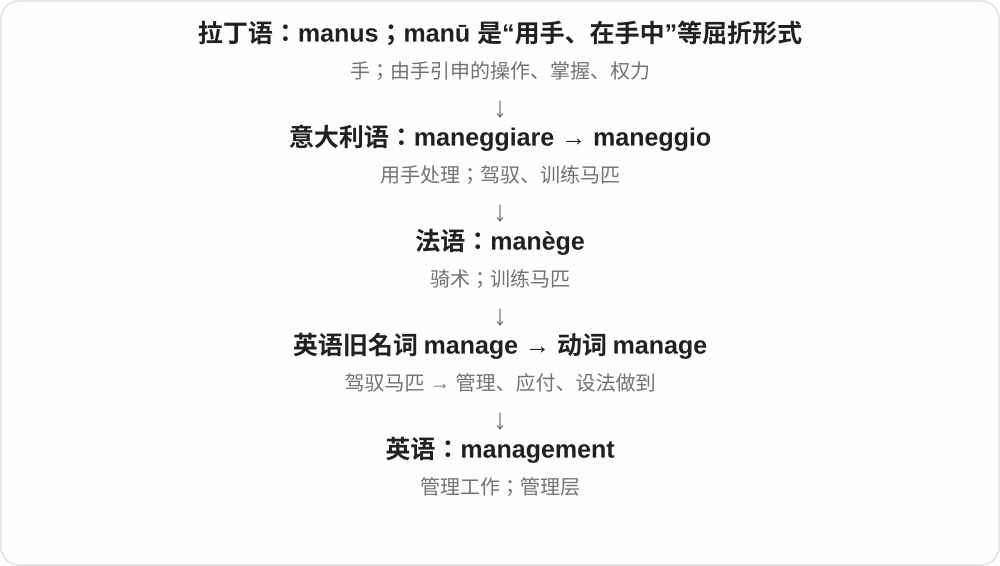

time management 是管理时间；senior management 是高层管理人员。第二种用法指人，不是抽象制度。

**常见搭配与例句**

project management；time management；senior management。

> Good time management leaves room for unexpected tasks.

把时间安排好，就能给突发任务留出余地。

> The staff raised the issue with management.

员工把问题反映给了管理层。

**别混淆**

administration 常偏制度运行、日常行政；management 更突出组织资源并负责结果，实际有重叠。

### 3. title — 标题、书名；头衔、称号；冠军；所有权等

**音标**：/ˈtaɪtəl/

**先抓住这个画面**

像给书、人或资格挂上一个名称标签：书的名字、人的职衔、赢下的冠军称号，都可以叫 title。某些场景也说拥有某物的权利。

**怎么拆**

接拉丁语 titulus 铭文、标签、标题、称号，经法语 title 与较早英语 titul 等路径延续，更远来源未定。由标识名称扩展到身份、资格与权利。

**怎么变成今天的意思**

**拉丁语 titulus → 法语、英语相关形式**  
铭文、标签、标题与称号

↓

**现代 title 的主要分支**  
书名；职衔、称号；冠军、所有权等

the title of a book 书名；a job title 职位名称；win the title 赢得冠军；title to property 对财产的所有权。也能作动词给……命名。

**常见搭配与例句**

a title page；the world title。

> What is the title of the book?

这本书叫什么名字？

> She won the national title last year.

她去年获得了全国冠军。

**别混淆**

title 是名称或称号，topic 是主题。书的 title 可以很短，主题却是书讨论的内容；体育 title 通常是冠军名号。

### 4. entitle — 使有权享有；给……题名

**音标**：/ɪnˈtaɪtəl/

**先抓住这个画面**

一张票让你有权进入，一个资格让你可享某项服务，就是 entitle you to。它还保留给书、作品取标题的用法。

**怎么拆**

经法语接晚期拉丁 intitulare，in- 与 titulus 标题、名号材料；现代可对应 en- + title，不只限于头衔。

**怎么变成今天的意思**

**晚期拉丁 intitulare → 法语 entiteler 等**  
给以名称、头衔

↓

**英语 entitle → entitlement**  
命名；使享有权利 → 相应权利或应得感

entitle someone to something 使某人有权享有；be entitled to do 有权做；a book entitled ... 一本题为……的书。

**常见搭配与例句**

be entitled to；a book entitled。

> The ticket entitles you to free entry.

这张票使你可以免费入场。

> She wrote a book entitled Small Changes.

她写了一本题为《小改变》的书。

**别混淆**

entitled to 说权利、资格，不只是想要；a film entitled ... 则在报片名，不是在说电影索要待遇。

### 5. entitled — 有资格、有权得到的；名为……的；自认应受优待的

**音标**：/ɪnˈtaɪtəld/

**先抓住这个画面**

be entitled to a copy 说有资格拿到一份；a book entitled “Home” 说书名；He’s entitled. 则常批评人觉得一切优待都理应归自己。

**怎么拆**

entitle + -ed；entitle 经法语接拉丁语给出标题、称号的材料，延伸到赋予资格、权利。自认理应得到优待的评价义又由应得感发展。

**怎么变成今天的意思**

**entitle 给名称、赋资格 + -ed**  
名为；有资格、权利的

↓

**entitled 的人物评价**  
自认无需付出就理应获得优待，常为贬义

be entitled to something 有权得到某物；be entitled to do 有权做某事；an entitled attitude 自认理应受优待的态度。

**常见搭配与例句**

feel entitled to something；a novel entitled “Home”。

> Every team member is entitled to a copy of the notes.

每位组员都有资格获得一份笔记。

> The essay is entitled “A Quiet Street”.

这篇文章题为《安静的街道》。

> His entitled attitude annoyed the other volunteers.

他那种自认理应受优待的态度让其他志愿者很不满。

**别混淆**

entitled to 的资格可以是中性客观描述；an entitled person 常是负面评价。不能把这两种语气混成所有有权得到都叫自私。

### 6. entitlement — 应享的权利、待遇；理所当然的应得感

**音标**：/ɪnˈtaɪtəlmənt/

**先抓住这个画面**

按规则你能享有的假期是 entitlement；一个人觉得别人处处该让着自己，则是 a sense of entitlement。一个谈资格，一个评价心态。

**怎么拆**

entitle + -ment，保留词末 e；名词可指享有的权利，也发展出主观应得感。

**怎么变成今天的意思**

**晚期拉丁 intitulare → 法语 entiteler 等**  
给以名称、头衔

↓

**英语 entitle → entitlement**  
命名；使享有权利 → 相应权利或应得感

↓

**entitle + -ment → entitlement**  
相应权利、待遇；认为自己理应享有的心态

holiday entitlement 应享假期；entitlement to benefits 享有福利的资格；a sense of entitlement 理所当然的应得感。

**常见搭配与例句**

holiday entitlement；a sense of entitlement。

> The contract explains your holiday entitlement.

合同说明了你享有的假期。

> His sense of entitlement annoyed the rest of the group.

他那种理所当然的应得感让其他组员反感。

**别混淆**

entitlement 不总是贬义：正式列出的假期权利是中性。带贬义的常是没有依据却自认应得的心态。

### 7. base — 基础；底座；基地；以……为依据；卑劣的〔另源〕

**音标**：英、美 /beɪs/

**先抓住这个画面**

让别的东西站得住、建得起来或展开行动的那一层。

**怎么拆**

基础名词经法语、拉丁语来自希腊语 basis“站立处”。base“低劣、卑鄙”另来自法语 bas、后期拉丁语 bassus“低”，不能把两个来源硬合。

**怎么变成今天的意思**

**古希腊语 bainein**  
走、迈步

↓

**古希腊语 basis → 拉丁语 basis**  
迈步、站立处 → 基座、基础

↓

**古法语 base → 中古英语 base → base**  
支撑底部；活动或判断的基础

↓

**英语 base 动词及各领域名词**  
以……为基础；基地、底座、化学上的碱

base a decision on evidence 是把证据作为决定的支撑。军事基地是行动的出发据点；化学 base 是能与酸发生相应反应的一类物质，不是地板。

**常见搭配与例句**

the base of a column；base A on B；a research base。

> The statue stands on a stone base.

雕像立在石座上。

> We based the decision on the available evidence.

我们依据现有证据作出了决定。

> The island served as a base for the research team.

这座岛是研究队的基地。

**别混淆**

basis 常指抽象依据；base 还能指实体底部、地点，也能作动词。base motives 的卑劣义另源。

### 8. basement — 地下室；地下楼层

**音标**：/ˈbeɪsmənt/

**先抓住这个画面**

一栋房子主要生活层的下面，还有一层或部分一层在地面以下，这就是 basement。可以储物，也可以装修成使用空间。

**怎么拆**

base 基底 + -ment，形成建筑较低部分、地下层的名词；这里不是给动词一律加尾表示动作。

**怎么变成今天的意思**

**base 底部 + -ment → basement**  
建筑的底部、较低楼层

↓

**常见现代 basement**  
全部或部分低于地面的楼层

in the basement 在地下室；a basement flat 地下层公寓；basement storage 地下室储物空间。

**常见搭配与例句**

in the basement；a basement flat。

> We keep the bicycles in the basement.

我们把自行车放在地下室。

> The basement has been converted into a studio.

地下室已改成工作室。

**别混淆**

basement 是位置、楼层，cellar 常尤其指储藏用地下室；basement 可以是有人生活、工作的空间。

### 9. treatment — 对待；治疗；处理方式

**音标**：/ˈtriːtmənt/

**先抓住这个画面**

treatment 把“怎样对待”变成可讨论的一整套做法：病人接受什么治疗，员工受到怎样的待遇，材料经过什么处理。

**怎么拆**

treat + -ment；-ment 形成动作、过程或结果名词，也可与法语 traitement 对照。

**怎么变成今天的意思**

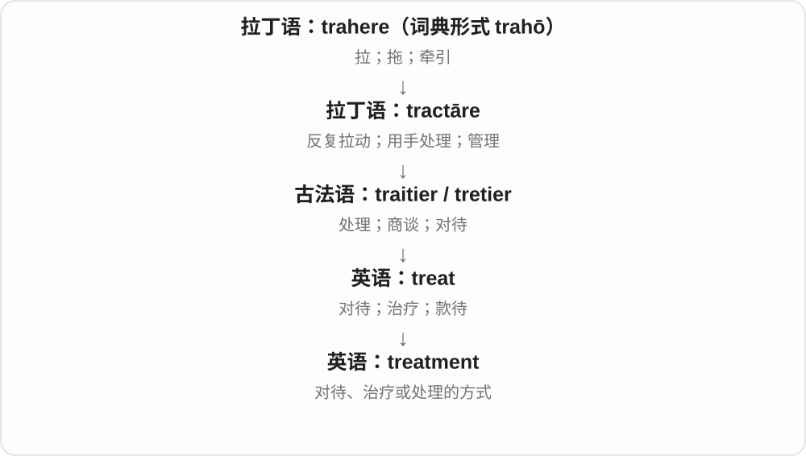

核心始终是对象被怎样处理。medical treatment 只是一支；equal treatment 说一视同仁，water treatment 说水处理。

**常见搭配与例句**

receive treatment；equal treatment；the treatment of…；water treatment；special treatment。

> All applicants should receive equal treatment.

所有申请者都应受到平等对待。

> The water passes through several stages of treatment.

这些水会经过几个处理阶段。

**别混淆**

treatment 可以指治疗过程；medicine 可以指药物或医学。一次治疗未必只靠吃药。

### 10. movement — 移动；动作；社会运动；乐章

**音标**：/ˈmuːvmənt/

**先抓住这个画面**

movement 可以是一只手挪了一下，也可以是许多人朝共同目标推动的一股社会力量。

**怎么拆**

经法语 mouvement 一支传入，现代对应 move + -ment；不是所有义项都在现代英语里新造。

**怎么变成今天的意思**

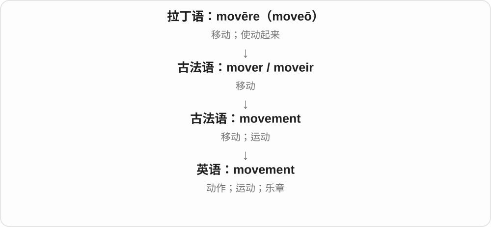

动作扩展为有组织的集体行动；音乐里的乐章则是大型作品中相对完整的一段。

**常见搭配与例句**

a sudden movement；the environmental movement；the first movement。

> A sudden movement in the bushes caught my attention.

灌木丛里突然的一动引起了我的注意。

> The orchestra played the final movement softly.

乐团轻柔地演奏了最后一个乐章。

**别混淆**

motion 常强调运动状态；movement 也可数，表示一个动作、一个运动或一个乐章。

### 11. statement — 声明；陈述；账单、对账单

**音标**：/ˈsteɪtmənt/

**先抓住这个画面**

把要表达的内容正式摆出来，形成一段可以引用、核对的话，就是 statement。银行把账目列出来，也叫 statement。

**怎么拆**

state（陈述）+ -ment（行为或结果）。

**怎么变成今天的意思**

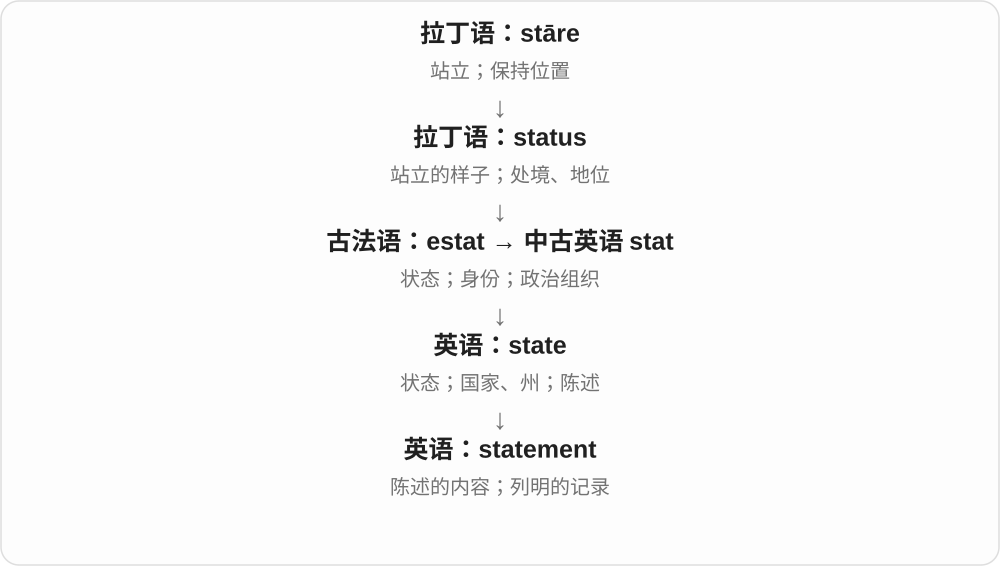

它从“说清楚一件事”扩展到书面的正式记录。衣着作 statement 时，是通过外观表达鲜明态度，不一定说出一句话。

**常见搭配与例句**

issue a statement；a witness statement；a bank statement；make a statement。

> The company issued a statement about the delay.

公司就延误发表了一份声明。

> I checked the charge against my bank statement.

我对照银行对账单核查了这笔收费。

**别混淆**

sentence 是语法上的一句话；statement 是一次陈述或所表达的内容，可能长达几段。

### 12. understatement — 轻描淡写；保守、低于实际的说法

**音标**：英 /ˌʌndəˈsteɪtmənt/；美 /ˌʌndərˈsteɪtmənt/

**先抓住这个画面**

已经累得站不住，却说有点累；说出口的分量比真实情况轻。

**怎么拆**

可按 under- 不足 + statement 分析，也对应 understate + -ment。它既可指修辞上的有意说轻，也可指实际陈述不足，不能一律当故意撒谎。

**怎么变成今天的意思**

**state〔陈述〕+ -ment → statement**  
把事情说出来的陈述、说法

↓

**under-/over-/re- 与 statement 组合**  
说轻、说过头、重新表达

↓

**under- + statement → understatement**  
说得低于实际；轻描淡写

To say I was tired would be an understatement. 说我累了都算轻的。常用 understatement 强调实际程度远超那个形容词。

**常见搭配与例句**

a huge understatement；a masterpiece of understatement；would be an understatement。

> Calling the journey difficult would be an understatement.

说这趟旅程艰难，都算轻描淡写。

> Her calm description was a remarkable piece of understatement.

她平静的描述把事情说得格外轻。

**别混淆**

understatement 说轻；overstatement 说过头。underestimate 是估计偏低，未必已经向别人作了陈述。

### 13. overstatement — 夸大；超过实际的陈述

**音标**：英 /ˌəʊvəˈsteɪtmənt/；美 /ˌoʊvərˈsteɪtmənt/

**先抓住这个画面**

东西有点好，却说成全世界最好；陈述往实际之上抬得过高。

**怎么拆**

overstate + -ment，也可看成 over- 过量 + statement。名词指夸大这个做法或具体那句话。

**怎么变成今天的意思**

**state〔陈述〕+ -ment → statement**  
把事情说出来的陈述、说法

↓

**under-/over-/re- 与 statement 组合**  
说轻、说过头、重新表达

↓

**overstate + -ment／over- + statement → overstatement**  
说过头、超过实际的表述

an overstatement of the benefits 夸大好处，without overstatement 不夸张地说。可谈数字、效果，也可谈人的评价。

**常见搭配与例句**

an overstatement of；a serious overstatement；without overstatement。

> Calling it a complete failure is an overstatement.

说它彻底失败，有些夸大。

> The report contains an overstatement of the likely benefits.

报告夸大了可能带来的好处。

**别混淆**

overstatement 是说过头；overestimate 是估计偏高。一个估计如果被公开说出，也可能同时属于两者。

### 14. agreement — 一致；协议；语法上的一致关系

**音标**：/əˈɡriːmənt/

**先抓住这个画面**

大家把意见或行动安排对齐了，可以是一种状态，也可以把约定写成一份协议。

**怎么拆**

名词经古法语 agrement 借入，与法语 agreer 同族。现代看得出 agree + -ment，但实际不是先有英语动词再首次造出这个名词。

**怎么变成今天的意思**

**拉丁 gratus**  
令人喜欢、受欢迎；也指心怀感谢

↓

**古法语 agreer → agrement → 中古英语 agrement**  
赞同 → 一致、约定

↓

**英语 agreement**  
同意的状态；达成的协议；语法一致

reach agreement 达成一致；sign an agreement 签协议。语法中 subject–verb agreement 说主语与动词在人称、数等方面配合，如 she walks 的 -s。

**常见搭配与例句**

reach an agreement；be in agreement；a written agreement。

> They reached an agreement after three meetings.

开了三次会后，他们达成了协议。

> There is broad agreement that the library needs more space.

大家普遍同意图书馆需要更大的空间。

**别混淆**

agreement 可只是意见一致；contract 通常指有法律意义的契约，不能见到 agreement 就推定其法律效力。

### 15. disagreement — 意见不合；分歧；不一致

**音标**：/ˌdɪsəˈɡriːmənt/

**先抓住这个画面**

把双方没能对齐的地方挑出来：可能是小看法不同，也可能是严重争执。

**怎么拆**

英语 dis- + agreement，或按 disagree + -ment 分析；两种现代构词解释都成立，远源同 agree。

**怎么变成今天的意思**

**拉丁 gratus**  
令人喜欢、受欢迎；也指心怀感谢

↓

**拉丁 gratum → 古法语 gré；a gré → agreer**  
喜欢、意愿；合心意地 → 接受、赞同

↓

**中古英语 agreen → agree**  
意见一致；接受；彼此相合

↓

**英语 agreement／disagree → disagreement**  
一致的否定；不同意这件事 → 分歧

a disagreement over money 为钱产生的分歧。in disagreement with the findings 也可说不认同研究结论，并不必然涉及人际冲突。

**常见搭配与例句**

a minor disagreement；disagreement over；resolve a disagreement。

> They resolved their disagreement over the schedule.

他们解决了对日程安排的分歧。

> There is disagreement among researchers about the cause.

研究者们对原因有不同意见。

**别混淆**

disagreement 不一定有争吵；argument 更容易指双方展开争论或一场口角。

### 16. equip — 装备、配备；使有能力

**音标**：/ɪˈkwɪp/

**先抓住这个画面**

人要登山，你给他靴子、绳索；新人要做事，你给他知识、技能：都是让人带齐需要的东西。

**怎么拆**

借法语 équiper，早期常用于船只的配员、装备，远接日耳曼语船只材料。不是 e- 电子加 quip。

**怎么变成今天的意思**

**法语 esquiper、équiper 等装备船只的材料**  
原与日耳曼语船只、配员材料相关

↓

**英语 equip → equipment**  
配备；所配备的器材与设备

equip someone with something 为某人配备……；equip someone to do 使某人具备做事能力；equipped 双写 p。

**常见搭配与例句**

equip with；equip to do；be equipped for。

> The rooms are equipped with small kitchens.

房间配有小厨房。

> The course equips students to work independently.

课程使学生具备独立工作的能力。

**别混淆**

equip 强调提供完成任务所需，decorate 是装饰；好看不等于装备齐全。

### 17. equipment — 设备、器材、装备

**音标**：/ɪˈkwɪpmənt/

**先抓住这个画面**

把露营用的帐篷、炉具、工具合起来谈，叫 equipment。它指一组完成事情所需的东西，不必每件都是大型机器。

**怎么拆**

equip + -ment，与法语 équipement 对应；这里 -ment 指装备活动所提供的器材。

**怎么变成今天的意思**

**法语 esquiper、équiper 等装备船只的材料**  
原与日耳曼语船只、配员材料相关

↓

**英语 equip → equipment**  
配备；所配备的器材与设备

↓

**equip + -ment → equipment**  
配备的器材、工具，整体称呼

camping equipment 露营装备；a piece of equipment 一件设备；通常不可数，不按普通复数加 s。

**常见搭配与例句**

camping equipment；a piece of equipment。

> No special equipment is needed for the activity.

这项活动不需要特殊设备。

> The laboratory bought three pieces of equipment.

实验室买了三件设备。

**别混淆**

equipment 常作整体不可数；要数件数说 two pieces of equipment，不能机械写 two equipments。

### 18. equipped — 配备了；具备所需条件的〔过去式、过去分词及分词形容词〕

**音标**：/ɪˈkwɪpt/

**先抓住这个画面**

出发或开工之前，把要用的东西准备在手边：equipped 就是已经配齐了。也可以把知识、技能当作做事所需的装备。

**怎么拆**

equip 重读末音节、末尾为单个元音字母加 p，双写 p 加 -ed：equipped。/p/ 后 ed 读 /t/。equip 借法语 équiper，早期常说船只的配员、配备。

**怎么变成今天的意思**

**法语 équiper → equip**  
配备船只等 → 为人、场所等准备所需东西

↓

**equip → equipped**  
双写 p 加 ed；已经配备或有能力应对

equipped with 配有……；equipped to do 有条件、能力做……；well equipped 配备齐全的。

**常见搭配与例句**

equipped with a projector 配有投影仪；better equipped to solve problems 更有能力解决问题。

> The room is equipped with a large screen.

房间配有一块大屏幕。

> The training left us better equipped to handle unexpected problems.

培训让我们更有能力处理突发问题。

**别混淆**

equipped with 常介绍配了什么；equipped to 后常介绍能做什么。equipment 是不可数的设备名词，不是 equipped 的另一种时态。

### 19. environment — 环境；周围条件；自然环境

**音标**：英 /ɪnˈvaɪrənmənt/；美 /ɪnˈvaɪrənmənt/

**先抓住这个画面**

把一个人、动物或系统放在中间，四周影响它的条件合起来，就是 environment。

**怎么拆**

历史接法语 environ 周围、environner 围绕，现代可按 environ + -ment 对应分析；viron 的更远背景与转圈有关。不是 en- + iron 铁 + ment。

**怎么变成今天的意思**

**法语 environ 周围、environner 围绕 → environ、environment**  
围起来 → 周围状态、条件

↓

**现代 environment**  
影响人、物的周围条件 → 自然环境；工作与软件运行环境

a working environment 工作环境，the natural environment 自然环境，a test environment 测试环境；不只树木空气。

**常见搭配与例句**

the natural environment；a working environment；a test environment。

> Children need a safe environment in which to learn.

孩子们需要安全的学习环境。

> The application works in the test environment.

应用在测试环境中能运行。

**别混淆**

environment 环境不全是环保，development environment 是开发运行条件；environmental 后缀形容词重音也变化。

### 20. investment — 投资；投入；投资项目或资产

**音标**：/ɪnˈvestmənt/

**先抓住这个画面**

可以是投入资源的动作，也可以是投入出去的那笔钱或买下的资产。

**怎么拆**

invest + -ment；早期也与授予职位、披上职服有关，现代主要保留金融及时间精力投入义。

**怎么变成今天的意思**

**拉丁 vestis / vestire**  
衣服／给……穿衣

↓

**拉丁 in- + vestire → investire；法语／拉丁语 → 英语 invest**  
给人披上衣服、职服 → 赋予职位、权力

↓

**金融义的同源支线：意大利 investire 的特殊用法，很可能影响英语 invest**  
给资本一种新形式 → 投入资金以求收益；后来也投入时间、精力

↓

**英语 invest + -ment → investment**  
投入的行为；后来也指所投金额、项目或资产

investment in training 是培训投入；an investment 可以是一项投资资产。a good investment of time 强调时间花得值得，并不一定涉及钱。

**常见搭配与例句**

investment in；public investment；an initial investment；an investment of time。

> The new library represents a major investment in public education.

新图书馆代表了对公共教育的一项重大投入。

> Learning to type well was a useful investment of time.

花时间练好打字很值得。

**别混淆**

expense 说支出，investment 强调对未来价值的期待；asset 是持有的资产，未必正在发生新的投入。

### 21. payment — 支付；付款；支付的一笔钱

**音标**：/ˈpeɪmənt/

**先抓住这个画面**

付钱这个动作、这次交易和那一笔金额，都可以在相应语境里叫 payment。

**怎么拆**

经古法语 paiement 借入，现代可对应 pay + -ment；-ment 形成动作、结果名词，不要把历史只画成英语临时加后缀。

**怎么变成今天的意思**

**拉丁 pācāre → 中世纪拉丁相关用法**  
使平静、平息 → 满足、结清

↓

**古法语 paiement → 英语 payment**  
给付行为；一次付款或款项

make a payment 是付一笔钱，payment in advance 是预付，monthly payments 是按月支付的各笔钱；payment method 是支付方式。

**常见搭配与例句**

make a payment；payment method；payment in advance；monthly payments。

> We received your payment yesterday.

我们昨天收到你的付款。

> Which payment methods do you accept?

你们接受哪些支付方式？

**别混淆**

pay 作名词常指工作报酬，payment 范围更广，可是货款、服务费、分期款等；a pay 不常用来数普通一笔付款。

### 22. repayment — 偿还、归还；偿还款、还款

**音标**：/rɪˈpeɪmənt/ 或 /ˌriːˈpeɪmənt/

**先抓住这个画面**

之前借入或欠下的，现在把钱还回去；re- 在这儿常有回去、偿还，不只是随便又付一次。

**怎么拆**

repay + -ment 形成动作、款项名词，也可现代对照 re- + payment。pay 的较早法语、拉丁背景不在每次还款时重新造一遍。

**怎么变成今天的意思**

**pay → payment；法语 paiement 等有对应历史**  
支付 → 支付行为、款项

↓

**前缀与 repay 的派生**  
re- 还回；over- 过多；under- 不足；non- 未支付

↓

**repay + -ment → repayment**  
偿还行为；归还的一笔款

loan repayment 贷款偿还，monthly repayments 每月还款，repayment of a debt 偿还债务。

**常见搭配与例句**

loan repayment；monthly repayments；repayment of a debt。

> They made the final repayment in June.

他们在六月付了最后一笔还款。

> The letter explained the repayment schedule.

信中解释了还款安排。

**别混淆**

repayment 归还欠款，payment 一般支付；prepayment 提前支付，时间在前不一定是偿还过去欠款。

### 23. apartment — 公寓；一套独立住宅

**音标**：英 /əˈpɑːtmənt/；美 /əˈpɑːrtmənt/

**先抓住这个画面**

想象一栋楼被分成几套可以分别居住的空间，其中一套就是 apartment。重点是划出独立使用的一部分。

**怎么拆**

英语借自法语 appartement，前面有意大利语 appartamento 等“分开、独立空间”词形。apart + -ment 可以帮助认形，但不是英语现场造出的全过程。

**怎么变成今天的意思**

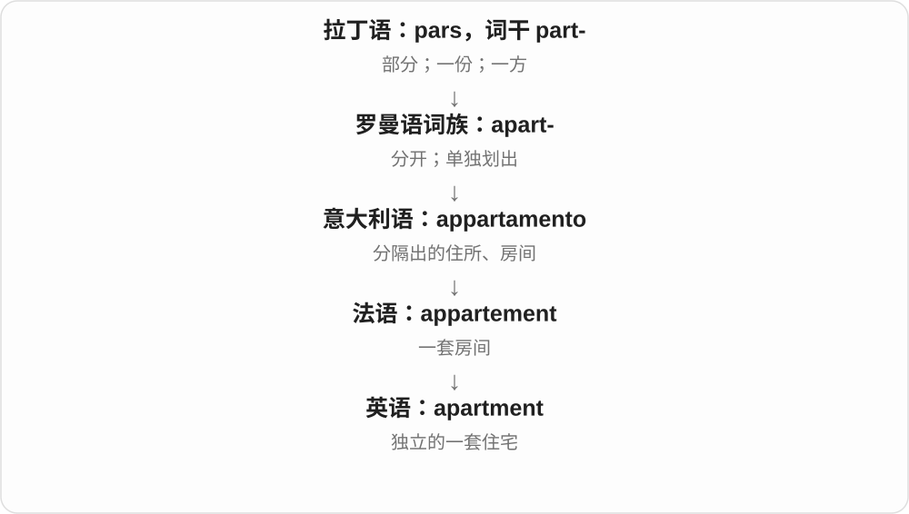

从“划开来的一部分”变成供一个住户使用的一套房间。现代美式英语常用 apartment，英式日常常说 flat。

**常见搭配与例句**

rent an apartment；an apartment building；a studio apartment。

> They rent a small apartment near the station.

他们在车站附近租了一套小公寓。

> Our apartment has two bedrooms and a balcony.

我们的公寓有两间卧室和一个阳台。

**别混淆**

apartment 是楼中的一套住宅；building 是整栋建筑。不能因为中文叫“公寓楼”就把整楼一律称为 an apartment。

### 24. argue — 争论、争吵；论证、主张

**音标**：英 /ˈɑːɡjuː/；美 /ˈɑːrɡjuː/

**先抓住这个画面**

可以是两个人各不相让地争，也可以是作者安静地拿理由支持观点。共同点是把自己的主张推到台面上。

**怎么拆**

经法语 arguer 接拉丁 arguere 显示、证明、指责；不是只从今天吵架义往回解释。

**怎么变成今天的意思**

**拉丁 arguere 显示、证明、指责 → 法语 arguer**  
把理由、指控摆出来

↓

**英语 argue；拉丁 argumentum 经法语 → argument**  
论证、争论；理由或争吵

argue with someone 与某人争论；argue about a topic 争论话题；argue that 主张；argue for/against 为某观点提供支持或反对理由。

**常见搭配与例句**

argue that；argue with；argue for/against。

> They argued about who should pay.

他们为该谁付钱争论。

> The author argues that the policy needs to change.

作者论证这项政策需要改变。

**别混淆**

argue that 在论文里通常是提出论证，不一定是发火。quarrel 更聚焦争吵、失和。

### 25. argument — 争论、争吵；理由、论证；参数〔计算机〕

**音标**：英 /ˈɑːɡjumənt/；美 /ˈɑːrɡjumənt/

**先抓住这个画面**

日常 an argument 可是一场争吵；写作里 an argument 则是一条有理由支撑的主张。先看场景，再决定中文。

**怎么拆**

经法语接拉丁 argumentum 证明、理由；现代对应 argue 去 e 加 -ment。计算机的参数义是另一项专门发展。

**怎么变成今天的意思**

**拉丁 arguere 显示、证明、指责 → 法语 arguer**  
把理由、指控摆出来

↓

**英语 argue；拉丁 argumentum 经法语 → argument**  
论证、争论；理由或争吵

↓

**argumentum → argument**  
理由、论证；争论事件；后有技术用法

have an argument 争吵；an argument for/against 支持、反对理由；a convincing argument 有说服力的论证；pass an argument 向函数传参。

**常见搭配与例句**

have an argument；a strong argument；a function argument。

> They had an argument about the budget.

他们为预算吵了一架。

> She presented a clear argument for keeping the library open.

她给出了保留图书馆开放的清晰理由。

**别混淆**

argument 不总是情绪冲突；a strong argument 可能在夸逻辑有力。编程中的 argument 也不是函数之间在吵架。

### 26. arguments — 理由、论证；争论；参数〔复数〕

**音标**：英 /ˈɑːɡjəmənts/；美 /ˈɑːrɡjəmənts/

**先抓住这个画面**

为了让别人看明白，你拿出的一套理由，是 arguments；双方互不认同时，这种来回论说又可成为争论。程序里的参数则是另一项专业用途。

**怎么拆**

argument + -s，/t/ 后读 /s/。法语 argument 接拉丁 argūmentum 证明、理由，联系 arguere 讲明、证明；现代与 argue、-ment 对照，但名词有独立借入历史。

**怎么变成今天的意思**

**拉丁 arguere、argūmentum → 法语、英语 argument**  
讲明、证明 → 理由、论证

↓

**argument + -s → arguments；不同语域扩展**  
多项理由、争论；程序调用传入的参数

arguments for and against 赞成、反对的理由；strong arguments 有力论证；function arguments 函数参数。

**常见搭配与例句**

arguments presented in the report；arguments about the plan。

> The report presents arguments for and against the change.

报告列出支持和反对这项改变的理由。

> The function accepts two arguments.

这个函数接收两个参数。

**别混淆**

arguments 不一定是吵架，文章里的 arguments 常是支持观点的理由链。写程序时传给函数的 arguments 则按技术语境理解。

### 27. argued — 论证了、主张了；争论了、争吵了〔过去式、过去分词〕

**音标**：英 /ˈɑːɡjuːd/；美 /ˈɑːrɡjuːd/

**先抓住这个画面**

把理由摆出来，想让一种看法站得住，是 argued。双方互不相让时会变成争论、争吵，但研究文章里的 argued 常是提出论点。

**怎么拆**

argue 去 e + -ed → argued，末尾读 /d/。经法语 arguer 接拉丁 arguere 使清楚、显示、证明；传入法语的中间环节有不同分析，英语论证义很早存在。

**怎么变成今天的意思**

**拉丁 arguere → 法语 arguer → argue**  
使人看清、证明 → 提理由论证

↓

**argue 去 e + -ed → argued**  
过去论证、主张；与人争论

argued that... 主张……；argued for change 为改变提出理由；argued with him 与他争论。

**常见搭配与例句**

argued against the plan 提出反对计划的理由；argued about the route 为路线争执。

> The author argued that the policy needed to change.

作者论证说，这项政策需要改变。

> They argued about which route to take.

他们为走哪条路线争执。

**别混淆**

argued that 在论文里通常不是吵架，而是作者基于理由提出看法。argued with somebody about something 才明确谁和谁就什么争论。

### 28. arguing — 争论、争吵；论证、主张〔现在分词、动名词〕

**音标**：英 /ˈɑːɡjuːɪŋ/；美 /ˈɑːrɡjuːɪŋ/

**先抓住这个画面**

把理由摆出来，让别人接受自己的看法，是 arguing 的一面；双方互不相让、话来话往，就会成为争吵。先看是在讲理由，还是在闹分歧。

**怎么拆**

argue 去 e 加 -ing → arguing，保留 u。argue 经法语接拉丁 arguere 显示、证明、指责，意义不只从现代吵架开始。

**怎么变成今天的意思**

**拉丁 arguere → 法语 arguer → argue**  
显示、证明 → 用理由主张；也有争吵

↓

**argue 去 e 加 -ing → arguing**  
正在论证、争论；或争论这一行为

arguing that 主张、论证说；arguing with someone 与某人争论；arguing about something 为某事争论。

**常见搭配与例句**

arguing for change 论证应当改变；arguing against the proposal 提理由反对提案。

> The article is arguing for a simpler system.

这篇文章在论证应当采用更简单的系统。

> They spent an hour arguing about the schedule.

他们为日程安排争论了一个小时。

**别混淆**

arguing that 后面是要证明的观点，不一定有人吵起来；arguing with 后面点出争论对象。argument 也可能是论点、论证，不只争吵。

### 29. argues — 争论、争辩；提出理由、主张〔第三人称单数〕

**音标**：英 /ˈɑːɡjuːz/；美 /ˈɑːrɡjuːz/

**先抓住这个画面**

把理由摆出来支持自己的说法，就是 argues。有时双方争执，有时是一篇文章平静地论证观点。

**怎么拆**

argue + -s，元音后读 /z/。argue 经法语 arguer 接拉丁 arguere 显示、证明、指责，争吵只是现代用法的一部分。

**怎么变成今天的意思**

**拉丁 arguere → 法语 arguer → argue**  
显示、证明、指责 → 说理、争论

↓

**argue + -s → argues**  
某人或文章提出理由、争辩

argues that... 主张并论证……；argues with someone 和人争辩；argues for a change 论证应改变。

**常见搭配与例句**

argues against the proposal 反对并说明理由；argues about details 争论细节。

> The author argues that the design should be simpler.

作者认为设计应更简单，并作了论证。

> He often argues with his brother about football.

他常和自己的兄弟争论足球。

**别混淆**

an article argues that 不表示文章在发脾气，而是它提出了有理由支持的观点。argues 是现在形式，argued 才是过去式。

### 30. entertainment — 娱乐；文娱活动；招待

**音标**：英 /ˌentəˈteɪnmənt/；美 /ˌentərˈteɪnmənt/

**先抓住这个画面**

entertainment 像有人安排节目、游戏或表演，把大家的注意力留在愉快的事情上。

**怎么拆**

经中古英语 entretenement 借自古法语 entretenement，早有维持、供养、接待义；不是仅在现代英语 entertain 后加 -ment 才出现。

**怎么变成今天的意思**

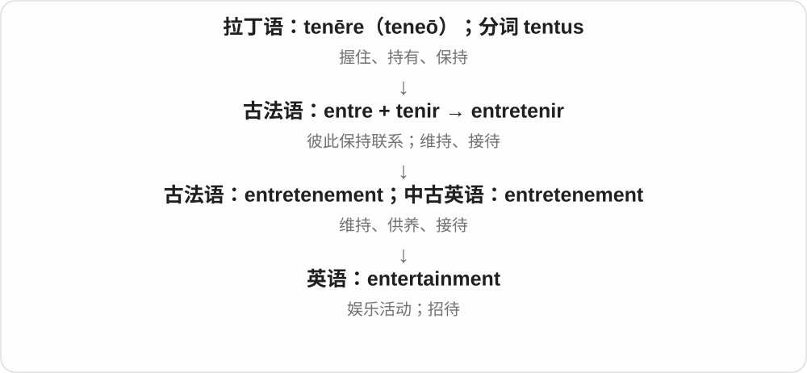

从维持、接待发展到使人愉快的活动。现在多说娱乐内容或节目，不只是招待客人的饭菜。

**常见搭配与例句**

live entertainment；the entertainment industry；provide entertainment。

> The festival offers live entertainment for all ages.

节庆活动为各年龄的人提供现场演出。

> We brought a few board games for entertainment on the trip.

我们带了几款桌游，在旅途中消遣。

**别混淆**

entertainment 是供人欣赏、消遣的活动；amusement 更常说被逗乐、觉得有趣的感受。

### 31. entertainments — 娱乐节目、娱乐活动〔复数〕

**音标**：英 /ˌentəˈteɪnmənts/；美 /ˌentərˈteɪnmənts/

**先抓住这个画面**

泛说娱乐是 entertainment；把一场场演出、游乐节目拿来分别数，就可用 entertainments。

**怎么拆**

entertainment + -s。名词经中古英语借古法语 entretenement，早有维持、招待义，现代与 entertain + -ment 对应但并非仅由现代英语新造。

**怎么变成今天的意思**

**拉丁 tenere 保持 → 法语 entre + tenir → entretenir**  
维持、接待、彼此维系等用途

↓

**古法语 entretenement → 英语 entertainment → entertainments**  
招待、供养等历史义 → 娱乐；具体娱乐节目

an evening of entertainments 可说一晚多种节目；具体、可分别安排的活动，才容易这样用复数。

**常见搭配与例句**

public entertainments 公共娱乐活动；a programme of entertainments 娱乐节目安排。

> The festival offers a variety of entertainments for children.

节庆为儿童安排了多种娱乐活动。

> The evening entertainments included music and comedy.

晚间娱乐节目包括音乐和喜剧。

**别混淆**

entertainment 泛说娱乐时常不可数；entertainments 更像一项项节目，不把所有抽象娱乐都机械加 -s。

### 32. employment — 就业；受雇；使用

**音标**：英、美 /ɪmˈplɔɪmənt/

**先抓住这个画面**

一个人有工作并处于受雇状态；更正式的用法也能说某种方法被使用。

**怎么拆**

employ + -ment，英语名词后缀把雇用、运用这个动作或状态提出来。

**怎么变成今天的意思**

**拉丁语 plicare**  
折叠、使相接；与编织、弯曲一组词有更早联系

↓

**拉丁语 in- + plicare → implicare**  
卷进去、牵连在内

↓

**古法语 emploiier / employer → 英语 employ**  
使投入某种用途；运用、雇用

↓

**英语 employ + -ment → employment**  
受雇状态；雇用；使用

seek employment 是求职；employment opportunities 是就业机会。employment of a method 较正式，指方法的运用。

**常见搭配与例句**

employment opportunities；terms of employment；full employment。

> The training helped her find permanent employment.

培训帮助她找到了一份长期工作。

> The report discusses the employment of digital tools in teaching.

报告讨论了数字工具在教学中的运用。

**别混淆**

job 通常是一个具体职位；employment 多作为不可数名词说就业或雇用状态。

### 33. retirement — 退休、退役；退休后的生活；退隐

**音标**：英 /rɪˈtaɪəmənt/；美 /rɪˈtaɪərmənt/

**先抓住这个画面**

可以说退休这次转变，也可说离开职业岗位后的那段生活。retirement party 为这次转变庆祝，life in retirement 讲之后怎么过。

**怎么拆**

借法语 retirement，接 retirer 退出；现代对应 retire + -ment。名词有自己的借入链，不必假定一定在英语中由较早动词临时新造。

**怎么变成今天的意思**

**法语 re- 回去 + tirer 拉 → retirer**  
抽回、退出；后半的更深来源不确定

↓

**法语 retirer → retirement → 英语 retirement**  
退出、退隐 → 退休行为及退休状态、生活

early retirement 提前退休，a retirement party 退休欢送会，life in retirement 退休生活，come out of retirement 退休后复出。

**常见搭配与例句**

early retirement；a retirement party；life in retirement；come out of retirement。

> The team organised a retirement party for her.

团队为她办了一场退休欢送会。

> He took up painting in retirement.

他退休后开始画画。

**别混淆**

retirement 是状态、阶段或行为，retiree 是人；come out of retirement 不代表每种制度都同样处理，词组先说从退役状态复出。

### 34. attach — 系上、装上、连接；附上；赋予〔重要性等〕

**音标**：/əˈtætʃ/

**先抓住这个画面**

把标签系到行李上，把文件附到邮件里，都是让一件东西连到另一件上。这个连上去的动作，是 attach 的核心。

**怎么拆**

经古法语 atachier、estachier 系住、固定等形式，较早在英语法律记录中也有扣押义。法语词基可能接日耳曼桩、柱词，与 stake 词族有关；更深路径带有不确定性。

**怎么变成今天的意思**

**古法语 atachier 等 → 英语 attach**  
系住、固定；较早英语也用于扣押

↓

**物理连接 → 文件附带、赋予重要性**  
把一件东西或一种评价加到对象上

attach a label to a bag 把标签系到包上；attach a file to an email 给邮件附文件；attach importance to something 重视某事；attach a condition 附加条件。

**常见搭配与例句**

attach something to something；attach great importance to。

> Please attach the receipt to your message.

请在消息中附上收据。

> We attach great importance to clear instructions.

我们非常重视清楚的说明。

**别混淆**

attach 是连接、附上；attachment 是附件或联系。attach importance to 是赋予重要性，后面的 to 是介词。

### 35. attached — 附着、连接着的；随附的；依恋、有感情的；attach 的过去式、过去分词

**音标**：/əˈtætʃt/

**先抓住这个画面**

一张标签连在箱子上，是 attached；一个人对住了多年的地方舍不得离开，也是 attached。连接可以在物体之间，也可以在感情里。

**怎么拆**

attach + -ed；/tʃ/ 后的词尾读 /t/，没有多一个 id 音节。从系住、连接的动词形成分词，并发展出感情上紧密相连的形容词义。

**怎么变成今天的意思**

**法语连接、固定词 → attach**  
把事物连起来

↓

**attach + -ed → attached**  
连着、附上的；感情上依恋

the attached file 随附文件；attached to the wall 固定在墙上；become attached to a place 对某地方产生感情；deeply attached to someone 深深依恋某人。

**常见搭配与例句**

Please see the attached ...；emotionally attached。

> The instructions are in the attached document.

说明在随附的文档里。

> I have become quite attached to this old house.

我已经对这栋老房子很有感情了。

**别混淆**

I attached the file 说做了附文件的动作；the attached file 说随附的文件。be attached to a person 可是感情联系，要结合对象理解。

### 36. attachment — 附件、附加装置；依恋、感情联系；连接、附着

**音标**：/əˈtætʃmənt/

**先抓住这个画面**

邮件后面带着的文件，吸尘器上接着的小刷头，心里舍不得的人或物，都有连在一起的共同画面。attachment 说连上的东西、状态或感情。

**怎么拆**

可对应 attach + 名词词尾 -ment。英语早期形式经法语 attachement 借入，较早法律义、后来的感情义和附加物义有各自的使用历史；电子邮件附件是在附加物义上的现代应用。

**怎么变成今天的意思**

**法语 attacher、attachement → 英语相关词**  
连接、固定；相关动作名词

↓

**attachment 的不同分支**  
感情联系；装接的部件、附带的文件

an email attachment 邮件附件；open the attachment 打开附件；an attachment for a vacuum cleaner 吸尘器配件；a strong attachment to home 对家的深厚感情。

**常见搭配与例句**

send something as an attachment；an emotional attachment。

> I sent the photos as an attachment.

我把照片作为附件发了过去。

> She still feels a strong attachment to her hometown.

她对家乡仍有深厚的感情。

**别混淆**

文件、附加装置可数：two attachments。依恋常作抽象名词，也可说 a strong attachment to ... 这种明确的感情联系。

### 37. attachments — 附件、配件；依恋、感情联系〔复数〕

**音标**：/əˈtætʃmənts/

**先抓住这个画面**

附在主体旁、跟主体配合的东西，是 attachments：邮件带的文件、机器装上的配件。感情里则是人与对象之间牵住的联系。

**怎么拆**

现代可认 attach + -ment → attachment；早期英语也借法语 attachement。现在 attachment 加 -s，/t/ 后读 /s/。

**怎么变成今天的意思**

**法语 attachement；英语 attach + -ment**  
附着、联系以及相应状态、事物

↓

**attachment 的附加物用途；+ -s → attachments**  
多个邮件附件、器具配件或感情联系

email attachments 邮件附件；vacuum cleaner attachments 吸尘器配件。

**常见搭配与例句**

open the attachments 打开附件；different attachments 不同配件。

> The email has two attachments.

这封邮件带了两个附件。

> The vacuum cleaner came with several attachments.

这台吸尘器配了几个附件。

**别混淆**

attachment 是附加在主体上的东西，设备 interface 是连接、交互的界面或接口，不能当成配件的通用同义词。

### 38. appointment — 预约、约会；任命；职位

**音标**：英、美 /əˈpɔɪntmənt/

**先抓住这个画面**

双方已经把某件事安排在日程上，或者组织已经把某个人安排到岗位上。

**怎么拆**

借自古法语 apointement，源于 apointier；现代可联系 appoint + -ment，但名词有自己的法语借入路线。

**怎么变成今天的意思**

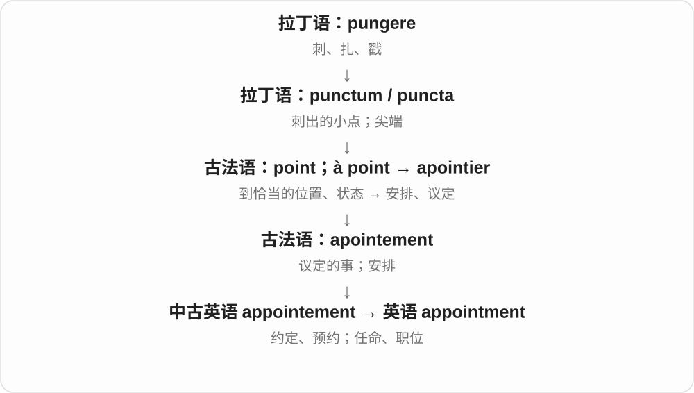

a dental appointment 是看牙预约；her appointment as manager 是她被任命为经理。make an appointment 是约好时间，keep an appointment 是按约前往。

**常见搭配与例句**

make an appointment；by appointment；appointment as…。

> I have a dental appointment at ten.

我约了十点看牙。

> Her appointment as editor was announced yesterday.

昨天公布了任命她为编辑的消息。

**别混淆**

meeting 是实际会面或会议；appointment 强调事先约定的时间，也能完全没有会面义而指任命。

### 39. disappointment — 失望；令人失望的事物

**音标**：英、美 /ˌdɪsəˈpɔɪntmənt/

**先抓住这个画面**

期待落空后的那一下失落，也可以指造成这份失落的东西。

**怎么拆**

现代可按 disappoint + -ment 理解；历史上可能是英语本土派生，也可能借自法语 désappointement，两种分析都有词典支持。

**怎么变成今天的意思**

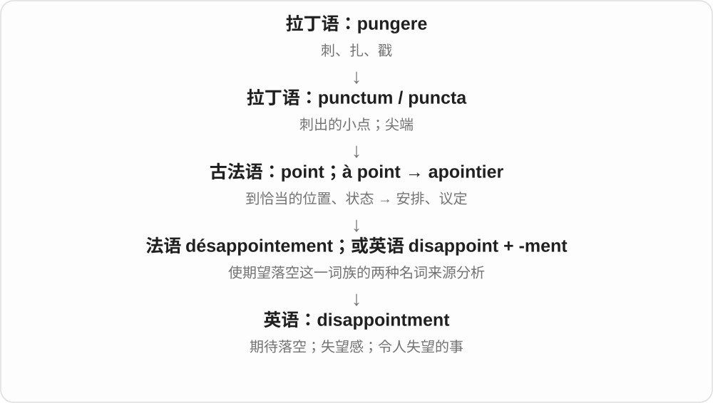

to my disappointment 是“令我失望的是”；a disappointment 可指一场没达到期待的活动或作品。不可数、可数用法要随意思变化。

**常见搭配与例句**

hide one’s disappointment；to someone’s disappointment；a major disappointment。

> She could not hide her disappointment when the trip was cancelled.

旅行取消时，她掩饰不住失望。

> The exhibition was a disappointment after all the publicity.

宣传那么热闹，展览实际却令人失望。

**别混淆**

regret 常是对做过或没做的事后悔；disappointment 是结果没达到希望。

### 40. settlement — 定居点；和解协议；解决；结算

**音标**：/ˈsetəlmənt/

**先抓住这个画面**

settlement 把 settle 的结果装进一个名词：人落脚形成住处，争议落定形成协议，账款落定形成结算。

**怎么拆**

settle + -ment；同时继承 settle 在定居、安定以及和解方面的多条意义。

**怎么变成今天的意思**

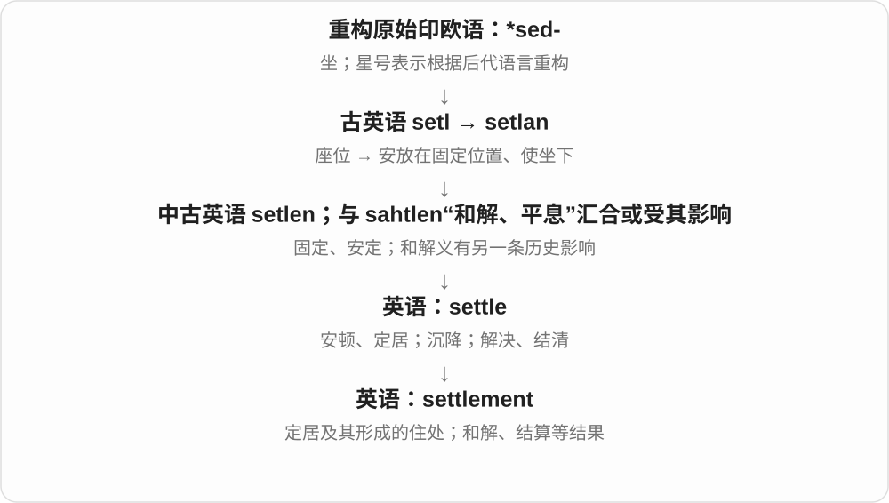

a small settlement 是小型聚居点；reach a settlement 是达成和解；payment settlement 谈款项结算。不要看到同一词就套同一个中文译法。

**常见搭配与例句**

a rural settlement；reach a settlement；a settlement agreement；final settlement。

> The road connects several small settlements in the valley.

这条路连接了山谷中的几个小型聚居点。

> The parties reached a settlement before the trial.

各方在开庭前达成了和解。

> Final settlement of the invoice is due next month.

这张发票对应款项应在下个月结清。

**别混淆**

village 指村庄；settlement 强调人们定居形成的聚居点。agreement 可是任何协议，settlement 常让一项争议或未了事项落定。

### 41. assessment — 评估；评价结果；考核

**音标**：/əˈsesmənt/

**先抓住这个画面**

assessment 像把证据摆在桌上，仔细看过之后给出判断：现在是什么情况，有多少价值或风险。

**怎么拆**

assess + -ment，表示评估行为或所得结论。

**怎么变成今天的意思**

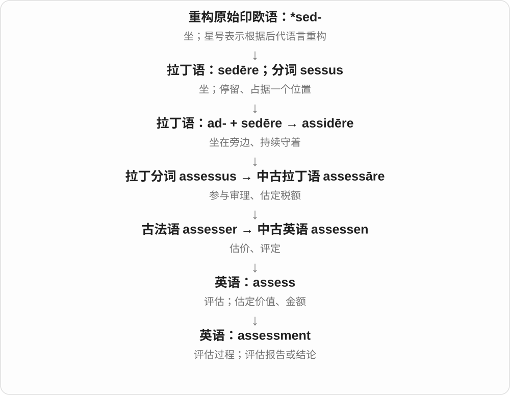

a risk assessment 是风险评估；a language assessment 可以是语言能力考核；an honest assessment 是坦诚评价。

**常见搭配与例句**

make an assessment；a needs assessment；continuous assessment。

> The team completed an assessment of the building’s condition.

团队完成了对建筑状况的评估。

> Her assessment of the situation proved accurate.

她对局势的判断后来证明是准确的。

**别混淆**

test 可以只是一次测试；assessment 可综合观察、测试和材料形成判断。

### 42. enforcement — 执行；强制落实；执法

**音标**：英 /ɪnˈfɔːsmənt/；美 /ɪnˈfɔːrsmənt/

**先抓住这个画面**

把规则从要求变成实际约束的过程。

**怎么拆**

古法语 enforcement 接 enforcier，借入英语；现代可拆 enforce + -ment，但名词有独立法语来源。

**怎么变成今天的意思**

**拉丁 fortis**  
强壮、坚固、勇敢；更早来源有不同分析

↓

**晚期拉丁 infortiāre → 古法语 enforcier**  
使强、加固、施力

↓

**古法语 enforcier → enforcement → 英语 enforcement**  
加强、强迫 → 规则的强制实施

law enforcement 是执法；enforcement of parking rules 是落实停车规则。它关注确保遵守的行为，和规则本身是否写得清楚是两个问题。

**常见搭配与例句**

law enforcement；strict enforcement；enforcement of regulations。

> Consistent enforcement helped everyone understand the parking rules.

一贯地执行规定，帮助大家明白了停车规则。

> The policy explains who is responsible for enforcement.

这份政策说明了谁负责执行。

**别混淆**

legislation 常说立法或法律条文；enforcement 是执行。制定了条文不等于落实工作已经完成。

### 43. placement — 放置；位置安排；岗位安置；实习安排

**音标**：英 /ˈpleɪsmənt/；美 /ˈpleɪsmənt/

**先抓住这个画面**

不仅有一个地方，还要把合适的东西或人安排到那个地方。

**怎么拆**

place 动词 + -ment，表示放置的行为、安排或结果。

**怎么变成今天的意思**

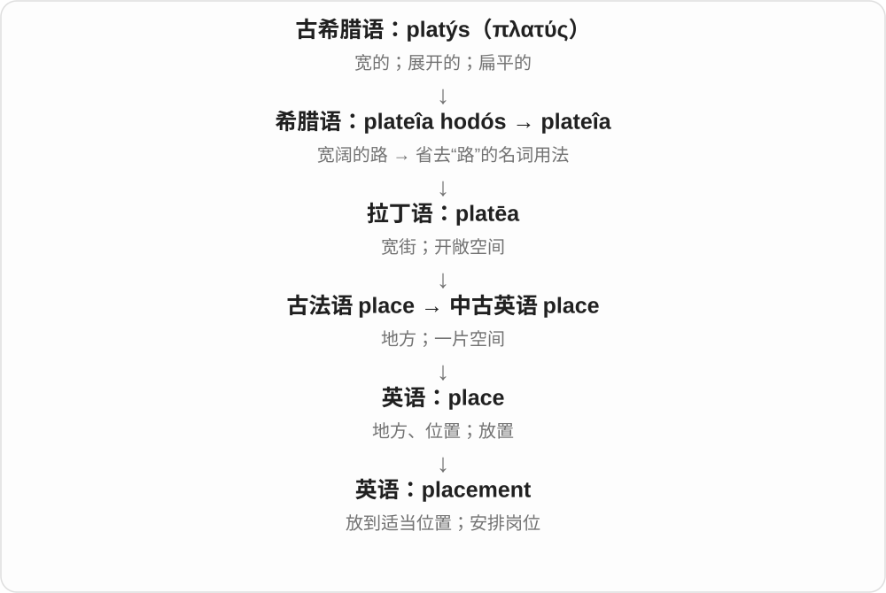

placement of furniture 是家具摆放；job placement 是就业安置；英式 work placement 常指实习安排。product placement 指影视等内容中的品牌植入。

**常见搭配与例句**

job placement；a work placement；product placement。

> The placement of the lights changes the mood of the room.

灯的位置安排改变了房间的氛围。

> She completed a work placement at a local museum.

她在当地博物馆完成了一段实习。

**别混淆**

placement 关注安排到某处；replacement 关注换一个来接替原来的。

### 44. replacement — 替换；替代品；接替者

**音标**：英 /rɪˈpleɪsmənt/；美 /rɪˈpleɪsmənt/

**先抓住这个画面**

旧的不能继续用了，接上来的那一个，或这个换上的过程，就是 replacement。

**怎么拆**

replace + -ment。

**怎么变成今天的意思**

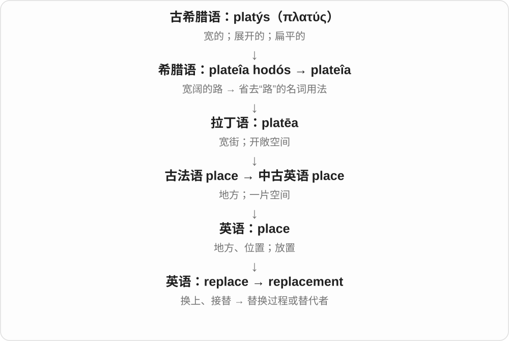

a replacement for the broken part 是坏零件的替代品；replacement costs 是更换成本。它不保证新东西与原物完全相同。

**常见搭配与例句**

a replacement part；a replacement for someone；need replacement。

> The company sent a replacement for the damaged lamp.

公司寄来一盏灯，替换损坏的那盏。

> The manager is looking for a replacement for the departing employee.

经理正在找人接替即将离职的员工。

**别混淆**

replacement 可指动作也可指新东西；substitute 更容易强调代用品或临时代替者，但用法有重叠。

### 45. displacement — 移位；流离失所；位移；排开量

**音标**：英 /dɪsˈpleɪsmənt/；美 /dɪsˈpleɪsmənt/

**先抓住这个画面**

抓住“从原处挪开”这一点，再看具体问的是人搬离、物体位置改变，还是水被排开多少。

**怎么拆**

与 displace + -ment 对应；词典也记录法语 déplacement 的借入联系，名词不必经过现代英语的一次临时造词。

**怎么变成今天的意思**

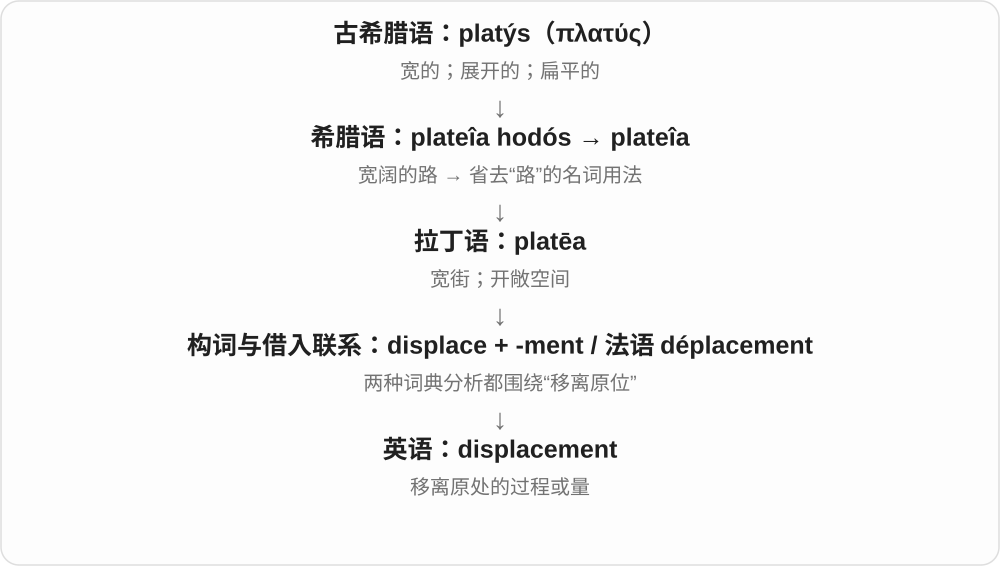

物理 displacement 是从起点到终点的带方向位置变化，不等于走过的总路程。人口 displacement 是被迫离开原住处。

**常见搭配与例句**

population displacement；water displacement；net displacement。

> After a complete lap, the runner’s displacement is zero.

完整跑一圈回到起点后，跑步者的位移为零。

> The report examines displacement caused by the earthquake.

报告考察了地震造成的人口迁离。

**别混淆**

绕操场一圈回到起点，distance 不为零，displacement 却为零。

### 46. commitment — 承诺；投入；承担的事务

**音标**：/kəˈmɪtmənt/

**先抓住这个画面**

commitment 像你把一部分未来时间、精力或责任已经交给一件事，不能只停在“我觉得不错”。

**怎么拆**

commit + -ment。

**怎么变成今天的意思**

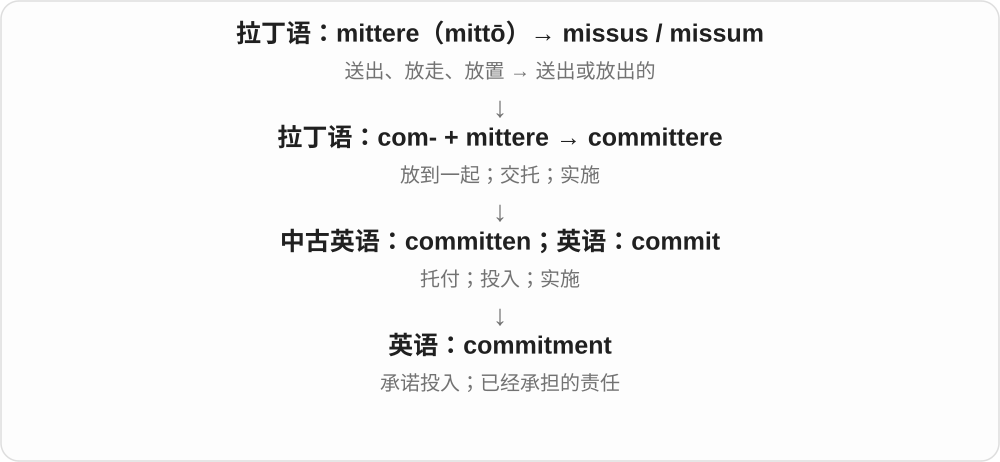

可以是持续认真的态度，也可以是具体约定：work commitments 是已经承担的工作事务，常会占用时间。

**常见搭配与例句**

commitment to…；make a commitment；a long-term commitment；work commitments。

> The project requires a serious commitment of time.

这个项目需要认真投入时间。

> I cannot attend because of a prior commitment.

我因为已有安排而无法参加。

**别混淆**

interest 是感兴趣；commitment 表示愿意投入、承担或已经作出承诺。

### 47. amendment — 修正；修改内容；修正案

**音标**：英、美 /əˈmendmənt/

**先抓住这个画面**

把“改了哪里”单独拿出来谈：一份草案后面附的一条更改，或会上提出的一项修正建议。

**怎么拆**

历史上借古法语 amendement，来自 amender“改善、修正”；现代形式容易认出 amend + -ment，但名词有自己的法语借入路线。

**怎么变成今天的意思**

**拉丁 menda／mendum**  
缺陷、瑕疵、错误

↓

**拉丁 e-〔ex-〕+ mend- → emendare**  
去掉错误 → 改正、改善

↓

**古法语 amender → amendement**  
改善、修正 → 改进、修正内容

↓

**英语 amendment**  
修改；后来常用于规则、法案等的修正案

an amendment to a proposal 是对提案的修改或修正案。propose an amendment 是提出修正，并不表示已经通过；adopt an amendment 才表示采纳。

**常见搭配与例句**

an amendment to the rules；propose an amendment；approve an amendment；a constitutional amendment。

> She proposed an amendment to the club’s rules.

她提出了一项俱乐部规则修正案。

> The revised draft includes three small amendments.

修订稿包含三处小改动。

**别混淆**

amend 是动作；amendment 是改动或修正案。appendix 只是附录，不一定修改原文。

### 48. achievement — 成就；实现、完成

**音标**：/əˈtʃiːvmənt/

**先抓住这个画面**

终于修好的桥、学会的新技能，都可以是 achievement：它强调做成了什么。

**怎么拆**

名词由法语 achevement 借入，法语里已经由 achever 派生；现代对应 achieve + -ment，不能只画成英语新造。

**怎么变成今天的意思**

**拉丁语：caput；属格 capitis**  
头；首领；顶端、主要部分

↓

**古法语 achever → achevement**  
完成 → 完成之事

↓

**中古法语 achevement → 英语 achievement**  
完成；成就

a major achievement 是重大成就；the achievement of a goal 是目标的实现。前者可数，后者强调过程时常不可数。

**常见搭配与例句**

a sense of achievement；academic achievement；a remarkable achievement。

> Finishing the course gave her a sense of achievement.

完成课程让她有了成就感。

> The bridge is an impressive engineering achievement.

这座桥是一项令人赞叹的工程成就。

**别混淆**

achievement 是做成的成果；ambition 是尚想实现的目标或抱负。

### 49. punishment — 惩罚；处罚；严酷折腾、损耗

**音标**：/ˈpʌnɪʃmənt/

**先抓住这个画面**

做错事后被施加不愉快的后果；再借来形容物品被摔打、压迫，就是“经受折腾”。

**怎么拆**

经盎格鲁法语 punisement／古法语 punissement 借入，法语基础是 punir。现代拆成 punish + -ment 很清楚，但历史上的名词并非只在英语里现造。

**怎么变成今天的意思**

**古希腊 poinē → 拉丁 poena**  
赔偿、罚金、处罚；后来也指折磨、痛苦

↓

**拉丁 punire → 古法语 punir**  
处罚

↓

**古法语 punissement／盎格鲁法语 punisement → 中古英语 punishement → punishment**  
施加惩罚；一次处罚；后来泛指严酷损耗

as punishment for 是作为对某事的惩罚。a bag that can take punishment 则是经得起折腾的包，描述耐用，不是真的给包定罪。

**常见搭配与例句**

punishment for cheating；a severe punishment；take a lot of punishment。

> The school replaced the punishment with a meeting to repair the harm.

学校把原定处罚改为一次讨论如何弥补伤害的会面。

> These boots can take a lot of punishment on rocky trails.

这双靴子在多石小路上很经得起折腾。

**别混淆**

punishment 是惩罚或承受的后果；penitence 是内心悔意。受到惩罚的人不一定已经后悔。

### 50. engagement — 订婚；约定活动；参与、投入、互动；交战、接合〔按语境〕

**音标**：/ɪnˈɡeɪdʒmənt/

**先抓住这个画面**

可以是一项婚约、早已约好的活动，也可以是人与内容持续接上、互动的程度；social media engagement 常说互动，不是平台在办婚礼。

**怎么拆**

借法语 engagement，现代对应 engage + -ment。承诺、接合、投入的不同分支进入名词，不只在英语里单一订婚义后造其他义。

**怎么变成今天的意思**

**法语 en gage、engagier → engage**  
在担保、承诺之下 → 使受约束、参与

↓

**多场景的联系与投入**  
吸引注意、雇请、订婚；机械接合；参与行动

↓

**法语 engagement → engagement；对应 engage + -ment**  
承诺、约定、订婚；投入、交战、接合等名词

an engagement ring 订婚戒指，a speaking engagement 演讲约定，student engagement 学生投入，audience engagement 观众互动。

**常见搭配与例句**

an engagement ring；a speaking engagement；student engagement；audience engagement。

> She wore a simple engagement ring.

她戴着一枚简洁的订婚戒指。

> The teacher used stories to improve student engagement.

老师用故事提高学生的投入程度。

**别混淆**

engagement 指标在不同平台有不同口径，别只凭一个词就假定完全相同；appointment 常具体预约，engagement 可较正式既定活动。

### 51. involvement — 参与；卷入；投入程度

**音标**：英 /ɪnˈvɒlvmənt/；美 /ɪnˈvɑːlvmənt/

**先抓住这个画面**

说的不是事情本身，而是一个人跟这件事究竟有多少关系、投入多少。

**怎么拆**

英语 involve + -ment，形成表示状态或参与关系的名词。

**怎么变成今天的意思**

**拉丁语 volvere；分词 volutus**  
滚、转、卷；卷起的

↓

**拉丁语 in- + volvere → involvere**  
卷进去、包住；牵连

↓

**拉丁语 → 英语 involve**  
涉及、包括；使参与

↓

**英语 involve + -ment → involvement**  
参与、牵涉的状态

社区活动中的 involvement 往往是主动参与；犯罪报道里的 involvement 则可能是卷入、涉案。这个词本身不能证明有罪。

**常见搭配与例句**

involvement in；parental involvement；direct involvement。

> The school encourages parents’ involvement in classroom activities.

学校鼓励家长参与课堂活动。

> He denied any involvement in the theft.

他否认与那起盗窃案有任何关系。

**别混淆**

participation 更直接指参加；involvement 还可包括责任、情感投入，或未亲自出场的牵连。

### 52. judgment — 判断；看法；判断力；判决〔也拼 judgement〕

**音标**：/ˈdʒʌdʒmənt/

**先抓住这个画面**

可以是你最后作出的结论，也可以是你作结论时表现出的能力：a judgment 是一次判断，good judgment 是判断得靠谱。

**怎么拆**

现代能看成 judge + -ment；历史上整体借古法语 jugement，来自 jugier“判断”，进入中古英语后形成今词。另有接晚期拉丁 iudicamentum 的词源分析，不要只画现代英语加后缀。

**怎么变成今天的意思**

**拉丁 ius 法、权利 + dicere 说的词根 → iudex，属格 iudicis**  
作出法律判定的人；法官

↓

**拉丁 iudicare → 古法语 jugier → jugement**  
判断这一动作及其结果

↓

**中古英语 juggement → 英语 judgment／judgement**  
判决；判断；判断力

use your judgment 是运用判断力；in my judgment 是依我看；a court judgment 是法院判决。judgement 常见于英式一般用法，judgment 也用于英式，尤其法律语境；美式通常用 judgment。

**常见搭配与例句**

exercise good judgment；a judgment call；reserve judgment；a court judgment。

> I trust your judgment on practical matters.

在实际问题上，我信任你的判断力。

> We should reserve judgment until we hear the full explanation.

在听到完整解释前，我们应暂缓下结论。

> The court published its judgment on Friday.

法院在周五公布了判决。

**别混淆**

opinion 强调看法；judgment 常带有经过权衡后作出评断的意思。good judgment 说能力，a good judgment 可以说一次正确或妥当的判断。

### 53. requirement — 要求；必要条件；需求

**音标**：英 /rɪˈkwaɪəmənt/；美 /rɪˈkwaɪrmənt/

**先抓住这个画面**

requirement 像一张写着“要做到这些”的清单，其中每一项都是做成事情需要满足的条件。

**怎么拆**

require + -ment，英语内部的名词派生；早期也有请求义，现代主要指所需的条件或东西。

**怎么变成今天的意思**

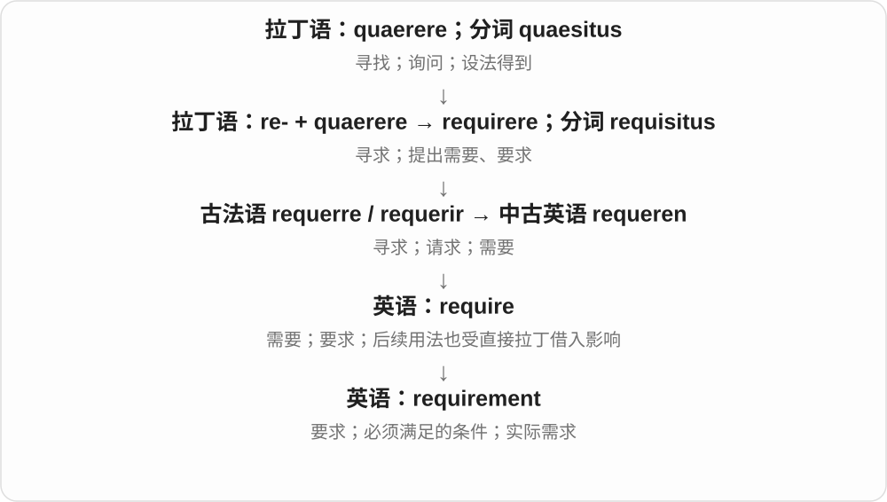

entry requirements 是入学或入境等准入条件；user requirements 是用户要解决的事情、需要的功能。复数 requirements 很常用，未必都来自法律。

**常见搭配与例句**

meet / satisfy a requirement；minimum requirements；entry requirements；user requirements。

> The laptop meets the software’s minimum requirements.

这台笔记本满足软件的最低要求。

> We discussed the users’ requirements before drawing the first design.

我们先讨论了用户的需求，再画第一版设计。

**别混淆**

request 是一次请求；requirement 是事情需要达到的条件。wish 只是愿望，不一定是硬性需求。

### 54. arrangement — 安排、约定；排列、布置；乐曲改编版本

**音标**：/əˈreɪndʒmənt/

**先抓住这个画面**

arrange 是把事情排好，arrangement 可以是排出来的样子，也可以是大家谈定的办法。

**怎么拆**

历史借法语 arrangement；现代可清楚对应 arrange + -ment。-ment 名词不只指过程，也能指做完后的布置、约定或作品。

**怎么变成今天的意思**

**古法语 reng/rang 行列 → arengier/arangier**  
把东西放成行、排好；reng 远接日耳曼语环形相关词

↓

**中古英语 → arrange**  
排好位置 → 安排事情、改编音乐

↓

**法语 arrangement → 英语 arrangement**  
排列、安排的结果；现代对照 arrange + -ment

make arrangements 做安排，travel arrangements 出行安排，a seating arrangement 座位布置，an arrangement of a song 一首歌的改编版本。

**常见搭配与例句**

make arrangements；by prior arrangement；a seating arrangement；a piano arrangement。

> We have made all the travel arrangements.

我们已经做好全部出行安排。

> This piano arrangement is easier than the original version.

这个钢琴改编版比原版容易。

**别混淆**

an arrangement 可以是一项约定；arrangements 复数常说一整套筹备事项。agreement 更强调双方同意，arrangement 更容易包含具体怎么办。

### 55. rearrangement — 重新安排；重新排列；调整后的布局

**音标**：/ˌriːəˈreɪndʒmənt/

**先抓住这个画面**

把位置和顺序重新排好这件事，或排出来的新样子。

**怎么拆**

现代可按 rearrange + -ment 理解，也能分析为 re- + arrangement；两种分析都围绕重新安排，不必虚构一个唯一的构词时刻。

**怎么变成今天的意思**

**英语 re-、arrange／arrangement**  
再一次安排的构词材料

↓

**rearrange + -ment／re- + arrangement → rearrangement**  
重新安排的过程、结果或具体调整

a rearrangement of the room 可以是房间布局调整；a rearrangement of the timetable 是日程重排。可数时常是一项具体变动，作为过程则可不可数。

**常见搭配与例句**

a rearrangement of the furniture；some minor rearrangements；a structural rearrangement。

> A simple rearrangement of the desks created more space.

把桌子简单重新摆放，就腾出了更多空间。

> The timetable required several minor rearrangements.

时间表需要作几处小调整。

**别混淆**

arrangement 说安排本身，rearrangement 明确已有一个安排在前；不是所有新安排都需要这个 re-。

### 56. excitement — 兴奋；激动；刺激的事

**音标**：/ɪkˈsaɪtmənt/

**先抓住这个画面**

被调动起来的那股劲，可以是心情，也可以是带来刺激的经历。

**怎么拆**

excite + -ment；词史也与法语 excitement 联系，现代情绪义后来发展得更突出。

**怎么变成今天的意思**

**拉丁 ciēre → citāre**  
使动起来、唤起 → 召唤、促动

↓

**拉丁 ex- + ciēre → excitāre → 法语 exciter**  
向外唤起、激发

↓

**英语 excite**  
使兴奋；激发

↓

**英语 excitement**  
激发、鼓动 → 兴奋状态或刺激事件

with excitement 常表示激动地；too much excitement 可以是刺激太多。excitement 通常不可数，指某一件好玩的事常改说 an exciting event。

**常见搭配与例句**

with excitement；a sense of excitement；cause excitement。

> Her voice shook with excitement.

她激动得声音发颤。

> There was a sense of excitement in the room.

房间里洋溢着兴奋的气氛。

**别混淆**

excitation 多用于科学的刺激、激发；excitement 是日常谈情绪的常用词。

### 57. measurement — 测量；测得的数值、尺寸

**音标**：英 /ˈmeʒəmənt/；美 /ˈmeʒərmənt/

**先抓住这个画面**

把“量一量”当成一个过程，或者把量出来的数记下来。

**怎么拆**

measure + -ment。

**怎么变成今天的意思**

**拉丁 mēnsūra → 晚期拉丁 mēnsūrāre**  
尺度 → 测量

↓

**古法语 mesurer → 英语动词 measure**  
量出尺寸；衡量

↓

**英语 measurement**  
测量这件事；测量得到的结果

take a measurement 是测一次或记一个数；take someone’s measurements 常是量做衣服所需的各个尺寸。measurement error 是测量误差，不一定是操作失误。

**常见搭配与例句**

take a measurement；accurate measurements；measurement error。

> Take three measurements and calculate the average.

测三次，然后算出平均值。

> The tailor wrote down my measurements.

裁缝记下了我的各项尺寸。

**别混淆**

measure 可是行动措施；measurement 通常不会表示政策措施。

### 58. harass — 不断烦扰、纠缠、骚扰

**音标**：/həˈræs/，也读 /ˈhærəs/

**先抓住这个画面**

一次次来打扰、施压，让人没法安宁。harass 的劲头在持续、反复，并且对方不欢迎这种行为。

**怎么拆**

借自法语 harasser 使疲惫、烦扰，更远来源未定，可能联系旧法语驱赶、挑动等材料。不能把 ha-、rass 硬拆成现代英语词根。

**怎么变成今天的意思**

**法语 harasser → 英语 harass**  
使疲惫、反复烦扰

↓

**现代不同场景的 harass**  
持续纠缠、骚扰或反复施压

harass someone with calls 用不断来电骚扰某人；be harassed at work 在工作中遭骚扰；harass someone for payment 不断催某人付款。搭配说明行为方式。

**常见搭配与例句**

repeatedly harass；harass someone online。

> She asked him to stop harassing her with repeated messages.

她要求他别再不断发消息骚扰她。

> The reporters harassed the actor for a comment.

记者们不断纠缠那位演员，想让他表态。

**别混淆**

annoy 可以是一次让人烦；harass 常有反复、持续施压的意味。具体行为性质由语境说明，不能只当普通打招呼。

### 59. harassment — 骚扰；反复烦扰、施压的行为

**音标**：英 /ˈhærəsmənt/；美常见 /həˈræsmənt/，也有 /ˈhærəsmənt/

**先抓住这个画面**

让一个人不断被纠缠、攻击或烦扰，难以安稳下来，这种行为就是 harassment。常突出反复侵扰、施压带来的困扰感。

**怎么拆**

harass + -ment，把骚扰的动作变成名词。harass 借法语 harasser 使疲惫、烦扰，更早来源未定；名词 harassment 是英语中的后续派生。

**怎么变成今天的意思**

**法语 harasser → 英语 harass**  
使疲惫、反复烦扰

↓

**harass + -ment → harassment**  
骚扰行为；遭受侵扰的状态

online harassment 网络骚扰；workplace harassment 工作场所骚扰；complaints of harassment 关于骚扰的投诉。

**常见搭配与例句**

report harassment；a policy on harassment。

> The company explained its policy on workplace harassment.

公司说明了处理工作场所骚扰的政策。

> She described the repeated messages as harassment.

她把那些反复发来的信息称为骚扰。

**别混淆**

harassment 通常不可数，描述一件具体事件可说 an incident of harassment。harass 是动作，harassed 可说受到侵扰的人或状态；名词 -ment 把行为本身拿出来讨论。

### 60. harassed — 受到骚扰、烦扰的；忙乱疲惫的；harass 的过去式、过去分词

**音标**：/həˈræst/，也读 /ˈhærəst/

**先抓住这个画面**

一层是别人不停来烦你；另一层是事情接连压过来，让人显得忙乱、疲惫。看人的处境和后面搭配来选。

**怎么拆**

harass + -ed。harass 的使疲惫、不断烦扰材料，进入分词后形成被烦扰的、忙乱的状态形容词；-ed 在这里常读 /t/。

**怎么变成今天的意思**

**harass + -ed**  
过去发生的烦扰；被烦扰

↓

**分词形容词 harassed**  
受骚扰的；被琐事折腾得忙乱的

feel harassed 感到被纠缠、受压力；look harassed 看起来忙乱疲惫；be harassed by someone 被某人骚扰。是否明确有骚扰者，要看句子。

**常见搭配与例句**

a harassed expression；a harassed parent。

> The receptionist looked harassed as the phones kept ringing.

电话不停地响，接待员显得忙乱不堪。

> She said she was being harassed by unwanted calls.

她说自己不断受到不请自来的电话骚扰。

**别混淆**

harassed 有时是忙乱神情的形容，不必每次都译成遭到某项明确骚扰。being harassed by someone 则直接给了行为者。

### 61. harassing — 正在骚扰；构成反复侵扰的

**音标**：/ˈhærəsɪŋ/，也读 /həˈræsɪŋ/

**先抓住这个画面**

一条攻击信息还没消停，下一条又追来，harassing messages 把这种侵扰性质点出来；动词形式则写骚扰正在发生。

**怎么拆**

harass + -ing；词尾双 s 本来就有，直接接 -ing，不再多加一个 s。

**怎么变成今天的意思**

**法语 harasser → 英语 harass**  
使疲惫、反复侵扰；更早来源有不同分析

↓

**harass 加英语词尾**  
不断骚扰、烦扰；harasser 命名实施者，harassment 命名行为、状态

↓

**harass + -ing → harassing**  
正在反复侵扰；也形容骚扰性信息、行为

harassing messages 骚扰信息；harassing phone calls 骚扰电话；stop harassing someone 停止骚扰。

**常见搭配与例句**

kept harassing；reported the harassing calls。

> She saved the harassing messages as evidence of what happened.

她保存了那些骚扰信息，记录发生过的事。

> The man kept harassing passengers at the station.

那个男人一直在车站骚扰乘客。

**别混淆**

harassing 来电指对人的侵扰，frequent calls 只说来得多；频度和意图、内容、对方反应要放回场景看。

### 62. harasses — 反复骚扰、侵扰〔第三人称单数〕

**音标**：/ˈhærəsɪz/，也读 /həˈræsɪz/

**先抓住这个画面**

对方不想再接触，却不停被堵着、收到攻击信息或遭威胁，施扰者 harasses someone。它通常比一次让人不高兴更有持续侵扰的重量。

**怎么拆**

harass + -es；/s/ 后读 /ɪz/。基础词借法语 harasser 使疲惫、侵扰，更早来源未定。

**怎么变成今天的意思**

**法语 harasser → 英语 harass**  
使疲惫、反复侵扰；更早来源有不同分析

↓

**harass 加英语词尾**  
不断骚扰、烦扰；harasser 命名实施者，harassment 命名行为、状态

↓

**harass + -es → harasses**  
他反复骚扰、侵扰

harasses someone online 在网上骚扰某人；harasses the staff 骚扰员工。

**常见搭配与例句**

repeatedly harasses；harasses people with threats。

> The anonymous account harasses her with threatening messages.

那个匿名账号不断发威胁信息骚扰她。

> He harasses the staff whenever they refuse his demands.

员工只要拒绝他的要求，他就不断骚扰他们。

**别混淆**

annoys 可以是无意的噪声让人心烦；harasses 更常写针对人的持续侵扰。这里讲日常用法，不把所有小烦恼都等同于骚扰。

### 63. harasser — 骚扰者；反复侵扰他人的人

**音标**：英 /ˈhærəsə/、/həˈræsə/；美 /ˈhærəsər/、/həˈræsər/

**先抓住这个画面**

不只命名一种行为，还把实施反复侵扰的人指出来，就是 a harasser。

**怎么拆**

harass + -er，-er 命名实施动作的人；harass 接法语侵扰、使疲惫的材料，远源未定。

**怎么变成今天的意思**

**法语 harasser → 英语 harass**  
使疲惫、反复侵扰；更早来源有不同分析

↓

**harass 加英语词尾**  
不断骚扰、烦扰；harasser 命名实施者，harassment 命名行为、状态

↓

**harass + -er → harasser**  
实施骚扰、持续侵扰的人

an online harasser 网络骚扰者；identify the harasser 认出骚扰者。

**常见搭配与例句**

block the harasser；report a harasser。

> She blocked the harasser after receiving more threats.

又收到威胁后，她屏蔽了那个骚扰者。

> The witness helped identify the harasser.

目击者帮助认出了骚扰者。

**别混淆**

harasser 指实施侵扰的人，victim 指受害者；读被动句时留意动作方向，别把两种角色混在一起。

### 64. harassers — 骚扰者〔复数〕

**音标**：英 /ˈhærəsəz/、/həˈræsəz/；美 /ˈhærəsərz/、/həˈræsərz/

**先抓住这个画面**

几个人不断发攻击信息、追着别人不放，这些施扰者可以合称 harassers。

**怎么拆**

harass + -er → harasser，再加复数 -s，读 /z/；-er 先命名人，-s 再给人数。

**怎么变成今天的意思**

**法语 harasser → 英语 harass**  
使疲惫、反复侵扰；更早来源有不同分析

↓

**harass 加英语词尾**  
不断骚扰、烦扰；harasser 命名实施者，harassment 命名行为、状态

↓

**harass → harasser → harassers**  
多个实施反复侵扰的人

online harassers 网络骚扰者；block harassers 屏蔽骚扰者。

**常见搭配与例句**

identify the harassers；protect staff from harassers。

> The platform removed accounts used by the harassers.

平台移除了那些骚扰者使用的账号。

> Staff were trained to document repeated contact from harassers.

员工接受了培训，学习记录骚扰者反复联系的情况。

**别混淆**

harassers 是人的称呼，harassment 是行为、处境的名词；不能把多个骚扰者写成 several harassment。

### 65. recruitment — 招聘；招募；新成员的补充

**音标**：/rɪˈkruːtmənt/

**先抓住这个画面**

给队伍找人、吸引人、选人，让空缺补上或让队伍扩大的一整个过程。

**怎么拆**

英语 recruit + -ment；法语也有 recrutement。这里按英语动词的过程名词理解，不把 -ment 当“人”。

**怎么变成今天的意思**

**拉丁 crescere**  
生长、增加

↓

**古法语 re- + creistre → recreistre，分词 recreu／名词 recreue**  
重新生长 → 补充、增援

↓

**法语 recrue、方言 recrute → recruter**  
新添的人手 → 招募

↓

**英语 recruit〔动词〕；名词借法语或由英语动词转成**  
招募；新成员

↓

**英语 recruit + -ment → recruitment**  
招募 → 招募过程、招聘工作

staff recruitment 常包括寻访和筛选候选人，并不等于最后已经录用。渔业里还用它说幼鱼长到某一统计阶段、补进群体，例如长到可捕捞大小；重点仍是补进新成员。

**常见搭配与例句**

a recruitment campaign；staff recruitment；recruitment difficulties。

> The hospital launched a recruitment campaign for nurses.

医院开展了一轮护士招聘。

> Slow recruitment left several posts unfilled.

招聘进展缓慢，几个岗位一直空着。

**别混淆**

recruit 是新成员或招募动作；recruitment 是招募过程。retention 则是让已有成员留下。

### 66. enrollment — 注册；入学；注册人数

**音标**：英 /ɪnˈrəʊlmənt/；美 /ɪnˈroʊlmənt/

**先抓住这个画面**

enrollment 像名字已经登记进学校或课程名册；也可以把册子上的人数合起来谈。

**怎么拆**

借自中古法语 enrollement，与 enroller 同族；现代可联系 enroll + -ment。英式也常写 enrolment。

**怎么变成今天的意思**

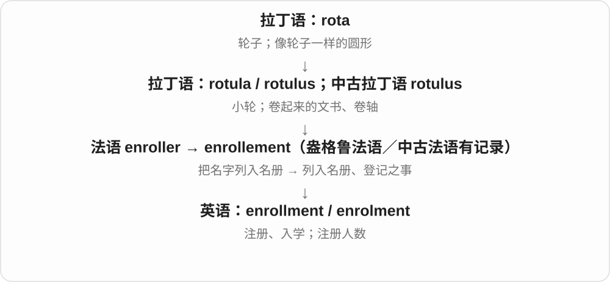

既可说登记这件事，也可说在读、参加人数。enrollment increased 通常是人数增加，不能译成办理登记这个动作变多。

**常见搭配与例句**

course enrollment；student enrollment；an enrollment form。

> Enrollment for the evening course opens on Monday.

晚间课程从星期一开始接受报名。

> Student enrollment rose this year.

今年的学生注册人数增加了。

**别混淆**

admission 是获准进入；enrollment 是正式注册加入。获得录取后，通常还要完成注册。

### 67. amaze — 使惊奇；使惊叹

**音标**：/əˈmeɪz/

**先抓住这个画面**

事情超出预期，好到、奇到让人睁大眼睛，就是 amaze。现代通常带惊叹，不只是搞不懂。

**怎么拆**

接古英语 amasian 等，a- 加迷乱、惊呆材料；与 maze 的旧惊乱义相关。不拆成 a + 一个现代明确词义的 ma + ze。

**怎么变成今天的意思**

**古英语 amasian 等 → 中古英语相应形式**  
使困惑、惊呆；a- 与迷乱材料相合

↓

**英语 amaze**  
使惊奇、惊叹

amaze the audience 让观众惊叹；It amazes me that ... ……令我惊讶；never cease to amaze 不断令人惊叹。

**常见搭配与例句**

amaze someone；it amazes me that；never cease to amaze。

> Her memory for small details amazes me.

她对细节的记忆力让我惊叹。

> The performance amazed the audience.

表演让观众惊叹。

**别混淆**

amaze 强调出乎预料的惊叹，amuse 是逗乐、使愉快；相差一个元音，方向不同。

### 68. amazed — 惊讶的、吃惊的；使吃惊了〔过去式、过去分词〕

**音标**：/əˈmeɪzd/

**先抓住这个画面**

事情超出预想，人一下愣住、觉得不可思议，就是 amazed。可以是惊喜，也可以是惊讶于一个糟糕的事实。

**怎么拆**

amaze 接古英语 āmāsian 一类使迷乱、震惊的材料，与 maze 的旧义相关，更远来历不定。现代 amaze 去 e 加完整 -ed，/z/ 后读 /d/。

**怎么变成今天的意思**

**古英语迷乱、震惊材料 → amaze**  
让人一时转不过来 → 使吃惊

↓

**amaze 去 e + -ed → amazed**  
已经使吃惊；人处于惊讶状态

be amazed at something 对某事吃惊；be amazed to see… 看到……很惊讶。

**常见搭配与例句**

an amazed expression 惊讶的表情；amazed by the result 对结果吃惊。

> I was amazed at how quickly she learned.

她学得那么快，让我很惊讶。

> His calm response amazed everyone in the room.

他镇定的回应让屋里所有人都吃了一惊。

**别混淆**

amazed 常说人的感受，amazing 常说引起这种感受的人或事。惊讶不自动等于赞同。

### 69. amazement — 惊讶、惊奇

**音标**：/əˈmeɪzmənt/

**先抓住这个画面**

完全没想到竟会这样，你一时瞪大眼睛，心里冒出“真的？”——这阵强烈惊奇是 amazement。

**怎么拆**

amaze 去 e 加 -ment；amaze 的旧材料有使迷惑、震惊等，现代常指使惊奇。不是 amusement 的拼写变体。

**怎么变成今天的意思**

**旧 amaze 等材料**  
使迷惑、震惊 → 使惊奇

↓

**amaze + -ment → amazement**  
强烈惊讶的状态

to my amazement 令我惊讶的是；in amazement 惊讶地；watch with amazement 惊奇地观看。

**常见搭配与例句**

to my amazement；in amazement。

> To my amazement, the old watch still worked.

令我惊讶的是，那块旧表竟然还能走。

> The children stared in amazement.

孩子们惊奇地盯着看。

**别混淆**

amazement 是惊奇，amusement 是觉得有趣、好笑；你可能两者都有，也可能只惊讶并不开心。

### 70. imprison — 监禁；使受困

**音标**：英、美 /ɪmˈprɪzən/

**先抓住这个画面**

把人关进无法自由离开的处境，最直接就是关进监狱。

**怎么拆**

来自古法语 emprisonner，经中古英语进入；im- 是 in-“在里面”在 p 前的形式，与 prison 组合，不是否定前缀。

**怎么变成今天的意思**

**拉丁语 prehendere，缩略形 prendere**  
抓住、取得；分词词干 prehens- / prens-

↓

**拉丁语 prehensio / prensio → 古法语 prison**  
拘禁、监狱

↓

**古法语 en- / em- + prison → emprisonner**  
放入监狱

↓

**中古英语 emprisonen / imprisonen → imprison**  
监禁；比喻困住

imprison someone for an offence 是因某事将人监禁。文学里也可说被恐惧、习惯困住，但比 trap 更有被剥夺自由的意味。

**常见搭配与例句**

be imprisoned for；imprison someone in；imprisoned by fear。

> He was imprisoned for several years.

他被监禁了数年。

> The story follows a prince imprisoned in a tower.

故事讲述了一位被囚禁在塔里的王子。

**别混淆**

imprison 是关押；imprisoned 说明被关押状态。im- 在这里表示进入，不是不。

### 71. imprisonment — 监禁；关押

**音标**：/ɪmˈprɪzənmənt/

**先抓住这个画面**

imprison 是把人关起来，imprisonment 是这种失去自由的处境、持续时间或处罚。它不是只指监狱那栋楼。

**怎么拆**

经法语 emprisonnement 等，与 imprison + -ment 对应；im- 进入 + prison 监狱的材料，再形成行为、状态名词。

**怎么变成今天的意思**

**法语 prison、emprisonner 等 → imprison**  
进入监狱 → 关押

↓

**emprisonnement／imprison + -ment → imprisonment**  
监禁的行为、状态或刑罚

a term of imprisonment 一段监禁刑期；life imprisonment 终身监禁；false imprisonment 非法拘禁等法律名称，具体定义按语境。

**常见搭配与例句**

a term of imprisonment；life imprisonment。

> The sentence included a period of imprisonment.

判决包含一段监禁。

> The book describes his years of imprisonment.

书中描写了他被关押的那些年。

**别混淆**

prison 是监狱，imprisonment 是关押、监禁；描述建筑翻修不用 imprisonment renovation。

### 72. adjustment — 调整；校正；适应过程

**音标**：英、美 /əˈdʒʌstmənt/

**先抓住这个画面**

拧动的那一下，或慢慢把生活调顺的那段过程。

**怎么拆**

有法语 ajustement 借入与英语 adjust + -ment 两种分析；两路都属于 adjust 这一族。

**怎么变成今天的意思**

**拉丁语：ad**  
朝向；靠近；加到

↓

**晚期拉丁语：adiuxtāre〔一种主要分析〕**  
使靠近；iuxta 是“紧挨着”

↓

**古法语 ajoster / ajuster；后来的 adjuster**  
调整；拼写又受拉丁 iustus“合适、公正”影响

↓

**法语 ajustement；或英语 adjust + -ment**  
调整行为、调整量

↓

**英语：adjustment**  
校正；适应过程

a small adjustment 是一处小修改；an adjustment period 是逐渐适应的阶段。通常不用它暗示彻底重做。

**常见搭配与例句**

make an adjustment；an adjustment to；a period of adjustment。

> A small adjustment to the angle solved the problem.

稍微调了一下角度，问题就解决了。

> Moving abroad involves a period of adjustment.

搬到国外需要经历一段适应期。

**别混淆**

change 是泛指变化；adjustment 强调为适合条件而调节。

### 73. fulfill — 履行、实现；满足〔fulfil 的常见美式拼写〕

**音标**：/fʊlˈfɪl/

**先抓住这个画面**

看到末尾两个 l，仍是把承诺、要求填实、做到位的那个动词。含义和 fulfil 基本相同。

**怎么拆**

由古英语 fullfyllan 经中古英语延续；现代 full 与 fill 的材料已合为一个词。fulfill 常见于美式，名词常写 fulfillment。

**怎么变成今天的意思**

**古英语 full + fyllan → fullfyllan**  
充分填满

↓

**中古英语 fulfillen → fulfil、fulfill → fulfilment 等**  
填足 → 达成要求、履行；满足感

fulfill a duty 履行职责；fulfill a dream 实现梦想；fulfilled 是过去式、过去分词。

**常见搭配与例句**

fulfill a duty；fulfill a dream。

> He fulfilled every promise he made.

他兑现了自己许下的每一个承诺。

> The new system fulfills our basic needs.

新系统满足了我们的基本需要。

**别混淆**

fulfill 不是简单的 fill 填装：fulfill a duty 是尽责，不能译成把职责装进容器。

### 74. fulfilled — 履行了；实现了；满足的、有成就感的〔过去形式、形容词〕

**音标**：英、美 /fʊlˈfɪld/

**先抓住这个画面**

把答应的事真正做完，把要求补齐，就是 fulfilled；人觉得自己的能力、愿望得到了发挥，也会感到 fulfilled，像心里某个空位终于填满了。

**怎么拆**

美式 fulfill + -ed → fulfilled；英式 fulfil 双写末尾 l 后加 -ed，也得到 fulfilled。远接古英语 fullfyllan 填满，含 full 满与 fyllan 填。

**怎么变成今天的意思**

**古英语 fullfyllan 填满、使充实 → fulfill、fulfil**  
后来用于完成、落实、满足

↓

**动词过去形式 fulfilled → 满足、有成就感的形容词**  
动作完成与人的内心状态分别理解

fulfilled a promise 是兑现了承诺；fulfilled the requirements 是满足了要求；feel fulfilled 是觉得充实、满足。

**常见搭配与例句**

fulfilled a promise；fulfilled the requirements；feel fulfilled。

> She fulfilled her promise to finish the book.

她兑现了承诺，把书写完了。

> He felt fulfilled after helping to restore the old theatre.

帮助修复老剧院后，他感到很有成就感。

**别混淆**

fulfilled 不等于所有事情都没有遗憾。形容人时，它侧重所做的事有意义、内心有满足感；形容要求时则表示已经达到。

### 75. fulfil — 履行、实现；满足〔条件、需要〕

**音标**：/fʊlˈfɪl/

**先抓住这个画面**

要求留下一个缺口，你把它填满：承诺做到、条件达到、愿望实现，都可以用 fulfil。

**怎么拆**

承接古英语 fullfyllan 充分填满，接 full 与 fill 的旧形式；fulfil 是常见英式拼写，不是比 fulfill 少做一半。

**怎么变成今天的意思**

**古英语 full + fyllan → fullfyllan**  
充分填满

↓

**中古英语 fulfillen → fulfil、fulfill → fulfilment 等**  
填足 → 达成要求、履行；满足感

fulfil a promise 履行承诺；fulfil a requirement 满足要求；fulfil an ambition 实现抱负；英式常用 fulfil。

**常见搭配与例句**

fulfil a promise；fulfil a requirement。

> The course fulfils the entry requirements.

这门课满足入学要求。

> She worked hard to fulfil her ambition.

她努力实现自己的抱负。

**别混淆**

fulfil 与 fulfill 主要是拼写习惯差异，不分实现程度；过去式 fulfilled 在两种习惯里都常见。

### 76. fulfilment — 履行、实现；满足感、成就感

**音标**：/fʊlˈfɪlmənt/

**先抓住这个画面**

事情终于做到，是 fulfilment；做着有意义的工作，感到内心充实，也叫 fulfilment。外部任务和内部感受是两条常用分支。

**怎么拆**

fulfil + -ment，基于充分填满的旧词族；常见英式 fulfilment，美式常写 fulfillment。

**怎么变成今天的意思**

**古英语 full + fyllan → fullfyllan**  
充分填满

↓

**中古英语 fulfillen → fulfil、fulfill → fulfilment 等**  
填足 → 达成要求、履行；满足感

↓

**fulfil + -ment → fulfilment**  
要求得到满足；愿望实现后的充实感

the fulfilment of a promise 承诺兑现；personal fulfilment 个人满足感；order fulfilment 订单履约，涉及处理、配送等业务过程。

**常见搭配与例句**

personal fulfilment；the fulfilment of；order fulfilment。

> She finds fulfilment in teaching.

她在教学中获得充实感。

> The team is responsible for order fulfilment.

这个团队负责订单履约。

**别混淆**

fulfilment 的满足感常与意义、潜能发挥相连，不只是一时开心；订单语境又是具体业务名词。

### 77. advertisement — 广告；公告；能起宣传作用的人或事

**音标**：英 /ədˈvɜːtɪsmənt/；美 /ˌædvərˈtaɪzmənt/

**先抓住这个画面**

把“请注意这件事”做成一条可看到、听到的信息，就是一则 advertisement。

**怎么拆**

经法语 avertissement / advertissement“提示、通知”借入；现代能看成 advertise + -ment，但并非只有英语内部造词这一路线。

**怎么变成今天的意思**

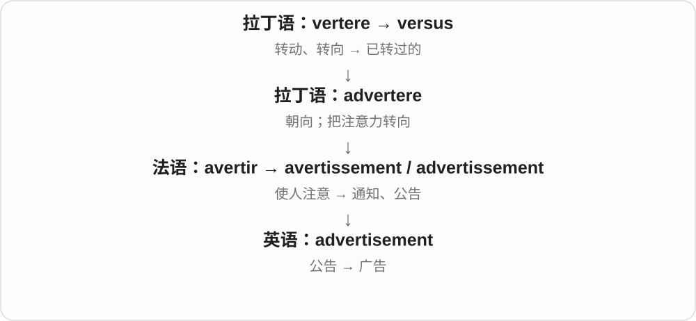

通常可数：an advertisement。英美常用读法的重音和词中元音差别明显。口语常缩短成 ad，英式也常用 advert。

**常见搭配与例句**

place an advertisement；a television advertisement；an advertisement for…。

> I saw an advertisement for the course at the library.

我在图书馆看到这门课程的广告。

> Her excellent work is a good advertisement for the training programme.

她出色的工作表现为这项培训计划做了很好的宣传。

**别混淆**

advertisement 是一则具体广告；advertising 是广告活动、行业或广告总称。

### 78. advancement — 进步、发展；晋升

**音标**：英 /ədˈvɑːnsmənt/；美 /ədˈvænsmənt/

**先抓住这个画面**

技能、知识或职业位置向前走，把这种发展过程整体提出来说。

**怎么拆**

接中古英语 avancement、法语 avancement，现代可对应 advance + -ment。保留自己的名词借入历史，不仅是现代随手加尾巴。

**怎么变成今天的意思**

**晚期拉丁 ab ante → 通俗拉丁 \*abanteare**  
从前方、向前

↓

**法语 avancement → 英语 advancement**  
推进、发展；职位上的提升

career advancement 职业晋升，the advancement of knowledge 知识进步，technological advancement 技术发展。

**常见搭配与例句**

career advancement；the advancement of knowledge；technological advancement。

> The job offers opportunities for career advancement.

这份工作提供职业晋升机会。

> The institute supports the advancement of scientific knowledge.

研究所支持科学知识的发展。

**别混淆**

advancement 常整体过程，an advance 可一项进展；advantage 优势是相关词族的另一词，不等于发展过程。

### 79. enjoyment — 乐趣；享受；享有〔较正式〕

**音标**：/ɪnˈdʒɔɪmənt/

**先抓住这个画面**

不只说做了什么，而是把从中得到的那份乐趣、享受拿出来谈。

**怎么拆**

enjoy + -ment 动作、状态名词；也能沿 enjoy 的享有分支用于某些正式权利、使用表达。

**怎么变成今天的意思**

**拉丁 gaudium、gaudia → 法语 joie → 中古英语 joye**  
喜悦、快乐

↓

**古法语 enjoier → 中古英语 enjoyen → enjoy**  
给予、感受喜悦 → 喜欢、享受；享有

↓

**enjoy + -ment → enjoyment**  
享受、享有 → 乐趣、享受状态或享有

get enjoyment from reading 从读书中得到乐趣，for your enjoyment 供你欣赏、享受；the enjoyment of a right 享有某项权利是较正式用法。

**常见搭配与例句**

get enjoyment from；for enjoyment；a source of enjoyment；the enjoyment of。

> Reading gives her a great deal of enjoyment.

阅读带给她很多乐趣。

> The garden was created for everyone’s enjoyment.

花园是建给大家欣赏、享用的。

**别混淆**

enjoyment 是乐趣、享受的名词，entertainment 是娱乐活动、内容；一个人独自散步可有 enjoyment，却不必观看娱乐节目。

### 80. embarrass — 使尴尬、使难堪

**音标**：英 /ɪmˈbærəs/；美 /ɪmˈbærəs/

**先抓住这个画面**

你正在大家面前说话，别人忽然揭出一件糗事，让你不知道脸往哪放，就是 embarrass you。

**怎么拆**

借法语 embarrasser 阻碍、使困窘，关联西班牙等语言的相关形式，细部借入路径有分歧。不是英语 bare 裸的简单加前后缀。

**怎么变成今天的意思**

**法语 embarrasser，接西班牙等罗曼语相关形式**  
阻碍、困住；更远路径有分歧

↓

**英语 embarrass → embarrassment**  
使局促难堪；尴尬及使人难堪的事

embarrass someone 使某人尴尬；be embarrassed about/by 因……难堪；embarrassing 说事情令人尴尬。

**常见搭配与例句**

embarrass someone；be embarrassed about。

> Please do not embarrass me in front of everyone.

请别让我在大家面前难堪。

> The unexpected praise embarrassed him.

突如其来的夸奖让他有些不好意思。

**别混淆**

embarrassed 是人感到难堪，embarrassing 是人或事使别人难堪；要看谁承受、谁造成。

### 81. embarrassment — 尴尬、难堪；令人难堪的人或事

**音标**：英 /ɪmˈbærəsmənt/；美 /ɪmˈbærəsmənt/

**先抓住这个画面**

当众念错名字时那阵脸热，是 embarrassment；一个总让组织出糗的事件，也能叫 an embarrassment。

**怎么拆**

embarrass + -ment，既能指尴尬状态，也能把造成这种状态的人、事作为可数名词。

**怎么变成今天的意思**

**法语 embarrasser，接西班牙等罗曼语相关形式**  
阻碍、困住；更远路径有分歧

↓

**英语 embarrass → embarrassment**  
使局促难堪；尴尬及使人难堪的事

↓

**embarrass + -ment → embarrassment**  
局促难堪；引起难堪的对象

to my embarrassment 令我尴尬的是；die of embarrassment 尴尬得要命的夸张说法；an embarrassment to 对……是个难堪。

**常见搭配与例句**

to my embarrassment；an embarrassment to。

> To my embarrassment, I had forgotten her name.

令我尴尬的是，我忘了她的名字。

> The failed event became an embarrassment to the organisers.

活动失败让组织者很难堪。

**别混淆**

embarrassment 不一定是严重羞耻；一句夸奖也能引起它。shame 往往更重地涉及羞耻、过错评价。

### 82. shipment — 一批货；装运、发货

**音标**：/ˈʃɪpmənt/

**先抓住这个画面**

把一起发出的一批货看成一个整体；也可以说安排发货这件事。

**怎么拆**

ship + -ment，形成行为、结果名词。现代可数 a shipment 常指一批运送的货物。

**怎么变成今天的意思**

**古英语 sċip → 中古英语 schip 等 → ship**  
船；更远来源的劈木解释不作定论

↓

**动词 ship 及现代复合词**  
用船运输 → 不限交通方式的发运；船舶类型与人员

↓

**ship + -ment → shipment**  
装运 → 装运行为或一批发运货物

a shipment of books 一批书，a delayed shipment 延误的货，prepare for shipment 准备装运。

**常见搭配与例句**

a shipment of；a large shipment；ready for shipment。

> A new shipment of books arrived this morning.

今天早上新到了一批书。

> The goods are packed and ready for shipment.

货已打包，随时可以发运。

**别混淆**

shipping 常指运输服务、活动或费用，a shipment 常是具体一批货；不能一律按中文运输替换。

### 83. endorsement — 认可；公开支持；代言；票据背书

**音标**：英 /ɪnˈdɔːsmənt/；美 /ɪnˈdɔːrsmənt/

**先抓住这个画面**

把支持或签注这件事当作一项明确的表态、行为或记录。

**怎么拆**

英语 endorse + -ment；早期也有 endosement，后来与 endorse 的拼写一同恢复 r。保留文件签注义，并发展为公开认可、推荐。

**怎么变成今天的意思**

**拉丁语 dorsum；变体 dossum**  
背、背面

↓

**古法语 dos → endosser**  
背面 → 放在背上、在背面签写

↓

**中古英语 endosse → endorse**  
签注、认可；拼写受中古拉丁 indorsare 影响恢复 r

↓

**英语 endorse + -ment → endorsement**  
签注、背书；认可与公开推荐

win an endorsement 是争取到明确支持，an endorsement deal 是商业代言协议。a ringing endorsement 不是会响的合同，而是强烈、明确的赞许；a lukewarm endorsement 则支持得不太热情。

**常见搭配与例句**

an endorsement of a plan；a celebrity endorsement；an endorsement deal；a ringing endorsement。

> The proposal received a strong endorsement from the advisory board.

这项提议获得了顾问委员会的有力支持。

> The singer signed an endorsement deal with a clothing company.

这位歌手与一家服装公司签了代言协议。

**别混淆**

endorsement 可以只是表态，不保证对方已经出钱。sponsorship 常涉及赞助资源，不能在所有商业语境里互换。

### 84. enact — 制定、通过〔法律〕；扮演、上演

**音标**：/ɪˈnækt/

**先抓住这个画面**

把议案变成正式规则，是 enact；把故事里的场面实际演出来，也可用 enact。两个场景都含让内容落实成行动、形式。

**怎么拆**

en- 使成为与 act 行动、法案材料结合；act 上接法语、拉丁 actum，不能只按现代演员的 act 回推全部含义。

**怎么变成今天的意思**

**en- 使成为 + act 法案、行动等 → enact**  
使成为正式法案；把情节做出来

↓

**enact + -ment → enactment**  
制定；制定的法规；演出、再现

enact a law 制定法律；enact legislation 立法；enact a scene 表演场景；后者较正式。

**常见搭配与例句**

enact a law；enact a scene。

> The parliament enacted a new law.

议会通过了一部新法律。

> The students enacted a scene from the play.

学生们表演了剧中的一个场景。

**别混淆**

enact a law 是制定、通过，enforce a law 是执行；有法案不等于已经有效执法。

### 85. enacted — 制定、通过了〔法律等〕；演出了〔过去形式〕

**音标**：英、美 /ɪˈnæktɪd/

**先抓住这个画面**

把某件事真正做成行动，是 enact 的一个好记画面；舞台上把情节演出来，制度里把法案正式制定出来，都有相应的用法。

**怎么拆**

en- 使、置入 + act 行动、表演 → enact；加完整 -ed → enacted，/t/ 后读 /ɪd/。英语较早有扮演、演出义，后来有正式制定法律义。

**怎么变成今天的意思**

**英语 en- + act → enact 扮演、演出**  
把角色、情节付诸行动

↓

**正式制定、批准法律等义 → enacted**  
现代过去形式，具体对象决定属于哪个分支

enacted a law 是制定了法律；enacted a scene 是演出一个场景；newly enacted rules 是新制定的规定。

**常见搭配与例句**

enacted a law；enacted a scene；newly enacted rules。

> The fictional council enacted a new law.

故事里虚构的议会制定了一项新法律。

> The students enacted a scene from the play.

学生们演出了剧中的一个场景。

**别混淆**

enacted 说正式制定法律时，不等于已经执行到位；执行常另用 enforce。表演义则可以与 act out 对照。

### 86. enactment — 制定、通过；法规；表演、再现

**音标**：/ɪˈnæktmənt/

**先抓住这个画面**

enactment 可以是规则正式落地的过程，也可以是已通过的一项法规；谈戏剧时又能是把情节演出来。

**怎么拆**

enact + -ment，动作、结果两种名词作用并存；意义要随 enact 的法律、表演分支走。

**怎么变成今天的意思**

**en- 使成为 + act 法案、行动等 → enact**  
使成为正式法案；把情节做出来

↓

**enact + -ment → enactment**  
制定；制定的法规；演出、再现

↓

**enact + -ment → enactment**  
立法活动、成文法规；演绎活动

the enactment of a law 法律的制定；a legislative enactment 立法规定；the enactment of a scene 场景演绎。

**常见搭配与例句**

the enactment of；a legislative enactment。

> The debate continued after the enactment of the law.

法律通过后，争论仍在继续。

> Their enactment of the final scene was moving.

他们对最后一幕的演绎很动人。

**别混淆**

enactment 不等于 enforcement 执法；一个看制定或规定，一个看如何使规则被遵守。

### 87. amuse — 逗乐；使愉快消遣

**音标**：/əˈmjuːz/

**先抓住这个画面**

讲个笑话让人笑，拿本有趣的书让自己消磨时间，都是 amuse：把注意力留在让人愉快的东西上。

**怎么拆**

借古法语 amuser，由 a- 与 muser 等发呆、停留思索材料组成，远源不确定。不是 a- 不 + Muse 缪斯女神，所以不叫没有灵感。

**怎么变成今天的意思**

**古法语 amuser；a- + muser**  
发呆、消磨时间、吸引注意等；muser 远源有争论

↓

**英语 amuse**  
使愉快、逗乐；愉快地占住注意力

amuse the children 逗孩子开心；amuse yourself with a book 读书消遣；be easily amused 很容易被逗乐。

**常见搭配与例句**

amuse someone；amuse yourself with。

> The story amused the children.

故事把孩子们逗乐了。

> She amused herself with a puzzle while waiting.

等候时，她做拼图消遣。

**别混淆**

amuse 常是逗乐、消遣，entertain 范围更宽；不用每次都保证大笑出声。

### 88. amusement — 愉悦、逗乐；娱乐消遣

**音标**：/əˈmjuːzmənt/

**先抓住这个画面**

一件小事让你嘴角上扬，觉得有趣好笑，这份轻松的乐趣是 amusement。也能说供人玩乐的活动。

**怎么拆**

经法语 amusement，现代对应 amuse 去 e 加 -ment；amuse 的逗乐、消遣义形成相应名词。

**怎么变成今天的意思**

**法语 amuser → amusement**  
使消遣、逗乐 → 相应乐趣

↓

**英语 amuse／amusement**  
使觉得有趣；乐趣与消遣

to someone’s amusement 令某人觉得好笑；for amusement 为消遣；an amusement park 游乐园。

**常见搭配与例句**

to my amusement；for amusement；an amusement park。

> She watched the puppy with amusement.

她觉得有趣地看着那只小狗。

> The town has several places of amusement.

镇上有几处娱乐场所。

**别混淆**

amusement 常是有趣、好笑的轻松感，amazement 是惊讶；拼写近但感受不同。

### 89. accomplishment — 成就；完成；娴熟技能〔常用复数〕

**音标**：英 /əˈkʌmplɪʃmənt/；美 /əˈkɑːmplɪʃmənt/

**先抓住这个画面**

回头看见一件真的做成的事，心里有“我办到了”的实在感。

**怎么拆**

accomplish + -ment；英语词源也联系法语 accomplissement，不能排除借入或法语影响。

**怎么变成今天的意思**

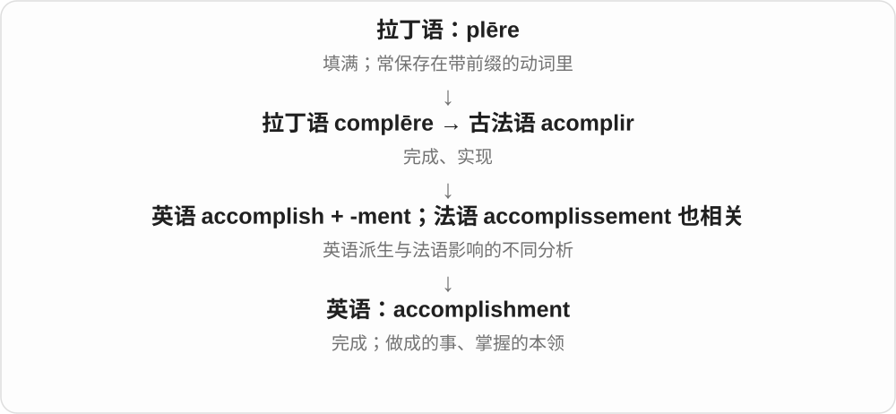

a sense of accomplishment 是完成后很踏实的成就感；a major accomplishment 是一项重要成果。旧式或正式语境 accomplishments 也指音乐、语言等练成的技能。

**常见搭配与例句**

a sense of accomplishment；a remarkable accomplishment；the accomplishment of a task。

> Finishing the first chapter gave her a sense of accomplishment.

写完第一章让她很有成就感。

> Restoring the damaged archive was a remarkable accomplishment.

修复受损档案是一项了不起的成就。

**别混淆**

achievement 与它常重叠；accomplishment 很适合谈做成某事后的满足感，也可指修习的才艺。

### 90. enlighten — 启发；使明白；开导

**音标**：/ɪnˈlaɪtən/

**先抓住这个画面**

原来脑中一片暗，别人把关键处照亮：哦，原来如此。

**怎么拆**

现代可对照 en- + light + -en；历史由中古英语 enlightenen、inlightnen 等相关形式合流，上接古英语 inlīhtan、onlīhtan 等照亮动词，不是今天随手在 lighten 两头都加词缀。

**怎么变成今天的意思**

**古英语 inlīhtan / onlīhtan 等 → 中古英语相关形式**  
照亮、使看见；精神上的启发

↓

**英语 enlighten**  
给知识、使理解

enlighten someone about something 让某人明白某事。Please enlighten me 可真诚求解释，也可带反讽“那你倒说说”，语气重要。

**常见搭配与例句**

enlighten someone about；enlighten someone on；an enlightening explanation。

> Could you enlighten me about the purpose of this rule?

能给我讲明白这条规则的用意吗？

> The discussion enlightened us on the history of the site.

讨论让我们了解了这处遗址的历史。

**别混淆**

enlighten 明白知识，lighten 减负或变亮；enlightened 还可评价思想开明，不是亮着灯的房间。

### 91. enlightenment — 启发、开明；领悟；启蒙运动

**音标**：/ɪnˈlaɪtənmənt/

**先抓住这个画面**

原来像在暗处摸索，忽然有人把事情照明，你懂了，这个画面帮助记 enlightenment。历史、宗教里各有专门用法。

**怎么拆**

enlighten 使明白 + -ment；en- 与 light 光的材料，用光照比喻理解。大写 the Enlightenment 是欧洲思想史中的启蒙运动。

**怎么变成今天的意思**

**en- + light 等 → enlighten**  
使有光 → 使明白、启发

↓

**enlighten + -ment → enlightenment**  
明白、领悟；历史与宗教的专门命名

seek enlightenment 寻求理解、领悟；the Enlightenment 启蒙运动；spiritual enlightenment 精神、宗教上的觉悟。

**常见搭配与例句**

seek enlightenment；the Enlightenment。

> I asked the expert for enlightenment on the issue.

我请专家把这个问题讲明白。

> The course explores thinkers of the Enlightenment.

课程探讨启蒙运动时期的思想家。

**别混淆**

历史上的 Enlightenment 与某人终于听懂一道题，不是同一层面的称呼；都借明亮比喻理解，但具体定义不同。

### 92. enhancement — 增强、提升；改进项

**音标**：英 /ɪnˈhɑːnsmənt/；美 /ɪnˈhænsmənt/

**先抓住这个画面**

既能说把效果往上推的过程，也能数出这次更新多了哪些改进。

**怎么拆**

enhance + -ment，-ment 形成动作、状态或结果名词。原词末尾 e 保留，写 enhancement。

**怎么变成今天的意思**

**拉丁 altus 高及相关动词 → 法语 enhauncer 等**  
抬高、使更大、更强

↓

**中古英语 enhauncen → enhance**  
提高程度、增进价值、改善表现

↓

**enhance + -ment → enhancement**  
增强的过程、效果；一项改进

image enhancement 图像增强，performance enhancement 性能提升，an enhancement to the system 系统的一项改进。

**常见搭配与例句**

image enhancement；performance enhancement；an enhancement to。

> The new release includes several small enhancements.

新版本包含几项小改进。

> Image enhancement made the faded writing easier to read.

图像增强让褪色字迹更容易辨认。

**别混淆**

enhancement 不一定是修 bug：可以是增加功能或改善体验。也不能仅凭这个词判断实际改善幅度。

### 93. infringement — 侵犯；侵权；违反

**音标**：/ɪnˈfrɪndʒmənt/

**先抓住这个画面**

本来应当被保护的边界遭到越过。

**怎么拆**

英语 infringe 加 -ment，把侵犯或违反的行为、事例说成名词。

**怎么变成今天的意思**

**拉丁 frangere，分词 frāctus**  
打碎、折断；被打断的

↓

**拉丁 in- + frangere → infringere**  
破坏、削弱

↓

**英语 infringe**  
侵犯权利；违反规则

↓

**英语 infringe + -ment → infringement**  
侵犯的行为或具体侵权事件

copyright infringement 常见于新闻、出版和产品工作；an infringement of privacy 是对隐私的一次侵犯。它是对行为的描述，不等于争议已由法院确认。

**常见搭配与例句**

copyright infringement；patent infringement；an infringement of rights。

> The publisher investigated a complaint of copyright infringement.

出版社调查了一起版权侵权投诉。

> They regarded the search as an infringement of their privacy.

他们认为这次搜查侵犯了自己的隐私。

**别混淆**

infraction 常说一条规则被违反；infringement 尤其常围绕某人的权利或知识产权。

### 94. pavement — 人行道〔英〕；铺设的路面〔美等用法〕

**音标**：/ˈpeɪvmənt/

**先抓住这个画面**

先想到铺好的硬地面，再根据地区判断是在路边还是车轮下面。

**怎么拆**

历史上经法语 pavement 和拉丁 pavimentum 借入，后者接 pavire“夯实”。现代能联系 pave + -ment，但英语名词有独立且较早的借入史。

**怎么变成今天的意思**

**拉丁语 pavire**  
敲打、夯实、踩实

↓

**拉丁语 pavimentum**  
夯实的地面、硬质地面

↓

**古法语、盎格鲁法语 pavement；亦有直接拉丁借入**  
铺好的路面

↓

**中古英语 pament、pavement → 英语 pavement**  
铺设表面；英式常特指路边人行道

英国街上有人说 stay on the pavement，通常要你留在人行道上。美国材料谈 damaged pavement，则常在说铺装路面破损。相同词根保留了“硬质地面”，各地的常用范围却不同。

**常见搭配与例句**

walk on the pavement；a narrow pavement；cracks in the pavement；pavement markings。

> A delivery van was blocking the pavement outside the shop.

一辆送货车堵住了商店外的人行道。

> The road crew repaired several cracks in the pavement.

道路施工队修补了路面的几处裂缝。

**别混淆**

英国 pavement 的人行道义常对应美国 sidewalk；美国 pavement 不能一律译成人行道。判断时先看地点和实际场景。

### 95. resentment — 怨恨；积在心里的不满

**音标**：/rɪˈzentmənt/

**先抓住这个画面**

委屈没有消散，而是在心里留下了一笔账，这股持续的不满就是 resentment。

**怎么拆**

与 resent + -ment 对应，并有法语 ressentiment 的历史影响；它有自己的借入与形成背景。

**怎么变成今天的意思**

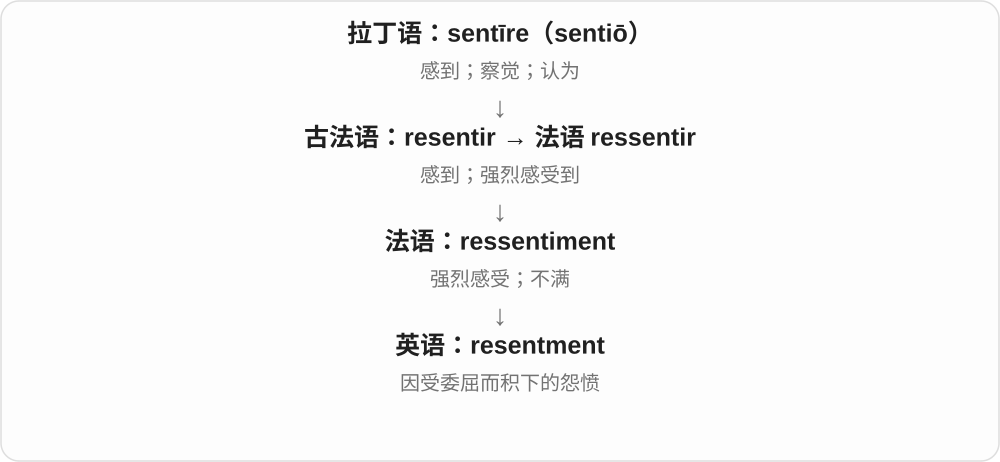

可以针对人、待遇或事件，常比一时生气更持久。不能靠词源判断一个人的不满是否合理。

**常见搭配与例句**

resentment towards someone；deep resentment；feel resentment。

> The unequal workload caused resentment within the team.

工作量分配不均在团队内部引起了不满。

> He still felt resentment towards his former employer.

他对前雇主仍心存怨气。

**别混淆**

anger 可以是突然爆发的愤怒；resentment 常强调被亏待后的持续不满。

### 96. impeachment — 弹劾；对证人可信性等的质疑

**音标**：/ɪmˈpiːtʃmənt/

**先抓住这个画面**

把“正式提出指控”作为一个程序来谈；读新闻时，关键是看它进行到了哪一步，不能只凭这个词断定最终结果。

**怎么拆**

中古英语 empechement 等形式既可接古法语 empechement，也可由当时的英语 empechen 加 -ment 分析。法语动词远接 impedicare“束缚”；现代英语可清楚拆作 impeach + -ment。

**怎么变成今天的意思**

**拉丁 pes，属格 pedis，词干 ped-**  
脚、足；也能由支撑作用说物体的脚

↓

**拉丁 pedica → 晚期拉丁 impedicare**  
脚镣、绊索 → 束缚、缠住

↓

**古法语 empeechier／盎格鲁法语 empecher → 中古英语 empechen**  
阻碍、妨碍；法律上指责、控告

↓

**法语 empechement／中古英语 empechen + -ment → empechement**  
妨碍、质疑、控告的名词

↓

**英语 impeachment**  
弹劾程序；对可信性的质疑

articles of impeachment 是弹劾条款。美国语境中，众议院提出弹劾后，参议院审理并决定是否判定有罪；impeachment 本身不等于 removal。

**常见搭配与例句**

articles of impeachment；impeachment proceedings；face impeachment；an impeachment trial。

> The class compared impeachment with removal from office.

课堂上比较了弹劾与免职的区别。

> The documentary traces the debate over the articles of impeachment.

纪录片梳理了围绕弹劾条款展开的辩论。

**别混淆**

accusation 是广义指控；impeachment 在政治制度中有特定程序含义。普通人的任何犯罪起诉都不叫 impeachment。

### 97. installment — 分期付款中的一期；连载、系列的一期、一部

**音标**：英 /ɪnˈstɔːlmənt/；美 /ɪnˈstɔːlmənt/

**先抓住这个画面**

总额分几次交，每次是一笔 installment；故事分几次发表，每期也可以是 installment。共同点是整件事分批提供。

**怎么拆**

常用分期义是 estallment 的变形，联系法语 estaler 安排付款、estal 固定位置等，不能全按 install 安装 + -ment 解释。另有历史同形词确实指就任、安装。

**怎么变成今天的意思**

**另一路：法语 estaler 等 → installment**  
安排付款 → 每期付款、分期提供的一部分

↓

**分批付款 → installment 的一般扩展**  
系列中按次提供的一部分

pay in installments 分期付款，a monthly installment 每月一期款，the latest installment 最新一集、一部。英式也常拼 instalment。

**常见搭配与例句**

pay in installments；a monthly installment；the latest installment。

> They paid for the furniture in six installments.

他们分六期支付了家具款。

> The next installment of the story appears on Friday.

故事的下一期周五刊出。

**别混淆**

常用 installment 是分期提供的一部分，installation 才常说安装、设施。分期总额、次数等要另外说明，词本身不规定。

### 98. impair — 损害、削弱〔功能、能力〕

**音标**：英 /ɪmˈpeə/；美 /ɪmˈper/

**先抓住这个画面**

东西还在，却不再像原来那样看得清、判断得准、运转得好，就是它的功能被 impaired。

**怎么拆**

经法语 empeirier 接拉丁使变差的材料，核心关联 peior 更差。不是 im- 不加 pair 配对。

**怎么变成今天的意思**

**拉丁 peior 更差 → peiorare 等 → 法语 empeirier**  
使变差、减损

↓

**英语 impair → impairment**  
损害功能；功能受损的状态

impair judgement 削弱判断力；impair hearing 损害听力；impaired performance 受影响的表现。

**常见搭配与例句**

impair judgement；impair hearing。

> Lack of sleep can impair judgement.

缺觉可能影响判断力。

> The damage impaired the machine’s performance.

损坏影响了机器的性能。

**别混淆**

impair 重在使能力、功能变弱；repair 是修理，不能把两词按看似相同的 pair 当作简单正反词。

### 99. impairment — 损伤、功能受损；减值〔财务〕

**音标**：英 /ɪmˈpeəmənt/；美 /ɪmˈpermənt/

**先抓住这个画面**

某项能力或功能打了折扣，是 impairment。财务里谈资产减值，则是把价值受损作为一个专门问题。

**怎么拆**

经法语相关名词，现代对应 impair + -ment；从减损、变差走向各领域的受损状态。

**怎么变成今天的意思**

**拉丁 peior 更差 → peiorare 等 → 法语 empeirier**  
使变差、减损

↓

**英语 impair → impairment**  
损害功能；功能受损的状态

↓

**impair + -ment 的名词对应**  
能力受损；特定领域的价值减损

hearing impairment 听力受损；visual impairment 视力受损；an impairment loss 减值损失。

**常见搭配与例句**

hearing impairment；visual impairment。

> The device helps people with hearing impairment.

这款设备帮助听力受损的人。

> The report recorded an impairment loss on the asset.

报告记载了该项资产的减值损失。

**别混淆**

impairment 不自动说明功能完全丧失；程度与具体情形要看上下文。财务义也不是在说资产听力不好。

### 100. empowerment — 授权；自主能力的增强；赋权

**音标**：英 /ɪmˈpaʊəmənt/；美 /ɪmˈpaʊərmənt/

**先抓住这个画面**

empowerment 是让原本只能等别人决定的人，逐渐能掌握自己的选择。

**怎么拆**

empower + -ment，表示给予权力、能力的过程或结果。

**怎么变成今天的意思**

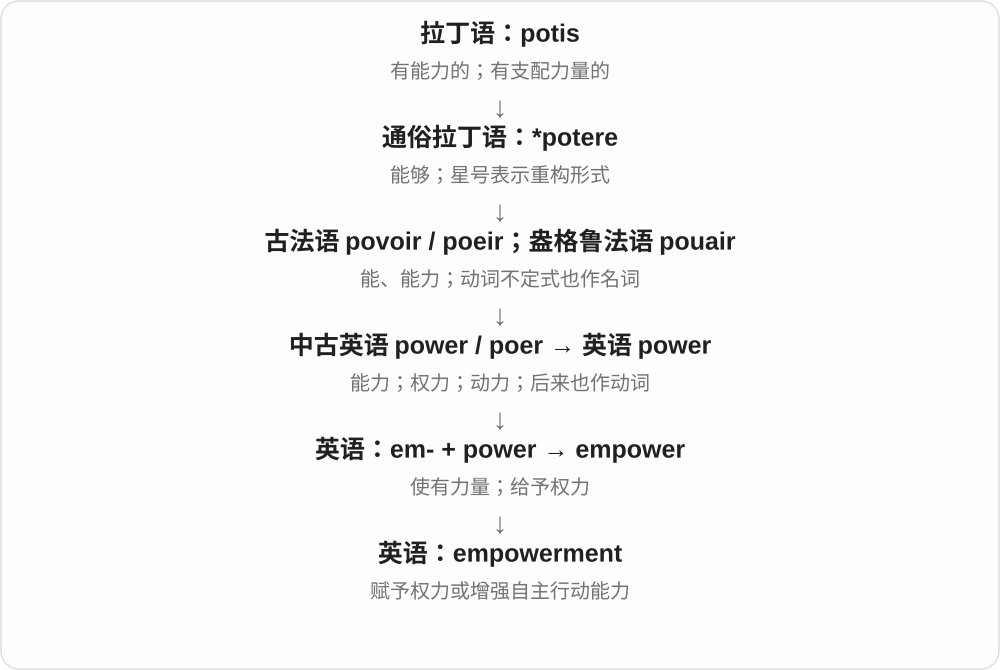

employee empowerment 可能包括下放决策权；economic empowerment 可包括收入、资源和控制资源的能力。要从上下文看具体给了什么，别只把它当成空泛的“鼓励”。

**常见搭配与例句**

employee empowerment；economic empowerment；community empowerment。

> The program links financial education with economic empowerment.

这个项目把财务知识教育与经济自主能力的提升联系起来。

> Employee empowerment requires clear limits as well as trust.

向员工授权既需要信任，也需要明确权限边界。

**别混淆**

encouragement 是鼓励；empowerment 更强调实际能力、资源或决定权的增加。

### 101. enrich — 使富裕；充实、使丰富；使富集

**音标**：/ɪnˈrɪtʃ/

**先抓住这个画面**

不只把钱包变鼓，也能把文章内容、人生体验变厚实：原来单薄的东西多了有价值的成分。

**怎么拆**

借法语 enrichir 等，现代对应 en- 使成为 + rich 丰富、富有；不同领域把丰富具体化为钱、内容或物质比例。

**怎么变成今天的意思**

**法语 enrichir 等 → 英语 enrich**  
使富裕；使内容更丰富

↓

**enrich + -ment → enrichment**  
变丰富的过程或增加的成分、活动

enrich an experience 丰富体验；enrich the soil 改善土壤养分；enrich oneself 使自己富有；技术上的富集须看具体物质。

**常见搭配与例句**

enrich an experience；enrich the soil。

> Travel can enrich your understanding of other cultures.

旅行能丰富你对其他文化的理解。

> Compost enriches the soil.

堆肥能增加土壤的养分。

**别混淆**

enrich 是增加某种价值或成分，不只是数量无限增加；更多无关字句未必 enrich an essay。

### 102. enrichment — 充实、丰富；富集；拓展活动

**音标**：/ɪnˈrɪtʃmənt/

**先抓住这个画面**

让环境、学习、内容不再单调，是 enrichment。动物园给动物增加可探索、可活动的东西，也常叫 environmental enrichment。

**怎么拆**

enrich + -ment，把变丰富的过程、手段名词化；学科里还可指提高某种成分比例的富集。

**怎么变成今天的意思**

**法语 enrichir 等 → 英语 enrich**  
使富裕；使内容更丰富

↓

**enrich + -ment → enrichment**  
变丰富的过程或增加的成分、活动

↓

**enrich + -ment → enrichment**  
充实过程；拓展活动；成分富集

educational enrichment 学习拓展；environmental enrichment 环境丰富化；soil enrichment 土壤增肥。

**常见搭配与例句**

educational enrichment；environmental enrichment。

> The school offers enrichment activities after class.

学校提供课后拓展活动。

> The zoo introduced new forms of environmental enrichment.

动物园增加了新的环境丰富化措施。

**别混淆**

enrichment 不总是钱变多；课外拓展、动物活动环境都能用。技术富集义则有特定量化含义。

### 103. endow — 捐资设立；赋予〔能力、品质〕

**音标**：/ɪnˈdaʊ/

**先抓住这个画面**

拿出财产让某个机构、职位能长期运作，是 endow；说一个人生来有好嗓子，也能说 endowed with a fine voice。

**怎么拆**

经法语 endouer 接拉丁 dotare，关联 dos 赠予、嫁妆等财产材料；不是 end 结束加 ow。

**怎么变成今天的意思**

**拉丁 dos 赠予、嫁妆 → dotare → 法语 endouer**  
提供财产、禀赋等

↓

**英语 endow → endowment**  
资助、赋予；捐赠基金、禀赋

endow a scholarship 捐资设奖学金；endow a chair 捐资设教席；be endowed with 具有、被赋予某种禀赋。

**常见搭配与例句**

endow a scholarship；be endowed with。

> The donation will endow a scholarship.

这笔捐款将用于设立奖学金。

> She is endowed with a remarkable memory.

她有着出众的记忆力。

**别混淆**

endow 常涉及较持久的资助或禀赋，give 范围更广；随手递一支笔通常不用 endow。

### 104. endowment — 捐赠、捐赠基金；天赋、禀赋

**音标**：/ɪnˈdaʊmənt/

**先抓住这个画面**

大学有一笔长期支持办学的钱，可叫 endowment；一个人的天然才能，也叫 natural endowment。都有被给予、所拥有的材料。

**怎么拆**

endow + -ment，既说捐资、所捐财产，也说与生俱来的品质、能力。基金通常长期管理使用，不是每次把全部本金立刻花掉。

**怎么变成今天的意思**

**拉丁 dos 赠予、嫁妆 → dotare → 法语 endouer**  
提供财产、禀赋等

↓

**英语 endow → endowment**  
资助、赋予；捐赠基金、禀赋

↓

**endow + -ment → endowment**  
捐赠与捐赠基金；自然禀赋

a university endowment 大学捐赠基金；an endowment fund 捐赠基金；natural endowments 天然禀赋。

**常见搭配与例句**

an endowment fund；natural endowments。

> The university’s endowment supports research and scholarships.

大学的捐赠基金支持研究和奖学金。

> Training helped her develop her natural endowments.

训练帮助她发挥了天然禀赋。

**别混淆**

endowment 可指基金整体，donation 可以是一次捐款；具体资助安排须看文本，不能当作同一种固定合同。

### 105. commencement — 开始、开端；〔尤美〕毕业典礼

**音标**：/kəˈmensmənt/

**先抓住这个画面**

一个词既能说开始，也能说毕业典礼，看似反过来，其实旧大学用法看的是开始取得学位身份、资格的阶段。

**怎么拆**

借法语 commencement，现代可对应 commence + -ment。毕业典礼义接大学开始取得学位相关身份、权利的旧用法；“人生新篇章”可帮助记忆，但不是足够的完整词源。

**怎么变成今天的意思**

**拉丁 com- + initiare 开始等 → 通俗拉丁相关形式**  
进入、开始某个阶段

↓

**古法语 comencier 等 → commence；commencement、recommence**  
开始；开始名词、毕业典礼；再次开始

↓

**法语 commencement → 英语 commencement**  
开始；大学新学位身份的进入 → 毕业典礼

the commencement of work 开工；a commencement ceremony 毕业典礼；a commencement address 毕业典礼致辞。

**常见搭配与例句**

the commencement of；a commencement address。

> The notice gives the commencement date for the work.

通知列出了工程的开工日期。

> Her family attended the commencement ceremony.

她的家人参加了毕业典礼。

**别混淆**

graduation 可说毕业这件事，commencement 常特别说典礼；不同学校的典礼时间和实际毕业手续不一定完全相同。

### 106. containment — 控制；遏制；围堵；容纳设施

**音标**：/kənˈteɪnmənt/

**先抓住这个画面**

containment 像给溢出的东西加一道边界，目标是让它别继续向外扩散。

**怎么拆**

contain + -ment。

**怎么变成今天的意思**

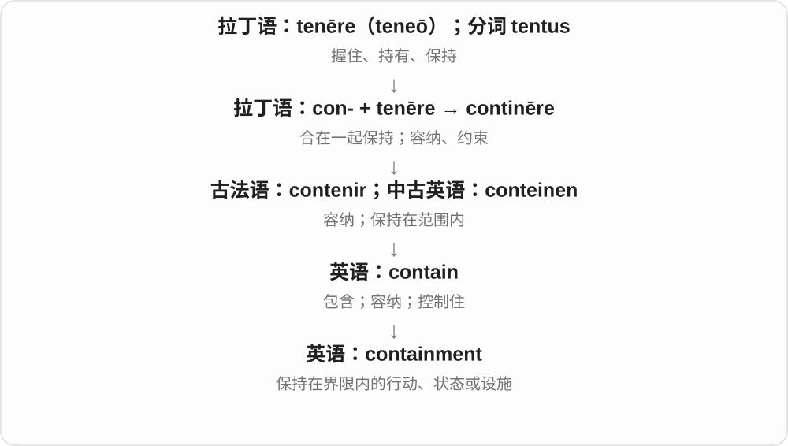

可以是实际围住泄漏物，也可以是阻止问题扩大。政治中的遏制也借用这个方向，但具体政策另有历史。

**常见搭配与例句**

spill containment；containment measures；a containment system。

> The team set up barriers for spill containment.

团队设置了围挡来控制泄漏物扩散。

> The first goal was containment of the problem.

最初的目标是控制问题，不让它扩大。

**别混淆**

elimination 是消除；containment 是控制在范围内，东西可能仍然存在。

### 107. reinforcement — 加固；加强；强化；增援人员〔常用复数〕

**音标**：英 /ˌriːɪnˈfɔːsmənt/；美 /ˌriːɪnˈfɔːrsmənt/

**先抓住这个画面**

额外加进来的力量，或加上这种力量的过程。

**怎么拆**

英语 reinforce + -ment；也与较早的 re- + enforcement 构词相联系。

**怎么变成今天的意思**

**拉丁 fortis**  
强壮、坚固、勇敢；更早来源有不同分析

↓

**晚期拉丁 infortiāre → 古法语 enforcier**  
使强、加固、施力

↓

**中古英语 enforcen → 英语 enforce**  
借法语，亦有 en- + force 的本土构词分析；后来专指强制落实

↓

**英语 re- + inforce〔enforce 旧变体〕→ reinforce**  
再加力量 → 加强、增援

↓

**英语 reinforce + -ment → reinforcement**  
加强过程；增加的支撑或人手

建筑中的 reinforcement 是加固材料或措施；reinforcements 常指增援人员。心理学的 reinforcement 是使某种行为更可能再次发生的后果；positive 与 negative 在这里指增加或移除刺激，不等于奖励与惩罚的简单二分。

**常见搭配与例句**

steel reinforcement；send reinforcements；positive reinforcement。

> The bridge needs additional reinforcement near its supports.

桥梁在支座附近需要进一步加固。

> The exhausted rescue team asked for reinforcements.

疲惫的救援队请求增派人手。

**别混淆**

punishment 以减少行为为定义；reinforcement 以增加行为为定义。日常“加强”则不必进入这套专业分类。

### 108. abandonment — 放弃、遗弃；被遗弃的状态

**音标**：/əˈbændənmənt/

**先抓住这个画面**

把松手不管这件事或它留下的处境当名词谈：项目被放弃，或人感到自己被抛下。

**怎么拆**

借法语 abandonnement，接 abandonner 的同一交出、放弃词族；现代可对应 abandon + -ment，但历史不只是在英语里新贴后缀。

**怎么变成今天的意思**

**古法语 à bandon、abandoner 等**  
交由支配、任其处置；放开控制

↓

**法语 abandonner → abandonnement → 英语 abandonment**  
放弃、遗弃行为或相应状态

the abandonment of a plan 放弃计划，a sense of abandonment 被抛下的感觉，years of abandonment 多年无人照管。

**常见搭配与例句**

the abandonment of；a sense of abandonment；years of abandonment。

> The storm led to the abandonment of the expedition.

风暴导致考察行动被放弃。

> The novel explores the child’s sense of abandonment.

小说探讨了孩子感到被抛下的心情。

**别混淆**

abandonment 行为或处境，abandoned 描述对象；词尾 -ment 不是每次都指一件可数实体。

### 109. enlist — 参军；招募；争取、获得协助

**音标**：/ɪnˈlɪst/

**先抓住这个画面**

把人拉到某支队伍、某项工作里来；自己进入队伍，也能说 enlist。

**怎么拆**

en- 使进入 + list 名册，背后是把人记入名册的画面。军事招募和日常争取帮助是不同固定用法。

**怎么变成今天的意思**

**古英语 līste、法语 liste 等历史形式**  
条带、边条；与条状记录相关

↓

**英语 list 的清单分支**  
逐项排列的目录、清单；其他同形旧词另分来源

↓

**en- + list → enlist**  
进入名册 → 入伍、招募、争取支持

enlist in the army 参军，enlist volunteers 招募志愿者，enlist someone’s help 请到某人帮忙。

**常见搭配与例句**

enlist in；enlist volunteers；enlist support；enlist someone’s help。

> She enlisted the help of two experienced volunteers.

她请到了两位有经验的志愿者帮忙。

> The biography describes why he enlisted in the army.

传记描述了他为何参军。

**别混淆**

enlist 常指入伍或把协助争取过来，list 只是列出、登记；list a name 不必等于那人已经同意参加。

### 110. enlistment — 入伍、参军；招募、征集

**音标**：/ɪnˈlɪstmənt/

**先抓住这个画面**

名字被登记进队伍，成为其中一员，是 enlistment 的旧画面。现代常见于参军，也能说招募帮助。

**怎么拆**

enlist + -ment；en- 进入与 list 名册相连，入册走向加入、征集。

**怎么变成今天的意思**

**en- + list → enlist**  
列入名册 → 参军、招募帮助

↓

**enlist + -ment → enlistment**  
入伍行为、服役登记；征集帮助

army enlistment 陆军入伍；the date of enlistment 入伍日期；voluntary enlistment 志愿参军。

**常见搭配与例句**

voluntary enlistment；the date of enlistment。

> The record gives his date of enlistment.

档案记载了他的入伍日期。

> The campaign encouraged voluntary enlistment.

宣传活动鼓励志愿参军。

**别混淆**

enlistment 常用于入伍、登记加入，不等于所有招聘 hiring；是否自愿要看制度与修饰语。

### 111. reimbursement — 报销；费用偿还；报销款

**音标**：英 /ˌriːɪmˈbɜːsmənt/；美 /ˌriːɪmˈbɜːrsmənt/

**先抓住这个画面**

reimburse 是“把垫付的钱补回来”，reimbursement 就是这项报销过程或补回来的款项。

**怎么拆**

英语 reimburse + -ment。名词保留 re-“回来”与历史 bursa“钱袋”的关系，但实际学习时以完整动词 reimburse 为基础最清楚。

**怎么变成今天的意思**

**拉丁钱袋构词背景 → 英语 reimburse**  
补回已经支出的费用

↓

**英语 reimburse + -ment → reimbursement**  
报销过程或报销款

工作中 a reimbursement claim 是报销申请，reimbursement policy 是说明哪些费用能报、怎么审核的规定。看到这个词，先找“谁先垫钱、谁负责补钱”，不必把它当成任何形式的付款。

**常见搭配与例句**

claim/request reimbursement；travel reimbursement；a reimbursement form；reimbursement for expenses。

> Please attach the receipts to your reimbursement claim.

请把收据附在报销申请上。

> The reimbursement arrived a week after she submitted the form.

她提交表格一周后，报销款到账了。

**别混淆**

compensation 可以包括伤害、损失、劳动等更广泛的补偿；reimbursement 常紧贴已经发生的具体费用。

### 112. bombardment — 持续炮击、轰击；信息的密集冲击

**音标**：英 /bɒmˈbɑːdmənt/；美 /bɑːmˈbɑːrdmənt/

**先抓住这个画面**

把 bombard 那种接连袭来的过程，当作一整场冲击来谈。

**怎么拆**

bombard + -ment，后缀把动作变成名词。

**怎么变成今天的意思**

**法语 bombarde**  
早期火炮等器械名称，与 bombe 同族

↓

**法语 bombarder → 英语 bombard**  
炮击；后来也说信息接连袭来

↓

**bombard + -ment → bombardment**  
持续轰击的过程或事件

bombardment 可用于实际炮火，也可形容广告、通知、问题不断涌来。a constant bombardment of messages 让人想到消息没完没了，并不需要真的带有攻击意图。

**常见搭配与例句**

under bombardment；a bombardment of questions；constant bombardment。

> The city endured days of bombardment.

那座城市经历了数日的持续炮击。

> She turned off notifications to escape the constant bombardment of messages.

她关闭了通知，想摆脱消息不断涌来的干扰。

**别混淆**

bombard 是动词，bombardment 是名词；一个小问题通常不能算 a bombardment。

### 113. embody — 体现；使具体化；包含

**音标**：英 /ɪmˈbɒdi/；美 /ɪmˈbɑːdi/

**先抓住这个画面**

抽象的原则看不见，落到一个人、一个设计里，就有了具体样子。

**怎么拆**

em- 是 en- 在 b 前的相应形式，加 body；可以理解成赋予有形躯体、体现。不是 empty“空”缩短后接身体。

**怎么变成今天的意思**

**古英语 bodiġ → 中古英语 body / bodi**  
身体、躯干

↓

**英语 body**  
身体；主体、实体；群体

↓

**em- + body → embody**  
使有具体形式；在对象中体现

embody a principle 是体现原则，embody an idea 是把想法具体表现；作品可 embody years of research，包含、凝结多年研究。

**常见搭配与例句**

embody a principle；embody an idea；embody a tradition。

> The design embodies the idea of simplicity.

设计体现了简洁的理念。

> The book embodies years of careful research.

这本书凝结了多年细致研究。

**别混淆**

embody 是把品质、理念具体体现，describe 是用语言描述；一个设计能体现简洁，即使没有文字解释。

### 114. embodiment — 体现；化身；具体表现

**音标**：英 /ɪmˈbɒdimənt/；美 /ɪmˈbɑːdimənt/

**先抓住这个画面**

诚实是抽象品质，一个人在每件小事里都做出来，你就能把他看作诚实的 embodiment：品质有了看得见的样子。

**怎么拆**

embody + -ment，保留词末 y；em- 进入与 body 身体的材料，从给以具体形体走到体现抽象性质。

**怎么变成今天的意思**

**em- + body → embody**  
使有形体；体现

↓

**embody + -ment → embodiment**  
具体体现某品质、观念的人或物

the embodiment of something 某物的体现、化身；常作单数，较正式。可以是褒义品质，也可以是负面特点。

**常见搭配与例句**

the embodiment of；a living embodiment。

> For her students, she was the embodiment of patience.

在学生眼里，她是耐心的化身。

> The design is an embodiment of the team’s values.

这个设计体现了团队的价值观。

**别混淆**

embodiment 不只说身体存在；把某理念清楚表现出来的设计、制度，也能是它的 embodiment。

### 115. assortment — 各种各样的一组；混合品种

**音标**：英 /əˈsɔːtmənt/；美 /əˈsɔːrtmənt/

**先抓住这个画面**

一盒里有不同口味的饼干，不是同款堆很多，而是一组有不同种类的东西，可以叫 an assortment。

**怎么拆**

assort 把东西分组、搭配 + -ment，前者接法语 assortir 等按类安排的材料，关联 sort 种类。

**怎么变成今天的意思**

**法语 assortir → assort**  
按种类安排、配成一组

↓

**assort + -ment → assortment**  
分配、搭配后的一组；多种东西的集合

an assortment of something 各式各样的……；a wide assortment 品种丰富的一组；an assortment of tools 一堆不同工具。

**常见搭配与例句**

an assortment of；a wide assortment。

> The box contains an assortment of biscuits.

盒里装着各种饼干。

> She arrived with a strange assortment of tools.

她带来了一组稀奇古怪的工具。

**别混淆**

assortment 强调里面有不同种类；a large quantity 只说数量多，不保证品种多。

### 116. lament — 哀叹、悲叹；哀歌、悲叹的话

**音标**：/ləˈment/

**先抓住这个画面**

把“真可惜，失去了”带着悲伤说出来，就是 lament。它既能为逝者哀哭，也能书面地惋惜旧事物的消失。

**怎么拆**

动词可能从 lamentation 逆构，也有法语、拉丁借入分析；拉丁 lamentum 更远或接拟声的呼喊材料与 -mentum。现代不能硬拆成 lam + -ent。

**怎么变成今天的意思**

**拉丁 lamentum → lamentari；法语相应形式 → 英语 lamentation**  
哀哭、哀叹；名词在英语的记录较早

↓

**英语 lament 动词；名词另有法语、拉丁借入路线**  
动词有从 lamentation 逆构，或法语、拉丁借入的分析

lament the loss of... 是哀叹失去某人、某物；a lament for... 是为某人、某事写的哀歌、悲叹。

**常见搭配与例句**

lament the passing of an era 感叹一个时代的逝去；a musical lament 一曲哀歌。

> Many residents lament the loss of the old theatre.

许多居民惋惜老剧院的消失。

> The song is a lament for a lost home.

这首歌是一曲怀念失去家园的哀歌。

**别混淆**

grieve 常突出内心悲痛，lament 常突出把哀伤、惋惜说出或唱出；两者可以描写同一次失去。

### 117. lamented — 哀叹、惋惜了；受到哀悼的

**音标**：/ləˈmentɪd/

**先抓住这个画面**

过去为某种失去叹惋，用 lamented；说一位大家都怀念的逝者，也可形容为 much lamented。

**怎么拆**

lament + 完整 -ed，/t/ 后读 /ɪd/。从哀叹动词的分词，还能形成受到悼念的形容词用途。

**怎么变成今天的意思**

**拉丁 lamentum → lamentari；法语相应形式 → 英语 lamentation**  
哀哭、哀叹；名词在英语的记录较早

↓

**英语 lament 动词；名词另有法语、拉丁借入路线**  
动词有从 lamentation 逆构，或法语、拉丁借入的分析

↓

**lament + -ed → lamented**  
过去哀叹 → 受到哀悼、惋惜的

lamented the loss 是惋惜失去，much lamented 是深受哀悼、怀念的，后者语气较正式。

**常见搭配与例句**

lamented the closure 惋惜关闭；lamented his absence 感叹他不在。

> They lamented the closure of the village school.

他们惋惜村里学校的关闭。

> She lamented how little time they had spent together.

她感叹他们相处的时间竟那么少。

**别混淆**

lamented 作前置形容词可说被怀念的人，不能只因 -ed 就认定描述本人正在感到悲伤。

### 118. laments — 哀叹、惋惜〔第三人称单数〕；哀歌、悲叹〔复数〕

**音标**：/ləˈments/

**先抓住这个画面**

一个人说着某种失去多么可惜，叫 laments；几首哀歌、几段悲叹，也能用同样的名词复数。

**怎么拆**

lament + -s，/t/ 后读 /s/。基础名词、动词的借词与逆构历史分别保留，现代两种词性再各加复数、三单词尾。

**怎么变成今天的意思**

**拉丁 lamentum → lamentari；法语相应形式 → 英语 lamentation**  
哀哭、哀叹；名词在英语的记录较早

↓

**英语 lament 动词；名词另有法语、拉丁借入路线**  
动词有从 lamentation 逆构，或法语、拉丁借入的分析

↓

**lament + -s → laments**  
他、她惋惜；几首哀歌、几段悲叹

laments the lack of time 是感叹时间不够；traditional laments 是传统哀歌。

**常见搭配与例句**

laments the change 惋惜变化；laments for the dead 为逝者唱的哀歌。

> She laments the disappearance of the old bookshops.

她惋惜那些老书店的消失。

> The collection includes several traditional laments.

这部选集中有几首传统哀歌。

**别混淆**

laments 往往是带悲伤、惋惜的表达；complains 可以侧重不满、要求改变，语气和目的可能不同。

### 119. lamenting — 正在哀叹、惋惜；表达悲伤的活动

**音标**：/ləˈmentɪŋ/

**先抓住这个画面**

一边回想失去的东西，一边说“太可惜了”，就是 lamenting。它常把惋惜变成听得见的话。

**怎么拆**

lament + 完整 -ing，直接相接。英语动词的借入或逆构先形成，现代词尾再标明过程、活动。

**怎么变成今天的意思**

**拉丁 lamentum → lamentari；法语相应形式 → 英语 lamentation**  
哀哭、哀叹；名词在英语的记录较早

↓

**英语 lament 动词；名词另有法语、拉丁借入路线**  
动词有从 lamentation 逆构，或法语、拉丁借入的分析

↓

**lament + -ing → lamenting**  
表达哀叹、惋惜的过程

lamenting the loss of... 是哀叹某种失去；lamenting that... 后说感叹的内容。

**常见搭配与例句**

lamenting the change 惋惜变化；lamenting the lack of time 感叹时间不够。

> He sat by the window, lamenting the changes in his old neighbourhood.

他坐在窗边，感叹老街区的变化。

> She was lamenting that the summer had passed so quickly.

她正感叹夏天过得太快。

**别混淆**

lamenting 强调表达伤感，remembering 只说明回想、记得；回忆可以愉快，也可以悲伤。

### 120. lamentations — 阵阵哀哭；一篇篇、一段段悲叹

**音标**：/ˌlæmənˈteɪʃənz/，也 /ˌlæmɪnˈteɪʃənz/

**先抓住这个画面**

悲叹不是一声就结束，而是一阵阵哭诉、一段段伤感表达，可以叫 lamentations。

**怎么拆**

lamentation + -s，/n/ 后读 /z/。先有借来的哀叹名词，再以现代规则复数数出多段表达。

**怎么变成今天的意思**

**拉丁 lamentum → lamentari；法语相应形式 → 英语 lamentation**  
哀哭、哀叹；名词在英语的记录较早

↓

**英语 lament 动词；名词另有法语、拉丁借入路线**  
动词有从 lamentation 逆构，或法语、拉丁借入的分析

↓

**lamentation + -s → lamentations**  
若干次、若干段哀叹

lamentations over the loss 是为失去而发的阵阵悲叹；也可在文学叙事中写葬礼的哭声。

**常见搭配与例句**

loud lamentations 阵阵大声哀哭；repeated lamentations 反复的哀叹。

> Their lamentations could be heard from the courtyard.

院子里能听见他们阵阵哀哭。

> The letters are full of lamentations over the passing of the old days.

这些信满是对旧日逝去的悲叹。

**别混淆**

laments 与 lamentations 都能指悲叹，laments 还常数哀歌；后者通常更正式、铺陈，不必在普通难过场景硬用。

### 121. lamentation — 哀叹、恸哭；一段悲叹

**音标**：/ˌlæmənˈteɪʃən/，也 /ˌlæmɪnˈteɪʃən/

**先抓住这个画面**

把哀伤喊出来、哭出来，或用一段话表达出来，这件事叫 lamentation。语气比日常 sadness 更正式，也更着重表达。

**怎么拆**

经法语 lamentation、拉丁 lamentatio 借入；现代对应 lament + -ation，但英语名词记录早于 lament 动词，不能把学习顺序当成历史顺序。

**怎么变成今天的意思**

**拉丁 lamentum → lamentari；法语相应形式 → 英语 lamentation**  
哀哭、哀叹；名词在英语的记录较早

↓

**英语 lament 动词；名词另有法语、拉丁借入路线**  
动词有从 lamentation 逆构，或法语、拉丁借入的分析

↓

**法语、拉丁名词 → 中古英语 lamentacioun → lamentation**  
哀叹、哀哭的行为或表达

a cry of lamentation 是一声哀哭，a lamentation over... 是对某事的悲叹。

**常见搭配与例句**

loud lamentation 大声哀哭；a song of lamentation 一首悲叹之歌。

> A cry of lamentation rose from the crowd.

人群中响起一声哀哭。

> The poem is a lamentation over the loss of a way of life.

这首诗哀叹一种生活方式的消失。

**别混淆**

lamentation 是活动、表达的名词，lament 还可作动词；长词不一定在英语里比短词晚出现。

### 122. accompaniment — 伴奏；配菜；伴随物

**音标**：/əˈkʌmpənimənt/

**先抓住这个画面**

主角旁边起衬托作用的那一部分：歌声旁边的琴声，主菜旁边的配菜。

**怎么拆**

借自法语 accompagnement，来自 accompagner“陪同、伴奏”；现代可对应 accompany + -ment。

**怎么变成今天的意思**

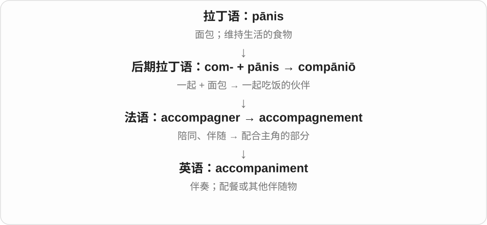

音乐是最常见场景之一；a good accompaniment to fish 可以是适合配鱼的菜或酱。通常不是主角，却与主角一起构成体验。

**常见搭配与例句**

piano accompaniment；an accompaniment to；to the accompaniment of。

> The melody sounds different with a piano accompaniment.

这段旋律配上钢琴伴奏后，听起来不一样了。

> The fresh salad is a good accompaniment to the grilled fish.

这份新鲜沙拉很适合搭配烤鱼。

**别混淆**

accompaniment 是配合的声音或东西；accompanist 是提供伴奏的人。

### 123. accompaniments — 伴奏；配菜、伴随部分〔复数〕

**音标**：/əˈkʌmpənimənts/

**先抓住这个画面**

主旋律旁边有钢琴托着，主菜旁边有小菜配着。不同领域都可把这些配合主角的部分叫 accompaniments。

**怎么拆**

accompaniment + -s；名词借法语 accompagnement，现代对应 accompany 与 -ment。更远经同伴词族接一起吃面包的材料。

**怎么变成今天的意思**

**拉丁 panis 面包 → companio 一起吃饭的伙伴**  
共同进食的画面进入同伴名称

↓

**法语 accompagner、accompagnement → 英语 accompany、accompaniment**  
陪同、配合主角；伴奏、伴随部分

↓

**accompaniment + -s → accompaniments**  
多份伴奏安排或配菜、伴随部分

piano accompaniments 是钢琴伴奏，accompaniments to a meal 是配餐部分；都围绕主角提供配合。

**常见搭配与例句**

simple accompaniments 简单伴奏；vegetable accompaniments 蔬菜配菜。

> The book includes piano accompaniments for all the songs.

书里收有全部歌曲的钢琴伴奏。

> The meal came with several vegetable accompaniments.

这顿饭配了几样蔬菜小菜。

**别混淆**

accompaniments 是伴随的内容，accompanists 是做伴奏的人；-ment 与 -ist 指向不同。

### 124. enlargement — 扩大；扩建；放大件

**音标**：英 /ɪnˈlɑːdʒmənt/；美 /ɪnˈlɑːrdʒmənt/

**先抓住这个画面**

可以是把东西变大的过程，也可以是变大后得到的那一份。

**怎么拆**

enlarge + -ment，英语名词。

**怎么变成今天的意思**

**拉丁 largus**  
丰富、充足；慷慨的，较早来源未定

↓

**古法语 large → enlargier / enlargir → 中古英语 enlargen**  
使范围或尺寸变大

↓

**英语 enlarge**  
扩大；放大；详述

↓

**英语 enlarge + -ment → enlargement**  
扩大过程；放大后的照片等成品

the enlargement of a building 说扩建；an enlargement of a photo 说放大照片。机构扩员等抽象范围也能用。

**常见搭配与例句**

an enlargement of；photographic enlargement；building enlargement。

> The enlargement of the library added two reading rooms.

图书馆扩建增加了两间阅览室。

> She ordered an enlargement of the family photograph.

她订做了一张放大的家庭合影。

**别混淆**

extension 常说加出去的一部分；enlargement 更整体地说尺寸或规模变大。

### 125. refinement — 改进；提纯；精致

**音标**：/rɪˈfaɪnmənt/

**先抓住这个画面**

refinement 可以是打磨的过程，也可以是其中一次小改进。它往往让东西更细、更顺、更成熟，不一定是一次彻底重做。

**怎么拆**

refine + -ment，形成动作、结果或状态名词。

**怎么变成今天的意思**

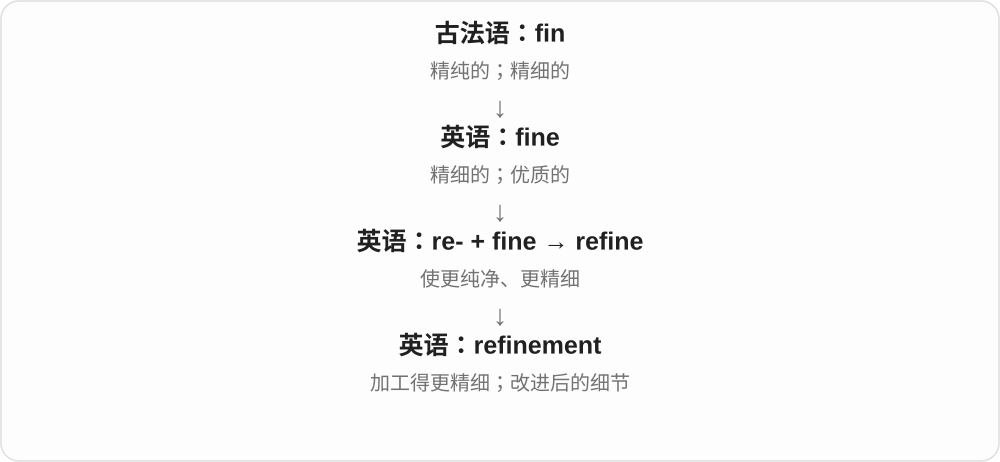

从去掉原料中的杂质，扩展到改进设计和方法，再扩展到举止、品位上的精致。这里的多个义项都能围绕“由粗到细”理解。

**常见搭配与例句**

further refinement（进一步改进）；a refinement to the design（设计的一处改进）；refinement of a method（方法的完善）。

> The latest model includes several small refinements.

最新型号包含几项细小的改进。

> The technique still needs further refinement.

这项技术仍需进一步完善。

**别混淆**

refinement 常是细化和优化；revolution 强调根本性变化。a refinement 可数，表示一项具体改进。

### 126. disarmament — 裁军；解除武装；军备削减

**音标**：英 /dɪsˈɑːməmənt/；美 /dɪsˈɑːrməmənt/

**先抓住这个画面**

不是只把今天的武器放下，而是减少或取消手中的军备。

**怎么拆**

英语以 disarm 为基础形成动作名词，受到 armament 的形式影响；表面也能看出 dis- 与 armament 的呼应。

**怎么变成今天的意思**

**拉丁语 arma**  
装备、兵器；本来是复数形式

↓

**拉丁语 armare → 古法语 armer**  
装备武器、武装

↓

**古法语 des- + armer → desarmer → 英语 disarm**  
解除武装；使失去敌意、防备，英语早期已有比喻用法

↓

**英语 disarm → disarmament**  
参照 armament 形成名词：解除武装、削减军备

disarmament talks 讨论的是怎样削减军备、核查落实等事项。停火之后，未必已经完成 disarmament。

**常见搭配与例句**

nuclear disarmament；disarmament talks；a disarmament agreement。

> Disarmament remained a central issue in the negotiations.

裁军仍是谈判中的核心议题。

> The report examined progress toward nuclear disarmament.

这份报告研究了核裁军取得的进展。

**别混淆**

armistice 主要是停止交战的安排；disarmament 关注武器与军备本身的减少。

### 127. attainment — 达到、获得；成就；所达到的水平

**音标**：/əˈteɪnmənt/

**先抓住这个画面**

把“终于达到”这件事，或达到后的成果拿出来说。

**怎么拆**

attain + -ment；与古法语 ataignement 也有历史对应。现代常见于目标达成和教育水平。

**怎么变成今天的意思**

**拉丁 tangere；完成分词 tactus**  
碰、触及、达到

↓

**拉丁 ad- + tangere → attingere；俗拉丁 \*attangere**  
触到、达到

↓

**古法语 ataindre／ataign- → 中古英语 atteinen → attain**  
够到 → 达到目标、水平

↓

**英语 attain + -ment → attainment**  
达到的过程、结果或水平

educational attainment 常说一个人已达到的教育程度；attainment of a goal 说目标达成。复数 attainments 可指学识、本领等成就，语气较正式。

**常见搭配与例句**

educational attainment；academic attainment；the attainment of a goal。

> The survey recorded each participant’s educational attainment.

调查记录了每位参与者的受教育程度。

> The team celebrated the attainment of its first major goal.

团队庆祝达成第一个重要目标。

**别混淆**

achievement 常突出完成的成绩；attainment 还常用来描述达到哪一级、哪一程度，不一定是一件轰动成就。

### 128. embankment — 堤岸；路堤、铁路路基的填筑体

**音标**：/ɪmˈbæŋkmənt/

**先抓住这个画面**

把土石堆成一条抬高的长带，用来挡水或托住道路、铁路，这样的结构叫 embankment。

**怎么拆**

embank 筑堤 + -ment，前者对应 em- 与 bank 堤岸、土埂材料；这里 bank 不取金融银行义。

**怎么变成今天的意思**

**em- + bank → embank**  
用堤岸围护、筑起土堤

↓

**embank + -ment → embankment**  
筑起的堤岸、土石填筑体

a river embankment 河堤；a railway embankment 铁路路堤；walk along the embankment 沿堤岸走。

**常见搭配与例句**

a river embankment；a railway embankment。

> They walked along the river embankment.

他们沿河堤步行。

> The railway runs along a high embankment.

铁路沿着高高的路堤延伸。

**别混淆**

embankment 不只防洪，也可支撑道路；bridge 是跨越空处的桥，不能把所有抬高的路段都叫桥。

### 129. allot — 分配、拨给〔时间、资源等〕

**音标**：英 /əˈlɒt/；美 /əˈlɑːt/

**先抓住这个画面**

手里有有限的时间、座位、钱，你给每个人划出一份，是 allot。常比 give 更让人想到事先划定份额。

**怎么拆**

经法语 aloter 接向某份额分派的材料，与 lot 份额相关。现代过去式 allotted、分词 allotting 双写 t。

**怎么变成今天的意思**

**法语 aloter，à 与 lot 份额等 → allot**  
把一份份东西分给不同对象

↓

**allot + -ment → allotment**  
分配的份额；分出供种植的小块土地

allot time to something 为某事分配时间；allot someone a place 给某人分配名额；the allotted time 规定的时间。

**常见搭配与例句**

allot time to；the allotted time。

> We allotted ten minutes to each speaker.

我们给每位发言者分配了十分钟。

> Each family was allotted a small plot of land.

每户人家分到了一小块土地。

**别混淆**

allot 常指把有限资源分份，allow 是允许；allow time 留出时间与 allot time 分配时间语义相近但构造不同。

### 130. allotment — 分配、份额；小块租用菜地〔英〕

**音标**：英 /əˈlɒtmənt/；美 /əˈlɑːtmənt/

**先抓住这个画面**

分给你的那一份是 allotment；英国日常还常说一块租来种菜、种水果的小菜地，正是被分出来的一块地。

**怎么拆**

接法语 alotement 等，现代对应 allot + -ment；份额义延伸到特定的小块园地。

**怎么变成今天的意思**

**法语 aloter，à 与 lot 份额等 → allot**  
把一份份东西分给不同对象

↓

**allot + -ment → allotment**  
分配的份额；分出供种植的小块土地

↓

**allotment 的份额与土地用法**  
分配及份额；城镇附近供个人耕种的小块地

a water allotment 配给水量；an allotment of time 分配的时间；grow vegetables on an allotment 在租来的菜地种菜。

**常见搭配与例句**

an allotment of；rent an allotment。

> She grows tomatoes on her allotment.

她在租来的小菜地上种番茄。

> Each team received the same allotment of time.

每个团队分到的时间相同。

**别混淆**

allotment 的菜地义有地域习惯，不能看见任何花园就一律改叫 allotment；garden 范围更广。

### 131. acknowledgment — 承认；收到确认；致谢〔亦拼 acknowledgement〕

**音标**：英 /əkˈnɒlɪdʒmənt/；美 /əkˈnɑːlɪdʒmənt/

**先抓住这个画面**

把承认、确认或感谢这件动作，变成一个可谈论的结果。

**怎么拆**

acknowledge + -ment 构成名词，结尾 e 可按拼写习惯保留或省去；两种常用拼写不是两个不同来源的词。

**怎么变成今天的意思**

**英语 acknowledge**  
承认、确认、致谢

↓

**acknowledge + -ment**  
承认这一行为或表示

↓

**acknowledgment／acknowledgement**  
承认；确认回执；致谢

an acknowledgment of receipt 是收到确认；an acknowledgment of failure 是承认失败；书里的 acknowledgments 常是致谢页。同一名词承接动词的几种用法，靠后面的对象分辨。

**常见搭配与例句**

in acknowledgment of；an acknowledgment of receipt；the acknowledgments section。

> I received an acknowledgment of my application the next morning.

第二天早上，我收到了申请已收悉的确认。

> The book’s acknowledgments thank the volunteers who helped with the research.

这本书的致谢页感谢了帮助开展研究的志愿者。

**别混淆**

acknowledgment 和 acknowledgement 意思相同；美式更常用前者，英式常见后者。收到确认只证明收到，不自动表示批准内容。

### 132. refurbish — 翻新、整修

**音标**：英 /ˌriːˈfɜːbɪʃ/；美 /ˌriːˈfɜːrbɪʃ/

**先抓住这个画面**

旧房间、旧电脑还值得继续用，你修整、更换部分东西，让它重新有好状态，就是 refurbish。

**怎么拆**

re- 再 + furbish 擦亮、修整，后者接法语 forbir、furbiss- 等材料，再远有日耳曼语来源。不是把整个词尾当某种鱼 fish。

**怎么变成今天的意思**

**法语 forbir、furbiss- 等 → 英语 furbish**  
擦亮、修整

↓

**re- 再 + furbish → refurbish → refurbishment**  
重新修整、翻新；翻新活动

refurbish a building 整修建筑；a refurbished laptop 翻新笔记本；常含清洁、修理、更换等组合工作。

**常见搭配与例句**

refurbish a building；a refurbished laptop。

> The hotel refurbished all its guest rooms.

酒店翻新了所有客房。

> He bought a refurbished computer.

他买了一台翻新电脑。

**别混淆**

refurbish 是整修到可继续用的状态，demolish 是拆毁；refurbished 也不等于全新出厂。

### 133. refurbishment — 翻新、整修工程

**音标**：英 /ˌriːˈfɜːbɪʃmənt/；美 /ˌriːˈfɜːrbɪʃmənt/

**先抓住这个画面**

refurbish 是动手翻新，refurbishment 是这项翻新工作：店面为了它暂停营业，之后以更好的状态重新开门。

**怎么拆**

refurbish + -ment；re- 再的材料还在，-ment 把整修的过程、工程名词化。

**怎么变成今天的意思**

**法语 forbir、furbiss- 等 → 英语 furbish**  
擦亮、修整

↓

**re- 再 + furbish → refurbish → refurbishment**  
重新修整、翻新；翻新活动

↓

**refurbish + -ment → refurbishment**  
翻新活动或具体整修工程

closed for refurbishment 因整修关闭；a major refurbishment 大规模翻新；undergo refurbishment 进行整修。

**常见搭配与例句**

closed for refurbishment；undergo refurbishment。

> The library is closed for refurbishment.

图书馆因整修关闭。

> The refurbishment gave the old shop a brighter interior.

翻新让老店内部明亮起来。

**别混淆**

refurbishment 可以更新设备、装修，并不意味着建筑结构全部重建；reconstruction 更突出重建。

### 134. enrolment — 注册；入学；注册人数，enrollment 的英式常见拼法

**音标**：英 /ɪnˈrəʊlmənt/；美 /ɪnˈroʊlmənt/

**先抓住这个画面**

enrolment 指名字列入名单这件事，也可以把已经登记的学生人数作为一个整体来谈。

**怎么拆**

与 enrollment 是同词的拼写变体，上接法语 enrollement；现代可联系 enrol + -ment。

**怎么变成今天的意思**

填写 enrolment form 是办理注册；enrolment figures 是注册人数数据。语境决定是过程还是数量。

**常见搭配与例句**

an enrolment form；enrolment figures；complete enrolment。

> Please complete the enrolment form in black ink.

请用黑色墨水填写注册表。

> The school published its annual enrolment figures.

学校公布了年度注册人数。

**别混淆**

enrolment 与 enrollment 无需分别背成两个词义；registration 是更广泛的登记名称。

### 135. reinstate — 使复职；恢复〔资格、制度等〕

**音标**：/ˌriːɪnˈsteɪt/

**先抓住这个画面**

原有的职位被取消、服务被停止，后来又恢复回来，就是 reinstate。需要先有一个曾经存在、后来中断的状态。

**怎么拆**

re- 再 + instate 安置、任命；instate 关联 state 状态、地位材料，不能把它只记成某个美国州的动作。

**怎么变成今天的意思**

**re- 再 + instate 安置、任命 → reinstate**  
放回原有职位、状态

↓

**reinstate + -ment → reinstatement**  
恢复职务、资格、制度等的过程或结果

reinstate an employee 让员工复职；reinstate a rule 恢复规则；reinstate someone as something 恢复某人的职位。

**常见搭配与例句**

reinstate someone as；reinstate a service。

> She was reinstated as team captain.

她恢复了队长职务。

> The company reinstated the cancelled service.

公司恢复了先前取消的服务。

**别混淆**

reinstate 重恢复原来地位，hire 是雇用，未必以前就在这里任职。

### 136. reinstatement — 复职；恢复原有状态、资格

**音标**：/ˌriːɪnˈsteɪtmənt/

**先抓住这个画面**

人重新回到原岗位、旧服务重新开放，这个恢复的结果或过程叫 reinstatement。

**怎么拆**

reinstate + -ment，保留末尾 e；re- 再的意义帮助理解恢复，不是首次建立。

**怎么变成今天的意思**

**re- 再 + instate 安置、任命 → reinstate**  
放回原有职位、状态

↓

**reinstate + -ment → reinstatement**  
恢复职务、资格、制度等的过程或结果

↓

**reinstate + -ment → reinstatement**  
复职、恢复资格或原有安排

reinstatement to a post 恢复原职；the reinstatement of a service 服务恢复；seek reinstatement 要求复职。

**常见搭配与例句**

seek reinstatement；the reinstatement of。

> The workers called for her reinstatement.

工人们要求让她复职。

> The reinstatement of the bus route helped local residents.

公交线路恢复方便了当地居民。

**别混淆**

reinstatement 常指回到先前状态，replacement 是换成另一人、物；恢复原人不等于找人替换。

### 137. atone — 弥补过错；赎罪

**音标**：英 /əˈtəʊn/；美 /əˈtoʊn/

**先抓住这个画面**

做错后不只说一句算了，而是想通过行动补回来、重新和好，就是 atone。词的旧画面很直观：回到一条心。

**怎么拆**

来自 at one 处于一致、和好的旧短语，保留 one 的旧读音材料；不是 a- 加现代 tone 音调。后来的动词用于弥补过错。

**怎么变成今天的意思**

**中古英语 at one、atonen 等**  
处于一致、和好状态

↓

**atonement 与后来的动词 atone**  
和解 → 补偿过错、赎罪；名词记录早于该动词记录

atone for a mistake 为错误作弥补；atone for wrongdoing 赎过。通常用 for 接所弥补的过错。

**常见搭配与例句**

atone for；try to atone。

> He tried to atone for his mistake by helping with the repairs.

他帮忙维修，试图弥补自己的过错。

> The novel asks whether a person can atone for past wrongdoing.

小说追问人能否为过去的过错赎罪。

**别混淆**

atone 强调补过、赎罪，apologise 强调道歉；一句道歉可能是其中一步，未必已弥补实际伤害。

### 138. atonement — 补偿过错；赎罪；和解〔宗教等语境〕

**音标**：英 /əˈtəʊnmənt/；美 /əˈtoʊnmənt/

**先抓住这个画面**

关系被伤害后，付出行动去补过、重新求得和解，这件事是 atonement。宗教里有更具体的解释，需按文本理解。

**怎么拆**

以 at one 和好的旧材料加名词尾形成。现代与 atone 对应，但名词的早期记录在动词之前，不能画成英语动词必定先有。

**怎么变成今天的意思**

**中古英语 at one、atonen 等**  
处于一致、和好状态

↓

**atonement 与后来的动词 atone**  
和解 → 补偿过错、赎罪；名词记录早于该动词记录

↓

**atonement 的后续意义**  
从一致、和解走向补过、赎罪

atonement for a wrong 为过错作弥补；in atonement for 为补过；an act of atonement 一项补过行动。

**常见搭配与例句**

in atonement for；an act of atonement。

> He volunteered in atonement for the harm he had caused.

他做志愿工作，弥补自己造成的伤害。

> The story explores guilt and atonement.

故事探讨内疚与赎罪。

**别混淆**

atonement 侧重处理过错与修复关系，不是任意损失的普通 compensation 补偿；宗教义尤其不能只译成付钱。

### 139. nourishment — 滋养；养分；精神食粮

**音标**：英 /ˈnʌrɪʃmənt/；美 /ˈnɜːrɪʃmənt/

**先抓住这个画面**

维持身体或内心成长的那份供给。

**怎么拆**

历史经古法语 norissement 借入；现代可看出 nourish + -ment，但不能画成英语 nourish 又倒流成古法语名词。

**怎么变成今天的意思**

**拉丁 nūtrīre**  
哺育、喂养、使生长

↓

**古法语 norrir → norissement**  
滋养、养育 → 滋养之物或过程

↓

**中古英语 norishement → 英语 nourishment**  
滋养；身体或精神所需的养分

get nourishment from food 是从食物取得养分；find nourishment in music 可以指音乐让精神充实。通常不可数，不直接等于一瓶营养补充品。

**常见搭配与例句**

provide nourishment；receive nourishment；emotional nourishment。

> The young plants receive nourishment from the rich soil.

幼苗从肥沃土壤中获得养分。

> She found spiritual nourishment in poetry.

她从诗歌中获得了精神滋养。

**别混淆**

nourishment 常强调养分或被滋养的感觉；nutrition 更常用于科学、健康或饮食讨论。

### 140. postponement — 延期；推迟

**音标**：英 /pəʊstˈpəʊnmənt/；美 /poʊstˈpoʊnmənt/

**先抓住这个画面**

一项活动还保留着，只是原定日期被往后挪。

**怎么拆**

postpone + -ment，动词变成表示行为或结果的名词。

**怎么变成今天的意思**

**拉丁语 pōnere；过去分词 positus**  
放、安置；已经放好的

↓

**拉丁 post- + pōnere → postponere → 英语 postpone**  
放到后面 → 把时间往后推

↓

**英语 postpone + -ment → postponement**  
把安排推后这件事

通常讨论某场活动或某项决定的推迟；可数时一次 postponement 就是一次延期。

**常见搭配与例句**

the postponement of；request a postponement；a further postponement。

> Heavy snow forced the postponement of the concert.

大雪迫使音乐会延期。

> They requested a brief postponement to review the documents.

他们请求短暂延期，以便审阅文件。

**别混淆**

cancellation 是取消；postponement 通常仍打算以后进行。

### 141. betterment — 改善；改进；境遇提升〔正式〕

**音标**：英 /ˈbetəmənt/；美 /ˈbetərmənt/

**先抓住这个画面**

不是只评一句更好了，而是把让生活、条件或制度变好的过程作为目标。

**怎么拆**

better 改善这个动词 + -ment，十六世纪已有名词。直接来源是动词一支，不是给 good 生硬加一长串后缀。

**怎么变成今天的意思**

**古英语 betera 比较形式；beterian 改善动词**  
与 good 的词形来源不同，却早已参与同一比较系统

↓

**中古英语 better／betteren → 英语 better**  
更好、改善、超过；属于语法搭配的补充关系

↓

**英语动词 better + -ment → betterment**  
把改善的过程或结果名词化

for the betterment of the community 是为了改善社区整体状况。这个词常见于公共事务、教育或较正式的愿景表述，日常改个按钮往往用 improvement 更自然。

**常见搭配与例句**

social betterment；the betterment of society；for the betterment of…。

> The project aims at the betterment of living conditions in the neighbourhood.

这个项目旨在改善社区的居住条件。

> She devoted much of her time to the betterment of local education.

她把许多时间用于改善当地教育。

**别混淆**

improvement 更通用；betterment 较强调境遇、条件或整体福祉向好，不是 better 的最高级。

### 142. catchment — 集水区、流域；服务覆盖区〔常见英式〕

**音标**：/ˈkætʃmənt/

**先抓住这个画面**

雨水往同一处汇，或一个地区的人由同一家医院、学校接收；抓住收进来的范围。

**怎么拆**

catch + -ment，接收集、汇集的联系。自然水文与机构服务范围分别专门化，不把学校真想成捕鱼网。

**怎么变成今天的意思**

**拉丁 capere → captāre、晚期相关形式 → 法语 cachier 等**  
抓、拿 → 捕捉、追猎

↓

**中古英语 cacchen → catch**  
抓住、接住；捕捉到注意、信息等用法

↓

**catch + -ment → catchment**  
水流汇集范围；引申机构接收、服务范围

a river catchment 河流集水区，a school catchment area 学校服务覆盖区；具体招生边界看当地规则。

**常见搭配与例句**

a river catchment；a catchment area；a school catchment。

> Rainfall was measured across the river catchment.

人们测量了整个河流集水区的降雨。

> The map shows the hospital’s catchment area.

地图显示了医院的服务覆盖区。

**别混淆**

catchment 是汇集、覆盖范围，catcher 是执行接住的人、器具；服务区不由词本身保证某个个人必获录取。

### 143. embezzle — 侵吞、挪用〔受托管理的钱财〕

**音标**：/ɪmˈbezəl/

**先抓住这个画面**

钱由你经手、保管，你却偷偷转成自己的利益，这类行为常用 embezzle。它的重心是滥用已被交付的信任。

**怎么拆**

经法语 embesiler 等偷走、使消失的材料，词形发展为 embezzle；较远词源未明，不编出一个英语 bezzle 偷。

**怎么变成今天的意思**

**法语 embesiler 等 → 中古英语 embesilen**  
偷走、使东西消失；更远来源未明

↓

**英语 embezzle → embezzlement**  
侵吞自己受托管理的财物；这一行为

embezzle money 侵吞钱款；embezzle funds from an organisation 侵吞机构资金。通常对象是自己被委托处理的钱财。

**常见搭配与例句**

embezzle money；embezzle funds。

> The accountant was accused of embezzling company funds.

会计被指控侵吞公司资金。

> The audit found that money had been embezzled.

审计发现有钱款被侵吞。

**别混淆**

steal 范围更广；embezzle 特别突出受托管理后侵占，不是每一次街头盗窃都用这个词。

### 144. embezzlement — 侵吞、挪用受托钱财的行为

**音标**：/ɪmˈbezəlmənt/

**先抓住这个画面**

embezzle 是把受托的钱据为己有，embezzlement 是作为问题、案件来讨论的这种行为。

**怎么拆**

embezzle + -ment，保留词末 e；名词尾把侵吞行为作为整体来谈。

**怎么变成今天的意思**

**法语 embesiler 等 → 中古英语 embesilen**  
偷走、使东西消失；更远来源未明

↓

**英语 embezzle → embezzlement**  
侵吞自己受托管理的财物；这一行为

↓

**embezzle + -ment → embezzlement**  
受托管理的钱财被侵占的行为

an embezzlement case 侵吞资金案件；accused of embezzlement 被指控侵吞钱财；investigate embezzlement 调查相关行为。

**常见搭配与例句**

accused of embezzlement；an embezzlement case。

> The bank reported suspected embezzlement.

银行报告了涉嫌侵吞资金的情况。

> The film follows an investigation into embezzlement.

影片围绕一项资金侵吞调查展开。

**别混淆**

embezzlement 的定义围绕受托财物，fraud 欺诈的范围更广；报道中的指控也不等于已经定罪。

### 145. consignment — 一批托运货物；托运；寄售

**音标**：/kənˈsaɪnmənt/

**先抓住这个画面**

consignment 可以是交付这件事，也可以直接是那一批被交出去的货，像一张运单对应的一批箱子。

**怎么拆**

consign + -ment；英语早义与盖印确认有关，后来随动词发展出交付、寄售和整批货物义。

**怎么变成今天的意思**

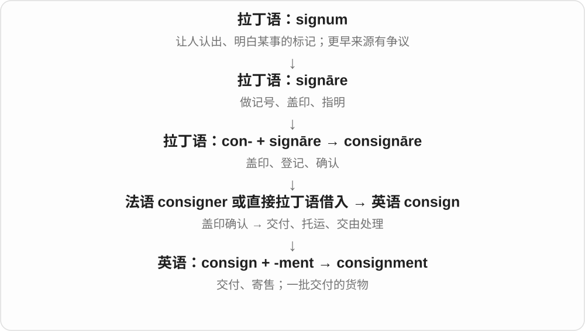

a consignment of books 是一批书；on consignment 指寄售，通常先交店铺代卖，不等于店铺已买下全部货物。

**常见搭配与例句**

a consignment of；goods on consignment；a consignment note。

> A consignment of books arrived this morning.

一批书今天早上运到了。

> The shop sells local crafts on consignment.

这家店寄售本地手工艺品。

**别混淆**

shipment 强调装运的一批货；consignment 也可突出交给特定接收方或寄售安排。

### 146. internment — 拘禁、收容拘留〔常见于历史叙述〕

**音标**：英 /ɪnˈtɜːnmənt/；美 /ɪnˈtɜːrnmənt/

**先抓住这个画面**

把人限制在指定地点，不让自由离开；是失去自由的处置，不是来单位学习的实习。

**怎么拆**

intern 拘禁动词 + -ment，形成动作、状态名词。保留拘禁分支的后重音。

**怎么变成今天的意思**

**法语 interne、interner → intern 的不同英语用法**  
内部、住院受训医师；限制在内部、拘禁

↓

**intern〔拘禁〕+ -ment → internment**  
拘禁的行为、状态

an internment camp 拘禁营，wartime internment 战时拘禁，a history of internment 拘禁史。具体历史与法律身份依材料，不把所有监禁类型一概相同。

**常见搭配与例句**

an internment camp；wartime internment；a history of internment。

> The museum documents wartime internment.

博物馆记录了战时拘禁的历史。

> The memoir describes years spent in internment.

回忆录描述了被拘禁多年的经历。

**别混淆**

internment 拘禁，interment 埋葬少一个 n，internship 实习又是另一词；三者看清拼写和重音。

### 147. ointment — 软膏、药膏；膏剂

**音标**：/ˈɔɪntmənt/

**先抓住这个画面**

不像水一样倒出来，也不像药片吞下去，而是膏状、涂在皮肤表面的制剂，常叫 ointment。

**怎么拆**

接中古英语 oinement、法语 oignement 等，来自涂抹的动词材料，远接拉丁 ungere 涂抹。后来词形像 oint + -ment，不要另编一个现代 oin。

**怎么变成今天的意思**

**拉丁 ungere → 法语 oindre、oignement 等**  
涂抹 → 涂抹用的制剂

↓

**中古英语 oinement → ointment**  
膏状外用制剂

a tube of ointment 一管软膏；apply ointment 涂软膏；a fly in the ointment 固定比喻美中不足、扫兴因素。

**常见搭配与例句**

a tube of ointment；a fly in the ointment。

> She put the tube of ointment in the cabinet.

她把那管软膏放进柜子。

> The instructions explain how the ointment should be stored.

说明书解释了软膏的保存方式。

**别混淆**

ointment 说剂型，不是所有药都叫 ointment；cream 乳膏、lotion 洗剂在具体制剂上有差别。

### 148. mistreat — 虐待；恶劣地对待

**音标**：/ˌmɪsˈtriːt/

**先抓住这个画面**

对象是一个人或动物，问题出在你怎样对待它，而非你怎样理解它。

**怎么拆**

mis- “恶劣、不当” + treat“对待”。

**怎么变成今天的意思**

**日耳曼语系的 mis-，古英语已有**  
方向或结果不对；不是希腊“厌恶”

↓

**英语 mis- + treat**  
以不好的方式对待

↓

**mistreat**  
恶劣对待，程度可到虐待

mistreat someone 可以是羞辱、苛待或伤害等不良对待。treat 在这里不是“请客”的意思，也不是只限于医疗治疗。翻译成“虐待”还是“恶劣对待”，要看行为程度。

**常见搭配与例句**

mistreat workers；mistreat animals；be mistreated by someone。

> The report describes how workers were mistreated at the factory.

报告描述了工人在那家工厂受到怎样的恶劣对待。

> The shelter cares for animals that have been mistreated.

这家收容所照料曾受到虐待的动物。

**别混淆**

misbehave 是自己行为不当；mistreat 后面常接受到不当对待的对象。mistreat animals 不等于 misuse a tool。

### 149. mistreatment — 虐待；不当对待

**音标**：/ˌmɪsˈtriːtmənt/

**先抓住这个画面**

本应被照顾、被公平对待，却受到伤害、粗暴或不公的待遇，这种坏的对待叫 mistreatment。

**怎么拆**

mistreat + -ment，mis- 错、不当地与 treat 对待，再用名词尾说行为、状况。

**怎么变成今天的意思**

**mis- + treat → mistreat**  
不当、伤害性地对待

↓

**mistreat + -ment → mistreatment**  
这种对待的行为或经历

mistreatment of animals 虐待动物；report mistreatment 举报虐待；allegations of mistreatment 不当对待的指控。

**常见搭配与例句**

mistreatment of；report mistreatment。

> The shelter investigates reports of animal mistreatment.

收容机构调查虐待动物的举报。

> The workers described years of mistreatment.

工人们讲述了多年受到的不当对待。

**别混淆**

mistreatment 的 treat 常是对待，不必局限医疗治疗失误；普通 treatment 也不只医学义。

### 150. ail — 使不适、困扰；有问题〔较正式〕

**音标**：/eɪl/

**先抓住这个画面**

What ails you? 问的是哪里不舒服、什么在困扰你。也可以问一个行业究竟出了什么毛病，语气常较书面。

**怎么拆**

由古英语 eglan、eglian 困扰等延续，经中古英语到 ail；属于本族日耳曼语材料，不是 ale 啤酒。

**怎么变成今天的意思**

**古英语 eglan、eglian → 中古英语 eilen**  
困扰、折磨

↓

**英语 ail → ailment**  
使不适、使有问题；病痛、疾患

what ails someone 什么使某人不适；what ails the economy 经济有什么问题；ailing 作形容词常说状况不佳的。

**常见搭配与例句**

what ails；an ailing industry。

> The doctor asked what was ailing him.

医生问他哪里不舒服。

> The article examines what ails the industry.

文章分析了这个行业的问题所在。

**别混淆**

ail 较正式，日常问身体不适更常说 What’s wrong?；ale 则是另一种来源的啤酒名。

### 151. ailment — 小病、病痛；疾患

**音标**：/ˈeɪlmənt/

**先抓住这个画面**

感冒、腰酸这些身体毛病，可以统称 ailments。它常让人想到一种不舒服，不一定已经指明精确的病名。

**怎么拆**

ail 困扰、使不适 + -ment，把身体的不适、疾患作为名词谈。

**怎么变成今天的意思**

**古英语 eglan、eglian → 中古英语 eilen**  
困扰、折磨

↓

**英语 ail → ailment**  
使不适、使有问题；病痛、疾患

↓

**ail + -ment → ailment**  
病痛、不适或一种疾患

a minor ailment 小病；a common ailment 常见病痛；a stomach ailment 胃部毛病。

**常见搭配与例句**

a minor ailment；a common ailment。

> The clinic treats common minor ailments.

诊所处理常见的小病小痛。

> He missed the trip because of a stomach ailment.

他因胃部不适没能参加旅行。

**别混淆**

ailment 是身体毛病的较概括称呼，disease 常说较明确的疾病；具体轻重仍看文本。

### 152. encampment — 营地；扎营；临时聚居营区

**音标**：/ɪnˈkæmpmənt/

**先抓住这个画面**

人们搭起帐篷、设置临时住处后形成的一片落脚地，也可指这样驻扎的行为。

**怎么拆**

encamp + -ment。是英语名词构造，不必假设另有一个拉丁 encampmentum。

**怎么变成今天的意思**

**拉丁 campus**  
开阔田地、平地；操练或战斗的场地

↓

**意大利 campo → 法语 camp**  
田地 → 军队驻扎的场地

↓

**英语 camp**  
营地；露营；引申为同一立场的阵营

↓

**英语 en- + camp → encamp**  
进入营地状态 → 扎营

↓

**英语 encamp + -ment → encampment**  
扎营 → 营地、扎营行为

常见于军队、考古、旅行或临时聚居报道，比 camp 更正式，且容易让人想到一组临时搭建的住处。

**常见搭配与例句**

a temporary encampment；a military encampment；the remains of an encampment。

> The survey found traces of an ancient encampment.

勘察发现了一处古代营地的痕迹。

> The temporary encampment stood on higher ground.

这片临时营地位于较高处。

**别混淆**

campsite 可是尚无人使用的预设地点；encampment 通常让人想到已经形成的营区。

### 153. bereavement — 丧亲；丧亲后的悲痛处境

**音标**：/bɪˈriːvmənt/

**先抓住这个画面**

身边重要的人去世，留下的人面对失去、调整生活，这种丧亲的处境是 bereavement。

**怎么拆**

bereave + -ment；bereave 的古英语材料原指剥夺、使失去，现代相关用法尤其聚焦亲近者去世。

**怎么变成今天的意思**

**古英语 bereafian 等 → bereave**  
使失去、剥夺

↓

**bereave + -ment → bereavement**  
尤指因死亡失去亲近者的处境

bereavement leave 丧亲假；support after bereavement 丧亲后的支持；a family bereavement 家中有人去世。

**常见搭配与例句**

bereavement leave；a family bereavement。

> She took bereavement leave after her father died.

父亲去世后，她请了丧亲假。

> The organisation offers support after bereavement.

机构为丧亲者提供支持。

**别混淆**

bereavement 特指丧亲相关处境，grief 是悲痛感，范围可更广；普通失望不是 bereavement。

### 154. increment — 增量；增加的一步；使递增

**音标**：名词 /ˈɪŋkrəmənt/；动词也读 /ˈɪŋkrəment/

**先抓住这个画面**

从十到十二，多出来的二就是一个增量；若每次都加同样的一小份，就是按固定 increments 往上走。

**怎么拆**

借拉丁 incrementum，接 increscere“增加”的词干。不是把现代英语 increase 直接截短再加 -ment；动词由英语名词转用。

**怎么变成今天的意思**

**拉丁 crescere**  
生长、增加

↓

**拉丁 increscere → incrementum**  
增加 → 增长、增量

↓

**中古英语 increment → 英语 increment〔名词、后作动词〕**  
增量；按步增加

in increments of two 是每次加二，不必每次只加一。编程里 increment the counter 常表示给计数器加一；具体步长也可另行指定。

**常见搭配与例句**

small increments；in increments of ten；increment a counter。

> Raise the temperature in increments of two degrees.

每次把温度升高两度。

> The program increments the counter after each completed task.

程序每完成一个任务就给计数器加一。

**别混淆**

increase 泛指增加；increment 常聚焦某一小步或多出来的量。

### 155. entangle — 缠住；使陷入复杂关系

**音标**：/ɪnˈtæŋɡəl/

**先抓住这个画面**

绳子、渔网把东西绞在一起，难以分开，是 entangle；人陷入复杂纠纷，也像被一张关系网缠住。

**怎么拆**

en- 进入 + tangle 缠结，中古英语已有相关形式。不是说任何联系 connection 都难以脱身。

**怎么变成今天的意思**

**en- 进入 + tangle 缠结 → entangle**  
使陷入纠缠、复杂关系

↓

**entangle + -ment → entanglement**  
缠住状态；复杂牵连；特定学科的纠缠

be entangled in a net 被网缠住；be entangled in a dispute 卷入纠纷；entangle something with something 使纠缠。

**常见搭配与例句**

be entangled in；entangle with。

> The rope became entangled in the branches.

绳子缠在了树枝上。

> They were entangled in a long dispute.

他们陷入了一场漫长的纠纷。

**别混淆**

entangle 常突出难分开、难摆脱，connect 只说连接；连接充电线不一定叫 entangle。

### 156. entanglement — 缠结、牵连；纠缠〔物理等〕

**音标**：/ɪnˈtæŋɡəlmənt/

**先抓住这个画面**

一团绳的缠住，或复杂关系带来的牵连，都叫 entanglement。物理里的量子纠缠借了这个名字，但不是两根绳真的拴在一起。

**怎么拆**

entangle + -ment，保留词末 e。日常的缠结画面进入专门命名后，不能替代学科定义。

**怎么变成今天的意思**

**en- 进入 + tangle 缠结 → entangle**  
使陷入纠缠、复杂关系

↓

**entangle + -ment → entanglement**  
缠住状态；复杂牵连；特定学科的纠缠

↓

**entangle + -ment → entanglement**  
缠结状态、牵连；特定学科概念

avoid entanglement 避免卷入；political entanglements 政治牵连；quantum entanglement 量子纠缠。

**常见搭配与例句**

political entanglements；quantum entanglement。

> The country hoped to avoid further political entanglements.

这个国家希望避免进一步的政治牵连。

> The lecture introduced the idea of quantum entanglement.

讲座介绍了量子纠缠的概念。

**别混淆**

日常 entanglement 常带难以摆脱之义；quantum entanglement 是专门物理概念，不按人与人的纠纷、烦恼来理解。

### 157. enslave — 奴役、使沦为奴隶；使受支配

**音标**：/ɪnˈsleɪv/

**先抓住这个画面**

把原本能够自己决定的人置于别人控制之下；动词突出是谁让别人失去自由。

**怎么拆**

en- 使进入某状态 + slave，字面使成为奴隶，再可借来说对人形成强烈支配。

**怎么变成今天的意思**

**晚期拉丁 Sclavus 等族名形式 → 中世纪 sclavus 的受奴役者义**  
传统分析联系中世纪许多斯拉夫人被俘、被贩卖的历史

↓

**古法语 esclave → 中古英语 sclave → slave**  
作为他人财产受控制的人；后来有从属、苦干等比喻

↓

**en- + slave → enslave**  
使受奴役，或比喻支配束缚

enslave people 奴役人，enslaved workers 受奴役劳动者，enslave the mind 束缚思想〔比喻〕。

**常见搭配与例句**

enslave people；enslaved workers；enslave the mind。

> The historical account describes how captives were enslaved.

历史记述描述了俘虏怎样遭到奴役。

> The novel asks whether fear can enslave the mind.

小说提出一个问题：恐惧能否束缚人的思想。

**别混淆**

enslave 使受奴役，slave away 是自己辛苦干活；前者更明确表示把别人置于受控制状态的动作。

### 158. enslavement — 奴役；使沦为奴隶的过程、状态

**音标**：/ɪnˈsleɪvmənt/

**先抓住这个画面**

把人当作可控制、可剥夺自由的对象，使其沦为奴隶，这种过程、状态是 enslavement。它是沉重的历史和现实用词。

**怎么拆**

enslave + -ment，en- 使成为与 slave 奴隶相连；保留动词末尾 e，形成行为、状态名词。

**怎么变成今天的意思**

**en- + slave → enslave**  
使成为奴隶、加以奴役

↓

**enslave + -ment → enslavement**  
奴役过程；受奴役的状态

the enslavement of people 对人的奴役；escape enslavement 逃离奴役；历史材料中常与 forced labour 强迫劳动等讨论。

**常见搭配与例句**

the enslavement of；escape enslavement。

> The exhibition documents the enslavement of thousands of people.

展览记录了数千人遭奴役的历史。

> The novel follows a family’s escape from enslavement.

小说讲述一家人逃离奴役的经历。

**别混淆**

enslavement 不只是普通忙碌或不喜欢工作，核心涉及自由、人格被剥夺和奴役控制。

### 159. incitement — 煽动；鼓动行为

**音标**：/ɪnˈsaɪtmənt/

**先抓住这个画面**

把别人推向行动的那番话、宣传或举动。

**怎么拆**

拉丁 incitāmentum 经法语 incitement 借入；现代可按 incite + -ment 理解。

**怎么变成今天的意思**

**拉丁 ciēre → citāre**  
使动起来、唤起 → 召唤、促动

↓

**拉丁 incitāre → incitāmentum → 法语 incitement**  
鼓动 → 引人行动的东西或行为

↓

**英语 incitement**  
现代常指煽动，尤其负面或违法行动

incitement to violence 说煽动暴力的行为。普通词义和具体法律构成并非一回事，不同司法体系会规定不同要件。

**常见搭配与例句**

incitement to violence；an act of incitement。

> The article distinguishes criticism from incitement to violence.

文章区分了批评与煽动暴力。

> The committee condemned the speech as an act of incitement.

委员会谴责这场演说具有煽动性质。

**别混淆**

excitement 是兴奋状态；incitement 是鼓动别人行动。情绪激动不等于一定存在煽动。

### 160. encroach — 侵占；逐渐侵入、蚕食

**音标**：英 /ɪnˈkrəʊtʃ/；美 /ɪnˈkroʊtʃ/

**先抓住这个画面**

本来属于你的空间、时间，被别的东西一点点挤进来、占过去，是 encroach。像工作不断挤进私人时间。

**怎么拆**

借法语 encrochier 抓取、侵占，en- 与 croc 钩的材料；远接日耳曼语。不要按今天拼写拆出一个现代 croach。

**怎么变成今天的意思**

**法语 en- + croc 钩 → encrochier**  
抓取、侵占

↓

**英语 encroach → encroachment**  
逐渐侵入别人的空间、时间、权利等

encroach on/upon something 侵占、侵害；development encroaches on farmland 开发逐渐侵入农田。

**常见搭配与例句**

encroach on；encroach upon。

> Work began to encroach on her weekends.

工作开始侵占她的周末。

> New housing is encroaching on the farmland.

新建住宅正逐渐侵占农田。

**别混淆**

encroach 常带越过应有边界、逐渐侵占的感觉，approach 只是靠近；并非所有接近都有侵犯。

### 161. encroachment — 侵占、蚕食；逐渐侵入

**音标**：英 /ɪnˈkrəʊtʃmənt/；美 /ɪnˈkroʊtʃmənt/

**先抓住这个画面**

encroach 是越界挤进来，encroachment 是这种边界被一点点推走的过程。可以谈土地，也可以谈权利、私人生活。

**怎么拆**

encroach + -ment，把侵占行为、趋势名词化；保留旧抓取材料发展出的越界意味。

**怎么变成今天的意思**

**法语 en- + croc 钩 → encrochier**  
抓取、侵占

↓

**英语 encroach → encroachment**  
逐渐侵入别人的空间、时间、权利等

↓

**encroach + -ment → encroachment**  
逐步侵入、侵占的过程

encroachment on privacy 对隐私的侵扰；urban encroachment 城市扩张侵占周边土地；resist encroachment 抵制侵占。

**常见搭配与例句**

encroachment on；urban encroachment。

> Residents opposed further encroachment on the park.

居民反对继续侵占公园。

> The essay discusses the encroachment of work on family life.

文章讨论工作对家庭生活的侵占。

**别混淆**

encroachment 往往有侵占评价，expansion 扩张本身更中性；扩到别人的空间时才突出前者。

### 162. astonish — 使十分惊讶

**音标**：英 /əˈstɒnɪʃ/；美 /əˈstɑːnɪʃ/

**先抓住这个画面**

事情太出乎意料，你像突然被震住了一样，这件事 astonishes you。现代不必真有雷声，旧画面却很有助于记忆。

**怎么拆**

接中古英语 astonen、astonien 等，联系法语 estoner，使震惊；更远有拉丁雷声材料。现代词形受 -ish 动词类推影响，不是 stone 石头加后缀就能概括。

**怎么变成今天的意思**

**古法语 estoner 等 → 中古英语 astonen 等**  
使震惊、发懵；远源有雷击般震动的材料

↓

**受 -ish 动词形式影响 → astonish → astonishment**  
使惊讶；强烈惊讶的状态

astonish someone 使某人惊讶；be astonished at/by 对……十分惊讶；astonishing 修饰令人惊讶的事。

**常见搭配与例句**

astonish someone；be astonished at。

> Her speed astonished everyone.

她的速度让所有人十分惊讶。

> I was astonished to find the door unlocked.

发现门没锁，我很吃惊。

**别混淆**

astonish 通常比 surprise 力度强；astonished 说感到惊讶，astonishing 说造成惊讶。

### 163. astonishment — 十分惊讶、惊愕

**音标**：英 /əˈstɒnɪʃmənt/；美 /əˈstɑːnɪʃmənt/

**先抓住这个画面**

astonish 是把人惊住，astonishment 是人心里那份强烈的意外感。常用来引出意想不到的结果。

**怎么拆**

astonish + -ment，接旧震惊、发懵的动词词族；这里名词尾说心理状态。

**怎么变成今天的意思**

**古法语 estoner 等 → 中古英语 astonen 等**  
使震惊、发懵；远源有雷击般震动的材料

↓

**受 -ish 动词形式影响 → astonish → astonishment**  
使惊讶；强烈惊讶的状态

↓

**astonish + -ment → astonishment**  
强烈惊讶、惊愕

to someone’s astonishment 令某人十分惊讶的是；in astonishment 惊愕地；express astonishment 表示惊讶。

**常见搭配与例句**

to my astonishment；in astonishment。

> To our astonishment, she solved the problem in seconds.

令我们惊讶的是，她几秒钟就解决了问题。

> He stared at the result in astonishment.

他惊愕地盯着结果。

**别混淆**

astonishment 和 amazement 常相近；amusement 却是觉得有趣、逗乐，别因词形相似混记。

### 164. entrapment — 困住、诱入圈套；诱捕犯罪问题及相关抗辩〔法律〕

**音标**：/ɪnˈtræpmənt/

**先抓住这个画面**

entrap 是使人落入圈套，entrapment 把这件事或这种受困状态拿出来。法律讨论还会问：是否是执法者诱使当事人做了原本不会做的犯罪行为。

**怎么拆**

entrap + -ment，形成过程、状态名词。后缀本身不表示法律，专门法律义是整词在该领域的固定发展。

**怎么变成今天的意思**

**古英语 træppe/treppe → trap**  
圈套、捕捉装置；更远联系踩、踏的一组词

↓

**实体捕捉 → 情境圈套**  
困住、使落入不利处境；装置也可按拦截功能命名

↓

**entrap + -ment → entrapment**  
被困、诱捕的过程或状态；相应法律概念

air entrapment 空气滞留，entrapment in a mechanism 夹困在机械装置中，an entrapment defence 以诱捕问题为依据的抗辩〔法律文本〕。

**常见搭配与例句**

air entrapment；an entrapment defence。

> The report examines air entrapment during the manufacturing process.

报告研究制造过程中的空气滞留。

> The legal textbook explains the concept of entrapment.

法律教材解释了诱捕犯罪及相关抗辩的概念。

**别混淆**

普通受困义与法律抗辩义分开。美国法律语境的 entrapment 有特定条件，不能单凭英文看起来像陷阱就替所有事件下同一结论。

### 165. discernment — 辨别力；判断力；眼力

**音标**：英 /dɪˈsɜːnmənt/；美 /dɪˈsɜːrnmənt/

**先抓住这个画面**

discernment 像有一双不容易被表面骗过的眼睛，能把真正重要、可靠或优质的东西挑出来。

**怎么拆**

现代可拆 discern + -ment；也有从中古法语 discernement 借入的分析，二者同出 discerner 这一支。

**怎么变成今天的意思**

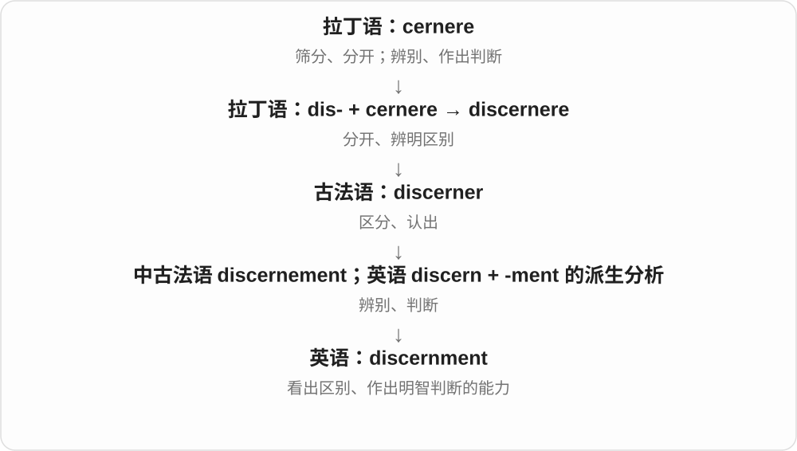

a person of discernment 是有判断力的人；show discernment 是表现出眼力。它不仅是眼睛看得清，还常是评价事物看得准。

**常见搭配与例句**

show discernment；exercise discernment；a reader of discernment。

> Choosing reliable sources requires discernment.

选择可靠来源需要判断力。

> The collection reflects her taste and discernment.

这批收藏体现了她的品位和眼力。

**别混淆**

knowledge 是知道很多；discernment 是能从知道的东西里判断轻重、真伪或好坏。

### 166. replenishment — 补充；补货；恢复储备的过程

**音标**：英、美 /rɪˈplenɪʃmənt/

**先抓住这个画面**

库存下降后把货补回来，这件事需要安排时间、数量和运输。

**怎么拆**

replenish + -ment；英语派生名词。

**怎么变成今天的意思**

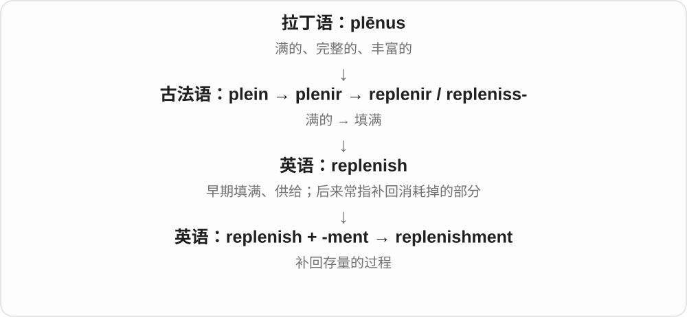

常用于库存、仓储和自然资源恢复。补充可以靠人工，也可以是雨水等自然过程；不暗示每次都立刻补满。

**常见搭配与例句**

stock replenishment；regular replenishment；a replenishment system。

> The shop uses weekly replenishment for items that sell slowly.

对于卖得慢的商品，这家店每周补一次货。

> Heavy rain helped the replenishment of the reservoir.

大雨有助于水库恢复蓄水量。

**别混淆**

replacement 通常是替换；replenishment 通常是补数量。

### 167. disbursement — 款项支付、拨付；已支付的款项

**音标**：英 /dɪsˈbɜːsmənt/；美 /dɪsˈbɜːrsmənt/

**先抓住这个画面**

把“钱付出去”作为一件事记录下来，或者指账上那一笔已经付出的金额，就是 disbursement。

**怎么拆**

英语 disburse + -ment，形成行动或结果名词；上游经过古法语 desbourser，远接拉丁 bursa“钱袋”。

**怎么变成今天的意思**

**古法语 desbourser → 英语 disburse**  
支付、拨出

↓

**英语 disburse + -ment → disbursement**  
支付过程；付出的一笔款项

作为过程，delay in disbursement 是钱迟迟没有拨出；作为可数项目，three disbursements 就是三笔付款。读报表时抓住“现金已经付出”的意思，比把它硬背成抽象的“支出行为”更好懂。

**常见搭配与例句**

disbursement of funds；a disbursement schedule；record each disbursement。

> The report explains the delay in disbursement of the aid funds.

报告解释了援助资金延迟拨付的原因。

> Each disbursement must appear in the payment log.

每一笔付款都必须记录在付款日志中。

**别混淆**

expense 是费用或开支这一概念，disbursement 更突出付款动作或现金流出；费用确认与实际付款未必发生在同一天。

### 168. divestment — 撤资；资产出售、剥离

**音标**：/daɪˈvestmənt/

**先抓住这个画面**

把已经持有的资产或投资退出，作为一项行动来讲。

**怎么拆**

divest + -ment；现代常见于企业重组、投资组合或某种撤资行动。

**怎么变成今天的意思**

**拉丁 vestis / vestire**  
衣服／给……穿衣

↓

**古法语 desvestir → 法语 devester → 英语 devest / divest**  
脱去、剥去 → 使失去财产、权力；后来也指出售资产

↓

**英语 divest + -ment → divestment**  
剥离、出售 → 撤资、资产剥离的行为

divestment from an industry 是撤出某行业投资；divestment of a business 是出售业务。动机可能是重组、财务安排或价值立场，词本身不限定一种。

**常见搭配与例句**

divestment from；divestment of assets；a divestment programme。

> The company announced the divestment of its overseas retail business.

公司宣布出售海外零售业务。

> The committee discussed divestment from several industries.

委员会讨论了从几个行业撤资的问题。

**别混淆**

investment 是投入；divestment 是退出或剥离。donation 是捐赠，不是同一种资金动作。

### 169. estrangement — 疏远；失和；关系隔阂

**音标**：/ɪˈstreɪndʒmənt/

**先抓住这个画面**

人还在，但曾经亲近的那条联系变得像陌生人之间一样。

**怎么拆**

现代可拆 estrange + -ment；来源有英语派生和古法语 estrangement 借入两种分析，均回到“使成为外人”的支线。

**怎么变成今天的意思**

**拉丁 exterus／extrā**  
外面的；在外面

↓

**拉丁 extrāneus → 通俗拉丁 \*extrāneāre〔重建〕**  
外来的 → 使成为外人

↓

**古法语 estranger／estrangement；英语 estrange + -ment**  
法语名词借入与英语派生两种来源分析

↓

**英语 estrangement**  
亲近关系的疏离或断裂

常见于家人、伴侣或朋友之间长期失和。它比“最近没见面”更重：即使住得近，也可能有 estrangement。

**常见搭配与例句**

estrangement from one’s family；years of estrangement；a period of estrangement。

> They spoke again after years of estrangement.

多年失和之后，他们再次交谈了。

> Her estrangement from her brother began with a dispute over their parents’ house.

她与哥哥的疏远始于对父母房子的争执。

**别混淆**

separation 可只是分开居住；estrangement 重点是感情和关系变疏远。

### 170. discouragement — 泄气；挫折感；劝阻

**音标**：英 /dɪsˈkʌrɪdʒmənt/；美 /dɪsˈkɜːrɪdʒmənt/

**先抓住这个画面**

事情反复碰壁，心里那股想继续的劲降下来，这种状态是 discouragement。

**怎么拆**

discourage + -ment，把使泄气的行为或泄气的状态名词化。

**怎么变成今天的意思**

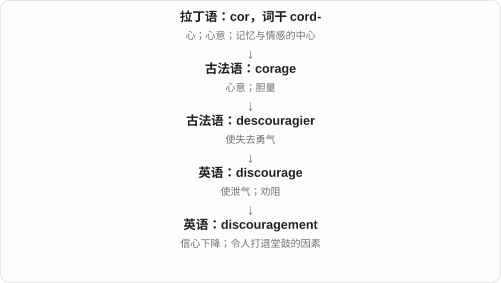

既可说情绪，也可说导致退缩的因素。它不必严重到彻底放弃。

**常见搭配与例句**

a feeling of discouragement；overcome discouragement；a source of discouragement。

> After several rejections, she felt deep discouragement.

几次被拒绝后，她感到很泄气。

> Support from friends helped him overcome his discouragement.

朋友的支持帮助他摆脱了挫败感。

**别混淆**

disappointment 是期待落空；discouragement 更强调继续尝试的信心受到影响。

### 171. inducement — 诱因；促使人行动的好处

**音标**：英 /ɪnˈdjuːsmənt/；美 /ɪnˈduːsmənt/

**先抓住这个画面**

inducement 是摆在面前、让人愿意改变决定的那点好处：奖金、折扣、便利或某种承诺。

**怎么拆**

induce + -ment，把“促使行动”变成促动因素或引诱的名词。

**怎么变成今天的意思**

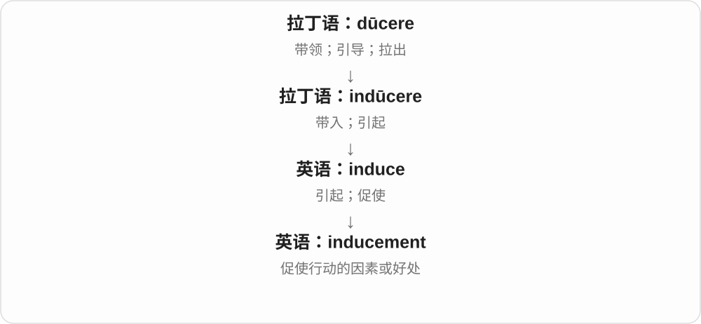

它常回答“对方给了什么，让你愿意做这件事”。语气较正式，有时暗示不太妥当的诱惑，但不天然等于贿赂。

**常见搭配与例句**

offer an inducement（提供诱因）；an inducement to stay（促使留下来的好处）；a financial inducement（金钱方面的激励）。

> Free training was an inducement to join the company.

免费培训是吸引人加入这家公司的一个条件。

> They offered no inducement for customers to renew.

他们没有提供吸引顾客续订的优惠条件。

**别混淆**

incentive 也表示激励，较常见且较中性；inducement 更突出有人提出条件来促动行为。

### 172. merriment — 欢笑、欢乐热闹的活动

**音标**：/ˈmerɪmənt/

**先抓住这个画面**

不只一个人心里开心，而是一群人笑闹、玩乐的欢乐劲头，常用 merriment。节庆、聚会、游戏场面很适合这个词。

**怎么拆**

旧动词 merry 欢乐、使欢乐，加 -ment → merriment，y 改 i。现代可与形容词 merry 对照，但不能因此把历史简化为形容词直接加 -ment。

**怎么变成今天的意思**

**古英语 myrge 愉快、悦耳 → 中古英语 merie 等 → merry**  
令人愉快与兴高采烈的性质

↓

**旧动词 merry 欢乐、使欢乐 + -ment → merriment**  
欢乐状态、嬉笑玩乐

laughter and merriment 欢声笑语；much merriment 许多欢乐；join the merriment 加入欢乐场面。

**常见搭配与例句**

laughter and merriment；join the merriment。

> The games brought much merriment to the party.

游戏给聚会带来了许多欢乐。

> We could hear laughter and merriment from the next room.

我们听见隔壁传来欢声笑语。

**别混淆**

merriment 与 mirth 有重叠，前者更容易铺出玩乐的场面，不能硬说一个只许多人、一个只许一人。

### 173. endearment — 爱意表达、亲昵称呼

**音标**：英 /ɪnˈdɪəmənt/；美 /ɪnˈdɪrmənt/

**先抓住这个画面**

不一定是一段长告白，可能只是对亲近的人叫一声 darling；最常见搭配 term of endearment 就是爱称。

**怎么拆**

endear + -ment，形成表达爱意的言语、动作等名词。现代常见复数 endearments 和 term of endearment。

**怎么变成今天的意思**

**古英语 dēore、dȳre 等 → 中古英语 dere → dear**  
珍贵、价高、受喜爱的；更远来源未定

↓

**英语 dear**  
亲爱的、珍视的；贵的；呼语与感叹等

↓

**endear + -ment → endearment**  
表达亲昵、爱意的言语或举动

a term of endearment 爱称，whisper endearments 轻声说亲昵的话，an affectionate endearment 亲热称呼。

**常见搭配与例句**

a term of endearment；whisper endearments；exchange endearments。

> “Darling” is a common term of endearment.

darling 是一个常见爱称。

> The letter was full of small endearments.

信里满是亲昵的话。

**别混淆**

endearment 爱意表达，endearing 讨喜性质；一个爱称也要依双方关系判断，词形不保证对方愿意被这样叫。

### 174. apportionment — 分配；分摊；按份分配的结果

**音标**：英 /əˈpɔːʃənmənt/；美 /əˈpɔːrʃənmənt/

**先抓住这个画面**

把钱怎么分、席位怎么分、责任怎么分这件事作为一个安排来谈。

**怎么拆**

apportion + -ment，构成行为或结果名词。

**怎么变成今天的意思**

**拉丁 portio，属格 portionis**  
份额、部分

↓

**古法语 porcion → porcioner → aporcioner；法语 apportionner**  
份额 → 分份 → 按份分配

↓

**英语 apportion**  
分派资金、责任等

↓

**英语 apportion + -ment → apportionment**  
分配 → 分配过程或安排

the apportionment of costs 是费用分摊；政治文字里的 seat apportionment 说席位分配。它可能依人口、份额或其他规则，并不自动等于平均分。

**常见搭配与例句**

the apportionment of costs；seat apportionment；a fair apportionment。

> The contract explains the apportionment of maintenance costs.

合同说明了维护费用的分摊方式。

> Population changes prompted a review of the apportionment of seats.

人口变化促使有关方面重新审查席位分配。

**别混淆**

allocation 也说分配，范围很广；apportionment 更突出整体被分成若干份。

### 175. adornment — 装饰；饰物

**音标**：英 /əˈdɔːnmənt/；美 /əˈdɔːrnmənt/

**先抓住这个画面**

为了好看而加上去的东西，也可以指加以装点这件事。

**怎么拆**

adorn + -ment，英语把装饰这个动作变成装饰物或装饰状态的名词。

**怎么变成今天的意思**

**拉丁 ornare**  
配备、布置；装饰

↓

**英语 adorn + -ment → adornment**  
装饰 → 装饰物、装点

personal adornment 可以指人佩戴饰物等装扮；without adornment 是不加修饰。它常比日常的 decoration 更书面，也常用于服饰、艺术和风格描述。

**常见搭配与例句**

personal adornment；without adornment；a simple adornment。

> The dress needed no further adornment.

这条裙子不需要再加任何装饰。

> A silver pin was her only adornment.

她身上唯一的饰物是一枚银色别针。

**别混淆**

ornament 常让人想到一件摆饰或挂饰；adornment 可以更泛地概括为美观而添加的东西，二者有重叠。

### 176. disfigurement — 外貌损伤；毁容；外形破坏

**音标**：英 /dɪsˈfɪɡəmənt/；美 /dɪsˈfɪɡjərmənt/

**先抓住这个画面**

把“外形被破坏”当作一件事或一种后果来谈，可能是面部的损伤，也可能是物体、景观的外观受损。

**怎么拆**

英语 disfigure + -ment，动作及结果名词。来源沿英语动词这一支，不要为了看起来整齐而虚构一个必须先存在的拉丁名词。

**怎么变成今天的意思**

**拉丁 figura（与 fingere 同族）**  
形状、形象；表达的形式

↓

**拉丁 figurare → 中世纪拉丁 diffigurare**  
塑造 → 破坏、改变外形；dis- 在 f 前同化

↓

**古法语／盎格鲁法语 desfigurer → 中古英语 disfiguren → disfigure**  
损坏外貌、形状

↓

**英语 disfigure + -ment → disfigurement**  
外观遭破坏的过程或结果

facial disfigurement 是面部外观损伤；the disfigurement of a landscape 可以说景观被破坏。这个词通常比普通 change 更明显带有损害意味。

**常见搭配与例句**

facial disfigurement；permanent disfigurement；cause disfigurement；the disfigurement of。

> The charity supports people living with facial disfigurement.

这家慈善机构帮助面部外貌受损的人。

> The report criticised the disfigurement of the valley by abandoned industrial sites.

报告批评废弃工业场地破坏了山谷的景观。

**别混淆**

injury 说损伤本身，未必可见；disfigurement 聚焦外貌受到的影响。scarring 是留疤，可能导致 disfigurement，但不是所有小疤痕都要这样形容。

### 177. wonderment — 惊奇；惊叹

**音标**：英 /ˈwʌndəmənt/；美 /ˈwʌndərmənt/

**先抓住这个画面**

看到让人赞叹的东西，一时看呆了的那种感觉。比普通说想知道更聚焦惊奇的心情。

**怎么拆**

wonder + -ment，后缀将感受、状态名词化。相较日常 wonder，wonderment 语气更有描写感。

**怎么变成今天的意思**

**古英语 wundor、wundrian → 中古英语 wonder、wondren**  
令人惊奇的事；感到惊奇

↓

**现代 wonder**  
惊叹 → 好奇、心里想知道

↓

**wonder + -ment → wonderment**  
惊奇 → 惊叹的心情

in wonderment 惊叹地，a sense of wonderment 一种惊奇感；适合描写初见新世界、自然景观时的感受。

**常见搭配与例句**

in wonderment；a sense of wonderment；look on in wonderment。

> The children watched the night sky in wonderment.

孩子们惊叹地望着夜空。

> The exhibition filled her with wonderment.

展览让她充满惊奇。

**别混淆**

wonderment 惊叹，bewilderment 困惑不知所措；新奇有时令人惊叹，有时令人迷糊，焦点不同。

### 178. deferment — 延期；缓期

**音标**：英 /dɪˈfɜːmənt/；美 /dɪˈfɜːrmənt/

**先抓住这个画面**

事情没有被抹掉，而是被批准晚一些履行。

**怎么拆**

defer 的推迟义 + -ment，英语名词派生。

**怎么变成今天的意思**

**拉丁语：ferre；第一人称 ferō**  
带、承载；承受；生出

↓

**拉丁语：dis- + ferre → differre**  
带开；分开；推迟

↓

**古法语 diferer → 中古英语 differren / deferren**  
延后、推迟

↓

**英语：defer〔推迟义〕**  
把事情移到以后

↓

**英语：defer + -ment → deferment**  
获准延后的安排或状态

常见于债务、义务或正式手续；历史文本中的 military deferment 是推迟服役。具体资格要看相关规则，词本身只表达缓期。

**常见搭配与例句**

seek a deferment；a payment deferment；a deferment period。

> The agreement includes a three-month payment deferment.

协议包括三个月的延期付款期。

> His application for deferment was still under review.

他的缓期申请仍在审核中。

**别混淆**

exemption 是免除义务；deferment 是把履行时间延后。

### 179. encirclement — 包围；环绕；被围住的状态

**音标**：英 /ɪnˈsɜːkəlmənt/；美 /ɪnˈsɜːrkəlmənt/

**先抓住这个画面**

把“周围都被围上了”这件事作为一个过程或局面来谈。

**怎么拆**

encircle + -ment；表示环绕的行动或形成的状态。

**怎么变成今天的意思**

**拉丁语 circus**  
圆环、环形场地；与希腊语 kirkos 的具体关系有不同分析

↓

**拉丁语 circulus〔指小形式〕**  
小圈、圆环

↓

**古法语 cercle → 英语 circle**  
圆、圆圈；同一兴趣或关系圈中的人

↓

**英语 en- + circle → encircle**  
使处于圈内 → 环绕、包围

↓

**英语 encircle + -ment → encirclement**  
环绕、包围 → 包围行动或局面

军事历史中的 encirclement 常说明部队被围住；地理描写也可说群山环抱。它不自动等于已经被攻占，更不是所有孤立状态都形成了实际包围。

**常见搭配与例句**

the encirclement of；escape encirclement；a ring of encirclement。

> The chapter describes the encirclement of the city.

这一章描述了城市被包围的过程。

> The valley’s encirclement by mountains gives it a sheltered feel.

山峦对山谷的环抱让这里显得十分避风安稳。

**别混淆**

isolation 是孤立，可能因为缺少联系；encirclement 特别强调周围被围住的布局。

### 180. puzzlement — 困惑、迷惑不解

**音标**：/ˈpʌzəlmənt/

**先抓住这个画面**

线索对不上，眉头皱起来，脑中冒出“这到底怎么回事”，这份状态就是 puzzlement。

**怎么拆**

puzzle + -ment → puzzlement，保留 e。-ment 把迷惑动作、结果抽成名词，常说人的困惑状态。

**怎么变成今天的意思**

**puzzle**  
使迷惑；难题，较早历史另见基础词条

↓

**puzzle + -er、-ment**  
令人费解的问题或玩解谜的人；困惑状态

in puzzlement 困惑地；a look of puzzlement 困惑的神情；to someone’s puzzlement 令某人不解的是。

**常见搭配与例句**

in puzzlement；a look of puzzlement。

> She looked at the empty box in puzzlement.

她困惑地看着空盒子。

> A look of puzzlement crossed his face.

他脸上掠过一丝困惑。

**别混淆**

puzzle 常是待解的问题本身；puzzlement 常是面对问题时人的不解。

### 181. entrenchment — 牢固确立；根深蒂固；壕沟防御工事

**音标**：/ɪnˈtrentʃmənt/

**先抓住这个画面**

把某种状态固定下来、使其难以改变的过程或结果。

**怎么拆**

entrench + -ment；由壕沟保护的动作发展出制度、利益和观念的固化。

**怎么变成今天的意思**

**古法语 trenchier / tranchier 切、切开**  
与拉丁 truncare 的联系有说法分歧；从确定的法语起点讲起

↓

**古法语 trenche 切口、沟 → 英语 trench〔名词〕**  
切开的长口 → 沟、壕沟、海沟

↓

**英语 en- + trench → entrench**  
放进壕沟保护 → 牢牢固定、使难以改变

↓

**英语 entrench + -ment → entrenchment**  
使牢固 → 固定下来的过程或状态；也指防御工事

the entrenchment of privilege 是特权固化；the entrenchment of rights 是权利获得稳固保障。军事材料里还保留壕沟防御设施义。

**常见搭配与例句**

the entrenchment of；institutional entrenchment；political entrenchment。

> The report warns of the entrenchment of economic inequality.

报告警告经济不平等正变得难以改变。

> The historian mapped the army’s entrenchments around the town.

历史学家绘出了军队在城镇周围的壕沟防御工事。

**别混淆**

entrenchment 强调加固某种位置；retrenchment 常指缩减开支或规模，不能仅因词形近就互换。

### 182. enablement — 使具备能力；赋能支持；启用

**音标**：/ɪˈneɪbəlmənt/

**先抓住这个画面**

把工具、培训和必要权限交到人手里，让他真的能开展工作，这整套支持可以叫 enablement。

**怎么拆**

enable + -ment，把“使能够”的动作变成名词。

**怎么变成今天的意思**

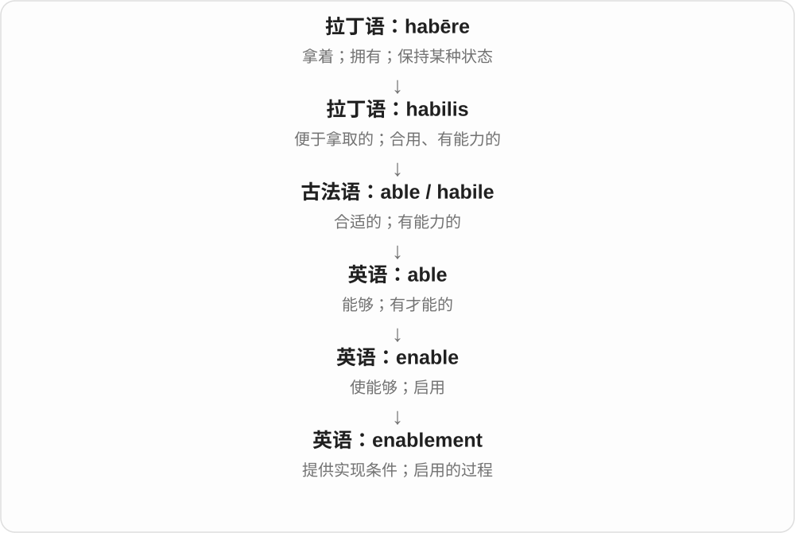

商业文案常用 sales enablement，说给销售人员提供材料、技能和工具。它也能指技术功能的启用，具体内容比抽象口号更重要。

**常见搭配与例句**

sales enablement；customer enablement；feature enablement。

> The enablement program gives new staff practical training.

这项能力支持计划为新员工提供实用培训。

> Feature enablement requires an administrator’s approval.

启用这项功能需要管理员批准。

**别混淆**

enablement 说提供能力和条件；empowerment 还常强调自主权、决定权。两者不总能互换。

### 183. malnourishment — 营养不良；得不到适当滋养的状态

**音标**：英 /ˌmælˈnʌrɪʃmənt/；美 /ˌmælˈnɜːrɪʃmənt/

**先抓住这个画面**

食物供给没有满足身体需要，身体因而受影响。

**怎么拆**

mal-“不良” + nourishment；也可把内部分析为 mal- + nourish + -ment。这里说滋养不当的状态。

**怎么变成今天的意思**

**拉丁 nūtrīre**  
哺育、喂养、使生长

↓

**古法语 norrir → norissement**  
滋养、养育 → 滋养之物或过程

↓

**中古英语 norishement → 英语 nourishment**  
滋养；身体或精神所需的养分

↓

**英语 mal- + nourishment → malnourishment**  
没有得到适当营养的状态

常见于贫困、缺粮或饮食不足的报道，意思与 malnutrition 大幅重合。没有必须遵守的“一个用于群体，一个用于个人”的区别。

**常见搭配与例句**

signs of malnourishment；severe malnourishment；recover from malnourishment。

> The rescued dog showed signs of malnourishment.

被救助的狗出现了营养不良的迹象。

> The survey examined malnourishment among older adults.

调查考察了老年人中的营养不良情况。

**别混淆**

starvation 是严重缺食、挨饿；malnourishment 不必已经达到这种程度。

## 这一组要分清什么

equipment 不按普通名词加复数；argument 既是争论也是论证；entitlement 既可中性指权利也可评价应得心态；amusement 觉得有趣与 amazement 惊讶分开；enactment 制定与 enforcement 执行分开。

## 串起来练习

To her amazement, the refurbished room now contained all the equipment the project required.

让她惊讶的是，翻新后的房间如今配齐了项目需要的设备。
