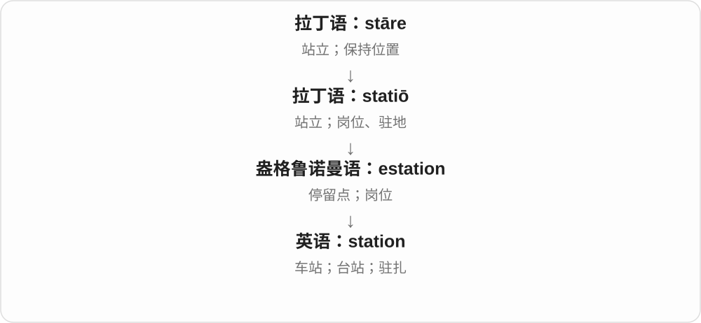
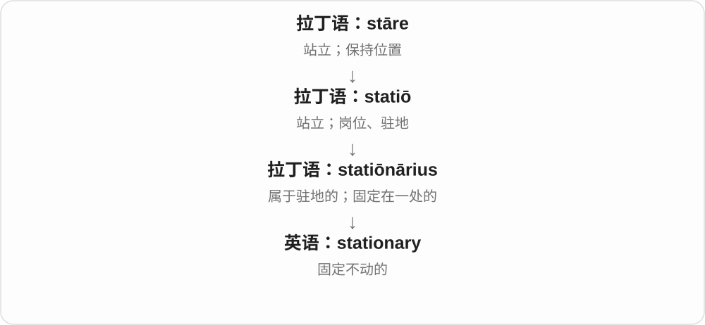
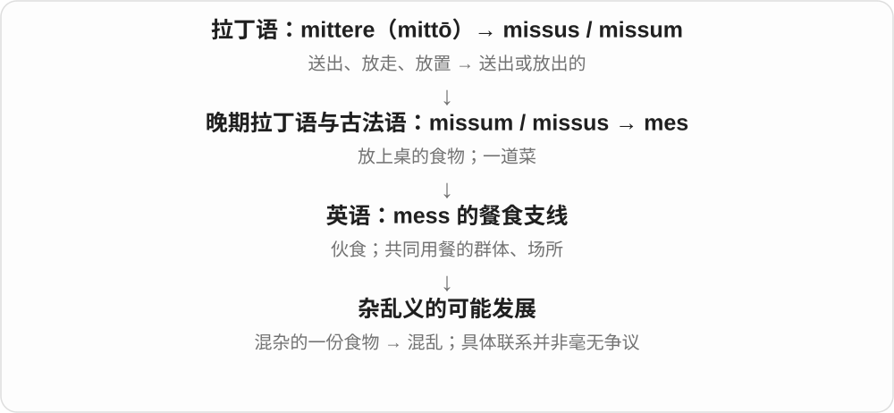
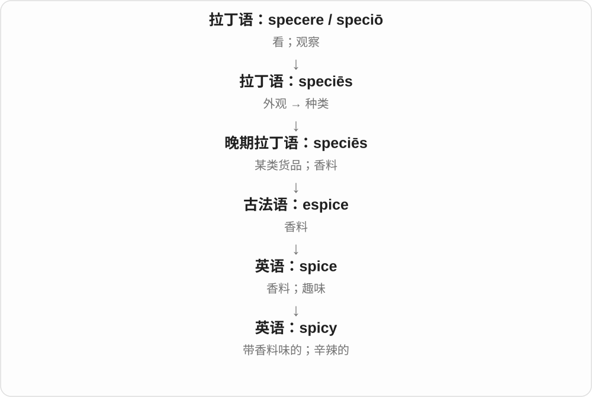
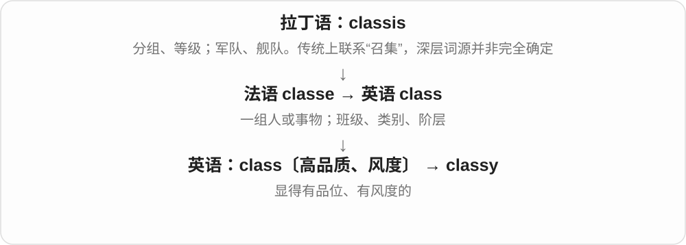
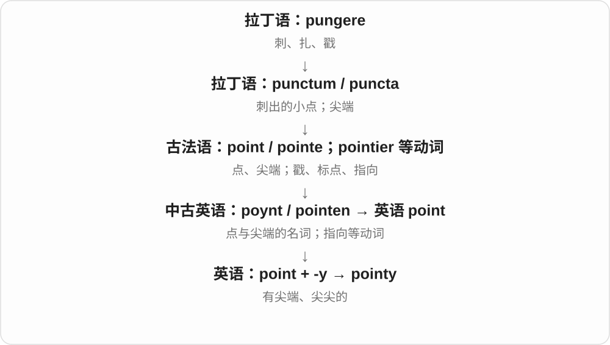

# 0080 · -y — 带有某物、某种性质；也有亲昵缩形及其他历史尾

[逐词精讲目录](../00_逐词精讲目录.md) · [总目录](../00_总目录_按常用程度.md)

## 核心词根与来源

先抓手感、样子和行为：毛茸茸、亮晶晶、乱糟糟、烦躁爱抱怨。不要把 -y 一律翻成充满，也不因为形式短就断言它先出现。

**-Y：把东西、感觉变成一种容易想象的性质**

mess → messy；gloss → glossy；spook → spooky；comfy 则由 comfortable 缩短，greedy 比 greed 的记录更早。

- **杂乱、脏污与行为**：mess · messy · filth · filthy · naughty · nasty · silly
- **软毛、边界与光面**：fuzz · fuzzy · fluff · fluffy · gloss · glossy · comfy · chubby
- **湿乱、滑稽与美味**：slop · sloppy · goof · goofy · yum · yummy
- **人物特点、情绪及鬼魅气氛**：quirk · quirky · spook · spooky · grump · grumpy · gloom · gloomy · clumsy
- **贪求与自负的历史关系**：greed · greedy · cock · cocky
- **亲昵称呼进入照料者名称**：nanny
- **匆忙形容词与相应副词**：hasty · hastily
- **颗粒、厚块、破旧与古怪：具体感觉如何成为评价**：grit · gritty · chunk · chunky · louse · lousy · husk · husky · whack · wacky · grizzly · shabby
- **文具和入室行窃：名词词尾与借词历史**：station · stationary · stationer · stationery · burglar · burglary · burgle
- **熟悉称呼及后来的词义变化**：bunny · bully
- **词尾 y 不等于可自由拼接：monkey、jolly**：monkey · jolly
- **脆、蓬乱、黏与俗：-y 的感觉和独立词史**：crunch · crunchy · shag · shaggy · tack · tacky · nifty
- **stink 与 stinky：臭味及难闻的**：stink · stank · stunk · stinky · stench
- **常见 -y 与不能硬拆的相似词尾**：groove · groovy · soggy · cuddle · cuddly · gully
- **kink 与 kinky：扭折、紧卷与语义引申**：kink · kinky
- **mood 与 moody：心境和情绪性质**：mood · moody
- **chocolate 与 chocolaty：食物到味道性质**：chocolate · chocolaty
- **stink → stinks、stinking：散发气味到发臭**：stink · stinks · stinking
- **y 结尾形容词各自成组：healthy、hungry、lucky、noisy**：healthy · healthier · healthiest · hungry · hungrier · hungriest · lucky · luckier · luckiest · noisy · noisier · noisiest
- **messy 的比较：messier、messiest**：mess · messy · messier · messiest
- **gloomy 的比较、最高程度与方式副词**：gloom · gloomy · gloomier · gloomiest · gloomily
- **亮光性质词：-y 与比较、最高程度**：flashy · flashier · flashiest · glitter · glittery · shiny · shinier · shiniest · glossy · glossier · glossiest
- **sulky 与 sulk：有时带 -y 的词反而记录在先**：sulky · sulk · sulks · sulked · sulking
- **声音基础词加 -y：吱声、沙哑、活泼与吵闹**：squeak · squeaky · croak · croaky · chirp · chirpy · yap · yappy
- **rasp 到 raspy：锉擦般粗哑的声音**：rasp · raspy
- **creak 到 creaky：嘎吱响变成一种特点**：creak · creaks · creaked · creaking · creaky
- **droopy：下垂的形状与精神状态**：droop · droopy
- **wobbly：从摇晃到不稳的性质**：wobble · wobbly
- **splotchy：一块块斑痕的外观**：splotch · splotches · splotchy
- **grumpy、grouchy 的坏脾气性质**：grumpy · grumpier · grumpiest · grumpily · grumpiness · grouch · grouches · grouched · grouching · grouchy · grouchiness
- **mopey：闷闷不乐、提不起精神**：mope · mopey
- **fuss → fussy：把小事折腾起来，到挑剔、繁琐**：fuss · fusses · fussed · fussing · fussy · fussier · fussiest · fussily · fussiness · unfussy
- **几个 -y：抽动、坐不住、扭来扭去的不同画面**：twitch · twitchy · fidget · fidgety · wiggle · wiggly · wriggle · wriggly · squirm · squirmy
- **quivery、shivery：微颤与寒颤的两种性质**：quiver · quivers · quivered · quivering · quivery · shiver · shivers · shivered · shivering · shivery
- **wobbly：支撑不稳，左右晃**：wobble · wobbly · wobblier · wobbliest · wobbliness
- **droopy：耷拉、没精神，再比较程度**：droop · droopy · droopier · droopiest
- **billowy：像大浪般鼓起的性质**：billow · billowy
- **crunch 与 scrunch：咯吱、揉挤的声音和动作**：crunch · crunches · crunched · crunching · scrunch · scrunches · scrunched · scrunching
- **smudgy、smeary：污痕、油痕造成的模糊**：smudge · smudgy · smear · smeary
- **skimp 与 skimpy：少到不够**：skimp · skimps · skimped · skimping · skimpy
- **drowsy 与 drowse：昏昏欲睡、半睡着**：drowsy · drowsier · drowsiest · drowsily · drowse · drowses · drowsed · drowsing
- **monkey → monkeys：借入动物名的现代复数**：monkeys
- **foam 泡沫 + -y → foamy**：foam · foamy · foaming
- **syrup 糖浆 + -y；另认同源饮品借词**：syrup · syrupy · sherbet · sorbet
- **泡沫与浮石；泥炭、沼泽；朦胧、雪泥；城镇词族〔各组分开〕**：foam · foamy · pumice · peat · peaty · bog · boggy · bogged · haze · hazy · haziness · slush · slushy · borough · burglar · burglary
- **seam 接缝 + -y → seamy；衣服里子 → 阴暗面**：seam · seamy
- **bristle → bristly；brine → briny；frill → frilly〔三组分开〕**：bristle · bristly · brine · briny · frill · frilly
- **zest → zesty；grime → grimy；另认旧 dreary、gaudy〔分组〕**：zest · zesty · dreary · grime · grimy · gaudy
- **海绵；spunk → spunky；小石、壤土、昏暗与细长〔各组分开〕**：sponge · spongy · spunk · spunky · pebble · pebbly · loam · loamy · murk · murky · spindly
- **使硬、硬度词族 → starch 浆料、淀粉 → starchy**：starch · starchy

## 词形与演化规律

常见性质尾接古英语 -ig 等，现代可接名词、动词等材料。短元音后可双写：slop → sloppy、yum → yummy、chub → chubby；已有双辅音的 fluff、mess 直接加 y。另有熟悉、爱称、缩形尾，以及经法语等来的名词尾；所有结尾 y 不能归作一种。

nanny 联系 nan、nanna 等亲昵称呼及 -y；更远来源有不同分析，不只凭现代人名强定来源。

hasty 的现代形式可按 haste + -y 认识，但历史还与较早法语 hastif、hasti 等形式相连；hasty + -ly → hastily。

grit + -y → gritty；chunk + -y → chunky；louse + -y → lousy。husky 的声音、强壮义与 husk 相连，犬种名却另有历史；wacky 的更远形成有讨论。grizzly 接灰杂色材料，shabby 接旧 shab；不必把生僻旧基础词另当现代必背单词。

stationery 对应 stationer + -y，接文具商的货品；burglary 承接较早 burglaria，与 burglar 在现代可作对应。burgle 反而是从 burglar 逆构出来的动词；阅读放在一组，不把历史倒过来。

bunny 接较早兔的亲昵称呼 bun 与小称 -y，旧 bun 的更远来源未定；bully 早期也有亲昵称呼背景，可能与荷兰语 boel 等相连，不能径直断成 bull + -y。

monkey 的更早来源有争论，jolly 经法语 jolif、joli 传入，更远来源也未定；本组作为同形词尾对照，不虚构现代 mon、joll 基础词。

crunch + -y → crunchy；shag + -y → shaggy。tacky 的黏性义联系 tack 的黏附材料，俗气义却有另一段较早词史；nifty 更远来源未定。

stink 旧时可说发出任何气味，后来难闻义占主导；stinky 是现代 stink + -y。stench 是同族的旧名词，不能硬当成现代规则后缀派生。

groovy 对应 groove + -y；cuddly 对应 cuddle + -y；soggy 或接旧 sog 湿透词族，但更早来源不定。gully 可能由旧水道词 golet 改形，现代按完整水道词理解。

kink 接荷兰语绳索扭折材料；kinky 加 -y，先有卷曲义，后来又有性偏好、行为不循常规等义，按语境取义。

情绪 mood 承接古英语 mod 心志、精神，moody 承接 modig 等旧形容词；语法语气 mood 另由 mode 改形，不与情绪词混成一个近源。

chocolate 经西班牙语借入，更早中美洲来源有不同细节分析；chocolaty 是现代 -y 性质词，也有 chocolatey 拼写，不能拆 chocolate 里的 -late 当英语迟到。

chocolate 经西班牙语借入，更早中美洲来源有不同细节分析；chocolaty 是现代 -y 性质词，也有 chocolatey 拼写。

古英语可泛指气味，现代常带负面；三单读 ks，ing 不换成过去式 stank。

四个词族近源分别说明；同样的现代拼写规则不代表它们词源相同。

y 改 i 后加完整 er、est，保留原有两个 s。

从阴暗房间到低落心境、悲观判断；去 y 后接完整 -er、-est、-ly，不把词尾缩成零散字母。

glitter + -y 成 glittery；shiny、glossy、flashy 去 y 后接完整 -er、-est；光泽、浮华的具体含义不同。

sulky 的更早来源未定，sulk 常分析为从 sulky 逆构；现代可辨 sulk 与 -y 的关系，但不能倒过来认定历史一定由短到长。

-y 把声响转成“有这种声音或特征”；chirpy 又可形容人精神活泼，squeaky clean 还发展出清白无污点的比喻。

rasp 原有刮、锉擦材料，raspy 用 -y 写有这种粗糙声音的特点；不是 raspberry 的确定反向构词。

creaky 的 -y 写容易嘎吱响；还可以比喻制度老旧、不灵活，和 creek 小溪不是同一现代词。

现代可用 droop + -y 抓住下垂感；较早 drupie 也可能有北欧来源，不能倒推它一定晚于已记录的 droop。

wobble 去末尾 e + 完整 -y → wobbly，形容物体松晃、腿脚不稳，也可形容信心动摇。

splotch 的更早形成未定，可能受 spot、blot、botch 等影响；现代 splotch + 完整 -y 描写一块块不均匀斑色。

grumpy 接 grump 加 -y，grouchy 接 grouch 加 -y；两组更早来源都有讨论，不因为像 gr- 开头就说一个由另一个派生。grouch 的不快状态名词先有，现代人物义稍后。

mopey 是 mope 加 -y，保留 e；mope 远源未定，只能说有低地德语、北欧等相关分析，不能断言来自拖把。

fuss 更早来源未定，现代名词早于动词；fussy 明确是 fuss 加 -y，比较形式、-ly、-ness 再接在形容词上。不是所有忙碌、细致都等于小题大做。

twitchy、fidgety、wiggly、wriggly、squirmy 各接自己的基底；共同 -y 写性质，不表示这些基础词全部同源。

quiver 颤动动词远源未定，箭袋名词经法语来自容器材料，二者分路；shiver 颤抖承旧 chiveren 等不确定来源，碎片、击碎的旧同形词也分路。形容词 -y 写各自颤动性质。

wobble 可能借低地德语 wabbeln，旧拼法 wabble 更早；wobbly 去 e 加 -y，再有比较、最高级和 -ness，不把 -ly 误判为普通副词尾。

早期 drupie 形容材料可能很古老，有北欧相关分析；现代 droopy 和 droop 的关系透明，比较级、最高级明确按 y 变 i 接完整词尾。

billow 名词加 -y；窗帘、衣服、云可以呈现波浪般饱满蓬松的形态，不要求此刻正在移动。

crunch 经旧 craunch，可能拟声；scrunch 常分析为增强声感的相关形式。scr- 不是可随意套给所有单词的普通前缀。

smudgy 由 smudge 去 e 加 -y；smeary 是 smear 加 -y。基础词来源不同，不因为都能说脏痕就强行合成一个词根。

skimp 可能由 skimpy 逆构，或是 scrimp 的变体。现代可对应 skimp 与 -y 认形，但不能把短动词先学排成确定历史；skip 加 skim 的解释可能只是俗词源。

drowsy 可能最终接古英语下沉、变得迟缓材料，但中古有记录空白；现代 drowse 可能由较早 drowsy 逆构。学习动词先后不代表历史记录顺序。

monkey 的较远来源不确定，常联系大陆欧洲相关动物名和小称材料；现代词内 y 不按辅音加 y 的规则替换，直接加 -s。

foam 承古英语 fam，foamy 是有泡沫的，对应古英语 faemig；现代 -ing → foaming。泡沫、泡沫材料与起泡动作分场景。

syrup 经法语等接阿拉伯 sharab 饮品、shariba 喝，syrupy 加完整 -y。sherbet、sorbet 经波斯、土耳其、法语等不同路线接同一饮用词族，不是从现代 syrup 改写几个字母。

foam、pumice 常追到远古泡沫词族，但不是现代英语直接相互派生。peaty=peat+-y；boggy 双写 g 加 -y，bogged 双写 g 加完整 -ed；slushy=slush+-y。hazy 历史上更早，haze 名词可能逆构；现代可对应 haze 去 e 加 -y，haziness 则由 hazy 变 y 为 i 加 -ness。borough 与 burglar、burglary 远接日耳曼设防城镇词，不把这些整词都解释为 -y 派生。

seamy 加完整 -y。衣服露出接缝的一面往往是里子，这个画面用于 the seamy side 社会、生活不体面的阴暗面。

bristly 对应 bristle 去词末 e 加完整 -y，常用读音省去 t；briny 对应 brine 去 e 加 -y；frilly 在已有两个 l 的 frill 后加 -y，不额外再添一个 l。硬毛、盐水、褶边三组来源不同。

zesty=zest+-y；grimy 为 grime 去 e 加 -y。dreary 承古英语 dreorig，旧悲伤、阴沉形容词，不由更晚缩短的 drear 临时加 -y。gaudy 常联系 gaud 装饰与 -y 的重新构形，也有染料名称影响等分析，不只画一条确定的远源。

spongy 为 sponge 去 e 加 -y；spunky=spunk+-y。spunk 远源有盖尔语 spong 火绒、海绵，以及 spark、旧 funk 火星拼合等不同分析，不能定为 sponge 的确定同源词。pebbly 为 pebble 去 e 加 -y；loamy、murky 直接加 -y；spindly 为 spindle 去 e 加 -y。各组来源分别说明。

starch 的旧使硬、浆硬动词及相应浆料名，与 stark、stern 的更早坚硬材料相连；名词的具体来源有旧硬度名词、相关动词名词化等分析。starchy 加完整 -y，物质的浆硬感也可比喻拘谨正式的态度。

## 单词速览（按词族由简到繁）

同一基础词的相关扩展放在一起，先读基础形式，再读扩展；各组之间优先读常用的。具体词源关系见各词讲解。

| 单词 | 音标 | 核心意思 |
|---|---|---|
| [happy](#w-2) | /ˈhæpi/ | 高兴的；满意的；乐意的；幸运、合宜的 |
| [easy](#w-3) | /ˈiːzi/ | 容易的；轻松的；自在的 |
| [ready](#w-4) | /ˈredi/ | 准备好的；愿意的；预备、备好 |
| [crazy](#w-7) | /ˈkreɪzi/ | 疯狂的；荒唐的；着迷的；惊人的〔口语〕 |
| [funny](#w-8) | /ˈfʌni/ | 好笑的；奇怪的；有点不舒服的〔口语〕 |
| [station](#w-829) | /ˈsteɪʃən/ | 车站；台站；岗位；驻扎 |
| [stationary](#w-830) | 英 /ˈsteɪʃənəri/；美 /ˈsteɪʃəneri/ | 静止的；固定不动的 |
| [stationer](#w-835) | 英 /ˈsteɪʃənə/；美 /ˈsteɪʃənər/ | 文具商；文具店〔尤英式〕 |
| [stationery](#w-833) | 英 /ˈsteɪʃənəri/；美 /ˈsteɪʃəneri/ | 文具、纸张信封等书写用品 |
| [heavy](#w-9) | /ˈhevi/ | 重的；大量、强烈的；繁重的 |
| [holy](#w-10) | 英 /ˈhəʊli/；美 /ˈhoʊli/ | 神圣的；宗教上受尊崇的 |
| [healthy](#w-11) | /ˈhelθi/ | 健康的；有益健康的；良好、充足的 |
| [healthier](#w-866) | 英 /ˈhelθiə/；美 /ˈhelθiər/ | 更健康、更健全、状态更好的〔比较级〕 |
| [healthiest](#w-867) | 英 /ˈhelθiɪst/；美 /ˈhelθiɪst/ | 最健康、最健全、状态最好的〔最高级〕 |
| [lucky](#w-12) | /ˈlʌki/ | 幸运的；带来好运的 |
| [luckiest](#w-868) | 英 /ˈlʌkiɪst/；美 /ˈlʌkiɪst/ | 最幸运、运气最好的〔最高级〕 |
| [luckier](#w-869) | 英 /ˈlʌkiə/；美 /ˈlʌkiər/ | 更幸运、运气更好的〔比较级〕 |
| [angry](#w-15) | /ˈæŋɡri/ | 生气的、愤怒的；风暴般凶猛的〔比喻〕 |
| [guilty](#w-19) | /ˈɡɪlti/ | 有罪、有责任的；内疚的 |
| [mess](#w-800) | /mes/ | 混乱；烂摊子；食堂、伙食团 |
| [messy](#w-60) | /ˈmesi/ | 杂乱的；容易弄脏、弄乱的；复杂难收拾的 |
| [messier](#w-874) | 英 /ˈmesiə/；美 /ˈmesiər/ | 更凌乱的；更棘手、更混乱的 |
| [messiest](#w-875) | /ˈmesiɪst/ | 最凌乱的；最棘手、最混乱的 |
| [dirty](#w-21) | 英 /ˈdɜːti/；美 /ˈdɜːrti/ | 脏的；卑鄙的、不正当的；使弄脏 |
| [chocolate](#w-862) | 英 /ˈtʃɒklət/；美 /ˈtʃɑːklət/ | 巧克力；巧克力糖；巧克力饮品；巧克力色 |
| [chocolaty](#w-863) | 英 /ˈtʃɒkləti/；美 /ˈtʃɑːkləti/ | 有巧克力味、香气、口感等性质的 |
| [hungry](#w-23) | /ˈhʌŋɡri/ | 饥饿的；渴求的 |
| [hungrier](#w-870) | 英 /ˈhʌŋɡriə/；美 /ˈhʌŋɡriər/ | 更饿、更渴求的〔比较级〕 |
| [hungriest](#w-873) | 英 /ˈhʌŋɡriɪst/；美 /ˈhʌŋɡriɪst/ | 最饿、最渴求的〔最高级〕 |
| [mood](#w-860) | /muːd/ | 心情、情绪；氛围；另源：语气〔语法〕 |
| [moody](#w-861) | /ˈmuːdi/ | 情绪多变的；闷闷不乐的；气氛忧郁的 |
| [sexy](#w-25) | 英、美 /ˈseksi/ | 性感的；吸引人的；相差六的〔素数术语〕 |
| [silly](#w-27) | /ˈsɪli/ | 傻气的；可笑的；不明智的 |
| [scary](#w-28) | 英 /ˈskeəri/；美 /ˈskeri/ | 吓人的、可怕的；惊人得有些不可思议的 |
| [steady](#w-31) | /ˈstedi/ | 稳的、稳定的；持续均匀的；使稳定、稳住 |
| [worthy](#w-32) | 英 /ˈwɜːði/；美 /ˈwɜːrði/ | 值得尊重、注意等的；相称的；有价值的 |
| [bloody](#w-33) | /ˈblʌdi/ | 带血的；流血的；英式口语强调词 |
| [lazy](#w-34) | /ˈleɪzi/ | 懒惰的；悠闲的、缓慢的；不用心的 |
| [cock](#w-801) | 英 /kɒk/；美 /kɑːk/ | 公鸡、公鸟；使翘起、歪斜；男性生殖器的粗俗称呼 |
| [cocky](#w-147) | 英 /ˈkɒki/；美 /ˈkɑːki/ | 过分自信、自负的 |
| [nasty](#w-36) | 英 /ˈnɑːsti/；美 /ˈnæsti/ | 令人厌恶的；恶劣的；刻薄的；严重难受的 |
| [wealthy](#w-38) | /ˈwelθi/ | 富有的、财富充足的 |
| [sandy](#w-39) | /ˈsændi/ | 多沙的、含沙的；沙色的、浅黄褐色的 |
| [rocky](#w-40) | 英 /ˈrɒki/；美 /ˈrɑːki/ | 多岩石的；崎岖、困难的；不稳定的 |
| [mighty](#w-42) | /ˈmaɪti/ | 强大的；巨大的；非常〔口语副词〕 |
| [monkey](#w-838) | /ˈmʌŋki/ | 猴子；调皮鬼〔对孩子的昵称〕；乱动、瞎摆弄 |
| [monkeys](#w-987) | 英 /ˈmʌŋkiz/；美 /ˈmʌŋkiz/ | 猴子〔复数〕；胡乱摆弄〔第三人称，常接 with〕 |
| [sunny](#w-44) | /ˈsʌni/ | 阳光充足的；开朗、愉快的 |
| [creepy](#w-46) | /ˈkriːpi/ | 令人发毛、不安的；举止令人反感的 |
| [skinny](#w-49) | /ˈskɪni/ | 很瘦的；紧身的〔服装〕；内幕消息〔the skinny〕 |
| [handy](#w-51) | /ˈhændi/ | 方便实用的；手边的；手巧的 |
| [tricky](#w-53) | /ˈtrɪki/ | 棘手的、容易出错的；狡猾的 |
| [risky](#w-54) | /ˈrɪski/ | 有风险的；冒险的 |
| [bunny](#w-836) | /ˈbʌni/ | 兔子、小兔〔亲昵、儿童用语〕 |
| [shiny](#w-58) | /ˈʃaɪni/ | 有光泽的、闪亮的 |
| [shinier](#w-881) | 英 /ˈʃaɪniə/；美 /ˈʃaɪniər/ | 更有光泽、更亮的 |
| [shiniest](#w-885) | /ˈʃaɪniɪst/ | 最有光泽、最亮的 |
| [bully](#w-837) | /ˈbʊli/ | 欺凌者；欺负、威逼 |
| [lengthy](#w-62) | /ˈleŋθi/ 或 /ˈleŋkθi/ | 很长的、冗长的〔时间、文本等〕 |
| [tasty](#w-63) | /ˈteɪsti/ | 好吃、美味的 |
| [borough](#w-995) | 英 /ˈbʌrə/；美 /ˈbɜːroʊ/ | 自治市镇；城市的行政区〔具体含义随地区而异〕 |
| [burglary](#w-831) | 英 /ˈbɜːɡləri/；美 /ˈbɜːrɡləri/ | 入室盗窃、闯入建筑行窃 |
| [burglar](#w-832) | 英 /ˈbɜːɡlə/；美 /ˈbɜːrɡlər/ | 入室窃贼、闯入建筑行窃的人 |
| [burgle](#w-834) | 英 /ˈbɜːɡəl/；美 /ˈbɜːrɡəl/ | 闯入……行窃、入室盗窃〔尤英式〕 |
| [naughty](#w-64) | 英 /ˈnɔːti/；美 /ˈnɔːti/〔亦有 /ˈnɑːti/〕 | 淘气、不听话的；不合规矩的〔常带轻松语气〕 |
| [woody](#w-65) | /ˈwʊdi/ | 木质的；木质化的；有木香的 |
| [fatty](#w-66) | /ˈfæti/ | 多脂肪、油脂多的；脂肪的 |
| [hairy](#w-68) | 英 /ˈheəri/；美 /ˈheri/ | 多毛的；危险、棘手的 |
| [spicy](#w-69) | /ˈspaɪsi/ | 加有香料的；辛辣的；刺激有趣的 |
| [sticky](#w-70) | /ˈstɪki/ | 黏的；闷热潮湿的；棘手、难办的 |
| [filth](#w-805) | /fɪlθ/ | 污物、污秽；令人厌恶的低俗内容 |
| [filthy](#w-67) | /ˈfɪlθi/ | 非常脏的；污秽、下流的；极其〔部分搭配〕 |
| [horny](#w-71) | 英 /ˈhɔːni/；美 /ˈhɔːrni/ | 性欲被激起的〔口语〕；角质的、像角一样硬的 |
| [foam](#w-988) | 英 /fəʊm/；美 /foʊm/ | 泡沫；泡沫材料；起泡 |
| [foaming](#w-989) | 英 /ˈfəʊmɪŋ/；美 /ˈfoʊmɪŋ/ | 起泡的；正在产生泡沫的 |
| [foamy](#w-990) | 英 /ˈfəʊmi/；美 /ˈfoʊmi/ | 有泡沫的；多泡沫的 |
| [pumice](#w-1002) | 英、美 /ˈpʌmɪs/ | 浮石〔多孔、较轻的火山岩〕 |
| [syrup](#w-991) | 英、美 /ˈsɪrəp/ | 糖浆；浓甜液体 |
| [sorbet](#w-992) | 英 /ˈsɔːbeɪ/；美 /sɔːrˈbeɪ/ | 雪葩；常用水果制成的冰甜点 |
| [sherbet](#w-993) | 英 /ˈʃɜːbət/；美 /ˈʃɝːbət/ | 果味冰甜点；酸甜起泡糖粉〔用法有地区差异〕 |
| [syrupy](#w-994) | 英、美 /ˈsɪrəpi/ | 糖浆似的；黏稠甜的；甜腻、过分煽情的 |
| [twitch](#w-936) | /twɪtʃ/ | 抽动、颤动、急促拉动；抽动一下 |
| [twitchy](#w-941) | /ˈtwɪtʃi/ | 容易抽动的；紧张不安、反应敏感的 |
| [greed](#w-802) | /ɡriːd/ | 贪婪；过度占有欲 |
| [greedy](#w-74) | /ˈɡriːdi/ | 贪婪、贪吃的；贪心的〔算法等专门义〕 |
| [groove](#w-852) | /ɡruːv/ | 沟槽、凹槽；节奏律动；熟悉顺畅的做事状态 |
| [groovy](#w-856) | /ˈɡruːvi/ | 律动舒服的；很棒、很酷的〔常带复古口语色彩〕 |
| [rainy](#w-76) | /ˈreɪni/ | 下雨的；多雨的 |
| [salty](#w-77) | 英 /ˈsɔːlti/；美 /ˈsɔlti/ | 咸的；恼火、不服气的（口语） |
| [thirsty](#w-78) | 英 /ˈθɜːsti/；美 /ˈθɝːsti/ | 口渴的；渴求的；耗液体多的 |
| [classy](#w-81) | 英 /ˈklɑːsi/、/ˈklæsi/；美 /ˈklæsi/ | 有品位的；有风度的；上档次的 |
| [shady](#w-82) | /ˈʃeɪdi/ | 阴凉、多荫的；可疑、不正当的 |
| [juicy](#w-83) | /ˈdʒuːsi/ | 多汁的；有趣劲爆、引人好奇的 |
| [sleepy](#w-84) | /ˈsliːpi/ | 困倦的；安静、没多少活动的 |
| [dusty](#w-85) | /ˈdʌsti/ | 满是灰尘的、尘土飞扬的；灰柔色调的 |
| [noisy](#w-86) | /ˈnɔɪzi/ | 吵闹的；含噪声、噪点多的 |
| [noisier](#w-871) | 英 /ˈnɔɪziə/；美 /ˈnɔɪziər/ | 更吵、更嘈杂、干扰更多的〔比较级〕 |
| [noisiest](#w-872) | 英 /ˈnɔɪziɪst/；美 /ˈnɔɪziɪst/ | 最吵、最嘈杂、干扰最多的〔最高级〕 |
| [crunch](#w-840) | /krʌntʃ/ | 嘎吱、咔嚓声；咬碎、压碎；大量处理数字 |
| [crunchy](#w-842) | /ˈkrʌntʃi/ | 松脆的、咬起来嘎吱响的 |
| [crunching](#w-963) | /ˈkrʌntʃɪŋ/ | 正在咯吱咬碎、踩压；数字处理 |
| [crunches](#w-964) | /ˈkrʌntʃɪz/ | 咯吱咬碎、压碎〔第三人称单数〕；卷腹〔复数〕 |
| [crunched](#w-965) | /krʌntʃt/ | 咯吱咬碎、踩压了；处理了数字数据 |
| [scrunch](#w-967) | /skrʌntʃ/ | 揉皱、挤成一团；缩拢身体；咯吱压碎 |
| [scrunched](#w-966) | /skrʌntʃt/ | 揉皱、缩拢了；被挤成一团的 |
| [scrunching](#w-968) | /ˈskrʌntʃɪŋ/ | 正在揉皱、缩拢；咯吱作响的压踩 |
| [scrunches](#w-969) | /ˈskrʌntʃɪz/ | 揉皱、缩拢、咯吱压碎〔第三人称单数〕 |
| [speedy](#w-89) | /ˈspiːdi/ | 迅速的；快速完成的 |
| [fuzz](#w-809) | /fʌz/ | 绒毛；模糊影像、杂音感；使模糊 |
| [fuzzy](#w-88) | /ˈfʌzi/ | 毛茸茸的；模糊、不明确的 |
| [chunk](#w-817) | /tʃʌŋk/ | 厚块、大块；相当一部分；分块处理 |
| [chunky](#w-821) | /ˈtʃʌŋki/ | 大块的、有明显块粒的；厚实的、粗厚的 |
| [comfy](#w-92) | /ˈkʌmfi/ | 舒服的、舒适的〔口语〕 |
| [funky](#w-93) | /ˈfʌŋki/ | 放克风格的；新奇有个性的；有怪味的 |
| [faulty](#w-94) | /ˈfɔːlti/ | 有故障的；有缺陷的；错误的 |
| [fuss](#w-926) | /fʌs/ | 大惊小怪、瞎忙、操心；一番张罗或争闹 |
| [fussy](#w-927) | /ˈfʌsi/ | 挑剔、讲究的；细节过多的；烦躁难安抚的 |
| [fussing](#w-928) | /ˈfʌsɪŋ/ | 正在操心、张罗、挑剔、吵闹；这种忙乱 |
| [fussed](#w-929) | /fʌst/ | 操心、张罗、争闹了；在意的〔常见英式否定表达〕 |
| [unfussy](#w-930) | /ʌnˈfʌsi/ | 不挑剔的；简洁、不繁琐的 |
| [fusses](#w-931) | /ˈfʌsɪz/ | 操心、张罗、大惊小怪〔第三人称单数〕；一番番争闹〔复数〕 |
| [fussiness](#w-932) | /ˈfʌsinəs/ | 挑剔；过分讲究；繁琐、不安稳的性质 |
| [fussier](#w-933) | 英 /ˈfʌsiə/；美 /ˈfʌsiər/ | 更挑剔、讲究的；更繁琐的；更烦躁的 |
| [fussily](#w-934) | /ˈfʌsɪli/ | 挑剔、过分讲究地；忙乱操心地 |
| [fussiest](#w-935) | /ˈfʌsiɪst/ | 最挑剔、讲究的；最繁琐的；最烦躁的 |
| [rusty](#w-96) | /ˈrʌsti/ | 生锈的；锈色的；技能生疏的 |
| [slippery](#w-97) | 英 /ˈslɪpəri/；美 /ˈslɪpəri/，也可缩读 /ˈslɪpri/ | 滑的、难抓稳的；滑头的、难以捉摸的 |
| [curly](#w-100) | 英 /ˈkɜːli/；美 /ˈkɜːrli/ | 卷曲的；卷发的 |
| [muddy](#w-101) | /ˈmʌdi/ | 泥泞、沾泥的；浑浊、混杂不清的；使浑浊、搅乱 |
| [nanny](#w-814) | /ˈnæni/ | 育儿保姆；祖母〔某些家庭、地区的称呼〕；过度保护、管束 |
| [sponge](#w-1021) | 英、美 /spʌndʒ/ | 海绵；海绵擦洗块；吸收、吸取；蹭用他人的钱物 |
| [spongy](#w-1026) | 英、美 /ˈspʌndʒi/ | 海绵般多孔、柔软有弹性的 |
| [fluff](#w-807) | /flʌf/ | 绒毛、松软毛絮；空泛内容；把……弄蓬松 |
| [fluffy](#w-102) | /ˈflʌfi/ | 蓬松柔软的；轻软的；空泛的〔比喻〕 |
| [slop](#w-812) | 英 /slɒp/；美 /slɑːp/ | 脏水、稀糊混合物；泼洒、晃出 |
| [sloppy](#w-105) | 英 /ˈslɒpi/；美 /ˈslɑːpi/ | 湿答答、稀糊的；马虎、潦草的 |
| [cheesy](#w-106) | /ˈtʃiːzi/ | 有奶酪的、奶酪味的；俗套煽情的、土气做作的 |
| [needy](#w-107) | /ˈniːdi/ | 贫困的；过分需要关注的 |
| [fiery](#w-108) | 英 /ˈfaɪəri/；美 /ˈfaɪəri/ | 火焰般的；火红的；激烈热情的；很辣的 |
| [jolly](#w-839) | 英 /ˈdʒɒli/；美 /ˈdʒɑːli/ | 愉快、乐呵呵的；很、相当〔英式口语〕 |
| [wary](#w-112) | 英 /ˈweəri/；美 /ˈweri/ | 警惕的、谨慎提防的 |
| [windy](#w-113) | /ˈwɪndi/ | 有风的；多风的 |
| [goof](#w-810) | /ɡuːf/ | 差错；傻瓜〔口语〕；犯错、胡闹 |
| [goofy](#w-109) | /ˈɡuːfi/ | 傻乎乎、滑稽的；憨憨的 |
| [furry](#w-114) | 英 /ˈfɜːri/；美 /ˈfɜːri/ | 毛茸茸的；兽迷文化的；兽迷 |
| [glitter](#w-879) | 英 /ˈɡlɪtə/；美 /ˈɡlɪtər/ | 闪闪发亮；闪光；闪粉 |
| [glittery](#w-880) | 英 /ˈɡlɪtəri/；美 /ˈɡlɪtəri/ | 闪闪发亮的；带闪粉、亮片效果的 |
| [sweaty](#w-115) | /ˈsweti/ | 汗湿的；出汗多的；让人出汗的 |
| [witty](#w-116) | /ˈwɪti/ | 机智风趣的、妙语连珠的 |
| [cloudy](#w-117) | /ˈklaʊdi/ | 多云的；浑浊的；模糊不清的 |
| [icy](#w-120) | /ˈaɪsi/ | 结冰的；冰冷的；态度冷冰冰的 |
| [yum](#w-804) | /jʌm/ | 真好吃、好香〔感叹词〕 |
| [yummy](#w-121) | /ˈjʌmi/ | 好吃的、美味的〔口语〕 |
| [tidy](#w-124) | /ˈtaɪdi/ | 整洁、井然有序的；整理；相当可观的〔金额等〕 |
| [quirk](#w-808) | 英 /kwɜːk/；美 /kwɜːrk/ | 怪癖、小特点；意外的细节、转折 |
| [quirky](#w-122) | 英 /ˈkwɜːki/；美 /ˈkwɜːrki/ | 古怪有趣的；别具一格的 |
| [spook](#w-811) | /spuːk/ | 鬼魂；惊吓、使紧张；间谍〔口语〕 |
| [spooky](#w-123) | /ˈspuːki/ | 诡异、让人发毛的；像闹鬼的 |
| [sneaky](#w-126) | /ˈsniːki/ | 偷偷摸摸的；暗中耍巧、不够坦率的 |
| [cheeky](#w-127) | /ˈtʃiːki/ | 冒失、放肆的；调皮、俏皮的 |
| [chilly](#w-128) | /ˈtʃɪli/ | 冷飕飕的、有凉意的；态度冷淡的 |
| [milky](#w-130) | /ˈmɪlki/ | 含奶多的；乳白的、像奶的 |
| [catchy](#w-131) | /ˈkætʃi/ | 悦耳易记的；抓人、容易流传的 |
| [gloss](#w-803) | 英 /ɡlɒs/；美 /ɡlɑːs/ | 注释；给词语作解释；也有异源的光泽、光鲜外表义 |
| [glossy](#w-143) | 英 /ˈɡlɒsi/；美 /ˈɡlɑːsi/ | 光滑发亮的；外表精美的；高光杂志〔名词〕 |
| [glossier](#w-882) | 英 /ˈɡlɒsiə/；美 /ˈɡlɑːsiər/ | 更有光泽、更光滑反亮的；外观更精美的 |
| [glossiest](#w-886) | 英 /ˈɡlɒsiɪst/；美 /ˈɡlɑːsiɪst/ | 最有光泽、最亮滑的；外观最精美的 |
| [trendy](#w-133) | /ˈtrendi/ | 时髦的、追逐潮流的 |
| [grump](#w-813) | /ɡrʌmp/ | 爱抱怨的人；闹情绪；抱怨〔口语〕 |
| [grumpy](#w-132) | /ˈɡrʌmpi/ | 脾气不好的；烦躁、爱抱怨的 |
| [grumpiness](#w-916) | /ˈɡrʌmpinəs/ | 坏脾气；烦躁、不耐烦的状态 |
| [grumpily](#w-917) | /ˈɡrʌmpɪli/ | 没好气地；烦躁地；不耐烦地 |
| [grumpier](#w-918) | 英 /ˈɡrʌmpiə/；美 /ˈɡrʌmpiər/ | 更烦躁、脾气更不好的 |
| [grumpiest](#w-919) | /ˈɡrʌmpiɪst/ | 脾气最不好的；最爱抱怨、最烦躁的 |
| [smear](#w-970) | 英 /smɪə/；美 /smɪr/ | 涂抹、抹开、蹭糊；抹黑、污蔑；一道污痕、抹黑言论 |
| [smeary](#w-973) | 英 /ˈsmɪəri/；美 /ˈsmɪri/ | 满是涂抹痕、油痕的；糊成一片的 |
| [snowy](#w-134) | 英 /ˈsnəʊi/；美 /ˈsnoʊi/ | 有雪的、多雪的；雪白的 |
| [stink](#w-847) | /stɪŋk/ | 发臭；口语：很糟、很不擅长；臭味 |
| [stinks](#w-864) | /stɪŋks/ | 发臭、有难闻气味；很糟、很差劲〔第三人称单数〕 |
| [stinky](#w-848) | /ˈstɪŋki/ | 臭烘烘的；有难闻气味的 |
| [stench](#w-849) | /stentʃ/ | 浓烈的臭味、恶臭 |
| [stinking](#w-865) | /ˈstɪŋkɪŋ/ | 发臭、臭烘烘的〔现在分词、形容词〕；极其〔部分口语搭配〕 |
| [stank](#w-850) | /stæŋk/ | 发臭了、有难闻气味；stink 的过去式之一 |
| [stunk](#w-851) | /stʌŋk/ | 发过臭、很糟；stink 的过去分词，也可作过去式 |
| [stormy](#w-135) | 英 /ˈstɔːmi/；美 /ˈstɔːrmi/ | 有风暴的；激烈动荡、争吵不断的 |
| [greasy](#w-136) | /ˈɡriːsi/，也读 /ˈɡriːzi/ | 油腻的；沾满油的；滑腻的 |
| [shaky](#w-137) | /ˈʃeɪki/ | 发抖的、摇晃的；不稳固、没把握的 |
| [clumsy](#w-139) | /ˈklʌmzi/ | 笨手笨脚的；笨拙、欠巧的 |
| [seam](#w-1007) | /siːm/ | 缝；接缝；矿层 |
| [seamy](#w-1008) | 英、美 /ˈsiːmi/ | 不体面的；阴暗、污秽的〔常用 the seamy side〕 |
| [chubby](#w-141) | /ˈtʃʌbi/ | 圆胖的；胖乎乎的 |
| [creamy](#w-142) | /ˈkriːmi/ | 含奶油的；像奶油般浓稠顺滑的；乳黄色的 |
| [grit](#w-818) | /ɡrɪt/ | 沙粒、细砂；勇气、毅力 |
| [gritty](#w-820) | /ˈɡrɪti/ | 有沙粒感的；坚韧的；真实粗粝的 |
| [whack](#w-819) | /wæk/ | 猛击、重重敲一下；尝试〔常见于 have a whack at〕 |
| [wacky](#w-824) | /ˈwæki/ | 古怪的、离奇好笑的〔口语〕 |
| [haze](#w-996) | 英、美 /heɪz/ | 薄霾、朦胧的空气；迷糊、模糊状态 |
| [hazy](#w-999) | 英、美 /ˈheɪzi/ | 朦胧、有薄霾的；模糊不清的 |
| [haziness](#w-1006) | 英、美 /ˈheɪzinəs/ | 朦胧、模糊；不清楚的状态 |
| [cuddle](#w-853) | /ˈkʌdəl/ | 依偎、搂抱；亲昵的拥抱 |
| [cuddly](#w-854) | /ˈkʌdli/ | 软乎乎让人想抱的；喜欢依偎拥抱的 |
| [edgy](#w-148) | /ˈedʒi/ | 紧张不安的；锋芒鲜明、前卫大胆的 |
| [freaky](#w-149) | /ˈfriːki/ | 古怪、诡异的；令人害怕的〔口语〕 |
| [misty](#w-152) | /ˈmɪsti/ | 有雾的、雾蒙蒙的；模糊的；眼含泪水的 |
| [gloom](#w-806) | /ɡluːm/ | 幽暗；低落、忧郁气氛 |
| [gloomy](#w-150) | /ˈɡluːmi/ | 阴暗的；忧郁、悲观的 |
| [gloomily](#w-876) | /ˈɡluːmɪli/ | 忧郁地、闷闷不乐地；悲观地 |
| [gloomier](#w-877) | 英 /ˈɡluːmiə/；美 /ˈɡluːmiər/ | 更阴暗、更低落、更悲观的 |
| [gloomiest](#w-878) | /ˈɡluːmiɪst/ | 最阴暗、最低落、最悲观的 |
| [hearty](#w-155) | 英 /ˈhɑːti/；美 /ˈhɑːrti/ | 热诚的；爽朗有力的；丰盛的 |
| [crispy](#w-156) | /ˈkrɪspi/ | 酥脆的；脆口的 |
| [tack](#w-841) | /tæk/ | 小钉；钉住、附加；航向、做法；马具〔另支〕 |
| [tacky](#w-844) | /ˈtæki/ | 黏手的、表面有黏性的；俗气的、品位差的〔另一支〕 |
| [kink](#w-859) | /kɪŋk/ | 扭结、急弯；小问题；特殊性偏好等 |
| [kinky](#w-858) | /ˈkɪŋki/ | 紧密卷曲的；性偏好或行为不循常规的 |
| [oily](#w-159) | /ˈɔɪli/ | 油的；多油的；油滑的 |
| [bog](#w-997) | 英 /bɒɡ/；美 /bɑːɡ/ | 沼泽、湿软地；使陷住〔常用 bog down〕 |
| [bogged](#w-1000) | 英 /bɒɡd/；美 /bɑːɡd/ | 陷住了；受阻、被拖住〔常用 bogged down〕 |
| [boggy](#w-1003) | 英 /ˈbɒɡi/；美 /ˈbɑːɡi/ | 沼泽似的；湿软、泥泞的 |
| [lofty](#w-161) | 英 /ˈlɒfti/；美 /ˈlɑːfti/ | 高耸的；崇高、远大的；高傲的 |
| [pebble](#w-1022) | 英、美 /ˈpebəl/ | 小圆石；卵石 |
| [pebbly](#w-1031) | 英、美 /ˈpebli/ | 多卵石的；布满小圆石的；有细小凸粒的 |
| [picky](#w-162) | /ˈpɪki/ | 挑剔的；过分讲究选择的 |
| [pricey](#w-163) | /ˈpraɪsi/ | 价格高的；挺贵的〔口语〕 |
| [smoky](#w-165) | 英 /ˈsməʊki/；美 /ˈsmoʊki/ | 烟雾弥漫的；有烟味的；烟色、低沉沙哑的 |
| [dodgy](#w-167) | 英 /ˈdɒdʒi/；美 /ˈdɑːdʒi/ | 〔尤英式口语〕可疑、不可靠的；不太好用的 |
| [louse](#w-828) | /laʊs/ | 虱子；讨厌、卑鄙的家伙〔骂人用语〕 |
| [lousy](#w-822) | /ˈlaʊzi/ | 糟糕的；感觉不舒服的；长虱子的〔本义〕 |
| [bulky](#w-171) | /ˈbʌlki/ | 体积大、占地方的；笨重难搬的 |
| [leafy](#w-172) | /ˈliːfi/ | 多叶的、枝叶繁茂的；绿树成荫的 |
| [peat](#w-998) | 英、美 /piːt/ | 泥炭〔植物残体未完全分解而积成的有机物〕 |
| [peaty](#w-1005) | 英、美 /ˈpiːti/ | 含泥炭的；泥炭似的；带泥炭烟熏味的 |
| [starch](#w-1032) | 英 /stɑːtʃ/；美 /stɑːrtʃ/ | 淀粉；浆料；给衣物上浆 |
| [starchy](#w-1033) | 英 /ˈstɑːtʃi/；美 /ˈstɑːrtʃi/ | 含淀粉多的；浆硬的；拘谨、过分正式的 |
| [stony](#w-174) | 英 /ˈstəʊni/；美 /ˈstoʊni/ | 多石的；石头般坚硬的；冷漠的 |
| [hasty](#w-816) | /ˈheɪsti/ | 匆忙的；草率、欠考虑的 |
| [hastily](#w-815) | /ˈheɪstɪli/ | 匆忙地；草率地 |
| [smelly](#w-178) | /ˈsmeli/ | 难闻的、有臭味的 |
| [husk](#w-827) | /hʌsk/ | 谷物、果实等的壳皮；空壳；去壳 |
| [husky](#w-823) | /ˈhʌski/ | 声音低沉沙哑的；粗壮的；哈士奇犬、北方雪橇犬 |
| [fishy](#w-181) | /ˈfɪʃi/ | 有鱼腥味的；像鱼的；可疑的 |
| [grizzly](#w-825) | /ˈɡrɪzli/ | 灰熊；灰杂色的〔形容词，较少见〕 |
| [rosy](#w-183) | 英 /ˈrəʊzi/；美 /ˈroʊzi/ | 玫瑰般粉红的；乐观、美好可期的 |
| [shabby](#w-826) | /ˈʃæbi/ | 破旧的、寒酸的；卑劣、不体面的 |
| [blurry](#w-185) | 英 /ˈblɜːri/；美 /ˈblɜːri/ | 模糊不清的；边界不鲜明的 |
| [fruity](#w-186) | /ˈfruːti/ | 有水果味的；果香浓的；嗓音或笑声圆润低沉的 |
| [silky](#w-190) | /ˈsɪlki/ | 丝般顺滑、柔软的 |
| [wiggle](#w-937) | /ˈwɪɡəl/ | 扭动、摆动、轻轻摇动；小幅扭摆 |
| [wiggly](#w-942) | /ˈwɪɡəli/，也读 /ˈwɪɡli/ | 扭动不停的；弯弯曲曲的 |
| [bony](#w-191) | 英 /ˈbəʊni/；美 /ˈboʊni/ | 骨的、骨质的；多骨刺的；瘦得骨头突出的 |
| [flashy](#w-193) | /ˈflæʃi/ | 花哨的、浮华的、惹眼的 |
| [flashier](#w-883) | /ˈflæʃiə/〔英〕；/ˈflæʃiər/〔美〕 | 更显眼、更华丽炫目的 |
| [flashiest](#w-884) | /ˈflæʃiɪst/ | 最显眼、最华丽炫目的 |
| [floppy](#w-194) | 英 /ˈflɒpi/；美 /ˈflɑːpi/ | 松软下垂的；软盘〔名词〕 |
| [grassy](#w-198) | 英 /ˈɡrɑːsi/；美 /ˈɡræsi/ | 长满草的；像草的、有青草味的 |
| [shadowy](#w-200) | 英 /ˈʃædəʊi/；美 /ˈʃædoʊi/ | 昏暗的、影影绰绰的；神秘隐蔽的 |
| [wavy](#w-201) | /ˈweɪvi/ | 波浪形的、起伏的、卷曲的 |
| [corny](#w-202) | 英 /ˈkɔːni/；美 /ˈkɔːrni/ | 老套、俗气的；过分煽情的〔口语〕 |
| [dreamy](#w-203) | /ˈdriːmi/ | 恍惚、爱做白日梦的；梦幻、令人心醉的 |
| [girly](#w-204) | 英 /ˈɡɜːli/；美 /ˈɡɜːrli/ | 少女风的；偏传统女性化的〔非正式〕 |
| [lacy](#w-205) | /ˈleɪsi/ | 蕾丝制的、带花边的；像蕾丝般镂空细密的 |
| [giddy](#w-208) | /ˈɡɪdi/ | 头晕的；兴奋得晕乎乎的；令人眩晕的 |
| [sketchy](#w-209) | /ˈsketʃi/ | 粗略、不完整的；〔口语〕可疑、不可靠的 |
| [crafty](#w-211) | 英 /ˈkrɑːfti/；美 /ˈkræfti/ | 狡黠的、善耍手腕的；手巧的、喜爱手作的〔依语境〕 |
| [sassy](#w-213) | /ˈsæsi/ | 嘴上不服管的；大胆活泼的；有个性的 |
| [airy](#w-214) | 英 /ˈeəri/；美 /ˈeri/ | 通风宽敞的；轻盈的；轻飘飘、不当回事的 |
| [bubbly](#w-215) | /ˈbʌbli/ | 充满气泡的；活泼开朗的；〔口语〕香槟等起泡酒 |
| [foggy](#w-217) | 英 /ˈfɒɡi/；美 /ˈfɑːɡi/ | 有雾的；模糊的；脑子不清醒的 |
| [nutty](#w-218) | /ˈnʌti/ | 含坚果的、坚果风味的；古怪的、疯狂的〔口语〕 |
| [watery](#w-219) | 英 /ˈwɔːtəri/；美 /ˈwɔːtəri/、/ˈwɑːtəri/ | 水汪汪的；稀薄的；淡而无味的 |
| [zest](#w-1015) | 英、美 /zest/ | 柑橘类外层果皮；热情、兴致；增添趣味的劲头 |
| [zesty](#w-1020) | 英、美 /ˈzesti/ | 味道鲜明、爽口的；充满活力、兴致的 |
| [bumpy](#w-220) | /ˈbʌmpi/ | 凹凸不平、颠簸的；过程不顺的 |
| [shag](#w-846) | /ʃæɡ/ | 粗长毛、长绒；长绒地毯等〔本条主要义〕 |
| [shaggy](#w-843) | /ˈʃæɡi/ | 毛发蓬长的、乱蓬蓬的；长绒的 |
| [bouncy](#w-223) | /ˈbaʊnsi/ | 有弹性的；活泼、精神十足的 |
| [hilly](#w-225) | /ˈhɪli/ | 多山丘、丘陵起伏的 |
| [nerdy](#w-226) | 英 /ˈnɜːdi/；美 /ˈnɜːrdi/ | 书呆子气的；专门爱好浓厚的；极客风格的 |
| [nifty](#w-845) | /ˈnɪfti/ | 精巧好用的、很棒的〔口语〕 |
| [baggy](#w-228) | /ˈbæɡi/ | 宽松、松垮的〔衣服等〕 |
| [cranky](#w-230) | /ˈkræŋki/ | 脾气坏的、易烦躁的；古怪的；〔机器〕运作不顺的 |
| [curvy](#w-231) | 英 /ˈkɜːvi/；美 /ˈkɜːrvi/ | 多弯的；曲线明显的；身材有曲线的 |
| [starry](#w-232) | 英 /ˈstɑːri/；美 /ˈstɑːri/ | 布满星星的；像星星的 |
| [soggy](#w-855) | 英 /ˈsɒɡi/；美 /ˈsɑːɡi/ | 湿软的、浸湿发沉的 |
| [touchy](#w-235) | /ˈtʌtʃi/ | 易生气的；敏感、需小心处理的 |
| [shiver](#w-947) | 英 /ˈʃɪvə/；美 /ˈʃɪvər/ | 发抖、打寒颤；一阵寒颤 |
| [shivering](#w-946) | 英 /ˈʃɪvərɪŋ/；美 /ˈʃɪvərɪŋ/ | 正在发抖、打寒颤；发抖的状态 |
| [shivers](#w-948) | 英 /ˈʃɪvəz/；美 /ˈʃɪvərz/ | 发抖〔第三人称单数〕；阵阵寒颤、不寒而栗的感觉〔复数〕 |
| [shivered](#w-951) | 英 /ˈʃɪvəd/；美 /ˈʃɪvərd/ | 发抖、打寒颤了 |
| [shivery](#w-954) | 英 /ˈʃɪvəri/；美 /ˈʃɪvəri/ | 冷得发抖的；令人打寒颤的；发颤的 |
| [puffy](#w-236) | /ˈpʌfi/ | 鼓鼓的、蓬松的；浮肿的 |
| [sugary](#w-237) | /ˈʃʊɡəri/ | 含糖的、甜的；甜腻做作的 |
| [breezy](#w-238) | /ˈbriːzi/ | 有风的；轻快、爽朗的；随意轻松的 |
| [murk](#w-1029) | 英 /mɜːk/；美 /mɜːrk/ | 昏暗；黑蒙蒙、看不清的状态 |
| [murky](#w-1023) | 英 /ˈmɜːki/；美 /ˈmɜːrki/ | 昏暗的；浑浊的；含混、底细可疑的 |
| [gully](#w-857) | /ˈɡʌli/ | 流水冲出的沟壑、冲沟；沟道 |
| [pointy](#w-243) | 英、美 /ˈpɔɪnti/ | 尖尖的〔口语〕 |
| [jerky](#w-244) | 英 /ˈdʒɜːki/；美 /ˈdʒɝːki/ | 动作不平稳、一顿一顿的；肉干 |
| [sporty](#w-246) | 英 /ˈspɔːti/；美 /ˈspɔːrti/ | 爱运动的；有运动风格的 |
| [grime](#w-1016) | 英、美 /ɡraɪm/ | 积垢；油泥、烟尘等脏污 |
| [grimy](#w-1019) | 英、美 /ˈɡraɪmi/ | 满是积垢、脏污的 |
| [steamy](#w-248) | /ˈstiːmi/ | 蒸汽弥漫的、湿热的；充满情欲的 |
| [dreary](#w-1017) | 英 /ˈdrɪəri/；美 /ˈdrɪri/ | 阴沉凄凉的；单调乏味的 |
| [brine](#w-1009) | 英、美 /braɪn/ | 盐水；腌渍盐水；用盐水浸渍 |
| [briny](#w-1013) | 英、美 /ˈbraɪni/ | 咸水的；像海水般咸的；带海水气息的 |
| [squeak](#w-894) | /skwiːk/ | 吱吱叫、发出尖细声；勉强通过；一声吱响 |
| [squeaky](#w-892) | /ˈskwiːki/ | 吱吱响的；声音尖细的；〔squeaky clean〕清白无污点的 |
| [scrappy](#w-260) | /ˈskræpi/ | 零碎杂乱的、不连贯的；好斗的、有拼劲的 |
| [woolly](#w-262) | /ˈwʊli/ | 羊毛制的；毛茸茸的；模糊含糊的 |
| [stingy](#w-269) | 常用吝啬义 /ˈstɪndʒi/；刺痛义 /ˈstɪŋi/ | 吝啬、小气的；给得少的；刺痛的〔另一读音〕 |
| [stuffy](#w-270) | /ˈstʌfi/ | 闷、不通风的；鼻塞的；古板的 |
| [trusty](#w-271) | /ˈtrʌsti/ | 可靠、趁手的；忠实的 |
| [wobble](#w-910) | 英 /ˈwɒbəl/；美 /ˈwɑːbəl/ | 摇晃、晃动；动摇；摇晃、不稳的一下 |
| [wobbly](#w-909) | 英 /ˈwɒbli/；美 /ˈwɑːbli/ | 摇晃不稳的；腿软的；不坚定、动摇的 |
| [wobblier](#w-956) | 英 /ˈwɒbliə/；美 /ˈwɑbliər/ | 更晃、更不稳的；更缺乏信心的 |
| [wobbliest](#w-957) | 英 /ˈwɒbliɪst/；美 /ˈwɑbliɪst/ | 最晃、最不稳的；最易动摇的 |
| [wobbliness](#w-958) | 英 /ˈwɒblinəs/；美 /ˈwɑblinəs/ | 松晃、不稳定；信心动摇的状态 |
| [earthy](#w-273) | 英 /ˈɜːθi/；美 /ˈɜːrθi/ | 泥土般的；朴实、粗直的 |
| [cheery](#w-274) | 英 /ˈtʃɪəri/；美 /ˈtʃɪri/ | 愉快、开朗的；明快的 |
| [crusty](#w-275) | /ˈkrʌsti/ | 有硬皮、脆皮的；脾气暴躁、说话生硬的 |
| [meaty](#w-276) | /ˈmiːti/ | 肉多的、含肉的；肉味浓的；内容充实的 |
| [snappy](#w-277) | /ˈsnæpi/ | 利落、敏捷的；简短有力的；急躁、没好气的；时髦的 |
| [foxy](#w-280) | 英 /ˈfɒksi/；美 /ˈfɑːksi/ | 像狐狸的；狡猾的；迷人的、有性感魅力的〔口语〕 |
| [jazzy](#w-281) | /ˈdʒæzi/ | 爵士风格的；鲜艳、花哨、活泼的 |
| [silvery](#w-284) | 英 /ˈsɪlvəri/；美 /ˈsɪlvəri/ | 银白、银光闪闪的；清亮悦耳的〔声音〕 |
| [arty](#w-285) | 英 /ˈɑːti/；美 /ˈɑrti/ | 文艺范儿的；故作艺术姿态的 |
| [fleshy](#w-286) | /ˈfleʃi/ | 肉厚的、多肉的；肉质的 |
| [slush](#w-1001) | 英、美 /slʌʃ/ | 半融的雪泥、冰水；冰沙饮料 |
| [slushy](#w-1004) | 英、美 /ˈslʌʃi/ | 满是雪泥的；冰沙状的；过分感伤的 |
| [bushy](#w-289) | /ˈbʊʃi/ | 浓密蓬松的、灌木般茂密的 |
| [bossy](#w-294) | 英 /ˈbɒsi/；美 /ˈbɑːsi/ 或 /ˈbɔːsi/ | 爱发号施令的、爱支使人的 |
| [gummy](#w-295) | /ˈɡʌmi/ | 黏胶状的、黏的；软糖；露出牙龈的 |
| [chewy](#w-301) | /ˈtʃuːi/ | 有嚼劲的、耐嚼的 |
| [runny](#w-304) | /ˈrʌni/ | 稀的；易流动的；流鼻涕的 |
| [spotty](#w-305) | 英 /ˈspɒti/；美 /ˈspɑːti/ | 有斑点的；长痘的；零散、不稳定的 |
| [yap](#w-893) | /jæp/ | 尖声吠叫；喋喋不休；短促吠声；〔粗鲁口语〕嘴 |
| [yappy](#w-898) | /ˈjæpi/ | 爱尖声叫的；喋喋不休、吵闹的 |
| [heady](#w-309) | /ˈhedi/ | 令人兴奋陶醉的；浓烈得使人眩晕的 |
| [patchy](#w-310) | /ˈpætʃi/ | 斑块状的；不均匀、断断续续的 |
| [chatty](#w-312) | /ˈtʃæti/ | 爱聊天的、健谈的；像聊天一样随意的 |
| [buttery](#w-315) | 英 /ˈbʌtəri/；美 /ˈbʌtəri/ | 黄油味的、油润柔滑的；黄油色的；贮藏室〔旧名词，另源〕 |
| [choppy](#w-316) | 英 /ˈtʃɒpi/；美 /ˈtʃɑːpi/ | 碎浪多、颠簸的；断断续续、不流畅的 |
| [saucy](#w-317) | 英 /ˈsɔːsi/；美 /ˈsɔsi/ | 俏皮放肆的；带挑逗意味的；有酱汁的 |
| [flowery](#w-322) | 英 /ˈflaʊəri/；美 /ˈflaʊəri/ | 多花的；花香的；辞藻华丽的 |
| [pasty](#w-324) | 馅饼名词 /ˈpæsti/；形容词 /ˈpeɪsti/ | 馅饼；糊状的；苍白而显得不健康的 |
| [peachy](#w-326) | 英、美 /ˈpiːtʃi/ | 桃色的、像桃子的；很好的 |
| [tipsy](#w-328) | /ˈtɪpsi/ | 微醉的、略有醉意的 |
| [nosy](#w-332) | 英 /ˈnəʊzi/；美 /ˈnoʊzi/ | 爱打听别人私事的、多管闲事的 |
| [weighty](#w-335) | /ˈweɪti/ | 沉重的；重要、需认真考虑的 |
| [grainy](#w-338) | /ˈɡreɪni/ | 有颗粒感的；图像粗糙不细腻的 |
| [lumpy](#w-339) | /ˈlʌmpi/ | 有块的、结块的；凹凸不平的 |
| [quiver](#w-949) | 英 /ˈkwɪvə/；美 /ˈkwɪvər/ | 微微颤动；一颤；箭袋、箭筒 |
| [quivering](#w-950) | 英 /ˈkwɪvərɪŋ/；美 /ˈkwɪvərɪŋ/ | 微微颤动的；正在发颤 |
| [quivers](#w-952) | 英 /ˈkwɪvəz/；美 /ˈkwɪvərz/ | 微微颤动〔第三人称单数〕；微颤、箭袋〔复数〕 |
| [quivered](#w-953) | 英 /ˈkwɪvəd/；美 /ˈkwɪvərd/ | 微微颤动了；声音发颤了 |
| [quivery](#w-955) | 英 /ˈkwɪvəri/；美 /ˈkwɪvəri/ | 发颤、不稳的；带微颤的 |
| [teary](#w-340) | 英 /ˈtɪəri/；美 /ˈtɪri/ | 含泪的、眼泪汪汪的；容易落泪的 |
| [gaudy](#w-1018) | 英、美 /ˈɡɔːdi/ | 俗艳的；花哨得缺少品味的 |
| [seedy](#w-347) | /ˈsiːdi/ | 破旧寒酸的；不体面的、名声不好的；多籽的 |
| [dingy](#w-351) | /ˈdɪndʒi/ | 暗脏的；灰暗破旧的 |
| [racy](#w-355) | /ˈreɪsi/ | 生动有活力的；带性暗示、香艳的 |
| [steely](#w-356) | /ˈstiːli/ | 钢铁般坚定、冷硬的；钢色的、似钢的 |
| [drowse](#w-981) | /draʊz/ | 昏昏欲睡；半睡半醒地打盹 |
| [drowsy](#w-979) | /ˈdraʊzi/ | 昏昏欲睡、犯困的 |
| [drowsily](#w-980) | /ˈdraʊzɪli/ | 睡意沉沉地；半醒半睡地 |
| [drowsier](#w-985) | 英 /ˈdraʊziə/；美 /ˈdraʊziɚ/ | 更困倦、更昏昏欲睡的 |
| [drowsiest](#w-986) | /ˈdraʊziɪst/ | 最困倦、最昏昏欲睡的 |
| [drowsing](#w-982) | /ˈdraʊzɪŋ/ | 正在昏昏欲睡、半睡着 |
| [drowsed](#w-983) | /draʊzd/ | 昏昏欲睡、半睡着了 |
| [drowses](#w-984) | /ˈdraʊzɪz/ | 昏昏欲睡、半睡着〔第三人称单数〕 |
| [smudge](#w-971) | /smʌdʒ/ | 污痕、蹭痕；蹭脏、抹糊、晕开 |
| [smudgy](#w-972) | /ˈsmʌdʒi/ | 有污痕的；被蹭糊、晕开的 |
| [lusty](#w-360) | /ˈlʌsti/ | 健壮有活力的；洪亮有力的；热烈的 |
| [creak](#w-903) | /kriːk/ | 嘎吱响；嘎吱声 |
| [creaking](#w-902) | /ˈkriːkɪŋ/ | 正在嘎吱响；嘎吱声；嘎吱响的 |
| [creaky](#w-904) | /ˈkriːki/ | 容易嘎吱响的；老旧、运转不灵活的 |
| [creaks](#w-905) | /kriːks/ | 嘎吱响〔第三人称单数〕；一声声嘎吱响 |
| [creaked](#w-906) | /kriːkt/ | 嘎吱响了；嘎吱响着移动了 |
| [bitty](#w-363) | /ˈbɪti/ | 零碎的；不连贯的；很小的 |
| [chirp](#w-895) | 英 /tʃɜːp/；美 /tʃɜːrp/ | 啾啾叫、唧唧叫；轻快地说；短促鸣响；一声啾鸣 |
| [chirpy](#w-897) | 英 /ˈtʃɜːpi/；美 /ˈtʃɜːrpi/ | 活泼轻快的、精神十足的；啾啾叫的 |
| [scratchy](#w-365) | /ˈskrætʃi/ | 粗糙扎人的、发痒的；沙哑、杂音多的 |
| [showy](#w-366) | 英 /ˈʃəʊi/；美 /ˈʃoʊi/ | 显眼的；艳丽的；炫耀的 |
| [glassy](#w-368) | 英 /ˈɡlɑːsi/；美 /ˈɡlæsi/ | 像玻璃般光滑、光亮的；目光呆滞的 |
| [squirm](#w-938) | 英 /skwɜːm/；美 /skwɜːrm/ | 扭动、蠕动；难堪或不舒服得坐立不安 |
| [squirmy](#w-944) | 英 /ˈskwɜːmi/；美 /ˈskwɝmi/ | 扭来扭去、难以安坐的 |
| [powdery](#w-373) | 英 /ˈpaʊdəri/；美 /ˈpaʊdəri/ | 粉末状的；粉感的 |
| [shifty](#w-374) | /ˈʃɪfti/ | 眼神躲闪的；看着不老实、不可靠的 |
| [stretchy](#w-378) | /ˈstretʃi/ | 有弹性的；可拉伸的 |
| [swampy](#w-380) | 英 /ˈswɒmpi/；美 /ˈswɑːmpi/ | 沼泽般的；湿软、多沼泽的 |
| [skimp](#w-975) | /skɪmp/ | 少给、少花到不足；对该投入的东西省得过头 |
| [skimpy](#w-974) | /ˈskɪmpi/ | 少得不足的；衣料少、覆盖很少的 |
| [skimping](#w-976) | /ˈskɪmpɪŋ/ | 正在少给、投入不足；省得不够的做法 |
| [skimped](#w-977) | /skɪmpt/ | 少给、少投入到不足了 |
| [skimps](#w-978) | /skɪmps/ | 少给、投入不足〔第三人称单数〕 |
| [bristle](#w-1010) | 英、美 /ˈbrɪsəl/ | 硬毛；刷毛；竖起毛来；动怒、警觉 |
| [bristly](#w-1014) | 英、美 /ˈbrɪsli/ | 硬毛丛生的；毛扎手的；容易动怒、戒备的 |
| [soapy](#w-386) | 英 /ˈsəʊpi/；美 /ˈsoʊpi/ | 含肥皂的、覆着皂沫的；像肥皂的；肥皂剧式的 |
| [beefy](#w-388) | /ˈbiːfi/ | 强壮结实的；粗壮的；强劲的 |
| [twisty](#w-395) | /ˈtwɪsti/ | 弯弯曲曲、曲折的 |
| [stocky](#w-402) | 英 /ˈstɒki/；美 /ˈstɑːki/ | 矮壮的；敦实的 |
| [waxy](#w-403) | /ˈwæksi/ | 蜡般的；表面有蜡质感的；〔土豆〕煮后较能保持形状的 |
| [minty](#w-409) | /ˈmɪnti/ | 有薄荷味的；带薄荷般清凉气味的 |
| [moldy](#w-410) | 英 /ˈməʊldi/；美 /ˈmoʊldi/ | 发霉的；霉味的；陈腐的 |
| [velvety](#w-413) | 英、美 /ˈvelvəti/ | 天鹅绒般柔软的；柔滑细腻的 |
| [chalky](#w-414) | 英 /ˈtʃɔːki/；美 /ˈtʃɔːki/ | 像白垩的；粉白的、粉粉的 |
| [jumpy](#w-424) | /ˈdʒʌmpi/ | 神经紧张、容易受惊的；跳动不稳的 |
| [roomy](#w-427) | /ˈruːmi/，也读 /ˈrʊmi/ | 宽敞的；内部空间充裕的 |
| [spunk](#w-1024) | 英、美 /spʌŋk/ | 胆量、冲劲、不服输的精神〔尤美式口语〕；另有粗俗义 |
| [spunky](#w-1027) | 英、美 /ˈspʌŋki/ | 有胆量、有冲劲的；活泼而不服输的 |
| [boxy](#w-431) | /ˈbɒksi/；美 /ˈbɑːksi/ | 方盒状的；轮廓方正宽松的 |
| [marshy](#w-432) | 英 /ˈmɑːʃi/；美 /ˈmɑːrʃi/ | 沼泽般潮湿的；多沼泽的 |
| [mossy](#w-436) | 英 /ˈmɒsi/；美 /ˈmɔːsi/ | 长满苔藓的 |
| [spiny](#w-439) | 英、美 /ˈspaɪni/ | 多刺的；带有尖刺状突起的 |
| [rasp](#w-901) | 英 /rɑːsp/；美 /ræsp/ | 锉、粗刮；发刺耳粗哑声、沙哑地说；粗锉、粗哑声 |
| [raspy](#w-900) | 英 /ˈrɑːspi/；美 /ˈræspi/ | 嗓音粗哑的；刺耳粗涩的 |
| [panicky](#w-443) | /ˈpænɪki/ | 惊慌的；容易慌张的 |
| [brainy](#w-447) | /ˈbreɪni/ | 聪明的；学问、智力出众的〔口语〕 |
| [leathery](#w-450) | 英 /ˈleðəri/；美 /ˈleðəri/ | 皮革般的；坚韧、粗硬的 |
| [loam](#w-1025) | 英 /ləʊm/；美 /loʊm/ | 壤土 |
| [loamy](#w-1030) | 英 /ˈləʊmi/；美 /ˈloʊmi/ | 壤土的；含壤土的 |
| [fidget](#w-939) | /ˈfɪdʒɪt/ | 坐立不安、手脚动个不停；摆弄；坐不住的人、小动作 |
| [fidgety](#w-943) | /ˈfɪdʒɪti/ | 坐立不安的；小动作不断的 |
| [wriggle](#w-940) | /ˈrɪɡəl/ | 扭动、蠕动；设法摆脱 |
| [wriggly](#w-945) | /ˈrɪɡəli/，也读 /ˈrɪɡli/ | 扭来扭去的；不断蜿蜒、挣动的 |
| [grouch](#w-915) | /ɡraʊtʃ/ | 爱抱怨、脾气坏的人；闹情绪；抱怨 |
| [grouchy](#w-914) | /ˈɡraʊtʃi/ | 脾气不好的；爱抱怨、易烦躁的 |
| [grouchiness](#w-922) | /ˈɡraʊtʃinəs/ | 坏脾气；爱抱怨、易烦躁的状态 |
| [grouches](#w-920) | /ˈɡraʊtʃɪz/ | 爱抱怨的人〔复数〕；抱怨、发牢骚〔第三人称单数〕 |
| [grouched](#w-921) | /ɡraʊtʃt/ | 抱怨、发牢骚了 |
| [grouching](#w-923) | /ˈɡraʊtʃɪŋ/ | 正在抱怨、发牢骚；发牢骚的行为 |
| [sulk](#w-888) | /sʌlk/ | 生闷气、闹别扭；一阵闷气 |
| [sulking](#w-887) | /ˈsʌlkɪŋ/ | 正在生闷气、闹别扭；生闷气的活动 |
| [sulky](#w-889) | /ˈsʌlki/ | 生闷气的；闷闷不乐、不肯理人的 |
| [sulks](#w-891) | /sʌlks/ | 生闷气、闹别扭〔第三人称单数〕；阵阵闷气〔复数〕 |
| [sulked](#w-890) | /sʌlkt/ | 生了闷气；曾闹别扭 |
| [droop](#w-907) | /druːp/ | 下垂、耷拉；低垂、没精神；下垂姿态 |
| [droopy](#w-908) | /ˈdruːpi/ | 耷拉着的、下垂的；蔫蔫的、无精打采的 |
| [droopier](#w-959) | 英 /ˈdruːpiə/；美 /ˈdruːpiər/ | 更耷拉、蔫软的；更没精神的 |
| [droopiest](#w-960) | /ˈdruːpiɪst/ | 最耷拉、蔫软的；最没精神的 |
| [frill](#w-1012) | 英、美 /frɪl/ | 褶边、花边；额外装饰、非必要附加物 |
| [frilly](#w-1011) | 英、美 /ˈfrɪli/ | 带褶边、花边的；装饰繁复的 |
| [croak](#w-896) | 英 /krəʊk/；美 /kroʊk/ | 呱呱叫、哑声叫；沙哑地说；〔口语〕死；一声哑叫 |
| [croaky](#w-899) | 英 /ˈkrəʊki/；美 /ˈkroʊki/ | 嗓音沙哑的、低哑的 |
| [spindly](#w-1028) | 英、美 /ˈspɪndli/ | 细长、瘦长得显单薄的 |
| [mope](#w-924) | 英 /məʊp/；美 /moʊp/ | 闷闷不乐、无精打采地待着 |
| [mopey](#w-925) | 英 /ˈməʊpi/；美 /ˈmoʊpi/ | 闷闷不乐、提不起精神的 |
| [billow](#w-961) | 英 /ˈbɪləʊ/；美 /ˈbɪloʊ/ | 翻涌、鼓起；大浪；大团翻卷的烟、云等 |
| [billowy](#w-962) | 英 /ˈbɪləʊi/；美 /ˈbɪloʊi/ | 大浪般鼓起、翻卷的；蓬松宽大的 |
| [splotch](#w-913) | 英 /splɒtʃ/；美 /splɑːtʃ/ | 一大片不规则斑痕、色块；使留下斑块 |
| [splotches](#w-911) | 英 /ˈsplɒtʃɪz/；美 /ˈsplɑːtʃɪz/ | 一块块斑痕、色块〔复数〕；留下斑块〔第三人称单数〕 |
| [splotchy](#w-912) | 英 /ˈsplɒtʃi/；美 /ˈsplɑːtʃi/ | 斑驳的、颜色一块块不均匀的 |

## 逐词讲解

### 1. happy — 高兴的；满意的；乐意的；幸运、合宜的

**音标**：/ˈhæpi/

**先抓住这个画面**

事情顺心，心里舒服；从运气好到心情好，是理解这个词的一条直观路。

**怎么拆**

中古英语 happy 早有幸运义，与 hap“运气”及相关北欧形式有关。现代可对照 hap + -y，历史具体形成有不同分析，不等同今天新拼出一个词。

**怎么变成今天的意思**

**中古英语 happy / happyn 等幸运相关形式；与 hap 好运等词相关**  
幸运、处境顺遂

↓

**英语 happy**  
高兴、满意、乐意；合宜、幸运等义

feel happy 高兴，happy with the result 对结果满意，happy to help 乐意帮忙，a happy accident 幸运巧合。比较级 happier、最高级 happiest。

**常见搭配与例句**

happy with；happy to；happy about；a happy accident。

> I am happy with the result.

我对结果很满意。

> I would be happy to explain it again.

我很乐意再解释一遍。

**别混淆**

happy to help 常是乐意帮，不一定说正在欢笑；lucky 幸运与 happy 高兴相关但现代不总能替换。

### 2. easy — 容易的；轻松的；自在的

**音标**：/ˈiːzi/

**先抓住这个画面**

做起来不用拧紧全身的劲，或者待在那里心里没有紧绷感。

**怎么拆**

现代可认作 ease + -y；历史也接法语 aisié“被安顿得舒服的”。古法语 aise 的更早来源不确定，和拉丁 adiacens 的联系是一种分析。

**怎么变成今天的意思**

**古法语 aise → aisier → aisié；盎格鲁法语 eisé**  
舒适 → 使舒服 → 舒服的

↓

**中古英语 esy〔也按 ese + -y 形成〕→ easy**  
自在的 → 不费力、容易的

an easy task 不费力；an easy manner 让人感到自然不拘束。take it easy 是放松、别太紧张，不必逐字理解为拿东西。

**常见搭配与例句**

easy to understand；an easy smile；take it easy。

> The instructions are easy to follow.

说明很容易照着做。

> Her easy manner helped everyone relax.

她自然随和的举止让大家放松了下来。

**别混淆**

simple 说结构不复杂；easy 说做起来不难。一个规则很简单的任务，也可能很难完成。

### 3. ready — 准备好的；愿意的；预备、备好

**音标**：/ˈredi/

**先抓住这个画面**

东西都齐了、人也就位，现在给个信号就能开始。

**怎么拆**

接古英语 rǣde、ġerǣde 及中古英语 redy 等形式，词尾 -y 的形成有历史变化。不是 read“阅读”今天加 -y，所以读 /ˈredi/。

**怎么变成今天的意思**

**古英语 rǣde / ġerǣde → 中古英语 redy**  
准备好、可立即行动

↓

**英语 ready**  
准备好的；愿意、便于行动的

ready for dinner 是准备好吃饭，ready to help 可说愿意且准备帮忙；ready cash 是随时可用的现金。动词 ready equipment 表备好设备，较书面。

**常见搭配与例句**

be ready for；be ready to do；get ready；ready cash。

> Are you ready to leave?

你准备好出发了吗？

> The room will be ready for guests by noon.

中午前房间会准备好迎接客人。

**别混淆**

ready 强调现在可行动，prepared 也可强调事先做了准备；ready to leave 与 ready for leaving 的常用程度不同，通常前者更自然。

### 4. crazy — 疯狂的；荒唐的；着迷的；惊人的〔口语〕

**音标**：/ˈkreɪzi/

**先抓住这个画面**

事情超出平常范围，可能是太离谱，也可能是太兴奋、太喜欢；要听整句话的语气。

**怎么拆**

craze + -y，早有破损、虚弱等义，后来用来形容失常，再扩展出狂热、惊人等口语义。历史画面不能当作对人的医学解释。

**怎么变成今天的意思**

**中古英语 crasen**  
打碎、弄裂；更早可能日耳曼来源，借入路径有讨论

↓

**craze 与 crazy**  
破损、失常 → 失去常态；强烈热衷、流行热潮

↓

**craze + -y → crazy**  
破损、失常 → 荒唐、狂热、惊人

be crazy about music 对音乐着迷，drive someone crazy 让某人烦透或受不了，like crazy 拼命地。a crazy idea 可说荒唐点子，也可能是大胆点子。

**常见搭配与例句**

crazy about；drive someone crazy；like crazy；a crazy idea。

> She is crazy about old films.

她特别迷老电影。

> The constant noise is driving me crazy.

这持续的噪声快让我受不了了。

**别混淆**

crazy about 通常是喜爱，crazy to do 常评价做某事不理智。用 crazy 评价人可能冒犯；日常更稳妥地讲具体行为。

### 5. funny — 好笑的；奇怪的；有点不舒服的〔口语〕

**音标**：/ˈfʌni/

**先抓住这个画面**

一件事偏离正常预期，可以让你笑，也可以让你觉得哪里不对。

**怎么拆**

fun + -y，双写 n；与 fun 早期玩笑、愚弄等用法相连，发展出逗笑和奇怪两大常见方向。

**怎么变成今天的意思**

**中古英语 fon / fonne 等有关愚弄、傻的词形**  
愚弄、玩笑；更早来源不完全确定

↓

**英语 fun**  
玩笑、乐趣；令人愉快的

↓

**fun + -y → funny**  
引人发笑；怪异、不对劲

a funny joke 好笑的笑话，a funny smell 怪味，feel funny 感觉有点不舒服。a funny person 可夸幽默，也可能说人古怪，需看语境。

**常见搭配与例句**

a funny joke；a funny smell；feel funny；funny enough。

> The film was so funny that we could not stop laughing.

电影太好笑，我们笑个不停。

> There is a funny smell in the kitchen.

厨房有股怪味。

**别混淆**

That is funny 可能好笑，也可能奇怪；That is fun 更直接说好玩。别把闻到 funny smell 译成闻到好笑味道。

### 6. station — 车站；台站；岗位；驻扎

**音标**：/ˈsteɪʃən/

**先抓住这个画面**

人或设备被安排在一个固定地点，承担某种任务：火车停靠、警察执勤、广播发射，都能形成 station。

**怎么拆**

来自拉丁语 statiō“站立、岗位”，经盎格鲁诺曼语和中古英语传入。

**怎么变成今天的意思**

“停在某处”发展为停靠点与工作地点。动词 station 是把人或设备安排在某处守候，不只是让他站着。

**常见搭配与例句**

a railway station；a police station；a radio station；be stationed at…。

> We agreed to meet outside the station.

我们约好在车站外见面。

> Two guards were stationed at the entrance.

入口处安排了两名守卫。

**别混淆**

stop 可以只是沿途一站；station 往往强调有明确用途的地点、机构或设施。

### 7. stationary — 静止的；固定不动的

**音标**：英 /ˈsteɪʃənəri/；美 /ˈsteɪʃəneri/

**先抓住这个画面**

镜头在拍，车却没移动；东西待在原来的位置，这时可以说 stationary。

**怎么拆**

来自拉丁语 statiōnārius，与 statiō“岗位、驻地”有关，不是现代英语 station + arbitrary 的缩写。

**怎么变成今天的意思**

原来的岗位、驻地意象保留为“位置不变”。它可用于车辆、物体或统计模型，但不一定说内部完全没有活动。

**常见搭配与例句**

a stationary vehicle；remain stationary；a stationary bicycle。

> The train remained stationary for ten minutes.

火车原地停了十分钟。

> She exercises on a stationary bicycle at home.

她在家骑健身车锻炼。

**别混淆**

stationary 是静止的；stationery 是文具。a stationary bike 可以让人踩踏运动，但车本身不往前走。

### 8. stationer — 文具商；文具店〔尤英式〕

**音标**：英 /ˈsteɪʃənə/；美 /ˈsteɪʃənər/

**先抓住这个画面**

历史上是在固定店铺卖东西、尤其卖书纸的人，后来职业范围收拢到文具。站定的一处店铺，帮你记住它与 station 的老联系。

**怎么拆**

中古英语相关人物名词接中世纪拉丁语 stationarius 固定地点经营的商人等，与 statio 站立、位置同族。后来专用于书商、纸品商、文具商。

**怎么变成今天的意思**

**statio 位置 → stationarius 等商人称呼**  
在固定铺位经营的人

↓

**英语 stationer 的行业专门化**  
书纸商 → 文具商、文具店

buy envelopes from a stationer 从文具商处买信封；the stationer’s 文具店；a local stationer 当地文具商。

**常见搭配与例句**

a stationer’s shop；an independent stationer。

> I bought the envelopes at the stationer’s.

我在文具店买了信封。

> The local stationer sells notebooks and writing paper.

当地文具商出售笔记本和信纸。

**别混淆**

stationer 是商家，stationery 是文具用品。station 的现代车站义不能直接拿来把 stationer 解释成车站工作人员。

### 9. stationery — 文具、纸张信封等书写用品

**音标**：英 /ˈsteɪʃənəri/；美 /ˈsteɪʃəneri/

**先抓住这个画面**

到 stationer 那里买的纸、信封、笔记本等用品，合起来就是 stationery。它把卖东西的人，连到他经营的货品。

**怎么拆**

stationer 文具商 + 名词材料 -y，与较早 stationery wares 文具商所售货品相连，后来 stationery 单独作集合名词。

**怎么变成今天的意思**

**stationer 文具商 → stationery wares**  
文具商经营的用品

↓

**stationery 单独作名词**  
书写用品、纸张信封等文具

office stationery 办公文具；personalized stationery 印有个人姓名等的信纸、信封；a stationery shop 文具店。通常不可数。

**常见搭配与例句**

order stationery；a stationery cupboard。

> We need to order more office stationery.

我们需要再订一些办公文具。

> She keeps her stationery in the top drawer.

她把文具放在最上层抽屉里。

**别混淆**

stationary 是静止的，stationery 是文具，读音相同。记忆时可把 stationery 的 e 连到 envelopes，但这只是拼写记忆提示。

### 10. heavy — 重的；大量、强烈的；繁重的

**音标**：/ˈhevi/

**先抓住这个画面**

箱子压手是重，雨大、交通多、工作负担大，也像有很大的分量。

**怎么拆**

继承古英语 hefig，关联 heave 举起词族；不把整个词说成今天才从 heave 改字母造出来。

**怎么变成今天的意思**

**古英语 hefig → 中古英语 hevy → heavy**  
重；严肃、负担大等义也很早

↓

**现代 heavy**  
物重 → 量大、强烈、难负担；深沉等语境义

a heavy bag 重包，heavy rain 大雨，heavy traffic 交通繁忙，a heavy workload 工作繁重。

**常见搭配与例句**

a heavy bag；heavy rain；heavy traffic；a heavy workload。

> The bag is too heavy for me to carry.

包太重了，我提不动。

> Heavy traffic delayed the bus.

交通繁忙让公交车晚点了。

**别混淆**

heavy rain 大雨不用强行译 heavy 为重；strong wind 大风通常用 strong，不是所有大的自然现象都套 heavy。

### 11. holy — 神圣的；宗教上受尊崇的

**音标**：英 /ˈhəʊli/；美 /ˈhoʊli/

**先抓住这个画面**

在某个宗教传统里，有些地点、人物、物件被视为神圣，需要特别尊重。

**怎么拆**

接古英语 hālig，经中古英语 holy 等形式延续，与更早完整、无损的 hāl 词族相关。可看历史的 -ig → -y，但不是现代 whole + -y 新造，宗教义也不能仅靠“完整”推出来。

**怎么变成今天的意思**

**日耳曼语完整、无损词族 → 古英语 hālig**  
形成神圣、宗教上受尊崇等意义

↓

**中古英语 holy → 英语 holy**  
神圣的

a holy place 是圣地，a holy book 是某宗教奉为神圣的经典。是否神圣取决于信仰传统，英文可用于描述他人的宗教观念。

**常见搭配与例句**

a holy place；a holy book；a holy day。

> The mountain is considered holy by the local community.

当地社群把这座山视为圣山。

> Visitors were asked to show respect in the holy place.

访客被要求在圣地保持敬重。

**别混淆**

holy 与 wholly 常同音但不同词：holy place 是圣地，wholly different 是完全不同。holy 也不等于 ordinary holiday 的全部含义。

### 12. healthy — 健康的；有益健康的；良好、充足的

**音标**：/ˈhelθi/

**先抓住这个画面**

身体运转得好；用到关系、业务等，也像一套系统顺畅、状态良好。

**怎么拆**

health + -y，-y 形成具有相应性质的形容词；th 是 /θ/，不要读作 /ð/。

**怎么变成今天的意思**

**古英语 hǣlþ → 中古英语 helthe**  
健康、完好，与 whole 的完整词族有关

↓

**英语 health**  
健康；运行良好、健全的状态

↓

**health + -y → healthy**  
健康；有助健康；良好、健全

a healthy child 身体健康的孩子，a healthy diet 有益健康的饮食；healthy competition 是良性竞争，a healthy profit 可说可观利润。

**常见搭配与例句**

stay healthy；a healthy diet；healthy competition；a healthy relationship。

> The children look happy and healthy.

孩子们看起来开心又健康。

> The team encourages healthy debate.

团队鼓励良性讨论。

**别混淆**

healthy 不只形容人，也能形容有益健康的食物、习惯；不用把后者强制全部改成 healthful。

### 13. healthier — 更健康、更健全、状态更好的〔比较级〕

**音标**：英 /ˈhelθiə/；美 /ˈhelθiər/

**先抓住这个画面**

比起原来或另一个对象，身体、植物或关系状态更好、更有活力，是 healthier。它是比较，不表示已经毫无问题。

**怎么拆**

healthy 为 health + -y，health 接古英语 hælþ 完好、健康词族。现代 healthy 的 y 改 i，再加完整比较级 -er，保留 th 的 /θ/。

**怎么变成今天的意思**

**古英语完好、健康材料 → health + -y → healthy**  
完好状态 → 健康、健全的

↓

**healthy 的 y 改 i + -er → healthier**  
在相关状态上更好、更健康

look healthier 看起来状态更好；a healthier balance 更健全的平衡；a healthier discussion 更良性的讨论。

**常见搭配与例句**

healthier than before 比以前状态好；healthier plants 状态更好的植物。

> The seedlings look healthier this week.

幼苗这周看起来状态更好了。

> They wanted a healthier balance between work and play.

他们想让工作和休闲保持更好的平衡。

**别混淆**

healthier 的评价要看比较什么。关系、讨论等用法说更健全、良性，不能只按身体体检结果理解。

### 14. healthiest — 最健康、最健全、状态最好的〔最高级〕

**音标**：英 /ˈhelθiɪst/；美 /ˈhelθiɪst/

**先抓住这个画面**

在说到的一组对象里，状态最好、最有活力的，是 healthiest。比较范围可以是一盘幼苗、几种选择，不默认世界第一。

**怎么拆**

healthy 接 health 健康、完好 + -y。现代 y 改 i，再加完整最高级 -est → healthiest，末尾读 /iɪst/。

**怎么变成今天的意思**

**health 健康、完好 + -y → healthy**  
具有良好状态的

↓

**healthy 的 y 改 i + -est → healthiest**  
比较范围里状态最好

the healthiest plant 状态最好的植物；the healthiest option 最健康的选择；at its healthiest 在最健全的状态。

**常见搭配与例句**

the healthiest seedlings 状态最好的幼苗；one of the healthiest 最健康的之一。

> These are the healthiest seedlings in the tray.

这些是育苗盘里状态最好的幼苗。

> She chose what looked like the healthiest option on the menu.

她选了菜单上看起来最健康的一项。

**别混淆**

先找句子里的比较范围，再看它是在比身体状态、植物长势，还是某种选择的特点。

### 15. lucky — 幸运的；带来好运的

**音标**：/ˈlʌki/

**先抓住这个画面**

事情恰巧向有利方向发展，或某件物品被人当作好运象征。

**怎么拆**

luck + -y，形成有好运的形容词。a lucky charm 说被认为带好运的物品，不断言它真的影响结果。

**怎么变成今天的意思**

**中古荷兰语或中古低地德语运气词 → 中古英语 luk、lukke**  
运气、命运；更远来源不明确

↓

**现代 luck**  
偶然带来的结果 → 幸运或不幸的状态

↓

**luck + -y → lucky**  
有好运 → 幸运；被视为带好运

be lucky to do 很幸运能做，a lucky escape 侥幸脱险，a lucky number 幸运数字。

**常见搭配与例句**

be lucky to；a lucky escape；a lucky number。

> We were lucky to find seats on the train.

我们很幸运在火车上找到了座位。

> She always carries a lucky charm.

她总带着一个被她当作好运象征的小挂件。

**别混淆**

lucky 幸运，luckless 不走运；lucky 强调偶然有利，不等于所有成功都不靠努力。

### 16. luckiest — 最幸运、运气最好的〔最高级〕

**音标**：英 /ˈlʌkiɪst/；美 /ˈlʌkiɪst/

**先抓住这个画面**

在说到的人或几次经历里，好运最多、碰到的结果最有利，是 luckiest。也常带高兴、感激的夸张。

**怎么拆**

lucky 接 luck 运气 + -y；现代 y 改 i，再加完整最高级 -est → luckiest。英语词形比较以 lucky 为基词，不保留 luckier 的 er。

**怎么变成今天的意思**

**luck + -y → lucky**  
偶然的好结果 → 幸运的

↓

**lucky 的 y 改 i + -est → luckiest**  
比较范围中最幸运

the luckiest person 最幸运的人；the luckiest day 最幸运的一天；one of the luckiest 最幸运的之一。

**常见搭配与例句**

the luckiest of us 我们中最幸运的；felt like the luckiest… 感觉自己是最幸运的……。

> She felt like the luckiest person in the room.

她觉得自己是屋里最幸运的人。

> It was the luckiest day of our trip.

那是我们这次旅行中运气最好的一天。

**别混淆**

luckiest 可以是情感表达，不必是把所有人严格计算后的名次。比较范围和夸张程度由上下文给出。

### 17. luckier — 更幸运、运气更好的〔比较级〕

**音标**：英 /ˈlʌkiə/；美 /ˈlʌkiər/

**先抓住这个画面**

同样面对偶然结果，有人恰好碰到更好的机会、避开麻烦，就是 luckier。比较的是被看作好运的结果，不是能力一定更强。

**怎么拆**

lucky 是 luck + -y，luck 经荷兰语或低地德语运气材料借入，更远未定。现代 lucky 的 y 改 i，加完整比较级 -er。

**怎么变成今天的意思**

**运气借词 luck + -y → lucky**  
有好运、被好运眷顾的

↓

**lucky 的 y 改 i + -er → luckier**  
相比之下更幸运

luckier than expected 比预想幸运；luckier next time 下次运气更好；luckier than me 比我幸运。

**常见搭配与例句**

even luckier 更加幸运；the luckier choice 更幸运的选择〔根据结果评价〕。

> We were luckier with the weather on the second day.

第二天我们在天气上更走运。

> She was luckier than I was in finding a seat.

找座位这件事上，她比我更幸运。

**别混淆**

luckier 常是回头看结果的评价。它不说明好运一定能复制，也不等于对方做得更好或更差。

### 18. angry — 生气的、愤怒的；风暴般凶猛的〔比喻〕

**音标**：/ˈæŋɡri/

**先抓住这个画面**

心里有火，对人或事情不满；也可借给乌云、海浪，写出凶猛、威胁的感觉。

**怎么拆**

中古英语已有 angry，现代对应 anger + -y，词形压缩为 angr-。anger 更早接北欧痛苦、烦恼词族，不把 angry 拆成 ang + ry 两个新词根。

**怎么变成今天的意思**

**古诺斯语 angr 等 → anger**  
痛苦、烦恼等 → 愤怒

↓

**中古英语 angry → 现代 angry**  
anger + -y 的性质关系：感到或表现愤怒

↓

**angry → angrily**  
以生气的方式说话、行动

angry with someone 生某人的气，angry about something 因某事生气，angry at the decision 对决定气愤，angry clouds 凶猛乌云。

**常见搭配与例句**

angry with；angry about；angry at；get angry。

> She was angry about the delay.

她因延误而生气。

> Angry clouds gathered above the hills.

山丘上空聚起了气势汹汹的乌云。

**别混淆**

angry 情绪，hungry 饿只差部分字母却不同；with、at、about 有搭配重叠，不用僵硬认成某个介词只能接人或事。

### 19. guilty — 有罪、有责任的；内疚的

**音标**：/ˈɡɪlti/

**先抓住这个画面**

在法律或责任判断中可说确有过错；日常 I feel guilty 常只是觉得对不起，不是在正式认罪。

**怎么拆**

古英语 gyltiġ → 中古英语 gilty 等 → guilty，现代对应 guilt + -y。这个形容词很早已存在，不是现代临时从感到内疚反推出来。

**怎么变成今天的意思**

**古英语 gylt → 中古英语 gilt、gult → guilt**  
罪过、过错、责任；深源不确定

↓

**古英语 gyltiġ → guilty；对应 guilt + -y**  
有罪、有过错；后来也常说负疚感

feel guilty about 对某事内疚，guilty of a crime 犯有某罪，a guilty conscience 内疚的良心，a guilty pleasure 不好意思承认却喜欢的事。

**常见搭配与例句**

feel guilty about；guilty of；a guilty conscience；a guilty pleasure。

> I felt guilty about forgetting her birthday.

忘了她的生日，我感到内疚。

> The detective was determined to find the guilty person.

侦探决心找到真正有罪的人。

**别混淆**

guilty 法律身份与 guilty feeling 心理感受分开；guilty pleasure 常幽默说不好意思承认的爱好，不是必须违法的乐趣。

### 20. mess — 混乱；烂摊子；食堂、伙食团

**音标**：/mes/

**先抓住这个画面**

mess 最常见的画面是一桌散乱东西或一件被弄得难以收拾的事；军队里的 mess 还可以指共同用餐的地方。

**怎么拆**

餐食义经古法语 mes，联系晚期拉丁语 missum / missus“端上桌的一道食物”。“杂乱”义可能经混合食物发展，也有其他来源分析。

**怎么变成今天的意思**

可以用“混在一团”记住日常义，但不能说杂乱义已被证明只能来自端菜。这个词的来源有交汇，学习时把常用法与历史确定程度分开。

**常见搭配与例句**

make a mess；be in a mess；mess something up；an officers’ mess。

> I made a mess of the kitchen while baking.

我烘焙时把厨房弄得一团糟。

> The officers gathered in the mess for dinner.

军官们在食堂聚集用晚餐。

**别混淆**

mess 可说凌乱状态或难处理的局面；message 是消息，不能因字母接近就当成 mess 的派生。

### 21. messy — 杂乱的；容易弄脏、弄乱的；复杂难收拾的

**音标**：/ˈmesi/

**先抓住这个画面**

物品没归位是一种 messy；事情牵扯很多、结尾不好收，也像一团乱线，叫 messy。

**怎么拆**

mess 乱七八糟的状态、混乱 + -y → messy；已有两个 s，不另添第三个。

**怎么变成今天的意思**

**mess 从混杂、杂乱等义发展**  
一团乱；难处理的状况

↓

**mess + -y → messy**  
带杂乱性质；难收拾

a messy room 乱房间；messy handwriting 潦草字迹；a messy situation 复杂混乱的局面。

**常见搭配与例句**

a messy room；messy handwriting；a messy situation。

> The room was messy but clean.

房间很乱，但很干净。

> The simple change created a messy situation.

简单改动造成了复杂混乱的局面。

**别混淆**

messy 侧重乱，dirty 侧重脏；一堆干净衣服乱放，也可以 messy。

### 22. messier — 更凌乱的；更棘手、更混乱的

**音标**：英 /ˈmesiə/；美 /ˈmesiər/

**先抓住这个画面**

两种情况比较，东西散得更乱、事情纠缠更多的一种，就是 messier。

**怎么拆**

mess 乱局、杂乱 + -y → messy，已有两个 s；再把 y 改 i，加完整 -er → messier。

**怎么变成今天的意思**

**mess + -y → messy**  
杂乱 → 凌乱、难处理的

↓

**messy 的 y 改 i + -er → messier**  
比较两者：更加凌乱、棘手

a messier room 更乱的房间；messier than before 比以前更乱。

**常见搭配与例句**

a messier situation 更棘手的局面；get messier 变得更混乱。

> My desk is messier than yours.

我的桌子比你的更乱。

> The argument made the situation messier.

争吵让局面更加混乱。

**别混淆**

物理空间乱和事情难理清，都能比较为 messier。它比 dirty 更突出无序，不一定有污垢。

### 23. messiest — 最凌乱的；最棘手、最混乱的

**音标**：/ˈmesiɪst/

**先抓住这个画面**

几处地方摆在一起，这一处最乱，就是 messiest。也能在几种事情中指出最难理清的那一种。

**怎么拆**

messy 的 y 改 i 加完整 -est → messiest，保留原有 ss。-est 的读音 /ɪst/ 接在 /i/ 后。

**怎么变成今天的意思**

**mess → messy**  
乱局、杂乱 → 凌乱的

↓

**messy 的 y 改 i + -est → messiest**  
在比较范围内程度最高

the messiest room 最乱的房间；the messiest part 最混乱、最棘手的部分。

**常见搭配与例句**

the messiest desk 最乱的桌子；one of the messiest cases 最棘手的情况之一。

> This is the messiest desk in the office.

这是办公室里最乱的桌子。

> Packing was the messiest part of the move.

打包是这次搬家最乱的环节。

**别混淆**

最高级通常要有比较范围；可以是屋里的几个房间，也可以是已见过的若干事情。most messy 也可在特别结构出现，常用形式先认 messiest。

### 24. dirty — 脏的；卑鄙的、不正当的；使弄脏

**音标**：英 /ˈdɜːti/；美 /ˈdɜːrti/

**先抓住这个画面**

衣服沾污是物理上脏；手段坑人、让人不齿，也借说 dirty。dirty look 则是带敌意的一眼，不是眼睛没洗干净。

**怎么拆**

中古英语 dirti 由较早 dritti 等变形而来，现代对应 dirt + -y。形容词也可转为使弄脏的动词。

**怎么变成今天的意思**

**古诺尔斯语 drit → 中古英语 drit，音序变化 → dirt**  
排泄物、污物 → 污垢，也说泥土

↓

**中古英语 dirti 等 → dirty；对应 dirt + -y**  
沾污的 → 比喻卑劣、不友好；也可动词

dirty clothes 脏衣服，a dirty trick 卑鄙手段，a dirty look 不友好的一瞪，dirty your hands 弄脏手，也可比喻亲手干活或沾手坏事。

**常见搭配与例句**

dirty clothes；a dirty trick；a dirty look；dirty your hands。

> Put the dirty clothes in the basket.

把脏衣服放进篮子。

> She gave him a dirty look after the rude comment.

听到那句无礼的话，她不友好地瞪了他一眼。

**别混淆**

dirty 脏，不等于 old 旧；旧衣可洗得很干净。dirty look 是敌意表情，不表示别人脸上一定有污物。

### 25. chocolate — 巧克力；巧克力糖；巧克力饮品；巧克力色

**音标**：英 /ˈtʃɒklət/；美 /ˈtʃɑːklət/

**先抓住这个画面**

可可经过加工成一块巧克力，是材料、食品；数一颗小巧克力糖，是 a chocolate。它不只指货架上的一整板甜食。

**怎么拆**

经西班牙语 chocolate 借入，较早联系中美洲语言中的可可饮品名称，通常联系纳瓦特尔语。更深拆分有不同分析，不把常见苦水故事当唯一确定解释。英语先有饮品义，再有固体食品、糖果、颜色等。

**怎么变成今天的意思**

**中美洲饮品名称 → 西班牙语 chocolate**  
可可相关饮品；更早构词细节有不同说法

↓

**英语 chocolate 的用途扩展**  
饮品 → 固体食品、单颗糖果、颜色

a bar of chocolate 一板巧克力；hot chocolate 热巧克力饮品；a box of chocolates 一盒巧克力糖；dark chocolate 黑巧克力；chocolate brown 巧克力棕。

**常见搭配与例句**

melt chocolate；a chocolate cake。

> Melt the chocolate gently before adding it to the mixture.

把巧克力温和地融化后再加入混合物。

> She gave us a box of chocolates.

她送给我们一盒巧克力糖。

**别混淆**

chocolate 当材料、食品统称常不可数；chocolates 可数时常是多颗巧克力糖。cocoa 常说可可粉、可可饮品，cacao 常接可可原料、植物等语境，具体商品命名可有重叠。

### 26. chocolaty — 有巧克力味、香气、口感等性质的

**音标**：英 /ˈtʃɒkləti/；美 /ˈtʃɑːkləti/

**先抓住这个画面**

吃一口、闻一下，就让人想到浓浓巧克力，叫 chocolaty。它在描写感觉，不是只给原料单换一个词形。

**怎么拆**

chocolate 去词末 e 加 -y，形成具有巧克力性质的形容词；也有保留 e 的 chocolatey 拼写。两者常表达同一种味道、香气等性质。

**怎么变成今天的意思**

**chocolate**  
巧克力材料、味道等

↓

**chocolate + -y → chocolaty／chocolatey**  
具有巧克力般的味道、香气等

a rich chocolaty flavour 浓郁巧克力味；a chocolaty aroma 巧克力般香气；chocolaty brownies 巧克力味浓的布朗尼。

**常见搭配与例句**

a deeply chocolaty cake；a chocolaty taste。

> The cake has a rich, chocolaty flavour.

蛋糕有浓郁的巧克力味。

> The coffee had a pleasantly chocolaty aroma.

咖啡带着宜人的巧克力般香气。

**别混淆**

chocolate cake 是食品类别、配料关系的常见说法；chocolaty cake 更突出吃起来有浓巧克力感觉。感觉描述本身不能单独证明某种具体原料含量。

### 27. hungry — 饥饿的；渴求的

**音标**：/ˈhʌŋɡri/

**先抓住这个画面**

肚子想吃东西，或人强烈想要一次机会、一个结果；形容的是“有这份饥饿或渴望”的状态。

**怎么拆**

继承古英语 hungriġ 等，现代对应 hunger + -y，词形变为 hungr-y。不是把 hunger 原样接成 hungery，/ɡ/ 仍要读出来。

**怎么变成今天的意思**

**古英语 hungor、hyngran、hungriġ 等 → 英语 hunger、hungry**  
饿的感受、感到饿、饿的状态，旧词族并行传下

↓

**从食物需要到其他渴求**  
饥饿 → 强烈想得到知识、成功等

↓

**古英语 hungriġ → hungry**  
对应 hunger 的形容词；饿、渴求的

feel hungry 饿了，hungry for success 渴望成功，a hungry child 饥饿的孩子。电脑、机器的 power-hungry 在组合里说耗电多的。

**常见搭配与例句**

feel hungry；hungry for success；go hungry；a hungry child。

> Are you hungry yet?

你已经饿了吗？

> The young players are hungry for success.

这些年轻球员渴望成功。

**别混淆**

hungry 饿，angry 生气，开头和含义都不同；hungry for 还可接机会、关注等，未必是要吃的东西。

### 28. hungrier — 更饿、更渴求的〔比较级〕

**音标**：英 /ˈhʌŋɡriə/；美 /ˈhʌŋɡriər/

**先抓住这个画面**

肚子比刚才更想要食物，是 hungrier；想得到认可、知识等的劲头更强，也能借饥饿感觉这样说。

**怎么拆**

hungry 继承古英语 hungriġ 等，与 hunger 属旧并行词族。现代 hungry 的 y 改 i，加完整比较级 -er，词内 /ɡ/ 仍读出来。

**怎么变成今天的意思**

**古英语饥饿词族 → hunger、hungry**  
需要食物 → 强烈渴求

↓

**hungry 的 y 改 i + -er → hungrier**  
更饿；渴求程度更强

hungrier than before 比以前更饿；hungrier for recognition 更渴望认可；getting hungrier 越来越饿。

**常见搭配与例句**

even hungrier 更加饿；hungrier after the walk 散步后更饿。

> I felt hungrier after the long walk.

走了长路后，我感觉更饿了。

> The young writer grew hungrier for recognition.

这位年轻作家越来越渴望获得认可。

**别混淆**

hungrier for something 后面的对象可以不是食物。hungry 的旧构词与 hunger 相关，比较级则按现代 hungry 的词形变化。

### 29. hungriest — 最饿、最渴求的〔最高级〕

**音标**：英 /ˈhʌŋɡriɪst/；美 /ˈhʌŋɡriɪst/

**先抓住这个画面**

几个人相比，最迫切想吃东西的，是 hungriest。比喻时也能说谁最渴望得到某个目标。

**怎么拆**

hungry 接古英语 hungriġ 饥饿形容词。现代 y 改 i，加完整最高级 -est，不保留 hungrier 的 er 再往后加。

**怎么变成今天的意思**

**古英语 hungry 对应材料 → hungry**  
饥饿、渴求的

↓

**hungry 的 y 改 i + -est → hungriest**  
比较范围里最饿、最渴求

the hungriest child 最饿的孩子；the hungriest players 最饿的队员；at my hungriest 在我最饿的时候。

**常见搭配与例句**

who is hungriest 谁最饿；the hungriest for a chance 最渴望机会的。

> The hungriest players finished their sandwiches first.

最饿的队员最先吃完了三明治。

> He was the hungriest of the three children.

三个孩子里，他最饿。

**别混淆**

hungriest 不一定只说饿得最久，也可能按当时感受、表现来比较。最高级的对象范围由句子补足。

### 30. mood — 心情、情绪；氛围；另源：语气〔语法〕

**音标**：/muːd/

**先抓住这个画面**

今天同样一件小事，心情好时不在意，心情差时就烦。mood 看这段时间笼罩着你的情绪底色，也能说作品营造的氛围。

**怎么拆**

情绪义接古英语 mod 心志、精神、勇气等，后来心情义突出，更远来源有争议。语法的 mood 则由 mode 方式改形，接法语、拉丁 modus，不来自情绪词。

**怎么变成今天的意思**

**古英语 mod → 情绪 mood**  
心志、精神 → 情绪状态、心境、氛围

↓

**另源 mode → 语法 mood**  
方式、形式 → 动词语气类别

in a good mood 心情好；in the mood for music 想听音乐；not in the mood to talk 没心情说话；set the mood 营造气氛；the subjunctive mood 虚拟语气。

**常见搭配与例句**

a cheerful mood；the mood of the film。

> The walk put me in a better mood.

散步让我心情好了一些。

> The lighting creates a calm mood in the room.

灯光让房间有一种宁静的氛围。

> This chapter introduces the imperative mood.

这一章介绍祈使语气。

**别混淆**

mood 可说暂时的心情，character 更常说较稳定的性格。语法语气是另源术语，不能拿高兴、难过解释虚拟、祈使等语气。

### 31. moody — 情绪多变的；闷闷不乐的；气氛忧郁的

**音标**：/ˈmuːdi/

**先抓住这个画面**

一个人一会儿好好的，一会儿又阴着脸、不想说话，可以说 moody。形容照片、音乐时，则常是带着阴郁、浓重情绪的氛围。

**怎么拆**

延续古英语 modig；现代可认作 mood 情绪 + -y。旧义包括勇敢、高傲，后来有易怒、阴郁等义，不能把今天每一种 mood 都自动叫 moody。

**怎么变成今天的意思**

**古英语 modig**  
勇敢、高傲、意气强烈等旧义

↓

**中古英语 → 现代 moody**  
发展出易怒、阴郁和情绪多变等常用义

moody 不必每分钟都变脸，也能是持续的阴郁、不高兴；用来评价人的性格时带主观看法。

**常见搭配与例句**

a moody teenager 情绪多变的少年；moody lighting 营造阴郁氛围的灯光。

> He gets moody when he has not slept well.

他没睡好时容易闹情绪。

> The film opens with moody shots of the empty town.

影片以一组气氛忧郁的空城镜头开场。

**别混淆**

moody 是情绪阴晴不定、阴郁；emotional 侧重情绪强烈、易激动。它们都不是单凭一个词就能确定的医学诊断。

### 32. sexy — 性感的；吸引人的；相差六的〔素数术语〕

**音标**：英、美 /ˈseksi/

**先抓住这个画面**

通常是有吸引力，能让人产生兴趣；数学里的同形词另有来源。

**怎么拆**

普通义 sex + -y；sexy primes 借拉丁 sex“六”作双关，不属于 sexus“性别”的来源。

**怎么变成今天的意思**

**拉丁 sexus**  
性别、雌雄类别；更早是否接“切分”词根仍有争议

↓

**古法语 sexe → 中古英语 sexe → 英语 sex**  
性别；后来也指性行为

↓

**英语 sex + -y → sexy**  
性感的 → 引人注目、令人感兴趣的

↓

**独立数学双关：拉丁 sex〔六〕 + -y → sexy**  
用于差为六的素数对

sexy design 可以只是漂亮、抓眼球，不一定有性意味。sexy primes 如 5 和 11，名称里的 six 才是重点。

**常见搭配与例句**

a sexy outfit；a sexy idea；sexy primes。

> The advertisement presents the car as sleek and sexy.

广告把这辆车呈现得流畅而迷人。

> Maintenance is not a sexy topic, but it matters.

维护不是个吸引眼球的话题，却很重要。

> Five and eleven form a pair of sexy primes.

五和十一构成一对相差六的素数。

**别混淆**

sexual 表示与性有关；sexy 通常是在评价吸引力。

### 33. silly — 傻气的；可笑的；不明智的

**音标**：/ˈsɪli/

**先抓住这个画面**

做了点没道理、幼稚又可笑的事，可以说 silly。它有时轻松亲昵，有时真在批评判断，要听语气。

**怎么拆**

接古英语 gesælig 等幸运、幸福的旧词，经过无害、天真、可怜、软弱等语义分支，后来走向愚蠢。不是 sill 窗台 + -y。

**怎么变成今天的意思**

**古英语 gesælig → 中古英语 seely**  
幸运、幸福；后来有天真、无害等意思

↓

**多条语义贬降路径 → silly**  
从单纯、缺少判断等走向傻气、可笑

a silly mistake 低级、粗心的错误；a silly joke 傻乎乎的笑话；Don’t be silly 别犯傻，也可能是安慰对方别乱担心。

**常见搭配与例句**

a silly mistake；a silly joke；Don’t be silly。

> We laughed at the silly joke.

我们被那个傻乎乎的笑话逗笑了。

> It would be silly to ignore such a clear warning.

无视这么明确的提醒是不明智的。

**别混淆**

silly 常比 stupid 语气轻，却不是处处友善；称呼、语调决定它是逗趣还是贬低。

### 34. scary — 吓人的、可怕的；惊人得有些不可思议的

**音标**：英 /ˈskeəri/；美 /ˈskeri/

**先抓住这个画面**

东西、声音、场面让人觉得害怕，是 scary；某次巧合准得让人一惊，也可能被说成 scary。

**怎么拆**

scare 去 e + -y。前半是吓的动词，不是 scar 疤痕；常用形容词说造成惊吓、让人不安的性质。

**怎么变成今天的意思**

**scare 的惊吓动作 → scare + -y**  
引起惊吓这一性质

↓

**scary 的程度扩展**  
可怕 → 惊人、不可思议

a scary film 恐怖、吓人的电影，a scary moment 可怕的一刻，a scary coincidence 惊人的巧合。

**常见搭配与例句**

a scary film；a scary moment；a scary coincidence。

> The empty tunnel looked scary at night.

空隧道在夜里显得很吓人。

> The similarity between the two stories is almost scary.

两个故事相似得简直让人吃惊。

**别混淆**

scary 吓人的，scared 感到害怕的；一个人的举止可 scary，一个东西也能让人想象成 scared，核心是原因、感受而非简单人和物规则。

### 35. steady — 稳的、稳定的；持续均匀的；使稳定、稳住

**音标**：/ˈstedi/

**先抓住这个画面**

端着水杯手不晃，心里遇事不慌，水流一直差不多，都抓住不乱动、不忽上忽下的感觉。

**怎么拆**

接中古英语 stedy 等，常联系 stead 位置 + -y，也有继承、受相关日耳曼语形式影响等历史解释。ea 在这里读 /e/，不是 /iː/。

**怎么变成今天的意思**

**中古英语 stedy 等 → steady**  
稳定、站得住；联系 stead 位置的词族及相关日耳曼语形式

↓

**英语性质扩展**  
手不抖、情绪不乱、速度均匀、收入持续等

a steady hand 稳的手，a steady income 稳定收入，steady rain 持续均匀的雨，steady progress 稳步进展，steady yourself 稳住身体或情绪。

**常见搭配与例句**

a steady hand；a steady income；steady progress；steady yourself。

> Keep the camera steady while I take the picture.

我拍照时，把相机拿稳。

> She steadied herself against the wall.

她扶着墙稳住身体。

**别混淆**

steady 不等于 slow 慢：速度很快也可以稳定；a steady rain 不保证是小雨。go steady 还可说维持固定恋爱关系，是特定旧式搭配。

### 36. worthy — 值得尊重、注意等的；相称的；有价值的

**音标**：英 /ˈwɜːði/；美 /ˈwɜːrði/

**先抓住这个画面**

品质、表现或意义够得上某种对待：值得尊重、值得注意，或者配得上某个角色。

**怎么拆**

worth + -y，与较早相应形式延续有关。th 在常用读音为 /ð/，不要照搬 worth 的 /θ/；它是固定词族读音差异，不是所有加 -y 都如此。

**怎么变成今天的意思**

**古英语 weorþ → 中古英语 worth**  
有价值、相称、值得的

↓

**现代 worth 词族**  
金钱价值、实际用途；值得某种待遇、投入

↓

**worth + -y → worthy**  
有价值 → 值得某种待遇、相称的

worthy of attention 值得注意，a worthy cause 有意义、值得支持的事业，a worthy opponent 值得认真对待的对手。

**常见搭配与例句**

worthy of；a worthy cause；a worthy opponent；a worthy successor。

> The proposal is worthy of serious consideration.

这份提议值得认真考虑。

> They raised money for a worthy cause.

他们为一项有意义的事业筹款。

**别混淆**

worth 后常直接接金额、名词、doing；worthy 常用 of：worth reading，worthy of attention。worthy 不直接像金额结构那样说 worthy ten pounds。

### 37. bloody — 带血的；流血的；英式口语强调词

**音标**：/ˈblʌdi/

**先抓住这个画面**

字面是沾血、涉及流血；英式口语里还经常只是在加强情绪，比如真是太冷了。

**怎么拆**

blood + -y，相应形容词古英语已有。粗口式强调义有多种历史解释，不当成 by our Lady 的可靠缩写来记。

**怎么变成今天的意思**

**古英语 blōd → 中古英语 blood → 现代 blood**  
血液；更远的印欧来源有不同解释

↓

**现代 blood 词族**  
血液 → 亲属、暴力、情绪或生命力等联想

↓

**blood + -y → bloody**  
带血的；另发展出加强语气的口语用法

a bloody nose 流血的鼻子；It is bloody cold 强烈抱怨真冷。强调用法较粗鲁，程度随地区、场合变化，不等于字面流血。

**常见搭配与例句**

a bloody nose；bloody cold；a bloody mess。

> He came off the football pitch with a bloody nose.

他下足球场时鼻子流着血。

> It is bloody cold in here!

这里可真够冷的！

**别混淆**

bloody 可以是字面描述，也可是情绪加强；bloody cold 中没有在说冷出了血。

### 38. lazy — 懒惰的；悠闲的、缓慢的；不用心的

**音标**：/ˈleɪzi/

**先抓住这个画面**

有事却不愿费力，是 lazy；一个没安排任务、慢慢过的下午，也可叫 a lazy afternoon。前者常批评，后者可以舒服。

**怎么拆**

英语16世纪已见，远源不确定，可能联系低地德语等表示松散、无力的形式。不能把每个 -y 结尾词都假定有一个确定英语词干。

**怎么变成今天的意思**

**16世纪英语 lazy；更早来源未定**  
有低地德语松散、无力相关词等分析

↓

**lazy 的不同评价**  
不愿费力；悠闲、缓慢；草率不用心

a lazy worker 懒散的人，a lazy afternoon 悠闲下午，lazy thinking 不用心的思考，a lazy river 缓缓流动的河。技术中 lazy evaluation 指需要时才计算的策略。

**常见搭配与例句**

a lazy afternoon；lazy thinking；lazy evaluation。

> We spent a lazy afternoon by the lake.

我们在湖边悠闲地过了一个下午。

> The report relies on lazy assumptions.

报告依赖一些未经认真思考的假设。

**别混淆**

lazy afternoon 可以称赞闲适，lazy excuse 常批评敷衍。疲惫 tired 与不愿努力的评价不同，不能只凭不动就判断懒。

### 39. cock — 公鸡、公鸟；使翘起、歪斜；男性生殖器的粗俗称呼

**音标**：英 /kɒk/；美 /kɑːk/

**先抓住这个画面**

公鸡昂着头，是理解 cocky 自负的实物入口；cock your head 则是把头歪起、侧着听。另有粗俗人体义，读到时须分场景。

**怎么拆**

公鸟义接古英语 cocc 等，可能拟鸟叫，并有法语相关材料影响；其他同形的草堆名另源，不把所有 cock 都并成公鸡。

**怎么变成今天的意思**

**古英语 cocc 等 → cock**  
公鸟，常指公鸡；可能模仿鸟叫

↓

**鸟的姿态进入 cocky 等比喻**  
昂首、得意 → 过分自信；其他同形义另看历史

a cock crowing 公鸡打鸣；cock your head 歪起头；美式日常公鸡也常称 rooster。

**常见搭配与例句**

a cock crowing；cock your head。

> A cock crowed behind the farmhouse.

农舍后面一只公鸡啼叫。

> She cocked her head to listen more closely.

她歪起头，想听得更清楚。

**别混淆**

cocky 的常用自负义取公鸡姿态，不取粗俗人体义；同形词不靠最醒目义解释全部。

### 40. cocky — 过分自信、自负的

**音标**：英 /ˈkɒki/；美 /ˈkɑːki/

**先抓住这个画面**

像公鸡昂头踱步，觉得自己稳拿第一，语气、动作都有点得意过头，就是 cocky。它通常比 confident 多一层负面。

**怎么拆**

cock 公鸡 + -y → cocky，取公鸡昂首、得意姿态的比喻。另有爱称、鹦鹉等同形用法，日常自负义不从这些反推。

**怎么变成今天的意思**

**古英语 cocc 等 → cock**  
公鸟，常指公鸡；可能模仿鸟叫

↓

**鸟的姿态进入 cocky 等比喻**  
昂首、得意 → 过分自信；其他同形义另看历史

↓

**cock + -y → cocky**  
有公鸡般得意姿态 → 自负

a cocky grin 得意的笑；a cocky attitude 自负态度；get cocky 变得自以为是。

**常见搭配与例句**

a cocky grin；a cocky attitude；get cocky。

> He gave a cocky grin before the contest.

比赛前，他露出得意的笑。

> A few early wins made the team cocky.

几次开局获胜让队伍变得有些自负。

**别混淆**

confident 可中性称赞自信；cocky 通常说自信过头，不能当完全中性的赞美。

### 41. nasty — 令人厌恶的；恶劣的；刻薄的；严重难受的

**音标**：英 /ˈnɑːsti/；美 /ˈnæsti/

**先抓住这个画面**

味道让人皱眉、话说得伤人、摔了一跤很糟，都能用 nasty。共同点是给人很不好的体验，不只说表面脏。

**怎么拆**

接中古英语 nasty、naxty 等脏污词，更早来源有北欧、低地日耳曼等不同解释，未定。词早于漫画家 Thomas Nast，不能由他的姓反推造词。

**怎么变成今天的意思**

**中古英语 nasty、naxty 等**  
脏、令人不适；更早路线不确定

↓

**现代 nasty 扩展**  
难闻难吃、恶劣刻薄、严重难受等

a nasty smell 难闻气味；a nasty comment 刻薄评论；a nasty fall 摔得很严重；be nasty to 对人恶劣。

**常见搭配与例句**

a nasty smell；a nasty comment；be nasty to。

> There was a nasty smell in the cupboard.

柜子里有股难闻气味。

> That was a nasty thing to say.

那话说得很刻薄。

**别混淆**

nasty fall 不是脏的跌倒，而是糟糕、严重的跌落；naughty 则更常说顽皮、行为不乖。

### 42. wealthy — 富有的、财富充足的

**音标**：/ˈwelθi/

**先抓住这个画面**

说一个人或家庭拥有很多有价值的资源，日常主要指经济富裕。

**怎么拆**

wealth + -y，形成具有财富、富足性质的形容词，中古英语已有 welthy 等形式。

**怎么变成今天的意思**

**古英语 wela〔繁荣、福祉〕等 → 中古英语 wele、welthe**  
安好、幸福、富足；-th 性质名词形成或类推有不同分析

↓

**英语 wealth**  
财富、富足；大量有用资源

↓

**wealth + -y → wealthy**  
拥有丰富财富的、富有的

a wealthy family 富裕家庭，a wealthy country 富裕国家，the wealthy 富人群体。

**常见搭配与例句**

a wealthy family；a wealthy donor；the wealthy。

> He grew up in a wealthy family.

他在一个富裕家庭长大。

> The project received help from several wealthy donors.

项目得到几位富有捐赠者的帮助。

**别混淆**

wealthy 与 rich 在富有义常接近；rich 还常指味道浓郁、颜色深等，不能都换 wealthy。

### 43. sandy — 多沙的、含沙的；沙色的、浅黄褐色的

**音标**：/ˈsændi/

**先抓住这个画面**

海滩、土壤中沙很多；头发是浅黄褐色，也可借沙色叫 sandy，不是说头发里真落满了沙。

**怎么拆**

古英语 sandiġ → 中古英语 sandi、sondy 等 → sandy，现代对应 sand + -y。颜色义借沙的典型浅黄褐印象。

**怎么变成今天的意思**

**古英语 sand → 中古英语 sand、sond → sand**  
沙、砂；本族继承词

↓

**古英语 sandiġ → sandy；对应 sand + -y**  
有沙、含沙的；像沙一样的颜色

a sandy beach 沙滩，sandy soil 沙质土壤，sandy hair 浅黄褐色头发。

**常见搭配与例句**

a sandy beach；sandy soil；sandy hair。

> The plants grow well in sandy soil.

这些植物在沙质土壤里长得很好。

> He had sandy hair and bright blue eyes.

他头发浅黄褐，眼睛湛蓝。

**别混淆**

sandy 含沙或沙色，sand 动词打磨；sandy hair 不保证头发脏，也不是所有沙的颜色都完全相同。

### 44. rocky — 多岩石的；崎岖、困难的；不稳定的

**音标**：英 /ˈrɒki/；美 /ˈrɑːki/

**先抓住这个画面**

路上石头多，不好走；关系或事业开头 rocky，就像一路磕磕绊绊。

**怎么拆**

rock + -y，可接岩石、崎岖义，也有摇动、不稳分支。困难和不稳定的比喻会相互靠近，不必强编成所有句子只有一个起点。

**怎么变成今天的意思**

**英语 rock 岩石；古英语相关形式与后续法语影响**  
石块、岩体；更远来源不明

↓

**另一路古英语 roccian → rock**  
来回摇动

↓

**rock and roll → rock**  
摇动词参与音乐命名 → 摇滚音乐

↓

**rock + -y → rocky**  
多石、崎岖；也可不稳 → 困难不顺

a rocky coast 岩石海岸，a rocky start 不顺开局，a rocky relationship 不稳定关系。

**常见搭配与例句**

a rocky coast；a rocky start；a rocky relationship。

> We climbed a narrow path along the rocky coast.

我们沿岩石海岸的一条窄路攀行。

> The project had a rocky start but improved later.

项目开局不顺，后来有所好转。

**别混淆**

rocky start 不一定真的遇到石头；a solid start 稳健开局与 rocky 不顺的对比是比喻。

### 45. mighty — 强大的；巨大的；非常〔口语副词〕

**音标**：/ˈmaɪti/

**先抓住这个画面**

力量足、声势大：一座山、一股洪流或一个强国都可以显得 mighty。

**怎么拆**

继承古英语 mihtiġ 等形式，现代可对应名词 might 力量 + -y。不是把可能 might 变成更可能。

**怎么变成今天的意思**

**古英语 miht 名词；magan 的过去形式 mihte**  
力量、能力；能够、可能的旧动词词形

↓

**英语 might；同族 mighty**  
力量与可能性两种现代词性；强大的

↓

**古英语 mihtiġ → mighty**  
拥有强大力量；现代也作程度副词

a mighty river 气势磅礴的大河，a mighty empire 强大帝国，a mighty effort 巨大努力；mighty good 口语是非常好。

**常见搭配与例句**

a mighty river；a mighty effort；mighty good。

> A mighty river cuts through the valley.

一条气势磅礴的大河穿过山谷。

> It took a mighty effort to move the fallen tree.

移开倒下的大树费了很大的劲。

**别混淆**

might 情态可能与 mighty 强大不可按词尾机械换用；mighty 表达常带较强、较形象的语气。

### 46. monkey — 猴子；调皮鬼〔对孩子的昵称〕；乱动、瞎摆弄

**音标**：/ˈmʌŋki/

**先抓住这个画面**

动物义最直接；You little monkey! 可以是在打趣调皮孩子。monkey with the controls 则是没个正经地乱摆弄控制装置。

**怎么拆**

近代英语早期出现 monkey 等形式，可能经欧洲大陆的猴类称呼、故事人物名称传播，确切路径未定。后来动物名发展出调皮的人与胡乱摆弄的动词义。

**怎么变成今天的意思**

**较早大陆猴类名称、人物名称等可能线索**  
英语 monkey 的传入细节有争论

↓

**现代动物名与行为比喻**  
猴子；调皮孩子；胡乱摆弄

a troop of monkeys 一群猴子；a cheeky little monkey 调皮的小家伙；monkey around 胡闹；monkey with something 乱动某物。

**常见搭配与例句**

a monkey in a tree；stop monkeying around。

> A monkey climbed onto the branch.

一只猴子爬上树枝。

> Please don’t monkey with the controls.

请别乱摆弄控制装置。

**别混淆**

monkey 的末尾不能简单拆成一个现代常用基础词 mon 加 -y。对小孩的昵称取决于亲近语境，不是所有称人用法都亲切。

### 47. monkeys — 猴子〔复数〕；胡乱摆弄〔第三人称，常接 with〕

**音标**：英 /ˈmʌŋkiz/；美 /ˈmʌŋkiz/

**先抓住这个画面**

几只猴子是 monkeys；someone monkeys with a device 则借乱动、顽皮的形象，说某人胡乱摆弄设备。动物名和动词要按句法分辨。

**怎么拆**

monkey + -s → monkeys，元音字母 + y 词尾直接加 s，不把 y 改成 i。monkey 远源不确定，常联系欧洲相关动物名；后有摆弄等动词用法。

**怎么变成今天的意思**

**欧洲相关猴名的不同来源分析 → 英语 monkey**  
远源未定，不能把传说中的单一角色当唯一已证来源

↓

**monkey + -s → monkeys**  
动物名复数或动词第三人称，词尾 /z/

small monkeys 是小猴子；monkeys in the trees 是树上的猴子；monkeys with the controls 是胡乱摆弄控制器。

**常见搭配与例句**

monkeys in the trees；small monkeys；monkeys with the controls。

> Several monkeys climbed through the trees.

几只猴子在树间攀爬。

> He always monkeys with the settings instead of reading the instructions.

他总是胡乱改设置，不看说明。

**别混淆**

monkeys 与 apes 在日常、动物学语境里有范围区别，不能简单按都是灵长类就完全互换；先按具体动物名称使用。

### 48. sunny — 阳光充足的；开朗、愉快的

**音标**：/ˈsʌni/

**先抓住这个画面**

天气亮堂堂，人的性格也可以让人觉得亮堂堂：容易开心，给人好心情。

**怎么拆**

sun + -y，写成 sunny，双写 n；后缀表示具有某种特点。由有阳光扩展到开朗的心情、性格。

**怎么变成今天的意思**

**古英语 sunne、sunna → 英语 sun**  
太阳

↓

**英语 sun 参与派生与复合**  
太阳本体 → 阳光、日照及相关物件

↓

**sun + -y → sunny**  
有阳光的 → 开朗的

a sunny day 晴朗的一天，a sunny room 采光好的房间，a sunny disposition 开朗的性格。

**常见搭配与例句**

sunny weather；a sunny room；a sunny smile；a sunny disposition。

> Tomorrow will be sunny but cold.

明天晴朗，但天气冷。

> Her sunny smile made everyone feel welcome.

她开朗的笑容让大家感到受欢迎。

**别混淆**

sunny 强调阳光，warm 强调温度；冬日晴天也可以 sunny and cold。sonny 是对男孩的称呼，同音但从 son 来。

### 49. creepy — 令人发毛、不安的；举止令人反感的

**音标**：/ˈkriːpi/

**先抓住这个画面**

空屋里有古怪脚步声，或有人一直盯着你，让你浑身不自在。借像有什么贴着皮肤爬的感觉，就能记住这个评价。

**怎么拆**

creep + -y；与 the creeps 毛骨悚然的感觉、creep 的令人不适人物义相连。形象帮助理解，不声称每个人都真有昆虫爬身的生理感觉。

**怎么变成今天的意思**

**古英语 crēopan → 中古英语 crepen → creep**  
贴地、缓慢移动；悄悄靠近

↓

**动作扩到变化和感受**  
缓慢增多、蔓延；让皮肤仿佛有东西爬的惊惧感

↓

**creep + -y → creepy**  
让人不安、发毛；也评行为令人不舒服

a creepy house 阴森的房子，a creepy sound 令人发毛的声音，a creepy stare 让人不舒服的凝视，find something creepy 觉得某事令人不安。

**常见搭配与例句**

a creepy house；a creepy sound；a creepy stare。

> The empty house had a creepy atmosphere.

空房子里有种阴森的气氛。

> She found his constant staring creepy.

他一直盯着人看，让她很不舒服。

**别混淆**

creepy 不等于 creeping 慢慢爬，也不一定达到 terrified 极度恐惧；它常先是一种不舒服、哪里不对劲的感觉。

### 50. skinny — 很瘦的；紧身的〔服装〕；内幕消息〔the skinny〕

**音标**：/ˈskɪni/

**先抓住这个画面**

人瘦得像只剩皮包着骨头；衣服则紧贴瘦窄轮廓。口语 the skinny 另指内情。

**怎么拆**

skin + -y，中古英语已有像皮的同族形容词，瘦义可能联系 skin and bones。消息义的具体动机不完全确定，不把皮薄等联想冒充来源。

**怎么变成今天的意思**

**古诺尔斯语 skinn → 古、中古英语相关形式 → skin**  
动物皮；后来也通用于人体皮肤

↓

**现代 skin**  
皮肤、皮、表层；动词可剥皮或擦破皮

↓

**skin + -y → skinny**  
像皮、瘦；后有紧身服装及内情俚义

a skinny cat 很瘦的猫，skinny jeans 紧身牛仔裤，give me the skinny 告诉我内情。称人 skinny 有时带嫌太瘦的评价。

**常见搭配与例句**

skinny jeans；a skinny cat；the skinny on。

> The kitten looked skinny when we first found it.

刚发现那只小猫时，它瘦瘦的。

> She wore skinny jeans and a loose jacket.

她穿着紧身牛仔裤和宽松夹克。

**别混淆**

slim 常赞身形苗条，skinny 更容易说太瘦；thin 较宽泛。the skinny 是固定俚语，不是那层皮本身。

### 51. handy — 方便实用的；手边的；手巧的

**音标**：/ˈhændi/

**先抓住这个画面**

工具一伸手就拿得到、拿起来好用，人动手也很熟练。

**怎么拆**

现代可看 hand + -y；历史还有中古英语 hendi、handy 及更早熟练的相关词形影响，不把它当只表示手多。

**怎么变成今天的意思**

**古英语 hand → 中古英语 hand / hond**  
手；与操作、工作者相关的用法

↓

**早期 hendi / handy 等相关形式 → handy**  
熟练、便利、随手可用

come in handy 是派上用场，keep a pen handy 是把笔放在手边，be handy with tools 是善用工具。

**常见搭配与例句**

come in handy；keep handy；a handy guide；handy with tools。

> Keep a notebook handy during the interview.

采访时把笔记本放在手边。

> The extra bag came in handy on the journey home.

返程时，多带的袋子派上了用场。

**别混淆**

handy 方便、手巧，handmade 手工制成；机器做的工具也能非常 handy。

### 52. tricky — 棘手的、容易出错的；狡猾的

**音标**：/ˈtrɪki/

**先抓住这个画面**

看着简单，里面却有坑，做时需要拿捏；说人时则可能指对方爱使小手段。

**怎么拆**

trick + -y，组成有机巧、欺骗特点的性质；再发展出难处理、需技巧的常用义。

**怎么变成今天的意思**

**古北法语 trique、相关欺骗动词 → 英语 trick**  
诡计、欺骗；更远来源有争议

↓

**英语手段、技巧、表演等引申**  
骗术，也可只是让事情办成的诀窍

↓

**trick + -y → tricky**  
狡猾；事情不易处理、容易踩坑

a tricky question 棘手问题，a tricky situation 难办局面，tricky to explain 不容易解释。

**常见搭配与例句**

a tricky question；a tricky situation；tricky to handle。

> Parking here can be tricky.

在这里停车可能有点难。

> That is a tricky question to answer in one sentence.

那问题很难用一句话回答。

**别混淆**

tricky 可以只是操作麻烦，不保证有人设局；a trick question 更明确是有意设置圈套或误导的问题。

### 53. risky — 有风险的；冒险的

**音标**：/ˈrɪski/

**先抓住这个画面**

这件事有较明显的坏结果可能，需要考虑能否承担，而不是一见这个词就认定必败。

**怎么拆**

risk + -y，表示具有风险的形容词，保留 sk 后加 y。

**怎么变成今天的意思**

**意大利语 risco、rischio → 法语 risque → risk**  
危险、冒险；更远词源存在争论

↓

**现代 risk**  
坏结果的可能性；使暴露于这种可能

↓

**risk + -y → risky**  
有风险的

a risky plan 冒险计划，a risky shortcut 有风险的捷径；too risky 风险过高。

**常见搭配与例句**

a risky plan；a risky shortcut；too risky。

> Crossing the river at night would be risky.

夜间过河会有风险。

> They rejected the plan because it was too risky.

他们因计划风险过高而否决了它。

**别混淆**

risky 有失败可能，impossible 不可能成功；riskier 比较级也不代表能从词本身算出概率。

### 54. bunny — 兔子、小兔〔亲昵、儿童用语〕

**音标**：/ˈbʌni/

**先抓住这个画面**

比 rabbit 更软、更亲昵，像中文说小兔兔。也常称兔形玩具、复活节兔子形象。

**怎么拆**

较早苏格兰等方言的 bun 兔或小动物昵称 + 小称 -y；旧 bun 的更远来源仍有不同说法。这里不是由现代面包 bun 的形状推导。

**怎么变成今天的意思**

**较早动物昵称 bun + -y**  
形成亲昵、小称的称呼

↓

**现代 bunny**  
兔子、兔形玩具等的亲切叫法

a baby bunny 小兔；a toy bunny 兔子玩具；the Easter Bunny 复活节兔子。复数 bunnies。

**常见搭配与例句**

a fluffy bunny；a chocolate bunny。

> The child hugged a soft toy bunny.

孩子抱着一只软软的兔子玩具。

> A little bunny hopped across the garden.

一只小兔蹦跳着穿过花园。

**别混淆**

rabbit 是通用动物名；bunny 常带亲昵、儿童语气，不是严格规定只有幼兔才能用。

### 55. shiny — 有光泽的、闪亮的

**音标**：/ˈʃaɪni/

**先抓住这个画面**

表面亮得能引起注意，像刚擦过的皮鞋、亮片、金属壳；不保证东西真是新的。

**怎么拆**

shine + -y，去掉末尾 e，形容能发光、反光或有亮泽的性质。

**怎么变成今天的意思**

**古英语 sċīnan → 中古英语 shinen → shine**  
发光、反光；显得出众

↓

**打磨与才华引申**  
把表面擦亮；人在表现上发光

↓

**shine + -y → shiny**  
有明显光泽、亮闪闪的

shiny shoes 锃亮皮鞋，a shiny surface 光亮表面，a shiny new gadget 亮眼的新玩意。

**常见搭配与例句**

shiny shoes；a shiny surface；shiny metal。

> The table had a shiny black surface.

桌子表面乌黑发亮。

> He polished his shoes until they were shiny.

他把鞋擦得锃亮。

**别混淆**

shiny 常突出表面光泽，bright 更广，可说光强、颜色鲜艳或头脑聪明；shiny person 并不普通地表示聪明人。

### 56. shinier — 更有光泽、更亮的

**音标**：英 /ˈʃaɪniə/；美 /ˈʃaɪniər/

**先抓住这个画面**

同一双鞋擦过以后更反光，或两个表面相比一个更亮，就是 shinier。

**怎么拆**

shiny 去 y，加完整比较级 -er → shinier；前一层 shiny 又对应 shine 去 e + -y，两次构词分开。

**怎么变成今天的意思**

**古英语 scinan → 英语 shine**  
发光、反光

↓

**shine 去 e + -y → shiny**  
带明显光泽的性质

↓

**shiny + -er → shinier〔y 改 i〕**  
表面光泽程度更高

shinier shoes 是更亮的鞋，shinier finish 是更有光泽的表面处理。

**常见搭配与例句**

look shinier 看着更亮；make it shinier 让它更有光泽。

> The polish made the shoes shinier.

鞋油让鞋更亮了。

> The new coating looks shinier than the old one.

新涂层看起来比旧涂层更有光泽。

**别混淆**

brighter 可以是光源更亮或颜色更鲜，shinier 更容易关注表面反光、光泽。

### 57. shiniest — 最有光泽、最亮的

**音标**：/ˈʃaɪniɪst/

**先抓住这个画面**

一排石头、鞋子或金属片里，最能反出亮光的那个，可以叫 shiniest。它是在一个范围里比较光泽。

**怎么拆**

shiny 去 y，加完整最高级 -est → shiniest。先有 shine 与 -y 的形容词，再在形容词上比较程度。

**怎么变成今天的意思**

**古英语 scinan → 英语 shine**  
发光、反光

↓

**shine 去 e + -y → shiny**  
带明显光泽的性质

↓

**shiny + -est → shiniest〔y 改 i〕**  
某范围内光泽最明显

the shiniest stone 是最有光泽的石头，the shiniest shoes 是最亮的鞋；比较对象由上下文给出。

**常见搭配与例句**

the shiniest surface 最有光泽的表面；the shiniest coin 最亮的硬币。

> He picked the shiniest stone from the pile.

他从那堆石头里挑出最亮的一块。

> Those are the shiniest shoes in the room.

那是房间里最亮的一双鞋。

**别混淆**

shiniest 说光泽最高程度，flashiest 常含最花哨、最炫目的评价；表面亮与风格张扬不完全相同。

### 58. bully — 欺凌者；欺负、威逼

**音标**：/ˈbʊli/

**先抓住这个画面**

仗着力量、地位或人数压别人，逼别人害怕、服从。名词说这个人，动词说他怎样对待别人。

**怎么拆**

早期英语有亲爱的、好伙伴等褒义称呼，可能接荷兰语 boel 等材料，确切来源未定；后来经逞威风者等意思，发展为欺负弱者的人，并出现动词。

**怎么变成今天的意思**

**早期 bully 的亲昵称呼、好伙伴义**  
可能与荷兰语相关称呼相连

↓

**词义贬化与动词形成**  
逞威风者 → 欺凌者；欺负、胁迫

a school bully 校园里的欺凌者；bully someone into doing something 胁迫某人做某事；bully someone out of something 胁迫某人放弃某物。

**常见搭配与例句**

stand up to a bully；bully someone into agreeing。

> The new student refused to give in to the bully.

新来的学生不肯向那名欺凌者屈服。

> He tried to bully the others into accepting his plan.

他试图威逼其他人接受自己的计划。

**别混淆**

bully 的历史不宜直接说成 bull 公牛 + -y。现代 tease 可指轻微逗弄，bully 常突出以强压弱的伤害、威逼。

### 59. lengthy — 很长的、冗长的〔时间、文本等〕

**音标**：/ˈleŋθi/ 或 /ˈleŋkθi/

**先抓住这个画面**

报告读了很久还没完，讨论开了很久还没结束；常暗示比预想更长。

**怎么拆**

length + -y，形成具有较大长度的形容词。现代特别常修饰过程、文本、时间，不是所有 long 的地方都换 lengthy。

**怎么变成今天的意思**

**古英语 lengðu → length**  
长这一性质的旧抽象名词，与 long 同族

↓

**英语 length**  
长度、持续时间；长的程度

↓

**length + -y → lengthy**  
长、尤其拖得较长的

a lengthy discussion 长时间讨论，a lengthy report 长篇报告，lengthy delays 长时间延误。

**常见搭配与例句**

a lengthy discussion；a lengthy report；a lengthy process。

> After a lengthy discussion, they reached an agreement.

长时间讨论后，他们达成了协议。

> The report contains a lengthy explanation of the method.

报告对该方法作了很长的说明。

**别混淆**

long 更通用，lengthy 常侧重耗时、文字篇幅；长头发日常说 long hair，不必用 lengthy hair。

### 60. tasty — 好吃、美味的

**音标**：/ˈteɪsti/

**先抓住这个画面**

尝一口觉得味道不错，是正面的食物评价；不只是味道存在，而是味道让人喜欢。

**怎么拆**

taste 去 e 加 -y。虽然 taste 有审美义，tasty 日常基本仍先抓好吃这一支。

**怎么变成今天的意思**

**法语 taster〔触摸、尝试、品尝等〕→ 中古英语 tasten → taste**  
通过接触、试尝来感知；更早拉丁语形式的具体发展有不同分析

↓

**英语 taste**  
品尝、味道、味觉；少量体验；喜好、审美判断

↓

**taste + -y → tasty**  
味道好、可口的

a tasty meal 美味一餐，a tasty snack 好吃的小食，look tasty 看起来好吃。

**常见搭配与例句**

a tasty meal；a tasty snack；look tasty。

> She made a tasty soup from the leftover vegetables.

她用剩下的蔬菜做了一锅好喝的汤。

> These little snacks are surprisingly tasty.

这些小零食好吃得出乎意料。

**别混淆**

tasty 好吃，tasteful 有品位、得体；tasty soup 汤好喝，tasteful decoration 装修雅致，不互换。

### 61. borough — 自治市镇；城市的行政区〔具体含义随地区而异〕

**音标**：英 /ˈbʌrə/；美 /ˈbɜːroʊ/

**先抓住这个画面**

在纽约、伦敦等地看到 borough，先把它当作一个有名称的行政区域。这个词的老画面，是围着防御设施发展起来的聚居地。

**怎么拆**

承古英语 burg、burh 设防住地，接日耳曼城堡、城镇词族。burglar 经中世纪拉丁借词也联系这个早期材料；borough 不从现代 burglary 删去词尾而来。

**怎么变成今天的意思**

**日耳曼设防住地词 → 古英语 burg、burh**  
城堡、设防城镇等相近意义并行

↓

**中古英语相关形式 → borough**  
从城镇发展为若干地区的市镇、城市行政区名称

a London borough 是伦敦的一个行政区；borough council 是相应地方议会。名字相同，地区之间的行政层级和职责也未必相同。

**常见搭配与例句**

a London borough；borough council；the borough boundary。

> The library serves people from across the borough.

这家图书馆为整个行政区的居民服务。

> A sign marks the boundary of the borough.

一块标牌标出了这个行政区的边界。

**别混淆**

borough 是特定地区采用的行政名称，neighbourhood 常说社区、街区。两者范围可能重叠，但不自动等同。

### 62. burglary — 入室盗窃、闯入建筑行窃

**音标**：英 /ˈbɜːɡləri/；美 /ˈbɜːrɡləri/

**先抓住这个画面**

burglar 说人，burglary 说这类闯入建筑行窃的行为或案件。常见于描述家中被盗、相关警情。

**怎么拆**

借自较早英格兰拉丁语 burglaria 等行为名词；现代可用 burglar + -y 来认识人物名与行为名的对应。历史上的借入不等于近期加尾造词。

**怎么变成今天的意思**

**较早 burglaria 等名词 → 英语 burglary**  
闯入建筑的盗窃行为

↓

**burglary 与 burglar 的现代对应**  
行为、案件 ↔ 行为人

a burglary at a house 一起住宅入室盗窃；a series of burglaries 一系列入室盗窃案；report a burglary 报告入室被盗。

**常见搭配与例句**

a burglary investigation；several burglaries。

> There was a burglary at the house last night.

那栋房子昨晚发生了一起入室盗窃。

> Several burglaries were reported in the neighbourhood.

附近报告了数起入室盗窃案。

**别混淆**

burglary 是行为、案件，burglar 是人。可数时说某起案件，不可数时谈这类行为；本页取常见语言用法。

### 63. burglar — 入室窃贼、闯入建筑行窃的人

**音标**：英 /ˈbɜːɡlə/；美 /ˈbɜːrɡlər/

**先抓住这个画面**

这个贼的典型画面是进入别人的建筑里偷东西。词的重心在闯入场所，不只是伸手拿走某件物品。

**怎么拆**

接中世纪拉丁语 burgator、burglator 等形式，与 burgare 闯入等及 burgus 城堡、设防处相连；burgus 又有日耳曼来源。现代并非先有常用动词 burgle 再加后缀。

**怎么变成今天的意思**

**中世纪拉丁语 burgus、burgare、burglator 等**  
设防建筑的材料；闯入、闯入者

↓

**英语 burglar**  
入室窃贼；后来逆构出 burgle 动词

a burglar alarm 防盗警报器；a suspected burglar 嫌疑入室窃贼；a burglar entered through a window 窃贼从窗户进入。

**常见搭配与例句**

catch a burglar；the burglar broke in。

> The burglar entered through an open window.

入室窃贼从一扇敞开的窗户进来了。

> The noise frightened the burglar away.

那阵声响把窃贼吓跑了。

**别混淆**

thief 是较宽泛的偷窃者；burglar 常突出进入建筑行窃，robber 常说抢劫者。这里帮助理解日常用法。

### 64. burgle — 闯入……行窃、入室盗窃〔尤英式〕

**音标**：英 /ˈbɜːɡəl/；美 /ˈbɜːrɡəl/

**先抓住这个画面**

把 burglar 这个人物名倒着加工，人们后来造出了说行动的 burgle。My house was burgled 就是我家遭了入室盗窃。

**怎么拆**

从 burglar 逆构：把人物词当作含有动作基础，于是补出动词 burgle。历史顺序是已有 burglar，后有 burgle。

**怎么变成今天的意思**

**英语已有 burglar 入室窃贼**  
人物名词在先

↓

**从 burglar 逆构 burgle**  
补出入室行窃的动词

burgle a house 闯入房屋行窃；be burgled 遭入室盗窃。美式还常用 burglarize，burgle 尤常见于英式。

**常见搭配与例句**

the flat was burgled；burgle an empty house。

> Their flat was burgled while they were away.

他们不在家时，公寓遭了入室盗窃。

> Someone tried to burgle the shop during the night.

有人试图在夜间闯进商店行窃。

**别混淆**

很多人物词由动词加 -er 形成，但 burgle 展示逆构方向。学习顺序可以把动词与人物放一起，词源顺序仍须如实说明。

### 65. naughty — 淘气、不听话的；不合规矩的〔常带轻松语气〕

**音标**：英 /ˈnɔːti/；美 /ˈnɔːti/〔亦有 /ˈnɑːti/〕

**先抓住这个画面**

孩子明知不该却调皮捣蛋，常叫 naughty；成人也可能用玩笑语气说做了点不合规矩的事。

**怎么拆**

中古英语 noughti 等由 naught、nought 的坏、无价值等旧材料接性质尾发展。早期可说邪恶，后来常弱化为不乖、淘气，不是今天零数量加 -y 就能直接算出词义。

**怎么变成今天的意思**

**中古英语 nought、naught 的负面性质 + -y**  
原有邪恶、不良等较强义

↓

**现代 naughty 的常见弱化**  
顽皮、不听话；玩笑式不合规矩

a naughty child 淘气孩子；a naughty smile 带调皮意味的笑；naughty behaviour 不乖行为。另有成人性暗示语境，依上下文。

**常见搭配与例句**

a naughty child；a naughty smile。

> The naughty puppy ran off with a sock.

调皮的小狗叼着一只袜子跑了。

> She gave him a naughty smile.

她对他调皮地一笑。

**别混淆**

naughty 常偏行为不乖，nasty 常说恶劣、令人不适；顽皮未必刻薄。

### 66. woody — 木质的；木质化的；有木香的

**音标**：/ˈwʊdi/

**先抓住这个画面**

植物的茎硬得像木头，或者闻起来带木材气息；强调木头般的性质。

**怎么拆**

wood + -y，经中古英语同族形式延续；-y 描述性质。这里讲常用形容词，不收较偏的同形俚语名词。

**怎么变成今天的意思**

**古英语 wudu、widu → 中古英语 wode**  
树木、树林；木材

↓

**英语 wood**  
木头这种材料；一片树林

↓

**wood + -y → woody**  
有木质结构、质感或木香

a woody stem 木质茎，a woody plant 木本植物，a woody scent 木质香气。老蔬菜变 woody 可说纤维硬、口感柴。

**常见搭配与例句**

a woody stem；woody plants；a woody scent。

> Remove the tough, woody ends of the stems.

去掉茎部老硬的末端。

> The perfume has a warm, woody scent.

这种香水有温暖的木质香气。

**别混淆**

wooden 多说材料由木头制成，woody 常说结构、质感或香气。woody vegetables 通常是在批评口感老硬。

### 67. fatty — 多脂肪、油脂多的；脂肪的

**音标**：/ˈfæti/

**先抓住这个画面**

肉上脂肪多，或专业名词在说脂肪这一类物质；不是所有地方都只在评价一个人胖。

**怎么拆**

fat + -y，中古英语已有相关形式。形容词表含脂、脂肪相关；另有把人叫胖子的口语贬称，不作普通礼貌人称。

**怎么变成今天的意思**

**古英语 fǣtt 等 → 中古英语 fat → fat**  
肥、含脂肪；旧形容词与使肥的动词背景相关

↓

**现代 fat**  
脂肪、油脂；肥的、丰厚的等性质

↓

**fat + -y → fatty**  
含较多脂肪；与脂肪相关

fatty meat 肥肉、脂肪多的肉，fatty tissue 脂肪组织，fatty acids 脂肪酸。

**常见搭配与例句**

fatty meat；fatty tissue；fatty acids。

> He trimmed the fatty parts from the meat.

他把肉上的肥脂部分修掉了。

> The diagram labels the fatty tissue beneath the skin.

图示标出了皮肤下方的脂肪组织。

**别混淆**

fatty 说含脂或脂肪相关，greasy 更容易说表面油腻的触感；并非每个 fatty food 都摸着 greasy。

### 68. hairy — 多毛的；危险、棘手的

**音标**：英 /ˈheəri/；美 /ˈheri/

**先抓住这个画面**

字面是毛多；口语里 a hairy moment 是让人紧张、险些出事的一刻，不是那一刻长出毛。

**怎么拆**

hair + -y，现代有多毛和非正式险要、令人紧张的形容词义。后者的确切演化不强编成某个确定故事。

**怎么变成今天的意思**

**古英语 hǣr → 中古英语 her、heer → hair**  
头发、毛发

↓

**现代 hair 词族**  
毛发集合与单根；护理、造型、发际线和细如发丝的比喻

↓

**hair + -y → hairy**  
有毛、多毛；另有险要口语义

hairy arms 毛多的手臂，a hairy situation 险要局面，a hairy moment 惊险一刻。

**常见搭配与例句**

hairy arms；a hairy situation；a hairy moment。

> The small caterpillar had a hairy body.

小毛毛虫的身体长满细毛。

> We had a hairy moment when the boat hit a rock.

船撞上石头时，我们经历了惊险一刻。

**别混淆**

hairy 指多毛，haired 常由前面说明发色、长度；口语 hairy situation 要从整体搭配理解。

### 69. spicy — 加有香料的；辛辣的；刺激有趣的

**音标**：/ˈspaɪsi/

**先抓住这个画面**

spicy 可以是嘴里感到辣，也可以是香料气味丰富；要结合食物和说话习惯判断。

**怎么拆**

spice 去掉词尾 e，加 -y，形成描述性质的形容词。

**怎么变成今天的意思**

香料义在日常饮食中常转向“辣”。形容报道、故事时，还可能指内容刺激、带点大胆意味。

**常见搭配与例句**

spicy food；a spicy sauce；a spicy aroma。

> The sauce is too spicy for me.

这个酱对我来说太辣了。

> The tea has a warm, spicy aroma.

这杯茶有温暖浓郁的香料气息。

**别混淆**

spicy 和 hot 都可指辣；hot 还可单纯指温度高。spicy 不说明食物刚出锅。

### 70. sticky — 黏的；闷热潮湿的；棘手、难办的

**音标**：/ˈstɪki/

**先抓住这个画面**

手碰上去粘住，问题碰上去也脱不开；天气让皮肤黏糊糊，也可以 sticky。

**怎么拆**

stick 动词附着、卡住 + -y，描述相关性质。困难情形的比喻接摆脱不易，不是问题真涂了糖浆。

**怎么变成今天的意思**

**古英语 sticca〔名词〕→ stick**  
枝条、杆、棒；与刺、固定的同族背景相关

↓

**古英语 stician〔动词〕→ stick**  
刺入、扎住、固定 → 粘住、停留、坚持

↓

**现代名词与动词分工**  
条棒形状；固定、附着等动作并行，不是所有动词由现代木棍名词才造出

↓

**stick + -y → sticky**  
易粘；引申闷黏、棘手难脱身

sticky fingers 黏手指，sticky tape 胶带，sticky weather 闷热潮湿天气，a sticky situation 棘手局面。

**常见搭配与例句**

sticky tape；sticky fingers；sticky weather；a sticky situation。

> The table was sticky with spilled juice.

桌上洒了果汁，黏糊糊的。

> The mistake put us in a sticky situation.

错误让我们陷入了棘手局面。

**别混淆**

sticky 粘、难处理，stuck 已被卡住；a sticky door 难开、卡涩的门，与 I am stuck 我被困住角色不同。

### 71. filth — 污物、污秽；令人厌恶的低俗内容

**音标**：/fɪlθ/

**先抓住这个画面**

foul 是脏、臭的性质，filth 是那一堆让人嫌脏的东西；用来骂文字、内容时，也带很强的厌恶态度。

**怎么拆**

承古英语 fȳlþu，与 foul 同族并含旧抽象名词后缀 -th；历史元音变化使今天 foul 与 filth 看起来不完全一致。

**怎么变成今天的意思**

**古英语 fūl → foul**  
腐烂、肮脏、恶臭、不洁

↓

**fūl 相关词干 + 旧 -th 名词形式 → fȳlþu → filth**  
污秽状态、污物

covered in filth 满是污物，clean away the filth 清掉污物；把文章说成 filth 是强烈贬斥，并非中性内容分类。

**常见搭配与例句**

covered in filth；clean away the filth。

> The abandoned room was covered in filth.

废弃房间里满是污物。

> They spent the morning cleaning away years of filth.

他们花了一上午清除多年积下的污垢。

**别混淆**

filth 通常不可数，比普通 dirt 更带厌恶；末尾 /lθ/ 两个音都要保留。

### 72. filthy — 非常脏的；污秽、下流的；极其〔部分搭配〕

**音标**：/ˈfɪlθi/

**先抓住这个画面**

不是桌上有一点灰，而是污垢多得明显，就是 filthy。语言、玩笑也能借脏污画面说下流。

**怎么拆**

filth 污物、污秽 + -y → filthy，th 读 /θ/；不是 filter 过滤的缩短。

**怎么变成今天的意思**

**古英语污秽材料 → filth**  
脏污、污物

↓

**filth + -y → filthy**  
满是污垢；语言污秽；部分固定强化用法

filthy clothes 脏极了的衣服；filthy language 下流话；filthy rich 极其富有的固定口语，不证明财富来路有问题。

**常见搭配与例句**

filthy clothes；filthy language；filthy rich。

> His boots were filthy after the walk.

步行回来，他的靴子脏极了。

> The old windows were filthy with dust.

旧窗户满是灰尘，脏得很。

**别混淆**

filthy 比普通 dirty 程度强；filthy rich 是固定强化语，不按脏钱自动解释。

### 73. horny — 性欲被激起的〔口语〕；角质的、像角一样硬的

**音标**：英 /ˈhɔːni/；美 /ˈhɔːrni/

**先抓住这个画面**

现代日常对话里常说性兴奋；自然史文字里却可能只是某处硬得像角、属于角质。看语境，别把一层角质外壳译成有性欲。

**怎么拆**

horn + -y，原有角制、角质般坚硬等意思。性兴奋义可能接旧俚语 to have the horn，已成固定口语，不简单归因于长着牛角。

**怎么变成今天的意思**

**古英语 horn → 中古英语 horn → horn**  
动物的角；也已有号角用法

↓

**材料、形状与用途扩展**  
角质材料、尖形突出物；号角、信号喇叭

↓

**horn + -y → horny**  
角制、角质般坚硬

↓

**旧性俚语相关扩展**  
形成性欲被激起的固定口语义

feel horny 感到性兴奋〔随意口语〕，a horny covering 角质覆盖层，horny scales 角质鳞片。

**常见搭配与例句**

feel horny；a horny covering；horny scales。

> The adult character admits that he is feeling horny.

那名成年角色承认自己感到性兴奋。

> The specimen has a hard, horny covering.

标本表面有一层坚硬的角质覆盖物。

**别混淆**

horny 不等于 horned 有角的；性兴奋不等于已经恋爱。日常语气随意、直白，正式生物学讨论常直接用相应专业表达。

### 74. foam — 泡沫；泡沫材料；起泡

**音标**：英 /fəʊm/；美 /foʊm/

**先抓住这个画面**

许多小气泡挤在一起，看起来轻、蓬、有孔，就是 foam。海浪、肥皂水能产生泡沫，包装和坐垫里那种多孔轻材料也叫 foam。

**怎么拆**

承古英语 fam 泡沫、唾沫等，经中古英语 fom、fome 发展为 foam。名词与起泡动词历史都很早，现代不是从英语某个前缀加词根拼出来。

**怎么变成今天的意思**

**古英语 fam 泡沫与相关起泡动词 → foam**  
细小气泡聚成一层的画面长期保留

↓

**泡沫结构 → 泡沫材料；foam 也作动词**  
现代按场景分真实气泡、类似多孔结构的材料

sea foam 是海浪泡沫；a layer of foam 是一层泡沫；foam padding 是泡沫衬垫。

**常见搭配与例句**

sea foam；a layer of foam；foam padding。

> White foam formed along the edge of the water.

水边形成了白色泡沫。

> The box was lined with foam to protect the instrument.

盒子里衬着泡沫材料，以保护仪器。

**别混淆**

bubble 可以数单个气泡，foam 常统说一团、一层泡沫。foam 通常不可数，数一层可说 a layer of foam。

### 75. foaming — 起泡的；正在产生泡沫的

**音标**：英 /ˈfəʊmɪŋ/；美 /ˈfoʊmɪŋ/

**先抓住这个画面**

水、肥皂液或海浪不断冒出、聚起小气泡，就是 foaming。它比 foamy 更容易把注意放在起泡这个过程上。

**怎么拆**

foam + 完整 -ing → foaming，原词不改。foam 的起泡动词与古英语 fam 泡沫、famgian 起泡相关；现代 -ing 表示动作，也可作性质描述。

**怎么变成今天的意思**

**古英语泡沫名词与起泡动词 → foam**  
名词、动词的对应历史很早

↓

**foam + -ing → foaming**  
现代说正在起泡，也修饰会起泡或带着泡沫的东西

foaming water 是起泡的水；foaming waves 是泛着泡沫的波浪；a foaming mixture 是正在起泡的混合物。

**常见搭配与例句**

foaming water；foaming waves；a foaming mixture。

> The waves were foaming against the rocks.

海浪拍向岩石，泛起泡沫。

> The mixture kept foaming in the bowl.

混合物在碗里不断起泡。

**别混淆**

foamy 常说有泡沫这个特征；foaming 常强调产生泡沫的过程。两者在描述表面状态时也可能接近，具体看句子关注动作还是外观。

### 76. foamy — 有泡沫的；多泡沫的

**音标**：英 /ˈfəʊmi/；美 /ˈfoʊmi/

**先抓住这个画面**

表面冒着一层细泡，看上去蓬松、起沫，就是 foamy。先想泡沫真的在物体上，而不是抽象的形容。

**怎么拆**

foam 泡沫 + 完整 -y 有、带某种性质 → foamy。古英语已有 faemig 有泡沫的对应形式，现代拆分方便识别，不能据此说英语最近才造出它。

**怎么变成今天的意思**

**古英语 fam 泡沫、faemig 有泡沫的 → foam、foamy**  
名词与形容词关系很早便已存在

↓

**现代 foam + -y 的透明对应**  
-y 把物质、特征名词变成具有该特征的形容词

a foamy surface 是起泡的表面；foamy water 是有泡沫的水；a foamy layer 是一层泡沫状表层。

**常见搭配与例句**

a foamy surface；foamy water；a foamy layer。

> The waves left a foamy line on the sand.

海浪在沙滩上留下了一条泡沫带。

> A foamy layer covered the top of the mixture.

混合物表面覆盖着一层泡沫。

**别混淆**

foam 是泡沫名词，foamy 是带泡沫的形容词。a layer of foam 与 a foamy layer 从不同词性表达相近画面。

### 77. pumice — 浮石〔多孔、较轻的火山岩〕

**音标**：英、美 /ˈpʌmɪs/

**先抓住这个画面**

石头里面密密麻麻都是孔，像泡沫凝固成了石头，这就是理解 pumice 很有用的画面。孔隙与火山物质中的气泡有关。

**怎么拆**

经古法语 pomis 接拉丁 pumex 的相关词形。通常与 foam 一起追到更早表示泡沫的词族：两条历史路线相连，不是现代英语直接用 foam 造词。

**怎么变成今天的意思**

**更早泡沫词族 → 拉丁 pumex、相关变体 → 法语 pomis**  
岩石多孔的样子常被认为联系泡沫意象

↓

**法语相关形式 → 英语 pumice**  
多孔火山岩名称；也能作相应打磨动词

a piece of pumice 是一块浮石；a pumice stone 是浮石、浮石磨石。名称虽译浮石，也不能只凭中文认定每块、每时都浮在水上。

**常见搭配与例句**

a piece of pumice；pumice stone；porous pumice。

> The display includes a piece of pumice full of tiny holes.

展柜里有一块布满细孔的浮石。

> She compared the light pumice with a much denser rock.

她把轻的浮石和一块密实得多的岩石作了比较。

**别混淆**

foam 是泡沫，也可说泡沫材料；pumice 是岩石。词源的泡沫画面帮助记形状，现代物质类别仍分开。

### 78. syrup — 糖浆；浓甜液体

**音标**：英、美 /ˈsɪrəp/

**先抓住这个画面**

倒出来慢慢流、味道很甜的浓稠液体，是 syrup 的常见画面。枫糖浆、水果糖浆，都可以用它。

**怎么拆**

经法语 sirop、意大利语相关形式等接阿拉伯 sharab 饮品、shariba 喝的词族。英语整体借入后集中到浓甜液体义，不是现代英语用一个通用 syr- 直接造出的词。

**怎么变成今天的意思**

**阿拉伯喝、饮品词族 → 欧洲语言 sirop 等 → syrup**  
早期借词指含糖饮品、浓甜液体

↓

**现代糖浆、相似浓甜液体**  
sherbet、sorbet 经不同借入路线与同一饮用词族相连

maple syrup 是枫糖浆；fruit in syrup 是糖水水果；a little syrup 是一点糖浆。

**常见搭配与例句**

maple syrup；fruit in syrup；a little syrup。

> She poured a little syrup over the pancakes.

她在薄饼上淋了一点糖浆。

> The peaches were preserved in syrup.

桃子保存在糖水中。

**别混淆**

syrup 常强调浓甜液体，juice 常说果汁；实际食品仍看配方和名称。syrup 与 sherbet、sorbet 的联系是更早饮用词族，不是它们现代吃法完全相同。

### 79. sorbet — 雪葩；常用水果制成的冰甜点

**音标**：英 /ˈsɔːbeɪ/；美 /sɔːrˈbeɪ/

**先抓住这个画面**

把果味做成细滑、冰凉的甜点，菜单上常叫 sorbet，中文也译雪葩。它让人先想到水果、清凉的冰感。

**怎么拆**

现代英语主要再次借法语 sorbet，远处经欧洲、土耳其、波斯借词链接阿拉伯饮品词族。英语早期也有 sorbet 形式，后来与 sherbet 的形式、意义分开发展。

**怎么变成今天的意思**

**阿拉伯饮品词族 → 土耳其等 → 早期英语 sorbet、sherbet 相关形式**  
原来是清凉饮品名称

↓

**十九世纪英语重新借法语 sorbet → 现代冰甜点义**  
同源词分路借入，所以拼写相近而现代用法有差异

lemon sorbet 是柠檬雪葩；fruit sorbet 是水果冰甜点；a scoop of sorbet 是一球雪葩。

**常见搭配与例句**

lemon sorbet；fruit sorbet；a scoop of sorbet。

> She chose lemon sorbet for dessert.

她选了柠檬雪葩作甜点。

> The menu lists a different fruit sorbet each day.

菜单每天列出一种不同的水果雪葩。

**别混淆**

sorbet 通常指果味冰甜点；sherbet 在不同地区还可能指另一类冰甜点或起泡糖粉。两词同源，现代具体食品按当地用法与配方理解。

### 80. sherbet — 果味冰甜点；酸甜起泡糖粉〔用法有地区差异〕

**音标**：英 /ˈʃɜːbət/；美 /ˈʃɝːbət/

**先抓住这个画面**

sherbet 在美国菜单里常是果味冰甜点，有的带奶成分；英国糖果店里的 sherbet 又可能是酸甜、会起泡的糖粉。先看菜单还是糖果场景。

**怎么拆**

经土耳其 şerbet、波斯 sharbat，远接阿拉伯 sharba(t) 饮品、shariba 喝。早期英语 sorbet 等形式也在这条借词历史里；现代整体认作食品名。

**怎么变成今天的意思**

**阿拉伯饮品词 → 波斯、土耳其饮品名 → 英语早期形式**  
原来常说加糖的清凉饮品

↓

**饮品 → 冰甜点、相关糖粉等地区用法**  
现代英美语境的具体所指可能不同，不强给所有场合一个配方

orange sherbet 是橙味冰甜点；a scoop of sherbet 是一球相应冰甜点；sherbet powder 是酸甜起泡糖粉。

**常见搭配与例句**

orange sherbet；a scoop of sherbet；sherbet powder。

> They served orange sherbet after lunch.

午饭后，他们端上了橙味冰甜点。

> The sweet shop sold little packets of sherbet.

糖果店出售一小包一小包的酸甜起泡糖粉。

**别混淆**

sherbet 与 sorbet 有共同借词历史，现代名称用法却有地区差异。读菜单时前者常是一种果味冰甜点；英式糖果语境要另想糖粉。

### 81. syrupy — 糖浆似的；黏稠甜的；甜腻、过分煽情的

**音标**：英、美 /ˈsɪrəpi/

**先抓住这个画面**

像糖浆一样浓、甜、黏，是 syrupy。声音、音乐也能甜得过头，听起来腻、像刻意煽情，也可以这样形容。

**怎么拆**

syrup 糖浆 + 完整 -y 带有某种性质 → syrupy，原词不改。syrup 本身是阿拉伯饮品词族经欧洲语言借入的整词。

**怎么变成今天的意思**

**阿拉伯饮品词族 → syrup 糖浆**  
现代先有浓稠甜液体的核心画面

↓

**syrup + -y → syrupy**  
物质特征可以比喻声音、风格过甜、过度感伤

a syrupy liquid 是糖浆似液体；a syrupy voice 是甜得发腻的声音；a syrupy ballad 是过于煽情的抒情歌。

**常见搭配与例句**

a syrupy liquid；a syrupy voice；a syrupy ballad。

> The mixture became thick and syrupy.

混合物变得浓稠，像糖浆一样。

> He disliked the song’s syrupy sentimentality.

他不喜欢这首歌甜腻过头的感伤。

**别混淆**

sweet 可以是自然的甜美，syrupy 比喻声音或艺术风格时常带嫌太甜、太感伤的评价。物质用法则可以只是中性描述黏稠。

### 82. twitch — 抽动、颤动、急促拉动；抽动一下

**音标**：/twɪtʃ/

**先抓住这个画面**

眼皮忽然跳一下，猫耳朵迅速动一下，是 twitch。像一个局部被短促拉了下，动作很快就过去。

**怎么拆**

承古英语 twiccian 的拔、急扯材料，经中古英语 twicchen；较早主动拉扯，后来也说肌肉自己短促收动。

**怎么变成今天的意思**

**古英语 twiccian → 中古英语 twicchen → twitch**  
拔、急扯、抓住，和 tweak 的相关材料可比较

↓

**急扯小动作 → 肌肉短促抽动；相关名词**  
现代常是眼皮、嘴角、耳朵忽然微动，不一定持续抖

an eye twitch 是眼皮抽动，ears twitch 是耳朵快动；twitch the curtain aside 是把帘子急促拉开一点。

**常见搭配与例句**

a slight twitch 轻微一抽；twitch at the corner of the mouth 嘴角动一下。

> I saw the cat's ear twitch.

我看见猫的耳朵快动了一下。

> A slight twitch at the corner of his mouth suggested a smile.

他的嘴角轻轻一动，像要笑出来。

**别混淆**

twitch 常是一个部位短促一抽，tremble 更能说持续发抖；一只耳朵 twitch 不等于整只动物一直在抖。

### 83. twitchy — 容易抽动的；紧张不安、反应敏感的

**音标**：/ˈtwɪtʃi/

**先抓住这个画面**

神经绷着，听见一点动静就一激灵，显得 twitchy；字面上也能说肌肉、眼皮容易短促抽动。

**怎么拆**

twitch + -y；基底承古英语 twiccian 拔、抓、急扯材料，后来有肌肉短促抽动，形容词再写这类反应、不安性质。

**怎么变成今天的意思**

**古英语 twiccian → twitch**  
拔、急扯到短促抽动

↓

**twitch + -y → twitchy**  
容易抽动；也形容紧张、反应过度敏感

feel twitchy 感到紧张不安；a twitchy eyelid 容易抽动的眼皮；twitchy about delays 对拖延特别敏感。

**常见搭配与例句**

a little twitchy；looked twitchy before the interview。

> He felt twitchy before the interview.

面试前，他紧张得有点一惊一乍。

> The unexpected noises made the horse twitchy.

突如其来的声响让马变得很不安。

**别混淆**

twitchy 常突出小动静就激起反应，fidgety 更突出坐不住、手脚动来动去；日常可重叠，但画面不同。

### 84. greed — 贪婪；过度占有欲

**音标**：/ɡriːd/

**先抓住这个画面**

已经够了还想把更多都抓在自己手里，就是 greed。它带过度、偏自利的评价，不是任何愿望都算贪婪。

**怎么拆**

现代名词通常认为由更早 greedy 逆构而来。学习时可对应 greed + -y，但不能把教学拆分画成实际历史总是名词先、形容词后。

**怎么变成今天的意思**

**古英语 grædig、gredig → greedy**  
饥饿、贪食；渴求、贪求

↓

**greedy 逆构缩短 → greed**  
现代名词贪婪，记录较晚

greed for money 对钱财的贪求；human greed 人的贪婪；driven by greed 被贪欲驱使。

**常见搭配与例句**

greed for；driven by greed。

> The story warns about the consequences of greed.

故事提醒人们注意贪婪的后果。

> Greed led him to demand more than his share.

贪欲让他要求超过应得份额的东西。

**别混淆**

greed 带过度占有的负面评价，ambition 抱负不必如此；希望改善生活不自动等于 greed。

### 85. greedy — 贪婪、贪吃的；贪心的〔算法等专门义〕

**音标**：/ˈɡriːdi/

**先抓住这个画面**

东西还没分完，就想把最大一份先拿走，有 greedy 的感觉。算法里则专指每步优先选当前看来最好的选择，不是在评价机器道德。

**怎么拆**

由古英语 grædig 等延续；现代形态可对应 greed + -y，但 greedy 历史更早，greed 是较晚逆构名词。

**怎么变成今天的意思**

**古英语 grædig、gredig → greedy**  
饥饿、贪食；渴求、贪求

↓

**greedy 逆构缩短 → greed**  
现代名词贪婪，记录较晚

a greedy child 贪吃的孩子；greedy for attention 贪求关注；a greedy algorithm 贪心算法，逐步取局部选择，未必总得全局最优。

**常见搭配与例句**

greedy for；a greedy algorithm。

> The greedy squirrel tried to carry three nuts at once.

贪吃的松鼠想一次搬走三颗坚果。

> The lesson explains how a greedy algorithm makes each choice.

课程解释贪心算法如何作出每一步选择。

**别混淆**

greedy 的日常贪婪评价和算法术语分开；算法名不保证所有问题中每步贪心都最好。

### 86. groove — 沟槽、凹槽；节奏律动；熟悉顺畅的做事状态

**音标**：/ɡruːv/

**先抓住这个画面**

先看到一道细长的槽，物件沿槽滑动；再想节奏或工作进入了顺畅轨道。get into a groove 就有逐渐合拍、顺手的感觉。

**怎么拆**

经斯堪的纳维亚语或荷兰语的坑、沟词进入英语，与更早挖、凿的日耳曼语材料相连；具体来源有不同路径。后有狭长槽、唱片纹路及节奏、惯例等引申。

**怎么变成今天的意思**

**北欧或荷兰语相关坑、沟材料 → groove**  
挖出的凹处；后来狭长沟槽

↓

**唱片、规律动作等现代分支**  
唱片纹路；节奏律动、熟悉的状态

a groove in the wood 木头上的凹槽；a deep groove 深槽；a steady groove 稳定的音乐律动；get into a groove 找到节奏、做顺手。

**常见搭配与例句**

cut a groove；get back into the groove。

> The wheel fits into a narrow groove.

轮子嵌在一道窄槽里。

> After a few minutes, the band settled into a steady groove.

几分钟后，乐队进入了稳定的律动。

**别混淆**

groove 是向下凹的槽，ridge 是向上凸的脊；比喻工作状态时 groove 常说合拍、顺手，也可按语境说固定套路。

### 87. groovy — 律动舒服的；很棒、很酷的〔常带复古口语色彩〕

**音标**：/ˈɡruːvi/

**先抓住这个画面**

音乐节奏合拍，让人忍不住跟着摆动，后来也用来夸东西很棒。今天说 That’s groovy，常会有复古或玩笑的味道。

**怎么拆**

groove 去末尾 e 加 -y；较早可指有沟槽的。很棒的俚语义与爵士乐 in the groove 演奏合拍、状态好等表达有关，二十世纪中期尤其流行。

**怎么变成今天的意思**

**groove + -y → groovy**  
较早与沟槽相关的形容词

↓

**爵士乐 in the groove 等 → 俚语 groovy**  
合拍、表现好 → 很棒、很酷

a groovy bass line 律动舒服的低音线；a groovy tune 很带感的曲子；That’s groovy! 真棒！常用于轻松、带年代感的表达。

**常见搭配与例句**

a groovy rhythm；groovy clothes。

> The song has a groovy bass line.

那首歌的低音线很带感。

> He wore a groovy jacket from the seventies.

他穿着一件很有七十年代酷劲的夹克。

**别混淆**

groovy 的夸赞语气带风格，普通场合 good、great 更中性。不能因为有 -y 就把现代 groovy 全部译成有凹槽的。

### 88. rainy — 下雨的；多雨的

**音标**：/ˈreɪni/

**先抓住这个画面**

一天正在下雨，或一季常下雨，都能 rainy；关注天气、气候的雨多。

**怎么拆**

rain + -y，古英语 reġniġ 等同族形容词已存在。rainy day 还借指生活遇到难处、需要储备的时候。

**怎么变成今天的意思**

**古英语 reġn → 中古英语 reyn、rein → rain**  
雨；更远来源不确定

↓

**古英语 reġniġ → rainy**  
有雨、多雨；现代 rain + -y 对应

a rainy day 雨天，the rainy season 雨季，save for a rainy day 未雨绸缪、为困难时期留储备。

**常见搭配与例句**

a rainy day；the rainy season；save for a rainy day。

> We spent the rainy afternoon reading indoors.

下雨的下午，我们在屋里读书。

> The rainy season starts in May.

雨季五月开始。

**别混淆**

rainy 性质多雨，raining 正在下雨；a rainy season 不要求那一季每一分钟都在 raining。

### 89. salty — 咸的；恼火、不服气的（口语）

**音标**：英 /ˈsɔːlti/；美 /ˈsɔlti/

**先抓住这个画面**

嘴里尝到咸味是本义；网上说一个人 salty，往往是说他输了或吃了亏，心里还酸着、气着。

**怎么拆**

salt + -y。食物味道义是直接派生；口语情绪义属于后来的语义延伸。

**怎么变成今天的意思**

**印欧语盐词族 → 日耳曼语支**  
盐；与拉丁 sal 同源，但没有经过拉丁语借入

↓

**古英语 sealt → 英语 salt**  
盐；给食物加盐

↓

**salt + -y → salty**  
含盐、味咸；后来也用于辛辣言辞或不快态度

The soup is salty 是汤咸；He’s still salty about losing 则是他还在为输掉而不爽。情绪义是随意的说法，别把字面“眼泪含盐”编成已经确定的历史来源。

**常见搭配与例句**

salty food；salty water；feel salty；be salty about something。

> The soup was too salty for me.

这汤对我来说太咸了。

> He was still salty about losing the game.

他还在为输掉比赛而不爽。

**别混淆**

salty 是咸，不是 spicy 辣。形容人的情绪时，salty 比 upset 更口语，也容易带调侃，不能在所有场合互换。

### 90. thirsty — 口渴的；渴求的；耗液体多的

**音标**：英 /ˈθɜːsti/；美 /ˈθɝːsti/

**先抓住这个画面**

人想喝水，是 thirsty；机器老要加燃料，也会被形容 thirsty，好像总喝不够。thirsty for knowledge 则把感受转到求知。

**怎么拆**

thirst + -y，承古英语 þurstig 等旧形容词。身体口渴性质发展到抽象渴望及高消耗比喻。

**怎么变成今天的意思**

**古英语 þurst → 中古英语 thirst、thurst → thirst**  
口渴，联系干燥词族

↓

**thirst + -y → thirsty**  
处于口渴、渴求状态；消耗大

feel thirsty 感到渴，thirsty for knowledge 渴望知识，a thirsty engine 耗油的发动机。

**常见搭配与例句**

feel thirsty；thirsty for knowledge。

> We were thirsty after the long walk.

走了很久后，我们都渴了。

> The old engine is rather thirsty.

这台旧发动机相当耗油。

**别混淆**

thirsty 也有社交、性渴望的口语评价，具体看对象；普通喝水场景先读基本义。

### 91. classy — 有品位的；有风度的；上档次的

**音标**：英 /ˈklɑːsi/、/ˈklæsi/；美 /ˈklæsi/

**先抓住这个画面**

让人觉得讲究、体面，又不是靠大声炫耀来显眼。也可以夸一个人处理事情很有风度。

**怎么拆**

class 的“高品质、风度”义 + -y，英语内部派生。

**怎么变成今天的意思**

可以形容餐厅、衣着，也可以形容尊重对手的做法。钱花得多不自动等于 classy。口语里还可能反讽，要看语气。

**常见搭配与例句**

a classy restaurant；a classy outfit；a classy gesture。

> The small hotel feels classy without being flashy.

这家小旅馆很有品位，又不浮夸。

> Thanking her opponent was a classy gesture.

向对手致谢是个很有风度的举动。

**别混淆**

expensive 只是价格贵；classy 评价品位或风度。

### 92. shady — 阴凉、多荫的；可疑、不正当的

**音标**：/ˈʃeɪdi/

**先抓住这个画面**

小路有树遮光，是 shady；生意像藏在暗处、不让人看清，又可以说 shady。后一义评价透明、可信程度。

**怎么拆**

shade + -y，去末尾 e。由阴影、遮蔽性质扩到人物、交易等可疑的比喻。

**怎么变成今天的意思**

**古英语 sceadu 等 → 中古英语 shade／schade**  
光被挡后的阴影、遮蔽处

↓

**shade + -y → shady**  
有荫、阴凉 → 不光明、可疑的评价

a shady path 树荫小路，a shady corner 阴凉角落，a shady deal 可疑交易，a shady character 可疑人物。

**常见搭配与例句**

a shady path；a shady corner；a shady deal。

> The garden has a cool, shady corner.

花园有个凉爽的树荫角落。

> The detective became suspicious of the shady deal.

侦探对那笔可疑交易起了疑心。

**别混淆**

shady 形容地点常是舒服的阴凉，形容交易常是负面怀疑。一个人坐在树荫里不等于行为可疑。

### 93. juicy — 多汁的；有趣劲爆、引人好奇的

**音标**：/ˈdʒuːsi/

**先抓住这个画面**

水果一口咬下去满是汁，是 juicy；八卦细节饱满、让人忍不住想听，也可 juicy。

**怎么拆**

现代对应 juice 去 e + -y。中古英语已有相关 jousy 等形式，早期还带饮酒液汁相关义；今天多汁和引人兴味是最值得先抓的方向。

**怎么变成今天的意思**

**拉丁 jūs → 古法语 jus/jous → 英语 juice**  
汤汁、酱汁 → 植物汁、其他液汁

↓

**英语形象扩展**  
流动的能量 → 电、燃料、精力等口语义

↓

**juice + -y → juicy**  
汁多 → 内容引人兴味、劲爆

a juicy peach 多汁桃子，a juicy steak 汁水充足的牛排，juicy gossip 劲爆八卦，juicy details 引人好奇的细节。

**常见搭配与例句**

a juicy peach；a juicy steak；juicy gossip；juicy details。

> The peaches were sweet and juicy.

桃子又甜又多汁。

> The interview promised juicy details about the rivalry.

访谈说会披露那场竞争中一些引人好奇的细节。

**别混淆**

juicy gossip 说吸引人，不保证消息真实；juicy steak 强调多汁，不自动等于 raw 生的。

### 94. sleepy — 困倦的；安静、没多少活动的

**音标**：/ˈsliːpi/

**先抓住这个画面**

眼皮发沉、想去睡，但还没真正睡着；小镇也可以借这个感觉说安静、慢悠悠。

**怎么拆**

sleep + -y，形成有睡意的形容词。sleepy town 等把人的低活动状态借给地方。

**怎么变成今天的意思**

**古英语 slēpan、slǣp → 中古英语 slepen、slepe**  
睡觉；睡眠

↓

**现代 sleep**  
动作、睡眠状态 → 困意、睡眠者和相关物件

↓

**sleep + -y → sleepy**  
有睡意 → 困倦；安静少活动的

feel sleepy 感到困，a sleepy child 困倦的孩子，a sleepy village 安静的小村庄。

**常见搭配与例句**

feel sleepy；a sleepy child；a sleepy village。

> I felt sleepy after the long journey.

长途旅行后，我觉得很困。

> The road led to a sleepy village by the river.

道路通向河边一个安静的小村庄。

**别混淆**

sleepy 想睡，asleep 已睡着，sleepless 没睡着或没睡够；同是 sleep 词族，阶段不同。

### 95. dusty — 满是灰尘的、尘土飞扬的；灰柔色调的

**音标**：/ˈdʌsti/

**先抓住这个画面**

书放久了，封面落一层灰；路太干，一走就扬尘，都能说 dusty。颜色名里还能带有灰蒙、柔和的色调。

**怎么拆**

dust + -y 的现代对应，古英语已有相应形容词形式。不是 thirsty 口渴的，尽管尘土路会让人口渴。

**怎么变成今天的意思**

**古英语 dūst → 中古英语 dust → dust**  
干燥细粉、灰尘

↓

**英语动词 dust**  
去掉灰尘；也可撒上一层细粉

↓

**dust + -y → dusty**  
有灰、扬尘；像蒙灰般的颜色

a dusty road 尘土路，dusty shelves 落灰架子，dusty pink 灰粉色；a dusty old book 常带久放、少翻的画面。

**常见搭配与例句**

a dusty road；dusty shelves；dusty pink。

> We followed a dusty road into the village.

我们沿尘土飞扬的路进村。

> She chose a dusty pink cover for the notebook.

她给笔记本选了灰粉色封皮。

**别混淆**

dusty 直接描述灰或粉尘感，dirty 泛指脏；dusty pink 是色名，不表示衣服真脏。

### 96. noisy — 吵闹的；含噪声、噪点多的

**音标**：/ˈnɔɪzi/

**先抓住这个画面**

耳朵里杂声多，或数据、图像里杂点多；重点是干扰多，不一定每次都在说音量特别大。

**怎么拆**

noise + -y，去掉末尾 e 为 noisy；仍读 /z/。

**怎么变成今天的意思**

**古法语 noise → 中古英语 noise、noyse → noise**  
喧闹、争吵、声响等；更早来源未定

↓

**英语声音与信号引申**  
声音、噪声；干扰有用信号的信息

↓

**noise + -y → noisy**  
带很多声响、干扰的性质

a noisy street 吵闹街道，noisy neighbours 吵闹邻居，a noisy image 噪点多的图像，noisy data 含较多干扰的数据。

**常见搭配与例句**

a noisy street；noisy neighbours；a noisy image；noisy data。

> The restaurant was too noisy for a quiet conversation.

餐馆太吵，没法安静交谈。

> The camera produced a noisy image in low light.

相机在低光下拍出了噪点很多的照片。

**别混淆**

loud 通常说声音大，noisy 常说杂声多、让人烦或信号脏；小音量持续嗡嗡声也可能讨厌。

### 97. noisier — 更吵、更嘈杂、干扰更多的〔比较级〕

**音标**：英 /ˈnɔɪziə/；美 /ˈnɔɪziər/

**先抓住这个画面**

声音比原来更杂、更响、更难忽略，是 noisier。信号或数据里的杂乱干扰更多，也会借噪声来比较。

**怎么拆**

noisy 为 noise 去 e 加 -y；noise 接古法语 noise 喧闹、争吵，更远来历未定。现代 noisy 的 y 改 i，加完整 -er，词内 /z/ 保留。

**怎么变成今天的意思**

**古法语 noise → noise 去 e + -y → noisy**  
喧闹、声响 → 嘈杂的

↓

**noisy 的 y 改 i + -er → noisier**  
声音、干扰程度更高

a noisier street 更吵的街道；noisier than before 比以前吵；a noisier signal 干扰更多的信号。

**常见搭配与例句**

getting noisier 越来越吵；a noisier crowd 更吵闹的人群。

> The street became noisier after lunch.

午饭后街道更吵了。

> The second recording is noisier than the first.

第二份录音比第一份杂音更多。

**别混淆**

noisier 不总只是音量更大，也可能是声音更杂乱、干扰更多。具体比较标准由街道、人群、信号等对象决定。

### 98. noisiest — 最吵、最嘈杂、干扰最多的〔最高级〕

**音标**：英 /ˈnɔɪziɪst/；美 /ˈnɔɪziɪst/

**先抓住这个画面**

一组房间、人或录音里，最让声音杂乱冒出来、最难安静下来的是 noisiest。

**怎么拆**

noisy 接 noise 去 e 加 -y；现代比较只对 noisy 的末尾 y 作变化，改 i 加完整 -est。词内 s 虽写 s，读音仍 /z/。

**怎么变成今天的意思**

**noise + 性质材料 → noisy**  
有很多声响、干扰的

↓

**noisy 的 y 改 i + -est → noisiest**  
相关范围里最吵、杂音最多

the noisiest room 最吵的房间；the noisiest part 最嘈杂的部分；the noisiest recording 杂音最多的录音。

**常见搭配与例句**

one of the noisiest 最吵的之一；the noisiest in the group 组里最吵的。

> This is the noisiest room in the building.

这是楼里最吵的房间。

> We used the noisiest recording to test the filter.

我们用杂音最多的录音测试滤波器。

**别混淆**

noisiest 常带觉得吵的主观评价。比较录音信号时，则可能专门说杂音程度，不是人说话音量。

### 99. crunch — 嘎吱、咔嚓声；咬碎、压碎；大量处理数字

**音标**：/krʌntʃ/

**先抓住这个画面**

牙齿咬碎硬脆食物，或脚踩碎薄冰、积雪，都会有 crunch 那种清脆挤碎声。crunch numbers 则形容把一堆数字拿来计算处理。

**怎么拆**

接较早 craunch、cranch 等拟声性形式。由带声响的压碎、咬碎，扩展到处理数字以及局面吃紧等比喻。

**怎么变成今天的意思**

**较早拟声形式 → crunch**  
咬、压得咔嚓响；相应声响

↓

**现代口语、比喻发展**  
crunch numbers 处理数字；the crunch 吃紧、关键时刻

crunch an apple 嘎吱咬苹果；snow crunches underfoot 雪在脚下嘎吱作响；crunch the numbers 做大量数字计算。

**常见搭配与例句**

a loud crunch；a program that crunches numbers。

> The snow crunched under our boots.

雪在我们的靴子底下嘎吱作响。

> The program can crunch thousands of numbers in seconds.

这个程序几秒钟就能处理数千个数字。

**别混淆**

crush 泛指压碎、压坏；crunch 常还带清脆破碎的声响。crunch numbers 是处理数字的比喻，不限定只做一种算术。

### 100. crunchy — 松脆的、咬起来嘎吱响的

**音标**：/ˈkrʌntʃi/

**先抓住这个画面**

咬下去有明显的脆响，能感觉到食物碎开。胡萝卜、坚果、炸脆的外层都可以 crunchy。

**怎么拆**

crunch 咔嚓咬碎、发出脆响 + -y，形成具有这种声响和口感的形容词。

**怎么变成今天的意思**

**crunch 的声响、咬碎动作 + -y**  
带有相应性质

↓

**crunchy 的食物口感**  
咬起来有明显脆响、碎裂感的

crunchy carrots 脆胡萝卜；crunchy nuts 脆坚果；a crunchy topping 松脆的表层配料。

**常见搭配与例句**

a crunchy texture；crunchy cereal。

> The carrots were fresh and crunchy.

胡萝卜新鲜爽脆。

> She sprinkled crunchy nuts over the salad.

她在沙拉上撒了些脆坚果。

**别混淆**

crispy 也说脆，常强调薄、轻、外层干脆；crunchy 常强调咬碎时明显的声响和实在的脆感，两者可有交集。

### 101. crunching — 正在咯吱咬碎、踩压；数字处理

**音标**：/ˈkrʌntʃɪŋ/

**先抓住这个画面**

脚下踩着枯叶，一步一声咯吱，是 crunching；人忙着算预算，也可说 crunching the numbers。

**怎么拆**

crunch + -ing；动作过程可以是物理咬压、发声，也可以是已固定的计算数据用法。

**怎么变成今天的意思**

**旧 craunch → crunch**  
可能模仿咬碎、压碎时的咯吱声

↓

**crunch → 相关增强声感形式 scrunch**  
scrunch 后来也说揉成一团、缩拢身体；不把所有 scr- 都当同一前缀

↓

**crunch + -ing → crunching**  
咬压、踩压、发声或计算的过程

crunching leaves 咯吱踩叶；crunching the numbers 计算数据。

**常见搭配与例句**

a crunching sound 咯吱声；crunching through the snow。

> We heard footsteps crunching through the dry leaves.

我们听见脚步踩过枯叶的咯吱声。

> She spent the afternoon crunching the numbers for the budget.

她花了一下午计算预算数字。

**别混淆**

crunching 突出硬脆压碎声，chewing 只说嚼；嚼软面包不一定有 crunching 那种声音。

### 102. crunches — 咯吱咬碎、压碎〔第三人称单数〕；卷腹〔复数〕

**音标**：/ˈkrʌntʃɪz/

**先抓住这个画面**

咬硬脆食物时咯吱响，是 crunches；健身时一组收腹抬起上身的动作，也可叫 crunches，是后来固定的运动用法。

**怎么拆**

crunch + -es，/tʃ/ 后读 /ɪz/；动词三单、名词复数同形。crunch 可能经旧 craunch 拟声形成，卷腹要按固定名词义学。

**怎么变成今天的意思**

**旧 craunch → crunch**  
可能模仿咬碎、压碎时的咯吱声

↓

**crunch → 相关增强声感形式 scrunch**  
scrunch 后来也说揉成一团、缩拢身体；不把所有 scr- 都当同一前缀

↓

**crunch + -es → crunches**  
它咯吱咬、压；多个卷腹动作等

do crunches 做卷腹；crunches an apple 咯吱咬苹果。

**常见搭配与例句**

a set of crunches 一组卷腹；crunches underfoot 在脚下咯吱响。

> The dog crunches its biscuits noisily.

狗咯吱咯吱地大声嚼着饼干。

> She finished the workout with a set of crunches.

她做了一组卷腹，结束训练。

**别混淆**

crunches 卷腹通常只抬起上背一部分，sit-ups 仰卧起坐常把躯干抬得更高；两种运动名称不宜一概混译。

### 103. crunched — 咯吱咬碎、踩压了；处理了数字数据

**音标**：/krʌntʃt/

**先抓住这个画面**

咬脆苹果、踩碎石，都能听到咯吱感，用 crunched；crunched the numbers 则把一堆数字“嚼开处理”，是计算数据的固定说法。

**怎么拆**

crunch + 完整 -ed，/tʃ/ 后读 /t/。处理数字的比喻用法单独记搭配，不表示数字真的碎了。

**怎么变成今天的意思**

**旧 craunch → crunch**  
可能模仿咬碎、压碎时的咯吱声

↓

**crunch → 相关增强声感形式 scrunch**  
scrunch 后来也说揉成一团、缩拢身体；不把所有 scr- 都当同一前缀

↓

**crunch + -ed → crunched**  
过去咯吱压咬；也可写进行了大量计算

crunched on an apple 咯吱咬苹果；crunched the numbers 计算、分析数字。

**常见搭配与例句**

boots crunched on gravel 靴子踩碎石咯吱响；crunched through data 处理数据。

> Our boots crunched on the frozen snow.

我们的靴子踩在冻雪上，咯吱作响。

> We crunched the numbers before choosing a supplier.

我们先算了各项数字，再选供应商。

**别混淆**

crunched the numbers 着重做计算分析，不必意味着数字被减少；cut the numbers 的意思要看具体上下文。

### 104. scrunch — 揉皱、挤成一团；缩拢身体；咯吱压碎

**音标**：/skrʌntʃ/

**先抓住这个画面**

废纸往掌心一揉，变成皱巴巴一团，是 scrunch up。阳光太刺眼，脸也可以像纸一样缩皱起来。

**怎么拆**

通常分析为 crunch 的增强声感形式，最终可能带拟声来源；较早咬碎，后来写揉挤、缩成紧凑形状。scr- 不能当成随便添到所有词前的生产性前缀。

**怎么变成今天的意思**

**旧 craunch → crunch**  
可能模仿咬碎、压碎时的咯吱声

↓

**crunch → 相关增强声感形式 scrunch**  
scrunch 后来也说揉成一团、缩拢身体；不把所有 scr- 都当同一前缀

scrunch up paper 把纸揉皱成团；scrunch up your face 把脸皱起来。

**常见搭配与例句**

scrunch your toes 蜷起脚趾；scrunch down 缩低身子。

> Scrunch the paper into a ball before throwing it away.

把纸揉成一团再扔掉。

> Try not to scrunch up your face for the photo.

拍照时尽量别把脸皱成一团。

**别混淆**

scrunch 强调揉皱、缩拢成紧凑形状，fold 常是沿折痕整齐折叠；纸张最后的样子不同。

### 105. scrunched — 揉皱、缩拢了；被挤成一团的

**音标**：/skrʌntʃt/

**先抓住这个画面**

便条被揉得皱巴巴，膝盖蜷着挤在小椅子里，都可以用 scrunched。它把东西或身体的形状往里收紧。

**怎么拆**

scrunch + 完整 -ed，/tʃ/ 后读 /t/；不另加音节。分词可描述揉挤后的形态。

**怎么变成今天的意思**

**旧 craunch → crunch**  
可能模仿咬碎、压碎时的咯吱声

↓

**crunch → 相关增强声感形式 scrunch**  
scrunch 后来也说揉成一团、缩拢身体；不把所有 scr- 都当同一前缀

↓

**scrunch + -ed → scrunched**  
过去揉皱、缩拢，或呈挤拢状态

scrunched up the note 把便条揉皱；scrunched into a corner 蜷缩在角落。

**常见搭配与例句**

scrunched shoulders 缩起的肩；scrunched paper。

> She scrunched up the note and put it in her pocket.

她把便条揉皱，塞进口袋。

> We sat scrunched together on the tiny bench.

我们挤在那张小长凳上坐着。

**别混淆**

scrunched up 常是挤皱、蜷拢，stretched out 是伸展开；同一身体从紧凑到舒展，动作方向相反。

### 106. scrunching — 正在揉皱、缩拢；咯吱作响的压踩

**音标**：/ˈskrʌntʃɪŋ/

**先抓住这个画面**

拿纸在手里反复揉、把脚趾蜷紧，scrunching 写这个过程；踩碎石时也可突出咯吱声。

**怎么拆**

scrunch + -ing；延续揉压、缩拢、咯吱声等动作分支，不能只给所有场景套一个揉纸义。

**怎么变成今天的意思**

**旧 craunch → crunch**  
可能模仿咬碎、压碎时的咯吱声

↓

**crunch → 相关增强声感形式 scrunch**  
scrunch 后来也说揉成一团、缩拢身体；不把所有 scr- 都当同一前缀

↓

**scrunch + -ing → scrunching**  
揉拢、缩拢或带咯吱声压踩的过程

scrunching up paper 揉皱纸张；scrunching your toes 蜷紧脚趾。

**常见搭配与例句**

scrunching across gravel 踩着碎石咯吱走过；a scrunching sound。

> Stop scrunching the paper while I am reading.

我看书时，别一直揉纸。

> He was scrunching his toes inside his shoes.

他在鞋里蜷着脚趾。

**别混淆**

scrunching paper 不要求把纸撕破，tearing paper 则写撕裂；揉皱和断开不能混在一起。

### 107. scrunches — 揉皱、缩拢、咯吱压碎〔第三人称单数〕

**音标**：/ˈskrʌntʃɪz/

**先抓住这个画面**

有人写错一个字就把纸揉掉，有人怕光时鼻子、脸一齐皱起，主语是他、她时都能用 scrunches。

**怎么拆**

scrunch + -es，/tʃ/ 后读 /ɪz/，多一个音节；相关声音名词的复数也可同形，日常常见还是动词。

**怎么变成今天的意思**

**旧 craunch → crunch**  
可能模仿咬碎、压碎时的咯吱声

↓

**crunch → 相关增强声感形式 scrunch**  
scrunch 后来也说揉成一团、缩拢身体；不把所有 scr- 都当同一前缀

↓

**scrunch + -es → scrunches**  
他或它把东西揉拢、皱起

scrunches up her nose 皱起鼻子；scrunches the paper 把纸揉皱。

**常见搭配与例句**

scrunches into a small space 缩进狭小空间；scrunches up his shoulders。

> She scrunches up her nose when she dislikes a smell.

她不喜欢某种气味时就皱起鼻子。

> He scrunches each failed sketch into a ball.

他把每张画坏的草图都揉成一团。

**别混淆**

scrunches up her nose 常写鼻子连脸部一起皱缩，sniffs 则是吸鼻子、嗅；动作不是同一回事。

### 108. speedy — 迅速的；快速完成的

**音标**：/ˈspiːdi/

**先抓住这个画面**

回复很快来到、事情很快办妥，不一定是某辆车正在飞驰。

**怎么拆**

接古英语 spēdiġ 等形式，现代可对应 speed + -y；旧义也有成功、富足，今天常用迅速义。

**怎么变成今天的意思**

**古英语 spēd、spēdan**  
成功、顺利进展；使成功、前进

↓

**中古英语 sped → speed**  
较早出现快速义 → 速度、加快、超速

↓

**古英语 spēdiġ → speedy**  
有成功进展 → 迅速的

a speedy reply 迅速答复，a speedy resolution 很快解决，a speedy recovery 早日康复这一祝愿。

**常见搭配与例句**

a speedy reply；a speedy resolution；a speedy recovery。

> Thank you for your speedy reply.

谢谢你迅速回复。

> We hope for a speedy resolution to the problem.

我们希望问题能尽快解决。

**别混淆**

speedy 常强调过程耗时短或处理及时，fast 适用范围更宽；a speedy recovery 是祝愿，不是对恢复速度作保证。

### 109. fuzz — 绒毛；模糊影像、杂音感；使模糊

**音标**：/fʌz/

**先抓住这个画面**

桃子表面一层细毛是 fuzz；画面边界像被细毛散开了，也能用这个词说模糊感。

**怎么拆**

早期来源未定，有日耳曼借入、拟声、由 fuzzy 逆构等解释。现代 fuzz + -y 的认形关系清楚，历史先后却不硬定。

**怎么变成今天的意思**

**fuzz、fuzzy 的早期软、松、绒毛材料**  
更早来源与具体派生先后有争论

↓

**现代 fuzz 与 fuzzy**  
绒毛；边缘、画面、思路不清晰

peach fuzz 桃子绒毛；a layer of fuzz 一层细毛；fuzz the edges 把边缘弄模糊。

**常见搭配与例句**

peach fuzz；a layer of fuzz。

> The peach was covered with fine fuzz.

桃子表面覆着细绒毛。

> A little fuzz softened the edge of the image.

一点模糊效果柔化了图像边缘。

**别混淆**

fuzz /fʌz/ 是绒毛、模糊等，fuss /fʌs/ 是大惊小怪、操心；末尾清浊音不同。

### 110. fuzzy — 毛茸茸的；模糊、不明确的

**音标**：/ˈfʌzi/

**先抓住这个画面**

绒毛让轮廓不锐利，从物体走到记忆、想法，就有边界不清、说不准的 fuzzy。

**怎么拆**

现代可按 fuzz + -y；但 fuzz、fuzzy 的早期来源及先后有争论。语义由绒毛、软松扩展到画面、记忆、判断模糊。

**怎么变成今天的意思**

**fuzz、fuzzy 的早期软、松、绒毛材料**  
更早来源与具体派生先后有争论

↓

**现代 fuzz 与 fuzzy**  
绒毛；边缘、画面、思路不清晰

a fuzzy blanket 毛茸茸的毯子；a fuzzy image 模糊影像；a fuzzy memory 模糊记忆；fuzzy logic 则是模糊逻辑的固定术语。

**常见搭配与例句**

a fuzzy image；a fuzzy memory；fuzzy logic。

> The old photograph is slightly fuzzy.

旧照片有些模糊。

> She has only a fuzzy memory of that afternoon.

她对那天下午只剩模糊记忆。

**别混淆**

fuzzy logic 是专门方法名称，不直接等于思路马虎；日常 fuzzy explanation 才常批评说得不清。

### 111. chunk — 厚块、大块；相当一部分；分块处理

**音标**：/tʃʌŋk/

**先抓住这个画面**

石头、面包掰下一块厚实的，是 chunk；一大段时间、一大部分工作，也可像整块材料一样分出来。

**怎么拆**

来源有争议，常解释为 chuck 块的变体，也有与 chump、小称相关形式联系的分析。不能把现代 chunk 当成确定由某英语词 + -kin 按规则缩成。

**怎么变成今天的意思**

**近代英语 chunk 的厚块名词；来源有分歧**  
大概与 chuck 块等材料相连，鼻音变化分析只是候选

↓

**chunk 的整体、部分画面扩展**  
一大部分时间、工作；分块处理与数据块

a chunk of bread 一大块面包，a large chunk of time 相当一段时间，break work into chunks 把工作分成小块，data chunks 数据块。

**常见搭配与例句**

a chunk of bread；a chunk of time；break into chunks。

> He tore a chunk from the loaf.

他从面包上撕下一大块。

> We broke the task into manageable chunks.

我们把任务分成容易处理的小块。

**别混淆**

piece 范围广，chunk 常带厚实、较大的一块感觉。知识、数据的 chunk 则看作为一个整体处理的单位。

### 112. chunky — 大块的、有明显块粒的；厚实的、粗厚的

**音标**：/ˈtʃʌŋki/

**先抓住这个画面**

汤里看得见大块蔬菜，是 chunky；毛衣、鞋跟、首饰一块块粗厚，也可以这样形容。核心是块头明显、厚实。

**怎么拆**

chunk 厚块、大块 + -y。由块的性质，扩展到有大块成分、外形厚重粗壮等描述。

**怎么变成今天的意思**

**chunk 大块 + -y**  
带着块状、厚块的性质

↓

**chunky 的食物与外观用法**  
有明显块粒；粗厚、厚实

chunky soup 大块食材的汤；chunky peanut butter 有花生颗粒的花生酱；a chunky sweater 粗线厚毛衣。

**常见搭配与例句**

chunky jewellery；chunky boots。

> She served a chunky vegetable soup.

她端上了一份带大块蔬菜的汤。

> He wore a chunky wool sweater.

他穿着一件粗线厚羊毛衣。

**别混淆**

thick 可笼统说厚，chunky 往往还突出块感、粗厚的视觉或口感；smooth peanut butter 则没有明显花生颗粒。

### 113. comfy — 舒服的、舒适的〔口语〕

**音标**：/ˈkʌmfi/

**先抓住这个画面**

窝进柔软椅子，身体放松、不想起身，可以说 comfy。比 comfortable 短，也更随意、亲切。

**怎么拆**

comfortable 缩短，再加熟悉、口语的 -y → comfy；不把它当 comfort 原样直接加 y 的唯一拼写规则。

**怎么变成今天的意思**

**comfortable 舒适的**  
已有的形容词基础

↓

**comfortable 缩短 + -y → comfy**  
口语、亲切的短形式

a comfy chair 舒服的椅子；comfy clothes 穿着舒服的衣服；get comfy 找个舒服姿势。

**常见搭配与例句**

a comfy chair；comfy clothes；get comfy。

> The little room has a comfy chair by the window.

小房间窗边有把舒服的椅子。

> Make yourself comfy while I prepare the tea.

我沏茶时，你先找个舒服姿势坐着。

**别混淆**

comfy 偏口语，正式说明通常常用 comfortable；两者主要是语体差异，不是舒适程度必然不同。

### 114. funky — 放克风格的；新奇有个性的；有怪味的

**音标**：/ˈfʌŋki/

**先抓住这个画面**

一段音乐很有律动，一件衣服新奇有劲，funky 可以夸它有味道；冰箱里的食物 smells funky 却通常是闻着不对。场景决定是赞还是嫌。

**怎么拆**

funk + -y，早期有霉味、难闻义；爵士、音乐俚语里逐步发展出浓烈、有感染力的好评价，后来扩大到时髦、另类、有个性。

**怎么变成今天的意思**

**法语方言的冒烟、气味词 → funk 的难闻气味义**  
强烈、浓重的感官印象

↓

**funk + -y → funky；音乐和风格评价扩展**  
难闻的；有律动、时髦另类的

a funky bass line 有放克味的低音线；funky clothes 另类服装；smell funky 闻着怪。

**常见搭配与例句**

a funky rhythm；a funky little shop；smell funky。

> The song has a funky bass line.

这首歌的低音线很有放克律动。

> Something in the fridge smells funky.

冰箱里有东西闻着不太对。

**别混淆**

funky 不永远是夸奖；声音、设计常夸有劲，气味语境常说不新鲜或难闻。

### 115. faulty — 有故障的；有缺陷的；错误的

**音标**：/ˈfɔːlti/

**先抓住这个画面**

某个环节不对，导致整体不能按应有方式工作或推理。

**怎么拆**

fault + -y；把存在缺点、故障变成形容词。

**怎么变成今天的意思**

**拉丁 fallere；完成分词 falsus**  
欺骗、使落空；错误的、虚假的

↓

**通俗拉丁 \*fallita → 古法语 falte／faute**  
缺失、缺点、过失

↓

**中古英语 faute → 英语 fault**  
过错、故障；后来还用于地质断层

↓

**英语 fault + -y → faulty**  
带有缺陷或错误的

a faulty switch 是开关有问题；faulty reasoning 是推理环节有问题。它并不要求整个东西完全不能用，一处隐蔽缺陷也足够让它 faulty。

**常见搭配与例句**

faulty equipment；faulty wiring；faulty reasoning；a faulty assumption。

> The lamp kept flickering because of a faulty switch.

灯不停闪烁，因为开关有故障。

> The conclusion rests on a faulty assumption about the sample.

这个结论建立在对样本的错误假设上。

**别混淆**

broken 常说已经损坏、不能正常用；faulty 更突出存在缺陷，也能用于抽象论证。

### 116. fuss — 大惊小怪、瞎忙、操心；一番张罗或争闹

**音标**：/fʌs/

**先抓住这个画面**

小事却动静很大，来回张罗、抱怨，让大家都不得安宁，是 a fuss；但 make a fuss of someone 在英式英语里也能是热情关爱、把人捧在手心。

**怎么拆**

来源未定，现代常用名词先于动词；动词由名词转用，不硬定为某一个古代同形词派生。

**怎么变成今天的意思**

**早期英语 fuss 名词：琐碎忙乱、折腾**  
更早来源未定，拟声、丹麦语或其他词变形等都有分析

↓

**fuss 名词 → 动词；fuss + -y → fussy**  
为了小事张罗、争闹，或过分操心；形容词写挑剔、繁琐、不安稳

make a fuss 大惊小怪、闹一场；fuss over details 为细节瞎操心；make a fuss of someone 对某人格外热情。

**常见搭配与例句**

without any fuss 不声张、不折腾；all the fuss about something 围绕某事的种种动静。

> Please don’t make a fuss over one broken cup.

一个杯子碎了，请别大惊小怪。

> Her grandparents always make a fuss of her when she visits.

她去看祖父母时，他们总是对她格外热情。

**别混淆**

fuss 可批评小题大做，但 fuss over a child 也可能是关爱、过度照料；不能所有搭配只译成吵架。

### 117. fussy — 挑剔、讲究的；细节过多的；烦躁难安抚的

**音标**：/ˈfʌsi/

**先抓住这个画面**

东西稍不合口味就不肯接受，是 fussy；设计花边、零件多得碍眼，也能叫 fussy；宝宝不舒服、怎么哄都不安稳，也可这样说。

**怎么拆**

fuss 名词 + -y；从忙乱、操心材料形成形容词，描述过分挑细节、繁琐或难安稳。

**怎么变成今天的意思**

**早期英语 fuss 名词：琐碎忙乱、折腾**  
更早来源未定，拟声、丹麦语或其他词变形等都有分析

↓

**fuss 名词 → 动词；fuss + -y → fussy**  
为了小事张罗、争闹，或过分操心；形容词写挑剔、繁琐、不安稳

↓

**fuss + -y → fussy**  
带挑剔、繁琐、不安稳的性质

a fussy eater 挑食的人；fussy about details 对细节很讲究；a fussy design 过于繁琐的设计。

**常见搭配与例句**

a fussy baby；not fussy about the brand。

> He is a fussy eater who refuses most vegetables.

他很挑食，大多数蔬菜都不吃。

> The room looked cluttered because the curtains were too fussy.

窗帘装饰太繁琐，弄得房间显得杂乱。

**别混淆**

careful 可以是认真而有效，fussy 常多一层过于讲究、让事情复杂的评价；但 not fussy about food 往往是好相处、不挑食。

### 118. fussing — 正在操心、张罗、挑剔、吵闹；这种忙乱

**音标**：/ˈfʌsɪŋ/

**先抓住这个画面**

别人都准备好了，他还在来回挪杯子、怕哪里不对，这种忙个不停是 fussing；也可指宝宝烦躁地哼闹。

**怎么拆**

fuss + -ing；原来双 s 保留，直接加词尾。作名词时命名一番张罗、操心或不安稳的吵闹。

**怎么变成今天的意思**

**早期英语 fuss 名词：琐碎忙乱、折腾**  
更早来源未定，拟声、丹麦语或其他词变形等都有分析

↓

**fuss 名词 → 动词；fuss + -y → fussy**  
为了小事张罗、争闹，或过分操心；形容词写挑剔、繁琐、不安稳

↓

**fuss + -ing → fussing**  
张罗、操心等正在发生；或命名这种行为

stop fussing 别再瞎操心；fussing over the details 围着细节来回折腾。

**常见搭配与例句**

the baby was fussing；all this fussing。

> Stop fussing; the room looks fine.

别再瞎忙了，房间看起来挺好的。

> The baby was fussing while we prepared the bottle.

我们准备奶瓶时，宝宝正烦躁地哼闹。

**别混淆**

fussing 常带动作繁多、在小事上打转的感觉；working hard 只是努力工作，不一定含这种评价。

### 119. fussed — 操心、张罗、争闹了；在意的〔常见英式否定表达〕

**音标**：/fʌst/

**先抓住这个画面**

I’m not fussed about it 常是“我不太在意，怎样都行”；不表示过去没吵过架，而是在说现在没有特别偏好。

**怎么拆**

fuss + 完整 -ed，/s/ 后读 /t/；过去形式也发展为形容词，尤其英式 not fussed 的不在意用法。

**怎么变成今天的意思**

**早期英语 fuss 名词：琐碎忙乱、折腾**  
更早来源未定，拟声、丹麦语或其他词变形等都有分析

↓

**fuss 名词 → 动词；fuss + -y → fussy**  
为了小事张罗、争闹，或过分操心；形容词写挑剔、繁琐、不安稳

↓

**fuss + -ed → fussed**  
过去操心、张罗；也形容在意、担心

not fussed about the colour 对颜色不太在意；fussed over the arrangements 为安排忙前忙后。

**常见搭配与例句**

I’m not fussed；fussed about his appearance。

> I’m not fussed about which table we take.

坐哪张桌子我都行。

> She fussed over the arrangements all morning.

她整个上午都在为各项安排忙前忙后。

**别混淆**

not fussed about tea or coffee 常表示两种都行，not interested in either 才明确两种都不感兴趣；不要把无特别偏好听成完全拒绝。

### 120. unfussy — 不挑剔的；简洁、不繁琐的

**音标**：/ʌnˈfʌsi/

**先抓住这个画面**

房间线条清楚、没堆很多装饰，叫 unfussy；一个人吃穿随和，不要求这那，也可以这样说。

**怎么拆**

否定 un- + fussy；内层 fuss + -y 的挑剔、繁琐性质，被 un- 否定。

**怎么变成今天的意思**

**早期英语 fuss 名词：琐碎忙乱、折腾**  
更早来源未定，拟声、丹麦语或其他词变形等都有分析

↓

**fuss 名词 → 动词；fuss + -y → fussy**  
为了小事张罗、争闹，或过分操心；形容词写挑剔、繁琐、不安稳

↓

**un- + fussy → unfussy**  
不挑剔、没有过多繁琐细节

an unfussy design 简洁设计；unfussy food 不花哨的食物；an unfussy eater 不挑食的人。

**常见搭配与例句**

simple and unfussy；unfussy about clothes。

> The café serves simple, unfussy food.

这家咖啡馆供应简单、不花哨的食物。

> She chose an unfussy design with clean lines.

她选了一个线条清楚、简洁不繁琐的设计。

**别混淆**

unfussy 可以是简洁有用，不表示 sloppy 马虎、邋遢；少装饰与没做好并不是同一评价。

### 121. fusses — 操心、张罗、大惊小怪〔第三人称单数〕；一番番争闹〔复数〕

**音标**：/ˈfʌsɪz/

**先抓住这个画面**

已经摆好的东西，他还一遍遍挪、担心不够好，是 he fusses over it；也可以说家人老围着自己嘘寒问暖。

**怎么拆**

fuss + -es，/s/ 后读 /ɪz/；动词三单与可数名词复数同形，现代名词、动词有转用联系。

**怎么变成今天的意思**

**早期英语 fuss 名词：琐碎忙乱、折腾**  
更早来源未定，拟声、丹麦语或其他词变形等都有分析

↓

**fuss 名词 → 动词；fuss + -y → fussy**  
为了小事张罗、争闹，或过分操心；形容词写挑剔、繁琐、不安稳

↓

**fuss + -es → fusses**  
他反复操心、张罗；多场小题大做的动静

fusses over details 为细节操心；fusses over the baby 围着宝宝照料。

**常见搭配与例句**

fusses about the seating；fusses over his guests。

> He fusses over every detail of the seating plan.

座位安排的每个细节，他都要反复操心。

> She fusses over her guests and makes sure everyone has enough tea.

她殷勤地照顾客人，确保人人都有足够的茶。

**别混淆**

fusses over someone 可以关照得很多，fusses about something 多指为某事烦扰、挑剔；介词能帮你看重点。

### 122. fussiness — 挑剔；过分讲究；繁琐、不安稳的性质

**音标**：/ˈfʌsinəs/

**先抓住这个画面**

不再说谁 fussy，而把那份什么都要挑一遍的性质提出来，就是 fussiness；也能评价设计细节过多。

**怎么拆**

fussy 的 y 变 i 加 -ness → fussiness；把形容词性质、状态整体名词化。

**怎么变成今天的意思**

**早期英语 fuss 名词：琐碎忙乱、折腾**  
更早来源未定，拟声、丹麦语或其他词变形等都有分析

↓

**fuss 名词 → 动词；fuss + -y → fussy**  
为了小事张罗、争闹，或过分操心；形容词写挑剔、繁琐、不安稳

↓

**fussy + -ness → fussiness**  
挑剔、过分讲究或难安稳的性质

fussiness about food 对食物的挑剔；without fussiness 简洁、不繁琐。

**常见搭配与例句**

a child’s fussiness；the fussiness of the design。

> His fussiness about food made choosing a restaurant difficult.

他吃东西太挑剔，让选餐馆成了难题。

> The design has elegance without fussiness.

这个设计优雅，却不繁琐。

**别混淆**

fussiness 常带要求过细的评价，attention to detail 可以是细心的优点；同样有细节，评价重点不同。

### 123. fussier — 更挑剔、讲究的；更繁琐的；更烦躁的

**音标**：英 /ˈfʌsiə/；美 /ˈfʌsiər/

**先抓住这个画面**

别人觉得差不多就行，他却要把颜色、位置、温度都再挑一遍，可以说 fussier。比较的是挑细节或难安稳的程度。

**怎么拆**

fussy 的 y 变 i 加完整 -er → fussier；这里 -er 比较性质，不命名做事的人。

**怎么变成今天的意思**

**早期英语 fuss 名词：琐碎忙乱、折腾**  
更早来源未定，拟声、丹麦语或其他词变形等都有分析

↓

**fuss 名词 → 动词；fuss + -y → fussy**  
为了小事张罗、争闹，或过分操心；形容词写挑剔、繁琐、不安稳

↓

**fussy → fussier**  
更挑剔、繁琐，或更难安稳

fussier about food 更挑食；a fussier design 更繁琐的设计。

**常见搭配与例句**

getting fussier；fussier than his sister。

> He has become fussier about food as he has grown older.

年龄大了，他吃东西更挑剔了。

> The second design was fussier and harder to clean.

第二个设计更繁琐，也更难清洁。

**别混淆**

fussier 不等于一定更有品味，它常从旁观者角度说要求更细、更难满足；better 是另一个评价。

### 124. fussily — 挑剔、过分讲究地；忙乱操心地

**音标**：/ˈfʌsɪli/

**先抓住这个画面**

桌面明明已经整齐，人还把每只杯子挪两毫米，做事带这种过分讲究的样子，可以写 fussily。

**怎么拆**

fussy 的 y 变 i 加 -ly → fussily；把形容词性质用于安排、穿着、说话等动作方式。

**怎么变成今天的意思**

**早期英语 fuss 名词：琐碎忙乱、折腾**  
更早来源未定，拟声、丹麦语或其他词变形等都有分析

↓

**fuss 名词 → 动词；fuss + -y → fussy**  
为了小事张罗、争闹，或过分操心；形容词写挑剔、繁琐、不安稳

↓

**fussy → fussily**  
把细节挑得很过分、来回操心的方式

arranged fussily 过分讲究地摆放；fussily dressed 穿得过于繁琐讲究。

**常见搭配与例句**

fussily adjusted the tablecloth；fussily decorated。

> He fussily rearranged the cups on the tray.

他过分讲究地把托盘上的杯子又重新摆了一遍。

> The room was fussily decorated with ribbons and lace.

房间用缎带、蕾丝装饰得过于繁琐。

**别混淆**

neatly 是整齐地，fussily 常多一层过于细碎、讲究到折腾的评价；摆整齐不一定就是 fussily。

### 125. fussiest — 最挑剔、讲究的；最繁琐的；最烦躁的

**音标**：/ˈfʌsiɪst/

**先抓住这个画面**

一组人里最难满足、最爱挑细节的那位，是 the fussiest；评价范围是眼前比较的人或东西，不是全世界的绝对记录。

**怎么拆**

fussy 的 y 变 i 加完整 -est → fussiest；形容词最高级。

**怎么变成今天的意思**

**早期英语 fuss 名词：琐碎忙乱、折腾**  
更早来源未定，拟声、丹麦语或其他词变形等都有分析

↓

**fuss 名词 → 动词；fuss + -y → fussy**  
为了小事张罗、争闹，或过分操心；形容词写挑剔、繁琐、不安稳

↓

**fussy → fussiest**  
所比范围内挑剔、繁琐等程度最高

the fussiest eater 最挑食的人；even the fussiest guest 连最挑剔的客人。

**常见搭配与例句**

our fussiest customer；the fussiest design in the collection。

> Even the fussiest guest found something to enjoy.

连最挑剔的客人都找到了喜欢的东西。

> She was the fussiest eater in the family.

她是家里最挑食的。

**别混淆**

the fussiest customer 是最难满足，the most valued customer 是最受重视；要求多和价值高不能自动画等号。

### 126. rusty — 生锈的；锈色的；技能生疏的

**音标**：/ˈrʌsti/

**先抓住这个画面**

一把锈住的剪刀不再灵活，久没用的外语也可能不顺手。rusty 把金属生锈的状态借给暂时生疏的技能。

**怎么拆**

rust + -y → rusty。原来描述锈覆盖、锈颜色，后来用于缺乏练习、不再熟练的比喻。

**怎么变成今天的意思**

**古英语 rust → 中古英语 rust、rost 等 → rust**  
铁锈，和红色的古老词族有关

↓

**rust + -y → rusty**  
有锈、锈色 → 久不用而生疏

a rusty gate 生锈的门；be rusty at something 某方面生疏；My French is rusty 我的法语生疏了。

**常见搭配与例句**

a rusty lock；a bit rusty at maths。

> The rusty gate was difficult to open.

那扇生锈的门很难打开。

> My piano playing is a little rusty after five years without practice.

五年没练，我的钢琴弹得有点生疏了。

**别混淆**

rusty 常暗示以前会、现在缺练习；不会一个技能，不一定适合说 rusty。

### 127. slippery — 滑的、难抓稳的；滑头的、难以捉摸的

**音标**：英 /ˈslɪpəri/；美 /ˈslɪpəri/，也可缩读 /ˈslɪpri/

**先抓住这个画面**

手抓不牢、脚踩不住，是表面 slippery；一个人总绕开问题，让人抓不住准话，也可说 slippery。

**怎么拆**

古英语 slipor 滑的 → 中古英语 sliper/slipper 形容词，再加 -y → slippery。旧形容词 slipper 与现代拖鞋名词同形，不能按拖鞋 + y 解释历史。

**怎么变成今天的意思**

**古英语 slipor → 中古英语 sliper/slipper → slippery**  
滑的这一旧形容词路线，不经过现代拖鞋名词

↓

**旧形容词再加 -y → slippery**  
表面易滑 → 比喻难捉摸、不可靠

a slippery floor 湿滑地面，a slippery fish 滑溜的鱼，a slippery customer 难对付、滑头的人，a slippery slope 滑坡或越走越不妙的比喻。

**常见搭配与例句**

a slippery floor；a slippery fish；a slippery customer；a slippery slope。

> The path becomes slippery after rain.

下雨后小路变得很滑。

> The interviewer struggled to get a clear answer from the slippery guest.

采访者很难从那位说话滑头的嘉宾那里得到明确回答。

**别混淆**

slippery slope 的比喻可描述担忧的一连串后果，不能仅凭这个词就证明后果必然发生。slippery 是性质，slipper 是鞋。

### 128. curly — 卷曲的；卷发的

**音标**：英 /ˈkɜːli/；美 /ˈkɜːrli/

**先抓住这个画面**

curl 是一圈卷曲，curly 是带着这种卷。curly hair 说头发卷，curly brackets 则是形状弯绕的花括号，都是外形线索。

**怎么拆**

curl + -y → curly，保留 l。由卷发、卷曲形状扩展到标点形态，少数口语还可比喻复杂难解。

**怎么变成今天的意思**

**中古英语 crull、crulle 等 → 字音次序变化后的 curl**  
卷曲，可能接荷兰语或更早英语同族形式，最远来源未定

↓

**curl + -y → curly**  
有卷、卷曲的性质

curly hair 卷发；curly brackets 花括号；curly quotation marks 弯引号。

**常见搭配与例句**

curly hair；curly brackets。

> He has short, curly hair.

他留着短卷发。

> The code inside the curly brackets forms one block.

花括号里的代码构成一个代码块。

**别混淆**

curly 形状与 messy 凌乱不同；卷发可以梳理得整齐。

### 129. muddy — 泥泞、沾泥的；浑浊、混杂不清的；使浑浊、搅乱

**音标**：/ˈmʌdi/

**先抓住这个画面**

路混着泥，水里搅起泥，都 muddy；颜色、声音、解释失去清楚边界，也可借浑浊的画面形容。

**怎么拆**

mud + -y，双写 d；中古英语已有相应性质词，动词再由形容词发展。

**怎么变成今天的意思**

**中古荷兰语、低地德语 modde 等可能借词 → 中古英语 mudde → mud**  
水和土等混成的泥

↓

**泥的颜色、混浊、难辨形象**  
muddy 泥泞、浑浊；把事情搅浑

↓

**mud + -y → muddy**  
有泥、浑浊 → 不清楚；使变得混浊

muddy boots 沾泥靴子，muddy water 浑水，muddy colors 发浑颜色，muddy the waters 把问题搅浑、弄复杂。

**常见搭配与例句**

muddy boots；muddy water；muddy the waters。

> The path was muddy after the rain.

雨后小路泥泞。

> His extra comments only muddied the waters.

他多加的评论只把事情搅得更乱。

**别混淆**

muddy water 重点是浑浊含泥，muddy explanation 比喻解释不清。作动词时可以不涉及真的加泥。

### 130. nanny — 育儿保姆；祖母〔某些家庭、地区的称呼〕；过度保护、管束

**音标**：/ˈnæni/

**先抓住这个画面**

受雇在家照顾孩子的人，常叫 nanny；孩子的日常起居、照料是这个职业称呼的重点。

**怎么拆**

联系 nan、nanna 等亲昵称呼与 -y 形式；更远可有儿童称呼、女性人名昵称等不同分析，不能强定唯一来源。名词后又产生过度照管的动词比喻。

**怎么变成今天的意思**

**nan、nanna 等照料者、长辈称呼的相邻词族**  
亲昵称呼材料，来源解释不一

↓

**nanny 的固定用法**  
育儿保姆；部分家庭的祖母称呼；再有过度照管比喻

hire a nanny 雇育儿保姆；work as a nanny 当育儿保姆。作动词 nanny someone 有时批评对人管得太细、过度保护。

**常见搭配与例句**

a live-in nanny；a nanny for two children。

> The family hired a nanny to look after their two children.

这家人雇了一位保姆照顾两个孩子。

> She worked as a nanny while studying at college.

她读大学时做过育儿保姆。

**别混淆**

babysitter 常是临时看护孩子的人；nanny 往往有较固定、持续的照料安排。具体职责仍以实际安排为准。

### 131. sponge — 海绵；海绵擦洗块；吸收、吸取；蹭用他人的钱物

**音标**：英、美 /spʌndʒ/

**先抓住这个画面**

软软有孔，水一碰就吸进去，挤一下又出来，是家用 sponge 的直观画面。人学得快，也像海绵吸水；一味靠别人养，也能借这个吸的形象。

**怎么拆**

经古英语 sponge、spunge 接拉丁 spongia，远接希腊海绵词，具体更早来源不定。原来联系天然海绵材料，后来也用于人造海绵、相似材料和相关动作。

**怎么变成今天的意思**

**希腊海绵词 → 拉丁 spongia → 古英语等 → sponge**  
名称联系海绵生物及可吸水材料

↓

**吸水材料 → 吸收知识；sponge off/on someone**  
吸取的画面也用于依赖、蹭用别人资源

a damp sponge 是湿海绵；a sponge cake 是质地松软的海绵蛋糕；sponge off someone 是蹭用别人的钱物、靠别人过活。

**常见搭配与例句**

a damp sponge；like a sponge；sponge off someone。

> She wiped the table with a damp sponge.

她用湿海绵擦了桌子。

> The child absorbed new words like a sponge.

这个孩子像海绵吸水一样吸收新词。

**别混淆**

家用 sponge 可以是人造材料，不是每块都来自动物。比喻知识吸收时可为正面评价；sponge off 通常是在批评占别人便宜。

### 132. spongy — 海绵般多孔、柔软有弹性的

**音标**：英、美 /ˈspʌndʒi/

**先抓住这个画面**

轻轻一按就凹下去，又有点弹回来，里面像带着小孔，这种触感可以叫 spongy。蛋糕、苔藓地面等都可能有这种感觉。

**怎么拆**

sponge 去末尾 e，加完整 -y → spongy。保留 sponge 的 /dʒ/；基础词由希腊、拉丁海绵词族进入英语。

**怎么变成今天的意思**

**希腊、拉丁海绵词族 → sponge**  
材料的孔隙与软弹触感成为核心画面

↓

**sponge 去 e + -y → spongy**  
形容别的东西具有海绵般的质地

a spongy texture 是海绵般质地；spongy ground 是松软、有弹感的地面；a spongy cake 是松软多孔的蛋糕。

**常见搭配与例句**

a spongy texture；spongy ground；soft and spongy。

> The cake had a light, spongy texture.

蛋糕质地轻盈，松软多孔。

> The moss felt spongy under our feet.

脚下的苔藓感觉像海绵一样松软。

**别混淆**

soft 只说软，spongy 常还带多孔、按压有弹感的感觉。描述地面时，它不等于 wet，具体湿度仍看语境。

### 133. fluff — 绒毛、松软毛絮；空泛内容；把……弄蓬松

**音标**：/flʌf/

**先抓住这个画面**

衣服上轻飘飘的毛絮是 fluff；文章塞了许多看着热闹却没实质的话，也像填了一团轻絮。

**怎么拆**

接较早 flue、floow 等绒毛材料，通常联系佛兰德语等软毛词，远源未定。不要把日语拟声等相似词都当已证实的直接来源。

**怎么变成今天的意思**

**较早 flue、floow 等绒毛材料 → fluff**  
联系佛兰德语等软毛词，更早来源有争论

↓

**fluff + -y → fluffy**  
轻软蓬松；比喻缺少分量、实质

a bit of fluff 一点毛絮；remove the fluff 去掉毛絮或空话，依语境；fluff a pillow 把枕头拍松。

**常见搭配与例句**

a bit of fluff；fluff a pillow；empty fluff。

> A bit of fluff clung to his sleeve.

一点毛絮粘在他袖子上。

> The article contains too much fluff and too few facts.

文章空话太多，事实太少。

**别混淆**

fluff 可是实体毛絮，也可批评内容空泛；fuzz 更常强调细毛、边缘模糊，两者有重叠。

### 134. fluffy — 蓬松柔软的；轻软的；空泛的〔比喻〕

**音标**：/ˈflʌfi/

**先抓住这个画面**

毛、纤维、空气把东西撑得松松软软，是 fluffy。云、毛巾、蛋糕都能用，不限长着毛的动物。

**怎么拆**

fluff + -y → fluffy；原本已有两个 f，直接接 y。比喻义从轻飘飘、缺少分量理解。

**怎么变成今天的意思**

**较早 flue、floow 等绒毛材料 → fluff**  
联系佛兰德语等软毛词，更早来源有争论

↓

**fluff + -y → fluffy**  
轻软蓬松；比喻缺少分量、实质

↓

**fluff + -y → fluffy**  
蓬松软质；也可比喻缺实质

a fluffy towel 蓬松毛巾；fluffy clouds 松软云团；a fluffy cake 松软蛋糕；fluffy writing 空泛文字。

**常见搭配与例句**

a fluffy towel；fluffy clouds；a fluffy cake。

> The hotel provided large, fluffy towels.

酒店提供了大而蓬松的毛巾。

> White fluffy clouds drifted across the sky.

白色松软云团飘过天空。

**别混淆**

fluffy 不等于 furry 有毛：蛋糕可以 fluffy 而没有毛；furry 更直接说覆盖皮毛。

### 135. slop — 脏水、稀糊混合物；泼洒、晃出

**音标**：英 /slɒp/；美 /slɑːp/

**先抓住这个画面**

半桶混浊液体晃来晃去，泼到外面，就是 slop 的常见画面。食物叫 slop 往往在嫌它稀糊糊、难吃。

**怎么拆**

液体义接中古英语 sloppe 等，可能与更早滑、稀糊材料相关。另有衣物名称的旧 slop，不强并成同一来源。

**怎么变成今天的意思**

**中古英语 sloppe、sloppes 等稀泥、液体材料**  
液态、半液态混合物；与 slip 等有联系

↓

**现代 slop；+ -y → sloppy**  
脏水、洒溅；湿答答、潦草、马虎

slop water over the edge 把水晃出边缘；a bucket of slop 一桶脏水、稀糊物；slops 也常作废液、残羹名。

**常见搭配与例句**

slop over the edge；a bucket of slop。

> Water slopped over the side of the bucket.

水从桶边晃了出来。

> The review described the meal as tasteless slop.

评论把那顿饭形容为寡淡的稀糊糊。

**别混淆**

slop 多带湿乱、不精细的感觉；soup 是中性汤名，嫌弃汤像 slop 是评价，不是二者同义。

### 136. sloppy — 湿答答、稀糊的；马虎、潦草的

**音标**：英 /ˈslɒpi/；美 /ˈslɑːpi/

**先抓住这个画面**

原有湿乱画面，后来也说做事收不住边、不细查：sloppy work 是马虎的工作，不必真的弄湿纸张。

**怎么拆**

slop + -y，重读短元音后双写 p → sloppy；性质义从湿乱扩展到欠整齐、欠认真。

**怎么变成今天的意思**

**中古英语 sloppe、sloppes 等稀泥、液体材料**  
液态、半液态混合物；与 slip 等有联系

↓

**现代 slop；+ -y → sloppy**  
脏水、洒溅；湿答答、潦草、马虎

↓

**slop + -y → sloppy**  
湿乱；做法、文字不精细

sloppy handwriting 潦草字迹；sloppy work 马虎工作；a sloppy mixture 稀糊混合物。

**常见搭配与例句**

sloppy handwriting；sloppy work。

> The draft contains several sloppy errors.

草稿里有几处马虎错误。

> His sloppy handwriting was hard to read.

他的字迹潦草，难以辨认。

**别混淆**

sloppy 常批评缺少认真，messy 主要说乱；复杂案情 messy 不保证处理者一定 sloppy。

### 137. cheesy — 有奶酪的、奶酪味的；俗套煽情的、土气做作的

**音标**：/ˈtʃiːzi/

**先抓住这个画面**

酱汁浓浓奶酪味是字面；台词甜得过分、剧情套路得让人尴尬，也常被嫌 cheesy。

**怎么拆**

cheese + -y，末尾 e 去掉接 y，中古英语已有 chesy。负面俗套、廉价感等口语义有自己的发展，不必给它编一个确定的变质奶酪故事。

**怎么变成今天的意思**

**拉丁 cāseus 早期借入日耳曼语 → 古英语 ċēse → cheese**  
奶酪

↓

**cheese + -y → cheesy**  
含奶酪、像奶酪

↓

**口语评价扩展**  
俗套、过度煽情、做作

a cheesy sauce 奶酪酱，a cheesy joke 老套笑话，cheesy dialogue 俗套对白，a cheesy grin 夸张做作的咧嘴笑。

**常见搭配与例句**

a cheesy sauce；a cheesy joke；cheesy dialogue；a cheesy grin。

> The sauce was rich and cheesy.

酱汁浓郁，奶酪味十足。

> The film had some cheesy dialogue.

电影里有些俗套煽情的对白。

**别混淆**

cheesy 评价作品多偏负面，sweet 可正面甜美；菜品 cheesy 不自动是差评，场景控制语气。

### 138. needy — 贫困的；过分需要关注的

**音标**：/ˈniːdi/

**先抓住这个画面**

一面是缺少生活必需品，一面是心里总觉得缺关爱，需要别人不断回应。

**怎么拆**

接中古英语 nedy、古英语 nēdiġ 等形式；现代可对应 need + -y，-y 表带有这种性质。历史并非从现代英语才第一次造出。

**怎么变成今天的意思**

**古英语 nīed／nēd；nēod**  
必要、迫切需要；欲求

↓

**古英语 nēdiġ → 中古英语 nedy**  
处于需要、匮乏之中

↓

**英语 needy**  
贫困的；情感上过度依赖关注的

needy families 是生活贫困的家庭；a needy partner 可带负面评价，说伴侣不断索取关注。后一个意思并不说明这个人经济贫困。

**常见搭配与例句**

needy families；the needy；emotionally needy。

> The programme provides meals for needy families.

这个项目给贫困家庭提供餐食。

> He worried that asking for constant reassurance made him seem needy.

他担心不断要求安慰会显得过度依赖别人。

**别混淆**

needy 描述匮乏或依赖，needed 表别人需要它。a needy person 和 a needed person 的方向正好不同。

### 139. fiery — 火焰般的；火红的；激烈热情的；很辣的

**音标**：英 /ˈfaɪəri/；美 /ˈfaɪəri/

**先抓住这个画面**

颜色像火、话语像火、辣味像火，都把强烈感觉借到身上。

**怎么拆**

接中古英语 fyry，由 fyr“火”等形成，现代对应 fire + -y，但标准常见拼写是 fiery，不按外观写作 firey。

**怎么变成今天的意思**

**古英语 fȳr → 中古英语 fyr**  
火；更早属日耳曼继承词族

↓

**英语 fire**  
火、点燃；射击；解雇；热情等扩展

↓

**中古英语 fyry → 英语 fiery**  
与火相似；强烈、火热

fiery red hair 火红头发，a fiery speech 激烈演讲，a fiery temper 火爆脾气，fiery food 很辣的食物。

**常见搭配与例句**

a fiery speech；a fiery temper；fiery red；a fiery curry。

> She delivered a fiery speech about the closure.

她就关闭一事发表了激烈演讲。

> The curry was far too fiery for me.

这份咖喱对我来说太辣了。

**别混淆**

fiery 不一定是字面 burning 燃着；fiery speech 常是情绪强烈，不需要纸稿真的着火。

### 140. jolly — 愉快、乐呵呵的；很、相当〔英式口语〕

**音标**：英 /ˈdʒɒli/；美 /ˈdʒɑːli/

**先抓住这个画面**

人笑呵呵，聚会热闹愉快，常可叫 jolly。英式口语中 jolly good 又把它当程度词说“真不错”。

**怎么拆**

中古英语 joli、jolif 接古法语 joli、jolif 欢乐、节庆等义，更远来源未定。现代副词程度用法来自较早强烈、令人赞赏等表达。

**怎么变成今天的意思**

**古法语 joli、jolif → 中古英语相关形式**  
欢快、令人愉悦

↓

**现代 jolly 的形容词与程度词**  
乐呵呵的；英式口语很、相当

a jolly person 乐呵呵的人；a jolly evening 愉快的夜晚；jolly good 真不错。部分表达带传统英式语气。

**常见搭配与例句**

a jolly laugh；jolly well。

> He greeted us with a jolly laugh.

他笑呵呵地向我们打招呼。

> We had a jolly evening together.

我们一起度过了一个愉快的夜晚。

**别混淆**

jolly 不能只凭末尾 y 拆成现代 joll + -y；它有法语整词借入史。happy 更通用，jolly 常更显外露、热闹的愉快。

### 141. wary — 警惕的、谨慎提防的

**音标**：英 /ˈweəri/；美 /ˈweri/

**先抓住这个画面**

看见可能有问题，先留个心眼，不急着信、答应或行动。这是 wary，不是累得没力气的 weary。

**怎么拆**

旧形容词 ware 警觉的，去 e + -y；接古英语 wær。不是商品 ware 加 -y 后就变成爱买东西的人。

**怎么变成今天的意思**

**古英语 wær → ware 旧形容词**  
警觉、留心；与名词可远溯看守相关概念

↓

**ware 警觉 + -y → wary**  
留意潜在风险、谨慎提防的

be wary of an offer 对提议保持警惕，a wary glance 警惕的一瞥，remain wary 仍有戒心。

**常见搭配与例句**

be wary of；a wary glance；remain wary。

> She was wary of an offer that sounded too good to be true.

对那个好得不像真的提议，她心存警惕。

> The cat gave the newcomer a wary glance.

猫警惕地瞥了一眼新来的人。

**别混淆**

wary /ˈweəri/ 警惕，weary /ˈwɪəri/ 疲惫；cautious 范围广，wary 往往带对潜在问题、欺骗的戒心。

### 142. windy — 有风的；多风的

**音标**：/ˈwɪndi/

**先抓住这个画面**

天气里风明显，或一个地方常刮风；讲的是风，不是道路弯不弯。

**怎么拆**

wind /wɪnd/ + -y，形成天气、环境形容词。古英语已有相应多风形式，现代主流用法接空气词族。

**怎么变成今天的意思**

**古英语 wind → 中古英语 wind、wynd → wind /wɪnd/**  
流动的空气、风

↓

**现代风词族**  
天气、方向、挡风物；也联系呼吸、吹奏

↓

**wind + -y → windy**  
有风的

a windy day 大风天，a windy hilltop 多风的山顶；还可有空话多等较次要比喻用法，先掌握天气义。

**常见搭配与例句**

windy weather；a windy day；a windy hilltop。

> It was too windy to eat outside.

风太大，不适合在外面吃饭。

> The hilltop is often cold and windy.

山顶经常又冷又多风。

**别混淆**

windy /ˈwɪndi/ 有风，winding /ˈwaɪndɪŋ/ 弯曲；一条路可以 winding，旁边天气也可能 windy。

### 143. goof — 差错；傻瓜〔口语〕；犯错、胡闹

**音标**：/ɡuːf/

**先抓住这个画面**

忘放附件这种小差错可以叫 a goof；goof around 是不正经做事、打闹玩耍，语气通常较口语。

**怎么拆**

可能接方言 goff 等傻瓜材料，更早来源未定。不是 Disney 的 Goofy 名字先有，再造所有普通 goof 用法。

**怎么变成今天的意思**

**旧方言 goff 等愚笨人物材料 → goof**  
具体远源有英语、法语等解释，未定

↓

**goof + -y → goofy**  
傻气的人、错误；滑稽傻气的性质

make a goof 犯个错；goof around 胡闹、玩闹；a harmless goof 无伤大雅的差错。

**常见搭配与例句**

make a goof；goof around。

> Leaving out the attachment was a simple goof.

漏放附件是个简单的疏忽。

> The children were goofing around in the garden.

孩子们在花园里玩闹。

**别混淆**

goof 常是口语的笨拙差错，不等于有意 deceit 欺骗；称人 a goof 可亲昵，也可能失礼。

### 144. goofy — 傻乎乎、滑稽的；憨憨的

**音标**：/ˈɡuːfi/

**先抓住这个画面**

做个夸张鬼脸，把别人逗笑，那种不太端着、傻乎乎的感觉是 goofy。常可亲昵，不要求真认为对方没能力。

**怎么拆**

goof + -y → goofy；普通形容词早于由它命名的卡通角色 Goofy。部分其他专门用法后来才联系角色，不倒推通用词源。

**怎么变成今天的意思**

**旧方言 goff 等愚笨人物材料 → goof**  
具体远源有英语、法语等解释，未定

↓

**goof + -y → goofy**  
傻气的人、错误；滑稽傻气的性质

↓

**goof + -y → goofy**  
表现傻气、滑稽的性质

a goofy smile 傻乎乎的笑；a goofy joke 滑稽笑话；goofy behaviour 傻气行为。

**常见搭配与例句**

a goofy smile；a goofy joke。

> He gave the camera a goofy smile.

他对镜头傻乎乎地一笑。

> The film is full of goofy jokes.

电影里满是滑稽笑话。

**别混淆**

goofy 常重滑稽憨态，clumsy 重动作、安排笨拙；同一人可能两者都有，却不是同义。

### 145. furry — 毛茸茸的；兽迷文化的；兽迷

**音标**：英 /ˈfɜːri/；美 /ˈfɜːri/

**先抓住这个画面**

看起来、摸起来有一层柔软的毛，就是 furry。网络和爱好文化里，它还用于拟人动物角色及其爱好者。

**怎么拆**

fur + -y，双写 r，形成有毛、像毛的形容词；后来也指拟人动物角色相关文化，进而作人物名词。

**怎么变成今天的意思**

**日耳曼语覆盖物一族 → 古法语、盎格鲁诺曼语**  
护套、衣物衬里，给衣物加衬

↓

**中古英语 furre → fur**  
皮毛衬里 → 动物毛皮及厚软被毛

↓

**fur + -y → furry**  
有毛茸茸外观、触感的

a furry animal 毛茸茸的动物，furry slippers 毛绒拖鞋；furry fandom 指以拟人动物角色为兴趣的爱好文化。

**常见搭配与例句**

a furry animal；furry slippers；furry fandom。

> A furry kitten was sleeping in the basket.

一只毛茸茸的小猫在篮子里睡觉。

> The convention brought together artists from the furry fandom.

这次聚会汇集了兽迷文化中的艺术创作者。

**别混淆**

普通 furry 只说毛茸茸；文化用法由角色、爱好等语境确定，不能看到毛绒动物就推断人物身份。

### 146. glitter — 闪闪发亮；闪光；闪粉

**音标**：英 /ˈɡlɪtə/；美 /ˈɡlɪtər/

**先抓住这个画面**

许多细小反光点一起跳进眼睛，是 glitter；手工装饰撒下去的那种亮片粉，也按这个效果叫 glitter。

**怎么拆**

中古英语有 glideren、gliteren，可能承未留记录的古英语形式或借北欧相关词；尾部含旧反复动作材料，名词后由动词发展。

**怎么变成今天的意思**

**中古英语 glideren、gliteren，联系古英语或北欧来源**  
早期继承、借入路线未定；较远接日耳曼发光材料

↓

**glitter 动词 → 名词**  
细碎闪亮 → 闪光、后来命名装饰用闪粉

glitter in the light 是在光下细碎闪亮；a tube of glitter 是一管装饰闪粉，物质名通常不按颗粒逐个数。

**常见搭配与例句**

gold glitter 金色闪粉；glitter in the sun 在太阳下闪亮。

> The decorations glitter in the candlelight.

装饰物在烛光下闪闪发亮。

> She sprinkled glitter over the card.

她在卡片上撒了闪粉。

**别混淆**

glow 常是持续的光泽，glitter 更容易看见许多亮点反射；glitter 还可指制造这种效果的装饰材料。

### 147. glittery — 闪闪发亮的；带闪粉、亮片效果的

**音标**：英 /ˈɡlɪtəri/；美 /ˈɡlɪtəri/

**先抓住这个画面**

卡片、衣服上有许多小反光点，像撒过闪粉，就是 glittery。它强调那种细碎、装饰感的亮。

**怎么拆**

glitter + 性质后缀 -y；保留完整 glitter。r 后接元音，常见英式也读出 /r/。

**怎么变成今天的意思**

**glitter 动词、闪光及闪粉名词**  
细碎亮点；制造这种效果的材料

↓

**glitter + -y → glittery**  
带闪亮、闪粉效果的性质

glittery paper 是闪粉纸，glittery shoes 是闪亮鞋；不要求每件物品都真的撒了粉。

**常见搭配与例句**

a glittery dress 闪亮礼服；glittery decorations 闪光装饰。

> She used glittery paper to make the card.

她用闪粉纸制作卡片。

> The dancers wore glittery shoes.

舞者们穿着闪亮鞋子。

**别混淆**

glittering 既可说正在闪亮，也可比喻辉煌事业；glittery 常更直接描述表面闪亮、装饰效果。

### 148. sweaty — 汗湿的；出汗多的；让人出汗的

**音标**：/ˈsweti/

**先抓住这个画面**

摸上去带着汗，或做起来热得人直冒汗。

**怎么拆**

英语 sweat + -y。早期已有使人出汗、费力的意思，后来也说身上带汗；这两个方向都保留在现代用法里。

**怎么变成今天的意思**

**日耳曼出汗词族；与拉丁 sudor、sudare 远同源**  
英语并非从拉丁语这条支线借入

↓

**古英语 swat 汗、swætan 出汗 → 中古英语 swete、sweten → sweat**  
名词与动词逐渐形成相同的现代拼写

↓

**英语 sweat + -y → sweaty**  
引起出汗的；被汗弄湿的

sweaty palms 是汗湿的手掌；sweaty work 是让人出汗的工作。词形一样，但一个描述结果，一个描述使人出汗的活动，具体由后面的名词决定。

**常见搭配与例句**

sweaty palms；a sweaty shirt；hot and sweaty；sweaty work。

> Her palms were sweaty before the interview.

面试前，她的手心汗湿了。

> Moving furniture in July is hot, sweaty work.

七月搬家具是又热又让人冒汗的活儿。

**别混淆**

wet 可由任何液体弄湿，sweaty 专门联系汗；sweet 是甜的，拼写和读音都要分清。

### 149. witty — 机智风趣的、妙语连珠的

**音标**：/ˈwɪti/

**先抓住这个画面**

一句话不仅好笑，还巧妙地抓住联系、转了个弯，让人觉得说话人脑子真快。

**怎么拆**

古英语 wittig 等已有聪明、明智义，经中古英语到 witty；现代对应 wit + -y，双写 t。幽默风趣是常见现代重点。

**怎么变成今天的意思**

**古英语 witt、gewit、witan 等 → wit**  
头脑、理解、知道；更远常联系看见到知道

↓

**wittig 经中古英语 → witty；对应 wit + -y**  
聪明、明智 → 机智风趣

a witty reply 机智回答，witty dialogue 风趣对白，a witty remark 俏皮妙语。

**常见搭配与例句**

a witty reply；witty dialogue；a witty remark。

> She gave a witty reply that made everyone laugh.

她机智地回答，逗得大家都笑了。

> The film is full of witty dialogue.

影片里满是风趣对白。

**别混淆**

witty 巧妙风趣，funny 好笑范围更大；滑倒也可能 funny，却不一定包含 witty 的机智表达。

### 150. cloudy — 多云的；浑浊的；模糊不清的

**音标**：/ˈklaʊdi/

**先抓住这个画面**

天空有云不透亮，水里悬着细小东西也不透亮；事情讲不清，就借这种看不透的感觉。

**怎么拆**

cloud + -y 的现代对应；旧词有和团块、石多相关的历史形式，云义发展后再有多云、浑浊等用法。

**怎么变成今天的意思**

**古英语 clūd**  
一大块岩石、石堆、山丘等团块

↓

**中古英语 cloud → 英语 cloud**  
天空中的团块 → 云；遮蔽、使模糊

↓

**cloud + -y → cloudy**  
云多；不清澈、看不透

a cloudy day 多云的一天，cloudy water 浑浊的水，cloudy memories 模糊的记忆。天气多云不等于必定正在下雨。

**常见搭配与例句**

a cloudy day；cloudy water；cloudy memories。

> It was cloudy, but the rain held off.

天上多云，不过一直没下雨。

> The water turned cloudy when we stirred the sediment.

我们搅动沉淀物时，水变浑浊了。

**别混淆**

cloudy 天空多云，overcast 通常更强调云层铺满天空；cloudy water 不是水里有天上的完整云团。

### 151. icy — 结冰的；冰冷的；态度冷冰冰的

**音标**：/ˈaɪsi/

**先抓住这个画面**

路面上一层冰，空气冻人，或者某人的眼神像冰一样没有温度。

**怎么拆**

ice + -y，去末尾 e；古英语已有相关形式。由冰的状态延伸到温度和人际冷淡。

**怎么变成今天的意思**

**古英语 īs → 中古英语 is、ice**  
冰

↓

**现代 ice**  
冰；使结冰、加冰；另有裱糖霜等用法

↓

**ice + -y → icy**  
有冰、冰冷 → 冷淡的

an icy road 结冰道路，icy water 冰冷的水，an icy stare 冷冰冰的注视。

**常见搭配与例句**

icy roads；icy water；an icy stare；an icy silence。

> The road became icy after sunset.

日落后路面结了冰。

> She greeted him with an icy smile.

她用冷冰冰的微笑迎接他。

**别混淆**

icy road 常真的有冰；icy tone 描写态度，不是在报告嗓音温度。iced 常说明加冰、被冰镇或裱糖霜。

### 152. yum — 真好吃、好香〔感叹词〕

**音标**：/jʌm/

**先抓住这个画面**

尝一口就满足地发出“嗯，好吃”，英语可写 Yum!。它是味觉反应的声音表达。

**怎么拆**

拟声、感叹材料，模仿觉得美味时的声音；yummy 与它相连，不硬接某个拉丁食物根。

**怎么变成今天的意思**

**表示味觉满足的 yum 声音材料**  
美味反应的感叹

↓

**yum 固定为英语感叹词**  
真好吃、好香

Yum! 好吃！；Yum, that smells good 好香、闻着真不错。多见口语、轻松文字。

**常见搭配与例句**

Yum!；Yum, that smells good。

> Yum, this soup is delicious!

真好喝，这汤好美味！

> “Yum!” she said after tasting the cake.

她尝了蛋糕后说：“真好吃！”

**别混淆**

yum 是直接感叹，yummy 是形容词；正式描述食物通常另用 delicious、tasty 等。

### 153. yummy — 好吃的、美味的〔口语〕

**音标**：/ˈjʌmi/

**先抓住这个画面**

把 Yum! 那种吃得开心的反应变成修饰食物的词，就是 yummy。语气轻松、亲切，有时带儿童口吻。

**怎么拆**

yum + -y，短元音后双写 m → yummy；不把 yummy 看成一个需要逐字翻译的食材名。

**怎么变成今天的意思**

**yum 好吃的感叹**  
声音表达味觉满足

↓

**yum + -y → yummy**  
让人觉得美味的性质

a yummy cake 好吃的蛋糕；yummy food 美味食物；That looks yummy 看着真好吃。

**常见搭配与例句**

a yummy cake；That looks yummy。

> The bakery sells yummy little cakes.

面包店卖好吃的小蛋糕。

> That pasta looks yummy.

那盘意面看起来真好吃。

**别混淆**

yummy 偏随意、亲切，delicious 更适合多数普通正式描述；两者不是按味道好坏划分的固定等级。

### 154. tidy — 整洁、井然有序的；整理；相当可观的〔金额等〕

**音标**：/ˈtaɪdi/

**先抓住这个画面**

桌上各样东西放得妥妥当当，是 tidy。历史起点是适时、合宜，后来偏向状态妥当、整齐；不是海潮把房间冲干净。

**怎么拆**

中古英语 tidy、tydy，由 tide 旧时间、时节义 + -y。适时、合宜等旧义，再发展状态良好、整洁等现代用法。

**怎么变成今天的意思**

**古英语 tīd → 中古英语 tyde**  
时间、时节；与 time 有历史联系

↓

**旧时间义的另一支 → tidy**  
适时、合宜 → 状态妥当 → 整洁

keep the room tidy 保持房间整洁，tidy up 整理一下，a tidy sum 一笔相当可观的钱。tidy 作动词直接说收拾。

**常见搭配与例句**

a tidy room；tidy up；a tidy sum。

> Please tidy your desk before you leave.

离开前请收拾一下书桌。

> They sold the old camera for a tidy sum.

他们把旧相机卖了一笔可观的钱。

**别混淆**

tidy 重点是有秩序、摆放整齐，clean 重点是干净。地板没灰却堆满东西，可以 clean 而不 tidy。

### 155. quirk — 怪癖、小特点；意外的细节、转折

**音标**：英 /kwɜːk/；美 /kwɜːrk/

**先抓住这个画面**

某人总把书按颜色排好，是个人 quirk；规则里有个意料外的小转折，也能叫 a quirk。未必严重到算故障。

**怎么拆**

早期来源不确定，有曲折、角度或方言怪念等材料解释；不因为字母像 queer 就断言二者同源。

**怎么变成今天的意思**

**quirk 早期曲折、突变、怪念等材料**  
远源有不同解释，未定

↓

**quirk + -y → quirky**  
独特小习惯、怪处；古怪有趣的性质

a personality quirk 个性小特点；a quirk of fate 命运的巧合转折；a quirk in the system 系统里一个特殊、奇怪的地方。

**常见搭配与例句**

a personality quirk；a quirk of fate。

> One of her quirks is arranging books by colour.

她的一个小习惯是按颜色排列书籍。

> A quirk of fate brought them to the same town.

命运的巧合把他们带到了同一座小镇。

**别混淆**

quirk 不一定是坏 bug；它也可能是无害、甚至令人喜欢的独特处。

### 156. quirky — 古怪有趣的；别具一格的

**音标**：英 /ˈkwɜːki/；美 /ˈkwɜːrki/

**先抓住这个画面**

咖啡馆每把椅子都不同、菜单还爱开玩笑，可以是 quirky。它强调不按常规的小特点，常比 weird 更亲切。

**怎么拆**

quirk + -y → quirky；不是直接从 queer 换几个字母形成。

**怎么变成今天的意思**

**quirk 早期曲折、突变、怪念等材料**  
远源有不同解释，未定

↓

**quirk + -y → quirky**  
独特小习惯、怪处；古怪有趣的性质

↓

**quirk + -y → quirky**  
带独特、古怪小特点的性质

a quirky café 别具一格的咖啡馆；a quirky sense of humour 古怪有趣的幽默感；quirky details 独特细节。

**常见搭配与例句**

a quirky café；a quirky sense of humour。

> The hotel has a quirky collection of old clocks.

酒店收藏了一批别具趣味的旧钟。

> Her quirky sense of humour made the class memorable.

她古怪有趣的幽默感让这堂课令人难忘。

**别混淆**

quirky 常有欣赏意味，但不总是称赞；具体特点是否受欢迎仍看上下文。

### 157. spook — 鬼魂；惊吓、使紧张；间谍〔口语〕

**音标**：/spuːk/

**先抓住这个画面**

突然看见鬼影会吓一跳，spook 于是也能作动词说惊到、让人紧张；口语还可称神出鬼没的情报人物。

**怎么拆**

借荷兰语 spook 鬼魂，与其他日耳曼语闹鬼材料相关。现代动词由鬼魂、惊吓画面发展，不按 spoon 勺子改尾解释。

**怎么变成今天的意思**

**荷兰语 spook 鬼魂 → 英语 spook**  
鬼影、幽灵的借词

↓

**spook 名词转动词；+ -y → spooky**  
惊吓、使紧张；诡异、像闹鬼的

a ghost or spook 鬼魂；spook an animal 惊到动物；be spooked by a sound 被声音吓到；a spook 的间谍义偏口语。

**常见搭配与例句**

spook an animal；be spooked by。

> The sudden noise spooked the horse.

突然的声响惊到了马。

> The story is full of spooks and strange shadows.

故事里满是鬼魂和怪异影子。

**别混淆**

spook 作动词不要求真有鬼出现；普通突发声音也可以 spook 某人。

### 158. spooky — 诡异、让人发毛的；像闹鬼的

**音标**：/ˈspuːki/

**先抓住这个画面**

空屋里门自己吱呀动，气氛让人背后发凉，是 spooky。它说感受、氛围，不替故事里的鬼证明真实存在。

**怎么拆**

spook + -y → spooky；/uː/ 长元音，不读成 /ʌ/。

**怎么变成今天的意思**

**荷兰语 spook 鬼魂 → 英语 spook**  
鬼影、幽灵的借词

↓

**spook 名词转动词；+ -y → spooky**  
惊吓、使紧张；诡异、像闹鬼的

↓

**spook + -y → spooky**  
像有鬼影、令人不安的性质

a spooky house 阴森房屋；a spooky story 诡异故事；a spooky coincidence 令人发毛的巧合。

**常见搭配与例句**

a spooky house；a spooky story；a spooky coincidence。

> The empty hallway felt spooky at night.

空走廊夜里让人发毛。

> They told spooky stories around the table.

他们围着桌子讲诡异故事。

**别混淆**

spooky 常偏神秘、鬼魅气氛，frightening 泛指令人害怕；明明白白的危险也可以 frightening 而不 spooky。

### 159. sneaky — 偷偷摸摸的；暗中耍巧、不够坦率的

**音标**：/ˈsniːki/

**先抓住这个画面**

事情不是明着来，而是绕到别人注意不到的地方做；sneaky 常在评价这种隐蔽的小动作。

**怎么拆**

sneak + -y，形成行为方式、性格倾向的形容词，从悄行扩展到狡猾、暗地进行。

**怎么变成今天的意思**

**古英语 snīcan、中古英语 sniken 等**  
悄悄爬行、移动；现代词与旧词的直接衔接有讨论

↓

**sneak**  
尽量不被注意地移动、做事

↓

**sneak + -y → sneaky**  
偷偷进行 → 鬼祟、暗中耍巧

a sneaky trick 鬼祟伎俩，a sneaky way 暗中耍巧的办法，a sneaky glance 偷偷一瞥。也会在熟人玩笑中较轻地使用。

**常见搭配与例句**

a sneaky trick；a sneaky glance。

> That was a sneaky way to avoid taking responsibility.

那是种暗中耍巧、逃避责任的办法。

> He gave the hidden present a sneaky glance.

他偷偷瞥了一眼藏起来的礼物。

**别混淆**

sneaky 通常多一层隐瞒、耍巧的评价；secret 只说秘密，可能是正当保密。

### 160. cheeky — 冒失、放肆的；调皮、俏皮的

**音标**：/ˈtʃiːki/

**先抓住这个画面**

孩子笑嘻嘻顶一句嘴，可能 cheeky；大人讲话没分寸，也能 cheeky。轻重取决于关系、语气，有时觉得可爱，有时真被冒犯。

**怎么拆**

cheek 无礼、大胆 + -y，形容带这种态度；不是单纯脸颊多的外形描述。

**怎么变成今天的意思**

**古英语 ċēce、ċēace 等 → cheek**  
面颊、颌部

↓

**面颊、脸面 → 厚脸皮的态度**  
cheek 无礼，cheeky 冒失、调皮放肆

↓

**cheek + -y → cheeky**  
冒失大胆；可带调皮、可爱意味

a cheeky grin 调皮笑容，a cheeky reply 放肆、俏皮回答，Don’t be cheeky. 别没大没小。

**常见搭配与例句**

a cheeky grin；a cheeky reply。

> The child gave her a cheeky grin.

孩子冲她调皮地一笑。

> That was a cheeky reply to a serious question.

面对严肃问题，那回答未免太没分寸。

**别混淆**

cheeky 不固定等于严重厚颜无耻；但也不是在所有场合都算可爱的玩笑。

### 161. chilly — 冷飕飕的、有凉意的；态度冷淡的

**音标**：/ˈtʃɪli/

**先抓住这个画面**

不是一定结冰，而是凉到让人不舒服；接待也能 chilly，像说话之间没有暖意。

**怎么拆**

chill + -y，描述带寒意的性质，也沿情感温度比喻形容不热情。

**怎么变成今天的意思**

**古英语 ċiele/ċele、ċilian → chill**  
寒冷、变冷；名词与动词各有旧形式

↓

**身体与情绪比喻**  
发冷、害怕、关系冷淡；口语再有冷静、放松

↓

**性质、结果与工具**  
chilly / chilling / chilled / chiller

↓

**chill + -y → chilly**  
带寒意 → 人际态度冷淡

a chilly morning 冷飕飕的早晨，feel chilly 感觉凉，a chilly reception 冷淡接待。

**常见搭配与例句**

a chilly morning；feel chilly；a chilly reception。

> It was chilly enough to need a jacket.

天气挺凉，需要穿夹克。

> The proposal received a chilly reception.

提案受到冷淡回应。

**别混淆**

chilly 不等于 chill 口语里的随和、放松；a chilly person 通常不像 a chill person 那样是称赞好相处。

### 162. milky — 含奶多的；乳白的、像奶的

**音标**：/ˈmɪlki/

**先抓住这个画面**

咖啡里奶放得多，可以是 milky；一片白雾、浑白玻璃像奶，也能这样形容，未必真掺了奶。

**怎么拆**

中古英语 mylky、melky 等已有相应形容词，现代对应 milk + -y；更早相应形的重建分析不必当作有原文记录的词形。

**怎么变成今天的意思**

**古英语 meolc、meoluc → 中古英语 milk 等 → milk〔名词〕**  
奶、乳

↓

**中古英语 mylky、melky → milky；对应 milk + -y**  
奶多的；像奶一样白、浑白的

milky coffee 奶多的咖啡，milky water 浑白水体，a milky sky 乳白天色，the Milky Way 银河。

**常见搭配与例句**

milky coffee；a milky sky；milky glass；the Milky Way。

> She likes her coffee sweet and milky.

她喜欢咖啡甜一点、奶多一点。

> A milky haze covered the hills.

乳白色薄雾笼罩着山丘。

**别混淆**

milky 颜色、外观不证明成分有奶；the Milky Way 是白带般银河的名称，不是字面牛奶铺成的路。

### 163. catchy — 悦耳易记的；抓人、容易流传的

**音标**：/ˈkætʃi/

**先抓住这个画面**

旋律一听就黏在脑子里，标题一句就勾住注意；重点是容易抓住、留住你。

**怎么拆**

catch + -y，取吸引注意、留在脑中的联系。不是歌真的伸手抓你。

**怎么变成今天的意思**

**拉丁 capere → captāre、晚期相关形式 → 法语 cachier 等**  
抓、拿 → 捕捉、追猎

↓

**中古英语 cacchen → catch**  
抓住、接住；捕捉到注意、信息等用法

↓

**catch + -y → catchy**  
容易抓住注意、留在记忆中

a catchy tune 容易上口的旋律，a catchy slogan 易记口号，a catchy title 抓人的标题。

**常见搭配与例句**

a catchy tune；a catchy slogan；a catchy title。

> The song has a catchy chorus.

这首歌的副歌很上口。

> They wanted a catchy title for the article.

他们想给文章起个抓人的标题。

**别混淆**

catchy 易上口、抓人，不保证内容深刻；catching 也可有吸引人或传染性的用法，现代常见音乐评价先学 catchy。

### 164. gloss — 注释；给词语作解释；也有异源的光泽、光鲜外表义

**音标**：英 /ɡlɒs/；美 /ɡlɑːs/

**先抓住这个画面**

读古文时在难词旁写一句小解释，这是注释义；嘴唇上一层亮亮的 lip gloss，则是另一来源的光泽义。

**怎么拆**

注释这一支经拉丁 glossa、古法语 glose 等进入英语，远接希腊 glossa“舌、语言、难词”。动词接中古拉丁 glossare、古法语 gloser。光泽义的来源未定，常联系北欧或荷兰语的发光词，不能从希腊“舌”硬推出来。

**怎么变成今天的意思**

**两条独立来源**  
甲：希腊 glossa 舌、语言、难词；乙：可能的日耳曼发光词，确切来源未定

↓

**各自进入英语**  
甲：拉丁 glossa／glossare、古法语 glose／gloser → 英语注释名词与动词；乙：形成光泽义 gloss

↓

**现代同形词 gloss**  
注释、解释；另有光泽、表面光鲜；部分引申义相互影响

作注释时可以 gloss a word as ...，就是“把这个词解释为……”。gloss over a problem 则是把问题轻轻带过，给它一层好听的说法；这个搭配的修饰、掩盖意味，不能按字面翻成“在问题上加注释”。

**常见搭配与例句**

a gloss on a passage；gloss a word as something；lip gloss；gloss paint；gloss over the difficulties。

> A short gloss in the margin explains the unfamiliar Latin word.

页边的一条简短注释解释了那个陌生的拉丁词。

> The translator glosses the term as “a shared obligation”.

译者把这个术语解释为“共同承担的义务”。

> The report glossed over the cost of maintaining the system.

报告轻描淡写地带过了维护系统的成本。

> The polish gave the wooden table a soft gloss.

上光剂让木桌泛出柔和的光泽。

**别混淆**

glossary 接语言、注释这一支；glossy“有光泽的、光鲜的”主要接另一支。两支在“表面修饰”这种比喻中可以靠近，但更早来源不同。

### 165. glossy — 光滑发亮的；外表精美的；高光杂志〔名词〕

**音标**：英 /ˈɡlɒsi/；美 /ˈɡlɑːsi/

**先抓住这个画面**

纸面、叶面、头发反着光，是 glossy。宣传材料也可外表很精美，至于内容是否实在，要另看。

**怎么拆**

gloss 光泽那一支 + -y → glossy；不是 gloss 注释那支也一律变成带很多注释。

**怎么变成今天的意思**

**gloss 光泽、亮面**  
与同形注释词分源、分义理解

↓

**gloss + -y → glossy**  
有光泽；包装精美；杂志简称

glossy paper 光面纸；glossy leaves 光亮叶片；a glossy brochure 精美宣传册；a glossy 常指高光纸印刷的杂志。

**常见搭配与例句**

glossy paper；glossy leaves；a glossy brochure。

> The photograph was printed on glossy paper.

照片印在光面纸上。

> The plant has dark, glossy leaves.

植物有深色、发亮的叶子。

**别混淆**

glossy 不直接保证内容可靠；它首先描述表面、包装的光亮精美。

### 166. glossier — 更有光泽、更光滑反亮的；外观更精美的

**音标**：英 /ˈɡlɒsiə/；美 /ˈɡlɑːsiər/

**先抓住这个画面**

两张纸、两块漆面相比，一块表面更平滑反光，就是 glossier；展示包装更精美也能这样形容。

**怎么拆**

glossy 去 y，加完整比较级 -er → glossier。基础 glossy 是 gloss 光泽 + -y，不取 gloss 注释的同形支。

**怎么变成今天的意思**

**gloss 的光泽一支**  
近源与同形的注释 gloss 分开

↓

**gloss + -y → glossy**  
光滑有光泽；也可形容精美包装、刊物风格

↓

**glossy + -er → glossier〔y 改 i〕**  
光泽、精美外观程度更高

glossier paper 是更有光泽的纸，glossier presentation 是外观呈现更精美。

**常见搭配与例句**

a glossier finish 更亮滑的表面；look glossier 显得更有光泽。

> This paper is glossier than the sample we used before.

这张纸比之前的样品更有光泽。

> The new paint gives the door a glossier finish.

新油漆让门的表面更亮滑。

**别混淆**

shinier 泛说更亮、更有光泽，glossier 常更容易想到光滑表面的反光；如 glossy paper、glossy paint。

### 167. glossiest — 最有光泽、最亮滑的；外观最精美的

**音标**：英 /ˈɡlɒsiɪst/；美 /ˈɡlɑːsiɪst/

**先抓住这个画面**

一组样本中，那块表面最平滑、最反亮的，是 glossiest。也可形容一组包装、刊物里外观最精美的。

**怎么拆**

glossy 去 y，加完整最高级 -est → glossiest。比较的是光泽、精美外观，不是在数注释有多少。

**怎么变成今天的意思**

**gloss 的光泽一支**  
近源与同形的注释 gloss 分开

↓

**gloss + -y → glossy**  
光滑有光泽；也可形容精美包装、刊物风格

↓

**glossy + -est → glossiest〔y 改 i〕**  
比较范围中光泽、精美外观程度最高

the glossiest paper 是光泽最强的纸，the glossiest magazine 可说外观最精美、亮面的杂志。

**常见搭配与例句**

the glossiest finish 最亮滑的表面；the glossiest sample 最有光泽的样品。

> She chose the glossiest paper for the cover.

她选了光泽最强的纸做封面。

> This is the glossiest finish among the samples.

这是这些样品里最亮滑的表面。

**别混淆**

glossier 只需要与参照比较更亮滑，glossiest 则在给定范围里挑出最高程度。

### 168. trendy — 时髦的、追逐潮流的

**音标**：/ˈtrendi/

**先抓住这个画面**

穿着、店铺、说法正合眼下流行的那一套；可以赞时新，也可以暗示只是跟风。

**怎么拆**

trend 流行趋势 + -y，形成符合当下潮流的性质。

**怎么变成今天的意思**

**古英语 trendan → 中古英语 trenden**  
转、滚动等旧动作

↓

**英语方向、走势用法 → trend**  
河道等朝某方向延伸，再借到事情发展倾向

↓

**trend + -y → trendy**  
时髦、随潮流的

a trendy café 时髦咖啡馆，trendy clothes 时髦衣服，a trendy neighbourhood 新潮街区。

**常见搭配与例句**

a trendy café；trendy clothes；a trendy neighbourhood。

> They opened a trendy café near the station.

他们在车站附近开了家时髦咖啡馆。

> She prefers comfortable clothes to trendy ones.

比起时髦衣服，她更喜欢穿着舒服的。

**别混淆**

trendy 符合潮流，stylish 可说品味好而不必追当季；trending 说正在走热，两者不能只因同根就互换。

### 169. grump — 爱抱怨的人；闹情绪；抱怨〔口语〕

**音标**：/ɡrʌmp/

**先抓住这个画面**

别人说什么都哼一声、挑点不满，口语里可叫 a grump。它常说一时脾气，也可说惯常爱抱怨的人。

**怎么拆**

来源未定，可能联系 grum 等不快材料，或受 grumble、grunt 等影响；早期不快状态名词先有，爱抱怨的人义较晚。

**怎么变成今天的意思**

**grump 的较早不快、抱怨材料**  
更早来源未定，可能联系 grum 或受 grumble、grunt 等影响

↓

**grump + -y → grumpy**  
不高兴、容易烦躁的性质

↓

**现代 grump 也指爱抱怨的人**  
该人物义的记录晚于 grumpy，不把所有名词义都排在形容词之前

an old grump 老爱抱怨的人；be a grump 闹别扭、爱抱怨；grump about something 抱怨某事，较口语。

**常见搭配与例句**

an old grump；be a grump。

> He admitted he had been a grump all morning.

他承认自己整个上午都在闹情绪。

> The character is a lovable old grump.

这个角色是个虽爱抱怨却很可爱的老人。

**别混淆**

grump 偏易怒抱怨，gloom 则更侧重低落、阴沉；不开心有不同表现。

### 170. grumpy — 脾气不好的；烦躁、爱抱怨的

**音标**：/ˈɡrʌmpi/

**先抓住这个画面**

一点小事就嫌烦，别人来搭话也没好气，是 grumpy。它不只是安静地难过，更容易表现为不耐烦。

**怎么拆**

grump + -y → grumpy；日常性质形容词，不需要一个真的正在抱怨的动作才可用。

**怎么变成今天的意思**

**grump 的较早不快、抱怨材料**  
更早来源未定，可能联系 grum 或受 grumble、grunt 等影响

↓

**grump + -y → grumpy**  
不高兴、容易烦躁的性质

↓

**现代 grump 也指爱抱怨的人**  
该人物义的记录晚于 grumpy，不把所有名词义都排在形容词之前

feel grumpy 感到烦躁；a grumpy reply 没好气的回答；grumpy in the morning 早上脾气不好。

**常见搭配与例句**

feel grumpy；a grumpy reply。

> Lack of sleep makes him grumpy.

睡眠不足会让他脾气不好。

> She gave a grumpy reply and went back to her book.

她没好气地应了一句，又继续看书。

**别混淆**

grumpy 常说当下情绪或习性，gloomy 常偏低落、悲观；quiet 安静本身不含烦躁。

### 171. grumpiness — 坏脾气；烦躁、不耐烦的状态

**音标**：/ˈɡrʌmpinəs/

**先抓住这个画面**

不是某一次顶嘴，而是把一段时间里容易嫌烦、没好气的状态拿出来说，这叫 grumpiness。

**怎么拆**

grumpy 改 y 为 i，加性质名词 -ness；前面的 grump + -y 已经形成形容词。

**怎么变成今天的意思**

**grump：不快、抱怨材料 → grumpy**  
grump 更早来源未定，可能联系 grum，或受 grumble、grunt 等影响

↓

**grump + -y → grumpy，再加程度、方式、性质词尾**  
早期不快状态名词先有，现代爱抱怨的人义是较晚发展，不倒排全部记录

↓

**grumpy → grumpiness**  
把烦躁、不耐烦的性质作为名词

morning grumpiness 早晨的坏脾气；a bout of grumpiness 一阵烦躁；forgive someone’s grumpiness 原谅某人一时没好气。

**常见搭配与例句**

his usual grumpiness；grumpiness after a poor night’s sleep。

> A bad night’s sleep explained his morning grumpiness.

昨晚没睡好，难怪他早上没好气。

> She laughed at her own grumpiness after finding the lost keys.

找到丢失的钥匙后，她笑自己刚才那副烦躁样。

**别混淆**

grumpiness 常适合轻一些的日常烦躁；rage 是强烈愤怒，不只是同一词的随意替换。

### 172. grumpily — 没好气地；烦躁地；不耐烦地

**音标**：/ˈɡrʌmpɪli/

**先抓住这个画面**

别人问一句，自己带着嫌烦的口气回一句，这种做事、说话的方式叫 grumpily。

**怎么拆**

grumpy 改 y 为 i，加副词 -ly → grumpily；不快的性质被用来描述动作方式。

**怎么变成今天的意思**

**grump：不快、抱怨材料 → grumpy**  
grump 更早来源未定，可能联系 grum，或受 grumble、grunt 等影响

↓

**grump + -y → grumpy，再加程度、方式、性质词尾**  
早期不快状态名词先有，现代爱抱怨的人义是较晚发展，不倒排全部记录

↓

**grumpy → grumpily**  
以没好气、不耐烦的方式做事

replied grumpily 没好气地回答；muttered grumpily 烦躁地嘟囔；walked off grumpily 不高兴地走开。

**常见搭配与例句**

said grumpily；grumpily agreed。

> “Not now,” he replied grumpily.

“现在不行。”他没好气地答道。

> She grumpily agreed to move her bag.

她不高兴地答应把包挪开。

**别混淆**

grumpily agreed 是答应了，但态度不高兴；态度副词不能把 agreed 的同意改成拒绝。

### 173. grumpier — 更烦躁、脾气更不好的

**音标**：英 /ˈɡrʌmpiə/；美 /ˈɡrʌmpiər/

**先抓住这个画面**

原来还耐着性子，后来一点小事就不高兴，说话也更冲，叫 grumpier。

**怎么拆**

grumpy 改 y 为 i，加完整比较级 -er；内层是 grump + -y，把不快、爱抱怨当作性质。

**怎么变成今天的意思**

**grump：不快、抱怨材料 → grumpy**  
grump 更早来源未定，可能联系 grum，或受 grumble、grunt 等影响

↓

**grump + -y → grumpy，再加程度、方式、性质词尾**  
早期不快状态名词先有，现代爱抱怨的人义是较晚发展，不倒排全部记录

↓

**grumpy → grumpier**  
比较易烦躁、脾气不好的程度

get grumpier 变得更烦躁；grumpier than usual 比平常更没好气。

**常见搭配与例句**

feel grumpier；a grumpier reply。

> I get grumpier when I skip breakfast.

不吃早饭时，我会更容易烦躁。

> He sounded grumpier than usual on the phone.

电话里，他听起来比平常更没好气。

**别混淆**

glummer 偏更低落，grumpier 偏更容易对事、对人不耐烦；两种不快的外在表现不一样。

### 174. grumpiest — 脾气最不好的；最爱抱怨、最烦躁的

**音标**：/ˈɡrʌmpiɪst/

**先抓住这个画面**

这一天里，刚睡醒那会儿最容易嫌烦，叫 at his grumpiest；几个角色里最爱发脾气的，也可叫 the grumpiest。

**怎么拆**

grumpy 改 y 为 i，加完整最高级 -est；这里 -est 比较的是坏脾气、烦躁程度。

**怎么变成今天的意思**

**grump：不快、抱怨材料 → grumpy**  
grump 更早来源未定，可能联系 grum，或受 grumble、grunt 等影响

↓

**grump + -y → grumpy，再加程度、方式、性质词尾**  
早期不快状态名词先有，现代爱抱怨的人义是较晚发展，不倒排全部记录

↓

**grumpy → grumpiest**  
把易烦躁的程度放到比较范围内最高

at her grumpiest 她脾气最不好的时候；the grumpiest customer 最爱抱怨的顾客。

**常见搭配与例句**

the grumpiest person in the room；his grumpiest voice。

> He is at his grumpiest before his first cup of tea.

喝第一杯茶之前，他脾气最不好。

> Even our grumpiest neighbour smiled at the puppies.

连我们那位最爱抱怨的邻居，看见小狗也笑了。

**别混淆**

grumpiest 可以写一个时段的状态，不必等于这个人永远难相处；at his grumpiest 就常是暂时一面。

### 175. smear — 涂抹、抹开、蹭糊；抹黑、污蔑；一道污痕、抹黑言论

**音标**：英 /smɪə/；美 /smɪr/

**先抓住这个画面**

把软膏、巧克力从一点抹成一片，是 smear；玻璃上拖出一道油痕也是 smear。抹黑别人名声，像把脏东西抹到对方身上。

**怎么拆**

接古英语 smerian 涂油等动词及 smeoru 油脂名词材料；现代污痕名词与声誉攻击义后来发展，旧油脂名词并非由现代动词临时造出。

**怎么变成今天的意思**

**古英语 smerian 的涂油与 smeoru 的油脂材料 → smear**  
动词抹涂、旧名词油脂各有历史，不都从现代污痕名词出发

↓

**涂抹、拖出污痕 → 给名声抹黑**  
现代像把不干净的东西摊到表面，也借给恶意损害声誉

smear butter on bread 是把黄油抹上面包，a greasy smear 是一道油痕；smear someone's name 是抹黑名声，a smear campaign 是抹黑攻势。

**常见搭配与例句**

smear across the glass 在玻璃上抹出痕；a smear of paint 一抹颜料。

> There was a smear of chocolate on his cheek.

他脸颊上有一道巧克力痕。

> They tried to smear her reputation with false claims.

他们试图用虚假说法抹黑她的名声。

**别混淆**

smear 更像把软黏物摊开、拖成痕，smudge 更常突出蹭糊、边界模糊；两者可描述同一次抹动的不同侧面。

### 176. smeary — 满是涂抹痕、油痕的；糊成一片的

**音标**：英 /ˈsmɪəri/；美 /ˈsmɪri/

**先抓住这个画面**

手指带油擦过玻璃，留下一道道黏糊油痕，叫 smeary；妆、颜料被抹开，也可以呈现这种样子。

**怎么拆**

smear + -y；smear 接古英语涂油、涂抹材料，较早名动词还有油脂相关来源。此形容词写涂抹痕迹的性质。

**怎么变成今天的意思**

**古英语 smerian 等涂油、涂抹 → smear**  
在表面抹开油脂、黏稠物的动作

↓

**smear + -y → smeary**  
沾有抹开的痕迹、油痕的性质

smeary windows 满是抹痕的窗；smeary makeup 被抹花的妆。

**常见搭配与例句**

smeary fingerprints 油糊糊的手印；a smeary surface。

> The window was smeary with greasy fingerprints.

窗上满是油糊糊的手印。

> She wiped off the smeary makeup around her eyes.

她擦掉眼周抹花的妆。

**别混淆**

smeary 常偏抹开的油、颜料等痕，smudgy 常偏蹭糊的污痕；实际场景可重叠，没有绝对材料分界。

### 177. snowy — 有雪的、多雪的；雪白的

**音标**：英 /ˈsnəʊi/；美 /ˈsnoʊi/

**先抓住这个画面**

眼前这地方、这一天带着雪的特点；也能借雪的白描写头发、羽毛等。

**怎么拆**

古英语 snāwiġ → 中古英语 snowy 等 → snowy；现代对应 snow + -y。不是昨天才在英语里临时拼成的新形容词。

**怎么变成今天的意思**

**古英语 snāw → 中古英语 snaw、snow → snow**  
雪；本族继承词

↓

**古英语 snāwiġ → snowy；现代对应 snow + -y**  
有雪、多雪、像雪一样白

a snowy morning 下雪的早晨，snowy mountains 雪山，snowy hair 雪白头发。

**常见搭配与例句**

a snowy morning；snowy mountains；snowy hair。

> We woke up to a snowy morning.

我们醒来时，外面是个白雪覆盖的早晨。

> The snowy peaks glowed in the evening light.

雪峰在傍晚的光线中发亮。

**别混淆**

snowy 描写有雪或雪白，snowing 说正在下雪；山顶 snowy 时，天空也可能很晴朗。

### 178. stink — 发臭；口语：很糟、很不擅长；臭味

**音标**：/stɪŋk/

**先抓住这个画面**

气味冲鼻子，让人想把窗户打开，是 stink。口语把这种让人受不了的感觉拿来评价事情：This stinks，真糟。

**怎么拆**

接古英语 stincan，早期可说散发各种气味，难闻义也很早存在，后来占主导。现代负面评价等用法接难闻、令人不快的分支。

**怎么变成今天的意思**

**古英语 stincan**  
散发气味；原先不限于臭味

↓

**现代 stink → stank／stunk → stunk**  
发臭；负面评价、表现很差

the bin stinks 垃圾桶很臭；stink of smoke 一股烟味；stink at tennis 网球打得很差；raise a stink 大声抗议、闹起来。

**常见搭配与例句**

stink up the room；This really stinks。

> The bin stinks; we should take it outside.

垃圾桶很臭，我们该把它拿到外面去。

> I enjoy the game, even though I stink at it.

虽然我玩得很差，但还是喜欢这个游戏。

**别混淆**

smell 可以中性地说气味，stink 通常已经带明显负面评价。stink at 是不擅长某事的口语，说人时语气会很直接。

### 179. stinks — 发臭、有难闻气味；很糟、很差劲〔第三人称单数〕

**音标**：/stɪŋks/

**先抓住这个画面**

气味难闻到让人想躲开，是 stinks。口语说一个安排 stinks，就是觉得它糟糕、令人不满，像一股讨厌的味道。

**怎么拆**

stink 继承古英语 stincan，早期可以泛说散发气味，难闻义后来占主导。现代加 -s，/k/ 后读 /s/，尾 /ŋks/。

**怎么变成今天的意思**

**古英语 stincan → stink**  
散发气味 → 发臭、令人不快

↓

**stink + -s → stinks**  
某物发臭；口语某事很糟

stinks of smoke 满是难闻烟味；stinks up the room 弄得满屋臭味；this plan stinks 这个计划很糟〔口语〕。

**常见搭配与例句**

the rubbish stinks 垃圾发臭；stinks at a game 玩某游戏很差〔口语〕。

> The wet bag stinks of old fish.

湿袋子散发着陈鱼的臭味。

> In the dialogue, she says the whole arrangement stinks.

对话里，她说整个安排糟透了。

**别混淆**

stinks 作评价时语气直接、带贬义。它不仅表示一般不喜欢，还常有很糟、让人受不了的感觉。

### 180. stinky — 臭烘烘的；有难闻气味的

**音标**：/ˈstɪŋki/

**先抓住这个画面**

闻起来让人皱鼻子的袜子、垃圾桶，可以直白地叫 stinky。语气比正式描述更日常。

**怎么拆**

stink 发臭 + 形容词后缀 -y，表示有这种气味、特征。继承臭味分支，不给 -y 另编一段历史含义。

**怎么变成今天的意思**

**stink**  
发臭、臭味

↓

**stink + -y → stinky**  
带臭味的；日常形容词

stinky socks 臭袜子；a stinky bin 臭垃圾桶；stinky cheese 气味很重的奶酪，喜好可以因人而异。

**常见搭配与例句**

a stinky smell；something stinky。

> He left his stinky shoes outside the door.

他把臭烘烘的鞋留在门外。

> We opened the windows to air out the stinky room.

我们打开窗户，给那间臭烘烘的房间换气。

**别混淆**

stinky 明确说气味难闻；smelly 也常说不好闻。fragrant、scented 往往往香味方向走，不能都翻成同一种有气味。

### 181. stench — 浓烈的臭味、恶臭

**音标**：/stentʃ/

**先抓住这个画面**

不是凑近才勉强闻到，而是一股难闻的味道迎面扑来。stench 常比普通 smell 更强、更负面。

**怎么拆**

接古英语 stenc、stync 等气味名词，与 stink 属旧词族。旧词也能指一般气味、香气，现代恶臭义固定下来；不能把 -ench 当现代通用名词后缀。

**怎么变成今天的意思**

**古英语 stenc、stync 等；与 stink 同族**  
气味、散出的味道

↓

**现代 stench**  
强烈难闻的气味

the stench of rotten food 腐烂食物的恶臭；an awful stench 难闻的恶臭；the stench filled the room 臭味充满房间。

**常见搭配与例句**

a strong stench；the stench from the drain。

> A terrible stench came from the old drain.

旧排水口传来一股恶臭。

> The stench of rotten food filled the kitchen.

腐烂食物的臭味充满了厨房。

**别混淆**

stench 是名词，stink 可作动词也可作名词。a faint smell 只是淡淡的气味；a terrible stench 已经给出很强的负面感受。

### 182. stinking — 发臭、臭烘烘的〔现在分词、形容词〕；极其〔部分口语搭配〕

**音标**：/ˈstɪŋkɪŋ/

**先抓住这个画面**

难闻气味正不断散出来，是 stinking。形容物品时可直接说臭烘烘的；某些口语搭配又用它把程度说得很重。

**怎么拆**

stink 继承古英语 stincan 气味材料，现代常是臭味。直接加完整 -ing，词干 /ɪ/ 和末尾 /k/ 保留，不用过去式 stank 的元音。

**怎么变成今天的意思**

**古英语 stincan → stink**  
散发气味 → 发臭

↓

**stink + -ing → stinking**  
正在发臭、臭的；口语程度加强

stinking boots 臭烘烘的靴子；stinking rubbish 发臭垃圾；stinking rich 富得流油〔口语，常带评价〕。

**常见搭配与例句**

stinking up the hall 弄得大厅臭烘烘；a stinking smell 难闻臭味。

> He left his stinking boots outside the door.

他把臭烘烘的靴子留在门外。

> The rubbish was stinking in the heat.

垃圾在高温下发着臭。

**别混淆**

stinking rich 是极有钱，不是说那个人真的有臭味。直接形容物品时，则通常仍在说气味或强烈负面评价。

### 183. stank — 发臭了、有难闻气味；stink 的过去式之一

**音标**：/stæŋk/

**先抓住这个画面**

回忆某处当时的味道：屋里一股烟味，袜子臭得厉害。stank 负责把发臭放到过去。

**怎么拆**

stink 接古英语 stincan，旧过去式 stanc 等与现代 stank 相承。现代过去式可见 stank，也可见 stunk；过去分词常用 stunk。

**怎么变成今天的意思**

**古英语 stincan、stanc 等**  
散发气味及旧过去形式

↓

**现代 stank**  
stink 的过去式之一

stank of smoke 当时一股烟味；stank of fish 有鱼腥味；stank after the game 比赛后很臭。of 后通常点明臭味来源或特征。

**常见搭配与例句**

the room stank；stank terribly。

> The room stank of cigarette smoke.

房间里一股难闻的香烟味。

> His socks stank after the long walk.

走了很长的路后，他的袜子很臭。

**别混淆**

stank 是 /æ/，stunk 是 /ʌ/。现代确有变体，学习时先记 stink → stank → stunk 这一常见组。

### 184. stunk — 发过臭、很糟；stink 的过去分词，也可作过去式

**音标**：/stʌŋk/

**先抓住这个画面**

气味已经难闻了一阵子，或回头说某次表现糟糕，都可能遇到 stunk。

**怎么拆**

接 stink 的旧分词材料，古英语有 stuncen 等。现代 stunk 常作过去分词，也用于一般过去；变化中保留了旧分词的元音。

**怎么变成今天的意思**

**古英语 stincan、stuncen 等**  
发出气味与相应分词

↓

**现代 stunk**  
常用过去分词；也见过去式

has stunk for days 臭了好几天；the place stunk 那地方当时很臭；the performance stunk 那场表现实在很差，属口语负面评价。

**常见搭配与例句**

have stunk of something；stunk up the kitchen。

> The cupboard has stunk of damp wood for weeks.

橱柜已经有好几周都带着一股难闻的潮木头味。

> The fish stunk up the whole kitchen.

那条鱼把整个厨房弄得臭烘烘的。

**别混淆**

stunk 作过去式是实际存在的变体；完成结构通常 has stunk。stank 与 stunk 常用过去形式有差异，按整句时态和实际搭配理解。

### 185. stormy — 有风暴的；激烈动荡、争吵不断的

**音标**：英 /ˈstɔːmi/；美 /ˈstɔːrmi/

**先抓住这个画面**

天气里风雨翻腾；关系、会议中也像风浪一阵阵，难以平静。

**怎么拆**

对应 storm + -y，中古英语已有 stormy、stormi 等，可能承接更早相应形容词。用现代结构识别有风暴特点，不把有推测的古英语形式写成确定引文。

**怎么变成今天的意思**

**古英语 storm → 中古英语 storm → storm**  
暴风雨、骚动、冲击等

↓

**中古英语 stormy、stormi → stormy；对应 storm + -y**  
多风暴的；比喻动荡、争吵多的

stormy weather 风暴天气，a stormy relationship 波折争吵多的关系，a stormy meeting 激烈争吵的会议。

**常见搭配与例句**

stormy weather；a stormy relationship；a stormy meeting。

> The ship returned to port in stormy weather.

船在风暴天气中返港。

> They had a stormy meeting about the budget.

他们就预算开了一场争论激烈的会议。

**别混淆**

stormy weather 与只是下雨不同；stormy relationship 可在谈争执、波折，并非宣称有人遭遇真实气象风暴。

### 186. greasy — 油腻的；沾满油的；滑腻的

**音标**：/ˈɡriːsi/，也读 /ˈɡriːzi/

**先抓住这个画面**

手一摸就留油，或者吃起来满嘴油。

**怎么拆**

英语 grease + -y，去掉末尾 e。/s/ 与 /z/ 两种读法都常见，不需要见到 s 就只认一个音。

**怎么变成今天的意思**

**拉丁 crassus 厚、粗、浓密**  
物理上的粗厚可以转为缺少细腻判断

↓

**通俗拉丁 \*crassia → 古法语 gresse／craisse、盎格鲁法语 grece**  
油脂；\* 表示重建词形

↓

**中古英语 grease → 现代 grease**  
油脂、润滑脂；名词又转作涂油的动词

↓

**英语 grease + -y → greasy**  
含油很多、表面沾油；也可比喻油滑讨好

greasy food 常带不喜欢的评价；greasy hair 说头发油。形容一个人 greasy，可能是在批评其油滑奉承，并不是在说真的沾了油。

**常见搭配与例句**

greasy fingers；greasy food；greasy hair；a greasy mark。

> He left greasy fingerprints on the glass door.

他在玻璃门上留下了油乎乎的指印。

> The chips were too greasy for my taste.

那些炸薯条对我来说太油腻了。

**别混淆**

oily 有时较中性，如 oily fish；greasy 更容易带黏腻、不舒服的感觉。slippery 说滑，不保证是油造成。

### 187. shaky — 发抖的、摇晃的；不稳固、没把握的

**音标**：/ˈʃeɪki/

**先抓住这个画面**

腿、手抖得不稳，桌子晃，理由也站不牢；shaky 把这种缺少稳定支撑的感觉连起来。

**怎么拆**

shake 去末尾 e + -y，形容词描述易晃、在抖的性质；抽象说证据、论点、信心薄弱。

**怎么变成今天的意思**

**古英语 sċeacan → 中古英语 schaken → shake**  
摇、晃、震动

↓

**英语 shake**  
来回动；让信心、稳定等动摇

↓

**shake + -y → shaky**  
摇晃不稳 → 站不住脚、缺乏把握

shaky hands 发抖的手，a shaky table 晃动桌，shaky evidence 不牢靠证据，a shaky start 开局不稳。

**常见搭配与例句**

shaky hands；a shaky table；shaky evidence；a shaky start。

> The ladder felt shaky under his feet.

梯子在他脚下显得摇晃不稳。

> The argument rests on shaky evidence.

论证建立在不牢靠的证据上。

**别混淆**

shaky 可说紧张、不稳，shaken 常说受惊、被震动的状态；人可以 aftershock feel shaken，不只机械抖动。

### 188. clumsy — 笨手笨脚的；笨拙、欠巧的

**音标**：/ˈklʌmzi/

**先抓住这个画面**

手一伸碰翻杯子、想解释却越说越乱，动作或安排不协调，都可以 clumsy。并不只评价人的整体能力。

**怎么拆**

可能接旧 clumsed 麻木、动作迟钝，或 clumse 等笨拙人物材料 + -y；远源有争论，不编一个现代独立词 clum。

**怎么变成今天的意思**

**旧 clumsed、clumse 等麻木、笨拙材料**  
可能的形容词来源，路线未完全确定

↓

**现代 clumsy**  
动作不协调；表达、设计欠巧

a clumsy movement 笨拙动作；a clumsy apology 欠巧的道歉；a clumsy design 不方便、不灵巧的设计。

**常见搭配与例句**

a clumsy movement；a clumsy apology。

> A clumsy movement knocked the cup over.

一个笨拙动作碰翻了杯子。

> The sentence is clear in meaning but clumsy in structure.

这句话意思清楚，结构却很笨拙。

**别混淆**

clumsy 不等于 stupid 智力差；一次操作失手也能 clumsy，未必是对整个人的评价。

### 189. seam — 缝；接缝；矿层

**音标**：/siːm/

**先抓住这个画面**

两块布被缝到一起，留下相接的一道，就是 seam；两种材料的接合线，也可以这样看。

**怎么拆**

本族词，经中古英语 seme、seem 等承古英语 seam，核心与缝起来的东西有关。现代不是 see 看见 + m。

**怎么变成今天的意思**

**古英语 sēam → 中古英语 seme 等**  
缝、缝合处

↓

**英语 seam**  
接缝；地层中像一层带状材料的矿层

a side seam 侧缝；split at the seams 接缝处裂开；a coal seam 煤层。be bursting at the seams 可比喻挤得满满的。

**常见搭配与例句**

a side seam；a coal seam。

> The jacket tore along the seam.

夹克沿着接缝裂开了。

> The miners followed a narrow coal seam.

矿工沿着一条狭窄煤层开采。

**别混淆**

seam 是接缝、矿层；seem 看起来，在许多口音中同音，语法和词源不同。

### 190. seamy — 不体面的；阴暗、污秽的〔常用 the seamy side〕

**音标**：英、美 /ˈsiːmi/

**先抓住这个画面**

衣服外面光鲜，翻到里面却看得到一道道接缝。seamy side 借这个里子画面，说社会、生活不光彩、不愿示人的一面。

**怎么拆**

seam 接缝 + 完整 -y → seamy。字面是有接缝、露出接缝；衣服里侧的形象用于较难看、不体面的事情。

**怎么变成今天的意思**

**古英语接缝词 → seam；seam + -y → seamy**  
具有或显露缝线的性质

↓

**衣服露接缝的一面 → the seamy side**  
由可见里子扩展为生活、社会不体面的阴暗面

the seamy side of city life 是城市生活的阴暗面；a seamy world 是不体面的圈子。现代常见重点是比喻，不一定谈衣服。

**常见搭配与例句**

the seamy side；seamy details；the seamy side of life。

> The novel explores the seamy side of city life.

这部小说探究城市生活的阴暗面。

> The investigation revealed some seamy details.

调查揭出了一些不光彩的细节。

**别混淆**

seamy 通常带道德、生活层面的不光彩，dark 还可以单说光线暗。它与 seem 看起来不是同一个词基。

### 191. chubby — 圆胖的；胖乎乎的

**音标**：/ˈtʃʌbi/

**先抓住这个画面**

脸颊、手指圆圆软软，常可说 chubby。它描述外形与触感印象，不是精确测量词。

**怎么拆**

chub 的短圆、胖乎乎人物等材料 + -y，双写 b → chubby；相关 chub 也有短厚鱼名，具体更早路线不只一个简单故事。

**怎么变成今天的意思**

**chub 的短厚、胖圆等词义材料**  
鱼名与人物比喻有历史联系

↓

**chub + -y → chubby**  
圆胖、软乎乎的外形性质

chubby cheeks 圆胖脸颊；chubby fingers 肉乎乎的手指；a chubby baby 胖乎乎的婴儿。

**常见搭配与例句**

chubby cheeks；chubby fingers。

> The baby had chubby cheeks.

婴儿有一对胖乎乎的脸颊。

> The drawing shows a child with small, chubby hands.

画中孩子长着小小的、肉乎乎的手。

**别混淆**

chubby 通常比 fat 更带圆软、亲昵的画面，但称呼别人身材仍会受关系、语境影响。

### 192. creamy — 含奶油的；像奶油般浓稠顺滑的；乳黄色的

**音标**：/ˈkriːmi/

**先抓住这个画面**

汤、酱、口感像奶油一样细滑浓润，可以说 creamy；即使靠植物原料做出同样质感，也未必含乳。

**怎么拆**

cream + -y，直接加 y；中古英语已有 cremy。性质可来自成分，也可只来自相似口感、颜色。

**怎么变成今天的意思**

**法语 cresme、creme → 中古英语 → cream**  
奶油、膏状物；较早混合拉丁油膏与乳脂词形背景

↓

**cream + -y → creamy〔直接加 y〕**  
含奶油；像奶油般稠滑或乳黄色

a creamy sauce 浓滑酱汁，a creamy texture 顺滑质地，creamy white 乳白色。

**常见搭配与例句**

a creamy sauce；a creamy texture；creamy white。

> The sauce had a rich, creamy texture.

酱汁质地浓润顺滑。

> They painted the walls creamy white.

他们把墙刷成乳白色。

**别混淆**

creamy 口感形容不自动保证含 cream；vegan creamy soup 也可由坚果、蔬菜等形成相似质地。

### 193. grit — 沙粒、细砂；勇气、毅力

**音标**：/ɡrɪt/

**先抓住这个画面**

鞋里一点沙，踩上去硌人，就是具体的 grit。形容人有 grit，则是碰到困难还能撑下去的韧劲。

**怎么拆**

古英语 greot 沙、砂砾，经中古英语及元音变化发展。后来英语又用 grit 表示坚定、勇气，形成现代常见的精神品质义。

**怎么变成今天的意思**

**古英语 greot → 中古英语相关形式**  
沙粒、砂砾

↓

**现代 grit 的具体与性格义**  
细砂；遇到困难仍坚持的勇气、毅力

grit in your shoe 鞋里的沙粒；show grit 表现出毅力；grit your teeth 咬紧牙关，也常比喻硬撑着做。

**常见搭配与例句**

grit and determination；grit your teeth and carry on。

> There was grit in the bottom of my shoe.

我的鞋底里有沙粒。

> It took grit to start again after the failure.

失败后重新开始需要毅力。

**别混淆**

grit 的毅力义突出承受困难、坚持做；talent 是天赋。具体沙粒通常不可数，不能随意用 a grit 指一粒。

### 194. gritty — 有沙粒感的；坚韧的；真实粗粝的

**音标**：/ˈɡrɪti/

**先抓住这个画面**

咬一口有细砂，粗粗地磨着，是 gritty；人有硬撑的韧劲也叫 gritty。作品 gritty，则常把艰难、粗粝的现实直接摆出来。

**怎么拆**

grit + -y，短元音后双写 t。既承接沙粒的具体感觉，也与 grit 的坚定、毅力义以及粗粝现实的评价相连。

**怎么变成今天的意思**

**grit 沙粒 + -y → gritty**  
含砂、摸起来或吃起来有颗粒感

↓

**grit 的毅力义与 gritty 的评价义**  
坚韧；呈现粗粝、艰难现实的

gritty sand 粗砂；a gritty performance 顽强的表现；a gritty drama 真实而粗粝的戏剧。作品义常强调没有把现实修饰得温柔漂亮。

**常见搭配与例句**

a gritty texture；a gritty account of city life。

> The pears had a slightly gritty texture.

这些梨吃起来略有颗粒感。

> The film gives a gritty picture of life in the city.

影片呈现了真实而粗粝的城市生活。

> Her gritty performance helped the team recover.

她顽强的表现帮助球队扳回局面。

**别混淆**

grainy 常说颗粒可见的纹理、影像；gritty 常让人想到磨人的粗颗粒，也有顽强、粗粝现实的比喻义。

### 195. whack — 猛击、重重敲一下；尝试〔常见于 have a whack at〕

**音标**：/wæk/

**先抓住这个画面**

啪地给一下重击，是 whack；have a whack at a task 则像亲自上去试一把。名词、动词都带明显口语感。

**怎么拆**

近代英语出现的拟声性击打词，确切形成未定。由一次敲打、动作又扩展出尝试等口语用法。

**怎么变成今天的意思**

**较早 whack 的击打动词、名词**  
啪地打、一次重击

↓

**口语搭配的扩展**  
试一把；out of whack 表示失调、不正常

whack a ball 猛击球；give it a whack 敲它一下，也可能依场景说试一把；out of whack 失调、不对劲。

**常见搭配与例句**

have a whack at the puzzle；knock something out of whack。

> He whacked the ball over the fence.

他猛地把球打过了围栏。

> Let me have a whack at that puzzle.

让我也来试试那道谜题。

**别混淆**

hit 很通用；whack 常突出猛地敲、打的感觉。out of whack 属固定口语表达，不必逐字翻成在敲打外面。

### 196. wacky — 古怪的、离奇好笑的〔口语〕

**音标**：/ˈwæki/

**先抓住这个画面**

点子、衣服、人物行为怪得跳脱常规，可能让人觉得有趣。wacky 常带轻松、滑稽的语气。

**怎么拆**

常与较早 whacky 等俚语形式相连，可能进一步联系 whack 击打的材料；确切形成仍有讨论。这里的联系只能作为词源线索。

**怎么变成今天的意思**

**较早 whacky 等俚语形式**  
傻气、古怪的相关称呼

↓

**现代 wacky**  
离奇、怪趣、出人意料的

a wacky idea 怪点子；a wacky comedy 古怪滑稽的喜剧；a wacky sense of humour 怪趣的幽默感。

**常见搭配与例句**

a wacky invention；a wonderfully wacky character。

> He came up with a wacky idea for the party.

他为聚会想出了一个怪点子。

> The film is full of wacky characters.

电影里满是古怪有趣的人物。

**别混淆**

wacky 常带玩笑、好玩的感觉，eccentric 较中性地说与众不同；具体赞赏还是嫌弃，要看说话语气。

### 197. haze — 薄霾、朦胧的空气；迷糊、模糊状态

**音标**：英、美 /heɪz/

**先抓住这个画面**

远处的山还看得见，但像蒙了一层灰白薄纱，是 a haze。脑子和记忆也能蒙着这样一层东西，感觉不清不楚。

**怎么拆**

这里先讲大气朦胧的名词。它可能由更早的 hazy 逆构而来，远源尚不确定；不是历史上必定先有 haze 再添 -y。

**怎么变成今天的意思**

**英语较早 hawsey、hazy → 可能逆构出 haze 名词**  
灰蒙、朦胧的更早来源有不同分析

↓

**haze 空气中的模糊 → 感受、记忆的迷蒙**  
实体视觉画面扩展到头脑状态

a thin haze 是薄薄一层霾；a haze over the city 是笼罩城市的朦胧空气；in a haze 是迷迷糊糊的。

**常见搭配与例句**

a thin haze；a haze over the hills；in a haze。

> A thin haze softened the outline of the distant hills.

一层薄霾让远山的轮廓变得朦胧。

> The first few hours after the journey passed in a haze.

旅途结束后的头几个小时，她过得迷迷糊糊。

**别混淆**

haze 常说减弱清晰度的薄霾、朦胧，fog 通常让人想到更浓的雾。另有 haze 欺负、整新人的动词，来源分析不同，不由本页的薄霾义硬推。

### 198. hazy — 朦胧、有薄霾的；模糊不清的

**音标**：英、美 /ˈheɪzi/

**先抓住这个画面**

天空蒙蒙的，看不清远处，是 hazy。对一件事只记得大概，细节说不清，也可以说自己的记忆 hazy。

**怎么拆**

现代可对应 haze 去末尾 e 加 -y，但这是帮助认形的分析。历史上 hazy 的早期形式出现得更早，haze 名词可能反而从它逆构，远处来源不确定。

**怎么变成今天的意思**

**十七世纪航海用语 hawsey → hazy**  
早期词源有灰色等分析，仍不能确定

↓

**hazy 与较晚 haze 形成现代对应**  
从空气不清楚扩展到记忆、理解、说法不清楚

a hazy morning 是雾霾朦胧的早晨；a hazy memory 是模糊的记忆；be hazy about the details 是对细节记不清、说不清。

**常见搭配与例句**

a hazy sky；a hazy memory；hazy about the details。

> The skyline looked hazy in the afternoon light.

午后光线下，城市天际线显得有些朦胧。

> I am still hazy about the details of the plan.

我对计划的细节仍不太清楚。

**别混淆**

hazy about something 常暗示自己掌握得不清楚，不自动表示故意隐瞒。vague 也能说不明确，但不一定带视野蒙着一层东西的感觉。

### 199. haziness — 朦胧、模糊；不清楚的状态

**音标**：英、美 /ˈheɪzinəs/

**先抓住这个画面**

hazy 说景象或记忆模糊；haziness 把这种模糊本身拿出来谈：照片的朦胧感、解释里的不清楚之处。

**怎么拆**

hazy 变末尾 y 为 i，加完整 -ness → haziness。-ness 把形容词性质变成状态名词，保留的是整个 hazy 词基。

**怎么变成今天的意思**

**早期 hawsey → hazy 朦胧、模糊**  
与 haze 的现代对应不等于确定的历史派生方向

↓

**hazy：y → i，加 -ness → haziness**  
性质形容词变成模糊状态名词

the haziness of the photograph 是照片的朦胧；haziness about the rules 是对规则认识不清。它常作不可数名词。

**常见搭配与例句**

the haziness of an image；haziness about the rules；a sense of haziness。

> The photograph’s haziness gives it a dreamlike quality.

照片的朦胧感让它像梦境一样。

> There was some haziness about who would lead the project.

究竟由谁来领导这个项目，大家还有些不清楚。

**别混淆**

haziness 常说清晰度不足，uncertainty 说不能确定。一个日期可能看得很清楚，但是否准确仍有 uncertainty。

### 200. cuddle — 依偎、搂抱；亲昵的拥抱

**音标**：/ˈkʌdəl/

**先抓住这个画面**

不像礼节性地抱一下就分开，而是舒服地靠近、搂在怀里，温暖地待一会儿，是 cuddle 的常见画面。

**怎么拆**

来历未完全确定，可能接中古英语拥抱、熟悉亲近的动词材料加反复尾 -le。现代没有一个常用 cud 表示拥抱，不能硬造。

**怎么变成今天的意思**

**可能的中古英语拥抱、亲近材料**  
具体基础词和演变仍有不确定性

↓

**英语 cuddle**  
亲昵地抱住；舒服地依偎

cuddle a child 搂抱孩子；cuddle up to someone 依偎着某人；give someone a cuddle 抱一抱。

**常见搭配与例句**

cuddle up；give someone a cuddle。

> She cuddled the puppy in her arms.

她把小狗搂在怀里。

> The children cuddled up under the blanket.

孩子们盖着毯子依偎在一起。

**别混淆**

cuddle 常有温暖、亲昵、停留的感觉；hug 拥抱范围更广，可以只是打招呼时短暂抱一下。

### 201. cuddly — 软乎乎让人想抱的；喜欢依偎拥抱的

**音标**：/ˈkʌdli/

**先抓住这个画面**

毛绒玩具又软又蓬，抱起来舒服；小猫喜欢贴着人，也能说 cuddly。这个词抓住想抱、好抱或爱依偎的感觉。

**怎么拆**

cuddle 去末尾 e 加 -y，表示适合拥抱或爱拥抱。cuddle 更远来源不确定，常有方言、儿语背景的解释，不能因为读音就硬配某个拉丁词根。

**怎么变成今天的意思**

**cuddle**  
亲近地抱住、依偎；更早来源不定

↓

**cuddle + -y → cuddly**  
让人想抱、抱着舒服；爱依偎

a cuddly toy 适合抱着的毛绒玩具；a cuddly kitten 爱依偎的小猫；soft and cuddly 软乎乎很好抱。

**常见搭配与例句**

a big cuddly bear；a cuddly pet。

> She slept with a soft, cuddly toy.

她抱着一个软乎乎的毛绒玩具睡觉。

> The kitten is playful and cuddly.

那只小猫爱玩，也喜欢依偎在人身边。

**别混淆**

cuddly 不仅是 cute 可爱，还添了身体贴近、抱着舒服的感觉。说人时也可能形容体态软乎、亲切，语境和双方关系会影响语气。

### 202. edgy — 紧张不安的；锋芒鲜明、前卫大胆的

**音标**：/ˈedʒi/

**先抓住这个画面**

神经像靠在边缘，稍碰就绷起来，是紧张义；作品走在安全常规边缘，敢冒犯、敢突破，也可说 edgy。

**怎么拆**

edge + -y，去 e，形成带边缘感、锐利感的形容词。现代紧张与风格大胆两义依对象分开。

**怎么变成今天的意思**

**古英语 eċġ → 中古英语 egge → edge**  
边、刃、尖端

↓

**英语 edge**  
边缘；锋刃、优势；慢慢挪动、险胜等动作

↓

**edge + -y → edgy**  
紧绷、容易烦躁；风格锐利大胆

feel edgy 感到紧张，an edgy mood 烦躁情绪，edgy comedy 大胆带锋芒的喜剧。

**常见搭配与例句**

feel edgy；an edgy mood；edgy comedy。

> The long wait made everyone edgy.

等得太久让大家都紧张烦躁。

> The show is known for its edgy comedy.

节目以大胆带锋芒的喜剧风格出名。

**别混淆**

edgy comedy 不表示演员一定紧张；edgy 人的状态与 edgy 艺术风格不同。

### 203. freaky — 古怪、诡异的；令人害怕的〔口语〕

**音标**：/ˈfriːki/

**先抓住这个画面**

走廊里突然传来和你一模一样的声音，让人觉得怪得发毛，可以 freaky。这个词常把奇怪和情绪反应连在一起。

**怎么拆**

freak + -y，形成像怪事、异常现象的性质；在口语中常表示离奇、诡异、吓人等。

**怎么变成今天的意思**

**早期 freak 突然念头、古怪变化**  
更远来源有迅捷动作、热切旧词等不同分析

↓

**古怪、异常之物 → 现代多义**  
意外现象；带贬义的人称；某事爱好者；情绪失控

↓

**freak + -y → freaky**  
异常、古怪的性质，常有诡异感

a freaky coincidence 离奇巧合，a freaky sound 诡异声音，a freaky dream 古怪的梦。其他俚语义需按作品场景理解。

**常见搭配与例句**

a freaky coincidence；a freaky sound。

> We had a freaky coincidence: we both chose the same unusual name.

巧得离奇，我们都选了同一个少见名字。

> A freaky sound came from the empty room.

空房间里传来诡异声音。

**别混淆**

freaky 不保证真的危险；有时只是新奇离奇，也可能是称赞某种独特风格。

### 204. misty — 有雾的、雾蒙蒙的；模糊的；眼含泪水的

**音标**：/ˈmɪsti/

**先抓住这个画面**

mist 是一层薄雾，misty 描写被它笼住的景色。记忆模糊、眼里有泪，也借隔一层薄雾的感觉。

**怎么拆**

mist + -y，承古英语 mistig 等旧形式；有雾性质扩展到回忆、视线、情感语境。

**怎么变成今天的意思**

**古英语 mist、mistian → 中古英语 mist、misten**  
细雾、模糊；起雾

↓

**mist + -y → misty**  
有雾；模糊、眼里蒙泪的

a misty morning 雾蒙蒙的早晨，misty memories 模糊回忆，misty eyes 泪眼。

**常见搭配与例句**

a misty valley；misty memories。

> The hills looked blue in the misty morning.

雾蒙蒙的早晨，群山泛着蓝色。

> She had only misty memories of the journey.

她对那次旅行只剩模糊回忆。

**别混淆**

misty memories 常说朦胧、不清楚；不必是把全部事情完全忘了。

### 205. gloom — 幽暗；低落、忧郁气氛

**音标**：/ɡluːm/

**先抓住这个画面**

房间光线暗叫 gloom，气氛低落也叫 gloom；两者都让人觉得眼前没有亮色。这个画面帮助记义，不替代真实词史。

**怎么拆**

词源未定，常联系中古英语 gloumen 闷闷不乐地看等动词；也有古英语或北欧来源分析。古英语 glom 暮色不是已证实的祖先。

**怎么变成今天的意思**

**中古英语 gloumen 等关联材料；gloom 名词**  
闷闷不乐的神情，后有阴暗、低落等义；更早来源未定

↓

**gloom 与 gloomy〔现代对应 gloom + -y〕**  
gloomy 的现存记录早于名词 gloom，不按短词一定在先排列历史

in the gloom 在昏暗处；a mood of gloom 低落情绪；dispel the gloom 驱散阴郁。

**常见搭配与例句**

in the gloom；a mood of gloom；dispel the gloom。

> We could barely see the path in the gloom.

昏暗中，我们几乎看不清小路。

> The good news lifted the gloom in the room.

好消息驱散了房间里低落的气氛。

**别混淆**

gloom 是阴暗、低沉，bloom 是花开、盛期；只差一个字母，画面很不一样。

### 206. gloomy — 阴暗的；忧郁、悲观的

**音标**：/ˈɡluːmi/

**先抓住这个画面**

屋里暗得发沉，或对未来只看到坏的一面，都能是 gloomy。像低沉的光线罩在场景、心情上。

**怎么拆**

现代对应 gloom + -y；长 /uː/ 保留。gloomy 的现存记录反而早于名词 gloom，所以不按短词必在先断言形成顺序。

**怎么变成今天的意思**

**中古英语 gloumen 等关联材料；gloom 名词**  
闷闷不乐的神情，后有阴暗、低落等义；更早来源未定

↓

**gloom 与 gloomy〔现代对应 gloom + -y〕**  
gloomy 的现存记录早于名词 gloom，不按短词一定在先排列历史

a gloomy room 阴暗房间；gloomy weather 阴沉天气；a gloomy forecast 悲观预测；look gloomy 显得低落。

**常见搭配与例句**

a gloomy room；gloomy weather；a gloomy forecast。

> The clouds made the afternoon gloomy.

云层让下午显得阴沉。

> The report offers a gloomy forecast.

报告给出了悲观预测。

**别混淆**

gloomy 偏阴暗、低落、悲观，grumpy 偏不耐烦、爱抱怨；二者不只中文不开心一个意思。

### 207. gloomily — 忧郁地、闷闷不乐地；悲观地

**音标**：/ˈɡluːmɪli/

**先抓住这个画面**

不是只说人低落，而是把低落放进看、说、想的方式里：他说得很悲观，望出去也满脸阴郁。

**怎么拆**

gloomy 去 y，加完整副词后缀 -ly → gloomily。gloomy 的阴暗、低落性质变成动作、判断的方式。

**怎么变成今天的意思**

**中古英语 gloumen 等关联材料；gloom 名词**  
阴郁神情、幽暗；更早来源未定，不认定来自古英语 glom 暮色

↓

**gloom 与 gloomy〔现代对应 gloom + -y〕**  
gloomy 的现存记录早于名词 gloom，词形对应不等于简单的记录先后

↓

**gloomy + -ly → gloomily〔y 改 i〕**  
以忧郁、悲观的方式

said gloomily 是闷闷不乐地说，predicted gloomily 是悲观地预测；副词常落到动作上。

**常见搭配与例句**

stare gloomily 忧郁地望着；speak gloomily 悲观地说。

> He stared gloomily out of the window.

他闷闷不乐地望着窗外。

> “It will probably rain again,” she said gloomily.

“大概又要下雨了，”她悲观地说。

**别混淆**

gloomy 可直接修饰 room、outlook，gloomily 常修饰 looked、said 等动作；性质与方式分开。

### 208. gloomier — 更阴暗、更低落、更悲观的

**音标**：英 /ˈɡluːmiə/；美 /ˈɡluːmiər/

**先抓住这个画面**

两个房间比较，一个更缺光；两份预测比较，一个更看不到好消息，这个更的程度都能用 gloomier。

**怎么拆**

gloomy 去 y，加完整比较级 -er → gloomier；不是只在 gloom 后添 -ier。基础 gloomy 与 gloom 有现代形态对应，更早词史未完全确定。

**怎么变成今天的意思**

**中古英语 gloumen 等关联材料；gloom 名词**  
阴郁神情、幽暗；更早来源未定，不认定来自古英语 glom 暮色

↓

**gloom 与 gloomy〔现代对应 gloom + -y〕**  
gloomy 的现存记录早于名词 gloom，词形对应不等于简单的记录先后

↓

**gloomy + -er → gloomier〔y 改 i〕**  
阴暗、低落或悲观程度更高

a gloomier room 是更阴暗的房间，a gloomier outlook 是更悲观的前景判断。

**常见搭配与例句**

look gloomier 显得更低落；a gloomier forecast 更悲观的预测。

> The room looked gloomier after the curtains were closed.

窗帘拉上后房间显得更阴暗。

> The new report gives a gloomier outlook.

新报告给出了更悲观的前景判断。

**别混淆**

darker 直接说更暗，gloomier 常连着压抑、不愉快的感觉；用来形容预测时尤其偏悲观。

### 209. gloomiest — 最阴暗、最低落、最悲观的

**音标**：/ˈɡluːmiɪst/

**先抓住这个画面**

在比较范围里，最像罩着一层暗色的房间、日子或预测，是 gloomiest。范围可以是一个屋子里的角落，也可以是几种看法。

**怎么拆**

gloomy 去 y，加完整最高级 -est → gloomiest。比较阴暗、悲观等性质，-est 给出一个范围中的最高程度。

**怎么变成今天的意思**

**中古英语 gloumen 等关联材料；gloom 名词**  
阴郁神情、幽暗；更早来源未定，不认定来自古英语 glom 暮色

↓

**gloom 与 gloomy〔现代对应 gloom + -y〕**  
gloomy 的现存记录早于名词 gloom，词形对应不等于简单的记录先后

↓

**gloomy + -est → gloomiest〔y 改 i〕**  
某范围内最阴暗、悲观等

the gloomiest corner 是最阴暗角落，the gloomiest prediction 是最悲观预测；通常配 the 表比较范围。

**常见搭配与例句**

the gloomiest day 最阴沉的一天；the gloomiest forecast 最悲观预测。

> That was the gloomiest corner of the house.

那是屋里最阴暗的角落。

> Even the gloomiest prediction was better than the final result.

即使最悲观的预测也比最终结果好。

**别混淆**

gloomier 比两个或某个参照，gloomiest 在一个范围里取最高程度；不只换一个中文最就够，还要看比较对象。

### 210. hearty — 热诚的；爽朗有力的；丰盛的

**音标**：英 /ˈhɑːti/；美 /ˈhɑːrti/

**先抓住这个画面**

把人的内在活力放出来，是热情、有力；放到一顿饭上，就是吃起来丰盛、顶饱。

**怎么拆**

heart + -y，形容与内心、活力有关的性质，发展出热诚、强健、有力、丰盛等用法。

**怎么变成今天的意思**

**古英语 heorte → 中古英语 herte**  
心脏；也已有情感、意志、勇气等用法

↓

**英语 heart**  
心脏；感情、内心、勇气；事物的中心

↓

**heart + -y → hearty**  
内在活力 → 热诚、有力；食物丰盛

a hearty welcome 热情欢迎，a hearty laugh 爽朗大笑，a hearty breakfast 丰盛早餐。三个搭配不必都译成衷心的。

**常见搭配与例句**

a hearty meal；a hearty laugh；a hearty welcome；a hearty appetite。

> We ate a hearty breakfast before the long walk.

长途步行前，我们吃了一顿丰盛早餐。

> He greeted us with a hearty laugh.

他爽朗地笑着迎接我们。

**别混淆**

heartfelt 强调真挚，hearty 常强调热情、力量或份量；hearty meal 是丰盛一餐，不是有真心的饭。

### 211. crispy — 酥脆的；脆口的

**音标**：/ˈkrɪspi/

**先抓住这个画面**

咬到外皮或薄片时有轻快的脆裂感，尤其常用来夸食物口感。

**怎么拆**

crisp + -y；中古英语已有 crispy，早期也能说卷曲，后来形成今天熟悉的脆口义。不能因为有 -y 就说一定是近代广告创造的词。

**怎么变成今天的意思**

**拉丁 crispus 卷曲、有褶的**  
先抓住弯曲、起皱的外形

↓

**古英语 crisp → 中古英语 crispy，crisp + -y**  
早期卷曲的形容词

↓

**crispy 的脆口义发展 → 现代常见食物描写**  
强调酥脆的表层或质地

crispy skin 是脆皮；crispy bacon 是煎得脆的培根。它主要给你口感画面，通常带正面评价。

**常见搭配与例句**

crispy skin；crispy bacon；a crispy coating。

> The bread has a crispy crust and a soft centre.

这块面包外皮酥脆，里面柔软。

> The potatoes stayed crispy even after they cooled.

土豆凉下来后仍然很脆。

**别混淆**

crunchy 常让人想到更明显、较结实的咔嚓咀嚼感；crispy 常说薄而脆的外层，两者有重叠。soggy 是受潮软塌。

### 212. tack — 小钉；钉住、附加；航向、做法；马具〔另支〕

**音标**：/tæk/

**先抓住这个画面**

小钉把纸钉住，是具体的 tack；tack on a fee 是额外附加一笔费用。change tack 则借航海转向，说改换做法。

**怎么拆**

小钉义经古北法语 taque 等借入；固定帆角等航海用法又发展成航向、行动方针。马具义则缩自 tackle 装备这一词。

**怎么变成今天的意思**

**法语钉、尖物材料 → 英语 tack**  
小钉；暂时固定、附加；航海固定帆角等

↓

**各支后续发展**  
航向 → 做法；tackle 缩短的马具义另记

a drawing tack 图钉；tack a note to the wall 把便条钉到墙上；tack on an extra charge 额外收费；try a different tack 换一种办法；a tack room 马具间。

**常见搭配与例句**

change tack；tack something onto a list。

> She tacked the note to the noticeboard.

她把便条钉在了公告栏上。

> The first approach failed, so we tried a different tack.

第一种方法没奏效，我们就换了一种做法。

> The stable has a separate room for tack.

马厩有一间单独存放马具的房间。

**别混淆**

change tack 是改换航向、做法；这里是 tack，不是 track 轨道。马具 tack 与小钉义也有不同的直接来源。

### 213. tacky — 黏手的、表面有黏性的；俗气的、品位差的〔另一支〕

**音标**：/ˈtæki/

**先抓住这个画面**

涂层还没干，摸着有点黏，是一支；装饰显得廉价、俗艳，是另一支。两种常用意思要分开追历史。

**怎么拆**

黏性义联系 tack 的附着材料与 -y；俗气义接较早 tackey、tackie 劣马、寒酸者等旧用法，更远来源未定，后来用于审美评价。

**怎么变成今天的意思**

**tack 的附着材料 + -y**  
有黏性、黏手的

↓

**较早 tackey、tackie 等 → tacky 评价义**  
寒酸、劣质 → 俗气、品位差

tacky paint 仍有黏性的漆面；a tacky surface 黏手表面；tacky decorations 俗气装饰；a tacky joke 不得体的笑话。

**常见搭配与例句**

slightly tacky to the touch；a tacky souvenir。

> The paint was still tacky the next morning.

第二天早晨，漆面摸着仍有些黏。

> She thought the glittering decorations looked tacky.

她觉得那些亮闪闪的装饰显得很俗气。

**别混淆**

sticky、tacky 可在黏性上相近；tacky 的俗气义却不能简单编成黏手所以俗气。这两支有不同词史。

### 214. kink — 扭结、急弯；小问题；特殊性偏好等

**音标**：/kɪŋk/

**先抓住这个画面**

水管突然折了一下，水流不顺，这一处折弯是 a kink。流程里还有几个卡点，也能说 a few kinks。

**怎么拆**

借自荷兰语 kink 绳索扭折，早期英语见于航海等用法。由线、绳上的扭结发展出古怪想法、小毛病及特定性偏好等分支，更远来源存在推测。

**怎么变成今天的意思**

**荷兰语 kink → 英语 kink**  
绳索上的扭折、结状收缩

↓

**现代具体和比喻分支**  
急弯、流程小问题；特殊偏好

a kink in the hose 水管上的折弯；work out the kinks 排除小问题、磨合顺；a kink in the plan 计划中的小卡点。性语境中可指较不循常规的偏好。

**常见搭配与例句**

straighten out a kink；iron out the kinks。

> A kink in the hose was blocking the water.

水管上一处折弯阻住了水流。

> We need a little time to work out the kinks in the new system.

我们需要一点时间磨合新系统、排除小问题。

**别混淆**

kink 常是局部扭折或小毛病；knot 更直接说绳等打成结。流程中的 kinks 不一定意味着整个计划失败，常是还需磨合的小问题。

### 215. kinky — 紧密卷曲的；性偏好或行为不循常规的

**音标**：/ˈkɪŋki/

**先抓住这个画面**

头发卷得紧、线缆容易形成短小扭折，是外形上的 kinky。另一个常见分支用于性偏好，意思要从场景判断。

**怎么拆**

kink 扭折、急弯 + -y，早期为多扭折、卷曲的；后来出现古怪、不循常规的评价，再形成现代性语境用法。旧文献的评价色彩与现代自我描述可能不同。

**怎么变成今天的意思**

**kink + -y → kinky**  
多扭折、紧卷的

↓

**后来的行为、偏好引申**  
不循常规；性语境中特殊偏好相关

kinky hair 紧密卷曲的头发；a kinky cable 容易扭折的线缆；kinky interests 在成人性语境中指较不循常规的兴趣。

**常见搭配与例句**

naturally kinky hair；kinky preferences。

> The artist carefully painted her naturally kinky hair.

画家仔细画出了她天生紧卷的头发。

> The old cable was stiff and kinky.

旧线缆又硬又容易扭折。

**别混淆**

curly 泛说卷曲，kinky 常突出紧密、短小的卷；谈偏好时又是另一条现代分支。用词的评价色彩要看具体语境。

### 216. oily — 油的；多油的；油滑的

**音标**：/ˈɔɪli/

**先抓住这个画面**

表面、食物或皮肤上油多；说话态度也可能像油一样滑，显得谄媚不真诚。

**怎么拆**

oil + -y，有油的性质，再扩展出油滑语气、态度的比喻。

**怎么变成今天的意思**

**希腊 elaion 橄榄油 → 拉丁 oleum → 法语 oile → 英语 oil**  
橄榄油；古英语也有同源借入形式

↓

**现代 oil**  
各种油状物、石油；加油润滑

↓

**oil + -y → oily**  
带油、多油 → 油滑、谄媚

oily skin 油性皮肤，oily food 多油食物，an oily manner 油滑态度。

**常见搭配与例句**

oily skin；oily food；an oily smile。

> The sauce was too oily for my taste.

这酱对我来说太油。

> His oily smile made her distrust him.

他油滑的笑容让她不信任他。

**别混淆**

oily 实际含油或比喻油滑，oil 涂油动作不同；oil-free 无油是另一组合。

### 217. bog — 沼泽、湿软地；使陷住〔常用 bog down〕

**音标**：英 /bɒɡ/；美 /bɑːɡ/

**先抓住这个画面**

地面湿软，踩下去像海绵，一不留神就陷住，这是 bog 的直观画面。事情也能陷进繁琐细节里，推进不动。

**怎么拆**

接爱尔兰语、苏格兰盖尔语 bogach 湿软地，联系 bog 软。英语由地面名词形成使陷住、受阻的动词，再扩展到抽象困难。

**怎么变成今天的意思**

**凯尔特语软的材料 → bogach 湿软地 → 英语 bog**  
地面的核心性质是湿、软，常联系泥炭湿地

↓

**bog 地面名词 → bog 陷住；bog down**  
陷在地里 → 在事情里受阻、进展缓慢

a peat bog 是泥炭沼泽；bog down in details 是陷入细节；bog someone down 是拖住某人。日常比喻用法特别常见于讨论和工作。

**常见搭配与例句**

a peat bog；bog down in details；bog someone down。

> A wooden path crosses the bog.

一条木栈道穿过沼泽。

> Too many small changes can bog the team down.

太多小改动会拖住整个团队。

**别混淆**

bog 说地面时可指特定湿地，mud 常说泥这种物质。不要把 bog down 逐词译成向下沼泽，抓住陷住、走不动即可。

### 218. bogged — 陷住了；受阻、被拖住〔常用 bogged down〕

**音标**：英 /bɒɡd/；美 /bɑːɡd/

**先抓住这个画面**

车轮陷在烂泥里是 bogged；讨论总绕不出细节，也是 bogged down。两种情况都像脚下有东西拖住，没法顺畅前进。

**怎么拆**

bog 双写末尾 g，加完整 -ed → bogged。/ɡ/ 后 -ed 读 /d/；可作过去形式，也常用于 be、get bogged down 描述受阻状态。

**怎么变成今天的意思**

**bog 湿软地 → bog 使陷住、受阻**  
地面名词转作相应动作

↓

**bog 双写 g + -ed → bogged**  
已经陷住；比喻被细节、困难拖住

got bogged down 是陷入困境、拖住了；bogged down in paperwork 是困在文书事务里；bogged in mud 是陷在泥里。

**常见搭配与例句**

get bogged down；bogged down in details；bogged in mud。

> The van got bogged in the wet ground.

货车陷在了湿软地里。

> We became bogged down in a debate about minor details.

我们陷在对小细节的争论中，事情推进不下去了。

**别混淆**

bogged down 常强调事情推进不动，busy 只是忙。人可能忙得很有效率，也可能在繁琐事务中被拖住。

### 219. boggy — 沼泽似的；湿软、泥泞的

**音标**：英 /ˈbɒɡi/；美 /ˈbɑːɡi/

**先抓住这个画面**

草地看着像能走，脚一踩却陷下去、挤出水，这样的地面可以形容为 boggy。重点是湿软得不结实。

**怎么拆**

bog + 完整 -y，先双写词末 g → boggy。后缀把湿软地这个名词转成有这种性质的形容词。

**怎么变成今天的意思**

**盖尔语湿软地词 → bog**  
英语名词保留湿、软的地面画面

↓

**bog 双写 g + -y → boggy**  
像沼泽般湿软，或布满这种地面

boggy ground 是湿软地面；a boggy field 是湿软泥泞的田地；become boggy 是变得湿软。

**常见搭配与例句**

boggy ground；a boggy field；become boggy。

> The ground near the stream was too boggy for a picnic.

溪边地面太湿软，不适合野餐。

> After the rain, the field became boggy.

下雨后，田地变得湿软泥泞。

**别混淆**

wet 只说明有水、潮湿，boggy 还常让人想到地面松软、脚会下陷。dry 与 boggy 在这里不只是表面有没有水迹的差别。

### 220. lofty — 高耸的；崇高、远大的；高傲的

**音标**：英 /ˈlɒfti/；美 /ˈlɑːfti/

**先抓住这个画面**

楼很高，目标很高，态度也可能高高在上。lofty 把高度同时借给建筑、理想和待人的姿态。

**怎么拆**

loft + -y，旧有高处、天空材料形成形容词；中古英语已有高贵、地位高等用法。不同抽象分支有不同褒贬。

**怎么变成今天的意思**

**古诺尔斯 lopt 上层空间、空气等 → 英语 loft**  
高处空间、阁楼；与其他日耳曼空气词相关

↓

**loft + -y → lofty；古诺尔斯 á lopti → aloft**  
高的、崇高或高傲；在高处、空中

lofty mountains 高山；lofty ideals 崇高理想；a lofty tone 高高在上的口气。

**常见搭配与例句**

lofty ideals；a lofty tone。

> Clouds hid the lofty mountain peaks.

云遮住了高耸的山峰。

> Her lofty tone made the simple advice sound insulting.

她高高在上的口气，让普通建议听起来像侮辱。

**别混淆**

lofty ideals 常是赞远大，lofty manner 却常嫌傲慢；lofty 不是自动赞美的一枚词。

### 221. pebble — 小圆石；卵石

**音标**：英、美 /ˈpebəl/

**先抓住这个画面**

河边、海边一块被磨得比较圆滑的小石头，是 a pebble。先想能捏在手里的小石，而不是一整块岩壁。

**怎么拆**

经中古英语 pibel 等接古英语 papolstan 卵石名，后部 stan 是石头；前部更早来源不明。英语后来形成现今较短词形，不从现代 peb 加一个确定后缀。

**怎么变成今天的意思**

**古英语 papolstan → 中古英语 pibel 等 → pebble**  
旧复合石名缩短、变化，前部来源不定

↓

**现代 pebble 小圆石、卵石**  
日常按尺寸较小、表面相对圆滑的石头形象认识

a smooth pebble 是光滑小圆石；a pebble beach 是卵石海滩；a pebble in a shoe 是鞋里的一颗小石头。

**常见搭配与例句**

a smooth pebble；a pebble beach；a pebble in the shoe。

> She picked up a smooth pebble beside the stream.

她在溪边捡起一颗光滑的小圆石。

> A pebble in his shoe made him stop.

鞋里的一颗小石头让他停了下来。

**别混淆**

stone 是广泛的石头，pebble 更具体地让人想到较小、圆滑的石子。地质分类可能有尺寸标准，日常读句子不必自动套一个严格数值。

### 222. pebbly — 多卵石的；布满小圆石的；有细小凸粒的

**音标**：英、美 /ˈpebli/

**先抓住这个画面**

沙滩不是细沙，而是密密的小圆石，就可以说 pebbly。某些材料表面一颗颗细凸，也能借这种石子质感。

**怎么拆**

pebble 去末尾 e，加完整 -y → pebbly；原词中的 bb、l 保留。

**怎么变成今天的意思**

**旧小石名 → pebble**  
现代常说较小、圆滑的卵石

↓

**pebble 去 e + -y → pebbly**  
布满小石；或表面像有细小石粒

a pebbly beach 是卵石海滩；a pebbly path 是铺着小圆石的小径；a pebbly surface 是细粒凸起的表面。

**常见搭配与例句**

a pebbly beach；a pebbly path；a pebbly surface。

> The path led down to a pebbly beach.

小路通向一片卵石海滩。

> The ceramic bowl had a slightly pebbly surface.

陶碗表面有一点细小凸粒的质感。

**别混淆**

sandy 是多沙的，pebbly 是多小圆石的。触感、行走感受可能不同，先看材料而不是都笼统记成海滩的。

### 223. picky — 挑剔的；过分讲究选择的

**音标**：/ˈpɪki/

**先抓住这个画面**

不是随便拿一个，而是这个不要、那个也不要，选起来要求很多。

**怎么拆**

pick + -y，pick 保留 ck 后直接加 y，不写 pickky。取挑选义扩展为爱挑剔的性质。

**怎么变成今天的意思**

**古英语、中古英语挑、啄、刺相关词 → pick**  
用尖端挑、摘取

↓

**现代 pick**  
从一堆里取出 → 挑选；摘、采及相应工具

↓

**pick + -y → picky**  
爱选择、筛选 → 挑剔的

a picky eater 挑食的人，picky about details 对细节挑剔；常有轻微批评语气。

**常见搭配与例句**

a picky eater；picky about；too picky。

> He is a picky eater and dislikes many vegetables.

他很挑食，不喜欢许多蔬菜。

> She is picky about the details of the design.

她对设计细节很讲究。

**别混淆**

picky 挑剔，careful 谨慎；有要求未必不合理，具体语气由说话者评价给出。

### 224. pricey — 价格高的；挺贵的〔口语〕

**音标**：/ˈpraɪsi/

**先抓住这个画面**

看了价签，感觉这东西花钱不少。

**怎么拆**

price + -y；也可写 pricy。

**怎么变成今天的意思**

**拉丁 pretium**  
价格、价值、报酬

↓

**古法语 pris / preis → 中古英语 price**  
价格；价值；奖赏

↓

**现代英语 price**  
价格；标价；代价

↓

**英语 price + -y → pricey**  
价钱较高的

a bit pricey 常是较委婉地嫌贵；也可以承认东西好但价格偏高。词本身不保证物有所值，也不一定是在说买不起。

**常见搭配与例句**

a bit pricey；rather pricey；a pricey restaurant。

> The restaurant looks nice, but it is a bit pricey.

这家餐厅看起来不错，不过有点贵。

> We chose a simpler model because the larger one was too pricey.

大型号太贵，所以我们选了更简单的型号。

**别混淆**

precious 说珍贵，pricey 只说价格偏高，感情色彩和判断依据都不同。

### 225. smoky — 烟雾弥漫的；有烟味的；烟色、低沉沙哑的

**音标**：英 /ˈsməʊki/；美 /ˈsmoʊki/

**先抓住这个画面**

房间里飘着烟，食物里有熏香，颜色或声音也可借烟的朦胧、低暗感觉形容。

**怎么拆**

smoke + -y，通常去末尾 e。中古英语已有同族形容词，后有味道、颜色、嗓音等专门用法。

**怎么变成今天的意思**

**古英语 smoca、smocian 等 → 中古英语 smoke、smoken**  
烟；冒烟

↓

**现代 smoke**  
烟；吸烟；以烟熏制等用法

↓

**smoke + -y → smoky**  
有烟、像烟；烟味、烟色及嗓音比喻

a smoky room 烟雾弥漫的房间，a smoky flavour 烟熏味，smoky eyes 烟熏眼妆。

**常见搭配与例句**

a smoky room；a smoky flavour；a smoky voice。

> We left the smoky room and went outside.

我们离开烟雾弥漫的房间，走到外面。

> The cheese has a rich smoky flavour.

这块奶酪有浓郁的烟熏味。

**别混淆**

smoky 有烟或烟味，smoked 经烟熏处理；smokeless 少烟、无烟。smoky 的常规拼写没有词基末尾 e。

### 226. dodgy — 〔尤英式口语〕可疑、不可靠的；不太好用的

**音标**：英 /ˈdɒdʒi/；美 /ˈdɑːdʒi/

**先抓住这个画面**

人说话躲躲闪闪，让你不放心，是 dodgy；插头接触不好、膝盖不太灵，也可借不稳靠的感觉来描述。

**怎么拆**

dodge 去末尾 e 加 -y，从闪躲、狡猾发展为不可靠、可疑，再扩展到设备、身体部位不太好的口语评价。

**怎么变成今天的意思**

**dodge 的旧方言移动词**  
与突然、短促移位等有关，确切来源未定

↓

**避开实体 → 回避责任、问题**  
不正面接住而移到一旁

↓

**dodge + -y → dodgy**  
躲闪 → 可疑、不可靠

a dodgy deal 可疑交易，dodgy wiring 不可靠线路，a dodgy knee 不太好的膝盖；口语色彩明显。

**常见搭配与例句**

a dodgy deal；dodgy wiring。

> The offer sounded dodgy to me.

我觉得那个提议听着不可靠。

> The old radio has a dodgy switch.

旧收音机的开关不太灵。

**别混淆**

dodgy 不都指人不诚实，也能说东西不稳、不好用；它是笼统评价，具体问题仍靠背景。

### 227. louse — 虱子；讨厌、卑鄙的家伙〔骂人用语〕

**音标**：/laʊs/

**先抓住这个画面**

具体是寄生在毛发等处的小虫。用来叫人时，是带明显厌恶的贬称。

**怎么拆**

古英语 lus 经中古英语 lous 等延续，属于很老的日耳曼昆虫名称。复数 lice 保留较早元音交替的结果。

**怎么变成今天的意思**

**古英语 lus → 中古英语 lous → louse**  
虱子这一寄生虫

↓

**louse 的旧复数与人物比喻**  
lice 虱子们；可鄙、讨厌的人

a head louse 一只头虱；head lice 头虱〔复数〕；call someone a louse 骂某人是卑鄙的家伙。

**常见搭配与例句**

a tiny louse；the plural lice。

> The picture shows a single head louse.

图片展示了一只头虱。

> In the novel, she calls the dishonest landlord a louse.

小说中，她骂那个不诚实的房东是个卑鄙的家伙。

**别混淆**

单数 louse /laʊs/，复数 lice /laɪs/。人物义属于贬斥，不能当作普通、友好的“家伙”随意称呼别人。

### 228. lousy — 糟糕的；感觉不舒服的；长虱子的〔本义〕

**音标**：/ˈlaʊzi/

**先抓住这个画面**

最早是满身虱子、状况很差；日常评价已经扩大成糟透了。a lousy day 可能只是一天很不顺。

**怎么拆**

louse 虱子 + -y，表示带有、满是。中古英语已有相应形式，贬义很早扩展到人、物、状况的糟糕。

**怎么变成今天的意思**

**louse + -y → lousy**  
有虱子、虱子滋生的

↓

**现代评价义扩大**  
很差、糟糕；身体感觉难受

a lousy excuse 蹩脚的借口；lousy weather 糟糕天气；feel lousy 感觉很不舒服；be lousy at something 某事做得很差。

**常见搭配与例句**

a lousy job；feel lousy today。

> We had lousy weather all weekend.

整个周末天气都很糟。

> I feel lousy, so I’m going home early.

我感觉很不舒服，准备早点回家。

**别混淆**

lousy 是较口语的强烈负面评价。feel lousy 可以是身体难受、精神状态差，具体原因不由这个词单独说明。

### 229. bulky — 体积大、占地方的；笨重难搬的

**音标**：/ˈbʌlki/

**先抓住这个画面**

东西很占空间，搬、装、穿时显得不利落，是 bulky。它可以很轻，只是太占地方。

**怎么拆**

bulk + -y，中古英语已有相应形式。由体积、块头形象形成性质词。

**怎么变成今天的意思**

**古诺尔斯语 búlki 等 → 中古英语 bulk、bolke**  
船货、堆、体积；与其他躯体词形有交汇

↓

**bulk 的现代扩展**  
体积、大部分；成批、散装

↓

**bulk + -y → bulky**  
体积大、占空间，因而难搬或不利落

a bulky coat 厚重外套，bulky luggage 大件行李，a bulky package 体积大的包裹。

**常见搭配与例句**

bulky luggage；a bulky coat；a bulky package。

> The bulky suitcase would not fit under the seat.

大行李箱塞不进座位下面。

> The coat is warm without being bulky.

外套很暖，却不显臃肿。

**别混淆**

bulky 不保证很重；heavy 强调重量。空纸箱可以 bulky，金属小块却可能 heavy。

### 230. leafy — 多叶的、枝叶繁茂的；绿树成荫的

**音标**：/ˈliːfi/

**先抓住这个画面**

一片街区两旁树多叶密，看着满眼绿意，就可以说 leafy。它描述叶子、植被带来的外观。

**怎么拆**

leaf + -y，保留 f；不是把复数 leaves 再加后缀。也可用于 leafy vegetables 叶菜类这一用途分类。

**怎么变成今天的意思**

**古英语 lēaf → 中古英语 lef／leef → leaf**  
植物叶片

↓

**片状外形的扩展**  
书中一张纸、金箔等薄片；翻动纸页

↓

**组合与后缀**  
leafy 多叶、leafless 无叶、leaflet 小叶或单页印品

↓

**leaf + -y → leafy**  
叶多；具有叶片特征

a leafy street 绿树成荫的街道，a leafy neighbourhood 绿树多的社区，leafy vegetables 叶菜类蔬菜。英国报道中 leafy 地区有时还暗含较富裕住宅区印象，具体看语境。

**常见搭配与例句**

a leafy street；a leafy neighbourhood；leafy vegetables。

> They walked along a quiet, leafy street.

他们沿着一条安静、绿树成荫的街道走。

> The basket contained several leafy vegetables.

篮子里放着几种叶菜。

**别混淆**

leafy 不等于所有 green：绿色墙壁未必 leafy。leafy vegetables 则按主要食用叶片等特点称呼。

### 231. peat — 泥炭〔植物残体未完全分解而积成的有机物〕

**音标**：英、美 /piːt/

**先抓住这个画面**

潮湿地里，落下的植物没完全烂掉，一层层积成暗色、富含植物残体的东西，这种材料叫 peat。它既出现在湿地描述中，也出现在燃料、园艺词汇里。

**怎么拆**

接北部中古英语 pete，早期拉丁文记录有相应形式。更早来源不确定，常有凯尔特语一块、部分的分析；不能把这种可能性当成已经证实的分词。

**怎么变成今天的意思**

**早期 pete、peta 等记录 → 英语 peat**  
远处可能联系凯尔特语块、部分，但仍有不确定性

↓

**泥炭材料名称保留 → 燃料、土壤等语境**  
现代整体认词，不强拆成英语现成前后缀

a layer of peat 是一层泥炭；peat deposits 是泥炭沉积；peat soil 是泥炭土。泥炭积累常与湿地中植物分解较慢有关。

**常见搭配与例句**

a layer of peat；peat deposits；peat soil。

> A dark layer of peat lay beneath the moss.

苔藓下面有一层暗色泥炭。

> The exhibition explains how peat accumulates in wetlands.

展览解释了泥炭怎样在湿地中积累。

**别混淆**

peat 说材料，bog 说一类湿地或湿软地面。两者常一起出现，但不能因为有水就认定任何湿地都积有泥炭。

### 232. peaty — 含泥炭的；泥炭似的；带泥炭烟熏味的

**音标**：英、美 /ˈpiːti/

**先抓住这个画面**

土里带着泥炭，可以叫 peaty soil。描述某些威士忌时，peaty 又把人带到泥炭火、烟熏的气味上。

**怎么拆**

peat + 完整 -y → peaty，表示含有或具有相应性质。这里保留 peat，不双写 t；peat 的更早借词来源仍有争议。

**怎么变成今天的意思**

**早期泥炭词 → peat**  
植物残体积累而成的材料名称

↓

**peat + -y → peaty**  
含泥炭；或在特定饮品描述中说相关烟熏风味

peaty soil 是含泥炭土壤；a peaty smell 是泥炭相关气味；a peaty whisky 常指带泥炭烟熏风味的威士忌。

**常见搭配与例句**

peaty soil；a peaty smell；peaty whisky。

> The plants grew in dark, peaty soil.

这些植物长在暗色的含泥炭土壤中。

> The tasting notes describe the whisky as peaty.

品鉴记录把这款威士忌描述为带泥炭烟熏味。

**别混淆**

smoky 泛指烟熏感，peaty 在饮品风味里指向泥炭相关的烟熏特征。它不是说杯中混着一团泥炭。

### 233. starch — 淀粉；浆料；给衣物上浆

**音标**：英 /stɑːtʃ/；美 /stɑːrtʃ/

**先抓住这个画面**

米、土豆等食物里的淀粉叫 starch。它也曾是让衣领、布料变挺的浆料名称，所以上浆、浆硬也用这个词。

**怎么拆**

接早期英语使硬、浆硬及硬度相关词，远连 stearc 坚硬材料。名词具体有承旧硬度名词、由浆硬动词形成等分析，不能只按现代名词、动词排列断定全部历史。

**怎么变成今天的意思**

**旧英语使硬、坚硬材料 → starch 的相关名动词**  
与 stark 等有更早词族联系，具体词形形成有不同分析

↓

**淀粉浆料、淀粉材料；上浆动作**  
物质名与使布料挺硬的用途彼此关联

corn starch 是玉米淀粉；starch a collar 是给领子上浆；starch 也可比喻僵硬、拘谨的派头。物质名通常不可数。

**常见搭配与例句**

corn starch；potato starch；starch a collar。

> The recipe uses corn starch to thicken the sauce.

这份食谱用玉米淀粉让酱汁变稠。

> He used to starch the collars of his shirts.

他过去常给衬衫领子上浆。

**别混淆**

flour 是面粉等粉料，starch 是淀粉，不能把两者在所有句子里互换。衣物场景里 starch 可以作给衣物上浆的动词。

### 234. starchy — 含淀粉多的；浆硬的；拘谨、过分正式的

**音标**：英 /ˈstɑːtʃi/；美 /ˈstɑːrtʃi/

**先抓住这个画面**

食物里淀粉多，是 starchy；衣服浆得硬挺，也是 starchy。人端着架子、说话很拘谨，像浆硬的衣领，又能借用这个词。

**怎么拆**

starch + 完整 -y → starchy，原词保留。物质性质、衣料硬挺与态度僵硬的几种用法，接同一词族分支。

**怎么变成今天的意思**

**starch 淀粉、浆料及上浆动作 + -y**  
形成含有、具有相应性质的形容词

↓

**浆硬衣物的硬挺感 → starchy 的拘谨态度义**  
像一个人不肯放松，举止特别板正

starchy foods 是淀粉类食物；a starchy collar 是浆硬衣领；a starchy manner 是拘谨正式的态度。

**常见搭配与例句**

starchy foods；a starchy collar；a starchy manner。

> Potatoes are often described as starchy vegetables.

土豆常被称为淀粉类蔬菜。

> His starchy manner relaxed during the conversation.

谈话中，他那拘谨的态度逐渐放松了。

**别混淆**

formal 可以只是正式，starchy 在态度评价中常嫌它僵硬、不够自然。食品语境则是材料特征，不含这种人格评价。

### 235. stony — 多石的；石头般坚硬的；冷漠的

**音标**：英 /ˈstəʊni/；美 /ˈstoʊni/

**先抓住这个画面**

地面满是石头，人的脸和回应也可像石头一样硬、冷、没反应。

**怎么拆**

stone + -y，古英语已有 stāniġ 等同族形容词。情感义借石的硬冷形象，不表示人真变矿物。

**怎么变成今天的意思**

**古英语 stān → 中古英语 ston → stone**  
石头、石材

↓

**现代 stone**  
实物石块 → 硬核、宝石；硬、冷的比喻及按用途命名

↓

**stone + -y → stony**  
多石、如石 → 冷硬、漠然

stony ground 多石地面，a stony expression 冷硬神情，stony silence 冷漠的沉默。

**常见搭配与例句**

stony ground；a stony expression；stony silence。

> The path was steep and stony.

小路又陡又多石。

> His suggestion was met with stony silence.

他的建议遭到冷漠的沉默回应。

**别混淆**

stony 形容硬冷或多石，stoned 可能俚语迷醉、果实已去核等；只差一个字母，实际用法相差很大。

### 236. hasty — 匆忙的；草率、欠考虑的

**音标**：/ˈheɪsti/

**先抓住这个画面**

时间赶得太紧，动作做得快，考虑可能没跟上。hasty 常比普通 quick 多一点仓促、没想周全的感觉。

**怎么拆**

现代对应 haste 匆忙 + -y；中古英语形式也可能受较早法语 hastif、hasti 等影响。不同分析都与匆忙、急促的词族有关。

**怎么变成今天的意思**

**haste 及法语相邻形式的匆忙材料**  
急迫、行动很快

↓

**英语 hasty**  
匆忙的；再说考虑不足、草率的

a hasty decision 草率决定；a hasty departure 匆忙离开；a hasty reply 仓促回复。是否带明显批评，要看搭配。

**常见搭配与例句**

a hasty conclusion；a hasty breakfast。

> They made a hasty decision without checking the facts.

他们没有核实事实就草率作了决定。

> After a hasty breakfast, she left for the station.

匆匆吃过早餐后，她便动身去车站。

**别混淆**

quick 可以只是高效、迅速；hasty 经常暗示急于完成、可能忽略细节。二者不能在所有表扬句里互换。

### 237. hastily — 匆忙地；草率地

**音标**：/ˈheɪstɪli/

**先抓住这个画面**

动作像被时间推着走。可能只是来不及，也可能因为太赶而没有检查、考虑充分。

**怎么拆**

hasty + -ly，词末 y 变 i；较早英语已有相关副词。匆忙的性质转为做事方式。

**怎么变成今天的意思**

**hasty 匆忙、草率的 + -ly**  
拼写 y 变 i

↓

**hastily**  
赶着做；缺少充分考虑地做

leave hastily 匆忙离开；hastily written 匆匆写成的；hastily agree 草率同意。动作、决定都可以被评价。

**常见搭配与例句**

hastily prepared；reply hastily。

> He hastily packed his bag and ran out.

他匆忙收好包，跑了出去。

> The proposal had been hastily prepared.

提案是仓促准备出来的。

**别混淆**

hastily 不只是速度快，还可能暗示缺少准备。quickly 作速度说明时更中性。

### 238. smelly — 难闻的、有臭味的

**音标**：/ˈsmeli/

**先抓住这个画面**

基本 smell 可以香也可以臭，smelly 却通常在嫌味道不好；臭袜子是最容易抓的画面。

**怎么拆**

smell + -y，保留双 l。派生形容词按现代习惯偏难闻，不能只按有气味推成中性。

**怎么变成今天的意思**

**中古英语 smellen/smel**  
发出气味、闻到；相关名词气味

↓

**smell + -y → smelly**  
有难闻气味的

smelly socks 臭袜子，a smelly bin 臭垃圾桶，smelly cheese 气味重的奶酪。味重是否喜欢，也受个人口味影响。

**常见搭配与例句**

smelly socks；a smelly bin；smelly cheese。

> He left his smelly socks by the door.

他把臭袜子丢在门边。

> The bin became smelly in the summer heat.

垃圾桶在夏天的热气里变臭了。

**别混淆**

fragrant 多是芳香，smelly 多是难闻；a lovely smell 可以是好气味，a lovely smelly room 通常就不自然。

### 239. husk — 谷物、果实等的壳皮；空壳；去壳

**音标**：/hʌsk/

**先抓住这个画面**

米、玉米等外面包着壳皮，husk 抓住的是外部包覆层；内容已经不在、只剩外壳，也可借来形容建筑、物件。

**怎么拆**

中古英语 huske 已指果实、种子外皮，远源不明。有旧覆盖物加小称、荷兰语小房子等分析，但不能认定唯一是现代 hose + -ock。动词再从名词发展去壳。

**怎么变成今天的意思**

**古英语 -uc、-oc 等 → -ock**  
小称后缀，许多词后来成为固定名称

↓

**中古英语 huske → husk**  
外皮、壳；远源有不同小称、覆盖物解释

↓

**名词 → 动词和空壳比喻**  
去壳；只剩外部的结构

corn husks 玉米苞叶，rice husks 稻壳，husk corn 给玉米去苞叶，a burnt husk 烧后残存的外壳。

**常见搭配与例句**

corn husks；rice husks；husk corn。

> She removed the husks from the corn.

她把玉米的苞叶剥掉。

> Only a blackened husk remained of the barn.

谷仓只剩一副烧黑的空壳。

**别混淆**

husk 常说较干、包覆的外层，skin、peel 的搭配各有惯例。壳皮也可能有其他用途，词义不等于完全无用。

### 240. husky — 声音低沉沙哑的；粗壮的；哈士奇犬、北方雪橇犬

**音标**：/ˈhʌski/

**先抓住这个画面**

声音 husky，像带着干涩、粗哑的摩擦感；体格 husky，常说粗壮。a husky 则通常是一只雪橇犬，需要换到另一条词源。

**怎么拆**

形容词接 husk 外壳 + -y，声音义常联系干外壳般的干涩，强壮义联系坚韧。犬名来自北美旧族称相关形式的缩变，历史细节不能按 husk + -y 套。

**怎么变成今天的意思**

**husk + -y 的形容词支**  
有壳；声音粗哑、体格粗壮

↓

**北美旧称相关形式 → husky 犬名**  
成为北方雪橇犬的名称，与形容词分源

a husky voice 低沉沙哑的声音；a husky man 粗壮的男人；a Siberian husky 西伯利亚哈士奇。犬名复数 huskies。

**常见搭配与例句**

speak in a husky voice；a team of huskies。

> She answered in a low, husky voice.

她用低沉沙哑的声音回答。

> They saw a husky pulling a small sled.

他们看见一只哈士奇拉着小雪橇。

**别混淆**

husky voice 可以描述有吸引力的沙哑音色，也可以是暂时嗓音粗哑；犬名同形，不能据此断言这种狗因声音沙哑而得名。

### 241. fishy — 有鱼腥味的；像鱼的；可疑的

**音标**：/ˈfɪʃi/

**先抓住这个画面**

先是闻到鱼味，后来也形容一件事让人觉得不对劲，像闻出了问题。

**怎么拆**

fish + -y，经中古英语同族形容词延续。可疑义是固定比喻；闻出问题是理解用的画面，不当作已确定的每一步历史。

**怎么变成今天的意思**

**古英语 fisċ〔名词〕、fiscian〔动词〕**  
鱼；捕鱼

↓

**中古英语 fisch → fish**  
鱼、鱼肉；捕鱼；比喻寻找、探问

↓

**fish + -y → fishy**  
鱼一般的、腥的 → 可疑、令人怀疑

a fishy smell 鱼腥味，Something smells fishy 感觉事情不对劲，a fishy story 可疑说法。

**常见搭配与例句**

a fishy smell；something fishy；a fishy story。

> There was a strong fishy smell in the kitchen.

厨房里有很重的鱼腥味。

> His explanation sounded fishy to me.

他的解释让我觉得可疑。

**别混淆**

fishy 说引起怀疑，不等于已经证实 false 虚假；字面 a fishy smell 也可能只是在厨房。

### 242. grizzly — 灰熊；灰杂色的〔形容词，较少见〕

**音标**：/ˈɡrɪzli/

**先抓住这个画面**

最容易遇到的是 grizzly bear 或 a grizzly：北美灰熊。名字里的颜色画面是毛中夹着灰白色、毛尖泛灰的样子。

**怎么拆**

grizzle 灰杂色的 + -y；grizzle 又经法语 grisel 等灰色材料而来。用于 grizzly bear 后，形容词又可直接作名词称熊。

**怎么变成今天的意思**

**法语灰色材料 → grizzle + -y**  
带灰杂色、泛灰的

↓

**grizzly bear → 名词 grizzly**  
固定动物名灰熊

a grizzly bear 一头灰熊；a grizzly and her cubs 一头灰熊和它的幼崽。不是所有个体都呈明显灰色，名称是沿用的动物称呼。

**常见搭配与例句**

grizzly habitat；a young grizzly。

> A grizzly stood beside the river.

一头灰熊站在河边。

> The documentary follows a grizzly and her cubs.

纪录片追踪一头灰熊和它的幼崽。

**别混淆**

grisly /ˈɡrɪzli/ 是可怕、令人毛骨悚然的，和 grizzly 同音但拼写、来源不同。灰熊常用 grizzly。

### 243. rosy — 玫瑰般粉红的；乐观、美好可期的

**音标**：英 /ˈrəʊzi/；美 /ˈroʊzi/

**先抓住这个画面**

脸颊红润，像花色；前景被看得明亮、美好，也像罩上一层好看的玫瑰色。

**怎么拆**

rose 去 e 加 -y，中古英语已有 rosy。颜色义后来扩展到光明、乐观的处境评价。

**怎么变成今天的意思**

**拉丁语 rosa → 古英语 rōse；另有法语 rose 影响**  
玫瑰、蔷薇类花木名称；更远借入路径不全确定

↓

**中古英语 rose → rose**  
花木；相应粉红、红色色彩及美好处境的比喻

↓

**rose + -y → rosy**  
玫瑰般红润的；前景美好的

rosy cheeks 红润脸颊，a rosy future 美好前途，a rosy picture 乐观描述。a rosy picture 可能过度乐观，靠语境判断。

**常见搭配与例句**

rosy cheeks；a rosy future；a rosy picture。

> The cold air made her cheeks rosy.

冷空气让她脸颊红润起来。

> The report paints a rosy picture of the industry’s future.

报告把这个行业的前景描绘得很乐观。

**别混淆**

rosy 颜色或乐观前景，rose 基础花名；rosy 不保证客观上一定成功，可能只是某人的乐观描述。

### 244. shabby — 破旧的、寒酸的；卑劣、不体面的

**音标**：/ˈʃæbi/

**先抓住这个画面**

衣服磨旧、家具失去光鲜，是 shabby；对人不厚道、做事不体面，也借这种不光彩的感觉来评价。

**怎么拆**

较早 shab 的皮肤病、粗陋等材料 + -y，历史接中古英语 shabbe、古英语相关词。现代常用义已经集中在破旧外观和不体面的行为。

**怎么变成今天的意思**

**旧 shab 相关材料 + -y**  
外观不好、衣着寒酸等

↓

**现代 shabby 的物品与行为评价**  
破旧；待人卑劣、不厚道

a shabby coat 破旧外套；shabby furniture 破旧家具；shabby treatment 不厚道的对待。not too shabby 是口语“还不错”。

**常见搭配与例句**

a shabby hotel；a shabby excuse。

> The chairs were shabby but comfortable.

那些椅子虽然破旧，却很舒服。

> They complained about their shabby treatment.

他们抱怨自己受到了不厚道的对待。

**别混淆**

shabby 常强调旧、磨损、寒酸；dirty 强调脏，两者可以同时出现但不相同。not too shabby 常是带点轻松的肯定。

### 245. blurry — 模糊不清的；边界不鲜明的

**音标**：英 /ˈblɜːri/；美 /ˈblɜːri/

**先抓住这个画面**

看得见有东西，却抓不到清楚轮廓，就是 blurry。拍照手抖、焦点没对好，都可能出现这种效果；回忆也可以只剩模糊印象。

**怎么拆**

blur + -y，双写 r → blurry，形成性质形容词。实体影像与记忆、概念的模糊性质共用这一形式。

**怎么变成今天的意思**

**英语较早 blurre → blur，可能联系 blear 眼花、模糊**  
早期来源细节并不完全确定

↓

**blur + -y → blurry**  
轮廓、区分或记忆不清晰的

a blurry photo 模糊照片；a blurry memory 模糊记忆；blurry boundaries 模糊边界。

**常见搭配与例句**

a blurry photo；a blurry memory。

> The photo was too blurry to identify the number.

照片太模糊，辨认不出号码。

> I have only a blurry memory of that afternoon.

对那个下午，我只剩模糊印象。

**别混淆**

blurry 说看不清、界限不明；dim 主要说光弱，光线够亮的照片仍可以 blurry。

### 246. fruity — 有水果味的；果香浓的；嗓音或笑声圆润低沉的

**音标**：/ˈfruːti/

**先抓住这个画面**

味道像成熟水果；说声音时，则像充实、圆润地从喉咙里滚出来。

**怎么拆**

英语 fruit + -y，把水果的特点变成形容词；声音义是进一步的感官比喻。

**怎么变成今天的意思**

**拉丁 frui 享用 → fructus 收获、收益、果实**  
收获的东西，也是人能享用的成果

↓

**古法语 fruit → 中古英语 fruit → fruit**  
水果；果实；努力带来的成果

↓

**英语 fruit + -y → fruity**  
有果味；又用于形容圆润饱满的声音

a fruity wine 是有明显水果香味的酒，不一定是另外加了果汁。a fruity voice 常指低沉而饱满的嗓音；这是声音的质感，不是在说嘴里含了水果。

**常见搭配与例句**

a fruity flavour；a fruity aroma；a deep, fruity voice。

> The tea has a fruity aroma even without added sugar.

这茶不加糖也有一股果香。

> The narrator’s fruity voice gave the story a warm, theatrical quality.

讲述者圆润低沉的嗓音，让故事听起来温暖而有戏剧感。

**别混淆**

sweet 只说甜，fruity 说果香果味，二者并不等同；声音的 fruity 也不等于音量特别大。

### 247. silky — 丝般顺滑、柔软的

**音标**：/ˈsɪlki/

**先抓住这个画面**

头发顺得像丝，汤汁入口细滑，也可以 silky。它把丝的顺滑触感借给别的东西，并不要求真由丝织成。

**怎么拆**

silk + -y，中古英语已有相应形式。-y 在这里突出类似的外观、触感，也能形容柔和声音等。

**怎么变成今天的意思**

**希腊、拉丁丝织品词的传播**  
联系 sērikos、sēricum；向英语借入的具体中间路线仍有讨论

↓

**古英语 seoloc、seolc → silk**  
丝、丝线、丝织品

↓

**silk + -y → silky**  
丝的顺滑 → 类似触感、声音

silky hair 丝般顺滑的头发，a silky texture 细滑质地，a silky voice 柔和悦耳的嗓音。

**常见搭配与例句**

silky hair；a silky texture。

> The conditioner left her hair soft and silky.

护发素让她的头发柔软顺滑。

> The soup had a rich, silky texture.

汤的质地浓郁细滑。

**别混淆**

silky 多突出像丝，silk 常直接说材料；但 silken 也能有丝般比喻义，不能给两种形容词画绝对材料界线。

### 248. wiggle — 扭动、摆动、轻轻摇动；小幅扭摆

**音标**：/ˈwɪɡəl/

**先抓住这个画面**

脚趾活动几下、耳朵动几下、卡住的钥匙来回晃一晃，都可 wiggle。画面通常是幅度不大的来回动。

**怎么拆**

中古英语 wigelen 可能借自荷兰语、低地德语一类反复摇动形式，关联旧摇篮、摇摆材料；现代变化接已经固定的 wiggle。

**怎么变成今天的意思**

**中古英语 wigelen，可能借德荷相关摇摆形式 → wiggle**  
相关旧词与摇篮、来回摇动材料相连

↓

**小幅来回晃动 → 活动空间、变通余地**  
wiggle room 像身体在狭窄处还能挪动一点的空间

wiggle your toes 是动动脚趾，wiggle the key 是晃晃钥匙；wiggle room 是尚有变通、调整余地。

**常见搭配与例句**

give it a wiggle 把它晃一晃；room to wiggle 能挪动的小空间。

> Try to wiggle the key gently in the lock.

试着在锁里轻轻晃动钥匙。

> The schedule still gives us a little wiggle room.

这份时间表还给我们留了一点调整余地。

**别混淆**

wiggle 常是小幅来回晃，wriggle 更像身体扭着挤动；两词有重叠，不能一律按有无字母 r 判动作大小。

### 249. wiggly — 扭动不停的；弯弯曲曲的

**音标**：/ˈwɪɡəli/，也读 /ˈwɪɡli/

**先抓住这个画面**

宝宝在怀里动来动去，可以叫 wiggly；随手画的一条左右弯曲线，也像停不住的扭动留下的痕迹，叫 a wiggly line。

**怎么拆**

wiggle 去 e 加 -y；可按动作名词 wiggle + -y 理解。基础词可能借低地德语、荷兰语相关来回摇动材料，与摇篮旧词有关。

**怎么变成今天的意思**

**中古英语 wigelen 等 → wiggle**  
大概接邻近日耳曼语言摇动材料，英语已有来回小动

↓

**wiggle 名词 + -y → wiggly**  
动来动去；或线条多弯、像扭动

a wiggly baby 扭来扭去的宝宝；a wiggly line 弯弯曲曲的线。

**常见搭配与例句**

draw a wiggly line；keep the wiggly puppy still。

> She drew a wiggly line across the page.

她在纸上画了一条弯弯曲曲的线。

> The wiggly puppy would not stay still for a photograph.

小狗扭来扭去，不肯乖乖待着拍照。

**别混淆**

wiggly 是小幅扭来扭去，wobbly 更像不稳、晃得要倒；线条 wiggly 不一定表示支撑不牢。

### 250. bony — 骨的、骨质的；多骨刺的；瘦得骨头突出的

**音标**：英 /ˈbəʊni/；美 /ˈboʊni/

**先抓住这个画面**

有时说东西本来就是骨质，有时说肉少、骨头轮廓特别突出；鱼 bony 则常是骨刺多。

**怎么拆**

bone + -y，去掉末尾 e。根据对象不同，带骨特点可落到材料、数量、外形三种角度。

**怎么变成今天的意思**

**古英语 bān → 中古英语 bon → bone**  
骨、构成骨架的坚硬组织

↓

**bone + -y → bony**  
骨质、骨多或骨头显露的

bony fingers 骨节突出的手指，a bony fish 多骨刺的鱼，a bony plate 骨板。

**常见搭配与例句**

bony fingers；a bony fish；a bony plate。

> Her bony fingers gripped the handle.

她骨节突出的手指抓住把手。

> The fish was tasty but very bony.

鱼很好吃，就是刺很多。

**别混淆**

bony 不一律是很瘦：a bony plate 是骨质板；boneless meat 则说没有骨头的肉。

### 251. flashy — 花哨的、浮华的、惹眼的

**音标**：/ˈflæʃi/

**先抓住这个画面**

像一道亮光直扑眼睛，先让你注意到它；可能很有看头，也可能只剩表面排场。

**怎么拆**

flash + -y，接闪亮、炫示的一支，形成显眼的性质。不是所有 flashy 的东西都真的带电、闪灯。

**怎么变成今天的意思**

**中古英语 flashen、flasken 等**  
喷溅、突然涌动等旧用法；有拟声、北欧相关分析

↓

**英语 flash 的突发、闪现用法**  
光一闪；消息、想法突然出现

↓

**flash + -y → flashy**  
显眼、炫示、常带浮华感

a flashy car 扎眼的车，flashy clothes 花哨衣服，a flashy performance 炫技的表演。赞还是贬，要看上下文。

**常见搭配与例句**

a flashy car；flashy clothes；a flashy performance。

> He arrived in a flashy red car.

他开着一辆扎眼的红车来了。

> The website looks flashy but is difficult to use.

网站看着花哨，用起来却费劲。

**别混淆**

flashy 常强调吸睛、排场，stylish 更容易是品味好的赞扬；bright 单说亮或鲜艳，不必有卖弄感。

### 252. flashier — 更显眼、更华丽炫目的

**音标**：/ˈflæʃiə/〔英〕；/ˈflæʃiər/〔美〕

**先抓住这个画面**

两套衣服、两种包装相比，一种更抢眼、更像要把注意力拉到自己身上，就是 flashier。

**怎么拆**

flashy 去 y，加完整比较级 -er → flashier；基础 flash + -y 给出显眼、炫示性质。

**怎么变成今天的意思**

**中古英语 flashen、flasken 等**  
喷溅、突然涌动等旧用法，有拟声、北欧联系等分析

↓

**英语 flash 的后续用途**  
短暂强光；消息、想法、表情突然出现；迅速展示

↓

**flash + -y → flashy**  
闪亮、炫示的画面 → 显眼浮华的性质

↓

**flashy + -er → flashier〔y 改 i〕**  
更浮华、炫目

a flashier jacket 是更惹眼的夹克；flashier design 常说设计更强调外表吸引力。

**常见搭配与例句**

look flashier 显得更张扬；a flashier version 更花哨的版本。

> He chose a flashier jacket for the performance.

他为演出选了一件更抢眼的夹克。

> The new packaging is flashier than the old design.

新包装比旧设计更花哨。

**别混淆**

brighter 更亮、更鲜艳，flashier 常还带炫示、浮华的评价；不是单纯测亮度。

### 253. flashiest — 最显眼、最华丽炫目的

**音标**：/ˈflæʃiɪst/

**先抓住这个画面**

一排车、一组衣服里，最抢眼、最有炫示感的那一个，可以叫 flashiest。

**怎么拆**

flashy 去 y，加完整最高级 -est → flashiest。-est 比较整个显眼、浮华性质，不是只数闪光次数。

**怎么变成今天的意思**

**中古英语 flashen、flasken 等**  
喷溅、突然涌动等旧用法，有拟声、北欧联系等分析

↓

**英语 flash 的后续用途**  
短暂强光；消息、想法、表情突然出现；迅速展示

↓

**flash + -y → flashy**  
闪亮、炫示的画面 → 显眼浮华的性质

↓

**flashy + -est → flashiest〔y 改 i〕**  
比较范围中最抢眼、最浮华

the flashiest outfit 是最张扬的穿搭；the flashiest design 是最花哨设计，常有说话人的审美判断。

**常见搭配与例句**

the flashiest car 最抢眼的车；the flashiest costume 最华丽惹眼的演出服。

> She wore the flashiest costume in the show.

她穿了演出中最华丽抢眼的服装。

> The flashiest design was not the one we chose.

最花哨的设计并不是我们选中的那款。

**别混淆**

flashiest 未必是 best；这个词强调外表抢眼程度，不替作品、东西的整体质量排名。

### 254. floppy — 松软下垂的；软盘〔名词〕

**音标**：英 /ˈflɒpi/；美 /ˈflɑːpi/

**先抓住这个画面**

兔耳朵软软垂下来，帽檐撑不硬，就有 floppy 的感觉。计算机软盘得名于内部磁盘的柔性，不是因为它会失败。

**怎么拆**

flop + -y → floppy，重读短元音后双写 p。floppy disk 后来可简称 floppy；后期有硬外壳的软盘仍保留这个名称。

**怎么变成今天的意思**

**英语 flap 的可能变形 → flop**  
声音更沉、动作更松垮的落下、拍动

↓

**flop → 失败义；flop + -y → floppy**  
重重落下的比喻走向失败；软垂的

↓

**floppy disk → floppy**  
柔性磁盘的名称缩短成器物名

floppy ears 软垂的耳朵；a floppy hat 软檐帽；an old floppy 一张旧软盘。软盘是特定旧式存储介质，不泛指所有柔软的盘。

**常见搭配与例句**

floppy ears；a floppy hat；a floppy disk。

> The puppy has long, floppy ears.

小狗有一对长长的软垂耳朵。

> She found an old floppy disk in the desk drawer.

她在书桌抽屉里找到了一张旧软盘。

**别混淆**

floppy 软垂，flexible 可弯曲、可灵活调整；后者不一定显得松垮。

### 255. grassy — 长满草的；像草的、有青草味的

**音标**：英 /ˈɡrɑːsi/；美 /ˈɡræsi/

**先抓住这个画面**

斜坡上铺着草，脚踩下去是草面的感觉；饮料、食物也能借青草气味说 grassy。

**怎么拆**

grass + -y 的形容词对应，历史有更早的同族形式。保留词基 ss，不是 gray 灰色的变化。

**怎么变成今天的意思**

**古英语 græs → 中古英语 gras → grass**  
草，日耳曼语旧植物名

↓

**英语 grass**  
草、草地；植物外形与基层比喻等扩展

↓

**grass + -y → grassy**  
草多；像青草的气味等

a grassy slope 长草斜坡，a grassy bank 草坡岸，a grassy aroma 青草般气味。

**常见搭配与例句**

a grassy slope；a grassy bank；a grassy aroma。

> We rested on a grassy slope above the river.

我们在河边上方一片长草斜坡休息。

> The tea has a fresh, grassy aroma.

这茶有清新的青草香。

**别混淆**

grassy 描述草或草感，green 更宽是绿色、环保、新手等；绿色塑料地板不能只因绿就叫 grassy。

### 256. shadowy — 昏暗的、影影绰绰的；神秘隐蔽的

**音标**：英 /ˈʃædəʊi/；美 /ˈʃædoʊi/

**先抓住这个画面**

灯光照不到，人和物只剩模糊轮廓；组织活动也能像躲在阴影里，让人摸不清。

**怎么拆**

shadow + -y，中古英语已有相应形容词；物理暗影转到不公开、难辨身份的抽象义。

**怎么变成今天的意思**

**古英语 sċeadu 与相关词形 sċeaduwe 等**  
阴影、遮阴

↓

**中古英语 shade/shadow**  
同一旧词不同形态走向现代两个词

↓

**英语 shadow**  
投影、阴暗 → 笼罩、跟随、模拟角色

↓

**shadow + -y → shadowy**  
影子多、昏暗 → 隐蔽、轮廓不明

a shadowy figure 模糊人影、神秘人物，a shadowy corner 昏暗角落，a shadowy organization 神秘组织。

**常见搭配与例句**

a shadowy figure；a shadowy corner；a shadowy organization。

> A shadowy figure stood at the end of the corridor.

走廊尽头站着一个模糊人影。

> The novel describes a shadowy organization behind the events.

小说描写了事件背后一个神秘组织。

**别混淆**

shadowy 不一定等于 criminal 犯罪的；只能说看不清、隐蔽，是否违法要另有事实。

### 257. wavy — 波浪形的、起伏的、卷曲的

**音标**：/ˈweɪvi/

**先抓住这个画面**

不是完全直，也不是紧紧的小圈，而是像水波那样一弯一弯地延伸。

**怎么拆**

wave 去不发音 e 加 -y，形成带波浪形特点的形容词。

**怎么变成今天的意思**

**古英语 wafian → 中古英语 waven → wave〔动词〕**  
来回、上下摆动

↓

**中古英语 wawe 等旧水波名词，受动词形式影响 → wave〔名词〕**  
水浪；现代词形与摆动动词靠拢

↓

**wave + -y → wavy〔去 e〕**  
像波浪般弯曲、起伏的

wavy hair 波浪卷发，a wavy line 波浪线，wavy edges 起伏边缘。

**常见搭配与例句**

wavy hair；a wavy line；wavy edges。

> She has long wavy hair.

她有一头波浪长发。

> Draw a wavy line across the page.

在纸上画一条波浪线。

**别混淆**

wavy 强调波形，curly 常更明显卷圈，二者范围可重叠；wavy 形状不一定正在 waving 摆动。

### 258. corny — 老套、俗气的；过分煽情的〔口语〕

**音标**：英 /ˈkɔːni/；美 /ˈkɔːrni/

**先抓住这个画面**

笑话太老、情话太套路，听了想翻白眼又可能忍不住笑，就是常见 corny。

**怎么拆**

corn + -y，旧有与谷物有关的字面义；现代老套、煽情俚义可能联系乡土趣味等评价，具体动机不完全确定，种子目录笑话故事不当定论。

**怎么变成今天的意思**

**古英语 corn → 中古英语 corn → corn**  
谷物、谷粒；地区上常指当地主要谷物

↓

**现代地区用法**  
美式多指玉米；旧谷粒、颗粒义仍留在一些组合里

↓

**corn + -y → corny**  
旧谷物相关；后有老套、过分煽情的口语评价

a corny joke 老套笑话，a corny line 俗套台词，a corny love song 煽情老套的情歌。

**常见搭配与例句**

a corny joke；a corny line；a corny love song。

> He told a corny joke that still made us laugh.

他讲了个老套笑话，还是逗笑了我们。

> The ending is sweet but a little corny.

结局很甜，但有点俗套煽情。

**别混淆**

corny 多贬套路、煽情，old 古老只说时间；老歌可以很好听，不必都 corny。另源鸡眼义的 corny 不是本页重点。

### 259. dreamy — 恍惚、爱做白日梦的；梦幻、令人心醉的

**音标**：/ˈdriːmi/

**先抓住这个画面**

人像神游别处，景色像梦里一样柔和美好；都是现实感变淡的感觉。

**怎么拆**

dream + -y。既可描写人的出神状态，也可评价环境、声音等梦幻宜人。

**怎么变成今天的意思**

**中古英语 dream、dreem；与北欧 draumr 等同族形式相关**  
睡梦；古英语 drēam 的快乐、音乐义与现代词如何衔接仍有争议

↓

**现代 dream**  
睡梦、想象；理想愿望；理想般美好的东西

↓

**dream + -y → dreamy**  
像在梦中的；梦幻、令人心醉的

a dreamy expression 出神的表情，a dreamy atmosphere 梦幻氛围，dreamy music 梦幻音乐。

**常见搭配与例句**

a dreamy expression；a dreamy atmosphere；dreamy music。

> He had a dreamy expression during the lesson.

上课时，他一脸神游的表情。

> Soft lighting gave the room a dreamy atmosphere.

柔和灯光让房间有一种梦幻氛围。

**别混淆**

dreamy 常有柔和、恍惚或迷人感觉，dreamlike 泛说像梦，可能美也可能怪；不是所有梦幻场景都快乐。

### 260. girly — 少女风的；偏传统女性化的〔非正式〕

**音标**：英 /ˈɡɜːli/；美 /ˈɡɜːrli/

**先抓住这个画面**

说话人把某种颜色、服饰、活动联想到少女或传统女性风格；这是一种文化印象。

**怎么拆**

girl + -y，形成相关特征形容词；也有 girlie 拼写，其成人画报相关用法要另看语境，不全都译作少女风。

**怎么变成今天的意思**

**中古英语 gerle / girle / gyrle**  
年轻人，早期可包含男孩、女孩

↓

**英语 girl**  
女孩、少女；部分非正式用法也称成年女性

↓

**girl + -y → girly**  
与女孩、传统女性风格相联的口语特征

a girly style 少女风，girly clothes 偏少女、传统女性化服饰。可喜爱也可贬低，语气决定，不能拿它断定所有女孩的喜好。

**常见搭配与例句**

a girly style；girly clothes；a girly look。

> She described the pink ribbons as too girly for her taste.

她觉得粉红丝带太少女风，不合自己口味。

> The costume has a playful, girly look.

服装带着俏皮的少女风。

**别混淆**

girly 更口语，也可能有刻板印象；girlish 常描写声音、笑容、青春气质，范围重叠但搭配不同。

### 261. lacy — 蕾丝制的、带花边的；像蕾丝般镂空细密的

**音标**：/ˈleɪsi/

**先抓住这个画面**

真蕾丝边可以 lacy；叶脉、霜花细细分叉、镂空得像蕾丝，也可以借它形容。它说性质，不要求材料真是布。

**怎么拆**

lace + -y，去词尾 e。字母 c 在这个形式中仍读 /s/；由花边织物形成相应性质。

**怎么变成今天的意思**

**拉丁 laqueus 绳圈、套索 → 法语 las、laz → lace**  
绳带、系带、网

↓

**绳带装饰 → 镂空花纹织物**  
花边、蕾丝；动词系带、交织、掺入

↓

**lace + -y → lacy**  
带蕾丝、像蕾丝般细密镂空

a lacy dress 蕾丝裙，lacy curtains 蕾丝窗帘，a lacy pattern 细密镂空花纹，lacy leaves 细裂如花边的叶子。

**常见搭配与例句**

lacy curtains；a lacy pattern。

> Sunlight passed through the lacy curtains.

阳光透过蕾丝窗帘照进来。

> Frost left a lacy pattern on the window.

霜在窗上留下蕾丝般细密的花纹。

**别混淆**

lacy 可以是真材料，也可以是视觉相似；lace 是名词或动词，lacy 是性质形容词。

### 262. giddy — 头晕的；兴奋得晕乎乎的；令人眩晕的

**音标**：/ˈɡɪdi/

**先抓住这个画面**

身体像在打转，或者高兴得脑子轻飘飘，稳不下来。

**怎么拆**

接古英语 gidiġ、gydiġ，经中古英语 gidi 等；更早构词与 god 及形容词后缀相连，旧观念说被神灵附身、失常，后来转向眩晕、兴奋。不是现代 gid + dy。

**怎么变成今天的意思**

**古英语 gidiġ / gydiġ**  
旧观念中被神灵控制、失常

↓

**中古英语 gidi → 英语 giddy**  
晕眩；兴奋得飘飘然

feel giddy 可说头晕，giddy with excitement 是兴奋得晕乎乎。at a giddy height 强调高得让人发晕，不要求人在开心。

**常见搭配与例句**

feel giddy；giddy with excitement；giddy heights。

> The spinning ride made me feel giddy.

旋转游乐设施让我头晕。

> The children were giddy with excitement before the trip.

出发前，孩子们兴奋得晕乎乎的。

**别混淆**

giddy 与 dizzy 都能说眩晕；giddy 更常另有兴奋、轻飘飘的意味。历史观念不是现代对身体症状的原因解释。

### 263. sketchy — 粗略、不完整的；〔口语〕可疑、不可靠的

**音标**：/ˈsketʃi/

**先抓住这个画面**

草图只交代几笔，细节还没补齐，所以消息 sketchy 是信息不完整。东西交代不清、让人信不过，也发展出可疑义。

**怎么拆**

sketch + -y，从像草图一样简略、不完善，扩展为依据薄弱、质量可疑的口语评价。

**怎么变成今天的意思**

**意大利 schizzo → 荷兰 schets、低地德语等 → sketch**  
素描、草图；意大利词更远有不同解释

↓

**简略画出轮廓 → 简述、短小表演**  
少量笔触先抓大体形状

↓

**sketch + -y → sketchy**  
粗略、不完整；再说可疑、不可靠

↓

**sketch + -y → sketchy**  
粗略不完整 → 可疑、不可靠

sketchy details 零散、不完整的细节，sketchy information 不完整消息，a sketchy website 可疑网站。

**常见搭配与例句**

sketchy details；sketchy information。

> Details of the accident were still sketchy.

事故细节仍不完整。

> The offer sounded sketchy, so she asked more questions.

那个提议听着不太可靠，她便多问了几个问题。

**别混淆**

sketchy details 不必表示消息已经被证实为假；可能只是掌握得少。口语可疑义要看修饰对象。

### 264. crafty — 狡黠的、善耍手腕的；手巧的、喜爱手作的〔依语境〕

**音标**：英 /ˈkrɑːfti/；美 /ˈkræfti/

**先抓住这个画面**

聪明本领用在绕人、设小计谋上，常被叫 crafty；手作语境也可较轻松地说心灵手巧、有创作劲头。

**怎么拆**

古英语 cræftig 已有强大、熟练等意义，经中古英语形成 crafty；现代对应 craft + -y。狡计义由善用本领的评价变化而来，不是所有 crafts 都暗含欺骗。

**怎么变成今天的意思**

**古英语 cræft → craft**  
力量、本领 → 技能、手艺、行业

↓

**熟练制作与巧计**  
craft 动词精心制作；crafty 也发展为善于耍手腕

↓

**旧性质词 → crafty**  
熟练、有本领 → 部分语境狡黠、善谋算

a crafty plan 巧妙而带算计的计划，a crafty smile 狡黠的笑，a crafty afternoon 手作创意的下午〔轻松文案语境〕。

**常见搭配与例句**

a crafty plan；a crafty smile；a crafty idea。

> The fox came up with a crafty plan.

狐狸想出了一个狡黠的计策。

> She gave a crafty smile before revealing the trick.

揭晓把戏前，她狡黠地笑了笑。

**别混淆**

crafty 常比 clever 更带心机、诡计意味，不能把所有聪明建议都当中性赞美；手工语境则需结合材料、活动来判断。

### 265. sassy — 嘴上不服管的；大胆活泼的；有个性的

**音标**：/ˈsæsi/

**先抓住这个画面**

一个人不怯场，话说得响亮，还敢顶回去；这可以讨人喜欢，也可能让人觉得没礼貌。

**怎么拆**

美国英语中 saucy 的变体；现代虽可看出 sass + -y 的关系，历史上不是简单由现代 sass 名词向前派生。

**怎么变成今天的意思**

**拉丁 sal → salsa → 古法语 sauce**  
盐 → 调味品、酱汁

↓

**英语 sauce 的比喻用法**  
给话语或行为添上刺激、辛辣的味道

↓

**英语 saucy → 美式变体 sassy**  
放肆的、说话大胆的

↓

**现代 sassy**  
既可批评顶嘴，也可赞大胆、有个性

a sassy answer 常是有点顶嘴的回答；a sassy outfit 则可以夸穿搭大胆、有活力。核心是敢表现、带点挑衅，不是字典里一个固定褒贬词能概括。

**常见搭配与例句**

a sassy reply；a sassy attitude；a sassy outfit。

> Her sassy reply made the whole table laugh.

她那句俏皮又有点放肆的回答把一桌人都逗笑了。

> She chose a sassy red jacket for the performance.

她为演出选了一件大胆抢眼的红色夹克。

**别混淆**

confident 只说自信；sassy 常多一点机灵、张扬或不服管的劲。对人直接说 sassy 是否合适，要看双方关系和语气。

### 266. airy — 通风宽敞的；轻盈的；轻飘飘、不当回事的

**音标**：英 /ˈeəri/；美 /ˈeri/

**先抓住这个画面**

像屋里留了很多空气，感觉开阔轻松；也可能轻到没有分量。

**怎么拆**

air + -y；从有空气、通风，扩展到轻盈或轻率。

**怎么变成今天的意思**

**希腊 aer，属格 aeros**  
空气

↓

**拉丁 aer → 法语 air → 英语 air**  
空气

↓

**air + -y → airy**  
有空气感的 → 宽敞、轻盈；轻率

an airy room 是通风、开阔的房间；an airy dress 可以说裙子轻薄飘逸；an airy dismissal 常含批评，说对方轻描淡写地把问题打发了。

**常见搭配与例句**

a light and airy room；an airy space；an airy manner；an airy dismissal。

> The apartment is bright and airy.

这套公寓明亮又通透。

> His airy dismissal of the problem annoyed the team.

他对问题那种轻描淡写的态度惹恼了团队。

**别混淆**

airy 用在房间上常是夸奖，用在承诺或态度上却可能说太轻浮、不认真。不能统一翻成空气多。

### 267. bubbly — 充满气泡的；活泼开朗的；〔口语〕香槟等起泡酒

**音标**：/ˈbʌbli/

**先抓住这个画面**

饮料一串串冒泡，人说话又快又热情，也像快乐不断冒出来，所以 bubbly 还能说性格活泼。口语中 a glass of bubbly 则直接指一杯起泡酒。

**怎么拆**

bubble + -y，词尾 e 去掉形成 bubbly。由有泡泡的性质发展出人的活泼感；再有用性质词称呼起泡酒的名词用法。

**怎么变成今天的意思**

**中古英语 bubble、相关西欧近形词**  
与咕噜冒泡的拟声有关；具体借入路线未完全确定

↓

**bubble + -y → bubbly**  
多泡泡 → 活泼开朗；起泡酒的口语称呼

a bubbly personality 活泼开朗的性格，bubbly water 有气泡的水，a bottle of bubbly 一瓶起泡酒。

**常见搭配与例句**

a bubbly personality；a glass of bubbly。

> She has a warm, bubbly personality.

她性格热情开朗。

> They opened a bottle of bubbly to celebrate.

他们开了一瓶起泡酒庆祝。

**别混淆**

bubbly 说外在活泼、热情，不等于一个人任何时候都没有烦恼；形容水时则是实在的气泡。

### 268. foggy — 有雾的；模糊的；脑子不清醒的

**音标**：英 /ˈfɒɡi/；美 /ˈfɑːɡi/

**先抓住这个画面**

fog 是挡住景物的雾，foggy 就是处在这种状态。天气看不清路，脑子看不清思路，共用一个“轮廓被遮住”的画面。

**怎么拆**

fog + -y，词尾 g 双写，形成 foggy。由有雾的天气，延伸到记忆、理解模糊或脑子昏沉。

**怎么变成今天的意思**

**英语 fog 的早期来源未定**  
可能联系北欧语言的喷雾等词，也有其他解释

↓

**fog + -y → foggy**  
有雾的 → 不清晰、迷糊的

a foggy morning 雾蒙蒙的早晨；feel foggy 脑子昏沉。not have the foggiest idea 是一点也不知道的口语说法。

**常见搭配与例句**

a foggy morning；feel foggy；not the foggiest idea。

> It was too foggy to see the hills.

雾太大，看不见山。

> I still felt foggy after waking up.

醒来以后，我的脑子还是迷迷糊糊的。

**别混淆**

foggy 不等于 forgetful 健忘；它可以只说此刻思路不清，而不是长期记性不好。

### 269. nutty — 含坚果的、坚果风味的；古怪的、疯狂的〔口语〕

**音标**：/ˈnʌti/

**先抓住这个画面**

食物里咬到果仁、闻到类似坚果的香气，是 nutty；说主意 nutty，则接 nut 的怪人、疯狂一支。

**怎么拆**

nut + -y，双写 t。不同性质沿 nut 的不同用法派生，不是吃坚果多就必然性格古怪。

**怎么变成今天的意思**

**古英语 hnutu → 中古英语 note、nute → nut**  
坚硬外壳里的种子、果实等普通名称

↓

**nut + -y → nutty〔食物〕**  
含坚果或类似坚果的味道

↓

**nut 人物俚语 + -y**  
古怪、疯狂等口语性质

a nutty flavour 坚果风味，nutty chocolate 果仁巧克力，a nutty idea 古怪点子。类似坚果味不保证真的加了坚果。

**常见搭配与例句**

a nutty flavour；a nutty aroma；a nutty idea。

> The rice has a mild, nutty flavour.

这种米带着淡淡的坚果风味。

> It sounded like a nutty idea, but it worked.

那主意听着古怪，却管用了。

**别混淆**

nutty flavour 是风味描述，nuts in the ingredients 是配料事实；人物或主意的 nutty 则另用口语比喻。

### 270. watery — 水汪汪的；稀薄的；淡而无味的

**音标**：英 /ˈwɔːtəri/；美 /ˈwɔːtəri/、/ˈwɑːtəri/

**先抓住这个画面**

水太多，眼睛湿汪汪，汤没了浓味，颜色也像被冲淡。

**怎么拆**

现代对应 water + -y；古英语已有 wæteriġ，中古英语有 watery、wattry，并非每个意思都是今天第一次加后缀。

**怎么变成今天的意思**

**古英语 wæter → 中古英语 water**  
水

↓

**英语 water；动词也承接古英语 wæterian**  
水；浇水、供水；流泪、流口水等

↓

**water + -y；承接旧形容词形式**  
含水多、像水或被水稀释的

watery eyes 眼睛含泪、湿润，watery soup 汤太稀，watery sunlight 是淡淡、无力的日光。按对象选形象，不都翻含水的。

**常见搭配与例句**

watery eyes；watery soup；a watery smile；watery sunlight。

> The soup was watery and lacked flavor.

汤太稀，没什么味道。

> She gave him a watery smile.

她含着泪朝他笑了笑。

**别混淆**

watery 常强调过稀、湿润或不浓，waterproof 防水；看到 water 不代表都描述水进去的方向。

### 271. zest — 柑橘类外层果皮；热情、兴致；增添趣味的劲头

**音标**：英、美 /zest/

**先抓住这个画面**

磨下一点柠檬外层果皮，香味马上鲜明起来，这是 zest 的食物画面。生活也像被提了味，于是 zest 可以是兴致、热情。

**怎么拆**

借法语 zeste，用来调味的橙、柠檬皮；更早来源不确定。英语从增添味道的东西，扩展到让人有兴致、享受得起劲。

**怎么变成今天的意思**

**法语 zeste 调味果皮 → 英语 zest**  
借入的是整体果皮、调味名称

↓

**增味 → 使事情有滋味 → 热情、兴致**  
现代常见 zest for life 把生活当成值得投入的事

lemon zest 是柠檬外层果皮；a zest for life 是生活热情；with zest 是兴致勃勃地。

**常见搭配与例句**

lemon zest；a zest for life；with zest。

> The recipe includes a little lemon zest.

这份食谱里有少量柠檬外层果皮。

> She approached the new project with zest.

她兴致勃勃地投入了新项目。

**别混淆**

peel 可以说整个果皮，烹饪里的 zest 常突出有香味的外层部分。抽象义比普通 interest 更多投入、享受的劲头。

### 272. zesty — 味道鲜明、爽口的；充满活力、兴致的

**音标**：英、美 /ˈzesti/

**先抓住这个画面**

酱汁带一点明快的酸香，尝起来有精神，可以说 zesty。写人、音乐或活动时，也能说活泼有劲。

**怎么拆**

zest + 完整 -y → zesty，词基保留。它既接果皮增香、增味的画面，也接 zest 热情、兴致的抽象义。

**怎么变成今天的意思**

**法语调味果皮词 → zest**  
由增味发展到兴致、投入感

↓

**zest + -y → zesty**  
味道鲜明、爽口；相应的活力、兴致

a zesty sauce 是味道明快的酱汁；a zesty flavour 是爽利鲜明的风味；a zesty performance 是活泼有劲的表演。

**常见搭配与例句**

a zesty sauce；a zesty flavour；a zesty performance。

> A zesty dressing gave the salad a fresh flavour.

爽口的调味汁给沙拉增添了清新风味。

> The band delivered a zesty performance.

乐队带来了一场活泼有劲的演出。

**别混淆**

zesty 不一定是 chilli 辣椒那种辣，常可以是柑橘酸香带来的鲜明劲头。spicy 更常说香料、辛辣等特征。

### 273. bumpy — 凹凸不平、颠簸的；过程不顺的

**音标**：/ˈbʌmpi/

**先抓住这个画面**

路上不断有 bump，车就一路颠，所以 bumpy。计划一会儿顺、一会儿卡住，也像在颠簸路上走，是 a bumpy start。

**怎么拆**

bump + -y，形成多凸起、引起颠簸的性质，再用于起伏不顺的过程。

**怎么变成今天的意思**

**bump 的碰撞、凸起用法**  
可能联系拟声及斯堪的纳维亚近形词，具体先后来源未全定

↓

**碰一下 → 遇到、推高**  
bump into 偶遇；bump up 增加

↓

**bump + -y → bumpy**  
路面多凸起 → 行程颠簸 → 过程不顺

a bumpy road 颠簸路面，a bumpy flight 颠簸航程，a bumpy start 不太顺利的开局。

**常见搭配与例句**

a bumpy ride；a bumpy start。

> The bus took us along a bumpy country road.

公交车带我们沿颠簸乡间路前行。

> The project had a bumpy start but soon improved.

项目开局不顺，但很快有了好转。

**别混淆**

bumpy 强调起伏、颠簸，不是所有困难都一定 bumpy；它也不预先断言最终失败。

### 274. shag — 粗长毛、长绒；长绒地毯等〔本条主要义〕

**音标**：/ʃæɡ/

**先抓住这个画面**

一层长长、蓬蓬、甚至有点乱的毛。家居里的 shag rug 常指这种长绒地毯。

**怎么拆**

毛、长绒这一支可能承接古英语 sceacga 等粗毛材料，传承细节有缺环；后来用于长绒织物、地毯。另有不同历史的同形动词。

**怎么变成今天的意思**

**较早粗毛材料 → 英语 shag 的毛、织物支**  
粗长毛、带绒织物

↓

**现代家居等用法**  
长绒、长绒地毯等

a shag carpet 长绒地毯；a shag rug 长绒小地毯；a shag of hair 一团蓬乱长发。

**常见搭配与例句**

deep shag pile；a white shag rug。

> A thick shag rug covered the floor.

地上铺着一张厚厚的长绒地毯。

> The room still had its old shag carpet.

房间里还铺着那张旧长绒地毯。

**别混淆**

英式口语 shag 另有粗俗的性交义，通常另追动作词来源。学习 shaggy 时取的是粗毛、长绒这一支。

### 275. shaggy — 毛发蓬长的、乱蓬蓬的；长绒的

**音标**：/ˈʃæɡi/

**先抓住这个画面**

头发、狗毛长得蓬松不齐，边缘没有整齐收住，就是 shaggy 的画面。

**怎么拆**

shag 粗长毛 + -y，短元音后双写 g。由毛发的蓬长扩展到织物等有相似外观的东西。

**怎么变成今天的意思**

**shag 粗长毛 + -y**  
覆盖着、具有长粗毛的

↓

**shaggy 的毛发和织物描述**  
蓬长、蓬乱、长绒的

shaggy hair 蓬乱长发；a shaggy dog 毛蓬长的狗；a shaggy coat 一身长毛，也可指长绒外套。

**常见搭配与例句**

a shaggy beard；a shaggy rug。

> A shaggy dog followed them home.

一只毛发蓬长的狗跟着他们回了家。

> His shaggy hair fell over his eyes.

他的蓬乱长发垂下来遮住了眼睛。

**别混淆**

curly 说卷曲，shaggy 说长而蓬乱，卷发或直发都可能显得 shaggy。shaggy 本身不直接表示脏。

### 276. bouncy — 有弹性的；活泼、精神十足的

**音标**：/ˈbaʊnsi/

**先抓住这个画面**

一压就能弹回来，是 bouncy；小孩精力旺盛、走路带着跳劲，也能说 bouncy。

**怎么拆**

bounce 去末尾 e 加 -y，形成容易弹跳、充满活力的性质形容词。

**怎么变成今天的意思**

**中古英语 bounsen、bunsen**  
捶、击，可能拟声或联系邻近语言，来源未定

↓

**bounce 的弹回义**  
碰到东西后反弹；反复上下跳

↓

**bounce + -y → bouncy**  
有弹性 → 活泼有劲

a bouncy ball 弹性球，bouncy music 轻快有劲的音乐，a bouncy child 活泼孩子。

**常见搭配与例句**

a bouncy ball；bouncy music。

> The children played with a bright, bouncy ball.

孩子们玩着一个色彩鲜亮、弹性十足的球。

> She was in a cheerful, bouncy mood.

她心情愉快，精神十足。

**别混淆**

bouncy 的性格、音乐义是活力比喻；不要求人、音乐真的接触地面再弹起。

### 277. hilly — 多山丘、丘陵起伏的

**音标**：/ˈhɪli/

**先抓住这个画面**

路走一会儿就要上上下下，不是一座孤零零的小山，而是整片地面起伏。

**怎么拆**

hill + -y，中古英语已有 hilly、hylly 等形式。形容区域多丘陵，不等于一定高山险峻。

**怎么变成今天的意思**

**古英语 hyll → 中古英语 hil → hill**  
隆起地形、丘陵、小山

↓

**现代 hill**  
山丘；按位置、形态、土堆命名，也用于难易与走下坡路比喻

↓

**hill + -y → hilly**  
有许多小山丘、地势起伏

a hilly area 丘陵地区，hilly roads 起伏的道路，hilly countryside 丘陵乡野。

**常见搭配与例句**

a hilly area；hilly roads；hilly countryside。

> Cycling is harder in this hilly area.

在这片丘陵地区骑车更费劲。

> The road winds through hilly countryside.

道路蜿蜒穿过丘陵乡野。

**别混淆**

hilly 多山丘，mountainous 多高山、山地；两者不是仅仅一个褒义一个贬义。

### 278. nerdy — 书呆子气的；专门爱好浓厚的；极客风格的

**音标**：英 /ˈnɜːdi/；美 /ˈnɜːrdi/

**先抓住这个画面**

两个朋友兴奋地讨论字体间距，自己笑着说 this is nerdy，是承认话题有点专、迷得有点深。它不一定在说话题没用。

**怎么拆**

nerd + -y → nerdy，保留 d。形容词可描写人物、兴趣、穿着风格或专门讨论。

**怎么变成今天的意思**

**二十世纪中叶美国学生俚语 nerd，确切来源未定**  
1950年书中已有同形虚构名，但传播关系不确定

↓

**nerd → 热衷专门领域的自称；+ -y → nerdy**  
旧贬称与新认同并存

↓

**nerd + -y → nerdy**  
像这类爱好者；有相应兴趣、风格

a nerdy hobby 很专的爱好；a nerdy discussion 极客式讨论；a nerdy joke 懂行的人才领会的玩笑。

**常见搭配与例句**

a nerdy hobby；a nerdy discussion。

> They had a delightfully nerdy discussion about old keyboards.

他们兴致勃勃地聊了一番很极客的老键盘话题。

> His nerdy jokes made the whole programming club laugh.

他的极客笑话逗笑了整个编程社团。

**别混淆**

nerdy 可是自嘲或赞同兴趣，不必永远译成贬义呆板；technical 则更中性说技术、专业性质。

### 279. nifty — 精巧好用的、很棒的〔口语〕

**音标**：/ˈnɪfti/

**先抓住这个画面**

一个小设计正好解决麻烦，轻巧、方便，让人觉得“这招真不错”，就常用 nifty 来夸。

**怎么拆**

十九世纪美式口语已有，较早形容漂亮、时髦，更远来源未定；有缩略变化等不同猜测。现代常用于称赞精巧、实用的工具或做法。

**怎么变成今天的意思**

**十九世纪美式口语 nifty**  
漂亮、时髦、出色的

↓

**现代常用的轻松赞语**  
精巧、方便、好用、很不错的

a nifty gadget 精巧实用的小工具；a nifty trick 一个妙招；a nifty little feature 一个挺好用的小功能。

**常见搭配与例句**

a nifty solution；a nifty piece of design。

> This app has a nifty search feature.

这个应用有个挺好用的搜索功能。

> She showed me a nifty trick for folding the map.

她教了我一个折地图的妙招。

**别混淆**

nifty 是轻松的称赞，不需要对象昂贵、宏大。它的更早形成未定，不宜按一个现代常用 nift 名词来硬拆。

### 280. baggy — 宽松、松垮的〔衣服等〕

**音标**：/ˈbæɡi/

**先抓住这个画面**

衣服不像贴着身体，而像一个留着空隙的袋子挂在身上；宽松剪裁可以是有意设计。

**怎么拆**

bag + -y，双写 g，形成像袋子一样宽松的形容词。

**怎么变成今天的意思**

**古诺尔斯语 baggi → 中古英语 bagge → bag**  
袋、包、包裹；更远来源不定

↓

**英语 bag**  
袋子；装袋；形状松垮或取得战利品等扩展

↓

**bag + -y → baggy**  
像袋状般宽松、松垮的

baggy trousers 宽松长裤，a baggy sweater 宽松毛衣，baggy sleeves 宽松袖子。

**常见搭配与例句**

baggy trousers；baggy jeans；a baggy sweater。

> He wore baggy jeans and an old T-shirt.

他穿着宽松牛仔裤和一件旧T恤。

> The sleeves are a little baggy around the wrists.

袖子在手腕附近有点松垮。

**别混淆**

baggy 宽松、鼓囊，不自动等于 poorly made 做工差；tight 紧身在衣服贴合程度上相反。

### 281. cranky — 脾气坏的、易烦躁的；古怪的；〔机器〕运作不顺的

**音标**：/ˈkræŋki/

**先抓住这个画面**

一点小事就烦、说话不耐烦，是 cranky；机器老闹别扭，也可以这样形容。不是所有 cranky 都与旋转曲柄有关。

**怎么拆**

对应 crank + -y，但历史还交汇弯曲、古怪、虚弱不适等材料；易怒义的具体路线并非单一确定的曲柄比喻。

**怎么变成今天的意思**

**古英语 crancstæf 等弯柄器具材料 → crank**  
偏离轴心的弯柄，能传递运动

↓

**弯曲、古怪与虚弱的日耳曼材料交汇 → crank、cranky**  
机械构形与人物评价不走唯一单线

↓

**crank + case → crankcase**  
容纳曲轴的壳体

a cranky child 烦躁的孩子；feel cranky 心烦易怒；a cranky machine 老闹毛病的机器。

**常见搭配与例句**

feel cranky；a cranky machine。

> The children were tired and cranky after the journey.

旅程结束后，孩子们又累又烦躁。

> The old printer is cranky but still works.

老打印机老闹别扭，不过还能用。

**别混淆**

cranky 常是当时状态，不一定评价一个人的永久性格；weird 侧重怪异，irritable 侧重易怒，两者不全相同。

### 282. curvy — 多弯的；曲线明显的；身材有曲线的

**音标**：英 /ˈkɜːvi/；美 /ˈkɜːrvi/

**先抓住这个画面**

看过去有明显的弯曲线条，通常是较口语的描述。

**怎么拆**

curve + -y，去掉末尾 e。-y 表具有这种特点，不意味着每次都是很多圈或螺旋。

**怎么变成今天的意思**

**拉丁 curvus；动词 curvare**  
弯的；使弯曲

↓

**英语 curve：早期弯曲的动词、形容词形式，后有常用名词**  
弯曲；曲线、弯道

↓

**英语 curve + -y → curvy**  
具有明显曲线的

可以说多弯的道路，也常说人的身体曲线。描述人时主要关注身形轮廓，不能把它机械等同于某个体重数字。

**常见搭配与例句**

a curvy road；a curvy figure；curvy lines；curvy furniture。

> We followed a curvy road through the hills.

我们沿着一条多弯的山路前行。

> The collection includes dresses designed for curvy figures.

这个系列包括适合曲线型身材的连衣裙。

**别混淆**

curved 是中性的弧形；curvy 更口语，常强调曲线明显或较多。curly 则常说头发等卷曲成圈。

### 283. starry — 布满星星的；像星星的

**音标**：英 /ˈstɑːri/；美 /ˈstɑːri/

**先抓住这个画面**

仰头一看，到处亮着小星星；形容眼睛等时也可借那种发亮、梦幻的感觉。

**怎么拆**

star + -y，双写 r，形成有星、星状的形容词；不是 story 故事的拼写变化。

**怎么变成今天的意思**

**古英语 steorra → 中古英语 sterre → star**  
星

↓

**现代 star**  
恒星、星形标记 → 明星、突出者；主演、标星等

↓

**star + -y → starry**  
星 → 多星的、星状的

a starry night 繁星之夜，a starry sky 星空；starry-eyed 固定说过分理想化、充满幻想，当前只在搭配解释，不另开连字符标题。

**常见搭配与例句**

a starry night；a starry sky；a starry pattern。

> We sat outside under a starry sky.

我们坐在外面，头顶是繁星夜空。

> She chose a scarf with a starry pattern.

她选了一条带星形图案的围巾。

**别混淆**

starry 多星、星状；starred 可以是有星标、主演过。starred messages 不是讲消息里画满夜空。

### 284. soggy — 湿软的、浸湿发沉的

**音标**：英 /ˈsɒɡi/；美 /ˈsɑːɡi/

**先抓住这个画面**

面包泡了汤，原来的脆劲没了，变成软塌塌的一团。soggy 不只说表面有水，还常让人想到被水浸软、浸重。

**怎么拆**

可能由旧方言 sog 沼泽、湿透等材料加 -y 形成；更早来源不明，与 soak 等是否相连也不宜说死。现代常说湿透而软、沉的状态。

**怎么变成今天的意思**

**旧 sog 湿地、浸透等材料；来源不定**  
柔软潮湿、被浸透

↓

**可能加 -y → soggy**  
湿软、湿重的现代形容词

soggy bread 湿软的面包；soggy ground 泥泞湿软的地；soggy shoes 湿透的鞋；a soggy sandwich 被水汽或汁浸软的三明治。

**常见搭配与例句**

go soggy；wet and soggy。

> The cereal went soggy in the milk.

麦片泡在牛奶里变软了。

> Our shoes were soggy after the walk through the wet grass.

走过湿草地后，我们的鞋都湿透了。

**别混淆**

wet 范围宽，soggy 常突出湿得软塌、发沉、失去原有质感。脆饼变 soggy，丢掉的正是脆。

### 285. touchy — 易生气的；敏感、需小心处理的

**音标**：/ˈtʌtʃi/

**先抓住这个画面**

像一碰就会弹起来：人容易被冒犯，话题稍不注意就引发不快。

**怎么拆**

可能由 tetchy 易恼怒的变形而来，受 touch 影响；现代看起来像 touch + -y，但不把这种表面分析当唯一确定源头。

**怎么变成今天的意思**

**较早 tetchy〔易恼怒〕**  
来源未完全确定

↓

**可能受 touch 影响 → touchy**  
易被冒犯；敏感、难处理

a touchy subject 敏感话题，be touchy about one’s age 对年龄问题敏感。形容设备也可说一碰就反应、难控制。

**常见搭配与例句**

a touchy subject；touchy about；a touchy issue。

> Money is a touchy subject in their family.

钱在他们家是个敏感话题。

> He is touchy about criticism of his work.

他对别人批评自己的工作很敏感。

**别混淆**

touching 感人的，touchy 敏感易恼；一句 touching story 通常褒情感，一个 touchy subject 则提醒拿捏方式。

### 286. shiver — 发抖、打寒颤；一阵寒颤

**音标**：英 /ˈʃɪvə/；美 /ˈʃɪvər/

**先抓住这个画面**

冷风一吹，身体不由自主地细细抖，是 shiver；害怕、反感或想到某件事，也可能让人打一个寒颤。

**怎么拆**

承中古英语 chiveren 等形式，远源未定；ch- 到 sh- 可能受 shake 影响。寒颤名词由动词发展，旧碎片、击碎同形词另源。

**怎么变成今天的意思**

**中古英语 chiveren 等 → shiver 颤抖**  
远源未定，有下颌材料、寒冷与颤动词混合等不同分析；ch- 到 sh- 可能受 shake 影响

↓

**颤抖动词 → 寒颤名词；shiver + -y → shivery**  
现代常写冷、怕或其他强烈反应；旧碎片、击碎同形词另源，不合成一条

shiver with cold 冷得发抖；a shiver down the spine 脊背一阵发凉；give someone the shivers 让人不寒而栗。

**常见搭配与例句**

a little shiver；shiver at the thought 一想到就打寒颤。

> I began to shiver in the cold wind.

冷风里，我开始发抖。

> A shiver ran down her spine when she heard the noise.

听见那个声音，她脊背一阵发凉。

**别混淆**

shiver 常让人联想到冷，但也能来自怕、兴奋等反应；quake、shudder 各有常见倾向，不能替所有句子指定唯一原因。

### 287. shivering — 正在发抖、打寒颤；发抖的状态

**音标**：英 /ˈʃɪvərɪŋ/；美 /ˈʃɪvərɪŋ/

**先抓住这个画面**

外套湿透，人还在一阵阵发抖，是 shivering；也能把这份不由自主的颤抖当名词讲。

**怎么拆**

shiver + -ing；既作动作形式，也可作行为、状态名词，或描述发抖的人。

**怎么变成今天的意思**

**中古英语 chiveren 等 → shiver 颤抖**  
远源未定，有下颌材料、寒冷与颤动词混合等不同分析；ch- 到 sh- 可能受 shake 影响

↓

**颤抖动词 → 寒颤名词；shiver + -y → shivery**  
现代常写冷、怕或其他强烈反应；旧碎片、击碎同形词另源，不合成一条

↓

**shiver + -ing → shivering**  
颤抖正在发生；或命名发抖状态

shivering with cold 冷得发抖；a shivering child 发抖的孩子。

**常见搭配与例句**

stop shivering；stand shivering by the door。

> The child stood shivering in the wet coat.

孩子穿着湿外套站着，浑身发抖。

> We found him shivering beside the open window.

我们发现他在开着的窗旁冷得发抖。

**别混淆**

shivering 是发抖，shimmering 是闪烁、微光摇动；拼写接近，但在描写人、水面时画面不同。

### 288. shivers — 发抖〔第三人称单数〕；阵阵寒颤、不寒而栗的感觉〔复数〕

**音标**：英 /ˈʃɪvəz/；美 /ˈʃɪvərz/

**先抓住这个画面**

他冷得身体细细抖，是 he shivers；一个地方让人莫名脊背发凉，可以说 it gives me the shivers。

**怎么拆**

shiver + -s，读 /z/；动词三单和寒颤名词复数同形，the shivers 是常见整块表达。

**怎么变成今天的意思**

**中古英语 chiveren 等 → shiver 颤抖**  
远源未定，有下颌材料、寒冷与颤动词混合等不同分析；ch- 到 sh- 可能受 shake 影响

↓

**颤抖动词 → 寒颤名词；shiver + -y → shivery**  
现代常写冷、怕或其他强烈反应；旧碎片、击碎同形词另源，不合成一条

↓

**shiver + -s → shivers**  
他发抖；一阵阵寒颤或恐惧反应

shivers with cold 冷得发抖；gives me the shivers 让我不寒而栗。

**常见搭配与例句**

shivers in the doorway；a story that sends shivers down your spine。

> He shivers whenever the wind blows through the doorway.

风一从门口吹过，他就冷得发抖。

> That abandoned house gives me the shivers.

那栋废弃房子让我不寒而栗。

**别混淆**

the shivers 在故事里可写害怕，不一定是实际温度低；chills 也可类似，要靠场景看是寒冷还是强烈感受。

### 289. shivered — 发抖、打寒颤了

**音标**：英 /ˈʃɪvəd/；美 /ˈʃɪvərd/

**先抓住这个画面**

当时一阵冷、一阵怕，身体不由自主地抖起来，是 shivered。也可写只是想到某件事就打个寒战。

**怎么拆**

shiver + 完整 -ed，读 /d/；这里讲颤抖支线，旧击碎支线也同形，但来源分开。

**怎么变成今天的意思**

**中古英语 chiveren 等 → shiver 颤抖**  
远源未定，有下颌材料、寒冷与颤动词混合等不同分析；ch- 到 sh- 可能受 shake 影响

↓

**颤抖动词 → 寒颤名词；shiver + -y → shivery**  
现代常写冷、怕或其他强烈反应；旧碎片、击碎同形词另源，不合成一条

↓

**shiver + -ed → shivered**  
过去出现一阵或持续寒颤

shivered with cold 冷得发抖；shivered at the thought 想到就打寒颤。

**常见搭配与例句**

shivered in the rain；shivered despite the warm room。

> We shivered while waiting in the rain.

我们在雨里等候，冷得发抖。

> She shivered at the thought of going back.

一想到要回去，她就打了个寒颤。

**别混淆**

shivered 是身体反应，was cold 才直接说感觉冷；暖房里也可能因恐惧、强烈反应而 shivered。

### 290. shivery — 冷得发抖的；令人打寒颤的；发颤的

**音标**：英 /ˈʃɪvəri/；美 /ˈʃɪvəri/

**先抓住这个画面**

人觉得冷得身上发抖，是 shivery；故事读得背后发凉，也能形容为 shivery，重点在寒颤的感觉。

**怎么拆**

颤动名词 shiver + -y；写带寒颤、发颤的性质，或会引起这类感觉。不是旧碎片词义的直接延伸。

**怎么变成今天的意思**

**中古英语 chiveren 等 → shiver 颤抖**  
远源未定，有下颌材料、寒冷与颤动词混合等不同分析；ch- 到 sh- 可能受 shake 影响

↓

**颤抖动词 → 寒颤名词；shiver + -y → shivery**  
现代常写冷、怕或其他强烈反应；旧碎片、击碎同形词另源，不合成一条

↓

**shiver + -y → shivery**  
带寒颤、发抖的性质，也可写令人寒颤

feel shivery 感到冷得发抖；a shivery story 令人背脊发凉的故事。

**常见搭配与例句**

cold and shivery；a shivery sensation 一阵寒颤感。

> I felt cold and shivery after the walk.

走完那段路，我觉得冷得身上发抖。

> It was a shivery story about footsteps in an empty house.

那是个让人背脊发凉的故事，讲空屋里的脚步声。

**别混淆**

shivery 可以写人有寒颤，也可写事物引起寒颤；和 boring／bored 不同，不能把所有 -y 都只锁定反应中的一方。

### 291. puffy — 鼓鼓的、蓬松的；浮肿的

**音标**：/ˈpʌfi/

**先抓住这个画面**

像里面充了气、形状圆鼓鼓，就是 puffy。云、衣服可以这样；眼周鼓起来也会叫 puffy。

**怎么拆**

puff + -y → puffy，已有 ff 保持不变，不再添一个 f。形容词把鼓胀的形状作为性质。

**怎么变成今天的意思**

**古英语 pyf、pyffan 等 → 中古英语 puff、puffen → puff**  
短促吹气、喷出，带拟声背景

↓

**puff + -y、-ed、-er**  
鼓胀性质、鼓起结果、喷气或鼓胀相关的人物物品

↓

**中古英语 poffoun 等 → puffin，远源未定**  
海鸟名与 puff 的关系有不同解释

↓

**puff + -y → puffy**  
鼓胀、蓬松或肿起的样子

puffy clouds 蓬松的云；puffy eyes 肿起的眼周；a puffy jacket 蓬鼓的夹克。

**常见搭配与例句**

puffy clouds；puffy eyes。

> Puffy white clouds drifted across the sky.

蓬松的白云飘过天空。

> Her eyes were puffy after a night of crying.

哭了一夜后，她的眼睛肿肿的。

**别混淆**

puffy 只描述外观，不能单靠这个词推断原因；fluffy 更常突出轻软绒感，二者可重叠。

### 292. sugary — 含糖的、甜的；甜腻做作的

**音标**：/ˈʃʊɡəri/

**先抓住这个画面**

甜味很多；也可形容情绪表达“糖放太多”。

**怎么拆**

英语 sugar + -y，先说有糖或糖味，再把甜腻感借给笑容、歌曲等。它继承 sugar 的 /ʃ/ 起音。

**怎么变成今天的意思**

**梵语 śárkarā → 波斯语 shakar → 阿拉伯语 sukkar**  
糖名随语言接触传播

↓

**中世纪拉丁 succarum → 古法语 sucre**  
欧洲语言中的糖名

↓

**中古英语 sugre → 英语 sugar**  
糖；也作动词表示加糖

↓

**英语 sugar + -y → sugary**  
含糖、有糖味；引申过分甜腻

sugary drink 指含糖的甜饮料；a sugary smile 则常带不赞同，觉得笑容甜得不自然。形容作品时，它通常不是在夸温暖，而是在嫌煽情过头。

**常见搭配与例句**

sugary snacks；a sugary drink；a sugary smile；sugary lyrics。

> The dessert was too sugary for my taste.

这道甜点对我来说太甜了。

> The critic disliked the film’s sugary ending.

评论者不喜欢电影那个甜腻煽情的结尾。

**别混淆**

sweet 可以真诚称赞可爱、体贴；sugary 的人物或艺术比喻常带腻、假、过度的感觉。

### 293. breezy — 有风的；轻快、爽朗的；随意轻松的

**音标**：/ˈbriːzi/

**先抓住这个画面**

天气 breezy 是风在吹；人说话 breezy 则像轻风一样爽利、轻松。好时显得明快，谈严肃问题却也可能显得过于随便。

**怎么拆**

breeze 去末尾 e + -y → breezy。由有风的天气扩展到轻快、随意的举止、风格。

**怎么变成今天的意思**

**英语较早 brise、brize、brees 等 → breeze**  
风的名称，最远来源有不同语言解释

↓

**breeze + -y → breezy**  
有风的 → 爽朗、轻松随意的

a breezy day 有风的一天；a breezy manner 爽朗随意的举止；a breezy style 轻快文风。

**常见搭配与例句**

a breezy day；a breezy manner。

> It was bright but breezy on the coast.

海边阳光明亮，但风不小。

> She greeted us in her usual breezy manner.

她像平常一样爽朗地招呼我们。

**别混淆**

breezy manner 可褒可贬；轻松随意不自动等于没礼貌或不认真，判断看场景。

### 294. murk — 昏暗；黑蒙蒙、看不清的状态

**音标**：英 /mɜːk/；美 /mɜːrk/

**先抓住这个画面**

前面黑蒙蒙一片，里面有什么看不清，这种暗沉、混沌叫 murk。它常比普通 darkness 多一点遮蔽、浑浊的感觉。

**怎么拆**

中古英语 myrke 等接古诺斯 myrkr 黑暗，也有古英语相应昏暗词背景。现代名词承这条日耳曼昏暗词族，远古联系仍有不同分析。

**怎么变成今天的意思**

**古英语、古诺斯语昏暗词族 → 中古英语相关形式**  
暗、黑蒙蒙的核心状态

↓

**英语 murk**  
可说看不清的昏暗，也可比喻事情含混、底细不明

in the murk 像东西被暗色空气吞进去；through the murk 则是试图穿过这层看不清。比喻用法保留的也是视野不清这个感觉。

**常见搭配与例句**

in the murk；through the murk；the murk of。

> A faint light appeared through the murk.

一线微光穿过昏暗显了出来。

> The far bank disappeared into the murk.

对岸隐没在黑蒙蒙的景象里。

**别混淆**

darkness 是更宽的黑暗，murk 常带灰暗、雾蒙、难看清的质感。它常作不可数名词，形容词是 murky。

### 295. murky — 昏暗的；浑浊的；含混、底细可疑的

**音标**：英 /ˈmɜːki/；美 /ˈmɜːrki/

**先抓住这个画面**

水黑黑浑浑，看不见底，是 murky water。一件事来龙去脉说不清，甚至有点见不得光，也像看不见底。

**怎么拆**

现代可对应 murk + 完整 -y。英语较早已有相关 mirky 等形容词，与古英语、北欧语昏暗材料相连，不只当作近期造出的新词。

**怎么变成今天的意思**

**日耳曼昏暗词族 → 英语 murk、mirky 等形式**  
名词、形容词在较早阶段已有联系

↓

**现代 murk + -y 的对应 → murky**  
视觉不清延伸到信息不清、事情可疑

a murky past 常暗示过去有不清楚、可疑的部分；murky details 说细节含混。用在人、事情上时，常比单纯 unclear 多一点负面色彩。

**常见搭配与例句**

murky water；a murky past；murky details。

> We could not see the bottom through the murky water.

水很浑，我们看不见底。

> The company’s early history remains murky.

这家公司的早期历史仍不清不楚。

**别混淆**

dirty 强调脏，murky 强调浑暗、看不清。水可能因泥沙而 murky，事件可能因信息被遮住而 murky。

### 296. gully — 流水冲出的沟壑、冲沟；沟道

**音标**：/ˈɡʌli/

**先抓住这个画面**

雨水一次次顺坡往下跑，在泥地里冲出一条沟，逐渐挖深。这样的水流通道就是 gully 的常见画面。

**怎么拆**

可能改自中古英语 golet 水道等，接法语 golet 的狭口、通道词族，再与拉丁 gula 喉咙材料相连；具体变形路径不完全确定。现代把 gully 作为整体认读。

**怎么变成今天的意思**

**中古英语 golet 等水道词；可能接法语狭口材料**  
细长水道、通道

↓

**可能改形成 gully**  
流水冲出的沟；沟道

a deep gully 深沟壑；water ran down the gully 水沿沟流下；gully erosion 冲沟侵蚀；a narrow gully 窄沟。

**常见搭配与例句**

cross a gully；the bottom of the gully。

> Rainwater had cut a deep gully in the hillside.

雨水在山坡上冲出了一条深沟。

> We followed the narrow gully down to the stream.

我们沿着窄沟走到溪边。

**别混淆**

gully 常由流水冲蚀形成；ditch 常说人为挖的沟。实际命名有重叠，区别帮助想画面，不必把所有地名硬划成同一种尺寸。

### 297. pointy — 尖尖的〔口语〕

**音标**：英、美 /ˈpɔɪnti/

**先抓住这个画面**

一看就是尖尖突出来的形状，像精灵的耳朵或一顶尖帽子。

**怎么拆**

point“尖端” + -y“具有这种样子”，英语派生。

**怎么变成今天的意思**

比 pointed 更口语，适合描述外形；一般不拿它替换 pointed question 的“有针对性”。

**常见搭配与例句**

pointy ears；pointy shoes；a pointy hat。

> The drawing shows a fox with pointy ears.

画上是一只长着尖耳朵的狐狸。

> She chose shoes with round toes instead of pointy ones.

她选了圆头鞋，没有选尖头鞋。

**别混淆**

pointy 偏外形，语气随意；pointed 既能讲外形，也能讲言辞的锋芒。

### 298. jerky — 动作不平稳、一顿一顿的；肉干

**音标**：英 /ˈdʒɜːki/；美 /ˈdʒɝːki/

**先抓住这个画面**

画面一跳一跳、手臂一顿一顿，是 jerky 的形容词。零食袋上的 beef jerky 是牛肉干，来自另一种语言的干肉名称。

**怎么拆**

形容词 jerk 急动 + -y；名词经西班牙语 charqui 借自克丘亚语 ch’arki 干肉。两路同形，不按猛拉肉条来编词源。

**怎么变成今天的意思**

**jerk 急拉、突然动作**  
早期 yerk 等形式的联系有讨论，来源未完全确定

↓

**jerk + -y → jerky**  
一顿一顿、不平稳的

↓

**克丘亚语 ch’arki → 西班牙语 charqui → jerky**  
干肉名称；与动作形容词另一路

jerky movements 不连贯的动作，jerky video 卡顿跳动的视频，beef jerky 牛肉干。

**常见搭配与例句**

jerky movement；jerky footage；beef jerky。

> The old camera produced jerky footage.

旧摄像机拍出的画面一顿一顿。

> He packed some beef jerky for the journey.

他带了些牛肉干路上吃。

**别混淆**

smooth movement 平滑连续，jerky movement 突然停动、衔接不顺；肉干名词不评价食物会不会抖。

### 299. sporty — 爱运动的；有运动风格的

**音标**：英 /ˈspɔːti/；美 /ˈspɔːrti/

**先抓住这个画面**

说人时常是喜欢运动，说衣服、汽车时则是看着有运动感，不是物件真的去比赛。

**怎么拆**

sport + -y，具有体育、运动特点。现代性格爱好与设计外观都可用。

**怎么变成今天的意思**

**古法语 desporter 消遣 → 中古英语 disport、sport**  
让心情离开正事 → 娱乐、玩乐

↓

**现代 sport**  
娱乐活动 → 体育运动；也保留玩乐、展示等义

↓

**sport + -y → sporty**  
有运动特点 → 爱运动、运动风的

a sporty person 爱运动的人，a sporty jacket 运动风夹克，a sporty car 运动感强的汽车。

**常见搭配与例句**

a sporty person；sporty clothes；a sporty car。

> She comes from a sporty family.

她来自一个爱运动的家庭。

> The jacket has a sporty look.

这件夹克很有运动风。

**别混淆**

sporty 是爱好或风格，athletic 常更强调身体运动能力、体型；穿 sporty clothes 不保证很会运动。

### 300. grime — 积垢；油泥、烟尘等脏污

**音标**：英、美 /ɡraɪm/

**先抓住这个画面**

窗边、机器表面、手指缝里那层积着的黑灰、油泥，可以叫 grime。它常让人想到脏东西黏着、积了一层。

**怎么拆**

近源常联系中古英语 grim 脏污及低地德语相关形式，具体借入和变化仍有不确定。现代整体认 grime 这个污垢名词。

**怎么变成今天的意思**

**较早英语、低地德语脏污材料 → grime**  
更远来源有不同分析，不当作一个已确定的简单派生

↓

**现代 grime 积垢、脏污**  
名词形成 grimy，描述东西上带着这层污垢

a layer of grime 是一层积垢；grime on the windows 是窗户上的积垢；covered in grime 是满是脏污。

**常见搭配与例句**

a layer of grime；covered in grime；remove the grime。

> A layer of grime covered the old windows.

老窗户上积着一层污垢。

> His hands were black with grime.

他的双手沾满油泥脏污，黑乎乎的。

**别混淆**

dirt 是更广的脏污，grime 常突出积着、黏着的污垢。读音里的元音是 /aɪ/，与 grim 严峻的 /ɪ/ 要分清。

### 301. grimy — 满是积垢、脏污的

**音标**：英、美 /ˈɡraɪmi/

**先抓住这个画面**

手摸过很多旧机器，黑油泥沾在指头上，是 grimy hands。重点是东西表面带着一层脏污。

**怎么拆**

grime 去末尾 e，加完整 -y → grimy。基础词的具体早期路线有讨论，现代这层形容词对应是清楚的。

**怎么变成今天的意思**

**脏污词 grime**  
常说积着、黏着的一层垢

↓

**grime 去 e + -y → grimy**  
形成满是相应脏污的形容词

grimy hands 是脏污的手；grimy windows 是积垢的窗；a grimy wall 是污垢斑斑的墙。

**常见搭配与例句**

grimy hands；grimy windows；a grimy wall。

> He wiped his grimy hands on a rag.

他用抹布擦了擦满是油泥的手。

> The view was blurred by the grimy window.

积垢的窗玻璃让外面的景象变得模糊。

**别混淆**

grim 是严峻、阴沉，grimy 是脏，后者来自 grime。grimy 比普通 dirty 更容易带出黑灰、油泥积着的感觉。

### 302. steamy — 蒸汽弥漫的、湿热的；充满情欲的

**音标**：/ˈstiːmi/

**先抓住这个画面**

浴室又热又潮，镜子起雾，是 steamy；作品里的爱情描写“热辣”，也借这份热气说激情。

**怎么拆**

steam + -y，先抓热气、水汽多的性质，再接情欲、激情的口语比喻。

**怎么变成今天的意思**

**古英语 stēam 等 → 中古英语 steem → steam**  
热气、蒸气、气味等旧用法

↓

**水蒸气及动力扩展**  
蒸食物、熨烫；蒸汽机、蒸汽船

↓

**steam + -y → steamy**  
湿热；感情描写热烈、带情欲

a steamy bathroom 热气弥漫的浴室，a steamy window 起雾窗，a steamy novel 情欲描写较多的小说。

**常见搭配与例句**

a steamy bathroom；steamy weather；a steamy novel。

> The bathroom was warm and steamy.

浴室里温暖，热气弥漫。

> The reviewer described the novel as steamy and melodramatic.

书评人说小说情欲色彩浓，还带着夸张的戏剧性。

**别混淆**

steamy 湿热，hot 只说热时不保证潮湿；steamy novel 不等于讲蒸汽机的科普书。

### 303. dreary — 阴沉凄凉的；单调乏味的

**音标**：英 /ˈdrɪəri/；美 /ˈdrɪri/

**先抓住这个画面**

一整天灰天冷雨，街道也没什么生气，是 dreary。开会、工作如果闷得让人提不起劲，也能用这个词。

**怎么拆**

承古英语 dreorig 悲伤、凄惨等义，更早联系 dreor 血及落下、流落的旧材料。现代词义已经弱化为阴沉、令人无聊；较晚 drear 反而是 dreary 的诗性短形。

**怎么变成今天的意思**

**古英语 dreorig 的凄惨、悲伤义 → dreary**  
旧意义较强，现代不再要求有流血场景

↓

**悲凉、阴沉 → 令人乏味、单调**  
外部景象和内在兴致连在一起

a dreary day 是阴沉的一天；a dreary town 是令人提不起精神的小镇；a dreary task 是单调乏味的任务。

**常见搭配与例句**

a dreary day；a dreary afternoon；a dreary task。

> It was a dreary afternoon of grey skies and rain.

那是个灰天落雨、阴沉沉的下午。

> The job involved hours of dreary paperwork.

这份工作要花很长时间处理单调乏味的文书。

**别混淆**

rainy 只是下雨，dreary 还评价它让人沉闷、提不起兴致。boring 说无聊的范围更广，dreary 常多一点灰暗、没生气的气氛。

### 304. brine — 盐水；腌渍盐水；用盐水浸渍

**音标**：英、美 /braɪn/

**先抓住这个画面**

橄榄泡在罐里的咸液体，常叫 brine。核心就是带较多盐的水，也能指用这种盐水浸泡食物的处理。

**怎么拆**

经中古英语 brine、bryne 承古英语盐水词，与荷兰语 brijn 等相应。更早来源有不同分析，先从可靠的盐水词链认识，不硬拆一个现代 br-。

**怎么变成今天的意思**

**古英语盐水词 → 中古英语 brine、bryne → brine**  
日耳曼相关语言也有对应形式，远源仍不确定

↓

**brine 盐水名词 → brine 盐水浸渍动词**  
同一种材料名称用于相应处理动作

olives in brine 是盐水渍橄榄；a strong brine 是较浓盐水；brine the meat 是用盐水浸渍肉。

**常见搭配与例句**

in brine；a strong brine；brine the meat。

> The olives were packed in brine.

橄榄用盐水浸装在容器里。

> The label lists brine among the ingredients.

标签把盐水列在了配料中。

**别混淆**

brine 重点是盐水；marinade 是腌料、腌汁，成分不一定以盐水为主。日常菜谱里的两个名称需按具体液体、做法理解。

### 305. briny — 咸水的；像海水般咸的；带海水气息的

**音标**：英、美 /ˈbraɪni/

**先抓住这个画面**

海边迎面来的咸湿空气、食物里让人联想到海水的咸味，都可以叫 briny。比普通 salty 多一点盐水、海边的画面。

**怎么拆**

brine 盐水去末尾 e，加完整 -y → briny。这个形容词把含盐水、像盐水的性质表达出来，基础词的远古来源仍不确定。

**怎么变成今天的意思**

**古英语盐水词 → brine**  
近源保留盐水这个清楚的核心意思

↓

**brine 去 e + -y → briny**  
盐水的性质用于海水、气息、味道等

briny water 是咸水；briny air 是带海水气息的空气；a briny flavour 是带海水感的咸味。

**常见搭配与例句**

briny water；briny air；a briny flavour。

> A briny smell drifted in from the harbour.

港口飘来一股海水的咸湿气息。

> The soup had a pleasantly briny flavour.

这汤有一种令人喜欢的海水般咸鲜味。

**别混淆**

salty 是更一般的咸，可以说薯片；briny 更容易让人想到盐水、海水。形容空气时，是对海边气息的日常感受描述。

### 306. squeak — 吱吱叫、发出尖细声；勉强通过；一声吱响

**音标**：/skwiːk/

**先抓住这个画面**

想象旧门轴“吱”一下、小老鼠尖细地叫，就是 squeak。声音细而高，不一定很响。

**怎么拆**

接中古英语 squeken，大概是拟声词。现代 squeak 是完整基础词，不能按外形拆成 squeeze 的缩写。

**怎么变成今天的意思**

**中古英语 squeken → squeak**  
短、尖、细的声音；大概来自拟声，可与中古瑞典语相近词比较

↓

**动词 → 声音名词及比喻**  
吱声；勉强挤过、险些没成的感觉

the door squeaks 是门轴吱响；squeak through an exam 把“勉强挤过”的画面借给考试，指险险通过。

**常见搭配与例句**

a faint squeak 微弱的吱声；squeak past 勉强超过、通过。

> The door gave a squeak as I opened it.

我开门时，门吱地响了一声。

> We managed to squeak through to the next round.

我们总算勉强进入下一轮。

**别混淆**

squeak 偏细小尖声，squeal 常让人想到拖长的尖叫；并非一个只能写物、另一个只能写人。

### 307. squeaky — 吱吱响的；声音尖细的；〔squeaky clean〕清白无污点的

**音标**：/ˈskwiːki/

**先抓住这个画面**

门一动就“吱”响，或嗓音细高，叫 squeaky。-y 把 squeak 那种声音变成东西或声音的特点。

**怎么拆**

squeak + 形容词后缀 -y；基础拟声词不变。后来 squeaky clean 从极干净的感觉扩成清白、没有丑闻污点。

**怎么变成今天的意思**

**中古英语 squeken → squeak**  
尖细、短促的吱声材料

↓

**squeak + -y → squeaky**  
有吱声、声音尖细的；squeaky clean 后有清白义

a squeaky door 是吱响的门，a squeaky voice 是尖细嗓音；squeaky clean 可说东西特别干净，也可说形象清白。

**常见搭配与例句**

squeaky shoes 吱响的鞋；a squeaky clean image 清白无污点的形象。

> The squeaky door needs a little oil.

这扇吱响的门需要上点油。

> She spoke in a high, squeaky voice.

她说话的声音又高又细。

**别混淆**

squeaky 不等于音量一定大：声音可以又轻又尖细。与 loud 的“响”是两个不同方面。

### 308. scrappy — 零碎杂乱的、不连贯的；好斗的、有拼劲的

**音标**：/ˈskræpi/

**先抓住这个画面**

报告由边角材料拼起、缺乏整体，是 scrappy；小队落后仍咬牙拼，也可以被夸 scrappy。前者接碎片，后者接打斗这支。

**怎么拆**

scrap + -y，双写 p。碎片义产生零碎、不成体系；打斗义产生好斗、顽强，褒贬由对象与语气决定。

**怎么变成今天的意思**

**古诺尔斯 skrap 小残片，接 skrapa 刮、擦 → 中古英语 scrappe → scrap**  
刮下、剩下的碎片、残余

↓

**碎片、废料 → 动词废弃；另有 scrap 打斗**  
打斗义来源有不同解释，不强接成碎纸打架故事

↓

**scrap + -y → scrappy**  
零碎、杂乱；好斗、有拼劲

scrappy notes 零碎笔记，a scrappy performance 杂乱表现，a scrappy team 顽强有拼劲的队。

**常见搭配与例句**

scrappy notes；a scrappy team。

> The report was based on scrappy notes.

报告依据的是零零散散的笔记。

> The scrappy little team refused to give up.

这支顽强的小队不肯放弃。

**别混淆**

scrappy 笔记常是批评，scrappy 队伍可能是称赞；不能固定成一个贬义中文。

### 309. woolly — 羊毛制的；毛茸茸的；模糊含糊的

**音标**：/ˈwʊli/

**先抓住这个画面**

绒毛蓬松、边界不分明，是 woolly 的外形。想法也可能像一团松散毛线，讲不出清楚边界，于是 woolly thinking 是思路含糊。

**怎么拆**

wool + -y，常写 woolly，也见美式 wooly。由羊毛材料、毛茸茸质感扩展到不清晰的想法、表达。

**怎么变成今天的意思**

**古英语 wull → 中古英语 wolle → wool**  
羊毛等纤维、所织材料；拼写变动不等于元音曾变成长 /uː/

↓

**wool + -y → woolly**  
羊毛般、毛茸茸；含糊不清

a woolly jumper 毛衣，woolly thinking 含糊思路，a woolly explanation 不清楚的解释。

**常见搭配与例句**

a woolly hat；woolly thinking。

> He wore a thick woolly hat.

他戴着一顶厚毛线帽。

> The proposal suffers from woolly thinking.

提案的问题在于思路含糊。

**别混淆**

woolly 外形可以柔软可爱；形容论证时通常批评不够清楚。

### 310. stingy — 吝啬、小气的；给得少的；刺痛的〔另一读音〕

**音标**：常用吝啬义 /ˈstɪndʒi/；刺痛义 /ˈstɪŋi/

**先抓住这个画面**

不愿给钱、给帮助，是常用 stingy，读音里有 /dʒ/。读 /ŋ/ 的 stingy 则接 sting 刺痛义，两种用法不能只靠同拼写合并。

**怎么拆**

吝啬义来源未定，可能由较早尖刻、刺痛的方言词变化而来；刺痛义可清楚对应 sting + -y。两者可能相关，具体语义历史不能编成花钱一定像蜂螫的事实。

**怎么变成今天的意思**

**古英语 sting、stingan → 中古英语 sting、stingen**  
尖物刺入、螫；刺痛

↓

**stingy /ˈstɪŋi/**  
sting + -y：刺痛的

↓

**stingy /ˈstɪndʒi/**  
吝啬、给得少；与前义的历史联系尚有讨论

stingy with money 花钱小气，stingy with praise 不肯多表扬，a stingy portion 很少的一份。日常通常先掌握 /ˈstɪndʒi/。

**常见搭配与例句**

stingy with money；stingy with praise；a stingy portion。

> The manager is stingy with praise.

经理很少肯表扬别人。

> The café served a stingy portion of cake.

咖啡馆给的蛋糕小得可怜。

**别混淆**

stingy 带负面小气评价，frugal 可中性或称赞节俭。钱不多、付不起，不自动等于不愿给。

### 311. stuffy — 闷、不通风的；鼻塞的；古板的

**音标**：/ˈstʌfi/

**先抓住这个画面**

屋里空气好像堵住了，鼻子也可能堵着；说人和气氛时，则像规矩太多、放不开。

**怎么拆**

stuff + -y，接塞、堵的画面。由空气不流通、鼻部堵塞扩展到拘谨、古板的社会气氛与态度。

**怎么变成今天的意思**

**古法语 estoffe、estoffer → 中古英语 stuffe、stuffen**  
材料、配备；提供所需、填充

↓

**现代 stuff**  
东西、材料；把东西塞进去 → 充满、堵闷等分支

↓

**stuff + -y → stuffy**  
堵塞、填满的感觉 → 闷；古板

a stuffy room 闷的房间，a stuffy nose 鼻塞，a stuffy atmosphere 拘谨古板的气氛。

**常见搭配与例句**

a stuffy room；a stuffy nose；a stuffy atmosphere。

> The room was hot and stuffy, so we opened a window.

房间又热又闷，我们便开了扇窗。

> The club felt too formal and stuffy for her.

她觉得那家俱乐部太正式、太古板。

**别混淆**

stuffy 可以形容空间或态度，stuffed 说塞满、吃撑；a stuffy dinner 可能气氛拘谨，不是人人吃撑。

### 312. trusty — 可靠、趁手的；忠实的

**音标**：/ˈtrʌsti/

**先抓住这个画面**

常说用了很久、一直没掉链子的熟悉工具或伙伴，带一点亲切感。

**怎么拆**

trust + -y，形成可靠、忠实的形容词。现代常见 my trusty... 这个略带亲昵的说法；另有特定名词义不在此展开。

**怎么变成今天的意思**

**日耳曼语信心、支持词族 → 中古英语 trust、trost**  
信赖、保护；英语具体传承或北欧借入关系有争论

↓

**现代 trust**  
相信可靠 → 委托责任；另有信托、托拉斯等专门用法

↓

**trust + -y → trusty**  
有信任基础 → 可靠、忠实的

my trusty bicycle 我的老可靠自行车，a trusty notebook 一直趁手的笔记本；用于工具时很自然。

**常见搭配与例句**

a trusty companion；my trusty bike；a trusty old notebook。

> I took my trusty old camera on the trip.

我带着那台一直很可靠的老相机去旅行。

> His trusty bicycle carried him to work every day.

他那辆可靠的自行车每天载着他去上班。

**别混淆**

trusty 比 trustworthy 更有老伙伴、老工具的亲切语感；正式评估信息来源时 trustworthy 更常见。

### 313. wobble — 摇晃、晃动；动摇；摇晃、不稳的一下

**音标**：英 /ˈwɒbəl/；美 /ˈwɑːbəl/

**先抓住这个画面**

桌腿长短不齐，手一压，桌面就来回晃，是 wobble。骑车还找不准平衡，或原来很有信心却开始犹豫，也像这样不稳。

**怎么拆**

较早写作 wabble，可能借低地德语 wabbeln；更远有与 weave 来回动作材料相关的分析，仍不确定。现代是完整基础词。

**怎么变成今天的意思**

**较早 wabble → 现代 wobble**  
可能借低地德语 wabbeln；更远来回摆材料或与 weave 有关

↓

**不稳定地来回晃 → 信心、决定不稳**  
现代常从桌腿、车轮的松晃，借到人心里没那么笃定

the wheel wobbles 是车轮晃动，confidence begins to wobble 是信心开始动摇；a slight wobble 是轻轻一晃或短暂不稳。

**常见搭配与例句**

wobble from side to side 左右晃；have a wobble 一度有点不稳、动摇。

> The table began to wobble when I leaned on it.

我往桌上一靠，桌子就开始晃。

> Her confidence started to wobble after the first setback.

第一次受挫后，她的信心开始动摇。

**别混淆**

wobble 常是支撑、转动不均造成的晃，sway 可是平顺有节奏的摆；桌子 wobble 时往往让人想把它垫稳。

### 314. wobbly — 摇晃不稳的；腿软的；不坚定、动摇的

**音标**：英 /ˈwɒbli/；美 /ˈwɑːbli/

**先抓住这个画面**

一把椅子坐上去就晃，一双腿累得站不稳，都是 wobbly。计划、信心不够牢，也像底座没垫稳。

**怎么拆**

wobble 去末尾 e + 完整 -y → wobbly，形容有晃动、不稳的性质；不是 wobble 再加表示方式的 -ly。

**怎么变成今天的意思**

**较早 wabble → 现代 wobble**  
可能借低地德语 wabbeln；更远来回摆材料或与 weave 有关

↓

**不稳定地来回晃 → 信心、决定不稳**  
现代常从桌腿、车轮的松晃，借到人心里没那么笃定

↓

**wobble 去 e + -y → wobbly**  
容易晃、不够稳的性质

a wobbly chair 是松晃的椅子，wobbly legs 是发软不稳的腿，feel wobbly 可说身体虚晃，也可说情绪、决心没底。

**常见搭配与例句**

a wobbly table leg 松晃的桌腿；a bit wobbly 有点不稳。

> We put folded paper under the wobbly table leg.

我们把折好的纸垫在松晃的桌腿下面。

> My legs felt wobbly after the long climb.

爬了很久之后，我觉得双腿发软、站不太稳。

**别混淆**

wobbly 的结尾像 -ly，却是 wobble 变化后的形容词；要说“摇晃着走”，常直接用 wobble 或 walk unsteadily。

### 315. wobblier — 更晃、更不稳的；更缺乏信心的

**音标**：英 /ˈwɒbliə/；美 /ˈwɑbliər/

**先抓住这个画面**

桌腿本来松，现在放杯水都摇，是 wobblier；走远后双腿更撑不住、发软，也能这样说。

**怎么拆**

wobbly 的 y 变 i 加完整 -er；内层 wobble 去 e 加 -y，外层比较松晃、不稳程度。

**怎么变成今天的意思**

**旧拼法 wabble → wobble**  
可能借低地德语 wabbeln，来回摆的更远材料与 weave 联系只是可能分析

↓

**wobble + -y → wobbly**  
桌腿、轮子等松晃，也写心里、决定不够稳；现代再接比较或名词词尾

↓

**wobbly → wobblier**  
更加不稳、晃动或心里动摇

a wobblier table 更晃的桌子；legs grew wobblier 双腿越来越不稳。

**常见搭配与例句**

wobblier than before；a wobblier decision。

> The table became wobblier after we moved it.

搬过以后，桌子更晃了。

> His legs grew wobblier as the climb went on.

越往上爬，他的双腿越不稳。

**别混淆**

wobblier 常有支撑不稳、左右晃的画面，twitchier 更像短促抽动、敏感不安；不稳定的运动模式不同。

### 316. wobbliest — 最晃、最不稳的；最易动摇的

**音标**：英 /ˈwɒbliɪst/；美 /ˈwɑbliɪst/

**先抓住这个画面**

几把椅子里，坐上去最摇、最撑不住的，是 the wobbliest。也能比较某段过程里信心最不稳的时候。

**怎么拆**

wobbly 的 y 变 i 加完整 -est；形容词最高级，不是 wobble 动词接一个独立的 -iest。

**怎么变成今天的意思**

**旧拼法 wabble → wobble**  
可能借低地德语 wabbeln，来回摆的更远材料与 weave 联系只是可能分析

↓

**wobble + -y → wobbly**  
桌腿、轮子等松晃，也写心里、决定不够稳；现代再接比较或名词词尾

↓

**wobbly → wobbliest**  
所比范围内晃动、不稳定程度最高

the wobbliest chair 最不稳的椅子；the wobbliest part of the structure 结构最晃的部分。

**常见搭配与例句**

our wobbliest shelf；at its wobbliest 最不稳定时。

> We removed the wobbliest chair from the room.

我们把屋里最不稳的椅子搬走了。

> The narrow shelf was the wobbliest part of the unit.

那块窄隔板是整个架子最晃的部分。

**别混淆**

wobbliest 说明不稳，oldest 说明年代最久；旧物可能很稳，新物也可能装得松晃。

### 317. wobbliness — 松晃、不稳定；信心动摇的状态

**音标**：英 /ˈwɒblinəs/；美 /ˈwɑblinəs/

**先抓住这个画面**

不再说桌子 wobbly，而是讨论它为什么会晃、那份松动有多大，就是 wobbliness。人腿软站不稳，也能把状态这样命名。

**怎么拆**

wobbly 的 y 变 i 加 -ness；内层是 wobble + -y，整个形容词性质再名词化。

**怎么变成今天的意思**

**旧拼法 wabble → wobble**  
可能借低地德语 wabbeln，来回摆的更远材料与 weave 联系只是可能分析

↓

**wobble + -y → wobbly**  
桌腿、轮子等松晃，也写心里、决定不够稳；现代再接比较或名词词尾

↓

**wobbly + -ness → wobbliness**  
左右晃、支撑不稳的性质或状态

the wobbliness of the chair 椅子的松晃；wobbliness in the knees 膝腿不稳。

**常见搭配与例句**

reduce wobbliness；a moment of emotional wobbliness 一时情绪不稳。

> Tightening the screws reduced the chair’s wobbliness.

拧紧螺丝减轻了椅子的松晃。

> She noticed some wobbliness in her legs after the long climb.

长时间攀爬后，她注意到双腿有些站不稳。

**别混淆**

wobbliness 侧重支撑、平衡不稳，jerkiness 侧重运动一顿一顿；椅子能松晃，视频能断续，不能一律只译成抖。

### 318. earthy — 泥土般的；朴实、粗直的

**音标**：英 /ˈɜːθi/；美 /ˈɜːrθi/

**先抓住这个画面**

味道、颜色像土；说人或语言，则可能是不装腔、直白甚至有点粗俗。

**怎么拆**

earth + -y，有土的特点，后借接近实际、未经文饰的感觉形成态度、语言义。

**怎么变成今天的意思**

**古英语 eorþe → 中古英语 erthe → earth**  
泥土、大地；人所处的世界

↓

**现代 earth**  
土壤、地面 → 地球；材质、世俗生活与接地等

↓

**earth + -y → earthy**  
泥土特点 → 土味、朴实粗直

an earthy smell 泥土气味，earthy colours 土色系，earthy humour 粗直幽默。

**常见搭配与例句**

an earthy smell；earthy colours；earthy humour。

> The rain brought out an earthy smell from the garden.

雨让花园散发出泥土气味。

> Her earthy humour made the conversation lively.

她直白不做作的幽默让谈话活跃起来。

**别混淆**

earthy smell 土味，不是 earthly smell 尘世气味；earthy 也不自动是环保评价。

### 319. cheery — 愉快、开朗的；明快的

**音标**：英 /ˈtʃɪəri/；美 /ˈtʃɪri/

**先抓住这个画面**

一个笑容、招呼、声音让人感觉高高兴兴、明明快快的，可以 cheery。它和 cheerful 很接近，常带轻松亲切感。

**怎么拆**

中古英语已有 cheri，现代对应 cheer + -y。与 cheerful 是平行的性质词，不是 cheerful 缩掉一段构成。

**怎么变成今天的意思**

**晚期拉丁 cara → 古法语 chiere、chere**  
脸、面容、表情

↓

**表情 → 心情 → 好心情、鼓励**  
英语 cheer 的积极意义逐渐占主流

↓

**cheer + -y → cheery**  
愉快、开朗的性质

a cheery smile 愉快笑容，a cheery hello 热情招呼，a cheery voice 欢快声音。

**常见搭配与例句**

a cheery smile；a cheery hello。

> A cheery voice answered the phone.

电话那头响起欢快的声音。

> He gave us a cheery wave and left.

他愉快地向我们挥挥手，离开了。

**别混淆**

cheery 与 cheerful 常重叠，但具体搭配仍要自然；cherry 樱桃多一个 r，读音也不同。

### 320. crusty — 有硬皮、脆皮的；脾气暴躁、说话生硬的

**音标**：/ˈkrʌsti/

**先抓住这个画面**

crusty bread 外皮硬脆，crusty old man 则像外面结了一层硬壳，说话粗声粗气。人不一定心坏，是外在脾气不好亲近。

**怎么拆**

crust + -y → crusty，中古英语已有相应形式。由表面硬层借作人物脾气粗硬的比喻。

**怎么变成今天的意思**

**拉丁 crusta 硬外皮 → 法语 cruste → crust**  
面包硬皮、各种表面硬层

↓

**crust + -y、-ed、-al**  
带硬皮；表面结覆；地壳相关性质

↓

**crust + -y → crusty**  
有硬皮 → 待人粗硬、易发脾气

a crusty loaf 外皮硬脆的面包；a crusty character 脾气生硬的人；食品语境常是好评。

**常见搭配与例句**

crusty bread；a crusty character。

> They served the soup with crusty bread.

他们给汤配了外皮硬脆的面包。

> The crusty caretaker was kinder than he first appeared.

那位脾气生硬的看守人，比初看时和善。

**别混淆**

crusty 可赞面包口感，也可说人不好亲近；不能把所有 crusty 都译成脏或变质。

### 321. meaty — 肉多的、含肉的；肉味浓的；内容充实的

**音标**：/ˈmiːti/

**先抓住这个画面**

菜里肉很足，或文章、角色有很多值得细看的内容，都可以说 meaty；不是所有用法都在量体重。

**怎么拆**

meat + -y，性质形容词。从肉的量、口感引申到内容有料、可供深入处理。

**怎么变成今天的意思**

**古英语 mete → 中古英语 mete → meat**  
原泛指食物、营养

↓

**语义逐渐缩窄**  
常指供食用的动物肉；旧宽义在部分组合中保留

↓

**meat + -y → meaty**  
肉多、肉感浓；再引申充实有料

a meaty stew 肉足的炖菜，a meaty role 有发挥空间的角色，a meaty discussion 内容充实的讨论。

**常见搭配与例句**

a meaty stew；a meaty role；a meaty discussion。

> The actor wanted a meaty role.

演员想要一个有发挥空间的角色。

> The article offers a meaty discussion of the problem.

文章对问题作了内容充实的讨论。

**别混淆**

meaty 可说口感、内容，不保证所有 meaty flavour 都来自动物肉；meatless 无肉与 meaty 肉感并非绝不可能同现。

### 322. snappy — 利落、敏捷的；简短有力的；急躁、没好气的；时髦的

**音标**：/ˈsnæpi/

**先抓住这个画面**

说话短促可以显得利落，也可以显得不耐烦；衣着干净利索又形成时髦的评价。snappy 的好坏要看对象。

**怎么拆**

snap + -y，双写 p。把 snap 的迅速、尖锐、利落等动作感变成性质，不只剩会啪地响。

**怎么变成今天的意思**

**荷兰语、低地德语 snappen 等 → 英语 snap**  
咬、抓、突然合拢等；也带拟声特点

↓

**短促、突然动作的扩展**  
啪地断、拍照、厉声说；迅速决定或恢复

↓

**snap + -y → snappy**  
反应快、语言利落；急躁或打扮时髦

a snappy title 简短抓人的标题，snappy dialogue 干脆有力的对白，a snappy reply 没好气或利落的答复，a snappy dresser 衣着时髦的人。

**常见搭配与例句**

a snappy title；snappy dialogue；a snappy reply。

> The editor suggested a shorter, snappier title.

编辑建议用一个更短、更抓人的标题。

> He was tired and rather snappy with everyone.

他很累，对谁都有点没好气。

**别混淆**

snappy 不自动褒义。界面响应 snappy 往往是利落；某人 is snappy with me 常说他对我没好气。

### 323. foxy — 像狐狸的；狡猾的；迷人的、有性感魅力的〔口语〕

**音标**：英 /ˈfɒksi/；美 /ˈfɑːksi/

**先抓住这个画面**

可以借狐狸形象说精明狡猾，也可口语形容人的魅力；不是每次都在说一个人不诚实。

**怎么拆**

fox + -y，先有狐狸性质、外观相关义，后来口语又有吸引人的用法；各义按搭配选，不编成狐狸等于美女的生物事实。

**怎么变成今天的意思**

**古英语 fox → 中古英语 → fox**  
狐狸；较远词源常联系尾部，仍有不确定性

↓

**fox + -y → foxy**  
像狐狸、狡猾；另有口语吸引人义

a foxy smile 狡黠笑容，foxy features 狐狸般的面部特征，look foxy 显得迷人〔口语〕。

**常见搭配与例句**

a foxy smile；foxy features；look foxy。

> He gave a foxy smile and said nothing.

他狡黠一笑，什么也没说。

> The novel describes her as foxy and confident.

小说把她描写得迷人又自信。

**别混淆**

foxy 口语魅力义与 sly 狡猾并不每次同向；正式人物评价可按具体意思选 attractive、cunning。

### 324. jazzy — 爵士风格的；鲜艳、花哨、活泼的

**音标**：/ˈdʒæzi/

**先抓住这个画面**

音乐带爵士风格，是 jazzy；一件夹克颜色抢眼、装饰活泼，也能借这份热闹感这样形容。

**怎么拆**

jazz + -y，形容有爵士特征，再扩到鲜艳、花哨或活泼的视觉风格。双 z 保留在 jazz 原词里，不是本次额外再添一个 z。

**怎么变成今天的意思**

**美国早期 jazz 的非音乐口语记录**  
精力、活力等；远处词源仍有疑问

↓

**jazz 成为音乐名称**  
爵士乐；再有使更活泼、热闹等动词用法

↓

**jazz + -y → jazzy**  
爵士风格；鲜艳、花哨、有活力

a jazzy tune 爵士风格曲调，a jazzy shirt 花哨衬衫，jazzy graphics 鲜明活泼的图形。语气可赞赏，也可嫌装饰过多。

**常见搭配与例句**

a jazzy tune；a jazzy shirt；jazzy graphics。

> The pianist played a jazzy version of the song.

钢琴家用爵士风格演奏了这首歌。

> He chose a jazzy shirt for the party.

他为聚会选了一件花哨的衬衫。

**别混淆**

jazzy 不总是严格音乐体裁标签；一张 jazzy poster 说的是风格醒目，不一定在宣传爵士演出。

### 325. silvery — 银白、银光闪闪的；清亮悦耳的〔声音〕

**音标**：英 /ˈsɪlvəri/；美 /ˈsɪlvəri/

**先抓住这个画面**

湖面映着月光，像洒了一层银；笑声清亮，也能借银的光泽、响亮感来形容。

**怎么拆**

silver + -y，中古英语已有相关形式。-y 表像银、带银的特点，不表示加上后缀就真的含银。

**怎么变成今天的意思**

**古英语 seolfor → 中古英语 silver、selver → silver**  
银这种金属；更远来源未定

↓

**英语 silver**  
银、银器；银色；镀银或染成银灰等

↓

**silver + -y → silvery**  
像银的颜色、光泽；声音清亮

silvery light 银色光，silvery hair 银灰头发，silvery laughter 清亮笑声。

**常见搭配与例句**

silvery light；silvery hair；a silvery voice。

> Silvery moonlight lay across the water.

银色月光铺在水面上。

> We heard her silvery laughter from the garden.

我们听见花园里传来她清亮的笑声。

**别混淆**

silvery 侧重像银的感觉，silver 还可实指银材质；silvery laughter 不在说发声者嘴里装了银。

### 326. arty — 文艺范儿的；故作艺术姿态的

**音标**：英 /ˈɑːti/；美 /ˈɑrti/

**先抓住这个画面**

艺术感被刻意摆到台面上，有时让人觉得有点装。

**怎么拆**

art + -y，近代英语口语形容词。

**怎么变成今天的意思**

**拉丁 ars，词干 art-**  
技艺；技能

↓

**拉丁 ars → 英语 art**  
技艺 → 艺术

↓

**art + -y → arty**  
显得很艺术、很文艺的

arty 常形容人、咖啡馆、电影或风格，尤其常见于英式英语。它可以轻松描述文艺气息，但经常带一点揶揄，不如 artistic 那样稳妥地表达赞美。

**常见搭配与例句**

an arty crowd；an arty café；an arty film。

> They thought the film was too arty to be enjoyable.

他们觉得这部电影太故作文艺，没什么观赏乐趣。

> The café attracts an arty crowd from the nearby studios.

这家咖啡馆吸引了附近工作室里一群文艺人士。

**别混淆**

artistic 可直接赞艺术才能；arty 常评价外显的文艺气质，有时暗示刻意。别把对方有艺术天赋随便译成 arty。

### 327. fleshy — 肉厚的、多肉的；肉质的

**音标**：/ˈfleʃi/

**先抓住这个画面**

不是一层薄皮，而是厚厚软软的一层肉。仙人掌、某些多肉植物厚实储水的茎叶，就很容易让人理解 fleshy。

**怎么拆**

flesh + -y；中古英语已有相应形式。-y 说明有较多肉、带有肉质性质。

**怎么变成今天的意思**

**古英语 flǣsc → 中古英语 flesh、flesch**  
身体的肉、软组织

↓

**现代物体与比喻分支**  
身体的肉、果肉；flesh out 给骨架般的想法补上细节

↓

**flesh + -y → fleshy**  
肉厚、肉质多的

fleshy leaves 肉质叶，fleshy stems 肉质茎，the fleshy part 柔软肉厚的部分。也可形容身体组织，但未必是体重评价。

**常见搭配与例句**

fleshy leaves；a fleshy stem。

> The plant stores water in its fleshy leaves.

这种植物把水储存在肉质叶里。

> Remove the seeds from the fleshy part of the fruit.

把果肉部分的种子取出来。

**别混淆**

fleshy 说结构、触感，juicy 说汁水多；两者可同时存在，但不是同一个性质。

### 328. slush — 半融的雪泥、冰水；冰沙饮料

**音标**：英、美 /slʌʃ/

**先抓住这个画面**

雪化了一半，冰雪和水混成湿湿软软的一滩，是 slush。甜饮料里的细碎冰水混合物，也能用这个词说。

**怎么拆**

更早来源不确定，常与北欧语相关词或湿东西晃荡的拟声联系。现代整体认作雪泥、稀湿混合物，不能硬拆成两个现成英语词。

**怎么变成今天的意思**

**可能的北欧语或拟声材料 → slush**  
更早来源不定，早期英语已有融雪、雪水义

↓

**半融雪泥的质地 → 相似稀湿物、冰沙饮品**  
形态、口感相近让名称扩展

snow turned to slush 是雪化成雪泥；dirty slush 是脏雪泥；a fruit slush 是水果冰沙饮料。常用质量名词，点饮料时可以按份数。

**常见搭配与例句**

snow and slush；dirty slush；a fruit slush。

> By noon, the snow had turned to slush.

到中午，雪已经化成了雪泥。

> They served a mango slush in a tall glass.

他们用高玻璃杯端上一份芒果冰沙。

**别混淆**

snow 是雪，slush 强调已经湿化、混水。新闻里的 slush fund 是另一条固定表达的历史分支，不能逐字译成雪泥基金。

### 329. slushy — 满是雪泥的；冰沙状的；过分感伤的

**音标**：英、美 /ˈslʌʃi/

**先抓住这个画面**

路上踩起来湿湿碎碎，是 slushy；饮料半冰半水，也可以这样说。感情写得稀软、甜腻过头，又能借它形容过分煽情。

**怎么拆**

slush + 完整 -y → slushy，原词保留，不再双写。后缀说明具有这种质地、被这种东西覆盖，也可用于感情风格的比喻。

**怎么变成今天的意思**

**slush 半融雪泥 + -y → slushy**  
地面布满雪泥，或物质像半融冰水

↓

**稀软的质感 → slushy 感伤、煽情**  
形容文学、音乐等时可带嫌过头的评价

slushy snow 是半融湿雪；slushy streets 是满是雪泥的街道；a slushy love story 是过分煽情的爱情故事。

**常见搭配与例句**

slushy streets；a slushy drink；a slushy love story。

> The side streets were still slushy after the snowfall.

降雪后，小街上仍满是雪泥。

> He thought the film’s ending was too slushy.

他觉得电影结尾太煽情了。

**别混淆**

icy 可能说表面结着硬冰，slushy 更像半融、湿碎的混合物。比喻感情时，slushy 通常不是单纯赞美温柔。

### 330. bushy — 浓密蓬松的、灌木般茂密的

**音标**：/ˈbʊʃi/

**先抓住这个画面**

眉毛、胡子、尾巴像灌木那样密密往外蓬开，英文就借 bush 的形状说 bushy。

**怎么拆**

bush + -y，像灌丛、长得茂密的。说 bushy eyebrows 是形状比喻，不是眉毛里真有灌木。

**怎么变成今天的意思**

**中古英语 bush；接日耳曼语灌木词族**  
灌木、灌丛、小树林

↓

**英语 bush**  
灌木；the bush 在澳洲等语境说天然植被地带、荒野

↓

**bush + -y → bushy**  
像灌木一样密、蓬松

bushy eyebrows 浓眉，a bushy beard 浓密胡须，a bushy tail 蓬松尾巴，a bushy plant 枝叶茂密的植物。

**常见搭配与例句**

bushy eyebrows；a bushy beard；a bushy tail。

> The squirrel has a wonderfully bushy tail.

这只松鼠有条非常蓬松的大尾巴。

> He looked over his glasses beneath bushy eyebrows.

他从浓眉下越过眼镜看过来。

**别混淆**

bushy 强调密而蓬，hairy 泛说毛多；一条有毛却贴服的尾巴不一定特别 bushy。

### 331. bossy — 爱发号施令的、爱支使人的

**音标**：英 /ˈbɒsi/；美 /ˈbɑːsi/ 或 /ˈbɔːsi/

**先抓住这个画面**

好像总觉得自己该作主，动不动就告诉别人必须怎么做，常让听的人觉得被管得过头。

**怎么拆**

常见形容词由 boss 管事者 + -y，表示带这种作派。与另一种表示凸起的旧 bossy 用法分开。

**怎么变成今天的意思**

**荷兰语 baas，中古荷兰语 baes → 英语 boss**  
主人、管事者；更远来源不确定

↓

**英语 boss 的现代扩展**  
上司、负责人；发号施令；游戏强敌

↓

**boss + -y → bossy**  
带爱指挥别人特点的

a bossy attitude 爱支使人的态度，sound bossy 听着像在发号施令，a bossy older sibling 爱管人的哥哥姐姐。

**常见搭配与例句**

a bossy attitude；sound bossy；stop being bossy。

> She disliked his bossy tone.

她不喜欢他那副发号施令的口气。

> I am trying to be clear without sounding bossy.

我想把话说清楚，又不想听起来像在支使人。

**别混淆**

bossy 常含过度支使的负面评价；confident 自信、decisive 果断不等于 bossy，发出必要指示也不必然是爱管人。

### 332. gummy — 黏胶状的、黏的；软糖；露出牙龈的

**音标**：/ˈɡʌmi/

**先抓住这个画面**

糖浆干成黏糊糊一层，是 gummy 的胶状义；gummy smile 却要回牙龈那一支，描述笑时露出的牙龈。

**怎么拆**

gum + -y，双写 m。胶与牙龈两种 gum 都能各自产生形容词；软糖名词还受德语 Gummi 胶、橡胶这一名称影响。

**怎么变成今天的意思**

**古英语 goma 腭、口腔部分 → gum**  
牙龈；常用复数 gums

↓

**另一支：埃及、希腊 kommi → 拉丁 gummi → 法语 gome → gum**  
植物胶、黏性物 → 胶、口香糖

↓

**gum + -y → gummy；软糖名词受德语名称影响**  
黏胶般的；露牙龈的；软糖

a gummy residue 黏胶残留物，gummy sweets 软糖，a gummy smile 露牙龈的笑。

**常见搭配与例句**

gummy sweets；a gummy residue；a gummy smile。

> The label left a gummy residue on the jar.

标签在罐子上留下黏胶残渣。

> She bought a packet of gummy sweets.

她买了一包软糖。

**别混淆**

gummy smile 与 gummy sweets 的 gum 来源分支不同，读句子时让后面的名词帮你选义。

### 333. chewy — 有嚼劲的、耐嚼的

**音标**：/ˈtʃuːi/

**先抓住这个画面**

咬下去不会立刻碎掉，得多嚼几下，还带一点弹韧感，就是 chewy。糖果、面包、肉都可能有这种口感。

**怎么拆**

chew + -y，形成咀嚼口感形容词；结尾 /uːi/ 通常能听出后面的 /i/。

**怎么变成今天的意思**

**古英语 ceowan → 中古英语 chewen → chew**  
反复用牙齿压碎、咀嚼

↓

**chew + -y → chewy**  
嚼时有弹性、韧性或需要多嚼的

chewy bread 有嚼劲的面包，chewy sweets 耐嚼糖果，chewy meat 咬起来韧的肉。

**常见搭配与例句**

chewy bread；a chewy texture。

> The bread has a crisp crust and a chewy centre.

面包外皮酥脆，内里有嚼劲。

> The meat was a little too chewy.

肉稍微韧了一点，不太好嚼。

**别混淆**

chewy 可是欣赏有嚼劲，也可能嫌肉太韧；crunchy 则重咬碎时脆响，口感不同。

### 334. runny — 稀的；易流动的；流鼻涕的

**音标**：/ˈrʌni/

**先抓住这个画面**

本来应稠一点、稳一点的东西，现在稀得会往下流。

**怎么拆**

run（流动）+ -y，双写 n；不是 runner“跑步者”删尾巴。

**怎么变成今天的意思**

**古英语 rinnan / iernan、古诺尔斯语 rinna → 中古英语 rinnen / runnen**  
奔跑；流动

↓

**英语 run**  
跑；流动；运行、经营；连续进行

↓

**run + -y → runny**  
会流、易滴落、偏稀的

a runny nose 流鼻涕，a runny yolk 流心蛋黄，runny sauce 稀酱汁；有时是想要的口感，有时嫌太稀。

**常见搭配与例句**

a runny nose；a runny yolk；runny sauce。

> The sauce is too runny to stay on the spoon.

酱太稀，挂不住勺子。

> He likes his eggs with runny yolks.

他喜欢吃流心蛋。

**别混淆**

runny 形容流动、浓稠度，running 是 run 的分词。running water 是流动的水，不通常说 runny water。

### 335. spotty — 有斑点的；长痘的；零散、不稳定的

**音标**：英 /ˈspɒti/；美 /ˈspɑːti/

**先抓住这个画面**

一处有一处没有，像斑点分布；服务、信号也可时有时无。

**怎么拆**

spot + -y，中古英语已有同族形容词。间断、不稳定义接分布零散的形象，不必每次真看见圆斑。

**怎么变成今天的意思**

**中古英语 spot、spotte；与低地日耳曼同族及 splott 等形式有关**  
斑点、小块地方；具体词形关系较复杂

↓

**现代 spot**  
点、斑、地点、职位；发现、认出

↓

**spot + -y → spotty**  
多斑点；零散分布 → 不均、不稳定

a spotty face 长痘脸，spotty coverage 断续、不完整覆盖，spotty service 不稳定服务。

**常见搭配与例句**

a spotty face；spotty coverage；spotty service。

> The internet connection is spotty in this area.

这个地区网络连接时有时无。

> The report relies on spotty historical evidence.

报告依靠的是零散、不完整的历史证据。

**别混淆**

spotted 有斑点，spotty 还常说不均匀、质量不稳定；a spotty record 可评价表现时好时坏，不只是有个污点。

### 336. yap — 尖声吠叫；喋喋不休；短促吠声；〔粗鲁口语〕嘴

**音标**：/jæp/

**先抓住这个画面**

小狗“汪汪汪”地尖声叫个不停，像 yap；借来写人，就是让人嫌烦地说个不停。

**怎么拆**

大概是拟声词；较早有指叫狗的名词记录，后来动词和声音、嘴的名词义继续发展。不是 yelp 的规则缩写。

**怎么变成今天的意思**

**较早 yap 名词及动词 → 现代 yap**  
大概模仿小狗短促、尖细的叫声

↓

**狗不停叫 → 人喋喋不休**  
后来名词还可在粗鲁口语中指嘴；不是一切用法都客气

yap at the door 是在门边汪汪叫，yap on about something 是不停唠叨；shut your yap 是粗鲁地叫人闭嘴。

**常见搭配与例句**

yap away 不停叫、说；a sharp yap 一声尖短狗叫。

> The little dog began to yap at the gate.

小狗开始在大门边尖声叫。

> He would yap on about the same story for hours.

他会为同一个故事唠叨好几个小时。

**别混淆**

chat 可以是轻松聊天，yap 写人说话时常带嫌烦的态度；不用把所有健谈的人都描述成 yapping。

### 337. yappy — 爱尖声叫的；喋喋不休、吵闹的

**音标**：/ˈjæpi/

**先抓住这个画面**

小狗动不动就尖声叫，叫 yappy；形容人则像说“话太多、吵个不停”，常带嫌烦的态度。

**怎么拆**

yap 双写 p + 形容词后缀 -y → yappy；把短促尖叫的动作变成一种经常表现出的特点。

**怎么变成今天的意思**

**较早 yap 名词及动词 → 现代 yap**  
大概模仿小狗短促、尖细的叫声

↓

**狗不停叫 → 人喋喋不休**  
后来名词还可在粗鲁口语中指嘴；不是一切用法都客气

↓

**yap 双写 p + -y → yappy**  
容易尖声叫；爱吵闹、说个不停

a yappy little dog 是爱尖声叫的小狗；a yappy person 不是客气地夸健谈，而是嫌对方喋喋不休。

**常见搭配与例句**

small yappy dogs 爱尖叫的小狗；a yappy neighbour 吵闹话多的邻居。

> A yappy little dog lives next door.

隔壁住着一只爱尖声叫的小狗。

> I found the radio host a bit too yappy.

我觉得那个电台主持人有点话多吵闹。

**别混淆**

talkative 较中性地说健谈，yappy 带吵、烦的感觉；描述别人时，这个差别比中文“爱说话”更重要。

### 338. heady — 令人兴奋陶醉的；浓烈得使人眩晕的

**音标**：/ˈhedi/

**先抓住这个画面**

香味、酒意或突来的成功一下涌到头上，让人飘飘然。

**怎么拆**

head + -y，接中古英语 hedi、hevedi 等；这里接影响头脑、感官的意义，不是简单的“有头的”。

**怎么变成今天的意思**

**古英语 hēafod / hēafd- → 中古英语 hed / heved 等**  
头；顶端、领头位置

↓

**英语 head**  
头部；前端；负责人；朝向、领导

↓

**head + -y → heady**  
影响感官、头脑 → 使人陶醉兴奋

heady success 是令人陶醉的成功，a heady scent 是浓烈香气，the heady days of youth 是令人兴奋的青春岁月。

**常见搭配与例句**

a heady scent；heady excitement；the heady days of。

> The heady scent of jasmine filled the room.

茉莉花浓烈的香气充满房间。

> Sudden fame was a heady experience for the young singer.

突如其来的名气让年轻歌手兴奋陶醉。

**别混淆**

heady 是使人兴奋眩晕，headed 朝向或带抬头；a heady experience 不是“有方向的体验”。

### 339. patchy — 斑块状的；不均匀、断断续续的

**音标**：/ˈpætʃi/

**先抓住这个画面**

雾有一块没一块，信号时有时无，资料某些部分齐、某些部分缺，都像分成不连续的 patches，所以 patchy。

**怎么拆**

patch + -y，由一块块、带斑块的形态，扩到分布、质量、记录的不均匀。

**怎么变成今天的意思**

**中古英语 patche**  
补片、斑块等；远源有不同分析

↓

**局部补片、区域的扩展**  
布补丁、软件补丁；地上、时间中的一块

↓

**patch + -y → patchy**  
斑块状 → 不均匀、不连贯

patchy fog 零散雾区，patchy reception 不稳定的接收信号，a patchy record 不完整或表现不一的记录。

**常见搭配与例句**

patchy fog；patchy reception；patchy information。

> Mobile reception is patchy in the valley.

山谷里手机信号时有时无。

> Our information about the early years is still patchy.

我们对早期年代掌握的资料仍不完整。

**别混淆**

patchy 不是完全没有；重点是一部分有、一部分缺，或质量忽高忽低。poor 则更笼统地说差。

### 340. chatty — 爱聊天的、健谈的；像聊天一样随意的

**音标**：/ˈtʃæti/

**先抓住这个画面**

人很容易打开话匣子，文章也能像朋友坐在旁边聊天；不一定是正式发表长篇演说。

**怎么拆**

chat + -y，拼写把 t 双写为 chatty。-y 表有聊天这种特点；不是另有一个词根 chatt。

**怎么变成今天的意思**

**中古英语 chateren 等拟声词 → chatter**  
叽叽喳喳、快速细碎发声

↓

**chatter 缩短 → chat**  
较轻松、随意地聊

↓

**chat + -y → chatty**  
爱聊天；聊天式的语气

a chatty child 健谈的孩子，a chatty style 聊天式文风，feel chatty 想多聊几句。

**常见搭配与例句**

a chatty child；a chatty style；feel chatty。

> She was unusually chatty this morning.

她今天早晨格外健谈。

> The guide uses a warm, chatty style.

指南采用了亲切、像聊天一样的文风。

**别混淆**

chatty 可以亲切，也可能嫌太爱说；talkative 较直接说话多，chatty 常带随意交谈的气氛。

### 341. buttery — 黄油味的、油润柔滑的；黄油色的；贮藏室〔旧名词，另源〕

**音标**：英 /ˈbʌtəri/；美 /ˈbʌtəri/

**先抓住这个画面**

饼干有黄油香，布料摸着像黄油一样柔滑，纸张也可淡黄如黄油；性质相似不保证原料真加了黄油。

**怎么拆**

常用形容词 butter + -y。旧名词贮藏室来自法语 boterie 等桶、酒具相关形式，拼写受 butter 影响，不是只存黄油的小房间。

**怎么变成今天的意思**

**黄油词 butter → 英语性质和食物组合**  
油润味道、柔滑触感、浅黄色可借名

↓

**butter + -y/ball/scotch**  
buttery、butterball；butterscotch 后段有不同解释

↓

**另源旧 buttery〔贮藏室〕**  
经法语桶、酒具贮藏相关词，词形受 butter 影响

a buttery flavour 黄油风味，a buttery texture 油润柔滑质感，buttery yellow 浅黄；the buttery 在旧建筑语境可指贮藏处。

**常见搭配与例句**

a buttery flavour；a buttery texture；buttery yellow。

> The biscuits have a rich, buttery flavour.

饼干有浓郁的黄油风味。

> The fabric feels soft and buttery.

面料摸着柔软细滑。

**别混淆**

buttery 是感觉、颜色描述时不等于成分说明；旧房间名和常用形容词同形，不直接合并来源。

### 342. choppy — 碎浪多、颠簸的；断断续续、不流畅的

**音标**：英 /ˈtʃɒpi/；美 /ˈtʃɑːpi/

**先抓住这个画面**

水面被分成一片片短促波动，不是平滑长浪，就 choppy。视频卡成一段一段、文字句子断裂不顺，也借这个不连续画面。

**怎么拆**

chop + -y，双写 p；结合碎浪、突然变化的相关义，形成短促、不平稳、断续的性质。

**怎么变成今天的意思**

**中古英语 choppen、chappen**  
短促用力地切、劈，更远拟声、法语、日耳曼语等来源有讨论

↓

**chop + -y → choppy**  
短碎波动 → 不连续、不流畅

choppy water 碎浪翻动的水面，a choppy video 卡顿视频，choppy writing 断裂不流畅的文字。

**常见搭配与例句**

choppy water；choppy playback。

> The small boat struggled in the choppy water.

小船在碎浪翻动的水面上吃力前行。

> The video became choppy when the connection slowed.

连接变慢时，视频播放开始卡顿。

**别混淆**

choppy 不等于浪一定巨大；它常突出短浪多、变化碎。文字 choppy 也不必真有刀剪痕迹。

### 343. saucy — 俏皮放肆的；带挑逗意味的；有酱汁的

**音标**：英 /ˈsɔːsi/；美 /ˈsɔsi/

**先抓住这个画面**

菜里加酱变得有滋味，话里加一点大胆、冒犯或挑逗也会显得有“辣味”。

**怎么拆**

sauce + -y；调味的比喻转向言行的大胆、不恭。

**怎么变成今天的意思**

**拉丁 sal → salsa → 古法语 sauce**  
盐 → 调味品、酱汁

↓

**英语 sauce 的比喻用法**  
给话语或行为添上刺激、辛辣的味道

↓

**sauce + -y → saucy**  
像调味品般刺激 → 放肆、俏皮；也可直说有酱汁

a saucy reply 可以是带点放肆的回答，a saucy joke 常有暧昧或性暗示。今天它有时显得轻松、老派；若描述食物，仍可以直接表示酱汁多。

**常见搭配与例句**

a saucy remark；a saucy grin；a saucy joke。

> She gave him a saucy smile and walked away.

她朝他俏皮地一笑，转身走了。

> The magazine was known for its saucy jokes.

这本杂志以带点荤味的笑话出名。

**别混淆**

saucy 不保证是在称赞；对象、语气决定是俏皮还是无礼。不要因为来自 sauce 就把所有幽默都理解成这个词。

### 344. flowery — 多花的；花香的；辞藻华丽的

**音标**：英 /ˈflaʊəri/；美 /ˈflaʊəri/

**先抓住这个画面**

花很多，装饰也很多；如果装饰堆在语言里，就是满篇漂亮词句。

**怎么拆**

英语 flower + 形容词后缀 -y，表示有花的、像花的。由花的装饰效果引申到语言。

**怎么变成今天的意思**

**拉丁 flos，词干 flor-**  
花

↓

**古法语 flor → 英语 flower**  
花

↓

**flower + -y → flowery**  
花多、似花；语言过分装饰

a flowery meadow 是鲜花盛开的草地；flowery language 常暗示话说得太华丽、绕得太多，听者反而难抓重点。它不等于简单的“英文说得好”。

**常见搭配与例句**

flowery language；a flowery description；a flowery meadow。

> We crossed a flowery meadow on the way home.

回家路上，我们穿过了一片开满花的草地。

> Use clear wording instead of flowery language.

用清楚的措辞，不要堆砌华丽辞藻。

**别混淆**

flowery 与 floury 常同音：前者与花有关，后者指带面粉的、像粉一样的。写作中不能把华丽语言拼成 floury language。

### 345. pasty — 馅饼；糊状的；苍白而显得不健康的

**音标**：馅饼名词 /ˈpæsti/；形容词 /ˈpeɪsti/

**先抓住这个画面**

一个拼写有两种常见读法：吃的馅饼读短音 /æ/；形容脸色像白面糊或质地黏糊，则读 /eɪ/。

**怎么拆**

馅饼名词经古法语 pasté／pastée 接面团词族；形容词则在英语里由 paste + -y 形成。两支同源，但不是先有苍白的人再有馅饼。

**怎么变成今天的意思**

**希腊 passein 撒 → pastos 撒过盐的 → pasta 食物、麦粥**  
这一早期意义联系通常这样解释，不能把每种现代食品都理解为撒盐

↓

**晚期拉丁 pasta 面团、糊状物**  
之后经不同语言形成多条借入路线

↓

**名词支：古法语 pasté／pastée → 英语 pasty /ˈpæsti/**  
面皮包着肉或蔬菜的馅饼

↓

**并列形容词支：英语 paste + -y → pasty /ˈpeɪsti/**  
像面糊的质地或颜色，进而形容脸色苍白

a Cornish pasty 是康沃尔馅饼，复数 pasties。a pasty complexion 是没有血色、显得不健康的脸色；比较级 pastier。语法与读音一起看，就不会混淆。

**常见搭配与例句**

a Cornish pasty；a pasty complexion；a pasty mixture。

> He bought a hot vegetable pasty at the station.

他在车站买了一个热蔬菜馅饼。

> After a sleepless night, she looked tired and pasty.

一夜未睡后，她看起来疲惫而苍白。

**别混淆**

pastry 是面皮或点心的大类，pasty 是一种包馅制品。pale 只说苍白；pasty 常进一步带没精神、缺乏健康气色的感觉。

### 346. peachy — 桃色的、像桃子的；很好的

**音标**：英、美 /ˈpiːtʃi/

**先抓住这个画面**

有桃子的颜色或质感；口语里也像在说“一切都挺美”。

**怎么拆**

英语 peach + -y，先说颜色、外观等像桃子，后来发展出令人喜欢、很好的口语义。这个变化借的是桃子带来的好感，不是说所有事物都变成了水果。

**怎么变成今天的意思**

**希腊 Persikon malon → 拉丁 malum Persicum**  
波斯苹果：桃子的历史称呼

↓

**拉丁 persica / pessica；中古拉丁 pesca**  
桃、桃树

↓

**古法语 pesche → 中古英语 peche；也有拉丁直接借入**  
桃子

↓

**英语 peach**  
桃；桃色；比喻很好的人或事物

↓

**英语 peach + -y → peachy**  
像桃子的；口语中很好的，也可用于反话

a peachy shade 是偏桃色的色调。Everything is peachy 可以真心说一切不错，也能在明显糟糕的场面里说反话。是否讽刺取决于语气和前后文，不能一见 peachy 就自动翻成抱怨。

**常见搭配与例句**

a peachy colour；a peachy glow；everything is peachy；just peachy。

> The sunset left a peachy glow on the clouds.

夕阳给云层染上了一层淡淡的橙粉色。

> “The train is cancelled and my phone is dead. Just peachy,” she muttered.

“火车取消了，手机也没电了。可真棒啊。”她嘟囔道。

**别混淆**

peach 常直接作颜色名或名词；peachy 强调像桃子的特点，或作轻松口语评价。正式报告里说 satisfactory 通常比 peachy 合适。

### 347. tipsy — 微醉的、略有醉意的

**音标**：/ˈtɪpsi/

**先抓住这个画面**

喝了点酒，脑袋有些飘、站走不如平时稳，但通常没到烂醉；轻重仍是说话人的描述。

**怎么拆**

tip 相关词基 + -sy 一类形容词形式，常联系倾斜、不稳或轻触词义，具体路径有争议；后来也受 tipple 喝酒词的联想影响。

**怎么变成今天的意思**

**tippen 等 → tip〔倾斜、倾倒〕**  
可能接北欧相关动作词或与轻触相关的用法

↓

**tip 相关词形 + -sy → tipsy**  
可能沿倾斜、不稳等画面，来源不完全确定

↓

**现代常用重点**  
略醉、微醺

feel tipsy 感到微醉，slightly tipsy 有点醉，a tipsy guest 微醉来宾。

**常见搭配与例句**

feel tipsy；slightly tipsy；a tipsy guest。

> She felt a little tipsy after the celebration.

庆祝后，她有点微醉。

> A tipsy guest began singing along.

一位微醉来宾跟着唱了起来。

**别混淆**

tipsy 通常轻于 drunk 的一般醉态表达，不是精确酒精读数；tipping 给小费与 tipsy 微醉不能字面串成喝醉才付钱。

### 348. nosy — 爱打听别人私事的、多管闲事的

**音标**：英 /ˈnəʊzi/；美 /ˈnoʊzi/

**先抓住这个画面**

总把鼻子往别人的生活里伸：你没打算告诉他，他还想刨根问底。常带嫌人越界的语气。

**怎么拆**

nose + -y，末尾 e 在这里不保留。nose 已有打探义，形容词 nosy 把这种习惯贴到人或问题上；也拼 nosey。

**怎么变成今天的意思**

**古英语 nosu → 中古英语 nose**  
鼻子，呼吸、嗅闻的器官

↓

**英语 nose**  
鼻子 → 像鼻子一样突出的前端；嗅探、打听

↓

**nose + -y → nosy**  
爱窥探、打听私事的

a nosy neighbor 爱管闲事的邻居，nosy questions 过分打探私事的问题，be nosy about 对某事瞎打听。

**常见搭配与例句**

a nosy neighbor；nosy questions；be nosy about。

> I did not want to sound nosy, so I changed the subject.

我不想显得爱打听私事，就换了话题。

> Our nosy neighbor asked who had visited us.

爱打听的邻居问谁来过我们家。

**别混淆**

curious 泛指好奇，可以是学习动力；nosy 多说好奇伸进了别人的边界。不要把每个爱学习的人都叫 nosy。

### 349. weighty — 沉重的；重要、需认真考虑的

**音标**：/ˈweɪti/

**先抓住这个画面**

一块东西重得压手，一项决定也可能重得不能随便处理。

**怎么拆**

weight + -y，现代性质形容词，中古英语已有相应形式。抽象重要义利用有分量的共同画面。

**怎么变成今天的意思**

**古英语 wiht、gewiht → 中古英语 weight → weight**  
重量；与 weigh 称重同族

↓

**现代 weight**  
重的量 → 影响力、重要性；也指训练负重

↓

**weight + -y → weighty**  
有重量 → 沉重；重大

a weighty volume 厚重书册，weighty matters 重大事情，a weighty decision 重大决定。

**常见搭配与例句**

a weighty decision；weighty matters；a weighty volume。

> The meeting dealt with several weighty matters.

会议处理了几件重大事项。

> He lifted a weighty volume from the shelf.

他从书架上拿下一册厚重的书。

**别混淆**

weighty 常强调分量与重要性，heavy 搭配更广；heavy rain 大雨通常不说 weighty rain。

### 350. grainy — 有颗粒感的；图像粗糙不细腻的

**音标**：/ˈɡreɪni/

**先抓住这个画面**

不是顺滑的一片，而是能看见或感觉到小颗粒。

**怎么拆**

grain“颗粒、纹理” + -y。用于照片时，沿用图像中颗粒纹理明显的感觉。

**怎么变成今天的意思**

**拉丁 grānum**  
谷粒、种子、小颗粒

↓

**古法语 grain / grein → 中古英语 greyn → 英语 grain**  
谷物、细粒；表面纹理

↓

**英语 grain + -y → grainy**  
有颗粒感或粗粒图像的

grainy sauce 是口感不够细滑的酱；a grainy photograph 是画面有明显颗粒。数字照片也能借用这个词，不要求真有胶片颗粒。

**常见搭配与例句**

a grainy texture；a grainy image；grainy footage。

> The old photograph is grainy but still recognizable.

老照片颗粒感很重，但仍能辨认。

> The sauce became grainy instead of smooth.

酱汁变得有颗粒感，没有变得细滑。

**别混淆**

blurry 说轮廓模糊；grainy 说画面带粗颗粒，两种问题可以同时出现。

### 351. lumpy — 有块的、结块的；凹凸不平的

**音标**：/ˈlʌmpi/

**先抓住这个画面**

原本该顺滑的酱里一颗颗疙瘩，或床垫表面高低不平，就是 lumpy。它把 lump 的小团块变成整体触感。

**怎么拆**

lump + -y → lumpy，mp 为辅音组合，不双写 p。形容词可看内部结块，也可看表面起伏。

**怎么变成今天的意思**

**中古英语 lumpe 不规则团块 → lump**  
更早来源未定，常联系斯堪的纳维亚、日耳曼相关材料

↓

**lump 作归并动词；+ -y、-ing**  
一并看待；结块性质；归并动作

↓

**lump + -y → lumpy**  
里面或表面有不平整的块团

lumpy sauce 结块的酱；a lumpy mattress 凹凸不平的床垫；a lumpy mixture 有疙瘩的混合物。

**常见搭配与例句**

lumpy sauce；a lumpy mattress。

> The sauce was thick and lumpy.

酱很稠，还结着块。

> We slept on a lumpy old mattress.

我们睡在一张凹凸不平的旧床垫上。

**别混淆**

lumpy 侧重团块、不平，不必都是 solid 坚硬；柔软面糊也能 lumpy。

### 352. quiver — 微微颤动；一颤；箭袋、箭筒

**音标**：英 /ˈkwɪvə/；美 /ˈkwɪvər/

**先抓住这个画面**

嘴唇轻轻抖、水面一圈微颤，都可以 quiver；弓箭手背的 quiver 箭筒却是另源名词，不是箭因为会颤才叫箭袋。

**怎么拆**

颤动动词更早来源未定，有拟声、quaver 变形等分析；箭袋名词经法语 quivre 等接更早容器材料。动作名词一颤则从动词来。

**怎么变成今天的意思**

**颤动 quiver 动词：更早来源未定**  
有拟声、quaver 变形或更早活泼形容词材料等不同分析，不能任选一条当定论

↓

**箭袋 quiver 名词：经法语接更早容器材料**  
与颤动动词分开；动作名词 a quiver 微颤则由颤动动词发展

quiver with emotion 激动得微颤；a quiver in the voice 声音里一丝颤；an arrow in a quiver 箭筒里的箭。

**常见搭配与例句**

lips quiver 嘴唇发颤；a quiver of excitement 一阵兴奋的颤动。

> Her lips began to quiver as she tried to speak.

她想开口时，嘴唇开始微微发颤。

> He took an arrow from his quiver.

他从箭筒里取出一支箭。

**别混淆**

quiver 常写细微、快速的颤动，shudder 更容易是一阵猛打寒战；箭袋 quiver 与这两种动作都不能按字面混成同源。

### 353. quivering — 微微颤动的；正在发颤

**音标**：英 /ˈkwɪvərɪŋ/；美 /ˈkwɪvərɪŋ/

**先抓住这个画面**

薄叶、嘴唇、嗓音正细细抖，是 quivering。它既可以写动作过程，也能写物体、人当下发颤的样子。

**怎么拆**

quiver + -ing；基础词末尾 r 前有弱读元音，直接接 -ing，不另双写 r。

**怎么变成今天的意思**

**颤动 quiver 动词：更早来源未定**  
有拟声、quaver 变形或更早活泼形容词材料等不同分析，不能任选一条当定论

↓

**箭袋 quiver 名词：经法语接更早容器材料**  
与颤动动词分开；动作名词 a quiver 微颤则由颤动动词发展

↓

**quiver + -ing → quivering**  
细小快速颤动的过程或性质

quivering lips 发颤的嘴唇；a quivering voice 发颤的声音。

**常见搭配与例句**

quivering with excitement；a quivering leaf。

> He answered in a quivering voice.

他用发颤的声音回答。

> The little dog stood quivering with excitement.

小狗站在那里，兴奋得微微发抖。

**别混淆**

quivering 常写很小、连续的颤动，swaying 常写幅度较大、来回慢摆；都是动，运动姿态不同。

### 354. quivers — 微微颤动〔第三人称单数〕；微颤、箭袋〔复数〕

**音标**：英 /ˈkwɪvəz/；美 /ˈkwɪvərz/

**先抓住这个画面**

嘴唇控制不住地细细抖，是 it quivers；几只箭筒是 quivers。复数和三单同形，但箭筒、颤动历史分开。

**怎么拆**

quiver + -s，读 /z/；颤动动词三单与名词复数同形。装箭名词接容器材料，不能从微颤动作推出来。

**怎么变成今天的意思**

**颤动 quiver 动词：更早来源未定**  
有拟声、quaver 变形或更早活泼形容词材料等不同分析，不能任选一条当定论

↓

**箭袋 quiver 名词：经法语接更早容器材料**  
与颤动动词分开；动作名词 a quiver 微颤则由颤动动词发展

↓

**quiver + -s → quivers**  
它细微颤动；多阵微颤或多只箭筒

her voice quivers 她声音发颤；quivers with excitement 激动得微颤。

**常见搭配与例句**

a leaf quivers；leather quivers 皮制箭筒。

> Her voice quivers whenever she mentions that day.

她每次提到那一天，声音都会发颤。

> The archers placed their quivers beside the targets.

弓箭手把箭筒放在靶子旁边。

**别混淆**

quivers with excitement 可是高兴，quivers with fear 则是害怕；同一个颤动词不决定情绪正负。

### 355. quivered — 微微颤动了；声音发颤了

**音标**：英 /ˈkwɪvəd/；美 /ˈkwɪvərd/

**先抓住这个画面**

话到嘴边，嘴唇细细一抖，或声音压不住情绪，过去发生了就是 quivered。常能让人看见、听见小幅变化。

**怎么拆**

quiver + 完整 -ed，读 /d/；这里接颤动动词，不由箭袋名词推出。

**怎么变成今天的意思**

**颤动 quiver 动词：更早来源未定**  
有拟声、quaver 变形或更早活泼形容词材料等不同分析，不能任选一条当定论

↓

**箭袋 quiver 名词：经法语接更早容器材料**  
与颤动动词分开；动作名词 a quiver 微颤则由颤动动词发展

↓

**quiver + -ed → quivered**  
过去细微颤动

lips quivered 嘴唇发颤；voice quivered with anger 声音气得发颤。

**常见搭配与例句**

quivered in the breeze；quivered with excitement。

> Her lower lip quivered, but she said nothing.

她的下唇微微发颤，却没有说话。

> The reflection quivered on the water.

倒影在水面微微颤动。

**别混淆**

quivered with anger 可写努力压住但漏出的反应，shouted angrily 才明确大声喊；发颤不必然出声很大。

### 356. quivery — 发颤、不稳的；带微颤的

**音标**：英 /ˈkwɪvəri/；美 /ˈkwɪvəri/

**先抓住这个画面**

声音还撑着正常说话，尾音却轻轻抖，叫 a quivery voice。形容词把那种细微不稳提出来。

**怎么拆**

quiver + -y；写微颤性质，不把 quiver 里的 -er 当作人名后缀。

**怎么变成今天的意思**

**颤动 quiver 动词：更早来源未定**  
有拟声、quaver 变形或更早活泼形容词材料等不同分析，不能任选一条当定论

↓

**箭袋 quiver 名词：经法语接更早容器材料**  
与颤动动词分开；动作名词 a quiver 微颤则由颤动动词发展

↓

**颤动 quiver + -y → quivery**  
容易、正在呈现细微颤动的性质

a quivery voice 微颤的声音；quivery hands 发颤的手。

**常见搭配与例句**

a little quivery；a quivery note in her voice。

> There was a quivery note in her voice.

她的声音里带着一丝颤音。

> His hands were still a little quivery after the excitement.

兴奋过后，他的手还有一点发颤。

**别混淆**

quivery 常描述发颤的质感，quiet 只说明音量小；声音可以小而稳，也可以小且发颤。

### 357. teary — 含泪的、眼泪汪汪的；容易落泪的

**音标**：英 /ˈtɪəri/；美 /ˈtɪri/

**先抓住这个画面**

眼里已经泛起泪光，或一想到某事就想哭。既可能难过，也可能感动，不把眼泪一律判为悲伤。

**怎么拆**

tear 眼泪 + -y，联系中古英语 tery。前半读眼泪 /tɪə/、/tɪr/ 这一支，不是撕裂 tear /teə/、/ter/。

**怎么变成今天的意思**

**古英语 tēar → tear 泪**  
眼泪；和撕裂 tear 的来源、读音分开

↓

**tear + -y → teary**  
眼里有泪、容易落泪的

teary eyes 含泪的眼睛，a teary smile 含泪的笑，get teary 眼眶湿润、想落泪。

**常见搭配与例句**

teary eyes；a teary smile；get teary。

> She gave him a teary smile.

她含着泪对他笑了笑。

> I get teary whenever I read that letter.

我每次读那封信都会眼眶湿润。

**别混淆**

teary 与 tearful 含义接近；teary 不表示已经把某物撕坏。眼泪的读音在扩展词里仍保留，不跟撕裂那支走。

### 358. gaudy — 俗艳的；花哨得缺少品味的

**音标**：英、美 /ˈɡɔːdi/

**先抓住这个画面**

亮金、艳红、闪片全堆在一起，夺目到有些俗气，可以叫 gaudy。重点不是鲜亮本身，而是说话者嫌它过分、缺少品味。

**怎么拆**

常联系 gaud 装饰、小饰物与 -y 的重新构形，较早喜庆义又接法语、拉丁喜悦材料；也有染料颜色词影响等分析。历史有多种可能，不只列一条确定的远源。

**怎么变成今天的意思**

**早期装饰、喜庆词，或染料颜色词的影响 → gaudy**  
相关分析各有依据，不能把一个故事当成唯一确定来源

↓

**喜庆、鲜亮、显眼 → 俗艳、花哨过头**  
现代形容词通常带负面审美评价

gaudy jewellery 是俗艳首饰；gaudy colours 是花哨颜色；a gaudy sign 是过于艳丽显眼的招牌。

**常见搭配与例句**

gaudy jewellery；gaudy colours；a gaudy display。

> The shop window was crowded with gaudy jewellery.

橱窗里挤满了花哨俗艳的首饰。

> He replaced the gaudy sign with a simpler design.

他把那块过分花哨的招牌换成了更简洁的设计。

**别混淆**

colourful 可以是中性、正面的色彩丰富；gaudy 常嫌配色、装饰太扎眼。bright 也只说鲜亮，不自动包含俗气。

### 359. seedy — 破旧寒酸的；不体面的、名声不好的；多籽的

**音标**：/ˈsiːdi/

**先抓住这个画面**

读到 a seedy hotel，通常是在说看起来破旧、让人不太放心的旅馆，不是旅馆里撒满了种子。

**怎么拆**

seed + -y，本可表示多籽。破败义可能借植物结籽、过了盛放期的画面发展，具体语义连接不说成绝无疑问的唯一故事。

**怎么变成今天的意思**

**古英语 sēd/sǣd → 中古英语 seed → seed**  
播下去的东西，种子

↓

**seed + -y → seedy**  
多籽的

↓

**可能借过了盛放期的植物作比喻**  
贫困、失去光鲜 → 寒酸、破败、名声不佳

a seedy hotel 破旧而不体面的旅馆，a seedy bar 名声不佳的酒吧，look seedy 看起来邋遢或气色差。字面多籽义仍可存在。

**常见搭配与例句**

a seedy hotel；a seedy bar；look seedy。

> They stayed in a seedy hotel near the station.

他们住在车站附近一家破旧而不体面的旅馆。

> The film begins in a seedy bar on the edge of town.

电影从城边一家名声不佳的酒吧开场。

**别混淆**

seedy 常带负面观感，不等于看到某地旧就已证明那里违法；seedless 和 seedy 的字面种子义可相对，不能拿来反推道德好坏。

### 360. dingy — 暗脏的；灰暗破旧的

**音标**：/ˈdɪndʒi/

**先抓住这个画面**

墙上积着旧污渍，光线又暗，房间显得灰扑扑、没人好好打理，就是 dingy。

**怎么拆**

常用暗脏义接肯特等方言脏的词，远源未定，可能联系 dung 材料。与 ding 叮声 + -y 的罕见另义分开，不能拿后者解释日常 dingy room。

**怎么变成今天的意思**

**中古英语 dingen 等击打材料 → ding**  
击打，后来也说碰出小凹痕

↓

**模仿铃声的 ding**  
叮的一声；与击打词可能有声音联系，不硬定同一词源

↓

**另有方言 dingy 脏、暗淡**  
常用 dingy 不是铃响加 -y

a dingy room 暗脏房间；a dingy corridor 灰暗破旧的走廊；dingy curtains 发暗显旧的窗帘。常把光线、污旧、欠打理的感觉合在一起。

**常见搭配与例句**

a dingy room；a dingy corridor；dingy curtains。

> The office was small and dingy.

办公室狭小而且暗脏。

> Fresh paint transformed the dingy corridor.

重新刷漆让灰暗破旧的走廊焕然一新。

**别混淆**

dim 主要说光弱；dingy 更常加上脏旧、不悦目的感受。灯光柔和的整洁房间可以 dim，却不一定 dingy。

### 361. racy — 生动有活力的；带性暗示、香艳的

**音标**：/ˈreɪsi/

**先抓住这个画面**

文字、故事很有味道、很带劲，现代还常暗示内容有点大胆、带性意味。

**怎么拆**

来自 race 较旧的风味、品种特质义 + -y，较早用于酒、水果等有鲜明风味，后来有生动、有劲，再到大胆、带性暗示。不是竞速快所以有色情义。

**怎么变成今天的意思**

**旧 race 的风味、品种特质义 + -y → racy**  
风味鲜明、带活力的

↓

**英语 racy 的后续引申**  
生动鲜活 → 大胆、带性暗示的

a racy novel 香艳、情节大胆的小说，racy dialogue 大胆、有性暗示的对白；a racy style 在较传统文评里也可赞文风生动。

**常见搭配与例句**

a racy novel；racy dialogue；a racy style。

> The review describes the novel as racy but well written.

书评说这部小说内容大胆，不过文笔很好。

> The editor removed some racy dialogue from the family edition.

编辑从家庭阅读版中删去了一些带性暗示的对白。

**别混淆**

racy 不等于 racial 种族的，也不是 racing 正在比赛；现代小说介绍里常先考虑大胆、性暗示义。

### 362. steely — 钢铁般坚定、冷硬的；钢色的、似钢的

**音标**：/ˈstiːli/

**先抓住这个画面**

目光、意志像钢一样硬，几乎不让步；颜色也可冷冷泛着钢灰光。不是这个人真含有更多钢。

**怎么拆**

steel + -y，旧时也早有形容心肠硬、冷的比喻。词形不需要删 e，steel 末尾并非不发音 e。

**怎么变成今天的意思**

**古英语 stīele 等 → 中古英语 stele、stel → steel**  
钢、钢制材料

↓

**steel + -y → steely**  
似钢的颜色、质感；比喻意志或目光冷硬

steely determination 钢铁般决心，a steely gaze 冷硬目光，steely blue 钢蓝色。

**常见搭配与例句**

steely determination；a steely gaze；steely blue。

> She answered with steely determination.

她带着钢铁般的决心作答。

> His voice had a steely edge.

他的声音带着冷硬的锋芒。

**别混淆**

steely 冷硬、坚定，不一定在骂不道德；strong 强范围更宽，friendly 友好与 steely resolve 坚定决心也可同时存在。

### 363. drowse — 昏昏欲睡；半睡半醒地打盹

**音标**：/draʊz/

**先抓住这个画面**

眼睛快闭上，又隐约听得见周围的声音，是 drowse。它比日常的 feel sleepy 稍有描写感，常写安静、温暖的场景。

**怎么拆**

现代动词可能由较早 drowsy 逆构。古英语有相近材料，但中间记录空白很长，不能直接说现代词毫无变化地传下来。

**怎么变成今天的意思**

**drowsy 较早；可能接古英语下沉、变迟缓材料**  
中古记录有空白，不能写成已证实无间断传承

↓

**现代 drowse 可能由 drowsy 逆构**  
动词说半睡、昏昏欲睡；形容词说这种状态

drowse in a chair 在椅子上半睡着；drowse away the afternoon。

**常见搭配与例句**

drowse by the fire；fall into a drowse 进入半睡状态。

> I began to drowse beside the warm fire.

我在暖暖的炉火旁开始昏昏欲睡。

> They would drowse in the shade after lunch.

午饭后，他们会在阴凉处半睡半醒地打盹。

**别混淆**

drowse 说半睡、被睡意压着，daydream 是清醒时走神做白日梦；注意力不在现场的原因不同。

### 364. drowsy — 昏昏欲睡、犯困的

**音标**：/ˈdraʊzi/

**先抓住这个画面**

眼皮往下沉，注意力开始飘，像随时会睡过去，是 drowsy。温暖的房间、安静的午后很容易给它一个画面。

**怎么拆**

现代与 drowse 打瞌睡 + -y 对应，相关旧材料接古英语困倦、低垂等；现存记录中 drowsy 早于现代动词 drowse，不能强排动词必先。

**怎么变成今天的意思**

**古英语 drusian 等低垂、困倦材料；drowse、drowsy 的对应**  
形容词 drowsy 的记录早于现代 drowse 动词记录

↓

**现代 drowsy → drowsiness**  
犯困、昏昏欲睡；困倦状态

feel drowsy 感到犯困；a drowsy smile 睡意朦胧的笑；a drowsy afternoon 昏昏欲睡的下午。

**常见搭配与例句**

feel drowsy；a drowsy smile。

> The warm room made me drowsy.

暖和的房间让我犯困。

> He gave a drowsy smile and closed his eyes.

他睡意朦胧地笑了笑，闭上眼睛。

**别混淆**

drowsy 重接近入睡，dizzy 重头晕；听起来像晕乎，两词的身体感觉并不相同。

### 365. drowsily — 睡意沉沉地；半醒半睡地

**音标**：/ˈdraʊzɪli/

**先抓住这个画面**

刚被叫醒，眼睛只睁开一点，声音也软绵绵的，是 drowsily。它让读者看见带着睡意做动作的样子。

**怎么拆**

drowsy 的 y 改 i，加 -ly → drowsily；副词说回答、睁眼、抬头等动作的方式。

**怎么变成今天的意思**

**drowsy 较早；可能接古英语下沉、变迟缓材料**  
中古记录有空白，不能写成已证实无间断传承

↓

**现代 drowse 可能由 drowsy 逆构**  
动词说半睡、昏昏欲睡；形容词说这种状态

↓

**drowsy + -ly → drowsily**  
带着困倦、睡意地行动

answer drowsily 睡意沉沉地回答；blink drowsily 困倦地眨眼。

**常见搭配与例句**

murmur drowsily；open her eyes drowsily。

> She opened her eyes drowsily.

她睡意沉沉地睁开眼睛。

> He murmured drowsily that he wanted five more minutes.

他半梦半醒地嘟囔，说还想再睡五分钟。

**别混淆**

drowsily 是带睡意的方式，drowsy 是困倦的性质：answer drowsily；a drowsy answer。

### 366. drowsier — 更困倦、更昏昏欲睡的

**音标**：英 /ˈdraʊziə/；美 /ˈdraʊziɚ/

**先抓住这个画面**

一开始还能认真听，越待越觉得眼皮重，就是 getting drowsier。它比较的是睡意更强，不是做事更不愿意。

**怎么拆**

drowsy 把 y 改 i，加完整比较级 -er → drowsier；不是把原词尾 y 直接删掉只添 r。

**怎么变成今天的意思**

**drowsy 较早；可能接古英语下沉、变迟缓材料**  
中古记录有空白，不能写成已证实无间断传承

↓

**现代 drowse 可能由 drowsy 逆构**  
动词说半睡、昏昏欲睡；形容词说这种状态

↓

**drowsy + -er → drowsier**  
睡意比之前或另一个人更重

feel drowsier 觉得更困；grow drowsier 越来越昏昏欲睡。

**常见搭配与例句**

drowsier than before；getting drowsier by the minute。

> I grew drowsier as the room became warmer.

房间越暖，我越觉得困。

> She felt drowsier after a long afternoon indoors.

在室内待了漫长的一下午后，她更昏昏欲睡了。

**别混淆**

drowsier 比的是想睡，lazier 比的是不愿用力、做事；困倦程度不等于懒惰程度。

### 367. drowsiest — 最困倦、最昏昏欲睡的

**音标**：/ˈdraʊziɪst/

**先抓住这个画面**

一天里最容易眼皮打架的那一段，或一群人里最犯困的一个，可以用 drowsiest。要有一个明说或能理解的比较范围。

**怎么拆**

drowsy 把 y 改 i，加完整最高级 -est → drowsiest；和比较级 drowsier 配着认。

**怎么变成今天的意思**

**drowsy 较早；可能接古英语下沉、变迟缓材料**  
中古记录有空白，不能写成已证实无间断传承

↓

**现代 drowse 可能由 drowsy 逆构**  
动词说半睡、昏昏欲睡；形容词说这种状态

↓

**drowsy + -est → drowsiest**  
在某个范围中睡意最重

the drowsiest part of the day 一天里最犯困的时段；the drowsiest passenger。

**常见搭配与例句**

at my drowsiest 在我最困的时候；the drowsiest of the group。

> The hour after lunch is often the drowsiest part of my day.

午饭后的一个小时常是我一天里最犯困的时候。

> Even the drowsiest passenger looked up when the music began.

音乐响起时，连最犯困的乘客都抬头看了。

**别混淆**

drowsiest 不必是已经睡着的人；most deeply asleep 是睡得最沉，状态不同。

### 368. drowsing — 正在昏昏欲睡、半睡着

**音标**：/ˈdraʊzɪŋ/

**先抓住这个画面**

书还摊在膝上，人已经像快沉进睡里，就是 drowsing。它把睡意中的过程写出来，不一定是熟睡。

**怎么拆**

drowse 去 e 加 -ing；/z/ 保留，词尾 -ing 表示动作过程。

**怎么变成今天的意思**

**drowsy 较早；可能接古英语下沉、变迟缓材料**  
中古记录有空白，不能写成已证实无间断传承

↓

**现代 drowse 可能由 drowsy 逆构**  
动词说半睡、昏昏欲睡；形容词说这种状态

↓

**drowse + -ing → drowsing**  
半睡、昏沉的过程

drowsing in a chair 坐在椅子里打盹；drowsing by the fire。

**常见搭配与例句**

a drowsing cat；drowsing in the afternoon heat。

> He was drowsing with a book open on his knees.

他膝上摊着书，已经昏昏欲睡。

> The dog lay drowsing in the afternoon warmth.

狗躺在午后的暖意里，半睡半醒。

**别混淆**

drowsing 与 dozing 都可说浅睡，前者常有更浓的半醒、睡意沉沉的描写感；不是精确的睡眠阶段名称。

### 369. drowsed — 昏昏欲睡、半睡着了

**音标**：/draʊzd/

**先抓住这个画面**

刚才没有彻底睡沉，只是在椅子里昏昏沉沉地眯着，是 drowsed。这个词常用于叙述一段慢下来的时间。

**怎么拆**

drowse 去 e 加完整 -ed，/z/ 后读 /d/；过去式、过去分词。

**怎么变成今天的意思**

**drowsy 较早；可能接古英语下沉、变迟缓材料**  
中古记录有空白，不能写成已证实无间断传承

↓

**现代 drowse 可能由 drowsy 逆构**  
动词说半睡、昏昏欲睡；形容词说这种状态

↓

**drowse + -ed → drowsed**  
过去处在半睡、昏沉状态

drowsed in the sun 晒着太阳打盹；drowsed for a while。

**常见搭配与例句**

drowsed beside the fire；drowsed through the afternoon。

> We drowsed in the warm afternoon sun.

我们晒着暖暖的午后阳光，昏昏欲睡。

> She drowsed in an armchair while the rain tapped the window.

雨点敲着窗，她在扶手椅里半睡半醒地眯着。

**别混淆**

drowsed 突出半睡，stayed awake 才是保持清醒；隐约听得见声音不保证一直完全清醒。

### 370. drowses — 昏昏欲睡、半睡着〔第三人称单数〕

**音标**：/ˈdraʊzɪz/

**先抓住这个画面**

午后他坐在椅子里，精神慢慢沉下去，是 drowses。句子常有一层安静、昏沉的描写感。

**怎么拆**

drowse + -s，/z/ 后读 /ɪz/；现代动词可能由 drowsy 逆构，不把较短形式排成确定的最早祖先。

**怎么变成今天的意思**

**drowsy 较早；可能接古英语下沉、变迟缓材料**  
中古记录有空白，不能写成已证实无间断传承

↓

**现代 drowse 可能由 drowsy 逆构**  
动词说半睡、昏昏欲睡；形容词说这种状态

↓

**drowse + -s → drowses**  
他或它半睡着、昏昏欲睡

drowses by the window 在窗边打盹；drowses in the afternoon。

**常见搭配与例句**

drowses beside the fire；drowses in a chair。

> He drowses in his chair after lunch.

午饭后，他坐在椅子里昏昏欲睡。

> The cat drowses beside the fire.

猫在炉火旁半睡半醒地打盹。

**别混淆**

drowses 比 is sleepy 更像写出正在半睡的动作；有睡意和已在打盹仍可区分。

### 371. smudge — 污痕、蹭痕；蹭脏、抹糊、晕开

**音标**：/smʌdʒ/

**先抓住这个画面**

湿墨没干，手一蹭，字边散开成黑糊糊的一块，是 smudge。炭笔画里有意用手把阴影抹柔，也能用同一个动作。

**怎么拆**

接较早 smogen 等弄脏、抹黑材料，更远来源未定；现代抹开、抹糊义后来发展。浓烟相关同形义的联系也有来源疑问。

**怎么变成今天的意思**

**中古英语 smogen 等弄脏、抹黑材料 → smudge**  
更早来源不明，可比较德荷弄脏词形，但不能定为 smoke 的改造

↓

**污痕 → 擦开、抹糊线条；现代绘画也可有意抹柔**  
轮廓不再清楚，像手蹭过湿墨、炭粉或妆容

a smudge of ink 是一块墨迹，smudge the writing 是把字蹭花；smudge the charcoal 是抹开炭粉形成柔边。

**常见搭配与例句**

a dirty smudge 一块污痕；smudge easily 容易蹭花。

> There was a black smudge on the edge of the page.

页边有一块黑色蹭痕。

> Be careful not to smudge the wet ink.

小心别把未干的墨迹蹭花。

**别混淆**

smudge 常让轮廓变糊、留下蹭痕，stain 更宽，可能是渗进材料的污渍；泼咖啡染色不一定需要来回抹。

### 372. smudgy — 有污痕的；被蹭糊、晕开的

**音标**：/ˈsmʌdʒi/

**先抓住这个画面**

铅笔字被手掌蹭过，边缘糊成灰灰一片，就是 smudgy。它强调脏痕、晕开的模糊感，不只是整体颜色暗。

**怎么拆**

smudge 去不发音 e 加 -y。smudge 较早 smogen 弄脏、染污的远源未定，有邻近日耳曼材料可比较。

**怎么变成今天的意思**

**较早 smogen 等 → smudge**  
弄脏、染污；远源未定

↓

**smudge + -y → smudgy**  
带污痕、被蹭糊的性质

smudgy pencil marks 被蹭糊的铅笔痕；smudgy fingerprints 模糊的手印。

**常见搭配与例句**

smudgy glasses 镜片有污痕的眼镜；a smudgy drawing。

> The page was covered in smudgy pencil marks.

纸上满是被蹭糊的铅笔痕。

> I could barely see through my smudgy glasses.

眼镜片上有污痕，我几乎看不清。

**别混淆**

smudgy 突出污痕、晕蹭导致的模糊，blurry 范围更广，也可能只是镜头没对焦。

### 373. lusty — 健壮有活力的；洪亮有力的；热烈的

**音标**：/ˈlʌsti/

**先抓住这个画面**

婴儿一声洪亮啼哭，大家唱得中气十足，都可以说 lusty。这里保留的是旧词里的生命力、愉快劲头，不必往性欲上想。

**怎么拆**

中古英语 lusty 已有快乐、活跃等义，对应 lust 旧有活力、欲乐材料 + -y。常用义保留了早期较宽的语义。

**怎么变成今天的意思**

**古英语 lust 欲望、乐趣、渴望 → lust**  
旧义较广，现代常突出强烈欲望尤其性欲

↓

**lust + -y；lust + -ful**  
lusty 保留活力分支；lustful 多接欲念分支

a lusty cry 洪亮的哭喊；lusty singing 热烈有力的歌唱；a lusty cheer 响亮欢呼。

**常见搭配与例句**

a lusty cry；lusty singing。

> The baby gave a lusty cry.

宝宝发出一声洪亮的啼哭。

> Lusty singing filled the hall.

热烈有力的歌声响彻大厅。

**别混淆**

lusty 通常说精力、声音旺盛；lustful 则多说充满性欲，不能因同根就随意互换。

### 374. creak — 嘎吱响；嘎吱声

**音标**：/kriːk/

**先抓住这个画面**

踩到旧木地板、慢慢推开生涩的门，听见拉扯摩擦般的“嘎吱”，就是 creak。常是东西受力或移动时发出的粗涩声。

**怎么拆**

接中古英语 creken 的旧发声材料，大概拟声；后来用于门轴、木板等摩擦声。现代 creak 是完整基础词。

**怎么变成今天的意思**

**中古英语 creken → creak**  
粗涩的叫声材料，大概拟声；可与古英语 cræccettan 比较

↓

**后来常写门轴、木板、关节等嘎吱声**  
动词 → 声音名词；再有 creaky 易嘎吱响、老旧不灵活

the floorboards creak 是地板嘎吱响，with a creak 是伴着一声嘎吱；动作慢慢展开时尤其有画面感。

**常见搭配与例句**

a creak from the stairs 楼梯传来的嘎吱声；creak under someone’s weight 被人踩得嘎吱响。

> The old stairs began to creak under our weight.

我们走上去，旧楼梯开始嘎吱响。

> The door opened with a long creak.

门伴着长长一声嘎吱打开了。

**别混淆**

creak 与 creek 小溪常同音，来源、拼写分开。squeak 偏更细高的吱声，creak 常更粗、更像受力摩擦。

### 375. creaking — 正在嘎吱响；嘎吱声；嘎吱响的

**音标**：/ˈkriːkɪŋ/

**先抓住这个画面**

门轴、木板或旧椅子的粗涩声正响着，叫 creaking。可以把响声当名词，也可以修饰正在响的东西。

**怎么拆**

creak + 完整 -ing，直接相接；保留 ea 的 /iː/，不双写 k。

**怎么变成今天的意思**

**中古英语 creken → creak**  
粗涩的叫声材料，大概拟声；可与古英语 cræccettan 比较

↓

**后来常写门轴、木板、关节等嘎吱声**  
动词 → 声音名词；再有 creaky 易嘎吱响、老旧不灵活

↓

**creak + -ing → creaking**  
嘎吱响的过程、声音或状态

a creaking chair 是嘎吱响的椅子，the creaking of the stairs 是楼梯嘎吱声；也可比喻老系统吃力运转。

**常见搭配与例句**

creaking floorboards 嘎吱响的地板；creaking under the strain 重压下吃力运转。

> The creaking of the stairs woke me.

楼梯嘎吱的声音把我弄醒了。

> He settled into a creaking wooden chair.

他在一把嘎吱响的木椅上坐下。

**别混淆**

creaking 偏当前的响声、运作，creaky 常直接说东西容易这样响或显得老旧；两个形式有重合。

### 376. creaky — 容易嘎吱响的；老旧、运转不灵活的

**音标**：/ˈkriːki/

**先抓住这个画面**

旧椅子、木楼梯一动就嘎吱响，叫 creaky；说制度、设施 creaky，则像旧机器一样不太灵活、跟不上需要。

**怎么拆**

creak + 形容词后缀 -y；把嘎吱声变成经常表现的特点，再借这种老旧吃力的画面说系统。

**怎么变成今天的意思**

**中古英语 creken → creak**  
粗涩的叫声材料，大概拟声；可与古英语 cræccettan 比较

↓

**后来常写门轴、木板、关节等嘎吱声**  
动词 → 声音名词；再有 creaky 易嘎吱响、老旧不灵活

↓

**creak + -y → creaky**  
容易嘎吱响；比喻老旧、运行吃力

a creaky staircase 是容易嘎吱响的楼梯，a creaky system 是老旧、不灵活的系统；后一种不必真有声音。

**常见搭配与例句**

creaky floorboards 嘎吱响的地板；creaky infrastructure 老旧、运转吃力的基础设施。

> We climbed a narrow, creaky staircase.

我们走上一段狭窄、嘎吱响的楼梯。

> The company still relies on a creaky booking system.

公司仍依赖一个老旧、不太灵活的预订系统。

**别混淆**

creaky 不只等于 old：新的东西也可能嘎吱响；比喻系统时，往往还嫌它迟缓、过时。

### 377. creaks — 嘎吱响〔第三人称单数〕；一声声嘎吱响

**音标**：/kriːks/

**先抓住这个画面**

每走一步地板就粗粗摩擦一响，用 creaks；名词复数则是那些零星的嘎吱声。

**怎么拆**

creak + -s，/k/ 后读 /s/；动词三单、声音名词复数同形。

**怎么变成今天的意思**

**中古英语 creken → creak**  
粗涩的叫声材料，大概拟声；可与古英语 cræccettan 比较

↓

**后来常写门轴、木板、关节等嘎吱声**  
动词 → 声音名词；再有 creaky 易嘎吱响、老旧不灵活

↓

**creak + -s → creaks**  
它嘎吱响；多声嘎吱响

creaks in the wind 是风吹得嘎吱响，a few creaks 是几声嘎吱；常见于木结构、门或椅子。

**常见搭配与例句**

creaks underfoot 脚下一踩就嘎吱响；faint creaks 轻微的嘎吱声。

> The wooden floor creaks near the window.

窗边的木地板一踩就嘎吱响。

> A few creaks broke the silence of the house.

几声嘎吱响打破屋里的寂静。

**别混淆**

creaks 是嘎吱发声，cracks 常说裂开或啪地一响；地板 creaks 不等于叙述它裂成了几块。

### 378. creaked — 嘎吱响了；嘎吱响着移动了

**音标**：/kriːkt/

**先抓住这个画面**

门刚才慢慢动开、地板被脚踩得粗粗一响，叫 creaked。它能把动作和摩擦声一起写出来。

**怎么拆**

creak + 完整 -ed，/k/ 后读 /t/，仍是一个音节。

**怎么变成今天的意思**

**中古英语 creken → creak**  
粗涩的叫声材料，大概拟声；可与古英语 cræccettan 比较

↓

**后来常写门轴、木板、关节等嘎吱声**  
动词 → 声音名词；再有 creaky 易嘎吱响、老旧不灵活

↓

**creak + -ed → creaked**  
过去发嘎吱声

creaked open 是嘎吱响着打开，creaked beneath his feet 是脚下嘎吱响；open、beneath 等帮助搭出场景。

**常见搭配与例句**

creaked loudly 大声嘎吱响；creaked in the wind 在风里嘎吱作响。

> The gate creaked open in the wind.

大门被风吹得嘎吱打开。

> The floorboards creaked beneath his feet.

木地板在他脚下嘎吱响。

**别混淆**

creaked open 与 opened 动作相近，前者让读者听见生涩的声音；不需要额外加“门坏了”的推断。

### 379. bitty — 零碎的；不连贯的；很小的

**音标**：/ˈbɪti/

**先抓住这个画面**

像一块块小碎片，单独都有，但没有顺畅地接起来。

**怎么拆**

bit 小块 + -y。由很多小块构成，发展出零碎、不连贯义；另有很小的非正式用法。

**怎么变成今天的意思**

**古英语 bita / bite → 中古英语 bitte / bite**  
一口、一小块；与咬的旧词族相关

↓

**bit + -y → bitty**  
小块 → 零碎的；很小的

a bitty account 零散的叙述，a bitty film 情节连接不畅的电影。英式口语常用来评价组织、结构不够完整。

**常见搭配与例句**

a bitty report；a bitty structure；feel rather bitty。

> The report feels bitty because the sections do not connect.

报告各部分衔接不上，读起来很零散。

> The film has some lovely scenes, but its story is rather bitty.

电影有一些漂亮场景，但故事较为支离破碎。

**别混淆**

bitty 不只是 short 简短；一个短报告也可以结构清楚，一个很长的报告也可能零碎不连贯。

### 380. chirp — 啾啾叫、唧唧叫；轻快地说；短促鸣响；一声啾鸣

**音标**：英 /tʃɜːp/；美 /tʃɜːrp/

**先抓住这个画面**

像小鸟“啾”一下、蟋蟀“唧唧”叫，是 chirp。借来写人时，常像精神很好地冒出一句话。

**怎么拆**

早期记录见中古英语 chirpinge 等分词，基础动词由此推知；或拟声，或与 chirken 等旧发声词相连。现代 chirp 整体使用。

**怎么变成今天的意思**

**中古英语 chirpinge 等分词材料 → chirp 一系**  
基本动词的早期形式由这些记录推知；或拟声，或与 chirken 等旧词有关

↓

**现代鸟鸣、虫鸣 → 人轻快地说、电子短响**  
像“啾”或“唧”一下，短而清楚；不限定每一种动物

birds chirp 是鸟儿啾鸣，chirp a greeting 是轻快打招呼；小电子设备的短促提示声也能 chirp。

**常见搭配与例句**

a cheerful chirp 轻快的一声啾鸣；chirp happily 欢快啾叫、说话。

> We heard the birds chirp outside the kitchen window.

我们听见厨房窗外鸟儿啾鸣。

> “Good morning!” she said with a cheerful chirp.

“早上好！”她用轻快的声音说。

**别混淆**

chirp、tweet 都能写短促鸟鸣；croak 偏低哑，screech 偏刺耳，不必把一种鸟永远绑定一个词。

### 381. chirpy — 活泼轻快的、精神十足的；啾啾叫的

**音标**：英 /ˈtʃɜːpi/；美 /ˈtʃɜːrpi/

**先抓住这个画面**

像小鸟啾啾叫那样轻快、有精神，叫 chirpy。常形容人兴致好、说话活泼，带口语感。

**怎么拆**

chirp + 形容词后缀 -y；从有啾鸣的特点，扩到人的活泼、轻快，不要求人真的学鸟叫。

**怎么变成今天的意思**

**中古英语 chirpinge 等分词材料 → chirp 一系**  
基本动词的早期形式由这些记录推知；或拟声，或与 chirken 等旧词有关

↓

**现代鸟鸣、虫鸣 → 人轻快地说、电子短响**  
像“啾”或“唧”一下，短而清楚；不限定每一种动物

↓

**chirp + -y → chirpy**  
有鸟鸣般轻快感；人活泼有精神

feel chirpy 是觉得精神挺好，a chirpy greeting 是轻快的招呼；语境也能带一点嫌人过分兴奋的意思。

**常见搭配与例句**

a chirpy voice 轻快的嗓音；look surprisingly chirpy 看起来意外地精神好。

> You sound very chirpy this morning.

你今天早上听着挺有精神。

> She greeted us with a chirpy “Hello!”

她轻快地跟我们说了声“你好！”

**别混淆**

chirpy 比 happy 更具体，常让人听见、看见外露的活泼劲；不是所有安静的开心都适合 chirpy。

### 382. scratchy — 粗糙扎人的、发痒的；沙哑、杂音多的

**音标**：/ˈskrætʃi/

**先抓住这个画面**

毛衣像在轻轻刮皮肤，是 scratchy；声音像夹着擦刮杂音，也能 scratchy。把同一种不顺滑的感觉从触觉借到听觉。

**怎么拆**

scratch + -y，形成带抓刮特点、造成类似感受的性质。它可说实际划痕，也可说痒、刺和声音粗粝。

**怎么变成今天的意思**

**中古英语 scracchen**  
可能由两个抓、刮近形动词合流，更远来源未定

↓

**scratch + -y → scratchy**  
抓刮感觉 → 扎皮肤、喉咙不适、声音杂音等

a scratchy sweater 扎人的毛衣，a scratchy throat 喉咙发痒、发涩，a scratchy recording 杂音多的录音。

**常见搭配与例句**

a scratchy sweater；a scratchy voice。

> The scratchy scarf irritated his neck.

扎人的围巾让他脖子不舒服。

> The old recording sounded thin and scratchy.

旧录音听起来单薄，杂音很多。

**别混淆**

scratchy 不只等于有划痕；喉咙、嗓音多描述感受、音质，不能逐字当成被爪子抓了。

### 383. showy — 显眼的；艳丽的；炫耀的

**音标**：英 /ˈʃəʊi/；美 /ˈʃoʊi/

**先抓住这个画面**

颜色、动作或装饰故意很抢眼，让人一眼注意到。

**怎么拆**

show（展示、炫示）+ -y，形成有显眼展示性质的形容词；不等于 show 的副词。

**怎么变成今天的意思**

**古英语 scēawian → 中古英语 schewen**  
看、察看、展示等

↓

**英语 show**  
使看见、展示；节目、展出等名词义

↓

**show + -y → showy**  
抢眼、花哨、炫示的

showy flowers 可中性说艳丽花朵，a showy display 可批评卖弄。评价在对象和语境里，不是所有 showy 都贬义。

**常见搭配与例句**

showy flowers；a showy gesture；showy clothing。

> The plant produces large, showy flowers.

这种植物开出大而艳丽的花。

> She preferred a simple design to something showy.

她喜欢简单设计，不喜欢花哨的。

**别混淆**

showy 强调外表显眼，effective 强调实际效果；一个设计可以很显眼却不好用。

### 384. glassy — 像玻璃般光滑、光亮的；目光呆滞的

**音标**：英 /ˈɡlɑːsi/；美 /ˈɡlæsi/

**先抓住这个画面**

湖面平得像整块玻璃；人的眼睛像隔着一层亮膜、没有反应，也可说 glassy。

**怎么拆**

glass + -y，中古英语 glasy 已有。先认识像玻璃的外观，再区分光滑表面与呆滞目光两种常见场景。

**怎么变成今天的意思**

**古英语 glæs → 中古英语 glas → glass**  
玻璃这种材料

↓

**英语 glass 的材料、制品与镜片用法**  
玻璃 → 玻璃杯、杯中一份饮料；镜片 → 眼镜、光学器具

↓

**glass + -y → glassy**  
像玻璃的；目光缺少反应的

a glassy surface 玻璃般平滑的表面，glassy eyes 呆滞的双眼，a glassy stare 发直的目光。

**常见搭配与例句**

a glassy lake；a glassy surface；glassy eyes。

> The boat moved across the glassy lake.

小船驶过镜面般平静的湖面。

> He stared at the screen with glassy eyes.

他双眼呆滞地盯着屏幕。

**别混淆**

glassy 像玻璃，不保证材料真是玻璃；glassy eyes 不是在说戴眼镜，后者是 wearing glasses。

### 385. squirm — 扭动、蠕动；难堪或不舒服得坐立不安

**音标**：英 /skwɜːm/；美 /skwɜːrm/

**先抓住这个画面**

椅子上坐得不舒服，孩子屁股挪来挪去、身体扭着，是 squirm。被当众问到难堪问题，心里也像这样扭着想逃。

**怎么拆**

较早是说鳗鱼扭动的方言词，来源不确定；有人联系 worm、swarm，也有拟声说，不能写成确定的混成拆法。

**怎么变成今天的意思**

**十七世纪方言 squirm**  
早期说鳗鱼等扭动；来源未定，或有拟声基础

↓

**身体扭来扭去 → 心里难受、难堪得不自在**  
比喻像内心也在扭动，坐不住、想避开眼前处境

squirm in a seat 是在座位上扭动，squirm with embarrassment 是难堪得浑身不自在；后者未必真有大幅动作。

**常见搭配与例句**

make someone squirm 使人难堪不安；squirm under questioning 在追问下坐立不安。

> The child began to squirm in the hard chair.

孩子坐在硬椅子上，开始扭来扭去。

> The question made him squirm with embarrassment.

那个问题让他难堪得坐立不安。

**别混淆**

squirm 和 wriggle 都能扭动，squirm 更常带不舒服、尴尬；wriggle 更容易让人看见身体扭转、钻过的动作。

### 386. squirmy — 扭来扭去、难以安坐的

**音标**：英 /ˈskwɜːmi/；美 /ˈskwɝmi/

**先抓住这个画面**

孩子坐着不停扭身体，或小动物在手里挣来挣去，是 squirmy。它写身体不断扭动，不用先替人判断具体情绪原因。

**怎么拆**

squirm + -y；基底更早来源未定，早期可说鳗鱼等扭动。形容词写容易、不断这样扭动的性质。

**怎么变成今天的意思**

**早期方言 squirm**  
鳗鱼等扭动，来源未定，有拟声等分析

↓

**squirm + -y → squirmy**  
扭来扭去、很难保持不动

a squirmy child 扭来扭去的孩子；a squirmy puppy 不停挣动的小狗。

**常见搭配与例句**

get squirmy；too squirmy to sit still。

> The squirmy child could not sit still through the story.

那个孩子听故事时扭来扭去，坐不住。

> She struggled to hold the squirmy puppy.

小狗不断挣动，她很难抱稳。

**别混淆**

squirmy 与 wriggly 在身体扭动时可接近；squirm 动词还常写难堪得不自在，不能把所有身体动作都倒推成尴尬。

### 387. powdery — 粉末状的；粉感的

**音标**：英 /ˈpaʊdəri/；美 /ˈpaʊdəri/

**先抓住这个画面**

摸起来或看起来像细粉，松松散散。

**怎么拆**

powder＋-y〔有……样子的〕；描述性质，不一定说有人做过磨粉加工。

**怎么变成今天的意思**

**拉丁 pulvis／pulverem**  
灰尘、粉末

↓

**古法语 poudre → 中古英语 poudre**  
名词借入；法语另有动词 poudrer

↓

**英语 powder**  
粉末；动词指撒粉或使成粉

↓

**powder ＋ -y → powdery**  
像粉末一样的性质

新落的干雪、干燥土壤或化妆品都可能 powdery。重点是细、松、容易散开的质感，不是一个严格的化学材料名称。

**常见搭配与例句**

powdery snow；powdery soil；a powdery texture。

> Our boots sank into the soft, powdery snow.

我们的靴子陷进了松软的粉雪里。

> The dried clay left a powdery residue on my hands.

干黏土在我手上留下了粉末状的残留。

**别混淆**

powdered 可能是人为制粉的结果；powdery 只说像粉，雪也可以 powdery。

### 388. shifty — 眼神躲闪的；看着不老实、不可靠的

**音标**：/ˈʃɪfti/

**先抓住这个画面**

目光一会儿这边一会儿那边，话也转来转去，让人觉得在躲；词表达的是给人的印象，不等于已经有证据证明违法。

**怎么拆**

shift 的变化、权宜手段等用法 + -y，早期还可说有办法、会应变，现代常带不可靠的贬义。

**怎么变成今天的意思**

**古英语 sċiftan → 中古英语 schiften → shift**  
分配、安排、分开等旧动作

↓

**英语转移、更换用法**  
挪位置、换挡、观点变化；轮换工作的一班

↓

**shift + -y → shifty**  
善变、躲闪，进而可疑不可靠

shifty eyes 躲闪眼神，a shifty character 看着不可靠的人，look shifty 显得鬼祟。

**常见搭配与例句**

shifty eyes；a shifty character；look shifty。

> The villain is described as a shifty character.

反派被描写成一个看着不可靠的人。

> He gave me a shifty look and changed the subject.

他躲闪地看了我一眼，换了话题。

**别混淆**

shifty 贬躲闪、不可信，flexible 可正面说灵活；不要把所有容易改变的人都骂成 shifty。

### 389. stretchy — 有弹性的；可拉伸的

**音标**：/ˈstretʃi/

**先抓住这个画面**

拉一下能变长、变宽，常说衣服面料；通常还让人想到能随身体活动。

**怎么拆**

stretch + -y，形成能伸展的材料形容词。现代重点是弹性、拉伸性质。

**怎么变成今天的意思**

**古英语 streċċan → 中古英语 strecchen → stretch**  
拉伸、伸展、展开

↓

**相应旧过去分词 → straight**  
被拉直、绷直 → 直的；现代独立形容词

↓

**stretch + -y → stretchy**  
可伸展、有弹性

stretchy fabric 弹性面料，stretchy trousers 弹力长裤；形容面料，非正式较常用。

**常见搭配与例句**

stretchy fabric；stretchy trousers；a stretchy waistband。

> The top is made from soft, stretchy fabric.

这件上衣用柔软弹性面料制成。

> The stretchy waistband makes the trousers comfortable.

弹性腰头让这条裤子穿起来舒服。

**别混淆**

stretchy 不等于 loose 宽松；弹力裤可能很贴身，宽松布也可能没弹性。

### 390. swampy — 沼泽般的；湿软、多沼泽的

**音标**：英 /ˈswɒmpi/；美 /ˈswɑːmpi/

**先抓住这个画面**

地面饱水、松软，像 swamp 一样，就是 swampy。它说地带、地面状态，未必是在说一座有正式名称的沼泽。

**怎么拆**

swamp + -y → swampy，后缀形成有沼泽特征、多湿地的形容词，保留 mp。

**怎么变成今天的意思**

**英语 swamp，可能汇合较早 swam、sompe 等湿地词**  
饱水、松软地带，具体最早来源未定

↓

**swamp + -y → swampy**  
湿软、多沼泽或像沼泽的

swampy ground 湿软地面；a swampy area 沼泽地带。

**常见搭配与例句**

swampy ground；a swampy area。

> The ground became swampy after days of rain.

连日下雨后，地面变得沼泽般湿软。

> The birds nested in a swampy area near the lake.

鸟在湖边沼泽地带筑巢。

**别混淆**

swampy 地面湿软，humid 空气湿度高；两个词观察的对象不同。

### 391. skimp — 少给、少花到不足；对该投入的东西省得过头

**音标**：/skɪmp/

**先抓住这个画面**

菜里少得几乎找不到配料，或做事连检查时间都不肯给够，是 skimp。常见 do not skimp on…，就是这件事别省得太少。

**怎么拆**

动词可能由 skimpy 逆构，或是 scrimp 的变体；另有较早 skimp 性质材料。形成分析不同，不硬定现代短动词一定先于形容词。

**怎么变成今天的意思**

**skimpy 与 scrimp 等少、不足材料 → skimp 的不同分析**  
可能逆构，或为变体；不是确定的 skip、skim 混成

↓

**现代 skimp、skimpy 对应动作与性质**  
省得不够，与量少、覆盖少的性质

skimp on ingredients 配料给不足；skimp on preparation 准备投入不足。

**常见搭配与例句**

skimp on detail 细节处理不足；skimp on time 时间给不够。

> Do not skimp on the ingredients if you want the sauce to taste rich.

想让酱汁味道浓郁，配料就别给得太少。

> We cannot skimp on the time needed to check the details.

核对细节需要的时间，我们不能省得不足。

**别混淆**

skimp 常暗示省掉了本该需要的部分，save 更中性；节约而保持足量、质量，不一定是 skimp。

### 392. skimpy — 少得不足的；衣料少、覆盖很少的

**音标**：/ˈskɪmpi/

**先抓住这个画面**

盘子大，食物却只一点点，是 a skimpy portion；衣服用料、覆盖面积很少，也能说 skimpy。共同点是给出的量很少。

**怎么拆**

与较早 skimp 少、不足的性质词相接，再有 -y；skimp 动词近源另有逆构或 scrimp 变体等分析。现代把 skimp、skimpy 配着认，不一定动词先、形容词后。

**怎么变成今天的意思**

**skimpy 与 scrimp 等少、不足材料 → skimp 的不同分析**  
可能逆构，或为变体；不是确定的 skip、skim 混成

↓

**现代 skimp、skimpy 对应动作与性质**  
省得不够，与量少、覆盖少的性质

↓

**旧 skimp 性质材料 + -y → skimpy**  
量少、覆盖少的性质，不以现代学习顺序定历史

a skimpy portion 分量太少；a skimpy explanation 解释太单薄。

**常见搭配与例句**

skimpy clothing 覆盖很少的衣服；skimpy details 少得不够的细节。

> The restaurant served rather skimpy portions.

那家餐馆给的分量相当少。

> The guide offered only a skimpy explanation of the process.

指南对过程的解释只有薄薄几句，不够充分。

**别混淆**

skimpy explanation 常批评内容少到不够，concise explanation 是解释简洁；短不等于信息不足。

### 393. skimping — 正在少给、投入不足；省得不够的做法

**音标**：/ˈskɪmpɪŋ/

**先抓住这个画面**

做饭、写作、准备工作，该用的材料、注意力、时间一直给不够，是 skimping。这个词常提醒读者看清被省掉的是什么。

**怎么拆**

skimp + -ing；现代动作形式。不能把它和 skim 浏览、掠过按声音近似就当成同一动作。

**怎么变成今天的意思**

**skimpy 与 scrimp 等少、不足材料 → skimp 的不同分析**  
可能逆构，或为变体；不是确定的 skip、skim 混成

↓

**现代 skimp、skimpy 对应动作与性质**  
省得不够，与量少、覆盖少的性质

↓

**skimp + -ing → skimping**  
给得太少、投入不足的过程

skimping on detail 细节投入不足；skimping on portions 分量给不足。

**常见搭配与例句**

skimping on ingredients；accused of skimping 被指给得不足。

> The chef was criticised for skimping on the portions.

厨师因分量给得不足受到批评。

> Skimping on research made the article less convincing.

研究做得不足，让文章不那么有说服力。

**别混淆**

skimping on research 是研究做得不足，skimming a text 是快速浏览文本；近音词关注的动作不同。

### 394. skimped — 少给、少投入到不足了

**音标**：/skɪmpt/

**先抓住这个画面**

前面为省一点时间没检查，后面出了错，就可说 skimped on checking。重点是当时投入低于需要，不只是最后结果不好。

**怎么拆**

skimp + 完整 -ed，/p/ 后读 /t/；规则过去式、过去分词。

**怎么变成今天的意思**

**skimpy 与 scrimp 等少、不足材料 → skimp 的不同分析**  
可能逆构，或为变体；不是确定的 skip、skim 混成

↓

**现代 skimp、skimpy 对应动作与性质**  
省得不够，与量少、覆盖少的性质

↓

**skimp + -ed → skimped**  
过去给量、投入不足

skimped on materials 材料用不足；skimped on time 时间投入不足。

**常见搭配与例句**

skimped on detail；had skimped on preparation。

> They skimped on the materials, and the shelves felt flimsy.

他们材料用得不足，架子显得很不结实。

> I had skimped on preparation and felt unready.

我准备投入不够，觉得自己没准备好。

**别混淆**

skimped 明确带不足、偷省的意思，reduced 只说减少；把不必要的部分减少，不一定会降低到不够。

### 395. skimps — 少给、投入不足〔第三人称单数〕

**音标**：/skɪmps/

**先抓住这个画面**

每份沙拉配料都只放一点点，或每次检查都匆匆带过，可以说 skimps。说话人觉得对方给得、做得不够。

**怎么拆**

skimp + -s，/p/ 后读 /s/；基础词与 skimpy、scrimp 的较早关系有不同分析，现代三单这层清楚。

**怎么变成今天的意思**

**skimpy 与 scrimp 等少、不足材料 → skimp 的不同分析**  
可能逆构，或为变体；不是确定的 skip、skim 混成

↓

**现代 skimp、skimpy 对应动作与性质**  
省得不够，与量少、覆盖少的性质

↓

**skimp + -s → skimps**  
他或它给量、投入不足

skimps on toppings 浇头给不足；skimps on preparation 准备不充分。

**常见搭配与例句**

never skimps on detail 从不在细节上省工；skimps on portions 分量给得小。

> The café never skimps on the toppings.

那家咖啡馆的浇头从不吝啬。

> He skimps on preparation and then has to redo the work.

他准备不足，后来只好返工。

**别混淆**

skimps on portions 在批评分量不足，serves small portions 只描述分量小；语气评价不同。

### 396. bristle — 硬毛；刷毛；竖起毛来；动怒、警觉

**音标**：英、美 /ˈbrɪsəl/

**先抓住这个画面**

刷子上一根硬硬的毛，是 a bristle。动物一警觉，毛会竖起来；人听到冒犯的话，也像全身竖起硬毛，可以说 bristle。

**怎么拆**

接古英语硬毛词 byrst 等，经过音序变化、旧小称材料形成 bristle。英语再由名词形成长满硬毛、毛竖起的动词，并扩展到愤怒、戒备的反应。

**怎么变成今天的意思**

**古英语硬毛材料及旧小称形式 → bristle**  
现代常用读音的 t 不发音

↓

**bristle 硬毛 → 竖毛、警觉 → 人受冒犯而动怒**  
实体动作成为情绪反应的画面

a stiff bristle 是一根硬毛；bristle at a remark 是听到一句话就不高兴、竖起防备；bristle with 可说密布、满是突出的东西。

**常见搭配与例句**

a stiff bristle；bristle at criticism；bristle with。

> A stiff bristle came loose from the brush.

刷子上掉下来一根硬毛。

> I could see him bristle at the suggestion.

我看得出来，他一听这个建议就起了抵触。

**别混淆**

hair 泛指毛发，bristle 突出粗、硬。bristle at 不一定是已经大声吵起来，也可以是表情、态度突然绷紧。

### 397. bristly — 硬毛丛生的；毛扎手的；容易动怒、戒备的

**音标**：英、美 /ˈbrɪsli/

**先抓住这个画面**

手碰到短而硬的毛，感觉扎扎的，是 bristly。一个人的态度总是稍碰就刺、很快不高兴，也能用这个词形容。

**怎么拆**

bristle 去末尾 e，加完整 -y → bristly。原来 t 的常见不发音特点也保留，常读 /ˈbrɪsli/；不是把每个拼写字母逐个读出来。

**怎么变成今天的意思**

**bristle 硬毛、竖毛 → 对应 bristly**  
英语较早已有相关形容词形式

↓

**bristle 去 e + -y 的现代对应**  
硬毛的触感与易被惹恼、带刺的态度两路用法

a bristly chin 是胡茬扎手的下巴；bristly hair 是硬毛；a bristly manner 是带防备、容易动怒的态度。

**常见搭配与例句**

a bristly chin；bristly hair；a bristly manner。

> The puppy’s bristly coat felt rough against my hand.

小狗的硬毛蹭着我的手，感觉粗粗扎扎的。

> Her bristly manner softened as the conversation continued.

随着谈话继续，她那带刺的态度缓和了下来。

**别混淆**

hairy 说毛多，bristly 还突出短硬、扎手。形容态度时也不只说冷淡，而常有容易被惹起反应的感觉。

### 398. soapy — 含肥皂的、覆着皂沫的；像肥皂的；肥皂剧式的

**音标**：英 /ˈsəʊpi/；美 /ˈsoʊpi/

**先抓住这个画面**

洗碗水里混着皂液，是 soapy water；手上滑滑一层泡，也是 soapy。说剧情 soapy，则换到肥皂剧那条线，常指煽情、戏剧化。

**怎么拆**

soap + -y，形成含有、覆盖、类似的性质。剧情义里面的 soap 对应 soap opera 的简称，须看对象。

**怎么变成今天的意思**

**古英语 sāpe → 中古英语 sope → soap**  
肥皂、膏状清洁物的旧名

↓

**soap + -y → soapy**  
含皂、像皂；由肥皂剧简称引出相应风格

warm soapy water 温皂水，soapy hands 满是皂沫的手，a soapy drama 肥皂剧味浓的剧情。

**常见搭配与例句**

soapy water；soapy hands。

> Wash the bowl in warm soapy water.

用温皂水洗碗。

> His soapy hands made the bottle slippery.

他手上有皂沫，拿着瓶子很滑。

**别混淆**

soapy 不等于所有泡泡，气泡也可能来自汽水；形容电视剧时不是说屏幕上涂了肥皂。

### 399. beefy — 强壮结实的；粗壮的；强劲的

**音标**：/ˈbiːfi/

**先抓住这个画面**

看上去肉厚、块头大，也能说设备性能或部件很扎实。

**怎么拆**

beef 牛肉、肌肉 + -y；从肉厚、肌肉多延伸到体格和力量。

**怎么变成今天的意思**

**拉丁 bos，属格 bovis；宾格 bovem**  
牛

↓

**古法语 buef / boef → 中古英语 beef → 英语 beef**  
牛 → 牛肉；后另发展肌肉、力量等比喻

↓

**英语 beef + -y → beefy**  
肉多、肌肉多 → 结实强壮；引申为强劲的

a beefy man 是身材粗壮的人；a beefy processor 是口语里的高性能处理器。语气随意，不适合所有正式技术说明。

**常见搭配与例句**

beefy arms；a beefy engine；a beefy processor。

> A beefy mechanic lifted the heavy toolbox.

一位身材结实的机修工提起了沉重的工具箱。

> The laptop has a beefy processor for video editing.

这台笔记本配有性能强劲的处理器，适合视频剪辑。

**别混淆**

fat 主要说脂肪多，beefy 常侧重结实、块头和力量，不完全等同肥胖。

### 400. twisty — 弯弯曲曲、曲折的

**音标**：/ˈtwɪsti/

**先抓住这个画面**

路一会儿向左一会儿向右，故事一转再转，形状、走向上都是 twisty。

**怎么拆**

twist + -y，表示有很多转弯、扭曲的性质。

**怎么变成今天的意思**

**日耳曼 twi- 二、两股相关词族 → 古英语复合形式、中古英语 twist**  
线、绳扭合；不必据此限定现代只两股

↓

**转、扭与偏离原样**  
扭动物件、扭曲说法；故事出现意外转折

↓

**twist + -y → twisty**  
带弯折、曲折的性质

a twisty road 弯弯曲曲的路，a twisty path 曲折小路，a twisty plot 多转折剧情。

**常见搭配与例句**

a twisty road；a twisty plot。

> A twisty path led down to the beach.

一条弯弯曲曲的小路通向海滩。

> The novel has a twisty plot that rewards careful reading.

小说剧情曲折，仔细读会更有收获。

**别混淆**

twisty 强调形状或展开曲折，不自动等于 dishonest 不诚实。twisted 在某些人格评价里另有负面固定意义。

### 401. stocky — 矮壮的；敦实的

**音标**：英 /ˈstɒki/；美 /ˈstɑːki/

**先抓住这个画面**

身形不是细长，而是短一些、结实紧凑，像一截粗壮树干。

**怎么拆**

stock + -y，接树干、结实主体的形象，固定用于敦实、粗壮的体形。不是库存很多的普通说法。

**怎么变成今天的意思**

**古英语 stocc → 中古英语 stok**  
树干、树桩；支撑主体

↓

**英语 stock 的后续多支**  
基础、来源；储备、资本 → 库存、股票、原料、汤底

↓

**stock + -y → stocky**  
树干般粗实 → 身材敦实

a stocky build 敦实体格，a short, stocky man 个子较矮、身材壮实的人。

**常见搭配与例句**

a stocky build；short and stocky；a stocky figure。

> He has a short, stocky build.

他身材较矮、敦实。

> The drawing shows a stocky figure in a heavy coat.

画里是一个穿厚外套的敦实身影。

**别混淆**

stocky 强调整体短实，不等于只说 fat 胖；stocky 与 skinny 瘦削是不同身体描述。

### 402. waxy — 蜡般的；表面有蜡质感的；〔土豆〕煮后较能保持形状的

**音标**：/ˈwæksi/

**先抓住这个画面**

叶子表面像有一层蜡，摸起来光滑、略有阻水感，是 waxy。谈土豆时则常说煮后仍较紧实、能保持块形的口感类型。

**怎么拆**

蜡质义承中古英语 waxi、wexy，对应 wax 材料名 + -y。烹饪中又用来分辨土豆质地，与煮后松散粉面的类型对照。

**怎么变成今天的意思**

**古英语 weax → wax**  
蜡这一类材料；由材料名形成上蜡动作

↓

**wax + -y → waxy**  
蜡般外观、质地；特定食品质地描述

waxy leaves 蜡质叶片；a waxy surface 蜡质表面；waxy potatoes 紧实型土豆。

**常见搭配与例句**

waxy leaves；a waxy coating；waxy potatoes。

> The plant has thick, waxy leaves.

这种植物有厚实、带蜡质感的叶子。

> She chose waxy potatoes for the salad.

她选了煮后能保持形状的紧实型土豆来做沙拉。

**别混淆**

waxy potatoes 不是土豆被人工涂了蜡；这里描述烹饪质地，常与 floury potatoes 粉质土豆对照。

### 403. minty — 有薄荷味的；带薄荷般清凉气味的

**音标**：/ˈmɪnti/

**先抓住这个画面**

闻起来或尝起来让人想到薄荷，即使眼前并没有一片叶子。

**怎么拆**

mint 植物或风味义 + -y，表示具有这种味道或特点；这里不接铸币义。

**怎么变成今天的意思**

**希腊 minthe；拉丁 menta / mentha**  
薄荷；更早来源不确定

↓

**日耳曼语借入拉丁植物名 → 古英语 minte**  
薄荷

↓

**中古英语 mynte → 英语 mint**  
薄荷及其风味

↓

**mint + -y → minty**  
带薄荷味的

a minty taste 是薄荷味，a minty smell 是薄荷气味。它描述感官印象，可以用于牙膏、口香糖、茶或空气中的气味；是否含天然薄荷，要另看成分。

**常见搭配与例句**

a minty flavor；a minty taste；a fresh minty smell。

> The toothpaste has a strong minty flavor.

这款牙膏有浓浓的薄荷味。

> Crushing the leaves released a fresh, minty smell.

揉碎叶子后，一股清新的薄荷香散发出来。

**别混淆**

minty 说像薄荷；fresh 说清新，范围更宽。清新不一定是薄荷味，有薄荷味也不能单凭形容词判断具体配方。

### 404. moldy — 发霉的；霉味的；陈腐的

**音标**：英 /ˈməʊldi/；美 /ˈmoʊldi/

**先抓住这个画面**

面包上长了毛状斑块，地下室有陈旧霉味，都可能 moldy。它接霉菌这支，不是在夸东西很容易放进模具。

**怎么拆**

mold 霉菌 + -y → moldy，英式常写 mouldy。由被霉覆盖、带霉味扩展到陈旧、过时等评价。

**怎么变成今天的意思**

**霉菌 mold 接中古英语发霉词、北欧相关形式；土壤 mold 另承古英语 molde**  
三条近源路线汇成同形，molding 与 moldy 各接一支

↓

**mold 霉菌 + -y → moldy／mouldy**  
发霉、带霉味 → 陈腐的

moldy bread 发霉面包；a moldy smell 霉味；moldy old ideas 陈腐旧观念，后者带贬意。

**常见搭配与例句**

moldy bread；a moldy smell。

> The bread had become moldy.

面包发霉了。

> The cupboard had a damp, moldy smell.

橱柜有股潮湿霉味。

**别混淆**

moldy 与 old 不等同：旧东西不一定发霉；霉味、霉生长的描述也不要只凭一个旧字判断。

### 405. velvety — 天鹅绒般柔软的；柔滑细腻的

**音标**：英、美 /ˈvelvəti/

**先抓住这个画面**

摸起来、吃起来或听起来，都像绒面那样细腻，不粗糙。

**怎么拆**

英语 velvet + -y，表示具有 velvet 的性质；加后缀后中间元音常弱化为 /ə/。

**怎么变成今天的意思**

**拉丁 villus**  
一簇毛、绒毛；织物的绒面

↓

**通俗拉丁重建形式 \*villutus、\*villutittus；可能经古普罗旺斯语 veluet**  
毛绒织物及其词形变化

↓

**盎格鲁法语、古法语 velvet → 中古英语 velvet**  
带细密绒面的织物

↓

**英语 velvet**  
天鹅绒；引申柔软平滑的质感

↓

**英语 velvet + -y → velvety**  
具有天鹅绒般的柔软、平滑质感

velvety petals 说花瓣触感柔软；velvety soup 说汤细腻顺滑；velvety voice 说声音圆润柔和。它传递一种令人舒服的质感，而不是断言里面真的含有绒布。

**常见搭配与例句**

a velvety texture；velvety petals；a velvety sauce；a velvety voice。

> The rose had deep red, velvety petals.

这朵玫瑰有深红色、柔软如绒的花瓣。

> Blending the soup gave it a velvety texture.

搅打后，汤变得细腻顺滑。

**别混淆**

soft 只说柔软，velvety 还带细密、平滑的感受。a velvet jacket 通常说材料；a velvety surface 只说明摸起来像。

### 406. chalky — 像白垩的；粉白的、粉粉的

**音标**：英 /ˈtʃɔːki/；美 /ˈtʃɔːki/

**先抓住这个画面**

颜色苍白，或者入口、摸起来像带着一层干粉。

**怎么拆**

chalk + -y，表示有粉笔、白垩那样的特征。

**怎么变成今天的意思**

**拉丁 calx，词干 calc-**  
石灰、石灰石

↓

**英语 chalk + -y → chalky**  
白垩、粉笔 → 白垩般的颜色或质感

chalky soil 可以是富含白垩的土；a chalky taste 常说粉末感重、口感发干。它也可形容苍白的脸色。根据被修饰的东西判断是在说成分、颜色还是触感，不必强译成“含粉笔”。

**常见搭配与例句**

chalky soil；a chalky texture；a chalky taste；chalky white。

> The paint dried to a chalky white finish.

油漆干后呈现出粉白色的表面。

> The protein drink had a chalky texture.

这款蛋白饮料喝起来有明显的粉末感。

**别混淆**

chalky 描述白垩般的粉感或白色；creamy 描述奶油般顺滑，两者口感画面相反。

### 407. jumpy — 神经紧张、容易受惊的；跳动不稳的

**音标**：/ˈdʒʌmpi/

**先抓住这个画面**

一点声音就让人猛地一缩，像随时会跳起来；也可以说画面、动作不平稳，一格一格地跳。

**怎么拆**

jump + -y，表示带跳动、易惊跳特点的形容词。y 不表示过去发生了一次跳。

**怎么变成今天的意思**

**英语 jump 的跳跃、蹦起用法**  
来源不完全确定，拟声及其他语言联系有不同分析

↓

**现代动作比喻**  
一下离地 → 突然变动、越过步骤、猛地受惊

↓

**jump + -y → jumpy**  
易惊跳、紧张；跳动不稳

feel jumpy 感到紧张，a bit jumpy 有点神经紧绷，jumpy footage 跳动不稳的影像。

**常见搭配与例句**

feel jumpy；a bit jumpy；jumpy footage。

> The loud noises made the cat jumpy.

那些巨响让猫变得很容易受惊。

> I felt jumpy while waiting for the results.

等结果时，我感到神经紧绷。

**别混淆**

jumpy 常暂时紧张、易惊，不自动是医学诊断；excited 高兴兴奋不一定 jumpy，jumping 则是跳的动作。

### 408. roomy — 宽敞的；内部空间充裕的

**音标**：/ˈruːmi/，也读 /ˈrʊmi/

**先抓住这个画面**

人坐进去、东西放进去，身边还松松的，不局促。

**怎么拆**

room（空间）+ -y，表示空间充足的。不是 room“房间”的复数，也不是 roommate 的缩写。

**怎么变成今天的意思**

**古英语 rūm → 中古英语 roum**  
空间、余地

↓

**英语 room**  
空间；划出来供某种用途的房间

↓

**room + -y → roomy**  
内部空间宽裕的

a roomy car 是空间宽敞的车，roomy shoes 是里面宽松的鞋；不只形容房间。

**常见搭配与例句**

a roomy car；a roomy bag；a roomy interior。

> The bag is roomy enough for a laptop and a change of clothes.

包够宽敞，能放电脑和一套换洗衣服。

> The car has a surprisingly roomy interior.

这车内部空间比想象中宽敞。

**别混淆**

roomy 强调内部容纳、活动空间，large 只说尺寸大；大件物品内部布局未必 roomy。

### 409. spunk — 胆量、冲劲、不服输的精神〔尤美式口语〕；另有粗俗义

**音标**：英、美 /spʌŋk/

**先抓住这个画面**

被人质疑也敢站出来说、事情难办还不轻易认输，这种胆气、冲劲可以叫 spunk。英语较早的火星、火绒意思，也有心里一股火的联想。

**怎么拆**

远源有不同分析：一说经盖尔语 spong 火绒、海绵联系拉丁 spongia；另一说由 spark 与旧 funk 火星拼合。早期火种义与后来勇气义有记录，不能把某条远源定为唯一答案。

**怎么变成今天的意思**

**英语较早 spunk 火星、火绒**  
更远盖尔语借词与火星词拼合等分析不同

↓

**火种、火星 → 勇气、冲劲的口语用法**  
这种语义发展可直观认识，但不据此证明某个唯一词源

show spunk 是显出胆气；have the spunk to do something 是有勇气做某事。英式等粗俗口语里还可指精液，与美式赞人有冲劲的语境要区分。

**常见搭配与例句**

show spunk；have spunk；the spunk to do something。

> She showed real spunk when she challenged the unfair decision.

她敢于质疑不公正的决定，显出了十足胆气。

> He had the spunk to try again after the failure.

失败之后，他仍有不服输的劲头，再试了一次。

**别混淆**

勇气义的 spunk 带生气勃勃、不肯服输的口语感觉；courage 更中性、通用。遇到这个词要先看地区、语气和上下文。

### 410. spunky — 有胆量、有冲劲的；活泼而不服输的

**音标**：英、美 /ˈspʌŋki/

**先抓住这个画面**

个子不大，却敢争取、敢反驳、跌倒了还要再来，可以叫 spunky。重点是身上那股有劲、不怯场的精神。

**怎么拆**

spunk + 完整 -y → spunky，词基保留。现代形容词的对应清楚；spunk 更远有盖尔语借入与火星词拼合等不同解释。

**怎么变成今天的意思**

**早期 spunk 火种等义 → 勇气、冲劲**  
语义扩展与远源分析分别看待

↓

**spunk + -y → spunky**  
具有这种胆气、精神，常见于美式口语

a spunky child 是活泼大胆的孩子；a spunky response 是有胆气的回应；a spunky performance 是有活力、敢表现的演出。

**常见搭配与例句**

a spunky child；a spunky response；a spunky performance。

> The novel’s spunky heroine refuses to give up.

小说里那位有胆气的女主人公不肯放弃。

> The young actor gave a spunky performance.

这位年轻演员的表演活泼大胆。

**别混淆**

brave 可以说在重大危险中勇敢；spunky 常更轻快、口语，像人很有精神、不轻易认输。

### 411. boxy — 方盒状的；轮廓方正宽松的

**音标**：/ˈbɒksi/；美 /ˈbɑːksi/

**先抓住这个画面**

形状棱角分明、像个盒子；衣服也可以说剪裁方正、宽松直落。

**怎么拆**

box + -y，后缀表示具有某特点。boxy 不等于被装进盒子，只形容外观。

**怎么变成今天的意思**

**拉丁、晚期拉丁容器词 → 古英语 box → 现代 box**  
盒、箱；与黄杨木、木盒词有历史联系

↓

**现代容器 box**  
实体容器 → 邮件、软件隔离空间等比喻

↓

**box + -y → boxy**  
像盒子的 → 方正轮廓的

a boxy car 方头方脑的汽车，a boxy jacket 方正宽松的夹克；评价可中性或带笨重感。

**常见搭配与例句**

a boxy car；a boxy jacket；a boxy shape。

> The car has a boxy shape.

这辆车的外形方方正正。

> She chose a short, boxy jacket.

她选了一件短款、宽松方正的夹克。

**别混淆**

boxy 像盒子的形状，boxed 已装箱；a boxy jacket 不是还在包装里的夹克。

### 412. marshy — 沼泽般潮湿的；多沼泽的

**音标**：英 /ˈmɑːʃi/；美 /ˈmɑːrʃi/

**先抓住这个画面**

踩上去湿软，地里水分多，长着湿地草，是 marshy 的直观画面。它描述地面的状态，不只是空气里很潮。

**怎么拆**

marsh + -y，承中古英语 mersshy、mershi 等形式，表示有沼泽特征或多沼泽的。

**怎么变成今天的意思**

**古英语 mersc、merisc → marsh**  
潮湿、低洼、长草的地带

↓

**marsh + -y → marshy**  
潮湿低洼、像沼泽的

marshy ground 沼泽般湿软的地面；a marshy area 沼泽地带；marshy land 湿地。

**常见搭配与例句**

marshy ground；a marshy area。

> The path crossed a marshy area beside the river.

小路穿过河边一片沼泽地。

> Reeds grew in the marshy ground.

芦苇长在湿软的沼泽地里。

**别混淆**

humid 说空气湿度，marshy 常说土地湿软、多水、多湿地植物，观察对象不同。

### 413. mossy — 长满苔藓的

**音标**：英 /ˈmɒsi/；美 /ˈmɔːsi/

**先抓住这个画面**

moss 是苔藓，mossy 就是上面长着、覆盖着苔藓。读 mossy stones 时，先看见石头上的绿绒层就够了。

**怎么拆**

承中古英语 mossy，对应 moss + -y，保留 ss。后缀表示具有、覆盖这种东西的性质。

**怎么变成今天的意思**

**古英语 mos → 中古英语 mos → moss**  
苔藓、湿地的古老相关名称

↓

**moss + -y → mossy**  
长满苔藓的；不把常用动词 mosey 由此推导

mossy stones 长苔的石头；a mossy wall 长苔的墙；mossy ground 覆苔地面。

**常见搭配与例句**

mossy stones；a mossy wall。

> We sat beside a mossy stone wall.

我们坐在一堵长满苔藓的石墙旁。

> The old steps were green and mossy.

旧台阶发绿，长满苔藓。

**别混淆**

mossy 说苔藓覆盖，不自动说墙腐朽、石头损坏；具体状态另看描述。

### 414. spiny — 多刺的；带有尖刺状突起的

**音标**：英、美 /ˈspaɪni/

**先抓住这个画面**

表面不是光滑的，而是伸出一根根尖尖的硬刺。

**怎么拆**

英语 spine“刺”去掉不发音的 e，加 -y。这里采用的是 spine 的尖刺义，不是在说它“很有脊柱”。

**怎么变成今天的意思**

**拉丁 spina → 英语 spine**  
尖刺

↓

**英语 spine + -y → spiny**  
长满刺的

↓

**描写植物和动物表面**  
带有尖刺、棘状突起

spiny leaves 是带刺的叶片，a spiny shell 是带棘的外壳。这个词先让你观察表面形态，不能凭它直接判断某物是否有毒。

**常见搭配与例句**

spiny leaves；a spiny plant；a spiny shell；spiny sea creatures。

> A spiny shrub grew beside the narrow path.

狭窄的小路旁长着一丛带刺的灌木。

> The photograph shows the animal’s spiny shell in detail.

照片清楚地展示了这种动物带棘的外壳。

**别混淆**

spiny 说有刺，spinal 说脊柱或脊髓相关。thorny 也可说多刺，还很常比喻问题棘手。

### 415. rasp — 锉、粗刮；发刺耳粗哑声、沙哑地说；粗锉、粗哑声

**音标**：英 /rɑːsp/；美 /ræsp/

**先抓住这个画面**

想象粗锉在木头上“嚓嚓”刮，叫 rasp；把这种粗糙摩擦感借到声音里，就是粗哑、磨耳朵的声响。

**怎么拆**

动词接中古英语 raspen，借中古荷兰语、古法语材料；工具名词另借法语 raspe。不能只写成现代英语动词直接造出所有名词义。

**怎么变成今天的意思**

**中古英语 raspen，借中古荷兰语、古法语刮擦材料 → rasp 动词**  
粗糙工具刮、擦、锉

↓

**法语 raspe → rasp 工具名；动词再有声音义**  
粗锉；刮擦般粗哑的响声、嗓音，名词动词借入路线要分清

rasp the wood 是粗锉木头，a rasp in his voice 是声音里的粗哑；rasp out a reply 是哑声挤出答复。

**常见搭配与例句**

a coarse rasp 一把粗锉；a harsh rasp 刺耳粗哑声。

> He used a rasp to smooth the wooden handle.

他用粗锉修整木柄。

> There was a dry rasp in her voice.

她的声音里带着干涩的沙哑感。

**别混淆**

rasp、raspy 的刮擦画面有历史依据；raspberry 的更早来源有争议，不能只凭前半拼写断言树莓因像锉刀得名。

### 416. raspy — 嗓音粗哑的；刺耳粗涩的

**音标**：英 /ˈrɑːspi/；美 /ˈræspi/

**先抓住这个画面**

声音像表面不光滑，带粗粗、沙沙的摩擦感，叫 raspy。形容歌声时也可以是独特音色，不一定在批评。

**怎么拆**

rasp + 形容词后缀 -y，直接相接；从刮擦、粗哑声材料变成“声音有这种特点”。

**怎么变成今天的意思**

**中古英语 raspen，借中古荷兰语、古法语刮擦材料 → rasp 动词**  
粗糙工具刮、擦、锉

↓

**法语 raspe → rasp 工具名；动词再有声音义**  
粗锉；刮擦般粗哑的响声、嗓音，名词动词借入路线要分清

↓

**rasp + -y → raspy**  
带粗哑、摩擦声特点的

a raspy voice 是粗哑嗓音，raspy singing 是带沙哑摩擦感的歌声；可以是天生音色或一时声音状态。

**常见搭配与例句**

a deep, raspy voice 低沉粗哑的嗓音；sound raspy 听起来粗哑。

> The singer has a warm, raspy voice.

这位歌手的嗓音温暖，带一点沙哑摩擦感。

> My voice sounded raspy after all that shouting.

喊了那么久，我的声音听着有些粗哑。

**别混淆**

raspy、hoarse 很接近；raspy 更容易让人想到刮擦的质感，hoarse 常说嗓音哑了，边界并不绝对。

### 417. panicky — 惊慌的；容易慌张的

**音标**：/ˈpænɪki/

**先抓住这个画面**

心里一下乱了，紧张得像马上要失去控制。

**怎么拆**

panic + -y；拼写加 k，保留原词 /k/ 的读音。

**怎么变成今天的意思**

**希腊神名 Pan 潘神 → panikos 属于潘神的**  
古人把旷野中突发、蔓延的惊恐归于潘神

↓

**法语 panique → 英语 panic〔先形容词，后名词〕**  
潘神引起的恐惧 → 恐慌

↓

**英语名词 panic → 同形动词**  
恐慌 → 惊慌失措，或使人惊慌

↓

**英语 panic + -y → panicky**  
恐慌 → 感到或显得惊慌的

feel panicky 是感到慌张；a panicky voice 是慌乱的声音。常说眼前状态，也可形容容易惊慌的反应方式。

**常见搭配与例句**

feel panicky；a panicky voice；become panicky。

> She felt panicky when the lift stopped between floors.

电梯停在楼层之间时，她感到一阵慌乱。

> His panicky voice made everyone stop and listen.

他慌张的声音让所有人都停下来听。

**别混淆**

nervous 可以是轻度紧张；panicky 更接近慌乱、难以镇定，但不必表示已经失去全部控制。

### 418. brainy — 聪明的；学问、智力出众的〔口语〕

**音标**：/ˈbreɪni/

**先抓住这个画面**

别人夸你很会动脑、读书或解决难题，口语就可说 brainy。

**怎么拆**

brain + -y，中古英语已有相关形式。现代通常夸能力，不是解剖上脑子尺寸特别大。

**怎么变成今天的意思**

**古英语 bræġn、brægen → 中古英语 brayn → brain**  
脑；更远来源有争议

↓

**现代 brain、brains**  
器官；智力、聪明人、策划者等比喻

↓

**brain + -y → brainy**  
有头脑、聪明的

a brainy student 聪明学生，the brainy one 那个智力出众的人。语气较口语。

**常见搭配与例句**

a brainy student；the brainy one；a brainy solution。

> She was a brainy child who loved solving puzzles.

她小时候很聪明，爱解谜题。

> He is brainy, but he also explains things clearly.

他很聪明，也能把事情讲清楚。

**别混淆**

brainy 常偏智力、学习本领，wise 更偏判断有智慧；聪明不保证每次做出成熟选择。

### 419. leathery — 皮革般的；坚韧、粗硬的

**音标**：英 /ˈleðəri/；美 /ˈleðəri/

**先抓住这个画面**

一片叶子摸着厚实、坚韧，像皮革，便可以说 leathery。这个词借的是触感，不是给植物换了材料。

**怎么拆**

leather + -y，-y 表具有某种性质。由皮革的质感扩到叶片、皮肤、食物等。

**怎么变成今天的意思**

**古英语 leþer／leðer → 中古英语 lether**  
处理过的兽皮材料

↓

**英语 leather**  
皮革；由皮革制成的物品

↓

**leather + -y → leathery**  
像皮革一样坚韧、粗硬

leathery leaves 革质叶片，leathery skin 粗韧的皮肤，a leathery texture 皮革般的质地。形容食物时常暗示韧得不好嚼。

**常见搭配与例句**

leathery leaves；leathery skin；a leathery texture。

> The shrub has thick, leathery leaves.

这种灌木长着厚实、坚韧的叶子。

> The overcooked meat was dry and leathery.

肉煮过了头，又干又韧。

**别混淆**

a leather cover 是皮革做的封面；a leathery leaf 是质感像皮革的叶子。别把材料和相似性质混成一回事。

### 420. loam — 壤土

**音标**：英 /ləʊm/；美 /loʊm/

**先抓住这个画面**

土里既有较粗的砂，也有更细的粉砂、黏土，组合成一种土壤质地，叫 loam。它不是泛指任何看起来肥沃的黑土。

**怎么拆**

承古英语 lam 黏土、泥土，经中古英语 lom、lome 延续；同源日耳曼词也说泥土、壤土。现代农业中的具体土壤质地含义比旧词更专门。

**怎么变成今天的意思**

**古英语 lam 泥土、黏土 → 中古英语 lom、lome → loam**  
较早词义范围较广

↓

**泥土名词 → 现代 soil texture 中的 loam 壤土**  
按砂、粉砂、黏土相对比例分类，不要求简单三等分

loam soil 是壤土；sandy loam 是砂壤土；clay loam 是黏壤土。名称说质地，肥力等其他性质还需看具体土壤。

**常见搭配与例句**

loam soil；sandy loam；clay loam。

> The report describes the field’s soil as loam.

报告把这块田的土壤描述为壤土。

> The sample contained dark loam from the garden.

样本中有从花园取来的暗色壤土。

**别混淆**

loam 是一种土壤质地，clay 单独用时常指黏土或相应颗粒。土壤里含黏土，不等于它的质地分类就一定叫 clay。

### 421. loamy — 壤土的；含壤土的

**音标**：英 /ˈləʊmi/；美 /ˈloʊmi/

**先抓住这个画面**

loam 给土质起名，loamy 把这种质地拿来描述具体的土：这片土是壤质的，可以说 loamy soil。

**怎么拆**

loam + 完整 -y → loamy，原词保留。loam 的旧泥土义延续到现代壤土分类，形容词说相应性质。

**怎么变成今天的意思**

**古英语泥土词 → loam；现代用于壤土质地**  
专业含义按不同粒径材料的相对比例认识

↓

**loam + -y → loamy**  
具有壤土性质、含相应土质的

loamy soil 是壤质土；a loamy texture 是壤土质地；sandy and loamy 可用于比较两种土质特点。

**常见搭配与例句**

loamy soil；a loamy texture；loamy ground。

> The garden has a deep layer of loamy soil.

花园里有一层较深的壤质土。

> The survey notes a loamy texture in this area.

调查记录了这个区域的壤土质地。

**别混淆**

loamy 不能简单替换成 fertile 肥沃的：一个讲质地，一个讲肥力。普通园艺描写中常相邻出现，具体含义仍应分清。

### 422. fidget — 坐立不安、手脚动个不停；摆弄；坐不住的人、小动作

**音标**：/ˈfɪdʒɪt/

**先抓住这个画面**

等得无聊，一会儿动脚、一会儿摸袖口，是 fidget。整个人未必走开，只是身体总有一点小动作停不住。

**怎么拆**

联系较早 fidge 的不安移动词，更远或接中古英语 fiken；现代 fidget 是完整词，结尾不是 get 得到，也不按小称 -et 硬拆。

**怎么变成今天的意思**

**较早 fidge 的不安移动材料 → fidget**  
更远可能联系中古英语 fiken，一层层早期路线仍有不确定部分

↓

**不安、不断小动 → 手脚动个不停；坐不住的人**  
现代可写紧张、无聊时的小动作，不需每次解释为大幅移动

fidget in a chair 是在椅子上动来动去，fidget with a pen 是不断摆弄笔；a fidget 可说总坐不住的人。

**常见搭配与例句**

stop fidgeting 别动来动去；a nervous fidget 紧张的小动作或不安的人。

> I tend to fidget when I have to wait too long.

等得太久时，我容易手脚动个不停。

> She was a terrible fidget during long meetings.

开长会时，她总是动来动去，坐不住。

**别混淆**

fidget 强调小动作多、坐不住，walk about 是走来走去；不离开椅子也可以一直 fidget。

### 423. fidgety — 坐立不安的；小动作不断的

**音标**：/ˈfɪdʒɪti/

**先抓住这个画面**

坐在椅子上，脚尖敲、手指搓，停不下来，是 fidgety。它比单说 nervous 更能让你看到小动作。

**怎么拆**

fidget 名词 + -y；更早接 fidge 不安移动的材料，远源、连接路线有不确定性。形容词不必等现代完整 fidget 动词出现后才形成。

**怎么变成今天的意思**

**旧 fidge 不安移动材料 → fidget 名词**  
不安、坐不住，后来常有 the fidgets 用法

↓

**fidget + -y → fidgety**  
带坐不住、小动作多的性质

a fidgety child 坐不住的孩子；get fidgety 变得坐立不安。

**常见搭配与例句**

feel fidgety；fidgety during a long meeting。

> The children grew fidgety during the long speech.

演讲太长，孩子们渐渐坐不住了。

> I feel fidgety when I have to wait without knowing why.

不知道原因地干等，会让我坐立不安。

**别混淆**

fidgety 可以因紧张，也可以因无聊、等待太久；不能只凭小动作就断言人一定害怕。

### 424. wriggle — 扭动、蠕动；设法摆脱

**音标**：/ˈrɪɡəl/

**先抓住这个画面**

虫子弯来扭去，孩子在太紧的衣服里扭着往外钻，是 wriggle。想靠说辞摆脱责任，也能借这个扭出去的画面。

**怎么拆**

有借低地德语 wrigglen 的分析，也可联系旧 wrig 转、扭与反复动作材料；和古英语等日耳曼语扭转词族有关，开头 w 不发音。

**怎么变成今天的意思**

**低地德语 wrigglen 等转动材料；另有旧 wrig 与反复尾分析**  
反复弯转、扭动，近源分析不能只凭现代字形定为英语造词

↓

**英语 wriggle**  
身体扭动；比喻想办法脱身

wriggle free 扭动着挣脱；wriggle out of an obligation 设法逃避义务；a wriggling worm 扭动的虫。

**常见搭配与例句**

wriggle free；wriggle out of。

> The fish wriggled free of the net.

鱼扭动着挣脱了网。

> He tried to wriggle out of the promise.

他试图逃避那个承诺。

**别混淆**

wriggle 常突出身体柔软扭曲，wiggle 泛指小幅来回动；只摇手指也能 wiggle，不必整段身体弯转。

### 425. wriggly — 扭来扭去的；不断蜿蜒、挣动的

**音标**：/ˈrɪɡəli/，也读 /ˈrɪɡli/

**先抓住这个画面**

一条虫、一只小动物在手里弯扭着想溜走，叫 wriggly。它常比普通摇晃更突出身体弯转、挣动。

**怎么拆**

wriggle 去 e 加 -y；w 不发音。基础词接低地德语 wrigglen 等转动材料，与相关扭转词族相连。

**怎么变成今天的意思**

**低地德语 wrigglen 等 → wriggle**  
短促扭转、蜿蜒挣动

↓

**wriggle + -y → wriggly**  
有不断扭动、挣动的性质

a wriggly worm 扭动的虫子；a wriggly toddler 扭来扭去的幼儿。

**常见搭配与例句**

hold a wriggly puppy；a wriggly creature。

> The wriggly worm slipped out of his hand.

那条扭来扭去的虫子从他手里滑了出去。

> It was difficult to dress the wriggly toddler.

那个幼儿扭来扭去，很难给他穿衣服。

**别混淆**

wriggly 与 wiggly 用法可接近，但前者开头读 /r/，后者读 /w/；读音和拼写都要分清，不能当同一个词。

### 426. grouch — 爱抱怨、脾气坏的人；闹情绪；抱怨

**音标**：/ɡraʊtʃ/

**先抓住这个画面**

别人提什么都能挑出一点不满，整个人像带着不高兴的刺，口语就能叫 a grouch；动词则是絮絮抱怨。

**怎么拆**

来源未定，可能接较早 grutching 抱怨材料；不快状态名词先有，人物名词、动词后来各自发展。

**怎么变成今天的意思**

**十九世纪末英语 grouch：不快状态，后指坏脾气的人**  
来源未定，可能接 grutching 抱怨等较早材料

↓

**grouch 名词 → grouch 动词；grouch + -y → grouchy**  
不快状态名词、人物义、动词和形容词记录不完全按现代长短排序

an old grouch 老爱抱怨的人；do not be a grouch 别闹情绪了；grouch about the weather 抱怨天气。

**常见搭配与例句**

a lovable grouch 虽爱抱怨却可爱的人；have a grouch on 闹情绪，较旧口语。

> Do not be such a grouch; come and join us.

别这么闹情绪了，过来和我们一起吧。

> He likes to grouch about the weather.

他爱抱怨天气。

**别混淆**

grouch 名词可评价一个人当时的态度，也可写惯常脾气；grump 很接近，都是较口语的坏脾气角色词。

### 427. grouchy — 脾气不好的；爱抱怨、易烦躁的

**音标**：/ˈɡraʊtʃi/

**先抓住这个画面**

别人正常问一句，自己也容易嫌烦，脸上、语气里都带着不高兴，这样可以说 grouchy。

**怎么拆**

grouch 的不快名词 + 形容词 -y；形容词的早期记录稍早于人物名词记录，不必因此倒说人物义是唯一基础。

**怎么变成今天的意思**

**十九世纪末英语 grouch：不快状态，后指坏脾气的人**  
来源未定，可能接 grutching 抱怨等较早材料

↓

**grouch 名词 → grouch 动词；grouch + -y → grouchy**  
不快状态名词、人物义、动词和形容词记录不完全按现代长短排序

↓

**grouch + -y → grouchy**  
从不快状态材料形成易烦躁、坏脾气性质

feel grouchy 感到烦躁；a grouchy reply 没好气的回答；grouchy in the morning 早上脾气不好。

**常见搭配与例句**

a grouchy neighbour；get grouchy when tired。

> I get grouchy when I have not slept enough.

睡不够时，我会变得没好气。

> The supposedly grouchy neighbour was kind to the children.

那位据说脾气不好的邻居，对孩子们却很和善。

**别混淆**

grouchy 与 grumpy 很接近，日常多能互通；都比 sad 更容易写对外表现的不耐烦。

### 428. grouchiness — 坏脾气；爱抱怨、易烦躁的状态

**音标**：/ˈɡraʊtʃinəs/

**先抓住这个画面**

把今天总嫌这嫌那、容易没好气的状态拎出来说，就用 grouchiness。可以是一阵，也可以是较常见的脾气特点。

**怎么拆**

grouchy 改 y 为 i，加性质名词 -ness；内层 grouch + -y 先形成形容词。

**怎么变成今天的意思**

**十九世纪末英语 grouch：不快状态，后指坏脾气的人**  
来源未定，可能接 grutching 抱怨等较早材料

↓

**grouch 名词 → grouch 动词；grouch + -y → grouchy**  
不快状态名词、人物义、动词和形容词记录不完全按现代长短排序

↓

**grouchy → grouchiness**  
把烦躁、爱抱怨的性质名词化

morning grouchiness 早晨的坏脾气；a spell of grouchiness 一阵烦躁；forgive the grouchiness 包容一时没好气。

**常见搭配与例句**

tiredness and grouchiness 疲倦和烦躁；usual grouchiness。

> Her grouchiness disappeared after breakfast.

吃过早饭，她那阵坏脾气就消散了。

> He blamed his grouchiness on the long wait.

他把自己没好气归因于等了太久。

**别混淆**

grouchiness 指状态、性质，a grouch 才能直接指那个人；不要把性质名词当人物称呼。

### 429. grouches — 爱抱怨的人〔复数〕；抱怨、发牢骚〔第三人称单数〕

**音标**：/ˈɡraʊtʃɪz/

**先抓住这个画面**

几个人总没好气、爱挑不满，可以叫 grouches；他一遇到排队就发牢骚，动词也用 grouches。

**怎么拆**

grouch + -s，/tʃ/ 后词尾读 /ɪz/；名词复数和动词三单同形。

**怎么变成今天的意思**

**十九世纪末英语 grouch：不快状态，后指坏脾气的人**  
来源未定，可能接 grutching 抱怨等较早材料

↓

**grouch 名词 → grouch 动词；grouch + -y → grouchy**  
不快状态名词、人物义、动词和形容词记录不完全按现代长短排序

↓

**grouch + -s → grouches**  
多个坏脾气的人；他、她发牢骚

grouches about delays 抱怨耽搁；a pair of old grouches 两个老爱抱怨的人。

**常见搭配与例句**

grouches all morning；grouches about everything。

> He grouches about the traffic every morning.

他每天早晨都抱怨交通。

> The two old grouches were secretly delighted by the party.

那两个老爱抱怨的人，其实心里都为聚会高兴。

**别混淆**

grouches 作为人物名词是带评价的称呼，complaints 才是抱怨内容；几个爱抱怨的人并不等于几条意见。

### 430. grouched — 抱怨、发牢骚了

**音标**：/ɡraʊtʃt/

**先抓住这个画面**

刚才一路嫌这儿不行、那儿不对，边走边嘟囔不满，就可以用 grouched。

**怎么拆**

grouch + 完整 -ed，/tʃ/ 后词尾读 /t/；结尾 /tʃt/，不多出 /ɪd/。

**怎么变成今天的意思**

**十九世纪末英语 grouch：不快状态，后指坏脾气的人**  
来源未定，可能接 grutching 抱怨等较早材料

↓

**grouch 名词 → grouch 动词；grouch + -y → grouchy**  
不快状态名词、人物义、动词和形容词记录不完全按现代长短排序

↓

**grouch + -ed → grouched**  
过去发牢骚、絮絮抱怨

grouched about the delay 抱怨耽搁；grouched all the way home 一路发牢骚到家。

**常见搭配与例句**

grouched that the room was cold；grouched under his breath 小声嘀咕抱怨。

> He grouched about the long queue.

他抱怨队伍太长。

> She grouched all the way home about the rain.

她回家一路都在抱怨下雨。

**别混淆**

grouched 常把小事上的不满、坏脾气写出来；reported a problem 可以中性而有建设性。

### 431. grouching — 正在抱怨、发牢骚；发牢骚的行为

**音标**：/ˈɡraʊtʃɪŋ/

**先抓住这个画面**

人还在嘟囔哪里不满意，听的人觉得这种抱怨没完没了，叫 grouching。也能把这类行为当作一件事说。

**怎么拆**

grouch + -ing；基础 /tʃ/ 保留，现代动词来自名词，再接动作词尾。

**怎么变成今天的意思**

**十九世纪末英语 grouch：不快状态，后指坏脾气的人**  
来源未定，可能接 grutching 抱怨等较早材料

↓

**grouch 名词 → grouch 动词；grouch + -y → grouchy**  
不快状态名词、人物义、动词和形容词记录不完全按现代长短排序

↓

**grouch + -ing → grouching**  
发牢骚的过程；也可作为行为名词

grouching about the noise 抱怨噪声；stop grouching 别发牢骚了；constant grouching 不停抱怨。

**常见搭配与例句**

grouching all day；tired of the grouching。

> Stop grouching and tell me what you want to change.

别只顾发牢骚了，告诉我你想改什么。

> He was grouching about the cold weather.

他正在抱怨天冷。

**别混淆**

grouching 更容易带不赞成的语气，discussing a problem 可以中性说讨论问题；态度与内容要分清。

### 432. sulk — 生闷气、闹别扭；一阵闷气

**音标**：/sʌlk/

**先抓住这个画面**

不满意却不肯好好说，自己沉着脸、不回应别人，就是 sulk。

**怎么拆**

常分析为从 sulky 去掉像后缀的 -y 逆构。更早词源不确定；不是每个短词都比相应带后缀形式更古老。

**怎么变成今天的意思**

**英语 sulky 的较早记录**  
闷闷不乐、带怨气；更早来源不确定

↓

**从 sulky 逆构 sulk；名词随动词发展**  
不说话地生闷气；现代可辨 sulk 与 -y，但历史不是短词必在先

sulk about something 是为某事生闷气，go into a sulk 是闹起别扭；in a sulk 是正生闷气。

**常见搭配与例句**

sit and sulk 坐着生闷气；sulk in the corner 在角落闹别扭。

> He went into a sulk when the game was cancelled.

比赛取消后，他闹起了别扭。

> There is no need to sulk about one small change.

没必要为一个小改动生闷气。

**别混淆**

sulk 常有带怨气地不理人，brood 常是把不快反复放在心里想；两者可以同时发生，但关注点不同。

### 433. sulking — 正在生闷气、闹别扭；生闷气的活动

**音标**：/ˈsʌlkɪŋ/

**先抓住这个画面**

对不如意的事还耿着，脸沉着、话少了，叫 sulking。常用来说明此刻不回应别人的原因。

**怎么拆**

sulk + 完整 -ing，直接相接；从逆构得到的基础动词再作规则变化。

**怎么变成今天的意思**

**英语 sulky 的较早记录**  
闷闷不乐、带怨气；更早来源不确定

↓

**从 sulky 逆构 sulk；名词随动词发展**  
不说话地生闷气；现代可辨 sulk 与 -y，但历史不是短词必在先

↓

**sulk + -ing → sulking**  
生闷气的过程、活动

stop sulking 是别闹别扭了；sulking over the result 是正为结果生闷气。

**常见搭配与例句**

sulking in a corner 在角落里闹别扭；still sulking 还在生闷气。

> She was sulking over the result.

她正在为结果生闷气。

> He spent the afternoon sulking in a corner.

他下午一直在角落里闹别扭。

**别混淆**

sulking 指这次正在闹别扭；sulky 可以描述当时态度，也可以说一个人容易有这种表现。

### 434. sulky — 生闷气的；闷闷不乐、不肯理人的

**音标**：/ˈsʌlki/

**先抓住这个画面**

事情不如意，脸一沉、话不说，别人好声好气也不想理，这种态度叫 sulky。

**怎么拆**

更早来源不明，有联系旧英语迟缓、倦怠材料等分析；sulk 常从 sulky 逆构。现代可看 sulk 与 -y 的对应，但别把它当历史顺序。

**怎么变成今天的意思**

**英语 sulky 的较早记录**  
闷闷不乐、带怨气；更早来源不确定

↓

**从 sulky 逆构 sulk；名词随动词发展**  
不说话地生闷气；现代可辨 sulk 与 -y，但历史不是短词必在先

a sulky child 是生闷气的孩子，a sulky silence 是带怨气、不肯说话的沉默。

**常见搭配与例句**

a sulky look 闷闷不乐的神情；in a sulky mood 正闹别扭。

> He gave a sulky shrug and turned away.

他闷闷不乐地耸了耸肩，转过身去。

> She sat through dinner in a sulky silence.

她整顿晚饭都生着闷气，不肯说话。

**别混淆**

sad 只说悲伤，sulky 常多出对不如意的怨气、不愿回应；单纯伤心的人不一定在闹别扭。

### 435. sulks — 生闷气、闹别扭〔第三人称单数〕；阵阵闷气〔复数〕

**音标**：/sʌlks/

**先抓住这个画面**

说他不顺心时就沉默不理人，用 sulks。the sulks 也可把这种闹别扭的状态整体说出来。

**怎么拆**

sulk + -s，/k/ 后读 /s/。三单与相应名词复数同形，基础动词的逆构历史不因加词尾改变。

**怎么变成今天的意思**

**英语 sulky 的较早记录**  
闷闷不乐、带怨气；更早来源不确定

↓

**从 sulky 逆构 sulk；名词随动词发展**  
不说话地生闷气；现代可辨 sulk 与 -y，但历史不是短词必在先

↓

**sulk + -s → sulks**  
他、她生闷气；相应名词复数

sulks for hours 是生闷气好几小时；in the sulks 是闹着别扭、不肯理人。

**常见搭配与例句**

sulks when disappointed 失望时生闷气；sulks in his room 在房间里闹别扭。

> He sulks whenever the plans change.

计划一变，他就闹别扭。

> She is in the sulks because we left without her.

我们没等她就走了，她正在生闷气。

**别混淆**

sulks 表现沉默怨气，rants 表现激烈说了一大通；同样不高兴，外在方式相反。

### 436. sulked — 生了闷气；曾闹别扭

**音标**：/sʌlkt/

**先抓住这个画面**

刚才一段时间都沉着脸、不理人，叫 sulked。用过去式说的是已经发生的表现。

**怎么拆**

sulk + 完整 -ed，/k/ 后读 /t/，词尾 /lkt/ 连在一起，不增加 /ɪd/。

**怎么变成今天的意思**

**英语 sulky 的较早记录**  
闷闷不乐、带怨气；更早来源不确定

↓

**从 sulky 逆构 sulk；名词随动词发展**  
不说话地生闷气；现代可辨 sulk 与 -y，但历史不是短词必在先

↓

**sulk + -ed → sulked**  
过去生闷气

sulked all evening 是整晚闹别扭；sulked in her room 是躲在房间里生闷气。

**常见搭配与例句**

sulked for an hour 生了一小时闷气；sulked about the decision 因决定闹了别扭。

> He sulked in his room after losing the game.

输了游戏后，他在房间里生闷气。

> She sulked for a while and then joined us again.

她闹了一阵别扭，随后又加入了我们。

**别混淆**

sulked 带不满、不愿交流的意味；rested quietly 只说安静休息，外表沉默不等于一定生闷气。

### 437. droop — 下垂、耷拉；低垂、没精神；下垂姿态

**音标**：/druːp/

**先抓住这个画面**

耳朵、肩膀、叶子还连在原处，却软软往下垂，就是 droop。人的精神低下来，也常从肩、眼皮这种姿态看出来。

**怎么拆**

借古诺尔斯 drupa，经中古英语 droupen；与 drop、drip 是相关旧词族，各自发展出现代形式，不靠任意拉长元音造词。

**怎么变成今天的意思**

**古诺尔斯 drupa → 中古英语 droupen → droop**  
垂下、低头、精神低落；与英语 drop、drip 的旧词族相关

↓

**物体下垂 → 疲倦、泄气的姿态**  
仍挂着、连着，往下弯，不一定掉到地上

ears droop 是耳朵耷拉，shoulders droop 是肩膀垮下，eyelids droop 是眼皮困得往下垂。

**常见搭配与例句**

droop in the heat 热得垂软；droop with tiredness 累得没精神。

> The dog’s ears began to droop.

狗的耳朵开始耷拉。

> The flowers droop in the afternoon heat.

花在午后热气里垂软下来。

**别混淆**

droop 常还连着，只是垂软下去；drop 可直接掉下、落下。叶子低头和叶子掉落是两个画面。

### 438. droopy — 耷拉着的、下垂的；蔫蔫的、无精打采的

**音标**：/ˈdruːpi/

**先抓住这个画面**

小狗长耳朵垂着，困得眼皮挂下来，花也蔫得低头，都像 droopy：本来该有点挺劲，却往下挂。

**怎么拆**

现代可按 droop + 完整 -y 理解下垂的性质；但早期 drupie 记录更早，也可能联系古诺斯语 drupr 的低落材料，不能只认一个后造路线。

**怎么变成今天的意思**

**早期中古英语 drupie，可能联系北欧低落材料**  
较早已有情绪低落义；与 droop 一系关系可比较

↓

**现代 droopy 与 droop 的透明联系**  
下垂、耷拉的外形；蔫软、没精神的状态

droopy ears 是耷拉耳朵，droopy eyelids 是低垂眼皮；看起来很 droopy 也可能是困了、累了或没精神。

**常见搭配与例句**

droopy flowers 蔫得垂头的花；feel droopy 感觉没精打采。

> The puppy has soft, droopy ears.

小狗长着柔软、耷拉的耳朵。

> The flowers looked droopy after a day in the sun.

晒了一天之后，花看起来蔫得垂下了头。

**别混淆**

drooping 更容易突出正在或呈现下垂，droopy 更像给外形、状态贴一个直观形容；两者在描述耳朵、叶子时常有重叠。

### 439. droopier — 更耷拉、蔫软的；更没精神的

**音标**：英 /ˈdruːpiə/；美 /ˈdruːpiər/

**先抓住这个画面**

叶片比昨天更垂下来，小狗耳朵也耷得更低，都可以 droopier；人的表情更蔫，也能借这个外形说。

**怎么拆**

droopy 的 y 变 i 加完整 -er；现代可按 droop + -y 理解，但早期 drupie 形容词很古老，不能把历史只写成现代动词现造。

**怎么变成今天的意思**

**早期 drupie 等低落材料；与 droop 同族的关系可比较**  
近源分析有差别，不能说形容词一定由现代动词才首次造出

↓

**现代 droopy：耷拉、蔫软 → 比较形式**  
学习可按 droop + -y 理解；比较时 y 变 i 接 -er、-est

↓

**droopy → droopier**  
更下垂、没精神；比较性质程度

droopier leaves 更耷拉的叶子；a droopier expression 更没精神的表情。

**常见搭配与例句**

ears looked droopier；droopier than before。

> The plant looked droopier after a day in the hot sun.

在烈日下晒了一天，植物显得更蔫了。

> The dog’s ears looked even droopier when he was tired.

那只狗累了时，耳朵显得耷拉得更低。

**别混淆**

droopier 讲向下垂、缺精神的姿态，smaller 只说大小；垂得更低不等于体积更小。

### 440. droopiest — 最耷拉、蔫软的；最没精神的

**音标**：/ˈdruːpiɪst/

**先抓住这个画面**

几株花里，垂得最低、最显得没精神的，是 the droopiest；比较人或动物的表情、耳朵，也用同样的性质。

**怎么拆**

droopy 的 y 变 i 加完整 -est；形容词最高级，内层词源仍保留早期 drupie 等分析。

**怎么变成今天的意思**

**早期 drupie 等低落材料；与 droop 同族的关系可比较**  
近源分析有差别，不能说形容词一定由现代动词才首次造出

↓

**现代 droopy：耷拉、蔫软 → 比较形式**  
学习可按 droop + -y 理解；比较时 y 变 i 接 -er、-est

↓

**droopy → droopiest**  
所比范围内下垂、蔫软程度最高

the droopiest plant 最蔫的植物；the droopiest ears 最耷拉的耳朵。

**常见搭配与例句**

the droopiest flowers；the droopiest expression。

> We moved the droopiest plant into the shade.

我们把最蔫的那株植物搬到阴凉处。

> The puppy had the droopiest ears of the litter.

那只小狗的耳朵是同窝里最耷拉的。

**别混淆**

droopiest flowers 是外形最蔫，不等于一定 dead 已死；外观姿态和生命状态不能自动画等号。

### 441. frill — 褶边、花边；额外装饰、非必要附加物

**音标**：英、美 /frɪl/

**先抓住这个画面**

领口围一圈波浪状的小褶边，是 a frill。把装饰拿掉、保留基本功能，也就引出了 frills 那些可有可无的附加东西。

**怎么拆**

英语早期已有装饰边相关用法，更早来源不确定。实体装饰边后来比喻额外花样、非必要的装点，不凭 fr- 或 -ill 去硬凑词根。

**怎么变成今天的意思**

**英语 frill 装饰褶边**  
较早形成仍有不同猜测，保留不确定性

↓

**衣物装饰边 → 额外修饰、附加花样**  
常用复数 frills 来谈并非必需的东西

a frill around the collar 是领口一圈褶边；without frills 是没有多余花样；extra frills 是额外附加设施、装饰。

**常见搭配与例句**

a lace frill；a frill around the collar；without frills。

> A narrow frill ran around the collar.

领口围着一道窄褶边。

> She considered the ribbon an unnecessary frill.

她觉得那条丝带是多余的装饰。

**别混淆**

a feature 是一项特点、功能，a frill 常暗示它只是锦上添花、并非必需。装饰义本身则可以是中性描述。

### 442. frilly — 带褶边、花边的；装饰繁复的

**音标**：英、美 /ˈfrɪli/

**先抓住这个画面**

袖口、裙摆层层小花边，是 frilly。某种设计塞了很多装饰，看起来过于花哨，也可以用它形容。

**怎么拆**

frill + 完整 -y → frilly。frill 原来就有两个 l，直接加 y；基础词来源不定，现代派生关系却很清楚。

**怎么变成今天的意思**

**frill 装饰褶边 + -y → frilly**  
具有相应褶边、装饰的性质

↓

**有花边 → 装饰多、过于花哨**  
具体是好看还是过头，由语境和语气决定

a frilly dress 是带花边的裙子；frilly curtains 是荷叶边窗帘；frilly decoration 可说繁复装饰。

**常见搭配与例句**

a frilly dress；frilly curtains；a frilly blouse。

> She wore a blouse with a frilly collar.

她穿了一件花边领的衬衫。

> They replaced the frilly curtains with plain ones.

他们把带褶边的窗帘换成了素净的。

**别混淆**

frilly 说花边、装饰的外观，fancy 范围更宽，可以说精致、豪华或花哨。一个东西很贵，并不必然 frilly。

### 443. croak — 呱呱叫、哑声叫；沙哑地说；〔口语〕死；一声哑叫

**音标**：英 /krəʊk/；美 /kroʊk/

**先抓住这个画面**

像青蛙“呱”一声，或嗓子哑得话从喉咙里粗粗挤出来，叫 croak。抓住低哑、带喉音的感觉。

**怎么拆**

接中古英语 crouken，或属拟声，或与古英语 cracian 一系相关；不把现代 croak 当 crack 的规则变体。

**怎么变成今天的意思**

**中古英语 crouken → croak**  
嘶哑、喉音重的叫声；或拟声，或联系古英语 cracian 一系

↓

**鸟叫材料扩到蛙鸣、人沙哑说话**  
后来口语还可说死了；不同语境选择不同中文义

a frog croaks 是青蛙呱叫，croak out a few words 是哑着嗓子挤出几句话。死的口语义带随便、甚至冷淡的语气。

**常见搭配与例句**

a hoarse croak 沙哑的叫声；croak a reply 哑声回答。

> We could hear the frogs croak beside the pond.

我们听见池塘边青蛙呱呱叫。

> Her voice had become a croak by the end of the day.

到一天结束时，她的声音已经沙哑得不成样子。

**别混淆**

croak 强调沙哑、喉音，squeak 强调细而尖。青蛙只是常见场景，不是这个词唯一能写的声源。

### 444. croaky — 嗓音沙哑的、低哑的

**音标**：英 /ˈkrəʊki/；美 /ˈkroʊki/

**先抓住这个画面**

嗓子像蛙叫那样粗粗哑哑，叫 croaky。主要形容声音的质感，不表示说话内容好不好。

**怎么拆**

croak + 形容词后缀 -y，把沙哑叫声变成“有这种声音特点”。不是另一个独立的古代词根。

**怎么变成今天的意思**

**中古英语 crouken → croak**  
嘶哑、喉音重的叫声；或拟声，或联系古英语 cracian 一系

↓

**鸟叫材料扩到蛙鸣、人沙哑说话**  
后来口语还可说死了；不同语境选择不同中文义

↓

**croak + -y → croaky**  
有哑声特点；嗓音沙哑

a croaky voice 是沙哑嗓音，sound croaky 是听起来嗓子哑；它并不单凭声音指定原因。

**常见搭配与例句**

a low, croaky voice 低而沙哑的声音；feel croaky 觉得嗓子哑。

> My voice was croaky after an evening of cheering.

欢呼了一晚上后，我的嗓音哑了。

> He answered the phone in a croaky voice.

他用沙哑的声音接了电话。

**别混淆**

croaky 偏喉音粗哑，squeaky 偏细高；一个人的嗓音也可能在不同时候有不同特点。

### 445. spindly — 细长、瘦长得显单薄的

**音标**：英、美 /ˈspɪndli/

**先抓住这个画面**

椅子腿细得像几根杆，或小树干长长细细、显得不结实，可以叫 spindly。它常比 slender 多一点单薄感。

**怎么拆**

spindle 纺锤去末尾 e，加完整 -y → spindly。纺锤的细长形状用来形容腿、枝干等；spindle 本身接 spin 的旧工具名材料。

**怎么变成今天的意思**

**spin 纺 → 旧工具词 → spindle 纺锤**  
细长杆状的器具成为形状参照

↓

**spindle 去 e + -y → spindly**  
细长得显得单薄、脆弱

spindly legs 可以说椅腿或人的细长腿；spindly branches 是细长单薄的枝条；a spindly tree 是细瘦的小树。

**常见搭配与例句**

spindly legs；spindly branches；a spindly tree。

> The table stood on four spindly legs.

桌子由四条细长单薄的腿支着。

> A few spindly trees grew beside the wall.

墙边长着几棵细瘦的树。

**别混淆**

slender 可以是修长、纤细的中性或正面描述；spindly 常觉得细得不够结实。不是所有高的东西都 spindly。

### 446. mope — 闷闷不乐、无精打采地待着

**音标**：英 /məʊp/；美 /moʊp/

**先抓住这个画面**

失望后提不起劲，坐着发呆、走来走去也没心思做事，就是 mope。

**怎么拆**

更早来源未定，有北欧、低地德语无精打采、做怪相材料等分析，也有其他说法。不能凭像 mop 就讲成拖地动作的必然延伸。

**怎么变成今天的意思**

**英语 mope；与北欧、低地德语 mopen 等有联系分析**  
无精打采、闷闷不乐；更早来源有不同解释

↓

**现代 mope 的日常用途**  
没精神地待着、走来走去，常因失望或难过

mope around the house 是在家闷闷不乐地待着、走动；mope over something 是为某事没精打采。

**常见搭配与例句**

sit and mope 坐着闷闷不乐；mope about the place 无精打采地四处晃。

> Try not to mope all evening just because the trip was cancelled.

别只因旅行取消就闷闷不乐一整晚。

> She did not want to mope around the house after the cancellation.

活动取消后，她不想只在家里无精打采地待着。

**别混淆**

sulk 常带怨气、不肯理人，mope 更突出失落、没有精神；不高兴的原因、表现侧重点不同。

### 447. mopey — 闷闷不乐、提不起精神的

**音标**：英 /ˈməʊpi/；美 /ˈmoʊpi/

**先抓住这个画面**

事情没如愿，人就耷拉着，做什么都没劲，像一直在原地闷着，这种样子叫 mopey。日常常带一点口语、轻描淡写的感觉。

**怎么拆**

mope + -y，保留 e → mopey；另见 mopy 拼法。mope 的远源有不同分析，现代先按闷着、无精打采的整体动词理解。

**怎么变成今天的意思**

**早期 mope 的无精神、闷闷不乐材料**  
远源未定，有低地德语、北欧相关比较分析

↓

**mope + -y → mopey**  
把闷着、没精神的表现变成形容词，保留 e

feel mopey 感到闷闷不乐；look mopey 看起来没精神；a mopey afternoon 闷闷度过的下午。

**常见搭配与例句**

a little mopey；mopey after a disappointment。

> He felt mopey after the trip was cancelled.

旅行取消后，他感到闷闷不乐。

> She looked a little mopey all afternoon.

整个下午她看起来都有点没精打采。

**别混淆**

mopey 写低落、没精神的样子，sleepy 写困倦；人可以不困却因失望而 mopey。

### 448. billow — 翻涌、鼓起；大浪；大团翻卷的烟、云等

**音标**：英 /ˈbɪləʊ/；美 /ˈbɪloʊ/

**先抓住这个画面**

窗帘被风撑得鼓出一大团，烟像浪一样一团团涌上来，都可以 billow。它的形状比 ripple 的细波大、饱满。

**怎么拆**

名词借古诺斯 bylgja 大浪等材料，接更早鼓起、膨胀词族；动词由名词发展，像大浪般翻涌。

**怎么变成今天的意思**

**古诺斯 bylgja 等 → 英语 billow 名词**  
大浪，接更早膨胀、鼓起材料

↓

**大浪名词 → billow 动词**  
像浪一样隆起、翻卷，用于水、烟、布料等

billow in the wind 在风中鼓起；billow from a chimney 从烟囱翻涌而出。

**常见搭配与例句**

a billow of smoke 一大团翻卷的烟；billow outwards 向外鼓起。

> The curtains began to billow in the breeze.

窗帘开始在微风中鼓起。

> A dark billow of smoke rose above the roof.

一大团翻卷的黑烟升到屋顶上方。

**别混淆**

billow 是大团鼓起、翻卷，bellow 是吼叫；一团烟会 billow，发怒的人可能 bellow，读音、来源分开。

### 449. billowy — 大浪般鼓起、翻卷的；蓬松宽大的

**音标**：英 /ˈbɪləʊi/；美 /ˈbɪloʊi/

**先抓住这个画面**

白云一团团鼓起，宽裙摆像浪一样蓬开，都可以用 billowy。重点在饱满、波浪般的形态，东西此刻可以静止。

**怎么拆**

billow 大浪名词 + -y；比起 billowing 正在翻涌，这个形容词更容易直接说呈大浪般形态的性质。

**怎么变成今天的意思**

**古诺斯大浪材料 → 英语 billow 名词**  
大浪、翻卷物

↓

**billow + -y → billowy**  
像大浪般鼓起、蓬松宽大的性质

billowy clouds 团团鼓起的云；a billowy skirt 蓬松宽大的裙子。

**常见搭配与例句**

billowy sleeves 宽大蓬起的袖子；billowy fabric。

> Billowy clouds filled the afternoon sky.

一团团鼓起的云布满午后的天空。

> She wore a billowy white blouse.

她穿着一件宽大蓬松的白衬衫。

**别混淆**

billowy 描述蓬开、浪状的形态，baggy 常说衣服宽松肥大；同件衣服可以两者都适用，但画面不同。

### 450. splotch — 一大片不规则斑痕、色块；使留下斑块

**音标**：英 /splɒtʃ/；美 /splɑːtʃ/

**先抓住这个画面**

颜料啪地落下，不是一个整齐小圆点，而是一块边缘歪歪的颜色，是 splotch。大小没有固定尺度，重点是块状、不规则。

**怎么拆**

近代英语已有斑块名词，可能混合或受 spot、blot、botch 等影响，确切形成未定；相应动词较晚出现。

**怎么变成今天的意思**

**近代 splotch 的大片不规则斑痕名词**  
可能受 spot、blot、botch 等影响，旧 splott 也可比较，形成未定

↓

**不规则色块 → splotchy 的斑驳外观**  
现代按形状看：颜色不均、成片分布，不是整面一致

a splotch of paint 是一块不规则颜料痕，a dark splotch 是一片暗斑；可说污痕，也可说画面中的色块。

**常见搭配与例句**

a green splotch 一块绿色；leave a splotch 留下一块不规则痕。

> A large splotch of blue paint marked the floor.

地板上留着一大块不规则蓝漆痕。

> She added a green splotch to the abstract picture.

她在抽象画里添了一块不规则绿色。

**别混淆**

splotch 通常比 dot 更像边缘不规整的块，dot 常是小点；spot 范围更宽，不保证一定圆或一定小。

### 451. splotches — 一块块斑痕、色块〔复数〕；留下斑块〔第三人称单数〕

**音标**：英 /ˈsplɒtʃɪz/；美 /ˈsplɑːtʃɪz/

**先抓住这个画面**

布上、纸上这儿一块那儿一块不均匀的颜色，是 splotches；像颜色没铺平，被分成许多不规则小区域。

**怎么拆**

splotch + -es，/tʃ/ 后读 /ɪz/；常见名词复数，相应动词三单也同形。

**怎么变成今天的意思**

**近代 splotch 的大片不规则斑痕名词**  
可能受 spot、blot、botch 等影响，旧 splott 也可比较，形成未定

↓

**不规则色块 → splotchy 的斑驳外观**  
现代按形状看：颜色不均、成片分布，不是整面一致

↓

**splotch + -es → splotches**  
多块不规则斑痕；它留下斑块

splotches of colour 是一块块颜色，paint splotches 是颜料斑痕；covered in splotches 是布着这些斑块。

**常见搭配与例句**

dark splotches 一片片暗斑；splotches on the canvas 画布上的块状颜色。

> The cloth was covered with splotches of paint.

布上沾满了一块块不规则颜料痕。

> Dark splotches appeared as the paper soaked up the water.

纸吸进水后，出现了一片片暗色斑块。

**别混淆**

splotches 强调不规则块状，stripes 则像长条；点、条、块都能装饰画面，名称帮你看清外形。

### 452. splotchy — 斑驳的、颜色一块块不均匀的

**音标**：英 /ˈsplɒtʃi/；美 /ˈsplɑːtʃi/

**先抓住这个画面**

涂色没铺匀，有的地方深、有的地方浅，像散着一块块色斑，是 splotchy。说的是外观，不自动说明原因。

**怎么拆**

splotch + 完整 -y → splotchy，表示带有这种不规则斑块的性质；ch 保留 /tʃ/。

**怎么变成今天的意思**

**近代 splotch 的大片不规则斑痕名词**  
可能受 spot、blot、botch 等影响，旧 splott 也可比较，形成未定

↓

**不规则色块 → splotchy 的斑驳外观**  
现代按形状看：颜色不均、成片分布，不是整面一致

↓

**splotch + -y → splotchy**  
颜色、痕迹呈不规则块状分布

splotchy paint 是斑驳不匀的漆，a splotchy surface 是色块不均的表面；衣物、纸面、肤色都可作对象。

**常见搭配与例句**

a splotchy finish 不均匀的涂装；look splotchy 看起来一块块斑驳。

> The paint dried with a splotchy finish.

漆干后呈现斑驳不匀的表面。

> The old photograph looked faded and splotchy.

旧照片看起来褪色了，还一块块斑驳不均。

**别混淆**

splotchy 强调斑块分布，faded 强调颜色变淡；褪色可以整片均匀，也可以出现斑块，两种描述不互相代替。

## 这一组要分清什么

greedy 的记录早于逆构 greed；fuzz、fuzzy 的先后有争论；silly 不来自窗台 sill。glossy 取光泽义，不是每个 gloss 都表示注释。

## 串起来练习

The comfy room had a fluffy rug, glossy leaves and a slightly messy desk.

舒适房间里有蓬松地毯、光亮叶片，还有一张稍乱的书桌。
