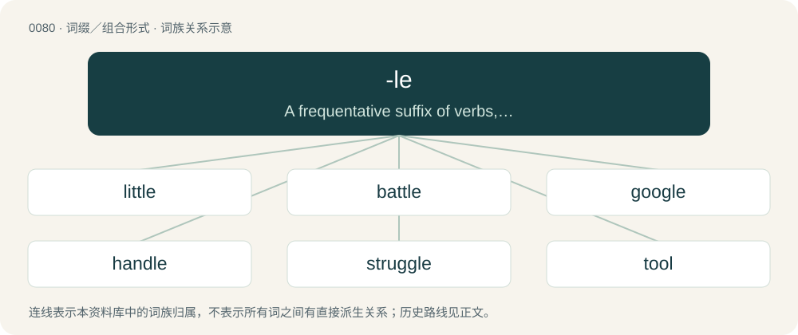

# 0082 · -le — A frequentative suffix of verbs, indicating repetition or continuousness

[总目录](../00_总目录_按常用程度.md)

**类型**：词缀／组合形式　｜　**来源语言**：见词源记录

## 核心含义与来源

- 核心含义：A frequentative suffix of verbs, indicating repetition or continuousness
- 英文含义：A frequentative suffix of verbs, indicating repetition or continuousness
- 词形：-le

**多个词源／构词路径**：同一拼写可能有不同来源；以下按词性和含义分别列出。

**来源记录 1**（后缀／后置成分；A frequentative suffix of verbs, indicating repetition or continuousness）

From Middle English -len, -elen, from Old English -lian (frequentative verbal suffix), from Proto-West Germanic \*-lōn, from Proto-Germanic \*-lōną (frequentative verbal suffix). Cognate with West Frisian -elje, Dutch -elen, German -eln, Danish -le, Norwegian Bokmål -le, Norwegian Nynorsk -la, Swedish -la, Icelandic -la. Compare -er.

**来源记录 2**（后缀／后置成分；Forming adjectives from verbs with the meaning of "prone to", "tending to", "apt to", "capable of"; compare -ative）

From Middle English -el, -le (adjectival), from Old English -el, -ol, from Proto-Germanic \*-ulaz and \*-ilaz (adjective suffixes). Cognate with West Frisian -el, Dutch -el, Low German -el, German -el, Icelandic -ill.

**来源记录 3**（后缀／后置成分；Forming diminutives from other nouns.）

From Middle English -el (agent suffix), from a combination of two suffixes: \* Old English -el, -il (diminutive suffix), from Proto-Germanic \*-ilaz (diminutive suffix). \* Old English -el, -ol, -ul (agent suffix), from Proto-Germanic \*-ilaz (agent suffix). Cognate with West Frisian -el, Dutch -el, Low German -el, German -el.

## 词族图

## 单词速览（常用到不常用）

| 单词 | 音标 | 释义 |
|---|---|---|
| [little](#w-1) | /ˈlɪ.tl̩/ | n. 一点点, 少许, 一会儿, 短时间；a. 小的, 很少的, 幼小的, 琐碎的, 短暂的, 矮小的；adv. 很少, 稍微, 完全不 |
| [battle](#w-2) | 英 /ˈbætl̩/；美 /ˈbætl̩/ | 【英文】Of grass or pasture: nutritious to cattle or sheep; fattening, nourishing. |
| [google](#w-3) | /ˈɡuː.ɡəl/ | 谷歌；搜索引擎技术；谷歌公司 |
| [handle](#w-4) | /ˈhæn.d(ə)l/ | 【英文】To touch; to feel or hold with the hand(s). |
| [struggle](#w-5) | 英 /ˈstɹʌɡəl/ | n. 斗争, 努力, 奋斗；vi. 努力, 奋斗, 挣扎 |
| [tool](#w-6) | 美 /tul/ | n. 工具, 机床, 傀儡；vt. 用工具加工；vi. 使用工具 |
| [sole](#w-7) | 英 /səʊl/；美 /soʊl/ | 【英文】To pull by the ears; to pull about; haul; lug. |
| [barrel](#w-8) | 英 /ˈbæɹ(ə)l/；美 /ˈbæɹəl/ | n. 桶；vt. 装入桶内 |
| [humble](#w-9) | 英 /ˈhʌmbəl/ | 【英文】To hum. |
| [puzzle](#w-10) | 英 /ˈpʌzəl/ | n. 难题, 迷惑；vt. 使困惑, 使为难；vi. 迷惑, 苦思 |
| [shuttle](#w-11) | 美 /ˈʃʌtəl/ | n. 穿梭, 梭子, 往返移动之物；v. (使)穿梭移动, 往返运送 |
| [heel](#w-12) | 英 /hiːl/；美 /hil/ | n. 脚后跟, 踵, 后部, 倾侧；vt. 尾随, 装以鞋跟, 倾侧, 追赶；vi. 紧随, 用脚后跟传球 |
| [gamble](#w-13) | 英 /ˈɡæm.bəl/ | n. 赌博, 冒险；v. 赌博, 孤注一掷 |
| [kernel](#w-14) | 英 /ˈkɜː.nəl/；美 /ˈkɝ.nəl/ | n. 核心, 中心, 精髓, 内核；\[计\] 内核 |
| [hassle](#w-15) | /ˈhæsl̩/ | n. 激烈而持久的争论；vi. 争论；vt. 与...争辩, 使烦恼 |
| [beetle](#w-16) | /ˈbiːtəl/ | n. 甲虫, 大槌；vi. 快速移动；vt. 捶 |
| [chuckle](#w-17) | /ˈt͡ʃʌkəl/ | n. 咯咯的笑声, 轻笑；vi. 咯咯的笑, 咕咕叫 |
| [buckle](#w-18) | /ˈbʌkəl/ | 【英文】To cause (something) to bend, or to become distorted. |
| [throttle](#w-19) | 英 /ˈθɹɒtəl/；美 /ˈθɹɑtəl/ | n. 节流阀, 节气阀, 喉咙；vt. 扼喉咙, 使窒息, 压制, 使节流；vi. 窒息, 节流, 减速 |
| [nipple](#w-20) | /ˈnɪp.əl/ | n. 乳头, 奶头, 奶嘴；\[化\] 螺纹接口; 螺纹接套 |
| [riddle](#w-21) | /ˈɹɪdəl/ | n. 谜, 谜语, 粗筛；vt. 解谜, 给...出谜, 筛, 寻根究底地检验, 充满于；vi. 出谜 |
| [rumble](#w-22) | 美 /ˈɹʌmb(ə)l/ | n. 隆隆声, 辘辘声；vi. 发隆隆声, 辘辘响；vt. 使隆隆响, 低沉地说 |
| [ripple](#w-23) | 英 /ˈɹɪp(ə)l/ | 【英文】To scratch, tear, or break slightly; graze |
| [cuddle](#w-24) | /ˈkʌd.l̩/ | n. 搂抱, 拥抱；vt. 抚抱, 抱着睡, 拥抱；vi. 依偎, 依偎着躺在一起 |
| [pickle](#w-25) | /ˈpɪkəl/ | 【英文】A kernel; a grain (of salt, sugar, etc.) |
| [scramble](#w-26) | /ˈskɹæmbl̩/ | n. 攀缘, 爬行, 抢夺, 混乱, 紧急起飞；vi. 攀缘, 杂乱蔓延, 争夺, 拼凑, 匆忙；vt. 攀登, 扰乱, 使混杂 |
| [sprinkle](#w-27) | /ˈspɹɪŋkəl/ | vt. 洒, 散置, 撒, 点缀；vi. 洒, 撒, 下小雨；n. 洒, 撒, 散置, 小雨, 少量 |
| [sparkle](#w-28) | 英 /ˈspɑː.kəl/；美 /ˈspɑɹ.kəl/ | n. 闪耀, 火花, 活力, 发泡；vi. 闪耀, 冒火花；vt. 使闪耀 |
| [giggle](#w-29) | /ˈɡɪɡl̩/ | v. 吃吃地笑, 咯咯地笑；n. 咯咯笑, 傻笑 |
| [crumble](#w-30) | 英 /ˈkɹʌmbəl/；美 /ˈkɹʌmbəl/ | v. (使)粉碎, (使)成为碎屑, 瓦解, 崩溃, 败落 |
| [brittle](#w-31) | /ˈbɹɪtəl/ | a. 易碎的, 脆弱的, 易坏的；\[机\] 脆的, 脆性的, 易碎的 |
| [trickle](#w-32) | /ˈtɹɪkəl/ | n. 滴, 细流；vi. 滴, 细细地流；vt. 使滴, 使小量流动 |
| [kneel](#w-33) | /niːl/ | vi. 跪下 |
| [nozzle](#w-34) | /ˈnɒzəl/ | n. 管口, 喷嘴；\[化\] 喷口 |
| [tickle](#w-35) | /ˈtɪkl̩/ | n. 胳肢, 痒；vt. 胳肢, 使发痒, 使快乐, 逗乐；vi. 觉得痒, 使人痒 |
| [cripple](#w-36) | /ˈkɹɪp(ə)l/ | n. 跛者, 残废；vt. 使跛, 使成残废, 削弱；a. 跛的, 残废的 |
| [mingle](#w-37) | /ˈmɪŋ.ɡəl/ | v. (使)混合 |
| [twinkle](#w-38) | /ˈtwɪŋ.kəl/ | n. 闪烁, 闪耀, 瞬息；vi. 闪烁；vt. 使闪耀 |
| [fickle](#w-39) | /ˈfɪk.əl/ | a. 变幻无常的, 浮燥的, 薄情的 |
| [grapple](#w-40) | 英 /ˈɡɹæpəl/ | v. 抓住, 掌握；n. 抓住, 系紧, 掌握, 与...扭打 |
| [spindle](#w-41) | /ˈspɪndəl/ | n. 纱锭, 纺锤, 轴, 心轴；vi. 变细长；vt. 装锭子于 |
| [toggle](#w-42) | 英 /ˈtɒɡ.əl/；美 /ˈtɑ.ɡəl/ | n. 绳针, 套索钉；vt. 拴牢；\[计\] 切换 |
| [huddle](#w-43) | /ˈhʌdəl/ | n. 杂乱一团, 混乱, 拥挤；vt. 把...挤在一起, 乱堆, 草率了事, 蜷曲；vi. 挤作一团, 蜷缩 |
| [nimble](#w-44) | /ˈnɪmbəl/ | a. 敏捷的, 伶俐的, 聪明的 |
| [dribble](#w-45) | 英 /ˈdɹɪ.bəl/；美 /ˈdɹɪ.bɫ̩/ | vi. 流口水, 滴下；vt. 使滴下, 运球；n. 点滴, 口水, 少量 |
| [scrabble](#w-46) | /ˈskɹæbəl/ | vi. 扒寻, 摸索, 挣扎；vt. 扒成, 急急搜索；n. 扒, 抓, 摸索, 挣扎 |
| [snuggle](#w-47) | /ˈsnʌ.ɡəl/ | vi. 偎依；vt. 使舒适温暖, 紧抱 |
| [dazzle](#w-48) | /ˈdæzəl/ | v. (使)眼花, 炫耀；n. 耀眼 |
| [nestle](#w-49) | /ˈnɛsəl/ | vi. 舒适地坐定, 挨靠, 偎依；vt. 抱, 安置 |
| [bustle](#w-50) | /ˈbʌsəl/ | n. 喧闹, 裙撑；vi. 奔忙, 喧闹；vt. 使忙碌, 催促 |
| [bumble](#w-51) | /ˈbʌmbəl/ | 【英文】To boom, as a Eurasian bittern. |
| [topple](#w-52) | 英 /ˈtɒpl̩/；美 /ˈtɑpl̩/ | vt. 推翻, 颠覆；vi. 倒塌, 摇摇欲坠 |
| [tingle](#w-53) | /ˈtɪŋɡəl/ | vi. 激动, 感到刺痛, 抖动；vt. 使感刺痛；n. 刺痛, 震颤, 耳鸣 |
| [ramble](#w-54) | /ˈɹæmbəl/ | n. 漫步, 随笔；vi. 漫步, 漫谈, 漫游, 蔓延；vt. 闲逛于 |
| [gobble](#w-55) | 英 /ˈɡɒbl̩/；美 /ˈɡɑbl̩/ | n. 火鸡叫声；vt. 狼吞虎咽；vi. 贪食, 咯咯叫 |
| [trample](#w-56) | /ˈtɹæmpəl/ | n. 践踏(声), 蹂躏；v. 践踏, 无视 |
| [girdle](#w-57) | 英 /ˈɡɜːdl̩/；美 /ˈɡɝdl̩/ | n. 腰带, 围绕物；vt. 用腰带束缚, 围绕 |
| [jumble](#w-58) | /ˈd͡ʒʌmbəl/ | vi. 搀杂, 混杂；vt. 搞乱, 使混乱；n. 混乱, 薄饼 |
| [sizzle](#w-59) | 美 /ˈsɪzəl/ | vi. 发出嘶嘶声；vt. 烧灼；n. 咝咝声 |
| [pail](#w-60) | 英 /peɪl/ | n. 桶, 提桶 |
| [bridle](#w-61) | /ˈbɹaɪdəl/ | n. 马勒, 约束；\[医\] 系带, 约束 |
| [crackle](#w-62) | /ˈkɹækəl/ | n. 劈啪响, 裂纹；vi. (使)发劈啪声 |
| [steeple](#w-63) | 英 /ˈsti(ː)pəl/ | n. 尖顶, (教堂的)尖塔, 锥形体 |
| [scribble](#w-64) | /ˈskɹɪbəl/ | n. 潦草的写法, 潦草写成的东西, 拙劣的作品；v. 潦草地书写, 乱写, 滥写 |
| [cobble](#w-65) | 英 /ˈkɒb.əl/；美 /ˈkɑ.bəl/ | n. 圆石, 鹅卵石；vt. 铺鹅卵石, 修, 粗粗地修补 |
| [dimple](#w-66) | 英 /ˈdɪm.pəl/ | n. 酒窝, 涟漪；vt. 使起涟漪 |
| [jiggle](#w-67) | /ˈd͡ʒɪɡəl/ | v. (使)轻摇, (使)微动；n. 轻摇, 微动 |
| [ogle](#w-68) | 英 /ˈəʊɡl̩/；美 /ˈoʊɡl̩/ | n. 眉目传情；vt. 挑逗地注视；vi. 做媚眼 |
| [quibble](#w-69) | /ˈkwɪbəl/ | n. 遁词, 双关语；vi. 吹毛求疵, 争吵, 说模棱两可的话；vt. 对...诡辩 |
| [startle](#w-70) | 英 /ˈstɑːt(ə)l/；美 /ˈstɑɹt(ə)l/ | n. 惊愕, 惊恐；vt. 吃惊, 使惊愕；vi. 惊起 |
| [dabble](#w-71) | 英 /ˈdæb.əl/；美 /ˈdæb.əl/ | vi. 玩水, 拨弄, 涉猎；vt. 溅湿 |
| [honeysuckle](#w-72) | 英 /ˈhʌnɪsʌk(ə)l/；美 /ˈhʌn.i.sʌk.əl/ | n. 忍冬, 杜鹃花 |
| [ladle](#w-73) | 英 /ˈleɪ.dəl/ | n. 勺子, 长柄勺；vt. 以勺舀取, 以勺掬, 不分对象予以赠送 |
| [bobble](#w-74) | /ˈbɒbəl/ | n. 在篮圈上跳动, 漏接, 漏踢, 失误 |
| [dingle](#w-75) | /ˈdɪŋɡl̩/ | n. 小峡谷, 幽谷；vi. 发叮当声, 发抖 |
| [haggle](#w-76) | 英 /ˈhæɡəl/ | vi. 争论, 杀价；vt. 乱砍, 乱劈；n. 杀价, 讨论, 争论 |
| [snarl](#w-77) | /ˈsnɑː(ɹ)l/ | vi. 吼叫, 怒骂, 缠结；vt. 咆哮着说, 搞乱, 使缠结；n. 咆哮, 吼叫, 怒骂, 缠结, 混乱 |
| [dwindle](#w-78) | 英 /ˈdwɪn.dəl/ | vi. 减少, 缩小, 衰落；vt. 使缩小 |
| [wriggle](#w-79) | /ˈɹɪɡəl/ | n. 蠕动, 蜿蜒；vi. 蠕动, 蜿蜒前进, 摆脱；vt. 使扭动, 扭动着爬 |
| [waddle](#w-80) | 英 /ˈwɒd.əl/；美 /ˈwɑd.əl/ | vi. 摇摇摆摆地走, 蹒跚而行；n. 蹒跚 |
| [shackle](#w-81) | 英 /ˈʃækl̩/；美 /ˈʃæk(ə)l/ | 【英文】A person who is idle or lazy; an idler. |
| [thimble](#w-82) | 英 /ˈθɪmb(ə)l/ | n. 顶针, 嵌环, 套管；\[机\] 套管 |
| [fondle](#w-83) | /ˈfɒndəl/ | vt. 爱, 爱抚, 溺爱；vi. 爱抚 |
| [bangle](#w-84) | /ˈbæŋ.ɡəl/ | 【英文】(falconry) to beat about in the air; flutter: said of a hawk which does not rise steadily and then swoop down upon its prey. |
| [beadle](#w-85) | /ˈbiːdəl/ | n. 教区执事, 英国大学典礼仪仗官；\[法\] 牧师助理, 小官吏, (英国大学的)游行领队 |
| [drawl](#w-86) | 英 /dɹɔːl/；美 /dɹɔl/ | v. 慢吞吞地说, 故意拉长调子讲话；n. 慢吞吞拉长调子的说话方式 |
| [treacle](#w-87) | 英 /ˈtɹiː.kəl/ | n. 糖蜜, 过分甜蜜的声调；\[化\] 糖浆; 糖蜜 |
| [stile](#w-88) | 英 /staɪl/ | n. 墙两边的阶梯 |
| [tipple](#w-89) | 英 /ˈtɪpəl/ | vt. (习惯性地)少量饮(酒)；vi. 饮酒；n. 酒, 含酒饮料 |
| [tinkle](#w-90) | 美 /ˈtɪŋkəl/ | n. 叮当声；vt. 使发丁当的声, 叮当地发出；vi. 叮当作响 |
| [cockle](#w-91) | 英 /ˈkɒkl̩/；美 /ˈkɑk(ə)l/ | n. 鸟蛤, 鸟蛤壳, 小舟, 田间杂草, 褶皱；vi. 弄皱, 折皱, 起皱；vt. 使皱 |
| [suckle](#w-92) | /ˈsʌk.əl/ | vt. 哺乳, 养育, 吮吸；\[医\] 哺乳 |
| [crumple](#w-93) | /ˈkɹʌmpəl/ | vt. 弄皱, 压皱；vi. 崩溃, 变皱 |
| [dibble](#w-94) | 英 /ˈdɪb(ə)l/ | n. 挖洞器；v. 挖洞, 使用挖洞器播种 |
| [gristle](#w-95) | /ˈɡɹɪsəl/ | n. 软骨；\[医\] 软骨 |
| [spittle](#w-96) | /ˈspɪ.t(ə)l/ | 【英文】A small sort of spade. |
| [jostle](#w-97) | 英 /ˈd͡ʒɒs.əl/；美 /ˈd͡ʒɑ.səl/ | n. 推挤, 冲撞；vi. 推挤, 冲撞；vt. 推, 挤, 煽动 |
| [sniffle](#w-98) | 英 /ˈsnɪf.əl/ | vi. 吸着鼻子说话, 抽鼻涕；n. 抽鼻子 |
| [swaddle](#w-99) | 英 /ˈswɒdəl/；美 /ˈswɔdəl/ | n. 襁褓；vt. 用襁褓包, 束缚 |
| [prattle](#w-100) | /ˈpɹætəl/ | vi. 小孩般说话, 闲聊, 胡说；vt. 天真地说；n. 闲扯, (小孩般)咿咿呀呀的话 |
| [scraggly](#w-101) | /ˈskɹæɡ(ə)li/ | a. 蓬乱的, 锯齿状的, 凸凹不平的 |
| [waggle](#w-102) | 英 /ˈwaɡəl/ | v. (使)不停地来回摇动, 摇摆；n. 摇动, 摇摆 |
| [kittle](#w-103) | /ˈkitl/ | 【英文】To bring forth young, as a cat; to kitten; to litter. |
| [hurtle](#w-104) | 英 /ˈhɜːtl̩/；美 /ˈhɜɹt(ə)l/ | vi. 猛冲, 碰撞, 突进；vt. 猛撞, 猛投；n. 投掷, 碰撞, 碰撞声 |
| [curdle](#w-105) | 英 /ˈkɜː.dəl/；美 /ˈkɝ.dəl/ | vt. 使凝结, 使凝固, 使变质；vi. 凝结, 凝固, 变质 |
| [sidle](#w-106) | 英 /ˈsaɪdl/；美 /ˈsaɪdəl/ | v. 横着走, 悄悄贴近, 侧身而行；n. 侧走, 挨近 |

## 逐词详解

### 1. little

**词性**：形容词　｜　**音标**：/ˈlɪ.tl̩/

**中文释义**：n. 一点点, 少许, 一会儿, 短时间；a. 小的, 很少的, 幼小的, 琐碎的, 短暂的, 矮小的；adv. 很少, 稍微, 完全不

**英文义项**：Small, not large, limited, particularly / Small, limited in size.

**构词拆分**：lout + -le

**词源与演化**：

From Middle English litel, litell, luitel, lutel, lutil, luytel, from Old English lȳtel, lyttel, from Proto-West Germanic \*lūtil (“little”), from \*lūtan (“to bow down, lout”), from Proto-Germanic \*lūtaną (“to bow down, lout”), from Proto-Indo-European \*lewd- (“to bend, crouch, duck”), equivalent to lout + -le. Cognates Cognate with Yola lethel, litha, lithel, lythea (“little”), North Frisian letj (“little, small”), Saterland Frisian litje (“little, small”), West Frisian lyts (“little, small”), Dutch luttel (“few, little, mere”), German lütt, lützel (“little, small”), Low German lütt, lüttje (“little, small”), Danish liden, lille (“little, small”), Elfdalian litn (“small”), Faroese lítil (“little, small”), Icelandic lítill (“little, small”), Norwegian Bokmål, Norwegian Nynorsk, and Swedish liten (“little, small”), Crimean Gothic lista (“insufficient, very little”), Gothic 𐌻𐌴𐌹𐍄𐌹𐌻𐍃 (leitils, “little, small”); also Albanian lus, lut (“to beg, plead, request”), Lithuanian liūdnas (“sad, sorrowful”), Bulgarian and Macedonian луд (lud, “crazy, insane, mad”), Serbo-Croatian лу̑д, lȗd (“crazy”). Related also to Old English lūtan (“to bow, bend low”); and perhaps to Old English lytiġ (“deceitful”), Gothic 𐌻𐌹𐌿𐍄𐍃 (liuts, “deceitful”). More at lout.

**例句**：

> You may be an Olympic weightlifter but you're still my little sister.

该用例对应义项：Younger, regardless of size or height.

### 2. battle

**词性**：形容词　｜　**音标**：英 /ˈbætl̩/；美 /ˈbætl̩/

**英文义项**：Of grass or pasture: nutritious to cattle or sheep; fattening, nourishing. / Of land (originally pastureland) or soil: fertile, fruitful.

**词源与演化**：

From Early Modern English batell, probably from Middle English \*batel (“flourishing”), from Old English \*batol (“improving, tending to be good”), from batian (“to get better, improve”) + -ol ( + -le).

**用法示例／搭配（非完整句）**：

> battle grass battle pasture

该用例对应义项：Of grass or pasture: nutritious to cattle or sheep; fattening, nourishing.

### 3. google

**词性**：动词　｜　**音标**：/ˈɡuː.ɡəl/

**中文释义**：谷歌；搜索引擎技术；谷歌公司

**英文义项**：To bowl (a cricket ball) so that it performs a googly (“a ball by a leg-break bowler that spins from off to leg (to a right-handed batsman), unlike a normal leg-break delivery”). / Of a bowler: to bowl or deliver a googly.

**构词拆分**：googly + -le

**词源与演化**：

Back-formation from googly + -le (frequentative suffix (indicating continuousness or repetition) forming verbs).

**例句**：

> Her name came up in 42 separate entries in a Google search.

### 4. handle

**词性**：动词　｜　**音标**：/ˈhæn.d(ə)l/

**英文义项**：To touch; to feel or hold with the hand(s). / To accustom to the hand; to take care of with the hands.

**构词拆分**：hand + -le

**词源与演化**：

From Middle English handlen, from Old English handlian (“to handle, feel, deal with, discuss”), from Proto-West Germanic \*handulōn, from Proto-Germanic \*handulōną (“to take, grip, feel”), equivalent to hand + -le. Cognate with West Frisian handelje, hanneljen, hanljen (“to handle, treat”), Dutch handelen (“to handle, deal, act, negotiate”), German handeln (“to act, trade, negotiate, behave”), Swedish handla (“to buy, trade, deal”), Icelandic höndla (“to handle”).

**例句**：

> I can't handle this hot weather.

该用例对应义项：To put up with; to endure (and continue to function).

### 5. struggle

**词性**：动词　｜　**音标**：英 /ˈstɹʌɡəl/

**中文释义**：n. 斗争, 努力, 奋斗；vi. 努力, 奋斗, 挣扎

**英文义项**：To strive, to labour in difficulty, to fight (for or against), to contend. / To have difficulty with something.

**词源与演化**：

From Middle English struglen, stroglen, strogelen, of obscure origin; perhaps from a variant of \*strokelen, \*stroukelen (&gt; English stroll), from Middle Dutch struyckelen ("to stumble, trip, falter"; &gt; Modern Dutch struikelen), the frequentative form of Old Dutch \*strūkon (“to stumble”), from Proto-Germanic \*strūkōną, \*strūkēną (“to be stiff”), from Proto-Indo-European \*strug-, \*ster- (“to be stiff; to bristle, strut, stumble, fall”), Cognate with Scots strugil (“to struggle, grapple, contend”). Also related to Middle Low German strûkelen ("to stumble"; &gt; Low German strükeln), Old High German strūhhēn, strūhhōn ("to stumble, trip, tumble, go astray"; &gt; German strauchen, straucheln). Alternative etymology derives the base of struggle from Old Norse strúgr (“arrogance, pride, spitefulness, ill-will”) + -le (frequentative suffix), from Proto-Germanic \*strūkaz (“stiff, rigid”), ultimately from the same Proto-Indo-European root above, which would make it cognate with dialectal Swedish strug (“contention, strife, discord”), Norwegian stru (“obstinate, unruly”), Danish struende (“reluctantly”), Scots strug (“difficulty, perplexity, a laborious task”).

**例句**：

> Oftentimes, third culture kids struggle with identifying, culturally, where their home is.

### 6. tool

**词性**：名词　｜　**音标**：美 /tul/

**中文释义**：n. 工具, 机床, 傀儡；vt. 用工具加工；vi. 使用工具

**英文义项**：Any physical device meant to ease or do a task. / Any piece of equipment used in a profession, such as a craftsman's.

**构词拆分**：taw (“to prepare”) + -le

**词源与演化**：

From Middle English tool, tol, from Old English tōl (“tool, implement, instrument”, literally “that with which one prepares something”), perhaps borrowed from Old Norse tól, but at any rate ultimately from Proto-Germanic \*tōlą (“that which is used in preparation, tool”), from Proto-Indo-European \*dewh₂- (“to tie to, secure”), equivalent to taw (“to prepare”) + -le (agent suffix). Cognate with Scots tuil (“tool, implement, instrument, device”), Icelandic tól (“tool”), Faroese tól (“tool, instrument”). Related to Old English tāwian (“to make, prepare, or cultivate”); see taw, and tow ("fibres used for spinning").

**例句**：

> A spreadsheet app and a bookkeeping app are some of the principal tools of a bookkeeper.

该用例对应义项：Anything that aids someone to perform an operation; an instrument; a means.

### 7. sole

**词性**：动词　｜　**音标**：英 /səʊl/；美 /soʊl/

**英文义项**：To pull by the ears; to pull about; haul; lug.

**构词拆分**：sow (“female pig”) + -le

**词源与演化**：

From earlier sowle (“to pull by the ear”). Origin unknown. Perhaps from sow (“female pig”) + -le, as in the phrase "take a sow by the wrong ear", or from Middle English sole (“rope”). See above.

### 8. barrel

**词性**：名词　｜　**音标**：英 /ˈbæɹ(ə)l/；美 /ˈbæɹəl/

**中文释义**：n. 桶；vt. 装入桶内

**英文义项**：A round (cylindrical) vessel, such as a cask, of greater length than breadth, and bulging in the middle, made of staves bound with hoops, and having flat ends (heads). The word is sometimes applied to a similar cylindrical container made of metal, usually called a drum. / Such a cask of a certain size, holding one-eighth of what a tun holds. (See a diagram comparing cask sizes.)

**构词拆分**：bear + -le

**词源与演化**：

From Middle English barel, from Anglo-Norman baril, Old French baril, bareil (“barrel”), of uncertain origin. An attempt to link baril to Old French barre (“bar, bolt”) (compare Medieval Latin barra (“bar, rod”)) via assumed Vulgar Latin \*barrīculum meets the phonological requirement, but fails to connect the word semantically. The alternative connection to Frankish \*baril, \*beril or Gothic \*𐌱𐌴𐍂𐌹𐌻𐍃 (\*bērils, “container for transport”), from Proto-Germanic \*barilaz, \*bērilaz (“barrel, jug, container”), from Proto-Indo-European \*bʰer- (“to carry, transport”), is more plausible as it connects not only the form of the word but also the sense; equivalent to bear + -le. Compare also Old High German biril (“jug, large pot”), Luxembourgish Bärel, Bierel (“jug, pot”), Old Norse berill (“barrel for liquids”), Old English byrla (“barrel of a horse, trunk, body”). More at bear.

**例句**：

> Throw it into the trash barrel.

该用例对应义项：A waste receptacle.

### 9. humble

**词性**：动词　｜　**音标**：英 /ˈhʌmbəl/

**英文义项**：To hum.

**构词拆分**：hum + -le

**词源与演化**：

From Middle English \*humblen, \*humbelen (suggested by humblynge (“a humming, a faint rumbling”)), frequentative of Middle English hummen (“to hum”), equivalent to hum + -le.

### 10. puzzle

**词性**：名词　｜　**音标**：英 /ˈpʌzəl/

**中文释义**：n. 难题, 迷惑；vt. 使困惑, 使为难；vi. 迷惑, 苦思

**英文义项**：The state of feeling confused or mystified because one cannot understand a complicated matter, a problem, etc.; bewilderment, confusion; (countable) often in in a puzzle: an instance of this. / A thing such as a complicated matter or a problem which is difficult to make sense of or understand; also, a person who is difficult to make sense of or understand; an enigma.

**构词拆分**：pose (“(obsolete) to interrogate, question”) + -le (frequentative suffix)

**词源与演化**：

The verb, of uncertain origin, is attested first. Apparently cognate with Scots pousle, pouzle, poozle (“to trifle; poke or potter around aimlessly; search about with uncertainty”), Saterland Frisian puzelje (“to work hard and continuously”), West Frisian peuzelje (“to trifle, work slowly; eat slowly and daintifully, snack”), Dutch peuzelen (“to perform insignificant work, dawdle; pick at, eat with relish in small pieces, snack”), German Low German pusseln (“to tinker, fiddle; trifle”) and pöseln (“to work hard, toil; to slave away; suffer at work; work slowly and ineffectively”), German posseln, bosseln (“to perform trivial work, tinker”), Danish pusle (“to busy oneself with light work or chores; to be occupied with a task requiring ingenuity, care, and patience; to tinker”), Swedish pyssla (“to do light work; tinker; putter or potter around”), Norwegian Nynorsk pusla, putla (“to potter about”), Faroese putla (“to trifle; potter about; do one's work slowly; be dilatory”), Faroese puss (“damage, trick”). \* An early form of the word is pusle, which is similar to Old English puslian (“to pick out the best bits, carefully select, cull”). It is possible that the meaning of the word evolved from “to pick out the best bits”, to “to think long and carefully in bewilderment while choosing what to pick out”, to “to think long and carefully in bewilderment”. However, there is no evidence in Middle English or modern English of any intermediate words with these meanings. \* Alternatively, it has been suggested that the word is from pose (“(obsolete) to interrogate, question”) + -le (frequentative suffix). However, the Oxford English Dictionary notes that early forms of the word are all spelled with -u-, and that a sound change in Middle English from ō to u “is not easily accounted for”. \* Finally, it has been suggested that the past participle form of the word is attested by Middle English poselet. This is thought to be unlikely by the Oxford English Dictionary as poselet is attested in only one quotation with the meaning “jostled, pushed”, which does not have any connection with the current senses of the word. The noun appears to be derived from the verb.

**例句**：

> Where he went after he left the house is a puzzle.

该用例对应义项：A thing such as a complicated matter or a problem which is difficult to make sense of or understand; also, a person who is difficult to make sense of or understand; an enigma.

### 11. shuttle

**词性**：名词　｜　**音标**：美 /ˈʃʌtəl/

**中文释义**：n. 穿梭, 梭子, 往返移动之物；v. (使)穿梭移动, 往返运送

**英文义项**：A tool used to carry the woof back and forth between the warp threads on a loom. / The sliding thread holder in a sewing machine, which carries the lower thread through a loop of the upper thread, to make a lock stitch.

**构词拆分**：shut + -le

**词源与演化**：

From a merger of two words: \* Middle English shutel, shotel, schetel, schettell, schyttyl, scutel (“bar; bolt”), from Old English sċyttel, sċutel (“bar; bolt”), equivalent to shut + -le \* Middle English shutel, schetil, shotil, shetel, schootyll, shutyll, schytle, scytyl (“missile; projectile; spear”), from Old English sċytel, sċutel (“dart, arrow”), from Proto-Germanic \*skutilaz. The name for a loom weaving instrument, recorded from 1338, is from a sense of being "shot" across the threads. The back-and-forth imagery inspired the extension to "passenger trains" in 1895, aircraft in 1942, and spacecraft in 1969, as well as older terms such as shuttlecock.

**例句**：

> The shuttle bus runs to the airport on a half-hourly basis from the central station.

该用例对应义项：A transport service (such as a bus or train) that goes back and forth between two or more places.

### 12. heel

**词性**：名词　｜　**音标**：英 /hiːl/；美 /hil/

**中文释义**：n. 脚后跟, 踵, 后部, 倾侧；vt. 尾随, 装以鞋跟, 倾侧, 追赶；vi. 紧随, 用脚后跟传球

**英文义项**：The rear part of the foot, where it joins the leg. / The part of a shoe's sole which supports the foot's heel.

**构词拆分**：hock + -le

**词源与演化**：

From Middle English hele, from Old English hēla, from Proto-West Germanic \*hą̄hilō, from Proto-Germanic \*hanhilaz, diminutive of Proto-Germanic \*hanhaz (“heel, hock”), equivalent to hock + -le. More at hock. Compare North Frisian haiel, West Frisian hyl, Dutch hiel, German Low German Hiel, Danish and Norwegian hæl, Swedish häl.

**例句**：

> He drove the heel of his hand into the man's nose.

该用例对应义项：The part of the palm of a hand closest to the wrist.

### 13. gamble

**词性**：名词　｜　**音标**：英 /ˈɡæm.bəl/

**中文释义**：n. 赌博, 冒险；v. 赌博, 孤注一掷

**英文义项**：A bet or wager. / A significant risk, undertaken with a potential gain.

**构词拆分**：game + -le

**词源与演化**：

From earlier gamel, from Middle English \*gamlen, \*gamelen, variant of Middle English gamenen, from Old English gæmnian, gamnian, gamenian (“to joke; play”), related to Old English gamen (“joy; mirth; pleasure; entertainment; pastime; sport; game”), equivalent to game + -le. Compare Old Danish gammel, Middle High German gamel (“pleasure; fun”). More at game.

**例句**：

> The sailors had taken many gambles with the sea and always won.

该用例对应义项：A risky venture.

### 14. kernel

**词性**：名词　｜　**音标**：英 /ˈkɜː.nəl/；美 /ˈkɝ.nəl/

**中文释义**：n. 核心, 中心, 精髓, 内核；\[计\] 内核

**英文义项**：The core, center, or essence of an object or system. / The central (usually edible) part of a nut, especially once the hard shell has been removed.

**构词拆分**：corn + -le

**词源与演化**：

From Middle English kernel, kirnel, kürnel, from Old English cyrnel, from Proto-West Germanic \*kurnil, diminutive of Proto-Germanic \*kurną (“seed, grain, corn”), equivalent to corn + -le. Cognate with Yiddish קערנדל (kerndl), Middle Dutch kernel, cornel, Middle High German kornel. Related also to Old Norse kjarni (“kernel”).

**例句**：

> The Dirichlet kernel convolved with a function yields its Fourier series approximation.

该用例对应义项：A function used to define an integral transform.

### 15. hassle

**词性**：名词　｜　**音标**：/ˈhæsl̩/

**中文释义**：n. 激烈而持久的争论；vi. 争论；vt. 与...争辩, 使烦恼

**英文义项**：Trouble, bother, unwanted annoyances or problems. / A fight or argument.

**构词拆分**：haste + -le (frequentative suffix)

**词源与演化**：

Unknown. Probably from US Southern dialectal hassle (“to pant, breathe noisily”), possibly from haste + -le (frequentative suffix).

**例句**：

> I went through a lot of hassle to be the first to get a ticket.

该用例对应义项：Trouble, bother, unwanted annoyances or problems.

### 16. beetle

**词性**：动词　｜　**音标**：/ˈbiːtəl/

**中文释义**：n. 甲虫, 大槌；vi. 快速移动；vt. 捶

**英文义项**：To move (away) quickly, to scurry away.

**构词拆分**：bite + -le

**词源与演化**：

From Middle English bitle, bityl, bytylle, from Old English bitula, bitela, bītel (“beetle”), from Proto-West Germanic \*bitilō, \*bītil, from Proto-Germanic \*bitilô, \*bītilaz (“that which tends to bite, biter, beetle”), equivalent to bite + -le. Cognate with Old High German bicco (“beetle”), Danish bille (“beetle”), Icelandic bitil, bitul (“a bite, bit”), Faroese bitil (“small piece, bittock”).

**例句**：

> The big dung beetle stole the dung ball from the smaller one.

### 17. chuckle

**词性**：动词　｜　**音标**：/ˈt͡ʃʌkəl/

**中文释义**：n. 咯咯的笑声, 轻笑；vi. 咯咯的笑, 咕咕叫

**英文义项**：To laugh quietly or inwardly. / To communicate through chuckling.

**构词拆分**：From chuck (“laugh”) + -le.

**词源与演化**：

From chuck (“laugh”) + -le.

**例句**：

> I couldn't help but let out a chuckle at Tom's cheesy joke.

### 18. buckle

**词性**：动词　｜　**音标**：/ˈbʌkəl/

**英文义项**：To cause (something) to bend, or to become distorted. / Of a thing (especially a slender structure under compression): to collapse or distort under physical pressure.

**构词拆分**：buck (“to bend, yield, buckle”) + -le (frequentative suffix)

**词源与演化**：

Origin uncertain. Probably from Middle English bukklen, bokelen (“to arch the body”), from Middle French boucler (“to bulge”, literally “to take the shape of a shield boss”), perhaps from the same ultimate origin as Etymology 1 above, or perhaps related to Middle Low German bockelen (“to bang out curves in metal”), German buckeln (“to bend over, hunch”). In some senses, possibly from buck (“to bend, yield, buckle”) + -le (frequentative suffix).

### 19. throttle

**词性**：名词　｜　**音标**：英 /ˈθɹɒtəl/；美 /ˈθɹɑtəl/

**中文释义**：n. 节流阀, 节气阀, 喉咙；vt. 扼喉咙, 使窒息, 压制, 使节流；vi. 窒息, 节流, 减速

**英文义项**：A valve that regulates the supply of fuel-air mixture to an internal combustion engine and thus controls its speed; a similar valve that controls the air supply to an engine. / The lever or pedal that controls this valve.

**构词拆分**：throat + -le

**词源与演化**：

From Middle English \*throtel, diminutive of throte (“throat”), equivalent to throat + -le. Compare German Drossel (“throttle”). More at throat.

**例句**：

> I need to drop these useless perceptions to take full throttle over my life.

### 20. nipple

**词性**：名词　｜　**音标**：/ˈnɪp.əl/

**中文释义**：n. 乳头, 奶头, 奶嘴；\[化\] 螺纹接口; 螺纹接套

**英文义项**：The projection of a mammary gland from which, on female therian mammals, milk is secreted. / The nipple (noun sense 1) and the areola together.

**构词拆分**：nib + -le

**词源与演化**：

From earlier neple, nypil, neble, believed to be a diminutive of nib, neb (“tip, point”), equivalent to nib + -le. Compare Old English nypel (“elephant trunk”), formed analogously as "a protuberance from one's neb" .

**例句**：

> Turn the nipples on to the bicycle spokes only one turn, for each spoke on the new wheel all the way around until they are all snug, then check alignment.

该用例对应义项：An internally threaded piece which holds a bicycle spoke in place on the rim.

### 21. riddle

**词性**：名词　｜　**音标**：/ˈɹɪdəl/

**中文释义**：n. 谜, 谜语, 粗筛；vt. 解谜, 给...出谜, 筛, 寻根究底地检验, 充满于；vi. 出谜

**英文义项**：A verbal puzzle, mystery, or other problem of an intellectual nature. / An ancient verbal, poetic, or literary form, in which, rather than a rhyme scheme, there are parallel opposing expressions with a hidden meaning.

**构词拆分**：rede (“advice”) + -le

**词源与演化**：

From Middle English redel, redels, from Old English rǣdels, rǣdelse (“counsel, opinion, imagination, riddle”), from Proto-West Germanic \*rādislī (“counsel, conjecture”). Analyzable as rede (“advice”) + -le. Akin to Old English rǣdan (“to read, advise, interpret”). Cognate with Dutch raadsel, German Rätsel.

**例句**：

> Here's a riddle: It's black, and white, and red all over. What is it?

该用例对应义项：A verbal puzzle, mystery, or other problem of an intellectual nature.

### 22. rumble

**词性**：名词　｜　**音标**：美 /ˈɹʌmb(ə)l/

**中文释义**：n. 隆隆声, 辘辘声；vi. 发隆隆声, 辘辘响；vt. 使隆隆响, 低沉地说

**英文义项**：A low, heavy, continuous sound, such as that of thunder or a hungry stomach. / A street fight or brawl.

**词源与演化**：

From Middle English rumblen, romblen, rummelyn, frequentative form of romen (“to roar”), equivalent to rome + -le. Cognate with Dutch rommelen (“to rumble”), Low German rummeln (“to rumble”), German rumpeln (“to be noisy”), Danish rumle (“to rumble”), all of imitative origin. Compare typologically Russian громи́ть (gromítʹ), погро́м (pogróm), разгро́м (razgróm) (akin to гром (grom), греме́ть (gremétʹ), громыха́ть (gromyxátʹ)). Also compare гро́хнуть (gróxnutʹ) (akin to гро́хот (gróxot)).

**例句**：

> The rumble from passing trucks made it hard to sleep at night.

该用例对应义项：A low, heavy, continuous sound, such as that of thunder or a hungry stomach.

### 23. ripple

**词性**：动词　｜　**音标**：英 /ˈɹɪp(ə)l/

**英文义项**：To scratch, tear, or break slightly; graze

**构词拆分**：rip + -le (frequentative suffix)

**词源与演化**：

From Middle English \*ripelen, repulen, equivalent to rip + -le (frequentative suffix).

### 24. cuddle

**词性**：名词　｜　**音标**：/ˈkʌd.l̩/

**中文释义**：n. 搂抱, 拥抱；vt. 抚抱, 抱着睡, 拥抱；vi. 依偎, 依偎着躺在一起

**英文义项**：An intimate physical embrace, typically while lying (or sitting): a snuggle, an instance of lying together snugly, as one might with a partner (more intimate than a hug, and typically of longer duration). / An affectionate embrace, a hug, such as is given to family members and close friends (less intimate than a snuggle, and typically of shorter duration).

**构词拆分**：couth + -le

**词源与演化**：

Origin uncertain, but probably from a frequentative form of Middle English \*cudden, cuththen, keththen (“to embrace”), a variant of cuthen, kuthen, kithen (“to be familiar with, make known”), from Middle English cuth, couth (“known, familiar”), equivalent to couth + -le. Cognate with Middle Dutch kudden (“to come together, flock together”). More at couth.

**例句**：

> Give me a cuddle, Paul; it'll cheer you up.

该用例对应义项：An affectionate embrace, a hug, such as is given to family members and close friends (less intimate than a snuggle, and typically of shorter duration).

### 25. pickle

**词性**：名词　｜　**音标**：/ˈpɪkəl/

**英文义项**：A kernel; a grain (of salt, sugar, etc.) / A small or indefinite quantity or amount (of something); a little, a bit, a few. Usually in partitive construction, frequently without "of"; a single grain or kernel of wheat, barley, oats, sand or dust.

**构词拆分**：pick + -le (diminutive suffix)

**词源与演化**：

Perhaps from Scottish pickle, apparently from pick + -le (diminutive suffix). Compare Scots pickil.

### 26. scramble

**词性**：动词　｜　**音标**：/ˈskɹæmbl̩/

**中文释义**：n. 攀缘, 爬行, 抢夺, 混乱, 紧急起飞；vi. 攀缘, 杂乱蔓延, 争夺, 拼凑, 匆忙；vt. 攀登, 扰乱, 使混杂

**英文义项**：To move hurriedly to a location, especially by using all limbs against a surface. / To proceed to a location or an objective in a disorderly manner.

**构词拆分**：scramb (“to pull or scrape together with the hands”) + -le (frequentative suffix)

**词源与演化**：

Origin uncertain. Perhaps from earlier dialectal scramble, scrammel (“to collect or rake together with the hands”), from scramb (“to pull or scrape together with the hands”) + -le (frequentative suffix) (compare Dutch schrammen (“to graze, brush, scratch”)); or alternatively from a nasalised form of scrabble (“to scrape or scratch quickly”).

**例句**：

> The scramble for Africa was the last wave of colonialism.

### 27. sprinkle

**词性**：动词　｜　**音标**：/ˈspɹɪŋkəl/

**中文释义**：vt. 洒, 散置, 撒, 点缀；vi. 洒, 撒, 下小雨；n. 洒, 撒, 散置, 小雨, 少量

**英文义项**：To cause (a substance) to fall in fine drops (for a liquid substance) or small pieces (for a solid substance). / To cover (an object) by sprinkling a substance on to it.

**构词拆分**：sprink + -le (frequentative suffix)

**词源与演化**：

From Middle English sprenkelen, sprynklen, from Middle Dutch sprenkelen, equivalent to sprink + -le (frequentative suffix). Cognate with Dutch sprenkelen (“to sprinkle”), German Low German sprenkeln (“to sprinkle; dapple”), German sprenkeln (“to sprinkle”).

**例句**：

> Spread it on slices of toast and sprinkle some pine nuts on top.

### 28. sparkle

**词性**：名词　｜　**音标**：英 /ˈspɑː.kəl/；美 /ˈspɑɹ.kəl/

**中文释义**：n. 闪耀, 火花, 活力, 发泡；vi. 闪耀, 冒火花；vt. 使闪耀

**英文义项**：A little spark; a scintillation. / Brilliance; luster.

**构词拆分**：spark + -le (diminutive suffix)

**词源与演化**：

From Middle English sparkel, sparkle, sparcle, equivalent to spark + -le (diminutive suffix). In some modern uses deverbal from etymology 2 below.

**用法示例／搭配（非完整句）**：

> the sparkle of his conversation over dinner

该用例对应义项：Liveliness; vivacity.

### 29. giggle

**词性**：动词　｜　**音标**：/ˈɡɪɡl̩/

**中文释义**：v. 吃吃地笑, 咯咯地笑；n. 咯咯笑, 傻笑

**英文义项**：To laugh gently in a playful, nervous, or affected manner.

**词源与演化**：

Early 16th century, probably of imitative origin. Or, perhaps a frequentative based on dialectal English gig (“to creak”), from Middle English gigen (“to make a creaking sound”) + -le; or perhaps of Dutch or Low German origin: compare Saterland Frisian güüchelje (“to giggle”), West Frisian giechelje (“to giggle”), Dutch giechelen (“to giggle”), German Low German giecheln (“to giggle”), dialectal German giggln, gigglen (“to giggle”), German gickeln (“to giggle”). All of these words are likely onomatopoeic as well. Also compare Alemannic German Guege (“fiddle”).

**例句**：

> I couldn't resist to giggle a little tee hee.

该用例对应义项：To laugh gently in a playful, nervous, or affected manner.

### 30. crumble

**词性**：动词　｜　**音标**：英 /ˈkɹʌmbəl/；美 /ˈkɹʌmbəl/

**中文释义**：v. (使)粉碎, (使)成为碎屑, 瓦解, 崩溃, 败落

**英文义项**：To fall apart; to disintegrate. / To break into crumbs.

**构词拆分**：crumb + -le (diminutive suffix)

**词源与演化**：

From earlier crymble, crimble, from Middle English \*crymblen, kremelen, from Old English \*crymlan (“to crumble”), from \*crymel (“a small crumb; crumble”), diminutive of Old English cruma (“crumb”), equivalent to crumb + -le (diminutive suffix). Compare Dutch kruimelen (“to crumble”), German Low German krömmeln (“to crumble”), German Krümel, diminutive of German Krume, German krümeln, krümmeln (“to crumble”). Alteration of vowel due to analogy with crumb.

**例句**：

> Using your fingers, crumble the ingredients with the fingertips, lifting in an upward motion, until the mixture is sandy and resembles large breadcrumbs.

该用例对应义项：To mix (ingredients such as flour and butter) in such a way as to form crumbs.

### 31. brittle

**词性**：形容词　｜　**音标**：/ˈbɹɪtəl/

**中文释义**：a. 易碎的, 脆弱的, 易坏的；\[机\] 脆的, 脆性的, 易碎的

**英文义项**：Inflexible; liable to break, snap, or shatter easily under stress, pressure, or impact. / Not physically tough or tenacious; apt to break or crumble when bending.

**构词拆分**：brit + -le

**词源与演化**：

From Middle English britel, brutel, brotel (“brittle”), from Old English \*brytel, \*bryttol (“brittle, fragile”, literally “prone to or tending to break”); equivalent to brit + -le.

**例句**：

> What a brittle person! A little misunderstanding and he's an emotional wreck.

该用例对应义项：Emotionally fragile, easily offended.

### 32. trickle

**词性**：名词　｜　**音标**：/ˈtɹɪkəl/

**中文释义**：n. 滴, 细流；vi. 滴, 细细地流；vt. 使滴, 使小量流动

**英文义项**：A very thin river. / A very thin flow; the sound of such a flow.

**构词拆分**：strike + -le

**词源与演化**：

From Middle English triklen, likely a rebracketing (e.g. teres strikled &gt; teerys trikled (“tears trickled”)) of Middle English striklen (“to trickle”), equivalent to strike + -le. For other similar cases of incorrect division, see also apron, daffodil, newt, nickname, orange, umpire.

**例句**：

> The tap of the washbasin in my bedroom is leaking and the trickle drives me mad at night.

该用例对应义项：A very thin flow; the sound of such a flow.

### 33. kneel

**词性**：动词　｜　**音标**：/niːl/

**中文释义**：vi. 跪下

**英文义项**：To rest on one's bent knees, sometimes only one; to move to such a position. / To sink down so that the entrance is level with the pavement, making it easier for passengers to enter.

**构词拆分**：knee + -le

**词源与演化**：

From Middle English knelen, from Old English cnēowlian (“to kneel”), equivalent to knee + -le. Cognate with Dutch knielen, Low German knelen, dialectal German knielen, Alemannic German chnüle, Danish knæle, all meaning “to kneel”.

**例句**：

> In church you have to kneel during parts of the service.

该用例对应义项：rest one's weight on one's knees

### 34. nozzle

**词性**：名词　｜　**音标**：/ˈnɒzəl/

**中文释义**：n. 管口, 喷嘴；\[化\] 喷口

**英文义项**：A short tube, usually tapering, forming the vent of a hose or pipe. / A short outlet or inlet pipe projecting from the end or side of a hollow vessel, as a steam-engine cylinder or a steam boiler.

**构词拆分**：nose + -le (diminutive suffix)

**词源与演化**：

From Middle English noselle, equivalent to nose + -le (diminutive suffix). Compare typologically Russian сопло (soplo) (&lt;~ сопе́ть (sopétʹ), whence also сопа́тка (sopátka)).

**例句**：

> The shape of the nozzle prevents the use of aftermarket eartips.

该用例对应义项：The part of an earbud that accommodates eartips.

### 35. tickle

**词性**：名词　｜　**音标**：/ˈtɪkl̩/

**中文释义**：n. 胳肢, 痒；vt. 胳肢, 使发痒, 使快乐, 逗乐；vi. 觉得痒, 使人痒

**英文义项**：The act of tickling. / An itchy feeling resembling the result of tickling.

**构词拆分**：tick + -le

**词源与演化**：

From Middle English tiklen, tikelen, of uncertain origin. Perhaps from a frequentative form of Middle English tikken (“to touch lightly”), thus equivalent to tick + -le; or perhaps related to Old English tinclian (“to tickle”). Compare North Frisian tigele (“to tickle”) (Hallig dialect), and tiikle (“to tickle”) (Amrum dialect), German dialectal zicklen (“to excite; stir up”). Alternatively, from a metathetic alteration of Middle English kitelen ("to tickle"; see kittle). Both are ultimately sound-symbolic.

**例句**：

> I have a persistent tickle in my throat.

该用例对应义项：An itchy feeling resembling the result of tickling.

### 36. cripple

**词性**：名词　｜　**音标**：/ˈkɹɪp(ə)l/

**中文释义**：n. 跛者, 残废；vt. 使跛, 使成残废, 削弱；a. 跛的, 残废的

**英文义项**：A person who has severely impaired physical abilities because of deformation, injury, or amputation of parts of the body. / A person who is severely impaired or deficient in some non-physical way.

**构词拆分**：creep + -le

**词源与演化**：

From Middle English cripel, crepel, crüpel, from Old English crypel (“crippled; a cripple”), from Proto-Germanic \*krupilaz (“tending to crawl; a cripple”), from Proto-Indo-European \*grewb- (“to bend, crouch, crawl”), from Proto-Indo-European \*ger- (“to bend, twist”), equivalent to creep + -le. Cognate with Dutch kreupel, Low German Kröpel, German Krüppel, Old Norse kryppill.

**例句**：

> He returned from war a cripple.

该用例对应义项：A person who has severely impaired physical abilities because of deformation, injury, or amputation of parts of the body.

### 37. mingle

**词性**：动词　｜　**音标**：/ˈmɪŋ.ɡəl/

**中文释义**：v. (使)混合

**英文义项**：To intermix; to combine or join, as an individual or part, with other parts, but commonly so as to be distinguishable in the product. / To associate or unite in a figurative way, or by ties of relationship.

**构词拆分**：ming + -le

**词源与演化**：

From earlier mingil, mengle, from Middle English menglen, equivalent to ming + -le. Cognate with Dutch mengelen (“to mingle, mix”), German mengen (“to mingle, mix”). More at ming.

**例句**：

> I don't like to mingle with people who can't share my life interests.

### 38. twinkle

**词性**：动词　｜　**音标**：/ˈtwɪŋ.kəl/

**中文释义**：n. 闪烁, 闪耀, 瞬息；vi. 闪烁；vt. 使闪耀

**英文义项**：To shine with a flickering light; to glimmer. / To be bright with delight.

**构词拆分**：twink (“to wink; blink; twinkle”) + -le (frequentative suffix)

**词源与演化**：

From Middle English twinclen, twynclen, from Old English twinclian (“to twinkle”), equivalent to twink (“to wink; blink; twinkle”) + -le (frequentative suffix). Compare German zwinkern (“to wink; twinkle”).

**例句**：

> Does a constellation twinkle more brightly than a single star?

该用例对应义项：emit or reflect light in a flickering manner

### 39. fickle

**词性**：形容词　｜　**音标**：/ˈfɪk.əl/

**中文释义**：a. 变幻无常的, 浮燥的, 薄情的

**英文义项**：Quick to change one’s opinion or allegiance; insincere; not loyal or reliable. / Changeable.

**构词拆分**：fike + -le

**词源与演化**：

From Middle English fikil, fikel, from Old English ficol (“fickle, cunning, tricky, deceitful”), equivalent to fike + -le. More at fike.

**用法示例／搭配（非完整句）**：

> fickle stock market

该用例对应义项：Changeable.

### 40. grapple

**词性**：动词　｜　**音标**：英 /ˈɡɹæpəl/

**中文释义**：v. 抓住, 掌握；n. 抓住, 系紧, 掌握, 与...扭打

**英文义项**：To seize something and hold it firmly. / To wrestle or tussle.

**构词拆分**：grab + -le

**词源与演化**：

From Middle English \*grapplen (“to seize, lay hold of”), from Old English \*græpplian (“to seize”) (compare Old English ġegræppian (“to seize”)), from Proto-Germanic \*graipilōną, \*grabbalōną (“to seize”), from Proto-Indo-European \*gʰrebʰ- (“to take, seize, rake”), equivalent to grab + -le. Cognate with Dutch grabbelen (“to grope, scramble, scrabble”), German grabbeln (“to rummage, grope about”) and grapsen, grapschen (“to seize, grasp, grabble”). Influenced in some senses by grapple (“tool with claws or hooks”, noun) (see below). See further at grasp.

**用法示例／搭配（非完整句）**：

> to grapple with one's conscience

该用例对应义项：To ponder and intensely evaluate a problem; to struggle to deal with.

### 41. spindle

**词性**：名词　｜　**音标**：/ˈspɪndəl/

**中文释义**：n. 纱锭, 纺锤, 轴, 心轴；vi. 变细长；vt. 装锭子于

**英文义项**：A rod used for spinning and then winding fibres (especially wool), usually consisting of a shaft and a circular whorl positioned at either the upper or lower end of the shaft when suspended vertically from the forming thread. / A rod which turns, or on which something turns.

**构词拆分**：spin + -le

**词源与演化**：

From Middle English spyndel, spindle, spyndylle, from Old English spindle, spindel, alteration of earlier spinel, spinil, spinl (“spindle”), from Proto-West Germanic \*spinnilu (“spindle”), equivalent to spin + -le. Cognate with Scots spindil, spinnell (“spindle”), Dutch spindel ("spindle"; &lt; Middle Dutch spille, spinle), German Spindel (“spindle”), Danish spindel (“spindle”), Swedish spindel (“spindle”). The dragonfly sense (noun sense 14) is a calque of Swedish slända (dragonfly/spindle); this word was introduced by New Sweden settlers.

**用法示例／搭配（非完整句）**：

> the spindle of a vane

该用例对应义项：A rod which turns, or on which something turns.

### 42. toggle

**词性**：动词　｜　**音标**：英 /ˈtɒɡ.əl/；美 /ˈtɑ.ɡəl/

**中文释义**：n. 绳针, 套索钉；vt. 拴牢；\[计\] 切换

**英文义项**：To alternate between two positions using a single switch or lever. / To switch between alternate states.

**构词拆分**：tug (“to pull”) + -le

**词源与演化**：

Of uncertain origin. Possible alteration of tug (“to pull”) + -le

**例句**：

> You can quickly toggle the case of selected text by pressing Alt+C.

该用例对应义项：To switch between alternate states.

### 43. huddle

**词性**：动词　｜　**音标**：/ˈhʌdəl/

**中文释义**：n. 杂乱一团, 混乱, 拥挤；vt. 把...挤在一起, 乱堆, 草率了事, 蜷曲；vi. 挤作一团, 蜷缩

**英文义项**：To crowd together. / To curl one's legs up to the chest and keep one's arms close to the torso; to crouch; to assume a position similar to that of an embryo in the womb.

**构词拆分**：hide + -le；hide + -er

**词源与演化**：

From Middle English \*hudelen, alteration (due to hudels, hidels (“hiding place”), see hiddle) of \*huderen, hoderen (“to cover; press together; huddle”), a frequentative form of Middle English huden, hiden (“to hide”), equivalent to hide + -le and/or hide + -er. Compare Low German huderken (“to brood; coddle; nurse; lull children to sleep”).

**例句**：

> Let's huddle together--it's cold!

该用例对应义项：crowd or draw together

### 44. nimble

**词性**：形容词　｜　**音标**：/ˈnɪmbəl/

**中文释义**：a. 敏捷的, 伶俐的, 聪明的

**英文义项**：Adept at taking or grasping. / Quick and light in movement or action.

**构词拆分**：nim + -le

**词源与演化**：

With intrusive -b-, inherited from Middle English nymyl, nemel, nemyll, nymell (“agile, quick, ready, able, capable”), a merger of Old English nǣmel (“receptive, quick to grasp”) and Old English numol (“able to take, capable of holding”), both from niman (“to take”) + -el, -ol (associative suffix), corresponding to nim + -le. Compare German nehmen, Gothic 𐌽𐌹𐌼𐌰𐌽 (niman), Old Norse nema (“to take”). More at nim.

**例句**：

> He was too nimble for the assailant and easily escaped his grasp.

该用例对应义项：Quick and light in movement or action.

### 45. dribble

**词性**：动词　｜　**音标**：英 /ˈdɹɪ.bəl/；美 /ˈdɹɪ.bɫ̩/

**中文释义**：vi. 流口水, 滴下；vt. 使滴下, 运球；n. 点滴, 口水, 少量

**英文义项**：In various ball games, to move (with) the ball, controlling its path by kicking or bouncing it repeatedly. / To let saliva drip from the mouth; to drool.

**构词拆分**：drib + -le

**词源与演化**：

From drib + -le (frequentative suffix).

**例句**：

> Dribble oil into the mixture.

该用例对应义项：let or cause to fall in drops

### 46. scrabble

**词性**：动词　｜　**音标**：/ˈskɹæbəl/

**中文释义**：vi. 扒寻, 摸索, 挣扎；vt. 扒成, 急急搜索；n. 扒, 抓, 摸索, 挣扎

**英文义项**：To scrape or scratch powerfully with hands or claws. / To gather hastily.

**构词拆分**：scrab + -le

**词源与演化**：

From Middle Dutch schrabbelen, frequentative of schrabben (“to scrape”), equivalent to scrab + -le. More at scrape.

**例句**：

> I wouldn't be surprised if lots of Tatoeba members were Scrabble addicts as well.

### 47. snuggle

**词性**：名词　｜　**音标**：/ˈsnʌ.ɡəl/

**中文释义**：vi. 偎依；vt. 使舒适温暖, 紧抱

**英文义项**：An affectionate hug. / The final remnant left in a liquor bottle.

**构词拆分**：snug + -le

**词源与演化**：

From snug + -le (frequentative suffix).

**例句**：

> Let's have a snuggle on the sofa.

该用例对应义项：An affectionate hug.

### 48. dazzle

**词性**：动词　｜　**音标**：/ˈdæzəl/

**中文释义**：v. (使)眼花, 炫耀；n. 耀眼

**英文义项**：To confuse or overpower the sight of (someone or something, such as a sensor) by means of excessive brightness. / To render incapable of thinking clearly; to overwhelm with showiness or brilliance.

**构词拆分**：daze + -le

**词源与演化**：

From daze + -le, a frequentative form.

**例句**：

> Antidrone lasers can burn or dazzle a drone's sensors.

该用例对应义项：To confuse or overpower the sight of (someone or something, such as a sensor) by means of excessive brightness.

### 49. nestle

**词性**：动词　｜　**音标**：/ˈnɛsəl/

**中文释义**：vi. 舒适地坐定, 挨靠, 偎依；vt. 抱, 安置

**英文义项**：To settle oneself comfortably and snugly. / To press oneself against another affectionately.

**构词拆分**：nest + -le

**词源与演化**：

From Middle English nestelen, nestlen, from Old English nistlan, nestlian, nistlian (“to make or build a nest”), from Proto-West Germanic \*nistilōn (“to build or occupy a nest; nestle”), equivalent to nest + -le. Cognate with Middle Low German nëstelen (“to build a nest”), Dutch nestelen (“to nest, nestle”).

**例句**：

> Pauline's baby Selina would just nestle in her arms as if they were the most comfortable place on earth.

### 50. bustle

**词性**：名词　｜　**音标**：/ˈbʌsəl/

**中文释义**：n. 喧闹, 裙撑；vi. 奔忙, 喧闹；vt. 使忙碌, 催促

**英文义项**：An excited activity; a stir. / A cover to protect and hide the back panel of a computer or other office machine.

**词源与演化**：

From Middle English bustlen, bustelen, bostlen, perhaps an alteration of \*busklen (&gt; Modern English buskle), a frequentative of Middle English busken (“to prepare; make ready”), from Old Norse búask (“to prepare oneself”); or alternatively from a frequentative form of Middle English busten, bisten (“to buffet; pummel; dash; beat”) + -le. Compare also Icelandic bustla (“to splash; bustle”). The etymology of noun sense 3 is uncertain, perhaps related to busk (“strip in a corset”) or German Buschel.

**用法示例／搭配（非完整句）**：

> the whirl and bustle of a large metropolis

该用例对应义项：An excited activity; a stir.

### 51. bumble

**词性**：动词　｜　**音标**：/ˈbʌmbəl/

**英文义项**：To boom, as a Eurasian bittern. / To buzz or bum.

**构词拆分**：bum + -le

**词源与演化**：

\* Verb: Frequentative of boom and/or bum, equivalent to bum + -le. \* Noun: From the verb.

### 52. topple

**词性**：动词　｜　**音标**：英 /ˈtɒpl̩/；美 /ˈtɑpl̩/

**中文释义**：vt. 推翻, 颠覆；vi. 倒塌, 摇摇欲坠

**英文义项**：To push or throw over. / To overturn.

**构词拆分**：From top + -le (frequentative verb suffix).

**词源与演化**：

From top + -le (frequentative verb suffix).

**例句**：

> The pile of pennies began to topple.

该用例对应义项：To totter and fall, or to lean as if about to do so.

### 53. tingle

**词性**：动词　｜　**音标**：/ˈtɪŋɡəl/

**中文释义**：vi. 激动, 感到刺痛, 抖动；vt. 使感刺痛；n. 刺痛, 震颤, 耳鸣

**英文义项**：To feel a prickling or mildly stinging sensation. / To feel an ASMR response.

**构词拆分**：ting + -le

**词源与演化**：

From Middle English tinglen, of uncertain origin. Possibly from Middle English tingen (“to tink”) + -len, equivalent to ting + -le. Alternatively, possibly a variant of Middle English tinclen (“to tinkle”) or from Old English tinclian (“to tickle”). More at tinkle. Compare also West Frisian tingelje (“to tinkle”), Dutch tingelen (“to tinkle, jingle”).

**例句**：

> I got hit in the butt yesterday, and it still tingles.

该用例对应义项：To feel a prickling or mildly stinging sensation.

### 54. ramble

**词性**：动词　｜　**音标**：/ˈɹæmbəl/

**中文释义**：n. 漫步, 随笔；vi. 漫步, 漫谈, 漫游, 蔓延；vt. 闲逛于

**英文义项**：To move about aimlessly, or on a winding course. / To walk for pleasure; to amble or saunter.

**构词拆分**：roam + -le

**词源与演化**：

An altered form (with dissimilation of mm to mb) of dialectal rammle, from Middle English \*ramlen, \*ramelen, frequentative of Middle English ramen (“to roam, ramble”); compare Swedish ramla (“to stumble; fall; make a noise; rumble”), Danish ramle (“to stumble; collapse; thunder; boom”); equivalent to roam + -le. "mid-15 c., perhaps frequentative of 'romen' 'to walk, go' perhaps via 'romblen' (late 14 c.) 'to ramble.' The vowel change perhaps by influence of Middle Dutch 'rammelen,' a derivative of 'rammen' 'copulate,' 'used of the night wanderings of the amorous cat.' Meaning 'to talk or write incoherently' is from 1630s".

**例句**：

> She often rambles about bees' behavior, both in the hive and in the field.

该用例对应义项：To talk or write incessantly, unclearly, or incoherently, with many digressions.

### 55. gobble

**词性**：动词　｜　**音标**：英 /ˈɡɒbl̩/；美 /ˈɡɑbl̩/

**中文释义**：n. 火鸡叫声；vt. 狼吞虎咽；vi. 贪食, 咯咯叫

**英文义项**：To eat hastily or greedily; to scoff or scarf (often used with up)

**词源与演化**：

From Middle English gobben (“to drink or swallow greedily”), of uncertain origin + -le (frequentative suffix). Middle English gobben is perhaps an alteration of Middle English globben (“to gulp down”), related to English gulpen (“to gulp”). However, compare also French gober.

**例句**：

> Don't gobble all the food up before I get back.

### 56. trample

**词性**：动词　｜　**音标**：/ˈtɹæmpəl/

**中文释义**：n. 践踏(声), 蹂躏；v. 践踏, 无视

**英文义项**：To crush something by walking on it. / To treat someone harshly.

**构词拆分**：tramp + -le

**词源与演化**：

From Middle English tramplen, trampelen (“to walk heavily”), equivalent to tramp + -le. Cognate with Saterland Frisian trampelje (“to trample”), Dutch trampelen (“to trample”), German Low German trampeln (“to trample”), German trampeln (“to trample”).

**用法示例／搭配（非完整句）**：

> to trample grass or flowers

该用例对应义项：To crush something by walking on it.

### 57. girdle

**词性**：名词　｜　**音标**：英 /ˈɡɜːdl̩/；美 /ˈɡɝdl̩/

**中文释义**：n. 腰带, 围绕物；vt. 用腰带束缚, 围绕

**英文义项**：That which girds, encircles, or encloses; a circumference. / A belt or sash at the waist, often used to support stockings or hosiery.

**构词拆分**：gird + -le

**词源与演化**：

From Middle English girdel, gerdel, gurdel, from Old English gyrdel, from Proto-West Germanic \*gurdil, from Proto-Germanic \*gurdilaz (“girdle, belt”), equivalent to gird + -le. Cognates Cognate with Saterland Frisian Gäddel (“belt”), West Frisian gurdle, gurle, gurl (“belt”), Dutch gordel (“belt”), German Gürtel (“belt”), Yiddish גאַרטל (gartl, “belt”) (whence gartel, a doublet of girdle), Swedish gördel (“girdle”), Icelandic gyrðill (“girdle”).

**用法示例／搭配（非完整句）**：

> the girdle of the world

该用例对应义项：That which girds, encircles, or encloses; a circumference.

### 58. jumble

**词性**：动词　｜　**音标**：/ˈd͡ʒʌmbəl/

**中文释义**：vi. 搀杂, 混杂；vt. 搞乱, 使混乱；n. 混乱, 薄饼

**英文义项**：To mix or confuse. / To meet or unite in a confused way.

**构词拆分**：jump + -le

**词源与演化**：

From Middle English jumbelen, alteration of jumbren, jombren, a variant of jumpren, frequentative of jumpen (“to jump”), equal to jump + -le. More at jumber, jump, jumper.

**例句**：

> I tried to study, but in my half-awake state, all of the concepts seemed to jumble together.

该用例对应义项：To meet or unite in a confused way.

### 59. sizzle

**词性**：动词　｜　**音标**：美 /ˈsɪzəl/

**中文释义**：vi. 发出嘶嘶声；vt. 烧灼；n. 咝咝声

**英文义项**：To make the sound of water boiling on a hot surface. / To cook (something) in a manner which causes that sound.

**构词拆分**：siss + -le (frequentative suffix)

**词源与演化**：

Probably a derivative of Middle English sissen (“to hiss; buzz; hum”), equivalent to siss + -le (frequentative suffix); Ultimately imitative.

**例句**：

> What Khalid really loved was the sizzle of bacon in the skillet.

### 60. pail

**词性**：名词　｜　**音标**：英 /peɪl/

**中文释义**：n. 桶, 提桶

**英文义项**：A vessel of wood, tin, plastic, etc., usually cylindrical and having a handle -- used especially for carrying liquids, for example water or milk; a bucket (sometimes with a cover). / A closed (covered) cylindrical shipping container.

**构词拆分**：peg + -le

**词源与演化**：

From Middle English payle (“bucket, pail, milking pail”), of uncertain origin. Likely from Old English pæġel (“wine vessel, container for liquids, pail; a liquid measure”), from Proto-West Germanic \*pagil, from Proto-Indo-European \*bak- (“peg, club”), equivalent to peg + -le. Compare West Frisian pegel (“liquid measure, fourth of a litre, half-pint”), German Pegel (“level of liquid, level”), Middle Dutch pegel (“half-pint”), Danish pægl (“half-pint”). Doublet of peil. Alternatively from Old French paielle (“frying pan, warming pan; a liquid measure”), from Latin patella (“small pan, shallow dish, platter”), diminutive of patina (“broad shallow pan, stewpan”). Perhaps a conflation of both.

**例句**：

> The milkmaid carried a pail of milk in each hand.

该用例对应义项：A vessel of wood, tin, plastic, etc., usually cylindrical and having a handle -- used especially for carrying liquids, for example water or milk; a bucket (sometimes with a cover).

### 61. bridle

**词性**：名词　｜　**音标**：/ˈbɹaɪdəl/

**中文释义**：n. 马勒, 约束；\[医\] 系带, 约束

**英文义项**：The headgear with which a horse is directed and which carries a bit and reins. / A restraint; a curb; a check.

**构词拆分**：braid + -le

**词源与演化**：

From Middle English bridel, from Old English brīdel, from Proto-West Germanic \*brigdil, from Proto-Germanic \*brigdilaz (“strap, rein”), equivalent to braid + -le.

**例句**：

> He threw the bridle over the fence and strode up the pathway.

### 62. crackle

**词性**：名词　｜　**音标**：/ˈkɹækəl/

**中文释义**：n. 劈啪响, 裂纹；vi. (使)发劈啪声

**英文义项**：A prolonged, frequent cracking sound; a fizzing, popping sound. / A style of glaze giving the impression of many small cracks.

**构词拆分**：crack + -le (frequentative suffix)

**词源与演化**：

From Middle English crakelen, equivalent to crack + -le (frequentative suffix). The physics sense is part of a facetious sequence "snap, crackle, pop", after the mascots of Rice Krispies cereal.

**例句**：

> There was an annoying crackle during the phone call, due to poor connection.

该用例对应义项：A prolonged, frequent cracking sound; a fizzing, popping sound.

### 63. steeple

**词性**：动词　｜　**音标**：英 /ˈsti(ː)pəl/

**中文释义**：n. 尖顶, (教堂的)尖塔, 锥形体

**英文义项**：To form something into the shape of a steeple.

**构词拆分**：steep + -le

**词源与演化**：

From Middle English stepel, from Old English stīpel, stȳpel, stīepel (“tower, steeple”), from Proto-West Germanic \*staupil, from Proto-Germanic \*staupilaz (“that which is steep, tower, steeple”), equivalent to steep + -le. Cognate with Old Norse stǫpull (“tower, steeple”).

**例句**：

> The steeple of the cathedral of Seville used to be a minaret.

### 64. scribble

**词性**：动词　｜　**音标**：/ˈskɹɪbəl/

**中文释义**：n. 潦草的写法, 潦草写成的东西, 拙劣的作品；v. 潦草地书写, 乱写, 滥写

**英文义项**：To write or draw carelessly and in a hurry. / To doodle.

**构词拆分**：scribe + -le (frequentative suffix)

**词源与演化**：

From Middle English scriblen, from (1) scrīben + -le and/or (2) Latin scrībillō (found in conscrībillō), from cōnscrībō, from scrībō (“write”), equivalent to scribe + -le (frequentative suffix).

**例句**：

> I remember that I used to scribble things on my eraser during class.

### 65. cobble

**词性**：动词　｜　**音标**：英 /ˈkɒb.əl/；美 /ˈkɑ.bəl/

**中文释义**：n. 圆石, 鹅卵石；vt. 铺鹅卵石, 修, 粗粗地修补

**英文义项**：To make shoes (what a cobbler does). / To assemble in an improvised way.

**构词拆分**：cob + -le

**词源与演化**：

From Middle English cobill, kobill (used in various combinations with ston, stan (“stone”), note, nutt (“nut”), etc.), probably a diminutive of Middle English \*cob, \*cobb, ultimately from Proto-Germanic \*kubb- (“lump; round object”). Equivalent to cob + -le. Cognate to North Germanic kubb-, kobb- (“round object, bulge, heap, islet, seal, bowler hat, etc”).

**例句**：

> We managed to cobble together a solution, but it isn't pretty.

### 66. dimple

**词性**：名词　｜　**音标**：英 /ˈdɪm.pəl/

**中文释义**：n. 酒窝, 涟漪；vt. 使起涟漪

**英文义项**：A small depression or indentation in a surface. / A small natural depression on the skin, especially on the face near the corners of the mouth.

**构词拆分**：dump (“deep hole, pool”) + -le (diminutive suffix)

**词源与演化**：

From Middle English dimpel, dimpil, dympull, from Old English \*dympel (“pit, depression”), from Proto-West Germanic \*dumpil, from Proto-Germanic \*dumpilaz (“sink-hole, dimple”), from Proto-Germanic \*dumpaz (“hole, hollow, pit”), from Proto-Indo-European \*dʰewb- (“deep, hollow”), equivalent to dialectal dump (“deep hole, pool”) + -le (diminutive suffix). Cognate with German Low German Dümpel, German Tümpel (“pond, pool”). Related also to Old English dyppan (“to dip”).

**例句**：

> The accident created a dimple in the hood of the car.

该用例对应义项：A small depression or indentation in a surface.

### 67. jiggle

**词性**：名词　｜　**音标**：/ˈd͡ʒɪɡəl/

**中文释义**：v. (使)轻摇, (使)微动；n. 轻摇, 微动

**英文义项**：A relatively weak shaking movement; the condition or state of weakly shaking. / Titillating depictions of scantily-clad female bodies in motion, especially in action media genres.

**构词拆分**：From jig + -le (frequentative suffix).

**词源与演化**：

From jig + -le (frequentative suffix).

**例句**：

> Give the key a jiggle and see if it opens.

该用例对应义项：A relatively weak shaking movement; the condition or state of weakly shaking.

### 68. ogle

**词性**：动词　｜　**音标**：英 /ˈəʊɡl̩/；美 /ˈoʊɡl̩/

**中文释义**：n. 眉目传情；vt. 挑逗地注视；vi. 做媚眼

**英文义项**：To stare at (someone or something), especially impertinently, amorously, or covetously.

**构词拆分**：By surface analysis, eye + -le

**词源与演化**：

17th century. Probably from Low German ögeln (“to ogle, to flirt with one's eyes”), from Middle Low German ö̂gelen, frequentative of Middle Low German ö̂gen, from Old Saxon ōgian, from Proto-West Germanic \*augijan (“to show”). Alternatively from an equivalent Dutch \*ogelen, but this seems unattested (only the simplex ogen). By surface analysis, eye + -le.

### 69. quibble

**词性**：名词　｜　**音标**：/ˈkwɪbəl/

**中文释义**：n. 遁词, 双关语；vi. 吹毛求疵, 争吵, 说模棱两可的话；vt. 对...诡辩

**英文义项**：An argument or objection based on an ambiguity of wording or similar trivial circumstance; a minor complaint.

**构词拆分**：quib (“quibble”, noun) + -le (diminutive ending)

**词源与演化**：

Origin uncertain. Possibly from quib (“quibble”, noun) + -le (diminutive ending). Quib is probably from Latin quibus (“in what respect? how?”), which appeared frequently in legal documents and came to be suggestive of the verbosity and petty argumentation found therein; or perhaps an alteration of quip. Alternatively, perhaps related to dialectal Dutch kwebbelen (“to speak quickly and continuously, chatter”). Compare also Scots wheebele (“a quibble”).

**例句**：

> He harped on his quibble about how the dark red paint should be described as carmine rather than burgundy.

该用例对应义项：An argument or objection based on an ambiguity of wording or similar trivial circumstance; a minor complaint.

### 70. startle

**词性**：动词　｜　**音标**：英 /ˈstɑːt(ə)l/；美 /ˈstɑɹt(ə)l/

**中文释义**：n. 惊愕, 惊恐；vt. 吃惊, 使惊愕；vi. 惊起

**英文义项**：To move suddenly, or be excited, on feeling alarm; to start. / To excite by sudden alarm, surprise, or apprehension; to frighten suddenly and not seriously; to alarm; to surprise.

**构词拆分**：start + -le

**词源与演化**：

From Middle English startlen, stertlen, stertyllen (“to rush, stumble along”), from Old English steartlian (“to kick with the foot, struggle, stumble”), equivalent to start + -le. Cognate with Old Norse stirtla (“to hobble, stagger”), Icelandic stirtla (“to straighten up, erect”). Compare also Middle English stertil (“hasty”). More at start.

**用法示例／搭配（非完整句）**：

> a horse that startles easily

该用例对应义项：To move suddenly, or be excited, on feeling alarm; to start.

### 71. dabble

**词性**：动词　｜　**音标**：英 /ˈdæb.əl/；美 /ˈdæb.əl/

**中文释义**：vi. 玩水, 拨弄, 涉猎；vt. 溅湿

**英文义项**：To make slightly wet or soiled by spattering or sprinkling a liquid (such as water, mud, or paint) on it; to bedabble. / To cause splashing by moving a body part like a bill or limb in soft mud, water, etc., often playfully; to play in shallow water; to paddle.

**构词拆分**：dab + -le (frequentative suffix)

**词源与演化**：

From earlier dable, equivalent to dab + -le (frequentative suffix), possibly from Middle Dutch dabbelen (“to pinch; knead; to fumble; to dabble”); cognate with Icelandic dafla (“to dabble”).

**例句**：

> She’s an actress by trade, but has been known to dabble in poetry.

该用例对应义项：To participate or have an interest in an activity in a casual or superficial way.

### 72. honeysuckle

**词性**：名词　｜　**音标**：英 /ˈhʌnɪsʌk(ə)l/；美 /ˈhʌn.i.sʌk.əl/

**中文释义**：n. 忍冬, 杜鹃花

**英文义项**：Any of the many species of arching shrubs and climbing vines of the genus Lonicera in the Caprifoliaceae family, many with sweet-smelling, bell-shaped flowers. / A light yellow color inspired by the color of honeysuckle blossoms.

**构词拆分**：honey + suck + -le；honeysuck + -le

**词源与演化**：

From Middle English honysokel, honisokel, honysocle, hunisuccle, perhaps an alteration of Middle English honysoke, honysouke (“honeysuckle”) (whence honeysuck), from Old English huniġsūce, huniġsūge (“honeysuckle”); equivalent to honey + suck + -le, or honeysuck + -le.

**例句**：

> The trellis was covered with honeysuckle.

### 73. ladle

**词性**：动词　｜　**音标**：英 /ˈleɪ.dəl/

**中文释义**：n. 勺子, 长柄勺；vt. 以勺舀取, 以勺掬, 不分对象予以赠送

**英文义项**：To pour or serve something with a ladle.

**构词拆分**：lade + -le (“agent suffix”)

**词源与演化**：

From Middle English ladel, from Old English hlædel, derived from Proto-Germanic \*hlaþaną (“to load”), from Proto-Indo-European \*kleh₂- (“to put, lay out”), same source as Lithuanian kloti (“to spread”), equivalent to lade + -le (“agent suffix”).

**例句**：

> Ladle the water out of the bowl.

该用例对应义项：remove with or as if with a ladle

### 74. bobble

**词性**：名词　｜　**音标**：/ˈbɒbəl/

**中文释义**：n. 在篮圈上跳动, 漏接, 漏踢, 失误

**英文义项**：A furry ball attached on top of a hat. / Elasticated band used for securing hair (for instance in a ponytail), a hair tie

**构词拆分**：bob + -le (diminutive suffix)；bob + -le (frequentative suffix)

**词源与演化**：

\* (noun): from bob + -le (diminutive suffix). \* (verb): from bob + -le (frequentative suffix). Compare bauble.

**例句**：

> Mary watch the figurine's head bobble.

### 75. dingle

**词性**：名词　｜　**音标**：/ˈdɪŋɡl̩/

**中文释义**：n. 小峡谷, 幽谷；vi. 发叮当声, 发抖

**英文义项**：A small, narrow or enclosed, usually wooded valley.

**构词拆分**：dung + -le (diminutive suffix)

**词源与演化**：

From Middle English dingle (“a deep hollow; dell”), from Old English \*dyngel, a diminutive of Old English dung (“dungeon; pit”), equivalent to dung + -le (diminutive suffix). Compare Saterland Frisian Dongel (“hollow tooth, cavity”), English dimble (“a dingle, glen, retired place”). Related to dungeon.

### 76. haggle

**词性**：动词　｜　**音标**：英 /ˈhæɡəl/

**中文释义**：vi. 争论, 杀价；vt. 乱砍, 乱劈；n. 杀价, 讨论, 争论

**英文义项**：To argue for a better deal, especially over prices between a buyer and seller. / To hack (cut crudely)

**构词拆分**：hack + -le

**词源与演化**：

1570s, "to cut unevenly" (implied in haggler), frequentative of Middle English haggen (“to chop”), variant of hacken (“to hack”), equivalent to hack + -le. Sense of "argue about price" first recorded c.1600, probably from notion of chopping away.

**例句**：

> Let's not haggle over a few dollars.

该用例对应义项：wrangle (over a price, terms of an agreement, etc.)

### 77. snarl

**词性**：动词　｜　**音标**：/ˈsnɑː(ɹ)l/

**中文释义**：vi. 吼叫, 怒骂, 缠结；vt. 咆哮着说, 搞乱, 使缠结；n. 咆哮, 吼叫, 怒骂, 缠结, 混乱

**英文义项**：To entangle; to complicate; to involve in knots. / To become entangled.

**构词拆分**：snare + -le

**词源与演化**：

From Middle English snarlen, frequentative of snaren (“to trap, tangle”). Equivalent to snare + -le.

**用法示例／搭配（非完整句）**：

> to snarl a skein of thread

该用例对应义项：To entangle; to complicate; to involve in knots.

### 78. dwindle

**词性**：动词　｜　**音标**：英 /ˈdwɪn.dəl/

**中文释义**：vi. 减少, 缩小, 衰落；vt. 使缩小

**英文义项**：To decrease, shrink, diminish, reduce in size or intensity. / To fall away in quality; degenerate, sink.

**构词拆分**：dwine + -le

**词源与演化**：

Frequentative form of dwine, from Middle English dwynen, from Old English dwīnan (“to waste away”), from Proto-West Germanic \*dwīnan, from Proto-Germanic \*dwīnaną. It is equivalent to dwine + -le, akin to Old Norse dvena, dvína, Dutch verdwijnen (“to disappear, dwindle”).

**例句**：

> Their supplies began to dwindle after a week.

该用例对应义项：To decrease, shrink, diminish, reduce in size or intensity.

### 79. wriggle

**词性**：动词　｜　**音标**：/ˈɹɪɡəl/

**中文释义**：n. 蠕动, 蜿蜒；vi. 蠕动, 蜿蜒前进, 摆脱；vt. 使扭动, 扭动着爬

**英文义项**：To twist one's body to and fro with short, writhing motions; to squirm. / To cause something to wriggle.

**构词拆分**：wrig + -le (frequentative suffix)

**词源与演化**：

From wrig + -le (frequentative suffix). Compare Dutch wriggelen (“to wriggle, squirm”), Low German wriggeln (“to wriggle”). Related to Old English wrigian (“to turn, wend, hie, go move”), from Proto-Germanic \*wrigōną (“to wriggle”).

**例句**：

> Teachers often lose their patience when children wriggle in their seats.

该用例对应义项：To twist one's body to and fro with short, writhing motions; to squirm.

### 80. waddle

**词性**：名词　｜　**音标**：英 /ˈwɒd.əl/；美 /ˈwɑd.əl/

**中文释义**：vi. 摇摇摆摆地走, 蹒跚而行；n. 蹒跚

**英文义项**：A squat, swaying gait. / A group of birds, such as ducks and penguins, when walking.

**构词拆分**：wade + -le

**词源与演化**：

From Middle English wadelen, frequentative form of waden, equivalent to wade + -le. Compare Saterland Frisian wuttelje (“to waddle”), Old High German wadalōn (“to roam; wander”), Middle High German wadelen, wedelen (“to wander; rove”), German wedeln (“to waggle”). First known use in English in a version of the Song of Roland around the year 1400.

**用法示例／搭配（非完整句）**：

> the waddle of a duck

该用例对应义项：A squat, swaying gait.

### 81. shackle

**词性**：名词　｜　**音标**：英 /ˈʃækl̩/；美 /ˈʃæk(ə)l/

**英文义项**：A person who is idle or lazy; an idler. / A dice game; also, an event at which tickets are sold for chances to be drawn to win prizes; a raffle.

**构词拆分**：shake (verb) + -le (suffix forming agent nouns; frequentative suffix forming verbs)

**词源与演化**：

From shack (“variant of shake”), shake (verb) + -le (suffix forming agent nouns; frequentative suffix forming verbs).

### 82. thimble

**词性**：名词　｜　**音标**：英 /ˈθɪmb(ə)l/

**中文释义**：n. 顶针, 嵌环, 套管；\[机\] 套管

**英文义项**：A pitted, now usually metal, cup-shaped cap worn on the tip of a finger, which is used in sewing to push the needle through material. / As much as fills a thimble (sense 1); a thimbleful.

**构词拆分**：thumb + -le (suffix forming agent nouns)

**词源与演化**：

The noun is derived from Middle English thymbyll, thimel (“thimble”) \[and other forms\], from Old English þȳmel (“thimble, thumbstall; fingerstall”), then either: \* from Old English þūma (“thumb”) (ultimately from Proto-Indo-European \*tewh₂- (“to swell”)) + -el (suffix forming agent nouns and the names of instruments); or \* from Proto-Germanic \*þūmilaz (“thumb-covering, thumb-sheath”), from \*þūmô (“thumb”) (ultimately from the Proto-Indo-European root mentioned above) + \*-ilaz (suffix forming agent nouns). The English word is analysable as thumb + -le (suffix forming agent nouns), and is cognate with Dutch duimeling (“thumbstall”), German Däumling (“thumbstall”), German Low German Dümelke (“thumbstall”), Saterland Frisian Düümelke (“thumbstall”), Scots thummle, thumble (“thimble”). The verb is derived from the noun.

**例句**：

> A thimble can be very useful for sewing, if you don't want bleeding fingers.

### 83. fondle

**词性**：动词　｜　**音标**：/ˈfɒndəl/

**中文释义**：vt. 爱, 爱抚, 溺爱；vi. 爱抚

**英文义项**：To touch or stroke lovingly. / To grasp.

**构词拆分**：fond + -le

**词源与演化**：

From fond (“love, admire”) + -le (frequentative suffix).

**例句**：

> Mothers fondle their babies.

该用例对应义项：To touch or stroke lovingly.

### 84. bangle

**词性**：动词　｜　**音标**：/ˈbæŋ.ɡəl/

**英文义项**：(falconry) to beat about in the air; flutter: said of a hawk which does not rise steadily and then swoop down upon its prey. / to flap or hang down loosely, as a hat brim or an animal's ear.

**构词拆分**：bang + -le (frequentative suffix)

**词源与演化**：

Unknown, yet probably from bang + -le (frequentative suffix).

### 85. beadle

**词性**：名词　｜　**音标**：/ˈbiːdəl/

**中文释义**：n. 教区执事, 英国大学典礼仪仗官；\[法\] 牧师助理, 小官吏, (英国大学的)游行领队

**英文义项**：A parish constable, a uniformed minor (lay) official, who ushers and keeps order. / An attendant to the minister.

**构词拆分**：bid + -le

**词源与演化**：

From Middle English bedel, bidel, from Old English bydel (“warrant officer, apparitor”), from Proto-West Germanic \*budil, from Proto-Germanic \*budilaz (“herald”), equivalent to bid + -le. Cognate with Dutch beul, German Büttel. More at bid.

### 86. drawl

**词性**：动词　｜　**音标**：英 /dɹɔːl/；美 /dɹɔl/

**中文释义**：v. 慢吞吞地说, 故意拉长调子讲话；n. 慢吞吞拉长调子的说话方式

**英文义项**：To drag on slowly and heavily; to dawdle or while away time indolently. / To utter or pronounce in a dull, spiritless tone, as if by dragging out the utterance.

**构词拆分**：draw + -le

**词源与演化**：

From a modern frequentative form of draw, equivalent to draw + -le. Compare draggle. Compare also Dutch dralen (“to drag out, delay, linger, tarry, dawdle”), Old Danish dravle (“to linger, loiter”), Icelandic dralla (“to loiter, linger”).

**例句**：

> He spoke with a typical Texan drawl.

### 87. treacle

**词性**：名词　｜　**音标**：英 /ˈtɹiː.kəl/

**中文释义**：n. 糖蜜, 过分甜蜜的声调；\[化\] 糖浆; 糖蜜

**英文义项**：A syrupy byproduct of sugar refining; molasses or golden syrup. / Cloying sentimental speech.

**构词拆分**：theriac + -le

**词源与演化**：

From Middle English triacle, partly from Old French triacle, and partly from Old English tyriaca, both from Late Latin \*triaca, \*tiriaca, late form of theriaca, ultimately from Ancient Greek θηριακή (thēriakḗ, “antidote”), feminine form of θηριακός (thēriakós, “concerning venomous beasts”), from θήρ (thḗr, “beast”). Doublet of theriacle, equivalent to theriac + -le.

**例句**：

> Listen, treacle, this is the last time I'll warn you!

该用例对应义项：Sweetheart (from treacle tart).

### 88. stile

**词性**：名词　｜　**音标**：英 /staɪl/

**中文释义**：n. 墙两边的阶梯

**英文义项**：A set of one or more steps surmounting a fence or wall, or a narrow gate or contrived passage through a fence or wall, which in either case allows people but not livestock to pass. / A vertical component of a frame or panel, such as that of a door, window, or ladder.

**构词拆分**：sty (“to ascend, climb”) + -le

**词源与演化**：

From Middle English stile, style, stiȝele, from Old English stiġel (“stile, set of steps for getting over a fence”), from Proto-West Germanic \*stigilu, from Proto-Germanic \*stigilō (“entry, entrance, overpass, device for climbing, stile”), equivalent to sty (“to ascend, climb”) + -le. Cognate with Dutch stegel (“stirrup”), Low German Stegel (“stile”), German Stiegel (“stile”).

**例句**：

> The hikers climbed over the stile to cross into the next field.

### 89. tipple

**词性**：名词　｜　**音标**：英 /ˈtɪpəl/

**中文释义**：vt. (习惯性地)少量饮(酒)；vi. 饮酒；n. 酒, 含酒饮料

**英文义项**：An area near the entrance of mines which is used to load and unload coal. / An apparatus for unloading railroad freight cars by tipping them; the place where this is done.

**构词拆分**：tip + -le

**词源与演化**：

Unknown but possibly from a Scandinavian source (see Norwegian tipla), or from tip + -le.

### 90. tinkle

**词性**：动词　｜　**音标**：美 /ˈtɪŋkəl/

**中文释义**：n. 叮当声；vt. 使发丁当的声, 叮当地发出；vi. 叮当作响

**英文义项**：To make light metallic sounds, rather like a very small bell. / To cause to tinkle.

**构词拆分**：tink + -le (frequentative suffix)

**词源与演化**：

From Middle English tinclen, equivalent to tink + -le (frequentative suffix). Cognate with West Frisian tinkelje (“to tinkle”), Dutch tinkelen (“to tinkle”), German Low German tinkeln (“to flicker, glitter, sparkle”).

**例句**：

> If you sprinkle when you tinkle, be a sweetie and wipe the seatie.

### 91. cockle

**词性**：名词　｜　**音标**：英 /ˈkɒkl̩/；美 /ˈkɑk(ə)l/

**中文释义**：n. 鸟蛤, 鸟蛤壳, 小舟, 田间杂草, 褶皱；vi. 弄皱, 折皱, 起皱；vt. 使皱

**英文义项**：Any of various edible European bivalve mollusks, of the family Cardiidae, having heart-shaped shells. / The shell of such a mollusk.

**词源与演化**：

From Middle English cokel, cokkel, kokkel, cocle, of uncertain origin. Perhaps a diminutive of Middle English cokke, cok (“cockle”), from Old English cocc (found in sǣcocc (“cockle”)) + -le; or perhaps from Old French coquille, from Vulgar Latin \*cocchilia, from conchylia, from Ancient Greek κογχύλιον (konkhúlion), diminutive of κογχύλη (konkhúlē, “mussel”), of Pre-Greek substrate origin.

### 92. suckle

**词性**：名词　｜　**音标**：/ˈsʌk.əl/

**中文释义**：vt. 哺乳, 养育, 吮吸；\[医\] 哺乳

**英文义项**：An act of suckling

**构词拆分**：suck + -le (frequentative suffix)

**词源与演化**：

From Middle English sukelen; probably a back-formation of Middle English sukeling (“a suckling; infant”), formally equivalent to suck + -le (frequentative suffix). See suckling.

**例句**：

> The baby was having a suckle at its mother's breast.

该用例对应义项：An act of suckling

### 93. crumple

**词性**：动词　｜　**音标**：/ˈkɹʌmpəl/

**中文释义**：vt. 弄皱, 压皱；vi. 崩溃, 变皱

**英文义项**：To rumple; to press into wrinkles by crushing together. / To cause to collapse.

**构词拆分**：crump + -le

**词源与演化**：

From Middle English crumplen, cromplen, frequentative of Middle English crumpen (“to curl up, crump”), from Old English crump (“bent, crooked”). Equivalent to crump + -le.

**例句**：

> Do not fold or crumple this sheet.

### 94. dibble

**词性**：名词　｜　**音标**：英 /ˈdɪb(ə)l/

**中文释义**：n. 挖洞器；v. 挖洞, 使用挖洞器播种

**英文义项**：A pointed implement used to make holes in the ground in which to set out plants or to plant seeds.

**构词拆分**：dib (“to dab lightly”) + -le (frequentative suffix indicating repetition or continuousness)

**词源与演化**：

Possibly dib (“to dab lightly”) + -le (frequentative suffix indicating repetition or continuousness); however, the word dibble is attested earlier than dib.

### 95. gristle

**词性**：名词　｜　**音标**：/ˈɡɹɪsəl/

**中文释义**：n. 软骨；\[医\] 软骨

**英文义项**：Cartilage; now especially: cartilage present, as a tough substance, in meat. / Bone not yet hardened by age and hard work.

**构词拆分**：grist + -le

**词源与演化**：

From Middle English gristel, grystyl, from Old English gristel (“gristle, cartilage”), Proto-West Germanic \*gristl, of obscure origin; possibly from a pre-Germanic substrate language. Seemingly equivalent to a diminutive of Old English grist (“a grinding”), equivalent to modern English grist + -le; possibly related to Proto-Germanic \*gredaną (“to crunch”). Cognate with Old Frisian gristel, gerstel (“gristle, cartilage”), Middle Low German gristel (“gristle”).

**例句**：

> The butcher trimmed off the gristle before weighing the meat.

### 96. spittle

**词性**：名词　｜　**音标**：/ˈspɪ.t(ə)l/

**英文义项**：A small sort of spade.

**构词拆分**：spit + -le

**词源与演化**：

Representing a frequentative form of spit (“a spade's depth”), equivalent to spit + -le.

### 97. jostle

**词性**：动词　｜　**音标**：英 /ˈd͡ʒɒs.əl/；美 /ˈd͡ʒɑ.səl/

**中文释义**：n. 推挤, 冲撞；vi. 推挤, 冲撞；vt. 推, 挤, 煽动

**英文义项**：To bump into or brush against while in motion; to push aside. / To move through by pushing and shoving.

**构词拆分**：joust + -le

**词源与演化**：

Originally justle (“to have sex with”), formed from Middle English jousten, from the Old French joster (“to joust”), from Latin iuxtā (“next to”), from iungō (“join, connect”), equivalent to joust + -le.

**例句**：

> We had to jostle our way to the front of the platform.

该用例对应义项：make one's way by jostling, pushing, or shoving

### 98. sniffle

**词性**：动词　｜　**音标**：英 /ˈsnɪf.əl/

**中文释义**：vi. 吸着鼻子说话, 抽鼻涕；n. 抽鼻子

**英文义项**：To make a whimpering or sniffing sound when breathing, because of a runny nose. / To utter with a whimpering or sniffing sound.

**构词拆分**：sniff + -le (frequentative suffix)

**词源与演化**：

From sniff + -le (frequentative suffix). Compare snivel.

**例句**：

> Don't sniffle, please quickly blow your nose.

### 99. swaddle

**词性**：动词　｜　**音标**：英 /ˈswɒdəl/；美 /ˈswɔdəl/

**中文释义**：n. 襁褓；vt. 用襁褓包, 束缚

**英文义项**：To bind (a baby) with long narrow strips of cloth.

**构词拆分**：swathe (“to wrap with fabric”) + -le (agent/instrumental suffix)

**词源与演化**：

From Middle English swathlen (“to bind; swaddle”), from Middle English swathel, swethel, from Old English swaþul, swæþel, sweþel, sweoþol (“swaddling cloth”), equivalent to swathe (“to wrap with fabric”) + -le (agent/instrumental suffix), the word then underwent th-stopping (its voiced th became a d). Cognate with Middle Dutch swadel (“swaddling; bandage”), Old High German swedili (“poultice”), Old English sweþian, besweþian (“to wrap; swaddle”).

**例句**：

> Women used to swaddle their babies in the old days.

### 100. prattle

**词性**：动词　｜　**音标**：/ˈpɹætəl/

**中文释义**：vi. 小孩般说话, 闲聊, 胡说；vt. 天真地说；n. 闲扯, (小孩般)咿咿呀呀的话

**英文义项**：To speak incessantly and in an inconsequential or childish manner; to babble.

**构词拆分**：prate + -le (early modern English frequentative suffix)

**词源与演化**：

From prate + -le (early modern English frequentative suffix). Compare Dutch pruttelen and Dutch preutelen (“to mutter”).

**例句**：

> You guys prattle a lot and do little.

### 101. scraggly

**词性**：形容词　｜　**音标**：/ˈskɹæɡ(ə)li/

**中文释义**：a. 蓬乱的, 锯齿状的, 凸凹不平的

**英文义项**：Rough, scruffy, or unkempt. / Jagged or uneven; scraggy.

**构词拆分**：scrag + -le + -ly

**词源与演化**：

As if from a verb \*scraggle (in turn from scrag). Equivalent to scrag + -le + -ly.

**例句**：

> He has a scraggly beard and a bum leg.

### 102. waggle

**词性**：名词　｜　**音标**：英 /ˈwaɡəl/

**中文释义**：v. (使)不停地来回摇动, 摇摆；n. 摇动, 摇摆

**英文义项**：An instance of waggling. / A wobbling motion.

**构词拆分**：wag + -le (“(frequentative)”)

**词源与演化**：

From Middle English wagelen (attested in wagelyng), possibly a borrowing of Middle Low German wagelen; equivalent to wag + -le (“(frequentative)”). Compare continental equivalents Middle High German wacken ( &gt; Danish vakle, German wackeln), Swedish vagla, West Frisian waggelje, Low German wackeln, Dutch waggelen.

**例句**：

> Give the cable a waggle to let it come out quicker.

该用例对应义项：A wobbling motion.

### 103. kittle

**词性**：动词　｜　**音标**：/ˈkitl/

**英文义项**：To bring forth young, as a cat; to kitten; to litter.

**构词拆分**：kit + -le

**词源与演化**：

From Middle English kitelen, from Old Norse kjetla (“to bring forth young”), equivalent to kit + -le.

### 104. hurtle

**词性**：动词　｜　**音标**：英 /ˈhɜːtl̩/；美 /ˈhɜɹt(ə)l/

**中文释义**：vi. 猛冲, 碰撞, 突进；vt. 猛撞, 猛投；n. 投掷, 碰撞, 碰撞声

**英文义项**：To move rapidly, violently, or without control, especially in a noisy manner.

**构词拆分**：hurt (“(obsolete) to knock; to strike”) + -le (frequentative suffix)

**词源与演化**：

The verb is derived from Middle English hurtelen, hurtlen (“to cast, hurl, throw; to charge at; to clash in combat, fight; to collide; to injure; to knock down; to propel, push, thrust; to rush; to stumble”) \[and other forms\], from hurten (“to injure, wound, hurt (physically or figuratively); to damage, impair; to hurt one’s feelings, humiliate; to receive an injury; to collide into; to propel, push, thrust; to stumble”) (see further at English hurt (verb)) + -el-, -elen (frequentative suffix). The English word is analysable as hurt (“(obsolete) to knock; to strike”) + -le (frequentative suffix). The noun is derived from the verb.

**例句**：

> The chimp's eyes narrowed, ready to hurtle the stone at the slightest provocation.

### 105. curdle

**词性**：动词　｜　**音标**：英 /ˈkɜː.dəl/；美 /ˈkɝ.dəl/

**中文释义**：vt. 使凝结, 使凝固, 使变质；vi. 凝结, 凝固, 变质

**英文义项**：To form curds so that it no longer flows smoothly; to cause to form such curds. (usually said of milk) / To clot or coagulate; to cause to congeal, such as through cold. (metaphorically of blood)

**构词拆分**：curd + -le (frequentative suffix)

**词源与演化**：

Metathesis of earlier dialectal cruddle, crudle, equivalent to curd + -le (frequentative suffix).

**例句**：

> Too much lemon will curdle the milk in your tea.

该用例对应义项：To form curds so that it no longer flows smoothly; to cause to form such curds. (usually said of milk)

### 106. sidle

**词性**：动词　｜　**音标**：英 /ˈsaɪdl/；美 /ˈsaɪdəl/

**中文释义**：v. 横着走, 悄悄贴近, 侧身而行；n. 侧走, 挨近

**英文义项**：To (cause something to) move sideways. / In the intransitive sense often followed by up: to (cause something to) advance in a coy, furtive, or unobtrusive manner.

**构词拆分**：side + -le (frequentative suffix)

**词源与演化**：

The verb is from side + -le (frequentative suffix), possibly a back-formation from sideling (“in a sidelong direction; askew, obliquely”, adverb), treating that word as the present participle of sidle. The noun is derived from the verb.

**例句**：

> The young man began to sidle near the pretty girl sitting on the log.

该用例对应义项：move unobtrusively or furtively
