# 0083 · -ee — 常指动作接受方；也有已固定的参与者等词

[逐词精讲目录](../00_逐词精讲目录.md) · [总目录](../00_总目录_按常用程度.md)

## 核心词根与来源

英语常见的受动人物 -ee，承盎格鲁法语 -é 分词名词化材料，早在正式、法律语境与 -or 人物名配对。后来用法扩大，retiree、attendee、escapee 等不能一概译成被某人怎样的人。法语女性名词 -ée，如 fiancée，又要分清其词形传统。

**EE：常把镜头移到接受这件事的一方，具体仍看整词**

面试桌两边，interviewer 发问，interviewee 回答；付款时 payer 给出，payee 接收。先把箭头方向画在脑中。

- **给出与接收方向**：employer · employee；interviewer · interviewee；payer · payee；grant · grantor · grantee
- **培训、接纳与身份**：train · trainee；induct · inductee；nominee · appointee · retiree
- **不是一律被动**：attendee · escapee · absentee；committee · referee · trustee
- **同形字尾另看历史**：divorce · divorced · divorcee；fiance · fiancee；squeeze · squeegee
- **grant → granted：准予与承认**：grant · granted
- **grant → grants：准予与给出去的资助**：grant · grants
- **commit → committing：交托、投入、实施**：commit · committing
- **trust + -ee → trustee → trustees**：trustees

## 词形与演化规律

employ + -ee → employee；train + -ee → trainee；interview + -ee → interviewee；grantor 给出／grantee 接受。-ee 常带重音，但 committee 委员会、部分其他词有自己的固定重音。squeegee 是工具，goatee 是山羊胡，settee 是长椅，不能看见 ee 就都找受动的人。

准许、给予的借词形成 granted，也常有承认某点的表达。

法语准予、保证材料经中古英语，较早联系相信词族，部分具体来源有不同分析。

拉丁 committere 的多支历史；现代双写 t 加完整 ing。

受托、被信任去照管事务者是 trustee。-ee 在此标受托的一方，不能把所有 -ee 词都机械翻译成被动动作。复数加 -s，重音仍在末音节。

## 单词速览（按词族由简到繁）

同一基础词的相关扩展放在一起，先读基础形式，再读扩展；各组之间优先读常用的。具体词源关系见各词讲解。

| 单词 | 音标 | 核心意思 |
|---|---|---|
| [pay](#w-39) | /peɪ/ | 支付；工资；付出；值得、划算 |
| [payer](#w-75) | 英 /ˈpeɪə/；美 /ˈpeɪər/ | 付款人；支付方 |
| [payee](#w-25) | /peɪˈiː/ | 收款人；款项收受方 |
| [return](#w-40) | 英 /rɪˈtɜːn/；美 /rɪˈtɜːrn/ | 返回；归还；回报；申报表 |
| [returnee](#w-37) | 英 /rɪˌtɜːˈniː/；美 /rɪˌtɜːrˈniː/ | 归来者；回国、返乡或重返某领域的人 |
| [trust](#w-41) | /trʌst/ | 信任；相信；托付；信托 |
| [trustee](#w-5) | /trʌˈstiː/ | 受托人；基金会、机构等的理事 |
| [trustees](#w-83) | 英、美 /trʌˈstiːz/ | 受托人；理事〔复数〕 |
| [sign](#w-42) | /saɪn/ | 标志；迹象；招牌；手势；签名、签约 |
| [signee](#w-38) | /saɪˈniː/ | 签约者；被签下的人 |
| [commit](#w-56) | /kəˈmɪt/ | 投入；承诺；犯下；提交保存 |
| [committee](#w-1) | 通常 /kəˈmɪti/；“受托人”罕见义 /ˌkɒmɪˈtiː/ | 委员会；受托办事的小组 |
| [committing](#w-82) | /kəˈmɪtɪŋ/ | 投入、承诺、实施〔现在分词、动名词〕 |
| [train](#w-43) | /treɪn/ | 火车；一列；训练；培养 |
| [trainer](#w-61) | 英 /ˈtreɪnə/；美 /ˈtreɪnər/ | 教练；培训师；英式运动鞋 |
| [trainee](#w-6) | /ˌtreɪˈniː/ | 受训者；见习人员 |
| [address](#w-44) | 名词：英 /əˈdres/，也读 /ˈædres/；美 /ˈædres/、/əˈdres/；动词：英、美 /əˈdres/ | 地址；演说；向……讲话；处理、着手解决 |
| [addressee](#w-21) | 英、美 /ˌædreˈsiː/ | 收件人；话语的接收对象 |
| [award](#w-45) | 英 /əˈwɔːd/；美 /əˈwɔːrd/ | 奖项；授予、颁发；裁定给予 |
| [awardee](#w-26) | 英 /əwɔːˈdiː/；美 /əwɔːrˈdiː/ | 获奖者；获授者 |
| [interview](#w-46) | 英 /ˈɪntəvjuː/；美 /ˈɪntərvjuː/ | 面试；采访；访谈 |
| [interviewer](#w-72) | 英 /ˈɪntəvjuːə/；美 /ˈɪntərvjuːər/ | 面试官；采访者 |
| [interviewee](#w-14) | 英 /ˌɪntəvjuːˈiː/；美 /ˌɪntərvjuːˈiː/ | 受访者；参加面试的人 |
| [transfer](#w-47) | 动词：英 /trænsˈfɜː/、美 /trænsˈfɜːr/；名词：英 /ˈtrænsfɜː/、美 /ˈtrænsfɜːr/ | 转移、转让；调动、转学、换乘；转移行为 |
| [transferee](#w-34) | 英、美 /ˌtrænsfəˈriː/ | 受让人；被调动、转学等的人 |
| [grant](#w-48) | 英 /ɡrɑːnt/；美 /ɡrænt/ | 给予、准予；承认〔某点〕；资助款 |
| [granted](#w-80) | 英 /ˈɡrɑːntɪd/；美 /ˈɡræntɪd/ | 准许、给予了；承认；grant 的过去式和过去分词 |
| [grants](#w-81) | 英 /ɡrɑːnts/；美 /ɡrænts/ | 资助、补助金；授予的权利等〔复数〕；准予、授予〔第三人称单数〕 |
| [grantee](#w-18) | 英 /ɡrɑːnˈtiː/；美 /ɡrænˈtiː/ | 受授予方；受资助者 |
| [grantor](#w-79) | 英 /ɡrɑːnˈtɔː/；美 /ˈɡræntər/、/ɡrænˈtɔːr/ | 授予方；转让财产或权益的一方 |
| [escape](#w-49) | /ɪˈskeɪp/ | 逃脱、逃离；避开；被忽略；逃脱机会、解脱 |
| [escapee](#w-22) | 英 /ɪˌskeɪˈpiː/；美 /ˌeskeɪˈpiː/，也有其他重音变体 | 逃脱者、逃犯；逸出栽培环境的植物〔专门语境〕 |
| [attend](#w-50) | /əˈtend/ | 出席；照顾；留意；处理 |
| [attendee](#w-13) | /əˌtenˈdiː/ | 出席者；参会者 |
| [license](#w-51) | /ˈlaɪsəns/ | 许可证、许可；正式准许、授权使用 |
| [licensee](#w-8) | /ˌlaɪsənˈsiː/ | 获许可方、被授权人 |
| [employ](#w-65) | 英、美 /ɪmˈplɔɪ/ | 雇用；运用 |
| [employee](#w-2) | 英、美 /ɪmˈplɔɪiː/，也读 /ˌemplɔɪˈiː/ | 雇员；员工 |
| [employer](#w-59) | 英 /ɪmˈplɔɪə/；美 /ɪmˈplɔɪər/ | 雇主；用人单位 |
| [refer](#w-52) | 英 /rɪˈfɜː/；美 /rɪˈfɜːr/ | 提及；指的是；查阅；转介、交付处理 |
| [referee](#w-4) | 英、美 /ˌrefəˈriː/ | 裁判；评审人；推荐人；担任裁判或评审 |
| [mortgage](#w-53) | 英 /ˈmɔːɡɪdʒ/；美 /ˈmɔrɡɪdʒ/ | 抵押贷款；抵押；以房产抵押借款 |
| [mortgagee](#w-36) | 英 /ˌmɔːɡɪˈdʒiː/；美 /ˌmɔːrɡɪˈdʒiː/ | 抵押权人；抵押贷款中的贷款方 |
| [honour](#w-54) | 英 /ˈɒnə/；美 /ˈɑnər/ | 荣誉；尊敬；履行〔英式常用拼写〕 |
| [divorce](#w-55) | 英 /dɪˈvɔːs/；美 /dɪˈvɔːrs/ | 离婚；使脱离、割裂〔比喻〕 |
| [divorced](#w-63) | 英 /dɪˈvɔːst/；美 /dɪˈvɔːrst/ | 已离婚的；相脱离、割裂的 |
| [divorcee](#w-17) | 英 /dɪˌvɔːˈsiː/；美 /dɪˌvɔːrˈseɪ/〔亦有变体〕 | 离婚者〔尤常指女性〕 |
| [invite](#w-57) | 动词 /ɪnˈvaɪt/；名词 /ˈɪnvaɪt/ | 邀请；征求；招致；邀请〔非正式名词〕 |
| [invitee](#w-33) | /ˌɪnvaɪˈtiː/ | 受邀者 |
| [franchise](#w-58) | /ˈfræntʃaɪz/ | 特许经营权、加盟企业；选举权；职业球队；系列作品；授予特许经营权 |
| [franchisee](#w-15) | /ˌfræntʃaɪˈziː/ | 加盟方、受许经营者 |
| [adopt](#w-60) | 英 /əˈdɒpt/；美 /əˈdɑːpt/ | 收养；采纳；采用；采取 |
| [adoptee](#w-30) | 英 /əˌdɒpˈtiː/；美 /əˌdɑːpˈtiː/ | 被收养者 |
| [retire](#w-62) | 英 /rɪˈtaɪə/；美 /rɪˈtaɪr/ | 退休、退役；退出；停止使用；退下休息〔较正式〕 |
| [retiree](#w-12) | /rɪˌtaɪəˈriː/，也有重音较靠前的读法 | 退休者、退休人员 |
| [absent](#w-64) | 形容词 /ˈæbsənt/；动词 /æbˈsent/ | 缺席的；不存在的；心不在焉的；使自己缺席 |
| [absentee](#w-7) | /ˌæbsənˈtiː/ | 缺席者；不在场的人 |
| [nominate](#w-70) | 英 /ˈnɒmɪneɪt/；美 /ˈnɑːmɪneɪt/ | 提名；指定、选定 |
| [nominee](#w-3) | 英 /ˌnɒmɪˈniː/；美 /ˌnɑːmɪˈniː/ | 被提名者、候选人；被指定的人 |
| [squeeze](#w-66) | /skwiːz/ | 挤压；挤入；榨出；勉强腾出 |
| [induct](#w-78) | /ɪnˈdʌkt/ | 正式接纳、引入；使入职、入伍 |
| [induction](#w-67) | /ɪnˈdʌkʃən/ | 入职引导；归纳；感应；诱导 |
| [inductee](#w-23) | /ˌɪndʌkˈtiː/ | 新接纳的成员；新入职、入伍者；入选者 |
| [appoint](#w-68) | 英、美 /əˈpɔɪnt/ | 任命、指定；约定、安排 |
| [appointee](#w-77) | 英、美 /əˌpɔɪnˈtiː/ | 被任命者 |
| [assign](#w-69) | /əˈsaɪn/ | 分配；指派；指定；转让 |
| [assignee](#w-28) | /ˌæsaɪˈniː/，也 /ˌæsəˈniː/ | 受让人；被指派任务的人 |
| [devote](#w-71) | 英 /dɪˈvəʊt/；美 /dɪˈvoʊt/ | 投入；专用于；献身 |
| [devotee](#w-9) | 英、美 /ˌdevəˈtiː/ | 热衷者；忠实爱好者；信徒 |
| [fiance](#w-73) | /fiˈɒnseɪ/〔英式常见〕；美 /ˌfiːɑːnˈseɪ/〔有变体〕 | 未婚夫〔也写 fiancé〕 |
| [fiancee](#w-74) | /fiˈɒnseɪ/〔英式常见〕；美 /ˌfiːɑːnˈseɪ/〔有变体〕 | 未婚妻〔也写 fiancée〕 |
| [detain](#w-76) | /dɪˈteɪn/ | 扣留；拘留；耽搁 |
| [detainee](#w-10) | /ˌdiːteɪˈniː/ | 被拘留者；被扣留者 |
| [goatee](#w-16) | 英 /ɡəʊˈtiː/；美 /ɡoʊˈtiː/ | 山羊胡、下巴上一撮胡须 |
| [honoree](#w-19) | 英 /ˌɒnəˈriː/；美 /ˌɑnəˈri/ | 受表彰者；获致敬的人 |
| [settee](#w-20) | /seˈtiː/ | 长沙发、长软椅〔英式常见〕 |
| [squeegee](#w-27) | /ˈskwiːdʒiː/ | 橡胶刮水器；用刮水器刮 |

## 逐词讲解

### 1. pay — 支付；工资；付出；值得、划算

**音标**：/peɪ/

**先抓住这个画面**

买到东西后把应给的交出去，让账结清；时间、注意力也能被看成要付出的东西。

**怎么拆**

经古法语 paiier 接拉丁 pācāre“使平静”，中世纪有满足、结清的发展。现代支付义已固定，不是每次付款都在平息冲突；过去式、过去分词通常 paid。

**怎么变成今天的意思**

**拉丁 pācāre → 中世纪拉丁相关用法**  
使平静、平息 → 满足、结清

↓

**古法语 paiier → 中古英语 payen → pay**  
给付、支付

pay the bill 是付账，pay for lunch 是付午饭钱，pay attention 是投入注意；It pays to plan ahead 是提前计划值得。pay 作名词是工作报酬。

**常见搭配与例句**

pay someone；pay for；pay the bill；pay attention；a pay rise。

> I’ll pay for lunch today.

今天午饭我来付钱。

> Please pay attention to the final sentence.

请注意最后一句。

> It pays to check the details before booking.

预订前核查细节是值得的。

**别混淆**

pay someone 说明给谁，pay for something 说明为啥付；pay the shopkeeper 和 pay for the bread 可以在同一件事中并存。

### 2. payer — 付款人；支付方

**音标**：英 /ˈpeɪə/；美 /ˈpeɪər/

**先抓住这个画面**

沿着钱的方向找起点，实际承担支付的那一方。

**怎么拆**

pay + -er，-er 表动作执行者；可能是个人，也可能是组织，不限定现金交易。

**怎么变成今天的意思**

**拉丁 pācāre → 中世纪拉丁相关用法**  
使平静、平息 → 满足、结清

↓

**古法语 paiier → 中古英语 payen → pay**  
给付、支付

↓

**pay + -er → payer**  
负责支付的人或机构

the payer’s name 是付款方姓名，a third-party payer 是第三方支付主体等表达。具体责任仍看交易安排，不由后缀决定。

**常见搭配与例句**

the payer’s name；identify the payer；a third-party payer。

> Please enter the payer’s name on the form.

请在表格上填写付款人姓名。

> The record identifies both the payer and the recipient.

记录同时列明付款方与收款方。

**别混淆**

payer 给钱，payee 收钱；-er 与 -ee 在这一对里形成方向对照，但不能据此断言英语每个 -ee 都是被动接受者。

### 3. payee — 收款人；款项收受方

**音标**：/peɪˈiː/

**先抓住这个画面**

同一笔钱从 payer 出发，到了 payee 这一边。

**怎么拆**

pay + -ee，后缀在此表示收受支付的人或机构；重音常在后面 /iː/，与 payer 的开头重音不同。

**怎么变成今天的意思**

**拉丁 pācāre → 中世纪拉丁相关用法**  
使平静、平息 → 满足、结清

↓

**古法语 paiier → 中古英语 payen → pay**  
给付、支付

↓

**pay + -ee → payee**  
钱付给的对象

填写支票、银行转账、会计记录常见 payee name。只是角色名称，不表示收款一定已经成功。

**常见搭配与例句**

the payee’s name；add a payee；verify the payee details。

> The cheque shows the payee’s name.

支票上写着收款人姓名。

> The form has separate fields for payer and payee.

表格为付款方和收款方分别设置了填写栏。

**别混淆**

payer 是付款方，payee 是收款方；employee 受雇者也有 -ee，但不能把所有场景都只按钱的方向猜。

### 4. return — 返回；归还；回报；申报表

**音标**：英 /rɪˈtɜːn/；美 /rɪˈtɜːrn/

**先抓住这个画面**

沿着关系往回走：人回原处，书回主人手里，投入之后收益回到出资者手中。

**怎么拆**

动词经古法语 retorner / retourner，并受中世纪拉丁语 retornare 影响；名词经法语 retorn 等及中世纪拉丁语 returnum 借入。现代 re- + turn 容易看懂，但名词不是单一路线的后来产物。

**怎么变成今天的意思**

**希腊语 tornos → 拉丁语 tornus / tornare**  
画圆、车削的工具 → 在车床上旋转加工

↓

**古法语 retorner / retourner；中世纪拉丁语 retornare**  
转回、返回

↓

**并行名动词：法语 retorn 等 → 英语 return**  
返回、归还；正式报送的信息及回报

return home 不用 to，return to school 要用 to；return a book 是还书。tax return 是向税务机关提交的申报资料，不是“退税”，退税通常是 tax refund。

**常见搭配与例句**

return to；return something to someone；in return；a tax return。

> Please return the book to the library by Friday.

请在周五之前把书还给图书馆。

> They returned home after midnight.

他们午夜过后才回到家。

> She filed her tax return online.

她在网上提交了纳税申报表。

**别混淆**

go back 强调回去；return 可回去也可回来，且较正式。return 的投资回报可能是负数，不保证赚钱。

### 5. returnee — 归来者；回国、返乡或重返某领域的人

**音标**：英 /rɪˌtɜːˈniː/；美 /rɪˌtɜːrˈniː/

**先抓住这个画面**

把回来的人看成一个有共同经历的群体：海外回来的人、重新回到工作岗位的人。

**怎么拆**

return + -ee，通常末尾重读。-ee 在此形成参与某过程的人，不必是被别人送回来，所以不机械等同于被动接受者。

**怎么变成今天的意思**

**法语 retourner → 英语 return**  
转回来、回来；最终接拉丁旋转词族

↓

**return + -er／-ee**  
回来、返还或回击的人；特定返回群体成员

↓

**return + -ee → returnee**  
经历返回的人，尤某一返归群体成员

overseas returnees 海外归来者，returnees to the workforce 重返劳动力市场者。实际返到哪里由补语说明。

**常见搭配与例句**

overseas returnees；returnees to work；a group of returnees。

> The centre provides advice for overseas returnees.

中心为海外归来者提供咨询。

> Several returnees joined the training after years away from work.

几位多年未工作的返岗者参加了培训。

**别混淆**

returnee 不自带海归高学历等评价；只说返回经历。refugee、employee 等 -ee 词各自历史、角色不同，不一概套成被动。

### 6. trust — 信任；相信；托付；信托

**音标**：/trʌst/

**先抓住这个画面**

觉得对方靠得住，所以敢把事情、秘密或责任交给他。

**怎么拆**

中古英语 trust、trost 属日耳曼语信心、支持词族。常见词源解释联系古诺尔斯语 traust，但具体借入或本族传承有争论，不把一条路线说死。

**怎么变成今天的意思**

**日耳曼语信心、支持词族 → 中古英语 trust、trost**  
信赖、保护；英语具体传承或北欧借入关系有争论

↓

**现代 trust**  
相信可靠 → 委托责任；另有信托、托拉斯等专门用法

trust someone 信任某人，trust someone with a secret 把秘密托付某人；a trust 还可是按特定安排持有、管理资产的组织或法律关系。这里只帮助读词，不展开法律规则。

**常见搭配与例句**

trust someone；trust someone with；put your trust in；trust your judgement。

> I trust her to keep the information private.

我相信她会对这些信息保密。

> You need to trust your own judgement.

你需要相信自己的判断。

**别混淆**

believe someone 常是相信他这次说的话，trust someone 更偏觉得此人可靠；可能相信一句话，却仍不愿把钱托付给说话者。

### 7. trustee — 受托人；基金会、机构等的理事

**音标**：/trʌˈstiː/

**先抓住这个画面**

别人把某项管理责任交过来，由这个人按职责替相关对象照管；不是泛指一个值得信任的朋友。

**怎么拆**

trust + -ee，表示接受托付、承担相应角色的人。这里的 -ee 形成正式角色名词，现代也用于慈善、教育等机构理事。

**怎么变成今天的意思**

**日耳曼语信心、支持词族 → 中古英语 trust、trost**  
信赖、保护；英语具体传承或北欧借入关系有争论

↓

**现代 trust**  
相信可靠 → 委托责任；另有信托、托拉斯等专门用法

↓

**trust + -ee → trustee**  
接受托付的人 → 受托人、理事

a board of trustees 理事会，a museum trustee 博物馆理事，a trustee of a fund 基金受托人；具体权限看机构和法律安排。

**常见搭配与例句**

a board of trustees；a charity trustee；a museum trustee。

> She was appointed a trustee of the museum.

她被任命为博物馆理事。

> The board of trustees approved the new education programme.

理事会批准了新的教育项目。

**别混淆**

trustee 是身份职责，trustworthy 是可靠这个评价；不能说一个人诚实就自动获得 trustee 身份。

### 8. trustees — 受托人；理事〔复数〕

**音标**：英、美 /trʌˈstiːz/

**先抓住这个画面**

别人把财产、机构事务交给你照管，你承担这份信任，便可能是 trustee。几个人共同履行这种职责，就是 trustees。

**怎么拆**

trust + -ee → trustee，再加 -s → trustees，重音在 -ee，词尾 /z/。-ee 在这里表示受托、被交付信任的一方。

**怎么变成今天的意思**

**trust 信任、托付 + -ee → trustee**  
形成被托付照管事务者的名称

↓

**trustee + -s → trustees**  
现代复数，常见于机构理事会等语境

a board of trustees 是理事会、受托人委员会等；charity trustees 是慈善机构的相应理事、受托管理者。具体职责按机构和语境理解。

**常见搭配与例句**

a board of trustees；charity trustees；the trustees of a museum。

> The trustees met to discuss the museum’s plans.

理事们开会讨论了博物馆的计划。

> The charity thanked its trustees for their time.

这家慈善机构感谢理事们投入的时间。

**别混淆**

trustee 是特定受托角色，trusted friend 只是可信赖的朋友。不能因为都含 trust 就把任何信任的人都称为 trustee。

### 9. sign — 标志；迹象；招牌；手势；签名、签约

**音标**：/saɪn/

**先抓住这个画面**

sign 是让你从眼前的东西读出另一层意思：路牌指方向，乌云露出雨的迹象，签名留下“是我”的标记。

**怎么拆**

名词承接古英语 segn 和古法语 signe，两路都追到拉丁 signum；动词也有古英语与法语来源，不是所有用法都由现代名词临时转来。

**怎么变成今天的意思**

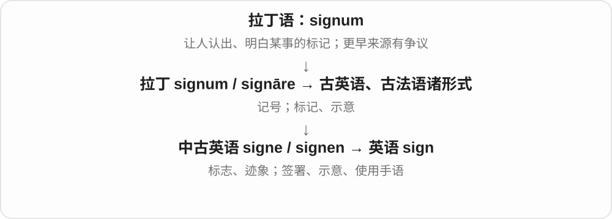

sign of 表示……的迹象；sign a form 是签表；sign with a club 是签约加入俱乐部。sign language 是有自身语法的手语，不只是随便打手势。

**常见搭配与例句**

a warning sign；a sign of change；sign a document；sign up for。

> The wet pavement was a sign of recent rain.

湿路面表明不久前下过雨。

> Please sign your name at the bottom of the form.

请在表格底部签名。

> She signed to her friend across the room.

她隔着房间用手语和朋友交流。

**别混淆**

signal 通常强调传递信息的信号；sign 范围更大，未必有人故意发出。sign 的 g 不发音。

### 10. signee — 签约者；被签下的人

**音标**：/saɪˈniː/

**先抓住这个画面**

在体育、艺人经纪报道中，常说刚被球队、公司签下的那个人。

**怎么拆**

sign + -ee，现代形成签约关系人物名。-ee 在此常偏被签约的一方，不把所有签字者都一律称 signee。

**怎么变成今天的意思**

**拉丁 signum 标记 → 法语 signe、signer → sign**  
标志、作记号；签名

↓

**现代 sign 派生**  
签字主体与共同签署

↓

**sign + -ee → signee**  
签约关系中的人物 → 被签下的人

a new signee 新签约者，a recent signee 最近签下的人；实际角色由合同、报道对象决定。

**常见搭配与例句**

a new signee；a recent signee；the club’s latest signee。

> The club introduced its latest signee.

俱乐部介绍了最新签下的球员。

> The label’s new signee released her first single.

唱片公司新签的歌手发布了第一支单曲。

**别混淆**

signer 中性签字者，signee 常见被球队等签下的人；signatory 正式签署方是另一常用称谓。

### 11. commit — 投入；承诺；犯下；提交保存

**音标**：/kəˈmɪt/

**先抓住这个画面**

commit 像把自己或某件事真正交出去：投入一个目标、承担一项安排，或者把某种行为付诸实行。

**怎么拆**

借自拉丁语 committere，含 com-（一起）+ mittere，历史义包括连接、交托、实施；不能用一个直译套住全部现代义。

**怎么变成今天的意思**

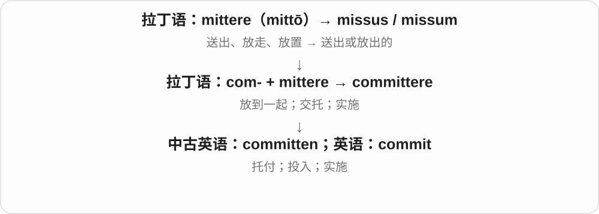

commit to a plan 是把自己与计划绑定；commit a crime 是实施罪行。计算机中的 commit 借用确定、提交这层意思，具体保存方式由系统决定。

**常见搭配与例句**

commit to doing…；commit resources；commit a crime；commit changes。

> We committed to finishing the work by June.

我们承诺在六月前完成工作。

> The company committed more resources to training.

公司向培训投入了更多资源。

> The report states that no crime was committed.

报告指出没有发生犯罪行为。

**别混淆**

promise 常是说出承诺；commit 更突出承担、投入。commit to 中的 to 常是介词，后接名词或 doing。

### 12. committee — 委员会；受托办事的小组

**音标**：通常 /kəˈmɪti/；“受托人”罕见义 /ˌkɒmɪˈtiː/

**先抓住这个画面**

committee 像大家把一件事交给几个人专门处理，这几个人就组成负责这件事的委员会。

**怎么拆**

通常分析为 commit（交托）+ -ee（受托的一方）；也有联系盎格鲁法语 commite 的分析，不能把一种说法说成唯一结论。

**怎么变成今天的意思**

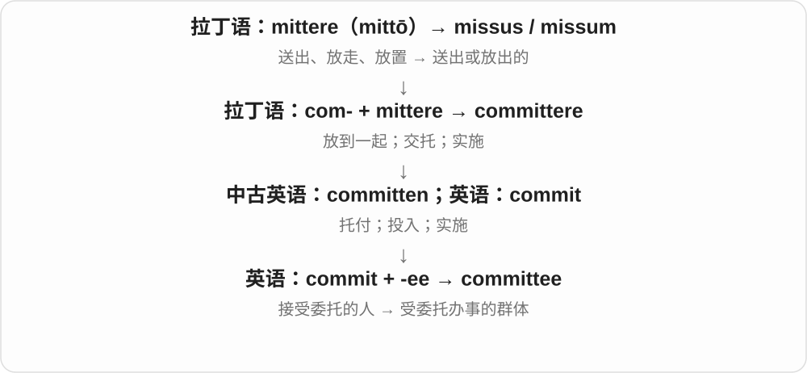

老画面是事情交给谁，现在常指共同承担调查、筹办或决策职责的一组人。普通委员会义重音在中间。

**常见搭配与例句**

serve on a committee；form a committee；a selection committee。

> She serves on the school’s planning committee.

她是学校规划委员会的一员。

> The committee will review the proposals next week.

委员会将在下周审查这些提案。

**别混淆**

committee 是受委派处理事项的群体；community 是共同体，拼写相近但词源和用途不同。

### 13. committing — 投入、承诺、实施〔现在分词、动名词〕

**音标**：/kəˈmɪtɪŋ/

**先抓住这个画面**

把时间、资源或自己放进一件事，让它不再只是随口想想，是 committing。commit 也能说实施某种行为，具体好坏由宾语决定。

**怎么拆**

commit 借拉丁 committere，com- 加 mittere，旧义有放在一起、交托、实施等分支。现代末音节重读，双写 t 再加完整 -ing → committing。

**怎么变成今天的意思**

**拉丁 committere → 英语 commit**  
放在一起、交托 → 投入、承诺、实施

↓

**commit 双写 t + -ing → committing**  
投入、承担承诺或实施的过程

committing time to… 为……投入时间；committing to a plan 承诺投入计划；committing an error 犯错。

**常见搭配与例句**

before committing 在作出承诺、投入之前；committing resources 投入资源。

> She is committing more time to music.

她正在把更多时间投入音乐。

> He checked the schedule before committing to the project.

他在答应参与项目前核对了日程。

**别混淆**

committing to something 强调承诺投入，committing something 常是投入某资源或实施某行为。不是见 commit 就只能译成犯罪。

### 14. train — 火车；一列；训练；培养

**音标**：/treɪn/

**先抓住这个画面**

名词 train 可以先想“一串被带着往前走的东西”：车厢成列。动词则是把人或能力持续带向某个目标。

**怎么拆**

经古法语 train“拖带的一列”和 traïner“拖、牵引”追溯到拉丁语 trahere；中间还涉及重建的通俗拉丁语形式。英语动词由名词发展而来。

**怎么变成今天的意思**

列车义来自一列连续相接的东西，早于现代铁路还有拖尾、随从等用法。训练义沿引导、使形成习惯发展；不能把火车速度快当作训练义的词源。

**常见搭配与例句**

catch a train；a train of thought；train someone to do…；train for a race；train a dog。

> I missed the train and had to wait for the next one.

我错过了火车，只好等下一班。

> She trains new staff to handle customer complaints.

她培训新员工处理顾客投诉。

**别混淆**

teach 常突出教授知识或方法；train 常突出反复练习、形成技能或习惯。两者经常一起发生。

### 15. trainer — 教练；培训师；英式运动鞋

**音标**：英 /ˈtreɪnə/；美 /ˈtreɪnər/

**先抓住这个画面**

教人练习、帮助提升能力的人；英国口语里复数 trainers 也常是运动鞋。

**怎么拆**

train + -er，执行训练的人或器物。鞋的用法来自训练鞋的用途，不是鞋子在给人上课。

**怎么变成今天的意思**

**拉丁 trahere 拉 → 法语 traîner、train → 英语 train**  
拉出、延伸；一串随行之物

↓

**现代 train**  
火车；引导、培养 → 训练与培训

↓

**train + -er → trainer**  
训练者 → 教练、培训师；训练鞋

a personal trainer 私人健身教练，a staff trainer 员工培训师；a pair of trainers 一双运动鞋。

**常见搭配与例句**

a personal trainer；a staff trainer；a pair of trainers。

> The trainer explained the new booking system.

培训师讲解了新预订系统。

> She wore trainers for the walk.

她穿运动鞋去散步。

**别混淆**

trainer 培训者，trainee 受训者；trainers 复数在英式可指鞋，不能所有句子都译成多个教练。

### 16. trainee — 受训者；见习人员

**音标**：/ˌtreɪˈniː/

**先抓住这个画面**

正在学岗位技能的人，身份仍处于培训、见习阶段。

**怎么拆**

train + -ee，后缀表示接受训练的一方。-ee 在这里与 trainer 的 -er 形成执行方、接受方的对照。

**怎么变成今天的意思**

**拉丁 trahere 拉 → 法语 traîner、train → 英语 train**  
拉出、延伸；一串随行之物

↓

**现代 train**  
火车；引导、培养 → 训练与培训

↓

**train + -ee → trainee**  
接受培训的人

a trainee teacher 见习教师，a management trainee 管理培训生；a trainee 不意味着永久初学者。

**常见搭配与例句**

a trainee teacher；a trainee nurse；a management trainee。

> Each trainee works with an experienced colleague.

每位受训者都与一位有经验的同事一起工作。

> She joined the company as a management trainee.

她以管理培训生身份加入公司。

**别混淆**

trainee 受训身份，intern 实习身份；制度安排可能重叠，但不是所有 trainee 都是学生实习。

### 17. address — 地址；演说；向……讲话；处理、着手解决

**音标**：名词：英 /əˈdres/，也读 /ˈædres/；美 /ˈædres/、/əˈdres/；动词：英、美 /əˈdres/

**先抓住这个画面**

把人、信件或注意力明确指向一个对象：信寄到某处，话对某人说，精力对准某个问题。

**怎么拆**

古法语 adrecier，追到通俗拉丁语 *addirectiare〔ad- + *directiare〕，再到 directus；英语先借动词，名词随后发展，不是现代 add + dress。

**怎么变成今天的意思**

**拉丁语：regere**  
引导、使直；治理

↓

**拉丁语：dirigere → directus**  
引向一定方向、摆直 → 直的

↓

**通俗拉丁语 \*addirectiare → 古法语 adrecier**  
朝某处引导、摆正

↓

**英语：address〔先动词〕**  
引向、对……说；着手处理

↓

**英语：address〔名词〕**  
演说；寄达的地址

address a problem 是认真面对并处理问题，不保证已解决；address an audience 是向听众讲话。email address 和 postal address 都是在告诉别人信息往哪里送。

**常见搭配与例句**

address an issue；address the audience；a postal address。

> Please write your address at the top of the form.

请把地址写在表格上方。

> The report addresses the causes of the delay.

报告着重处理了延误的原因。

> She addressed the audience without notes.

她没有看稿，直接向听众作了演讲。

**别混淆**

solve 表示把问题解决掉；address 可能只是进入处理过程。

### 18. addressee — 收件人；话语的接收对象

**音标**：英、美 /ˌædreˈsiː/

**先抓住这个画面**

地址栏或一句话所指向的那个人。

**怎么拆**

address + -ee，后缀标出接受行为的一方，重音落在末尾。

**怎么变成今天的意思**

**拉丁语：ad**  
朝向；靠近；加到

↓

**通俗拉丁语 \*directiāre → \*addirectiāre**  
使直；引向

↓

**古法语 adrecier → 英语 address**  
指向、对着说；处理；写地址

↓

**英语 address + -ee → addressee**  
收到信件或被话语指向的人

邮件里的 addressee 是指定收信人；语言学也用它表示说话对象，不限于纸质邮件。

**常见搭配与例句**

the intended addressee；name the addressee；addressor and addressee。

> The letter was returned because the addressee had moved.

信因收件人已经搬走而被退回。

> The speaker’s tone changes depending on the addressee.

说话者的语气会随交谈对象而变化。

**别混淆**

sender 发出信息；addressee 是信息被指定发给的人，未必实际收到。

### 19. award — 奖项；授予、颁发；裁定给予

**音标**：英 /əˈwɔːd/；美 /əˈwɔːrd/

**先抓住这个画面**

先有人审看、评判，再决定把奖、资格或款项给谁。重点在正式决定给予，不只是随手把东西递过去。

**怎么拆**

经盎格鲁法语 awarder 等进入英语，旧意是考虑后裁定。更早与表示看守、观察的 warder 有关；不是现代 a + ward“一个病房”。

**怎么变成今天的意思**

**盎格鲁法语 awarder、award 等 → 中古英语 awarden、award**  
观察、考虑后作判断；作出的决定

↓

**英语 award**  
裁定给予 → 颁发、授予；所授的奖项、款项等

win an award 获奖，award someone a prize 授某人奖，award a contract 授予合同。裁定赔偿也可用 award，不一定是表扬某人的奖。

**常见搭配与例句**

win an award；award a scholarship；award a contract；an award ceremony。

> Her first novel won a major literary award.

她的第一部小说获得了一项重要文学奖。

> The committee awarded her a scholarship.

委员会授予了她一项奖学金。

**别混淆**

reward 更泛指回报、酬谢，award 常有评选或正式决定。award 与 reward 拼写相近，但不能靠删加一个 r 解释历史。

### 20. awardee — 获奖者；获授者

**音标**：英 /əwɔːˈdiː/；美 /əwɔːrˈdiː/

**先抓住这个画面**

award 是把某物正式授出去，awardee 是接到它的那一方。-ee 在这里把镜头转向接受者。

**怎么拆**

award + -ee，表示被授予奖项、资助等的人或机构；重音常落在后缀。

**怎么变成今天的意思**

**盎格鲁法语 awarder、award 等 → 中古英语 awarden、award**  
观察、考虑后作判断；作出的决定

↓

**英语 award**  
裁定给予 → 颁发、授予；所授的奖项、款项等

↓

**award + -ee → awardee**  
接受所授奖项、资助等的一方

an awardee of a prize 某奖获奖者，grant awardees 获得资助者。较正式，日常也常说 winner 或 recipient。

**常见搭配与例句**

an awardee；the awardees；a grant awardee。

> Each awardee received a certificate at the ceremony.

每位获奖者都在典礼上拿到一张证书。

> The grant awardees met to discuss their projects.

获得资助的人聚在一起讨论各自项目。

**别混淆**

awardee 接受者，awarder 授予者；a winner 通常强调赢得比赛、奖，awardee 更强调被授予。

### 21. interview — 面试；采访；访谈

**音标**：英 /ˈɪntəvjuː/；美 /ˈɪntərvjuː/

**先抓住这个画面**

interview 是一方有准备地提问，另一方回答，让彼此或读者更了解这个人或这件事。

**怎么拆**

来自法语 entreveue“会面”，含“相互”与“看”。现代可以对应 inter- + view。

**怎么变成今天的意思**

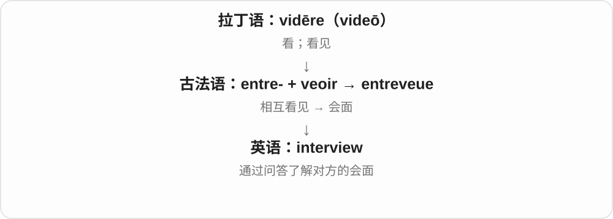

相见发展成有明确目的的问答会面，求职时是面试，新闻工作中是采访。它也可远程进行。

**常见搭配与例句**

a job interview；interview a witness；an interview with an author。

> I have a job interview on Friday.

我星期五有一场求职面试。

> The journalist interviewed three local residents.

记者采访了三位当地居民。

**别混淆**

conversation 是一般交谈；interview 通常有较明确的提问者、回答者和主题。

### 22. interviewer — 面试官；采访者

**音标**：英 /ˈɪntəvjuːə/；美 /ˈɪntərvjuːər/

**先抓住这个画面**

interviewer 是问问题的一方，把话题带向需要了解的内容。

**怎么拆**

interview + -er，表示主持问答的人。

**怎么变成今天的意思**

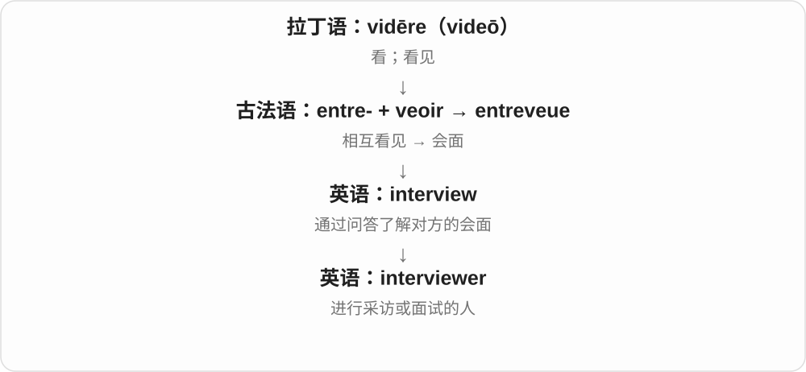

求职场景是面试官，节目场景是采访者；同一个词跟随活动变化。

**常见搭配与例句**

an experienced interviewer；the interviewer’s question；a panel of interviewers。

> The interviewer asked about my previous experience.

面试官问起我以前的经历。

> A good interviewer leaves room for detailed answers.

好的采访者会给对方充分回答的空间。

**别混淆**

interviewer 问，interviewee 接受采访或面试。两者的后缀标明角色方向。

### 23. interviewee — 受访者；参加面试的人

**音标**：英 /ˌɪntəvjuːˈiː/；美 /ˌɪntərvjuːˈiː/

**先抓住这个画面**

interviewee 是坐在回答问题那一边的人，可能是求职者，也可能是新闻受访者。

**怎么拆**

interview + -ee；-ee 常标出接受某种动作的人，重音落在末尾。

**怎么变成今天的意思**

后缀把相同会面中的角色区分开。不是凡参加面试的人都一定是将被录用的人。

**常见搭配与例句**

an interviewee’s response；select interviewees；an interviewee for a documentary。

> Each interviewee was asked the same opening question.

每位受访者都被问了同一个开场问题。

> The interviewee paused before describing her experience.

受访者停顿了一下，然后描述自己的经历。

**别混淆**

interviewee 回答，interviewer 提问；别仅因都有 interview 就混用。

### 24. transfer — 转移、转让；调动、转学、换乘；转移行为

**音标**：动词：英 /trænsˈfɜː/、美 /trænsˈfɜːr/；名词：英 /ˈtrænsfɜː/、美 /ˈtrænsfɜːr/

**先抓住这个画面**

东西从这个位置、账户、单位或人手里，到了另一个那里。

**怎么拆**

拉丁 trans-“越过、到另一边” + ferre → transferre，借入英语；名词由动词转用。常见读法中动词重读后面，名词重读前面。

**怎么变成今天的意思**

**拉丁语：ferre；第一人称 ferō**  
带、承载；承受；生出

↓

**拉丁语：trans- + ferre → transferre**  
带到另一边；转移

↓

**英语：transfer**  
转移、转让；调动、换乘

可以 transfer money、files、ownership，也可以 transfer to another school。交通中 transfer 是换乘；名词 a transfer 是调动、转移或转乘安排。

**常见搭配与例句**

transfer from A to B；transfer ownership；a bank transfer。

> Transfer the photos to a separate folder.

把照片转到一个单独的文件夹。

> She transferred to a school closer to home.

她转到了离家更近的一所学校。

> The payment arrived by bank transfer.

款项通过银行转账到账了。

**别混淆**

transport 强调搬运过程；transfer 更关注归属、位置或系统的改变。

### 25. transferee — 受让人；被调动、转学等的人

**音标**：英、美 /ˌtrænsfəˈriː/

**先抓住这个画面**

东西转过去后由他接收；或者这个人自己被调到了新地方。

**怎么拆**

transfer + -ee，英语人物名词。既可表示接收转让的人，也可表示被调动的人。

**怎么变成今天的意思**

**拉丁语：ferre；第一人称 ferō**  
带、承载；承受；生出

↓

**拉丁语：trans- + ferre → transferre**  
带到另一边；转移

↓

**英语：transfer**  
转移、转让；调动、换乘

↓

**英语：transfer + -ee → transferee**  
接受转让者；被转移、调动者

法律商业文本常指受让人；人员安排里可能是新调入者。不能只按一个固定中文义判断。

**常见搭配与例句**

the transferee of property；a new transferee；the transferee’s details。

> The document identifies the buyer as the transferee.

文件将买方列为受让人。

> A mentor helped each new transferee settle into the office.

导师帮助每位新调入的员工适应办公室工作。

**别混淆**

transferor 是转出的一方；transferee 在产权语境里是接收的一方。

### 26. grant — 给予、准予；承认〔某点〕；资助款

**音标**：英 /ɡrɑːnt/；美 /ɡrænt/

**先抓住这个画面**

一方正式说“给你这个机会、权利或这笔钱”，是 grant；讨论中也可先让一步说“我承认这一点”。

**怎么拆**

经中古英语接盎格鲁法语 granter、graunter 等准予、保证材料，更早与相信、信任的拉丁词族相连，部分形式来源有不同分析。不拆成 grand 盛大 + t。

**怎么变成今天的意思**

**盎格鲁法语 granter、graunter 等 → 中古英语 grant**  
准许、保证、给予

↓

**现代 grant**  
正式给予；资助款；承认某点

grant permission 准予许可；a research grant 研究资助；I grant that … 我承认……。take something for granted 是想当然、认为理所当然的固定搭配。

**常见搭配与例句**

grant permission；a research grant；take for granted。

> The council granted permission for the project.

委员会批准了这个项目。

> She received a grant to support her research.

她获得了一笔支持研究的资助。

**别混淆**

grant 资助款通常不同于 loan 贷款；grant a request 强调准予，request 本身是请求，角色别弄反。

### 27. granted — 准许、给予了；承认；grant 的过去式和过去分词

**音标**：英 /ˈɡrɑːntɪd/；美 /ˈɡræntɪd/

**先抓住这个画面**

把别人请求的许可、机会、资源正式给出去，是 granted；讨论中把某一点承认下来，也可以用 grant。

**怎么拆**

grant + -ed，/t/ 后增加 /ɪd/。grant 经盎格鲁法语 granter、graunter 等准予、保证词形进入英语，更早形式的来源分析不完全一致。

**怎么变成今天的意思**

**盎格鲁法语相关词形 → 中古英语 grant**  
准许、保证、给予

↓

**grant + -ed → granted**  
过去准予、给予；被承认的

granted permission 获准、准予许可；granted a request 答应请求；granted an extension 准许延期；take something for granted 视为理所当然。

**常见搭配与例句**

permission was granted；had been granted access。

> The school granted permission to use the hall.

学校准许使用礼堂。

> She realized that she had taken her friend’s help for granted.

她意识到自己一直把朋友的帮助当成了理所当然。

**别混淆**

granted 常有正式准许、给予的语气。take someone for granted 可以说把某人的付出当成当然；take something for granted 也可以说未经质疑便认定它是真的。

### 28. grants — 资助、补助金；授予的权利等〔复数〕；准予、授予〔第三人称单数〕

**音标**：英 /ɡrɑːnts/；美 /ɡrænts/

**先抓住这个画面**

有权决定的一方说“这份资源、这项许可给你”，是 grants 的动词。被给出的资助、权利，也能一份份叫 grants。

**怎么拆**

grant + -s，/t/ 后读 /s/。grant 经盎格鲁法语 granter、graunter 等准予、保证材料，较早联系相信、信任的拉丁词族，具体部分路线有不同分析。

**怎么变成今天的意思**

**盎格鲁法语准予、保证相关词 → grant**  
同意给、准予；也有给出的资助、权利名词

↓

**grant + -s → grants**  
多份资助、许可；某人、机构授予

research grants 研究资助；grants permission 准予许可；grants access 授予访问权限。

**常见搭配与例句**

grants for local projects 本地项目资助；apply for grants 申请资助。

> The museum received two grants for its education programme.

博物馆为教育项目获得了两笔资助。

> The pass grants access to the reading room.

这张通行证允许进入阅览室。

**别混淆**

grants 是给出的资源、权利或授予动作；loans 常指需要按安排偿还的借款。grant 具体条件看事项本身，先分清是资助还是借贷。

### 29. grantee — 受授予方；受资助者

**音标**：英 /ɡrɑːnˈtiː/；美 /ɡrænˈtiː/

**先抓住这个画面**

箭头从 grantor 指向 grantee：权利、财产或资助来到这一方手里。

**怎么拆**

与盎格鲁法语、古法语的 granté 等分词人物材料有关，英语可对应 grant + -ee。-ee 在这里指接受授予的一方。

**怎么变成今天的意思**

**grant 及法语相应授予材料**  
给予、准予

↓

**grant + -ee → grantee**  
得到授予、资助的一方

a research grantee 获研究资助者；the grantee of a right 某权利的受授予方。可以是个人，也可以是机构。

**常见搭配与例句**

grant recipients／grantees；the named grantee。

> Each grantee must submit a short progress report.

每位受资助者都须提交一份简短进度报告。

> The foundation invited its grantees to a workshop.

基金会邀请受资助者参加一个工作坊。

**别混淆**

grantor 与 grantee 的箭头相反；grantee 不是写 grant 申请书的人就自动获得的身份，要看是否已经获授。

### 30. grantor — 授予方；转让财产或权益的一方

**音标**：英 /ɡrɑːnˈtɔː/；美 /ˈɡræntər/、/ɡrænˈtɔːr/

**先抓住这个画面**

一份授予关系里，正式把权利或财产给出去的一方是 grantor，接到的一方是 grantee。先抓箭头方向。

**怎么拆**

借盎格鲁法语 grantour 等人物名；现代可对应 grant + -or。历史借词与今天的词形对应并存，不必强说先有英语 grant 再造。

**怎么变成今天的意思**

**盎格鲁法语 grantour**  
授予者、给出的一方

↓

**英语 grantor 与 grantee 对照**  
授予方／受授予方

the grantor of a right 权利授予方；grantor and grantee 常成对出现于正式文件。具体权利义务取决于文件和语境，此处记角色方向。

**常见搭配与例句**

grantor and grantee；the grantor。

> The document names both the grantor and the grantee.

文件写明了授予方和受授予方。

> The grantor signed the final page.

授予方在最后一页签了字。

**别混淆**

grantor 给出，grantee 接受；不能单凭后缀认定双方是谁的雇主或谁欠谁钱。

### 31. escape — 逃脱、逃离；避开；被忽略；逃脱机会、解脱

**音标**：/ɪˈskeɪp/

**先抓住这个画面**

像别人抓住披风，你从衣物里抽身，留下衣物自己走脱；现代也可说逃过处罚、漏过注意，或从忙碌现实里暂时松口气。

**怎么拆**

经法语 escaper、eschaper 接俗拉丁重建词 *excappāre，ex- 出 + cappa 披风。脱披风是词源画面，不必编成一次有姓名日期的真实追捕事件。

**怎么变成今天的意思**

**拉丁 ex- + cappa → 俗拉丁 \*excappāre → 法语 escaper、eschaper → escape**  
从披风里脱出 → 脱身、逃出

↓

**现代实际与抽象脱离**  
逃离拘束；避开后果；注意不到；暂时离开现实压力

↓

**人物、倾向和器件**  
escapee 逃脱者；escapism/escapist；escapement 每次放过一点的装置

escape from prison 越狱，escape punishment 逃过处罚，escape notice 没被注意，a narrow escape 险些出事后逃过一劫。

**常见搭配与例句**

escape from；escape punishment；escape notice；a narrow escape。

> The bird escaped through an open window.

鸟从一扇开着的窗户逃走了。

> The spelling error escaped my notice.

那个拼写错误没被我注意到。

**别混淆**

escape from 常接逃离的地方，escape punishment 直接接避开的后果；不把所有场景都塞进 from。

### 32. escapee — 逃脱者、逃犯；逸出栽培环境的植物〔专门语境〕

**音标**：英 /ɪˌskeɪˈpiː/；美 /ˌeskeɪˈpiː/，也有其他重音变体

**先抓住这个画面**

成功从拘束里逃出来的人；动物园、监禁等场景靠上下文判断，不能见 -ee 就断定是别人把他逃了。

**怎么拆**

escape 去 e + -ee，构成人物名；-ee 虽常表示接受方，本词是做出逃脱的人，并不是绝对的被动规则。

**怎么变成今天的意思**

**拉丁 ex- + cappa → 俗拉丁 \*excappāre → 法语 escaper、eschaper → escape**  
从披风里脱出 → 脱身、逃出

↓

**escape + -ee → escapee**  
逃出来的人；专门场景也用于逸生植物

an escaped prisoner and an escapee 逃脱囚犯的两种表达，search for an escapee 搜寻逃脱者，an escapee from captivity 从圈禁中逃出的个体。

**常见搭配与例句**

search for an escapee；an escapee from captivity；a prison escapee。

> The guards searched for the escapee.

看守搜寻逃脱者。

> The story follows an escapee trying to reach home.

故事跟随一名试图回家的逃脱者。

**别混淆**

escapee 已逃脱的人，escapist 常是想借幻想离开现实的人或作品性质；不等于都在实际越狱。

### 33. attend — 出席；照顾；留意；处理

**音标**：/əˈtend/

**先抓住这个画面**

attend 的共同画面是把人和注意力放到某件事上：到场参加，或专心照应。

**怎么拆**

ad-（朝向）+ tendere，经 attendere 和法语 atendre 传入。

**怎么变成今天的意思**

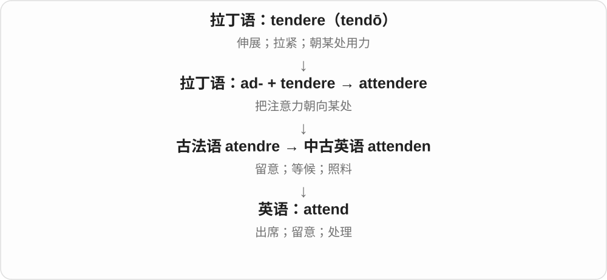

attend a meeting 直接接会议；attend to a problem 用 to 表示处理问题。这两个搭配不要混。

**常见搭配与例句**

attend school；attend a meeting；attend to a request。

> More than fifty people attended the meeting.

五十多人出席了会议。

> I need to attend to a few urgent emails.

我需要处理几封紧急邮件。

**别混淆**

attend 是到场；join 可是加入组织或一起做，join a club 不等于只参加一次活动。

### 34. attendee — 出席者；参会者

**音标**：/əˌtenˈdiː/

**先抓住这个画面**

attendee 就是来到活动现场或线上会场的人；它记录“谁来参加了”。

**怎么拆**

attend + -ee。虽然 -ee 常指动作承受者，这里已经固定表示参加者。

**怎么变成今天的意思**

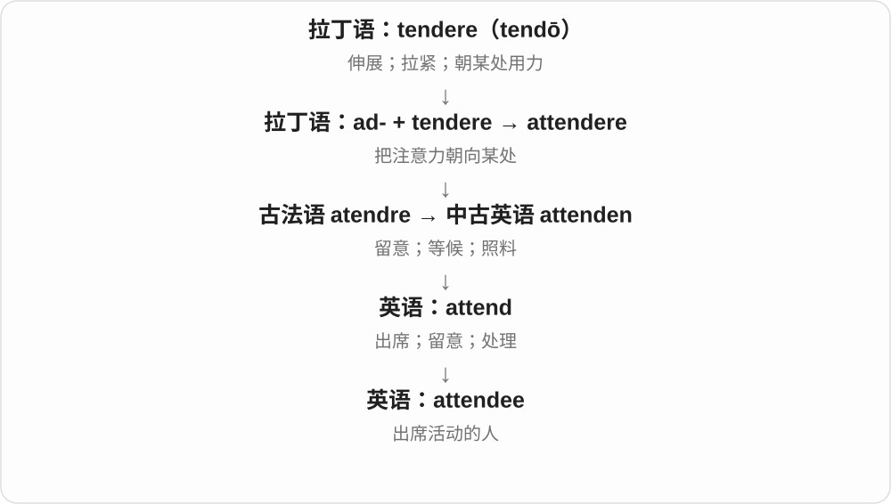

会议、培训、展览常用；attendees 不一定都是演讲者或正式会员。

**常见搭配与例句**

conference attendees；registered attendees；an attendee list。

> Every attendee received a name badge.

每位参会者都领到了一枚姓名牌。

> Online attendees can submit questions in the chat.

线上参会者可以在聊天区提交问题。

**别混淆**

attendee 是来参加的人；attendant 常是负责服务照料的人，也可作形容词。

### 35. license — 许可证、许可；正式准许、授权使用

**音标**：/ˈlaɪsəns/

**先抓住这个画面**

有件事不是想做就能做，许可方给出一张通行条，写明谁能在什么条件下做；可以是驾驶，也可以是使用软件。

**怎么拆**

名词经法语 licence 接拉丁 licentia 许可；动词也有法语等相应形式来路。美式名词、动词常都写 license，英式名词常写 licence。

**怎么变成今天的意思**

**拉丁 licēre → licentia**  
被允许 → 许可、自由

↓

**法语 licence/licencier → 英语 license 名词、动词**  
许可、许可证；授予使用或经营许可

a driver’s license 驾照，a software license 软件许可，license a product 授权使用产品，licensed to operate 获准经营。

**常见搭配与例句**

a driver’s license；a software license；license something to someone。

> She showed her driver’s license at the desk.

她在柜台出示了驾照。

> The company licenses its software to schools.

公司向学校授权使用其软件。

**别混淆**

license 是许可或授予许可，ownership 是所有权；被许可使用不自动等于拥有。英式 licence 名词、license 动词要分拼写习惯。

### 36. licensee — 获许可方、被授权人

**音标**：/ˌlaɪsənˈsiː/

**先抓住这个画面**

许可从别人手里递过来，你接到了；接到许可的那一方就是 licensee。

**怎么拆**

license + -ee，-ee 在这组角色关系里标出接受许可的人或机构；不是许可文件本身。

**怎么变成今天的意思**

**拉丁 licēre → licentia**  
被允许 → 许可、自由

↓

**法语 licence/licencier → 英语 license 名词、动词**  
许可、许可证；授予使用或经营许可

↓

**license + -ee → licensee**  
许可的接收方

the licensee’s rights 获许可方的权利，a software licensee 软件被许可方；经营语境也可指持照经营者。

**常见搭配与例句**

the licensee’s rights；a software licensee；the licensee and licensor。

> The licensee may install the software on two computers.

被许可方可以把软件安装在两台电脑上。

> The agreement identifies the company as the licensee.

协议把该公司列为被许可方。

**别混淆**

licensee 收到许可，licensor 授出许可。记箭头：licensor → license → licensee；双方都可以是公司。

### 37. employ — 雇用；运用

**音标**：英、美 /ɪmˈplɔɪ/

**先抓住这个画面**

把人或方法投入一项工作：人得到一份工作，方法则被拿来解决问题。

**怎么拆**

经古法语 emploiier / employer 来自拉丁语 implicare“卷入、牵连”。它与 imply 同源，但经过不同法语形式和语义发展。

**怎么变成今天的意思**

**拉丁语 plicare**  
折叠、使相接；与编织、弯曲一组词有更早联系

↓

**拉丁语 in- + plicare → implicare**  
卷进去、牵连在内

↓

**古法语 emploiier / employer → 英语 employ**  
使投入某种用途；运用、雇用

employ a designer 是雇设计师；employ a technique 是采用技术。并不是所有 employ 都有发薪水的意思。

**常见搭配与例句**

employ someone as；employ a method；be employed by。

> The studio employs three full-time designers.

这家工作室雇有三名全职设计师。

> The team employed a simpler method to check the results.

团队采用了更简单的方法来核对结果。

**别混淆**

hire 常说聘用这个动作；employ 也可说持续雇用关系，或正式地表示使用方法。

### 38. employee — 雇员；员工

**音标**：英、美 /ɪmˈplɔɪiː/，也读 /ˌemplɔɪˈiː/

**先抓住这个画面**

在雇用关系里接受工作安排、为雇主工作的一方。

**怎么拆**

借自法语 employé“受雇的人”，为 employer 的过去分词名词化；现代也可借 -ee 记作动作接受者。

**怎么变成今天的意思**

**拉丁语 plicare**  
折叠、使相接；与编织、弯曲一组词有更早联系

↓

**拉丁语 in- + plicare → implicare**  
卷进去、牵连在内

↓

**法语 employer → employé → 英语 employee**  
雇用 → 受雇的人

an employee of a company 是某公司的员工。具体法律认定因制度而异，日常不要把所有提供服务的人都自动当成员工。

**常见搭配与例句**

a company employee；employee benefits；an employee of。

> Each employee received a copy of the new handbook.

每名员工都收到了一本新手册。

> The survey asked employees about their working hours.

调查询问了员工的工作时长。

**别混淆**

employer 是雇人的一方；employee 是受雇的一方，两个词尾对应两个角色。

### 39. employer — 雇主；用人单位

**音标**：英 /ɪmˈplɔɪə/；美 /ɪmˈplɔɪər/

**先抓住这个画面**

为工作雇用别人的一方，可以是个人，也可以是一家公司或机构。

**怎么拆**

employ + -er，英语中常用 -er 表示做出动作的一方。

**怎么变成今天的意思**

**拉丁语 plicare**  
折叠、使相接；与编织、弯曲一组词有更早联系

↓

**拉丁语 in- + plicare → implicare**  
卷进去、牵连在内

↓

**古法语 emploiier / employer → 英语 employ**  
使投入某种用途；运用、雇用

↓

**英语 employ + -er → employer**  
雇用别人的一方

your employer 可能指签订雇用关系的公司，不必特指天天给你安排工作的直属上司。

**常见搭配与例句**

a prospective employer；a major employer；employer contributions。

> The hospital is the largest employer in the town.

这家医院是镇上最大的用人单位。

> She asked her employer about flexible working hours.

她向雇主询问了弹性工作时间的安排。

**别混淆**

boss 是老板或上司；employer 更强调雇用关系中的法律、组织角色。

### 40. refer — 提及；指的是；查阅；转介、交付处理

**音标**：英 /rɪˈfɜː/；美 /rɪˈfɜːr/

**先抓住这个画面**

把注意力、问题或人带到另一个明确的去处：那段话、那份资料、那位专家。

**怎么拆**

拉丁 re-“回” + ferre → referre，经法语以及直接拉丁借入路线进入英语。

**怎么变成今天的意思**

**拉丁语：ferre；第一人称 ferō**  
带、承载；承受；生出

↓

**拉丁语：re- + ferre → referre**  
带回；报告；提交处理

↓

**古法语 referer；也有直接拉丁借入**  
报告；归于、交付

↓

**中古英语 referren → 英语 refer**  
提到、指称；查阅；转交

refer to a report 可以是提到报告，也可以是查阅报告；refer to someone as… 是称某人为……。refer someone to a specialist 则是让问题交给合适的人。

**常见搭配与例句**

refer to；refer someone to；refer a matter to…。

> The instructions refer to the diagram on page six.

说明指的是第六页上的图。

> The receptionist referred my question to the manager.

接待员把我的问题转给了经理。

> Please refer to the manual before changing these settings.

更改这些设置前，请查阅手册。

**别混淆**

mention 常只是说到；refer to 还能表示指代和查阅，不能在所有句子里换成 mention。

### 41. referee — 裁判；评审人；推荐人；担任裁判或评审

**音标**：英、美 /ˌrefəˈriː/

**先抓住这个画面**

大家把一个需要判断的问题交到这个人手上，请他作出相对独立的判断。

**怎么拆**

通常按 refer + -ee 理解：“事情被提交给的人”；有词典联系法语 referer 的分词。体育义是后来发展，动词由名词转用。

**怎么变成今天的意思**

**拉丁语：ferre；第一人称 ferō**  
带、承载；承受；生出

↓

**拉丁语：re- + ferre → referre**  
带回；报告；提交处理

↓

**古法语 referer；也有直接拉丁借入**  
报告；归于、交付

↓

**中古英语 referren → 英语 refer**  
提到、指称；查阅；转交

↓

**英语：refer + -ee → referee**  
事情交给其判断的人

↓

**英语：referee 的体育义及动词用法**  
裁判；执行裁判或评审工作

不只在球场：论文送 referee 审阅；英式求职表上的 referees 是可提供推荐证明的人。这里的 -ee 不是“被裁判的人”。

**常见搭配与例句**

a match referee；an external referee；act as a referee。

> The referee stopped the game after the collision.

碰撞发生后，裁判暂停了比赛。

> Please provide the contact details of two referees.

请提供两位推荐人的联系方式。

> An independent expert refereed the paper.

一位独立专家评审了这篇论文。

**别混淆**

referral 是转交的行为；referee 是接到事项并作判断或提供证明的人。

### 42. mortgage — 抵押贷款；抵押；以房产抵押借款

**音标**：英 /ˈmɔːɡɪdʒ/；美 /ˈmɔrɡɪdʒ/

**先抓住这个画面**

用房产作担保借钱，再按约定偿还；日常谈房子时常简称“房贷”。

**怎么拆**

古法语 mort 死的 + gage 抵押、担保，合为 morgage、mortgaige 后借入英语；t 不发音。

**怎么变成今天的意思**

**古法语 mort 死的 + gage 抵押**  
古代法律说法“死的抵押”

↓

**古法语 morgage／mortgaige → 英语 mortgage**  
抵押安排；抵押贷款

↓

**英语名词 mortgage → 动词 mortgage**  
以房产等作抵押借款

现代先记住房产担保这件事：pay off the mortgage 是还清房贷。历史名称的一种传统解释是，条件结果会使原抵押关系终结，或使出押人丧失土地权利；它不是说借款人要还钱还到死，也不是说人死债务就消失。这个词的现义不能靠“死”直接猜出来。

**常见搭配与例句**

take out a mortgage；pay off a mortgage；monthly mortgage payments；mortgage a house。

> They hope to pay off their mortgage before retirement.

他们希望退休前还清房贷。

> He mortgaged his house to raise money for the business.

他抵押了房子，为生意筹措资金。

**别混淆**

loan 是贷款的广义词；mortgage 在常见住房语境中强调房产抵押。rent 是租金，付租金不是偿还 mortgage。

### 43. mortgagee — 抵押权人；抵押贷款中的贷款方

**音标**：英 /ˌmɔːɡɪˈdʒiː/；美 /ˌmɔːrɡɪˈdʒiː/

**先抓住这个画面**

钱从贷款方出去，抵押担保向贷款方提供。-ee 在这里看的是谁接受抵押担保，所以 mortgagee 是贷款方，不是领到贷款的借款人。

**怎么拆**

mortgage 去 e + -ee。-ee 的受领对象是 mortgage 所指的抵押安排、担保权益，不能只记所有 -ee 都是收钱的人。

**怎么变成今天的意思**

**古法语 mort + gage → mortgage**  
死的 + 抵押担保，历史法律词组

↓

**英语 mortgage 名词与动词**  
抵押、抵押贷款；以财产作抵押

↓

**相应派生**  
mortgagee 接受抵押担保的贷款方；mortgaging 抵押这一过程

the named mortgagee 文件中列明的抵押权人，the mortgagee and mortgagor 贷款方与抵押提供方。常见抵押贷款里 mortgagor 是以财产提供担保的借款人。

**常见搭配与例句**

the named mortgagee；the mortgagee and mortgagor。

> The agreement names the bank as the mortgagee.

协议把银行列为抵押权人。

> The glossary distinguishes the mortgagee from the borrower who provides the security.

词汇表区分了接受抵押担保的贷款方与提供担保的借款人。

**别混淆**

mortgagee 贷款方，mortgagor 抵押提供方，两者很容易看反。读词尾时看基础动作：谁把财产权益提供作担保，谁接受担保。

### 44. honour — 荣誉；尊敬；履行〔英式常用拼写〕

**音标**：英 /ˈɒnə/；美 /ˈɑnər/

**先抓住这个画面**

别人郑重地表达敬意，或自己郑重地守住承诺。

**怎么拆**

与 honor 同源同义，保留 -our 的常见英式拼写；u 不构成独立词缀。

**怎么变成今天的意思**

**拉丁 honos／honor**  
尊敬；荣誉；声望

↓

**古法语 onor／honor；honorer**  
荣誉；尊重

↓

**英语 honor／honour**  
尊敬、荣誉；尊重并履行

a guest of honour 是贵宾；in honour of someone 是为向某人致敬。动词 honour a promise 也表示兑现承诺，不能只记成“荣耀”而看不懂日常行为。

**常见搭配与例句**

a guest of honour；in honour of；honour a promise。

> The library held an event in honour of its first director.

图书馆举办活动，向首任馆长致敬。

> She made every effort to honour her promise.

她尽一切努力兑现自己的承诺。

**别混淆**

honour 与 honor 是拼写差别。相关英式 honoured、honourable 对应美式 honored、honorable。

### 45. divorce — 离婚；使脱离、割裂〔比喻〕

**音标**：英 /dɪˈvɔːs/；美 /dɪˈvɔːrs/

**先抓住这个画面**

两个人原在一段婚姻里，后来这段婚姻结束，是 divorce；比喻时，也可说把本该联系的两件事割开。

**怎么拆**

经古法语 divorce 接拉丁 divortium，连到 divertere 转到不同方向，含分开 + 转的材料。现代不是把今天的 force 力量前加 di-。

**怎么变成今天的意思**

**拉丁 divortium、divertere 等**  
分开、转向不同方向的材料

↓

**法语 divorce → 英语 divorce**  
婚姻结束；也比喻割裂联系

get a divorce 离婚；divorce someone 与某人离婚；divorce A from B 把两者割裂开。状态通常说 be divorced，不写 be divorce。

**常见搭配与例句**

get a divorce；file for divorce；divorce theory from practice。

> They decided to get a divorce.

他们决定离婚。

> We cannot divorce the theory from practical experience.

我们不能把理论与实际经验割裂开。

**别混淆**

divorce 是名词或动词，divorced 可表已离婚；separated 分居不一定意味着婚姻已经正式结束。

### 46. divorced — 已离婚的；相脱离、割裂的

**音标**：英 /dɪˈvɔːst/；美 /dɪˈvɔːrst/

**先抓住这个画面**

divorce 是结束婚姻这个动作或事情，divorced 可以说一个人现在已离婚的状态；也能说想法脱离现实。

**怎么拆**

divorce + -ed，去末尾 e 接 -d；既是过去式、过去分词，也有形容词用法。末尾读 /st/，不是 /sɪd/。

**怎么变成今天的意思**

**divorce**  
离婚；割裂联系

↓

**divorce + -ed → divorced**  
动作完成形式；已离婚、相脱离的状态

be divorced 已离婚；get divorced 离婚；divorced from reality 脱离现实。be divorced 本身不表示离婚是昨天还是十年前发生。

**常见搭配与例句**

get divorced；divorced from reality。

> She has been divorced for five years.

她已经离婚五年了。

> The proposal seemed divorced from reality.

这个提案似乎脱离了现实。

**别混淆**

I am divorced 是已离婚的状态；I divorced my spouse 是过去发生的动作；divorcee 才是相应人物名词之一。

### 47. divorcee — 离婚者〔尤常指女性〕

**音标**：英 /dɪˌvɔːˈsiː/；美 /dɪˌvɔːrˈseɪ/〔亦有变体〕

**先抓住这个画面**

指婚姻已结束的人，常见用法尤其是离婚女性；介绍人物时可以用，但并不需要处处按婚姻状态称呼别人。

**怎么拆**

借法语 divorcé、divorcée 的相应人物形式，来自 divorcer 离婚的过去分词；可与 divorce 对照。这里法语性别形式的 -é、-ée 历史，不宜直接混同所有 employee 式 -ee 构词。

**怎么变成今天的意思**

**法语 divorcer → divorcé、divorcée**  
离婚动词及相应人物形式

↓

**英语 divorcee**  
已离婚者，尤常用于女性

a young divorcee 一位年轻离婚者；可见带重音的法语式拼写 divorcée。较中性地说明某人状态，也可以直接说 a divorced person。

**常见搭配与例句**

a divorcee；a recently divorced person。

> The novel’s main character is a divorcee raising a son.

小说主角是一位独自抚养儿子的离婚女性。

> The film follows a divorcee starting a new life.

影片讲述一位离婚者开始新生活的故事。

**别混淆**

divorced 是形容状态，divorcee 是人物名词；She is divorced 不需要冠词，She is a divorcee 要有 a。

### 48. invite — 邀请；征求；招致；邀请〔非正式名词〕

**音标**：动词 /ɪnˈvaɪt/；名词 /ˈɪnvaɪt/

**先抓住这个画面**

向人打开一个参与的入口；也可能是自己的做法把某种反应招来了。

**怎么拆**

接拉丁 invitare，经法语 inviter 借入或从较早的 invitation 反构。传统分析把 in- 联系“朝向”，但其余部分不清楚，不能拆成 in + vita“生命”。

**怎么变成今天的意思**

**拉丁语 invitare**  
邀请、招待；更早构成仍有疑问

↓

**法语 inviter 借入，或由英语 invitation 反构 → invite**  
邀请；两条近源解释均有词典支持

invite someone to dinner 是请人吃饭；invite comments 是征求意见；invite trouble 是招惹麻烦。非正式名词 an invite 重音在前，动词重音在后。

**常见搭配与例句**

invite somebody to do something；invite feedback；invite trouble；send an invite。

> We invited our neighbours to join us for dinner.

我们邀请邻居和我们一起吃晚饭。

> The team invited comments on the draft.

团队征求了大家对草稿的意见。

> I have not received an invite yet.

我还没有收到邀请。

**别混淆**

request 是提出请求；invite 常给人参与机会，不保证对方接受。词源也不能硬说成让人“进入生命”。

### 49. invitee — 受邀者

**音标**：/ˌɪnvaɪˈtiː/

**先抓住这个画面**

邀请发出后，站在收件人这一边的人。

**怎么拆**

invite + -ee；-ee 在这里标出接受邀请的人。

**怎么变成今天的意思**

**拉丁语 invitare**  
邀请、招待；更早构成仍有疑问

↓

**法语 inviter 借入，或由英语 invitation 反构 → invite**  
邀请；两条近源解释均有词典支持

↓

**英语 invite + -ee → invitee**  
邀请 → 受邀的人

the list of invitees 是受邀名单。这个词不保证人已经答应出席，也不同于活动当天实际到场的人数。

**常见搭配与例句**

a list of invitees；all invitees；send details to invitees。

> Each invitee received a link to the programme.

每位受邀者都收到了一份活动安排链接。

> Several invitees were unable to attend.

几位受邀者无法出席。

**别混淆**

inviter 是发出邀请者；invitee 是收到邀请者。attendee 才着重说参加活动的人。

### 50. franchise — 特许经营权、加盟企业；选举权；职业球队；系列作品；授予特许经营权

**音标**：/ˈfræntʃaɪz/

**先抓住这个画面**

起点是自由、获准享有某种权利。商业里变成获准用某个品牌经营，体育里可指联盟中的球队，影视里又扩到持续开发的系列作品。

**怎么拆**

经中古英语 franchise、fraunchise，借古法语 franchise，来自 franc 自由。动词另接法语 franchir 使自由等相关形式；现代多用于授权经营。

**怎么变成今天的意思**

**古法语 franc 自由 → franchise 自由、豁免**  
获准免于某种限制，或享有特定权利

↓

**英语 franchise 的权利、许可支线**  
选举权；特许经营权、相应企业；体育联盟中的队伍

↓

**名称与作品的扩展**  
共享角色、世界观等的系列作品

a fast food franchise 快餐加盟店，the franchise 选举权〔特定语境〕，a film franchise 系列电影，franchise a business 把经营模式授权给加盟方。

**常见搭配与例句**

a fast food franchise；a film franchise；grant a franchise。

> She runs a small coffee franchise.

她经营一家小型咖啡加盟店。

> The studio plans another film in the franchise.

制片公司打算再拍一部这个系列的电影。

**别混淆**

franchise 不一定指门店，也可指经营权、球队、系列作品。电影 franchise 可能跨电影、剧集、小说，不要求每部都直接续前一部。

### 51. franchisee — 加盟方、受许经营者

**音标**：/ˌfræntʃaɪˈziː/

**先抓住这个画面**

品牌允许别人使用它的名称、模式经营；接受这项许可的一方，就是 franchisee。

**怎么拆**

franchise + -ee，表示接受授权的一方。末尾重读 /ziː/；不是英语 see 看的独立成分。

**怎么变成今天的意思**

**古法语 franc 自由 → franchise 自由、豁免**  
获准免于某种限制，或享有特定权利

↓

**英语 franchise 的权利、许可支线**  
选举权；特许经营权、相应企业；体育联盟中的队伍

↓

**franchise + -ee → franchisee**  
得到特许经营许可的一方

a local franchisee 当地加盟商，the franchisee’s store 加盟方的门店。一个加盟方也可能经营多家门店。

**常见搭配与例句**

a local franchisee；a franchisee’s store。

> The franchisee opened a second store in the town.

加盟商在镇里开了第二家店。

> Each franchisee received a training manual.

每家加盟商都收到一份培训手册。

**别混淆**

franchisee 接受许可，franchisor 授出许可。二者角色相对，不是同一个门店里的员工与店长之分。

### 52. adopt — 收养；采纳；采用；采取

**音标**：英 /əˈdɒpt/；美 /əˈdɑːpt/

**先抓住这个画面**

把原先不属于自己的某人、方法或立场，正式接纳进自己的生活或做法里。

**怎么拆**

拉丁 ad-“向自己” + optare“选择”。英语近源有从 adoption 逆构、借法语 adopter 或直接借拉丁 adoptare 等解释。

**怎么变成今天的意思**

**拉丁语 optare**  
选择、希望；更早来源有争议

↓

**拉丁语 ad- + optare → adoptare**  
为自己选择 → 接纳、收养

↓

**英语 adopt 的近源有不同解释**  
从 adoption 逆构，或借古法语 adopter / 拉丁 adoptare

↓

**英语 adopt**  
收养；正式采纳、采用

adopt a child 是建立收养关系；adopt a method 是开始采用一种方法；adopt a calm tone 是采取平静语气。共同点是接纳、选择并用起来。

**常见搭配与例句**

adopt a child；adopt a policy；adopt an approach；adopt a tone。

> They adopted a child several years ago.

他们几年前收养了一个孩子。

> The team adopted a simpler method for checking the results.

团队采用了更简单的方法来核对结果。

**别混淆**

adapt 是调整以适应；adopt 是接纳、采用。先 adopt a method，再 adapt it to your needs。

### 53. adoptee — 被收养者

**音标**：英 /əˌdɒpˈtiː/；美 /əˌdɑːpˈtiː/

**先抓住这个画面**

从关系的另一侧说：这个人是进入收养家庭的一方。

**怎么拆**

按 Merriam-Webster 等采用 adopt + -ee 的英语派生分析；-ee 常标记动作承受者，不能无条件当作法语 adoptée 整词借入。

**怎么变成今天的意思**

**拉丁语 optare**  
选择、希望；更早来源有争议

↓

**拉丁语 ad- + optare → adoptare**  
为自己选择 → 接纳、收养

↓

**英语 adopt 的近源有不同解释**  
从 adoption 逆构，或借古法语 adopter / 拉丁 adoptare

↓

**英语 adopt**  
收养；正式采纳、采用

↓

**英语 adopt + -ee → adoptee**  
收养 → 被收养的人

adoptee 可以是儿童，也可以是已经成年的被收养者。这个身份词只说明收养经历，并不限制年龄，也不替一个人概括全部家庭关系。

**常见搭配与例句**

an adult adoptee；an adoptee support group；adoptees’ experiences。

> The interview focuses on the experiences of adult adoptees.

访谈聚焦成年被收养者的经历。

> She joined a support group for adoptees.

她加入了一个被收养者互助小组。

**别混淆**

adopter 是收养方；adoptee 是被收养方，重音也往词尾走。

### 54. retire — 退休、退役；退出；停止使用；退下休息〔较正式〕

**音标**：英 /rɪˈtaɪə/；美 /rɪˈtaɪr/

**先抓住这个画面**

从当前岗位、比赛或使用状态退出来。人退休、运动员退役、老设备不再用，都借退出这一核心，不是再累一次。

**怎么拆**

借法语 retirer，re- 向后 + tirer 拉。和 tire 疲倦的本源动词分开；另有罕见给车重新装胎的 re-tire 同形用法，要分来源。

**怎么变成今天的意思**

**法语 re- 回去 + tirer 拉 → retirer**  
抽回、退出；后半的更深来源不确定

↓

**英语 retire**  
退到一旁、退出任职或比赛；让设备退役

↓

**相应词族**  
retired 状态，retiring 性格或进行形式，retirement 退休，retiree 退休者

retire from teaching 从教师岗位退休，retire from a match 退出比赛，retire old equipment 让旧设备退役，retire to bed 退下就寝〔较正式〕。

**常见搭配与例句**

retire from；retire old equipment；retire to bed。

> She retired from teaching last year.

她去年从教师岗位退休。

> The company plans to retire its oldest servers.

公司计划让最旧的一批服务器退役。

**别混淆**

retire 不表示所有人都因累而退出，也不在词义里锁死统一年龄。retire from 与 be fired 被解雇也不是同一个过程。

### 55. retiree — 退休者、退休人员

**音标**：/rɪˌtaɪəˈriː/，也有重音较靠前的读法

**先抓住这个画面**

retirement 是那种生活、状态，retiree 是已经从职业岗位退休的那个人。词尾在这里标经历这一变化的人，不要求他被某人动手退休。

**怎么拆**

retire 去 e + -ee，形成处于相应经历、状态的人称名词。-ee 不永远只能表示一个被动动作的受害者。

**怎么变成今天的意思**

**法语 re- 回去 + tirer 拉 → retirer**  
抽回、退出；后半的更深来源不确定

↓

**英语 retire**  
退到一旁、退出任职或比赛；让设备退役

↓

**retire + -ee → retiree**  
已经退休的人

a recent retiree 刚退休的人，a group of retirees 一群退休者，activities for retirees 面向退休人员的活动。

**常见搭配与例句**

a recent retiree；a group of retirees；activities for retirees。

> Several retirees volunteer at the local museum.

几位退休者在当地博物馆做志愿工作。

> The class welcomes students, workers and retirees.

这个班欢迎学生、在职者和退休人员。

**别混淆**

retiree 指人，retired 形容词修饰人；不是 The retired is 这种单个称呼的常规替换。退休者也不必只按统一年龄来定义。

### 56. absent — 缺席的；不存在的；心不在焉的；使自己缺席

**音标**：形容词 /ˈæbsənt/；动词 /æbˈsent/

**先抓住这个画面**

人没在应在的位置，叫 absent；视线虽然在眼前，心思却飘走了，也可以借这个画面来说。

**怎么拆**

形容词接拉丁 absens、absent-，是 abesse“在别处、不在场”的分词，经法语或直接借入。动词另经晚期拉丁 absentare、法语 absenter，现代常用 absent oneself。

**怎么变成今天的意思**

**拉丁 ab，构词中也有 abs-、a- 等形式**  
离开、从……分离、去掉

↓

**拉丁 ab- + esse → abesse；分词 absens／absent-**  
存在于别处 → 不在场

↓

**形容词路线：古法语 absent／ausent → 英语 absent**  
不在场、缺席；缺乏注意

↓

**并行的动词路线：晚期拉丁 absentare → 古法语 absenter → 英语 absent**  
使自己不在场、退出

be absent from class 是缺课；an absent smile 是心不在焉的一笑。absent yourself from a meeting 表示让自己不出席；作动词时重音后移。

**常见搭配与例句**

be absent from；conspicuously absent；an absent look；absent oneself from。

> Two students were absent from class this morning.

今天上午有两名学生缺课。

> She gave an absent smile while reading the message.

她看着消息，心不在焉地笑了一下。

> He absented himself from the discussion because it concerned his own application.

由于讨论涉及他本人的申请，他没有参加这场讨论。

**别混淆**

missing 强调该有却找不到；absent 强调在某处或某场合没有出现。absence 是名词，不能说 he is absence。

### 57. absentee — 缺席者；不在场的人

**音标**：/ˌæbsənˈtiː/

**先抓住这个画面**

把“缺席”从一种状态变成一个人：应该出席却没来的人，或者人在别处的所有者、选民等。

**怎么拆**

英语 absent + -ee；历史构词可接动词 absent“使自己离开”。-ee 在这里标记这个处于缺席状态的人，不是动词结束或过去式。

**怎么变成今天的意思**

**拉丁 ab，构词中也有 abs-、a- 等形式**  
离开、从……分离、去掉

↓

**拉丁 ab- + esse → abesse；分词 absens／absent-**  
存在于别处 → 不在场

↓

**晚期拉丁 absentare → 古法语 absenter → 英语 absent〔动词〕**  
使离开、让自己不在场

↓

**英语 absent + -ee → absentee**  
缺席者；人不在应在的位置

the list of absentees 是缺席名单；an absentee landlord 是不在当地居住的房东或地主。absentee ballot 是无法亲临相应投票地点时使用的选票，具体规则依制度而定。

**常见搭配与例句**

a list of absentees；an absentee landlord；an absentee voter；an absentee ballot。

> The teacher checked the names of the absentees.

老师核对了缺席学生的姓名。

> The novel describes a village owned by an absentee landlord.

小说描写了一座由不在当地居住的地主拥有的村庄。

**别混淆**

absence 是缺席这件事；absentee 是缺席的人。an absentee 不自动说明此人擅自逃避职责。

### 58. nominate — 提名；指定、选定

**音标**：英 /ˈnɒmɪneɪt/；美 /ˈnɑːmɪneɪt/

**先抓住这个画面**

把某人的名字正式放到候选名单或某项职责前面。

**怎么拆**

接拉丁 nominatus，nominare“命名”的分词；也有由较早英语 nomination 逆构的分析。共同根源是 nomen“名字”。

**怎么变成今天的意思**

**拉丁 nomen，属格 nominis**  
名字、名称；也指名声

↓

**拉丁 nominare**  
叫出名字、命名、提出人选

↓

**拉丁 nominatus 或英语 nomination 的逆构一支 → nominate**  
点名 → 提名、指定

nominate someone for an award 是提名某人获奖，nominate someone as chair 是提名或指定其担任主席。提名通常不等于已经获奖或当选；但在只是指定代表的语境里，也可能是直接选定负责人。

**常见搭配与例句**

nominate someone for；nominate someone as；nominate someone to do。

> Her colleagues nominated her for the teaching award.

同事们提名她角逐教学奖。

> Each team should nominate one person to present its findings.

每个团队应指定一人汇报成果。

**别混淆**

nominate 是提出或指定人选，elect 是选举产生，appoint 是任命；流程中可能先提名再投票，不能跳过这层区别。

### 59. nominee — 被提名者、候选人；被指定的人

**音标**：英 /ˌnɒmɪˈniː/；美 /ˌnɑːmɪˈniː/

**先抓住这个画面**

别人把你的名字提出来，你就是接到这次提名的那个人。

**怎么拆**

nominate 的词干 nomin- + -ee，-ee 在这里标记动作接受者；重音通常在末尾 -nee。

**怎么变成今天的意思**

**拉丁 nomen，属格 nominis**  
名字、名称；也指名声

↓

**拉丁 nominare**  
叫出名字、命名、提出人选

↓

**拉丁 nominatus 或英语 nomination 的逆构一支 → nominate**  
点名 → 提名、指定

↓

**英语 nomin- + -ee → nominee**  
被提名或被指定的人

an award nominee 是奖项被提名者，a party’s nominee 是政党推出的候选人。它比 candidate 更明确地点出“已经被某个程序或人选提名”；但是否一定参加最后一轮，要看具体制度。

**常见搭配与例句**

a nominee for；an award nominee；the party’s nominee；a list of nominees。

> All nominees were invited to attend the ceremony.

所有被提名者都获邀参加仪式。

> She was the youngest nominee for the research prize.

她是这项研究奖最年轻的被提名者。

**别混淆**

nominee 接受提名，nominator 提出提名。winner 是最终获胜者，不能与 nominee 对等翻译。

### 60. squeeze — 挤压；挤入；榨出；勉强腾出

**音标**：/skwiːz/

**先抓住这个画面**

手把柠檬两边往中间压，汁挤出来；几个人挤进小房间，也都带着空间被压紧的感觉。

**怎么拆**

十六、十七世纪已有 squise、squize 等形式，更远可能承较早 quease 及古英语相关挤压材料，也受近音词影响；确切路线有分歧。不硬给 squ- 或 ee 配独立古代含义。

**怎么变成今天的意思**

**较早 squise、squize 等；更远来源有分歧**  
挤压相关词形

↓

**现代 squeeze**  
压挤、榨出；挤入、腾挤出空间或时间

squeeze a lemon 挤柠檬；squeeze into a seat 挤进座位；squeeze in a meeting 勉强挤时间开会；a tight squeeze 空间很挤。

**常见搭配与例句**

squeeze into；squeeze out；a tight squeeze。

> She squeezed some lemon juice into the water.

她往水里挤了点柠檬汁。

> Can we squeeze in a short meeting before lunch?

午饭前我们能挤时间开个短会吗？

**别混淆**

squeeze 强调挤压、空间紧，press 泛指按压；挤时间 squeeze in 是比喻，不需要真的挤压钟表。

### 61. induct — 正式接纳、引入；使入职、入伍

**音标**：/ɪnˈdʌkt/

**先抓住这个画面**

不是只拉个人进房间，而是通过介绍、仪式或手续，正式让他成为这个组织的一员。

**怎么拆**

承中古英语，接拉丁 inductus，来自 inducere 引入，in- 向内 + ducere 引导。现代对应 induct 的 -duct- 引导词干，不是 in + duct 管道的字面拼接。

**怎么变成今天的意思**

**拉丁 in- + ducere → inducere、inductus**  
向内引入的材料

↓

**英语 induct**  
正式引入、接纳进入某组织或岗位

induct someone into an organisation 正式接纳某人加入组织；be inducted into a hall of fame 入选名人堂；induct new staff 为新人办入职介绍。

**常见搭配与例句**

induct into；induct new members。

> The club inducted three new members.

俱乐部正式接纳了三位新成员。

> She was inducted into the sports hall of fame.

她入选了体育名人堂。

**别混淆**

induct 常带正式介绍、接纳或仪式；invite 只是邀请，并不保证对方已经加入。induce 则常指引起、促使，两词虽有关也不能处处互换。

### 62. induction — 入职引导；归纳；感应；诱导

**音标**：/ɪnˈdʌkʃən/

**先抓住这个画面**

induction 有几种常见场景：把新人带进工作，把观察带向一般判断，或通过某种作用引出一个反应。

**怎么拆**

经法语来自拉丁语 inductiō，与 indūcere“带入、引起”相连。用 induct- 看出它和 induce 的关系即可。

**怎么变成今天的意思**

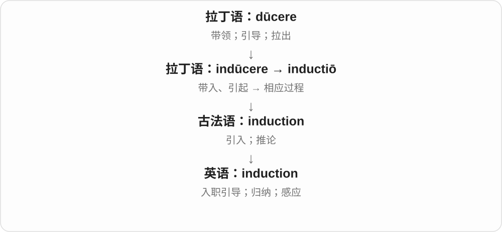

入职培训是让人进入角色；归纳是从具体观察形成较一般的判断；电磁感应是另一种专门用法。这些意思不能只背一个“引入”就代替实际理解。

**常见搭配与例句**

an induction course（入职培训课程）；inductive reasoning / induction（归纳推理）；electromagnetic induction（电磁感应）。

> All new staff attend an induction course.

所有新员工都参加入职培训。

> The class compared induction with deduction.

课堂上比较了归纳推理和演绎推理。

**别混淆**

普通经验归纳不能保证结论必然为真；数学里的 mathematical induction“数学归纳法”是严格证明方法，要另行学习。

### 63. inductee — 新接纳的成员；新入职、入伍者；入选者

**音标**：/ˌɪndʌkˈtiː/

**先抓住这个画面**

induct 是正式接纳，inductee 是被接纳进来的那个人；说名人堂时，就是新入选的人。

**怎么拆**

induct + -ee；这里后缀指动作承受方，不是负责主持入会仪式的人。

**怎么变成今天的意思**

**induct**  
正式引入、接纳

↓

**induct + -ee → inductee**  
被正式接纳或新加入的人

a new inductee 新接纳成员；a hall of fame inductee 名人堂入选者；军队语境可说新入伍者。

**常见搭配与例句**

a new inductee；this year’s inductees。

> The new inductees attended an orientation session.

新加入的成员参加了情况介绍会。

> This year’s inductees gathered for the ceremony.

本年度入选者聚在一起参加仪式。

**别混淆**

inductee 是被接纳者，trainer、organiser 等才可能是组织培训或仪式的一方；看箭头方向，不只记都是人。

### 64. appoint — 任命、指定；约定、安排

**音标**：英、美 /əˈpɔɪnt/

**先抓住这个画面**

把原来悬着的安排定下来：这份工作交给谁，或见面的时间定在哪一刻。

**怎么拆**

经古法语 apointier、盎格鲁法语 appointer 借入，相关法语 point 来自拉丁语 punctum。“定到一点上”是理解安排、议定的线索。

**怎么变成今天的意思**

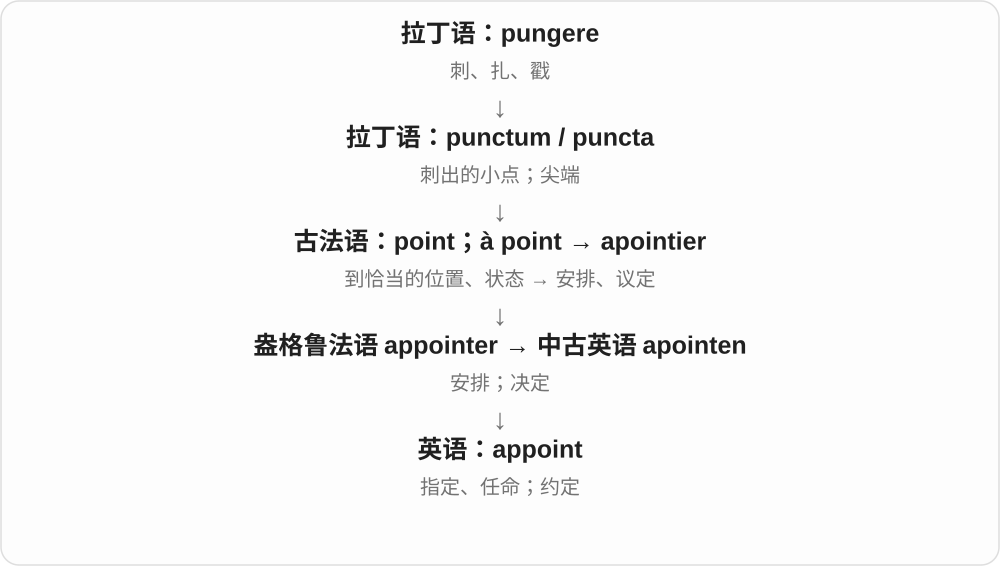

现代最常见的是任命人担任职务；appoint a time 是较正式地指定时间。不能把 appoint 理解成随手用手指指某人。

**常见搭配与例句**

appoint someone as chair；appoint someone to a post；appoint a time。

> The board appointed Maya as the new director.

董事会任命玛雅为新主任。

> They appointed a date for the next inspection.

他们确定了下一次检查的日期。

**别混淆**

nominate 常是提名候选人；appoint 是正式确定由这个人任职。

### 65. appointee — 被任命者

**音标**：英、美 /əˌpɔɪnˈtiː/

**先抓住这个画面**

任命文件上写着的那个人：他是被选来承担这个职位的。

**怎么拆**

现代可按 appoint + -ee“动作的接受者”理解；历史与法语 appointé 有关，有借入或仿其形式的分析。

**怎么变成今天的意思**

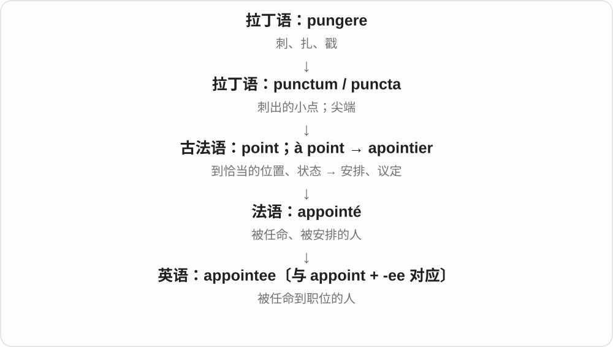

重点在取得职位的方式。political appointee 是政治任命人员；不等于所有应聘入职的人。

**常见搭配与例句**

a new appointee；a political appointee；a presidential appointee。

> The new appointee will take office in June.

新任命的人将在六月就职。

> Each appointee received a letter describing the role.

每位被任命者都收到了一封说明职责的信。

**别混淆**

applicant 是申请人；appointee 已经获得任命。

### 66. assign — 分配；指派；指定；转让

**音标**：/əˈsaɪn/

**先抓住这个画面**

assign 像在表格里画连线：这项任务连到这个人，这个编号连到这个物品，让归属明确下来。

**怎么拆**

拉丁 ad- + signāre → assignāre，经古法语 assigner 进入中古英语；“用标记划归”可帮助理解现代分配义。

**怎么变成今天的意思**

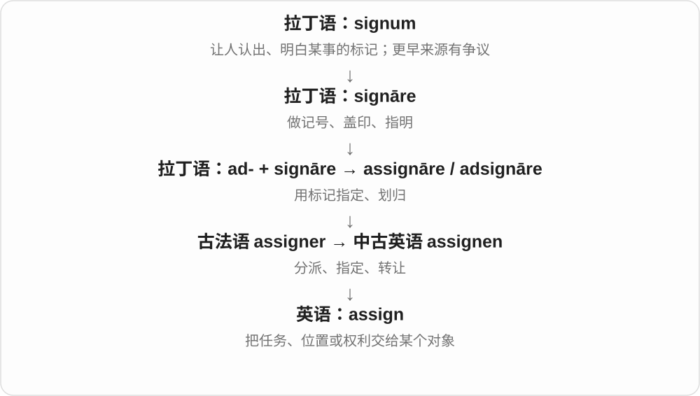

assign a task to someone，也可 assign someone a task；assign a value 是给变量赋值；正式语境还可说转让权利。

**常见搭配与例句**

assign responsibility；assign a value；assign someone to a team。

> The teacher assigned each group a different topic.

老师给每组分配了不同主题。

> The system assigns a number to each new record.

系统给每条新记录分配一个编号。

**别混淆**

designate 常强调选定身份或用途；assign 常强调把任务、资源或值分配给具体对象。

### 67. assignee — 受让人；被指派任务的人

**音标**：/ˌæsaɪˈniː/，也 /ˌæsəˈniː/

**先抓住这个画面**

assignee 是箭头指向的接收端：任务交给谁，或者权利转给谁，那个人就是 assignee。

**怎么拆**

古法语 assigné 是 assigner 的过去分词，表示被指定者；借入英语后，现代可看作 assign + -ee。

**怎么变成今天的意思**

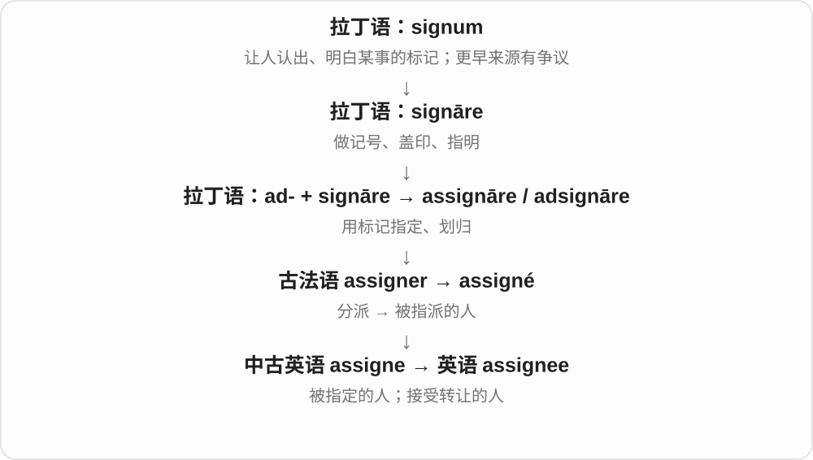

任务软件中的 assignee 是任务负责人；权利转让语境中是接受一方。词义本身不规定具体合同效力。

**常见搭配与例句**

the task’s assignee；name an assignee；the original assignee。

> The task has an assignee but no deadline yet.

这项任务已有负责人，但还没有截止日期。

> The document names the company as the assignee of the rights.

文件把该公司列为这些权利的受让方。

**别混淆**

assignor 是转出一方；assignee 是接收一方。-ee 常帮助你识别承受动作的人。

### 68. devote — 投入；专用于；献身

**音标**：英 /dɪˈvəʊt/；美 /dɪˈvoʊt/

**先抓住这个画面**

把有限的时间、精力或篇幅留给一件事，让它确实得到你的投入。

**怎么拆**

来自拉丁语 dēvōtus，动词 dēvovēre 表示以誓愿奉献；英语由庄重献出扩展为投入时间、精力等。

**怎么变成今天的意思**

**拉丁语 vovēre**  
郑重许诺、起誓、奉献

↓

**拉丁语 de- + vovēre → dēvovēre**  
以誓愿献出、郑重奉献

↓

**拉丁语 dēvōtus → 英语 devote**  
被献出的 → 把时间、精力或自己投入某事

常用 devote something to something／doing something。to 在这里是介词，后面接名词或 -ing：devote time to learning。也可说 devote yourself to a cause。

**常见搭配与例句**

devote time to；devote attention to；devote yourself to。

> She devotes an hour each evening to practising the piano.

她每天晚上专门拿出一小时练琴。

> The report devotes a whole chapter to water use.

报告用整整一章讨论用水问题。

**别混淆**

spend time 仅说花时间；devote time 更突出有意识地把时间投入某个目标。

### 69. devotee — 热衷者；忠实爱好者；信徒

**音标**：英、美 /ˌdevəˈtiː/

**先抓住这个画面**

不只是觉得不错，而是非常喜欢，愿意花时间持续追随或投入的人。

**怎么拆**

由 devote 加法语来源的 -ee 词尾形成；这里是自愿投入的人，不能把所有 -ee 都机械解释成被别人处置的接受者。

**怎么变成今天的意思**

**拉丁语 vovēre**  
郑重许诺、起誓、奉献

↓

**拉丁语 de- + vovēre → dēvovēre**  
以誓愿献出、郑重奉献

↓

**拉丁语 dēvōtus → 英语 devote**  
被献出的 → 把时间、精力或自己投入某事

↓

**英语 devote + -ee → devotee**  
投入、奉献 → 热衷者、信徒

a devotee of jazz 是爵士乐爱好者；宗教场景中也可说某信仰或神祇的信徒。它比普通 fan 稍书面，常突出持续热情。

**常见搭配与例句**

a devotee of；an ardent devotee；a lifelong devotee。

> She is a lifelong devotee of classical music.

她一生都热爱古典音乐。

> Devotees gathered at the temple before sunrise.

信徒们在日出前聚集到庙里。

**别混淆**

devotee 指人；devotion 指投入或忠诚；devout 指虔诚的性质。

### 70. fiance — 未婚夫〔也写 fiancé〕

**音标**：/fiˈɒnseɪ/〔英式常见〕；美 /ˌfiːɑːnˈseɪ/〔有变体〕

**先抓住这个画面**

已经订婚、准备结婚的男方，是 fiance；它比普通 boyfriend 男朋友多了已经订婚这一层。

**怎么拆**

借法语 fiancé，是 fiancer 订婚的相应阳性过去分词人物用法，远接相信、信任的拉丁词族。无重音符号的 fiance 是英语常见拼写，不拆成 finance 财务少一个 n。

**怎么变成今天的意思**

**法语 fiancer → fiancé**  
订婚 → 相应男性人物形式

↓

**英语 fiancé／fiance**  
未婚夫

my fiance 我的未婚夫；be engaged to someone 与某人订婚。英语实际读音有多种重音习惯，末尾不是 fee 费用。

**常见搭配与例句**

her fiance；my fiance。

> She introduced us to her fiance.

她把未婚夫介绍给我们认识。

> Her fiance helped plan the wedding.

她的未婚夫帮忙筹备婚礼。

**别混淆**

fiance 未婚夫，fiancee 未婚妻；未订婚的男朋友通常叫 boyfriend，不能只因以后想结婚就默认已经是 fiance。

### 71. fiancee — 未婚妻〔也写 fiancée〕

**音标**：/fiˈɒnseɪ/〔英式常见〕；美 /ˌfiːɑːnˈseɪ/〔有变体〕

**先抓住这个画面**

已经订婚的女方，是 fiancee；末尾多一个 e 体现法语词形传统，读音通常不因此多出一个音节。

**怎么拆**

借法语 fiancée，是 fiancé 对应的阴性人物形式。这里 -ée 的法语性别拼写历史与 employee 一类英语受动 -ee 不宜完全混成一条规则。

**怎么变成今天的意思**

**法语 fiancé／fiancée**  
已订婚的相应男女形式

↓

**英语 fiancée／fiancee**  
未婚妻的常见拼写

his fiancee 他的未婚妻；my fiancee 我的未婚妻。带重音或不带重音的拼写都能见到。

**常见搭配与例句**

his fiancee；my fiancee。

> He met his fiancee while studying abroad.

他在海外求学时认识了现在的未婚妻。

> My fiancee and I are choosing a venue.

我和未婚妻正在选场地。

**别混淆**

fiancee 未婚妻与 wife 妻子不同；婚礼、婚姻状态变化以后，称谓也会随之变。

### 72. detain — 扣留；拘留；耽搁

**音标**：/dɪˈteɪn/

**先抓住这个画面**

detain 像拉住一个本来要离开的人，不让他继续走。可能是正式扣留，也可能只是谈话把人耽误了。

**怎么拆**

经古法语 detenir 来自拉丁语 dētinēre“留住、扣住”，包含 dē- 与 tenēre。

**怎么变成今天的意思**

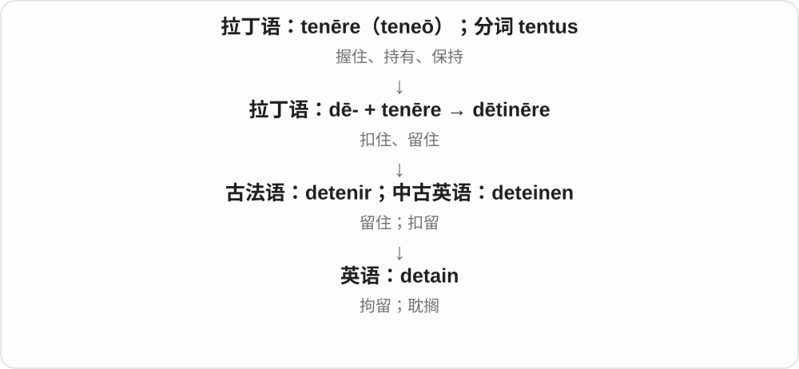

I won’t detain you 是礼貌地说“不耽误你了”，不涉及拘留。正式扣留义则要看机构与语境。

**常见搭配与例句**

detain a suspect；be detained for questioning；not detain someone long。

> The police detained a man for questioning.

警方扣留了一名男子进行询问。

> I will not detain you any longer.

我不再耽误你了。

**别混淆**

delay 可以由交通、天气等造成；detain 更突出某人或某种事务把人留住。

### 73. detainee — 被拘留者；被扣留者

**音标**：/ˌdiːteɪˈniː/

**先抓住这个画面**

detainee 是那个被留住、不获准自由离开的人，重点在其被扣留的状态。

**怎么拆**

detain + -ee，-ee 表示承受动作的一方。

**怎么变成今天的意思**

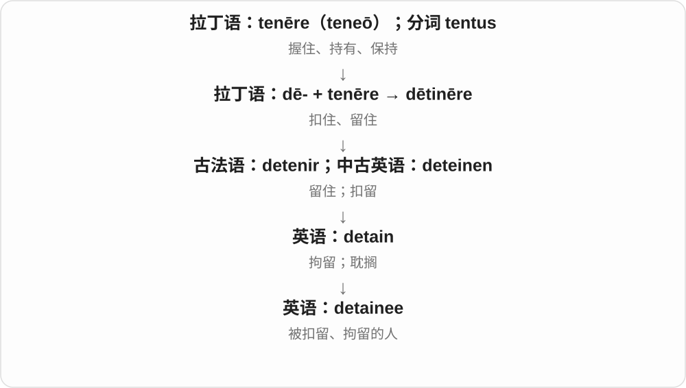

这个称呼本身不等于已经定罪。具体拘留背景、期限和法律身份要从上下文判断。

**常见搭配与例句**

a detained person / detainee；release a detainee；a former detainee。

> The report includes interviews with former detainees.

报告包括对曾被拘留者的访谈。

> Each detainee received a copy of the notice.

每名被拘留者都收到了一份通知。

**别混淆**

prisoner 可指监禁或被俘者；detainee 强调被扣留，不能单凭词形判断是否有罪。

### 74. goatee — 山羊胡、下巴上一撮胡须

**音标**：英 /ɡəʊˈtiː/；美 /ɡoʊˈtiː/

**先抓住这个画面**

下巴上留一撮胡须，像山羊那撮毛，就是 goatee 的命名画面。具体修剪式样在现实里有变化。

**怎么拆**

goat 山羊 + -ee 的指小式人物、事物命名，借山羊下巴胡须来命名人的胡型。-ee 在这里不是 employee 那种受事者后缀义。

**怎么变成今天的意思**

**古英语 gāt → 中古英语 goot、got → goat**  
山羊；更远来源未定

↓

**goat + -ee → goatee**  
像山羊下巴毛的一撮胡须

grow a goatee 留山羊胡，trim a goatee 修剪山羊胡，a short goatee 短山羊胡。

**常见搭配与例句**

grow a goatee；trim a goatee。

> He grew a goatee during the winter.

他冬天留起了山羊胡。

> She recognised him by his glasses and short goatee.

她凭眼镜和短山羊胡认出了他。

**别混淆**

goatee 核心看下巴胡须，不等于铺满两颊的所有 beard 胡须；具体款式可与上唇胡须组合。

### 75. honoree — 受表彰者；获致敬的人

**音标**：英 /ˌɒnəˈriː/；美 /ˌɑnəˈri/

**先抓住这个画面**

典礼上的灯光不是照向颁奖人，而是照向那个被大家感谢的人。

**怎么拆**

honor 表彰 + -ee，后缀指承受或接受某动作的人。

**怎么变成今天的意思**

**拉丁 honos／honor**  
尊敬；荣誉；声望

↓

**英语 honor → honoree**  
表彰 → 受到表彰的人

the evening’s honoree 是当晚受表彰的人；a list of honorees 是受表彰者名单。他可能得到奖项，也可能只是因贡献被特别致敬，不一定是竞赛第一名。

**常见搭配与例句**

this year’s honoree；an award honoree；celebrate the honorees。

> Each honoree was invited to share a short story.

每位受表彰者都获邀分享一个小故事。

> The museum announced this year’s honorees.

博物馆公布了今年的受表彰者名单。

**别混淆**

honoree 是受表彰者，presenter 是颁奖或主持的人；winner 更侧重赢得某个奖项或比赛。

### 76. settee — 长沙发、长软椅〔英式常见〕

**音标**：/seˈtiː/

**先抓住这个画面**

可以坐几个人、有靠背的长座椅，日常常和 sofa 接近；不是某个人被安排坐下的称呼。

**怎么拆**

十八世纪英语已有这种家具名，常被联系到 settle 长靠背椅等旧座位词，但具体构词路线不完全确定。-ee 不能照 employee 那样强解成被安置的人。

**怎么变成今天的意思**

**英语 settee 的早期家具用法**  
有靠背的长座椅

↓

**可能联系旧 settle〔座椅〕、set 等；具体路线有争议**  
现代长沙发、长软椅

sit on the settee 坐在沙发上，a small settee 小长沙发，the living-room settee 客厅沙发。

**常见搭配与例句**

sit on the settee；a small settee；a comfortable settee。

> We sat on the settee by the window.

我们坐在窗边的长沙发上。

> The small settee fitted neatly into the corner.

那张小长沙发正好放进角落。

**别混淆**

settee 家具，settle 现代主要动词安顿、解决；sofa/couch 在很多日常场景近义，地区、款式偏好不同。

### 77. squeegee — 橡胶刮水器；用刮水器刮

**音标**：/ˈskwiːdʒiː/

**先抓住这个画面**

一条橡胶边贴在玻璃上往下拉，水被一起刮走；洗窗、清洁浴室常用的这件工具叫 squeegee。

**怎么拆**

十九世纪航海工具名，可能与 squeege 挤压、squeeze 的变体有关，另有 squilgee 等更早相近形式，确切来源未定。不是“被 squeeze 的人”；末尾 ee 不能一律按受动人物后缀硬套。

**怎么变成今天的意思**

**航海用 squilgee 等工具名；可能关联 squeege**  
拖擦、挤压相关材料；词源未定

↓

**squeegee 名词 → 动词**  
橡胶刮水器；用它刮水

a window squeegee 玻璃刮水器；use a squeegee 使用刮水器；squeegee the glass 把玻璃上的水刮掉。

**常见搭配与例句**

a window squeegee；squeegee the shower screen。

> Use a squeegee to remove the water from the glass.

用刮水器把玻璃上的水刮掉。

> He squeegeed the shower screen after cleaning it.

他清洁后把淋浴隔断上的水刮掉了。

**别混淆**

squeegee 主要靠橡胶边刮走液体，sponge 海绵靠吸收；两种工具都能清洁，但动作不同。

## 这一组要分清什么

employee 雇员／employer 雇主；interviewee 被面试者／interviewer 面试官；grantor 授予方／grantee 接受方；fiance 未婚夫／fiancee 未婚妻。escapee 是逃走的人，不能因 -ee 反译成被逃走的人。

## 串起来练习

The interviewer welcomed the interviewee, while a trainee took notes.

面试官欢迎了应聘者，一位受训人员在旁记笔记。
