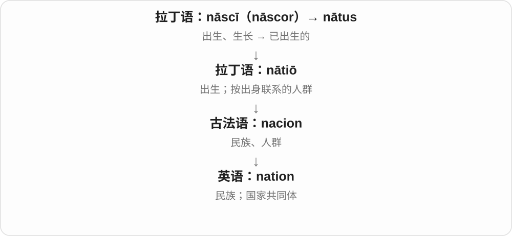

# 0084 · -wide — 遍及……范围；全……范围的

[逐词精讲目录](../00_逐词精讲目录.md) · [总目录](../00_总目录_按常用程度.md)

## 核心词根与来源

-wide 来自 wide 宽广的，把空间宽度引申为遍及某个完整范围。成词后常兼作形容词、副词，不必另加 -ly。

**WIDE：先看前面的区域，再把范围铺开**

countywide 把范围铺到一县，nationwide 到一国，worldwide 到全球；后部像在地图上画一个覆盖圈。

- **先认基本范围**：wide；county · country · nation · world
- **从地方到全国、全球**：countywide；countrywide · nationwide；worldwide
- **county → counties：伯爵辖地到行政区**：county · counties

## 词形与演化规律

world + -wide → worldwide；nation + -wide → nationwide；county + -wide → countywide；country + -wide → countrywide。前部是完整词基。

法语 conté 接拉丁 comitatus，现代行政区义并不要求现有伯爵管理。

## 单词速览（按词族由简到繁）

同一基础词的相关扩展放在一起，先读基础形式，再读扩展；各组之间优先读常用的。具体词源关系见各词讲解。

| 单词 | 音标 | 核心意思 |
|---|---|---|
| [world](#w-9) | 英 /wɜːld/；美 /wɜːrld/ | 世界；人世；领域；生活环境 |
| [worldwide](#w-1) | 英 /ˌwɜːldˈwaɪd/；美 /ˈwɜːrldˌwaɪd/ | 遍及世界的；在世界各地 |
| [country](#w-10) | /ˈkʌntri/ | 国家；乡村、乡间；地区；乡村音乐〔简称〕 |
| [countrywide](#w-5) | /ˌkʌntriˈwaɪd/ | 全国的；遍及全国地 |
| [county](#w-11) | /ˈkaʊnti/ | 县；郡〔行政区名称，具体层级依地区〕 |
| [counties](#w-14) | /ˈkaʊntiz/ | 县、郡等行政区〔复数〕 |
| [countywide](#w-6) | /ˌkaʊntiˈwaɪd/ | 全县、全郡范围的；在全县、全郡 |
| [wide](#w-12) | /waɪd/ | 宽的；广泛的；完全张开地；偏离目标的 |
| [nation](#w-13) | /ˈneɪʃən/ | 民族；国家；国家共同体 |
| [nationwide](#w-2) | /ˌneɪʃənˈwaɪd/ | 全国性的；在全国范围内 |

## 逐词讲解

### 1. world — 世界；人世；领域；生活环境

**音标**：英 /wɜːld/；美 /wɜːrld/

**先抓住这个画面**

不只是一颗地球，也可以是你身处的一整套人、规则和日常经验。

**怎么拆**

古英语 weorold 更早的日耳曼语材料相当于“人的时代、存在”，包含人与年龄、时代相关成分；现代 word“单词”并不是它的拆分材料。

**怎么变成今天的意思**

**古英语 weorold → 中古英语 world**  
人世、世界

↓

**英语 world**  
世界；生活领域；某个整体环境

around the world 是全球，the world of music 是音乐界，a child’s world 是孩子的生活天地。worlds apart 是差异极大，a world of difference 是巨大差别。

**常见搭配与例句**

around the world；in the world；the world of；worlds apart。

> The news spread around the world.

消息传遍世界。

> She introduced me to the world of contemporary dance.

她带我走进当代舞的世界。

**别混淆**

Earth 是地球这颗行星，world 范围可包括人类社会、某一领域或虚构环境。a fictional world 不必是一颗独立行星。

### 2. worldwide — 遍及世界的；在世界各地

**音标**：英 /ˌwɜːldˈwaɪd/；美 /ˈwɜːrldˌwaɪd/

**先抓住这个画面**

把地图展开，范围伸到整个世界。它既可以站在名词前说全球性的，也可以站在动词旁说在全球各地。

**怎么拆**

world 世界 + -wide 范围遍及……。wide 从宽广的空间关系发展为复合词里覆盖某一整个范围的后部。

**怎么变成今天的意思**

**world + -wide**  
范围铺到全世界

↓

**worldwide 作形容词或副词**  
全球性的；在全球各地

worldwide attention 全球关注；sell worldwide 销往世界各地。具体是否每一国家都有，要看上下文，不靠一个词保证毫无例外。

**常见搭配与例句**

a worldwide audience；available worldwide。

> The exhibition attracted worldwide attention.

这次展览引起了全球关注。

> The company sells its products worldwide.

这家公司向世界各地销售产品。

**别混淆**

worldwide 已经能作副词，不需要改成 worldwidely；nationwide 则把范围缩到一国之内。

### 3. country — 国家；乡村、乡间；地区；乡村音乐〔简称〕

**音标**：/ˈkʌntri/

**先抓住这个画面**

本来是一片土地；往政治边界看，是国家，往城市外看，是乡间。

**怎么拆**

借古法语 contree，经中古英语 contre，上接通俗拉丁重建形式 *(terra) contrāta“面对的土地”，与 contrā 有关。星号表重建，不当作实见古文。country 不是 county 加 r。

**怎么变成今天的意思**

**古法语 contree → 中古英语 contre**  
面对的一片土地、区域

↓

**英语 country**  
国家；乡间；一片有特点的地域

visit a country 访问一个国家，live in the country 住乡下，mountain country 山区。country music 是乡村音乐，也可简称 country。

**常见搭配与例句**

a foreign country；in the country；across the country；country music。

> She has lived in three different countries.

她在三个不同国家住过。

> They moved from the city to the country.

他们从城市搬到了乡下。

**别混淆**

country 国家、乡间，county 通常是郡、县等行政区；拼写近，来路和行政层级不一样。

### 4. countrywide — 全国的；遍及全国地

**音标**：/ˌkʌntriˈwaɪd/

**先抓住这个画面**

不是一个城市、一片乡下，而是在整个国家范围铺开。

**怎么拆**

country（国家）+ -wide（遍及……范围），不是在说国家东西量起来很宽。

**怎么变成今天的意思**

**country；-wide**  
并列构词成分

↓

**countrywide**  
遍及整个国家范围的

a countrywide survey 全国调查，operate countrywide 在全国开展业务；形容词、副词都可见。

**常见搭配与例句**

a countrywide survey；countrywide coverage；operate countrywide。

> The organization launched a countrywide survey.

机构启动了一项全国调查。

> The service is available countrywide.

这项服务全国范围都能使用。

**别混淆**

countrywide 全国范围，countryside 乡间；全国调查当然可能包含城市，不能被 country 的乡下义带偏。

### 5. county — 县；郡〔行政区名称，具体层级依地区〕

**音标**：/ˈkaʊnti/

**先抓住这个画面**

先想一块划定边界、由地方机构管理的区域。英语国家的 county 制度各不相同，不能把它和中国县制的层级完全画等号。

**怎么拆**

中古英语 countee 等经盎格鲁法语、古法语 conté，接拉丁 comitatus 伯爵的管辖区，关联 comes 伯爵这一称号。现代行政区名称延续下来，不要求今天仍由伯爵统治。

**怎么变成今天的意思**

**拉丁 comitatus → 法语 conté → 中古英语 countee**  
伯爵的管辖区域

↓

**现代 county**  
沿用的地方行政区名称

a county boundary 县、郡界；the county council 地方郡议会。count 表伯爵与它有历史关系；count 数数则来自另一条 computare 词源路线。

**常见搭配与例句**

a rural county；county offices。

> The river forms the boundary between two counties.

这条河形成了两个县之间的边界。

> The county office is next to the library.

县政府办公处在图书馆旁边。

**别混淆**

country 是国家、乡村，county 是一种地方行政区。多一个 r，范围和意思都变了。

### 6. counties — 县、郡等行政区〔复数〕

**音标**：/ˈkaʊntiz/

**先抓住这个画面**

把一片地区划作一个管理单位，今天常见的名称之一就是 county；counties 是不止一个这样的行政区。不同国家的具体制度不一样。

**怎么拆**

county 改 y 为 i 加 -es → counties。county 经盎格鲁法语、古法语 conté 等接拉丁 comitatus 伯爵管辖区，与 comes 伯爵相关。

**怎么变成今天的意思**

**拉丁 comitatus → 法语 conté → 英语 county**  
伯爵辖地 → 延续为县、郡等行政区名称

↓

**county → counties**  
多个相应行政区

neighbouring counties 邻近的县、郡；rural counties 乡村地区的县；counties across the country 全国各县、郡等。

**常见搭配与例句**

three counties 三个县、郡；county boundaries 县界，前置 county 常用单数。

> The river flows through three counties.

这条河流经三个县。

> Several neighbouring counties share the same transport service.

几个邻县共用同一套交通服务。

**别混淆**

counties 是县、郡；countries 是国家。只多一个 r，所指数的地理单位却不同。现代 county 不要求仍由伯爵统治。

### 7. countywide — 全县、全郡范围的；在全县、全郡

**音标**：/ˌkaʊntiˈwaɪd/

**先抓住这个画面**

把县、郡的边界当作这一次的范围：各个镇、村共同参加，而不只是其中一处。

**怎么拆**

county 县、郡 + -wide 遍及。拼写里是 county，不能读到一半自行补成 country 国家。

**怎么变成今天的意思**

**county + -wide**  
范围覆盖一个县、郡

↓

**countywide**  
全县、全郡范围的或在该范围内

a countywide event 全县性活动；a countywide transport plan 全县交通计划。是覆盖范围说明，不自动意味着每个人都实际参加。

**常见搭配与例句**

countywide services；a countywide survey。

> The library organized a countywide reading challenge.

图书馆组织了一次全县阅读挑战活动。

> The new map shows bus routes countywide.

新地图显示了全县范围内的公交线路。

**别混淆**

countywide 全县、全郡；countrywide 全国；worldwide 全球。比较时先盯住前面的完整词基。

### 8. wide — 宽的；广泛的；完全张开地；偏离目标的

**音标**：/waɪd/

**先抓住这个画面**

两边离得远，是宽；事情涉及的范围大，也能借这个空间画面来说。

**怎么拆**

继承古英语 wīd 宽、远、大等义。现代形容词、副词都常用，不要因没有 -ly 就认定只能修饰名词。

**怎么变成今天的意思**

**古英语 wīd → 中古英语 wid、wyd → wide**  
宽阔；范围远、大

↓

**现代 wide**  
空间宽 → 范围广；也可描述偏离目标

a wide road 宽路，a wide range 广泛范围，open wide 大大张开；a shot went wide 是射门偏了。

**常见搭配与例句**

a wide range of；three metres wide；wide open；wide of the mark。

> The river is fifty metres wide here.

这条河在这里宽五十米。

> The shop sells a wide range of books.

这家店出售种类广泛的书。

**别混淆**

wide 宽度、范围，long 长度；wide open 强调开得很大，widely used 强调使用范围广。

### 9. nation — 民族；国家；国家共同体

**音标**：/ˈneɪʃən/

**先抓住这个画面**

nation 先想一群人把自己看作“我们这个共同体”，可能由历史、文化、语言或共同认同联系起来。

**怎么拆**

拉丁语 nātiō 起初连接出生、出身，后来指按出身相连的人群，经法语 nacion 进入英语。

**怎么变成今天的意思**

现代已不能只按血缘理解；nation 也常代指国家，但民族共同体与国家制度并非永远一一对应。

**常见搭配与例句**

a nation’s history；the whole nation；a nation state。

> The news was discussed across the nation.

全国各地都在讨论这条新闻。

> The exhibition explores the history of the nation.

展览探索了这个民族的历史。

**别混淆**

state 常指政治组织或政府权力；country 常指国家、国土；nation 更容易突出人民及共同认同。

### 10. nationwide — 全国性的；在全国范围内

**音标**：/ˌneɪʃənˈwaɪd/

**先抓住这个画面**

不是只在一座城市试一试，而是把某件事的范围推到整个国家。

**怎么拆**

nation 国家、国民整体 + -wide 遍及该范围。整个词既作形容词，也作副词。

**怎么变成今天的意思**

**nation + -wide**  
范围遍及一国

↓

**nationwide**  
全国性的；在全国范围内

a nationwide survey 全国调查；operate nationwide 在全国经营。national 还可以说国家的、民族的等多种关系，nationwide 更明确强调覆盖范围。

**常见搭配与例句**

a nationwide campaign；stores nationwide。

> The researchers carried out a nationwide survey.

研究人员开展了一次全国调查。

> The service is now available nationwide.

这项服务现在已覆盖全国。

**别混淆**

nationwide 与 countrywide 在全国范围义上很接近；countywide 少一个 r，是全县、全郡。

## 这一组要分清什么

county 是县、郡，country 是国家、乡村；worldwide 不等于 worldwidely。覆盖用语的具体边界仍看上下文。

## 串起来练习

The countywide event attracted nationwide attention.

这次全县性活动引起了全国关注。
