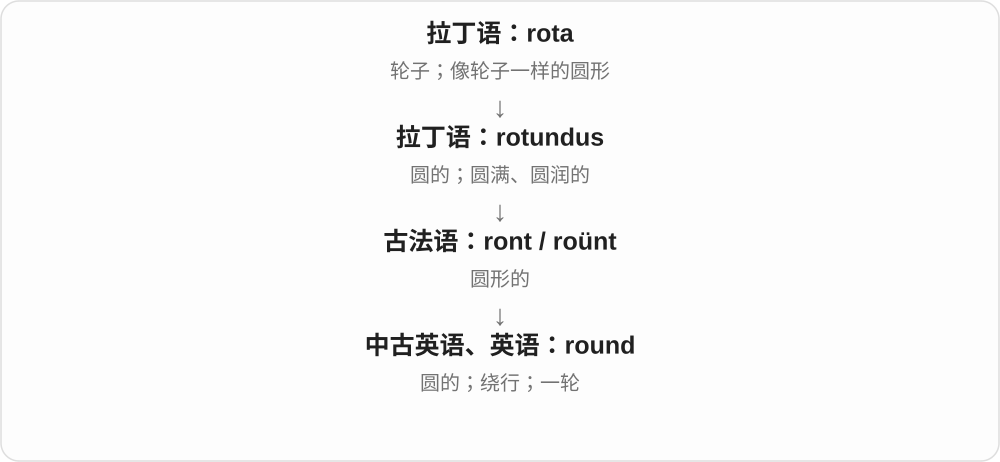

# 0085 · -ish — 像……的、具有某种性质；有点、约莫；某些旧地域关系形式

[逐词精讲目录](../00_逐词精讲目录.md) · [总目录](../00_总目录_按常用程度.md)

## 核心词根与来源

-ish 从古英语 -isc 及更早日耳曼语相应材料延续，早有地域、群体关系，后来广泛说性质、相似、程度接近，也能口语附在时间后表示大约。拼写恰好以 ish 结尾的借词不必都属这一后缀。

**ISH：性质、相似和大约三条常用理解，固定词要单独学**

purplish 是偏紫，childish 常批评幼稚，fiendish puzzle 则可能是极难的谜题；不是都只在基础词前加一点点。

- **颜色、大小与近似程度**：purple · purplish；reddish · yellowish · brownish · greenish · whitish · bluish · blackish · pinkish · grayish；smallish · longish · newish · roundish · youngish
- **行为、性格与评价**：self · selfish；fool · foolish；style · stylish；brute · brutish；fiend · fiendish；prude · prudish；thug · thuggish；snobbish · boorish
- **生物、故事和感受**：elf · elvish；ghoul · ghoulish；tickle · ticklish；sheepish · skittish · feverish · hellish · devilish · nightmarish
- **日常特点及固定词**：boyish · girlish · amateurish · cartoonish · bookish · freakish · hawkish · bearish · bullish · peckish；brackish · gibberish
- **fool → fools：愚人、受骗者与欺骗**：fool · fools
- **book → booking：预订动作和一项预订**：book · booking
- **booking 的可数预订事项**：booking · bookings
- **peck → pecks、pecked、pecking：啄的动作**：peck · pecks · pecked · pecking

## 词形与演化规律

purple + -ish → purplish；brute + -ish → brutish；fiend + -ish → fiendish；prude + -ish → prudish；thug + -ish → thuggish。gibberish 的历史先于常见分析里的 gibber 动词；skittish 的前部也不能只拿现代 skit 小品来硬拆。

名动词 s 形式读音相同。

不是 book 读书和 ing 自动等于阅读，动词有登记、预约义。

book + -ing 的动作形式已有名词用途，bookings 数预订，不只是正在做预订。

在已有 peck 同族旁补常用动词形式；peck 可能接 pick 的早期变体或低地德语材料。pecking order 从鸡群啄击关系借给人的地位次序，不把计量单位 peck 硬并为鸟啄起源。

## 单词速览（按词族由简到繁）

同一基础词的相关扩展放在一起，先读基础形式，再读扩展；各组之间优先读常用的。具体词源关系见各词讲解。

| 单词 | 音标 | 核心意思 |
|---|---|---|
| [book](#w-64) | /bʊk/ | 书；册；账簿；预订；登记 |
| [booking](#w-89) | /ˈbʊkɪŋ/ | 预订、预约、预订事项；登记〔动名词、现在分词、名词〕 |
| [bookings](#w-90) | /ˈbʊkɪŋz/ | 预订、预约；演出邀约〔复数〕 |
| [bookish](#w-32) | /ˈbʊkɪʃ/ | 爱读书的；书卷气的；书本式的 |
| [girl](#w-65) | 英 /ɡɜːl/；美 /ɡɜːrl/ | 女孩；少女；女性〔部分非正式语境〕 |
| [girlish](#w-37) | 英 /ˈɡɜːlɪʃ/；美 /ˈɡɜːrlɪʃ/ | 像女孩、少女的；带少女特点的 |
| [child](#w-66) | /tʃaɪld/ | 孩子；子女 |
| [childish](#w-77) | /ˈtʃaɪldɪʃ/ | 孩子气的；幼稚的 |
| [self](#w-67) | /self/ | 自我；本人、自己这一身份或状态 |
| [selfish](#w-1) | /ˈselfɪʃ/ | 自私的、只顾自己的 |
| [boy](#w-68) | /bɔɪ/ | 男孩；年轻男性；特定语境的男性同伴称呼 |
| [boyish](#w-21) | /ˈbɔɪɪʃ/ | 男孩般的；带少年气的 |
| [round](#w-69) | /raʊnd/ | 圆的；围绕；绕行；一轮；把数取整 |
| [roundish](#w-58) | /ˈraʊndɪʃ/ | 大致圆的；略圆、近圆形的 |
| [style](#w-70) | /staɪl/ | 风格；款式；方式；造型、设计 |
| [stylish](#w-4) | /ˈstaɪlɪʃ/ | 有格调的；时尚好看的 |
| [purple](#w-71) | 英 /ˈpɜːpəl/；美 /ˈpɜːrpəl/ | 紫色；紫色的；华丽过头的〔某些比喻搭配〕 |
| [purplish](#w-24) | 英 /ˈpɜːplɪʃ/；美 /ˈpɜːrplɪʃ/ | 带紫色的；偏紫的 |
| [fool](#w-72) | /fuːl/ | 蠢人、傻瓜；弄臣；欺骗；胡闹 |
| [foolish](#w-2) | /ˈfuːlɪʃ/ | 愚蠢的、不明智的；显得傻的 |
| [fools](#w-88) | /fuːlz/ | 傻瓜、受骗者、弄臣〔复数〕；欺骗、骗过〔第三人称单数〕 |
| [amateur](#w-73) | 常用英 /ˈæmətə/；美 /ˈæmətʃər/ | 业余爱好者；非职业的；外行 |
| [amateurish](#w-30) | /ˈæmətərɪʃ/；亦读 /ˈæmətʃərɪʃ/ | 不专业的；手法生疏的 |
| [fever](#w-74) | 英 /ˈfiːvə/；美 /ˈfiːvər/ | 发热、发烧；狂热、兴奋热潮 |
| [feverish](#w-20) | 英 /ˈfiːvərɪʃ/；美 /ˈfiːvərɪʃ/ | 发热、像发热的；亢奋、焦灼、忙乱的 |
| [sheep](#w-75) | /ʃiːp/ | 绵羊；盲从、容易被带着走的人〔比喻〕 |
| [sheepish](#w-41) | /ˈʃiːpɪʃ/ | 难为情的、羞窘的；怯生生的 |
| [cartoon](#w-76) | 英 /kɑːˈtuːn/；美 /kɑːrˈtuːn/ | 漫画；动画片；〔艺术〕设计底稿 |
| [cartoonish](#w-31) | 英 /kɑːˈtuːnɪʃ/；美 /kɑːrˈtuːnɪʃ/ | 卡通般的；夸张、漫画化的 |
| [elf](#w-78) | /elf/ | 精灵〔神话、奇幻生物〕 |
| [elvish](#w-39) | /ˈelvɪʃ/ | 精灵的；有精灵特点的；〔作品设定中的〕精灵语 |
| [thug](#w-79) | /θʌɡ/ | 暴徒；打手；粗暴欺人的人 |
| [thuggish](#w-47) | /ˈθʌɡɪʃ/ | 暴徒般的；粗暴、靠威吓压人的 |
| [peck](#w-80) | /pek/ | 啄；小口地吃；轻轻一吻〔名词或动词〕 |
| [pecking](#w-91) | 英、美 /ˈpekɪŋ/ | 正在啄；啄食；〔pecking order〕地位次序 |
| [pecked](#w-92) | 英、美 /pekt/ | 啄过；轻吻了；只小口吃了〔过去式、过去分词〕 |
| [pecks](#w-93) | 英、美 /peks/ | 啄〔第三人称单数〕；轻啄、轻吻〔复数〕 |
| [peckish](#w-61) | /ˈpekɪʃ/ | 有点饿、想吃一点的〔主要英式口语〕 |
| [brute](#w-81) | /bruːt/ | 野兽；粗野残暴的人；蛮力的、未经精细处理的 |
| [brutish](#w-33) | /ˈbruːtɪʃ/ | 粗野、残暴的；像野兽般缺乏理性的 |
| [reddish](#w-6) | /ˈredɪʃ/ | 微红的；略带红色的 |
| [tickle](#w-82) | /ˈtɪkəl/ | 挠痒、使发痒；逗乐、激起兴趣 |
| [ticklish](#w-29) | /ˈtɪklɪʃ/ | 怕痒的；难处理、棘手而敏感的 |
| [yellowish](#w-9) | 英 /ˈjeləʊɪʃ/；美 /ˈjeloʊɪʃ/ | 略黄的、带黄色的 |
| [bullish](#w-10) | /ˈbʊlɪʃ/ | 看涨的；对前景乐观、有信心的 |
| [brownish](#w-11) | /ˈbraʊnɪʃ/ | 略带棕色的；偏褐色的 |
| [fiend](#w-83) | /fiːnd/ | 恶魔；极残忍的人；对某事着迷的人〔口语〕 |
| [fiendish](#w-38) | /ˈfiːndɪʃ/ | 恶魔般、恶毒的；极难、巧得令人抓狂的 |
| [greenish](#w-12) | /ˈɡriːnɪʃ/ | 带绿色的；有点发绿的 |
| [whitish](#w-13) | /ˈwaɪtɪʃ/ | 发白的；略白的 |
| [gibberish](#w-14) | /ˈdʒɪbərɪʃ/，亦见 /ˈɡɪbərɪʃ/ | 听不懂的话；乱七八糟、没有可懂意义的文字或声音 |
| [snob](#w-84) | 英 /snɒb/；美 /snɑːb/ | 势利的人；自认品位高而看不起别人的人 |
| [snobbish](#w-36) | 英 /ˈsnɒbɪʃ/；美 /ˈsnɑːbɪʃ/ | 势利的；自恃身份、品位而轻视人的 |
| [hellish](#w-15) | /ˈhelɪʃ/ | 地狱般的；极其糟糕、难受的 |
| [ghoul](#w-85) | /ɡuːl/ | 食尸鬼〔传说怪物〕；迷恋死亡、灾祸等的人〔贬称〕 |
| [ghoulish](#w-42) | /ˈɡuːlɪʃ/ | 食尸鬼般的；对死亡、恐怖等猎奇的；阴森怪异的 |
| [bluish](#w-16) | /ˈbluːɪʃ/ | 带蓝色的；有点发蓝的 |
| [blackish](#w-17) | /ˈblækɪʃ/ | 发黑的；略黑的 |
| [devilish](#w-18) | 英、美 /ˈdevəlɪʃ/ | 邪恶的；淘气的；刁钻的 |
| [bearish](#w-19) | 英 /ˈbeərɪʃ/；美 /ˈberɪʃ/ | 像熊的；看跌的；对前景悲观的 |
| [pinkish](#w-23) | /ˈpɪŋkɪʃ/ | 略带粉红色的、偏粉红的 |
| [nightmarish](#w-25) | 英 /ˈnaɪtmeərɪʃ/；美 /ˈnaɪtmerɪʃ/ | 噩梦般的、可怕难熬的 |
| [brackish](#w-26) | /ˈbrækɪʃ/ | 略咸的；咸淡混合的〔水〕 |
| [skittish](#w-27) | /ˈskɪtɪʃ/ | 容易受惊的；紧张不安、摇摆不定的 |
| [grayish](#w-28) | /ˈɡreɪɪʃ/ | 略带灰色的、偏灰的 |
| [prude](#w-86) | /pruːd/ | 对性、举止等过分拘谨的人〔常为贬称〕 |
| [prudish](#w-45) | /ˈpruːdɪʃ/ | 过分拘谨的；故作端庄、古板的〔常含批评〕 |
| [freakish](#w-34) | /ˈfriːkɪʃ/ | 反常、奇特的；怪异、难以预料的 |
| [smallish](#w-35) | 英 /ˈsmɔːlɪʃ/；美 /ˈsmɔːlɪʃ/ | 比较小的；略小的 |
| [hawkish](#w-40) | 英 /ˈhɔːkɪʃ/；美 /ˈhɔːkɪʃ/ | 像鹰的；鹰派的、强硬的 |
| [boor](#w-87) | 英 /bʊə/、/bɔː/；美 /bʊr/ | 粗鲁无礼的人 |
| [boorish](#w-43) | 英 /ˈbʊərɪʃ/、/ˈbɔːrɪʃ/；美 /ˈbʊrɪʃ/ | 粗鲁无礼的；不顾他人感受的 |
| [longish](#w-44) | 英 /ˈlɒŋɪʃ/；美 /ˈlɔːŋɪʃ/ | 有点长的；相当长的 |
| [newish](#w-48) | 英 /ˈnjuːɪʃ/；美 /ˈnuːɪʃ/ | 还比较新的；有点新的 |
| [youngish](#w-63) | /ˈjʌŋɪʃ/ | 还算年轻的；比较年轻的 |

## 逐词讲解

### 1. book — 书；册；账簿；预订；登记

**音标**：/bʊk/

**先抓住这个画面**

把文字集中到一个能查阅的地方；座位、客房的预订也曾靠把名字记进册子确认。

**怎么拆**

接古英语 bōc，经中古英语 bok、book 延续。动词登记、预订从书面记录的用法发展，不是现代英语 boo 加 k。

**怎么变成今天的意思**

**古英语 bōc → 中古英语 bok / book**  
书、书面记录

↓

**英语 book**  
书；账簿；预订、登记等动词用法

read a book 是读书，book a room 是预订房间，the books 常指账簿。警方或体育报道中的 book someone 可能是登记、记名处理，具体制度另看语境。

**常见搭配与例句**

read a book；book a room；book in advance；keep the books；by the book。

> I borrowed a book from the library.

我从图书馆借了一本书。

> We booked a room near the station.

我们预订了车站附近的房间。

> She keeps the books for the family business.

她为家族生意记账。

**别混淆**

book 预订，不保证一定已付款；buy 是购买。by the book 是按规定，不是物理位置在一本书旁。

### 2. booking — 预订、预约、预订事项；登记〔动名词、现在分词、名词〕

**音标**：/ˈbʊkɪŋ/

**先抓住这个画面**

先把你的名字和时间写进安排里，让位置留给你，就是 booking。现代不用纸本账簿，也保留这套登记画面。

**怎么拆**

book 继承古英语 boc 书、书面记录，登记动词由记录用法发展为预订。现代直接加完整 -ing，动词过程又能成为一项预订的可数名词。

**怎么变成今天的意思**

**古英语书、记录材料 → book 动词**  
写入记录 → 登记、预订

↓

**book + -ing → booking**  
预订过程；一项已经作出的预订

make a booking 预订；a hotel booking 酒店预订；booking tickets 订票。

**常见搭配与例句**

confirm the booking 确认预订；booking in advance 提前预订。

> She checked the dates before booking the room.

订房前她核对了日期。

> We received a message confirming the booking.

我们收到了一条确认预订的消息。

**别混淆**

booking 不等于 reading a book。book 作动词有登记、预订义；a booking 又能数一项具体预约。

### 3. bookings — 预订、预约；演出邀约〔复数〕

**音标**：/ˈbʊkɪŋz/

**先抓住这个画面**

把某个日期、座位或房间记到名下，是一项 booking；本子里已经登记的几项安排就是 bookings。

**怎么拆**

book + -ing → booking，成为可数名词后再加 -s；book 的登记、预订义由书面记录用途发展。

**怎么变成今天的意思**

**book 的书、记录义 → 登记、预订动词**  
先记下来，给人保留位置或时间

↓

**book + -ing → booking → bookings**  
一项预订；多项预订、工作邀约

hotel bookings 是酒店预订，advance bookings 是提前预订；艺人的 bookings 也可说已经约好的演出工作。

**常见搭配与例句**

take bookings 接受预订；cancel bookings 取消预订。

> We are not taking any more bookings for Friday.

我们不再接受周五的预订了。

> The band has several bookings next month.

乐队下个月有几场已经约好的演出。

**别混淆**

bookings 是登记的预订事项，books 是书；从记录到预订的动词发展，解释了多出来的 -ing。

### 4. bookish — 爱读书的；书卷气的；书本式的

**音标**：/ˈbʊkɪʃ/

**先抓住这个画面**

兴趣、谈吐都带着常与书相处的气息，有时是赞赏，有时嫌脱离实际。

**怎么拆**

book + -ish，-ish 在此表示带有某种特点。不是所有 -ish 都表示差不多、不精确。

**怎么变成今天的意思**

**古英语 bōc → 中古英语 bok / book**  
书、书面记录

↓

**英语 book**  
书；账簿；预订、登记等动词用法

↓

**book + -ish → bookish**  
有读书、书本特征的

a bookish child 是爱读书的孩子，bookish language 是书面味很重的语言。是否带贬意要看上下文。

**常见搭配与例句**

a bookish child；a bookish manner；bookish language。

> He was a quiet, bookish child.

他是个安静、爱读书的孩子。

> The dialogue sounded too bookish for everyday speech.

对话听着太书面，不像日常说话。

**别混淆**

bookish 描述特征，bookworm 是人或书虫的名词；书卷气不自动等于社交能力差。

### 5. girl — 女孩；少女；女性〔部分非正式语境〕

**音标**：英 /ɡɜːl/；美 /ɡɜːrl/

**先抓住这个画面**

今天先想女孩、少女；朋友间 the girls 也可能指一群成年女性。

**怎么拆**

可追到中古英语 gerle、girle、gyrle，早期年轻人义不只指女性；更早来源不确定，重建的古英语形式不能当实见祖先写死。

**怎么变成今天的意思**

**中古英语 gerle / girle / gyrle**  
年轻人，早期可包含男孩、女孩

↓

**英语 girl**  
女孩、少女；部分非正式用法也称成年女性

a young girl 一个小女孩，a girls’ school 女校，a girls’ night 女性朋友聚会。称成年女性为 girl 要看关系、语气，工作场合有时显得把人叫小了。

**常见搭配与例句**

a young girl；a schoolgirl；the girls；a girls’ night。

> The girl carried a stack of books.

女孩抱着一摞书。

> The girls from our old class meet once a month.

我们老同学里的女同学每月聚一次。

**别混淆**

girl 与 woman 主要年龄、语境不同；女性朋友自称 the girls 不表示所有正式称呼都能用 girls。

### 6. girlish — 像女孩、少女的；带少女特点的

**音标**：英 /ˈɡɜːlɪʃ/；美 /ˈɡɜːrlɪʃ/

**先抓住这个画面**

说笑容、声音、热情像少女，描述的是观察者感到的特点，不只报年龄。

**怎么拆**

girl + -ish，-ish 表像、带有某种特点；这里不主要表示时间大约几点那种模糊数量。

**怎么变成今天的意思**

**中古英语 gerle / girle / gyrle**  
年轻人，早期可包含男孩、女孩

↓

**英语 girl**  
女孩、少女；部分非正式用法也称成年女性

↓

**girl + -ish → girlish**  
具有女孩、少女相关特点的

a girlish laugh 少女般的笑，girlish enthusiasm 少女般热情。成年人也可被这样形容，常含青春、轻快感。

**常见搭配与例句**

a girlish laugh；girlish enthusiasm；a girlish voice。

> She gave a sudden girlish laugh.

她突然发出少女般轻快的笑声。

> The letter was full of girlish enthusiasm.

信里满是少女般的热情。

**别混淆**

girlish 描述特征，girlhood 说少女时期；显得少女般不证明实际仍是未成年人。

### 7. child — 孩子；子女

**音标**：/tʃaɪld/

**先抓住这个画面**

一种是年龄还小的人，一种是父母眼里的儿女：后者长大了也还是 someone’s child。

**怎么拆**

接古英语 ċild，是英语本族继承词。更远可联系古日耳曼语的孩子、胎儿等词族，但不能按现代拼写随便拆 ch + ild。复数 children 是历史保留形式。

**怎么变成今天的意思**

**古英语 ċild → 中古英语 child**  
孩子、子女

↓

**现代英语 child；复数 children**  
小孩；不论年龄的某人的子女

a young child 小孩，an adult child 成年子女；an only child 独生子女。child 在具体制度里的年龄界限要看该制度，不由词本身统一规定。

**常见搭配与例句**

an only child；a child of ten；adult children；as a child。

> I loved drawing when I was a child.

我小时候很喜欢画画。

> Their children are all adults now.

他们的子女现在都已成年。

**别混淆**

child 单数，children 复数，不写 childs；childhood 是童年这段时期，不是孩子的集合。

### 8. childish — 孩子气的；幼稚的

**音标**：/ˈtʃaɪldɪʃ/

**先抓住这个画面**

把本该成熟处理的事，用赌气、争宠等方式处理，就常被批评为 childish。

**怎么拆**

child + -ish，古英语已有 ċildisċ。-ish 表带某种特征；现代说成年人的 childish behaviour 通常带不成熟的批评。

**怎么变成今天的意思**

**古英语 ċild → 中古英语 child**  
孩子、子女

↓

**现代英语 child；复数 children**  
小孩；不论年龄的某人的子女

↓

**child + -ish → childish**  
像孩子的 → 常引申不成熟、幼稚

a childish argument 幼稚的争论，childish behaviour 孩子气的行为；历史和个别语境也能中性描述儿童特点，不能把贬义当成后缀永恒规则。

**常见搭配与例句**

childish behaviour；a childish reaction；a childish argument。

> Refusing to speak to everyone was a childish reaction.

拒绝和所有人说话，是一种幼稚的反应。

> Their childish argument wasted half the meeting.

他们幼稚的争论浪费了半场会议。

**别混淆**

childish 常批评不成熟；childlike 常欣赏天真、好奇。a childish tantrum 发脾气，与 childlike wonder 童真般惊奇感觉不同。

### 9. self — 自我；本人、自己这一身份或状态

**音标**：/self/

**先抓住这个画面**

说某人真实的性格、平常状态，或把目光回到那个人本身，就会谈到 self。her old self 是她原先熟悉的那种状态。

**怎么拆**

延续古英语 self、sylf 等本人、相同、自己的材料。旧时可跟在人称词后面加强本人义，后来形成 myself、herself 等反身、强调形式。复数 selves。

**怎么变成今天的意思**

**古英语 self、sylf**  
本人、自己的、同一个

↓

**现代 self；myself 等**  
自我；反身、强调的复合词材料

a sense of self 自我感；your true self 真实自我；be your old self 恢复平常的状态。

**常见搭配与例句**

a sense of self；her true self。

> After a good night’s sleep, she felt like her old self again.

睡好一晚后，她又恢复了平常的状态。

> The story explores the character’s sense of self.

故事探索角色的自我感。

**别混淆**

self 可作名词谈自我；普通句子里我自己常用 myself。I taught myself 是我自学，不能直接写 I taught self 来替换。

### 10. selfish — 自私的、只顾自己的

**音标**：/ˈselfɪʃ/

**先抓住这个画面**

不是只要为自己想一点就算 selfish，而是把自己的好处放得过重，别人会怎样不管。共享的最后一份全拿走，不顾后来的人，就很容易被这样评价。

**怎么拆**

self 自己 + -ish，形成以自我为中心的性质。-ish 在这里是特点后缀，不是把自私减弱成有一点点。

**怎么变成今天的意思**

**self 自己 + -ish → selfish**  
过多、只顾自己的利益，忽视他人

↓

**个人利益的过分优先**  
忽视他人的利益、感受

a selfish decision 自私决定，be selfish about something 在某事上只顾自己，It was selfish of me to do that 我那么做很自私。

**常见搭配与例句**

a selfish decision；selfish of someone to do。

> Taking all the food without asking was selfish.

不问别人就把食物全拿走，很自私。

> It was selfish of me to expect everyone to change their plans.

我指望每个人都为我改计划，太自私了。

**别混淆**

selfish 的批评在于过度忽略他人；照顾基本需要、合理拒绝，并不能只凭动作表面就判为自私。

### 11. boy — 男孩；年轻男性；特定语境的男性同伴称呼

**音标**：/bɔɪ/

**先抓住这个画面**

通常是年纪小的男性；the boys 在熟人之间也可能说几个成年男性朋友，年龄靠场景判断。

**怎么拆**

接中古英语 boie、boye，更远来源有多种解释，不把未证实的古英语或法语形式写成唯一确定起点。现代男孩义之外保留亲昵、角色称呼等用法。

**怎么变成今天的意思**

**中古英语 boie、boye**  
年轻男仆、男孩等历史用法，更远来源有分歧

↓

**英语 boy**  
男孩；熟人、同伴等特定语境中的男性称呼

a little boy 小男孩，a schoolboy 男学生；a boys’ night out 男性朋友一起外出。Oh boy! 是惊讶、兴奋或头疼的感叹，不是在喊一个男孩。对成年陌生人直接喊 boy 可能显得轻慢。

**常见搭配与例句**

a little boy；a teenage boy；the boys；Oh boy!。

> A boy was reading under the tree.

一个男孩在树下看书。

> Oh boy, we have a lot of work to do.

哎呀，我们还有好多工作要做。

**别混淆**

boy 常按年龄，son 按亲子关系；a fifty-year-old son 已五十岁，通常不是 a boy 的字面年龄。

### 12. boyish — 男孩般的；带少年气的

**音标**：/ˈbɔɪɪʃ/

**先抓住这个画面**

已经长大，笑容、外表或兴奋劲却仍让人想到少年。

**怎么拆**

boy + -ish 带……特点，形成形容词。这里强调男孩般特征，不自动是 childish 的幼稚批评。

**怎么变成今天的意思**

**中古英语 boie、boye**  
年轻男仆、男孩等历史用法，更远来源有分歧

↓

**英语 boy**  
男孩；熟人、同伴等特定语境中的男性称呼

↓

**boy + -ish → boyish**  
男孩 → 带少年外表、神态的

a boyish smile 少年般的笑容，boyish enthusiasm 少年般的热情；经常形容成年人仍有少年气。

**常见搭配与例句**

a boyish smile；boyish charm；boyish enthusiasm。

> He still had a boyish smile.

他仍带着少年般的笑容。

> She laughed at his boyish enthusiasm for the new gadget.

看他对新玩意儿那股少年般的兴奋，她笑了。

**别混淆**

boyish 常说外表、神态的少年气；childish 常批评不成熟。两者都与孩子有关，却不带相同评价。

### 13. round — 圆的；围绕；绕行；一轮；把数取整

**音标**：/raʊnd/

**先抓住这个画面**

round 先想一个圆：形状没有尖角，路绕着走，事情做完一圈，又能叫一轮。

**怎么拆**

来自法语 ront / roünt，远源为拉丁语 rotundus“圆的”。旧时“低声说话”的同形 round 则来自古英语 rūnian，与圆无关。

**怎么变成今天的意思**

a round table 是圆桌；a round of questions 是一轮提问；round a number 是按指定精度取整，可能向上也可能向下。

**常见搭配与例句**

round the corner；a round table；a round of applause；round to the nearest ten。

> We sat around a round table.

我们围坐在圆桌旁。

> There will be another round of interviews next week.

下周还有一轮面试。

> Round 47 to the nearest ten.

把 47 四舍五入到最接近的整十数。

**别混淆**

round 是日常圆、围绕、一轮；circular 更常正式描述圆形或环形路径。

### 14. roundish — 大致圆的；略圆、近圆形的

**音标**：/ˈraʊndɪʃ/

**先抓住这个画面**

石子边上还有凸起，没法说是标准圆，但大体轮廓圆圆的，就可以说 roundish。

**怎么拆**

round + -ish，以接近、像某种形状的后缀留下不完全规则的余地；这里不表示东西一定小。

**怎么变成今天的意思**

**round + -ish**  
接近圆形的

↓

**roundish**  
大致圆、略圆

a roundish stone 一块大致圆形的石头；a roundish face 偏圆的脸。形状接近与尺寸大小分别描述。

**常见搭配与例句**

a roundish shape；a roundish object。

> She picked up a smooth, roundish pebble.

她捡起了一块光滑、略圆的卵石。

> The pot has a roundish body and a narrow neck.

罐子的腹部大致呈圆形，颈部较窄。

**别混淆**

round 给圆形的直接描述，roundish 更愿意承认不够规则、只是近似；small 小不是 -ish 在这个词里的固定含义。

### 15. style — 风格；款式；方式；造型、设计

**音标**：/staɪl/

**先抓住这个画面**

同样一件事，不同人做出来有自己认得出的样子；文章、衣服、动作都能有 style。

**怎么拆**

经法语接拉丁 stilus 写字尖笔，发展为写作、表达方式，再扩展到其他活动、外观风格。y 的拼写有历史影响，不把它硬说成来自希腊柱子的唯一来源。

**怎么变成今天的意思**

**拉丁 stilus → 法语 stile、estile → 中古英语 stile**  
写字尖笔 → 写作、表达方式

↓

**英语 style**  
风格、款式、方式；设计造型、冠以称呼等

a writing style 写作风格，a style of dress 穿衣风格，in style 流行的；style someone’s hair 做发型。正式文字 style someone as... 也可说称某人为。

**常见搭配与例句**

a writing style；a style of；in style；style your hair。

> I like the clear style of her writing.

我喜欢她清晰的写作风格。

> The stylist styled his hair for the photograph.

造型师为拍照给他做了发型。

**别混淆**

style 是方式、外观特征，本身不保证 stylish 有品味；每个人都可以有 style，哪怕别人不喜欢。

### 16. stylish — 有格调的；时尚好看的

**音标**：/ˈstaɪlɪʃ/

**先抓住这个画面**

不只是有一种样式，而是这套搭配、设计看起来有品味、很利落。

**怎么拆**

style 去 e + -ish，形成有风格、时尚漂亮的形容词。这里 -ish 不取有点像、马马虎虎的所有可能义，而是固定的赞美用法。

**怎么变成今天的意思**

**拉丁 stilus → 法语 stile、estile → 中古英语 stile**  
写字尖笔 → 写作、表达方式

↓

**英语 style**  
风格、款式、方式；设计造型、冠以称呼等

↓

**style + -ish → stylish**  
风格 → 有品味、时尚漂亮的

a stylish jacket 有型夹克，a stylish interior 有格调的室内设计；不一定等于最贵或最流行。

**常见搭配与例句**

a stylish outfit；a stylish design；a stylish interior。

> She wore a simple but stylish jacket.

她穿了一件简洁却很有型的夹克。

> The hotel has a stylish interior.

酒店的室内设计很有格调。

**别混淆**

stylish 常是正面审美评价，stylistic 只说风格方面；a stylistic error 不是一个时尚的错误。

### 17. purple — 紫色；紫色的；华丽过头的〔某些比喻搭配〕

**音标**：英 /ˈpɜːpəl/；美 /ˈpɜːrpəl/

**先抓住这个画面**

最直接是红蓝之间的一类紫色；古代昂贵的紫染衣物又让这个颜色联系到王权、奢华，文字写得过分浓艳也能借它评价。

**怎么拆**

古英语 purpure／purpul 等借拉丁 purpura 紫染料、相关贝类，接希腊 porphyra。词中 r、l 的变化是历史音形演变，不是现代 pur + ple 两个词根。

**怎么变成今天的意思**

**希腊 porphyra → 拉丁 purpura → 古英语相应词**  
贝类染料与紫色、紫衣

↓

**现代 purple**  
紫色；王权、华丽文风等固定比喻

a purple scarf 紫围巾；purple prose 过分华丽、堆砌修辞的文字。单说 purple 不会自动表示华丽过头，需看固定搭配。

**常见搭配与例句**

deep purple；a purple flower；purple prose。

> She wore a deep purple scarf.

她戴着一条深紫色围巾。

> The editor removed several passages of purple prose.

编辑删掉了几段过分华丽的文字。

**别混淆**

purple 与 violet 在日常色名中有重叠，精确色彩术语另有分法；purple prose 批评的是文风，不要求纸张或字体真是紫色。

### 18. purplish — 带紫色的；偏紫的

**音标**：英 /ˈpɜːplɪʃ/；美 /ˈpɜːrplɪʃ/

**先抓住这个画面**

不是一下断言它就是标准紫，而是有一点紫、朝紫色靠过去；暮色、石头的反光都可 purplish。

**怎么拆**

purple + -ish，末尾不发音 e 在组合中省掉；-ish 这里说近似、带这种颜色，不是某种紫色人的国籍。

**怎么变成今天的意思**

**purple + -ish**  
接近、带有紫色

↓

**purplish**  
偏紫、微紫的

a purplish sky 泛紫的天空；a purplish tint 一点紫色调。近似的程度不固定，不代表准确紫色比例。

**常见搭配与例句**

a purplish glow；a purplish colour。

> The clouds took on a purplish colour at sunset.

日落时，云层泛起了紫色。

> The stone had a faint purplish glow.

石头带着微微的紫色光泽。

**别混淆**

purple 直接给颜色名，purplish 留下接近但不完全相同的余地；purplish 不等于特别深的紫，深浅是另一个维度。

### 19. fool — 蠢人、傻瓜；弄臣；欺骗；胡闹

**音标**：/fuːl/

**先抓住这个画面**

可能说判断糊涂的人，也可能说被耍了的人；动词 fool you 是让你信了不该信的东西。

**怎么拆**

经古法语 fol 接拉丁 follis 风箱、皮囊，常用空鼓鼓的囊、空脑袋或鼓腮弄臣等解释语义桥梁，但不能当作唯一确证故事。动词由人物名词发展。

**怎么变成今天的意思**

**拉丁 follis → 古法语 fol → 英语 fool**  
风箱、皮囊等 → 蠢人、弄臣，具体语义桥梁有推测

↓

**英语动词与派生**  
愚人、受骗者 → 欺骗；foolish 不明智，foolhardy 莽撞

make a fool of someone 让某人出丑、耍人，fool someone 骗过某人，fool around 胡闹、闲混，April Fool’s Day 愚人节。文学里的 fool 还可指弄臣角色。

**常见搭配与例句**

make a fool of；fool someone；fool around；play the fool。

> The disguise fooled everyone except her brother.

那个伪装骗过了所有人，只有她哥哥看穿了。

> I felt like a fool when I realized my mistake.

意识到错误时，我觉得自己真傻。

**别混淆**

fool 可带侮辱，不能总淡译成可爱傻瓜；fool around 在有些语境还有暧昧或性关系义，需看上下文。full 满的元音不同。

### 20. foolish — 愚蠢的、不明智的；显得傻的

**音标**：/ˈfuːlɪʃ/

**先抓住这个画面**

不是仔细权衡后冒一点风险，而是判断没跟上：这个决定、想法或做法不明智。

**怎么拆**

fool + -ish，对应中古英语 folisch 等；-ish 在这里表具有某种性质，不只是有一点点傻。

**怎么变成今天的意思**

**拉丁 follis → 古法语 fol → 英语 fool**  
风箱、皮囊等 → 蠢人、弄臣，具体语义桥梁有推测

↓

**英语动词与派生**  
愚人、受骗者 → 欺骗；foolish 不明智，foolhardy 莽撞

↓

**fool + -ish → foolish**  
像愚人那样判断不当、不明智

a foolish mistake 愚蠢错误，a foolish decision 不明智的决定，feel foolish 感到自己很傻，it would be foolish to 做……会很不明智。

**常见搭配与例句**

a foolish mistake；a foolish decision；feel foolish。

> It would be foolish to ignore those warnings.

忽视那些提醒会很不明智。

> I felt foolish for getting the date wrong.

把日期弄错了，我觉得自己真傻。

**别混淆**

foolish 可评价一次行为，不一定说一个人永远不聪明；childish 幼稚、naive 天真、rash 轻率各有侧重。

### 21. fools — 傻瓜、受骗者、弄臣〔复数〕；欺骗、骗过〔第三人称单数〕

**音标**：/fuːlz/

**先抓住这个画面**

做出不明智举动的人，或被人骗住的人，可以被叫 fools。动词 fools 则是让别人信了假的、判断错了。

**怎么拆**

fool 经古法语 fol 接拉丁 follis 风箱、皮囊，空脑袋等语义解释有推测；英语人物名词转欺骗动词。现代加 -s，/l/ 后读 /z/。

**怎么变成今天的意思**

**拉丁 follis → 法语 fol → fool**  
皮囊、风箱材料 → 愚人、弄臣，桥梁有推测

↓

**名词转动词；fool + -s → fools**  
多位愚人或受骗者；某物骗过人

make fools of people 愚弄人；fools the audience 骗过观众；look like fools 看起来像傻瓜。

**常见搭配与例句**

nobody fools her 没人骗得过她；fools in the story 故事里的傻瓜、弄臣。

> The clever trick fools the audience.

这个巧妙戏法骗过了观众的眼睛。

> The play gives its fools some of the wisest lines.

剧本把一些最有智慧的台词给了其中的弄臣角色。

**别混淆**

叫人 fools 通常带贬义。舞台弄臣或故事角色是身份用法，不能把所有出现都当成作者真的在骂人。

### 22. amateur — 业余爱好者；非职业的；外行

**音标**：常用英 /ˈæmətə/；美 /ˈæmətʃər/

**先抓住这个画面**

因为喜欢而做，而不是以这件事作为职业身份。

**怎么拆**

法语 amateur 接拉丁 amator 爱好者，来自 amare 喜爱；本来强调爱好，不是天生表示水平差。

**怎么变成今天的意思**

**拉丁 amare 爱、喜爱；amor 爱**  
对人有爱意，也可喜爱某项活动

↓

**拉丁 amator 爱好者 → 法语 amateur → 英语 amateur**  
因为喜爱而参与 → 非职业的参与者

an amateur photographer 是业余摄影师，技术可以很高。He is an amateur 若用于批评，也可指不够专业的外行；要看语气和语境。

**常见搭配与例句**

an amateur photographer；amateur sport；a talented amateur。

> She is an amateur astronomer who observes the sky every weekend.

她是一位每个周末都观测天空的业余天文爱好者。

> The tournament welcomes both professionals and talented amateurs.

比赛欢迎职业选手和有实力的业余选手参加。

**别混淆**

professional 常指职业身份或专业水平；amateur 首先是参与身份，amateurish 才更明确地批评不专业。

### 23. amateurish — 不专业的；手法生疏的

**音标**：/ˈæmətərɪʃ/；亦读 /ˈæmətʃərɪʃ/

**先抓住这个画面**

成品像没练熟就仓促做出来，细节和质量都不够到位。

**怎么拆**

amateur + -ish；由业余者的旧有联想形成水平不够专业的评价。

**怎么变成今天的意思**

**拉丁 amare 爱、喜爱；amor 爱**  
对人有爱意，也可喜爱某项活动

↓

**拉丁 amator 爱好者 → 法语 amateur → 英语 amateur**  
因为喜爱而参与 → 非职业的参与者

↓

**英语 amateur + -ish → amateurish**  
像业余者所做 → 手法生疏、不够专业的

an amateurish design 是制作粗糙、不够成熟的设计。与 amateur 的身份义不同，这个词通常是在评价质量。

**常见搭配与例句**

an amateurish performance；an amateurish design；look amateurish。

> The presentation looked amateurish because the slides were full of errors.

幻灯片错误很多，让这场演示显得很不专业。

> A rushed edit gave the otherwise strong film an amateurish ending.

仓促的剪辑让这部原本不错的电影结尾显得生疏。

**别混淆**

amateur 可以很优秀；amateurish 通常是批评。不能因为参与者不拿工资就断言作品 amateurish。

### 24. fever — 发热、发烧；狂热、兴奋热潮

**音标**：英 /ˈfiːvə/；美 /ˈfiːvər/

**先抓住这个画面**

身体温度异常升高是 fever；一群人为比赛、淘金等兴奋得像发了热，也用 fever 比喻热潮。

**怎么拆**

英语古英语 fefer 等和法语 fievre 的路径共同影响中古英语，源于拉丁 febris。身体热再扩到集体兴奋、焦躁等比喻。

**怎么变成今天的意思**

**拉丁 febris → 古英语 fefer、法语 fievre 等 → fever**  
发热、发烧的名称

↓

**身体发热 → 兴奋、焦躁的比喻**  
gold fever、election fever 等热潮名称

have a fever 发烧，a high fever 高烧，football fever 足球热，gold fever 淘金热。a fever 在日常病情叙述中很常见。

**常见搭配与例句**

have a fever；a high fever；football fever。

> He stayed home because he had a fever.

他因为发烧待在家里。

> Football fever spread through the town before the final.

决赛前，足球热席卷了小镇。

**别混淆**

fever 是发热这一现象、状态名称，不单独说明病因；比赛热潮里的 fever 是比喻。

### 25. feverish — 发热、像发热的；亢奋、焦灼、忙乱的

**音标**：英 /ˈfiːvərɪʃ/；美 /ˈfiːvərɪʃ/

**先抓住这个画面**

身体觉得发热不适，可以 feverish；临近期限，所有人忙得发烫、兴奋焦躁，也能借用这种状态。

**怎么拆**

fever + -ish，表示有发热性质、像发热的状态。比喻描述情绪、活动的强烈程度。

**怎么变成今天的意思**

**拉丁 febris → 古英语 fefer、法语 fievre 等 → fever**  
发热、发烧的名称

↓

**身体发热 → 兴奋、焦躁的比喻**  
gold fever、election fever 等热潮名称

↓

**fever + -ish → feverish**  
发热、像发热；活动情绪强烈而不安定

feel feverish 觉得发热，feverish excitement 狂热兴奋，feverish activity 紧张忙乱的活动。副词 feverishly 可说紧张、拼命地。

**常见搭配与例句**

feel feverish；feverish excitement；feverish activity。

> She felt tired and feverish that evening.

那天晚上，她感到疲惫、发热。

> The workshop was full of feverish activity before the opening.

开幕前，工场里一派紧张忙碌。

**别混淆**

feverish activity 不表示每个人都测出发烧；feel feverish 也只是描述感受，词本身不交代体温、病因。

### 26. sheep — 绵羊；盲从、容易被带着走的人〔比喻〕

**音标**：/ʃiːp/

**先抓住这个画面**

先记长羊毛的绵羊；比喻里，作者可能借羊群跟随的形象批评某人随大流。那是人的评价，不是所有真实羊都没有判断。

**怎么拆**

接古英语 sċēap、sċēp 等，远源未定。单复数同形：one sheep、ten sheep，不靠末尾 -s 变化。

**怎么变成今天的意思**

**古英语 sċēap/sċēp → 中古英语 schep → sheep**  
羊；更远来源不确定

↓

**传统文学、宗教和日常比喻**  
温顺、跟随，或受牧者照看的群体

a flock of sheep 一群羊，sheep farming 养羊，count sheep 数羊；a wolf in sheep’s clothing 披着羊皮的狼。

**常见搭配与例句**

a flock of sheep；sheep farming；count sheep。

> Ten sheep were grazing near the wall.

十只羊在墙边吃草。

> A flock of sheep crossed the narrow road.

一群羊穿过狭窄的道路。

**别混淆**

sheep /ʃiːp/ 与 ship /ʃɪp/ 注意长短元音。sheep 绵羊，goat 山羊，lamb 幼羊或羊羔肉，不能只按一个中文羊字全互换。

### 27. sheepish — 难为情的、羞窘的；怯生生的

**音标**：/ˈʃiːpɪʃ/

**先抓住这个画面**

把杯子打翻了，抬头露出一点不好意思的笑，就是常见的 a sheepish smile。不是说那个人长得像羊。

**怎么拆**

sheep + -ish，接中古英语相关形式，借传统印象中羊的温顺、怯生形成性质词；现代常用义落在羞窘、难为情。

**怎么变成今天的意思**

**古英语 sċēap/sċēp → 中古英语 schep → sheep**  
羊；更远来源不确定

↓

**sheep + -ish → sheepish**  
借温顺、怯生形象 → 难为情、羞窘

a sheepish smile 不好意思的笑，look sheepish 看起来难为情，a sheepish apology 带着羞窘的道歉。

**常见搭配与例句**

a sheepish smile；look sheepish；a sheepish apology。

> He gave a sheepish smile after admitting his mistake.

承认错误后，他不好意思地笑了笑。

> She looked sheepish when her phone rang during the speech.

发言时手机响了，她显得有些难为情。

**别混淆**

sheepish 常是轻度羞窘、露怯，shameful 令人羞耻评价更强；不能说每个内向的人都为做错事而 sheepish。

### 28. cartoon — 漫画；动画片；〔艺术〕设计底稿

**音标**：英 /kɑːˈtuːn/；美 /kɑːrˈtuːn/

**先抓住这个画面**

今天可能是报纸上几笔夸张的漫画，也可能是会动的卡通片。更早的 cartoon 则是艺术家画在大纸上的正式底稿。

**怎么拆**

经法语 carton 或直接接意大利 cartone 厚纸、大纸，底层 carta 纸。先以纸张、底稿命名，再扩展为报刊漫画和动画。

**怎么变成今天的意思**

**拉丁 carta、意大利 carta 纸 → cartone**  
较大、厚重纸张；-one 是相关增大形式

↓

**法语 carton 等 → 英语 cartoon**  
供壁画、织毯等使用的设计底稿

↓

**底稿、绘画 → 报刊漫画 → 动画片**  
媒介与用途不断扩展

a political cartoon 政治漫画，watch cartoons 看动画片，a cartoon character 卡通角色；艺术史语境中的 cartoon 仍可指设计底稿。

**常见搭配与例句**

a political cartoon；a cartoon character。

> The newspaper published a cartoon about the election.

报纸刊登了一幅关于选举的漫画。

> The children watched a cartoon after dinner.

孩子们晚饭后看了一部动画片。

**别混淆**

cartoon 不等于所有动画技术：animation 可说制作方法、动画领域；cartoon 是作品、风格等具体名称。

### 29. cartoonish — 卡通般的；夸张、漫画化的

**音标**：英 /kɑːˈtuːnɪʃ/；美 /kɑːrˈtuːnɪʃ/

**先抓住这个画面**

眼睛画得特别大、坏人坏得太单一，都可能 cartoonish。它说像漫画的夸张处理，不要求作品真的用动画制作。

**怎么拆**

cartoon + -ish，-ish 在此表示像某种风格、具有其特征。

**怎么变成今天的意思**

**拉丁 carta、意大利 carta 纸 → cartone**  
较大、厚重纸张；-one 是相关增大形式

↓

**法语 carton 等 → 英语 cartoon**  
供壁画、织毯等使用的设计底稿

↓

**底稿、绘画 → 报刊漫画 → 动画片**  
媒介与用途不断扩展

↓

**cartoon + -ish → cartoonish**  
像卡通、漫画一样夸张

cartoonish features 漫画式夸张特征，a cartoonish villain 脸谱化反派，a cartoonish style 卡通风格。

**常见搭配与例句**

a cartoonish style；a cartoonish villain。

> The game uses bright colours and cartoonish characters.

游戏使用鲜亮色彩和卡通式角色。

> The film’s villain felt too cartoonish to be convincing.

电影反派太脸谱化，显得不可信。

**别混淆**

cartoonish 可中性描述风格，也可批评过分简单、夸张；不必每处都译幼稚。

### 30. elf — 精灵〔神话、奇幻生物〕

**音标**：/elf/

**先抓住这个画面**

先想神话或奇幻世界里的一类生灵；到底矮小、修长、会不会魔法，要看那个故事的设定。不要把所有 elf 都固定成带翅膀的小人。

**怎么拆**

古英语 ælf、ielf 经中古英语延续，属日耳曼语传统名称。再往前可能联系白色等材料，但不是已确定的现代英语拆分。复数 elves，f 变 /v/。

**怎么变成今天的意思**

**古英语 ælf、ielf → 中古英语 elf → elf**  
日耳曼传统中的超自然生物名称

↓

**旧 elfen、elven 等人物形式及现代文学复兴**  
elven 作为精灵相关的形容词使用

a forest elf 森林精灵；elves in a fantasy novel 奇幻小说中的精灵；Christmas elves 圣诞传统中的小精灵。

**常见搭配与例句**

a forest elf；an elf character；elves in a fantasy novel。

> An elf appears at the edge of the forest.

一名精灵出现在森林边缘。

> The novel describes elves as tall and graceful.

小说把精灵描写得高挑优雅。

**别混淆**

elf、fairy 在不同民间传统和作品里边界会变，不能仅凭中文都译精灵就断定完全同一种。

### 31. elvish — 精灵的；有精灵特点的；〔作品设定中的〕精灵语

**音标**：/ˈelvɪʃ/

**先抓住这个画面**

故事里一套精灵文字、一位精灵角色的外形，可以用 elvish；它也可按作品设定指精灵语言。

**怎么拆**

从古英语 ielfisc 经中古英语 elvisch 延续，对应 elf + -ish；f 在相关形式里有 v 的对应。现代奇幻文学扩大了它的使用，但这个词不全是现代作家新造。

**怎么变成今天的意思**

**古英语 ielfisc → 中古英语 elvisch**  
精灵相关性质

↓

**现代 elvish／Elvish**  
精灵的；作品中的精灵语言等

an elvish face 精灵般的面容；Elvish writing 精灵文字。是否大写、指哪种语言依作品和编辑习惯，不是现实世界只有一套统一精灵语。

**常见搭配与例句**

elvish features；Elvish script。

> The illustrator gave the character an elvish face.

插画师给角色画了一张精灵般的脸。

> The fantasy novel includes a short greeting in Elvish.

这本奇幻小说里有一句简短的精灵语问候。

**别混淆**

elf 是精灵这个人物，elvish 通常形容相关性质；elvish 的 v 不是表示邪恶的独立字母义。

### 32. thug — 暴徒；打手；粗暴欺人的人

**音标**：/θʌɡ/

**先抓住这个画面**

靠威胁、拳头逼别人服从的人，常被叫 thug；重点是粗暴、胁迫的行为。

**怎么拆**

借南亚语言中 thag 一类欺骗者、劫掠者称呼，英语先用于特定历史群体，后来泛化为凶暴打手。历史标签不能用来概括一个民族或宗教。

**怎么变成今天的意思**

**南亚 thag 等称呼进入英语**  
较早特定历史称呼、欺骗劫掠关系

↓

**thug 的泛化**  
暴徒、靠威吓欺人的人

a hired thug 受雇打手；a gang of thugs 一群暴徒。这个词强烈贬义，描述的是人物被指控、表现出的暴力胁迫，不是普通无礼。

**常见搭配与例句**

a violent thug；a gang of thugs。

> The shopkeeper was threatened by a group of thugs.

店主受到一群暴徒威胁。

> The novel’s villain hires thugs to intimidate his rivals.

小说里的反派雇打手恐吓对手。

**别混淆**

rude 粗鲁可以只是没礼貌，thug 往往指更强的暴力、威胁；tough 强硬、坚韧也不自动等于 thug。

### 33. thuggish — 暴徒般的；粗暴、靠威吓压人的

**音标**：/ˈθʌɡɪʃ/

**先抓住这个画面**

不一定已经说某人是哪种身份，而是在说他的作风像打手：靠恐吓、强压，不靠讲理。

**怎么拆**

thug + -ish，双写词尾 g；形容具有暴徒、打手式的举止。后缀指性质，不保证程度只是轻微。

**怎么变成今天的意思**

**thug + -ish**  
具有暴徒式行为特点

↓

**thuggish**  
粗暴、威吓、欺人的

thuggish behaviour 暴徒般行为；thuggish tactics 恐吓式手段。评价可落到一件做法，不必先确定一个人的长期身份。

**常见搭配与例句**

thuggish threats；a thuggish manner。

> The committee condemned the thuggish threats against the speaker.

委员会谴责了对发言者的粗暴威胁。

> His thuggish manner frightened the other passengers.

他那副粗暴威吓的样子吓到了其他乘客。

**别混淆**

aggressive 咄咄逼人、积极进攻的范围更广，thuggish 明显加上粗野威吓的负面评价；不能把每个敢争辩的人都叫 thuggish。

### 34. peck — 啄；小口地吃；轻轻一吻〔名词或动词〕

**音标**：/pek/

**先抓住这个画面**

鸟用尖嘴一点一点取食，是 peck；人只是随便吃几口，也可借这个动作说 peck at food。

**怎么拆**

中古英语 pecken／pekken，可能是 pick 相关词的变体，也有低地德语影响的分析。度量单位 peck 另有来源，此处先学常用啄、轻碰义。

**怎么变成今天的意思**

**中古英语 pecken／pekken 的尖点动作**  
用鸟喙或尖端轻击、取食

↓

**现代 peck**  
啄；小口吃；轻吻

peck at seeds 啄种子；peck at dinner 晚餐只吃几口；a peck on the cheek 脸颊上轻轻一吻。共同画面是短、小、轻碰，不是持续大口吞咽。

**常见搭配与例句**

peck at；a quick peck。

> The birds pecked at the seeds on the ground.

鸟儿啄着地上的种子。

> She only pecked at her lunch.

午饭她只吃了几口。

**别混淆**

pick 挑选、拾取范围更广，peck 更容易让人想到鸟喙轻啄；a peck 小吻与长时间的 kiss 也有动作轻重侧重。

### 35. pecking — 正在啄；啄食；〔pecking order〕地位次序

**音标**：英、美 /ˈpekɪŋ/

**先抓住这个画面**

鸡群里谁能啄谁，反映相对地位；pecking order 后来借给人的等级次序。先看到真实啄击动作，再理解社会里的上下位置。

**怎么拆**

peck + -ing → pecking，ck 保留直接接 -ing；pecking order 的动物行为用语借入后，再扩展到人的地位秩序。

**怎么变成今天的意思**

**中古英语 pekken：鸟用喙啄**  
可能联系 pick 的旧变体或低地德语 pekken 等

↓

**啄食、轻啄 → 轻触式小口动作等现代用法**  
pecking order 由鸡群啄击的次序借给人的地位次序

↓

**peck + -ing → pecking**  
现在分词、动名词；在 pecking order 中作修饰语

birds pecking at seeds 是鸟正啄种子；the office pecking order 是办公室里的地位次序；low in the pecking order 是地位较低。

**常见搭配与例句**

pecking at seeds；the pecking order；low in the pecking order。

> Several hens were pecking at the ground.

几只母鸡正在地上啄食。

> It took her a while to understand the office pecking order.

她过了一阵才弄清办公室里的地位次序。

**别混淆**

pecking order 不要求人真的互相啄；比喻的是谁比谁地位高、谁先获得资源或发言机会。

### 36. pecked — 啄过；轻吻了；只小口吃了〔过去式、过去分词〕

**音标**：英、美 /pekt/

**先抓住这个画面**

鸟刚在手边点了一下，或人对食物只轻轻吃了几口，都可以用 pecked。动作小而短，不是大口吞下。

**怎么拆**

peck + -ed → pecked，基础末音 /k/ 后 -ed 读 /t/；拼写 ck 保留，不额外双写 k。

**怎么变成今天的意思**

**中古英语 pekken：鸟用喙啄**  
可能联系 pick 的旧变体或低地德语 pekken 等

↓

**啄食、轻啄 → 轻触式小口动作等现代用法**  
pecking order 由鸡群啄击的次序借给人的地位次序

↓

**peck + -ed → pecked**  
过去式、过去分词；读 /pekt/

pecked at seeds 是啄种子；pecked at lunch 是午饭只吃一点；pecked someone on the cheek 是轻吻面颊。

**常见搭配与例句**

pecked at seeds；pecked at lunch；pecked her on the cheek。

> The hen pecked at a few grains of corn.

母鸡啄了几粒玉米。

> He pecked her on the cheek before leaving.

出门前，他轻吻了一下她的面颊。

**别混淆**

pecked at food 常突出吃得零零星星、很少；ate the meal 只是吃饭，不包含这种动作与量的感觉。

### 37. pecks — 啄〔第三人称单数〕；轻啄、轻吻〔复数〕

**音标**：英、美 /peks/

**先抓住这个画面**

鸟用尖喙一下下点着食物，是 pecks；像这样轻轻点一下的动作，也能借来说轻吻。共同画面是短促接触。

**怎么拆**

peck + -s → pecks，/k/ 后接 /s/。peck 可能接 pick 的旧变体或低地德语啄的词，名词动作义来自动词。

**怎么变成今天的意思**

**中古英语 pekken：鸟用喙啄**  
可能联系 pick 的旧变体或低地德语 pekken 等

↓

**啄食、轻啄 → 轻触式小口动作等现代用法**  
pecking order 由鸡群啄击的次序借给人的地位次序

↓

**peck + -s → pecks**  
动词第三人称单数；轻啄动作的名词复数

pecks at seeds 是啄种子；pecks at food 也可形容只小口吃一点；quick pecks 可说快速轻啄、轻吻。

**常见搭配与例句**

pecks at seeds；pecks at the ground；quick pecks。

> The pigeon pecks at seeds on the ground.

鸽子啄着地上的种子。

> She only pecks at her breakfast before leaving.

她出门前只小口吃一点早餐。

**别混淆**

计量单位 peck 也能有复数 pecks，但较远来源不明；本组先学啄、轻触这一常见动作线，不强并所有同形词。

### 38. peckish — 有点饿、想吃一点的〔主要英式口语〕

**音标**：/ˈpekɪʃ/

**先抓住这个画面**

不是饿得受不了，只是觉得能啄点、垫点东西就好，像在说想吃点小食。

**怎么拆**

peck 啄、小口吃 + -ish，十八世纪已有略饿、想吃东西的用法；这个词把取食倾向固定成身体感受。

**怎么变成今天的意思**

**peck + -ish**  
有点想啄食、吃东西

↓

**peckish**  
略饿、想吃一点的

feel a bit peckish 感觉有点饿；getting peckish 开始想吃点东西。是随意口吻，不是精确描述营养状态的术语。

**常见搭配与例句**

feel peckish；a little peckish。

> I am feeling a bit peckish. Is there any fruit left?

我有点饿了。还有水果吗？

> We stopped for a snack when we got peckish.

感觉有点饿时，我们停下来吃了点小食。

**别混淆**

hungry 饿是通用词，peckish 常说轻微饥饿、想吃点小食；不能把所有含 -ish 的形容词都按这种轻微程度理解。

### 39. brute — 野兽；粗野残暴的人；蛮力的、未经精细处理的

**音标**：/bruːt/

**先抓住这个画面**

不讲道理地靠力气压过去，可以叫 brute force；brute 指人时是在批评其粗暴，作形容词也能用于中性技术说法。

**怎么拆**

借法语 brut，接拉丁 brutus 迟钝、无知觉等材料；后来形成非理性动物、粗暴人物等用法。不是由英文 brutal 删除尾巴后才必然有的词。

**怎么变成今天的意思**

**拉丁 brutus → 法语 brut**  
迟钝、无知觉、粗朴等

↓

**英语 brute**  
野兽、粗暴人物；蛮力性质

a cruel brute 残暴的家伙；brute force 蛮力；brute facts 不加修饰、无法回避的事实。计算中 brute force 可说直接穷举的办法，不必每次涉及暴力伤害。

**常见搭配与例句**

brute force；a brute fact。

> The old door would not open with brute force alone.

那扇旧门光靠蛮力打不开。

> The novel portrays the guard as a cruel brute.

小说把那个守卫写成一个残暴的家伙。

**别混淆**

strong 强壮可中性，brute 指人通常带野蛮、粗暴评价；brute force 描述解决方式不够精巧，不自动说明结果一定错。

### 40. brutish — 粗野、残暴的；像野兽般缺乏理性的

**音标**：/ˈbruːtɪʃ/

**先抓住这个画面**

不是只说力气大，而是说举止粗暴、毫不体谅，仿佛只会靠本能和力量。

**怎么拆**

brute + -ish，末尾不发音 e 省掉；后缀把野兽、粗野人物的特点转成性质。

**怎么变成今天的意思**

**brute + -ish**  
具有粗野、非理性的特点

↓

**brutish**  
野蛮、粗暴的评价

brutish behaviour 粗暴行为；a brutish manner 粗野作风。词语带强烈批评，不能把体格壮实的人一概叫 brutish。

**常见搭配与例句**

a brutish attitude；brutish force。

> The villagers feared his brutish behaviour.

村民们害怕他的粗暴行为。

> The essay contrasts careful reasoning with brutish force.

文章把细致推理与粗野蛮力作了对照。

**别混淆**

brutal 更常强调残酷、严厉或猛烈；brutish 更突出粗野、缺乏理性、人情，两者重叠但不是任何搭配都互换。

### 41. reddish — 微红的；略带红色的

**音标**：/ˈredɪʃ/

**先抓住这个画面**

看得出往红色靠，但没必要说它是纯红、鲜红。

**怎么拆**

red + -ish，双写 d；-ish 在颜色中常表示略带这种颜色。

**怎么变成今天的意思**

**古英语 rēad → 中古英语 red**  
红的

↓

**英语 red**  
红色；后有警示、财务、政治等约定象征用法

↓

**red + -ish → reddish**  
红 → 略带红色的

reddish hair 偏红的头发，a reddish glow 微红的光。也常与 brown 等颜色组合描述混合色。

**常见搭配与例句**

a reddish glow；reddish hair；a reddish tint。

> The rocks had a reddish tint in the evening light.

岩石在傍晚光线下略带红色。

> A reddish glow appeared above the hills.

山丘上方出现了微红的光。

**别混淆**

reddish 不是更红的比较级；redder 才是更红，reddish 是偏红、微红。

### 42. tickle — 挠痒、使发痒；逗乐、激起兴趣

**音标**：/ˈtɪkəl/

**先抓住这个画面**

手轻轻反复碰敏感处，让人忍不住笑，是 tickle；有个想法轻轻拨动兴趣，也像挠到心里有趣的地方。

**怎么拆**

中古英语 tiklen 等确切来源未定，常分析为旧 tick 轻碰的反复形式 + -le，也有其他日耳曼词解释。它不是从蜱咬人的动物名必然派生。

**怎么变成今天的意思**

**中古英语 tiklen、tikelen → tickle**  
轻触、挠痒；确切来源未定

↓

**可能联系 tick 轻碰 + 旧反复 -le**  
也有其他旧词、音形变化解释

↓

**由感官刺激到兴趣、喜悦**  
tickle someone’s fancy 合某人兴趣、使人喜欢

tickle someone 挠某人痒痒，a tickle in the throat 喉咙发痒，tickle someone’s fancy 引起某人兴趣、合其心意，be tickled 很高兴。

**常见搭配与例句**

tickle someone’s fancy；a tickle in the throat。

> The feather tickled her nose.

羽毛弄得她鼻子发痒。

> The idea of a seaside holiday tickled his fancy.

去海边度假的想法很合他的心意。

**别混淆**

tickle 的轻触反复画面能辅助记忆，但词源分析保留不确定；be tickled 可纯说高兴。

### 43. ticklish — 怕痒的；难处理、棘手而敏感的

**音标**：/ˈtɪklɪʃ/

**先抓住这个画面**

轻轻碰就忍不住笑，是 ticklish；话题稍微碰错一点就惹麻烦，也借这个敏感关系说 a ticklish question。

**怎么拆**

tickle 挠痒 + -ish，省掉词尾不发音 e；先形成容易被挠痒反应的性质，再扩到敏感、棘手的事。

**怎么变成今天的意思**

**tickle + -ish**  
容易产生挠痒反应的

↓

**ticklish 的比喻**  
碰不得、需要小心处理的

ticklish feet 怕痒的脚；a ticklish situation 棘手局面；a ticklish problem 难处理的问题。形容人的身体与形容任务各看语境。

**常见搭配与例句**

be ticklish；a ticklish question。

> My feet are extremely ticklish.

我的脚特别怕痒。

> The manager faced a ticklish question about fairness.

经理遇到了一个有关公平的棘手问题。

**别混淆**

itchy 是发痒、想抓，ticklish 是容易被挠痒；一个 ticklish problem 不要求解决者身体发痒，而是处理起来得小心。

### 44. yellowish — 略黄的、带黄色的

**音标**：英 /ˈjeləʊɪʃ/；美 /ˈjeloʊɪʃ/

**先抓住这个画面**

不是很确定、很纯的黄，只是整体透一点黄色；-ish 把颜色说得没那么绝对。

**怎么拆**

yellow + -ish，表示略带、近似。中古英语已有相应形式，现代构词关系仍清楚。

**怎么变成今天的意思**

**古英语 ġeolu、ġeolwe → 中古英语 yelou 等 → yellow**  
日耳曼语继承的黄色词

↓

**yellow + -ish → yellowish**  
略带黄色，不必是纯黄

a yellowish tint 微黄色调，yellowish light 偏黄的光，yellowish paper 泛黄的纸。

**常见搭配与例句**

a yellowish tint；yellowish light；yellowish paper。

> The lamp gave off a yellowish light.

灯发出微黄的光。

> The paper had a yellowish tint.

纸带一点黄色。

**别混淆**

yellowish 近似黄，不等于黄色之外另一个固定色号；yellowed 常强调已经变黄的结果。

### 45. bullish — 看涨的；对前景乐观、有信心的

**音标**：/ˈbʊlɪʃ/

**先抓住这个画面**

觉得接下来会往好的方向走、劲头很足，叫 bullish；在市场文字里通常特别联系价格上涨、看涨判断。

**怎么拆**

bull + -ish，既有与公牛气势相关的性质材料，也在 bull 的市场用法上形成看涨等固定词义。不能把牛角向上这个常见记忆图当作已确认的完整词源。

**怎么变成今天的意思**

**bull + -ish**  
与 bull 形象、固定市场义相连的性质词

↓

**现代 bullish**  
对未来有信心；上涨、看涨相关

bullish about the future 对未来乐观；bullish on demand 对需求前景有信心；a bullish market 上涨、看涨气氛的市场。

**常见搭配与例句**

bullish about；bullish on；a bullish outlook。

> The team remained bullish about the project’s future.

团队仍然对项目的前景很有信心。

> The report described a bullish mood among the manufacturers.

报告描述了制造商中乐观昂扬的气氛。

**别混淆**

optimistic 乐观通用；bullish 常更有信心足、向前冲的语气，也有特定市场用法。bearish 在市场语境常相对，不能直接按两种动物好坏来理解。

### 46. brownish — 略带棕色的；偏褐色的

**音标**：/ˈbraʊnɪʃ/

**先抓住这个画面**

不是纯粹认定棕色，而是看着有一点棕，或者颜色接近它。

**怎么拆**

brown + -ish，-ish 表有点、近似。描述颜色时软化界线，不要求精确色值。

**怎么变成今天的意思**

**古英语 brūn → 中古英语 broun**  
深色、棕褐色

↓

**现代 brown**  
棕色；使食物表面变褐；按颜色命名甜点、石材

↓

**brown + -ish → brownish**  
带一点棕褐色、近似棕色

a brownish stain 偏褐色污迹，brownish water 泛褐色的水，a brownish shade 偏棕色调。

**常见搭配与例句**

a brownish stain；brownish water；a brownish shade。

> The leaves had turned a brownish colour.

叶子已变成偏褐色。

> A brownish stain remained on the paper.

纸上留着一块偏褐色污迹。

**别混淆**

brownish 接近棕色，dark brown 是深棕，两者不按同一标准分类；偏棕不保证深。

### 47. fiend — 恶魔；极残忍的人；对某事着迷的人〔口语〕

**音标**：/fiːnd/

**先抓住这个画面**

故事里是恶魔；日常 a crossword fiend 却可能只是一个迷填字游戏迷得很厉害的人。语境决定是骂还是半开玩笑。

**怎么拆**

古英语 feond 原是敌人，接更早表示憎恨的动词分词材料；后来专用于恶魔，再扩展到残忍者及狂热爱好者。与 friend 的历史有敌友对照，不是现代删一个 r 的临时造词。

**怎么变成今天的意思**

**古英语 feond：敌人、仇敌**  
憎恨者的旧人物材料

↓

**fiend 的后续专门化与比喻**  
恶魔、残忍者；极度着迷的人

a cruel fiend 残忍恶人；a fiend for puzzles 谜题狂；a coffee fiend 咖啡迷。后两类口语可带夸张，不必真认为对方是魔鬼。

**常见搭配与例句**

a fiend for；a crossword fiend。

> The story’s villain is described as a heartless fiend.

故事中的反派被描写成一个无情恶魔。

> She is a crossword fiend and finishes every puzzle.

她是个填字游戏迷，每道题都要做完。

**别混淆**

fiend 读 /fiːnd/，friend 读 /frend/；enthusiast 更中性、正式，fiend 的玩笑感或负面味道要看具体搭配。

### 48. fiendish — 恶魔般、恶毒的；极难、巧得令人抓狂的

**音标**：/ˈfiːndɪʃ/

**先抓住这个画面**

fiendish cruelty 是恶魔般残酷；a fiendish puzzle 则像出题人故意设了好多机关，让人又佩服又抓狂。

**怎么拆**

fiend + -ish，从恶魔、凶恶人物的性质延伸到极难、狡猾巧妙的评价。后缀这里不表示只是有一点点恶魔。

**怎么变成今天的意思**

**fiend + -ish**  
恶魔般的性质

↓

**fiendish 的难度比喻**  
难度极高、巧妙刁钻的

a fiendish plan 恶毒或巧妙的计划；a fiendish puzzle 极难的谜题。夸设计巧妙时也常带幽默，不一定真在谴责作者品德。

**常见搭配与例句**

a fiendish trick；a fiendish problem。

> The last question was a fiendish puzzle.

最后一题是个极难的谜题。

> The villain devised a fiendish plan to trap the hero.

反派想出一个恶毒计划，要把英雄困住。

**别混淆**

difficult 普通困难，fiendish 更有像被故意刁难、机关复杂的味道；devilish 可有相近引申，但具体固定搭配各自看。

### 49. greenish — 带绿色的；有点发绿的

**音标**：/ˈɡriːnɪʃ/

**先抓住这个画面**

不一定是很纯、很鲜明的绿，只要颜色有点往绿色靠就可以说 greenish。

**怎么拆**

green + -ish，后缀表示有点、近似某种性质；这个组合在中古英语已有相应形式。

**怎么变成今天的意思**

**古英语 grēne → 中古英语 grene → green**  
生长植物的绿色；新鲜、有生机

↓

**现代 green**  
颜色 → 未成熟、缺经验；环保等语境义

↓

**green + -ish → greenish**  
绿色 → 略带绿色

a greenish tint 一点绿色调，greenish water 发绿的水；只说色感，本身不交代水为什么发绿。

**常见搭配与例句**

a greenish tint；greenish light；a greenish colour。

> The glass has a slight greenish tint.

这块玻璃略带绿色。

> A greenish light filled the room.

房间里充满带点绿色的光。

**别混淆**

greenish 是有点绿，greenery 是植物绿意；后缀不同，词性与所指也不同。

### 50. whitish — 发白的；略白的

**音标**：/ˈwaɪtɪʃ/

**先抓住这个画面**

看起来往白色靠，但又不想下结论说它就是纯白。

**怎么拆**

white + -ish，去掉末尾 e；中古英语有 whitisch、whytyssh 等，-ish 表略带某种特征。

**怎么变成今天的意思**

**古英语 hwīt → 中古英语 whit / hwit**  
白色、明亮

↓

**英语 white**  
白的；浅色的；白色及相关命名

↓

**white + -ish → whitish**  
带点白色、偏白的

a whitish coating 发白的覆盖层，whitish flowers 白色或偏白的小花；颜色可能混有灰、黄等，不要求统一某一色号。

**常见搭配与例句**

a whitish coating；a whitish color；whitish flowers。

> A whitish layer covered the old bricks.

旧砖上覆盖着一层发白的东西。

> The flowers are pale pink with whitish edges.

花是浅粉色的，边缘发白。

**别混淆**

whitish 略白、偏白，whitened 已经变白；一个说当前观感，一个强调变化结果。

### 51. gibberish — 听不懂的话；乱七八糟、没有可懂意义的文字或声音

**音标**：/ˈdʒɪbərɪʃ/，亦见 /ˈɡɪbərɪʃ/

**先抓住这个画面**

文件打开后全是乱码，或一串术语听得像天书，可以说 gibberish。可能内容真乱了，也可能只是自己看不懂，别混为同一判断。

**怎么拆**

来源不完全清楚，常认为带模仿含混说话声的材料，与 jabber 等有关。gibber 动词出现较晚，常分析为由 gibberish 逆构，不能简单写成已存在的英语 gibber 先加 -ish。

**怎么变成今天的意思**

**十六世纪 gibberish；拟声、含混言语材料**  
不成清楚言语的声音或话语

↓

**现代 gibberish；后有 gibber 逆构关系**  
乱码、胡言；让人听不懂的说法

complete gibberish 完全看不懂、听不懂的东西；sound like gibberish 听着像天书。to me 可以强调是自己的理解困难。

**常见搭配与例句**

a string of gibberish；sound like gibberish。

> The damaged file displayed nothing but gibberish.

损坏的文件显示的全是乱码。

> At first, the technical instructions sounded like gibberish to me.

一开始，那些技术说明对我来说像天书。

**别混淆**

jargon 行话可能有严格专业意义，gibberish 则说无法理解、像无意义的内容；说自己不懂不等于已经证明别人的语言毫无意义。

### 52. snob — 势利的人；自认品位高而看不起别人的人

**音标**：英 /snɒb/；美 /snɑːb/

**先抓住这个画面**

只因为别人没上名校、喝不起名酒，就觉得对方不值一谈；这类拿身份、品位压人的人，常被叫 snob。

**怎么拆**

十八世纪方言中先有鞋匠等用法，较远来源不明；后来经过阶层模仿等用法发展到现代势利、鄙视所谓低等者的意思。不是已证实的拉丁 sine nobilitate 缩写。

**怎么变成今天的意思**

**早期 snob：鞋匠、被视为地位较低的人等**  
来源未定，曾有不同社会称呼

↓

**后来的地位、品位评价**  
攀附高位或轻视他人的人

a social snob 势利眼；a wine snob 自认懂酒、看不起别人口味的人。后者也能半开玩笑地自称，但常含批评。

**常见搭配与例句**

a terrible snob；a music snob。

> He is a snob about music and dismisses anything popular.

他在音乐品位上很傲慢，对流行的东西都不屑一顾。

> She disliked the way the club’s snobs treated new members.

她不喜欢俱乐部里那些势利的人对待新成员的方式。

**别混淆**

expert 有专业知识不等于 snob；snob 的问题在于拿地位、品位衡量并轻视他人，而不是单纯喜欢好东西。

### 53. snobbish — 势利的；自恃身份、品位而轻视人的

**音标**：英 /ˈsnɒbɪʃ/；美 /ˈsnɑːbɪʃ/

**先抓住这个画面**

snob 是人，snobbish 把那种挑人高低、瞧不起别人的态度贴到举止或看法上。

**怎么拆**

snob + -ish，-ish 表具有某种特点；这里不是差不多、略微的强度后缀，不必只译成有点势利。

**怎么变成今天的意思**

**snob + -ish**  
具有 snob 的特点

↓

**snobbish**  
势利、轻视所谓低等者的

a snobbish attitude 势利的态度；snobbish about food 对饮食品位摆架子。形容词可评价一个举动，也可较概括地评价一个人。

**常见搭配与例句**

sound snobbish；a snobbish remark。

> That remark sounded rather snobbish.

那句话听着有些势利。

> He was never snobbish about where people came from.

他从不因别人的出身而摆出高人一等的样子。

**别混淆**

snobbish 是形容词，snobbery 是名词：a snobbish remark，an example of snobbery；不能只按中文势利就忽略词性。

### 54. hellish — 地狱般的；极其糟糕、难受的

**音标**：/ˈhelɪʃ/

**先抓住这个画面**

热得受不了、旅途特别折磨人，都可以夸张成地狱般；比 bad 强得多。

**怎么拆**

hell + -ish，像地狱的。这里 -ish 表具有某种特点，不是一定只表示稍微。

**怎么变成今天的意思**

**古英语 hel、hell → 中古英语 helle → hell**  
地下世界、地狱

↓

**现代 hell**  
宗教地狱 → 极端痛苦；粗鲁强调与惊讶

↓

**hell + -ish → hellish**  
像地狱的 → 极糟、极难受

hellish heat 酷热，a hellish journey 折磨人的旅程；不要求真有宗教幻象。

**常见搭配与例句**

hellish heat；a hellish journey；a hellish experience。

> We travelled through hellish heat all afternoon.

整个下午，我们都在酷热中赶路。

> The journey home was hellish because of repeated delays.

接连延误让回家旅程变成了煎熬。

**别混淆**

greenish 稍带绿，hellish 地狱般；同后缀的程度不能跨所有词机械等同。

### 55. ghoul — 食尸鬼〔传说怪物〕；迷恋死亡、灾祸等的人〔贬称〕

**音标**：/ɡuːl/

**先抓住这个画面**

恐怖故事里的 ghoul 是怪物；说现实中的人是 ghoul，则常是在批评他把别人的灾祸当成猎奇对象。

**怎么拆**

经法语文学传播、英语译介等接阿拉伯语 ghul 邪灵名称。英语 gh 拼写在这里读 /ɡ/，不是像 ghost 的 h 另发一个音。

**怎么变成今天的意思**

**阿拉伯语 ghul → 欧洲文学、英语译介中的名称**  
传说邪灵、怪物

↓

**英语 ghoul**  
怪物；对死亡灾祸猎奇者的比喻

a ghoul in a horror story 恐怖故事里的食尸鬼；a crowd of ghouls 可带很强批评地说围观灾祸者。文学怪物的设定随作品变化。

**常见搭配与例句**

ghosts and ghouls；a fictional ghoul。

> The children’s adventure story includes a ghoul guarding an old tower.

这本儿童冒险故事里有一个守着古塔的食尸鬼。

> The writer uses the ghoul as a symbol of morbid curiosity.

作者用食尸鬼象征对恐怖事物的病态好奇。

**别混淆**

ghost 鬼魂、ghoul 食尸鬼在故事分类中不完全相同；ghoul 也不是 goal 目标，读音中的元音、词义均不同。

### 56. ghoulish — 食尸鬼般的；对死亡、恐怖等猎奇的；阴森怪异的

**音标**：/ˈɡuːlɪʃ/

**先抓住这个画面**

不是普通好奇，而是对灾祸、恐怖细节兴味很浓；也可以形容恐怖表演里的阴森、黑色幽默气息。

**怎么拆**

ghoul + -ish，从传说怪物的特点转成相应行为、氛围评价。后缀没有把 ghoul 变成某一种真实国籍。

**怎么变成今天的意思**

**ghoul + -ish**  
像传说怪物的性质

↓

**ghoulish 的人物、氛围比喻**  
对死亡恐怖猎奇；阴森怪异

ghoulish curiosity 对恐怖、死亡的猎奇；a ghoulish sense of humour 黑色、阴森的幽默。实际态度、轻重依所描述内容而变。

**常见搭配与例句**

a ghoulish fascination；ghoulish humour。

> The article criticized the crowd’s ghoulish curiosity.

文章批评了围观人群对灾祸的猎奇心理。

> The comedy has a ghoulish sense of humour.

这部喜剧带着阴森的黑色幽默。

**别混淆**

curious 好奇本身中性，ghoulish 增加了恐怖、死亡等对象及不适当兴味的评价；scary 只说让人害怕，不一定有猎奇。

### 57. bluish — 带蓝色的；有点发蓝的

**音标**：/ˈbluːɪʃ/

**先抓住这个画面**

不是纯正、明显的蓝，而是原来颜色里透出一点蓝调。

**怎么拆**

blue + -ish，去掉末尾 e，写 bluish。后缀表示略带、近似，与 greenish、reddish 的颜色用法同类。

**怎么变成今天的意思**

**古法语 bleu 等 ← 日耳曼语蓝色词 → 中古英语 blew、blewe**  
蓝色；早期色词边界与现代不完全相同

↓

**现代 blue**  
蓝色；低落等习惯用法；动植物命名

↓

**blue + -ish → bluish**  
略有蓝色的

a bluish tint 蓝色调，bluish light 带蓝的光；只描述外观，不自动说明成因。

**常见搭配与例句**

a bluish tint；bluish light；a bluish colour。

> The glass has a bluish tint.

玻璃略带蓝色。

> Bluish light came from the computer screen.

电脑屏幕发出带蓝色的光。

**别混淆**

bluish 是有点蓝，bluer 是比另一个更蓝；blueberry 则已是固定果实名。

### 58. blackish — 发黑的；略黑的

**音标**：/ˈblækɪʃ/

**先抓住这个画面**

看起来偏黑，但可能混着灰、棕，不把色调说死。

**怎么拆**

black + -ish，中古英语有 blackysshe、blakkyssh；-ish 表略带、大致这种特点。

**怎么变成今天的意思**

**古英语 blæc → 中古英语 blak / black**  
黑、暗；墨色

↓

**英语 black**  
黑色；无光；相关社会分类和固定用语

↓

**black + -ish → blackish**  
颜色偏黑、略黑

a blackish stain 发黑的污痕，blackish brown 黑褐色。它说明颜色观感，不直接解释成因。

**常见搭配与例句**

a blackish stain；blackish brown；a blackish coating。

> A blackish stain spread across the old fabric.

旧布上有一片发黑的污痕。

> The rock was dark gray with a blackish surface.

石头是深灰色的，表面偏黑。

**别混淆**

blackish 偏黑，blackened 已变黑；一个说状态、一个还提示变化过程。

### 59. devilish — 邪恶的；淘气的；刁钻的

**音标**：英、美 /ˈdevəlɪʃ/

**先抓住这个画面**

有一点魔鬼的影子，可能是坏，也可能只是坏笑。

**怎么拆**

中古英语 develissh；相当于 devil + -ish。

**怎么变成今天的意思**

**古希腊语：bállein〔βάλλειν〕；bolḗ〔βολή〕**  
扔、放；投掷动作

↓

**古希腊 diá- + bállein → diabállein → diábolos**  
投向对面 → 诋毁、控告 → 诋毁者；魔鬼

↓

**拉丁 diabolus → 日耳曼借词支线、古英语 dēofol**  
宗教语汇中的魔鬼

↓

**中古英语 devel → 英语 devil**  
魔鬼；邪恶的人；顽皮的人

↓

**中古英语 develissh → 英语 devilish**  
魔鬼似的；顽皮的

a devilish grin 往往是调皮或带坏主意的笑；a devilish problem 是很难缠的问题。

**常见搭配与例句**

a devilish grin；devilish cunning；a devilish problem。

> He gave me a devilish grin and ran away with the cake.

他冲我坏坏一笑，拿着蛋糕跑了。

> The last question was a devilish problem.

最后一题实在刁钻。

**别混淆**

devilish 常可轻松、戏谑；evil 的道德谴责通常更直接。

### 60. bearish — 像熊的；看跌的；对前景悲观的

**音标**：英 /ˈbeərɪʃ/；美 /ˈberɪʃ/

**先抓住这个画面**

动物义是像熊；财经报道里则常表示认为价格或前景会往下走。

**怎么拆**

bear 熊 + -ish 像……的。金融用法接 bear 的市场看跌者义；这属于动物名词的另一种引申，不是 bear 忍受加后缀。

**怎么变成今天的意思**

**不同旧词：古英语 bera；古英语 beran**  
前者是熊；后者是承载、带来、生育

↓

**英语同形 bear**  
熊；另有承受、携带、产生等动词义

↓

**bear 动物及市场看跌者义 + -ish → bearish**  
像熊的；认为价格会跌或前景欠佳的

be bearish on a market 对某市场看跌，a bearish outlook 悲观的前景判断。它说的是判断，不保证之后价格真的下降。

**常见搭配与例句**

a bearish forecast；turn bearish；be bearish on something。

> The article takes a bearish view of demand for the product.

文章对这种产品的需求前景持悲观看法。

> Some analysts remained bearish despite the recent price rise.

尽管近期价格上涨，一些分析人士仍然看跌。

**别混淆**

bearish 看跌，bullish 看涨；不要把熊掌往下、牛角往上当成已证实的金融词源故事。

### 61. pinkish — 略带粉红色的、偏粉红的

**音标**：/ˈpɪŋkɪʃ/

**先抓住这个画面**

还不能干脆说是纯粉红，但看得出一点粉红调；-ish 把颜色判断放松一点。

**怎么拆**

pink + -ish，颜色 + 有点、近似；这里的 -ish 不是民族名后缀的那一类用法。

**怎么变成今天的意思**

**英语 pink 花名**  
石竹属花卉的名称；更早来源不确定

↓

**花名 → 颜色名 pink**  
其中常见的浅红、粉红色

↓

**pink + -ish → pinkish**  
有些粉红、偏粉红

a pinkish glow 淡粉光晕，pinkish skin 泛粉的皮肤，a pinkish tint 偏粉的色调。

**常见搭配与例句**

a pinkish glow；a pinkish tint；look pinkish。

> The white walls looked pinkish in the evening light.

白墙在傍晚光线里显得有些粉红。

> The stone has a pinkish tint.

这块石头略带粉红色。

**别混淆**

pinkish 说有粉红成分，pale pink 说粉红的颜色浅；一个偏判断，一个偏深浅，两者可以重叠。

### 62. nightmarish — 噩梦般的、可怕难熬的

**音标**：英 /ˈnaɪtmeərɪʃ/；美 /ˈnaɪtmerɪʃ/

**先抓住这个画面**

经历糟到像掉进噩梦，醒着也想赶紧结束，就是 nightmarish。比如混乱旅程、恐怖场景，不要求真在睡觉。

**怎么拆**

nightmare + -ish，去词尾 e。nightmare 里的 mare 历史上指夜间扰人的精怪，不是母马；现代 nightmare 已常指噩梦、极糟经历。

**怎么变成今天的意思**

**night + 旧词 mare 夜间扰人的精怪**  
中古英语 nightmare 的旧超自然观念

↓

**精怪 → 睡眠中的压迫、噩梦 → 糟糕经历**  
旧观念的对象逐渐转为体验本身

↓

**nightmare + -ish → nightmarish**  
像噩梦一样可怕、难熬

a nightmarish journey 噩梦般的旅程，a nightmarish scene 可怕场景，nightmarish traffic 糟糕得令人难熬的交通。

**常见搭配与例句**

a nightmarish experience；a nightmarish journey。

> The journey became nightmarish after three missed connections.

三次没赶上接驳后，旅程变得噩梦般难熬。

> The film creates a nightmarish city of endless corridors.

电影营造了一座走廊无尽、噩梦般的城市。

**别混淆**

-ish 在这里是像……的，不必减弱成只有一点点可怕；a nightmarish experience 可以非常严重，也可以口语夸张。

### 63. brackish — 略咸的；咸淡混合的〔水〕

**音标**：/ˈbrækɪʃ/

**先抓住这个画面**

河水和海水相遇，既不是纯淡水，也不是典型海水，带着一些咸味；这类水常叫 brackish。

**怎么拆**

苏格兰英语 brack 咸的，接荷兰语 brak 一类材料，再与 -ish 形成形容词。这里不与 break 打破、bracket 括号同族。

**怎么变成今天的意思**

**荷兰语 brak → brack〔咸的〕**  
带盐、咸水相关性质

↓

**brack + -ish → brackish**  
略咸、咸淡混合的

brackish water 咸淡水；a brackish lagoon 半咸水潟湖。环境领域看盐度的具体说明，词本身不告诉你所有其他水质条件。

**常见搭配与例句**

a brackish estuary；brackish water。

> The estuary contains brackish water.

河口有咸淡混合的水。

> Some fish can live in both fresh and brackish water.

有些鱼可以生活在淡水和咸淡水中。

**别混淆**

salty 一般说咸，brackish 常专说咸淡混合或略咸的水；brown 褐色、muddy 浑浊不是它的必然意思。

### 64. skittish — 容易受惊的；紧张不安、摇摆不定的

**音标**：/ˈskɪtɪʃ/

**先抓住这个画面**

一点声响，马就一跳、想躲开；一个人一听风险就想退缩，也可以形容 skittish。

**怎么拆**

中古英语已有活泼、轻浮等义，可能与斯堪的纳维亚跳动、快速移动材料有关；后来常说马易受惊，再扩到人、态度不安定。更远来源不完全确定。

**怎么变成今天的意思**

**早期 skittish：活泼、轻快；可能的北欧语关系**  
突然跳动、轻快不定的性质

↓

**现代受惊、紧张义**  
容易惊跳；态度不安稳

a skittish horse 易受惊的马；skittish about changes 对变化紧张、犹疑。不是任何精神活跃的人都一定害怕一切。

**常见搭配与例句**

feel skittish；skittish about。

> The horse became skittish when the truck passed.

卡车经过时，马受了惊。

> The team was skittish about making another major change.

团队对再作一次重大改动有些紧张、犹疑。

**别混淆**

nervous 紧张很广，skittish 更容易让人看到一点风吹草动就躲、就改变主意的反应；不从现代 skit 小品推成爱看小品的。

### 65. grayish — 略带灰色的、偏灰的

**音标**：/ˈɡreɪɪʃ/

**先抓住这个画面**

不是肯定地说它就是标准灰，而是看起来带一点灰，像颜色描述上留了点余地。

**怎么拆**

gray + -ish，-ish 表有些、带某种性质。接在颜色后常是近似色；这里不是表示来自某国的人。

**怎么变成今天的意思**

**古英语 grǣġ/grēġ → gray/grey**  
灰色，古老的方言形式延续出拼写变体

↓

**英语颜色的比喻**  
灰暗、头发变灰；界线不清的中间地带

↓

**gray + -ish → grayish**  
带点灰色，接近灰色

a grayish blue 偏灰的蓝，grayish water 看起来泛灰的水，a grayish tint 一点灰色调；也常写 greyish。

**常见搭配与例句**

grayish blue；a grayish tint；grayish clouds。

> The wall was painted a grayish blue.

墙刷成了偏灰的蓝色。

> A grayish cloud hung over the hill.

一朵灰蒙蒙的云悬在山上方。

**别混淆**

grayish 不是非常灰，-ish 在这里反而降低确定程度；grayish blue 的主色仍是 blue，灰只是修饰色调。

### 66. prude — 对性、举止等过分拘谨的人〔常为贬称〕

**音标**：/pruːd/

**先抓住这个画面**

有人一听到稍大胆的玩笑就板起脸，旁人可能叫他 a prude；这个词表达旁人的批评，不是中性描述每一个内向的人。

**怎么拆**

借法语 prude，其旧词族原有端正、贤良等褒义，后来固定为过分拘谨、刻意端庄的贬称。具体由哪一法语形式进入有不同分析；不直接来自 prudent 谨慎。

**怎么变成今天的意思**

**法语 prude 及旧的端正、贤良人物词族**  
较早正面品行材料

↓

**英语 prude**  
被认为拘谨过度的人，后来不限女性

a bit of a prude 有点过分拘谨的人；call someone a prude 说某人古板。礼貌场景里应知道这不是一个纯中性性格标签。

**常见搭配与例句**

be a prude；call someone a prude。

> She did not want to sound like a prude, but the joke made her uncomfortable.

她不想显得过分古板，但那个玩笑让她不舒服。

> He objected to being called a prude simply because he disliked the film.

仅因不喜欢那部电影就被叫作古板的人，他对此很不满。

**别混淆**

prudent 谨慎是根据后果理性选择；prude 则评价对性、举止等拘谨过度。近形词既不完全同义，也不直接同源。

### 67. prudish — 过分拘谨的；故作端庄、古板的〔常含批评〕

**音标**：/ˈpruːdɪʃ/

**先抓住这个画面**

prude 是被这样评价的人，prudish 则把那种拘谨态度放到一个反应、规定、性格上。

**怎么拆**

prude + -ish，去掉末尾不发音 e，形成具有其特点的形容词。这里不等于 prudent 谨慎的拼写变体。

**怎么变成今天的意思**

**prude + -ish**  
具有过分拘谨者的态度

↓

**prudish**  
拘谨过度、古板的评价

a prudish attitude 过分拘谨的态度；prudish about sex 对性话题过分拘谨。是否认为过分，是说话者的立场，读文章时注意这个评价。

**常见搭配与例句**

a prudish reaction；prudish attitudes。

> The reviewer thought the film was oddly prudish.

评论者觉得影片古板得有些奇怪。

> She challenged the school’s prudish attitude toward the play.

她质疑学校对这出戏过分拘谨的态度。

**别混淆**

modest 谦逊、端庄可以褒义，prudish 则常批评端庄到了过分程度；shy 害羞也不自动等于 prudish。

### 68. freakish — 反常、奇特的；怪异、难以预料的

**音标**：/ˈfriːkɪʃ/

**先抓住这个画面**

比平常偏得很远，可以 freakish：异常天气、惊人的力量、古怪变化。它常突出异乎寻常，不一定只有恐怖一种评价。

**怎么拆**

freak + -ish，早有任性、变化无常等义，后来也说怪异、反常。-ish 此处表具有相应特点，不保证程度轻。

**怎么变成今天的意思**

**早期 freak 突然念头、古怪变化**  
更远来源有迅捷动作、热切旧词等不同分析

↓

**古怪、异常之物 → 现代多义**  
意外现象；带贬义的人称；某事爱好者；情绪失控

↓

**freak + -ish → freakish**  
变化无常、反常、奇异的性质

freakish weather 反常天气，freakish strength 异乎寻常的力量，a freakish accident 罕见反常事故。

**常见搭配与例句**

freakish weather；freakish strength。

> Freakish weather brought snow after a week of heat.

天气反常，热了一周后竟下起雪。

> The athlete showed freakish strength for someone so young.

这名运动员年纪轻轻，力量却异乎寻常。

**别混淆**

freakish 的评价可赞叹、惊异或批评；freaky 更口语，但两者有重叠，不用一条绝对褒贬线硬分。

### 69. smallish — 比较小的；略小的

**音标**：英 /ˈsmɔːlɪʃ/；美 /ˈsmɔːlɪʃ/

**先抓住这个画面**

不算大，偏小，但未必小得夸张。

**怎么拆**

small + -ish，中古英语已有 smalish；-ish 表大致、略有这种特征，不给出精确百分比。

**怎么变成今天的意思**

**古英语 smæl → 中古英语 smal / small**  
窄、细小、纤细

↓

**英语 small**  
小；少；规模、程度低

↓

**small + -ish → smallish**  
偏小、比较小

a smallish room 一个比较小的房间，a smallish group 一群人数不多的人；是相对判断。

**常见搭配与例句**

a smallish room；a smallish group；a smallish town。

> We stayed in a smallish room above the cafe.

我们住在咖啡馆楼上一间比较小的房间里。

> A smallish crowd gathered near the stage.

舞台附近聚了一小群人。

**别混淆**

smallish 比 tiny 微小通常更弱、更含糊；不能统一定为比 small 一定小还是大。

### 70. hawkish — 像鹰的；鹰派的、强硬的

**音标**：英 /ˈhɔːkɪʃ/；美 /ˈhɔːkɪʃ/

**先抓住这个画面**

hawk 是强硬派人物，hawkish 说言论、立场表现出这种强硬倾向。新闻里可以谈外交，也可谈偏向抑制通胀、收紧货币条件的态度，具体看议题。

**怎么拆**

hawk + -ish → hawkish，性质形容词从鹰般外形、行为扩展到政治及其他政策立场。-ish 在这里说像、具有倾向，不只是稍微一点。

**怎么变成今天的意思**

**古英语 hafoc → 中古英语 hauk、hawke 等 → hawk 鹰**  
猛禽名，后来借作强硬立场人物

↓

**hawk + -ish → hawkish**  
鹰般的 → 政策立场强硬、偏收紧的

a hawkish stance 鹰派立场；a hawkish speech 强硬讲话；hawkish rhetoric 鹰派言论。

**常见搭配与例句**

a hawkish stance；hawkish rhetoric。

> The editorial criticised the minister’s hawkish rhetoric.

社论批评那位部长的鹰派言论。

> The report described the speech as hawkish.

报告把讲话描述为立场偏鹰派。

**别混淆**

hawkish 必须看议题；货币政策的鹰派不表示实际军事行动，反义常见 dovish。

### 71. boor — 粗鲁无礼的人

**音标**：英 /bʊə/、/bɔː/；美 /bʊr/

**先抓住这个画面**

只顾自己说话做事，不顾基本礼貌和别人的感受。

**怎么拆**

主要词典联系荷兰 boer／低地德语 būr 农民，属日耳曼居住、耕作词族；Etyonline 另提出古法语 bovier 牧牛人与日耳曼词合流的历史。

**怎么变成今天的意思**

**主要日耳曼线：荷兰语 boer／低地德语 būr → 英语 boor**  
农民 → 无礼、粗俗的人

↓

**早期合流说〔Etyonline〕：古法语 bovier ← 拉丁 bovis**  
牧牛人一线可能与古英语 gebur 等近形词合流；不是各词典一致采用的单线来源

call someone a boor 是明显批评。农民到粗人是旧有社会偏见形成的语义变化，不代表农民本来就粗鲁；也不能简单把本词当作 bov- 牛的直接派生。

**常见搭配与例句**

an arrogant boor；behave like a boor；an insensitive boor。

> He behaved like a boor, interrupting everyone at dinner.

他表现得很没礼貌，吃饭时不停打断别人。

> The character is an arrogant boor who never listens.

这个角色是个傲慢无礼、从不听别人说话的人。

**别混淆**

bore 是让人觉得无聊的人或事；boor 强调失礼。boar 则是公猪，是另一个词。

### 72. boorish — 粗鲁无礼的；不顾他人感受的

**音标**：英 /ˈbʊərɪʃ/、/ˈbɔːrɪʃ/；美 /ˈbʊrɪʃ/

**先抓住这个画面**

举止粗俗，还常带着我行我素、不把别人放在眼里的感觉。

**怎么拆**

boor + -ish；主要接日耳曼农民词转为粗人的支线，较早的法语 bovier 合流说见 boor，不视为单纯 bov- 派生。

**怎么变成今天的意思**

**主要日耳曼线：荷兰语 boer／低地德语 būr → 英语 boor**  
农民 → 无礼、粗俗的人

↓

**早期合流说〔Etyonline〕：古法语 bovier ← 拉丁 bovis**  
牧牛人一线可能与古英语 gebur 等近形词合流；不是各词典一致采用的单线来源

↓

**英语 boor + -ish → boorish**  
粗人 → 举止粗鲁无礼的

boorish behaviour 是粗鲁行为；a boorish remark 是欠教养的话。比 rude 往往更强调一种粗俗、旁若无人的举止。

**常见搭配与例句**

boorish behaviour；a boorish remark；boorish manners。

> His boorish behaviour embarrassed the rest of the group.

他的粗鲁举止让同行的人很难堪。

> She refused to laugh at the boorish remarks.

她不愿附和那些粗俗无礼的话。

**别混淆**

awkward 可能只是笨拙、不自在；boorish 带明显的礼貌批评，不只是社交不熟练。

### 73. longish — 有点长的；相当长的

**音标**：英 /ˈlɒŋɪʃ/；美 /ˈlɔːŋɪʃ/

**先抓住这个画面**

不报一个精确数，只告诉人：比短略长，得留一点耐心。

**怎么拆**

long + -ish，-ish 可把性质说得略带、近似或不那么绝对；不是最高级。

**怎么变成今天的意思**

**古英语 long／lang → 中古英语 long**  
长度大；持续时间久

↓

**英语 long**  
长的；长时间；另有渴望的动词用法

↓

**long + -ish → longish**  
有些长、偏长

a longish walk 是一段偏长的步行，语气比 very long 更松。长度仍相对说话者预期，不同人判断可不同。

**常见搭配与例句**

a longish pause；a longish walk；a longish article。

> There was a longish pause before she answered.

她停了好一会儿才回答。

> It is a longish article, but the examples are useful.

文章有点长，不过例子很有用。

**别混淆**

longish 是模糊程度，longer 是比较级；有点长不必说明它比指定的另一件更长。

### 74. newish — 还比较新的；有点新的

**音标**：英 /ˈnjuːɪʃ/；美 /ˈnuːɪʃ/

**先抓住这个画面**

算不上全新，但离旧也还有一段距离。

**怎么拆**

new + -ish，后缀在这里把程度放松为有点、比较。

**怎么变成今天的意思**

**英语 new；-ish**  
新的；有点、略微

↓

**newish**  
比较新的

a newish car 可能已经开了一阵子，但仍算较新；a newish member 是加入不算久的成员。它常用于轻松对话，故意不给一个精确年限。

**常见搭配与例句**

a newish car；a newish building；a newish member of the team。

> We bought a newish car with very low mileage.

我们买了一辆还比较新、里程很少的车。

> I’m still a newish member of the club.

我加入俱乐部还不算久。

**别混淆**

newish 是比较新；brand new 是崭新的。-ish 并不自带一年、两年这种固定范围。

### 75. youngish — 还算年轻的；比较年轻的

**音标**：/ˈjʌŋɪʃ/

**先抓住这个画面**

不好说特别年轻，但看起来、比起来仍偏年轻。

**怎么拆**

young + -ish，-ish 表带一些某种特征，不是精确年龄单位；ng 通常仍是 /ŋ/。

**怎么变成今天的意思**

**古英语 ġeong → 中古英语 yong / yonge**  
年轻、幼小

↓

**英语 young**  
年龄小；发展时间短

↓

**young + -ish → youngish**  
比较年轻、略显年轻的

a youngish man 一个比较年轻的男人，a youngish team 一支偏年轻的团队；常带估计、相对比较语气。

**常见搭配与例句**

a youngish man；a youngish team；look youngish。

> A youngish man answered the door.

一个比较年轻的男人应了门。

> The team is youngish, but several members have years of experience.

团队整体偏年轻，不过几位成员已有多年经验。

**别混淆**

youngish 比 young 更含糊；不能靠 -ish 推出所有人都在某个统一年龄段。

## 这一组要分清什么

ticklish 怕痒不是 itchy 发痒；prude、prudish 不等于 prudent 谨慎；gibberish 不证明某种陌生语言没意义；skittish 容易惊跳不是爱看小品。finish、punish、brandish 等还需按各自借词史读。

## 串起来练习

The bookish student gave a sheepish smile when the fiendish puzzle finally defeated him.

那位爱读书的学生终于被极难的谜题难住，露出了一丝不好意思的笑。
