# 0087 · -ity — 性质、状态、程度；也可指相应群体、事件或对象

[逐词精讲目录](../00_逐词精讲目录.md) · [总目录](../00_总目录_按常用程度.md)

## 核心词根与来源

形容词常在说某物怎样，-ity 名词让我们能讨论这种怎样：它有多复杂、是否可复现、容易受什么影响。有些词已长出独立用法，community 是共同体，opportunity 是机会，不能每次都只译成某某性。

**-ITY：把某种性质、状态单独拿出来讨论**

complex 复杂的 → complexity 复杂性；serene 平静的 → serenity 平静；receptive 乐于接受的 → receptivity 接受意愿。

- **群体、机会与复杂关系**：common · communal · community · opportune · opportunity · opportunist · opportunistic · complex · complexity · solid · solidarity · vicinity
- **简朴、平静与幸运发现**：austere · austerity · serene · serenity · tranquil · tranquillity · serendipity · serendipitous
- **能力、易感与反应**：conductive · conductivity · susceptible · susceptibility · reactive · reactivity · irritable · irritability · employable · employability
- **高低、病态与尊严**：inferior · inferiority · morbid · morbidity · obscene · obscenity · dignity · indignity
- **节庆、庄重与信仰**：festive · festivity · solemn · solemnity · religious · religiosity
- **比例、复现、逆转与接受**：proportional · proportionality · reproducible · reproducibility · reversible · reversibility · receptive · receptivity
- **评价、冲动、碱性与轻信**：unpopular · unpopularity · banal · banality · impulsive · impulsivity · alkaline · alkalinity · gullible · gullibility
- **quantity：量的性质与可以数出来多少**：quantity · quantify
- **entity：把存在作为性质和一个可指认单位**：entity
- **-ity 词族的常见复数：机会、能力与群体**：opportunity · opportunities · ability · abilities · community · communities
- **entity → entities：一个个可独立看待的存在**：entity · entities
- **irritatingly 与 irritably：让人烦，和自己烦躁地回应**：irritate · irritating · irritatingly · irritable · irritably · irritability
- **quantity → quantities：数量的名词与复数**：quantities
- **humid／humidity：性质形容词与 -ity 名词的对应**：humid · humidity
- **quantity 与 quantitative：数量这一族**：quantitative
- **obscure 看不清 → obscurity、obscured**：obscure · obscurity · obscured
- **dignitas、dignity 的另一法语支线 → dainty 精巧**：dainty

## 词形与演化规律

主要经法语 -ité 接拉丁 -itas、-itat- 等性质名词材料，后来也在英语中扩展。常见 -able → -ability、-ible → -ibility、-ive → -ivity；complex → complexity、serene → serenity 有重音、元音变化。许多形容词、名词平行借入，现代对应不等于全部先在英语里造了形容词。serendipity 又是借故事地名造出的新词，不能反推一个含义相同的普通基础词。

quantity 经法语接拉丁 quantitas，来自 quantus 多少，末尾对应 -ity 的拉丁性质名词材料；quantify 再对照把数量确定下来。

entity 接拉丁 entitas，由 ens、ent- 存在者与性质名词材料形成；现代常指可单独看待的事物、组织或对象。

这些名词各有借入历史；词尾 y 变 ies 是现代复数规则，不表示它们都由英语现成形容词新造。

中世纪拉丁 entitas 接 ens、ent 存在者与 tas 性质名词材料。

irritate 接拉丁 irritare 激起、刺激；irritable 经法语、拉丁 irritabilis。irritatingly 接令人烦的性质，irritably 接易烦躁的状态；不是同一个副词的两种拼法。

quantity 经法语接拉丁 quantitas、quantus 多少多大的材料，名词尾与 -ity 对应；复数 y 改 i 再加 -es，末尾 /iz/。

humid 潮湿的、humidity 潮湿程度、湿度，来源分别联系法语、拉丁对应词。先学形容词再学名词便于理解，但英语 humidity 的记录早于 humid，不把学习箭头画成实际历史先后。

quantitative 借中世纪拉丁 quantitativus，来自 quantitas 数量；与 quantity、-ity 对照，不是英语现场把 -ity 换成另一个拼写就有通用规则。

obscure 经法语、拉丁 obscurus 昏暗、难懂，obscurity 对应 -ity 状态名词材料，现代 obscure 去 e 加完整 -ed → obscured。形容词、动词读音通常相同，靠句法区分词性。

dainty 经法语 deintie 等接拉丁 dignitas 价值、尊贵，现代与 dignity 有较远同源联系；并不是现代英语用 dignity 改拼后再加 -y。

## 单词速览（按词族由简到繁）

同一基础词的相关扩展放在一起，先读基础形式，再读扩展；各组之间优先读常用的。具体词源关系见各词讲解。

| 单词 | 音标 | 核心意思 |
|---|---|---|
| [community](#w-1) | /kəˈmjuːnəti/ | 社区；群体、共同体 |
| [communities](#w-309) | 英 /kəˈmjuːnətiz/；美 /kəˈmjuːnətiz/ | 社区；群体；有共同联系的人群〔复数〕 |
| [common](#w-273) | 英 /ˈkɒmən/；美 /ˈkɑːmən/ | 共同的；常见的；普通的 |
| [security](#w-2) | 英 /sɪˈkjʊərəti/；美 /sɪˈkjʊrəti/ | 安全；保障；保安；担保 |
| [ability](#w-3) | /əˈbɪləti/ | 能力；本领 |
| [abilities](#w-311) | /əˈbɪlətiz/ | 能力；本领；才干〔ability 的复数〕 |
| [disability](#w-16) | /ˌdɪsəˈbɪləti/ | 残障；影响活动或参与的功能障碍 |
| [opportune](#w-302) | 英 /ˈɒpətjuːn/；美 /ˌɑːpərˈtuːn/ | 适时的；恰好的〔较正式〕 |
| [opportunity](#w-4) | 英 /ˌɒpəˈtjuːnəti/；美 /ˌɑːpərˈtuːnəti/ | 机会；有利时机 |
| [opportunities](#w-310) | 英 /ˌɒpəˈtjuːnətiz/；美 /ˌɑːpərˈtuːnətiz/ | 机会；有利时机；可做某事的条件〔复数〕 |
| [opportunist](#w-301) | 英 /ˌɒpəˈtjuːnɪst/；美 /ˌɑːpərˈtuːnɪst/ | 机会主义者；投机者 |
| [opportunistic](#w-297) | 英 /ˌɒpətjuːˈnɪstɪk/；美 /ˌɑːpərtuːˈnɪstɪk/ | 投机的；趁机发生、利用条件的 |
| [majority](#w-5) | 英 /məˈdʒɒrəti/；美 /məˈdʒɔːrəti/ | 多数；多数票；领先票数；成年身份 |
| [reality](#w-6) | 英 /riˈæləti/；美 /riˈæləti/ | 现实；实际情况 |
| [activity](#w-7) | /ækˈtɪvəti/ | 活动；活跃状态；活动量 |
| [inactivity](#w-114) | /ˌɪnækˈtɪvəti/ | 不活动；闲置；停滞状态 |
| [radioactivity](#w-132) | 英 /ˌreɪdiəʊækˈtɪvəti/；美 /ˌreɪdioʊækˈtɪvəti/ | 放射性；放射性活动 |
| [complex](#w-274) | 英 /ˈkɒmpleks/；美 /kəmˈpleks/，亦有 /ˈkɑːmpleks/ | 复杂的；综合体、建筑群；情结 |
| [complexity](#w-23) | /kəmˈpleksəti/ | 复杂性；复杂之处 |
| [religious](#w-275) | /rɪˈlɪdʒəs/ | 宗教的；虔诚信教的 |
| [religiosity](#w-164) | 英 /rɪˌlɪdʒiˈɒsəti/；美 /rɪˌlɪdʒiˈɑːsəti/ | 宗教性、虔诚程度；过分表露的虔诚〔有时含贬义〕 |
| [responsibility](#w-8) | 英 /rɪˌspɒnsəˈbɪləti/；美 /rɪˌspɑːnsəˈbɪləti/ | 责任；职责；责任感 |
| [irresponsibility](#w-162) | 英 /ˌɪrɪˌspɒnsəˈbɪləti/；美 /ˌɪrəˌspɑːnsəˈbɪləti/ | 不负责任；缺乏责任感 |
| [solid](#w-276) | 英 /ˈsɒlɪd/；美 /ˈsɑːlɪd/ | 固体的、实心的；结实可靠的、扎实的；连续整整的 |
| [solidity](#w-166) | /səˈlɪdəti/ | 坚固、稳固；扎实、可靠的性质 |
| [electricity](#w-9) | /ɪˌlekˈtrɪsəti/ | 电；电力；电现象 |
| [minority](#w-10) | 英 /maɪˈnɒrəti/；美 /maɪˈnɔːrəti/ | 少数；少数群体；未成年时期 |
| [priority](#w-11) | 英 /praɪˈɒrəti/；美 /praɪˈɔːrəti/ | 优先地位；优先事项；先做某事的权利 |
| [density](#w-12) | /ˈdensəti/ | 密度；密集程度 |
| [diversity](#w-13) | 英 /daɪˈvɜːsəti/；美 /daɪˈvɜːrsəti/、/dɪˈvɜːrsəti/ | 多样性；差异的丰富程度 |
| [equality](#w-14) | 英 /iˈkwɒləti/；美 /iˈkwɑːləti/ | 相等；平等 |
| [inequality](#w-28) | 英 /ˌɪnɪˈkwɒləti/；美 /ˌɪnɪˈkwɑːləti/ | 不平等；差距；不等式 |
| [popularity](#w-15) | 英 /ˌpɒpjəˈlærəti/；美 /ˌpɑːpjəˈlærəti/ | 受欢迎程度；流行 |
| [gravity](#w-17) | /ˈɡrævəti/ | 重力；引力；严重性；庄重 |
| [liability](#w-18) | /ˌlaɪəˈbɪləti/ | 责任；负债；累赘 |
| [reliability](#w-29) | /rɪˌlaɪəˈbɪləti/ | 可靠性；信度 |
| [productivity](#w-19) | 英 /ˌprɒdʌkˈtɪvəti/；美 /ˌprɑːdʌkˈtɪvəti/ | 生产率；工作效率；产出能力 |
| [intensity](#w-20) | /ɪnˈtensəti/ | 强度；强烈程度 |
| [availability](#w-21) | 英、美 /əˌveɪləˈbɪləti/ | 可获得性；有货、可用情况；空闲时间 |
| [entity](#w-308) | /ˈentəti/ | 实体；可单独看待的事物、组织或存在 |
| [entities](#w-312) | /ˈentɪtiz/ | 实体；独立存在的事物、组织〔复数〕 |
| [capability](#w-22) | /ˌkeɪpəˈbɪləti/ | 能力；可实现的功能 |
| [quantity](#w-306) | 英 /ˈkwɒntəti/；美 /ˈkwɑːntəti/ | 数量、量；一批、一定量 |
| [quantities](#w-316) | 英 /ˈkwɒntətiz/；美 /ˈkwɑːntətiz/ | 数量；若干量，批量〔复数〕 |
| [quantitative](#w-319) | 英 /ˈkwɒntɪtətɪv/；美 /ˈkwɑːntəteɪtɪv/ | 数量的；定量的〔形容词〕 |
| [quantify](#w-307) | 英 /ˈkwɒntɪfaɪ/；美 /ˈkwɑːntɪfaɪ/ | 量化；确定、表达数量 |
| [dignity](#w-277) | /ˈdɪɡnəti/ | 尊严；庄重、体面 |
| [dainty](#w-323) | 英、美 /ˈdeɪnti/ | 小巧精致的；秀气、精细的 |
| [indignity](#w-171) | /ɪnˈdɪɡnəti/ | 侮辱；有损尊严的对待、经历 |
| [flexibility](#w-24) | /ˌfleksɪˈbɪlɪti/ | 柔韧性；灵活性；调整余地 |
| [inflexibility](#w-235) | /ɪnˌfleksəˈbɪlɪti/ | 僵硬；缺少变通；不灵活 |
| [creativity](#w-25) | 英、美 /ˌkriːeɪˈtɪvəti/，亦 /ˌkriːəˈtɪvəti/ | 创造力；创意 |
| [publicity](#w-26) | /pʌbˈlɪsəti/ | 宣传；媒体关注；公众注意 |
| [sensitivity](#w-27) | /ˌsensəˈtɪvəti/ | 敏感程度；灵敏度；体贴 |
| [accountability](#w-30) | /əˌkaʊntəˈbɪləti/ | 问责；责任明确且可追究的状态 |
| [immunity](#w-31) | /ɪˈmjuːnəti/ | 免疫力、免疫保护；豁免权；免受某事影响的状态 |
| [prosperity](#w-32) | 英 /prɒˈsperəti/；美 /prɑːˈsperəti/ | 繁荣、兴旺、富足 |
| [clarity](#w-33) | 英 /ˈklærəti/；美 /ˈklærəti/，亦 /ˈklerəti/ | 清楚；清晰度；明晰 |
| [mortality](#w-34) | 英 /mɔːˈtæləti/；美 /mɔrˈtæləti/ | 终有一死这一事实；死亡情况；死亡率 |
| [immortality](#w-79) | 英 /ˌɪmɔːˈtæləti/；美 /ˌɪmɔrˈtæləti/ | 永生；不朽 |
| [solidarity](#w-35) | 英 /ˌsɒlɪˈdærəti/；美 /ˌsɑːlɪˈdærəti/ | 团结、相互支持；声援 |
| [proximity](#w-36) | 英 /prɒkˈsɪməti/；美 /prɑkˈsɪməti/ | 接近；邻近；距离近 |
| [morality](#w-37) | 英 /məˈræləti/；美 /məˈræləti/ | 道德；道德准则；行为的道德性 |
| [obscure](#w-320) | 形容词：英 /əbˈskjʊə/、美 /əbˈskjʊr/；动词：英 /əbˈskjʊə/、美 /əbˈskjʊr/ | 不知名的；难懂的；模糊的；遮住、使不清楚 |
| [obscured](#w-321) | 英 /əbˈskjʊəd/；美 /əbˈskjʊrd/ | 遮住了；被遮蔽的；使难以理解了 |
| [obscurity](#w-322) | 英 /əbˈskjʊərəti/；美 /əbˈskjʊrəti/ | 默默无闻；不清楚、难懂的状态 |
| [humid](#w-318) | 英、美 /ˈhjuːmɪd/ | 潮湿的；空气湿度大的 |
| [humidity](#w-317) | 英、美 /hjuːˈmɪdəti/ | 湿度；潮湿程度 |
| [inferior](#w-278) | 英 /ɪnˈfɪəriə(r)/；美 /ɪnˈfɪriər/；重音在第二音节 | 较差的；级别较低的；下方的〔专门用法〕 |
| [inferiority](#w-122) | 英 /ɪnˌfɪəriˈɒrəti/；美 /ɪnˌfɪriˈɔːrəti/ | 劣势、较低状态；自卑感 |
| [vicinity](#w-38) | /vɪˈsɪnəti/ | 附近、周边地区〔较正式〕 |
| [fertility](#w-39) | 英 /fəˈtɪləti/；美 /fərˈtɪləti/ | 肥力；生育、繁殖能力；多产性 |
| [visibility](#w-40) | /ˌvɪzəˈbɪləti/ | 能见度；可见性；受关注程度 |
| [continuity](#w-41) | 英 /ˌkɒntɪˈnjuːəti/；美 /ˌkɑːntɪˈnuːəti/ | 连续性；连贯；前后一致 |
| [mentality](#w-42) | 英、美 /menˈtæləti/ | 心态；思维方式 |
| [homosexuality](#w-43) | 英 /ˌhəʊməʊsekʃuˈæləti/；美 /ˌhoʊmoʊsekʃuˈæləti/ | 同性恋；同性性取向 |
| [vanity](#w-44) | 英、美 /ˈvænəti/ | 虚荣；徒劳、空虚；梳妆台；带洗手盆的浴室柜 |
| [ethnicity](#w-45) | /eθˈnɪsəti/ | 族群身份；族裔归属；族群 |
| [insanity](#w-46) | /ɪnˈsænəti/ | 精神失常〔旧称或法律语境〕；荒唐、疯狂之举 |
| [nationality](#w-47) | /ˌnæʃəˈnæləti/ | 国籍；民族归属 |
| [unpopular](#w-279) | 英 /ʌnˈpɒpjələ/；美 /ʌnˈpɑːpjələr/ | 不受欢迎的；不得人心的 |
| [unpopularity](#w-170) | 英 /ˌʌnpɒpjuˈlærəti/；美 /ˌʌnpɑːpjuˈlærəti/ | 不受欢迎；不得人心 |
| [municipality](#w-48) | /mjuːˌnɪsɪˈpæləti/ | 自治市、地方行政单位；其政府、当局 |
| [functionality](#w-49) | /ˌfʌŋkʃəˈnæləti/ | 功能性；具备的功能；发挥作用的能力 |
| [validity](#w-50) | 英、美 /vəˈlɪdəti/ | 有效性；成立程度；有效期 |
| [vulnerability](#w-51) | /ˌvʌlnərəˈbɪləti/ | 易受伤害性；脆弱处；漏洞 |
| [purity](#w-52) | 英 /ˈpjʊərəti/；美 /ˈpjʊrəti/ | 纯度；纯洁；纯净 |
| [impurity](#w-155) | 英 /ɪmˈpjʊərəti/；美 /ɪmˈpjʊrəti/ | 杂质；不纯；不洁 |
| [communal](#w-280) | /kəˈmjuːnəl/ | 共有、共用的；社区的；群体相关的 |
| [locality](#w-53) | 英 /ləʊˈkæləti/；美 /loʊˈkæləti/ | 地区；地点；地方性 |
| [neutrality](#w-54) | 英 /njuːˈtræləti/；美 /nuːˈtræləti/ | 中立、中立性；相应中性状态 |
| [susceptible](#w-281) | /səˈseptəbəl/ | 容易受影响的；易感的 |
| [susceptibility](#w-112) | /səˌseptəˈbɪləti/ | 易受影响、易感性；敏感、脆弱程度 |
| [stupidity](#w-55) | 英 /stjuːˈpɪdəti/；美 /stuːˈpɪdəti/ | 愚蠢；愚蠢行为 |
| [generosity](#w-56) | 英 /ˌdʒenəˈrɒsəti/；美 /ˌdʒenəˈrɑːsəti/ | 慷慨；宽厚；乐于给予 |
| [affinity](#w-57) | /əˈfɪnəti/ | 亲近感；契合；密切关系 |
| [irritate](#w-296) | /ˈɪrɪteɪt/ | 使烦躁、惹恼；刺激〔皮肤等〕 |
| [irritating](#w-313) | /ˈɪrɪteɪtɪŋ/ | 令人烦躁、刺激性的；正在刺激、惹烦 |
| [irritatingly](#w-314) | /ˈɪrɪteɪtɪŋli/ | 令人烦躁、恼火地 |
| [authenticity](#w-58) | 英 /ˌɔːθenˈtɪsəti/；美 /ˌɔːθenˈtɪsəti/，也读 /ˌɑːθenˈtɪsəti/ | 真实性；真伪；真实自然的程度 |
| [brutality](#w-59) | /bruːˈtæləti/ | 残暴、残酷；暴行〔可数用法〕 |
| [proportional](#w-282) | 英 /prəˈpɔːʃənl/；美 /prəˈpɔːrʃənl/ | 成比例的；按比例分配的 |
| [proportionality](#w-163) | 英 /prəˌpɔːʃəˈnæləti/；美 /prəˌpɔːrʃəˈnæləti/ | 比例关系；相称性 |
| [humility](#w-60) | /hjuːˈmɪləti/ | 谦逊；谦卑 |
| [superiority](#w-61) | 英 /suːˌpɪəriˈɒrəti/；美 /səˌpɪriˈɔːrəti/ | 优势；较高水平；优越感 |
| [festive](#w-283) | /ˈfestɪv/ | 节庆的；喜庆、欢乐的 |
| [festivity](#w-180) | /feˈstɪvəti/ | 欢庆；庆祝活动〔常用复数〕 |
| [similarity](#w-62) | 英 /ˌsɪməˈlærəti/；美 /ˌsɪməˈlærəti/ | 相似性；相似之处 |
| [toxicity](#w-63) | 英 /tɒkˈsɪsəti/；美 /tɑːkˈsɪsəti/ | 毒性；有害程度；破坏性 |
| [connectivity](#w-64) | /ˌkɒnekˈtɪvəti/；美 /ˌkɑːnekˈtɪvəti/ | 连接能力；连通性 |
| [reactive](#w-284) | /riˈæktɪv/ | 反应性的；事后应对的；易反应的 |
| [reactivity](#w-138) | /ˌriːækˈtɪvəti/ | 反应性；反应活性、容易反应的程度 |
| [accessibility](#w-65) | /əkˌsesəˈbɪləti/ | 可达性；易用、易理解程度；无障碍性 |
| [profitability](#w-66) | /ˌpɹɒf.ɪ.təˈbɪl.ɪ.ti/ | 盈利能力；获利程度 |
| [negativity](#w-67) | /ˌneɡəˈtɪvəti/ | 消极态度；负面情绪；负性 |
| [volatility](#w-68) | 英 /ˌvɒləˈtɪləti/；美 /ˌvɑːləˈtɪləti/ | 波动性；易变性；挥发性 |
| [virginity](#w-69) | 英 /vəˈdʒɪnəti/；美 /vərˈdʒɪnəti/ | 无性经历的状态；童贞 |
| [nobility](#w-70) | 英 /nəʊˈbɪləti/；美 /noʊˈbɪləti/ | 贵族阶层；高尚品质 |
| [obscene](#w-285) | /əbˈsiːn/ | 淫秽、猥亵的；令人愤慨的；多得离谱的 |
| [obscenity](#w-135) | 英 /əbˈsenəti/；美 /əbˈsenəti/ | 淫秽、猥亵；脏话；令人愤慨之事 |
| [confidentiality](#w-71) | 英 /ˌkɒnfɪdenʃiˈæləti/；美 /ˌkɑːnfɪdenʃiˈæləti/ | 保密；保密性 |
| [divinity](#w-72) | /dɪˈvɪnəti/ | 神性、神圣；神祇；神学 |
| [durability](#w-73) | 英 /ˌdjʊərəˈbɪləti/；美 /ˌdʊrəˈbɪləti/ | 耐久性；耐用程度 |
| [liquidity](#w-74) | /lɪˈkwɪdəti/ | 流动性；易变现程度；可用资金的充裕程度 |
| [viability](#w-75) | /ˌvaɪəˈbɪləti/ | 存活能力；可行性；持续运行的可能性 |
| [antiquity](#w-76) | 英 /ænˈtɪkwəti/；美 /ænˈtɪkwəti/ | 古代；古老；古物〔常用复数〕 |
| [plurality](#w-77) | 英 /plʊəˈræləti/；美 /plʊˈræləti/ | 多个、多样性；相对多数；领先票数 |
| [solemn](#w-286) | 英 /ˈsɒləm/；美 /ˈsɑːləm/ | 庄严、严肃的；郑重的 |
| [solemnity](#w-181) | /səˈlemnəti/ | 庄严、严肃；郑重仪式 |
| [vitality](#w-80) | /vaɪˈtæləti/ | 活力；生命力 |
| [austere](#w-299) | 英 /ɒˈstɪə/；美 /ɔːˈstɪr/ | 简朴严肃的；严厉的；无装饰的 |
| [austerity](#w-78) | 英 /ɒˈsterəti/；美 /ɔːˈsterəti/ | 简朴、清苦；紧缩、节支政策 |
| [familiarity](#w-81) | 英 /fəˌmɪliˈærəti/；美 /fəˌmɪliˈerəti/ | 熟悉程度；亲近、熟络；过分随便 |
| [anonymity](#w-82) | /ˌænəˈnɪməti/ | 匿名状态；不为人知、无人辨认的状态 |
| [nudity](#w-83) | 英 /ˈnjuːdəti/；美 /ˈnuːdəti/ | 裸体状态；裸体呈现 |
| [variability](#w-84) | 英 /ˌveəriəˈbɪləti/；美 /ˌveriəˈbɪləti/ | 变化程度；可变性 |
| [ambiguity](#w-85) | /ˌæmbɪˈɡjuːəti/ | 歧义；不明确之处 |
| [legality](#w-86) | /liːˈɡæləti/ | 合法性；法律手续或要求〔复数〕 |
| [illegality](#w-161) | /ˌɪliːˈɡæləti/ | 违法性；违法行为 |
| [masculinity](#w-87) | /ˌmæskjəˈlɪnəti/ | 男性气质；男子气概；男性特质 |
| [rarity](#w-88) | 英 /ˈreərəti/；美 /ˈrerəti/ | 稀有；少见；罕见的事物 |
| [relativity](#w-89) | 英 /ˌreləˈtɪvəti/；美 /ˌreləˈtɪvəti/ | 相对性；相对论〔物理学〕 |
| [sincerity](#w-90) | /sɪnˈserəti/ | 真诚、诚意 |
| [agility](#w-91) | /əˈdʒɪləti/ | 敏捷；灵活应变能力 |
| [positivity](#w-92) | 英 /ˌpɒzɪˈtɪvɪti/；美 /ˌpɑːzəˈtɪvəti/ | 积极心态；正性；阳性状态或比例 |
| [receptive](#w-287) | /rɪˈseptɪv/ | 乐于接受的；能接收的 |
| [receptivity](#w-248) | /ˌriːsepˈtɪvəti/ | 接受意愿；接受能力、敏感程度 |
| [reversible](#w-288) | 英 /rɪˈvɜːsəbəl/；美 /rɪˈvɜːrsəbəl/ | 可逆的；两面都能用的 |
| [reversibility](#w-268) | /rɪˌvɜːsəˈbɪləti/，美 /rɪˌvɜːrsəˈbɪləti/ | 可逆性；可恢复性 |
| [versatility](#w-93) | 英 /ˌvɜːsəˈtɪləti/；美 /ˌvɜːrsəˈtɪləti/ | 多面才能；多功能性；适应多种用途的能力 |
| [serene](#w-290) | /səˈriːn/ | 平静安详的；宁静的 |
| [serenity](#w-94) | /səˈrenəti/ | 宁静、平和、安详 |
| [impulsive](#w-289) | /ɪmˈpʌlsɪv/ | 冲动的；凭一时兴起的 |
| [impulsivity](#w-206) | /ˌɪmpʌlˈsɪvəti/ | 冲动性；冲动行事的倾向 |
| [infidelity](#w-95) | 英 /ˌɪnfɪˈdeləti/；美 /ˌɪnfɪˈdeləti/ | 不忠；婚外情；不信宗教〔较旧用法〕 |
| [morbid](#w-291) | 英 /ˈmɔːbɪd/；美 /ˈmɔːrbɪd/ | 病态的；对死亡、恐怖等异常感兴趣的 |
| [morbidity](#w-126) | 英 /mɔːˈbɪdəti/；美 /mɔːrˈbɪdəti/ | 患病状况、疾病负担；病态性质 |
| [alkaline](#w-292) | /ˈælkəlaɪn/ | 碱性的、与碱有关的 |
| [alkalinity](#w-210) | /ˌælkəˈlɪnəti/ | 碱性；碱度 |
| [modernity](#w-96) | 英 /məˈdɜːnəti/；美 /məˈdɜːrnəti/ | 现代性；现代状态或特征 |
| [specificity](#w-97) | /ˌspesɪˈfɪsəti/ | 具体程度；专一性；特异性 |
| [absurdity](#w-98) | 英 /əbˈsɜːdəti/；美 /əbˈsɜːrdəti/ | 荒谬；荒唐的事 |
| [acidity](#w-99) | /əˈsɪdəti/ | 酸性；酸度；酸味 |
| [individuality](#w-100) | /ˌɪndɪvɪdʒuˈæləti/ | 个性；独特性 |
| [fatality](#w-101) | 英 /fəˈtæləti/；美 /fəˈtæləti/，亦 /feɪˈtæləti/ | 死亡事故；死亡人数中的一人；死亡 |
| [formality](#w-102) | 英 /fɔːˈmæləti/；美 /fɔːrˈmæləti/ | 正式；礼节；例行手续 |
| [informality](#w-232) | 英 /ˌɪnfɔːˈmæləti/；美 /ˌɪnfɔːrˈmæləti/ | 非正式；随意、不拘礼节的气氛 |
| [chastity](#w-103) | /ˈtʃæstəti/ | 贞洁；性方面的节制 |
| [tranquil](#w-293) | /ˈtræŋkwɪl/ | 宁静、安稳的 |
| [tranquillity](#w-149) | /træŋˈkwɪləti/ | 宁静、安宁 |
| [conductive](#w-298) | /kənˈdʌktɪv/ | 导电的；导热的 |
| [conductivity](#w-104) | 英 /ˌkɒndʌkˈtɪvəti/；美 /ˌkɑːndʌkˈtɪvəti/ | 导电性、电导率；导热性、热导率 |
| [duality](#w-105) | 英 /djuːˈæləti/；美 /duːˈæləti/ | 双重性；二元性 |
| [viscosity](#w-106) | 英 /vɪˈskɒsəti/；美 /vɪˈskɑːsəti/ | 黏度；黏性 |
| [femininity](#w-107) | /ˌfeməˈnɪnəti/ | 女性气质；女性化特征 |
| [actuality](#w-108) | /ˌæktʃuˈæləti/ | 实际情况；真实存在的事物 |
| [elasticity](#w-109) | /ˌiːlæˈstɪsəti/ | 弹性；〔经济等〕弹性、相对响应程度 |
| [gullible](#w-294) | /ˈɡʌləbl/，也有 /ˈɡʌlɪbl/ | 轻信的、容易受骗的 |
| [gullibility](#w-245) | /ˌɡʌləˈbɪləti/ | 轻信；容易上当的倾向 |
| [objectivity](#w-110) | 英 /ˌɒbdʒekˈtɪvəti/；美 /ˌɑːbdʒekˈtɪvəti/ | 客观性；不偏私 |
| [rationality](#w-111) | /ˌræʃəˈnæləti/ | 理性、合理性 |
| [irrationality](#w-178) | /ɪˌræʃəˈnæləti/ | 不理性；无理性〔数学〕；不合理之处 |
| [irritable](#w-295) | /ˈɪrɪtəbl/ | 易怒、易烦躁的；易受刺激的 |
| [irritability](#w-148) | /ˌɪrɪtəˈbɪləti/ | 易怒、烦躁；易激惹性 |
| [irritably](#w-315) | /ˈɪrɪtəbli/ | 烦躁地；不耐烦地；带恼意地 |
| [exclusivity](#w-113) | /ˌekskluːˈsɪvəti/ | 独家性；专属性；排他性 |
| [impossibility](#w-115) | 英 /ɪmˌpɒsəˈbɪləti/；美 /ɪmˌpɑːsəˈbɪləti/ | 不可能；不可能的事 |
| [civility](#w-116) | /sɪˈvɪləti/ | 礼貌；客气；文明有礼的态度 |
| [enmity](#w-117) | /ˈenməti/ | 敌意、仇怨〔较书面〕 |
| [usability](#w-118) | /ˌjuːzəˈbɪləti/ | 易用性；可用性 |
| [rigidity](#w-119) | /rɪˈdʒɪdəti/ | 刚性、硬挺；僵化、不灵活 |
| [fragility](#w-120) | /frəˈdʒɪləti/ | 脆弱性；易碎性 |
| [totality](#w-121) | 英 /təʊˈtæləti/；美 /toʊˈtæləti/ | 整体；全部；全食阶段 |
| [plasticity](#w-123) | 英 /plæˈstɪsəti/；美 /plæˈstɪsəti/ | 可塑性；变形或适应的能力 |
| [practicality](#w-124) | /ˌpræktɪˈkæləti/ | 实用性；可行性；具体事务〔常用复数〕 |
| [salinity](#w-125) | /səˈlɪnəti/ | 盐度；含盐程度 |
| [constitutionality](#w-127) | 英 /ˌkɒnstɪtjuːʃəˈnæləti/；美 /ˌkɑːnstɪtuːʃəˈnæləti/ | 合宪性、是否符合宪法 |
| [interoperability](#w-128) | 英 /ˌɪntərˌɒpərəˈbɪləti/；美 /ˌɪntərˌɑːpərəˈbɪləti/ | 互操作性；系统之间配合工作的能力 |
| [normality](#w-129) | 英 /nɔːˈmæləti/；美 /nɔːrˈmæləti/ | 正常状态；常态 |
| [permeability](#w-130) | 英 /ˌpɜːmiəˈbɪləti/；美 /ˌpɝmiəˈbɪləti/ | 渗透性；透过性 |
| [applicability](#w-131) | 英、美 /əˌplɪkəˈbɪləti/ | 适用性 |
| [inevitability](#w-133) | /ɪˌnevɪtəˈbɪləti/ | 必然性、不可避免性；不可避免的事 |
| [luminosity](#w-134) | 英 /ˌluːmɪˈnɒsəti/；美 /ˌluːmɪˈnɑːsəti/ | 明亮；光辉；光度〔天文学〕 |
| [portability](#w-136) | 英 /ˌpɔːtəˈbɪləti/；美 /ˌpɔːrtəˈbɪləti/ | 便携性；可移植性；可转移性 |
| [abnormality](#w-137) | 英 /ˌæbnɔːˈmæləti/；美 /ˌæbnɔːrˈmæləti/ | 异常；异常之处 |
| [banal](#w-300) | /bəˈnɑːl/ 或 /ˈbeɪnəl/ | 陈腐的、平庸乏味的 |
| [banality](#w-196) | /bəˈnæləti/ | 平庸、陈腐；陈词滥调 |
| [adaptability](#w-139) | 英、美 /əˌdæptəˈbɪləti/ | 适应能力；可调整性 |
| [opacity](#w-140) | 英 /əʊˈpæsəti/；美 /oʊˈpæsɪti/ | 不透明性；不透明度；晦涩；不公开 |
| [subjectivity](#w-141) | 英、美 /ˌsʌbdʒekˈtɪvəti/ | 主观性；个人体验的性质 |
| [physicality](#w-142) | /ˌfɪzɪˈkæləti/ | 身体性；体力、身体对抗特征；实体存在感 |
| [technicality](#w-143) | /ˌteknɪˈkæləti/ | 技术细节；程序或规则上的细节；技术性 |
| [sentimentality](#w-144) | /ˌsentɪmenˈtæləti/ | 多愁善感；过度感伤；煽情 |
| [selectivity](#w-145) | /sɪˌlekˈtɪvəti/ | 选择性；筛选程度 |
| [principality](#w-146) | /ˌprɪnsɪˈpæləti/ | 公国；君主、亲王统治的领地 |
| [oddity](#w-147) | 英 /ˈɒdəti/；美 /ˈɑːdəti/ | 怪事、奇特之物；古怪、奇特性 |
| [incompatibility](#w-150) | /ˌɪnkəmˌpætəˈbɪləti/ | 不兼容；不相容；不合拍之处 |
| [readability](#w-151) | /ˌriːdəˈbɪləti/ | 可读性；易读程度 |
| [serendipity](#w-152) | /ˌserənˈdɪpəti/ | 意外的幸运发现；机缘巧合 |
| [serendipitous](#w-305) | /ˌserənˈdɪpɪtəs/ | 意外而幸运的；机缘巧合带来的 |
| [punctuality](#w-153) | 英、美 /ˌpʌŋktʃuˈæləti/ | 守时；准时程度 |
| [porosity](#w-154) | 英 /pɔːˈrɒsəti/；美 /pɔːˈrɑːsəti/ | 多孔性；孔隙率 |
| [reproducible](#w-303) | 英 /ˌriːprəˈdjuːsəbl/；美 /ˌriːprəˈduːsəbl/ | 可重现的、可复现的；可复制的 |
| [reproducibility](#w-191) | /ˌriːprəˌdjuːsəˈbɪləti/，美式常省 /j/ | 可重现性；可复现性 |
| [scalability](#w-156) | /ˌskeɪləˈbɪləti/ | 可扩展性 |
| [eventuality](#w-157) | 英 /ɪˌventʃuˈæləti/；美 /ɪˌventʃuˈæləti/ | 可能发生的情况；需要应对的变故 |
| [motility](#w-158) | 英 /məʊˈtɪləti/；美 /moʊˈtɪləti/ | 自主运动能力；运动性 |
| [bisexuality](#w-159) | 英、美 /ˌbaɪsekʃuˈæləti/ | 双性恋；两性特征〔早期生物学〕 |
| [desirability](#w-160) | 英 /dɪˌzaɪərəˈbɪləti/；美 /dɪˌzaɪrəˈbɪləti/ | 可取性、吸引力、受欢迎程度 |
| [vulgarity](#w-165) | /vʌlˈɡærəti/ | 粗俗、庸俗；粗话或粗俗举动 |
| [centrality](#w-168) | 英、美 /senˈtræləti/ | 中心地位；核心作用；中心性 |
| [finality](#w-169) | /faɪˈnæləti/ | 终局性；不可更改的意味 |
| [passivity](#w-172) | /pæˈsɪvəti/ | 被动状态；消极不作为；钝态〔材料〕 |
| [virtuosity](#w-173) | 英 /ˌvɜːtʃuˈɒsəti/；美 /ˌvɜːrtʃuˈɑːsəti/ | 精湛技艺；高超技巧 |
| [naivety](#w-174) | /naɪˈiːvəti/ | 天真；经验不足；轻信 |
| [irregularity](#w-176) | 英 /ɪˌreɡjəˈlærəti/；美 /ɪˌreɡjəˈlærəti/ | 不规则；异常；违规之处 |
| [employable](#w-304) | /ɪmˈplɔɪəbəl/ | 具备就业条件的、能被雇用的 |
| [employability](#w-175) | /ɪmˌplɔɪəˈbɪləti/ | 就业能力；受雇潜力 |
| [inhumanity](#w-177) | 英、美 /ˌɪnhjuːˈmænəti/ | 残忍；不人道；残酷行为 |
| [linearity](#w-179) | 英、美 /ˌlɪniˈærəti/ | 线性；呈直线或顺序的性质 |
| [unanimity](#w-182) | /ˌjuːnəˈnɪməti/ | 全体一致；一致同意 |
| [incredulity](#w-183) | 英 /ˌɪnkrɪˈdjuːləti/；美 /ˌɪnkrɪˈduːləti/ | 怀疑；难以置信的反应 |
| [heterosexuality](#w-184) | 英、美 /ˌhetərəsekʃuˈæləti/ | 异性恋；异性性取向 |
| [lethality](#w-185) | /liˈθæləti/ | 致死能力、致命性；致死程度 |
| [duplicity](#w-186) | 英 /djuːˈplɪsəti/；美 /duːˈplɪsəti/ | 两面派行为；口是心非；欺骗 |
| [inclusivity](#w-187) | /ˌɪnkluːˈsɪvɪti/ | 包容性、广纳性 |
| [peculiarity](#w-188) | /pɪˌkjuːliˈærəti/ | 独特之处；怪癖；古怪特性 |
| [seasonality](#w-189) | /ˌsiːzəˈnæləti/ | 季节性；随季节反复变化的规律 |
| [materiality](#w-190) | 英 /məˌtɪəriˈæləti/；美 /məˌtɪriˈæləti/ | 物质性；重要性、实质影响程度 |
| [musicality](#w-194) | /ˌmjuːzɪˈkæləti/ | 音乐性；乐感、音乐表现力 |
| [reflectivity](#w-198) | /ˌriːflekˈtɪvɪti/ | 反射能力；反射性 |
| [modularity](#w-201) | 英 /ˌmɒdjʊˈlærəti/；美 /ˌmɑːdʒəˈlærəti/ | 模块化程度；模块性 |
| [rapidity](#w-202) | /rəˈpɪdəti/ | 迅速；速度快这一特点 |
| [traceability](#w-203) | /ˌtreɪsəˈbɪləti/ | 可追溯性；可追查来源、过程的能力 |
| [granularity](#w-205) | 英 /ˌɡrænjəˈlærəti/；美 /ˌɡrænjəˈlerəti/ | 颗粒度；细分程度 |
| [immobility](#w-207) | 英 /ˌɪməʊˈbɪləti/；美 /ˌɪmoʊˈbɪləti/ | 不动；不能移动的状态 |
| [timidity](#w-208) | /tɪˈmɪdəti/ | 胆怯；缺乏自信；畏缩 |
| [falsity](#w-211) | /ˈfɔːlsɪti/ | 虚假；不真实性；不实之词 |
| [immensity](#w-218) | /ɪˈmensəti/ | 巨大；浩瀚；辽阔 |
| [intelligibility](#w-219) | /ɪnˌtelɪdʒəˈbɪləti/ | 可理解性；语音清晰可懂程度 |
| [playability](#w-220) | /ˌpleɪəˈbɪləti/ | 可玩性；可演奏性 |
| [admissibility](#w-223) | /ədˌmɪsəˈbɪləti/ | 可采纳性；准入资格 |
| [habitability](#w-227) | /ˌhæbɪtəˈbɪləti/ | 宜居性；适合居住的程度 |
| [superficiality](#w-238) | /ˌsuː.pə.fɪʃ.iˈæl.ɪ.ti/ | 肤浅；表面性 |
| [fallibility](#w-240) | /ˌfæləˈbɪləti/ | 会犯错这一性质；出错的可能性 |
| [perplexity](#w-242) | 英 /pəˈpleksəti/；美 /pərˈpleksəti/ | 困惑；错综难解的情况 |
| [asexuality](#w-257) | 英、美 /ˌeɪsekʃuˈæləti/ | 无性恋；无性生殖或无性特征〔生物学〕 |
| [grandiosity](#w-258) | 英 /ˌɡrændiˈɒsəti/；美 /ˌɡrændiˈɑːsəti/ | 夸大、浮夸；过高的自我评价 |
| [triviality](#w-259) | /ˌtrɪviˈæləti/ | 琐碎；微不足道；琐事 |
| [artificiality](#w-270) | 英 /ˌɑːtɪfɪʃiˈæləti/；美 /ˌɑrtəfɪʃiˈæləti/ | 人工性；不自然；做作 |

## 逐词讲解

### 1. community — 社区；群体、共同体

**音标**：/kəˈmjuːnəti/

**先抓住这个画面**

住在同一片地方的人，或围绕同一种兴趣、经历互相联系的人，都能构成 community。重点是人之间有共同纽带。

**怎么拆**

经法语 communité 接拉丁 communitas，来自 communis 共同的 + -itas 性质、状态名词尾；现代不是沟通 communication 的缩写。

**怎么变成今天的意思**

**拉丁 communis 共同的 → communitas**  
共同关系、公共群体

↓

**法语 communité → 英语 community**  
地方社区；有共同身份、兴趣的群体

the local community 当地社区；the scientific community 科学界；a sense of community 群体归属感。可指人群，也可指所形成的社会联系。

**常见搭配与例句**

the local community；a sense of community。

> The library serves the local community.

图书馆服务当地社区。

> She found a welcoming community of artists online.

她在网上找到了一个友善的艺术家群体。

**别混淆**

community 不只住宅区；an online community 可以成员分散各地。communication 则是沟通、交流。

### 2. communities — 社区；群体；有共同联系的人群〔复数〕

**音标**：英 /kəˈmjuːnətiz/；美 /kəˈmjuːnətiz/

**先抓住这个画面**

住在同一片地方，或因共同兴趣、身份而联系起来的人，形成一个个 communities。共同联系比地理围墙更重要。

**怎么拆**

community 的 y 变为 -ies。community 经古法语 comunité、communité 接拉丁 commūnitās，来自 commūnis 共同的、共享的；不是 communication 的缩写。

**怎么变成今天的意思**

**拉丁 commūnis → commūnitās → 法语 → community**  
共同、共享 → 共同关系、群体

↓

**community 变 y 为 ies → communities**  
不同地方社区；不同共同身份、兴趣群体

local communities 当地社区；rural communities 乡村社区；online communities 网络社群；fishing communities 渔业社区、以捕鱼为生的群体。

**常见搭配与例句**

bring communities together；serve different communities。

> The programme connects schools in different rural communities.

这个项目把不同乡村社区的学校联系起来。

> Online communities allow people to share their interest in rare books.

网络社群让人们能够交流对珍本书的兴趣。

**别混淆**

community 可按居住地形成，也可按共同兴趣、工作、文化联系形成。communities 指人群或社会联系，neighbourhoods 通常更强调居住区域，两个词有重合。

### 3. common — 共同的；常见的；普通的

**音标**：英 /ˈkɒmən/；美 /ˈkɑːmən/

**先抓住这个画面**

有时是大家共用、共有，有时是到处都碰得到，还有时只是普通、不特别。先看它跟什么名词。

**怎么拆**

经法语、中古英语接拉丁语 commūnis。历史有共同、公共的背景，再发展常见、普通等用法；不要按现代 con + mon 随意拆。

**怎么变成今天的意思**

**拉丁语 commūnis → 古法语 comun → 中古英语 comun**  
共有的、公共的、普遍的

↓

**英语 common**  
共同的；常见的；普通的等固定用法

a common goal 共同目标，a common mistake 常见错误，common people 普通人；have something in common 有共同点，common sense 常识。某些语气下 common 也会轻蔑说粗俗。

**常见搭配与例句**

a common problem；a common interest；in common；common sense。

> We share a common interest in music.

我们对音乐有共同兴趣。

> This is a common mistake among beginners.

这是初学者常犯的错误。

**别混淆**

common 常见不等于 correct 正确；a common mistake 正是经常发生的错误。共同拥有也不表示普通或廉价。

### 4. security — 安全；保障；保安；担保

**音标**：英 /sɪˈkjʊərəti/；美 /sɪˈkjʊrəti/

**先抓住这个画面**

有保护措施，有稳定依靠，心里不用一直担心，这种状态和保障可以叫 security。

**怎么拆**

经法语 securité 来自拉丁语 sēcūritās，与 sēcūrus“无忧、安全的”对应。

**怎么变成今天的意思**

从安心状态扩展到保护措施、保安人员和担保。复数 securities 在金融语境另指证券，不能按普通复数译成几份安全。

**常见搭配与例句**

airport security；job security；security measures；financial security。

> Passengers must pass through security before boarding.

乘客登机前必须通过安检。

> A permanent contract gave her greater job security.

长期合同让她的工作更有保障。

**别混淆**

safety 多关注免受事故、伤害；security 常涉及防止侵入、失去或攻击。两者范围有重叠。

### 5. ability — 能力；本领

**音标**：/əˈbɪləti/

**先抓住这个画面**

同样一件事，有人能解决、能学会，这种“做得到的本领”叫 ability。

**怎么拆**

经古法语 ableté 来自拉丁语 habilitās，与 habilis 对应；现代与 able 构成形容词、名词关系，并非简单在 able 后原样加 ity。

**怎么变成今天的意思**

从适合做某事的状态发展为能力。可说笼统的学习能力，也可用复数 abilities 指不同方面的本领。

**常见搭配与例句**

the ability to do…；reading ability；to the best of your ability。

> The job requires the ability to explain complex ideas clearly.

这项工作要求能把复杂想法讲清楚。

> Each child brings different abilities to the group.

每个孩子都为这个小组带来不同的本领。

**别混淆**

ability 范围广；skill 更常指练出来的具体技能。ability to solve problems 的 to 后用动词原形。

### 6. abilities — 能力；本领；才干〔ability 的复数〕

**音标**：/əˈbɪlətiz/

**先抓住这个画面**

一个人在不同方面能做好什么，这一项项本领就是 abilities；范围可以包括学会的技能和较广的思考、表达能力。

**怎么拆**

ability 的 y 变为 -ies。ability 经古法语 ableté 接拉丁 habilitās，与 habilis 合用、有能力的相连，更早联系 habēre 拿着、拥有。现代与 able 对应，但名词有自己的借入历史。

**怎么变成今天的意思**

**拉丁 habēre、habilis、habilitās → 古法语 ableté → ability**  
拿取、合用 → 能力

↓

**ability 变 y 为 ies → abilities**  
不同方面的能力、本领

different abilities 不同能力；reading abilities 阅读能力；natural abilities 天赋能力；develop your abilities 发展能力。

**常见搭配与例句**

people with a wide range of abilities；confidence in her abilities。

> The activity allows children of different abilities to work together.

这项活动让能力各不相同的孩子能够一起合作。

> She became more confident in her abilities.

她对自己的能力变得更有信心了。

**别混淆**

ability 可以说做某事的能力，如 the ability to explain；abilities 适合并列多方面的本领。able to do 是形容词结构，ability to do 是名词结构。

### 7. disability — 残障；影响活动或参与的功能障碍

**音标**：/ˌdɪsəˈbɪləti/

**先抓住这个画面**

某些身体、感官或认知方面的状况，会与环境障碍一起影响人的日常活动，disability 用来谈这些限制。

**怎么拆**

dis- + ability；也与 disable 的词族相连。

**怎么变成今天的意思**

现代用法不等于“没有能力”。无障碍设计、辅助工具和社会支持都可能减少一个人遇到的实际困难。

**常见搭配与例句**

a person with a disability；a physical disability；disability access；disability rights。

> The form asks whether applicants need disability accommodations.

表格询问申请人是否需要与残障有关的便利安排。

> Her disability does not prevent her from leading the team.

她的残障并不妨碍她领导团队。

**别混淆**

disability 不一定肉眼可见，也不等于 illness“生病”。具体身份与法律定义依语境而异。

### 8. opportune — 适时的；恰好的〔较正式〕

**音标**：英 /ˈɒpətjuːn/；美 /ˌɑːpərˈtuːn/

**先抓住这个画面**

你正缺帮手，朋友恰好来了；这个时机对眼前的事合适，就可说 opportune。它评价条件、时间是否有利。

**怎么拆**

经法语接拉丁 opportunus，传统词源联系 ob 朝向 + portus 港口，顺风入港的有利条件走向及时、合适。

**怎么变成今天的意思**

**拉丁 ob 朝向 + portus 港口的材料 → opportunus**  
顺着入港条件的画面 → 合适、及时

↓

**opportunitas 等经法语 → opportunity；相应词族扩展**  
有利时机；利用时机的人及性质

an opportune moment 恰当时机；an opportune time 合适的时候；an opportune arrival 来得正好。

**常见搭配与例句**

an opportune moment；an opportune time。

> This is an opportune moment to discuss the plan.

现在是讨论计划的恰当时机。

> Her arrival was especially opportune.

她来得特别及时。

**别混淆**

opportune 常评价时机有利，opportunistic 常评价抓机会的方式；看到机会不等于投机取巧。

### 9. opportunity — 机会；有利时机

**音标**：英 /ˌɒpəˈtjuːnəti/；美 /ˌɑːpərˈtuːnəti/

**先抓住这个画面**

门开了一会儿，你有条件去做原先做不了的事，这扇窗口就是 opportunity。是否真的抓住，是下一步。

**怎么拆**

经法语 opportunité 接拉丁 opportunitas，来自 opportunus 合适的；现代对应 opportune 去 e 加 -ity，不把所有机会都限成港口。

**怎么变成今天的意思**

**拉丁 ob 朝向 + portus 港口的材料 → opportunus**  
顺着入港条件的画面 → 合适、及时

↓

**opportunitas 等经法语 → opportunity；相应词族扩展**  
有利时机；利用时机的人及性质

↓

**opportunitas → opportunity**  
有利条件、恰当时机 → 机会

an opportunity to do 做事机会；an opportunity for development 发展机会；take the opportunity 抓住机会；job opportunities 工作机会。

**常见搭配与例句**

an opportunity to；take the opportunity。

> The course gives you an opportunity to practise speaking.

课程给你练习口语的机会。

> She took the opportunity to ask a question.

她抓住机会问了一个问题。

**别混淆**

opportunity 聚焦可利用的时机，possibility 常只是可能性；有可能下雨，通常说 a possibility of rain。

### 10. opportunities — 机会；有利时机；可做某事的条件〔复数〕

**音标**：英 /ˌɒpəˈtjuːnətiz/；美 /ˌɑːpərˈtuːnətiz/

**先抓住这个画面**

有一扇门在合适的时候打开，让你能做成一件事，这样的时机、条件就是 opportunities。门是帮助理解的比喻。

**怎么拆**

opportunity 的 y 变为 -ies。词基经法语接拉丁 opportūnitās，来自 opportūnus 合适、有利；较早通常联系 ob 向与 portus 港口，常以有利于入港的条件解释合适、及时的画面。

**怎么变成今天的意思**

**拉丁 opportūnus → opportūnitās → 法语 → opportunity**  
合适、有利 → 有利时机、机会

↓

**opportunity 变 y 为 ies → opportunities**  
多次机会、可利用的有利条件

opportunities to learn 学习机会；job opportunities 工作机会；equal opportunities 平等机会；opportunities for improvement 改进的空间、机会。

**常见搭配与例句**

create new opportunities；make the most of opportunities。

> The project gives students opportunities to work with local artists.

这个项目给学生提供了与当地艺术家合作的机会。

> We looked for opportunities to improve the design.

我们寻找可以改进设计的地方和机会。

**别混淆**

opportunity 常强调可以利用的有利条件；chance 也能表示可能性，如 a chance of rain。opportunities to do 和 opportunities for something 都常用。

### 11. opportunist — 机会主义者；投机者

**音标**：英 /ˌɒpəˈtjuːnɪst/；美 /ˌɑːpərˈtuːnɪst/

**先抓住这个画面**

哪里眼下有好处就往哪里转，原则容易随利益改，这样的人常被批评为 opportunist。

**怎么拆**

借法语 opportuniste，与 opportune 有利、合时及 -ist 相应人物尾对应；不是所有善于把握机会的人都必然带这层贬义。

**怎么变成今天的意思**

**拉丁 ob 朝向 + portus 港口的材料 → opportunus**  
顺着入港条件的画面 → 合适、及时

↓

**opportunitas 等经法语 → opportunity；相应词族扩展**  
有利时机；利用时机的人及性质

↓

**法语 opportuniste → opportunist**  
以眼前机会、利益决定立场的人

a political opportunist 政治投机者；describe someone as an opportunist 称某人为投机者。通常带批评色彩。

**常见搭配与例句**

a political opportunist；an opportunist。

> Critics called him a political opportunist.

批评者称他为政治投机者。

> The novel portrays an opportunist who changes sides repeatedly.

小说刻画了一个反复改换阵营的投机者。

**别混淆**

opportunist 常批评原则让位于私利，entrepreneur 创业者是身份称呼，不自动有同样评价。

### 12. opportunistic — 投机的；趁机发生、利用条件的

**音标**：英 /ˌɒpətjuːˈnɪstɪk/；美 /ˌɑːpərtuːˈnɪstɪk/

**先抓住这个画面**

人的行为可以是趁有利条件牟利；感染也可能趁身体防御减弱时发生。共同点是利用出现的机会，评价随领域变化。

**怎么拆**

opportunist + -ic 形成性质词；日常常有投机评价，医学、生态等领域常中性说利用适宜条件。

**怎么变成今天的意思**

**拉丁 ob 朝向 + portus 港口的材料 → opportunus**  
顺着入港条件的画面 → 合适、及时

↓

**opportunitas 等经法语 → opportunity；相应词族扩展**  
有利时机；利用时机的人及性质

↓

**opportunist + -ic → opportunistic**  
机会主义性质；利用有利条件发生的

opportunistic behaviour 投机行为；an opportunistic infection 机会性感染；an opportunistic feeder 利用现有食物来源觅食的动物。

**常见搭配与例句**

opportunistic behaviour；an opportunistic infection。

> The move was criticised as opportunistic.

这一举动被批评为投机。

> The article discusses opportunistic infections.

文章讨论机会性感染。

**别混淆**

科学用语的 opportunistic 不在谴责微生物没有原则；它说发生、利用条件的方式。

### 13. majority — 多数；多数票；领先票数；成年身份

**音标**：英 /məˈdʒɒrəti/；美 /məˈdʒɔːrəti/

**先抓住这个画面**

先把一群人分边，majority 是人数占优势的那边。严格说“过半数”时，100票里的51票才过线。

**怎么拆**

经法语 majorité 来自中世纪拉丁语 māiōritās，根在 maior“更大”。现代可看出 major 与 -ity 的关系，但它不是英语临时拼出的名词。

**怎么变成今天的意思**

a majority 常指过半数；英式选举报道里的 a majority of 20 votes 也会指比对手多20票。另一个常见搭配 age of majority 指法律上的成年年龄，具体年龄由相关制度规定。

**常见搭配与例句**

a large majority；the majority of students；win by a narrow majority；reach majority。

> A majority of the members voted to keep the library open.

过半数成员投票支持让图书馆继续开放。

> The proposal passed by a narrow majority.

提案以微弱多数获得通过。

> The form asks whether the applicant has reached the age of majority.

表格询问申请人是否已达到法定成年年龄。

**别混淆**

若票数是40、35、25，40最多，却没有过半；严格区分时，英语用 plurality 表示这种“相对最多”。不要把新闻中的领先票数和总得票比例混起来。

### 14. reality — 现实；实际情况

**音标**：英 /riˈæləti/；美 /riˈæləti/

**先抓住这个画面**

脑中设想是一回事，真正过起来、发生出来的那一面是 reality。

**怎么拆**

现代对应 real + -ity；-ity 表性质、状态。历史经法语 réalité 上接中世纪拉丁 reālitās，早期还有财产相关义，不应只画成英语 real 新加后缀。

**怎么变成今天的意思**

**拉丁 rēs → 晚期拉丁 reālis**  
事物 → 实际的

↓

**中世纪拉丁 reālitās → 法语 réalité**  
实际存在、实在性的相应名词

↓

**英语 reality**  
现实；实际情况

in reality 把实际情况与表面印象拉开；face reality 是接受现实。a reality 可数时，常说一种已经存在的事实或情况。virtual reality 是虚拟现实这一技术名称。

**常见搭配与例句**

in reality；face reality；become a reality；virtual reality。

> The job looked easy, but in reality it required years of practice.

这份工作看着容易，实际上需要多年的练习。

> Their idea has finally become a reality.

他们的想法终于变成了现实。

**别混淆**

reality 是实际状态，realism 是正视现实的态度或写实风格；两个名词不能只按中文的“现实”互换。

### 15. activity — 活动；活跃状态；活动量

**音标**：/ækˈtɪvəti/

**先抓住这个画面**

activity 可以是一项具体安排，也可以是一个地方或系统“有多少事正在发生”。

**怎么拆**

现代对应 active + -ity；历史经法语 activité 来自拉丁语 āctīvitās。

**怎么变成今天的意思**

可数时是一次或一类活动；不可数时是活动状态或活动量。a lot of activity 不等于很多不同项目。

**常见搭配与例句**

outdoor activities；physical activity；business activity；a classroom activity。

> The camp offers outdoor activities for children.

营地为孩子们安排户外活动。

> There was little activity in the market that morning.

那天上午市场里的交易活动很少。

**别混淆**

action 常指为目标采取的行动；activity 也可只是有组织的活动或持续运作。

### 16. inactivity — 不活动；闲置；停滞状态

**音标**：/ˌɪnækˈtɪvəti/

**先抓住这个画面**

inactivity 像一台很久没开机的机器，或一天几乎没怎么活动的身体。

**怎么拆**

in-（不）+ activity，也可从 inactive 对应到 -ity 名词。

**怎么变成今天的意思**

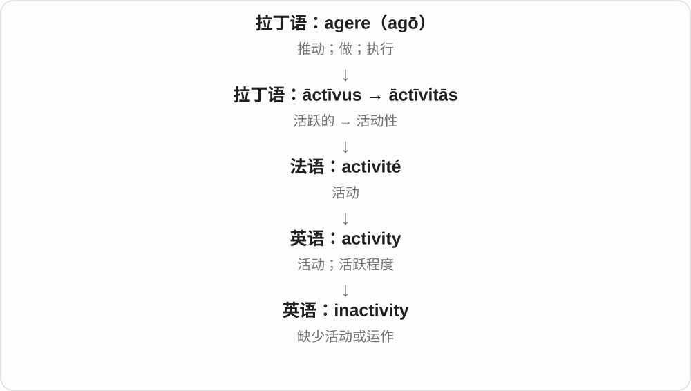

常描述系统闲置、身体活动少或业务没有动静。通常比 inaction 少一些“该处理却没处理”的指责。

**常见搭配与例句**

physical inactivity；a period of inactivity；account inactivity。

> The screen locks after ten minutes of inactivity.

十分钟没有操作后，屏幕会锁定。

> After a period of inactivity, the workshop reopened.

停工一段时间后，作坊重新开门了。

**别混淆**

inactivity 是活动少或没有活动；inaction 常专指面对事情没有采取措施。

### 17. radioactivity — 放射性；放射性活动

**音标**：英 /ˌreɪdiəʊækˈtɪvəti/；美 /ˌreɪdioʊækˈtɪvəti/

**先抓住这个画面**

radioactivity 的画面是不稳定原子核自行发生变化，向外发出粒子或辐射。

**怎么拆**

现代可拆 radio-（辐射）+ activity，或 radioactive + -ity；历史借自法语 radioactivité。这里 radio- 不是“收音机”。

**怎么变成今天的意思**

这里的 active 是发生物理变化，不是说物体活泼。radioactivity 与一般 radiation 的范围不同：并非所有辐射都来自放射性衰变。

**常见搭配与例句**

natural radioactivity；measure radioactivity；levels of radioactivity。

> The instrument measures radioactivity in the sample.

仪器测量样本中的放射性。

> The lesson explains the difference between radioactivity and radiation.

这节课解释放射性与辐射的区别。

**别混淆**

radioactivity 是放射性现象或活动；radiation 是辐射，阳光中的光也属于辐射但不因此叫放射性。

### 18. complex — 复杂的；综合体、建筑群；情结

**音标**：英 /ˈkɒmpleks/；美 /kəmˈpleks/，亦有 /ˈkɑːmpleks/

**先抓住这个画面**

许多部分彼此牵着，动一处会影响别处，就是 complex 的核心画面。它也能把一组相连建筑叫作 a complex。

**怎么拆**

经法语接拉丁 complexus 缠绕、包围，com- 一起与编织的材料相连；-plex 可帮助认同族，但不把每个现代义硬译成折叠。

**怎么变成今天的意思**

**拉丁 com- 一起 + plectere 编织等 → complexus**  
交织、包在一起

↓

**法语 complexe → complex → complexity**  
复杂的、复合体；复杂性

a complex problem 复杂问题；an apartment complex 公寓建筑群；an inferiority complex 自卑情结。

**常见搭配与例句**

a complex problem；an apartment complex。

> The system is more complex than it looks.

系统比看上去复杂。

> They live in a large apartment complex.

他们住在一个大型公寓区。

**别混淆**

complex 突出多部分交织，difficult 只说难；一个很难搬动的单块石头，不必说结构 complex。

### 19. complexity — 复杂性；复杂之处

**音标**：/kəmˈpleksəti/

**先抓住这个画面**

complex 是事情很复杂，complexity 是把这种多部分交织的程度、特点单独拿出来讨论。复数 complexities 常说种种难处。

**怎么拆**

complex + -ity，形成性质名词；前面的 com- 与编织材料仍是理解复杂关系的线索。

**怎么变成今天的意思**

**拉丁 com- 一起 + plectere 编织等 → complexus**  
交织、包在一起

↓

**法语 complexe → complex → complexity**  
复杂的、复合体；复杂性

↓

**complex + -ity → complexity**  
交织的性质、程度；具体复杂之处

the complexity of a system 系统的复杂性；the complexities of a problem 问题的复杂之处；reduce complexity 降低复杂度。

**常见搭配与例句**

the complexity of；reduce complexity。

> The diagram hides the complexity of the system.

图示没有显出系统的复杂性。

> We need to understand the complexities of the case.

我们需要理解这件事的复杂之处。

**别混淆**

complexity 不必是缺点：有的系统需要多层结构；unnecessary complexity 才明确说多余的复杂。

### 20. religious — 宗教的；虔诚信教的

**音标**：/rɪˈlɪdʒəs/

**先抓住这个画面**

religious 可以只是与宗教有关，也可以形容一个人的信仰很虔诚。

**怎么拆**

来自拉丁语 religiōsus，经法语传入；与 religion 平行借入，不是英语里机械去掉 -on 再加 -ous。

**怎么变成今天的意思**

宗教建筑是 religious building，虔信的人是 religious person。词源更早部分同 religion 一样有争议。

**常见搭配与例句**

religious beliefs；religious art；a religious person。

> The museum has a collection of religious art.

博物馆收藏了一批宗教艺术品。

> She comes from a deeply religious family.

她出身于一个十分虔诚信教的家庭。

**别混淆**

religious 不一定表示个人虔信：religious studies 也可以是学术研究领域。

### 21. religiosity — 宗教性、虔诚程度；过分表露的虔诚〔有时含贬义〕

**音标**：英 /rɪˌlɪdʒiˈɒsəti/；美 /rɪˌlɪdʒiˈɑːsəti/

**先抓住这个画面**

不是问属于哪种宗教，而是信仰、实践在生活里占多少分量。学术上可中性测量，某些文章也用它批评表面的过度虔诚。

**怎么拆**

接拉丁 religiositas 等，与 religious 宗教的、虔诚的加 -ity 对应，词干显为 religios-。

**怎么变成今天的意思**

**拉丁 religiosus → religiositas**  
宗教、虔诚的性质

↓

**英语 religious／religiosity**  
宗教性质及实践、虔诚程度

levels of religiosity 宗教性程度；personal religiosity 个人宗教性；public religiosity 公开表现的宗教性。

**常见搭配与例句**

levels of religiosity；personal religiosity。

> The survey asked about changes in personal religiosity.

调查询问个人宗教性程度的变化。

> The essay criticises displays of empty religiosity.

文章批评空洞的虔诚表演。

**别混淆**

religiosity 不等于某一种 religion 宗教；也不必处处贬义，研究文本常是描述性概念。

### 22. responsibility — 责任；职责；责任感

**音标**：英 /rɪˌspɒnsəˈbɪləti/；美 /rɪˌspɑːnsəˈbɪləti/

**先抓住这个画面**

有一件事需要你管好，出了问题也不能简单说与自己无关。

**怎么拆**

英语 responsible + -ity，-ible 对应变为 -ibility；虽然词基来自法语，这个名词是在英语中形成的。

**怎么变成今天的意思**

**拉丁语 spondere，分词 sponsus**  
郑重承诺、作担保

↓

**拉丁语 re- + spondere → respondere；分词 responsus**  
回作承诺 → 回答、回应

↓

**古法语 responsible / responsable → 英语 responsible**  
应对事情作答、交代的 → 负责的

↓

**英语 responsible → responsibility**  
负责的 → 责任、职责

不可数用法常说承担责任这件事；复数 responsibilities 可以列出具体职责。take responsibility 可表示主动接手，也可表示承认后果归己。

**常见搭配与例句**

take responsibility for；a sense of responsibility；daily responsibilities。

> She took responsibility for correcting the mistake.

她承担了纠正错误的责任。

> His new responsibilities include training junior staff.

他的新职责包括培训初级员工。

**别混淆**

duty 偏必须履行的义务；responsibility 也强调对过程和结果承担交代。

### 23. irresponsibility — 不负责任；缺乏责任感

**音标**：英 /ˌɪrɪˌspɒnsəˈbɪləti/；美 /ˌɪrəˌspɑːnsəˈbɪləti/

**先抓住这个画面**

该想到的后果没去想，该照看的事情撒手不管，把这种作风整体指出来。

**怎么拆**

irresponsible + -ity，也可对应 ir- + responsibility；英语构词。

**怎么变成今天的意思**

**拉丁语 spondere，分词 sponsus**  
郑重承诺、作担保

↓

**拉丁语 re- + spondere → respondere；分词 responsus**  
回作承诺 → 回答、回应

↓

**古法语 responsible / responsable → 英语 responsible**  
应对事情作答、交代的 → 负责的

↓

**英语 irresponsible → irresponsibility**  
不负责的 → 不负责任的状态或行为

通常用于批评态度或决定。老或法律语境也可能讨论不承担责任的地位，要由上下文判断，不可都当人格评价。

**常见搭配与例句**

financial irresponsibility；an act of irresponsibility。

> The manager criticized the irresponsibility of ignoring repeated warnings.

经理批评了无视多次警告这种不负责任的做法。

> The story explores the consequences of financial irresponsibility.

故事探讨了财务上不负责任所带来的后果。

**别混淆**

inexperience 是缺经验；irresponsibility 是没有尽到应有的责任，不能把新手自动等同失责。

### 24. solid — 固体的、实心的；结实可靠的、扎实的；连续整整的

**音标**：英 /ˈsɒlɪd/；美 /ˈsɑːlɪd/

**先抓住这个画面**

不是空壳、不是一碰就散，有实在支撑。木头、论据、朋友都能借这感觉；但科学里的固体不等于每件都硬得像石头。

**怎么拆**

经法语 solide 接拉丁 solidus 完整、坚实等，中古英语已有对应形式。物理实体、可靠性与完整程度各自延伸，不拆成 sol 太阳 + id。

**怎么变成今天的意思**

**拉丁 solidus → 法语 solide → 中古英语 solide → solid**  
完整、坚实 → 实心、稳固、可靠

↓

**现代 solid 的不同场景**  
固体、实心材料；扎实的理由、稳定的表现等

solid wood 实木，solid evidence 扎实证据，a solid friend 可靠朋友，a solid hour 整整一小时；a solid 固体，与 liquid、gas 对看。

**常见搭配与例句**

solid wood；solid evidence；a solid performance；a solid hour。

> The table is made of solid wood.

桌子是实木做的。

> We need solid evidence before making a claim.

提出主张前，我们需要扎实证据。

**别混淆**

solid 与 hollow 实心与空心，solid 与 liquid 固态与液态，是两种不同对比；泡沫等可以是固体却并非处处实心，不能混用标准。

### 25. solidity — 坚固、稳固；扎实、可靠的性质

**音标**：/səˈlɪdəti/

**先抓住这个画面**

不是一次做得不错，而是整体有稳稳的支撑感：墙体结实，论证经得起问，团队不轻易崩掉。

**怎么拆**

对应 solid + -ity，历史有法语 solidité、拉丁 soliditās 的独立名词路径。重音移到第二音节，不读成 solid 原重音再随便加尾。

**怎么变成今天的意思**

**拉丁 solidus → 法语 solide → 中古英语 solide → solid**  
完整、坚实 → 实心、稳固、可靠

↓

**拉丁 soliditās → 法语 solidité → solidity**  
坚实、完整的性质；现代与 solid 对应

the solidity of the structure 结构的坚固，financial solidity 财务稳健，the solidity of an argument 论证的扎实。

**常见搭配与例句**

the solidity of；financial solidity；structural solidity。

> The engineer checked the solidity of the structure.

工程师检查了结构的稳固程度。

> The team’s success rested on the solidity of its defence.

球队的成功靠的是防守稳固。

**别混淆**

solidity 是坚实、可靠的性质，solidification 是变成固体、变牢固的过程；有稳固不表示刚发生了固化。

### 26. electricity — 电；电力；电现象

**音标**：/ɪˌlekˈtrɪsəti/

**先抓住这个画面**

同一个“电”可以是琥珀吸纸屑的现象，也可以是给家里照明的电力。这个名词把许多与电荷有关的现象归到一起。

**怎么拆**

英语电学词基 electric + -ity 形成名词，近代拉丁 electricus 是重要背景；-ic- 在这个名词里读 /ɪs/。

**怎么变成今天的意思**

**古希腊 elektron → 拉丁 electrum**  
琥珀；摩擦后能吸引轻小物体

↓

**近代拉丁 electricus**  
像琥珀那样具有电性；吉尔伯特在 1600 年用于这一现象

↓

**英语 electric 词基 + -ity → electricity**  
电性、电现象 → 日常的电、电力

generate electricity 是发电；an electricity bill 是电费账单。科学上它涵盖电荷及相关现象；日常谈 supply、bill 时通常指供给和消耗的电能。

**常见搭配与例句**

generate electricity；an electricity supply；an electricity bill。

> The village gained a reliable electricity supply.

这个村庄有了稳定的电力供应。

> The experiment demonstrates static electricity.

这个实验展示了静电现象。

**别混淆**

electric 是形容词，electricity 是名词；current 是电流，不能替代 electricity 的所有用法。

### 27. minority — 少数；少数群体；未成年时期

**音标**：英 /maɪˈnɒrəti/；美 /maɪˈnɔːrəti/

**先抓住这个画面**

把一个群体分开看，其中人数较少的那一部分。

**怎么拆**

经法语 minorité 来自后期拉丁语 minoritas，源于 minor“较小、较年轻”；数量少数和未成年义是相关但不同的用法。

**怎么变成今天的意思**

**拉丁语：minor / minus**  
较小、较少；小于另一方

↓

**后期拉丁语 minoritas → 法语 minorité → 英语 minority**  
较小的状态；未成年；少数

a minority of voters 是少数选民；社会语境的 minority group 还可能涉及社会权力位置，不能只机械数人数。

**常见搭配与例句**

be in the minority；a minority opinion；ethnic minorities。

> Only a minority of members opposed the proposal.

只有少数成员反对这项提案。

> The museum records the histories of local minority communities.

博物馆记录了当地少数群体的历史。

**别混淆**

majority 是多数；minority 是少数。少数意见也可能合理，词本身不评价对错。

### 28. priority — 优先地位；优先事项；先做某事的权利

**音标**：英 /praɪˈɒrəti/；美 /praɪˈɔːrəti/

**先抓住这个画面**

把事情排成一列，应该先处理的放前面；这个前排位置就是 priority。

**怎么拆**

中世纪拉丁 priōritās 经法语或直接借入。现代可联系 prior + -ity，但名词进入英语早于现代 prior 形容词。

**怎么变成今天的意思**

**古拉丁 pri；拉丁 prior**  
在前 → 较早的、居前的

↓

**中世纪拉丁 priōritās → 古法语 priorite → 英语 priority**  
居前的状态 → 优先地位、优先事项

Safety is a priority 是安全属于优先事项；give priority to 是给予优先处理。它既可说重要性，也可说通行、办理顺序上的优先。

**常见搭配与例句**

a top priority；give priority to；take priority over；set priorities。

> Our first priority is to make sure everyone is safe.

我们的第一要务是确保所有人安全。

> Emergency vehicles take priority over other traffic.

应急车辆享有比其他车辆优先通行的权利。

**别混淆**

urgent 是时间紧；a priority 是被排在前面的事。重要事项未必马上到期，紧急事项也未必最重要。

### 29. density — 密度；密集程度

**音标**：/ˈdensəti/

**先抓住这个画面**

问的不是一共多少，而是同样大小的一块空间里有多少。两座城人数相同，面积更小的那座人口密度通常更高。

**怎么拆**

现代可对应 dense + -ity；实际名词经法语 densité，远接拉丁 densitas“密、厚的状态”，也有直接拉丁借入分析，不必经过英语 dense 才成立。

**怎么变成今天的意思**

**拉丁 densus**  
密、厚、挤在一起的；更早来源未定

↓

**拉丁 densitas → 古法语 dempsité／法语 densité**  
密集、厚实的状态

↓

**法语／拉丁名词 → 英语 density**  
密集程度；发展为各类单位空间中的数量指标

population density 通常按单位面积人口数计算。物理中的 mass density 是单位体积的质量，不等于一件物体的总质量。文字的 density 则说内容挤得多紧。

**常见搭配与例句**

population density；mass density；high density；the density of information。

> The map shows population density rather than total population.

这张地图显示的是人口密度，而不是人口总数。

> Two blocks of the same size can have very different densities.

两块大小相同的材料，密度可能相差很大。

**别混淆**

mass 是质量，volume 是体积，mass density 是质量除以体积。人口密度用人数除面积，不能把所有 density 都解释成质量。

### 30. diversity — 多样性；差异的丰富程度

**音标**：英 /daɪˈvɜːsəti/；美 /daɪˈvɜːrsəti/、/dɪˈvɜːrsəti/

**先抓住这个画面**

不只看数量多不多，还看是不是只有同一种：一千棵同种树数量很多，种类却未必丰富。

**怎么拆**

拉丁语 dīversitās，经法语 diversité 进入英语；现代与 diverse + -ity 对应。

**怎么变成今天的意思**

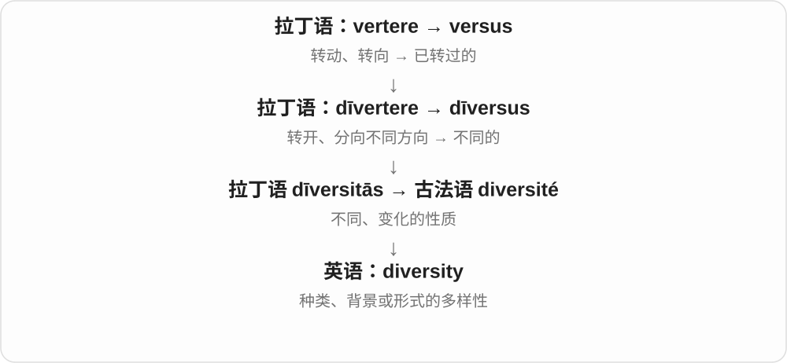

可说 biodiversity、cultural diversity、diversity of opinion。它要配合具体维度理解，不是所有“不同”都能用一个数字概括。

**常见搭配与例句**

cultural diversity；a diversity of views；biological diversity。

> The survey revealed a surprising diversity of opinions.

调查显示人们的意见出人意料地多样。

> The exhibition celebrates the diversity of local traditions.

展览展示并赞美当地传统的多样性。

**别混淆**

variety 也说种类；diversity 更常用于整体构成及差异分布的讨论。

### 31. equality — 相等；平等

**音标**：英 /iˈkwɒləti/；美 /iˈkwɑːləti/

**先抓住这个画面**

把比较的双方放在同一水平上，没有高一等、低一等。

**怎么拆**

借法语 equalité，接拉丁 aequalitas；现代能看作 equal + -ity，但名词本身在拉丁语和法语中已经存在。

**怎么变成今天的意思**

**拉丁 aequus**  
平、等量、公平、平稳

↓

**拉丁 aequalis → aequalitas → 法语 equalité**  
相等的 → 相等、平等这种状态

↓

**英语 equality**  
相等；权利、地位等方面的平等

equality of opportunity 说机会平等；numerical equality 说数值相等。平等究竟比较机会、规则还是结果，要看后面的具体说明，不能一概当成所有人完全相同。

**常见搭配与例句**

equality of opportunity；gender equality；equality before the law；numerical equality。

> The school discussed equality of opportunity in its admissions process.

学校讨论了招生过程中机会平等的问题。

> The calculation confirms the equality of the two expressions.

计算确认了两个表达式的值相等。

**别混淆**

similarity 只要求相似；equality 在所指标准下要求相等。equity 则侧重公平判断，与 equality 有关联却不总能互换。

### 32. inequality — 不平等；差距；不等式

**音标**：英 /ˌɪnɪˈkwɒləti/；美 /ˌɪnɪˈkwɑːləti/

**先抓住这个画面**

社会里说人们处在不同水平；数学里比较两边的大小关系。

**怎么拆**

经古法语 inequalité 或中世纪拉丁 inaequalitas 借入，接拉丁 in- + aequalis。现代可看成 in- + equality，但历史名词不是只在英语里临时加前缀。

**怎么变成今天的意思**

**拉丁 aequus**  
平、等量、公平、平稳

↓

**拉丁 in- + aequalis → inaequalis → inaequalitas**  
不相等的 → 不相等这种状态

↓

**古法语 inequalité／拉丁借入 → 英语 inequality**  
地位、数量等差距；数学不等式

income inequality 是收入差距；solve an inequality 是求出使大小关系成立的取值。数学里的 <、>、≤、≥ 表达不同关系，≤ 与 ≥ 还允许边界处相等。

**常见搭配与例句**

income inequality；social inequality；reduce inequality；solve an inequality。

> The report compares income inequality across the three regions.

报告比较了三个地区的收入差距。

> Every number greater than three satisfies this inequality.

每个大于三的数都满足这个不等式。

**别混淆**

inequity 直接强调不公；inequality 可先描述差距，社会讨论中也常带不公意味。数学不等式则没有这种道德评价。

### 33. popularity — 受欢迎程度；流行

**音标**：英 /ˌpɒpjəˈlærəti/；美 /ˌpɑːpjəˈlærəti/

**先抓住这个画面**

有多少人喜欢、支持或使用它，把这种受欢迎的状态单独拿出来看。

**怎么拆**

法语 popularité 及拉丁 populāritās 属于 popular 的词族；英语借入后，现代可按 popular + -ity 理解。

**怎么变成今天的意思**

**拉丁 populus**  
人民、人群；更早来源未定

↓

**拉丁 populāritās → 法语 popularité → 英语 popularity**  
与人民相关的状态、讨好民众等旧义 → 受欢迎程度

gain popularity 是越来越受欢迎；decline in popularity 是热度或支持减少。它描述受欢迎程度，不自动证明品质、正确性或道德优越。

**常见搭配与例句**

gain popularity；grow in popularity；a popularity contest。

> The sport has grown in popularity among younger players.

这项运动在年轻运动者中越来越受欢迎。

> The café’s popularity increased after it extended its opening hours.

咖啡馆延长营业时间后，更受欢迎了。

**别混淆**

population 是人口、总体；popularity 是受欢迎程度，人很多的地方未必受欢迎。

### 34. gravity — 重力；引力；严重性；庄重

**音标**：/ˈɡrævəti/

**先抓住这个画面**

一边是让物体相互吸引的物理作用，一边是事情在人心里有多大分量。

**怎么拆**

接拉丁 gravitas，经法语 gravité 或直接借入；英语早期先有重量、庄重、严重性等义，科学用法后来发展。

**怎么变成今天的意思**

**拉丁语 gravis**  
重的；分量大、难承受、严肃的

↓

**拉丁语 gravitas → 法语 gravité 或直接借入 → 英语 gravity**  
重量、庄重 → 严重性；重力、引力

gravity 让苹果落地，也参与维持行星轨道，不只存在于地球。the gravity of the situation 则是形势的严重性。weight 是物体受到的重力大小或日常所说重量，不能把 gravity 当作某物的质量。

**常见搭配与例句**

the force of gravity；Earth’s gravity；the gravity of the situation。

> Gravity keeps the Moon in orbit around Earth.

引力使月球保持绕地球运行。

> She did not immediately understand the gravity of the situation.

她没有立刻意识到局势有多严重。

**别混淆**

gravity 与 gravitation 在引力义上有重叠，gravity 更日常。gravitas 则专说人的庄重分量，不说地球引力。

### 35. liability — 责任；负债；累赘

**音标**：/ˌlaɪəˈbɪləti/

**先抓住这个画面**

liability 可以指必须承担的责任或债务，也可以比喻一个给你带来风险和负担的人或事物。财务报表中的 liabilities 通常译作负债。

**怎么拆**

liable + -ity，形成性质或事项名词。-able 对应 -ability 的形态与 reliable → reliability 相似。

**怎么变成今天的意思**

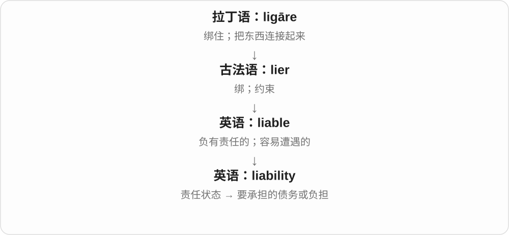

“被责任约束”名词化后，可以指约束本身，也可以指具体必须履行的债务。如果一个人持续让团队承担后果，他就可能被比喻成 a liability。这个比喻通常相当负面。

**常见搭配与例句**

legal liability（法律责任）；assets and liabilities（资产与负债）；become a liability（成为负担）。

> The accountant reviewed the company’s assets and liabilities.

会计审查了公司的资产和负债。

> His refusal to cooperate became a liability for the team.

他拒绝合作，成了团队的负担。

**别混淆**

liability 是需要承担的一方；asset 是有价值、能带来好处的一方。两词既可谈财务，也可用于评价团队成员或个人条件。

### 36. reliability — 可靠性；信度

**音标**：/rɪˌlaɪəˈbɪləti/

**先抓住这个画面**

reliability 把“可靠”变成可以讨论、比较或衡量的性质。工程语境关心系统能否稳定工作；测量语境关心结果能否一致复现。

**怎么拆**

reliable + -ity，-able 在这类名词中对应 -ability。不要把它误读成 rely + ability“依赖的能力”；重点是被评价对象的可靠程度。

**怎么变成今天的意思**

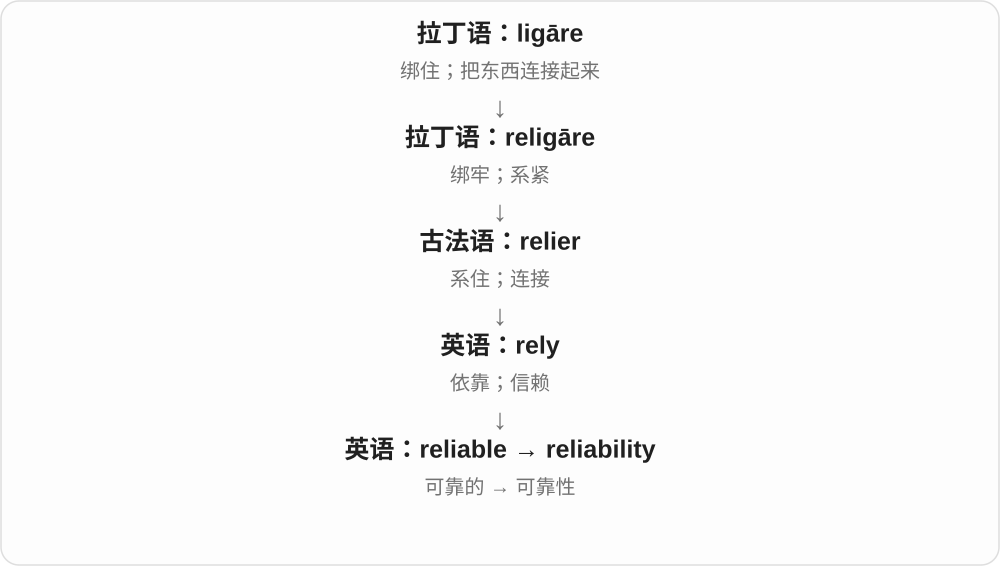

这一步发生在英语派生层面：由形容词描述对象，转为名词讨论这种属性。重音移到 -bil- 所在音节，说明派生不仅改变词性，也可能改变读音。

**常见搭配与例句**

improve reliability（提高可靠性）；system reliability（系统可靠性）；the reliability of the results（结果的可靠程度）。

> The upgrade improved the reliability of the network.

这次升级提高了网络的可靠性。

> The researchers checked the reliability of the questionnaire.

研究人员检验了这份问卷的信度。

**别混淆**

reliability 与 validity 不同：前者看结果是否稳定一致，后者看测量或判断是否真正符合所要测的对象。

### 37. productivity — 生产率；工作效率；产出能力

**音标**：英 /ˌprɒdʌkˈtɪvəti/；美 /ˌprɑːdʌkˈtɪvəti/

**先抓住这个画面**

productivity 问的是“投入这么多时间、人力或资源，做出了多少”。不是只数忙了几小时，而是看这些投入带来了什么。

**怎么拆**

productive + -ity，去掉词尾 e，形成表示性质或程度的名词。

**怎么变成今天的意思**

经济分析里常按单位投入衡量产出；日常也泛指完成工作的能力。讨论时最好说清楚自己衡量的是数量、质量还是某个具体结果。

**常见搭配与例句**

improve productivity（提高生产率）；labor productivity（劳动生产率）；productivity gains（效率提升）。

> Better tools increased productivity without extending working hours.

更好的工具提高了效率，而没有延长工时。

> The report measures productivity as output per worker.

报告用每位员工的产出衡量生产率。

**别混淆**

production 可以只是总产量；productivity 更关心产量相对于投入。多雇一倍人、多产一倍，不一定提高生产率。

### 38. intensity — 强度；强烈程度

**音标**：/ɪnˈtensəti/

**先抓住这个画面**

intensity 像给强烈程度配一把尺：灯有多亮，训练有多猛，情绪有多强。

**怎么拆**

intense + -ity；也有中世纪拉丁语 intensitās 的对应形式。

**怎么变成今天的意思**

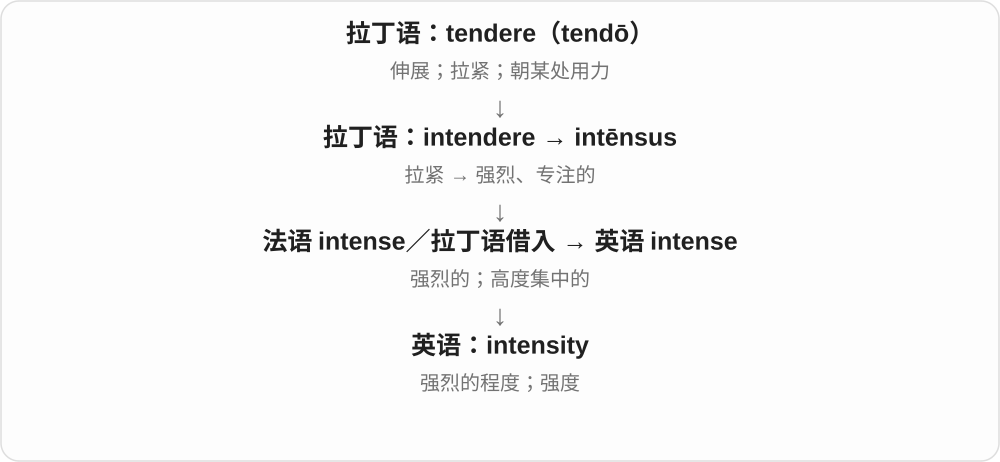

不同学科的具体量和单位不一样；日常只说某种作用或感受的强弱。

**常见搭配与例句**

light intensity；high intensity；the intensity of feeling。

> The light gradually increased in intensity.

光线强度逐渐增加。

> I was surprised by the intensity of her reaction.

她反应那么强烈，让我吃了一惊。

**别混淆**

intensity 强度；duration 时长。短暂的声音也可以非常强。

### 39. availability — 可获得性；有货、可用情况；空闲时间

**音标**：英、美 /əˌveɪləˈbɪləti/

**先抓住这个画面**

不只问“有没有”，还问什么时间、多少数量、哪些人能用到。

**怎么拆**

available 的 -able 变为 -ability，形成状态名词。

**怎么变成今天的意思**

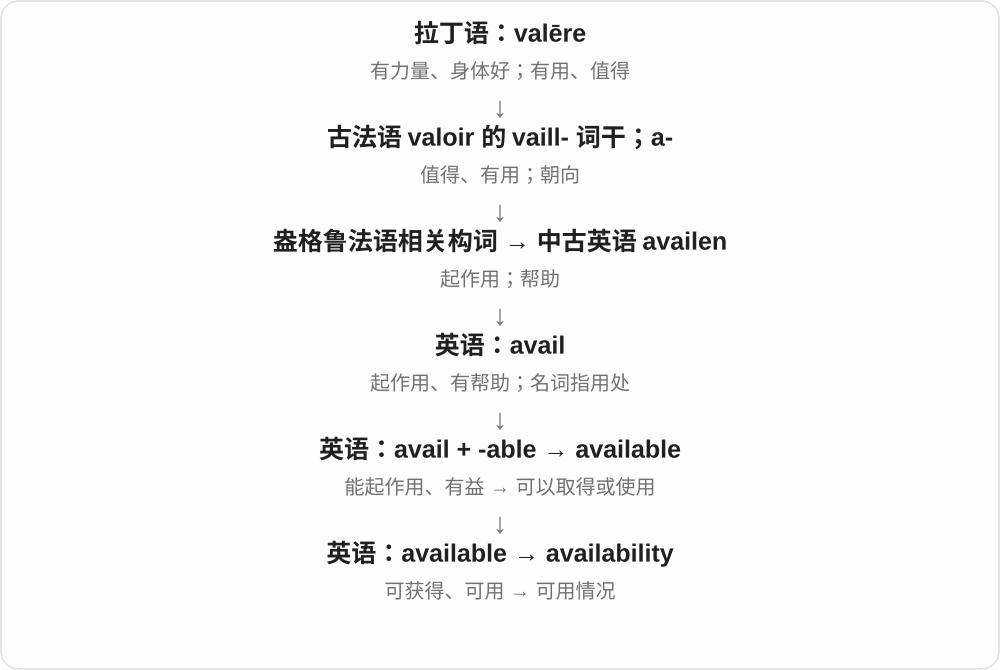

check availability 可以查房间、票或人的时间。limited availability 是供应或可用名额有限，不一定已经完全没有。

**常见搭配与例句**

check availability；subject to availability；staff availability。

> Please send me your availability for next week.

请把你下周有空的时间发给我。

> The website shows the current availability of each room.

网站显示每个房间目前是否可订。

**别混淆**

availability 看有得用的情况；affordability 看价格是否负担得起。

### 40. entity — 实体；可单独看待的事物、组织或存在

**音标**：/ˈentəti/

**先抓住这个画面**

把它当成一件可以单独指认、讨论的东西，而不只是一团零散部分，就能说 an entity。它可以是机构，也可以是抽象对象。

**怎么拆**

接中世纪拉丁 entitas 存在，来自 ens、词干 ent- 存在者与性质名词 -tas，较早联系 esse 是、存在。英语由存在这个抽象性质发展为一个存在的单位。

**怎么变成今天的意思**

**拉丁 ens／ent- + -tas → entitas**  
存在者 → 存在这一性质

↓

**英语 entity**  
存在；后来可指一个独立看待的事物、组织

a separate entity 一个独立单位；a legal entity 法律主体、法人等按文本看；a business entity 商业实体；a single entity 一个整体单位。

**常见搭配与例句**

treat something as an entity；distinct entities。

> The two departments operate as separate entities.

两个部门作为独立单位运作。

> The system treats each customer as a distinct entity.

系统把每位客户作为一个单独的实体处理。

**别混淆**

entity 不要求一定能摸到。数据库中的对象、讨论中的机构也可这样叫；physical entity 才特意强调物理上存在的东西。

### 41. entities — 实体；独立存在的事物、组织〔复数〕

**音标**：/ˈentɪtiz/

**先抓住这个画面**

把一个事物当成能单独识别、讨论的单位，就是 entity；不要求都能用手摸到，一家公司、一项数据对象也可以这样看。

**怎么拆**

entity 的辅音字母加 y 改为 ies，末尾 /tiz/。entity 接中世纪拉丁 entitas 存在，ens、ent- 存在者加性质名词 -tas，较早联系 esse 是、存在。

**怎么变成今天的意思**

**中世纪拉丁 ens、ent- + -tas → entitas → entity**  
存在这一性质 → 一个独立看待的存在

↓

**entity → entities**  
多个独立事物、组织、数据对象

separate entities 独立实体；different entities 不同对象；business entities 经营组织。

**常见搭配与例句**

named entities 有名称的对象；entities in a model 模型里的实体。

> The two departments operate as separate entities.

两个部门作为独立单位运作。

> The model describes relationships between different entities.

模型描述不同实体之间的关系。

**别混淆**

entities 不等于全部是实心物体，强调可作为独立单位识别。entries 是条目、参赛者等，拼写相近但不是这个词的另一种复数。

### 42. capability — 能力；可实现的功能

**音标**：/ˌkeɪpəˈbɪləti/

**先抓住这个画面**

capable 说“它做得到”，capability 就把“做得到的本领”单独拿出来讨论。软件功能、机器性能和人的技能都能用这个词。

**怎么拆**

capable + -ity；-able 在名词中变为 -ability，重音移到 -bil-。这一步是英语内部派生。

**怎么变成今天的意思**

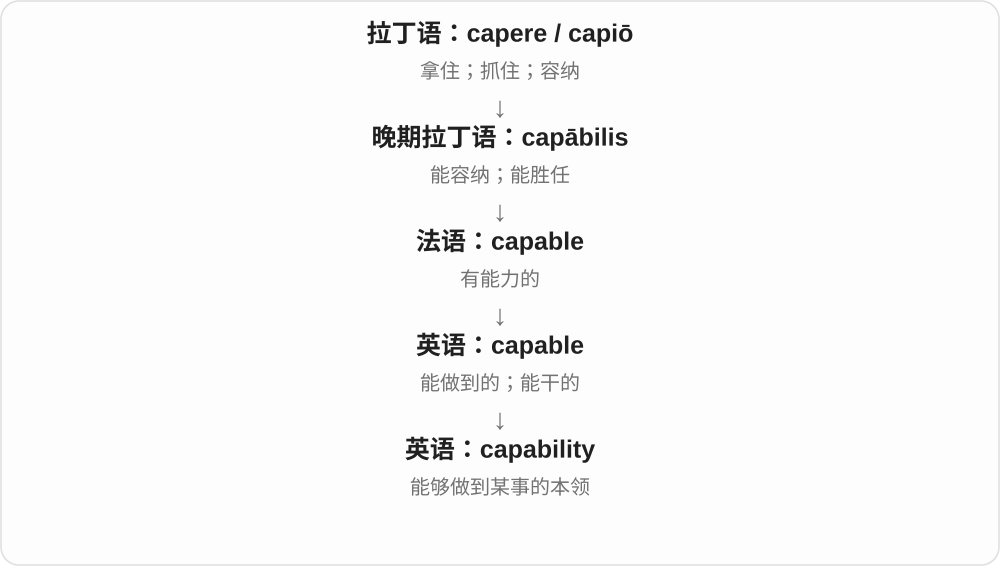

词义没有突然变：只是从描述一个人或设备，转为谈它具有什么本领。复数 capabilities 常强调好几种不同能力。

**常见搭配与例句**

technical capability；develop a capability；the capability to do…。

> The new software has the capability to recognize handwriting.

新软件具备识别手写文字的能力。

> The training helped the team develop new capabilities.

这次培训帮助团队培养了新的能力。

**别混淆**

capability 常问“能做什么”；capacity 还常问“最多能装多少、处理多少”。二者有重叠，但侧重点不同。

### 43. quantity — 数量、量；一批、一定量

**音标**：英 /ˈkwɒntəti/；美 /ˈkwɑːntəti/

**先抓住这个画面**

不是先问东西好不好，而是问有多少：多少水、多少件货、多少份材料，都在看 quantity。

**怎么拆**

经法语 quantite 接拉丁 quantitas 数量、大小，来自 quantus 多少、多大。末尾接性质、状态名词材料，与英语 -ity 对应；quantum、quantify 共享较早的多少材料。

**怎么变成今天的意思**

**拉丁 quantus → quantitas → 法语 quantite**  
多少、多大 → 数量、量的性质

↓

**英语 quantity**  
数量；某一批、某一定量

a large quantity of water 大量水；small quantities 少量、几小批；in quantity 大量地；quantity and quality 数量与质量。

**常见搭配与例句**

the quantity of material；produce in large quantities。

> Only a small quantity of water is needed.

只需要少量水。

> The factory produces the parts in large quantities.

工厂大批量生产这些零件。

**别混淆**

quantity 关心多少，quality 关心好坏、品质。quantity 可以用于可数或不可数对象，不必把它只限成中文的件数。

### 44. quantities — 数量；若干量，批量〔复数〕

**音标**：英 /ˈkwɒntətiz/；美 /ˈkwɑːntətiz/

**先抓住这个画面**

一批批材料用了多少、一个个量有多大，都能说 quantities。large quantities of rice，就是大量米。

**怎么拆**

quantity 的辅音字母 + y 词尾变复数：y 改 i，再加 -es → quantities，读音保留末尾 /i/ 再加 /z/。quantity 远接拉丁 quantus 多少、多大与 quantitas 数量。

**怎么变成今天的意思**

**拉丁 quantus 多少、多大 → quantitas → 法语 quantité**  
把多少、多大的性质说成数量名词

↓

**英语 quantity → quantities**  
y 改 i 加 -es，保留原词的 /i/ 音

large quantities of water 是大量水；small quantities 是少量、少量的批次；quantities of material 是材料数量。

**常见搭配与例句**

large quantities of water；small quantities；quantities of material。

> The recipe needs only small quantities of each spice.

这份食谱每种香料都只需要少量。

> The workers moved large quantities of sand.

工人们搬运了大量沙子。

**别混淆**

a quantity of 后可接水、米等不可数物；quantities 是量、批次的复数，不要求后面的物质也能逐个数。

### 45. quantitative — 数量的；定量的〔形容词〕

**音标**：英 /ˈkwɒntɪtətɪv/；美 /ˈkwɑːntəteɪtɪv/

**先抓住这个画面**

问有多少、多大、变化了多少，用数字、数量来分析，是 quantitative。它关心可数、可测的量。

**怎么拆**

与 quantity 数量对照学习；历史上 quantitative 接中世纪拉丁 quantitativus，来自拉丁 quantitas 数量。quantitat- 数量词干 + -ive 性质形容词可帮助看清结构。

**怎么变成今天的意思**

**拉丁 quantitas 数量 → 中世纪拉丁 quantitativus**  
关于数量、具有数量性质

↓

**英语 quantitative**  
现代常指用数量、测量、数值描述的方式

quantitative data 是定量数据；quantitative analysis 是定量分析；a quantitative comparison 是数量上的比较。

**常见搭配与例句**

quantitative data；quantitative analysis；a quantitative comparison。

> The report includes a quantitative comparison of the two designs.

报告包含了对两个设计的定量比较。

> The students collected quantitative data on room sizes.

学生们收集了房间大小的定量数据。

**别混淆**

quantitative 关注多少、数值，qualitative 更关注性质、类型、体验等描述。一个研究可以同时使用两种方式。

### 46. quantify — 量化；确定、表达数量

**音标**：英 /ˈkwɒntɪfaɪ/；美 /ˈkwɑːntɪfaɪ/

**先抓住这个画面**

只说“影响挺大”还很模糊；改成节省几小时、少花多少钱，就是在尝试 quantify：给影响一个数量表达。

**怎么拆**

接中世纪拉丁相应数量构词，现代可认 quant- 数量 + -ify 使成、表示成。不能以为加上数字就自动准确。

**怎么变成今天的意思**

**拉丁 quantus 等数量材料 → 中世纪拉丁 quantificare 等**  
多少；用数量来表达

↓

**英语 quantify → quantifiable**  
量化；能量化的

quantify the impact 量化影响；quantify the benefits 量化收益；hard to quantify 难以量化。

**常见搭配与例句**

quantify the cost；difficult to quantify。

> The team tried to quantify the time saved by the new tool.

团队试着量化新工具节省的时间。

> Some benefits are difficult to quantify.

有些好处很难用数字表达。

**别混淆**

quantify 是给出数量表达，qualify 常说取得资格、加以限定；一个突出多少，一个常与资格、条件有关。

### 47. dignity — 尊严；庄重、体面

**音标**：/ˈdɪɡnəti/

**先抓住这个画面**

无论处境好坏，都应被当作一个值得尊重的人，这一层是 dignity；面对困难仍保持沉着体面，也常用它。

**怎么拆**

经法语 dignité 接拉丁 dignitas，来自 dignus 值得、合宜；词干 dign- 与 -ity 对应，不存在现代独立词 dig 表挖而派生尊严。

**怎么变成今天的意思**

**拉丁 dignus 值得、合宜 → dignitas → 法语 dignité**  
值得尊重的地位、品质

↓

**英语 dignity；拉丁 indignitas → indignity**  
尊严；不相称、不尊重的对待、侮辱

human dignity 人的尊严；treat someone with dignity 尊重地对待；maintain dignity 保持尊严、体面。

**常见搭配与例句**

human dignity；with dignity。

> Everyone should be treated with dignity.

每个人都应受到尊重。

> She accepted the decision with dignity.

她体面沉着地接受了决定。

**别混淆**

dignity 不只属于有头衔的人；dignitary 才是显要人物的称呼，两词不能按社会地位混为一谈。

### 48. dainty — 小巧精致的；秀气、精细的

**音标**：英、美 /ˈdeɪnti/

**先抓住这个画面**

小小的瓷杯、做得精巧的一口点心，轻巧而讲究，可以叫 dainty。它不只是尺寸小，还带细致、漂亮的感觉。

**怎么拆**

经法语 deintie 等价值、珍品相关词，接拉丁 dignitas 价值、尊贵，与 dignity 同源。英语由珍贵、上好的东西，发展到精巧、细致的外观评价。

**怎么变成今天的意思**

**拉丁 dignitas 价值、尊贵 → 法语 deintie → 英语早期 dainty**  
先有珍品、精美食物等名词及令人喜欢的评价

↓

**上好的、精美的 → 小巧精致、动作细巧**  
现代不能说成英语 dignity 换拼后加 -y

dainty cups 是小巧精致的杯子；dainty sandwiches 是精巧小三明治；dainty steps 是轻巧秀气的步子。

**常见搭配与例句**

dainty cups；dainty sandwiches；dainty steps。

> Tea was served in dainty porcelain cups.

茶用小巧精致的瓷杯端上来。

> She arranged the dainty sandwiches on a plate.

她把精巧的小三明治摆在盘子上。

**别混淆**

small 只说小，dainty 通常还说精致、轻巧。它与 dignity 的联系属于历史借词路线，现代含义已经分开。

### 49. indignity — 侮辱；有损尊严的对待、经历

**音标**：/ɪnˈdɪɡnəti/

**先抓住这个画面**

把人晾在一边、当众羞辱，伤害的不是一件物品，而是这个人应受的尊重，这类待遇叫 an indignity。

**怎么拆**

借拉丁 indignitas，来自 indignus 不合身份、不值得等，in- 否定与 dign- 值得材料相连。现代可与 dignity 对照，但不是缺少自信的简单标签。

**怎么变成今天的意思**

**拉丁 dignus 值得、合宜 → dignitas → 法语 dignité**  
值得尊重的地位、品质

↓

**英语 dignity；拉丁 indignitas → indignity**  
尊严；不相称、不尊重的对待、侮辱

↓

**拉丁 indignitas → indignity**  
不相称、不尊重 → 侮辱、有损尊严的经历

suffer an indignity 遭受侮辱；the indignity of something 某事带来的屈辱；further indignities 更多羞辱。

**常见搭配与例句**

suffer an indignity；the indignity of。

> They endured the indignity of being ignored.

他们忍受了被无视的屈辱。

> She refused to accept further indignities.

她拒绝继续忍受羞辱。

**别混淆**

indignity 是有损尊严的事、待遇，indignation 是对此类不公产生的愤慨；一个常是遭遇，一个是情绪。

### 50. flexibility — 柔韧性；灵活性；调整余地

**音标**：/ˌfleksɪˈbɪlɪti/

**先抓住这个画面**

不是只有一条死路，而是还有几种可以转弯的选择。

**怎么拆**

现代与 flexible + -ity 对应；历史名词接晚期拉丁 flexibilitas、法语 flexibilité。

**怎么变成今天的意思**

**拉丁 flectere；分词 flexus**  
弯曲、使转向

↓

**拉丁 flexibilis → 晚期拉丁 flexibilitas**  
可弯曲的 → 可弯曲、可顺应的性质

↓

**法语 flexibilité → 英语 flexibility**  
柔韧性、灵活性

材料的 flexibility 说能弯到什么程度；安排的 flexibility 说能否根据需要改变。have the flexibility to work from home 是有这种选择余地，不代表每天都必须在家工作。这个名词把“能够调整”当作一种资源或性质来谈。

**常见搭配与例句**

give someone flexibility；flexibility in scheduling；the flexibility to do something。

> The new system gives teachers more flexibility.

新制度给教师更多调整空间。

> We tested the flexibility of the material.

我们测试了这种材料的柔韧性。

**别混淆**

flexibility 是灵活性；instability 是不稳定。能按需调整，不等于无缘无故乱变。

### 51. inflexibility — 僵硬；缺少变通；不灵活

**音标**：/ɪnˌfleksəˈbɪlɪti/

**先抓住这个画面**

需要转弯时，制度或态度却卡在那里动不了。

**怎么拆**

与 inflexible + -ity 对应；历史上也有法语 inflexibilité 的借入链，不必从英语 flexibility 再加 in- 倒推。

**怎么变成今天的意思**

**拉丁 flectere；分词 flexus**  
弯曲、使转向

↓

**拉丁 inflexibilis 及其法语词族**  
不能弯、不能变通

↓

**法语 inflexibilité → 英语 inflexibility**  
僵硬、不灵活这一性质

the inflexibility of the system 可以指改一个小安排都办不到。批评某人的 inflexibility，通常是在说他面对新信息仍不肯调整，而不是说他身体不够柔韧；后者要靠运动、材料等语境判断。

**常见搭配与例句**

the inflexibility of a system；criticize someone’s inflexibility。

> The inflexibility of the booking system frustrated customers.

预订系统无法灵活调整，让顾客很不满。

> Her inflexibility made compromise difficult.

她不肯变通，使妥协变得困难。

**别混淆**

inflexibility 强调缺少调整空间；consistency 强调前后原则一致，不天然是缺点。

### 52. creativity — 创造力；创意

**音标**：英、美 /ˌkriːeɪˈtɪvəti/，亦 /ˌkriːəˈtɪvəti/

**先抓住这个画面**

遇到问题时能想出新的角度、组合或办法，而不是只照着老步骤重复。

**怎么拆**

creative + -ity，词尾 e 脱落，重音移到 /tɪv/；十九世纪形成这个常用性质名词。

**怎么变成今天的意思**

**拉丁语 creare**  
使产生、创造、生育；远源与生长相联系

↓

**英语 create + -ive；另有后期拉丁语 creativus 对应来源说**  
具有创造作用或能力

↓

**英语 creative**  
有创造力的、有创意的

↓

**英语 creative + -ity → creativity**  
有创造力的 → 创造能力

艺术需要 creativity，解决日常问题也需要。它不只是会画画，也不意味着想法越奇怪越好，仍要看任务和实际效果。

**常见搭配与例句**

encourage creativity；show creativity；room for creativity。

> The task leaves plenty of room for creativity.

这项任务留出了很大的创意空间。

> She used creativity to solve the problem with limited materials.

她发挥创造力，用有限材料解决了问题。

**别混淆**

creation 是做出的作品或创造行为；creativity 是想出并发展新办法的能力。

### 53. publicity — 宣传；媒体关注；公众注意

**音标**：/pʌbˈlɪsəti/

**先抓住这个画面**

一件事被报道、被议论，走进更多人的视线。

**怎么拆**

法语 publicité 接中世纪拉丁 publicitas，远接 publicus；现代可按 public + -ity 联想，历史先有公开状态义，后来发展成宣传、曝光。

**怎么变成今天的意思**

**拉丁 populus → 早期 poplicus → publicus**  
民众 → 属于民众、公共的；词形变化可能受 pubes 影响

↓

**中世纪拉丁 publicitas → 法语 publicité → 英语 publicity**  
公开状态 → 让公众知道；媒体关注与宣传

good publicity 是好宣传、正面关注；bad publicity 是负面曝光。publicity 并不保证是本人主动争取的，也不保证内容正面。

**常见搭配与例句**

attract publicity；bad publicity；a publicity campaign；a publicity stunt。

> The award brought the small theatre a great deal of publicity.

这项奖为这家小剧院带来了大量关注。

> The company tried to recover from months of bad publicity.

公司试图从持续数月的负面曝光中恢复过来。

**别混淆**

advertising 通常指广告活动；publicity 更宽，包括新闻报道、舆论关注和宣传，不一定买广告位。

### 54. sensitivity — 敏感程度；灵敏度；体贴

**音标**：/ˌsensəˈtɪvəti/

**先抓住这个画面**

把“多小的变化就会有反应”当成一个可讨论的程度，这就是 sensitivity；对人也可谈体察他人感受的能力。

**怎么拆**

sensitive + -ity，变成性质名词，重音随词尾变化。

**怎么变成今天的意思**

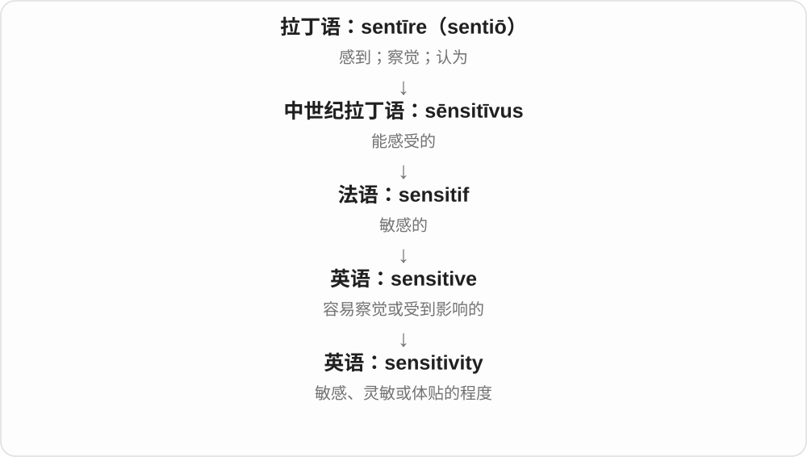

可以评价传感器，也可以评价谈话方式。高 sensitivity 不自动等于总体性能或性格更好，要看讨论的是哪种反应。

**常见搭配与例句**

light sensitivity；sensor sensitivity；show sensitivity；cultural sensitivity。

> The technician adjusted the sensitivity of the sensor.

技术人员调整了传感器的灵敏度。

> The situation needs to be handled with sensitivity.

这种情况需要体贴、谨慎地处理。

**别混淆**

sensibility 常偏感受和审美能力；sensitivity 也常是可测的灵敏度或对刺激的反应程度。

### 55. accountability — 问责；责任明确且可追究的状态

**音标**：/əˌkaʊntəˈbɪləti/

**先抓住这个画面**

不是墙上写一句“大家负责”，而是清楚知道谁做决定、向谁说明、出了问题由谁交代。

**怎么拆**

accountable 的 -able 转为 -ability，英语抽象名词。

**怎么变成今天的意思**

**拉丁 putare**  
修剪、清理；计算、考虑、判断

↓

**拉丁 com- 一起 + putare → computare**  
合起来计算、盘算

↓

**古法语 aconter → acontable**  
交代账目 → 需要交代的

↓

**英语 accountable**  
须对行为负责、接受问责的

↓

**英语 accountable → accountability**  
需要解释并承担责任这一性质或制度

常与 transparency 并用：透明让人看见发生什么，问责让相关的人必须作出交代。问责不必只有惩罚，也包括报告、说明和纠正。

**常见搭配与例句**

public accountability；clear lines of accountability；strengthen accountability。

> The new process creates clearer lines of accountability.

新流程让责任归属和问责关系更加清楚。

> Publishing the results improved transparency and accountability.

公布结果提高了透明度，也便于追究责任。

**别混淆**

responsibility 可指职责；accountability 特别强调职责能被核查、向相应主体交代。

### 56. immunity — 免疫力、免疫保护；豁免权；免受某事影响的状态

**音标**：/ɪˈmjuːnəti/

**先抓住这个画面**

身体对某种威胁有保护，和法律上某种义务、程序被豁免，都保留免于某事的共同感觉；不是任意情况下无敌。

**怎么拆**

经法语 immunité 接拉丁 immūnitās，法律豁免背景较早；现代对应 immune 去 e + -ity。医学保护义是后来的专门发展。

**怎么变成今天的意思**

**拉丁 immūnis / immūnitās → 法语、英语相应词**  
免除义务、负担 → 豁免及其状态

↓

**医学与一般引申**  
对疾病的免疫保护；不受某种影响

immunity to a disease 对某病的免疫保护，diplomatic immunity 外交豁免，immunity from prosecution 免受起诉的相关豁免，acquired immunity 获得性免疫。

**常见搭配与例句**

immunity to；immunity from；diplomatic immunity；acquired immunity。

> The chapter compares different forms of immunity.

这一章比较不同形式的免疫。

> The article explains the scope of diplomatic immunity.

文章解释外交豁免的范围。

**别混淆**

免疫保护常针对具体对象，程度也不同；法律 immunity 也有具体适用范围，不能仅凭词义认定一个人完全不受任何法律约束。

### 57. prosperity — 繁荣、兴旺、富足

**音标**：英 /prɒˈsperəti/；美 /prɑːˈsperəti/

**先抓住这个画面**

把一个地方或群体日子过得好的整体状态拿出来说。

**怎么拆**

经古法语 prosprete／prosperite 或直接借自拉丁 prosperitas；来自 prosperus 的名词一支，英语记录早于 prosper 动词，不能只画成英语动词后加 -ity。

**怎么变成今天的意思**

**拉丁 prosperus → prosperitas**  
顺利、兴旺 → 繁荣、好运

↓

**古法语 prosprete → 英语 prosperity**  
繁荣、富足的状态

economic prosperity 是经济繁荣，shared prosperity 强调繁荣成果让更多人受益。它通常是不可数名词，说 a period of prosperity，而不是 a prosperity 表示一次发财。也不能仅凭总体繁荣就推定每个人都富裕。

**常见搭配与例句**

economic prosperity；shared prosperity；a period of prosperity；long-term prosperity。

> The railway brought a period of prosperity to the town.

铁路给这座小镇带来了一段繁荣时期。

> The report asks whether prosperity is reaching all neighbourhoods.

报告探讨繁荣是否惠及了所有街区。

**别混淆**

wealth 可以指财富存量，prosperity 更像整体富足发展的状况；prosperous 是形容词，prosperity 是名词。

### 58. clarity — 清楚；清晰度；明晰

**音标**：英 /ˈklærəti/；美 /ˈklærəti/，亦 /ˈklerəti/

**先抓住这个画面**

声音听得分明，文字意思不打结，思路能一条条看清，这种质量就是 clarity。

**怎么拆**

来自中古英语 claritee、古法语 clarté、拉丁语 claritas，根是 clarus；与 clear + -ity 的形态对应不等于从现代英语 clear 才创造。

**怎么变成今天的意思**

**拉丁语 clarus**  
明亮、清楚、响亮；显著、出名

↓

**拉丁语 claritas → 古法语 clarté → 中古英语 claritee**  
清亮、明晰的性质

↓

**英语 clarity**  
声音、图像、思想或表达的清晰

clarity of expression 是表达清晰；for clarity 是为了让意思更明白。写得短不必然有 clarity，删掉关键条件反而可能更糊涂。

**常见搭配与例句**

with clarity；for clarity；clarity of thought。

> The diagram improves the clarity of the explanation.

这张示意图让解释更清楚了。

> She described the problem with remarkable clarity.

她把问题描述得非常明白。

**别混淆**

accuracy 说内容正确；clarity 说内容容易辨认、理解。一段话可以清楚但错误。

### 59. mortality — 终有一死这一事实；死亡情况；死亡率

**音标**：英 /mɔːˈtæləti/；美 /mɔrˈtæləti/

**先抓住这个画面**

从“人会死”，转到“一个群体里有多少人死亡”。

**怎么拆**

拉丁 mortalitas 经古法语 mortalite 借入；现代可联系 mortal 与名词词尾 -ity。

**怎么变成今天的意思**

**拉丁 mors，词干 mort-**  
死亡

↓

**拉丁 mortalis → mortalitas**  
会死的 → 有限的生命、死亡

↓

**古法语 mortalite → 英语 mortality**  
人终有一死；群体的死亡情况

面对自己的 mortality，是意识到生命有限。统计里的 mortality 关注死亡，mortality rate 才明确说死亡率；具体分母和时间范围要看统计定义，不能直接当成所有患者中死亡的比例。

**常见搭配与例句**

human mortality；face one’s mortality；infant mortality；a mortality rate。

> The accident made him think about his own mortality.

那场事故让他开始思考自己终有一死这件事。

> The report compares mortality rates across several regions.

报告比较了几个地区的死亡率。

**别混淆**

morbidity 关注疾病或患病负担，来自“疾病”那一支；mortality 关注死亡。二者常并列，却不是同义词。

### 60. immortality — 永生；不朽

**音标**：英 /ˌɪmɔːˈtæləti/；美 /ˌɪmɔrˈtæləti/

**先抓住这个画面**

人希望身体永远活着，也希望自己留下的东西永远不被忘记。

**怎么拆**

古法语 immortalité 来自拉丁 immortalitas；名词有自己的借入路线。

**怎么变成今天的意思**

**拉丁 mors，词干 mort-**  
死亡

↓

**拉丁 immortalis → immortalitas**  
不死的 → 不死的状态

↓

**古法语 immortalité → 英语 immortality**  
永生；声名不朽

seek immortality 可以是寻找长生办法，也可以是渴望作品或功绩流传。判断哪种意思，看看上下文谈的是生命还是名声。

**常见搭配与例句**

the search for immortality；literary immortality；achieve immortality。

> The legend describes a journey in search of immortality.

传说描写了一场寻找永生的旅程。

> That single novel secured her literary immortality.

仅那一部小说就使她在文学史上留下了不朽声名。

**别混淆**

immortal 形容对象不朽；immortality 是“不朽这种状态”。不能把它的历史仅画成英语 immortal 加后缀。

### 61. solidarity — 团结、相互支持；声援

**音标**：英 /ˌsɒlɪˈdærəti/；美 /ˌsɑːlɪˈdærəti/

**先抓住这个画面**

一个人遇到困难，其他人站出来说“我们跟你一起”，这种共同承担、支持彼此的关系就是 solidarity。

**怎么拆**

借法语 solidarité，接 solidaire、拉丁 solidus 整体、坚实等材料；现代认形可看 solidary + -ity，不能只从固体物理性质推义。

**怎么变成今天的意思**

**拉丁 solidus 整体等 → 法语 solidaire、solidarité**  
共同承担、作为整体联结

↓

**英语 solidarity**  
因共同利益、目标等团结与相互支持

show solidarity with 声援、支持；in solidarity with 与……团结；a sense of solidarity 团结感。

**常见搭配与例句**

show solidarity with；in solidarity with。

> The workers showed solidarity with their colleagues.

工人们声援同事。

> The event created a strong sense of solidarity.

活动形成了强烈的团结感。

**别混淆**

solidarity 是人的支持、共同立场，solidity 是坚实、牢固；两个名词沿不同用法发展。

### 62. proximity — 接近；邻近；距离近

**音标**：英 /prɒkˈsɪməti/；美 /prɑkˈsɪməti/

**先抓住这个画面**

两点之间的间隔很小，可以是地理距离，也可以是时间或关系上的间隔。

**怎么拆**

经法语 proximité 接拉丁 proximitas，来自 proximus 最近的；不是由较晚的英语 proximate 才派生。

**怎么变成今天的意思**

**拉丁 prope → proximus**  
近 → 最近的、紧邻的

↓

**拉丁 proximitas → 法语 proximité**  
邻近、接近

↓

**英语 proximity**  
接近这一关系或状态

proximity to the station 是离车站近；in close proximity 是距离很近。它偏正式，常把“离哪里近”作为某物的特点；日常也可直接说 near 或 close to。

**常见搭配与例句**

proximity to something；in close proximity；physical proximity。

> We chose the apartment because of its proximity to the station.

我们选这套公寓，是因为它离车站近。

> The two sensors must be placed in close proximity.

这两个传感器必须放得很近。

**别混淆**

proximity 说接近，不等于“周围地区”vicinity，也不自动等于关系亲密。住得近不一定感情近。

### 63. morality — 道德；道德准则；行为的道德性

**音标**：英 /məˈræləti/；美 /məˈræləti/

**先抓住这个画面**

把一件事放到“这样做对不对、是否公平待人”的尺度上来看，或谈支撑这些判断的一整套原则。

**怎么拆**

晚期拉丁 moralitas、moralitatem 接 moralis，经法语 moralité 或直接借入英语。现代可按 moral + -ity 对照理解，但有独立的拉丁、法语名词路线。

**怎么变成今天的意思**

**拉丁 mos，词干 mor-；复数 mores**  
习惯、性情；人们的行为方式与风俗

↓

**拉丁 moralis**  
与行为、品性、道德有关

↓

**晚期拉丁 moralitas／moralitatem → 法语 moralité／直接借入**  
品行、道德品质与原则

↓

**中古英语 moralite → morality**  
道德规范；行为是否正当的性质

the morality of a decision 讨论决定是否合乎道德；public morality 讨论社会中的行为规范。它不只表示某个人品行好，也能讨论规范本身。

**常见搭配与例句**

a question of morality；personal morality；public morality；the morality of。

> The essay questions the morality of hiding the risks from customers.

文章质疑向顾客隐瞒风险是否合乎道德。

> The class discussed how ideas about morality can change over time.

课堂讨论了人们的道德观念怎样随时间变化。

**别混淆**

morality 是道德规范或道德性；morale 是信心和士气。high morality 与 high morale 所评价的完全不同。

### 64. obscure — 不知名的；难懂的；模糊的；遮住、使不清楚

**音标**：形容词：英 /əbˈskjʊə/、美 /əbˈskjʊr/；动词：英 /əbˈskjʊə/、美 /əbˈskjʊr/

**先抓住这个画面**

光线暗、被东西盖住，看不清，是 obscure 的底层画面。一个人不出名、一个典故难懂，也像没有被大家清楚看见。

**怎么拆**

经法语 obscur、拉丁 obscurus 昏暗、难辨，传统分析联系 ob- 覆在上面与表示覆盖的 -scur- 材料。现代作为完整借词使用，昏暗、遮蔽是理解其几个常用义的共同线索。

**怎么变成今天的意思**

**拉丁 obscurus 昏暗、难辨 → 法语 obscur → obscure**  
看不清可用于光线、形状，也可用于知识与名声

↓

**形容词与遮暗、掩盖动词发展**  
现代 obscure a view 是遮住视线，an obscure writer 是不知名作家

an obscure reference 是难懂的典故；an obscure writer 是不知名作家；obscure the view 是挡住视线。

**常见搭配与例句**

an obscure reference；an obscure writer；obscure the view。

> The essay contains an obscure reference to an old play.

文章里有一处让人难懂的旧戏典故。

> Tall trees obscure the view from the window.

高树挡住了窗外的景色。

**别混淆**

obscure 作形容词、动词时通常读音相同，靠句法辨别。不知名不自动等于不重要；难懂也可能是背景知识不熟，而不只是句子写得差。

### 65. obscured — 遮住了；被遮蔽的；使难以理解了

**音标**：英 /əbˈskjʊəd/；美 /əbˈskjʊrd/

**先抓住这个画面**

本来能看见的景色被雾、树或别的东西挡住，就是 obscured。原因被复杂说法盖住，让人抓不到重点，也能这样比喻。

**怎么拆**

obscure 动词去末尾 e，加完整 -ed → obscured，后缀读 /d/。接拉丁 obscurare 使昏暗、obscurus 昏暗词族，经法语等进入英语；现代直接以 obscure 变化。

**怎么变成今天的意思**

**拉丁昏暗、使暗词族 → 法语、英语 obscure**  
从遮暗视线，也发展到使意思不清

↓

**obscure + -ed → obscured**  
现代叙述遮蔽动作或已经被遮住的状态

obscured by fog 是被雾遮住；obscured the view 是遮住了景色；obscured the issue 是把问题弄得难看清。

**常见搭配与例句**

obscured by；obscured the view；obscured the issue。

> The mountains were obscured by fog.

群山被雾遮住了。

> Technical language obscured the main point.

专业术语掩盖了主要意思。

**别混淆**

obscured 不一定是故意隐藏，雾和树也能自然挡住。hidden 泛指藏着、看不到；obscured 更突出有遮挡、昏暗或混淆让人难以看清。

### 66. obscurity — 默默无闻；不清楚、难懂的状态

**音标**：英 /əbˈskjʊərəti/；美 /əbˈskjʊrəti/

**先抓住这个画面**

一个人做了多年工作，却几乎没人知道，是 in obscurity。文字让人摸不着头脑，也可以谈它的 obscurity，重点是没被清楚看见、理解。

**怎么拆**

现代可联系 obscure 去末尾 e + -ity 状态名词材料 → obscurity。历史也经法语 obscurete、拉丁 obscuritas 昏暗、模糊等形式发展，不强定只有英语临时加后缀一条路。

**怎么变成今天的意思**

**拉丁 obscurus 昏暗 → obscuritas → 法语等 → obscurity**  
形成看不清、难理解的性质名词

↓

**不清楚与不被人知的分支**  
现代常用默默无闻义，也可说表达晦涩

in obscurity 是默默无闻；fade into obscurity 是逐渐被遗忘；the obscurity of a passage 是一段文字的晦涩。

**常见搭配与例句**

in obscurity；fade into obscurity；the obscurity of。

> The artist worked in obscurity for many years.

这位艺术家默默无闻地创作了多年。

> Readers complained about the obscurity of the final chapter.

读者抱怨最后一章晦涩难懂。

**别混淆**

obscurity 与 fame 名声形成常见对照；与 clarity 清楚对照时，则强调晦涩、不明。先看谈人还是谈内容，就能分清两个用法。

### 67. humid — 潮湿的；空气湿度大的

**音标**：英、美 /ˈhjuːmɪd/

**先抓住这个画面**

衣服并没被雨直接淋湿，但空气里湿气很重、让人觉得黏，就是 humid 的典型感觉。它尤其常形容天气和空气。

**怎么拆**

借法语 humide 或拉丁 humidus、umidus 潮湿的，远接 umere 潮湿。这个词作为借入形容词整体认识，不从现代 hum 的声音义推出。

**怎么变成今天的意思**

**拉丁 umere 潮湿 → umidus、humidus 潮湿的**  
h 的出现常被认为受 humus 土壤的词形影响

↓

**法语 humide 或拉丁对应词 → 英语 humid**  
现代常形容空气、气候中的湿气

humid air 是潮湿空气；a humid climate 是湿润气候；hot and humid 是又热又潮。humid 本身只说潮湿，热要由 hot 等说明。

**常见搭配与例句**

humid air；a humid climate；hot and humid。

> The air felt humid after the rain.

雨后空气感觉很潮湿。

> The story is set in a hot and humid town.

故事发生在一座炎热潮湿的小镇。

**别混淆**

wet 常指表面、东西已经沾水，humid 更常说空气中水汽多；a humid room 不等于墙面一定正在滴水。

### 68. humidity — 湿度；潮湿程度

**音标**：英、美 /hjuːˈmɪdəti/

**先抓住这个画面**

humid 是说空气很潮，humidity 则把潮湿拿出来当一项性质、一个量来谈：湿气到底有多少。

**怎么拆**

可用 humid + -ity 状态、性质来理解词形对应；历史经法语 humidité 接拉丁 humiditas 潮湿，名词并非一定在英语中由 humid 临时加后缀造出。

**怎么变成今天的意思**

**拉丁 humidus、humiditas → 法语 humide、humidité**  
形容潮湿与潮湿状态的对应词族

↓

**英语 humidity；与 humid 对照学习**  
英语名词记录早于形容词，学习先后不等于历史先后

high humidity 是湿度高；low humidity 是湿度低；relative humidity 是相对湿度这一具体量的名称，不能把所有湿度指标都当成同一个数。

**常见搭配与例句**

high humidity；low humidity；relative humidity。

> The display shows the temperature and humidity.

显示屏上显示温度和湿度。

> The room had high humidity even on cool days.

即使天气凉爽，房间里的湿度也很高。

**别混淆**

说今天天气潮，可用 It is humid；说湿度高，可用 The humidity is high。一个形容状态，一个把性质作为名词谈。

### 69. inferior — 较差的；级别较低的；下方的〔专门用法〕

**音标**：英 /ɪnˈfɪəriə(r)/；美 /ɪnˈfɪriər/；重音在第二音节

**先抓住这个画面**

先想象两件东西一上一下：位置在下，后来也可以表示等级更低，或某一方面的品质比不上另一件。inferior 的关键是“较低、较差”，要根据上下文判断比较的是位置、级别还是质量。

**怎么拆**

拉丁 inferus 表示“在下面的、低处的”，它的比较级是 inferior。可用 infer-（这条词源中的“下方”材料）+ -ior（拉丁比较级词尾）记忆；英语整体借入后作为形容词使用。这里的 in- 不能当作否定前缀，也不是现代动词 infer“推断”加 -ior。infer 来自另一条拉丁 in- + ferre“带入”的词源。

**怎么变成今天的意思**

**拉丁 inferus**  
在下面的、较低位置的

↓

**拉丁 inferus → 比较级 inferior**  
更低、较下方；也可用于比喻

↓

**英语 inferior**  
从位置较低扩展到等级较低、品质较差

书中 inferior sanitary conditions 指“较差的卫生条件”，比较的是条件的好坏，不是在说卫生设施位于下方。inferior quality 强调质量不好或不如比较对象；inferior rank 强调级别较低。feel inferior 是主观上觉得自己不如别人、感到自卑，并不证明自己的实际能力或价值更低。解剖方位中的 inferior 则可保留“下方”的位置意义，不带品质好坏的评价。

**常见搭配与例句**

A is inferior to B：A 不如 B；inferior to B in quality：质量不如 B；of inferior quality：品质较差；much / far inferior to：远不如；feel inferior：感到自卑。比较对象用 to，不按 worse than 的句型写成 inferior than；表达“远不如”可用 far inferior to。

> The replacement parts were inferior to the originals in durability.

替换零件的耐用性不如原装零件。

> Residents complained about inferior sanitary conditions in the temporary housing.

居民抱怨临时住房的卫生条件较差。

> She felt inferior to her classmates despite doing well in the course.

尽管课程成绩不错，她仍觉得自己不如同学。

**别混淆**

inferior 与 superior 常成对，分别表示较低／较差与较高／较好。lower 可单说高度、数量或级别较低，不一定含质量差的意思；inferior 用于品质时带负面判断。inferiority 是“劣势、较低状态或自卑感”的名词；infer 是“推断”，虽然拼写相近，却不是这里的词基。

### 70. inferiority — 劣势、较低状态；自卑感

**音标**：英 /ɪnˌfɪəriˈɒrəti/；美 /ɪnˌfɪriˈɔːrəti/

**先抓住这个画面**

对象在某方面比不过，是 inferiority；一个人总觉得自己比别人低一等，则常谈 feelings of inferiority。两者不能简单画等号。

**怎么拆**

inferior + -ity，与拉丁 inferioritas 等相应名词材料对应；把比较的较低状态名词化。

**怎么变成今天的意思**

**拉丁 inferus 在下面 → inferior 比较级**  
位置更低；进一步用于等级、品质

↓

**inferior + -ity → inferiority 的对应形式**  
较低、较差状态；自卑感

↓

**inferior／inferiority**  
较低、较差 → 这一状态或主观感觉

a sense of inferiority 自卑感；an inferiority complex 自卑情结；numerical inferiority 数量劣势。

**常见搭配与例句**

a sense of inferiority；numerical inferiority。

> The team overcame its numerical inferiority.

队伍克服了人数劣势。

> He struggled with feelings of inferiority.

他深受自卑感困扰。

**别混淆**

inferiority 可以是数量等客观比较，也可以是主观自卑；感觉较差不证明自己实际处处较差。

### 71. vicinity — 附近、周边地区〔较正式〕

**音标**：/vɪˈsɪnəti/

**先抓住这个画面**

不指地图上一个精确点，而是围绕那一点的一片附近区域。in the vicinity of the station 就是车站附近。

**怎么拆**

接拉丁 vicinitas 邻近关系、街坊，来自 vicinus 邻近的、邻人，关联 vicus 村落；并非英语 vice 副的派生。

**怎么变成今天的意思**

**拉丁 vicus 村落 → vicinus 邻近的 → vicinitas**  
住得近 → 邻近、周围地区

↓

**英语 vicinity**  
附近；大致范围

in the vicinity 在附近；in the vicinity of 在……附近；数值前有时说大约，较正式。

**常见搭配与例句**

in the vicinity of；in the vicinity。

> There are several cafés in the vicinity of the station.

车站附近有几家咖啡馆。

> Police searched the immediate vicinity.

警方搜索了紧邻的周边地区。

**别混淆**

vicinity 常是周边一带，venue 是活动场地；拼写有相似字母，但问附近与问举办地点不同。

### 72. fertility — 肥力；生育、繁殖能力；多产性

**音标**：英 /fəˈtɪləti/；美 /fərˈtɪləti/

**先抓住这个画面**

不是一次收成，而是这块地、这个生物或这个头脑有多能“生出东西”。

**怎么拆**

法语 fertilité 来自拉丁 fertilitas，建立在 fertilis 上；现代对应 fertile + -ity，但不是只在英语里派生。

**怎么变成今天的意思**

**拉丁语：ferre；第一人称 ferō**  
带、承载；承受；生出

↓

**拉丁语：fertilis**  
能生出、产出的；多产的

↓

**拉丁 fertilitas → 法语 fertilité**  
能生长、产出的性质

↓

**英语：fertility**  
肥力；繁殖能力；丰富创造力

soil fertility 说土壤支撑生长的能力；人的 fertility 常谈生育能力；人口研究里的 fertility rate 则指生育水平，不能简单当作某一个人的能力测试。

**常见搭配与例句**

soil fertility；fertility rate；the fertility of an imagination。

> The farmers compared the fertility of the two fields.

农民比较了两块田的肥力。

> The report tracks changes in fertility rates over several decades.

报告追踪了几十年来生育率的变化。

**别混淆**

fertilization 是使受精或施肥的过程；fertility 是相关能力或性质。

### 73. visibility — 能见度；可见性；受关注程度

**音标**：/ˌvɪzəˈbɪləti/

**先抓住这个画面**

visibility 像一个“看得到多少”的旋钮：雾大时调低，站到公众面前时又提高。

**怎么拆**

经法语 visibilité，来自晚期拉丁语 vīsibilitās；现代对应 visible + -ity。

**怎么变成今天的意思**

既描述天气条件下能看多远，也描述某个人或问题有多容易被公众注意。

**常见搭配与例句**

poor visibility；high visibility；increase visibility；visibility of a problem。

> Fog reduced visibility on the road.

雾降低了道路上的能见度。

> The campaign increased the visibility of local artists.

这次活动提高了当地艺术家的知名度。

**别混淆**

visibility 是可见程度；vision 是视力或愿景。visibility 差不一定是你的眼睛出了问题。

### 74. continuity — 连续性；连贯；前后一致

**音标**：英 /ˌkɒntɪˈnjuːəti/；美 /ˌkɑːntɪˈnuːəti/

**先抓住这个画面**

continuity 像把几个阶段接起来，看中间有没有断口、前后是否对得上。

**怎么拆**

经法语 continuité 来自拉丁语 continuitās，联系 continuus“连续的”；不是单纯从英语 continue 临时加 -ity。

**怎么变成今天的意思**

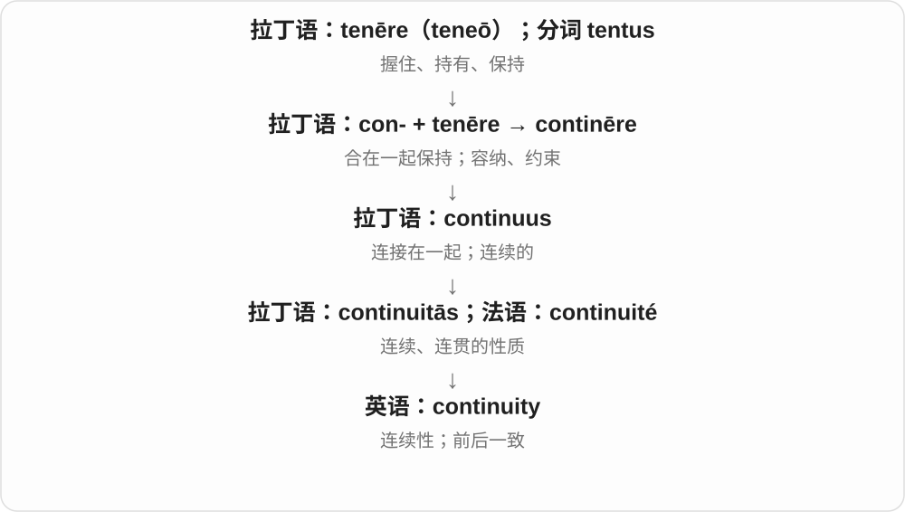

既可说服务不中断，也可说故事和电影镜头前后一致。镜头间杯子忽然换了位置，就可能有 continuity error。

**常见搭配与例句**

continuity of service；ensure continuity；a continuity error；continuity between… 。

> The handover plan ensures continuity of service.

交接计划确保服务不中断。

> A misplaced cup created a continuity error between the two shots.

一个放错位置的杯子让两个镜头之间出现了穿帮。

**别混淆**

continuation 是继续这一行为或续接部分；continuity 是各部分连续、相互接得上的性质。

### 75. mentality — 心态；思维方式

**音标**：英、美 /menˈtæləti/

**先抓住这个画面**

一个人或一群人看问题时习惯走的那条脑中路线。

**怎么拆**

mental + -ity；重音从 mental 的开头移到 mentality 中间的 /tæ/。历史上先有心智能力义，后来常指思维倾向。

**怎么变成今天的意思**

**印欧语重建词根 \*men-**  
想、思考；星号表示语言学重建形式

↓

**拉丁语 mens / ment-**  
心智、思考、精神

↓

**后期拉丁语 mentalis → 法语、英语 mental**  
与心智有关的

↓

**英语 mental + -ity → mentality**  
心智能力 → 习惯性的想法与态度

a winning mentality 强调相信能赢、为赢作准备的心态；a siege mentality 是总觉得被围攻、防备外人的心态。

**常见搭配与例句**

a competitive mentality；a change in mentality；a siege mentality。

> The team needs a mentality that treats mistakes as opportunities to learn.

团队需要一种把错误当作学习机会的心态。

> That mentality made cooperation difficult.

那种思维方式让合作很难进行。

**别混淆**

intelligence 多说理解、推理等能力；mentality 多说怎样看问题，不直接等于智商高低。

### 76. homosexuality — 同性恋；同性性取向

**音标**：英 /ˌhəʊməʊsekʃuˈæləti/；美 /ˌhoʊmoʊsekʃuˈæləti/

**先抓住这个画面**

主要或持续被与自己同性的人吸引。

**怎么拆**

现代可按 homosexual + -ity；形成也受到德语 Homosexualität、法语 homosexualité 等术语影响。homo- 是希腊“相同”，不是拉丁“人”。

**怎么变成今天的意思**

**拉丁 sexus**  
性别、雌雄类别；更早是否接“切分”词根仍有争议

↓

**德语 homo- + sexual → Homosexualität；法语 homosexualité**  
近代表示同性性取向的术语

↓

**英语 homosexuality**  
与 homosexual + -ity 的英语分析相接

这是较正式或学术的表达。它说明吸引方向，不能单凭一个人的衣着、语气或某次行为替人判断。

**常见搭配与例句**

attitudes toward homosexuality；the history of homosexuality。

> The book traces changing attitudes toward homosexuality.

这本书追溯了人们对同性恋态度的变化。

> The lecturer distinguished homosexuality from stereotypes about gender expression.

讲师把同性性取向与关于性别表达的刻板印象区分开。

**别混淆**

homosexuality 是取向相关名词；sexism 说基于性别的偏见，两者不是一回事。

### 77. vanity — 虚荣；徒劳、空虚；梳妆台；带洗手盆的浴室柜

**音标**：英、美 /ˈvænəti/

**先抓住这个画面**

心里很想被欣赏，却把外表或成就捧得过高；家具用法则转向梳妆、整理仪容的地方。

**怎么拆**

经古法语 vanité，来自拉丁 vanitas／vanitatem，接 vanus“空的”。现代可按 vain 与 -ity 记对应关系，但英语借入的是已有名词，不能当成现代英语形容词直接加后缀的唯一历史。

**怎么变成今天的意思**

**拉丁 vanus → vanitas**  
空的 → 空虚、徒劳、自负等抽象意义

↓

**古法语 vanité → 英语 vanity**  
虚荣、徒然等

↓

**后起家具等用法**  
vanity table 梳妆台；简称 vanity，亦用于浴室洗手盆柜

appeal to someone’s vanity 是迎合某人的虚荣心，常靠夸赞外表或能力。家具广告里的 a vanity 却是具体物品，可能是梳妆台或浴室柜；不能把每次出现的 vanity 都译成抽象的虚荣。

**常见搭配与例句**

personal vanity；appeal to somebody’s vanity；a vanity mirror；a bathroom vanity。

> The advertisement appealed to his vanity by promising a more impressive image.

广告承诺塑造更出众的形象，迎合了他的虚荣心。

> The new bathroom vanity has two drawers beneath the sink.

新的浴室柜在洗手盆下方有两个抽屉。

> The poem reflects on the vanity of chasing lasting fame.

这首诗思考了追求永恒名声的徒然。

**别混淆**

confidence 是信心，不必带虚荣；vanity 常暗含过分看重赞赏。家具义来自用途和搭配发展，并非说使用梳妆台的人一定虚荣。

### 78. ethnicity — 族群身份；族裔归属；族群

**音标**：/eθˈnɪsəti/

**先抓住这个画面**

把属于或认同哪种文化群体这件事，作为一种身份来讨论。

**怎么拆**

ethnic + -ity，词尾 c 在后续元音前变成 /s/，主重音移到 /nɪ/。这是英语抽象名词派生。

**怎么变成今天的意思**

**希腊 ethnos**  
一群人；人民、族群

↓

**希腊 ethnikos → 拉丁 ethnicus**  
一个民族的；宗教语境中也指异教的

↓

**中古英语 ethnik → ethnic**  
先有异教义；后来发展出族群、文化身份义

↓

**英语 ethnic + -ity → ethnicity**  
族群身份与文化归属

通常与共同历史、传统、语言、祖源认同等因素有关，不是靠单一外表特征就能替别人判定。复数 ethnicities 可说多个族群。

**常见搭配与例句**

ethnicities represented in a community；ethnicity and nationality；people of different ethnicities。

> People of different ethnicities took part in the festival.

不同族群的人参加了这个节庆活动。

> The form lists nationality and ethnicity as separate questions.

表格把国籍和族群身份列成两个不同的问题。

**别混淆**

nationality 常指国籍；ethnicity 指族群文化归属，两个人可以国籍相同而 ethnicity 不同。

### 79. insanity — 精神失常〔旧称或法律语境〕；荒唐、疯狂之举

**音标**：/ɪnˈsænəti/

**先抓住这个画面**

把 insane 的失常或离谱当作状态来谈；日常说“这太荒唐了”时，经常并没有医学含义。

**怎么拆**

接拉丁 īnsānitās，来自 īnsānus；现代可联系 insane + -ity，但保留拉丁名词的历史路线。

**怎么变成今天的意思**

**拉丁否定前缀 in-；同化形式 im-、il-、ir-**  
不、非；否定后面的性质

↓

**拉丁 īnsānus → īnsānitās → 英语 insanity**  
不健全 → 失常状态

↓

**英语引申用法**  
极端荒唐、不理性的局面或做法

日常夸张与法律专门用法要分开。法律材料里的 insanity 有特定语境，不能用口语“太疯狂”来替代，也不能自动等同于某个疾病名称。

**常见搭配与例句**

the insanity of a plan；pure insanity；a plea of insanity〔法律用语〕。

> Trying to finish all of that in one night would be insanity.

想一晚上把那些事全做完，简直太荒唐。

> The novel explores the apparent insanity of the war around its characters.

小说描写了人物周围那场战争所呈现的荒诞与疯狂。

**别混淆**

irrationality 侧重缺乏合理性；insanity 的日常语气往往更强，另有历史及法律义。

### 80. nationality — 国籍；民族归属

**音标**：/ˌnæʃəˈnæləti/

**先抓住这个画面**

nationality 常是表格里问“你属于哪个国家身份”的一栏；有些语境也谈民族身份。

**怎么拆**

national + -ity，可能受法语 nationalité 影响。

**怎么变成今天的意思**

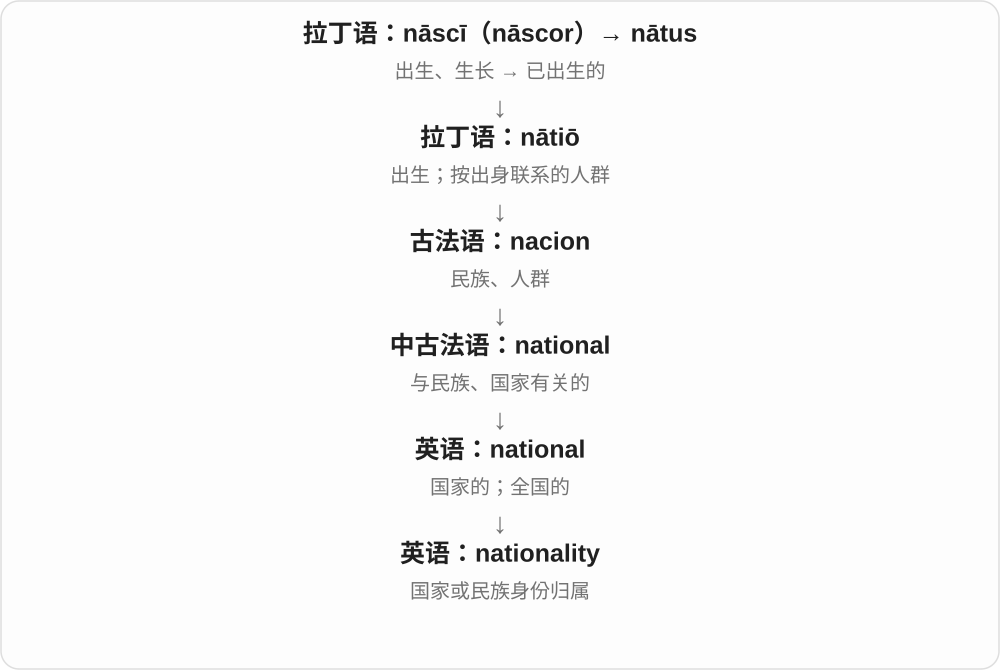

通常和出生地相关却不等同。一个人在哪里出生、住在哪里、具有什么国籍，是不同问题。

**常见搭配与例句**

state your nationality；dual nationality；people of different nationalities。

> The form asks for your nationality and place of birth.

表格要求填写国籍和出生地。

> People of many nationalities work in the team.

这个团队里有许多不同国籍的人。

**别混淆**

nationality 与 citizenship 在很多语境接近，但制度细节可能不同；race 也不是 nationality。

### 81. unpopular — 不受欢迎的；不得人心的

**音标**：英 /ʌnˈpɒpjələ/；美 /ʌnˈpɑːpjələr/

**先抓住这个画面**

别人没有多少好感，甚至明确反对。

**怎么拆**

un-“不” + popular。

**怎么变成今天的意思**

**拉丁 populus**  
人民、人群；更早来源未定

↓

**拉丁 populāris → 古法语 populaire／拉丁借词 → 中古英语 populer**  
属于大众；大众熟知的

↓

**现代英语 popular**  
受欢迎的；大众的；通俗的

↓

**英语 un- + popular → unpopular**  
不受欢迎、不被喜欢的

an unpopular decision 是让人不满意的决定；an unpopular product 也可能只是不怎么有人选。到底是不出名还是惹反感，要看语境。

**常见搭配与例句**

unpopular with；an unpopular decision；deeply unpopular。

> The new rule was unpopular with the staff.

这条新规定不受员工欢迎。

> The manager had to make an unpopular decision.

经理不得不作出一个不讨好的决定。

**别混淆**

unknown 是不知道；unpopular 是不受欢迎，某个东西可以人人知道却没人喜欢。

### 82. unpopularity — 不受欢迎；不得人心

**音标**：英 /ˌʌnpɒpjuˈlærəti/；美 /ˌʌnpɑːpjuˈlærəti/

**先抓住这个画面**

不是没人听说，而是知道它的人里很多人不喜欢。某政策的 unpopularity 说的是这种不受支持的状态。

**怎么拆**

可对应 un- 不 + popularity 受欢迎程度，也可按 unpopular + -ity 理解性质；两种是现代词形关系。

**怎么变成今天的意思**

**popular → unpopular／popularity**  
受欢迎 → 不受欢迎／受欢迎程度

↓

**unpopularity**  
不受欢迎、支持不足的状态

the unpopularity of a policy 政策不受欢迎；growing unpopularity 越来越不得人心；widespread unpopularity 普遍不受欢迎。

**常见搭配与例句**

the unpopularity of；growing unpopularity。

> The policy’s unpopularity surprised the minister.

政策不受欢迎的程度令部长惊讶。

> The report explains the growing unpopularity of the scheme.

报告解释了该方案为何越来越不受欢迎。

**别混淆**

unpopularity 是不受喜欢，obscurity 是不为人知；知名度高也可能非常不受欢迎。

### 83. municipality — 自治市、地方行政单位；其政府、当局

**音标**：/mjuːˌnɪsɪˈpæləti/

**先抓住这个画面**

municipal 说地方政府相关的性质，municipality 则把整块有相应地方政府的行政单位，或管理它的当局，作为一个对象来称呼。

**怎么拆**

借法语 municipalité，与 municipal + -ity 对应。继承地方共同体的来源，名词重音移到 /pæl/，不只是把形容词原封不动读完再加词尾。

**怎么变成今天的意思**

**拉丁 mūnus 义务、公共服务 + capere 的相关成分**  
承担公共责任的居民身份

↓

**mūniceps、mūnicipium → mūnicipālis → 法语 municipal**  
城镇、市民、城镇相关的性质

↓

**英语 municipal**  
市政的；地方政府相关的

↓

**法语 municipalité → 英语 municipality**  
地方自治行政单位；该单位的政府

the local municipality 当地自治市、地方当局，several municipalities 几个地方行政单位。某些地区可含多个居民点，不能一律画成一个连续大城市。

**常见搭配与例句**

the local municipality；several municipalities。

> The municipality manages the local parks.

当地政府管理着当地公园。

> The study compares transport in five municipalities.

研究比较了五个地方行政单位的交通。

**别混淆**

municipality 可指辖区，也可指当局；city 常指城市。二者在具体制度下可能重叠，含义却不自动完全相同。

### 84. functionality — 功能性；具备的功能；发挥作用的能力

**音标**：/ˌfʌŋkʃəˈnæləti/

**先抓住这个画面**

把产品拿来实际用：它能做哪些事，这些本领合起来就是这里说的 functionality。

**怎么拆**

functional + -ity；词尾 -al 在接 -ity 后重音移到 /næl/ 附近。

**怎么变成今天的意思**

**拉丁 fungi／fungor；分词词干 funct-**  
履行、执行、完成职责

↓

**两种历史分析：英语 function + -al；或中世纪拉丁 functionalis**  
两条路线都接“履行、功能”的来源，不互相当作先后阶段

↓

**英语 functional**  
与功能有关；能起作用、实用的

↓

**英语 functional → functionality**  
具有功能的 → 功能性、功能集合

added functionality 常说增加了可用功能；test the functionality of a device 是检查它的功能是否能实现。谈软件时常用作整体概念，不必总译成拗口的“功能性”；added search functionality 就是增加了搜索功能。

**常见搭配与例句**

basic functionality；additional functionality；retain functionality。

> The update adds search functionality to the app.

这次更新给应用增加了搜索功能。

> We tested the device’s basic functionality before packing it.

打包前，我们测试了设备的基本功能。

**别混淆**

function 常能数出具体一个功能；functionality 常把能做的事或功能表现作为整体来谈。

### 85. validity — 有效性；成立程度；有效期

**音标**：英、美 /vəˈlɪdəti/

**先抓住这个画面**

不是只问结论是什么，而是检查“它凭什么站得住”。也可以问证件能有效使用到什么时候。

**怎么拆**

经法语 validité 或后期拉丁语 validitās 借入；现代可联系 valid + -ity，重音移到第二音节。

**怎么变成今天的意思**

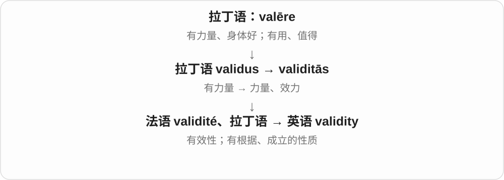

question the validity of a claim 是质疑主张是否有根据；passport validity 可指护照有效状态或有效期限。研究方法中还关心测量是否真的测到了想测的东西。

**常见搭配与例句**

the validity of an argument；a validity period；question the validity。

> The new evidence calls the validity of the conclusion into question.

新证据使这个结论是否成立受到质疑。

> Please check the validity of your passport before booking.

预订前请检查护照是否仍在有效期内。

**别混淆**

reliability 偏向结果稳定一致；validity 关心是否真能支持预期解释，两者相关却不等同。

### 86. vulnerability — 易受伤害性；脆弱处；漏洞

**音标**：/ˌvʌlnərəˈbɪləti/

**先抓住这个画面**

把护甲上的缺口单独指出来：哪里容易受伤，或者有多容易受伤。

**怎么拆**

vulnerable + -ity；-able 变为 -ability 形式，重音落在后部。

**怎么变成今天的意思**

**拉丁 vulnus，属格 vulneris**  
伤口

↓

**拉丁 vulnerare**  
使受伤

↓

**vulnerable → vulnerability**  
容易受伤的 → 易受伤害的状态或弱点

emotional vulnerability 是情感上容易受伤、愿意显露真实感受的状态；a security vulnerability 是系统中可被利用的薄弱处。复数 vulnerabilities 常指具体漏洞或弱点。

**常见搭配与例句**

a security vulnerability；emotional vulnerability；identify vulnerabilities；reduce vulnerability。

> The update fixed a security vulnerability in the software.

这次更新修复了软件中的一个安全漏洞。

> The interview revealed a vulnerability that his public image rarely showed.

这次访谈让人看到了他公众形象中很少显露的脆弱一面。

**别混淆**

vulnerability 是弱点或易受害状态，attack 是攻击行为。发现漏洞不等于已经有人成功利用它。

### 87. purity — 纯度；纯洁；纯净

**音标**：英 /ˈpjʊərəti/；美 /ˈpjʊrəti/

**先抓住这个画面**

把“有多纯”拿出来当成可以描述或测量的性质。

**怎么拆**

拉丁 puritas 经古法语 purete 进入英语；现代可看 pure + -ity，但名词在借入前就已存在。

**怎么变成今天的意思**

**拉丁语 purus**  
干净、没有混入别的东西

↓

**拉丁语 puritas → 古法语 purete → 英语 purity**  
纯净的状态 → 纯度、纯洁

the purity of a metal 是金属中目标成分所占程度；purity of tone 可以说音色清澈、不杂。谈人的 purity 则常带道德或宗教评价，并非化学检验。

**常见搭配与例句**

high purity；test the purity of；purity of tone。

> The laboratory tested the purity of the sample.

实验室检测了样品的纯度。

> The singer was admired for the purity of her tone.

这位歌手因音色纯净而受到赞赏。

**别混淆**

purification 是净化过程；purity 是达到或表现出的纯净程度。

### 88. impurity — 杂质；不纯；不洁

**音标**：英 /ɪmˈpjʊərəti/；美 /ɪmˈpjʊrəti/

**先抓住这个画面**

既可以说整体不纯，也可以把混进去的某种东西单独叫一种 impurity。

**怎么拆**

接拉丁 impuritas，亦有经法语 impurité 的路线；现代与 impure + -ity 对应。

**怎么变成今天的意思**

**拉丁语 purus**  
干净、没有混入别的东西

↓

**拉丁语 impurus → impuritas**  
不纯 → 不纯的性质

↓

**拉丁语或法语 impurité → 英语 impurity**  
不纯；混入的杂质

remove impurities 常用复数，指去掉杂质；the impurity of a sample 是整体的不纯状态。半导体等材料也可能有意加入某些杂质，并非所有 impurity 都是意外污染。

**常见搭配与例句**

remove impurities；trace impurities；the impurity of a sample。

> The filter removes some impurities from the water.

过滤器去除了水中的一些杂质。

> Even a trace impurity can change the colour of the crystal.

即使是微量杂质，也可能改变晶体的颜色。

**别混淆**

pollutant 偏造成污染的成分；impurity 更广，首先只说明它不属于目标的纯成分。

### 89. communal — 共有、共用的；社区的；群体相关的

**音标**：/kəˈmjuːnəl/

**先抓住这个画面**

厨房不是某一家独享，而是住在这里的人一起用，就是 a communal kitchen。词先说共同体、共用关系，未必在讲政治制度。

**怎么拆**

借法语 communal，上接晚期拉丁 communalis、拉丁 communis 共同。现代可联想 commune、common 词族，不把它当 communicate 交流的机械缩写。

**怎么变成今天的意思**

**拉丁 communis 共同 → 晚期拉丁 communalis → 法语 communal**  
社区相关、共同使用的

↓

**英语 communal → communally、communalism**  
共同地；共同生活或群体主义等名词

a communal kitchen 共用厨房；communal facilities 公用设施；communal life 共同生活。南亚等语境 communal 还可能涉及宗教群体关系，须看限定。

**常见搭配与例句**

a communal kitchen；communal facilities；communal life。

> Residents share a communal kitchen on each floor.

住户共用各楼层的厨房。

> The garden provides space for communal activities.

花园为社区共同活动提供空间。

**别混淆**

communal 通常强调某群体共用，public 更宽；宿舍住户的 communal kitchen 不保证街上所有人都可使用。

### 90. locality — 地区；地点；地方性

**音标**：英 /ləʊˈkæləti/；美 /loʊˈkæləti/

**先抓住这个画面**

把某个地方看成有周边环境、活动和特征的一片区域。

**怎么拆**

经法语 localité 接后期拉丁语 localitas；现代看得出 local 与 -ity 的对应，但名词有自己的借入史。

**怎么变成今天的意思**

**拉丁语 locus**  
地方、位置

↓

**后期拉丁语 localis → localitas；法语 localité**  
某地的 → 地点、地方性

↓

**英语 locality**  
地区；处在某地的性质

常用于调查、生态、地理等正式表达。each locality 可以是研究中的每个采样地区，不必有行政名称。

**常见搭配与例句**

in the locality；a remote locality。

> Several rare plants grow in this locality.

这一带生长着几种稀有植物。

> The survey covered five separate localities.

调查覆盖了五个不同地区。

**别混淆**

location 更像指出位置；locality 往往还包含周边一带或这一地方的特征。

### 91. neutrality — 中立、中立性；相应中性状态

**音标**：英 /njuːˈtræləti/；美 /nuːˈtræləti/

**先抓住这个画面**

neutral 是某个人、国家或做法中立，neutrality 则把中立这件事拿出来讨论：能否保持，是否受到质疑。

**怎么拆**

借法语 neutralité 或中世纪拉丁 neutralitas。现代形态可看 neutral + -ity，但名词有自己的借入链；重音移到 /træ/。

**怎么变成今天的意思**

**拉丁 ne- + uter → neuter**  
两者都不是，不取其中一方

↓

**拉丁 neutrālis → 法语、英语 neutral**  
不偏向任一方；相应中性状态

↓

**neutralité / neutralitas → neutrality**  
中立态度、性质或状态

maintain neutrality 保持中立，political neutrality 政治中立，question someone’s neutrality 质疑某人的中立性，net neutrality 网络中立这一专门概念。

**常见搭配与例句**

maintain neutrality；political neutrality；question someone’s neutrality。

> The mediator’s neutrality was important to both sides.

调解者的中立性对双方都很重要。

> The article examines the newspaper’s claim of political neutrality.

文章审视了这家报纸自称政治中立的说法。

**别混淆**

neutrality 是状态或原则，不等于已经证明一切判断都客观正确。不同领域的专门中立原则还需按该领域定义理解。

### 92. susceptible — 容易受影响的；易感的

**音标**：/səˈseptəbəl/

**先抓住这个画面**

把某种影响想成从外面进来的东西：这个人或材料容易让它进来，就 susceptible。比如容易生锈、容易被说服、容易受某种疾病影响。

**怎么拆**

来自拉丁语 suscipere“接起、接受”的词族，经 susceptus、susceptibilis 形成。-cept- 仍与 capere 有关；这里不要把 sus- 当成现代独立词。

**怎么变成今天的意思**

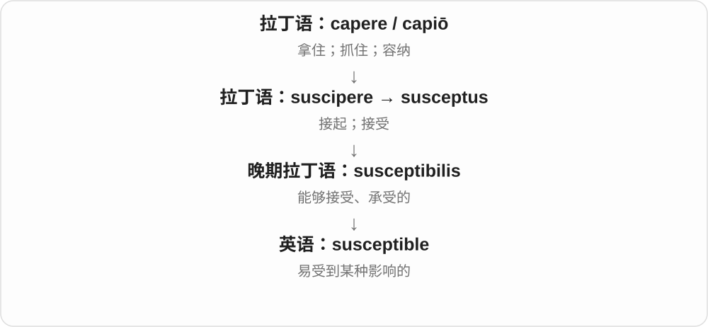

由“可以接收某物”发展到“容易受到某种影响”。现代常跟 to，并偏向不利影响；但 susceptible to persuasion 只是说容易被说服。

**常见搭配与例句**

susceptible to damage；susceptible to disease；susceptible to persuasion。

> The material is susceptible to damage from heat.

这种材料容易受热损坏。

> Children can be susceptible to pressure from their friends.

孩子容易受到朋友施加的压力影响。

**别混淆**

sensitive 偏对刺激反应强；susceptible 偏容易受某影响侵入或改变。不要和 suspicious“怀疑的”混淆。

### 93. susceptibility — 易受影响、易感性；敏感、脆弱程度

**音标**：/səˌseptəˈbɪləti/

**先抓住这个画面**

同样的压力、疾病或诱惑，有的对象更容易受影响。把这个容易受影响的程度拿出来谈，就是 susceptibility。

**怎么拆**

susceptible 易受影响的 + -ity，-ible 对应 -ibility；上接拉丁接纳、承受的词族。不是简单说一切都敏感。

**怎么变成今天的意思**

**拉丁 suscipere 等接受、承受材料 → susceptible**  
容易承受、受某种影响

↓

**susceptible + -ity → susceptibility**  
对特定影响的易感程度

susceptibility to infection 对感染的易感性；susceptibility to pressure 易受压力影响；后常用 to。

**常见搭配与例句**

susceptibility to；genetic susceptibility。

> The study examines susceptibility to infection.

研究考察感染易感性。

> The survey explored people’s susceptibility to misleading claims.

调查探究人们多容易受误导性说法影响。

**别混淆**

susceptibility to something 指对特定影响更易受作用，不等于已经受到影响；易感与已经感染是两件事。

### 94. stupidity — 愚蠢；愚蠢行为

**音标**：英 /stjuːˈpɪdəti/；美 /stuːˈpɪdəti/

**先抓住这个画面**

把某种不动脑子的表现当成一件事或一种性质来批评。

**怎么拆**

拉丁 stupiditās 借入，接 stupidus；现代可按 stupid + -ity 理解。

**怎么变成今天的意思**

**拉丁 stupēre**  
发愣、惊呆、失去敏锐反应

↓

**拉丁 stupidus → stupiditās → 英语 stupidity**  
愚钝 → 愚蠢的性质或行为

an act of stupidity 是一个愚蠢举动；sheer stupidity 是完全欠考虑。它是带评价的普通词，不是严谨的能力测量名称。

**常见搭配与例句**

sheer stupidity；an act of stupidity；the stupidity of a decision。

> He regretted the stupidity of his decision.

他后悔自己作出了愚蠢的决定。

> The error resulted from haste, not stupidity.

错误出在急躁，而不是缺乏理解能力。

**别混淆**

stupid 是形容词；stupidity 是名词。形容行为与给整个人贴标签，语气影响很不同。

### 95. generosity — 慷慨；宽厚；乐于给予

**音标**：英 /ˌdʒenəˈrɒsəti/；美 /ˌdʒenəˈrɑːsəti/

**先抓住这个画面**

把舍得付出、愿意帮人的品质放到台前。

**怎么拆**

中古英语从拉丁 generōsitās 借入，原有高贵、宽厚义；现代对应 generous 与 -ity，但名词有独立借入路线。

**怎么变成今天的意思**

**拉丁 gignere、genitus；同族 genus、gener-**  
生出、产生；种类、出身

↓

**拉丁 generōsus → generōsitās → 中古英语 generosite**  
高贵、宽厚 → 这种品质

↓

**现代英语 generosity**  
慷慨给予；宽厚

可以赞物质捐赠，也能赞时间、耐心和精神上的宽厚。generosity of spirit 是愿意善意理解别人、不给人斤斤计较的评价。

**常见搭配与例句**

thanks to someone’s generosity；generosity of spirit。

> The library was restored thanks to the generosity of local residents.

多亏当地居民慷慨相助，图书馆得以修复。

> I remember her generosity with advice and encouragement.

我记得她从不吝惜建议和鼓励。

**别混淆**

a donation 是一次捐赠；generosity 是背后的慷慨品质，不能简单按金额大小衡量。

### 96. affinity — 亲近感；契合；密切关系

**音标**：/əˈfɪnəti/

**先抓住这个画面**

想象两块土地边界挨着，人也像住得很近的邻居。affinity 描述“很合得来、自然靠得近”的感觉，也可说事物之间性质相合。

**怎么拆**

历史上 ad-（靠向）+ fīnis（边界）形成 affīnis“相邻的”，ad- 的 d 同化为 f。affīnitās 是表示关系的名词。

**怎么变成今天的意思**

早期常指因婚姻形成的亲属关系，后来扩展到没有血缘却感觉亲近、性格或性质相投。这是“边界挨着”走向“关系靠近”的一支。

**常见搭配与例句**

feel an affinity with someone（与某人有亲近感）；have an affinity for music（对音乐有天然爱好）。

> She felt an immediate affinity with the new teacher.

她一见到新老师就有一种亲近感。

> He has a natural affinity for languages.

他对语言有一种天然的亲近感。

**别混淆**

affinity 是相合或亲近，不等于已经建立的 friendship。可以对一个刚认识的人产生 affinity，也可以对某种艺术产生 affinity。

### 97. irritate — 使烦躁、惹恼；刺激〔皮肤等〕

**音标**：/ˈɪrɪteɪt/

**先抓住这个画面**

滴水声反复响，让你越来越烦，是 irritate；某种材料让皮肤发痒、发红，也是 irritate。共同点是引起不舒服的反应。

**怎么拆**

借拉丁 irritatus，来自 irritare 激起、刺激；现代有 -ate 动词形式，不从英语 ir- 不加一个现代 rit 构词。

**怎么变成今天的意思**

**拉丁 irritare 激起、刺激 → irritatus、irritabilis**  
刺激某物；容易被刺激的性质

↓

**英语 irritate、irritable、irritability**  
使烦躁、刺激；易怒；易激惹程度

irritate someone 惹恼某人；irritate the skin 刺激皮肤；irritating 令人烦、刺激性的。

**常见搭配与例句**

irritate someone；irritate the skin。

> The constant noise irritated her.

持续的噪声让她烦躁。

> The rough fabric irritated his skin.

粗糙的布料刺激了他的皮肤。

**别混淆**

irritate 可说心理烦躁或身体刺激；frustrate 常说受阻后的挫败，二者可能同场出现但不等义。

### 98. irritating — 令人烦躁、刺激性的；正在刺激、惹烦

**音标**：/ˈɪrɪteɪtɪŋ/

**先抓住这个画面**

那个噪声、动作总让人烦，是 irritating；烦躁的人则是 irritated。先看谁在引起反应，谁在受影响。

**怎么拆**

irritate 去末尾 e，加完整 -ing。分词可以讲正在刺激的动作，也能形容有这种影响的事物。

**怎么变成今天的意思**

**拉丁 irritare → irritatus → 英语 irritate**  
激起、刺激、使烦恼；整词借入

↓

**现代 irritate 的常见分支**  
使人烦躁；使身体部位受刺激、不适

↓

**irritate + -ing → irritating〔去 e〕**  
正在惹烦；能引起烦躁、刺激的性质

an irritating noise 是令人烦躁的声音，irritating dust 是会造成刺激的灰尘。

**常见搭配与例句**

an irritating habit 烦人的习惯；find it irritating 觉得它烦人。

> The clock made an irritating clicking sound.

时钟发出烦人的咔嗒声。

> I found the repeated interruptions irritating.

我觉得反复被打断很烦。

**别混淆**

annoying 与心理烦躁的 irritating 很接近，irritating 还常进入皮肤、眼睛等身体刺激语境。

### 99. irritatingly — 令人烦躁、恼火地

**音标**：/ˈɪrɪteɪtɪŋli/

**先抓住这个画面**

回答总是绕开关键点，含糊得让你不耐烦，可以写 irritatingly vague。描述的是它让别人烦的程度。

**怎么拆**

irritating + -ly；irritate 去 e 加 -ing，再接 -ly。基础刺激、激起义来自拉丁 irritare。

**怎么变成今天的意思**

**拉丁 irritare → irritatus；irritabilis**  
激起、刺激；容易被激起、刺激

↓

**英语 irritate、irritable → irritatingly、irritably**  
前者写令人烦的程度，后者写人烦躁地回应；副词基底不同

↓

**irritate → irritating → irritatingly**  
刺激、惹烦 → 令人烦的 → 令人烦躁地

irritatingly vague 烦人地含糊；irritatingly slow 慢得让人不耐烦。

**常见搭配与例句**

irritatingly cheerful；irritatingly repetitive。

> His answer was irritatingly vague.

他的回答含糊得让人恼火。

> The same tune played irritatingly often.

同一首曲子反复播放，频繁得让人心烦。

**别混淆**

irritatingly vague 说回答令人烦；answered irritably 说回答的人正在烦躁。把谁引发反应、谁在感受分开。

### 100. authenticity — 真实性；真伪；真实自然的程度

**音标**：英 /ˌɔːθenˈtɪsəti/；美 /ˌɔːθenˈtɪsəti/，也读 /ˌɑːθenˈtɪsəti/

**先抓住这个画面**

不只是说“它是真的”，而是把它究竟有多真实、是否可信当成一个问题来讨论。

**怎么拆**

authentic + -ity，英语抽象名词；重音移到 -tic- 附近，-c- 在这里读 /s/。

**怎么变成今天的意思**

**希腊 autos**  
自己；自身；同一

↓

**希腊 authentes → authentikos**  
亲自行动者、主事者 → 本原的、真正的

↓

**晚期／中世纪拉丁 authenticus → 古法语 autentique／直接拉丁借入**  
有权威的、可信的

↓

**中古英语 autentik → 英语 authentic**  
真实的、真正的；忠实于本来样子的

↓

**英语 authentic + -ity → authenticity**  
真实、可信或忠于本来的性质

question the authenticity of a letter 是质疑信件真伪；the authenticity of a performance 可以说表演是否自然可信。它不必只用于鉴定古董。

**常见搭配与例句**

verify authenticity；question the authenticity of；a sense of authenticity。

> The museum investigated the authenticity of the newly acquired letter.

博物馆调查了新购入信件的真伪。

> The small details gave the scene a sense of authenticity.

那些小细节让场景显得真实可信。

**别混淆**

accuracy 是细节准确性；authenticity 是真伪或真实感。一份真文献也可能记错日期，一段虚构表演也可能很有真实感。

### 101. brutality — 残暴、残酷；暴行〔可数用法〕

**音标**：/bruːˈtæləti/

**先抓住这个画面**

brutal 直接评价行为残酷，brutality 则把那种残暴性质、实际暴行当成对象来谈。

**怎么拆**

现代对应 brutal + -ity，亦联系法语 brutalité 等相应形式。词尾名词化，重音移到 /tæl/，不同于形容词开头重读。

**怎么变成今天的意思**

**拉丁 brūtus → 中世纪拉丁 brūtālis 等 → brutal**  
沉重、迟钝、粗野等旧义 → 残暴、严酷的

↓

**brutal → brutality**  
残暴性质；一件件残酷行为

the brutality of war 战争的残酷，an act of brutality 一次暴行，brutalities committed during a conflict 冲突中的种种暴行。通常性质义不可数，行为义可复数。

**常见搭配与例句**

the brutality of；an act of brutality。

> The memoir describes the brutality of the conflict.

回忆录描述了冲突的残酷。

> The report records several acts of brutality.

报告记录了几起暴行。

**别混淆**

brutality 是残暴、残酷，不是建筑流派 Brutalism 的普通同义词。名词后缀相近，整词已有不同用途。

### 102. proportional — 成比例的；按比例分配的

**音标**：英 /prəˈpɔːʃənl/；美 /prəˈpɔːrʃənl/

**先抓住这个画面**

一个量改变时，另一个量按相应比例改变，而不是随便一起涨一点。

**怎么拆**

经法语 proporcionel 或直接借自拉丁 proportionalis；现代可分析为 proportion + -al，但历史形容词不是只在英语里形成。

**怎么变成今天的意思**

**拉丁 portio，属格 portionis**  
份额、部分

↓

**拉丁 proportio → proportionalis → 法语 proporcionel 或直接借入**  
比例 → 与比例有关的

↓

**英语 proportional**  
成比例的、按比例的

directly proportional to 在数学里说正比：一个量加倍，另一个也加倍，比例保持不变。proportional representation 指按票数等比例分配代表席位的制度概念，具体办法可以不同。

**常见搭配与例句**

directly proportional to；inversely proportional to；proportional representation。

> At a fixed price per item, the total cost is proportional to the number ordered.

每件单价固定时，总费用与订购数量成正比。

> The chart uses proportional circles to show the relative sizes of the populations.

图表用大小成比例的圆表示各地人口的相对规模。

**别混淆**

相关 correlated 只说两个量有联系；严格的 proportional 要求相应的比例关系，不是只要一起上升就算。

### 103. proportionality — 比例关系；相称性

**音标**：英 /prəˌpɔːʃəˈnæləti/；美 /prəˌpɔːrʃəˈnæləti/

**先抓住这个画面**

一份配方做两倍量，某成分也按相同比例增加，这是 proportionality 的数量画面；日常还可讨论投入与事情大小是否相称。

**怎么拆**

proportional 成比例的 + -ity，与拉丁 proportionalitas 等对应；不是只有最后的 -ity 才决定具体比例。

**怎么变成今天的意思**

**proportion → proportional**  
比例、份额 → 成比例或相称的

↓

**proportional + -ity → proportionality**  
比例关系；相称的性质

direct proportionality 正比例关系；a constant of proportionality 比例常数；the principle of proportionality 相称原则，具体领域另有定义。

**常见搭配与例句**

direct proportionality；a constant of proportionality。

> The graph illustrates direct proportionality.

图表展示了正比例关系。

> The discussion focused on proportionality between effort and reward.

讨论聚焦付出与回报是否相称。

**别混淆**

proportionality 需要明确两个量或对象，correlation 相关性不必是恒定比例；不能见一起增减就说严格成比例。

### 104. humility — 谦逊；谦卑

**音标**：/hjuːˈmɪləti/

**先抓住这个画面**

知道自己并非样样都懂，也愿意承认别人的价值。

**怎么拆**

拉丁 humilitas 从 humilis 低微的形成，经古法语 humilité 进入英语；不是把 humble 机械加 -ity 就保留原来的拼写和读音。

**怎么变成今天的意思**

**拉丁 humus 地面 → humilis**  
在低处、地位低 → 谦卑的

↓

**拉丁 humilitas → 古法语 humilité → 中古英语 humilite → humility**  
低微、谦卑的状态 → 谦逊

show humility 是表现出谦逊；intellectual humility 是承认自己认识可能有限。并不要求否认真实能力或把自己贬得一无是处。

**常见搭配与例句**

show humility；intellectual humility；with humility。

> He accepted the award with humility.

他谦逊地接受了奖项。

> Good research requires the humility to revise a mistaken idea.

好的研究需要承认局限、修正错误想法的谦逊。

**别混淆**

modesty 常说不炫耀；humility 更可指对自身局限的认识。humiliation 是受辱，不是谦逊品质。

### 105. superiority — 优势；较高水平；优越感

**音标**：英 /suːˌpɪəriˈɒrəti/；美 /səˌpɪriˈɔːrəti/

**先抓住这个画面**

把“某项表现更高、更好”当作性质比较；若只在人心里，就可能是一种自认高人一等的感觉。

**怎么拆**

拉丁 superior → 中世纪 superioritas，经法语 superiorité 借入。现代对应 superior + -ity，名词不必先从英语形容词造出。

**怎么变成今天的意思**

**拉丁 super**  
在上方、超过、越过

↓

**拉丁 superior → 中世纪 superioritas → 法语 superiorité**  
更高、更好 → 优越的状态

↓

**中古英语 superiorite → superiority**  
优势；优越感

numerical superiority 是人数优势；a sense of superiority 是优越感，未必有事实依据。要问“在哪方面、比谁更优”，避免把它看成无条件判断。

**常见搭配与例句**

technical superiority；numerical superiority；a sense of superiority。

> The larger team had a clear numerical superiority.

较大的队伍有人数上的明显优势。

> His tone suggested an unwarranted sense of superiority.

他的语气透出毫无根据的优越感。

**别混淆**

supremacy 侧重最高或统治地位；superiority 只需在某个比较维度上占优。

### 106. festive — 节庆的；喜庆、欢乐的

**音标**：/ˈfestɪv/

**先抓住这个画面**

彩灯亮起、大家聚在一起庆祝，那种像过节的热闹气氛是 festive。普通一天也可以被装点得很喜庆。

**怎么拆**

经法语 festif 接拉丁 festivus，与节庆 festum 等材料相关。今天与 feast 同族相照，但不是 feast 直接保留全部拼写加 -ive。

**怎么变成今天的意思**

**拉丁 festum 节庆等 → festivus → 法语 festif → festive**  
与庆典有关；欢乐、有节日气氛

↓

**拉丁 festivitas 经法语 → festivity**  
节庆活动；欢庆的状态

a festive atmosphere 节日气氛；festive decorations 喜庆装饰；the festive season 英式常指圣诞、新年这一节庆时段。

**常见搭配与例句**

a festive atmosphere；festive decorations。

> The lights gave the room a festive atmosphere.

灯光让房间有了喜庆气氛。

> Everyone was in a festive mood.

大家都沉浸在欢庆的心情里。

**别混淆**

festive 是有庆祝气氛，festival 是节庆、艺术节等名词；修饰房间时可说 looks festive，不用把它当举办了一场 festival。

### 107. festivity — 欢庆；庆祝活动〔常用复数〕

**音标**：/feˈstɪvəti/

**先抓住这个画面**

festive 是喜庆的，festivity 把欢庆的气氛、活动拿来谈；看到 festivities，往往是整套庆祝活动。

**怎么拆**

经法语接拉丁 festivitas；现代对应 festive 去 e 加 -ity，重音从前移向中间。

**怎么变成今天的意思**

**拉丁 festum 节庆等 → festivus → 法语 festif → festive**  
与庆典有关；欢乐、有节日气氛

↓

**拉丁 festivitas 经法语 → festivity**  
节庆活动；欢庆的状态

↓

**festivitas → festivity**  
欢庆、喜庆；具体庆祝活动

join the festivities 参加庆祝活动；holiday festivities 节日庆典；an air of festivity 喜庆气氛。

**常见搭配与例句**

join the festivities；holiday festivities。

> The festivities continued late into the night.

庆祝活动持续到深夜。

> There was an air of festivity in the town.

镇上洋溢着喜庆气氛。

**别混淆**

festivities 通常是一组庆祝活动，festival 常是有名称、安排的节庆事件；两者有交集但不总互换。

### 108. similarity — 相似性；相似之处

**音标**：英 /ˌsɪməˈlærəti/；美 /ˌsɪməˈlærəti/

**先抓住这个画面**

从两件不同的东西里找出共同特点，比较它们有多接近。

**怎么拆**

可由英语 similar + -ity 形成，也有借法语 similarité 的分析，两条解释都接 similis 词族。

**怎么变成今天的意思**

**拉丁 similis**  
相像、同类；与 simul“一起、同时”同族

↓

**中世纪拉丁 similāris → 法语 similaire / 英语 similar**  
相像的

↓

**英语 similar + -ity，或法语 similarité 借入 → similarity**  
相似状态、相似之处

the similarity between A and B 是两者的相似；similarities 常指一项项共同点。几何里还有按比例缩放而保形的相似关系，不是只凭肉眼觉得差不多。

**常见搭配与例句**

similarity between；similarity to；striking similarities；structural similarity。

> The researchers noticed a similarity between the two patterns.

研究人员注意到这两种图案之间有一处相似。

> Despite their similarities, the two tools serve different purposes.

尽管有相似之处，这两种工具的用途不同。

**别混淆**

identity 在完全相同义上比 similarity 强；很多相似之处也不等于两个对象毫无差别。

### 109. toxicity — 毒性；有害程度；破坏性

**音标**：英 /tɒkˈsɪsəti/；美 /tɑːkˈsɪsəti/

**先抓住这个画面**

把“有毒”变成可以讨论、比较或测量的一种性质。

**怎么拆**

toxic + -ity；c 在这里变为 /s/，重音移到 /sɪs/。属于英语名词派生，不是另一个独立古语毒物名称。

**怎么变成今天的意思**

**希腊 toxon → toxikos**  
弓 → 与弓箭有关的

↓

**希腊 toxikon pharmakon → 拉丁 toxicum**  
用于箭上的毒药 → 毒物

↓

**晚期拉丁 toxicus → 法语 toxique，亦直接拉丁借入**  
有毒的

↓

**英语 toxic**  
有毒的；也比喻具有破坏性的

↓

**英语 toxic + -ity → toxicity**  
毒性这一性质或程度

high toxicity 是毒性高；研究实际影响还会涉及接触量、途径和时间。网络讨论中的 toxicity 则常指辱骂、敌意等有害互动。

**常见搭配与例句**

high toxicity；acute toxicity；test for toxicity；online toxicity。

> The study compared the toxicity of the two compounds.

研究比较了这两种化合物的毒性。

> The moderators introduced rules to reduce toxicity in the forum.

版主制定了规则，以减少论坛里的恶意互动。

**别混淆**

toxin 是某一种毒素；toxicity 是毒性，不能说“找到一种 toxicity”来代替找到一种毒素。

### 110. connectivity — 连接能力；连通性

**音标**：/ˌkɒnekˈtɪvəti/；美 /ˌkɑːnekˈtɪvəti/

**先抓住这个画面**

connectivity 问的是“各部分能不能通，通得怎样”：一个地区有没有网络覆盖，一组节点之间是否有可走的路径。

**怎么拆**

connective + -ity，表示连接这一性质或能力。不是从 connect 随意加一个没有来由的 -tivity。

**怎么变成今天的意思**

它把某一次连接提升为整体条件。网络、交通和数学图形都可以谈 connectivity，但各领域具体怎么衡量并不相同。

**常见搭配与例句**

internet connectivity；improve connectivity；poor connectivity；network connectivity。

> The village finally gained reliable internet connectivity.

这个村庄终于有了可靠的互联网连接条件。

> The new rail link improved connectivity between the two regions.

新铁路改善了两个地区之间的交通连通性。

**别混淆**

connection 可以指一条具体连接；connectivity 常问一个系统有没有、具有什么连接能力。

### 111. reactive — 反应性的；事后应对的；易反应的

**音标**：/riˈæktɪv/

**先抓住这个画面**

reactive 在工作方式上像等警报响了才处理，在化学里像很容易与别的物质发生反应。

**怎么拆**

react + -ive。

**怎么变成今天的意思**

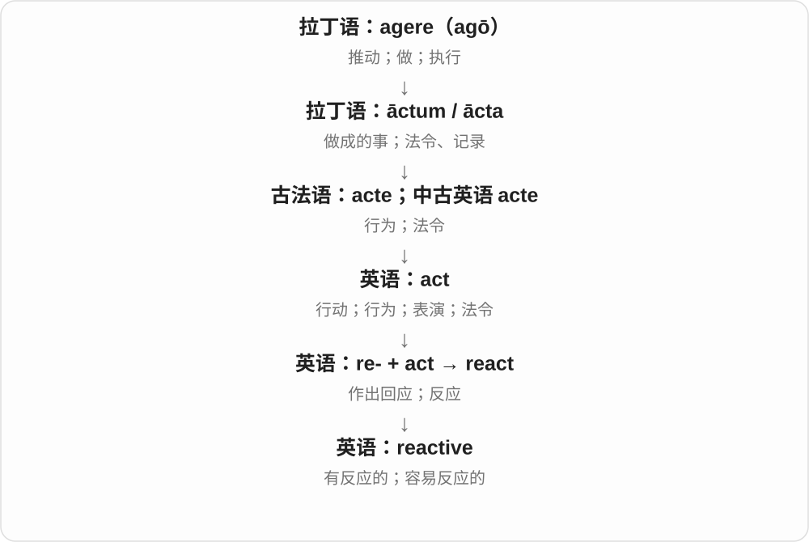

管理讨论中常与 proactive 对比；化学语境则描述反应倾向。容易反应不等于必然危险，仍取决于物质与条件。

**常见搭配与例句**

a reactive approach；reactive maintenance；a highly reactive substance。

> The team wants to replace reactive maintenance with regular inspections.

团队希望用定期检查替代出了问题才维修。

> The lesson compares reactive and relatively stable substances.

这节课比较容易反应与相对稳定的物质。

**别混淆**

reactive 回应已经出现的情况；proactive 提前采取措施。

### 112. reactivity — 反应性；反应活性、容易反应的程度

**音标**：/ˌriːækˈtɪvəti/

**先抓住这个画面**

同样遇到刺激，有的物质很容易反应，有的很稳定。reactivity 就把反应的倾向、程度拿出来比较。

**怎么拆**

reactive 反应性的去 e 加 -ity；react 又由 re- 回与 act 行动材料构成。化学及其他领域把反应具体化，不能只按日常回一句话理解。

**怎么变成今天的意思**

**react → reactive**  
作出反应 → 具有反应倾向

↓

**reactive + -ity → reactivity**  
反应倾向、程度与能力

chemical reactivity 化学反应活性；high reactivity 高反应性；emotional reactivity 情绪反应性，属于另一具体领域。

**常见搭配与例句**

chemical reactivity；high reactivity。

> The experiment compares the reactivity of two metals.

实验比较两种金属的反应活性。

> The researchers measured changes in emotional reactivity.

研究者测量了情绪反应性的变化。

**别混淆**

reactivity 不是 response time 反应时间的通用替代；易不易反应、反应多强、速度多快需按具体指标区分。

### 113. accessibility — 可达性；易用、易理解程度；无障碍性

**音标**：/əkˌsesəˈbɪləti/

**先抓住这个画面**

把能不能到、用起来有没有障碍作为一个整体问题：入口、文字、操作都可能影响它。

**怎么拆**

accessible + -ity，-ible 对应 -ibility，形成性质名词；受到法语、晚期拉丁相应名词形式影响。重音移到 -bil-。

**怎么变成今天的意思**

**拉丁 ad- + cēdere → accēdere；accessus**  
朝向 + 走 → 接近；接近、入口

↓

**晚期拉丁 accessibilis → 法语 accessible → 英语 accessible**  
能够接近、进入 → 易用、易理解

↓

**accessible + -ity → accessibility**  
可接近、可使用、可理解的程度及设计性质

website accessibility 网站无障碍，improve accessibility 提高可达性和易用性，accessibility features 无障碍功能；具体对象决定评估内容。

**常见搭配与例句**

improve accessibility；website accessibility；accessibility features。

> The redesign improved the website’s accessibility.

改版提高了网站的无障碍性。

> The survey asks residents about the accessibility of local services.

问卷询问居民使用当地服务是否方便、有无障碍。

**别混淆**

access 是进入或使用的机会、动作，accessibility 说这种进入、使用有多可行；无障碍性不只是否装了坡道。

### 114. profitability — 盈利能力；获利程度

**音标**：/ˌpɹɒf.ɪ.təˈbɪl.ɪ.ti/

**先抓住这个画面**

不是看某一次收了多少钱，而是看一门生意能不能持续留下利润：这叫 profitability。

**怎么拆**

profitable + -ity，-able 对应 -ability，形成性质名词。

**怎么变成今天的意思**

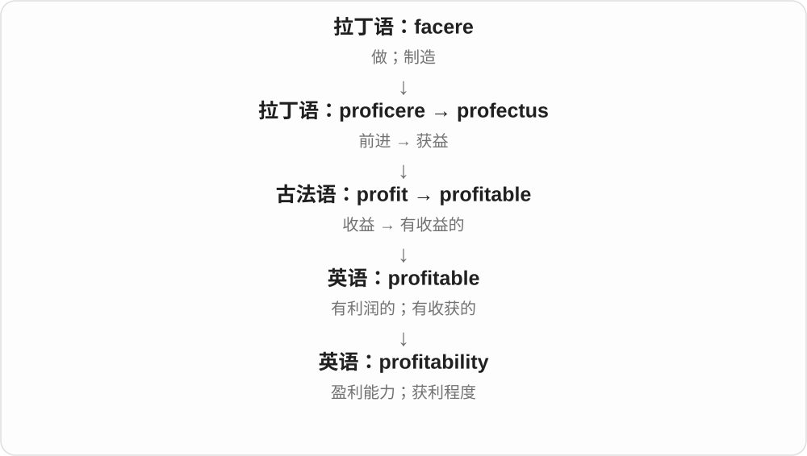

profit 是具体利润，profitability 是赚钱的能力或水平。收入增长与盈利能力提升可能并不同步。

**常见搭配与例句**

improve profitability；long-term profitability；profitability analysis。

> Higher transport costs reduced profitability.

运输成本上升降低了盈利能力。

> The team reviewed the profitability of each product.

团队评估了每种产品的获利情况。

**别混淆**

revenue growth 是收入增加；profitability 仍要考虑成本，不能只看销量。

### 115. negativity — 消极态度；负面情绪；负性

**音标**：/ˌneɡəˈtɪvəti/

**先抓住这个画面**

总把注意力拉向坏处、失败和不可能，便形成一股消极气氛。

**怎么拆**

negative + -ity，形成性质名词；重音移到 /tɪv/，不是直接在 negative 后保持原重音。

**怎么变成今天的意思**

**拉丁语 negare**  
否认、拒绝，说“不”

↓

**拉丁语 negativus → 法语 negatif / 直接借入英语**  
表示否定的

↓

**英语 negative**  
否定的；负的；消极的；阴性的等

↓

**英语 negative → negativity**  
消极、负的 → 消极态度或负的性质

日常常说 constant negativity，批评持续抱怨或否定一切的态度。在技术上下文也可指负的性质，不一定涉及情绪。

**常见搭配与例句**

constant negativity；a culture of negativity；respond to negativity。

> The team was tired of his constant negativity.

团队厌倦了他不断散发的消极态度。

> She acknowledged the risks without slipping into negativity.

她承认风险，但没有因此陷入消极情绪。

**别混淆**

criticism 可以具体、有建设性；negativity 常着重一味消极的倾向。

### 116. volatility — 波动性；易变性；挥发性

**音标**：英 /ˌvɒləˈtɪləti/；美 /ˌvɑːləˈtɪləti/

**先抓住这个画面**

把“有多容易变化或散去”拿出来作为一种性质讨论。

**怎么拆**

英语 volatile + -ity；去掉词尾 e，重音转到 /tɪl/ 这一节，不能直接沿用 volatile 的重音。

**怎么变成今天的意思**

**拉丁语 volare → volatilis**  
飞 → 会飞的、转瞬即逝的

↓

**法语 volatile → 英语 volatile**  
易散去、易挥发；再说变化快、难稳定

↓

**英语 volatile + -ity → volatility**  
易挥发、易变的性质或程度

price volatility 说价格波动的程度，不指定上涨还是下跌。化学里的 volatility 仍接容易成为蒸气的意思；人物的 emotional volatility 则说情绪变化容易剧烈起伏。

**常见搭配与例句**

market volatility；price volatility；high volatility；low volatility；the volatility of a liquid。

> The chart shows a sharp increase in price volatility.

图表显示价格波动程度显著增加。

> The report compares the volatility of several liquids at the same temperature.

报告比较了几种液体在相同温度下的挥发性。

**别混淆**

variation 只是有差异或变化，volatility 常强调变化大、快或难预测。volatile 是形容词，volatility 是可以说 high、low 的性质名词。

### 117. virginity — 无性经历的状态；童贞

**音标**：英 /vəˈdʒɪnəti/；美 /vərˈdʒɪnəti/

**先抓住这个画面**

把 virgin 所说的状态作为一个抽象名词来谈。

**怎么拆**

来自古法语 virginite，接拉丁 virginitas，最终联系 virgo、virgin-。现代可以按 virgin + -ity 记忆，但整个名词已有法语、拉丁语前史，不是英语首次拼成。

**怎么变成今天的意思**

**拉丁语 virgo；词干 virgin-**  
少女、未婚女子；后来相关的无性经验义

↓

**拉丁语 virginitas → 古法语 virginite**  
童贞、未有性经历的状态

↓

**中古英语 virginite → 英语 virginity**  
抽象状态名词

virgin 指一个人，virginity 指这个人的相关经历状态。常见 lose one’s virginity 是第一次发生性行为的委婉说法；讨论宗教、历史或文学时，也会遇到围绕这个概念的社会观念。

**常见搭配与例句**

lose one’s virginity；attitudes towards virginity；a discussion of virginity。

> The essay examines changing attitudes towards virginity.

这篇文章考察了人们对童贞观念的态度变化。

> The memoir describes his anxiety about losing his virginity.

回忆录描写了他对初次性经历的焦虑。

**别混淆**

virginity 是状态，celibacy 通常是选择禁欲或不婚的生活方式；两者不能按“都不发生性行为”简单互换。

### 118. nobility — 贵族阶层；高尚品质

**音标**：英 /nəʊˈbɪləti/；美 /noʊˈbɪləti/

**先抓住这个画面**

既可以指社会中的贵族群体，也可以指一个人做事表现出的高尚。

**怎么拆**

经古法语 nobilité 来自拉丁语 nobilitas，基于 nobilis；名词有独立借入路线，现代则能对照 noble + -ity。

**怎么变成今天的意思**

**拉丁语：gnoscere / noscere；notus**  
开始认识、了解；已知的

↓

**拉丁语 nobilis → nobilitas**  
著名、贵族的 → 贵族身份；高贵品质

↓

**古法语 nobilité → 英语 nobility**  
贵族群体；高尚

the nobility 一般指贵族阶层；nobility of character 指品格高尚。这里的高尚不要求有任何爵位。

**常见搭配与例句**

members of the nobility；nobility of spirit。

> The reforms reduced the political power of the nobility.

改革削弱了贵族阶层的政治权力。

> She showed great nobility in forgiving her rival.

她宽恕对手，表现出高尚的品格。

**别混淆**

nobleman 指一位男性贵族；nobility 可指整个阶层，也可指抽象品质。

### 119. obscene — 淫秽、猥亵的；令人愤慨的；多得离谱的

**音标**：/əbˈsiːn/

**先抓住这个画面**

常说露骨性内容让人觉得冒犯；也可强烈批评某个数额、差距大得离谱，如 an obscene amount of money。

**怎么拆**

经法语接拉丁 obscenus、obscaenus，较远来源有争议。不要把“台下、场外”等流行拆词故事当成已确定的来历。

**怎么变成今天的意思**

**拉丁 obscenus、obscaenus → 法语、英语 obscene**  
污秽、冒犯性等；更远拆分未定

↓

**obscenus 的名词 obscenitas → obscenity**  
淫秽、猥亵；冒犯性言辞或极不公之事

obscene language 淫秽言语；an obscene gesture 猥亵手势；an obscene amount 离谱的大量。

**常见搭配与例句**

obscene language；an obscene amount of。

> The message contained obscene language.

消息里含有淫秽言语。

> The repairs cost an obscene amount of money.

维修花了一笔大得离谱的钱。

**别混淆**

obscene 的道德、程度评价常很强；普通不礼貌 rude 未必达到 obscene，也不是所有 obscene 都在说性。

### 120. obscenity — 淫秽、猥亵；脏话；令人愤慨之事

**音标**：英 /əbˈsenəti/；美 /əbˈsenəti/

**先抓住这个画面**

obscene 描述内容、动作，obscenity 把这种性质或具体的话、事拿来谈。复数 obscenities 常说骂出的脏话。

**怎么拆**

接拉丁 obscenitas 等名词，现代对应 obscene 去 e 加 -ity；重音处元音由 /iː/ 变成 /e/。

**怎么变成今天的意思**

**拉丁 obscenus、obscaenus → 法语、英语 obscene**  
污秽、冒犯性等；更远拆分未定

↓

**obscenus 的名词 obscenitas → obscenity**  
淫秽、猥亵；冒犯性言辞或极不公之事

↓

**obscenitas → obscenity**  
冒犯性、淫秽性质；相应言辞、事物

shout obscenities 高喊脏话；the obscenity of war 战争令人愤慨的残酷；obscenity laws 有关淫秽内容的法律称呼。

**常见搭配与例句**

shout obscenities；the obscenity of。

> He shouted obscenities at the screen.

他冲着屏幕大骂脏话。

> The novel exposes the obscenity of extreme inequality.

小说揭露了极端不平等令人愤慨的一面。

**别混淆**

obscenity 作可数常是一句脏话、某件令人愤慨的事；不可数时讨论性质，不能只背成色情一种义。

### 121. confidentiality — 保密；保密性

**音标**：英 /ˌkɒnfɪdenʃiˈæləti/；美 /ˌkɑːnfɪdenʃiˈæləti/

**先抓住这个画面**

信息只让应当知道的人知道，并把这种限制维持住。

**怎么拆**

confidential + -ity；英语把须保密的性质变成抽象名词，重音后移。

**怎么变成今天的意思**

**拉丁语 fidere；同族名词 fides**  
信任、相信；信用、信义

↓

**拉丁语 confidere**  
con- 在这里通常作加强理解 + fidere → 充分信任

↓

**拉丁语 confidentia + -al → 英语 confidential**  
信任、私密交托 → 保密的；可能也受法语对应词影响

↓

**英语 confidential + -ity → confidentiality**  
保密的 → 保密性、保密责任

maintain confidentiality 是维持保密；breach confidentiality 是违反保密要求。它关注信息访问与披露，不等于所有隐私问题的全部。

**常见搭配与例句**

maintain confidentiality；patient confidentiality；a confidentiality agreement。

> The interviews were conducted under strict confidentiality.

访谈在严格保密的条件下进行。

> All participants signed a confidentiality agreement.

所有参与者都签署了保密协议。

**别混淆**

privacy 关注个人私生活及信息边界；confidentiality 关注已交付信息的保密处理。

### 122. divinity — 神性、神圣；神祇；神学

**音标**：/dɪˈvɪnəti/

**先抓住这个画面**

divine 说神圣的，divinity 可以把神性当一个概念谈，也可称一位神祇；在学校、学位名称中还常指神学研究。

**怎么拆**

经古法语 divinité 接拉丁 dīvīnitās。现代与 divine + -ity 对应，但历史有自己的借入路线；divine 的 /vaɪ/ 在 divinity 中对应 /vɪ/。

**怎么变成今天的意思**

**拉丁 dīvīnitās → 古法语 divinité → divinity**  
神性、神圣及神祇相关名词

↓

**学术领域的固定用法**  
divinity 用于神学研究、院系和学位名称

the divinity of a figure 某位人物的神性，ancient divinities 古代神祇，a school of divinity 神学院。不可数性质与可数神祇要分语境。

**常见搭配与例句**

the divinity of；ancient divinities；a school of divinity。

> The lecture examines ideas about divinity in ancient stories.

讲座考察古代故事中的神性观念。

> She studies at a school of divinity.

她在一所神学院学习。

**别混淆**

divinity 不只是一种感觉；复数 divinities 可实指诸神。神学院名称中的 divinity 也不能直接译成好吃、美妙。

### 123. durability — 耐久性；耐用程度

**音标**：英 /ˌdjʊərəˈbɪləti/；美 /ˌdʊrəˈbɪləti/

**先抓住这个画面**

把“能撑多久、不容易坏”作为一种性能来比较。它不是看起来结实，而是经受使用、磨损或时间后仍能保持状态。

**怎么拆**

现代对应 durable + -ity；历史借古法语 durabilité 或晚期拉丁 durabilitas、durabilitatem，后者从 durabilis 形成，名词有自己的借入路线。

**怎么变成今天的意思**

**拉丁 durus → durare**  
硬、坚实 → 使变硬；持续、撑住

↓

**拉丁 durabilis → durabilitas／durabilitatem**  
持久的 → 持久耐用这一性质

↓

**古法语 durabilité／直接拉丁借入 → 英语 durability**  
耐久性、耐用性

test for durability 是测试耐用性；long-term durability 是长期耐久性。比喻中也可讨论制度、联盟或承诺能维持多久。

**常见搭配与例句**

test durability；improve durability；long-term durability；durability of materials。

> The manufacturer tested the hinges for durability.

制造商测试了铰链的耐用性。

> The crisis raised questions about the durability of the alliance.

危机使人们开始怀疑这个联盟能维持多久。

**别混淆**

durability 关注耐久；reliability 关注运行是否可靠、是否常出错。两者相关，但一件耐久的东西未必从来不出故障。

### 124. liquidity — 流动性；易变现程度；可用资金的充裕程度

**音标**：/lɪˈkwɪdəti/

**先抓住这个画面**

钱能不能及时流到需要它的地方，而不是卡在难卖的资产里。

**怎么拆**

借法语 liquidité 或拉丁 liquiditas，接 liquidus。现代可按 liquid + -ity 看形容词与名词的关系；早期是液态性质，后发展出财务含义。

**怎么变成今天的意思**

**拉丁 liquēre**  
呈液态；流动；清澈

↓

**拉丁 liquidus → liquiditas，亦经法语 liquidité**  
液态；液态性质

↓

**英语 liquidity**  
液态性质；后来扩展为金融流动性

资产的 liquidity 关注能否迅速、以接近市场价值的价格换成现金；机构的 liquidity 还关注手头可用资金能否应付付款。账面很有价值，不一定眼下有足够现金。

**常见搭配与例句**

market liquidity；a liquidity shortage；maintain liquidity；improve liquidity。

> The report separates profitability from liquidity.

报告把盈利能力与流动性分开讨论。

> The market lost liquidity when many buyers withdrew.

许多买家退出后，市场流动性下降了。

**别混淆**

profitability 是盈利能力；liquidity 是资金能否及时可用。生意有利润也可能遇到现金周转困难。

### 125. viability — 存活能力；可行性；持续运行的可能性

**音标**：/ˌvaɪəˈbɪləti/

**先抓住这个画面**

不只问“看起来好不好”，而是检查支撑它活下去或运转下去的条件是否够用。

**怎么拆**

法语 viabilité 接 viable；现代也可分析为 viable + -ity，历史上保留法语名词借入路线。

**怎么变成今天的意思**

**拉丁 vīta → 法语 vie**  
生命

↓

**法语 viable → viabilité → 英语 viability**  
能存续的 → 存续能力、可行性

可讨论项目、企业模式、种子或细胞。不同对象有不同评价标准，不能只凭一个乐观设想就判断 viability。

**常见搭配与例句**

assess viability；commercial viability；seed viability。

> The team assessed the long-term viability of the project.

团队评估了项目长期运行的可行性。

> Storage conditions can affect seed viability.

储存条件会影响种子的生活力。

**别混淆**

feasibility 常问能否做成；viability 常兼顾能否持续有效运行，不过具体语境中两者会重叠。

### 126. antiquity — 古代；古老；古物〔常用复数〕

**音标**：英 /ænˈtɪkwəti/；美 /ænˈtɪkwəti/

**先抓住这个画面**

把目光拉回很久以前的时代，也能指那个时代留下的东西。

**怎么拆**

拉丁 antiquus“古老的”形成 antiquitas，再经古法语 antiquité 进入中古英语。antique + -ity 是今天有帮助的对应，不是英语借词的完整历史。

**怎么变成今天的意思**

**拉丁语 ante；古形式 anti-**  
在前面、在……之前

↓

**拉丁语 antiquus**  
以前的、古老的

↓

**拉丁语 antiquitas → 古法语 antiquité**  
古老的性质、久远时代

↓

**中古英语 antiquite → antiquity**  
古代；古老；复数可指古物

in antiquity 说“在古代”，一般不加 the；antiquities 常指古代器物、遗迹。两者一个像时间背景，一个像博物馆里可以展示的对象。

**常见搭配与例句**

in antiquity；classical antiquity；the antiquity of a custom；a collection of antiquities。

> The harbour was an important trading centre in antiquity.

这座港口在古代是重要的贸易中心。

> The museum returned several antiquities to their country of origin.

博物馆把几件古物归还了其来源国。

**别混淆**

an antique 通常是一件可收藏的古董；antiquity 常是抽象时代，antiquities 才常指古物。古董未必都来自通常所说的古代。

### 127. plurality — 多个、多样性；相对多数；领先票数

**音标**：英 /plʊəˈræləti/；美 /plʊˈræləti/

**先抓住这个画面**

一般语境是存在不止一种；票数语境是你的这一堆比任何另一堆都大，却未必超过所有票的一半。

**怎么拆**

后期拉丁 pluralitas，经古法语 pluralité 到英语；现代可对应 plural + -ity，历史名词却有独立借入路线。

**怎么变成今天的意思**

**拉丁 plūs，属格 plūris**  
更多；比较意义上的数量增加

↓

**拉丁 pluralis → 后期拉丁 pluralitas → 古法语 pluralité**  
复数、多于一个的状态

↓

**中古英语 pluralite → plurality**  
多个；后来也说相对多数与领先票数

三人得票四十、三十五、二十五，四十票者有 plurality，却没有过半的 majority。a plurality of views 则只说多种观点，完全不涉及投票。

**常见搭配与例句**

a plurality of votes；win a plurality；a plurality of perspectives。

> She received a plurality of the votes, but not an absolute majority.

她获得了相对多数票，但没有获得绝对多数票。

> The collection presents a plurality of views on city life.

这本文集呈现了对城市生活的多种看法。

**别混淆**

majority 通常要求超过所比较总数的一半；plurality 比较各组谁最多。具体选举是否因此当选，还由制度决定。

### 128. solemn — 庄严、严肃的；郑重的

**音标**：英 /ˈsɒləm/；美 /ˈsɑːləm/

**先抓住这个画面**

面对重要承诺、纪念仪式，神情认真，不是随口说说，这种郑重是 solemn。它不必意味着心情悲伤。

**怎么拆**

经法语接拉丁 sollemnis 等仪式、惯例材料；更远来源有分歧。现代拼写 n 通常不单独发音，不能据此删去字母。

**怎么变成今天的意思**

**拉丁 sollemnis 等 → 法语 solemne → solemn**  
按仪式、庄严、正式；更远词源未定

↓

**拉丁 sollemnitas 等 → solemnity**  
仪式的庄严；严肃、郑重的态度

a solemn promise 郑重承诺；a solemn ceremony 庄严仪式；a solemn expression 严肃神情。

**常见搭配与例句**

a solemn promise；a solemn ceremony。

> She made a solemn promise to return.

她郑重承诺会回来。

> The ceremony was solemn and moving.

仪式庄严而动人。

**别混淆**

solemn 重郑重、严肃，sad 是悲伤；婚礼承诺可以 solemn，也可以充满喜悦。

### 129. solemnity — 庄严、严肃；郑重仪式

**音标**：/səˈlemnəti/

**先抓住这个画面**

solemn 描述气氛庄严，solemnity 是这份使人认真对待的庄重。可以谈态度，也可在较正式文本里指礼仪活动。

**怎么拆**

经法语接拉丁 sollemnitas；现代对应 solemn + -ity。solemn 常不发 n，solemnity 的 /mn/ 则把 n 读出来。

**怎么变成今天的意思**

**拉丁 sollemnis 等 → 法语 solemne → solemn**  
按仪式、庄严、正式；更远词源未定

↓

**拉丁 sollemnitas 等 → solemnity**  
仪式的庄严；严肃、郑重的态度

↓

**sollemnitas → solemnity**  
庄重性质；正式礼仪、庆典

the solemnity of the occasion 场合的庄严；with great solemnity 十分郑重地；religious solemnities 宗教礼仪，较正式。

**常见搭配与例句**

the solemnity of；with solemnity。

> Everyone respected the solemnity of the occasion.

每个人都尊重这个场合的庄严。

> He announced the decision with great solemnity.

他十分郑重地宣布了决定。

**别混淆**

solemnity 是郑重、庄严，solitude 是独处；相似开头不表示安静独处必然就是仪式庄严。

### 130. vitality — 活力；生命力

**音标**：/vaɪˈtæləti/

**先抓住这个画面**

不是只维持着存在，而是还能生长、行动、回应变化。

**怎么拆**

接拉丁 vītālitās“生命力”，也有法语 vitalité 中介分析。现代可与 vital + -ity 对照，但完整名词的借入路线应单独保留。

**怎么变成今天的意思**

**拉丁 vīta；与 vīvere“活着”同族**  
生命

↓

**拉丁 vītālis → vītālitās，亦经法语 vitalité**  
生命的；生命力

↓

**英语 vitality**  
生命力；活跃、兴旺的状态

人的 vitality 是精力和活跃程度；城市、文化、语言也可以有 vitality，表示仍在被使用、发展、创造新东西。

**常见搭配与例句**

full of vitality；cultural vitality；economic vitality。

> The market gives the neighbourhood a sense of vitality.

这个市场让街区充满活力。

> Her curiosity and vitality come through in every letter.

她的好奇心和生命力，在每封信里都流露出来。

**别混淆**

vitality 是活力；vital importance 是关键重要性。名词不是把 vital 所有意义机械照搬。

### 131. austere — 简朴严肃的；严厉的；无装饰的

**音标**：英 /ɒˈstɪə/；美 /ɔːˈstɪr/

**先抓住这个画面**

房间只有床、桌子和白墙，没有柔软装饰，可以说 austere。用在人身上，则容易想到不苟言笑、严肃克制。

**怎么拆**

经法语、拉丁接希腊 austeros 苦涩、严酷，原来味觉的涩厉发展为态度、风格的严肃简朴。

**怎么变成今天的意思**

**希腊 austeros 苦涩、严酷 → 拉丁 austerus → 法语 austere**  
味觉上的涩、厉害 → 严厉、无装饰

↓

**austere、austeritas 等 → austerity**  
严肃、简朴；紧缩生活或政策

an austere room 简朴的房间；an austere manner 严肃态度；an austere lifestyle 清苦、克制的生活方式。

**常见搭配与例句**

an austere room；an austere lifestyle。

> The room was austere but clean.

房间简朴，但很干净。

> He was known for his austere manner.

他以严肃的作风著称。

**别混淆**

austere 比 simple 简单更带克制、缺少奢华甚至严冷的感觉；不必等于贫穷造成的破败。

### 132. austerity — 简朴、清苦；紧缩、节支政策

**音标**：英 /ɒˈsterəti/；美 /ɔːˈsterəti/

**先抓住这个画面**

生活里把享受压到很少，是 austerity；公共讨论中也常指削减政府开支、控制财政支出的政策。两者都带收紧的感觉。

**怎么拆**

经法语 austerité、拉丁 austeritas，来自 austerus 严酷、简朴；现代对应 austere 去 e 加 -ity。

**怎么变成今天的意思**

**希腊 austeros 苦涩、严酷 → 拉丁 austerus → 法语 austere**  
味觉上的涩、厉害 → 严厉、无装饰

↓

**austere、austeritas 等 → austerity**  
严肃、简朴；紧缩生活或政策

↓

**austeritas → austerity**  
严肃简朴；节约、紧缩的安排

austerity measures 紧缩措施；a period of austerity 清苦、紧缩时期；the austerity of the design 设计的简朴。

**常见搭配与例句**

austerity measures；a period of austerity。

> The government announced new austerity measures.

政府宣布了新的紧缩措施。

> The house reflected the austerity of their lifestyle.

这所房子体现了他们生活方式的简朴。

**别混淆**

austerity 说紧缩、节制，prosperity 是繁荣；评价一项紧缩政策的效果，不能只由词源下结论。

### 133. familiarity — 熟悉程度；亲近、熟络；过分随便

**音标**：英 /fəˌmɪliˈærəti/；美 /fəˌmɪliˈerəti/

**先抓住这个画面**

见过、用过很多次，东西在脑中有了位置；人与人相处久了，也可能越来越不拘礼节。

**怎么拆**

经法语 familiarité 来自拉丁语 familiāritās，名词有自己的借入历史；现代与 familiar + -ity 对应。

**怎么变成今天的意思**

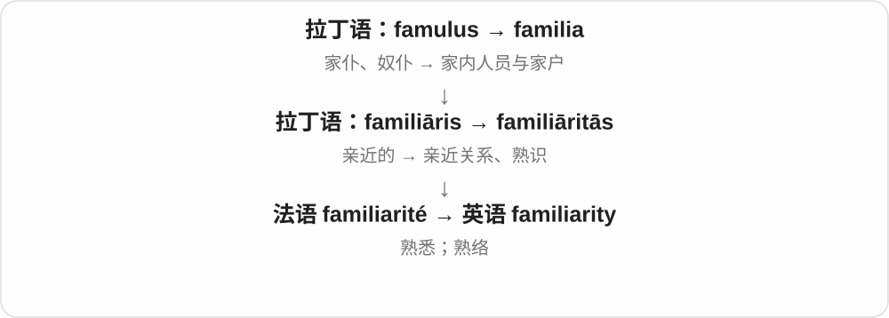

familiarity with a subject 是熟悉某领域；excessive familiarity 则是过度亲昵。词尾变化时主重音移到后部。

**常见搭配与例句**

familiarity with the system；a sense of familiarity；excessive familiarity。

> The job requires some familiarity with basic accounting.

这份工作要求对基础会计有所了解。

> He spoke with a familiarity that made her uncomfortable.

他说话过于熟络，让她感到不自在。

**别混淆**

familiarity 是熟悉，不保证 competence“胜任能力”：常见过一种工具，未必会熟练操作。

### 134. anonymity — 匿名状态；不为人知、无人辨认的状态

**音标**：/ˌænəˈnɪməti/

**先抓住这个画面**

名字和身份退到背景，别人看见某条信息或某个人，却不知道具体是谁。

**怎么拆**

anonym- 无名词干 + -ity；与 anonym、anonymous 同源。现代常把 anonymous 的 -ous 换成 -ity 来记，但不需要说名词只从完整形容词机械拼接。

**怎么变成今天的意思**

**古希腊语 a- / an-**  
不、没有；an- 常出现在元音之前

↓

**希腊 anonymos → 拉丁 anonymus；anonym- 词干**  
无名、未署名

↓

**英语 anonym- + -ity → anonymity**  
无名状态；匿名

on condition of anonymity 是以匿名为条件；the anonymity of a big city 是在大城市里不被熟人认出的状态。它可以带自由感，也可能带疏离感。

**常见搭配与例句**

protect anonymity；on condition of anonymity；preserve anonymity。

> The witness spoke on condition of anonymity.

证人以匿名为条件讲述了情况。

> She enjoyed the anonymity of living in a large city.

她喜欢住在大城市里无人认识自己的自在感。

**别混淆**

privacy 是私人空间或信息得到保护；anonymity 特别说身份不被识别，两者相关但不相同。

### 135. nudity — 裸体状态；裸体呈现

**音标**：英 /ˈnjuːdəti/；美 /ˈnuːdəti/

**先抓住这个画面**

它关注“有没有穿衣物”这个状态，或作品里是否出现这样的身体形象。

**怎么拆**

现代可拆 nude + -ity。历史资料还列出法语 nudité、晚期拉丁 nuditas／nuditatem 的名词借入说；这些路线都接拉丁 nudus，不能把现代拆法当成唯一历史。

**怎么变成今天的意思**

**拉丁 nudus；晚期 nuditas**  
裸露的；裸露状态

↓

**两类来源分析**  
法语 nudité／拉丁名词借入；或英语 nude + -ity

↓

**英语 nudity**  
裸露身体的状态或呈现

讨论艺术里的 nudity，是讨论人体如何被呈现；电影说明中的 nudity 是内容类别。它本身没有说明人物的动机，也不自动等于性行为，更不等于提倡裸体生活。

**常见搭配与例句**

nudity in art；a scene containing nudity；attitudes towards nudity；brief nudity。

> The lecture examined how different artists represented nudity.

讲座探讨了不同艺术家如何呈现裸体。

> The film’s content note mentions brief nudity.

这部电影的内容说明提到了短暂的裸体画面。

**别混淆**

nude 可作形容词，也可数一件艺术作品：a nude。nudity 通常是不可数的状态名词；nudism 则是实践或观念，不是所有 nudity 的总称。

### 136. variability — 变化程度；可变性

**音标**：英 /ˌveəriəˈbɪləti/；美 /ˌveriəˈbɪləti/

**先抓住这个画面**

看这些值或表现到底有多不稳定、多不一致：不是只问平均是多少。

**怎么拆**

variable + -ity，形成 -ability 结尾的性质名词；重音移到 /bɪl/ 所在音节。

**怎么变成今天的意思**

**拉丁语 varius**  
不同的、多样的；带不同颜色的

↓

**拉丁语 variare → 后期拉丁语 variabilis → 古法语 variable**  
变化 → 可以变化的

↓

**英语 variable**  
多变的；后来也指变量

↓

**英语 variable → variability**  
可变的 → 变化程度或性质

两名选手平均成绩相同，一人成绩很稳，一人忽高忽低，后者 variability 更大。这个词不指定必须用哪一种统计量。

**常见搭配与例句**

individual variability；natural variability；reduce variability。

> There is considerable variability in how quickly children learn to read.

儿童学会阅读的速度有很大差异。

> The new process reduced variability between batches.

新工艺减少了各批次之间的差异。

**别混淆**

variance 是一种具体的统计量；variability 是更宽的“变化有多大”，可用不同方法描述。

### 137. ambiguity — 歧义；不明确之处

**音标**：/ˌæmbɪˈɡjuːəti/

**先抓住这个画面**

ambiguity 是理解岔路本身：同一句话，有人走到这个意思，有人走到另一个意思。

**怎么拆**

现代对应 ambiguous + -ity；历史经法语来自拉丁语 ambiguitās，名词有自己的借入路线。

**怎么变成今天的意思**

不可数时指不明确的状态，可数时是一处具体歧义。文学可以有意保留 ambiguity，操作说明则通常应减少。

**常见搭配与例句**

remove ambiguity；an ambiguity in the wording；leave room for ambiguity。

> The revised sentence removes the ambiguity.

修改后的句子消除了歧义。

> The ending leaves room for ambiguity.

这个结尾保留了多种解释的空间。

**别混淆**

uncertainty 泛指不确定；ambiguity 常关乎同一表达或情形存在多种解释。

### 138. legality — 合法性；法律手续或要求〔复数〕

**音标**：/liːˈɡæləti/

**先抓住这个画面**

先不问好不好、值不值得，只问法律上允不允许、手续是否符合要求。

**怎么拆**

接中世纪拉丁 legalitas，来自 legalis；现代可拆 legal + -ity，但名词有拉丁借入路线。

**怎么变成今天的意思**

**拉丁语 lex，属格 legis**  
法律、规则

↓

**拉丁语 legalis**  
属于法律的；依法的

↓

**中世纪拉丁 legalitas → 英语 legality**  
依法的性质 → 合法性

question the legality of 是质疑是否合法。复数 legalities 可说必须处理的法律细节或手续。

**常见搭配与例句**

the legality of an action；deal with the legalities。

> The court examined the legality of the procedure.

法院审查了该程序的合法性。

> They asked a specialist to handle the legalities of the transfer.

他们请专业人士处理转让中的法律手续。

**别混淆**

morality 讨论道德，legality 讨论法律；合法不自动等于人人觉得公平。

### 139. illegality — 违法性；违法行为

**音标**：/ˌɪliːˈɡæləti/

**先抓住这个画面**

把某件事与法律的冲突单独拿出来说：问题在于它违法这一点。

**怎么拆**

可由 illegal + -ity 形成，也有法语 illégalité 借入分析；两条路线都接 legalis，而不是从英语 legality 回到法语。

**怎么变成今天的意思**

**拉丁语 lex，属格 legis**  
法律、规则

↓

**拉丁语 legalis**  
属于法律的；依法的

↓

**中世纪拉丁 illegalis；法语 illégal / illégalité**  
不合法的；违法性

↓

**英语 illegal + -ity，或法语名词借入 → illegality**  
违法的性质或行为

the illegality of an action 是行为的违法性；复数 illegalities 可以说多项违法行为或违法之处。

**常见搭配与例句**

the illegality of；evidence of illegality。

> The judgment addressed the illegality of the search.

判决讨论了这次搜查的违法性。

> The audit found irregularities but did not establish illegality.

审计发现了异常之处，但未认定存在违法。

**别混淆**

irregularity 是不合常规或程序异常，不一定已经达到 illegality 的法律判断。

### 140. masculinity — 男性气质；男子气概；男性特质

**音标**：/ˌmæskjəˈlɪnəti/

**先抓住这个画面**

把一个社会怎样理解像个男人这件事，作为可以讨论的观念和气质。

**怎么拆**

现代对应 masculine + -ity，重音后移；相关法语 masculinité 也参与这一历史词族，不把后缀拆解当成唯一确定的借入路线。

**怎么变成今天的意思**

**拉丁 mas 男性 → masculus 男性的**  
masculus 是相关指小形式；并不因此表示现代意义的小男孩

↓

**拉丁 masculinus → 法语 masculin、英语 masculine**  
男性、阳性的形容词线

↓

**法语 masculinité 与英语 masculine + -ity 的对应名词 → masculinity**  
男性气质这一抽象概念；资料对直接构形路线有不同处理

ideas of masculinity 是对男性气质的观念；different masculinities 在学术讨论中可谈不同的男性气质模式。它不意味着所有男性都应有同一套性格。

**常见搭配与例句**

traditional masculinity；ideas of masculinity；masculinity and identity。

> The film explores changing ideas of masculinity.

这部电影探讨了男性气质观念的变化。

> He rejected the idea that showing affection weakened his masculinity.

他不认同表达关爱会削弱男子气概的看法。

**别混淆**

manhood 常指成年男性身份或成年阶段；masculinity 更侧重特质、表达和相关社会观念。

### 141. rarity — 稀有；少见；罕见的事物

**音标**：英 /ˈreərəti/；美 /ˈrerəti/

**先抓住这个画面**

既能说少见这种性质，也能指眼前这个难得一见的东西。

**怎么拆**

拉丁 rarus → raritas，经法语 rarité 或直接从拉丁语进入英语。现代可联系 rare 与 -ity，但历史上有独立名词的借入链。

**怎么变成今天的意思**

**拉丁 rarus → raritas**  
稀疏、稀少 → 稀薄、稀少这种性质

↓

**法语 rarité／拉丁名词 → 英语 rarity**  
稀有；后来也指罕见的事物

the rarity of the bird 说这种鸟很少见；The bird is a rarity 则把它当作一个罕见的个体。后者可数，所以能加 a、变成 rarities。用在日常场景也很自然：安安静静吃完一顿饭，在忙碌家庭里也可能是 a rarity。

**常见搭配与例句**

the rarity of something；be a rarity；a collection of rarities。

> The rarity of the recording made it difficult to find a copy.

这段录音很少见，很难找到一个副本。

> A quiet evening at home is a rarity for them.

对他们来说，在家度过一个安静的晚上很难得。

**别混淆**

rarity 不等于价值。一个物件可以很少见却没有什么市场价值；a rarity 也可以是一件少有的事情，而非收藏品。

### 142. relativity — 相对性；相对论〔物理学〕

**音标**：英 /ˌreləˈtɪvəti/；美 /ˌreləˈtɪvəti/

**先抓住这个画面**

一般义是性质依赖参照；物理学相对论则是一套具体理论，不能简化成一切随你怎么看。

**怎么拆**

relative + -ity，形成性质名词；物理学专名与德语 Relativität 等对应、翻译使用相关。科学用法有严格内容，不是普通态度词的任意放大。

**怎么变成今天的意思**

**拉丁 referre → relātus → 晚期拉丁 relātīvus**  
带回、联系、涉及 → 相联系的

↓

**法语 relatif → 英语 relative**  
相对、相关的；与自己有亲属关系的人

↓

**relative + -ity → relativity**  
相对的性质；后用于特定物理理论名称

the theory of relativity 相对论，special relativity 狭义相对论，the relativity of judgments 判断的相对性。

**常见搭配与例句**

the theory of relativity；special relativity；the relativity of。

> The course introduces the theory of relativity.

课程介绍相对论。

> The essay explores the relativity of our judgments.

文章探讨我们判断的相对性。

**别混淆**

relativity 物理学理论或相对性，relativism 哲学立场；学相对论不等于主张所有意见同样正确。

### 143. sincerity — 真诚、诚意

**音标**：/sɪnˈserəti/

**先抓住这个画面**

你问的不是他说得多好听，而是到底有几分真心，这个真诚的程度、品质就是 sincerity。

**怎么拆**

历史上借中古法语、拉丁 sincēritās 等名词形式，联系 sincērus。现代可对应 sincere + -ity，去 e，重音和中间元音随名词形式变化。

**怎么变成今天的意思**

**拉丁 sincērus**  
完整、干净、纯粹、真实；更早来源有争论

↓

**法语 sincere → 英语 sincere**  
无伪装、发自内心的

↓

**拉丁 sincēritās → 法语、英语 sincerity**  
真实、纯粹的品质 → 真诚、诚意

question someone’s sincerity 怀疑某人的诚意，speak with sincerity 真诚地说，the sincerity of an apology 道歉的诚意。通常作不可数抽象名词。

**常见搭配与例句**

with sincerity；question someone’s sincerity。

> No one doubted the sincerity of her thanks.

没有人怀疑她的感谢是真心的。

> He spoke with a sincerity that moved the audience.

他讲话中的真诚打动了听众。

**别混淆**

sincere 形容态度，sincerity 把这种品质当名词；说 his sincerity，不能把 sincerity 直接放在人前当普通形容词。

### 144. agility — 敏捷；灵活应变能力

**音标**：/əˈdʒɪləti/

**先抓住这个画面**

agility 是身体或头脑迅速换方向、仍能保持控制的能力。

**怎么拆**

现代对应 agile + -ity；历史经法语 agilité 来自拉丁语 agilitās。

**怎么变成今天的意思**

可指运动员动作灵活，也可指组织面对变化时调整的能力。它不只是一条直线上冲得快。

**常见搭配与例句**

physical agility；mental agility；organizational agility。

> The drill tests balance and agility.

这项训练测试平衡和敏捷性。

> Small teams sometimes gain agility from shorter decision processes.

小团队有时因为决策流程短而更灵活。

**别混淆**

agility 强调转向与应变；speed 强调快；flexibility 更偏可调整的范围。

### 145. positivity — 积极心态；正性；阳性状态或比例

**音标**：英 /ˌpɒzɪˈtɪvɪti/；美 /ˌpɑːzəˈtɪvəti/

**先抓住这个画面**

把 positive 的某一种性质单独拿出来说。

**怎么拆**

positive + -ity；词尾由 -ive 变为 -ivity，重音移到后面的 -tiv-。

**怎么变成今天的意思**

**拉丁语 pōnere；过去分词 positus**  
放、安置；已经放好的

↓

**拉丁 positīvus → 古法语 positif → 英语 positive**  
被确定、被规定的 → 肯定的、明确的

↓

**英语的不同专业义与日常义**  
正数、阳性；积极的、乐观的

↓

**英语 positive + -ity → positivity**  
积极、正值或阳性的性质

日常说 positivity 多指积极心态；test positivity rate 则指检测结果中阳性所占比例，和乐观程度无关。

**常见搭配与例句**

a sense of positivity；test positivity；maintain positivity。

> Her calm positivity helped the team keep working.

她平静而积极的态度帮助团队继续工作。

> The report compares test positivity rates across the two weeks.

报告比较了两周的检测阳性率。

**别混淆**

optimism 是对未来结果乐观；positivity 还可包含当下的积极态度，也有专业义。

### 146. receptive — 乐于接受的；能接收的

**音标**：/rɪˈseptɪv/

**先抓住这个画面**

别人提出新想法，你愿意先听、考虑，而不是一开始就关门，这种开放态度是 receptive。

**怎么拆**

借中世纪拉丁 receptivus，接拉丁 receptus，来自 recipere 接受；recept- 是与 receive 对应的历史词干，不是 receipt 收据的唯一义。

**怎么变成今天的意思**

**拉丁 recipere 接受 → receptus → 中世纪拉丁 receptivus**  
能够接收、容纳

↓

**英语 receptive → receptivity**  
乐于接受、能接收；开放接受的性质

be receptive to ideas 愿意接受想法；a receptive audience 愿意听的观众；receptive language 理解性语言能力，专门用法。

**常见搭配与例句**

be receptive to；a receptive audience。

> The team was receptive to new ideas.

团队愿意听取新想法。

> She found a receptive audience for her proposal.

她的提案遇到了愿意听取的听众。

**别混淆**

receptive 是愿意接收、考虑，不保证最后同意；agree 是同意，阶段不同。

### 147. receptivity — 接受意愿；接受能力、敏感程度

**音标**：/ˌriːsepˈtɪvəti/

**先抓住这个画面**

receptive 说愿意听，receptivity 则说这种开放程度：同一提案在不同群体里，可能遇到不同接受意愿。

**怎么拆**

receptive 去 e 加 -ity，保留 recept- 接受的词干，形成性质名词；具体领域也可指接收刺激的能力。

**怎么变成今天的意思**

**拉丁 recipere 接受 → receptus → 中世纪拉丁 receptivus**  
能够接收、容纳

↓

**英语 receptive → receptivity**  
乐于接受、能接收；开放接受的性质

↓

**receptive + -ity → receptivity**  
愿意、能够接受的性质与程度

receptivity to new ideas 对新想法的开放程度；increase receptivity 提高接受意愿；audience receptivity 受众接受意愿。

**常见搭配与例句**

receptivity to；audience receptivity。

> The workshop increased receptivity to different viewpoints.

工作坊让大家更愿意接纳不同观点。

> The study measured audience receptivity to the message.

研究测量受众对这条信息的接受意愿。

**别混淆**

receptivity 常是开放接纳，gullibility 是过度轻信；愿意考虑新观点不等于不核实就全信。

### 148. reversible — 可逆的；两面都能用的

**音标**：英 /rɪˈvɜːsəbəl/；美 /rɪˈvɜːrsəbəl/

**先抓住这个画面**

做了以后还能转回来，或者翻到另一面照样能用。

**怎么拆**

现代对应 reverse + -ible；词源也常联系法语 réversible。

**怎么变成今天的意思**

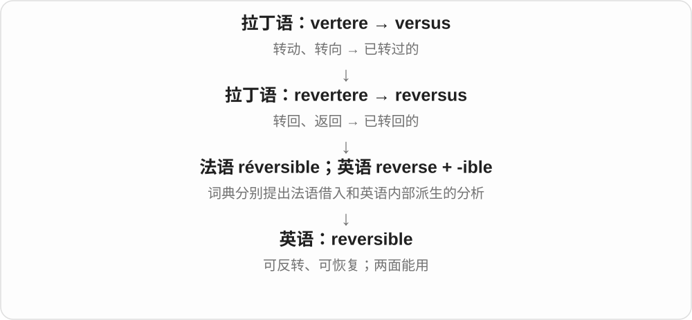

衣服 reversible 是两面可穿；a reversible change 是变化能够被逆转。科学领域的“可逆”可能有更严格条件，不能只按日常意思判定。

**常见搭配与例句**

a reversible jacket；a reversible process；fully reversible。

> The jacket is reversible, with blue on one side and grey on the other.

这件夹克两面都能穿，一面蓝色，一面灰色。

> The editor confirmed that the change was reversible.

编辑确认这项修改可以撤回。

**别混淆**

removable 是能拆掉；reversible 是能反转或恢复。拆掉某物后也可能留永久痕迹。

### 149. reversibility — 可逆性；可恢复性

**音标**：/rɪˌvɜːsəˈbɪləti/，美 /rɪˌvɜːrsəˈbɪləti/

**先抓住这个画面**

变化发生后，还能不能沿某种过程回到原来的状态，是 reversibility 要问的事。关键是能否还原，而不是单纯反着看一遍。

**怎么拆**

reversible 可逆的 + -ity，-ible 对应 -ibility；reverse 反转、恢复的词族来自拉丁转回的材料。

**怎么变成今天的意思**

**reverse → reversible**  
反转、回转 → 可以逆转的

↓

**reversible + -ity → reversibility**  
过程可逆、可恢复的性质

the reversibility of a change 变化的可逆性；chemical reversibility 化学可逆性；a test of reversibility 可逆性测试，具体标准随领域。

**常见搭配与例句**

the reversibility of；chemical reversibility。

> The experiment tests the reversibility of the change.

实验检验这种变化是否可逆。

> The design allows the team to assess reversibility before making a larger change.

这种设计让团队能在作更大改动前评估可恢复性。

**别混淆**

reversibility 关心状态或过程能否逆转，repetition 是重复；再发生一次不等于已经回到原点。

### 150. versatility — 多面才能；多功能性；适应多种用途的能力

**音标**：英 /ˌvɜːsəˈtɪləti/；美 /ˌvɜːrsəˈtɪləti/

**先抓住这个画面**

关注的不是某一招有多厉害，而是换一个任务、角色或环境后还能不能很好地发挥。

**怎么拆**

versatile + -ity；重音移到 -til-，读音与 versatile 的词尾不同。

**怎么变成今天的意思**

常夸演员、运动员或工具的适用范围。demonstrate versatility 是展示自己能做不同类型的事。

**常见搭配与例句**

demonstrate versatility；the versatility of；remarkable versatility。

> The role gives the actor a chance to show his versatility.

这个角色让演员有机会展示多方面的表演能力。

> We chose the tool for its versatility rather than its low price.

我们选这个工具是看中它的多用途，而不是价格低。

**别混淆**

flexibility 重在可以调整；versatility 重在能胜任多种不同任务。

### 151. serene — 平静安详的；宁静的

**音标**：/səˈriːn/

**先抓住这个画面**

外面再忙，脸上仍像无风的湖面一样平和，这种不慌、不乱的感觉是 serene。环境也能呈现它。

**怎么拆**

借拉丁 serenus 晴朗、无云、未受扰动的，早期天空清明的材料也用于心绪安宁。

**怎么变成今天的意思**

**拉丁 serenus 晴朗、无云 → serene**  
天空清明 → 心境平静

↓

**拉丁 serenitas 等经法语 → serenity**  
晴朗、平静的状态

a serene smile 安详微笑；a serene expression 平静表情；a serene landscape 宁静景色。

**常见搭配与例句**

a serene smile；a serene expression。

> She remained serene despite the noise around her.

周围很吵，她仍很平静。

> The lake looked serene in the morning light.

湖泊在晨光中显得宁静。

**别混淆**

serene 是安宁、平和，silent 只说无声；一间无人说话却很紧张的房间，未必 serene。

### 152. serenity — 宁静、平和、安详

**音标**：/səˈrenəti/

**先抓住这个画面**

serene 描述人或环境很平静，serenity 把这份平和当作一种可以感受、寻找的状态。

**怎么拆**

经法语 sérénité 接拉丁 serenitas；现代对应 serene 去 e 加 -ity，重音和元音随词形变化。

**怎么变成今天的意思**

**拉丁 serenus 晴朗、无云 → serene**  
天空清明 → 心境平静

↓

**拉丁 serenitas 等经法语 → serenity**  
晴朗、平静的状态

↓

**serenitas → serenity**  
清明、平静的状态

a sense of serenity 宁静感；the serenity of a place 一地的宁静；seek serenity 寻求平和。

**常见搭配与例句**

a sense of serenity；the serenity of。

> The garden gave her a sense of serenity.

花园让她感到宁静。

> Nothing disturbed the serenity of the evening.

没有什么打破傍晚的宁静。

**别混淆**

serenity 是平和，serendipity 是意外的幸运发现；前面几个字母相似，来源和意义不同。

### 153. impulsive — 冲动的；凭一时兴起的

**音标**：/ɪmˈpʌlsɪv/

**先抓住这个画面**

念头一冒出来就做了，还没来得及好好想后果，就是 impulsive。买东西、答应请求、改计划都能这样。

**怎么拆**

经法语接拉丁 impulsivus，来自 impulsus 推动、冲动；现代与 impulse 对应 -ive 性质材料，词干不是 pulse 脉搏的所有义。

**怎么变成今天的意思**

**拉丁 impellere 推动 → impulsus → impulsivus**  
推力、冲动 → 冲动驱动的性质

↓

**法语 impulsif → impulsive → impulsivity**  
冲动的；冲动倾向

an impulsive decision 冲动决定；an impulsive purchase 一时冲动的购买；an impulsive person 容易冲动的人。

**常见搭配与例句**

an impulsive decision；an impulsive purchase。

> It was an impulsive decision to book the trip.

订下旅程是一时冲动的决定。

> She regretted the impulsive purchase.

她后悔了那次冲动购物。

**别混淆**

impulsive 常强调没深思就行动，spontaneous 更中性地说自然、自发；两者重叠，但评价倾向不同。

### 154. impulsivity — 冲动性；冲动行事的倾向

**音标**：/ˌɪmpʌlˈsɪvəti/

**先抓住这个画面**

impulsive 可以形容一次决定，impulsivity 更常把容易冲动的行为倾向、程度当作研究或讨论对象。

**怎么拆**

impulsive 去 e 加 -ity，形成性质名词；沿用 impulse 冲动的材料，末尾不是单独的 city。

**怎么变成今天的意思**

**拉丁 impellere 推动 → impulsus → impulsivus**  
推力、冲动 → 冲动驱动的性质

↓

**法语 impulsif → impulsive → impulsivity**  
冲动的；冲动倾向

↓

**impulsive + -ity → impulsivity**  
快速凭冲动行动的倾向、程度

levels of impulsivity 冲动性程度；measure impulsivity 测量冲动性；impulsivity and planning 冲动性与计划能力。

**常见搭配与例句**

measure impulsivity；levels of impulsivity。

> The study measured impulsivity using several tasks.

研究通过几项任务测量冲动性。

> The article explores links between stress and impulsivity.

文章探讨压力与冲动性之间的联系。

**别混淆**

impulsivity 讨论一种倾向，不是把所有快速决定都定为坏决定；有准备后的迅速判断也可能很审慎。

### 155. infidelity — 不忠；婚外情；不信宗教〔较旧用法〕

**音标**：英 /ˌɪnfɪˈdeləti/；美 /ˌɪnfɪˈdeləti/

**先抓住这个画面**

亲密关系里原有忠诚的约定，有人却在关系之外另有情爱关系。

**怎么拆**

来自法语 infidélité 和拉丁语 infidelitas；拉丁 in-“不” + fidelis“忠实的”形成不忠这一支，英语并非简单给 fidelity 加字母 in 的首次造词。

**怎么变成今天的意思**

**拉丁语 fides → fidelis → infidelis → infidelitas**  
信义 → 忠实的 → 不忠的 → 不忠

↓

**法语 infidélité / 拉丁语 infidelitas → 中古英语 infidelite → infidelity**  
早期不信、背信 → 现代常说亲密关系中的不忠

现代最常见的是伴侣不忠。an infidelity 可以指一次具体的不忠行为；旧宗教文字中也会用它指不信教。

**常见搭配与例句**

marital infidelity；suspect infidelity；an act of infidelity。

> The novel explores the effects of infidelity on a marriage.

小说探讨了不忠对婚姻的影响。

> She refused to discuss the allegations of infidelity.

她拒绝谈论关于不忠的指控。

**别混淆**

infidelity 是行为或状态；infidel 是带宗教立场称呼某个人的词。

### 156. morbid — 病态的；对死亡、恐怖等异常感兴趣的

**音标**：英 /ˈmɔːbɪd/；美 /ˈmɔːrbɪd/

**先抓住这个画面**

总忍不住盯着死亡、灾难里令人不安的细节，常被叫作 morbid curiosity。医学文本里则可能直接说病态、疾病相关。

**怎么拆**

接拉丁 morbidus 有病的，来自 morbus 疾病；心理、文学的现代用法从病态材料延伸。它不是 moral 道德的否定形式。

**怎么变成今天的意思**

**拉丁 morbus 疾病 → morbidus 病态的 → morbid**  
疾病相关；引申为对死亡、恐怖的病态兴趣

↓

**morbid + -ity → morbidity**  
患病状况；病态兴趣、气氛等性质

morbid curiosity 病态好奇；a morbid fascination 对死亡、恐怖等的着迷；morbid changes 病理改变，后者专业语境。

**常见搭配与例句**

morbid curiosity；a morbid fascination。

> He admitted to a morbid curiosity about the abandoned hospital.

他承认自己对那所废弃医院有一种病态好奇。

> The film has a morbid fascination with death.

影片对死亡表现出一种病态的迷恋。

**别混淆**

morbid curiosity 往往是说话者的负面评价，不是给某人正式诊断；mortal 则常说会死亡的、致命的。

### 157. morbidity — 患病状况、疾病负担；病态性质

**音标**：英 /mɔːˈbɪdəti/；美 /mɔːrˈbɪdəti/

**先抓住这个画面**

统计里问有多少人患病、疾病带来怎样的健康影响，常谈 morbidity。它把生病这件事与死亡这件事分开统计。

**怎么拆**

morbid + -ity，接拉丁疾病材料；名词也可延续形容词的病态兴趣、阴郁气氛义，但公共健康文本常取患病义。

**怎么变成今天的意思**

**拉丁 morbus 疾病 → morbidus 病态的 → morbid**  
疾病相关；引申为对死亡、恐怖的病态兴趣

↓

**morbid + -ity → morbidity**  
患病状况；病态兴趣、气氛等性质

↓

**morbid + -ity → morbidity**  
患病的状态、数量等；病态性质

morbidity and mortality 患病与死亡；morbidity rates 患病相关比率，具体指标依研究定义；disease morbidity 疾病相关患病情况。

**常见搭配与例句**

morbidity and mortality；morbidity rates。

> The study compares morbidity in the two groups.

研究比较两组的患病状况。

> The report records both morbidity and mortality.

报告同时记录患病和死亡情况。

**别混淆**

morbidity 关注患病，mortality 关注死亡；morbidity 也不能不看定义就一律当成某一种固定的发病率。

### 158. alkaline — 碱性的、与碱有关的

**音标**：/ˈælkəlaɪn/

**先抓住这个画面**

这里先看 alkali 碱，-ine 把它接成“碱性的”；它不是遇到 -ine 就又造出一种叫 alkaline 的药物。

**怎么拆**

alkali + 形容词 -ine；alkali 较早经阿拉伯语 al-qily 等草木灰名称，因为灰与制碱历史相连。

**怎么变成今天的意思**

**拉丁 -īnus、-īna 等，经法语 -in、-ine 或直接借入英语**  
属于……、像……；形容词也可转成事物名

↓

**阿拉伯草木灰相关名称 → alkali；alkali + -ine → alkaline**  
碱 → 碱性的

an alkaline solution 碱性溶液，alkaline soil 碱性土壤，an alkaline battery 碱性电池。

**常见搭配与例句**

an alkaline solution；alkaline soil；an alkaline battery。

> The test showed that the solution was alkaline.

检测表明溶液呈碱性。

> Some plants grow well in alkaline soil.

有些植物在碱性土壤中长得好。

**别混淆**

alkali 名词、alkaline 形容词；碱性电池说一种电池体系，不能只凭 alkaline 把任何物品推断成同等碱度。

### 159. alkalinity — 碱性；碱度

**音标**：/ˌælkəˈlɪnəti/

**先抓住这个画面**

日常可概括说偏碱的性质；水质里 alkalinity 还常问这份水能中和多少酸，是它抵抗酸化的一项容量指标。

**怎么拆**

alkaline 碱性的去 e 加 -ity；alkali 远接阿拉伯语植物灰的材料，灰被用于提取碱性物质。技术义随化学领域确定。

**怎么变成今天的意思**

**alkali → alkaline**  
碱类、碱性物质 → 碱性的

↓

**alkaline + -ity → alkalinity**  
碱性；水等体系的中和酸能力

water alkalinity 水的碱度；high alkalinity 高碱度；measure alkalinity 测定碱度。讨论水质时不能仅当作 pH 的另一个名字。

**常见搭配与例句**

water alkalinity；measure alkalinity。

> The laboratory measured the alkalinity of the water.

实验室测定了水的碱度。

> The report lists pH and alkalinity separately.

报告分别列出了 pH 和碱度。

**别混淆**

pH 说当下酸碱状况的一个量，水质 alkalinity 常说中和酸的容量；两者有关联，却不是同一个指标。

### 160. modernity — 现代性；现代状态或特征

**音标**：英 /məˈdɜːnəti/；美 /məˈdɜːrnəti/

**先抓住这个画面**

讨论的不只是“东西很新”，而是一种社会、生活或思想具有怎样的现代特点。

**怎么拆**

联系中世纪拉丁语 modernitas；可解释为借入，也有英语 modern + -ity 仿拉丁形式构词的分析。两条都远接 modernus。

**怎么变成今天的意思**

**拉丁语：modus**  
尺度、分寸；方式

↓

**拉丁语 modo → modernus → modernitas**  
如今 → 现代的 → 现代状态

↓

**英语：modernity**  
现代性〔借入或仿拉丁形式构词〕

建筑的 modernity 可以说外观新颖；社会理论中则可能讨论工业、城市、制度等长期变化。具体“现代”的标准需要作者说明。

**常见搭配与例句**

tradition and modernity；the experience of modernity。

> The building combines local tradition with modernity.

这栋建筑把地方传统与现代特色结合起来。

> The course examines different experiences of modernity.

课程考察了不同的现代化生活经验。

**别混淆**

modernism 是特定艺术、思想倾向或运动；modernity 主要是现代状态及其特征。

### 161. specificity — 具体程度；专一性；特异性

**音标**：/ˌspesɪˈfɪsəti/

**先抓住这个画面**

specificity 像瞄准镜有多准：表达是否点到具体细节，或一种反应是否只对某些目标发生。

**怎么拆**

specific + -ity，变成表示性质的名词，重音移到 -ficity 中的 fi。

**怎么变成今天的意思**

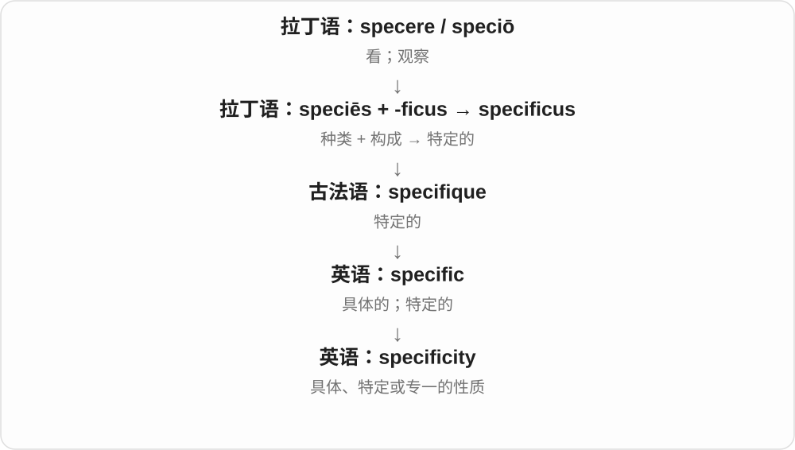

写作中谈明确细节；生物化学中谈识别对象的选择性。诊断检测中还有专门统计定义，不能只凭一般词义解释数字。

**常见搭配与例句**

lack of specificity；binding specificity；the specificity of a description。

> The instructions lack specificity.

这些说明不够具体。

> The study compared the binding specificity of two proteins.

研究比较了两种蛋白质的结合特异性。

**别混淆**

sensitivity 常关心能否察觉；specificity 常关心是否对准某类对象，技术场景须看具体定义。

### 162. absurdity — 荒谬；荒唐的事

**音标**：英 /əbˈsɜːdəti/；美 /əbˈsɜːrdəti/

**先抓住这个画面**

既可说不合常理这种性质，也可指一件具体的荒唐事。

**怎么拆**

接晚期拉丁 absurditas，来自 absurdus，可经法语传入。英语 absurdity 早于常用形容词 absurd；今天虽能按 absurd + -ity 理解，借入历史是独立的。

**怎么变成今天的意思**

**拉丁 surdus 聋的、声音沉闷的；加 ab- → absurdus**  
不合调、不合情理；前缀作用及具体意义衔接有不同解释

↓

**晚期拉丁 absurditas／法语 absurdité → 英语 absurdity**  
把荒谬作为名词借入，英语记录早于现代常用 absurd

the absurdity of the situation 用不可数义；an absurdity、several absurdities 则可数，说一件或几件荒唐事。注意复数要把 y 改成 ies。

**常见搭配与例句**

the absurdity of a claim；a glaring absurdity；the absurdities of bureaucracy。

> She pointed out the absurdity of charging people to submit a complaint.

她指出，投诉还要收费实在荒谬。

> The novel exposes the small absurdities of office life.

这部小说揭示了办公室生活中的种种小荒唐。

**别混淆**

absurd 是修饰词，absurdity 是性质或事物名。complexity 只是复杂，不一定荒唐。

### 163. acidity — 酸性；酸度；酸味

**音标**：/əˈsɪdəti/

**先抓住这个画面**

acidic 说“它偏酸”，acidity 把“酸这件事或酸的程度”拿出来讨论。

**怎么拆**

法语 acidité 接拉丁 aciditas；现代可联系 acid + -ity，但名词有独立借入路线。

**怎么变成今天的意思**

**拉丁 acere → acidus**  
发酸 → 酸的、尖锐的

↓

**拉丁 aciditas → 法语 acidité → 英语 acidity**  
酸的性质 → 酸性、酸度

谈咖啡的 acidity，常在说那种明亮、像水果的酸味，不一定是在抱怨难喝。谈水或土壤的 acidity，则是在说化学性质或测量结果。

**常见搭配与例句**

the acidity of the soil；low acidity；balance the acidity；a pleasant acidity。

> The coffee has a pleasant acidity and a fruity aroma.

这杯咖啡有舒服的酸味，还带着果香。

> The researchers measured the acidity of the water.

研究人员测量了水的酸度。

**别混淆**

acidity 不等于 sourness 的全部用法：前者适合讨论酸度和风味特征，后者也可直接表达令人不快的酸味。

### 164. individuality — 个性；独特性

**音标**：/ˌɪndɪvɪdʒuˈæləti/

**先抓住这个画面**

同样穿校服，仍能看出每个人不同的说话方式、爱好和想法。这些让“你就是你”的特点，是 individuality。

**怎么拆**

individual + -ity，变成表示个体特质的名词；词尾处重读。

**怎么变成今天的意思**

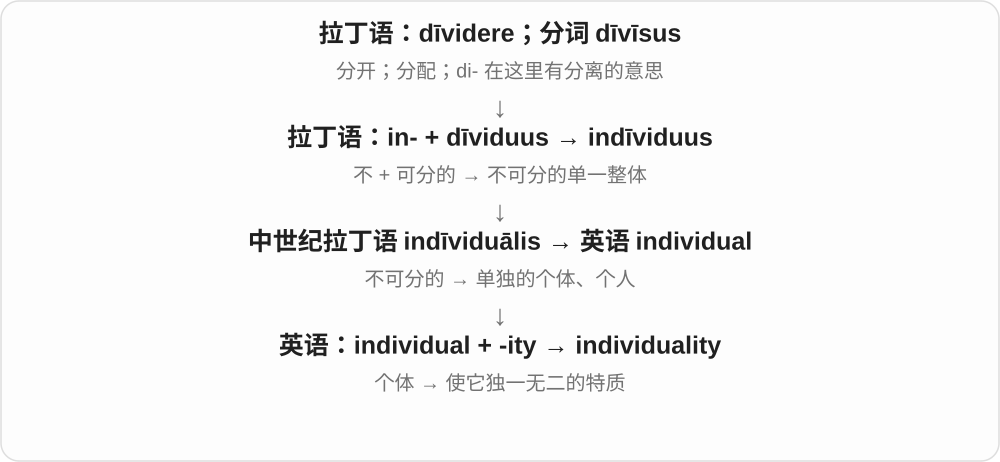

常与 express、preserve、respect 搭配。它既可说人，也可说建筑、作品等各自的风格。

**常见搭配与例句**

express individuality；a sense of individuality；lose individuality。

> The school encourages students to express their individuality.

学校鼓励学生表现自己的个性。

> Small details give each room its individuality.

小细节让每个房间都有自己的特点。

**别混淆**

individuality 是独特性；individualism 是重视个人自主的理念或倾向。

### 165. fatality — 死亡事故；死亡人数中的一人；死亡

**音标**：英 /fəˈtæləti/；美 /fəˈtæləti/，亦 /feɪˈtæləti/

**先抓住这个画面**

把致命后果作为一次事件或一个死亡个案来统计。

**怎么拆**

经法语 fatalité 接后期拉丁 fātālitās，源于 fātālis；现代可与 fatal + -ity 对照，重音转到第二音节。

**怎么变成今天的意思**

**拉丁 fārī**  
说、讲

↓

**拉丁 fātum／fāta**  
说出的话、预言、已定的命运

↓

**拉丁 fātālis → 后期拉丁 fātālitās → 法语 fatalité**  
命运所定、致命的 → 相应的性质和结果

↓

**英语 fatality**  
现代常指意外、灾害等造成的死亡或死亡者

three fatalities 通常表示三人死亡，不是三个受伤者。fatality rate 是死亡所占的比率，谈具体数据时必须看分母是什么。

**常见搭配与例句**

road fatalities；report a fatality；a fatality rate。

> The fire caused several injuries but no fatalities.

火灾造成数人受伤，但无人死亡。

> The campaign aims to reduce road fatalities.

这项活动旨在减少道路交通死亡。

**别混淆**

casualty 可以包含伤者和死者；fatality 在此类统计中专指死亡，不可混算。

### 166. formality — 正式；礼节；例行手续

**音标**：英 /fɔːˈmæləti/；美 /fɔːrˈmæləti/

**先抓住这个画面**

事情实际上差不多定了，但规定的签字、盖章、礼节仍要走完，这些就是 formalities。

**怎么拆**

来自法语 formalité，与 formal 同族；现代可看成 formal + -ity。

**怎么变成今天的意思**

作不可数名词可以说气氛的正式程度；a formality 常说主要是履行程序的步骤，不一定表示可以省略。

**常见搭配与例句**

a mere formality；complete the formalities；without formality。

> Signing the final copy should be a formality.

在最终文本上签字应该只是履行手续。

> The meeting began without much formality.

会议没有太多客套礼节就开始了。

**别混淆**

formalities 是手续；formal clothes 是正式服装。手续简单也可能仍然必要。

### 167. informality — 非正式；随意、不拘礼节的气氛

**音标**：英 /ˌɪnfɔːˈmæləti/；美 /ˌɪnfɔːrˈmæləti/

**先抓住这个画面**

大家直呼名字，座位不分高低，聊天不用先走复杂程序，这种不拘礼节的整体感觉是 informality。

**怎么拆**

informal + -ity → informality，重音转到后部 /mæ/。-ity 把不拘形式的性质作为名词，也可在特定语境指非正式表达。

**怎么变成今天的意思**

**in- 否定 + formal → informal**  
不按正式形式、礼仪或安排

↓

**informal + -ly、-ity**  
非正式地；随意、非正式的性质和气氛

the informality of the meeting 会议的随意气氛；a sense of informality 不拘礼节的感觉。

**常见搭配与例句**

the informality of；a sense of informality。

> She liked the informality of the small office.

她喜欢小办公室不拘礼节的气氛。

> The room’s layout encouraged a sense of informality.

房间布局营造了轻松随意的感觉。

**别混淆**

informality 可以让人放松，也可能不合某场合要求，褒贬取决于场景；它不等于没有规则。

### 168. chastity — 贞洁；性方面的节制

**音标**：/ˈtʃæstəti/

**先抓住这个画面**

把传统语境中的贞洁当成一种承诺或生活要求来谈。

**怎么拆**

拉丁 castitas，经古法语 chasteté、中古英语 chastite 进入英语；现代可联系 chaste + -ity，但它不是在现代英语中才这样拼出的词。

**怎么变成今天的意思**

**拉丁 castus 纯净的、贞洁的**  
古代道德与宗教语汇；不是给现代人的价值分等级

↓

**拉丁 castitas → 古法语 chasteté → 中古英语 chastite → chastity**  
贞洁、节制这一抽象性质

a vow of chastity 是守贞誓愿；不同历史和宗教语境对其要求并不完全相同。它是名词，不能用来直接修饰 person 代替 chaste。

**常见搭配与例句**

a vow of chastity；the ideal of chastity；religious chastity。

> The historian explains what the vow of chastity meant in that community.

历史学家解释了守贞誓愿在那个群体中的含义。

> The poem questions the different standards of chastity imposed on men and women.

这首诗质疑对男女施加的不同贞洁标准。

**别混淆**

virginity 指从未有过性行为的状态；chastity 是较广的道德或宗教节制概念，不能简单画等号。

### 169. tranquil — 宁静、安稳的

**音标**：/ˈtræŋkwɪl/

**先抓住这个画面**

没有喧闹，也没有催着人紧张的扰动，像清晨的小湖，是 tranquil 的画面。可以形容地方，也能形容心境。

**怎么拆**

借法语 tranquille，上接拉丁 tranquillus 安静、平稳；不需要按今天拼写猜出两个独立英文部分。

**怎么变成今天的意思**

**拉丁 tranquillus → 法语 tranquille → tranquil**  
安静、平稳、未受打扰的

↓

**拉丁 tranquillitas 等经法语 → tranquillity**  
安宁的状态；现代有单、双 l 拼写习惯

a tranquil village 宁静村庄；a tranquil setting 安静环境；feel tranquil 心情平和。

**常见搭配与例句**

a tranquil setting；a tranquil village。

> We stayed in a tranquil village by the lake.

我们住在湖边一个宁静的村庄。

> The music helped create a tranquil atmosphere.

音乐帮助营造了安宁的气氛。

**别混淆**

tranquil 重宁静、未受扰动，quiet 可只说音量小；安静的地方若充满紧张气氛，也未必 tranquil。

### 170. tranquillity — 宁静、安宁

**音标**：/træŋˈkwɪləti/

**先抓住这个画面**

tranquil 描述一个地方、心境安宁，tranquillity 则是那份可以享受、被打破的宁静。

**怎么拆**

经法语接拉丁 tranquillitas；现代与 tranquil + -ity 对应。双 l 的 tranquillity 常见英式，单 l 的 tranquility 常见美式。

**怎么变成今天的意思**

**拉丁 tranquillus → 法语 tranquille → tranquil**  
安静、平稳、未受打扰的

↓

**拉丁 tranquillitas 等经法语 → tranquillity**  
安宁的状态；现代有单、双 l 拼写习惯

↓

**tranquillitas → tranquillity／tranquility**  
宁静的状态

peace and tranquillity 平静安宁；the tranquillity of the countryside 乡村的宁静；disturb the tranquillity 打破宁静。

**常见搭配与例句**

peace and tranquillity；disturb the tranquillity。

> We enjoyed the tranquillity of the countryside.

我们享受了乡村的宁静。

> The traffic disturbed the tranquillity of the village.

车流打破了村里的宁静。

**别混淆**

tranquillity 与 serenity 都能说平和；tranquillity 常突出环境、生活免于扰动，具体用法仍有重合。

### 171. conductive — 导电的；导热的

**音标**：/kənˈdʌktɪv/

**先抓住这个画面**

conductive 形容一条通得过去的路：某种材料能让电或热通过。

**怎么拆**

conduct + -ive，形成形容词。这里的 conduct 用的是“传导”义。

**怎么变成今天的意思**

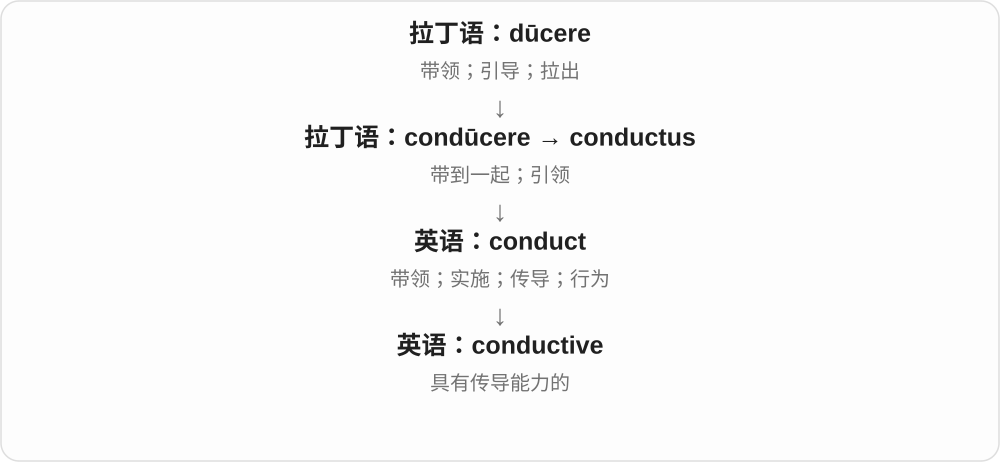

常见于材料说明。electrically conductive 指导电；thermally conductive 指导热，最好看清修饰词。

**常见搭配与例句**

conductive material（导电或导热材料）；conductive ink（导电油墨）；thermally conductive（导热的）。

> The sensor uses a thin layer of conductive ink.

传感器使用了一层薄薄的导电油墨。

> The design requires a thermally conductive material.

这项设计需要一种导热材料。

**别混淆**

conductive 谈传导性能；conducive to 谈某个条件有利于某种结果。不能说 a conducive wire 表示导线导电。

### 172. conductivity — 导电性、电导率；导热性、热导率

**音标**：英 /ˌkɒndʌkˈtɪvəti/；美 /ˌkɑːndʌkˈtɪvəti/

**先抓住这个画面**

同样让电或热通过，有些材料通得容易，有些很费劲。conductivity 讨论的是这种传导能力或量化性质。

**怎么拆**

conductive 能传导的去 e 加 -ity；更早与 conduct 引导、传送的拉丁词族相关。这里取电、热传导，不取主持会议的 conduct。

**怎么变成今天的意思**

**conduct 引导、传送 → conductive**  
能传导电、热等的

↓

**conductive + -ity → conductivity**  
相应传导性质、系数

electrical conductivity 电导率；thermal conductivity 热导率；high conductivity 高传导能力。具体单位和数值随所传导的量而不同。

**常见搭配与例句**

electrical conductivity；thermal conductivity。

> Copper has high electrical conductivity.

铜的导电性很强。

> The study compares the thermal conductivity of the materials.

研究比较了这些材料的热导率。

**别混淆**

conductivity 是材料的传导性质，conductivity 与 conductive 的词性不同；electrical 与 thermal 也不能混成同一个量。

### 173. duality — 双重性；二元性

**音标**：英 /djuːˈæləti/；美 /duːˈæləti/

**先抓住这个画面**

一个事物可以从两面看，两面同时构成它的特点。

**怎么拆**

借后期拉丁 duālitās，接拉丁 duālis“二重的”；现代对应 dual + -ity，但英语 duality 的记录早于 dual，不能按现代词尾推断先后。

**怎么变成今天的意思**

**拉丁 duo**  
二、两个

↓

**拉丁 duālis → 后期拉丁 duālitās → 英语 duality**  
二重的 → 具有两个方面的性质

the duality of a character 可说人物既温柔又严厉的两面；物理中的 wave-particle duality 是波粒二象性。这里是描述两方面，不表示故意骗人。

**常见搭配与例句**

the duality of；a sense of duality；wave-particle duality。

> The novel explores the duality of his public and private lives.

小说探讨了他公众生活与私人生活的双重性。

> The lesson introduced the idea of wave-particle duality.

这节课介绍了波粒二象性的概念。

**别混淆**

duality 是中性的双重性；duplicity 是贬义的两面欺骗。dualism 则常是一套把世界分成两个基本方面的理论。

### 174. viscosity — 黏度；黏性

**音标**：英 /vɪˈskɒsəti/；美 /vɪˈskɑːsəti/

**先抓住这个画面**

给刚才那种“不愿顺畅流动”的程度一个名字，便于测量和比较。

**怎么拆**

借自古法语 viscosite 或中世纪拉丁 viscositas，来自 viscosus 黏的。今天可把它与 viscous 成对记，但不是历史上只在英语里换后缀才造出的词。

**怎么变成今天的意思**

**拉丁 viscosus → viscositas**  
黏的 → 黏的性质

↓

**古法语 viscosite；英语 viscosity**  
黏性；物理学中的黏度

在相同条件下，蜂蜜通常比水的黏度高，因此倒出来更慢。比较黏度还要留意温度，因为同一种材料在不同温度下流动表现会改变。它不是重量、密度或表面有多粘的另一个名字。

**常见搭配与例句**

high viscosity；low viscosity；measure viscosity；the viscosity of a fluid。

> The experiment measures how viscosity changes with temperature.

这个实验测量黏度如何随温度变化。

> At the same temperature, honey usually has a higher viscosity than water.

在相同温度下，蜂蜜的黏度通常比水高。

**别混淆**

viscous 是形容词，说某液体黏稠；viscosity 是名词，说它的黏度是多少或怎样变化。物理上的流体也包括气体。

### 175. femininity — 女性气质；女性化特征

**音标**：/ˌfeməˈnɪnəti/

**先抓住这个画面**

把人们所说的女性化特征作为一个整体来讨论。

**怎么拆**

feminine + -ity 名词结尾，词形中保留 feminin-，重音后移到 -nin- 附近。

**怎么变成今天的意思**

**英语 feminine**  
女性化的、被视为女性特有的

↓

**英语 femininity**  
这类气质或特征的整体名称

讨论 femininity 可以是在谈装扮和表达，也可以是在研究社会如何定义女性气质。它不是所有女性共同的一套性格，更不是衡量一个人是否合格的标准。

**常见搭配与例句**

ideas of femininity；express femininity；traditional femininity；masculinity and femininity。

> The novel explores changing ideas of femininity.

这部小说探讨了不断变化的女性气质观念。

> She expresses her femininity in her own way.

她以自己的方式表达女性气质。

**别混淆**

femininity 讨论气质、特征与文化期待；feminism 讨论权利和平等的思想与行动。两者拼写相近但焦点不同。

### 176. actuality — 实际情况；真实存在的事物

**音标**：/ˌæktʃuˈæləti/

**先抓住这个画面**

把想象、可能性放一边，已经确实存在的现实摆到面前。

**怎么拆**

actual + -ity，-ity 表性质、状态；重音落在 /ˈæ/ 上，不沿用 actual 的词首重音。

**怎么变成今天的意思**

**拉丁 agere → actus → 晚期拉丁 actuālis**  
做、行动 → 行为、实施 → 实践中的

↓

**法语 actuel → 中古英语 actual**  
实际、真实的相应用法

↓

**actual + -ity → actuality**  
实际存在；实际状况

in actuality 较正式，相当于“实际上”；turn a possibility into an actuality 是把可能变为现实。普通交流里 reality、in fact 往往更自然。

**常见搭配与例句**

in actuality；become an actuality；possibility and actuality。

> The journey looked short on the map, but in actuality it took six hours.

地图上路程看着不长，实际上走了六小时。

> What was once a distant possibility is now an actuality.

从前遥远的可能，如今已成为现实。

**别混淆**

actuality 侧重确实实现、存在的状态，possibility 是可能；actuality 不等于 current affairs 时事。

### 177. elasticity — 弹性；〔经济等〕弹性、相对响应程度

**音标**：/ˌiːlæˈstɪsəti/

**先抓住这个画面**

材料被拉、压后能恢复，谈的是 elasticity；价格变一点，需求量相对变多少，经济学又借弹性说这种响应敏感度。

**怎么拆**

elastic + -ity → elasticity，c 在后接 i 的形式里读 /s/，重音移到 /stɪ/。物理性质名词进入经济、系统等变化关系用法。

**怎么变成今天的意思**

**希腊 elastos 可延展等 → 新拉丁 elasticus → 法语 elastique → elastic**  
早期科学中谈气体压缩后恢复，后来用于固体

↓

**elastic + -ity → elasticity；in- + elastic → inelastic**  
恢复性质、响应敏感度；缺乏相应弹性

↓

**elastic + -ity → elasticity**  
恢复性质 → 相对变化响应度

the elasticity of rubber 橡胶弹性；price elasticity of demand 需求价格弹性；具体计算定义需看学科。

**常见搭配与例句**

the elasticity of；price elasticity of demand。

> The experiment compares the elasticity of two materials.

实验比较两种材料的弹性。

> The lesson introduces the price elasticity of demand.

这节课介绍需求价格弹性。

**别混淆**

elasticity 不等于一个东西能被拉多长；经济弹性也不只是价格贵不贵，而看相对变化关系。

### 178. gullible — 轻信的、容易受骗的

**音标**：/ˈɡʌləbl/，也有 /ˈɡʌlɪbl/

**先抓住这个画面**

别人说什么就容易信，很少先查证，骗子一牵就跟着走；并不是单纯善良、友好。

**怎么拆**

常联系 gull 欺骗、受骗者与 -ible；也有从较早 gullibility 倒推形容词的分析，具体造词过程不定。不把它解释成海鸥 gull 天生好骗的确定故事。

**怎么变成今天的意思**

**拉丁 -ibilis 等 → 法语 -ible → 英语 -ible**  
可……、能够被……；关系需结合词基

↓

**借入整词与后来的英语造词**  
有些已有拉丁法语历史，有些英语后来按模式构成

↓

**gull 的欺骗、受骗者词族；gullibility 等较早形式**  
具体来源、造词顺序有不同分析

↓

**gullible**  
容易相信而被欺骗的

a gullible customer 轻信顾客，gullible enough to believe 容易轻信到相信，too gullible 太好骗。

**常见搭配与例句**

a gullible customer；too gullible；gullible enough to believe。

> The scam targeted gullible customers.

骗局盯上了容易轻信的顾客。

> He was gullible enough to believe the invented story.

他太轻信，竟相信了编造的故事。

**别混淆**

gullible 容易被骗，trusting 愿意信任可较中性或正面；不轻信也不等于必须怀疑一切。

### 179. gullibility — 轻信；容易上当的倾向

**音标**：/ˌɡʌləˈbɪləti/

**先抓住这个画面**

别人把故事说得像真的，你没有核实就信了，这种容易被哄住的倾向叫 gullibility。重点是信得太容易。

**怎么拆**

gullible 容易受骗的 + -ity，-ible 对应 -ibility；gull 的欺骗动词材料是相关词族，不能只按海鸥的名词义硬解释。

**怎么变成今天的意思**

**gull 欺骗等 → gullible**  
容易被欺骗、轻信的

↓

**gullible + -ity → gullibility**  
轻信、容易上当的性质

exploit gullibility 利用轻信；human gullibility 人的轻信；a reputation for gullibility 容易受骗的名声。

**常见搭配与例句**

exploit gullibility；human gullibility。

> The scheme relied on people’s gullibility.

这个骗局利用了人们的轻信。

> The story is a warning about gullibility.

故事提醒人们提防轻信。

**别混淆**

gullibility 说缺乏审查就轻信，trust 是信任，可能有充分依据；合理信任与容易受骗不同。

### 180. objectivity — 客观性；不偏私

**音标**：英 /ˌɒbdʒekˈtɪvəti/；美 /ˌɑːbdʒekˈtɪvəti/

**先抓住这个画面**

同一件事尽量不因为换了观察者、立场或喜好就被说成另一副样子。

**怎么拆**

objective + -ity；历史上也受到欧洲哲学相关术语发展的影响。

**怎么变成今天的意思**

**拉丁语：iacere；分词 iactus**  
投掷、抛出

↓

**拉丁语：ob- + iacere → obicere / obiect-**  
放在面前；提出反对

↓

**中世纪拉丁语 obiectum → obiectivus；法语 objectif**  
认识所面对的对象 → 与对象有关的

↓

**英语：objective**  
客观的；目标〔后起名词义〕

↓

**英语：objective + -ity → objectivity**  
客观这一性质

讨论新闻、研究和评审时常见；可以追求、提高客观性，不必把它想成只有全有或全无。

**常见搭配与例句**

maintain objectivity；scientific objectivity。

> The review process is designed to improve objectivity.

这套评审流程旨在提高客观性。

> She questioned the objectivity of the report.

她质疑这份报告是否客观。

**别混淆**

neutrality 是不站某一方；objectivity 还要求评价紧贴事实，二者不完全相同。

### 181. rationality — 理性、合理性

**音标**：/ˌræʃəˈnæləti/

**先抓住这个画面**

结论有没有理由支撑，行动能否在目标和证据之间说得通，这种理性、合理的性质就是 rationality。它不只是表面镇定。

**怎么拆**

联系法语 rationalité、拉丁 ratiōnālitās，现代对应 rational + -ity；重音移到 -nal-，元音也变化。更里层 ratiō 联系计算、推理、道理。

**怎么变成今天的意思**

**拉丁 ratiō 计算、推理、道理 → ratiōnālis**  
与理性、推理相关

↓

**法语、英语 rational 词族**  
合理、理性的性质与方式

↓

**rational → rationality**  
理性的性质、合理程度

the rationality of a decision 决定的合理性，question the rationality of something 质疑其合理性，human rationality 人的理性。

**常见搭配与例句**

the rationality of；question the rationality。

> The committee questioned the rationality of the decision.

委员会质疑这个决定是否合理。

> Her argument appealed to both rationality and compassion.

她的论证同时诉诸理性和同情心。

**别混淆**

rationality 不等于没有感情；也不单指算数快。哲学、经济学等领域对它可有具体定义。

### 182. irrationality — 不理性；无理性〔数学〕；不合理之处

**音标**：/ɪˌræʃəˈnæləti/

**先抓住这个画面**

irrational 是性质，irrationality 把这种性质提出来讨论：一个判断是否合理，或一个数能否写成整数之比。

**怎么拆**

irrational + -ity；英语早期已有数学用法，后也用于不合理、荒谬。

**怎么变成今天的意思**

**拉丁否定前缀 in-；同化形式 im-、il-、ir-**  
不、非；否定后面的性质

↓

**拉丁 in- + ratiōnālis → irratiōnālis → 英语 irrational**  
不是理性的；数学中不是有理的

↓

**英语 irrational + -ity → irrationality**  
无理的、不理性的 → 无理性、不理性

数学文章中的 the irrationality of √2 是二的平方根的无理性；讨论行为时，则关心理由与判断。两个场景不可拿日常情绪义硬套。

**常见搭配与例句**

the irrationality of a belief；a proof of irrationality。

> The essay examines the irrationality of judging people by rumours.

文章探讨了仅凭谣言判断他人的不合理性。

> The teacher explained a proof of the irrationality of the square root of two.

老师讲解了二的平方根为无理数的一种证明。

**别混淆**

irrationality 是不理性或无理性；irrationalism 是某种思想立场，后缀变了，讨论对象也变了。

### 183. irritable — 易怒、易烦躁的；易受刺激的

**音标**：/ˈɪrɪtəbl/

**先抓住这个画面**

平时的小事现在一点就着，动不动就烦，可以说 irritable。它说容易被惹动，不是自己总在主动惹别人。

**怎么拆**

经法语接拉丁 irritabilis，来自 irritare 刺激；现代与 irritate 对应，-able 表容易受到作用等性质。

**怎么变成今天的意思**

**拉丁 irritare 激起、刺激 → irritatus、irritabilis**  
刺激某物；容易被刺激的性质

↓

**英语 irritate、irritable、irritability**  
使烦躁、刺激；易怒；易激惹程度

feel irritable 感到烦躁易怒；an irritable mood 烦躁情绪；专业文本也可指组织等易受刺激。

**常见搭配与例句**

feel irritable；an irritable mood。

> He becomes irritable when he is tired.

他累的时候容易烦躁。

> She was unusually irritable that morning.

那天早晨她格外容易发火。

**别混淆**

irritable 说容易烦躁的人、状态，irritating 说让别人烦的事；两种角色要分开。

### 184. irritability — 易怒、烦躁；易激惹性

**音标**：/ˌɪrɪtəˈbɪləti/

**先抓住这个画面**

不是某一次发火，而是这段时间多容易被小事激起烦躁，这种倾向叫 irritability。专业文本也有相应刺激反应义。

**怎么拆**

接拉丁 irritabilitas 等名词，现代对应 irritable + -ity，-able 改为 -ability。

**怎么变成今天的意思**

**拉丁 irritare 激起、刺激 → irritatus、irritabilis**  
刺激某物；容易被刺激的性质

↓

**英语 irritate、irritable、irritability**  
使烦躁、刺激；易怒；易激惹程度

↓

**irritabilis → irritabilitas；irritable → irritability**  
容易受刺激的性质、程度

increased irritability 烦躁增加；signs of irritability 烦躁表现；irritability and fatigue 易怒与疲劳。

**常见搭配与例句**

increased irritability；signs of irritability。

> The diary records changes in mood and irritability.

日记记录了心情和烦躁程度的变化。

> Lack of sleep increased his irritability.

缺觉让他更容易烦躁。

**别混淆**

irritability 是容易烦躁的状态，irritation 可是已经出现的烦恼、刺激；倾向与当次反应角度不同。

### 185. irritably — 烦躁地；不耐烦地；带恼意地

**音标**：/ˈɪrɪtəbli/

**先抓住这个画面**

本来就心烦，别人再问一句，回答时有点冲，这种说话方式是 irritably。重点落在说话人自身的烦躁。

**怎么拆**

irritable 去词尾 e 加 -y 形成 -ably 外形：irritably；也可记作 -able 形容词变 -ably 副词。不是 irritating 简写。

**怎么变成今天的意思**

**拉丁 irritare → irritatus；irritabilis**  
激起、刺激；容易被激起、刺激

↓

**英语 irritate、irritable → irritatingly、irritably**  
前者写令人烦的程度，后者写人烦躁地回应；副词基底不同

↓

**irritable → irritably**  
容易烦躁的状态，转成动作中的不耐烦口气

said irritably 不耐烦地说；replied irritably 烦躁地回答；sighed irritably 不耐烦地叹气。

**常见搭配与例句**

asked irritably；shook his head irritably。

> “I have already told you,” he replied irritably.

“我已经告诉过你了。”他不耐烦地回答。

> She sighed irritably when the phone rang again.

电话再次响起，她烦躁地叹了口气。

**别混淆**

irritably 说明人有些恼意；angrily 可以更直接写生气，但不能给每个语境硬定同一强弱等级。

### 186. exclusivity — 独家性；专属性；排他性

**音标**：/ˌekskluːˈsɪvəti/

**先抓住这个画面**

这种资格、内容或关系只属于有限的一方或几方。

**怎么拆**

exclusive + -ity；重音移到后面的 -siv- 一带。

**怎么变成今天的意思**

**拉丁 claudere；分词 clausus**  
关上、围住、使结束；复合词常变为 -cludere / -clusus

↓

**拉丁 exclūdere → 中世纪拉丁 exclūsīvus → 英语 exclusive**  
排除 → 限于特定对象、独有的

↓

**英语 exclusive + -ity → exclusivity**  
独有、限量开放或排他的性质

一个品牌可营造 exclusivity，让人感觉不是谁都能买到；发行合同可约定 exclusivity，只交给一个平台。它不总是正面，高门槛也可能把人排斥在外。

**常见搭配与例句**

an exclusivity agreement；a sense of exclusivity；a period of exclusivity。

> The publisher asked for six months of exclusivity.

出版方要求六个月的独家权。

> The club’s appeal depends partly on its sense of exclusivity.

这家俱乐部的吸引力部分来自它给人的专属感。

**别混淆**

scarcity 是稀少；exclusivity 强调获取或使用被限定，限量只是实现方式之一。

### 187. impossibility — 不可能；不可能的事

**音标**：英 /ɪmˌpɒsəˈbɪləti/；美 /ɪmˌpɑːsəˈbɪləti/

**先抓住这个画面**

impossibility 把“这条路根本走不通”变成可以论证、说明的事实。

**怎么拆**

经中古法语 impossibilité 来自拉丁 impossibilitas；现代可联系 impossible + -ity，不把法语名词画成英语形容词的后代。

**怎么变成今天的意思**

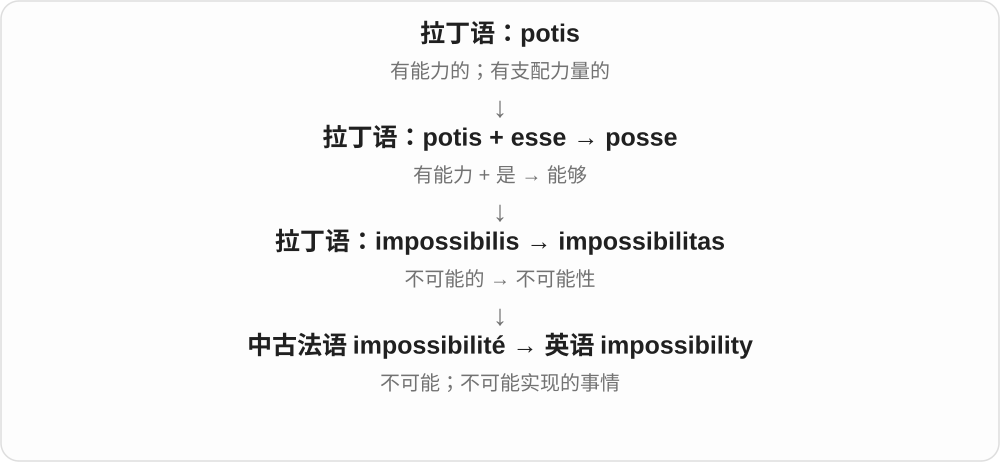

the impossibility of doing something 说明做不到的原因；an impossibility 指一件根本做不到的事。复数也可用于互相矛盾、无法实现的情形。

**常见搭配与例句**

a physical impossibility；the impossibility of doing；a practical impossibility。

> Being in two cities at exactly the same time is a physical impossibility.

同一时刻身处两座城市，在物理上不可能。

> The report explains the impossibility of completing the work in one day.

报告解释了为什么这项工作不可能在一天内完成。

**别混淆**

impossibility 是没有实现空间；improbability 只是可能性很低，不能混作绝对不可能。

### 188. civility — 礼貌；客气；文明有礼的态度

**音标**：/sɪˈvɪləti/

**先抓住这个画面**

即使不喜欢对方，也让对方把话说完，不用羞辱回应分歧。

**怎么拆**

接拉丁 cīvīlitās，经法语 civilité 等来源进入英语；现代可按 civil + -ity 理解名词结构，不能当作唯一借入历史。

**怎么变成今天的意思**

**拉丁 cīvis**  
公民；共同生活在一个城邦中的人

↓

**拉丁 cīvīlis → cīvīlitās；古法语 civilité**  
公民性质、身份 → 合宜的公共行为

↓

**英语 civility**  
待人有礼；基本的尊重和客气

treat someone with civility 是以基本尊重待人。复数 exchange civilities 常说互相寒暄；这些客套未必表示双方关系亲密。

**常见搭配与例句**

basic civility；a lack of civility；with civility；exchange civilities。

> They discussed the disagreement with surprising civility.

他们出人意料地客客气气地讨论了分歧。

> We exchanged a few civilities before turning to the main issue.

我们寒暄了几句，然后转入正题。

**别混淆**

civility 强调不失礼的基本底线；warmth 强调热情。一个人可以很客气，却显得疏远。

### 189. enmity — 敌意、仇怨〔较书面〕

**音标**：/ˈenməti/

**先抓住这个画面**

关系里一直有一根刺，双方难以友好相处。

**怎么拆**

经古法语 enemite／enemistié，接拉丁 inimicitia“敌意”及通俗拉丁同族形式。可联系 enemy 理解，但不是现代英语简单给 enemy 加 -ity。

**怎么变成今天的意思**

**拉丁 amare → amicus**  
爱、喜欢 → 朋友；友好的

↓

**拉丁 in- + amicus → inimicus**  
不是朋友 → 敌人、敌对的

↓

**拉丁 inimicitia／通俗拉丁同族形式 → 古法语 enemistié**  
敌对关系、敌意

↓

**英语 enmity**  
敌意、仇怨

enemy 是敌对的人，enmity 是人和人之间的敌意。longstanding enmity 指延续很久的积怨；without enmity 表示没有怀着敌意。它通常比一次意见不合更深，也比口语 dislike 更正式。

**常见搭配与例句**

enmity between；personal enmity；earn someone’s enmity。

> There was no personal enmity between the two candidates.

两名候选人之间并没有私人仇怨。

> The dispute created years of enmity between the families.

这场纠纷让两个家庭积下了多年的仇怨。

**别混淆**

rivalry 是竞争关系，可以互相尊重；enmity 更明确含敌意。

### 190. usability — 易用性；可用性

**音标**：/ˌjuːzəˈbɪləti/

**先抓住这个画面**

usability 看的是“人用起来顺不顺”：按钮找不找得到，步骤好不好懂，犯错后能不能补救。

**怎么拆**

usable + -ity；-able 在这类性质名词中对应 -ability。不是“使用的超能力”。

**怎么变成今天的意思**

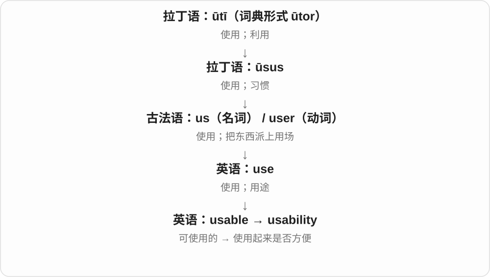

一般意义上是可使用的程度；在产品设计里，重点常落到用户完成任务是否有效、顺手。东西有很多功能，usability 仍然可能很差。

**常见搭配与例句**

usability testing；improve usability；a usability problem；website usability。

> The team tested the usability of the booking form.

团队测试了预约表单是否容易使用。

> Clearer labels greatly improved the app’s usability.

更清楚的标签大大改善了这个应用的易用性。

**别混淆**

usability 问好不好用；utility 问能不能满足某种需要。没有你需要的功能，再容易操作也解决不了你的问题。

### 191. rigidity — 刚性、硬挺；僵化、不灵活

**音标**：/rɪˈdʒɪdəti/

**先抓住这个画面**

rigid 说这东西很难弯，rigidity 则说它的“抗弯、抗变形”性质；谈组织时就变成难以调整的僵化。

**怎么拆**

对应 rigid + -ity，历史也接拉丁 rigiditas。派生后重音落在 /dʒɪ/，不照 rigid 的原重音读。

**怎么变成今天的意思**

**拉丁 rigēre 僵硬 → rigidus → 中古英语 rigide → rigid**  
硬、不易弯曲

↓

**rigid + -ly；rigid + -ity／拉丁 rigiditas**  
僵硬地；不易变形、改变的性质

structural rigidity 结构刚性；the rigidity of a system 制度的僵化；增加 rigidity 未必总好，取决于用途。

**常见搭配与例句**

structural rigidity；the rigidity of。

> The frame gives the structure greater rigidity.

框架提高了结构的刚性。

> The rigidity of the timetable left no room for delays.

时间表安排得很死，没有给延误留余地。

**别混淆**

rigidity 是性质，rigid 是形容词；strength 强度与 rigidity 刚性也不是同一性能，不能只译成很结实就混过去。

### 192. fragility — 脆弱性；易碎性

**音标**：/frəˈdʒɪləti/

**先抓住这个画面**

某样东西能承受的冲击很有限，一碰就可能出问题。

**怎么拆**

经古法语 fragilité 接拉丁 fragilitās，来自 fragilis。英语名词比现代 fragile 更早，现代可按形容词对应的性质名词理解，历史上不是简单后加 -ity。

**怎么变成今天的意思**

**拉丁 frangere，分词 frāctus**  
打碎、折断；被打断的

↓

**拉丁 fragilis**  
容易被弄坏的、脆弱的

↓

**拉丁 fragilitās → 古法语 fragilité → 英语 fragility**  
脆弱、易受损的性质

既可说玻璃、骨骼等物体的脆弱，也能说经济、信任和情绪经不起冲击。它描述承受能力，不等于已经破坏。

**常见搭配与例句**

the fragility of；emotional fragility；economic fragility。

> The thin glass adds beauty but also fragility to the design.

薄玻璃为设计增添了美感，也让它更容易损坏。

> The crisis exposed the fragility of the supply chain.

这场危机暴露了供应链的脆弱性。

**别混淆**

fragmentation 是已经分裂成块的过程或状态；fragility 是容易被损坏的性质。

### 193. totality — 整体；全部；全食阶段

**音标**：英 /təʊˈtæləti/；美 /toʊˈtæləti/

**先抓住这个画面**

把各个部分一起看成一个完整对象；日食中，则是太阳光球被月球完全遮住的那段时间。

**怎么拆**

可分析为 total + -ity；历史来源也联系法语 totalité 和中世纪拉丁语 totalitas，不能强行只保留英语派生一说。

**怎么变成今天的意思**

**拉丁语 totus / totalis；中世纪拉丁语 totalitas、法语 totalité**  
全部 → 整体性

↓

**英语 total + -ity；或受法语、拉丁语名词影响 → totality**  
整体、全部；后来用于全食阶段

in its totality 是作为整体、完整地；during totality 是在全食阶段。后者不是整场日食从开始到结束的所有时间。

**常见搭配与例句**

in its totality；the totality of the evidence；the path of totality。

> We need to consider the evidence in its totality.

我们需要把全部证据作为整体来考虑。

> The observers measured the duration of totality.

观察者测量了全食阶段的持续时间。

**别混淆**

total 常是一个总数；totality 更强调完整整体，天文学中另有固定含义。

### 194. plasticity — 可塑性；变形或适应的能力

**音标**：英 /plæˈstɪsəti/；美 /plæˈstɪsəti/

**先抓住这个画面**

原来的形状或安排不是死的，还能被改变。

**怎么拆**

plastic + -ity，把“可塑的”变成性质名词；重音移到第二音节，后部 c 在这里读 /s/。

**怎么变成今天的意思**

**希腊 plassein**  
捏塑、使成形

↓

**希腊 plastikos → 拉丁 plasticus → 英语 plastic**  
可以塑造的 → 可塑的；后来指塑料

↓

**英语 plastic + -ity → plasticity**  
可塑的 → 可塑性

黏土的 plasticity 说它能被捏出新形状；神经系统的 plasticity 说它能随经验等条件改变连接或功能。材料学里通常特别关注卸去外力后还留下的变形，所以不能把它理解成橡皮筋弹回去的能力。

**常见搭配与例句**

the plasticity of clay；neural plasticity；brain plasticity；structural plasticity。

> The potter tested the plasticity of the clay.

陶艺师测试了这块黏土的可塑性。

> The lecture introduced the concept of brain plasticity.

讲座介绍了大脑可塑性这一概念。

**别混淆**

elasticity 强调弹性恢复，plasticity 强调能够形成或保留新的状态。跨学科用词相通，具体指标并不一样。

### 195. practicality — 实用性；可行性；具体事务〔常用复数〕

**音标**：/ˌpræktɪˈkæləti/

**先抓住这个画面**

不只问点子好不好听，还问空间、钱和时间能不能配合。

**怎么拆**

practical + -ity，重音移到 -cal- 所在音节；由实际、有用这一特点组成名词。

**怎么变成今天的意思**

**希腊 prássein／práttein**  
做、实行、完成

↓

**希腊 praktós → praktikós → 后期拉丁 practicus**  
做成的、可做的 → 与行动和实际事务有关的

↓

**中世纪拉丁 practicālis；法语及英语 practic + -al 等路线**  
行动、实际应用方面的

↓

**英语 practical**  
实际的；实用的；动手的

↓

**英语 practical + -ity → practicality**  
实用、现实可行的性质；实际要处理的事项

question the practicality of a plan 是怀疑计划在现实中是否好实行；the practicalities of moving 是搬家要处理的运输、时间等细节。复数常是具体问题，不只是抽象实用性。

**常见搭配与例句**

the practicality of；question its practicality；deal with the practicalities。

> We liked the design but questioned its practicality.

我们喜欢这个设计，却怀疑它是否实用。

> They discussed the practicalities of moving the office.

他们讨论了办公室搬迁的具体安排。

**别混淆**

practicality 可以评价方案，也可以用复数指具体事务；practice 多指行动、惯例或练习，不等于实用性。

### 196. salinity — 盐度；含盐程度

**音标**：/səˈlɪnəti/

**先抓住这个画面**

不只问水咸不咸，而是问里面含了多少盐。

**怎么拆**

saline + -ity，变成表示性质、程度的名词，并改变重音。

**怎么变成今天的意思**

**拉丁 sal，属格 salis**  
盐

↓

**拉丁 sal → 英语 saline**  
盐 → 含盐的

↓

**saline + -ity → salinity**  
含盐程度、盐度

the salinity of seawater 是海水盐度；high salinity 表示盐分较高。口语可用咸来联想，但测量谈的是溶解盐类的量，不能靠尝味道替代仪器。

**常见搭配与例句**

high salinity；low salinity；measure salinity；changes in salinity。

> Heavy rain reduced the salinity near the river mouth.

大雨降低了河口附近的盐度。

> The instrument measures both temperature and salinity.

这台仪器同时测量温度和盐度。

**别混淆**

saline 是含盐的，salinity 是含盐程度；salinity 与 acidity 酸度是不同指标。

### 197. constitutionality — 合宪性、是否符合宪法

**音标**：英 /ˌkɒnstɪtjuːʃəˈnæləti/；美 /ˌkɑːnstɪtuːʃəˈnæləti/

**先抓住这个画面**

不是宪法本身，而是把某条规则拿来问：它与宪法对不对得上？这个属性或问题就是 constitutionality。

**怎么拆**

constitutional + -ity，性质名词，重音移到后面的 /næl/ 附近。现代主要谈宪法符合性，不随意扩展成身体健康程度。

**怎么变成今天的意思**

**拉丁 constituere / constitutio → constitution**  
建立、组成 → 组织方式、基本制度；身体构成

↓

**constitution + -al → constitutional**  
宪法的；体质、天性的等

↓

**派生名词与副词**  
是否合宪、依宪法、宪政立场及人物

↓

**constitutional + -ity → constitutionality**  
某事是否合宪的属性、问题

question the constitutionality of 质疑……的合宪性，review the constitutionality of 审查合宪性，a debate over constitutionality 关于合宪性的争论。

**常见搭配与例句**

question the constitutionality of；review the constitutionality of。

> The lawyers questioned the constitutionality of the measure.

律师们质疑那项措施的合宪性。

> The debate focused on constitutionality rather than cost.

争论集中在是否合宪，而不是费用。

**别混淆**

constitution 宪法和 constitutionality 合宪性不同。质疑合宪性是在提出问题，不代表已经有最终违宪结论。

### 198. interoperability — 互操作性；系统之间配合工作的能力

**音标**：英 /ˌɪntərˌɒpərəˈbɪləti/；美 /ˌɪntərˌɑːpərəˈbɪləti/

**先抓住这个画面**

两套东西来自不同地方，却能读懂对方的数据并接着工作。

**怎么拆**

interoperable 的名词形式，-able 对应 -ability；也可按 inter- + operability 理解。

**怎么变成今天的意思**

**拉丁语 inter → 英语 inter-**  
在……之间；彼此

↓

**英语构词：interoperable + -ity → interoperability**  
不同系统能够配合工作的性质

不仅要能传文件，还要能正确理解和使用收到的信息。

**常见搭配与例句**

ensure interoperability；interoperability between systems。

> The common format improves interoperability between the two systems.

通用格式改善了两套系统之间的互操作性。

> The team tested interoperability with devices from several manufacturers.

团队测试了与多家厂商设备协同工作的能力。

**别混淆**

compatibility 可只说不冲突或格式能打开；interoperability 强调实际协同工作。

### 199. normality — 正常状态；常态

**音标**：英 /nɔːˈmæləti/；美 /nɔːrˈmæləti/

**先抓住这个画面**

停电、搬家或混乱之后，又能按熟悉的节奏做饭、上班；这种生活恢复常态的感觉就是 normality。

**怎么拆**

英语 normal + -ity，构成状态名词，也与法语 normalité 的形式相联系。重音移到 -mal- 一节。

**怎么变成今天的意思**

**拉丁 norma**  
木工直角尺；由此指规则、标准

↓

**拉丁 normalis → 英语 normal**  
按直角尺的；合乎规则、常态的；几何中为垂直的

↓

**英语 normal + -ity → normality**  
正常这一状态、性质

a return to normality 指恢复常态，a sense of normality 是日常秩序带来的感觉。在统计学里 normality 还可指符合正态分布的性质；这里的“正常”是技术定义。

**常见搭配与例句**

return to normality；restore normality；a test of normality。

> Opening the school helped restore a sense of normality.

学校重新开放，让人们找回了一些日常生活的感觉。

> The analysis included a test of normality for the residuals.

分析中包括了对残差是否符合正态分布的检验。

**别混淆**

normality 与 normalcy 的普通义高度重合；前者英美都常见，不必人为规定一个是心理、另一个是政治。

### 200. permeability — 渗透性；透过性

**音标**：英 /ˌpɜːmiəˈbɪləti/；美 /ˌpɝmiəˈbɪləti/

**先抓住这个画面**

把问题从“能不能透”改成“有多容易透过去”。

**怎么拆**

接法语 perméabilité，也可按 permeable + -ity 理解；-able 在名词里变为 -ability。

**怎么变成今天的意思**

**拉丁 per**  
穿过；遍及；彻底

↓

**拉丁 per- + meare → permeare**  
穿过去、通行

↓

**permeabilis → permeable／法语 perméabilité**  
可通过的；可通过性

↓

**英语 permeability**  
材料或边界的渗透性

soil permeability 是土壤让水等流体通过的能力；high permeability 说容易通过。社会分析也会讨论边界的 permeability，借此说人、信息或影响能有多大程度跨越边界。

**常见搭配与例句**

high／low permeability；soil permeability；permeability to water。

> The engineers measured the permeability of the soil.

工程师测量了土壤的渗透性。

> The coating reduces the material’s permeability to water.

这层涂层降低了材料的透水性。

**别混淆**

permeability 是性质，permeation 是渗透过程。一个材料渗透性高，不等于在没有流体或推动条件时也正在渗透。

### 201. applicability — 适用性

**音标**：英、美 /əˌplɪkəˈbɪləti/

**先抓住这个画面**

这条规则、这个方法，放到眼前情况里还管不管用？applicability 问的是适不适用。

**怎么拆**

applicable + -ity，-able 变为 -ability；根基是拉丁语 applicabilis“可施用的”。

**怎么变成今天的意思**

**拉丁语 plicare**  
折叠、使相接；与编织、弯曲一组词有更早联系

↓

**拉丁语 ad- + plicare → applicare**  
使贴到一起、连接；把力量用于某事

↓

**拉丁语 applicabilis → 法语 applicable → 英语 applicable**  
可以适用的

↓

**英语 applicable + -ity → applicability**  
适用的范围或性质

一种方法在实验室有效，不代表对所有现场都有 applicability。它谈范围和条件，不直接等于效果有多好。

**常见搭配与例句**

applicability to；limited applicability；general applicability。

> The study tests the applicability of the method to small firms.

这项研究检验该方法是否适用于小企业。

> The rule has limited applicability outside this setting.

这条规则在这种情境之外适用范围有限。

**别混淆**

application 是实际应用或申请；applicability 是能否适用。

### 202. inevitability — 必然性、不可避免性；不可避免的事

**音标**：/ɪˌnevɪtəˈbɪləti/

**先抓住这个画面**

不只说会发生，而是把它为什么避不开、那种必然感拿出来讨论，就用 inevitability。也能称一件难免发生的事。

**怎么拆**

inevitable + -ity，-able 对应 -ability，重音移到 /bɪl/。从性质形容词形成抽象名词。

**怎么变成今天的意思**

**拉丁 ēvītāre 避开 → ēvītābilis**  
能够避开的

↓

**in- 否定 + ēvītābilis → inēvītābilis → 英语 inevitable**  
无法避开的、不可避免的

↓

**inevitable → inevitability**  
不可避免这一性质；难免发生的事件

a sense of inevitability 必然会来的感觉，the inevitability of change 变化的不可避免性，an unhappy inevitability 一件不愉快却难免的事。

**常见搭配与例句**

a sense of inevitability；the inevitability of。

> The novel creates a strong sense of inevitability.

小说营造出强烈的必然走向结局的感觉。

> The essay questions the supposed inevitability of the outcome.

文章质疑了所谓结果必然如此的说法。

**别混淆**

inevitability 说必然性，probability 说可能性程度。小说营造 a sense of inevitability，是叙事效果，也可与现实预测区分。

### 203. luminosity — 明亮；光辉；光度〔天文学〕

**音标**：英 /ˌluːmɪˈnɒsəti/；美 /ˌluːmɪˈnɑːsəti/

**先抓住这个画面**

日常描写是明亮的性质，天文学则关心天体本身每秒发出多少能量。

**怎么拆**

可能借法语 luminosité，也有英语 luminous + -ity 的构词分析。两条都接拉丁 luminosus、lumen；来源不应被画成唯一确定的英语派生链。

**怎么变成今天的意思**

**拉丁语 lumen；属格 luminis、词干 lumin-**  
光；发光之物，也有开口的含义

↓

**拉丁语 luminosus；相关名词 luminositas**  
明亮的；光辉

↓

**法语 luminosité；或英语 luminous + -ity**  
法语借入与英语派生两种分析

↓

**英语 luminosity**  
明亮性质；天文学中天体本身的辐射功率

一颗很远的星可能 luminosity 很高，肉眼却显得暗。因为前者说它本身向外放出多少能量，后者还受距离影响。描写画面时 luminosity 也可说光泽、明亮感，不必每次都换算物理量。

**常见搭配与例句**

stellar luminosity；solar luminosity；a star’s luminosity；the luminosity of a painting。

> The star has a high luminosity but appears faint because it is so far away.

这颗恒星的光度很高，但距离太远，所以看起来很暗。

> Thin layers of colour give the painting its unusual luminosity.

薄薄叠加的色层让这幅画呈现出特别的明亮感。

**别混淆**

天文学 luminosity 不等于从地球看到的 apparent brightness。luminance 则用于表面在某个方向的光度学亮度，不是这个天文量的另一种拼法。

### 204. portability — 便携性；可移植性；可转移性

**音标**：英 /ˌpɔːtəˈbɪləti/；美 /ˌpɔːrtəˈbɪləti/

**先抓住这个画面**

portability 问的是“换个地方还能不能带着走、继续用”。设备看重量体积，软件看换环境后能否运行。

**怎么拆**

portable + -ity，-able 变成对应的 -ability 形式，构成性质名词。

**怎么变成今天的意思**

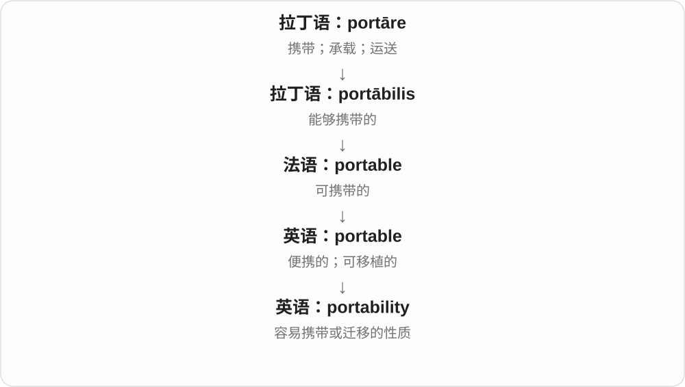

同一个性质可用于实物和信息。data portability 关注数据能否转到别处；number portability 指电话号码换服务商时能否转移保留。

**常见搭配与例句**

improve portability（提高便携性或可移植性）；software portability（软件可移植性）；data portability（数据可携性）。

> The smaller battery improves the device’s portability.

更小的电池提高了设备的便携性。

> The team tested the software’s portability across operating systems.

团队测试了软件跨操作系统的可移植性。

**别混淆**

portability 说便于迁移；compatibility 说能否与某环境或对象配合。支持多个环境有帮助，但两个词不是同义。

### 205. abnormality — 异常；异常之处

**音标**：英 /ˌæbnɔːˈmæləti/；美 /ˌæbnɔːrˈmæləti/

**先抓住这个画面**

先有一套通常的形状或范围，再在其中发现一个偏离的地方；这个状态或具体偏差都可叫 abnormality。

**怎么拆**

英语 abnormal + -ity，表示异常的状态或表现；词尾变化带来重音移动。

**怎么变成今天的意思**

**拉丁 norma**  
木工直角尺；由此指规则、标准

↓

**拉丁 abnormalis 的形态影响；另有较早英语 anormal**  
ab- 离开标准；anormal 经法语接希腊 anomalos“不平整”的另一支

↓

**英语 abnormal**  
早期 anormal 在拉丁形式影响下改形；偏离常态的

↓

**英语 abnormal + -ity → abnormality**  
偏离正常的状态；一个异常特征

不可数时说异常这一性质，可数时说具体异常：an abnormality，several abnormalities。它常见于技术检查、医学检查描述，但“有异常”本身并不交代原因和严重程度。

**常见搭配与例句**

detect an abnormality；a structural abnormality；show no abnormalities。

> The inspection revealed an abnormality in the metal surface.

检查发现了金属表面的一处异常。

> The team investigated the abnormality before restarting the system.

团队调查了那处异常后，才重新启动系统。

**别混淆**

abnormal 是形容词；abnormality 是状态或一处问题。anomaly 与它常有重叠，也可强调出乎规则预料的个别现象。

### 206. banal — 陈腐的、平庸乏味的

**音标**：/bəˈnɑːl/ 或 /ˈbeɪnəl/

**先抓住这个画面**

听来听去都是人人说过的套话，没有新意；不是平常就一定不好，而是普通到让人觉得无聊。

**怎么拆**

借法语 banal，接旧法语 banel 与封建命令、管辖下的公用设施等背景；从大家通用、普通发展到陈腐。与 ban 的宣告词族历史有关，但不是现代禁止 + -al 就能直接算出无聊。

**怎么变成今天的意思**

**旧法语 banel、法语 banal**  
管辖、公用背景 → 通用、普通

↓

**法语 banal → 英语 banal**  
平庸、陈腐、无新意

a banal remark 陈词滥调，banal conversation 乏味谈话，a banal observation 毫无新意的评论。

**常见搭配与例句**

a banal remark；banal conversation；a banal observation。

> The dialogue was full of banal remarks.

对话里满是陈词滥调。

> The reviewer found the ending banal and predictable.

评论者觉得结尾平庸，而且一猜就中。

**别混淆**

banal 通常贬义，ordinary 普通可中性；与 ban 的联系经过法语旧社会用法，不能直接说被禁止的就是 banal。

### 207. banality — 平庸、陈腐；陈词滥调

**音标**：/bəˈnæləti/

**先抓住这个画面**

一句话听起来好像说了什么，其实只是人人听过的空泛套话，是 a banality；整部作品缺少新意，也能批评它的 banality。

**怎么拆**

借法语 banalité，现代对应 banal 平庸的 + -ity；banal 的旧公共、常见材料走向普通得乏味。

**怎么变成今天的意思**

**法语 banal 平常、陈腐 → banalité**  
常见到无新意的性质

↓

**英语 banality**  
平庸；一句陈腐套话

the banality of something 某物的平庸；a speech full of banalities 满是套话的讲话。性质义常不可数，套话义可数。

**常见搭配与例句**

full of banalities；the banality of。

> The speech was full of banalities.

讲话满是陈词滥调。

> Critics complained about the banality of the plot.

评论者批评情节平庸。

**别混淆**

banality 评价缺少新意、深度，simplicity 只是简单；讲得简单明白并不等于陈腐空洞。

### 208. adaptability — 适应能力；可调整性

**音标**：英、美 /əˌdæptəˈbɪləti/

**先抓住这个画面**

生活换了一套题，你还能换种方法把题做下去。

**怎么拆**

adaptable + -ity，词尾 -able 变成 -ability，重音移到 /bɪl/。

**怎么变成今天的意思**

**拉丁语：ad**  
朝向；靠近；加到

↓

**拉丁语：aptāre → adaptāre**  
使合适 → 调整到合适

↓

**中古英语 adapten → 英语 adapt**  
适应；改编

↓

**英语 adaptable → adaptability**  
能够适应 → 适应能力

评价人、组织或设计面对变化的能力，尤其在条件不固定时。不是说什么都接受、没有原则。

**常见搭配与例句**

show adaptability；adaptability to；flexibility and adaptability。

> The job requires patience and adaptability.

这份工作需要耐心和适应能力。

> The design’s adaptability allowed us to reuse it in three buildings.

这一设计便于调整，因此我们把它用在了三栋建筑中。

**别混淆**

adaptation 是具体的适应过程或结果；adaptability 是做到这件事的能力。

### 209. opacity — 不透明性；不透明度；晦涩；不公开

**音标**：英 /əʊˈpæsəti/；美 /oʊˈpæsɪti/

**先抓住这个画面**

把看不透这件事当成一种性质，或者可以调节的程度。

**怎么拆**

来自法语 opacité，追到拉丁 opacitas 阴暗、遮蔽，由 opacus 构成。现代可对应 opaque 的名词，但并非只能讲成英语 opaque 现加后缀。

**怎么变成今天的意思**

**拉丁 opacus → opacitas**  
阴暗的 → 阴暗、遮蔽的性质

↓

**法语 opacité → 英语 opacity**  
不透明性；意义或过程的难以看透

编辑图片时降低 opacity，图层就更透明，下面的内容更容易显出来。在常见图层和 CSS 设置里，100% opacity 是完全不透明，0% 才是完全透明。谈制度的 opacity，则是在说信息不公开、外人摸不清运作方式。英语历史中晦涩义也很早，不能把这个名词的全部发展简单套成先有物理义、后有比喻义。

**常见搭配与例句**

reduce the opacity 降低不透明度；the opacity of a system 一个系统的不透明性。

> Reduce the opacity of the top layer so that the image beneath it becomes visible.

降低顶层的不透明度，让下面的图像显出来。

> The report criticized the opacity of the selection process.

报告批评了选拔过程的不透明。

**别混淆**

opacity 与 transparency 方向相反：opacity 越高，越不透明。表达不透明的状态也可用 opaqueness；opacity 尤其常用于程度、技术参数和制度评论。

### 210. subjectivity — 主观性；个人体验的性质

**音标**：英、美 /ˌsʌbdʒekˈtɪvəti/

**先抓住这个画面**

同一杯咖啡，有人觉得香，有人觉得苦：评价中带着体验者自己的感受。

**怎么拆**

与法语 subjectivité 相连，也可按英语 subjective + -ity 理解；更早接拉丁语 subiectivus 的主体支线。

**怎么变成今天的意思**

**拉丁语：iacere；分词 iactus**  
投掷、抛出

↓

**拉丁语：sub- + iacere → subicere / subiect-**  
置于下面；使受支配

↓

**后期拉丁语 subiectivus → 英语 subjective**  
与主体有关；后来常指依个人感受的

↓

**法语 subjectivité；英语 subjectivity**  
主体经验；主观性

不是所有 subjectivity 都等于胡说。痛感、喜好属于真实的个人体验，但不能直接替代公开可核查的证据。

**常见搭配与例句**

the subjectivity of taste；human subjectivity。

> The debate revealed the subjectivity of musical taste.

这场争论显示了音乐品味的主观性。

> The essay explores subjectivity through the narrator’s memories.

这篇文章通过叙述者的回忆探讨个人体验。

**别混淆**

bias 是偏向；subjectivity 是判断依赖主体感受，两者有关但不相等。

### 211. physicality — 身体性；体力、身体对抗特征；实体存在感

**音标**：/ˌfɪzɪˈkæləti/

**先抓住这个画面**

同样一场表演，除了说了什么，还看身体怎样动、怎样占据空间；运动里也常看体力和对抗这一面。

**怎么拆**

physical + -ity，把身体、实体方面的特点名词化。不是 physics 物理学再加一个城市 city。

**怎么变成今天的意思**

**希腊 phúsis〔自然〕→ 相关 physikḗ → 拉丁 physica、physicālis**  
自然、研究自然 → 自然、物理相关的

↓

**英语 physical**  
身体的、实体的、物理学的；按场景分义

↓

**physical + -ity → physicality**  
身体、实体方面的性质和表现

the physicality of the role 角色表演对身体的要求或身体表现，the physicality of the game 比赛的身体对抗性。

**常见搭配与例句**

the physicality of；the actor’s physicality；the game’s physicality。

> The role demands both emotional depth and physicality.

这个角色既需要情感深度，也需要强烈的身体表现。

> The coach prepared the team for the physicality of the match.

教练让队伍为比赛中的身体对抗做好准备。

**别混淆**

physicality 说身体表现、实体性，physics 是物理学。一个演员的 physicality 可以强，未必在讨论他的物理知识。

### 212. technicality — 技术细节；程序或规则上的细节；技术性

**音标**：/ˌteknɪˈkæləti/

**先抓住这个画面**

不是整件事的大方向，而是某条精细规定、专业条件。on a technicality 常说结果由程序细节决定，语气上可能觉得它不是核心实质。

**怎么拆**

technical + -ity，重音转到 /kæl/。后缀可把性质变名词，也可命名具体细节；复数 technicalities 常谈一堆专业、程序问题。

**怎么变成今天的意思**

**希腊语 tekhnē、tekhnikos → technical 的形成背景**  
技艺、技巧；专门技术的

↓

**technical + -ity → technicality**  
专业细节；程序、规则中的细节；技术性

the technicalities of a system 系统的技术细节，on a technicality 因一项程序、规则细节。程序细节是否重要须看具体事情，词不保证它一定无关紧要。

**常见搭配与例句**

the technicalities of；on a technicality；a minor technicality。

> I understand the main idea, but not all the technicalities.

我明白大意，但并不懂所有技术细节。

> The application was rejected on a technicality.

申请因一项程序细节被拒绝了。

**别混淆**

technicality 细节或技术性，technology 技术体系、技术应用；technical problem 技术问题不必只是个细枝末节。

### 213. sentimentality — 多愁善感；过度感伤；煽情

**音标**：/ˌsentɪmenˈtæləti/

**先抓住这个画面**

情绪被铺得很满，甚至盖过了真实人物与事实，这种过分温情或感伤常被叫作 sentimentality。

**怎么拆**

sentimental + -ity，将性质转成名词。

**怎么变成今天的意思**

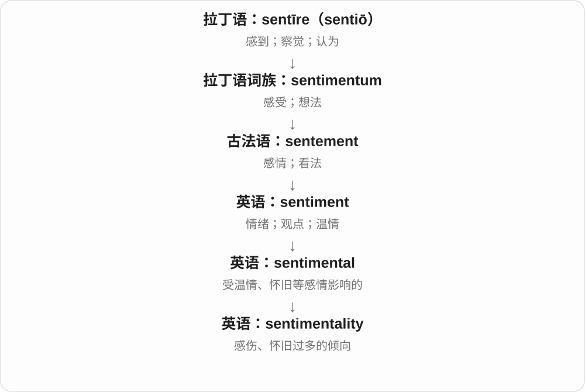

通常比 sentimental value 带更明显的批评，评价的是感情的处理方式，不是否定一切真诚情感。

**常见搭配与例句**

avoid sentimentality；excessive sentimentality；without sentimentality。

> The novel describes loss without sentimentality.

这部小说描写失落，却不刻意煽情。

> The speech was weakened by excessive sentimentality.

演讲因过分感伤而削弱了力量。

**别混淆**

emotion 是感情本身；sentimentality 常暗示处理得过甜、过满或不够真实。

### 214. selectivity — 选择性；筛选程度

**音标**：/sɪˌlekˈtɪvəti/

**先抓住这个画面**

selectivity 像筛子的孔究竟只让哪些东西通过，用来谈区分对象的能力或严格程度。

**怎么拆**

selective + -ity。

**怎么变成今天的意思**

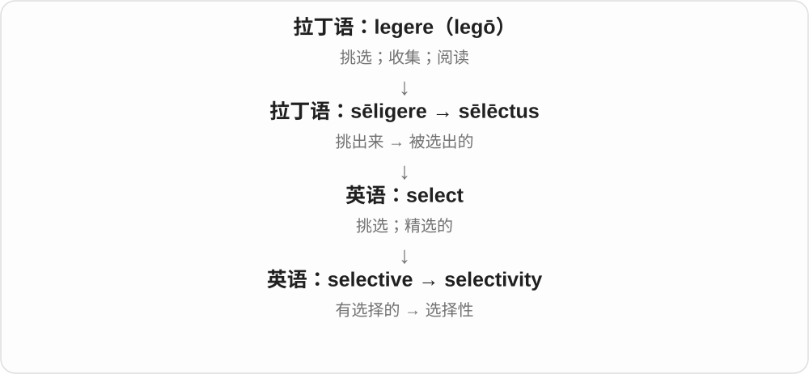

大学的 selectivity 说录取筛选程度；接收器的 selectivity 说分离所需信号的能力。

**常见搭配与例句**

high selectivity；admissions selectivity；signal selectivity。

> The report compares the selectivity of several programmes.

报告比较了几个项目的选拔严格程度。

> The receiver’s selectivity helps isolate the desired signal.

接收器的选择性帮助分离所需信号。

**别混淆**

selection 是一次选择或选中内容；selectivity 是选择过程表现出的性质。

### 215. principality — 公国；君主、亲王统治的领地

**音标**：/ˌprɪnsɪˈpæləti/

**先抓住这个画面**

沿着首领、统治者那一支走：先是统治者的地位、权力，再拿来叫他统治的那片地方。

**怎么拆**

经法语 principalité 等接晚期拉丁 prīncipālitās，由 prīncipālis + 状态名词后缀形成。现代可对照 principal + -ity，但不是校长地盘，也不是 principle 原则的名词。

**怎么变成今天的意思**

**拉丁 prīnceps、词干 prīncip-**  
居首者、首领；材料与第一、取得有关

↓

**晚期拉丁 prīncipālitās → 法语 principalité**  
居首地位、君主权力

↓

**英语 principality**  
统治权 → 相应领地、国家

a small principality 小公国，the ruler of a principality 公国统治者。具体中文爵位译名要看历史制度，不能拿英语 prince 一律译成某国王子。

**常见搭配与例句**

a small principality；the ruler of a principality。

> The novel is set in a small mountain principality.

小说以一个山间小公国为背景。

> The map shows the boundaries of the former principality.

地图标出了昔日公国的疆界。

**别混淆**

principality 是领地或国家名称类词，principal 是主要的或负责人；municipality 市镇、自治市另有来路。

### 216. oddity — 怪事、奇特之物；古怪、奇特性

**音标**：英 /ˈɒdəti/；美 /ˈɑːdəti/

**先抓住这个画面**

一个和周围都不太一样、值得特别拿出来看的东西；不一定坏，也可能因为稀奇而有趣。

**怎么拆**

odd + -ity，性质名词也可转指具有该性质的人、物、情况；保留双 d。

**怎么变成今天的意思**

**古北欧 oddi → 中古英语 odde**  
多出的、第三个、配对后剩下的；更早与尖端词有关

↓

**英语 odd**  
落单、奇数 → 不成套、零散；与通常不同、古怪

↓

**odd + -ity → oddity**  
奇特性 → 一件奇特的事物

a historical oddity 历史趣闻、怪现象，a collection of oddities 奇珍怪物收藏，an oddity of language 语言中的特殊现象。

**常见搭配与例句**

a historical oddity；a collection of oddities；an oddity of language。

> The museum displays a collection of mechanical oddities.

博物馆展出了一批奇特机械装置。

> This spelling is an oddity of the language.

这个拼写是这种语言里的特殊现象。

**别混淆**

oddity 可以只是独特异常，error 是错误；某个不规则词形是语言 oddity，不自动就是用错了。

### 217. incompatibility — 不兼容；不相容；不合拍之处

**音标**：/ˌɪnkəmˌpætəˈbɪləti/

**先抓住这个画面**

把两者接到一起时，暴露出来的冲突或配合障碍。

**怎么拆**

现代 incompatible + -ity；历史还可经法语 incompatibilité 借入，两种分析都接中世纪拉丁 incompatibilis 一系。

**怎么变成今天的意思**

**拉丁 patī／patior；完成分词 passus**  
承受、经历、忍受

↓

**中世纪拉丁 incompatibilis；法语 incompatible／incompatibilité**  
不能相容；不相容的性质

↓

**英语 incompatibility〔英语派生或法语名词借入〕**  
不兼容、不合拍

a software incompatibility 可以是一项具体格式或接口冲突；人的 incompatibility 则是习惯、目标等难以协调。用复数 incompatibilities 时，常在列具体冲突点。

**常见搭配与例句**

incompatibility between；incompatibility with；resolve an incompatibility。

> The error was caused by an incompatibility between two plug-ins.

这个错误由两个插件之间的不兼容造成。

> The talks revealed a basic incompatibility between their goals.

会谈暴露出双方目标之间根本的不相容。

**别混淆**

incompatibility 指无法配合的关系；disagreement 是意见不同，双方仍可能有效合作。

### 218. readability — 可读性；易读程度

**音标**：/ˌriːdəˈbɪləti/

**先抓住这个画面**

同样的信息，换了字号、句子和安排，读者需要花的力气就不同。

**怎么拆**

readable + -ity，词尾 -able 对应 -ability；也可整体看 read + -ability。它是易读这一性质的名词，不是另一个阅读动作。

**怎么变成今天的意思**

**古英语 rǣdan → 中古英语 reden**  
劝告、解释；读懂文字

↓

**英语 read**  
阅读；解读；读出信息

↓

**read + -able → readable**  
可读、易读的

↓

**readable + -ity → readability**  
可读、易读的程度

improve readability 可指改善字体排版，也可指简化句子和组织。可读性指标只是部分线索，不保证内容正确或解释到位。

**常见搭配与例句**

improve readability；text readability；a readability score。

> Shorter paragraphs improved the readability of the report.

更短的段落提升了报告的可读性。

> The designer tested the page’s readability on a small screen.

设计师测试了页面在小屏幕上的易读程度。

**别混淆**

readability 关注阅读的容易程度，accuracy 关注信息准确；改得简洁不该把准确细节删错。

### 219. serendipity — 意外的幸运发现；机缘巧合

**音标**：/ˌserənˈdɪpəti/

**先抓住这个画面**

找一本书，却在旁边发现一本恰好解决难题的书，这种没计划却有收获的幸运，叫 serendipity。旧故事还带善于观察、识出价值的成分。

**怎么拆**

Walpole 在 1754 年一封信中借 The Three Princes of Serendip 的地名加 -ity 造词；Serendip 是斯里兰卡旧称。不是 serene 宁静的派生。

**怎么变成今天的意思**

**故事 The Three Princes of Serendip；Serendip 为斯里兰卡旧称**  
人物在寻找别的东西时，凭偶然与观察有所发现

↓

**Walpole 于 1754 年造 serendipity → serendipitous**  
意外而有价值的发现；这类巧合带来的

by serendipity 因机缘巧合；a moment of serendipity 一次意外幸运发现；常用于发现、相遇。

**常见搭配与例句**

by serendipity；a moment of serendipity。

> By serendipity, I found the exact book I needed.

机缘巧合之下，我找到了正需要的那本书。

> Their meeting was a wonderful example of serendipity.

他们的相遇是幸运巧合的一个美好例子。

**别混淆**

serendipity 含意外且有收获，accident 意外本身可好可坏；不是每件突发事故都叫 serendipity。

### 220. serendipitous — 意外而幸运的；机缘巧合带来的

**音标**：/ˌserənˈdɪpɪtəs/

**先抓住这个画面**

serendipity 是那份意外幸运，serendipitous 则拿来形容相遇、发现：原本没有计划，却恰好带来好结果。

**怎么拆**

由 serendipity 改用相应词干 serendipit- 接 -ous，形成性质形容词；不把末尾随意切成独立英文单词。

**怎么变成今天的意思**

**故事 The Three Princes of Serendip；Serendip 为斯里兰卡旧称**  
人物在寻找别的东西时，凭偶然与观察有所发现

↓

**Walpole 于 1754 年造 serendipity → serendipitous**  
意外而有价值的发现；这类巧合带来的

↓

**serendipity → serendipitous**  
带有意外幸运发现性质的

a serendipitous discovery 幸运的意外发现；a serendipitous encounter 幸运巧遇。

**常见搭配与例句**

a serendipitous discovery；a serendipitous encounter。

> A serendipitous discovery changed the direction of the project.

一次幸运的意外发现改变了项目方向。

> We had a serendipitous encounter in a small bookshop.

我们在一家小书店幸运巧遇。

**别混淆**

serendipitous 通常看见偶然带来的好处，deliberate 是有意安排；事后受益不等于事先计划好了。

### 221. punctuality — 守时；准时程度

**音标**：英、美 /ˌpʌŋktʃuˈæləti/

**先抓住这个画面**

不只这一次准时，而是把“按时到、按时开始”当成一种稳定表现。

**怎么拆**

punctual + -ity，英语派生；加后缀后重音转到 -al- 对应的 /æl/。

**怎么变成今天的意思**

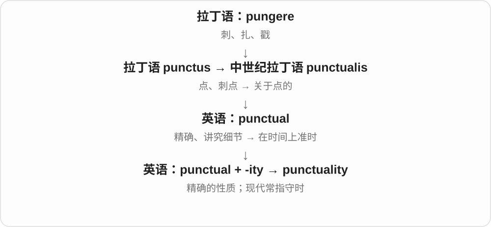

个人的 punctuality 是守时习惯；铁路的 punctuality 常是在谈班次按时运行的程度。

**常见搭配与例句**

value punctuality；a record of punctuality；improve punctuality。

> Punctuality matters when several teams share the same equipment.

几个团队共用设备时，守时很重要。

> The railway published figures on the punctuality of its services.

铁路部门公布了列车准点情况的数据。

**别混淆**

punctuality 关注时间准确；reliability 是更广的可靠性，还包括质量、承诺等。

### 222. porosity — 多孔性；孔隙率

**音标**：英 /pɔːˈrɒsəti/；美 /pɔːˈrɑːsəti/

**先抓住这个画面**

把一块材料想成实体加空隙：porosity 关心里面有多少空的地方。

**怎么拆**

经法语 porosité 接中世纪拉丁 porositas，由多孔的 porosus 派生。现代与 porous 对应，重音转到 -ros-，不是 pore 后简单保留原读音。

**怎么变成今天的意思**

**希腊 poros 通路、孔道 → 拉丁 porus**  
可以通行的小通道

↓

**中世纪拉丁 porosus → porositas → 法语 porosité**  
多孔这一性质

↓

**英语 porosity**  
材料的多孔性；技术上常量化为孔隙体积占总体积的比例

high porosity 是孔隙比例高。它不直接回答水能穿过去多快：若孔隙之间不连通，虽然能留出空间，流动仍可能很困难。

**常见搭配与例句**

high porosity；the porosity of soil；measure porosity。

> The researchers measured the porosity of the rock samples.

研究人员测量了岩石样本的孔隙率。

> High porosity does not always mean that water can flow through easily.

孔隙率高并不总意味着水能轻易穿过。

**别混淆**

permeability 是渗透性，重点在能否容易流通；porosity 是孔隙所占的空间。capacity 可以泛指容量，未必谈内部孔隙。

### 223. reproducible — 可重现的、可复现的；可复制的

**音标**：英 /ˌriːprəˈdjuːsəbl/；美 /ˌriːprəˈduːsəbl/

**先抓住这个画面**

给出办法和条件，别人再照着做，也能得到相应结果；软件错误稳定再出现，也说 reproducible。

**怎么拆**

reproduce 重新产生、复制，去 e + -ible。re- 再、produce 产生的现代层次清楚，较早词基有拉丁、法语历史。

**怎么变成今天的意思**

**拉丁 -ibilis 等 → 法语 -ible → 英语 -ible**  
可……、能够被……；关系需结合词基

↓

**借入整词与后来的英语造词**  
有些已有拉丁法语历史，有些英语后来按模式构成

↓

**re- + produce → reproduce；reproduce + -ible → reproducible**  
重新产生 → 能再次得到、复制的

reproducible results 可复现结果，a reproducible bug 可稳定复现的错误，a reproducible example 可复现示例。

**常见搭配与例句**

reproducible results；a reproducible bug；a reproducible example。

> The team published code to make the results reproducible.

团队公开代码，让结果可以复现。

> Please provide a reproducible example of the error.

请提供一个能够复现错误的示例。

**别混淆**

reproducible 重点是再做能得到相应结果；repeatable 在不同领域有自己的约定，不用一句统一定义强分所有学科。

### 224. reproducibility — 可重现性；可复现性

**音标**：/ˌriːprəˌdjuːsəˈbɪləti/，美式常省 /j/

**先抓住这个画面**

不是只成功一次，而是过程、数据交代清楚后，能否把结果重新做出来。这种可再现的性质是 reproducibility。

**怎么拆**

reproducible 可重现的 + -ity，-ible 对应 -ibility；更早是 re- 再 + produce 产生的词族。

**怎么变成今天的意思**

**re- + produce → reproduce → reproducible**  
再次产生、重现 → 可重现的

↓

**reproducible + -ity → reproducibility**  
结果、过程可再现的性质

the reproducibility of results 结果的可重现性；improve reproducibility 提高可复现性。不同学科对与 replicability 等术语的边界有具体约定。

**常见搭配与例句**

the reproducibility of results；improve reproducibility。

> The team shared its code to improve reproducibility.

团队分享代码，以提高可复现性。

> The reviewers asked about the reproducibility of the results.

审稿人询问结果的可重现性。

**别混淆**

reproducibility 关心结果能否再次获得，不是简单把同一张结果图片复制一份；具体要求要看领域和研究约定。

### 225. scalability — 可扩展性

**音标**：/ˌskeɪləˈbɪləti/

**先抓住这个画面**

从服务十个人到服务十万人，系统还能否有效运转，这类能力就是可扩展性。

**怎么拆**

scalable + -ity，-able 变为 -ability；由可扩展的性质形成抽象名词。

**怎么变成今天的意思**

**拉丁语 scala，常用复数 scalae**  
梯子、台阶；与 scandere“攀登”相连

↓

**中古英语 scale / scalen → 英语 scale**  
梯子、刻度；攀登 → 等级、音阶、比例、规模

↓

**英语 scalable → scalability**  
可扩展的 → 调整规模、承受增长的能力

software scalability 常涉及负载增大时性能、成本和资源如何变化；business scalability 关注商业模式能否扩大。仅仅能运行更大的任务，还不足以说明扩展效率好。

**常见搭配与例句**

improve scalability；test scalability；scalability requirements。

> The load test revealed a problem with scalability.

负载测试暴露了可扩展性方面的问题。

> They chose the design for its simplicity and scalability.

他们因设计简洁、便于扩展而选择了这个方案。

**别混淆**

capacity 是当前容量；scalability 是容量能怎样增长，以及增长后是否仍有效。

### 226. eventuality — 可能发生的情况；需要应对的变故

**音标**：英 /ɪˌventʃuˈæləti/；美 /ɪˌventʃuˈæləti/

**先抓住这个画面**

事情还没发生，你先想万一出现这种情况怎么办；常在准备、预案语境里出现。

**怎么拆**

eventual + -ity，与法语 éventualité 的仿译、对应关系相关，保留可能发生的旧义支线。不能只拿现代 eventual 最终的去推成最终结局。

**怎么变成今天的意思**

**eventual 的早期可能发生、随情况而定等义与法语相应形式**  
可发生的事情、条件性的结果

↓

**eventual + -ity；仿法语 éventualité → eventuality**  
可能发生、需要准备应付的情况

prepare for every eventuality 为各种可能情况作准备，in that eventuality 如果出现那种情况，an unlikely eventuality 不大可能发生的情况。

**常见搭配与例句**

prepare for every eventuality；in that eventuality；an unlikely eventuality。

> We prepared for every eventuality before the journey.

旅行前，我们为各种可能情况作了准备。

> In that eventuality, the meeting would move online.

如果出现那种情况，会议将改为线上。

**别混淆**

eventually 通常最终、终于，eventuality 通常可能情况；词形相近，现代常用义并非只差词性。

### 227. motility — 自主运动能力；运动性

**音标**：英 /məʊˈtɪləti/；美 /moʊˈtɪləti/

**先抓住这个画面**

motility 像显微镜下一个细胞自己游动，不是被水流被动冲走。

**怎么拆**

motile + -ity，表示能够自主运动的性质。

**怎么变成今天的意思**

常用于细胞、生物及器官活动。具体测量什么，要看研究对象和实验定义。

**常见搭配与例句**

cell motility；bacterial motility；assess motility。

> The microscope revealed differences in cell motility.

显微镜观察显示了细胞运动性的差异。

> The experiment measures bacterial motility.

实验测量细菌的运动能力。

**别混淆**

mobility 广义是能移动；motility 在生物学里常强调自身产生运动。

### 228. bisexuality — 双性恋；两性特征〔早期生物学〕

**音标**：英、美 /ˌbaɪsekʃuˈæləti/

**先抓住这个画面**

把 bisexual 所描述的吸引模式，作为一个名词来谈。

**怎么拆**

bisexual + -ity；生物学两性特征义与后来性取向义需要按时代和上下文分开。

**怎么变成今天的意思**

**拉丁 sexus**  
性别、雌雄类别；更早是否接“切分”词根仍有争议

↓

**法语 bisexuel / 近代 bi- + sexual**  
两性的；早期用于雌雄生殖结构

↓

**英语 bisexual**  
植物学两性义；后来另用于性取向

↓

**英语 bisexual + -ity → bisexuality**  
两性特征；后来主要表示双性恋取向

当下谈人的 bisexuality，通常说对不止一种性别产生吸引的取向或认同；不是要求同时拥有多个伴侣。

**常见搭配与例句**

bisexuality and identity；representations of bisexuality。

> The interview explores her understanding of bisexuality.

采访探讨了她对双性恋的理解。

> The article challenges the stereotype that bisexuality is merely indecision.

文章质疑把双性恋仅仅视为犹豫不决的刻板印象。

**别混淆**

bisexual 是形容词或人物称谓；bisexuality 是取向、状态或相关概念。

### 229. desirability — 可取性、吸引力、受欢迎程度

**音标**：英 /dɪˌzaɪərəˈbɪləti/；美 /dɪˌzaɪrəˈbɪləti/

**先抓住这个画面**

把值不值得想要、能吸引多少意愿当一个性质来谈；房子的地点、工作条件都可能影响它。

**怎么拆**

desirable + -ity，词尾 -able 在相应名词里变为 -ability；不是保留整个 -able 后再机械接 ity。

**怎么变成今天的意思**

**拉丁 dēsīderāre → 古法语 desirer 等 → desire**  
渴望、想得到、感到缺少

↓

**desirable → desirability〔-able 对应 -ability〕**  
合意、值得拥有的性质或程度

the desirability of a location 地点的吸引力，increase desirability 提高吸引力，question the desirability 质疑是否可取。

**常见搭配与例句**

the desirability of；increase desirability；question the desirability。

> Good transport links increased the area’s desirability.

良好交通提高了这一地区的吸引力。

> The report questioned the desirability of the change.

报告质疑这项改变是否可取。

**别混淆**

desirability 想要、可取的程度，availability 能否获得；很想要也可能没货，随处可得也未必吸引人。

### 230. vulgarity — 粗俗、庸俗；粗话或粗俗举动

**音标**：/vʌlˈɡærəti/

**先抓住这个画面**

vulgar 说“这很粗俗”；vulgarity 把那种粗俗感，或者一句具体的粗话，单独拎出来谈。

**怎么拆**

现代可看 vulgar + -ity；历史上英语还借入了法语 vulgarité 与晚期拉丁 vulgaritas。后者来自 vulgaris，早期可指大众，不能把全部历史简化成英语形容词现加词尾。

**怎么变成今天的意思**

**拉丁 vulgaris → 晚期拉丁 vulgaritas**  
大众的 → 大众、普通这一层性质

↓

**法语 vulgarité／晚期拉丁 vulgaritas → 英语 vulgarity**  
英语借入名词

↓

**现代 vulgarity**  
粗俗性质；某句粗话或粗俗行为

不可数的 vulgarity 可以说一段表演整体很粗鄙；可数的 a vulgarity 或复数 vulgarities 则落到具体说了什么、做了什么。它可以涉及下流语言，也可以只是令人反感的炫耀，不必每次都与性有关。

**常见搭配与例句**

the vulgarity of a remark；shout vulgarities；avoid vulgarity。注意重音移到 -gar-，不像 vulgar 重读开头。

> The critic objected to the vulgarity of the performance.

评论者反感这场表演的粗俗。

> Someone in the crowd began shouting vulgarities at the referee.

人群里有人开始冲裁判喊粗话。

**别混淆**

profanity 常指亵渎或咒骂类语言；vulgarity 更广，连举止、装饰或炫耀方式都可能被这样评价。

### 231. centrality — 中心地位；核心作用；中心性

**音标**：英、美 /senˈtræləti/

**先抓住这个画面**

不是问它大不大，而是问多少关系围着它展开。

**怎么拆**

central + -ity，性质名词；重音移到 /træl/。

**怎么变成今天的意思**

**希腊 kéntron → 拉丁 centrum**  
尖点、刺；圆规固定的一点 → 圆心、中心

↓

**拉丁 centrālis，经法语或直接借入英语 central**  
中心的；处在关键位置的

↓

**英语 central + -ity → centrality**  
居于中心的性质、程度或重要性

the centrality of trust 是信任的核心作用。网络分析中的 centrality 有多种算法，可按连接数量、通路位置等不同标准度量。

**常见搭配与例句**

the centrality of；degree centrality；network centrality。

> The book emphasises the centrality of family relationships.

这本书强调家庭关系的核心作用。

> The researcher compared several measures of network centrality.

研究者比较了几种网络中心性指标。

**别混淆**

popularity 常说受欢迎；centrality 可以来自连接位置，并不自动等于有人喜欢。

### 232. finality — 终局性；不可更改的意味

**音标**：/faɪˈnæləti/

**先抓住这个画面**

finality 是“这事到此为止”的感觉。一个人说话带着 finality，听起来就像门已经关上，不再留讨论空间。

**怎么拆**

final + -ity 可说明现代构词关系；历史上也经法语 finalité 传入。-ity 把“最终的”变成一种性质。

**怎么变成今天的意思**

重点不是最后一件东西，而是“结束得多么彻底”。with finality 常用来描写语气、动作或某个决定给人的感受。

**常见搭配与例句**

a sense of finality（彻底结束的感觉）；speak with finality（斩钉截铁地说）；the finality of a decision（决定的终局性）。

> “We are not moving,” she said with finality.

“我们不搬家。”她斩钉截铁地说。

> Closing the empty office gave him a sense of finality.

关上空办公室的门，让他感到一切彻底结束了。

**别混淆**

finale 是收尾部分，finality 是结束已定、不能再改的性质。

### 233. passivity — 被动状态；消极不作为；钝态〔材料〕

**音标**：/pæˈsɪvəti/

**先抓住这个画面**

事情在影响它，它却很少主动回应；材料中则可指表面反应受到抑制的状态。

**怎么拆**

passive 换成 -ity 名词形式；重音由 passive 的开头移到 /sɪv/。

**怎么变成今天的意思**

**拉丁 patī／patior；完成分词 passus**  
承受、经历、忍受

↓

**拉丁 passīvus → 法语 passif → 中古英语 passyf**  
承受动作的；可受影响的

↓

**英语 passive**  
被动的；不主动回应的；无源的〔技术〕

↓

**英语 passive + -ity → passivity**  
被动的性质或状态

社会语境里 criticise passivity 是批评不采取行动；材料科学里的 passivity 则可能是防护性的钝态，未必是坏事。不要把技术词也理解成人格缺点。

**常见搭配与例句**

political passivity；a state of passivity；the passivity of a metal。

> The organisers challenged the community’s passivity and encouraged participation.

组织者试图改变社区的消极观望，鼓励大家参与。

> The experiment examined the metal’s passivity in the solution.

实验考察了这种金属在该溶液中的钝态。

**别混淆**

passivity 说缺少主动反应；impassivity 常说情绪不外露。外表不动声色的人可以积极采取行动。

### 234. virtuosity — 精湛技艺；高超技巧

**音标**：英 /ˌvɜːtʃuˈɒsəti/；美 /ˌvɜːrtʃuˈɑːsəti/

**先抓住这个画面**

不指那个高手本人，而指让人看出其厉害的技能：手指、声音、语言或动作能做到别人难以做到的程度。

**怎么拆**

现代艺术义按 virtuoso + -ity 形成，去掉末尾 o。更早英语另有从中世纪拉丁 virtuositas 借入的旧义；现代“精湛技艺”不能直接解释成“道德很好”。

**怎么变成今天的意思**

**拉丁 vir**  
成年男子；男人

↓

**拉丁 virtus，词干 virtut-**  
勇气、力量、卓越；品德、效能

↓

**晚期拉丁 virtuosus → 意大利 virtuoso**  
优秀、富有才识的；有才识的人

↓

**英语借入 virtuoso**  
早期艺术鉴赏者 → 技艺特别高超的表演者或专家

↓

**近代英语 virtuoso + -ity → virtuosity**  
艺术鉴赏兴趣 → 高度娴熟的技艺

technical virtuosity 强调技术娴熟；a display of virtuosity 是一次高手级展示。评论有时说只有 virtuosity 而缺感情，此时并非否认技巧，而是认为技巧尚未变成打动人的表达。

**常见搭配与例句**

technical virtuosity；pianistic virtuosity；a display of virtuosity；astonishing virtuosity。

> The performance combined technical virtuosity with a remarkably gentle tone.

这场演奏把精湛技巧与格外柔和的音色结合起来。

> The reviewer admired the writer’s verbal virtuosity but wanted stronger characters.

评论者欣赏作者驾驭语言的高超技巧，但希望人物更有力量。

**别混淆**

virtuoso 是人或定语，virtuosity 是技能。skill 更普通；virtuosity 常意味着高水平、甚至令人惊叹的熟练。

### 235. naivety — 天真；经验不足；轻信

**音标**：/naɪˈiːvəti/

**先抓住这个画面**

naivety 是把世界想得太简单的那一面，往往不是坏心，而是缺少看过复杂情况的经验。

**怎么拆**

naive + 名词后缀 -ity 的对应形式；与借自法语的 naïveté 意义接近。

**怎么变成今天的意思**

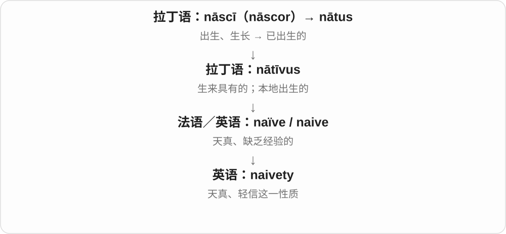

把 naive 的性质作为可以讨论、回顾的东西。语气可带温和理解，也可带批评。

**常见搭配与例句**

political naivety；youthful naivety；a degree of naivety。

> Looking back, I am surprised by my own naivety.

回头看，我惊讶于自己当时的天真。

> The plan reveals some naivety about how the system works.

这个计划显露出对系统运作方式的一些天真想法。

**别混淆**

naivety 讲经验和判断；stupidity 是更强烈的愚蠢评价，不宜简单等同。

### 236. irregularity — 不规则；异常；违规之处

**音标**：英 /ɪˌreɡjəˈlærəti/；美 /ɪˌreɡjəˈlærəti/

**先抓住这个画面**

本来应该平整、稳定或按规矩进行，某一处却凸出来、断了拍，或不合程序。

**怎么拆**

中世纪拉丁语 irregularitas，经法语 irrégularité 借入；现代可联系 irregular + -ity。

**怎么变成今天的意思**

**拉丁语：regere**  
引导、使直；治理

↓

**拉丁语：regula**  
直尺、直条；准则

↓

**拉丁语 irregularis → irregularitas**  
不规则 → 不规则性

↓

**法语 → 英语 irregularity**  
异常；不合程序之处

irregularities in the surface 是表面不平；financial irregularities 常婉指账务异常或违规，但单靠词本身不能确定具体违法行为。

**常见搭配与例句**

surface irregularities；procedural irregularities。

> The inspector found small irregularities in the surface.

检查员发现表面有一些细小的不平处。

> The audit identified several procedural irregularities.

审计发现了几处程序上的不规范。

**别混淆**

error 是错误；irregularity 可以是偏离常态的现象，还需查明原因。

### 237. employable — 具备就业条件的、能被雇用的

**音标**：/ɪmˈplɔɪəbəl/

**先抓住这个画面**

拥有让雇主愿意考虑聘用的技能、条件。说具备机会和能力，不是已经拿到工作。

**怎么拆**

employ + -able；employ 经法语 employer 接拉丁 implicāre 等旧路径，现代 employable 说可被雇用，不要硬译成可被缠绕。

**怎么变成今天的意思**

**法语 employer → employ**  
使用、雇用

↓

**employ + -able → employable**  
具备被雇用的条件

become more employable 提升就业能力，employable skills 有助就业的技能，highly employable 很有就业竞争力。

**常见搭配与例句**

become more employable；highly employable；employable skills。

> The course aims to make graduates more employable.

这门课旨在提高毕业生的就业能力。

> Her language skills make her highly employable.

她的语言能力使她很有就业竞争力。

**别混淆**

employable 能被雇用，employed 已受雇，unemployed 未就业；一个人可以暂未就业却具备很强的就业能力。

### 238. employability — 就业能力；受雇潜力

**音标**：/ɪmˌplɔɪəˈbɪləti/

**先抓住这个画面**

不是现在有没有工作，而是知识、技能、经验能不能帮助你找到并胜任工作。这个可被雇用的条件叫 employability。

**怎么拆**

employable 可雇用、具就业能力的 + -ity，-able 对应 -ability；再上接 employ 雇用、使用的词族。

**怎么变成今天的意思**

**employ → employable**  
雇用 → 适合受雇的

↓

**employable + -ity → employability**  
具备受雇、就业条件的程度

improve employability 提升就业能力；graduate employability 毕业生就业能力；employability skills 就业所需技能。

**常见搭配与例句**

improve employability；employability skills。

> The course aims to improve students’ employability.

课程旨在提升学生的就业能力。

> Work experience can strengthen graduate employability.

工作经验能增强毕业生的受雇潜力。

**别混淆**

employability 不是 employment 就业状态：有能力的人也可能暂时失业，已就业的人仍可提升技能。

### 239. inhumanity — 残忍；不人道；残酷行为

**音标**：英、美 /ˌɪnhjuːˈmænəti/

**先抓住这个画面**

把别人当成不必顾及痛苦的对象，表现出缺乏同情的残酷。

**怎么拆**

从法语 inhumanité 或拉丁语 inhumanitas 借入，后者基于 inhumanus；现代可以与 inhuman + -ity 对照，但不是唯一历史路线。

**怎么变成今天的意思**

**拉丁语 humanus → inhumanus**  
人的、有教养的 → 野蛮、残酷的

↓

**拉丁语 inhumanitas；法语 inhumanité → 英语 inhumanity**  
残酷无情的性质或行为

通常作不可数名词说残忍这一性质；复数 inhumanities 可指一件件不人道行为。

**常见搭配与例句**

the inhumanity of war；acts of inhumanity。

> The testimony exposed the inhumanity of the prison system.

证词揭露了那套监狱制度的残酷。

> The novel explores both kindness and inhumanity.

小说同时探讨了善意与残忍。

**别混淆**

humanity 可指仁慈；inhumanity 否定的是这种人情，不是生物分类上的非人类。

### 240. linearity — 线性；呈直线或顺序的性质

**音标**：英、美 /ˌlɪniˈærəti/

**先抓住这个画面**

把“是否按线性规则变化”作为一种性质来考察。

**怎么拆**

linear + -ity；派生时重音移到后面的 -ar-。

**怎么变成今天的意思**

**拉丁 līnum → līneus → līnea**  
亚麻 → 亚麻制的 → 麻线、绳、线条

↓

**拉丁 līneāris → 英语 linear**  
线的、线状的 → 直线的、线性的

↓

**英语 linear + -ity → linearity**  
线性的性质或程度

测量仪器的 linearity 关注输入输出关系是否符合直线；数学中则看加法、数乘等严格条件。

**常见搭配与例句**

test for linearity；assume linearity；deviation from linearity。

> The experiment tested the sensor’s linearity over a small range.

实验在一个较小范围内测试了传感器的线性。

> The proof relies on the linearity of the operator.

这个证明依赖算子的线性性质。

**别混淆**

linearity 是性质；linear 是用来修饰系统或关系的形容词。

### 241. unanimity — 全体一致；一致同意

**音标**：/ˌjuːnəˈnɪməti/

**先抓住这个画面**

unanimity 是让所有人的意见最后落在同一个答案上，重点是没有人持不同意见的状态。

**怎么拆**

来自法语 unanimité 和晚期拉丁语 ūnanimitās；现代与 unanimous 对应，但不能把借入名词简单画成英语形容词的后代。

**怎么变成今天的意思**

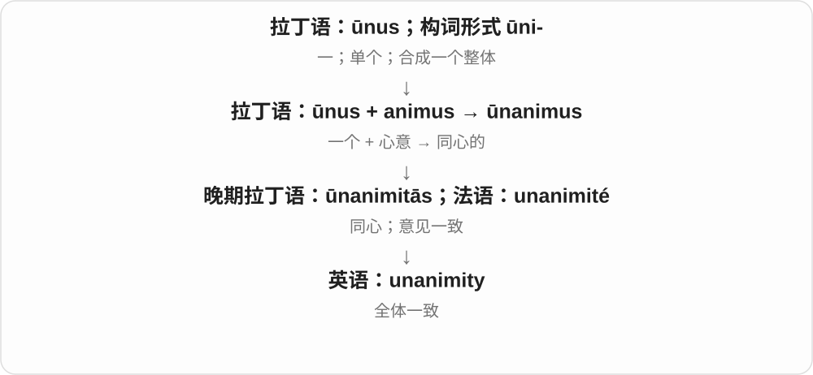

常在决策中谈是否达到一致。它比大多数赞成要求更高，但一致也不保证结论正确。

**常见搭配与例句**

reach unanimity；unanimity among members；require unanimity。

> The committee failed to reach unanimity.

委员会没能达成全体一致。

> There was unanimity on the need for clearer instructions.

大家一致认为需要更清楚的说明。

**别混淆**

consensus 常指广泛共识，不一定意味着每个人毫无保留；unanimity 更明确要求全体一致。

### 242. incredulity — 怀疑；难以置信的反应

**音标**：英 /ˌɪnkrɪˈdjuːləti/；美 /ˌɪnkrɪˈduːləti/

**先抓住这个画面**

incredulity 是把“怎么可能”的反应当成一件事来说，可以从脸色、语气或沉默里看出来。

**怎么拆**

经法语 incredulité，来自晚期拉丁语 incrēdulitās；现代与 incredulous 对应为性质或状态名词。

**怎么变成今天的意思**

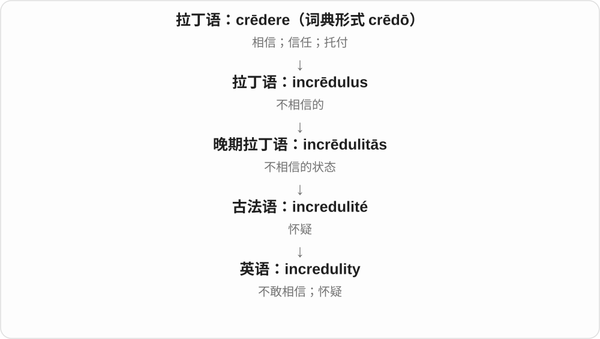

credulity 是轻易相信；加否定成分后的这一支是难以接受某个说法。它不自动表示已经查明消息是假的。

**常见搭配与例句**

with incredulity；a look of incredulity；react with incredulity；express incredulity。

> He stared at the bill with incredulity.

他盯着账单，满脸难以置信。

> The announcement was met with widespread incredulity.

这项宣布引来了普遍的怀疑。

**别混淆**

incredulity 描写不相信的反应；disproof 是反证。表示怀疑与真正证明错误，是不同的步骤。

### 243. heterosexuality — 异性恋；异性性取向

**音标**：英、美 /ˌhetərəsekʃuˈæləti/

**先抓住这个画面**

主要被与自己不同性别的人吸引。

**怎么拆**

heterosexual + -ity，或 hetero- + sexuality；hetero- 来自希腊“另一、不同”。

**怎么变成今天的意思**

**拉丁 sexus**  
性别、雌雄类别；更早是否接“切分”词根仍有争议

↓

**近代 hetero-〔希腊“不同”〕 + sexual；德语性学术语背景**  
指向异性的性吸引

↓

**英语 heterosexual**  
随相关译著传播的近代混合构词

↓

**英语 heterosexual + -ity → heterosexuality**  
异性性取向；相关状态

常见于学术或社会讨论。这个词并不告诉你一个人是否已婚、是否正在交往。

**常见搭配与例句**

assumptions about heterosexuality；heterosexuality and identity。

> The essay questions the assumption of heterosexuality in family advertising.

文章质疑家庭广告中默认所有人都是异性恋的做法。

> The survey treats heterosexuality as one category of sexual orientation.

问卷把异性恋列为性取向的一个类别。

**别混淆**

homosexuality 指同性吸引；heterosexuality 指异性吸引；两词都不是性格类型。

### 244. lethality — 致死能力、致命性；致死程度

**音标**：/liˈθæləti/

**先抓住这个画面**

lethal 说能致命，lethality 把这种能力、程度单独拿出来比较。它不是直接数现场死了几个人，而是在谈产生致死效果的性质。

**怎么拆**

lethal + -ity → lethality，重音由前面的 /liː/ 移到 /θæ/ 附近。性质名词在不同研究里可采用不同指标描述，不由词尾自动给定一个比率。

**怎么变成今天的意思**

**拉丁 letum 死亡 → letalis；后有 lethalis 拼写 → lethal**  
th 拼写受与希腊遗忘词相联系的旧分析影响，不能据此说本来就是同源

↓

**lethal + -ity → lethality**  
致命的性质、程度或能力

the lethality of a substance 某物质的致命性；assess lethality 评估致死能力。

**常见搭配与例句**

the lethality of；assess lethality。

> The report compares the lethality of the substances under specified conditions.

报告比较这些物质在给定条件下的致命性。

> The glossary distinguishes lethality from general severity.

词汇表区分致命性与一般严重程度。

**别混淆**

lethality 与 severity 严重程度不完全相同；严重可以指疼痛、破坏等，不一定只看致死。

### 245. duplicity — 两面派行为；口是心非；欺骗

**音标**：英 /djuːˈplɪsəti/；美 /duːˈplɪsəti/

**先抓住这个画面**

对这边说一套，对那边又说一套，故意让人看不到真实打算。

**怎么拆**

经古法语 duplicite，接后期拉丁 duplicitās“二重性”、拉丁 duplex“二重的”。现代看似 -ity，但不是英语 duplicate 简单去尾变来。

**怎么变成今天的意思**

**拉丁 duo**  
二、两个

↓

**拉丁 duo + -plex → duplex**  
二 + 重、折 → 两重的

↓

**后期拉丁 duplicitās → 古法语 duplicite → 英语 duplicity**  
两重性 → 言行两面、欺骗

accuse someone of duplicity 是指责对方表里不一。它通常涉及隐藏意图或前后两套做法，不只是偶尔说错话，也不是同时兼任两个岗位。

**常见搭配与例句**

political duplicity；an act of duplicity；accuse someone of duplicity。

> The emails exposed his duplicity: he had promised support to both rivals.

邮件揭露了他的两面派做法：他向两个竞争对手都许诺支持。

> Her colleagues lost trust in her after the act of duplicity.

那次欺骗行为之后，同事们不再信任她。

**别混淆**

duality 是中性双重性；duplicity 带欺骗和不诚实。duplication 只是复制或重复，本身没有道德评价。

### 246. inclusivity — 包容性、广纳性

**音标**：/ˌɪnkluːˈsɪvɪti/

**先抓住这个画面**

说环境、制度是否让更多不同的人被接纳，inclusivity 与 inclusiveness 通常在讲同一核心。-ity 只是换一种名词形成方式。

**怎么拆**

inclusive 去末尾 e + -ity，按 exclusivity 等词形模式发展。重音落在 /sɪv/ 一带，与 inclusiveness 不同。

**怎么变成今天的意思**

**include 包含 → inclusive**  
把有关人、物纳入的

↓

**inclusive + -ity → inclusivity**  
包容、涵盖的性质

promote inclusivity 促进包容，accessibility and inclusivity 可及性与包容性。

**常见搭配与例句**

promote inclusivity；an emphasis on inclusivity。

> The school places an emphasis on inclusivity.

学校重视包容性。

> The report discusses inclusivity in design.

报告讨论设计中的包容性。

**别混淆**

没有一条普遍规则规定 inclusivity 必指态度、inclusiveness 必指行动；实际使用大幅重叠。

### 247. peculiarity — 独特之处；怪癖；古怪特性

**音标**：/pɪˌkjuːliˈærəti/

**先抓住这个画面**

从整体里指出一个只有它这样、或者让人觉得奇怪的小特点。

**怎么拆**

现代可按 peculiar + -ity 理解；历史也可能接拉丁 peculiaritas。早期还有专有财产义，后来常说特殊性质和古怪之处。

**怎么变成今天的意思**

**拉丁 pecu、pecus 牲畜**  
牲畜作为财富的重要形式，连接钱财与私人所有的词族

↓

**拉丁 peculium → peculiaris；拉丁 peculiaritas 或英语 peculiar + -ity**  
名词来源有借入与英语派生两种解释

↓

**英语 peculiarity**  
专有所属等早期义 → 独有特征、怪异之处

the peculiarities of a language 是一种语言特有的细节；a personal peculiarity 是个人的小怪癖。复数 peculiarities 常见，不一定是在严重批评。

**常见搭配与例句**

a peculiarity of；local peculiarities；personal peculiarities。

> One peculiarity of the building is its unusually narrow staircase.

这栋楼一个特别之处是楼梯异常狭窄。

> She soon learned the peculiarities of the old machine.

她很快摸清了那台旧机器的特殊脾气。

**别混淆**

feature 是中性特点；peculiarity 更突出与众不同或有点怪。fault 是缺点，独特之处并不都算错误。

### 248. seasonality — 季节性；随季节反复变化的规律

**音标**：/ˌsiːzəˈnæləti/

**先抓住这个画面**

把每年的曲线叠起来，某些月份总是高、另一些总是低，这种重复节奏就是 seasonality。

**怎么拆**

seasonal + -ity，英语名词；重音转到 -nal- 附近，读作 /næl/。

**怎么变成今天的意思**

**拉丁语 serere，分词 satus**  
播种、栽种

↓

**拉丁语 satio，宾格 sationem**  
播种行为 → 播种时节

↓

**古法语 seison / saison**  
时节；适当时候

↓

**中古英语 sesoun → season**  
季节；某项活动的固定时期

↓

**英语 seasonal → seasonality**  
季节性的 → 季节性变化规律

旅游、零售、气温等数据都可能表现出 seasonality。统计里也可广义指按固定周期重复的变化，不只春夏秋冬。

**常见搭配与例句**

seasonality in demand；account for seasonality。

> The forecast accounts for seasonality in visitor numbers.

预测考虑了游客人数的季节性变化。

> Ignoring seasonality made the winter sales decline look unusual.

忽略季节性后，冬季销售下降看起来就显得异常。

**别混淆**

trend 是较长期的总体方向；seasonality 是反复出现的周期模式。

### 249. materiality — 物质性；重要性、实质影响程度

**音标**：英 /məˌtɪəriˈæləti/；美 /məˌtɪriˈæləti/

**先抓住这个画面**

一件事是否有实体存在，或一个变化是否重要到该被认真计入；按场景看两条意思。

**怎么拆**

material + -ity，形成可能参照拉丁相应名词。接 material 的物质与重要两义，不能只认一个后缀就推成材料数量。

**怎么变成今天的意思**

**拉丁 māteria → 晚期拉丁 māteriālis**  
木材、材料、物质 → 物质的、材料的

↓

**法语及中古英语 → material**  
物质的、重要的；材料、布料、资料等用法

↓

**material + -ity → materiality**  
物质存在的性质；足以产生影响的重要性

the materiality of an object 物体的物质性；报告、审计等语境 materiality 常讨论信息对判断的重要程度。

**常见搭配与例句**

assess materiality；a question of materiality；the materiality of objects。

> The team assessed the materiality of the error.

团队评估了这个错误的重要程度。

> The essay explores the materiality of handwritten books.

文章探讨手写书籍作为实物的物质特性。

**别混淆**

materiality 重要程度或物质性，materialism 物质主义、唯物论等立场；不是同义抽象名词。

### 250. musicality — 音乐性；乐感、音乐表现力

**音标**：/ˌmjuːzɪˈkæləti/

**先抓住这个画面**

音都弹对还不够：哪里该轻，哪句该呼吸，节奏怎样流动，这些听得出、表达得出的音乐感觉叫 musicality。

**怎么拆**

musical + -ity，性质名词，重音后移到 /kæl/。不是 musical 音乐剧的复数，而是音乐性、乐感这类抽象性质。

**怎么变成今天的意思**

**希腊 mousikē 等 → music**  
与缪斯、艺术有关的历史材料 → 音乐

↓

**music → musical → musicality**  
音乐的 → 音乐性、音乐表现能力

natural musicality 天生乐感，develop musicality 培养乐感，the musicality of language 语言的音乐性、节奏音韵。

**常见搭配与例句**

natural musicality；develop musicality；the musicality of language。

> Her playing combines technical precision with remarkable musicality.

她的演奏把精准技巧和出色乐感结合起来。

> The poet loved the musicality of everyday speech.

诗人喜爱日常言语里的音乐性。

**别混淆**

musicality 常说敏感、表现力，technical skill 技术能力；好技术能帮助表达，但音弹对不自动等于表现有乐感。

### 251. reflectivity — 反射能力；反射性

**音标**：/ˌriːflekˈtɪvɪti/

**先抓住这个画面**

表面有多善于把照来的光送回来。

**怎么拆**

reflective + -ity，将“具有反射性”说成一种性质。

**怎么变成今天的意思**

**拉丁 flectere；分词 flexus**  
弯曲、使转向

↓

**拉丁 re- + flectere → reflectere**  
向后 + 弯转 → 折回

↓

**古法语 reflecter → 英语 reflect**  
反射；映出；回想、反思

↓

**英语 reflective → reflectivity**  
反射的 → 反射性、反射能力

a surface’s reflectivity 常谈材料或表面的反射表现，粗糙度、涂层和波长等都可能影响它。在专业文献里要看作者的具体定义；有时它和 reflectance 接近，有时用于更特定的材料性质。不要脱离上下文强行规定二者永远同义或永远不同。

**常见搭配与例句**

high reflectivity；surface reflectivity；the reflectivity of a coating。

> The coating increases the mirror’s reflectivity.

这种涂层提高了镜面的反射能力。

> Dust can change the reflectivity of a surface.

灰尘可能改变表面的反射特性。

**别混淆**

reflectivity 的词形来自 reflective；reflexivity 的词形来自 reflexive，后者常谈自指或研究中的反身性。

### 252. modularity — 模块化程度；模块性

**音标**：英 /ˌmɒdjʊˈlærəti/；美 /ˌmɑːdʒəˈlærəti/

**先抓住这个画面**

一个系统能否分成边界清楚的块，改一块时不必牵动全部。

**怎么拆**

modular + -ity，英语形容词形成性质名词；结尾和重音随名词化改变。

**怎么变成今天的意思**

**拉丁语：modus**  
尺度、分寸；方式

↓

**拉丁语：modulus**  
小尺度；度量单位、标准

↓

**近代拉丁语 modularis／法语 modulaire**  
与模数、单位尺度有关的

↓

**英语：modular**  
模的；后来也指由可组合单元构成的

↓

**英语 modular + -ity → modularity**  
由相对独立单元组成的性质

高模块性常有利于替换、测试和复用，但并不自动保证模块之间配合得好。网络研究中的 modularity 还可指特定数学指标。

**常见搭配与例句**

software modularity；improve modularity。

> The design improves modularity by separating storage from processing.

设计把存储与处理分开，提高了模块性。

> Modularity makes individual parts easier to replace.

模块化使单独更换部件更方便。

**别混淆**

flexibility 是灵活性；modularity 是结构怎么划分，可能带来灵活性，但两者不相同。

### 253. rapidity — 迅速；速度快这一特点

**音标**：/rəˈpɪdəti/

**先抓住这个画面**

让人注意到的不是“发生了”，而是“怎么这么快就发生了”。

**怎么拆**

来自法语 rapidité 和拉丁 rapiditas，接 rapidus；现代可联系 rapid 与 -ity，历史上名词有独立借入路线。

**怎么变成今天的意思**

**拉丁 rapere；第一人称 rapio；分词 raptus**  
猛地抓住、夺取、带走

↓

**拉丁 rapidus → rapiditas → 法语 rapidité**  
迅疾的 → 迅速这一性质

↓

**英语 rapidity**  
运动或变化的迅速程度

the rapidity of change 是变化之快；with surprising rapidity 是快得让人惊讶。这个名词比 speed 更书面，常在描述或分析一段变化时使用。物理中的“快度”是专门术语，不能简单当作普通 speed 的别名。

**常见搭配与例句**

the rapidity of；with great rapidity；astonishing rapidity。

> We were surprised by the rapidity of the recovery.

恢复之快让我们感到意外。

> The news spread with remarkable rapidity.

消息传播得极快。

**别混淆**

speed 可以是中性的速度量；日常 rapidity 通常突出速度很快，而不是只是有一个速度。

### 254. traceability — 可追溯性；可追查来源、过程的能力

**音标**：/ˌtreɪsəˈbɪləti/

**先抓住这个画面**

不是只在箱子上印个编号，而是编号和记录能连起来，让人查清原料、批次、处理、去向等相关环节。这种能力叫 traceability。

**怎么拆**

traceable + -ity，对应 trace + -ability；-able 的形容词结构变成 -ability 名词，重音移到 /bɪl/。

**怎么变成今天的意思**

**古法语 trace／tracer → 中古英语 trace／tracen**  
痕迹、轮廓；描画、跟随、追查

↓

**英语 trace 的不同常用方向**  
沿痕追溯；按轮廓描画；留下的细微痕迹、微量

↓

**traceable → traceability**  
能够沿记录追溯的性质、能力

product traceability 产品可追溯性，improve traceability 改善可追溯性，a traceability system 追溯系统。不同领域要求的链条、记录粒度不相同。

**常见搭配与例句**

product traceability；improve traceability；a traceability system。

> The new labels improved product traceability.

新标签改善了产品可追溯性。

> Traceability depends on reliable records at each stage.

可追溯性依赖各环节可靠的记录。

**别混淆**

tracking 常看物品现在去了哪里，traceability 更强调能够串回来源、过程的能力；具体行业用法可能重叠。

### 255. granularity — 颗粒度；细分程度

**音标**：英 /ˌɡrænjəˈlærəti/；美 /ˌɡrænjəˈlerəti/

**先抓住这个画面**

信息或材料被分成多大的小块：按年看和按天看，颗粒度就不同。

**怎么拆**

granular 加 -ity，构成性质、程度名词。具体颗粒结构的意义被借到数据、权限、分析等领域。

**怎么变成今天的意思**

**拉丁 grānum**  
谷粒、种子、小颗粒

↓

**后期拉丁 grānulum**  
一小粒，grānum 的指小形式

↓

**英语采用 granulum 词干 + -ar → granular**  
颗粒状的；细分到小单位的

↓

**英语 granular + -ity → granularity**  
颗粒结构；划分单位的细致程度

monthly granularity 是按月的粒度；daily granularity 是按天。讨论 high/low granularity 容易歧义，直接说 finer、coarser 或给出单位更清楚。

**常见搭配与例句**

data granularity；finer granularity；at daily granularity；the granularity of permissions。

> We need daily granularity to see the weekend effect.

我们需要细到每天的数据，才能看出周末的影响。

> The settings allow finer granularity in user permissions.

这些设置让用户权限可以划分得更细。

**别混淆**

accuracy 说数据准不准；granularity 说数据分得细不细。很细的数据也可能不准确。

### 256. immobility — 不动；不能移动的状态

**音标**：英 /ˌɪməʊˈbɪləti/；美 /ˌɪmoʊˈbɪləti/

**先抓住这个画面**

immobility 像一个身体或装置被固定住，失去了自由改变位置的能力。

**怎么拆**

来自法语 immobilité；现代对应 immobile + -ity。

**怎么变成今天的意思**

它讨论状态或能力，既可是真实身体运动，也可比喻社会位置难以变化。

**常见搭配与例句**

prolonged immobility；temporary immobility；social immobility。

> The machine’s immobility puzzled the engineer.

机器完全不动，让工程师感到困惑。

> The story explores social immobility in a small town.

故事探讨小镇里社会地位难以改变的现象。

**别混淆**

immobility 不是 immortality“永生”；中间分别连着移动与死亡的不同词根。

### 257. timidity — 胆怯；缺乏自信；畏缩

**音标**：/tɪˈmɪdəti/

**先抓住这个画面**

把那种不敢往前走、不敢大胆做的状态，作为一件事来谈。

**怎么拆**

来自拉丁 timiditas，法语也有 timidité。现代可辨认 timid 与 -ity 的关系，但历史上名词有自身的借入来源。

**怎么变成今天的意思**

**拉丁 timere → timidus → timiditas**  
害怕 → 胆怯的 → 胆怯这种状态

↓

**英语 timidity**  
不敢行动或表达的胆怯、畏缩

overcome her timidity 是克服胆怯，the timidity of the proposal 是方案过于畏缩。后者不是说文件有情绪，而是说制定者没有拿出足够大胆的措施。这个词通常不可数，重点在状态或倾向。

**常见搭配与例句**

overcome timidity；initial timidity；political timidity。

> Her initial timidity faded as she got to know the group.

随着对这个小组越来越熟悉，她最初的胆怯渐渐消失了。

> The review criticized the timidity of the proposed reforms.

这篇评论批评了改革方案缺乏魄力。

**别混淆**

timidity 可以得到同情，也可以受到批评。谨慎考虑风险是 caution；因为害怕而不敢做，才更接近 timidity。

### 258. falsity — 虚假；不真实性；不实之词

**音标**：/ˈfɔːlsɪti/

**先抓住这个画面**

把一句话放到事实面前，发现它不是真的。

**怎么拆**

经古法语 fauseté／falseté，接后期拉丁 falsitās。现代可联系 false + -ity，但名词在拉丁语中已经形成。

**怎么变成今天的意思**

**拉丁 fallere；完成分词 falsus**  
欺骗、使落空；错误的、虚假的

↓

**后期拉丁 falsitās → 古法语 fauseté／falseté**  
虚假、不诚实这一性质

↓

**中古英语相关形式 → 英语 falsity**  
不真实性；虚假之词

the falsity of a claim 关注主张不真，不必同时断言说话者有恶意。这个词较正式，常出现在论证、评论和事实核查中。

**常见搭配与例句**

the falsity of；demonstrate the falsity；truth or falsity。

> The photograph helped establish the falsity of the account.

这张照片帮助证实了那段叙述不真实。

> The argument concerns the truth or falsity of the claim, not the speaker’s popularity.

论证讨论的是主张的真假，而不是发言者受不受欢迎。

**别混淆**

falsehood 常指某一句不实之词；falsity 更常说不真实这一性质，两者仍有语义重叠。

### 259. immensity — 巨大；浩瀚；辽阔

**音标**：/ɪˈmensəti/

**先抓住这个画面**

站在海边或任务面前，感受到它到底有多大。

**怎么拆**

经法语 immensité 接拉丁 immensitās；现代可按 immense + -ity 记忆。

**怎么变成今天的意思**

**拉丁 in- + mēnsus → immensus**  
没有被量定的、不可量的

↓

**拉丁 immensitās → 法语 immensité → 英语 immensity**  
不可量的广大程度 → 浩瀚、巨大

the immensity of the ocean 把注意力放在海的辽阔；the immensity of the task 是任务规模之大。它是性质或程度，不能简单当作 many 的高级替换。

**常见搭配与例句**

the immensity of space；the immensity of a task。

> The photograph captures the immensity of the desert.

这张照片展现了沙漠的辽阔。

> Only then did we understand the immensity of the task.

直到那时，我们才明白任务规模有多大。

**别混淆**

immense 直接形容东西大；immensity 把“有多大”单独拿出来谈。

### 260. intelligibility — 可理解性；语音清晰可懂程度

**音标**：/ɪnˌtelɪdʒəˈbɪləti/

**先抓住这个画面**

intelligibility 关心别人能听懂多少、理解多少，像测试电话里一句话传过来还剩多少可辨信息。

**怎么拆**

intelligible + -ity。

**怎么变成今天的意思**

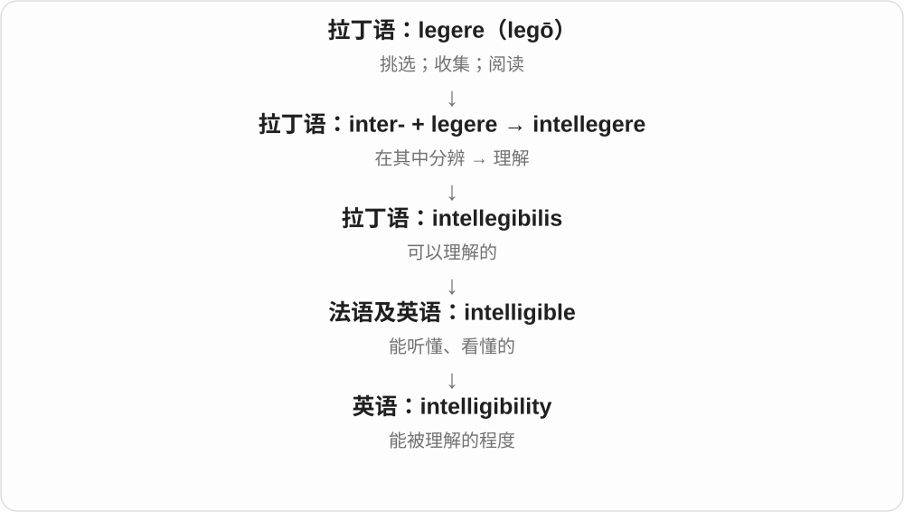

语言研究和语音技术中很常见；口音不同不一定导致 intelligibility 低。

**常见搭配与例句**

speech intelligibility；improve intelligibility；mutual intelligibility。

> Background noise reduced speech intelligibility.

背景噪声降低了语音可懂度。

> The study tested mutual intelligibility between the dialects.

研究测试了两种方言之间能互相听懂的程度。

**别混淆**

legibility 关心字迹能否辨认；intelligibility 还包括声音和意义能否理解。

### 261. playability — 可玩性；可演奏性

**音标**：/ˌpleɪəˈbɪləti/

**先抓住这个画面**

不仅问它有没有启动，还问玩法能否顺手、条件是否适合持续玩下去。

**怎么拆**

playable 对应性质名词，-able → -ability；也可分析 play + -ability。具体评价维度由游戏、乐器或场地语境给出。

**怎么变成今天的意思**

**古英语 plegian／plegan；plega**  
游戏、活动；游戏这一名词

↓

**中古英语 pleyen／pleye → 英语 play**  
玩、比赛、表演、演奏；剧作等

↓

**playable → playability**  
能玩、能演奏等方面的性质、程度

游戏评论里可涉及操作、规则等如何让游戏可玩；乐器 playability 可说易于演奏的手感。不是一个所有领域统一计分的指标。

**常见搭配与例句**

improve playability；the game’s playability；the playability of a guitar。

> The update improved the game’s playability on smaller screens.

更新改善了游戏在小屏幕上的可玩性。

> The guitarist praised the instrument’s playability.

吉他手称赞了这件乐器的演奏手感。

**别混淆**

playability 不等于 popularity：可玩或好上手与流行程度相关，却不是同一事实。

### 262. admissibility — 可采纳性；准入资格

**音标**：/ədˌmɪsəˈbɪləti/

**先抓住这个画面**

admissibility 是把“可不可以纳入正式考虑”这件事作为问题来检查。

**怎么拆**

admissible + -ity，-ible 在名词中对应 -ibility。

**怎么变成今天的意思**

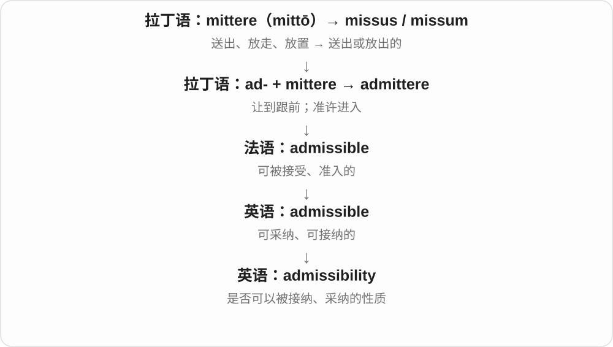

经常用于证据、申请或数学候选解。判断可采纳性，与进一步判断内容价值是两个环节。

**常见搭配与例句**

the admissibility of evidence；assess admissibility；an admissibility test。

> The hearing focused on the admissibility of the documents.

听证重点讨论了这些文件是否可以采纳。

> The first check concerns the admissibility of the proposed solution.

第一项检查关注所提方案是否符合准入条件。

**别混淆**

admission 是接纳的动作或结果；admissibility 是具不具备被接纳条件的性质。

### 263. habitability — 宜居性；适合居住的程度

**音标**：/ˌhæbɪtəˈbɪləti/

**先抓住这个画面**

从漏不漏雨、有没有水，到温度是否适合生活，综合衡量“这里能不能住”，谈的就是 habitability。

**怎么拆**

habitable 对应的名词，-able 变为 -ability，表示可居住这一性质。

**怎么变成今天的意思**

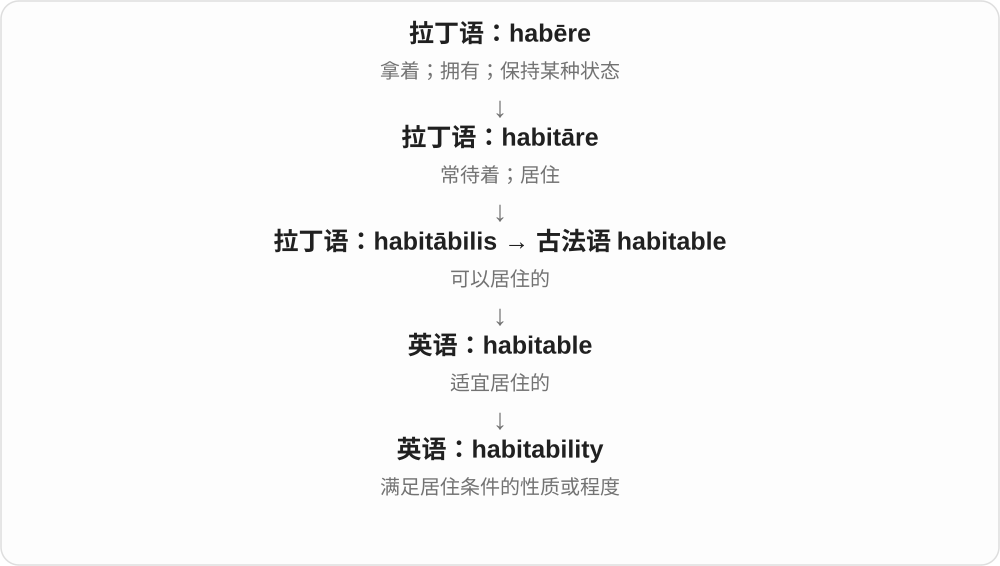

它能评价房屋，也能讨论星球或其他环境。评价标准随语境而变，不能只凭某一个条件就断定具备全部居住条件。

**常见搭配与例句**

the habitability of a building；assess habitability；habitability standards。

> The inspector assessed the habitability of the damaged house.

检查人员评估了受损房屋是否适合居住。

> Access to clean water affects the habitability of the site.

能否获得清洁用水会影响这个地点的宜居性。

**别混淆**

habitation 是居住这件事或住所；habitability 是能否适合居住的性质。

### 264. superficiality — 肤浅；表面性

**音标**：/ˌsuː.pə.fɪʃ.iˈæl.ɪ.ti/

**先抓住这个画面**

讨论看似热闹，却一直没触到问题的原因，这种只在外层打转的特点就是 superficiality。

**怎么拆**

superficial + -ity，形成性质名词。

**怎么变成今天的意思**

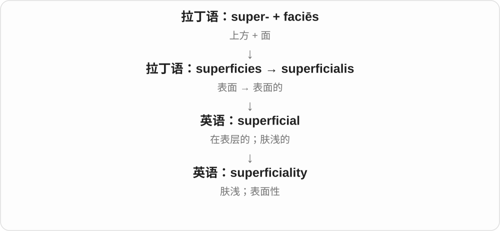

形容词说分析肤浅，名词就能讨论它的肤浅造成什么后果。也可用复数表示表面细节，但常见中心义是缺乏深度。

**常见搭配与例句**

the superficiality of an analysis；avoid superficiality。

> The review criticised the superficiality of the argument.

评论批评了这套论证的肤浅。

> Clarity should not be confused with superficiality.

清晰易懂不该被误认为肤浅。

**别混淆**

simplicity 是简单明了；superficiality 是深度不足，讲得简单也可以很深刻。

### 265. fallibility — 会犯错这一性质；出错的可能性

**音标**：/ˌfæləˈbɪləti/

**先抓住这个画面**

承认认知和操作都有漏点，因此需要检查和纠正。

**怎么拆**

fallible 换成 -ity 名词形式；来自该词的拉丁词干，不是“已经失败多少次”的统计名词。

**怎么变成今天的意思**

**拉丁 fallere；完成分词 falsus**  
欺骗、使落空；错误的、虚假的

↓

**中世纪拉丁 fallibilis → 中古英语及英语 fallible**  
能被误导或出错的

↓

**英语 fallible + -ity → fallibility**  
可能出错 → 这种性质

human fallibility 是人会犯错；memory’s fallibility 是记忆可能不可靠。它强调有出错可能，并没有给出具体错误率。

**常见搭配与例句**

human fallibility；recognise one’s fallibility；the fallibility of memory。

> The review process was designed with human fallibility in mind.

审查流程在设计时考虑到了人会犯错。

> Acknowledging our fallibility makes it easier to correct a mistaken judgement.

承认自己可能犯错，更有助于纠正错误判断。

**别混淆**

failure 是一次失败或失效；fallibility 是可能出错的性质。没有发现失败，也不证明系统没有 fallibility。

### 266. perplexity — 困惑；错综难解的情况

**音标**：英 /pəˈpleksəti/；美 /pərˈpleksəti/

**先抓住这个画面**

不是一句我不懂，而是脑中疑问缠在一起的状态。

**怎么拆**

来自古法语 perplexite、晚期拉丁 perplexitas，关联拉丁 perplexus 错综的。这个英语名词比动词 perplex 更早，不是英语动词最初加 -ity 才造出来。

**怎么变成今天的意思**

**拉丁 perplexus → 晚期拉丁 perplexitas**  
错综、纠结 → 困惑状态

↓

**古法语 perplexite → 英语 perplexity**  
困惑；令人困惑的难题

in perplexity 是困惑地；a look of perplexity 是一脸不解。复数 perplexities 可说多种难题或复杂处境。它也在信息论中有严格定义的技术义，普通阅读中的困惑不能直接当成那个数值指标。

**常见搭配与例句**

in perplexity；a look of perplexity；the perplexities of a situation。

> He stared at the instructions in perplexity.

他困惑地盯着说明书。

> Her expression changed from confidence to perplexity.

她的神情从自信变成了困惑。

**别混淆**

perplexity 多是抽象状态或难题，perplexed 才能直接形容人。不要写 I am perplexity，应写 I am perplexed。

### 267. asexuality — 无性恋；无性生殖或无性特征〔生物学〕

**音标**：英、美 /ˌeɪsekʃuˈæləti/

**先抓住这个画面**

人的用法关注很少或没有性吸引；生物学用法关注繁殖方式。

**怎么拆**

asexual + -ity，亦可按 a-“无” + sexuality；早期先有生物学用法。

**怎么变成今天的意思**

**拉丁 sexus**  
性别、雌雄类别；更早是否接“切分”词根仍有争议

↓

**晚期拉丁 sexuālis → 英语 sexual**  
与性别、生殖有关的 → 与性吸引、性行为有关的

↓

**英语 a-〔无、不〕 + sexual → asexual**  
无性生殖等生物学用法；后来亦指无性恋取向

↓

**英语 asexual + -ity → asexuality**  
无性的性质；后来亦表示无性恋取向

谈人时，不等于不能爱人、没有亲密关系，或只是暂时不发生性行为。谈物种时则可能说无性繁殖。

**常见搭配与例句**

asexuality as an orientation；asexuality in biology。

> The speaker explained that asexuality does not rule out romantic relationships.

讲者说明，无性恋不排除恋爱关系。

> The chapter discusses asexuality as a reproductive strategy in some organisms.

这一章讨论某些生物以无性繁殖作为繁殖策略的情况。

**别混淆**

celibacy 或 abstinence 说不发生性行为的实践；asexuality 主要说性吸引模式。

### 268. grandiosity — 夸大、浮夸；过高的自我评价

**音标**：英 /ˌɡrændiˈɒsəti/；美 /ˌɡrændiˈɑːsəti/

**先抓住这个画面**

把自己的能力、地位或计划看得特别大，超出了现实能支持的程度。

**怎么拆**

grandiose + -ity，形成表示性质、倾向的名词；历史上承接宏大、浮夸这条支线。

**怎么变成今天的意思**

**拉丁语 grandis**  
大的、成长充分的；更早来源未定

↓

**意大利语 grandioso → 法语 grandiose → 英语 grandiose**  
宏大、壮丽 → 常指宏伟得过头、夸张

↓

**英语 grandiose → grandiosity**  
宏大、夸张的 → 浮夸与自我夸大的倾向

the grandiosity of a plan 指计划的浮夸；a character’s grandiosity 可描述人物自视过高。心理学也使用它，但日常一次说大话不足以作任何诊断。

**常见搭配与例句**

a sense of grandiosity；the grandiosity of a scheme；confidence and grandiosity。

> The satire exposes the grandiosity of the ruler’s ambitions.

这部讽刺作品揭露了统治者野心的浮夸。

> Her confidence never slipped into grandiosity.

她一直自信，却从未变得妄自尊大。

**别混淆**

confidence 是自信；grandiosity 暗示评价膨胀，和现实依据不相称。

### 269. triviality — 琐碎；微不足道；琐事

**音标**：/ˌtrɪviˈæləti/

**先抓住这个画面**

既能说事情分量很轻，也能直接指那些轻得不值得纠缠的小事。

**怎么拆**

trivial + -ity，词尾变化使重音落到 -al- 所在音节。

**怎么变成今天的意思**

**拉丁 via**  
道路、路径

↓

**拉丁 tri- + via → trivium → triviālis**  
三岔路口 → 公共场所的、寻常的

↓

**英语 trivial**  
寻常、不重要；专业语境中也指最简单的情形

↓

**英语 trivial + -ity → triviality**  
不重要这一性质；一件不重要的事

the triviality of the dispute 强调争端根本不值得闹大；argue over trivialities 则把一件件鸡毛蒜皮的事数出来。可数与不可数两种用法都常见。

**常见搭配与例句**

the triviality of an issue；discuss trivialities；an apparent triviality。

> The triviality of the disagreement made their anger seem absurd.

分歧如此微不足道，他们的怒气显得很荒唐。

> Let us settle the main question before discussing trivialities.

我们先把主要问题解决，再谈那些琐事。

**别混淆**

trivia 常是有趣但不重要的知识；trivialities 可以是日常琐事，不要求它们是知识题目。

### 270. artificiality — 人工性；不自然；做作

**音标**：英 /ˌɑːtɪfɪʃiˈæləti/；美 /ˌɑrtəfɪʃiˈæləti/

**先抓住这个画面**

一个场景虽然布置得完整，却让人看出它是刻意搭起来的。

**怎么拆**

artificial + -ity；重音移到 -ality 一带，形容词变为性质名词。

**怎么变成今天的意思**

**拉丁 ars，词干 art-**  
技艺；技能

↓

**拉丁 ars + facere 做 → artifex → artificium**  
凭技艺制作的人 → 技艺、人工制作

↓

**拉丁 artificialis → 英语 artificial**  
人工的；不自然的

↓

**artificial + -ity → artificiality**  
人工或不自然这种性质

the artificiality of a scene 可以说场景显得假；the artificiality of a distinction 则说某条界线是人为划的、未必自然存在。它常含批评，但也可以中性讨论人工构造。

**常见搭配与例句**

a sense of artificiality；the artificiality of a distinction；avoid artificiality。

> The artificiality of the dialogue made the characters hard to believe.

对白的做作让这些人物显得不可信。

> The essay questions the artificiality of that division.

这篇文章质疑那种划分是否过于人为。

**别混淆**

artificiality 是性质，artifact 是制品或人为过程造成的现象。一个 artifact 未必让人感到 artificiality。

## 这一组要分清什么

serenity 宁静与 serendipity 幸运发现分源；morbidity 患病与 mortality 死亡分开；receptivity 愿意考虑与 gullibility 轻信分开；solemn 不发出的 n，在 solemnity 中读出；水质 alkalinity 与 pH 不是同一指标。

## 串起来练习

The community welcomed the opportunity to discuss the complexity of the proposal.

社区欢迎这次机会，来讨论提案的复杂之处。
