# 0091 · -ness — 把性质、状态、程度作为名词来谈

[逐词精讲目录](../00_逐词精讲目录.md) · [总目录](../00_总目录_按常用程度.md)

## 核心词根与来源

说 she is tired，镜头对着她；说 her tiredness，镜头对着她的疲劳。最值得抓住的是这个视角变化。词义也会随常用场景变具体：business 已走到事务、生意，witness 已可指见证人，不能每个词只机械译成某某性。

**-NESS：从“它是什么样”转到“这份状态本身”**

kind 善良的 → kindness 善意；dizzy 头晕的 → dizziness 头晕感。不是多出一件东西，而是能把性质单独说出来。

- **身体感受与睡眠**：dizzy · dizziness · tired · tiredness · drowsy · drowsiness · weary · weariness · wearily · wakeful · wakefulness · sleepless · sleeplessness · breathless · breathlessness · itchy · itchiness
- **体贴、无情与无私**：tender · tenderness · selfless · selflessness · callous · callousness · meek · meekness
- **心情、戒备与姿态**：uneasy · uneasiness · wary · wariness · cocky · cockiness · aloof · aloofness · moody · moodiness · fearless · fearlessness
- **品质、能力与适合程度**：appropriate · appropriateness · trustworthy · trustworthiness · inventive · inventiveness · gifted · giftedness · sound · soundness
- **味道、触感与外观**：salty · saltiness · spicy · spiciness · bland · blandness · fuzzy · fuzziness · rugged · ruggedness · uneven · unevenness
- **生活处境、意义与结果**：homeless · homelessness · ineffective · ineffectiveness · weightless · weightlessness · meaningless · meaninglessness · worthless · worthlessness
- **行为、个性与活力**：silly · silliness · playful · playfulness · clumsy · clumsiness · lively · liveliness · sluggish · sluggishness · naughty · naughtiness · needy · neediness
- **常用义发生固定化**：busy · busyness · business · witness
- **步态与说服力：lame 的性质名词**：lame · lameness
- **-ness 把沙哑、尖厉的特点整体提出来**：hoarse · hoarseness · shrill · shrillness
- **soggy 到 sogginess：湿软这一状态**：soggy · sogginess
- **furtiveness、stealthiness 把隐蔽的性质当名词**：furtive · furtively · furtiveness · stealthy · stealthiness
- **glumness、grumpiness、grouchiness 的性质名词**：glum · glumness · grumpy · grumpiness · grouchy · grouchiness
- **weak + -ness → weakness → weaknesses**：weaknesses
- **shrewd 判断精明 + -ness → shrewdness**：shrewd · shrewdness
- **smug 自满 + -ness → smugness**：smug · smugness

## 词形与演化规律

来自古英语 -nes、-ness 等日耳曼语抽象名词尾，现代仍能接形容词、分词等。常见 y 改 i：happy → happiness、weary → weariness；末尾 e 常保留：appropriate → appropriateness。lovely 中的 -ly 在这里属于形容词，loveliness 不是把副词直接硬接后缀。cleanliness 接 cleanly 清洁的这一历史形容词材料，注意与 clean 直接加后缀不同。business、busyness 同属 busy 词族，前者常已固定为事务、生意，后者突出忙碌。witness 早在古英语已有见证、证明及见证人等义，不宜编造严格的先事后人年代链。

lame 的普通跛、蹩脚义承接古英语 lama，lameness 是 lame + -ness。与拉丁 lamina 薄片相关的同形借词另源。

hoarse、shrill 是基础形容词，hoarseness、shrillness 是相应性质名词，不从 horse 马或 thrill 兴奋推导。

soggy 变 y 为 i，再接完整 -ness；基础 sog 一系更早来源未定，不强连成现代 soak 的直接派生。

furtiveness 由 furtive 加 -ness，保留 e；stealthiness 由 stealthy 改 y 为 i 加 -ness。furtive 接拉丁小偷、偷窃词族，和英语 fur 皮毛另路。

glum 接 -ness，两个 -y 形容词改 y 为 i 加 -ness。glum 与中古英语 gloumen、gloom 的材料相关，古英语 glom 暮色不是已证实祖先。

-ness 构成性质名词，复数常数一项项弱点；末尾 /s/ 后 -es 读 /ɪz/。weakness 也可说偏爱、让自己难以抵挡的东西。

shrewdness 承中古英语相应名词，现代对应 shrewd+-ness。shrewd 本身从早期负面的恶、狡黠评价，发展到判断敏锐，不把所有场景都说成品行邪恶。

smugness 加完整 -ness，把令人反感的自满态度作为状态、性格特点来谈。

## 单词速览（按词族由简到繁）

同一基础词的相关扩展放在一起，先读基础形式，再读扩展；各组之间优先读常用的。具体词源关系见各词讲解。

| 单词 | 音标 | 核心意思 |
|---|---|---|
| [busy](#w-318) | /ˈbɪzi/ | 忙碌的；繁忙的；使忙于 |
| [business](#w-1) | /ˈbɪznəs/，也 /ˈbɪznɪs/ | 商业；生意；企业；事务；职责范围 |
| [busyness](#w-287) | /ˈbɪzinəs/ | 忙碌状态；繁忙 |
| [mean](#w-315) | /miːn/ | 平均值；中间的；另有表示、打算及刻薄义 |
| [meanness](#w-165) | /ˈmiːnnəs/ | 刻薄、恶意；吝啬 |
| [sound](#w-316) | /saʊnd/ | 声音；发声、听起来；另源：可靠的、健康的；海峡；探测 |
| [soundness](#w-142) | /ˈsaʊndnəs/ | 可靠、健全；完好、稳固 |
| [clean](#w-317) | /kliːn/ | 干净的；清洁；利落、无杂乱的；完全〔部分搭配〕 |
| [cleanly](#w-368) | /ˈkliːnli/〔副词〕；/ˈklenli/〔形容词〕 | 干净利落地；整齐地；爱洁净的〔较少用形容词〕 |
| [cleanliness](#w-38) | /ˈklenlinəs/ | 清洁、卫生；爱干净 |
| [lovely](#w-319) | /ˈlʌvli/ | 可爱的；美好的；令人愉快的 |
| [loveliness](#w-149) | /ˈlʌvlinəs/ | 美丽、可爱；令人喜爱的美好 |
| [tired](#w-320) | 英 /ˈtaɪəd/；美 /ˈtaɪərd/ | 疲倦的；厌倦的；陈旧老套的 |
| [tiredness](#w-77) | /ˈtaɪədnəs/，美式带 /r/ | 疲劳、疲惫 |
| [appropriate](#w-321) | 形容词：英 /əˈprəʊpriət/，美 /əˈproʊpriət/；动词词尾读 /eɪt/ | 合适、得体的；拨给；挪用、占为己有 |
| [appropriateness](#w-108) | /əˈprəʊpriətnəs/，美式 /əˈproʊpriətnəs/ | 合适、得体；适当性 |
| [witness](#w-2) | /ˈwɪtnəs/，也有 /ˈwɪtnɪs/ | 目击者、证人；证据、见证；目击、见证 |
| [awareness](#w-3) | 英 /əˈweənəs/；美 /əˈwernəs/ | 知晓；意识；认识程度 |
| [happiness](#w-4) | /ˈhæpinəs/ | 快乐；幸福；满足感 |
| [unhappiness](#w-46) | /ʌnˈhæpinəs/ | 不快乐；不满；不幸福感 |
| [sexy](#w-322) | 英、美 /ˈseksi/ | 性感的；吸引人的；相差六的〔素数术语〕 |
| [sexiness](#w-132) | /ˈseksinəs/ | 性感、性感吸引力 |
| [illness](#w-5) | /ˈɪlnəs/ | 疾病；生病、不健康状态 |
| [fitness](#w-6) | /ˈfɪtnəs/ | 身体健康、体能；适合程度 |
| [silly](#w-323) | /ˈsɪli/ | 傻气的；可笑的；不明智的 |
| [silliness](#w-105) | /ˈsɪlinəs/ | 傻气；胡闹、可笑的举动 |
| [darkness](#w-7) | 英 /ˈdɑːknəs/；美 /ˈdɑːrknəs/ | 黑暗；阴暗状态 |
| [homeless](#w-324) | 英 /ˈhəʊmləs/；美 /ˈhoʊmləs/ | 无家可归的 |
| [homelessness](#w-29) | 英 /ˈhəʊmləsnəs/；美 /ˈhoʊmləsnəs/ | 无家可归的处境 |
| [nasty](#w-325) | 英 /ˈnɑːsti/；美 /ˈnæsti/ | 令人厌恶的；恶劣的；刻薄的；严重难受的 |
| [nastiness](#w-136) | 英 /ˈnɑːstinəs/；美 /ˈnæstinəs/ | 恶意、刻薄；令人不快的性质、事情 |
| [weakness](#w-8) | /ˈwiːknəs/ | 虚弱；弱点、不足；特别喜欢的东西〔a weakness for〕 |
| [weaknesses](#w-393) | 英 /ˈwiːknəsɪz/；美 /ˈwiːknəsɪz/ | 弱点；不足；难以抵挡的偏爱之物〔复数〕 |
| [consciousness](#w-9) | 英 /ˈkɒnʃəsnəs/；美 /ˈkɑːnʃəsnəs/ | 意识；知觉；对某事的认识 |
| [unconsciousness](#w-112) | 英 /ʌnˈkɒnʃəsnəs/；美 /ʌnˈkɑːnʃəsnəs/ | 失去知觉；无意识状态；未察觉 |
| [goodness](#w-10) | /ˈɡʊdnəs/ | 善良；好品质；有益成分；天哪〔感叹〕 |
| [tender](#w-326) | 英 /ˈtendə/；美 /ˈtendər/ | 嫩的；温柔的；一碰就疼的；正式提出；投标；接驳艇 |
| [tenderness](#w-40) | 英 /ˈtendənəs/；美 /ˈtendərnəs/ | 温柔；柔嫩；触痛 |
| [effectiveness](#w-11) | /ɪˈfɛk.tɪv.nɪs/ | 有效性；实际成效 |
| [kindness](#w-12) | /ˈkaɪndnəs/ | 善意；体贴；善举 |
| [deaf](#w-327) | /def/ | 聋的；听不见的 |
| [deafness](#w-83) | /ˈdefnəs/ | 耳聋；听觉丧失 |
| [madness](#w-13) | /ˈmædnəs/ | 疯狂、荒唐；狂乱局面；旧精神失常称谓 |
| [lame](#w-374) | /leɪm/ | 跛的、行动不便的；蹩脚的、站不住脚的 |
| [lameness](#w-375) | /ˈleɪmnəs/ | 跛行、行动不便；蹩脚、缺乏说服力 |
| [gifted](#w-328) | /ˈɡɪftɪd/ | 有天赋的；被赠送的 |
| [giftedness](#w-291) | /ˈɡɪftɪdnəs/ | 高天赋；突出的天资 |
| [sadness](#w-14) | /ˈsædnəs/ | 悲伤；难过的情绪 |
| [messy](#w-329) | /ˈmesi/ | 杂乱的；容易弄脏、弄乱的；复杂难收拾的 |
| [messiness](#w-253) | /ˈmesinəs/ | 凌乱；混乱、复杂难理 |
| [lively](#w-330) | /ˈlaɪvli/ | 活泼的；热闹的；生动的 |
| [liveliness](#w-209) | /ˈlaɪvlinəs/ | 活泼；生动、活跃 |
| [naughty](#w-331) | 英 /ˈnɔːti/；美 /ˈnɔːti/〔亦有 /ˈnɑːti/〕 | 淘气、不听话的；不合规矩的〔常带轻松语气〕 |
| [naughtiness](#w-274) | /ˈnɔːtinəs/ | 淘气、顽皮；不听话的行为 |
| [willingness](#w-15) | /ˈwɪlɪŋnəs/ | 意愿；乐于做某事的态度 |
| [unwillingness](#w-52) | /ʌnˈwɪlɪŋnəs/ | 不情愿；不愿意做某事的态度 |
| [worthless](#w-332) | 英 /ˈwɜːθləs/；美 /ˈwɜːrθləs/ | 没有价值的；无用的 |
| [worthlessness](#w-245) | 英 /ˈwɜːθləsnəs/；美 /ˈwɜːrθləsnəs/ | 无价值、无用；无价值感 |
| [spicy](#w-333) | /ˈspaɪsi/ | 加有香料的；辛辣的；刺激有趣的 |
| [spiciness](#w-299) | /ˈspaɪsinəs/ | 辛辣；香料味浓的程度 |
| [fairness](#w-16) | 英 /ˈfeənəs/；美 /ˈfernəs/ | 公平、公正；浅色等性质 |
| [unfairness](#w-101) | 英 /ʌnˈfeənəs/；美 /ʌnˈfernəs/ | 不公平、不公正；不公正的情况 |
| [thickness](#w-17) | /ˈθɪknəs/ | 厚度；浓稠、密集程度；一层厚料 |
| [salty](#w-334) | 英 /ˈsɔːlti/；美 /ˈsɔlti/ | 咸的；恼火、不服气的（口语） |
| [saltiness](#w-219) | /ˈsɔːltinəs/ | 咸味、咸的程度 |
| [greatness](#w-18) | /ˈɡreɪtnəs/ | 伟大；卓越；巨大 |
| [meaningless](#w-335) | /ˈmiːnɪŋləs/ | 无含义的；没有价值、作用的 |
| [meaninglessness](#w-273) | /ˈmiːnɪŋləsnəs/ | 无意义；缺少目的、价值的感觉 |
| [moody](#w-336) | /ˈmuːdi/ | 情绪多变的；闷闷不乐的；气氛忧郁的 |
| [moodiness](#w-303) | /ˈmuːdinəs/ | 情绪多变；阴郁、闷闷不乐 |
| [ineffective](#w-337) | /ˌɪn.ɪˈfɛk.tɪv/ | 无效的；不起作用的 |
| [ineffectiveness](#w-168) | /ˌɪnɪˈfektɪvnəs/ | 无效；不起作用、效果不佳 |
| [fuzzy](#w-338) | /ˈfʌzi/ | 毛茸茸的；模糊、不明确的 |
| [fuzziness](#w-298) | /ˈfʌzinəs/ | 毛绒感；模糊、不清晰 |
| [loneliness](#w-19) | 英 /ˈləʊnlinəs/；美 /ˈloʊnlinəs/ | 孤独、寂寞；孤寂状态 |
| [weary](#w-339) | 英 /ˈwɪəri/；美 /ˈwɪri/ | 疲倦的；厌倦的 |
| [weariness](#w-124) | 英 /ˈwɪərinəs/；美 /ˈwɪrinəs/ | 疲惫；倦怠、厌倦 |
| [wearily](#w-372) | 英 /ˈwɪərəli/；美 /ˈwɪrəli/ | 疲倦地；厌倦地 |
| [rugged](#w-340) | /ˈrʌɡɪd/ | 崎岖不平的；粗犷的；坚固耐用的 |
| [ruggedness](#w-266) | /ˈrʌɡɪdnəs/ | 崎岖、粗犷；坚固耐用 |
| [readiness](#w-20) | /ˈredinəs/ | 准备状态；就绪程度；乐意 |
| [sloppy](#w-341) | 英 /ˈslɒpi/；美 /ˈslɑːpi/ | 湿答答、稀糊的；马虎、潦草的 |
| [sloppiness](#w-254) | 英 /ˈslɒpinəs/；美 /ˈslɑːpinəs/ | 马虎、草率；邋遢、不整齐 |
| [needy](#w-342) | /ˈniːdi/ | 贫困的；过分需要关注的 |
| [neediness](#w-277) | /ˈniːdinəs/ | 匮乏、贫困；过分需要关注、认可的状态 |
| [brightness](#w-21) | /ˈbraɪtnəs/ | 亮度、明亮；聪慧 |
| [wary](#w-343) | 英 /ˈweəri/；美 /ˈweri/ | 警惕的、谨慎提防的 |
| [wariness](#w-234) | 英 /ˈweərinəs/；美 /ˈwerinəs/ | 警惕、戒心；谨慎提防 |
| [seriousness](#w-22) | 英 /ˈsɪəriəsnəs/；美 /ˈsɪriəsnəs/ | 认真、严肃；严重程度 |
| [cloudy](#w-344) | /ˈklaʊdi/ | 多云的；浑浊的；模糊不清的 |
| [cloudiness](#w-279) | /ˈklaʊdinəs/ | 多云；浑浊；不清晰 |
| [fearless](#w-345) | 英 /ˈfɪələs/；美 /ˈfɪrləs/ | 无畏的；大胆的 |
| [fearlessness](#w-167) | 英 /ˈfɪələsnəs/；美 /ˈfɪrləsnəs/ | 无畏、不惧 |
| [uneven](#w-346) | /ʌnˈiːvən/ | 不平整的；不均匀的；水平不一的 |
| [unevenness](#w-286) | /ʌnˈiːvənnəs/ | 不平；不均匀；水平不一致 |
| [playful](#w-347) | /ˈpleɪfəl/ | 爱玩的；调皮的；开玩笑的 |
| [playfulness](#w-145) | /ˈpleɪfəlnəs/ | 爱玩、嬉戏；轻松俏皮 |
| [timeless](#w-348) | /ˈtaɪmləs/ | 不受时代限制的；永不过时的 |
| [timelessness](#w-260) | /ˈtaɪmləsnəs/ | 经久不衰；超越时代；时间仿佛停驻的感觉 |
| [trustworthy](#w-349) | 英 /ˈtrʌstwɜːði/；美 /ˈtrʌstwɜːrði/ | 值得信任的；可靠的 |
| [trustworthiness](#w-117) | 英 /ˈtrʌstwɜːðinəs/；美 /ˈtrʌstwɜːrðinəs/ | 可信赖、可靠；值得信任的程度 |
| [wholesome](#w-350) | 英 /ˈhəʊlsəm/；美 /ˈhoʊlsəm/ | 有益身心的；健康朴实的 |
| [wholesomeness](#w-280) | 英 /ˈhəʊlsəmnəs/；美 /ˈhoʊlsəmnəs/ | 有益健康；健康质朴、纯朴温暖的性质 |
| [bland](#w-351) | /blænd/ | 味道淡的；平淡乏味的；温和不刺激的 |
| [blandness](#w-304) | /ˈblændnəs/ | 味道平淡；内容、风格乏味 |
| [sweetness](#w-24) | /ˈswiːtnəs/ | 甜味、甜度；温柔亲切 |
| [grumpy](#w-387) | /ˈɡrʌmpi/ | 脾气不好的；烦躁、爱抱怨的 |
| [grumpiness](#w-390) | /ˈɡrʌmpinəs/ | 坏脾气；烦躁、不耐烦的状态 |
| [bitterness](#w-26) | 英 /ˈbɪtənəs/；美 /ˈbɪtərnəs/ | 苦味；苦涩、怨恨 |
| [competitiveness](#w-27) | /kəmˈpetɪtɪvnəs/ | 竞争力；好胜程度 |
| [uneasy](#w-352) | /ʌnˈiːzi/ | 不安的；不自在的；不稳固的 |
| [uneasiness](#w-156) | /ʌnˈiːzinəs/ | 不安、担忧；不自在 |
| [blindness](#w-28) | /ˈblaɪndnəs/ | 失明；视而不见、缺乏察觉 |
| [clumsy](#w-353) | /ˈklʌmzi/ | 笨手笨脚的；笨拙、欠巧的 |
| [clumsiness](#w-184) | /ˈklʌmzinəs/ | 笨拙；动作、表达不灵巧 |
| [bleak](#w-354) | /bliːk/ | 荒凉、阴冷的；前景暗淡的 |
| [bleakness](#w-281) | /ˈbliːknəs/ | 荒凉、阴冷；黯淡无望 |
| [dizzy](#w-355) | /ˈdɪzi/ | 头晕、眩晕的；使人目眩的 |
| [dizziness](#w-51) | /ˈdɪzinəs/ | 头晕、眩晕感 |
| [mindfulness](#w-30) | /ˈmaɪndfəlnəs/ | 留心、觉察；正念〔特定用法〕 |
| [openness](#w-31) | 英 /ˈəʊpənnəs/；美 /ˈoʊpənnəs/ | 开放；坦诚；愿意接纳 |
| [cocky](#w-356) | 英 /ˈkɒki/；美 /ˈkɑːki/ | 过分自信、自负的 |
| [cockiness](#w-237) | 英 /ˈkɒkinəs/；美 /ˈkɑːkinəs/ | 自负、过分自信 |
| [correctness](#w-32) | 英、美 /kəˈrektnəs/ | 正确性；合乎规范 |
| [edgy](#w-357) | /ˈedʒi/ | 紧张不安的；锋芒鲜明、前卫大胆的 |
| [edginess](#w-284) | /ˈedʒinəs/ | 紧张、易躁；尖锐前卫感 |
| [divisive](#w-358) | /dɪˈvaɪsɪv/，也读 /dɪˈvɪsɪv/ | 造成分裂的；容易引起对立的 |
| [divisiveness](#w-176) | /dɪˈvaɪsɪvnəs/ | 制造分裂、引发对立的性质 |
| [itchy](#w-359) | /ˈɪtʃi/ | 发痒的；痒痒的；急着行动的 |
| [itchiness](#w-309) | /ˈɪtʃinəs/ | 发痒；瘙痒感 |
| [likeness](#w-34) | /ˈlaɪknəs/ | 相似；肖像；像某人的形象 |
| [usefulness](#w-35) | /ˈjuːsfəlnəs/ | 用处；有用程度 |
| [meek](#w-360) | /miːk/ | 温顺、谦顺的；不反抗的 |
| [meekness](#w-238) | /ˈmiːknəs/ | 谦顺、温顺 |
| [preparedness](#w-36) | 英 /prɪˈpeərɪdnəs/；美 /prɪˈperdnəs/ | 准备就绪的状态；应变准备；愿意做的态度 |
| [smug](#w-396) | 英、美 /smʌɡ/ | 自鸣得意、自满得让人不舒服的 |
| [smugness](#w-397) | 英、美 /ˈsmʌɡnəs/ | 自满；自鸣得意的神气 |
| [toughness](#w-37) | /ˈtʌfnəs/ | 韧性、坚韧；强硬、难对付程度 |
| [selfless](#w-361) | /ˈselfləs/ | 无私的；为别人着想的 |
| [selflessness](#w-127) | /ˈselfləsnəs/ | 无私；无私付出 |
| [inventive](#w-362) | /ɪnˈventɪv/ | 富有创造力的；善于想办法的 |
| [inventiveness](#w-148) | /ɪnˈventɪvnəs/ | 善于发明；有巧思、创意 |
| [attractiveness](#w-39) | /əˈtræktɪvnəs/ | 吸引力；吸引人的程度 |
| [sluggish](#w-363) | /ˈslʌɡɪʃ/ | 迟缓的；反应慢、缺少活力的 |
| [sluggishness](#w-267) | /ˈslʌɡɪʃnəs/ | 迟缓、反应慢；不活跃 |
| [selfishness](#w-41) | /ˈselfɪʃnəs/ | 自私、只顾自己的性质 |
| [uniqueness](#w-42) | /juːˈniːknəs/ | 独特性；唯一性 |
| [stiffness](#w-43) | /ˈstɪfnəs/ | 僵硬、硬挺；刚度；拘谨、生硬 |
| [breathless](#w-364) | /ˈbreθləs/ | 气喘吁吁的；屏息般激动的；急促兴奋的 |
| [breathlessness](#w-257) | /ˈbreθləsnəs/ | 气喘、呼吸急促；喘不过气的感觉 |
| [sleepless](#w-365) | /ˈsliːpləs/ | 无眠的；睡不着的 |
| [sleeplessness](#w-204) | /ˈsliːpləsnəs/ | 睡不着、失眠；不眠状态 |
| [hardness](#w-44) | 英 /ˈhɑːdnəs/；美 /ˈhɑːrdnəs/ | 硬度；坚硬；严厉、冷硬 |
| [laziness](#w-45) | /ˈleɪzinəs/ | 懒惰、懒散；不用心 |
| [closeness](#w-47) | 英 /ˈkləʊsnəs/；美 /ˈkloʊsnəs/ | 接近；亲密；紧密程度；闷热感〔依语境〕 |
| [fondness](#w-48) | 英 /ˈfɒndnəs/；美 /ˈfɑːndnəs/ | 喜爱、钟爱；深情 |
| [soggy](#w-380) | 英 /ˈsɒɡi/；美 /ˈsɑːɡi/ | 湿软的、浸湿发沉的 |
| [sogginess](#w-381) | 英 /ˈsɒɡinəs/；美 /ˈsɑːɡinəs/ | 湿软、湿塌的状态 |
| [steadfast](#w-366) | 英 /ˈstedfɑːst/；美 /ˈstedfæst/ | 坚定的；忠贞不移的 |
| [steadfastness](#w-211) | /ˈstedfæstnəs/ | 坚定、不动摇；忠贞 |
| [completeness](#w-49) | 英、美 /kəmˈpliːtnəs/ | 完整性；齐全程度 |
| [incompleteness](#w-193) | 英、美 /ˌɪnkəmˈpliːtnəs/ | 不完整；缺失的状态 |
| [freshness](#w-50) | /ˈfreʃnəs/ | 新鲜；清新感；新意、活力 |
| [shrewd](#w-394) | /ʃruːd/ | 精明的、判断敏锐的；精于实际事务的 |
| [shrewdness](#w-395) | 英、美 /ˈʃruːdnəs/ | 精明；敏锐的判断力；善于盘算 |
| [craziness](#w-53) | /ˈkreɪzinəs/ | 疯狂、荒唐；混乱热闹的状况 |
| [callous](#w-367) | /ˈkæləs/ | 冷漠无情、麻木不仁的 |
| [callousness](#w-206) | /ˈkæləsnəs/ | 冷酷、麻木不仁 |
| [foolishness](#w-55) | /ˈfuːlɪʃnəs/ | 愚蠢、不明智；愚蠢行为、胡闹 |
| [nervousness](#w-56) | 英 /ˈnɜːvəsnəs/；美 /ˈnɜːrvəsnəs/ | 紧张；不安情绪 |
| [responsiveness](#w-57) | 英 /rɪˈspɒnsɪvnəs/；美 /rɪˈspɑːnsɪvnəs/ | 回应能力；反应灵敏程度；及时响应 |
| [fullness](#w-58) | /ˈfʊlnəs/ | 充满、充实；丰满；完整程度 |
| [sharpness](#w-59) | 英 /ˈʃɑːpnəs/；美 /ˈʃɑːrpnəs/ | 锋利度、锐度；敏锐、尖刻 |
| [awkwardness](#w-60) | 英 /ˈɔːkwədnəs/；美 /ˈɔːkwərdnəs/ | 笨拙；尴尬、不自在；难处理的性质 |
| [faithfulness](#w-61) | 英、美 /ˈfeɪθfəlnəs/ | 忠诚；忠实性 |
| [soreness](#w-62) | 英 /ˈsɔːnəs/；美 /ˈsɔːrnəs/ | 疼痛；酸痛；恼怒、不快 |
| [aloof](#w-369) | /əˈluːf/ | 冷淡疏远的；不参与的 |
| [aloofness](#w-269) | /əˈluːfnəs/ | 疏远、冷淡；置身事外的态度 |
| [softness](#w-64) | 英 /ˈsɒftnəs/；美 /ˈsɔːftnəs/ | 柔软；柔和；软弱、宽松 |
| [stillness](#w-65) | /ˈstɪlnəs/ | 静止；寂静；宁静 |
| [ugliness](#w-66) | /ˈʌɡlinəs/ | 难看、丑陋；丑恶行为、恶劣气氛 |
| [lightness](#w-67) | /ˈlaɪtnəs/ | 轻盈；轻微；轻松感；明度、浅色程度 |
| [nothingness](#w-68) | /ˈnʌθɪŋnəs/ | 空无；虚无；消失得什么也不剩的状态 |
| [tightness](#w-70) | /ˈtaɪtnəs/ | 紧度、紧绷感；紧张、余地少的状态 |
| [redness](#w-71) | /ˈrednəs/ | 发红；红色状态 |
| [hopelessness](#w-72) | 英 /ˈhəʊpləsnəs/；美 /ˈhoʊpləsnəs/ | 绝望；无望感、无望状态 |
| [dryness](#w-73) | /ˈdraɪnəs/ | 干燥；干的程度；枯燥、冷淡等特征〔按对象〕 |
| [friendliness](#w-74) | /ˈfrendlinəs/ | 友善、亲切、友好程度 |
| [politeness](#w-75) | /pəˈlaɪtnəs/ | 礼貌、客气；礼貌举动 |
| [weirdness](#w-78) | 英 /ˈwɪədnəs/；美 /ˈwɪrdnəs/ | 古怪、怪异之处 |
| [helplessness](#w-79) | /ˈhelpləsnəs/ | 无助、无能为力；无助感 |
| [lawlessness](#w-80) | /ˈlɔːləsnəs/ | 无法无天；秩序失控、缺乏法治的状态 |
| [rudeness](#w-81) | /ˈruːdnəs/ | 粗鲁；无礼；失礼的举动 |
| [boldness](#w-82) | 英 /ˈbəʊldnəs/；美 /ˈboʊldnəs/ | 大胆、勇气；冒失；醒目、粗重程度 |
| [eagerness](#w-84) | 英 /ˈiːɡənəs/；美 /ˈiːɡərnəs/ | 热切；渴望；积极劲头 |
| [randomness](#w-85) | /ˈrændəmnəs/ | 随机性；无规律、偶然成分 |
| [shyness](#w-86) | /ˈʃaɪnəs/ | 害羞、腼腆、怕生 |
| [calmness](#w-87) | /ˈkɑːmnəs/ | 平静；镇定 |
| [drunkenness](#w-88) | /ˈdrʌŋkənnəs/ | 醉酒、酩酊；醉态 |
| [numbness](#w-89) | /ˈnʌmnəs/ | 麻木；感觉减弱；情感迟钝 |
| [cuteness](#w-90) | 英、美 /ˈkjuːtnəs/ | 可爱；讨喜的特质 |
| [shortness](#w-91) | 英 /ˈʃɔːtnəs/；美 /ˈʃɔːrtnəs/ | 短；矮；不足；简短 |
| [shrill](#w-376) | /ʃrɪl/ | 尖高刺耳的、尖厉的；尖锐激烈的 |
| [shrillness](#w-379) | /ˈʃrɪlnəs/ | 声音尖厉刺耳的特点；语气尖锐激烈的程度 |
| [aggressiveness](#w-92) | /əˈɡresɪvnəs/ | 攻击性、好斗程度；进取性、强劲程度 |
| [smoothness](#w-94) | /ˈsmuːðnəs/ | 光滑、平稳、流畅；相应程度 |
| [carelessness](#w-96) | 英 /ˈkeələsnəs/；美 /ˈkerləsnəs/ | 粗心；疏忽 |
| [quickness](#w-97) | /ˈkwɪknəs/ | 迅速；敏捷；反应快 |
| [robustness](#w-98) | 英 /rəʊˈbʌstnəs/；美 /roʊˈbʌstnəs/ | 结实程度；稳健性；强健 |
| [stubbornness](#w-99) | 英 /ˈstʌbənnəs/；美 /ˈstʌbərnnəs/ | 固执、倔强；难以改变的性质 |
| [coolness](#w-100) | /ˈkuːlnəs/ | 凉意；冷静；冷淡；酷的感觉 |
| [drowsy](#w-370) | /ˈdraʊzi/ | 昏昏欲睡、犯困的 |
| [drowsiness](#w-114) | /ˈdraʊzinəs/ | 困倦、昏昏欲睡 |
| [firmness](#w-102) | 英 /ˈfɜːmnəs/；美 /ˈfɝːmnəs/ | 结实程度；坚定；严格而明确的态度 |
| [restlessness](#w-103) | /ˈrestləsnəs/ | 坐立不安；烦躁；渴望变化的不满足 |
| [togetherness](#w-104) | 英 /təˈɡeðənəs/；美 /təˈɡeðərnəs/ | 相聚；亲密、团结、在一起的联结感 |
| [stealthy](#w-382) | /ˈstelθi/ | 悄无声息的；隐蔽、不易察觉的 |
| [stealthiness](#w-385) | /ˈstelθinəs/ | 隐蔽性；悄无声息、不易察觉的程度 |
| [recklessness](#w-106) | /ˈrekləsnəs/ | 鲁莽；不顾后果的性质、行为 |
| [gentleness](#w-107) | /ˈdʒentəlnəs/ | 温柔；轻柔；温和 |
| [indebtedness](#w-109) | /ɪnˈdetɪdnəs/ | 负债状况、负债程度；感激之情 |
| [alertness](#w-110) | 英 /əˈlɜːtnəs/；美 /əˈlɜːrtnəs/ | 警觉；清醒敏锐的状态 |
| [cleverness](#w-111) | 英 /ˈklevənəs/；美 /ˈklevərnəs/ | 聪明、机巧；巧思 |
| [loudness](#w-113) | /ˈlaʊdnəs/ | 响度、听起来有多响；声音大这一性质 |
| [strangeness](#w-115) | /ˈstreɪndʒnəs/ | 奇怪；陌生感；奇异数〔物理〕 |
| [timeliness](#w-116) | /ˈtaɪmlinəs/ | 及时性；合时性 |
| [baldness](#w-118) | 英 /ˈbɔːldnəs/；美 /ˈbɔːldnəs/ | 秃头、脱发状态；光秃、不加修饰的性质 |
| [hoarse](#w-377) | 英 /hɔːs/；美 /hɔːrs/ | 嗓音沙哑的、嘶哑的 |
| [hoarseness](#w-378) | 英 /ˈhɔːsnəs/；美 /ˈhɔːrsnəs/ | 嗓音沙哑、嘶哑的状态 |
| [vastness](#w-119) | 英 /ˈvɑːstnəs/；美 /ˈvæstnəs/ | 辽阔、浩瀚；巨大程度 |
| [harshness](#w-120) | 英 /ˈhɑːʃnəs/；美 /ˈhɑːrʃnəs/ | 严酷、苛刻；刺耳、粗厉的性质 |
| [hotness](#w-121) | 英 /ˈhɒtnəs/；美 /ˈhɑːtnəs/ | 热；辣；热门或性感的程度 |
| [weightless](#w-371) | /ˈweɪtləs/ | 失重的；轻若无物的 |
| [weightlessness](#w-173) | /ˈweɪtləsnəs/ | 失重；失重状态 |
| [coldness](#w-122) | 英 /ˈkəʊldnəs/；美 /ˈkoʊldnəs/ | 寒冷；冷淡、冷漠 |
| [worthiness](#w-123) | 英 /ˈwɜːðinəs/；美 /ˈwɝːðinəs/ | 值得、相称的性质；合格程度 |
| [wholeness](#w-125) | 英 /ˈhəʊlnəs/；美 /ˈhoʊlnəs/ | 完整性；完整、统一的感觉 |
| [assertiveness](#w-126) | 英 /əˈsɜːtɪvnəs/；美 /əˈsɜːrtɪvnəs/ | 坚定表达的能力；自信坚持 |
| [slowness](#w-128) | 英 /ˈsləʊnəs/；美 /ˈsloʊnəs/ | 缓慢；迟缓 |
| [connectedness](#w-129) | /kəˈnektɪdnəs/ | 相连状态、关联性；联系感、归属联系 |
| [inclusiveness](#w-130) | /ɪnˈkluːsɪvnəs/ | 包容性、广纳程度 |
| [newness](#w-131) | 英 /ˈnjuːnəs/；美 /ˈnuːnəs/ | 新颖；新鲜感；新近的状态 |
| [grouchy](#w-388) | /ˈɡraʊtʃi/ | 脾气不好的；爱抱怨、易烦躁的 |
| [grouchiness](#w-392) | /ˈɡraʊtʃinəs/ | 坏脾气；爱抱怨、易烦躁的状态 |
| [heaviness](#w-133) | /ˈhevinəs/ | 沉重；沉闷、沉重感 |
| [truthfulness](#w-134) | /ˈtruːθfəlnəs/ | 诚实；真实可信、如实的性质 |
| [forgetfulness](#w-135) | 英 /fəˈɡetfəlnəs/；美 /fərˈɡetfəlnəs/ | 健忘；容易忘事的状态 |
| [vagueness](#w-137) | /ˈveɪɡnəs/ | 含糊；模糊；不明确 |
| [remoteness](#w-138) | 英 /rɪˈməʊtnəs/；美 /rɪˈmoʊtnəs/ | 偏远；疏远；距离遥远的状态 |
| [nakedness](#w-139) | /ˈneɪkɪdnəs/ | 裸体、裸露；无掩饰、无遮护状态 |
| [sleepiness](#w-141) | /ˈsliːpinəs/ | 困倦；睡意 |
| [pettiness](#w-144) | /ˈpetinəs/ | 小心眼、斤斤计较；琐碎狭隘的态度 |
| [resourcefulness](#w-146) | 英 /rɪˈsɔːsflnəs/、/rɪˈzɔːsflnəs/；美 /rɪˈsɔːrsflnəs/ | 机智应变；想办法解决问题的能力 |
| [thoughtfulness](#w-147) | 英 /ˈθɔːtfəlnəs/；美 /ˈθɔːtfəlnəs/ | 体贴；周到；认真思考 |
| [powerlessness](#w-151) | 英 /ˈpaʊələsnəs/；美 /ˈpaʊərləsnəs/ | 无力感；无权力的状态 |
| [reasonableness](#w-152) | /ˈriːzənəbəlnəs/ | 合理性、公道；通情达理的程度 |
| [glum](#w-389) | /ɡlʌm/ | 沮丧的；闷闷不乐的；神情阴沉的 |
| [glumness](#w-391) | /ˈɡlʌmnəs/ | 沮丧；闷闷不乐；阴沉的神情、气氛 |
| [ruthlessness](#w-153) | /ˈruːθləsnəs/ | 冷酷无情；不留情面的决绝 |
| [unpleasantness](#w-154) | /ʌnˈplezəntnəs/ | 不愉快、讨厌之处；不愉快的事、口角 |
| [frankness](#w-155) | /ˈfræŋknəs/ | 坦率、直言不讳 |
| [hardiness](#w-157) | 英 /ˈhɑːdinəs/；美 /ˈhɑːrdinəs/ | 强健、耐劳；耐寒、耐逆性 |
| [furtive](#w-383) | 英 /ˈfɜːtɪv/；美 /ˈfɜːrtɪv/ | 偷偷摸摸的；鬼鬼祟祟的；躲着人注意的 |
| [furtively](#w-384) | 英 /ˈfɜːtɪvli/；美 /ˈfɜːrtɪvli/ | 偷偷地；躲躲闪闪地 |
| [furtiveness](#w-386) | 英 /ˈfɜːtɪvnəs/；美 /ˈfɝːtɪvnəs/ | 鬼鬼祟祟、偷偷摸摸的样子；遮掩的神态 |
| [dampness](#w-158) | /ˈdæmpnəs/ | 潮湿、湿气；微湿状态 |
| [directness](#w-159) | 英、美 /dəˈrektnəs/，也读 /daɪˈrektnəs/ | 直截了当；直接性 |
| [gladness](#w-160) | /ˈɡlædnəs/ | 喜悦；高兴的心情 |
| [idleness](#w-161) | /ˈaɪdəlnəs/ | 闲置、无事可做；懒散 |
| [wildness](#w-163) | /ˈwaɪldnəs/ | 野性；荒野气息；狂放、失控的性质 |
| [badness](#w-164) | /ˈbædnəs/ | 坏；恶劣程度；不良性质 |
| [deliciousness](#w-166) | /dɪˈlɪʃəsnəs/ | 美味；令人愉悦的特质 |
| [thoroughness](#w-169) | 英 /ˈθʌrənəs/；美 /ˈθɝːoʊnəs/ | 周密、细致；彻底性 |
| [quietness](#w-170) | /ˈkwaɪətnəs/ | 安静；平静；不张扬的特点 |
| [distinctiveness](#w-171) | /dɪˈstɪŋktɪvnəs/ | 独特性；辨识度 |
| [tardiness](#w-172) | 英 /ˈtɑːdinəs/；美 /ˈtɑːrdinəs/ | 迟到；拖延；迟缓 |
| [flatness](#w-174) | /ˈflætnəs/ | 平坦、扁平；平淡、缺少起伏 |
| [otherness](#w-175) | 英 /ˈʌðənəs/；美 /ˈʌðərnəs/ | 异质性；不同感；他者性 |
| [earnestness](#w-177) | 英 /ˈɜːnɪstnəs/；美 /ˈɜːrnɪstnəs/ | 认真、诚恳；热诚投入 |
| [lateness](#w-178) | /ˈleɪtnəs/ | 迟到；晚、迟的状态 |
| [swiftness](#w-179) | /ˈswɪftnəs/ | 迅速、敏捷；速度 |
| [thankfulness](#w-180) | /ˈθæŋkfəlnəs/ | 感激；庆幸之情 |
| [thinness](#w-181) | /ˈθɪnnəs/ | 薄、瘦、稀疏；单薄、缺乏分量 |
| [dullness](#w-182) | /ˈdʌlnəs/ | 钝；暗淡；乏味；迟钝 |
| [defensiveness](#w-185) | /dɪˈfensɪvnəs/ | 防御性、戒备；受质疑时急于自我辩护的反应 |
| [sameness](#w-186) | /ˈseɪmnəs/ | 相同性；千篇一律 |
| [wakeful](#w-373) | /ˈweɪkfəl/ | 不眠、清醒的；警醒的 |
| [wakefulness](#w-187) | /ˈweɪkfəlnəs/ | 清醒；不眠状态 |
| [niceness](#w-188) | /ˈnaɪsnəs/ | 友善；和气；令人愉快的性质 |
| [cohesiveness](#w-189) | 英 /kəʊˈhiːsɪvnəs/；美 /koʊˈhiːsɪvnəs/ | 凝聚程度；整体紧密性 |
| [uselessness](#w-191) | /ˈjuːsləsnəs/ | 无用；徒劳无益 |
| [genuineness](#w-192) | /ˈdʒenjuɪnnəs/ | 真实性；真诚 |
| [compactness](#w-195) | /kəmˈpæktnəs/ | 紧凑；紧密；紧性〔数学〕 |
| [expressiveness](#w-197) | 英 /ɪkˈspresɪvnəs/；美 /ɪkˈspresɪvnəs/ | 表现力；传达情感的能力 |
| [fatness](#w-198) | /ˈfætnəs/ | 肥胖、肥厚；脂肪多的性质 |
| [attentiveness](#w-201) | /əˈtentɪvnəs/ | 专注；细心周到 |
| [cheerfulness](#w-202) | 英 /ˈtʃɪəfəlnəs/；美 /ˈtʃɪrfəlnəs/ | 愉快、乐观的状态或性情 |
| [conscientiousness](#w-207) | 英 /ˌkɒnʃiˈenʃəsnəs/；美 /ˌkɑːnʃiˈenʃəsnəs/ | 责任心；认真尽责的品质 |
| [bluntness](#w-210) | /ˈblʌntnəs/ | 钝；说话直率、生硬 |
| [steadiness](#w-212) | /ˈstedinəs/ | 稳定、平稳；沉着、稳健 |
| [childishness](#w-213) | /ˈtʃaɪldɪʃnəs/ | 幼稚、孩子气；幼稚行为 |
| [rightness](#w-215) | /ˈraɪtnəs/ | 正确；正当；恰当性 |
| [stickiness](#w-216) | /ˈstɪkinəs/ | 黏性、黏着感；不易改变、摆脱的性质 |
| [viciousness](#w-217) | /ˈvɪʃəsnəs/ | 凶狠、恶毒；伤害程度 |
| [nearness](#w-218) | 英 /ˈnɪənəs/；美 /ˈnɪrnəs/ | 接近；邻近；亲近 |
| [graciousness](#w-220) | /ˈɡreɪʃəsnəs/ | 亲切有礼；宽厚；仁慈 |
| [ripeness](#w-222) | /ˈraɪpnəs/ | 成熟、成熟度；时机成熟的状态 |
| [awfulness](#w-223) | 英 /ˈɔːfəlnəs/；美 /ˈɔːfəlnəs/ | 糟糕、可怕的程度或性质 |
| [fierceness](#w-224) | 英 /ˈfɪəsnəs/；美 /ˈfɪrsnəs/ | 凶猛、猛烈；激烈程度 |
| [helpfulness](#w-227) | /ˈhelpfəlnəs/ | 乐于助人；有帮助的程度、性质 |
| [joblessness](#w-228) | 英 /ˈdʒɒbləsnəs/；美 /ˈdʒɑːbləsnəs/ | 失业；无工作状态 |
| [naturalness](#w-229) | /ˈnætʃərəlnəs/ | 自然；不做作；合乎习惯的程度 |
| [peacefulness](#w-230) | /ˈpiːsfəlnəs/ | 安宁、平和；和平、不具攻击性的状态 |
| [rawness](#w-231) | 英 /ˈrɔːnəs/；美 /ˈrɔːnəs/ | 生、未经加工的状态；粗粝感；刺痛、情绪未平复的状态 |
| [youthfulness](#w-235) | /ˈjuːθfəlnəs/ | 青春感；年轻的活力、外观或特点 |
| [cheapness](#w-236) | /ˈtʃiːpnəs/ | 便宜、低价；廉价感、低劣 |
| [strictness](#w-239) | /ˈstrɪktnəs/ | 严格；严厉程度 |
| [narrowness](#w-241) | 英 /ˈnærəʊnəs/；美 /ˈnæroʊnəs/ | 狭窄、狭小；范围有限、狭隘 |
| [neatness](#w-242) | /ˈniːtnəs/ | 整洁、工整；利落、巧妙 |
| [shallowness](#w-243) | 英 /ˈʃæləʊnəs/；美 /ˈʃæloʊnəs/ | 浅、浅度；肤浅、缺少深度 |
| [keenness](#w-247) | /ˈkiːnnəs/ | 热切、热心；敏锐、锋利程度 |
| [roundness](#w-248) | /ˈraʊndnəs/ | 圆度；圆润的性质 |
| [smallness](#w-249) | 英 /ˈsmɔːlnəs/；美 /ˈsmɔːlnəs/ | 小；规模小、微小的性质 |
| [decisiveness](#w-250) | /dɪˈsaɪsɪvnəs/ | 果断；决定性 |
| [indecisiveness](#w-246) | /ˌɪndɪˈsaɪsɪvnəs/ | 优柔寡断；犹豫不决的倾向 |
| [lawfulness](#w-252) | 英 /ˈlɔːfəlnəs/；美 /ˈlɔːfəlnəs/ | 合法性、守法；按规律运行的性质 |
| [smartness](#w-255) | 英 /ˈsmɑːtnəs/；美 /ˈsmɑːrtnəs/ | 聪明、机敏；衣着整洁得体；智能特性〔依语境〕 |
| [looseness](#w-259) | /ˈluːsnəs/ | 松动、松散；宽松、不严密 |
| [crispness](#w-261) | /ˈkrɪspnəs/ | 脆度；清晰度；清爽利落的质感 |
| [prettiness](#w-264) | /ˈprɪtinəs/ | 漂亮；秀美、精致好看的性质 |
| [wrongness](#w-268) | 英 /ˈrɒŋnəs/；美 /ˈrɔːŋnəs/ | 错误；不当、不公的性质；不对劲的感觉 |
| [gratefulness](#w-271) | /ˈɡreɪtfəlnəs/ | 感激、感谢之情 |
| [seasickness](#w-275) | /ˈsiːsɪknəs/ | 晕船；晕船不适 |
| [steepness](#w-282) | /ˈstiːpnəs/ | 陡峭程度、坡度大；变化急剧的程度 |
| [vividness](#w-283) | /ˈvɪvɪdnəs/ | 鲜明程度；生动性；清晰强烈的感受 |
| [obviousness](#w-285) | 英 /ˈɒbviəsnəs/；美 /ˈɑːbviəsnəs/ | 明显；显而易见的程度 |
| [creepiness](#w-288) | /ˈkriːpɪnəs/ | 阴森感、瘆人感；令人不安的特质 |
| [possessiveness](#w-294) | /pəˈzesɪvnəs/ | 占有欲；独占、控制的倾向 |
| [sourness](#w-295) | 英 /ˈsaʊənəs/；美 /ˈsaʊərnəs/ | 酸味；不悦、刻薄的态度 |
| [suddenness](#w-296) | /ˈsʌdənnəs/ | 突然性、突如其来的程度 |
| [agreeableness](#w-301) | /əˈɡriːəbəlnəs/ | 随和；亲切合作的倾向；宜人的性质 |
| [meaningfulness](#w-307) | /ˈmiːnɪŋfəlnəs/ | 意义感、有意义的程度；含义的充分性 |
| [greenness](#w-310) | /ˈɡriːnnəs/ | 绿色、绿意；青涩、经验不足 |
| [healthiness](#w-312) | /ˈhelθinəs/ | 健康、健康程度；健全性 |
| [rebelliousness](#w-313) | 英美 /rɪˈbeljəsnəs/ | 叛逆性；不服管束的倾向 |

## 逐词讲解

### 1. busy — 忙碌的；繁忙的；使忙于

**音标**：/ˈbɪzi/

**先抓住这个画面**

时间、注意力被事情占着；街道也可以被人车活动占得热闹。

**怎么拆**

接古英语 bisiġ，经中古英语不同地区形式延续。拼写 u 与现代读音 /ɪ/ 来自不同历史方言影响，不读成普通 bus“公交车”再加 y。

**怎么变成今天的意思**

**古英语 bisiġ → 中古英语 bisy / busie**  
忙碌、勤勉、被事务占住

↓

**英语 busy**  
忙；繁忙的；使忙于

busy with work 是忙于工作，busy doing something 是忙着做事；a busy road 是繁忙道路。busy oneself with something 可说让自己忙于某事，较书面。

**常见搭配与例句**

busy with；busy doing；a busy street；keep someone busy。

> I’m busy preparing for tomorrow’s meeting.

我正忙着准备明天的会议。

> The café is on a busy street.

咖啡馆位于繁忙街道上。

**别混淆**

busy 忙碌，business 商业事务，busyness 忙碌状态；把事情排得很满，不自动说明都在做生意。

### 2. business — 商业；生意；企业；事务；职责范围

**音标**：/ˈbɪznəs/，也 /ˈbɪznɪs/

**先抓住这个画面**

最早是人忙着处理的事情，现代很大一支专指经营、交易及为此成立的企业。

**怎么拆**

接古英语 bisiġnes、中古英语 businesse 等，历史对应 busy + -ness。后来商业、事务义独立发展，读音压缩；现代普通忙碌另写 busyness。

**怎么变成今天的意思**

**古英语 bisiġ → 中古英语 bisy / busie**  
忙碌、勤勉、被事务占住

↓

**古英语 bisiġnes → 中古英语 businesse → business**  
忙碌、事务 → 商业、企业等

start a business 是创业，do business with 是与人做生意，on business 是出差办事；none of your business 是与你无关，语气可能生硬。

**常见搭配与例句**

start a business；do business with；on business；mind one’s own business。

> She runs a small business from home.

她在家经营一家小企业。

> He is in London on business.

他在伦敦办事出差。

> Let’s get down to business.

我们开始谈正事吧。

**别混淆**

business 泛指商业时常不可数，a business 是一家企业。business hours 是营业时间，不是只说员工忙了多少小时。

### 3. busyness — 忙碌状态；繁忙

**音标**：/ˈbɪzinəs/

**先抓住这个画面**

不是在谈一家公司赚什么钱，而是在谈日程有多满、事务有多少。

**怎么拆**

busy + -ness，现代特意保留 y 来区别已分化的 business。两者历史材料相关，现代 busyness 仍读出 busy 的两个音节，再加 -ness。

**怎么变成今天的意思**

**古英语 bisiġ → 中古英语 bisy / busie**  
忙碌、勤勉、被事务占住

↓

**英语 busy**  
忙；繁忙的；使忙于

↓

**busy + -ness → busyness**  
忙碌、事务繁多的状态

the busyness of daily life 是日常生活的繁忙，constant busyness 是持续忙碌。常用于反思生活节奏，不是 business 的任意换拼。

**常见搭配与例句**

the busyness of life；constant busyness；escape the busyness。

> She needed a break from the busyness of city life.

她需要暂时离开城市生活的繁忙。

> Constant busyness left little time for reflection.

一直忙碌让人几乎没时间思考。

**别混淆**

busyness /ˈbɪzinəs/ 忙碌，business /ˈbɪznəs/ 生意、事务；中间音节和含义都要分清。

### 4. mean — 平均值；中间的；另有表示、打算及刻薄义

**音标**：/miːn/

**先抓住这个画面**

本页先抓“平均”这一支：把高低不同的数放到一条线上，用一个中间水平概括它们。mean 的其他常用意思来自另外的词源。

**怎么拆**

平均义经古法语 meien 来自拉丁语 mediānus“在中间的”。动词 mean“表示、打算”来自古英语 mǣnan；刻薄义来自古英语表示“普通、低下”的词族。

**怎么变成今天的意思**

“中间水平”成为数学平均值。不能把 I mean it 或 a mean person 都讲成“在中间”：这些同形词走的是不同历史路线。

**常见搭配与例句**

the mean temperature；calculate the mean；What do you mean?；mean to do something。

> The mean of two, three and ten is five.

二、三和十的算术平均值是五。

> I did not mean to interrupt you.

我不是有意打断你的。

**别混淆**

mean 通常指加总后除以数量的算术平均值；median 是排序后居中的值。2、3、10 的 mean 是 5，median 是 3。

### 5. meanness — 刻薄、恶意；吝啬

**音标**：/ˈmiːnnəs/

**先抓住这个画面**

对人讲话总想刺一下，是刻薄；该分享时一点也不肯拿出来，是吝啬。meanness 接的是 mean 的这组性质。

**怎么拆**

现代构词对应 mean + -ness → meanness。-ness 把前面的性质作为状态、程度等来谈。

**怎么变成今天的意思**

**英语 mean**  
刻薄的；不愿给予的、吝啬的

↓

**mean + -ness → meanness**  
刻薄、恶意；吝啬

看行为对象决定重心：a mean remark 常是刻薄，mean with money 常是吝啬。

**常见搭配与例句**

the meanness of a remark 言语的刻薄；meanness with money 用钱上的吝啬。

> The meanness of his reply upset her.

他回复里的刻薄让她难过。

> His meanness with money surprised his friends.

他花钱的吝啬让朋友们吃惊。

**别混淆**

meanness 不取 mean 意味着、平均值等其他来源和用法；这里由形容词的刻薄、吝啬义决定。

### 6. sound — 声音；发声、听起来；另源：可靠的、健康的；海峡；探测

**音标**：/saʊnd/

**先抓住这个画面**

关门的一声响、电话里一个人的语气，都可以叫 sound。It sounds good 是“听起来不错”，已从真正听见延伸到对一个想法的印象。

**怎么拆**

声音名词经法语来自拉丁 sonus，发声动词则经法语来自 sonare，两条借入线并行；末尾 d 是英语后来加的。sound“健康、可靠”来自古英语 (ge)sund；“海峡”接日耳曼 sund；“探测”经法语 sonder，不能统统拆成 son-。

**怎么变成今天的意思**

**拉丁 sonus**  
声音

↓

**并行声音线：sonus → 法语 son／soun → 英语 soun；sonare → 法语 soner → 英语 sounen**  
声音名词与发声动词分别进入英语

↓

**英语 sound**  
增入 d；声音、发声、听来似乎

↓

**另源并行：古英语 (ge)sund；日耳曼 sund；古法语 sonder**  
分别形成健康可靠、海峡、探测等同形词

sound 可以是好听、难听或普通的声音，不自带“噪声”评价。sound advice 是靠得住的建议；safe and sound 是平安无恙；sound asleep 是睡得很沉。sound out someone’s views 是试探意见，属于探测那条线。

**常见搭配与例句**

the sound of rain；sound the alarm；sound like a good idea；sound advice；safe and sound。

> I woke to the sound of rain on the roof.

屋顶上的雨声把我唤醒了。

> Your plan sounds practical.

你的计划听起来切实可行。

> She gave me sound advice about the interview.

她给了我关于面试的可靠建议。

> The survey team sounded the depth of the channel.

勘测组测量了水道的深度。

**别混淆**

noise 常突出噪声或杂音；voice 是人的嗓音或表达立场的声音。a sound argument 的 sound 是可靠义，不能解释成“有声音的论证”。

### 7. soundness — 可靠、健全；完好、稳固

**音标**：/ˈsaʊndnəs/

**先抓住这个画面**

桥走上去稳，方案推敲后站得住，财务基础经得起检查，这种不容易垮的性质是 soundness。

**怎么拆**

现代构词对应 sound + -ness → soundness。-ness 把前面的性质作为状态、程度等来谈。

**怎么变成今天的意思**

**英语 sound**  
完好的、可靠的、合乎道理的

↓

**sound + -ness → soundness**  
可靠、健全；完好、稳固

这里的 sound 是健全、可靠，不取声音义；可说结构、推理、经营等对象是否扎实。

**常见搭配与例句**

structural soundness 结构稳固；the soundness of an argument 论证的可靠性。

> The engineer checked the structural soundness of the bridge.

工程师检查了桥梁结构是否稳固。

> They questioned the soundness of the plan.

他们质疑计划是否稳妥可靠。

**别混淆**

soundness 不是音量大小；音量可用 loudness，前面的 sound 在这里是另一个形容词义。

### 8. clean — 干净的；清洁；利落、无杂乱的；完全〔部分搭配〕

**音标**：/kliːn/

**先抓住这个画面**

把不该有的污物、杂乱拿走，表面干净，画面和做法也可以清楚利落。

**怎么拆**

继承古英语 clǣne，较早就有洁净、纯净等义。动词 clean 由使干净发展，不能只因与 clear 相近就说两者同一个现代词。

**怎么变成今天的意思**

**古英语 clǣne → 中古英语 clene**  
干净、纯净、清楚

↓

**现代 clean**  
干净；使干净；无杂乱、清楚利落等延伸

clean clothes 干净衣服，clean the room 打扫房间，clean design 简洁设计，come clean 坦白说实话。

**常见搭配与例句**

clean clothes；clean the room；a clean design；come clean。

> Please leave the kitchen clean after using it.

用完厨房后请保持干净。

> We cleaned the room before the guests arrived.

客人到来前，我们打扫了房间。

**别混淆**

clean 常说无污物、无杂乱；clear 常说透明、清晰或没有阻挡。a clean window 可干净，但玻璃本身未必透明。

### 9. cleanly — 干净利落地；整齐地；爱洁净的〔较少用形容词〕

**音标**：/ˈkliːnli/〔副词〕；/ˈklenli/〔形容词〕

**先抓住这个画面**

一刀切得整齐、一次动作没有多余拖带，是 cleanly；较少见的形容词则说爱干净。

**怎么拆**

clean + -ly，古英语已有相应形容词、副词。现代词性有读音差异：常用副词长 /iː/，较少见形容词短 /e/。

**怎么变成今天的意思**

**古英语 clǣne → 中古英语 clene**  
干净、纯净、清楚

↓

**现代 clean**  
干净；使干净；无杂乱、清楚利落等延伸

↓

**clean + -ly → cleanly**  
干净、利落的方式；另有爱洁净的形容词

cut cleanly 切得干净利落，break cleanly 断得整齐，play cleanly 比赛动作干净。

**常见搭配与例句**

cut cleanly；break cleanly；play cleanly。

> The blade cut cleanly through the paper.

刀片干净利落地切开了纸。

> The branch broke cleanly at the joint.

树枝在连接处整齐地断开了。

**别混淆**

cleanly 干净利落地，cleaner 可能更干净或清洁工；-ly、-er 要按词性，不能只记中文一个干净。

### 10. cleanliness — 清洁、卫生；爱干净

**音标**：/ˈklenlinəs/

**先抓住这个画面**

厨房表面没脏污、用品保持整洁，讲的是 cleanliness。它不只说今天扫过一次，也能说持续保持卫生的状态。

**怎么拆**

由较旧形容词 cleanly 爱干净的 + -ness，y 改 i → cleanliness。它的常用前部发音 /klen-/ 与 clean 的 /kliːn/ 不同。

**怎么变成今天的意思**

**英语 cleanly**  
爱干净、保持清洁的〔较旧形容词用法〕

↓

**cleanly + -ness → cleanliness**  
清洁、卫生；爱干净

a high standard of cleanliness 是较高的卫生、清洁水平；personal cleanliness 则是个人卫生。

**常见搭配与例句**

personal cleanliness 个人卫生；standards of cleanliness 卫生标准。

> The kitchen was praised for its cleanliness.

厨房的清洁卫生受到称赞。

> The inspection checked standards of cleanliness.

检查核查了卫生标准。

**别混淆**

cleanliness 的前部读 /klen-/，不同于 clean /kliːn/；词形经过 cleanly 的旧形容词材料，不是只接 clean + ness。

### 11. lovely — 可爱的；美好的；令人愉快的

**音标**：/ˈlʌvli/

**先抓住这个画面**

天气、笑容或一顿饭，让你看见就觉得舒服、喜欢。

**怎么拆**

接古英语 luflīċ，经中古英语延续；现代对应 love + -ly。这里 -ly 是形容词构词材料，不把 lovely 当成修饰动作的普通副词。

**怎么变成今天的意思**

**古英语 lufu；lufian**  
爱；爱、喜爱这一动作

↓

**古英语 luflīċ → 英语 lovely**  
惹人喜爱的 → 美好、令人愉快的

a lovely day 可说天气或一天过得好；That’s lovely 常是温暖的赞许。英式口语尤其常见，也可夸人的态度亲切。

**常见搭配与例句**

a lovely smile；a lovely day；lovely to meet you。

> We had a lovely evening by the river.

我们在河边度过了一个愉快的夜晚。

> It was lovely to see you again.

再次见到你真高兴。

**别混淆**

lovely 是形容词：She has a lovely voice；不能用 She sings lovely 代替标准的 She sings beautifully。

### 12. loveliness — 美丽、可爱；令人喜爱的美好

**音标**：/ˈlʌvlinəs/

**先抓住这个画面**

眼前花园让你忍不住说真美，一个人的温柔举止也让你觉得可亲，这份令人喜爱的美好可以叫 loveliness。

**怎么拆**

现代构词对应 lovely + -ness，y 改 i → loveliness。-ness 把前面的性质作为状态、程度等来谈。

**怎么变成今天的意思**

**英语 lovely**  
美丽、可爱、令人愉悦的

↓

**lovely + -ness → loveliness**  
美丽、可爱；令人喜爱的美好

常带欣赏、喜爱的语气，形容景色、声音、人物或整体感觉。

**常见搭配与例句**

the loveliness of the garden 花园的美；simple loveliness 朴素的美好。

> We admired the loveliness of the garden.

我们欣赏花园的美丽。

> The song has a quiet loveliness.

歌曲有一种宁静的美。

**别混淆**

lovely 是形容词，loveliness 接它形成名词；这里的 -ly 不把 lovely 当普通副词处理。

### 13. tired — 疲倦的；厌倦的；陈旧老套的

**音标**：英 /ˈtaɪəd/；美 /ˈtaɪərd/

**先抓住这个画面**

体力、精神已经被消耗，需要休息，是 tired；对老重复的事不想再接触，是 tired of。人、动物和事物的语境都能决定具体解释。

**怎么拆**

tire + -ed，词尾接在 /r/ 或相应非卷舌元音后读 /d/。它描述被消耗后的状态，不一律靠中文人作主语来判断。

**怎么变成今天的意思**

**古英语 tēorian / tȳrian → tire 动词**  
衰竭、疲劳、使疲倦，更远来源不确定

↓

**tire + -ed → tired**  
感到疲倦；厌烦；引申磨旧、用滥

feel tired 感到疲倦，tired of waiting 等烦了，a tired joke 老掉牙的笑话，tired furniture 显旧的家具。

**常见搭配与例句**

feel tired；tired of waiting；a tired joke。

> I was too tired to cook.

我太累了，做不动饭。

> She is tired of hearing the same excuse.

她已经听腻了同一个借口。

**别混淆**

tired 感到累，tiring 使人累；tired of 常指厌倦，不只是从事该动作后的体力疲劳。a tired joke 是用滥，不是笑话需要睡觉。

### 14. tiredness — 疲劳、疲惫

**音标**：/ˈtaɪədnəs/，美式带 /r/

**先抓住这个画面**

做了一整天事情，精力像被慢慢用光，这份累就是 tiredness。它能是身体疲劳，也能是持续用脑后的疲惫。

**怎么拆**

现代构词对应 tired + -ness → tiredness。-ness 把前面的性质作为状态、程度等来谈。

**怎么变成今天的意思**

**英语 tired**  
疲劳的

↓

**tired + -ness → tiredness**  
疲劳、疲惫

tired 描述人，tiredness 把疲惫状态拿出来说；不必每次都已经困到想睡。

**常见搭配与例句**

physical tiredness 身体疲劳；a feeling of tiredness 疲惫感；signs of tiredness 疲劳迹象。

> Tiredness made it difficult to concentrate.

疲惫让人难以集中注意力。

> She could hear the tiredness in his voice.

她从他的声音里听出了疲惫。

**别混淆**

tiredness 是累，drowsiness 更聚焦昏昏欲睡；人运动后很累，也可能暂时兴奋得睡不着。

### 15. appropriate — 合适、得体的；拨给；挪用、占为己有

**音标**：形容词：英 /əˈprəʊpriət/，美 /əˈproʊpriət/；动词词尾读 /eɪt/

**先抓住这个画面**

形容词说“它正适合这个用途”；动词则把东西划到某个人或用途名下，所以既能是正式拨款，也能是擅自占用。

**怎么拆**

后期拉丁 ad- + propriare“使归自己”形成 appropriare，分词 appropriatus。中古英语 appropriat 作形容词，appropriaten 作动词；两个词性共同接这条分词历史。

**怎么变成今天的意思**

**拉丁 proprius**  
某人或某物自己的、特有的；适合的

↓

**后期拉丁 ad- + propriare → appropriare / appropriatus**  
划归自己；指定给某用途

↓

**中古英语 appropriat / appropriaten → appropriate**  
形容词：特定用途的、合适的；动词：划拨、占用

appropriate for an occasion 说适合场合；appropriate funds for a project 是拨给项目资金。动词若说擅自拿别人东西，常带批评；不能因为形容词褒义就把动词也一律理解成好事。

**常见搭配与例句**

appropriate for / to；appropriate funds；appropriate someone else’s ideas。

> Please choose clothing appropriate for the weather.

请根据天气选择合适的衣服。

> The council appropriated funds for repairs to the bridge.

议会拨出了用于修桥的资金。

> He appropriated her idea without giving her credit.

他把她的想法据为己有，却没有说明是她提出的。

**别混淆**

suitable 与形容词 appropriate 接近；动词 appropriate 则不能译成“使合适”来覆盖常见的拨款和占用义。

### 16. appropriateness — 合适、得体；适当性

**音标**：/əˈprəʊpriətnəs/，美式 /əˈproʊpriətnəs/

**先抓住这个画面**

同一句玩笑，朋友聊天合适，严肃仪式上可能不合适。appropriateness 问的就是与场合、目的是否对得上。

**怎么拆**

现代构词对应 appropriate + -ness → appropriateness。-ness 把前面的性质作为状态、程度等来谈。

**怎么变成今天的意思**

**英语 appropriate**  
适合某场合、用途的

↓

**appropriate + -ness → appropriateness**  
合适、得体；适当性

不是抽象地好不好，而是对谁、在什么时候、用于什么目的合不合适。

**常见搭配与例句**

the appropriateness of a remark 言语的得体性；appropriateness for a purpose 对用途的合适程度。

> They questioned the appropriateness of the joke.

他们质疑这个玩笑是否得体。

> The review considered the appropriateness of the method.

评审考察了方法是否合适。

**别混淆**

appropriateness 是适合情境，correctness 是正确；一句语法正确的话，也可能在那个场合不合适。

### 17. witness — 目击者、证人；证据、见证；目击、见证

**音标**：/ˈwɪtnəs/，也有 /ˈwɪtnɪs/

**先抓住这个画面**

亲眼看到、亲自知道发生了什么的人，可以出来说明这件事；词的老底子是知道，不是会讲笑话的人。

**怎么拆**

接古英语 gewitnes，经中古英语 witnesse，可对应旧 wit 知道、知识 + -ness。早有证言、证明义，再有人物与动词用法，不机械翻为幽默性。

**怎么变成今天的意思**

**古英语 witt、gewit、witan 等 → wit**  
头脑、理解、知道；更远常联系看见到知道

↓

**gewitnes → witnesse → witness**  
知道、证明、证言

↓

**人物与动词用法**  
亲知事件的人；看到、见证

a witness to the accident 事故目击者，an eyewitness 目击证人，witness an event 见证事件，witness a signature 见证签名。

**常见搭配与例句**

a witness to；witness an event；witness a signature；bear witness。

> A witness described what had happened.

一位目击者描述了事情经过。

> The town witnessed major changes over the decade.

十年间，小镇见证了重大变化。

**别混淆**

witness 不一定在法庭，看到事件也可；witness 名词人物虽以 -ness 结尾，也不能一律把所有 -ness 只译成抽象性质。

### 18. awareness — 知晓；意识；认识程度

**音标**：英 /əˈweənəs/；美 /əˈwernəs/

**先抓住这个画面**

不是一条知识本身，而是人有没有注意到、认识到这件事。

**怎么拆**

aware + -ness，性质、状态名词。通常不可数，前面可以加 environmental、public 等说明认识什么。

**怎么变成今天的意思**

**古英语 gewær → 中古英语 aware**  
留神、警觉；前部旧 ge- 后来弱化

↓

**现代 aware**  
意识到、知道；注意到情况

↓

**aware + -ness → awareness**  
意识到的状态、程度

raise awareness of 提高对某事的认识，public awareness 公众认知，environmental awareness 环保意识。

**常见搭配与例句**

raise awareness；public awareness；awareness of；self awareness。

> The campaign aims to raise awareness of food waste.

活动旨在提高人们对食物浪费的认识。

> Public awareness of the issue has grown.

公众对这一问题的认识加深了。

**别混淆**

awareness 认识状态，knowledge 常更具体说掌握的知识；知道问题存在，不保证知道全部解决方法。

### 19. happiness — 快乐；幸福；满足感

**音标**：/ˈhæpinəs/

**先抓住这个画面**

不只这一秒笑了，也可以是觉得生活安稳、值得、心里满足的整体感受。

**怎么拆**

happy + -ness，y 变 i；-ness 把高兴、幸福的性质变成名词，不是 happy 的普通复数。

**怎么变成今天的意思**

**中古英语 happy / happyn 等幸运相关形式；与 hap 好运等词相关**  
幸运、处境顺遂

↓

**英语 happy**  
高兴、满意、乐意；合宜、幸运等义

↓

**happy + -ness → happiness**  
高兴、幸福、满足的状态

bring happiness 带来快乐，a source of happiness 快乐来源，lasting happiness 持续幸福感。通常不可数。

**常见搭配与例句**

bring happiness；a source of happiness；lasting happiness。

> Music has always been a source of happiness for her.

音乐一直是她快乐的来源。

> Their faces showed genuine happiness.

他们脸上流露出真切喜悦。

**别混淆**

happiness 幸福、快乐感，a happy event 快乐的事件；一个说感受状态，一个说使人有感受的事情。

### 20. unhappiness — 不快乐；不满；不幸福感

**音标**：/ʌnˈhæpinəs/

**先抓住这个画面**

把一段时间心里不舒服、对处境不满意的状态，作为整体感受来谈。

**怎么拆**

unhappy + -ness，y 变 i；也可对照 un- + happiness 的否定关系。

**怎么变成今天的意思**

**中古英语 happy / happyn 等幸运相关形式；与 hap 好运等词相关**  
幸运、处境顺遂

↓

**英语 happy**  
高兴、满意、乐意；合宜、幸运等义

↓

**happy → unhappy → unhappiness**  
高兴的 → 不高兴的 → 不快乐、不满的状态

a source of unhappiness 不快乐的来源，express unhappiness 表达不满。可能是情绪低落，也可能是对某项具体安排的不满意。

**常见搭配与例句**

a source of unhappiness；express unhappiness；deep unhappiness。

> She expressed unhappiness about the sudden change.

她对突然变更表达了不满。

> The novel explores the family’s hidden unhappiness.

小说探讨一家人隐藏的不幸福感。

**别混淆**

unhappiness 普通不快乐、不满，不单凭这个词就等于某种医学诊断；一篇投诉里的 unhappiness 可能只是服务不满意。

### 21. sexy — 性感的；吸引人的；相差六的〔素数术语〕

**音标**：英、美 /ˈseksi/

**先抓住这个画面**

通常是有吸引力，能让人产生兴趣；数学里的同形词另有来源。

**怎么拆**

普通义 sex + -y；sexy primes 借拉丁 sex“六”作双关，不属于 sexus“性别”的来源。

**怎么变成今天的意思**

**拉丁 sexus**  
性别、雌雄类别；更早是否接“切分”词根仍有争议

↓

**古法语 sexe → 中古英语 sexe → 英语 sex**  
性别；后来也指性行为

↓

**英语 sex + -y → sexy**  
性感的 → 引人注目、令人感兴趣的

↓

**独立数学双关：拉丁 sex〔六〕 + -y → sexy**  
用于差为六的素数对

sexy design 可以只是漂亮、抓眼球，不一定有性意味。sexy primes 如 5 和 11，名称里的 six 才是重点。

**常见搭配与例句**

a sexy outfit；a sexy idea；sexy primes。

> The advertisement presents the car as sleek and sexy.

广告把这辆车呈现得流畅而迷人。

> Maintenance is not a sexy topic, but it matters.

维护不是个吸引眼球的话题，却很重要。

> Five and eleven form a pair of sexy primes.

五和十一构成一对相差六的素数。

**别混淆**

sexual 表示与性有关；sexy 通常是在评价吸引力。

### 22. sexiness — 性感、性感吸引力

**音标**：/ˈseksinəs/

**先抓住这个画面**

一件衣服、一个造型让人感到性感，sexiness 就是这份吸引感本身；它不是指具体的性行为。

**怎么拆**

现代构词对应 sexy + -ness，y 改 i → sexiness。-ness 把前面的性质作为状态、程度等来谈。

**怎么变成今天的意思**

**英语 sexy**  
性感、有吸引力的

↓

**sexy + -ness → sexiness**  
性感、性感吸引力

常见于时尚、表演、广告的评价，语气比较正式的 sexual attractiveness 更口语。

**常见搭配与例句**

the sexiness of a design 设计的性感吸引力；a touch of sexiness 一点性感。

> The dress combines elegance with a touch of sexiness.

连衣裙把优雅和一点性感结合起来。

> The article discusses the role of sexiness in advertising.

文章讨论性感吸引力在广告里的作用。

**别混淆**

sexiness 是性感吸引，sexuality 涉及性、性取向、性表达等更广领域；两个名词范围不同。

### 23. illness — 疾病；生病、不健康状态

**音标**：/ˈɪlnəs/

**先抓住这个画面**

把身体出了问题的状态，或一段具体疾病经历作为名词来说。

**怎么拆**

ill + -ness，取 ill 的生病义形成性质、状态名词。可不可数谈健康状态，也可数指某种或某次疾病。

**怎么变成今天的意思**

**古诺尔斯语 illr、illa 等 → 中古英语 ille → ill**  
坏、恶、不好；更远来源有争议

↓

**现代 ill**  
生病的；恶意、不良的；不好地、艰难地等副词用法

↓

**ill + -ness → illness**  
生病状态；具体疾病、患病经历

a serious illness 严重疾病，recover from an illness 从疾病中恢复，absence due to illness 因病缺席。

**常见搭配与例句**

a serious illness；recover from illness；due to illness。

> She returned to work after a long illness.

长期患病后，她回去工作了。

> The trip was cancelled because of illness.

旅行因有人生病而取消。

**别混淆**

illness 常健康问题、患病经历，disease 更常具体病种、病理概念；许多语境重合，不必把二者写成完全隔开的两类。

### 24. fitness — 身体健康、体能；适合程度

**音标**：/ˈfɪtnəs/

**先抓住这个画面**

日常多说身体能不能有力、持久地活动；更广也能说某人、某物是否适合特定用途。

**怎么拆**

fit + -ness，把合适或身体状态良好这项性质变成名词。体育、健康语境特别常见，但不是唯一用法。

**怎么变成今天的意思**

**中古英语 fit 适合、相称相关形式 → 现代 fit**  
合适、相配；更远来历不确定

↓

**现代适合词族**  
大小相合、适宜 → 身体状态良好；装配

↓

**fit + -ness → fitness**  
身体状态好、适合 → 体能、适合程度

physical fitness 身体素质，a fitness class 健身课；fitness for a role 对某角色的适合程度。

**常见搭配与例句**

physical fitness；fitness training；a fitness class；fitness for。

> The course aims to improve general fitness.

课程旨在提高整体体能。

> The committee questioned his fitness for the role.

委员会质疑他是否适合这个职位。

**别混淆**

fitness 侧重身体活动能力或适合程度，health 健康范围更广；不是看起来健壮就能从单词推出所有身体指标正常。

### 25. silly — 傻气的；可笑的；不明智的

**音标**：/ˈsɪli/

**先抓住这个画面**

做了点没道理、幼稚又可笑的事，可以说 silly。它有时轻松亲昵，有时真在批评判断，要听语气。

**怎么拆**

接古英语 gesælig 等幸运、幸福的旧词，经过无害、天真、可怜、软弱等语义分支，后来走向愚蠢。不是 sill 窗台 + -y。

**怎么变成今天的意思**

**古英语 gesælig → 中古英语 seely**  
幸运、幸福；后来有天真、无害等意思

↓

**多条语义贬降路径 → silly**  
从单纯、缺少判断等走向傻气、可笑

a silly mistake 低级、粗心的错误；a silly joke 傻乎乎的笑话；Don’t be silly 别犯傻，也可能是安慰对方别乱担心。

**常见搭配与例句**

a silly mistake；a silly joke；Don’t be silly。

> We laughed at the silly joke.

我们被那个傻乎乎的笑话逗笑了。

> It would be silly to ignore such a clear warning.

无视这么明确的提醒是不明智的。

**别混淆**

silly 常比 stupid 语气轻，却不是处处友善；称呼、语调决定它是逗趣还是贬低。

### 26. silliness — 傻气；胡闹、可笑的举动

**音标**：/ˈsɪlinəs/

**先抓住这个画面**

朋友戴着纸皇冠胡闹，你可能觉得这份 silliness 很可爱；会议一直开玩笑不谈事，也可能是在批评胡闹。

**怎么拆**

现代构词对应 silly + -ness，y 改 i → silliness。-ness 把前面的性质作为状态、程度等来谈。

**怎么变成今天的意思**

**英语 silly**  
傻的、可笑的

↓

**silly + -ness → silliness**  
傻气；胡闹、可笑的举动

silliness 可以是令人放松的傻乐，也可以是欠考虑、无聊的行为，评价由场景决定。

**常见搭配与例句**

a moment of silliness 一时胡闹；pure silliness 纯属胡闹；enjoy the silliness 享受傻乐。

> The children enjoyed the silliness of the game.

孩子们喜欢游戏里那些傻乐的部分。

> A moment of silliness made everyone laugh.

一小段胡闹逗得大家都笑了。

**别混淆**

silliness 常比 stupidity 语气轻、可带亲昵；两词都能批评人，但力度和场景不同。

### 27. darkness — 黑暗；阴暗状态

**音标**：英 /ˈdɑːknəs/；美 /ˈdɑːrknəs/

**先抓住这个画面**

把光线缺少的状态单独当成一种环境来说，也能写成心情或时代的阴暗。

**怎么拆**

dark + -ness，状态名词。现代常不可数，用 in darkness、fall into darkness 等搭配。

**怎么变成今天的意思**

**古英语 deorc → 中古英语 derk → dark**  
暗、光线不足；更远来源不明确

↓

**现代 dark 词族**  
光线少、颜色深 → 神秘、悲观、阴险等语境联想

↓

**dark + -ness → darkness**  
暗 → 黑暗状态

complete darkness 完全黑暗，in darkness 在黑暗中，under cover of darkness 趁夜色掩护。

**常见搭配与例句**

complete darkness；in darkness；under cover of darkness。

> The power cut left the house in darkness.

停电让房子陷入黑暗。

> We waited in complete darkness for the lights to return.

我们在一片漆黑中等灯重新亮起。

**别混淆**

dark 形容词修饰 room，darkness 名词自己指状态；the dark 也可表示暗处，范围与 darkness 有重合。

### 28. homeless — 无家可归的

**音标**：英 /ˈhəʊmləs/；美 /ˈhoʊmləs/

**先抓住这个画面**

缺少可稳定回去生活的住处，而不是某天暂时没待在家里。

**怎么拆**

home + -less，接古英语 hāmlēas 等形式；-less 表缺少家的安置、居所。

**怎么变成今天的意思**

**古英语 hām → 中古英语 hom**  
家；居住地、村落

↓

**古英语 hāmlēas → 英语 homeless**  
没有家、无稳定住所的

homeless people 是无家可归者，become homeless 是失去住所。具体处境包括不同形式，不只是在街上过夜；描述人时可强调人本身。

**常见搭配与例句**

become homeless；homeless people；support people who are homeless。

> The fire left several families homeless.

火灾让几家人无家可归。

> The organisation helps people who are homeless find accommodation.

组织帮助无家可归的人寻找住处。

**别混淆**

homeless 不等于 homesick 想家；一个暂住外地的人可能 homesick 却有稳定的家。

### 29. homelessness — 无家可归的处境

**音标**：英 /ˈhəʊmləsnəs/；美 /ˈhoʊmləsnəs/

**先抓住这个画面**

不是这一晚出门旅行，而是没有稳定、安全的住处；homelessness 把这种生活处境作为一个社会问题来谈。

**怎么拆**

现代构词对应 homeless + -ness → homelessness。-ness 把前面的性质作为状态、程度等来谈。

**怎么变成今天的意思**

**英语 homeless**  
没有稳定居所的

↓

**homeless + -ness → homelessness**  
无家可归的处境

homeless 描述人无家可归，homelessness 说这种处境、现象；可以讨论原因、经历和变化。

**常见搭配与例句**

experience homelessness 经历无家可归；address homelessness 应对无家可归问题。

> The report examines the causes of homelessness.

报告考察无家可归现象的原因。

> The organisation helps families experiencing homelessness.

机构帮助正经历无家可归处境的家庭。

**别混淆**

homelessness 不是 homesickness 想家；有家却想念它，与没有稳定住处是不同处境。

### 30. nasty — 令人厌恶的；恶劣的；刻薄的；严重难受的

**音标**：英 /ˈnɑːsti/；美 /ˈnæsti/

**先抓住这个画面**

味道让人皱眉、话说得伤人、摔了一跤很糟，都能用 nasty。共同点是给人很不好的体验，不只说表面脏。

**怎么拆**

接中古英语 nasty、naxty 等脏污词，更早来源有北欧、低地日耳曼等不同解释，未定。词早于漫画家 Thomas Nast，不能由他的姓反推造词。

**怎么变成今天的意思**

**中古英语 nasty、naxty 等**  
脏、令人不适；更早路线不确定

↓

**现代 nasty 扩展**  
难闻难吃、恶劣刻薄、严重难受等

a nasty smell 难闻气味；a nasty comment 刻薄评论；a nasty fall 摔得很严重；be nasty to 对人恶劣。

**常见搭配与例句**

a nasty smell；a nasty comment；be nasty to。

> There was a nasty smell in the cupboard.

柜子里有股难闻气味。

> That was a nasty thing to say.

那话说得很刻薄。

**别混淆**

nasty fall 不是脏的跌倒，而是糟糕、严重的跌落；naughty 则更常说顽皮、行为不乖。

### 31. nastiness — 恶意、刻薄；令人不快的性质、事情

**音标**：英 /ˈnɑːstinəs/；美 /ˈnæstinəs/

**先抓住这个画面**

一句话专门刺人，让人觉得恶毒，是 nastiness；某种味道、场面令人不快，也能说它的 nasty 性质。

**怎么拆**

现代构词对应 nasty + -ness，y 改 i → nastiness。-ness 把前面的性质作为状态、程度等来谈。

**怎么变成今天的意思**

**英语 nasty**  
恶劣、刻薄、令人不快的

↓

**nasty + -ness → nastiness**  
恶意、刻薄；令人不快的性质、事情

说人际行为时常重恶意、刻薄；其他对象可重脏、恶心、恶劣。

**常见搭配与例句**

the nastiness of a remark 言语的恶毒；unnecessary nastiness 无谓的刻薄。

> The nastiness of the comment shocked her.

评论的恶毒让她震惊。

> There was no need for such nastiness.

没必要这么刻薄。

**别混淆**

nastiness 不等于所有 criticism 批评；批评可具体而建设性，nastiness 常带伤人的恶意。

### 32. weakness — 虚弱；弱点、不足；特别喜欢的东西〔a weakness for〕

**音标**：/ˈwiːknəs/

**先抓住这个画面**

一方面是撑不住的地方，另一方面也可说某种诱惑面前自己抵挡不住，于是特别喜欢。

**怎么拆**

weak + -ness，现代词形接中古英语 weyknesse，也替换了较早本族对应形式。性质名词又可数化为具体弱点。

**怎么变成今天的意思**

**古诺尔斯语 veikr → 中古英语 weik、wayk → weak**  
缺乏力量；与古英语 wāc 等同族

↓

**英语 weak**  
力量不足；薄弱、淡、无力、不充分

↓

**weak + -ness → weakness**  
虚弱状态；具体弱点；抵不住的偏爱

a weakness in the plan 计划弱点，muscle weakness 肌肉无力，have a weakness for chocolate 偏爱巧克力。

**常见搭配与例句**

a major weakness；a weakness in；have a weakness for。

> The review identified a weakness in the design.

评审指出设计中的一个弱点。

> I have a weakness for old bookshops.

我特别喜欢老书店。

**别混淆**

weakness 不可数状态与可数不足并存；a weakness for sweets 是偏爱，不是在给甜食做医学诊断。

### 33. weaknesses — 弱点；不足；难以抵挡的偏爱之物〔复数〕

**音标**：英 /ˈwiːknəsɪz/；美 /ˈwiːknəsɪz/

**先抓住这个画面**

一个方案哪里撑不住，一个人哪方面不擅长，都是 weaknesses；特别喜欢、容易让自己破例的东西，也能打趣叫 weaknesses。

**怎么拆**

weak + -ness 性质 → weakness，再加 -es → weaknesses，/s/ 后读 /ɪz/。weakness 的可数义把一项项不够强的地方单独拿出来说。

**怎么变成今天的意思**

**weak + -ness → weakness 弱、薄弱状态**  
英语名词化的性质、状态材料

↓

**弱点与偏爱之物等可数义 → weaknesses**  
现代复数，词尾增加 /ɪz/ 音节

strengths and weaknesses 是长处与短处；weaknesses in a plan 是方案薄弱处。偏爱义常带诙谐语气，把自己抵挡不住的东西当作软肋。

**常见搭配与例句**

strengths and weaknesses；weaknesses in the plan；personal weaknesses。

> The review identified several weaknesses in the plan.

评审指出了计划中的几处薄弱之处。

> Chocolate and old bookshops are my two weaknesses.

巧克力和旧书店是我最抵挡不住的两样东西。

**别混淆**

weakness 单数可说整体虚弱、某个弱点；weaknesses 常数各项不足，也可作亲切、自嘲的偏爱表达。

### 34. consciousness — 意识；知觉；对某事的认识

**音标**：英 /ˈkɒnʃəsnəs/；美 /ˈkɑːnʃəsnəs/

**先抓住这个画面**

把清醒地感受、知道与体验的状态，当作一个整体来谈。

**怎么拆**

英语 conscious + -ness；从形容状态转为状态或能力的名词。

**怎么变成今天的意思**

**拉丁语 scire**  
知道、认识

↓

**拉丁语 con- + scire → conscire / conscius → 英语 conscious**  
共同知道、自己知道 → 心中有意识、察觉到

↓

**英语 conscious + -ness → consciousness**  
有意识的 → 意识、知觉、觉察

lose consciousness 是失去知觉；environmental consciousness 是环境意识。哲学中的 consciousness 也涉及主观体验，并不能都替换成某个具体想法。

**常见搭配与例句**

lose consciousness；regain consciousness；public consciousness。

> She briefly lost consciousness but was soon awake again.

她短暂失去了知觉，但很快又醒了过来。

> The campaign brought the issue into public consciousness.

这场活动让公众开始注意这个问题。

**别混淆**

conscience 是良心；consciousness 是意识或觉察。一个人很清醒，并不等于他的行为一定合乎良知。

### 35. unconsciousness — 失去知觉；无意识状态；未察觉

**音标**：英 /ʌnˈkɒnʃəsnəs/；美 /ʌnˈkɑːnʃəsnəs/

**先抓住这个画面**

不是一时忘了一件事，而是处于没有知觉，或没有意识到某事的状态。

**怎么拆**

可分析为 unconscious + -ness，也与 un- + consciousness 的构形相合。

**怎么变成今天的意思**

**拉丁语 scire**  
知道、认识

↓

**拉丁语 con- + scire → conscire / conscius → 英语 conscious**  
共同知道、自己知道 → 心中有意识、察觉到

↓

**英语 unconscious + -ness / un- + consciousness → unconsciousness**  
失去知觉或缺乏觉察的状态

最常见于描述失去知觉。书面语里的 unconsciousness of danger 则表示没有意识到危险，具体是哪种状态要看后面的搭配。

**常见搭配与例句**

a period of unconsciousness；a state of unconsciousness；unconsciousness of danger。

> The report records a brief period of unconsciousness.

报告记载了一段短暂的意识丧失。

> Their unconsciousness of the danger worried the guide.

他们对危险浑然不觉，这让向导担忧。

**别混淆**

unconsciousness 不是 forgetfulness“健忘”；后者不表示失去知觉。

### 36. goodness — 善良；好品质；有益成分；天哪〔感叹〕

**音标**：/ˈɡʊdnəs/

**先抓住这个画面**

把一个人的好心，或一种东西对人有益的部分，单独拿出来命名。

**怎么拆**

古英语已有 gōdnes，现代可认 good + -ness；它不是近代才给 good 添尾巴。感叹句中的 goodness 后来成为较温和的强调说法。

**怎么变成今天的意思**

**古英语 gōd 好；-nes 性质名词材料**  
组合为好、善的性质

↓

**古英语 gōdnes → 中古英语 → goodness**  
善良、好处；后来也用于感叹

the goodness of her heart 是她内心的善意；the goodness in food 可说食物中有益的营养。My goodness! 表示惊讶，Thank goodness! 表示谢天谢地。

**常见搭配与例句**

out of the goodness of one’s heart；natural goodness；my goodness；thank goodness。

> He helped out of the goodness of his heart.

他帮忙完全是出于一片好心。

> Thank goodness we checked the address before leaving.

谢天谢地，我们出发前核对了地址。

**别混淆**

kindness 更具体说待人的善意，goodness 范围还包括品质、有益成分和感叹用法；不能每次都译为道德高尚。

### 37. tender — 嫩的；温柔的；一碰就疼的；正式提出；投标；接驳艇

**音标**：英 /ˈtendə/；美 /ˈtendər/

**先抓住这个画面**

tender 有几条不同身世：嫩肉和温柔走“柔软”线，提交方案走“伸出去”线，接驳艇走“照料服务”线。

**怎么拆**

柔软义来自拉丁 tener，经法语 tendre；提出义来自 tendere，经法语动词 tendre；服务者、接驳艇是 tend（照料）+ -er。

**怎么变成今天的意思**

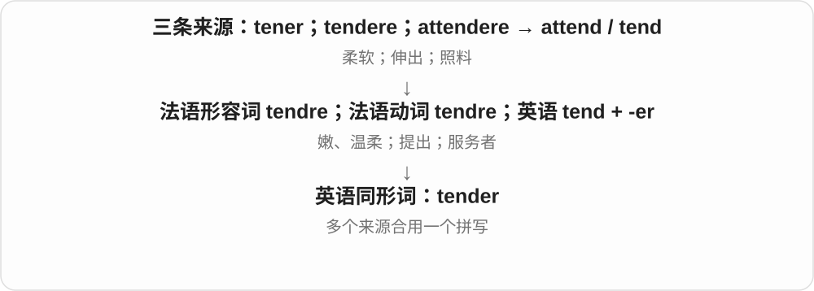

tender meat 容易嚼，a tender shoulder 一碰就痛，tender a resignation 是正式递交辞呈。a tender 可指投标书，也可指为大船服务的小艇。

**常见搭配与例句**

tender meat；a tender smile；submit a tender；tender a resignation。

> The meat was tender and easy to cut.

肉很嫩，很容易切开。

> She tendered her resignation on Monday.

她在星期一正式递交了辞呈。

> A tender carried the passengers ashore.

一艘接驳艇把乘客送上岸。

**别混淆**

柔软的 tender 不能画成 tendere 的直接后代；更不能与 tenere“持有”混为同一个拉丁词。

### 38. tenderness — 温柔；柔嫩；触痛

**音标**：英 /ˈtendənəs/；美 /ˈtendərnəs/

**先抓住这个画面**

抱孩子时动作轻，是温柔；肉容易咬开，是柔嫩；受伤部位轻轻一碰就疼，又是触痛。三个常用义要跟对象走。

**怎么拆**

现代构词对应 tender + -ness → tenderness。-ness 把前面的性质作为状态、程度等来谈。

**怎么变成今天的意思**

**英语 tender**  
温柔的、柔嫩的；一碰就痛的

↓

**tender + -ness → tenderness**  
温柔；柔嫩；触痛

tenderness 可以是感情、食物质地，也可以是身体对按触的痛感。不是只背温柔就能读懂所有句子。

**常见搭配与例句**

with tenderness 温柔地；the tenderness of meat 肉的嫩度；tenderness around a joint 关节周围触痛。

> He spoke to the child with tenderness.

他温柔地对孩子说话。

> She noticed tenderness around the bruise.

她注意到淤青周围一碰就痛。

**别混淆**

tenderness 的触痛义与普通 softness 柔软不同：一处按着痛，并不等于它摸起来特别软。

### 39. effectiveness — 有效性；实际成效

**音标**：/ɪˈfɛk.tɪv.nɪs/

**先抓住这个画面**

不是问宣传得多好，而是问事情到底改善了多少：这就是 effectiveness 所关心的。

**怎么拆**

effective + -ness，把有效这一性质变成名词。

**怎么变成今天的意思**

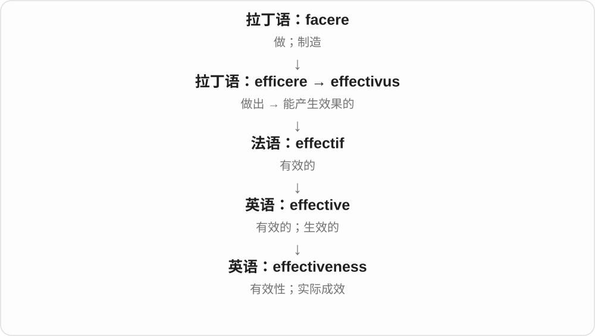

从一个效果转为评价整套方法能否达到目标。很多语境关心真实条件下能否奏效，而非只看漂亮的理论。

**常见搭配与例句**

measure effectiveness；the effectiveness of a policy；cost effectiveness。

> We measured the effectiveness of the training.

我们衡量了培训的实际效果。

> Its effectiveness depends on how it is used.

它是否有效取决于怎样使用。

**别混淆**

efficiency 看资源利用；effectiveness 看目标实现。部分研究中 efficacy 更侧重受控条件下的效力。

### 40. kindness — 善意；体贴；善举

**音标**：/ˈkaɪndnəs/

**先抓住这个画面**

kind 说一个人待人好，kindness 说这份好意，或他具体帮人的那一件事。

**怎么拆**

kind + -ness，中古英语已有 kyndenesse 等；名词可说性质，也可数一次善举。

**怎么变成今天的意思**

**古英语 cynd〔本性、种类〕及相关 cynde〔天生、自然的〕**  
同一旧本性、出生词族的名词与形容词

↓

**中古英语 kinde → 英语 kind**  
种类；自然合宜等旧义发展到友善、体贴

↓

**kind + -ness → kindness**  
友善的性质；具体善意举动

show kindness 表现善意，an act of kindness 一次善举，repay someone’s kindness 回报某人好意。作种类名词的 kind 通常不沿这里转成 kindness。

**常见搭配与例句**

show kindness；an act of kindness；out of kindness；repay kindness。

> Thank you for your kindness.

谢谢你的好意。

> A small act of kindness changed her day.

一件小小善举让她那天的心情变好了。

**别混淆**

kindness 善意不等于 weakness 软弱；这是两种性质，不能因中文态度词而建立必然关系。

### 41. deaf — 聋的；听不见的

**音标**：/def/

**先抓住这个画面**

听觉有障碍、听不见声音，常用 deaf。交流可以依靠手语、文字等不同方式，词本身不说明一个人的思考、学习能力。

**怎么拆**

由古英语 deaf 经中古英语延续，接日耳曼语听觉受阻、发懵的旧材料；标准常用读音 /def/，不是按 ea 一律读 /iː/。

**怎么变成今天的意思**

**古英语 deaf → 中古英语 def、deef**  
听不见、失聪的

↓

**现代 deaf → deafness**  
听觉相关状态；聋人身份、语言文化另依语境

deaf students 聋生；be deaf in one ear 一只耳朵听不见；turn a deaf ear to 对……充耳不闻。

**常见搭配与例句**

deaf students；turn a deaf ear to。

> The school supports deaf students.

学校为聋生提供支持。

> They turned a deaf ear to our requests.

他们对我们的请求充耳不闻。

**别混淆**

deaf 是听觉方面的词；turn a deaf ear 是选择不理会的习语，不一定真听不见。

### 42. deafness — 耳聋；听觉丧失

**音标**：/ˈdefnəs/

**先抓住这个画面**

deaf 描述听觉状况，deafness 把这种听觉丧失作为状态、经历来谈。具体程度、背景仍要看上下文。

**怎么拆**

现代构词对应 deaf + -ness → deafness。-ness 把前面的性质作为状态、程度等来谈。

**怎么变成今天的意思**

**古英语 deaf → 中古英语 def、deef**  
听不见、失聪的

↓

**现代 deaf → deafness**  
听觉相关状态；聋人身份、语言文化另依语境

↓

**deaf + -ness → deafness**  
现代失聪状态的名词对应

research into deafness 是对失聪的研究；a history of deafness 可按文本说失聪经历、病史。

**常见搭配与例句**

research into deafness；a history of deafness。

> The charity supports research into deafness.

慈善机构支持失聪相关研究。

> Her deafness was first noticed in childhood.

她的听觉问题最初在童年被发现。

**别混淆**

deafness 是听觉状况，silence 是环境无声；周围安静不等于一个人听觉受损。

### 43. madness — 疯狂、荒唐；狂乱局面；旧精神失常称谓

**音标**：/ˈmædnəs/

**先抓住这个画面**

事情乱成一团，或决定冒险得让人难以理解，说话人会称它 madness。常是强烈评价，不是客观诊断。

**怎么拆**

mad + -ness，中古英语 madnesse 等旧形延续。抽象名词接疯狂、失去理智等意义，现代很多用法是夸张。

**怎么变成今天的意思**

**古英语 ġemǣd、ġemǣded 等 → 中古英语 mad、madde → mad**  
愤怒、失去理智等旧用法

↓

**英语 mad**  
生气、狂热喜爱；荒唐、不理智等评价

↓

**mad + -ness → madness**  
疯狂状态；荒唐行为或狂乱局面

sheer madness 简直荒唐，the madness of the rush hour 高峰时段的混乱，a moment of madness 一时冲动。

**常见搭配与例句**

sheer madness；a moment of madness；the madness of。

> Driving through that storm would be sheer madness.

开车穿过那场暴风雨简直太冒险了。

> We escaped the madness of the city for a quiet weekend.

我们离开城市的喧闹混乱，过了一个安静周末。

**别混淆**

madness 情绪化评价或旧称谓，chaos 强调秩序混乱；不能据有人说 madness 就判断精神状况。

### 44. lame — 跛的、行动不便的；蹩脚的、站不住脚的

**音标**：/leɪm/

**先抓住这个画面**

动物走路不利索，是具体的 lame；借口缺少支撑、说服不了人，也被说成 a lame excuse。

**怎么拆**

普通形容词接古英语 lama，经中古英语延续。由肢体行动受限扩展到论证、解释等不够有力；与法语金属薄片、金丝织物的同形词分源。

**怎么变成今天的意思**

**古英语 lama → 中古英语 lame**  
肢体不健全、行动不便

↓

**形容质量、论证的比喻**  
无力、蹩脚、不能令人信服

a lame horse 跛脚的马；a lame excuse 蹩脚借口；a lame attempt 无力的尝试。描述人的残障时，lame 带旧式、可能冒犯的语感。

**常见搭配与例句**

a lame explanation；go lame。

> The horse went lame during the journey.

那匹马在旅途中跛了。

> He offered a lame excuse for being late.

他为迟到找了一个蹩脚的借口。

**别混淆**

lamé /læˈmeɪ/ 常指金银线织物，另接法语、拉丁语薄片材料；lame /leɪm/ 的跛、蹩脚义不从 lamina 来。

### 45. lameness — 跛行、行动不便；蹩脚、缺乏说服力

**音标**：/ˈleɪmnəs/

**先抓住这个画面**

把 lame 从形容某个对象，变成可以讨论的一种状态：马的跛行，或借口的不可信。

**怎么拆**

lame + -ness；性质后缀把行动不便、无力的形容词变成抽象名词。不是一种新的动作。

**怎么变成今天的意思**

**lame + -ness**  
把跛、蹩脚的性质名词化

↓

**lameness 的具体、比喻用法**  
跛行状态；解释等的无力

lameness in a horse 马的跛行；the lameness of an excuse 借口的蹩脚；show signs of lameness 表现出跛行。

**常见搭配与例句**

the cause of lameness；obvious lameness。

> The report describes lameness in one of the horses.

报告描述了其中一匹马的跛行情况。

> The lameness of his excuse was obvious.

他的借口有多蹩脚，一听就知道。

**别混淆**

lame 是形容词，lameness 是性质名词。步态义常见于动物描述；不是泛指一切运动障碍的精确专业分类。

### 46. gifted — 有天赋的；被赠送的

**音标**：/ˈɡɪftɪd/

**先抓住这个画面**

像是被赋予了某方面的突出能力。

**怎么拆**

gift 作动词表示赠予、赋予，过去分词 gifted 可作形容词；天赋义沿被赋予能力这一比喻发展。

**怎么变成今天的意思**

**英语 gift 的动词用法**  
赠予、赋予

↓

**过去分词 gifted**  
被赋予的

↓

**常用形容词 gifted**  
有天赋的

a gifted musician 是有音乐天赋的人，gifted at languages 是擅长语言。也会在商品说明里看到 gifted products，表示别人免费赠予的产品；不要把这种普通分词义都翻成有天赋。

**常见搭配与例句**

a gifted artist；gifted at something；a gifted student。

> She is a gifted musician who practises every day.

她是一位很有天赋、每天都练习的音乐家。

> The review clearly identified which products had been gifted to the writer.

评测明确标出了哪些产品是赠送给作者的。

**别混淆**

gifted 说某方面突出天赋，不是保证样样优秀。skilled 更突出已经形成的熟练技能，两者可以同时成立。

### 47. giftedness — 高天赋；突出的天资

**音标**：/ˈɡɪftɪdnəs/

**先抓住这个画面**

有的人在某些领域学得格外快、理解得深，giftedness 就把这种突出的能力特征当成名词来谈。

**怎么拆**

现代构词对应 gifted + -ness → giftedness。-ness 把前面的性质作为状态、程度等来谈。

**怎么变成今天的意思**

**英语 gifted**  
有天赋、天资突出的

↓

**gifted + -ness → giftedness**  
高天赋；突出的天资

常用于教育、心理、艺术领域，具体怎样识别、界定会随所讨论的框架不同。

**常见搭配与例句**

musical giftedness 音乐天赋；identify giftedness 识别突出天资。

> The teacher noticed her musical giftedness.

老师注意到了她的音乐天赋。

> The study explores different ways of identifying giftedness.

研究探讨识别突出天资的不同方式。

**别混淆**

giftedness 是天赋、能力特征，gifting 是送礼；gift 的给予材料在词族中走成了不同常用义。

### 48. sadness — 悲伤；难过的情绪

**音标**：/ˈsædnəs/

**先抓住这个画面**

把心里那份难过拿出来说，可以很淡，也可以长久地留着。

**怎么拆**

sad + -ness，中古英语 sadnesse 等形式延续。现代主要接悲伤义，不用旧词源把它解释成吃饱状态。

**怎么变成今天的意思**

**古英语 sæd**  
饱足、满足，也有厌倦等联系

↓

**中古英语 sad**  
沉实、严肃等义；悲伤义逐步突出，具体转义路径有不同解释

↓

**现代 sad**  
伤心、令人难过；另有可悲、差劲等评价

↓

**sad + -ness → sadness**  
难过的性质、情绪

a feeling of sadness 悲伤感，a touch of sadness 一丝伤感，deep sadness 深深悲伤。

**常见搭配与例句**

a feeling of sadness；a touch of sadness；deep sadness。

> There was a touch of sadness in her voice.

她的声音里有一丝伤感。

> He felt sadness at the thought of leaving.

想到要离开，他感到难过。

**别混淆**

sadness 是情绪名词，sadden 是使人难过的动作；sadness 不自动等于某种临床疾病诊断。

### 49. messy — 杂乱的；容易弄脏、弄乱的；复杂难收拾的

**音标**：/ˈmesi/

**先抓住这个画面**

物品没归位是一种 messy；事情牵扯很多、结尾不好收，也像一团乱线，叫 messy。

**怎么拆**

mess 乱七八糟的状态、混乱 + -y → messy；已有两个 s，不另添第三个。

**怎么变成今天的意思**

**mess 从混杂、杂乱等义发展**  
一团乱；难处理的状况

↓

**mess + -y → messy**  
带杂乱性质；难收拾

a messy room 乱房间；messy handwriting 潦草字迹；a messy situation 复杂混乱的局面。

**常见搭配与例句**

a messy room；messy handwriting；a messy situation。

> The room was messy but clean.

房间很乱，但很干净。

> The simple change created a messy situation.

简单改动造成了复杂混乱的局面。

**别混淆**

messy 侧重乱，dirty 侧重脏；一堆干净衣服乱放，也可以 messy。

### 50. messiness — 凌乱；混乱、复杂难理

**音标**：/ˈmesinəs/

**先抓住这个画面**

桌上东西堆着、线缠着，是 messiness；一件事牵涉很多关系、界限不清，也能用这种乱作比喻。

**怎么拆**

现代构词对应 messy + -ness，y 改 i → messiness。-ness 把前面的性质作为状态、程度等来谈。

**怎么变成今天的意思**

**英语 messy**  
凌乱、混乱的

↓

**messy + -ness → messiness**  
凌乱；混乱、复杂难理

可以是物理的不整齐，也可以是现实过程难按理想模型整齐切开的复杂。

**常见搭配与例句**

the messiness of a room 房间凌乱；the messiness of real life 现实生活的纷乱复杂。

> The messiness of the desk made it hard to find anything.

桌面太乱，找东西很难。

> The book captures the messiness of family life.

书中捕捉了家庭生活的纷乱复杂。

**别混淆**

messiness 是杂乱，dirtiness 是脏污；桌面排布乱，未必有污垢。

### 51. lively — 活泼的；热闹的；生动的

**音标**：/ˈlaɪvli/

**先抓住这个画面**

人不断提问，话题来回碰撞，房间一下有了生气。

**怎么拆**

接古英语 līflīċ、后来的 lively 等形式；现代对应 life + -ly，但 -ly 在这里造形容词，不是普通副词。

**怎么变成今天的意思**

**古英语 līf → 中古英语 lyf**  
生命；活着的状态

↓

**古英语 līflīċ → 英语 lively**  
有生命、活跃 → 活泼、生动

a lively child 是活泼孩子，a lively debate 是热烈讨论，a lively description 是生动描写。并不表示所有场面都和睦无争。

**常见搭配与例句**

a lively discussion；a lively atmosphere；a lively imagination。

> The lecture ended with a lively discussion.

讲座以热烈讨论结束。

> She gave a lively account of her travels.

她生动地讲述了自己的旅行。

**别混淆**

alive 是活着，lively 是有活力。一个人可以 alive 却很安静；lively 不只是医学上是否有生命。

### 52. liveliness — 活泼；生动、活跃

**音标**：/ˈlaɪvlinəs/

**先抓住这个画面**

人说话有神采，街上有人声、活动，讨论你来我往，都能让人感到 liveliness。它是充满生气的感觉。

**怎么拆**

现代构词对应 lively + -ness，y 改 i → liveliness。-ness 把前面的性质作为状态、程度等来谈。

**怎么变成今天的意思**

**英语 lively**  
活泼、生动的

↓

**lively + -ness → liveliness**  
活泼；生动、活跃

可说人物性格，也可说环境、谈话或作品的活跃程度。

**常见搭配与例句**

the liveliness of a conversation 谈话的活跃；youthful liveliness 年轻的活力。

> Her liveliness brightened the room.

她的活泼让屋里气氛明快起来。

> We enjoyed the liveliness of the discussion.

我们喜欢讨论的活跃气氛。

**别混淆**

liveliness 重有生气、有变化，loudness 只说音量；活跃不必靠吵闹。

### 53. naughty — 淘气、不听话的；不合规矩的〔常带轻松语气〕

**音标**：英 /ˈnɔːti/；美 /ˈnɔːti/〔亦有 /ˈnɑːti/〕

**先抓住这个画面**

孩子明知不该却调皮捣蛋，常叫 naughty；成人也可能用玩笑语气说做了点不合规矩的事。

**怎么拆**

中古英语 noughti 等由 naught、nought 的坏、无价值等旧材料接性质尾发展。早期可说邪恶，后来常弱化为不乖、淘气，不是今天零数量加 -y 就能直接算出词义。

**怎么变成今天的意思**

**中古英语 nought、naught 的负面性质 + -y**  
原有邪恶、不良等较强义

↓

**现代 naughty 的常见弱化**  
顽皮、不听话；玩笑式不合规矩

a naughty child 淘气孩子；a naughty smile 带调皮意味的笑；naughty behaviour 不乖行为。另有成人性暗示语境，依上下文。

**常见搭配与例句**

a naughty child；a naughty smile。

> The naughty puppy ran off with a sock.

调皮的小狗叼着一只袜子跑了。

> She gave him a naughty smile.

她对他调皮地一笑。

**别混淆**

naughty 常偏行为不乖，nasty 常说恶劣、令人不适；顽皮未必刻薄。

### 54. naughtiness — 淘气、顽皮；不听话的行为

**音标**：/ˈnɔːtinəs/

**先抓住这个画面**

孩子明知不该，却偷偷闹一个小恶作剧，这种顽皮可以说 naughtiness。语气可责备，也常带一点亲昵。

**怎么拆**

现代构词对应 naughty + -ness，y 改 i → naughtiness。-ness 把前面的性质作为状态、程度等来谈。

**怎么变成今天的意思**

**英语 naughty**  
淘气、不听话的

↓

**naughty + -ness → naughtiness**  
淘气、顽皮；不听话的行为

常用于儿童行为；用在成人玩笑里可能带调皮、暧昧等语气，需看情境。

**常见搭配与例句**

childhood naughtiness 童年淘气；a bit of naughtiness 一点顽皮。

> The children’s naughtiness caused a little chaos.

孩子们的淘气惹出一点小乱子。

> He remembered his childhood naughtiness with amusement.

他好笑地回想童年的顽皮。

**别混淆**

naughtiness 通常比 serious wrongdoing 轻；并不是所有严重伤害都适合轻描淡写地叫淘气。

### 55. willingness — 意愿；乐于做某事的态度

**音标**：/ˈwɪlɪŋnəs/

**先抓住这个画面**

讨论合作时，除了能力和资源，还要看双方有没有“肯一起做”的心态。这一部分就是 willingness。

**怎么拆**

willing 加 -ness，将愿意这一形容词性质变成名词；后面常用 to do 说明愿意做什么。

**怎么变成今天的意思**

**英语 willing**  
愿意的、乐于配合的

↓

**英语 willing + -ness → willingness**  
愿意做某事的意愿、态度

show a willingness to listen 是表现出愿意听取意见的态度。它可以成为合作的开端，但不代表事情已经真正完成。

**常见搭配与例句**

a willingness to learn；show willingness；willingness to cooperate。

> Her willingness to learn mattered more than her lack of experience.

相比经验不足，她愿意学习的态度更重要。

> Both sides expressed a willingness to continue the discussion.

双方都表示愿意继续讨论。

**别混淆**

willingness 不是 ability，也不是已采取的 action。有意愿、能做到、实际做了，是三件可以分别讨论的事。

### 56. unwillingness — 不情愿；不愿意做某事的态度

**音标**：/ʌnˈwɪlɪŋnəs/

**先抓住这个画面**

谈判卡住，有时不是条件完全办不到，而是某一方不肯让步。unwillingness 把这份“不肯”作为原因拿出来说。

**怎么拆**

unwilling 加 -ness，构成表示态度、状态的名词。结构中的否定作用在 willing 上，不是否定名词后缀。

**怎么变成今天的意思**

**英语 unwilling**  
不愿意的

↓

**英语 unwilling + -ness → unwillingness**  
不愿意做某事的态度或状态

an unwillingness to change 指不愿改变；show unwillingness to cooperate 则说明缺少配合意愿。后面的 to do 能让“不愿意”具体落地。

**常见搭配与例句**

unwillingness to change；an unwillingness to compromise；show unwillingness。

> Their unwillingness to compromise slowed the talks.

他们不愿妥协，使会谈进展缓慢。

> His silence reflected uncertainty rather than an unwillingness to help.

他的沉默反映的是不确定，而非不愿帮忙。

**别混淆**

unwillingness 是意愿不足，inability 是能力或条件不足。判断原因时把这两者分开，句子的含义会差很多。

### 57. worthless — 没有价值的；无用的

**音标**：英 /ˈwɜːθləs/；美 /ˈwɜːrθləs/

**先抓住这个画面**

按当前用途或交易情境看，派不上用场、值不了钱；不等于从宇宙中证明它永远毫无意义。

**怎么拆**

worth 价值 + -less 没有，古英语已有 weorþlēas 等旧形式。它往往是一种语境中的评价，不能只按价格等同所有价值。

**怎么变成今天的意思**

**古英语 weorþ → 中古英语 worth**  
有价值、相称、值得的

↓

**现代 worth 词族**  
金钱价值、实际用途；值得某种待遇、投入

↓

**worth + -less → worthless**  
价值 → 无价值、无用的

a worthless ticket 无效、无用的票，worthless information 毫无用处的信息；形容人时是很重的贬低，不是中性身份。

**常见搭配与例句**

worthless information；a worthless document；become worthless。

> Without the missing page, the instructions were almost worthless.

缺了那页，说明书几乎派不上用场。

> The old ticket was now worthless.

那张旧票现在已经毫无用处。

**别混淆**

worthless 无价值，priceless 无价、珍贵，虽然都带价格否定联想，常用意义相反。

### 58. worthlessness — 无价值、无用；无价值感

**音标**：英 /ˈwɜːθləsnəs/；美 /ˈwɜːrθləsnəs/

**先抓住这个画面**

一个东西派不上用场、没有所需价值，叫 worthless；worthlessness 是这种无用、无价值状态，也能说人的主观无价值感。

**怎么拆**

现代构词对应 worthless + -ness → worthlessness。-ness 把前面的性质作为状态、程度等来谈。

**怎么变成今天的意思**

**英语 worthless**  
没有价值、用途的

↓

**worthless + -ness → worthlessness**  
无价值、无用；无价值感

用于物品、资料时常评价用途；feelings of worthlessness 则着眼人的感受。

**常见搭配与例句**

the worthlessness of something 某物的无用；feelings of worthlessness 无价值感。

> The test revealed the worthlessness of the old data.

测试显示旧数据已无使用价值。

> The novel explores feelings of worthlessness.

小说探讨无价值感。

**别混淆**

worthlessness 是价值评价，helplessness 是无能为力；有帮助意愿却做不到，不等于毫无价值。

### 59. spicy — 加有香料的；辛辣的；刺激有趣的

**音标**：/ˈspaɪsi/

**先抓住这个画面**

spicy 可以是嘴里感到辣，也可以是香料气味丰富；要结合食物和说话习惯判断。

**怎么拆**

spice 去掉词尾 e，加 -y，形成描述性质的形容词。

**怎么变成今天的意思**

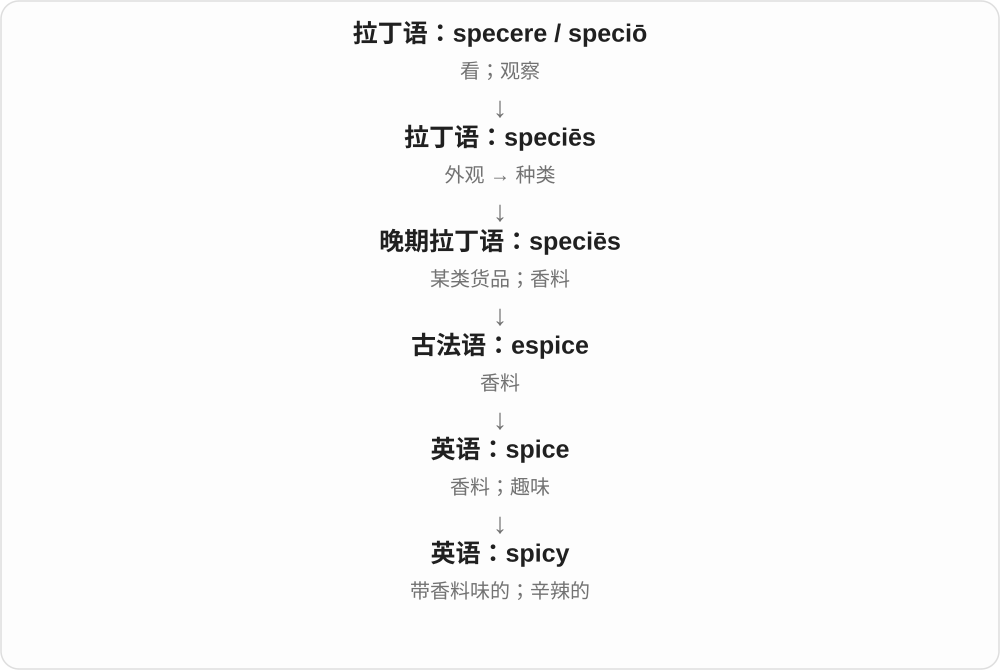

香料义在日常饮食中常转向“辣”。形容报道、故事时，还可能指内容刺激、带点大胆意味。

**常见搭配与例句**

spicy food；a spicy sauce；a spicy aroma。

> The sauce is too spicy for me.

这个酱对我来说太辣了。

> The tea has a warm, spicy aroma.

这杯茶有温暖浓郁的香料气息。

**别混淆**

spicy 和 hot 都可指辣；hot 还可单纯指温度高。spicy 不说明食物刚出锅。

### 60. spiciness — 辛辣；香料味浓的程度

**音标**：/ˈspaɪsinəs/

**先抓住这个画面**

同一锅咖喱，有人觉得香辣过瘾，有人觉得辣得受不了，讨论的就是 spiciness 这份辛辣、香料刺激的程度。

**怎么拆**

现代构词对应 spicy + -ness，y 改 i → spiciness。-ness 把前面的性质作为状态、程度等来谈。

**怎么变成今天的意思**

**英语 spicy**  
辛辣、香料味浓的

↓

**spicy + -ness → spiciness**  
辛辣；香料味浓的程度

spicy 在不同食物里可突出辣，也可突出香料味浓；不是所有 spice 都只带辣。

**常见搭配与例句**

the spiciness of a curry 咖喱的辛辣程度；adjust the spiciness 调整辣度。

> The yoghurt softened the spiciness of the sauce.

酸奶缓和了酱汁的辛辣。

> You can adjust the spiciness to your taste.

你可以按口味调整辣度。

**别混淆**

spiciness 是辛辣、香料味，saltiness 是咸味；吃起来刺激与盐多不属于同一种味觉描述。

### 61. fairness — 公平、公正；浅色等性质

**音标**：英 /ˈfeənəs/；美 /ˈfernəs/

**先抓住这个画面**

把公平这项原则、品质拿出来谈：怎样分配、怎样对待，是否经得起同一标准。

**怎么拆**

fair + -ness，性质名词；相应形式古英语已有美、悦目等义。现代常用公平义，也可按上下文接浅色等形容词分支。

**怎么变成今天的意思**

**古英语 fæġer → 中古英语 fayr → fair**  
美、悦目、合宜

↓

**现代形容词 fair**  
公正、合理；尚可；浅色；晴朗等分支

↓

**fair + -ness → fairness**  
合宜、公正等性质 → 公平

a sense of fairness 公平感，in fairness to someone 公允地看某人；for the sake of fairness 为求公平。

**常见搭配与例句**

a sense of fairness；in fairness to；ensure fairness。

> The selection process should be transparent and based on fairness.

选拔过程应公开透明，并以公平为基础。

> In fairness to him, he did warn us about the delay.

公允地说，他确实提醒过我们可能会延误。

**别混淆**

fairness 公平原则，不等于每个人结果一定一样；equality 平等在具体讨论中可能是另一维度。

### 62. unfairness — 不公平、不公正；不公正的情况

**音标**：英 /ʌnˈfeənəs/；美 /ʌnˈfernəs/

**先抓住这个画面**

把规则、待遇中偏斜、不合理的地方单独拿出来谈，就是 unfairness。

**怎么拆**

unfair + -ness。-ness 将形容词性质变成名词，可说状态，也可结合语境指某种不公。

**怎么变成今天的意思**

**fair 公正、合理 + un- 不 → unfair**  
待遇、规则、判断不公正

↓

**unfair + -ly、-ness**  
不公正地；不公平的性质、情况

the unfairness of a rule 一条规则的不公，a sense of unfairness 感到不公平，challenge unfairness 反对不公。

**常见搭配与例句**

a sense of unfairness；the unfairness of the system。

> The children quickly noticed the unfairness of the rule.

孩子们很快发现规则不公平。

> A sense of unfairness remained after the meeting.

会议后，大家仍觉得受了不公正对待。

**别混淆**

unfairness 是性质、状况名词，unfairly 是方式副词：the unfairness of the decision；decide unfairly。

### 63. thickness — 厚度；浓稠、密集程度；一层厚料

**音标**：/ˈθɪknəs/

**先抓住这个画面**

从“这块板很厚”转到“它究竟多厚”：把 thick 的性质拿出来量、拿出来谈。

**怎么拆**

thick + -ness 的性质名词对应，古英语 þicnes 等旧形式已存在，后来延续为 thickness。

**怎么变成今天的意思**

**古英语 þicce → 中古英语 thikke → thick**  
厚、密、稠

↓

**古英语 þicnes → thickness**  
厚、稠、密的性质；对应 thick + -ness

measure the thickness 测厚度，a thickness of five millimetres 五毫米厚，the thickness of the sauce 酱汁浓稠度。

**常见搭配与例句**

measure the thickness；a thickness of；the thickness of the sauce。

> The two sheets differ in thickness.

这两张板的厚度不同。

> The thickness of the sauce makes it cling to the pasta.

酱汁的浓稠度让它能裹住意大利面。

**别混淆**

thickness/width/depth 分别是厚度、宽度、深度；同一物体采用哪个方向量，要看说明，不可只说都是尺寸。

### 64. salty — 咸的；恼火、不服气的（口语）

**音标**：英 /ˈsɔːlti/；美 /ˈsɔlti/

**先抓住这个画面**

嘴里尝到咸味是本义；网上说一个人 salty，往往是说他输了或吃了亏，心里还酸着、气着。

**怎么拆**

salt + -y。食物味道义是直接派生；口语情绪义属于后来的语义延伸。

**怎么变成今天的意思**

**印欧语盐词族 → 日耳曼语支**  
盐；与拉丁 sal 同源，但没有经过拉丁语借入

↓

**古英语 sealt → 英语 salt**  
盐；给食物加盐

↓

**salt + -y → salty**  
含盐、味咸；后来也用于辛辣言辞或不快态度

The soup is salty 是汤咸；He’s still salty about losing 则是他还在为输掉而不爽。情绪义是随意的说法，别把字面“眼泪含盐”编成已经确定的历史来源。

**常见搭配与例句**

salty food；salty water；feel salty；be salty about something。

> The soup was too salty for me.

这汤对我来说太咸了。

> He was still salty about losing the game.

他还在为输掉比赛而不爽。

**别混淆**

salty 是咸，不是 spicy 辣。形容人的情绪时，salty 比 upset 更口语，也容易带调侃，不能在所有场合互换。

### 65. saltiness — 咸味、咸的程度

**音标**：/ˈsɔːltinəs/

**先抓住这个画面**

同样一碗汤，有人尝一口说太咸，讨论的就是 saltiness。它首先是人能尝到的味道性质。

**怎么拆**

现代构词对应 salty + -ness，y 改 i → saltiness。-ness 把前面的性质作为状态、程度等来谈。

**怎么变成今天的意思**

**英语 salty**  
有咸味的

↓

**salty + -ness → saltiness**  
咸味、咸的程度

可说食物、饮料的咸味强弱；taste the saltiness 是尝到那股咸。

**常见搭配与例句**

the saltiness of soup 汤的咸味；a slight saltiness 一点咸味。

> The cheese added saltiness to the dish.

奶酪给菜增加了咸味。

> She noticed a slight saltiness in the water.

她尝出水里有一点咸味。

**别混淆**

saltiness 常说尝出的咸味，salinity 更常是水等的盐度、含盐量指标；两者相关，关注点不同。

### 66. greatness — 伟大；卓越；巨大

**音标**：/ˈɡreɪtnəs/

**先抓住这个画面**

从一次做得好，抬高到这个人或作品整体让人敬佩的品质。

**怎么拆**

great + -ness；-ness 把形容词变成性质名词，古英语 grēatnes 已有对应形式。词义可接规模大，也可接卓越。

**怎么变成今天的意思**

**古英语 grēat + -nes → grēatnes**  
巨大、重要的性质

↓

**英语 greatness**  
伟大、卓越或巨大的程度

the greatness of a leader 常谈成就与品格，achieve greatness 是取得卓越成就。通常不可数，不能把一个伟人直接叫 a greatness。

**常见搭配与例句**

achieve greatness；the greatness of the work；true greatness。

> The greatness of the novel lies in its attention to ordinary lives.

这部小说的卓越之处在于它关注普通人的生活。

> She believed that kindness was part of true greatness.

她相信善良是真正伟大的一部分。

**别混淆**

greatness 是品质或程度，a great 是某领域的杰出人物，如 one of the greats；词性和数法不同。

### 67. meaningless — 无含义的；没有价值、作用的

**音标**：/ˈmiːnɪŋləs/

**先抓住这个画面**

要么看不出到底在说什么，要么说得通却觉得做了也没用；这两种空要分开。

**怎么拆**

meaning + -less，缺少意义。可否定可理解内容，也可否定价值、效果，不能一律当语言乱码。

**怎么变成今天的意思**

**古英语 mǣnan → 中古英语 menen → mean**  
意指、打算、表示

↓

**中古英语 mening → meaning**  
所指、意图 → 含义、意义、重要性

↓

**meaning + -less → meaningless**  
没有可理解含义，或没有价值、作用

a meaningless string of letters 无意义字母串，a meaningless gesture 没有实际作用的姿态，seem meaningless 显得没有意义。

**常见搭配与例句**

a meaningless gesture；meaningless words；seem meaningless。

> To me, the code was a meaningless string of symbols.

在我看来，那段代码就是一串看不懂的符号。

> Without action, the promise would be meaningless.

没有行动，这个承诺就没有意义。

**别混淆**

meaningless 没内容或没价值，unclear 只是意思不清楚；暂时不懂的专业句不因此就客观无意义。

### 68. meaninglessness — 无意义；缺少目的、价值的感觉

**音标**：/ˈmiːnɪŋləsnəs/

**先抓住这个画面**

反复做一件事，却看不出要达成什么，也看不出有什么作用，便会产生 meaninglessness。文字毫无可理解含义，也可这样说。

**怎么拆**

现代构词对应 meaningless + -ness → meaninglessness。-ness 把前面的性质作为状态、程度等来谈。

**怎么变成今天的意思**

**英语 meaningless**  
没有明确意义、目的或价值的

↓

**meaningless + -ness → meaninglessness**  
无意义；缺少目的、价值的感觉

可以评价符号、表述没有意义，也可以说生活、活动让人感到空洞无目的。

**常见搭配与例句**

a sense of meaninglessness 无意义感；the meaninglessness of a phrase 词句没有意义。

> The repetition gave him a sense of meaninglessness.

不断重复让他感到没有意义。

> The essay discusses the meaninglessness of empty slogans.

文章讨论空洞口号为何毫无意义。

**别混淆**

meaninglessness 重没有意义、目的，uselessness 重派不上用场；一件无实用价值的纪念物仍可能很有意义。

### 69. moody — 情绪多变的；闷闷不乐的；气氛忧郁的

**音标**：/ˈmuːdi/

**先抓住这个画面**

一个人一会儿好好的，一会儿又阴着脸、不想说话，可以说 moody。形容照片、音乐时，则常是带着阴郁、浓重情绪的氛围。

**怎么拆**

延续古英语 modig；现代可认作 mood 情绪 + -y。旧义包括勇敢、高傲，后来有易怒、阴郁等义，不能把今天每一种 mood 都自动叫 moody。

**怎么变成今天的意思**

**古英语 modig**  
勇敢、高傲、意气强烈等旧义

↓

**中古英语 → 现代 moody**  
发展出易怒、阴郁和情绪多变等常用义

moody 不必每分钟都变脸，也能是持续的阴郁、不高兴；用来评价人的性格时带主观看法。

**常见搭配与例句**

a moody teenager 情绪多变的少年；moody lighting 营造阴郁氛围的灯光。

> He gets moody when he has not slept well.

他没睡好时容易闹情绪。

> The film opens with moody shots of the empty town.

影片以一组气氛忧郁的空城镜头开场。

**别混淆**

moody 是情绪阴晴不定、阴郁；emotional 侧重情绪强烈、易激动。它们都不是单凭一个词就能确定的医学诊断。

### 70. moodiness — 情绪多变；阴郁、闷闷不乐

**音标**：/ˈmuːdinəs/

**先抓住这个画面**

moody 描述人，moodiness 把这种情绪阴晴不定、爱闷着的状态单独拿出来谈。

**怎么拆**

现代构词对应 moody + -ness，y 改 i → moodiness。-ness 把前面的性质作为状态、程度等来谈。

**怎么变成今天的意思**

**古英语 modig**  
勇敢、高傲、意气强烈等旧义

↓

**中古英语 → 现代 moody**  
发展出易怒、阴郁和情绪多变等常用义

↓

**moody + -ness → moodiness**  
现代情绪多变、阴郁的状态名词

不是情绪本身的总称，而是带着多变、阴郁等特点的情绪状态。

**常见搭配与例句**

a period of moodiness 一阵闷闷不乐；explain someone’s moodiness 解释某人的情绪变化。

> Her moodiness made the meeting uncomfortable.

她那阴晴不定的情绪让会议气氛有些别扭。

> He attributed his recent moodiness to lack of sleep.

他觉得自己最近情绪不好是因为睡眠不足。

**别混淆**

mood 是当时的心情；moodiness 常强调爱闹情绪、阴郁或变化多，语气更有评价色彩。

### 71. ineffective — 无效的；不起作用的

**音标**：/ˌɪn.ɪˈfɛk.tɪv/

**先抓住这个画面**

按了按钮，门还是纹丝不动：这个办法 ineffective，因为想要的变化没出现。

**怎么拆**

in-（不）+ effective，否定的是产生预期效果。

**怎么变成今天的意思**

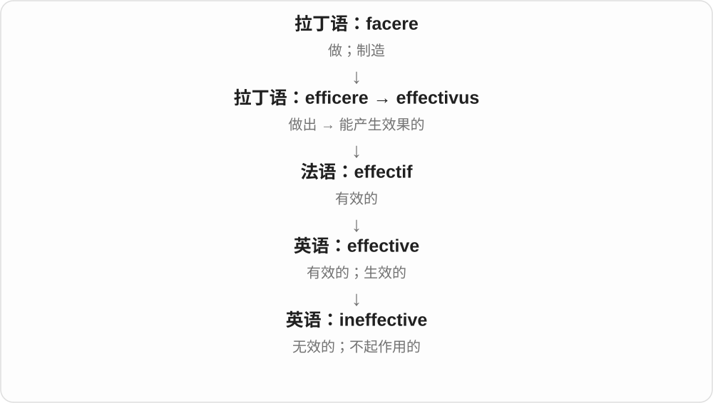

它可以表示完全不起作用，也可指效果弱到达不到目的；具体程度要看语境。

**常见搭配与例句**

an ineffective method；ineffective at doing…；prove ineffective。

> The old warning signs were ineffective.

旧警示牌没起到应有的作用。

> The repair proved ineffective, and the leak returned.

这次维修没有奏效，后来又漏水了。

**别混淆**

inefficient 可能做成了但浪费大；ineffective 是目标没实现或效果不够。

### 72. ineffectiveness — 无效；不起作用、效果不佳

**音标**：/ˌɪnɪˈfektɪvnəs/

**先抓住这个画面**

忙了很多，想解决的问题却还在，这种没能奏效的状态叫 ineffectiveness。

**怎么拆**

现代构词对应 ineffective + -ness → ineffectiveness。-ness 把前面的性质作为状态、程度等来谈。

**怎么变成今天的意思**

**英语 ineffective**  
不能产生所需效果的

↓

**ineffective + -ness → ineffectiveness**  
无效；不起作用、效果不佳

常评价措施、工具、安排没有达到预期目的；是否费钱、费时是另一个比较角度。

**常见搭配与例句**

the ineffectiveness of a policy 政策无效；demonstrate ineffectiveness 显示没有效果。

> The report highlights the ineffectiveness of the measure.

报告指出了这项措施没有奏效。

> Repeated failures exposed the system’s ineffectiveness.

反复失败暴露了这套系统不起作用。

**别混淆**

ineffectiveness 是没奏效，inefficiency 是效率低；做得慢但最终有效，与做了也没用不同。

### 73. fuzzy — 毛茸茸的；模糊、不明确的

**音标**：/ˈfʌzi/

**先抓住这个画面**

绒毛让轮廓不锐利，从物体走到记忆、想法，就有边界不清、说不准的 fuzzy。

**怎么拆**

现代可按 fuzz + -y；但 fuzz、fuzzy 的早期来源及先后有争论。语义由绒毛、软松扩展到画面、记忆、判断模糊。

**怎么变成今天的意思**

**fuzz、fuzzy 的早期软、松、绒毛材料**  
更早来源与具体派生先后有争论

↓

**现代 fuzz 与 fuzzy**  
绒毛；边缘、画面、思路不清晰

a fuzzy blanket 毛茸茸的毯子；a fuzzy image 模糊影像；a fuzzy memory 模糊记忆；fuzzy logic 则是模糊逻辑的固定术语。

**常见搭配与例句**

a fuzzy image；a fuzzy memory；fuzzy logic。

> The old photograph is slightly fuzzy.

旧照片有些模糊。

> She has only a fuzzy memory of that afternoon.

她对那天下午只剩模糊记忆。

**别混淆**

fuzzy logic 是专门方法名称，不直接等于思路马虎；日常 fuzzy explanation 才常批评说得不清。

### 74. fuzziness — 毛绒感；模糊、不清晰

**音标**：/ˈfʌzinəs/

**先抓住这个画面**

手摸到细软绒毛是 fuzziness；眼睛看见轮廓不清，也像边缘起了绒。两种感觉沿软、散、不鲜明的画面相连。

**怎么拆**

现代构词对应 fuzzy + -ness，y 改 i → fuzziness。-ness 把前面的性质作为状态、程度等来谈。

**怎么变成今天的意思**

**英语 fuzzy**  
毛绒绒、模糊的

↓

**fuzzy + -ness → fuzziness**  
毛绒感；模糊、不清晰

可以是触感，也可以是图像、思路、分类边界不够清楚。

**常见搭配与例句**

the fuzziness of a photo 照片模糊；fuzziness in the categories 分类界限模糊。

> The fuzziness of the photo hid the details.

照片模糊，细节看不清。

> She liked the fuzziness of the blanket.

她喜欢毯子的毛绒触感。

**别混淆**

fuzziness 不只低分辨率；思路、定义边界不清也能用，而 soft texture 专门聚焦触感。

### 75. loneliness — 孤独、寂寞；孤寂状态

**音标**：英 /ˈləʊnlinəs/；美 /ˈloʊnlinəs/

**先抓住这个画面**

身边缺少想要的陪伴、连接，心里空落落，是 loneliness 的常见感受。有时也描写一个地方无人活动的孤寂。

**怎么拆**

lonely + -ness，y 变 i。lonely 接 lone、alone 一系，alone 的历史联系 all one 单独一人；现代孤独感却不按在场人数机械计算。

**怎么变成今天的意思**

**alone → lone → lonely**  
独自一人 → 孤独、寂寞的性质

↓

**lonely + -ness → loneliness**  
孤独感；孤寂状态

a feeling of loneliness 孤独感，ease loneliness 缓解孤独，the loneliness of the place 那地方的孤寂。通常不可数。

**常见搭配与例句**

a feeling of loneliness；ease loneliness；the loneliness of。

> She sometimes felt loneliness even in a crowded room.

她有时即使在人多的房间里也觉得孤独。

> Regular visits helped ease his loneliness.

定期探望帮助缓解了他的寂寞。

**别混淆**

being alone 说独处事实，loneliness 常说缺少连接的感受。人可以独处却自在，也可能在人群中孤独；它本身不是某种临床诊断的同义词。

### 76. weary — 疲倦的；厌倦的

**音标**：英 /ˈwɪəri/；美 /ˈwɪri/

**先抓住这个画面**

不只跑两步喘一口气，而像走了长路、听了太多重复借口，身心都倦了，是 weary。它常比 tired 多一点长久消耗感。

**怎么拆**

由古英语 werig 经中古英语延续，是日耳曼语旧词；现代常用 weary of 表示对反复经历的事情厌倦。

**怎么变成今天的意思**

**古英语 werig → 中古英语 weri、wery → weary**  
劳累、疲惫的

↓

**weary → weariness、wearily**  
疲惫状态；疲倦地行动、说话

weary travellers 疲惫的旅人；grow weary 逐渐疲倦；be weary of something 厌倦某事。

**常见搭配与例句**

grow weary；be weary of。

> The weary travellers stopped to rest.

疲惫的旅人停下来休息。

> I grew weary of the same excuses.

我听腻了那些相同的借口。

**别混淆**

weary /ˈwɪəri/ 是疲惫、厌倦，wary /ˈweəri/ 是警惕；看到一个 y 的小差别，要连着元音和词义分。

### 77. weariness — 疲惫；倦怠、厌倦

**音标**：英 /ˈwɪərinəs/；美 /ˈwɪrinəs/

**先抓住这个画面**

长时间的劳作、奔波或重复经历，把人一点点耗空，留下的倦意是 weariness。可以从脚步、声音里听出来。

**怎么拆**

现代构词对应 weary + -ness，y 改 i → weariness。-ness 把前面的性质作为状态、程度等来谈。

**怎么变成今天的意思**

**古英语 werig → 中古英语 weri、wery → weary**  
劳累、疲惫的

↓

**weary → weariness、wearily**  
疲惫状态；疲倦地行动、说话

↓

**weary + -ness → weariness**  
现代疲倦、厌倦的名词对应

身体疲倦可说 physical weariness，对争论听烦了也可说 weariness with the argument。

**常见搭配与例句**

a sense of weariness 倦怠感；weariness with something 对某事厌倦。

> There was weariness in her voice.

她的声音里透着疲惫。

> His weariness with the argument was obvious.

显然，他已经厌倦了这场争论。

**别混淆**

weariness 是倦意，wariness 是戒心；一个想歇下来，一个在小心提防。

### 78. wearily — 疲倦地；厌倦地

**音标**：英 /ˈwɪərəli/；美 /ˈwɪrəli/

**先抓住这个画面**

拖着步子坐下、对老问题又叹一口气，这些动作怎样发生，可以用 wearily 来补上那股倦意。

**怎么拆**

weary 的 y 改 i，加 -ly → wearily；中古英语已有相应形式。-ly 在这里把疲倦性质转成动作方式。

**怎么变成今天的意思**

**古英语 werig → 中古英语 weri、wery → weary**  
劳累、疲惫的

↓

**weary → weariness、wearily**  
疲惫状态；疲倦地行动、说话

↓

**weary + -ly → wearily**  
带着疲倦、厌倦地行动

sigh wearily 疲倦地叹气；sit down wearily 疲惫地坐下；say wearily 厌倦地说。

**常见搭配与例句**

sigh wearily；sit down wearily。

> She sat down wearily at the kitchen table.

她疲惫地在餐桌旁坐下。

> “Not again,” he said wearily.

“怎么又来了，”他厌倦地说。

**别混淆**

wearily 疲倦地与 warily 警惕地只差一字母；walk wearily 拖着倦步，walk warily 小心前行。

### 79. rugged — 崎岖不平的；粗犷的；坚固耐用的

**音标**：/ˈrʌɡɪd/

**先抓住这个画面**

山地凹凸难走是 rugged；一个设备经得起磕碰、恶劣环境，也可叫 rugged。共同画面是粗硬、经得住折腾。

**怎么拆**

接中古英语 rugged、roggyd 等，关联北欧语毛簇、蓬乱的材料；今天 -ed 保留 /ɪd/，这是固定形容词读音。

**怎么变成今天的意思**

**古诺斯语 rǫgg 毛簇、蓬乱等 → 中古英语 rugged**  
粗糙、蓬乱的外观

↓

**现代 rugged → ruggedness**  
崎岖、粗犷；坚固耐用的性质

rugged terrain 崎岖地形；rugged features 粗犷面容；a rugged device 坚固耐用的设备。

**常见搭配与例句**

rugged terrain；a rugged device。

> The road crosses rugged terrain.

道路穿过崎岖地形。

> They designed a rugged camera for outdoor use.

他们设计了一款适合户外使用的耐用相机。

**别混淆**

rugged 可以夸耐用，不一定是做工粗劣；rough 粗糙范围更广，未必包含经得住使用的评价。

### 80. ruggedness — 崎岖、粗犷；坚固耐用

**音标**：/ˈrʌɡɪdnəs/

**先抓住这个画面**

看山路时，ruggedness 说崎岖；看设备时，它说经得起磕碰、环境考验。对象不同，中文就要跟着变。

**怎么拆**

现代构词对应 rugged + -ness → ruggedness。-ness 把前面的性质作为状态、程度等来谈。

**怎么变成今天的意思**

**古诺斯语 rǫgg 毛簇、蓬乱等 → 中古英语 rugged**  
粗糙、蓬乱的外观

↓

**现代 rugged → ruggedness**  
崎岖、粗犷；坚固耐用的性质

↓

**rugged + -ness → ruggedness**  
崎岖、粗犷、耐用的性质

可以评价自然地形、外表风格，也可以讨论产品的耐用程度。

**常见搭配与例句**

the ruggedness of the landscape 地貌崎岖；equipment ruggedness 设备耐用性。

> The ruggedness of the landscape slowed their progress.

地貌崎岖，拖慢了他们的前进。

> The tests focused on the camera’s ruggedness.

测试重点考察相机是否耐用。

**别混淆**

ruggedness 不等于精密度 precision；设备可既耐用又精密，两项性质并不冲突。

### 81. readiness — 准备状态；就绪程度；乐意

**音标**：/ˈredinəs/

**先抓住这个画面**

不是只列准备做过什么，而是看此刻能否开始、愿不愿行动。

**怎么拆**

ready 的 y 变 i 后接 -ness，形成状态名词；其中 readi- 不是 read“读”的另一词根。

**怎么变成今天的意思**

**古英语 rǣde / ġerǣde → 中古英语 redy**  
准备好、可立即行动

↓

**英语 ready**  
准备好的；愿意、便于行动的

↓

**ready → readi- + -ness → readiness**  
就绪状态；愿意行动

in readiness for 是为……准备就绪，readiness to help 是乐意帮助；评估设备、人、组织都可用，标准视具体任务。

**常见搭配与例句**

in readiness for；readiness to help；check readiness。

> The team checked the equipment’s readiness before departure.

出发前团队检查了设备是否就绪。

> Her readiness to listen made the discussion easier.

她愿意倾听，让讨论顺畅了些。

**别混淆**

readiness 是准备好的状态，preparation 是准备过程、准备工作；进行了准备还要确认是否就绪。

### 82. sloppy — 湿答答、稀糊的；马虎、潦草的

**音标**：英 /ˈslɒpi/；美 /ˈslɑːpi/

**先抓住这个画面**

原有湿乱画面，后来也说做事收不住边、不细查：sloppy work 是马虎的工作，不必真的弄湿纸张。

**怎么拆**

slop + -y，重读短元音后双写 p → sloppy；性质义从湿乱扩展到欠整齐、欠认真。

**怎么变成今天的意思**

**中古英语 sloppe、sloppes 等稀泥、液体材料**  
液态、半液态混合物；与 slip 等有联系

↓

**现代 slop；+ -y → sloppy**  
脏水、洒溅；湿答答、潦草、马虎

↓

**slop + -y → sloppy**  
湿乱；做法、文字不精细

sloppy handwriting 潦草字迹；sloppy work 马虎工作；a sloppy mixture 稀糊混合物。

**常见搭配与例句**

sloppy handwriting；sloppy work。

> The draft contains several sloppy errors.

草稿里有几处马虎错误。

> His sloppy handwriting was hard to read.

他的字迹潦草，难以辨认。

**别混淆**

sloppy 常批评缺少认真，messy 主要说乱；复杂案情 messy 不保证处理者一定 sloppy。

### 83. sloppiness — 马虎、草率；邋遢、不整齐

**音标**：英 /ˈslɒpinəs/；美 /ˈslɑːpinəs/

**先抓住这个画面**

该核对的数字没核对，写完就交；衣物、手稿随便糊弄，这种缺少仔细照料的马虎叫 sloppiness。

**怎么拆**

现代构词对应 sloppy + -ness，y 改 i → sloppiness。-ness 把前面的性质作为状态、程度等来谈。

**怎么变成今天的意思**

**英语 sloppy**  
草率、邋遢的

↓

**sloppy + -ness → sloppiness**  
马虎、草率；邋遢、不整齐

常批评工作不仔细、外观不整洁；比单说东西放得乱更有草率评价。

**常见搭配与例句**

sloppiness in the work 工作马虎；careless sloppiness 粗心草率。

> The errors were caused by sloppiness.

错误是马虎造成的。

> The editor criticised the sloppiness of the draft.

编辑批评初稿写得草率。

**别混淆**

sloppiness 重草率，messiness 重凌乱；很整齐的一张表也可能因漏核数据而表现 sloppiness。

### 84. needy — 贫困的；过分需要关注的

**音标**：/ˈniːdi/

**先抓住这个画面**

一面是缺少生活必需品，一面是心里总觉得缺关爱，需要别人不断回应。

**怎么拆**

接中古英语 nedy、古英语 nēdiġ 等形式；现代可对应 need + -y，-y 表带有这种性质。历史并非从现代英语才第一次造出。

**怎么变成今天的意思**

**古英语 nīed／nēd；nēod**  
必要、迫切需要；欲求

↓

**古英语 nēdiġ → 中古英语 nedy**  
处于需要、匮乏之中

↓

**英语 needy**  
贫困的；情感上过度依赖关注的

needy families 是生活贫困的家庭；a needy partner 可带负面评价，说伴侣不断索取关注。后一个意思并不说明这个人经济贫困。

**常见搭配与例句**

needy families；the needy；emotionally needy。

> The programme provides meals for needy families.

这个项目给贫困家庭提供餐食。

> He worried that asking for constant reassurance made him seem needy.

他担心不断要求安慰会显得过度依赖别人。

**别混淆**

needy 描述匮乏或依赖，needed 表别人需要它。a needy person 和 a needed person 的方向正好不同。

### 85. neediness — 匮乏、贫困；过分需要关注、认可的状态

**音标**：/ˈniːdinəs/

**先抓住这个画面**

物质上一直缺少必需品，可以是 neediness；关系里不断需要别人确认喜欢自己，也常用来描述情感依赖。

**怎么拆**

现代构词对应 needy + -ness，y 改 i → neediness。-ness 把前面的性质作为状态、程度等来谈。

**怎么变成今天的意思**

**英语 needy**  
缺少所需的；过分依赖关心、支持的

↓

**needy + -ness → neediness**  
匮乏、贫困；过分需要关注、认可的状态

要看说的是生活资源，还是对关注、安慰、认可的强烈需求；后者在日常人际评价中常见。

**常见搭配与例句**

emotional neediness 情感依赖；financial neediness 经济匮乏。

> He tried to hide his neediness.

他试图隐藏自己对关心的依赖。

> Her neediness put pressure on the friendship.

她强烈的依赖需求给这段友谊带来压力。

**别混淆**

neediness 常是一种持续需求、依赖状态，a need 可以是任何具体必要；正常提出需要未必带这种评价。

### 86. brightness — 亮度、明亮；聪慧

**音标**：/ˈbraɪtnəs/

**先抓住这个画面**

把亮到什么程度、明亮这件事当名词；调屏幕 brightness，就是调它看起来有多亮。

**怎么拆**

接古英语 beorhtnes 等经中古英语传下，现代可对应 bright + -ness，不必说是最近英语才拼出的新词。

**怎么变成今天的意思**

**古英语 beorht、bryht 等 → 中古英语 bright → bright**  
发光、明亮、鲜明

↓

**beorhtnes → 中古英语 brightnesse 等 → brightness**  
明亮的性质、程度

↓

**现代透明构词 bright + -ness**  
亮度；也可借聪明义说聪慧

screen brightness 屏幕亮度，adjust the brightness 调亮度，the brightness of the room 房间的明亮程度。

**常见搭配与例句**

screen brightness；adjust the brightness；reduce the brightness。

> I reduced the screen brightness before reading.

阅读前，我调低了屏幕亮度。

> The white walls increased the room’s brightness.

白墙让房间更显明亮。

**别混淆**

brightness 亮度，contrast 对比度，saturation 饱和度是不同设置；颜色鲜艳不等于所有亮度参数都最大。

### 87. wary — 警惕的、谨慎提防的

**音标**：英 /ˈweəri/；美 /ˈweri/

**先抓住这个画面**

看见可能有问题，先留个心眼，不急着信、答应或行动。这是 wary，不是累得没力气的 weary。

**怎么拆**

旧形容词 ware 警觉的，去 e + -y；接古英语 wær。不是商品 ware 加 -y 后就变成爱买东西的人。

**怎么变成今天的意思**

**古英语 wær → ware 旧形容词**  
警觉、留心；与名词可远溯看守相关概念

↓

**ware 警觉 + -y → wary**  
留意潜在风险、谨慎提防的

be wary of an offer 对提议保持警惕，a wary glance 警惕的一瞥，remain wary 仍有戒心。

**常见搭配与例句**

be wary of；a wary glance；remain wary。

> She was wary of an offer that sounded too good to be true.

对那个好得不像真的提议，她心存警惕。

> The cat gave the newcomer a wary glance.

猫警惕地瞥了一眼新来的人。

**别混淆**

wary /ˈweəri/ 警惕，weary /ˈwɪəri/ 疲惫；cautious 范围广，wary 往往带对潜在问题、欺骗的戒心。

### 88. wariness — 警惕、戒心；谨慎提防

**音标**：英 /ˈweərinəs/；美 /ˈwerinəs/

**先抓住这个画面**

新的情况还不清楚，你没有马上相信或靠近，而是先留着一点戒心，是 wariness。

**怎么拆**

现代构词对应 wary + -ness，y 改 i → wariness。-ness 把前面的性质作为状态、程度等来谈。

**怎么变成今天的意思**

**英语 wary**  
警惕、小心提防的

↓

**wary + -ness → wariness**  
警惕、戒心；谨慎提防

可以是合理谨慎，也可以是因经验而来的不信任；程度要看修饰语。

**常见搭配与例句**

wariness of strangers 对陌生人的戒心；initial wariness 起初的警惕。

> Her initial wariness gradually disappeared.

她起初的戒心逐渐消失。

> The proposal was greeted with wariness.

大家谨慎地看待这项提案。

**别混淆**

wariness 戒心与 weariness 疲惫差一个元音；一个怕有风险，一个已被消耗得累。

### 89. seriousness — 认真、严肃；严重程度

**音标**：英 /ˈsɪəriəsnəs/；美 /ˈsɪriəsnəs/

**先抓住这个画面**

把态度有多认真，或局面有多严重，单独拿出来谈。

**怎么拆**

serious + -ness，形成性质名词；具体是态度还是问题程度，看搭配对象。

**怎么变成今天的意思**

**拉丁语 sērius → 中世纪拉丁语 sēriōsus、法语 sérieux**  
严肃、认真的

↓

**中古英语 seryows → 英语 serious**  
认真、当真的；严重、重要的

↓

**serious → seriousness**  
认真、严重 → 认真态度、严重程度

the seriousness of the situation 局势严重程度；his seriousness about the work 他对工作的认真。也可说 in all seriousness 我是认真说的。

**常见搭配与例句**

the seriousness of；in all seriousness；show seriousness。

> We underestimated the seriousness of the problem.

我们低估了问题的严重性。

> Her seriousness about the project impressed the team.

她对项目的认真态度给团队留下深刻印象。

**别混淆**

seriousness 不必等于 sadness 悲伤；一个人认真投入工作，也可以很快乐。

### 90. cloudy — 多云的；浑浊的；模糊不清的

**音标**：/ˈklaʊdi/

**先抓住这个画面**

天空有云不透亮，水里悬着细小东西也不透亮；事情讲不清，就借这种看不透的感觉。

**怎么拆**

cloud + -y 的现代对应；旧词有和团块、石多相关的历史形式，云义发展后再有多云、浑浊等用法。

**怎么变成今天的意思**

**古英语 clūd**  
一大块岩石、石堆、山丘等团块

↓

**中古英语 cloud → 英语 cloud**  
天空中的团块 → 云；遮蔽、使模糊

↓

**cloud + -y → cloudy**  
云多；不清澈、看不透

a cloudy day 多云的一天，cloudy water 浑浊的水，cloudy memories 模糊的记忆。天气多云不等于必定正在下雨。

**常见搭配与例句**

a cloudy day；cloudy water；cloudy memories。

> It was cloudy, but the rain held off.

天上多云，不过一直没下雨。

> The water turned cloudy when we stirred the sediment.

我们搅动沉淀物时，水变浑浊了。

**别混淆**

cloudy 天空多云，overcast 通常更强调云层铺满天空；cloudy water 不是水里有天上的完整云团。

### 91. cloudiness — 多云；浑浊；不清晰

**音标**：/ˈklaʊdinəs/

**先抓住这个画面**

天空被云挡住，是 cloudiness；液体里看不透、照片轮廓不清，也借云遮住视线的画面。

**怎么拆**

现代构词对应 cloudy + -ness，y 改 i → cloudiness。-ness 把前面的性质作为状态、程度等来谈。

**怎么变成今天的意思**

**英语 cloudy**  
多云、浑浊、不清楚的

↓

**cloudy + -ness → cloudiness**  
多云；浑浊；不清晰

天气里常谈云量、阴云程度；描述液体、透明物体时常说浑浊。

**常见搭配与例句**

increasing cloudiness 云量增加；the cloudiness of water 水的浑浊。

> Increasing cloudiness hid the mountains.

云量增加，遮住了群山。

> The cloudiness of the water made the bottom hard to see.

水很浑浊，难以看清底部。

**别混淆**

cloudiness 不一定指天空真有云；用在液体里是浑浊性质，物理对象决定具体义。

### 92. fearless — 无畏的；大胆的

**音标**：英 /ˈfɪələs/；美 /ˈfɪrləs/

**先抓住这个画面**

危险或压力在面前，仍然不畏缩；也可能是在夸一个人的勇气。

**怎么拆**

fear + -less，没有恐惧、表现无畏。通常评价行动或性格，不必字面证明这个人从来没有任何恐惧。

**怎么变成今天的意思**

**古英语 fær；相关动词 færan**  
突然的危险、灾祸；使恐惧

↓

**中古及现代 fear**  
对危险的恐惧；害怕、担忧

↓

**fear + -less → fearless**  
不畏惧 → 无畏、大胆

a fearless reporter 无畏的记者，fearless criticism 大胆批评，a fearless approach 大胆做法。

**常见搭配与例句**

a fearless reporter；fearless criticism；a fearless approach。

> She is known as a fearless investigative reporter.

她以无畏的调查记者形象闻名。

> The performance showed a fearless approach to experimentation.

表演展现了大胆实验的态度。

**别混淆**

fearless 夸勇气，reckless 鲁莽批评不顾风险；两者都敢做，但评价重点不同。

### 93. fearlessness — 无畏、不惧

**音标**：英 /ˈfɪələsnəs/；美 /ˈfɪrləsnəs/

**先抓住这个画面**

危险、压力就在眼前，仍敢向前、不被吓退，这份无畏是 fearlessness。可夸行为，也可夸表达立场的胆量。

**怎么拆**

现代构词对应 fearless + -ness → fearlessness。-ness 把前面的性质作为状态、程度等来谈。

**怎么变成今天的意思**

**英语 fearless**  
无畏、敢于面对危险的

↓

**fearless + -ness → fearlessness**  
无畏、不惧

强调敢面对的品质；具体行动是否明智，还要看准备、判断等别的因素。

**常见搭配与例句**

show fearlessness 表现无畏；fearlessness in debate 辩论中的无畏。

> Her fearlessness impressed the audience.

她的无畏让观众印象深刻。

> The report praises his fearlessness in asking difficult questions.

报告赞扬他敢问难题的胆量。

**别混淆**

fearlessness 无畏与 recklessness 鲁莽不同：后者批评不顾风险，前者本身不说明判断是否周全。

### 94. uneven — 不平整的；不均匀的；水平不一的

**音标**：/ʌnˈiːvən/

**先抓住这个画面**

一条路高低不平，一篇文章也可能有些段落精彩、有些松散。

**怎么拆**

un-（不）+ even（平整、均匀），接中古英语及更早 unefen 等否定形式。

**怎么变成今天的意思**

**古英语 efn → 中古英语 even**  
平整、相等、齐平

↓

**古英语 unefen → 英语 uneven**  
不平等、不相称；不平、不均匀

uneven ground 是高低不平地面；uneven performance 是表现有好有坏。un- 否定齐平，不自动把所有义项都变成“奇数”。

**常见搭配与例句**

uneven ground；an uneven surface；uneven quality。

> Be careful on the uneven path.

小心这条高低不平的小路。

> The book is interesting but uneven in quality.

这本书有趣，但质量参差不齐。

**别混淆**

日常数学中偶数 even 的相对词通常是 odd，不用 uneven 当首选。uneven 常说高低不平、分布或水平不一致。

### 95. unevenness — 不平；不均匀；水平不一致

**音标**：/ʌnˈiːvənnəs/

**先抓住这个画面**

地板有高低，光有明暗，作品有的部分精彩有的部分差，都是 unevenness 的不同对象。

**怎么拆**

现代构词对应 uneven + -ness → unevenness。-ness 把前面的性质作为状态、程度等来谈。

**怎么变成今天的意思**

**英语 uneven**  
不平、不均匀的

↓

**uneven + -ness → unevenness**  
不平；不均匀；水平不一致

共同核心是没有保持在相同高度、程度或水准；不只限于地面。

**常见搭配与例句**

the unevenness of a surface 表面不平；unevenness in quality 质量不一致。

> The unevenness of the floor made the table wobble.

地板不平，让桌子晃动。

> Critics noted unevenness in the quality of the essays.

评论者指出文章质量参差不齐。

**别混淆**

unevenness 可说物理不均、水平不一；unfairness 是不公平，不能每次见不均匀都自动作道德判断。

### 96. playful — 爱玩的；调皮的；开玩笑的

**音标**：/ˈpleɪfəl/

**先抓住这个画面**

不是严肃较劲，而是带着玩心，轻轻逗一下、试一下。

**怎么拆**

play + -ful，-ful 说具有这种倾向，中古英语已有 pleiful 等相关形式。

**怎么变成今天的意思**

**古英语 plegian／plegan；plega**  
游戏、活动；游戏这一名词

↓

**中古英语 pleyen／pleye → 英语 play**  
玩、比赛、表演、演奏；剧作等

↓

**play + -ful → playful**  
爱玩、带玩笑意味的

a playful puppy 是爱玩的小狗，a playful remark 是玩笑话。是否让别人舒服仍取决于内容和关系，playful 不自动等于无伤害。

**常见搭配与例句**

a playful smile；a playful mood；playful teasing。

> The puppy was energetic and playful.

小狗精力旺盛，又爱玩。

> She gave him a playful smile.

她朝他调皮地笑了笑。

**别混淆**

playful 描述活泼、玩笑的态度，playable 说明能不能玩或演奏；词尾换了，评价对象也不同。

### 97. playfulness — 爱玩、嬉戏；轻松俏皮

**音标**：/ˈpleɪfəlnəs/

**先抓住这个画面**

狗追着球玩，孩子带着笑尝试新动作，是 playfulness；设计、文字里轻快逗趣的劲头也能用。

**怎么拆**

现代构词对应 playful + -ness → playfulness。-ness 把前面的性质作为状态、程度等来谈。

**怎么变成今天的意思**

**英语 playful**  
爱玩、逗趣的

↓

**playful + -ness → playfulness**  
爱玩、嬉戏；轻松俏皮

不只说真在做游戏，也可以说一段对话、一个作品的俏皮风格。

**常见搭配与例句**

a sense of playfulness 俏皮感；childlike playfulness 孩子般的嬉戏劲头。

> The puppy’s playfulness made everyone smile.

小狗爱玩的样子让大家都笑了。

> The design has a sense of playfulness.

设计带着一种俏皮感。

**别混淆**

playfulness 是轻松、有玩趣，carelessness 是粗心；认真做的作品也可以很俏皮。

### 98. timeless — 不受时代限制的；永不过时的

**音标**：/ˈtaɪmləs/

**先抓住这个画面**

一段旋律几十年后仍然动人，一款设计不靠当年的潮流也好看，就可以说 timeless。时间在走，它的吸引力没有随之过期。

**怎么拆**

time 加 -less。早期还有“不合时”的旧义，17 世纪逐渐见到“不受时间标记、长存”的意思；现代常用后者，不能把所有历史义都套到今天。

**怎么变成今天的意思**

**古英语 tīma → 中古英语 time／tyme**  
一段时间、时机 → 时间

↓

**英语 time**  
时间、时点、次数；也形成安排时间、计时的动词用法

↓

**英语 time + -less → timeless**  
早期有缺少适当时机义；后来形成不受时间限制的常见义

timeless beauty、timeless appeal 通常是在赞美持续的价值，不是精确宣称某物在物理上永远不变。文学也可用它营造仿佛脱离时间的气氛。

**常见搭配与例句**

a timeless design；timeless beauty；a timeless story。

> The film has a timeless appeal that reaches new audiences.

这部电影具有历久不衰的吸引力，不断打动新观众。

> She chose a simple, timeless design for the room.

她为房间选择了简洁而不易过时的设计。

**别混淆**

timeless 不是“没有空闲时间”；那通常说 have no time。time-consuming 才是耗时，两者也不同。

### 99. timelessness — 经久不衰；超越时代；时间仿佛停驻的感觉

**音标**：/ˈtaɪmləsnəs/

**先抓住这个画面**

一首老歌隔很多年仍打动人，可说它有 timelessness；一个安静场景让人忘记钟表，也可带出时间停住的感觉。

**怎么拆**

现代构词对应 timeless + -ness → timelessness。-ness 把前面的性质作为状态、程度等来谈。

**怎么变成今天的意思**

**英语 timeless**  
不受时代限制、经久不衰的

↓

**timeless + -ness → timelessness**  
经久不衰；超越时代；时间仿佛停驻的感觉

常评价艺术、风格、主题不随时尚过期；也可描写气氛中的时间感。

**常见搭配与例句**

the timelessness of a story 故事的历久弥新；a sense of timelessness 时间停驻感。

> The film captures the timelessness of the story.

影片表现了这个故事历久弥新的力量。

> The empty church had a sense of timelessness.

空荡的教堂让人觉得时间仿佛停住。

**别混淆**

timelessness 不是 timeliness 及时、合时宜；一个跨越时代，一个刚好赶上当下时机。

### 100. trustworthy — 值得信任的；可靠的

**音标**：英 /ˈtrʌstwɜːði/；美 /ˈtrʌstwɜːrði/

**先抓住这个画面**

把重要事情交给它，你有理由放心；这里重点是它配得上别人的信任。

**怎么拆**

trust + worthy 值得的，组合成值得信任。worthy 读 /ˈwɜːði/ 等，th 是浊音 /ð/。

**怎么变成今天的意思**

**日耳曼语信心、支持词族 → 中古英语 trust、trost**  
信赖、保护；英语具体传承或北欧借入关系有争论

↓

**现代 trust**  
相信可靠 → 委托责任；另有信托、托拉斯等专门用法

↓

**trust + worthy → trustworthy**  
值得获得信任 → 可靠的

a trustworthy person 可靠的人，a trustworthy source 可信来源；也可用于系统、信息是否可靠。

**常见搭配与例句**

a trustworthy person；a trustworthy source；trustworthy information。

> We need a trustworthy source for this claim.

这个说法需要一个可信来源。

> She proved herself to be a trustworthy colleague.

她证明了自己是个可靠的同事。

**别混淆**

trustworthy 说值得被信任，trusting 说愿意信任别人；不能互换方向。

### 101. trustworthiness — 可信赖、可靠；值得信任的程度

**音标**：英 /ˈtrʌstwɜːðinəs/；美 /ˈtrʌstwɜːrðinəs/

**先抓住这个画面**

秘密交给他能守住，事情托给他能认真做，信息从这里来有依据，这种靠得住的性质是 trustworthiness。

**怎么拆**

现代构词对应 trustworthy + -ness，y 改 i → trustworthiness。-ness 把前面的性质作为状态、程度等来谈。

**怎么变成今天的意思**

**英语 trustworthy**  
值得信任的

↓

**trustworthy + -ness → trustworthiness**  
可信赖、可靠；值得信任的程度

可以评价人、来源、系统；具体是诚信、能力还是资料可靠，要看对象。

**常见搭配与例句**

the trustworthiness of a source 来源的可信度；establish trustworthiness 建立可信赖性。

> The editor checked the trustworthiness of the source.

编辑核查了来源的可信度。

> Her consistency helped establish her trustworthiness.

她一贯的表现帮助建立了可信赖的形象。

**别混淆**

trustworthiness 是值得被信任，trust 是实际给出的信任；有人被相信，不代表判断一定有充分依据。

### 102. wholesome — 有益身心的；健康朴实的

**音标**：英 /ˈhəʊlsəm/；美 /ˈhoʊlsəm/

**先抓住这个画面**

一顿朴实可口的饭，或一场让人觉得温暖清爽的活动，都可能给人这种感觉。

**怎么拆**

可对照 whole / hale 的健康旧义 + -some；来自中古英语 holsom、helsum 等，更早有相应日耳曼语形式。不是 whole + some“整个一些”。

**怎么变成今天的意思**

**古英语与中古英语健康、完整词族**  
whole 的健康旧义；-some 表具有某种性质

↓

**中古英语 holsom / helsum → wholesome**  
有益的、健康朴实的

wholesome food 常说健康、滋养的食物；wholesome entertainment 是内容积极、适合欣赏的娱乐。网络也可形容举动暖心，具体健康效果不能只由形容词保证。

**常见搭配与例句**

wholesome food；a wholesome meal；wholesome entertainment。

> They served a simple, wholesome meal.

他们端上一顿简单而健康的饭。

> The film offers gentle, wholesome entertainment.

这部影片提供温和、积极的娱乐。

**别混淆**

whole 是完整的，wholesome 是给人有益、健康的感觉。a whole cake 是整只蛋糕，并不因此就是 wholesome food。

### 103. wholesomeness — 有益健康；健康质朴、纯朴温暖的性质

**音标**：英 /ˈhəʊlsəmnəs/；美 /ˈhoʊlsəmnəs/

**先抓住这个画面**

食物给人健康、踏实的感觉，作品给人纯朴温暖、不猎奇的感觉，都可说 wholesomeness。

**怎么拆**

现代构词对应 wholesome + -ness → wholesomeness。-ness 把前面的性质作为状态、程度等来谈。

**怎么变成今天的意思**

**英语 wholesome**  
有益身心、健康质朴的

↓

**wholesome + -ness → wholesomeness**  
有益健康；健康质朴、纯朴温暖的性质

whole 的旧词族还含完整、健康的材料，经 wholesome 有益健康，再有这个性质名词。

**常见搭配与例句**

the wholesomeness of food 食物的健康质朴；family-film wholesomeness 家庭电影的纯朴温暖。

> The campaign emphasised the wholesomeness of home cooking.

宣传活动强调家常烹饪健康质朴的形象。

> Viewers enjoyed the wholesomeness of the family film.

观众喜欢这部家庭电影的纯朴温暖。

**别混淆**

wholesomeness 是一种健康、有益或纯朴评价，completeness 是完整；whole 的不同词族分支不能只按完整一义翻。

### 104. bland — 味道淡的；平淡乏味的；温和不刺激的

**音标**：/blænd/

**先抓住这个画面**

吃一口东西，没多少味道；看一段文字，没什么个性和刺激。这种平平的、没劲的感觉，就是 bland 最常用的画面。

**怎么拆**

借拉丁 blandus 温和、讨人喜欢的材料；英语里发展出不刺激、清淡，再到缺少味道、个性。不能拆成 b + land。

**怎么变成今天的意思**

**拉丁 blandus**  
温和、讨人喜欢的

↓

**英语 bland**  
温和、不刺激；进一步常说味道、内容平淡

食物 bland 常嫌味淡；评论作品、说法时常嫌没有个性；有时也可中性表示温和。

**常见搭配与例句**

bland food 没什么味道的食物；a bland statement 平淡、四平八稳的表态。

> The soup was bland until she added some herbs.

汤本来没什么味道，她加了些香草后才好些。

> The brochure used bland language that said very little.

小册子的措辞平淡空泛，没说出多少内容。

**别混淆**

bland 是刺激或个性少；plain 是简单、朴素，朴素的食物也可能很好吃，不一定 bland。

### 105. blandness — 味道平淡；内容、风格乏味

**音标**：/ˈblændnəs/

**先抓住这个画面**

bland 是说这东西没什么味，blandness 则把那种缺少滋味、个性的特点当成一件事来讨论。

**怎么拆**

现代构词对应 bland + -ness → blandness。-ness 把前面的性质作为状态、程度等来谈。

**怎么变成今天的意思**

**英语 bland**  
清淡、平淡乏味的

↓

**bland + -ness → blandness**  
味道平淡；内容、风格乏味

既能谈食物，也能谈作品、表达。前者是味觉，后者是吸引力、特色不足。

**常见搭配与例句**

the blandness of the food 食物味道寡淡；criticize the blandness 批评内容平庸。

> A little lemon juice balanced the blandness of the sauce.

一点柠檬汁改善了酱汁的寡淡。

> Reviewers criticized the blandness of the design.

评论者批评这个设计缺乏个性。

**别混淆**

blandness 不等于 bitterness 苦味：一个是缺少味道、刺激，一个是具体的苦味。

### 106. sweetness — 甜味、甜度；温柔亲切

**音标**：/ˈswiːtnəs/

**先抓住这个画面**

把甜这个特点单独拿出来说：可以尝得到，也可以从人的语气和举动里感觉到。

**怎么拆**

sweet + -ness，古英语已有 swētnes 等对应形式。后缀把性质变成名词，不是某一种甜食的名称。

**怎么变成今天的意思**

**古英语 swēte → 中古英语 swete → sweet**  
甜；感官愉悦、令人喜爱等义也很早

↓

**现代 sweet**  
味甜、声香悦人、待人贴心；也作赞叹

↓

**古英语 swētnes → sweetness**  
甜的性质；令人愉悦、温柔亲切

the sweetness of the fruit 水果的甜味，a touch of sweetness 一点甜味，the sweetness of her voice 嗓音的柔美。

**常见搭配与例句**

the sweetness of；a touch of sweetness；natural sweetness。

> The fruit has a gentle natural sweetness.

这种水果自带柔和的甜味。

> There was a sweetness in the way he spoke to the child.

他对孩子说话时透着温柔。

**别混淆**

sweetness 甜味或亲切这个性质，sweets 常是糖果这些东西；两个名词不能照词尾机械互换。

### 107. grumpy — 脾气不好的；烦躁、爱抱怨的

**音标**：/ˈɡrʌmpi/

**先抓住这个画面**

一点小事就嫌烦，别人来搭话也没好气，是 grumpy。它不只是安静地难过，更容易表现为不耐烦。

**怎么拆**

grump + -y → grumpy；日常性质形容词，不需要一个真的正在抱怨的动作才可用。

**怎么变成今天的意思**

**grump 的较早不快、抱怨材料**  
更早来源未定，可能联系 grum 或受 grumble、grunt 等影响

↓

**grump + -y → grumpy**  
不高兴、容易烦躁的性质

↓

**现代 grump 也指爱抱怨的人**  
该人物义的记录晚于 grumpy，不把所有名词义都排在形容词之前

feel grumpy 感到烦躁；a grumpy reply 没好气的回答；grumpy in the morning 早上脾气不好。

**常见搭配与例句**

feel grumpy；a grumpy reply。

> Lack of sleep makes him grumpy.

睡眠不足会让他脾气不好。

> She gave a grumpy reply and went back to her book.

她没好气地应了一句，又继续看书。

**别混淆**

grumpy 常说当下情绪或习性，gloomy 常偏低落、悲观；quiet 安静本身不含烦躁。

### 108. grumpiness — 坏脾气；烦躁、不耐烦的状态

**音标**：/ˈɡrʌmpinəs/

**先抓住这个画面**

不是某一次顶嘴，而是把一段时间里容易嫌烦、没好气的状态拿出来说，这叫 grumpiness。

**怎么拆**

grumpy 改 y 为 i，加性质名词 -ness；前面的 grump + -y 已经形成形容词。

**怎么变成今天的意思**

**grump：不快、抱怨材料 → grumpy**  
grump 更早来源未定，可能联系 grum，或受 grumble、grunt 等影响

↓

**grump + -y → grumpy，再加程度、方式、性质词尾**  
早期不快状态名词先有，现代爱抱怨的人义是较晚发展，不倒排全部记录

↓

**grumpy → grumpiness**  
把烦躁、不耐烦的性质作为名词

morning grumpiness 早晨的坏脾气；a bout of grumpiness 一阵烦躁；forgive someone’s grumpiness 原谅某人一时没好气。

**常见搭配与例句**

his usual grumpiness；grumpiness after a poor night’s sleep。

> A bad night’s sleep explained his morning grumpiness.

昨晚没睡好，难怪他早上没好气。

> She laughed at her own grumpiness after finding the lost keys.

找到丢失的钥匙后，她笑自己刚才那副烦躁样。

**别混淆**

grumpiness 常适合轻一些的日常烦躁；rage 是强烈愤怒，不只是同一词的随意替换。

### 109. bitterness — 苦味；苦涩、怨恨

**音标**：英 /ˈbɪtənəs/；美 /ˈbɪtərnəs/

**先抓住这个画面**

可以是舌头上的苦，也可以是心里挥不去的怨与痛。

**怎么拆**

bitter + -ness；古英语已有 biternes 等名词形式。把苦的性质、苦涩情绪作为一件事来谈。

**怎么变成今天的意思**

**古英语 biter / bitter → 中古英语 bitter**  
苦的；与 bite 咬的古老词族有关

↓

**英语 bitter**  
味苦；让人痛苦、怨恨；严寒、激烈

↓

**bitter → bitterness**  
苦的、怨恨的 → 苦味、怨恨状态

the bitterness of coffee 咖啡的苦味；feel no bitterness 没有怨恨；with bitterness 带着怨意。

**常见搭配与例句**

a hint of bitterness；lasting bitterness；without bitterness；the bitterness of defeat。

> A little sugar softened the bitterness of the coffee.

一点糖缓和了咖啡的苦味。

> She spoke about the defeat without bitterness.

她谈起那次失败时没有怨恨。

**别混淆**

bitterness 不只是 sadness 悲伤；谈人的情绪时常包含不甘、受了不公的感觉或怨恨。

### 110. competitiveness — 竞争力；好胜程度

**音标**：/kəmˈpetɪtɪvnəs/

**先抓住这个画面**

把 competitive 的特点当作一种可讨论的能力或倾向：企业能不能在市场上站稳，一个人是不是特别不愿意输。

**怎么拆**

英语 competitive + -ness，将形容词变成性质名词。

**怎么变成今天的意思**

**拉丁 petere**  
朝向、寻求、争取；也可指扑向、攻击或请求

↓

**拉丁 com- 一起 + petere → competere**  
走到一起、相合、适合；后来也指一起争取某物

↓

**拉丁分词词干 competit- + 英语 -ive → competitive**  
涉及竞争的；具有竞争力或好胜的

↓

**英语 competitive + -ness → competitiveness**  
能与人竞争的能力；想赢的倾向

a country’s competitiveness 常谈生产率、成本和创新等竞争能力；her competitiveness 可能是在说性格。两种意义的重点不同。

**常见搭配与例句**

improve competitiveness；international competitiveness；personal competitiveness。

> Better training can improve the company’s competitiveness.

更好的培训能够提高公司的竞争力。

> His competitiveness sometimes spoils a friendly game.

他的好胜心有时会破坏友谊赛的气氛。

**别混淆**

competition 是竞争活动或环境；competitiveness 是参与者具有的竞争能力或好胜性格。

### 111. uneasy — 不安的；不自在的；不稳固的

**音标**：/ʌnˈiːzi/

**先抓住这个画面**

事情还没真的出问题，心里已经觉得哪里不太对，没法安心放松。

**怎么拆**

否定 un- + easy，在英语中形成；并不是把拉丁词根中的某段字母拿掉。

**怎么变成今天的意思**

**古法语 aise → aisier → aisié；盎格鲁法语 eisé**  
舒适 → 使舒服 → 舒服的

↓

**中古英语 esy〔也按 ese + -y 形成〕→ easy**  
自在的 → 不费力、容易的

↓

**中古英语 un- + easy → uneasy**  
不自在；不安心

uneasy about something 是对某事担心。an uneasy peace 则表示表面和平却并不踏实，矛盾仍在。不要用 uneasy 泛指所有做起来难的事。

**常见搭配与例句**

feel uneasy；uneasy about；an uneasy silence。

> I felt uneasy about leaving the door unlocked.

不锁门就离开，让我有些不安。

> An uneasy silence followed the announcement.

宣布之后是一阵令人不自在的沉默。

**别混淆**

difficult 是任务难；uneasy 重点是心理不安或关系不稳，不是 easy 的所有义项都直接反过来。

### 112. uneasiness — 不安、担忧；不自在

**音标**：/ʌnˈiːzinəs/

**先抓住这个画面**

说不出一定会出什么事，心里却放不稳、总有一点不对劲，是 uneasiness。也能是与人相处时不自在。

**怎么拆**

现代构词对应 uneasy + -ness，y 改 i → uneasiness。-ness 把前面的性质作为状态、程度等来谈。

**怎么变成今天的意思**

**英语 uneasy**  
不安、心里不踏实的

↓

**uneasy + -ness → uneasiness**  
不安、担忧；不自在

通常比强烈恐惧更含糊、持续；可以说不安来自什么，也可以先只描述那种感觉。

**常见搭配与例句**

a sense of uneasiness 不安感；uneasiness about something 对某事担忧。

> I felt a growing uneasiness about the plan.

我对计划越来越感到不安。

> There was uneasiness in the room after his remark.

他说完那句话后，屋里有些不自在。

**别混淆**

uneasiness 常是心里不安，disease 是疾病；它们虽都可联想到不舒适，现代词义和用途不同。

### 113. blindness — 失明；视而不见、缺乏察觉

**音标**：/ˈblaɪndnəs/

**先抓住这个画面**

把看不见这种状态当名词说；比喻时也可批评某人看不到眼前明显的问题。

**怎么拆**

blind + -ness，古英语已有 blindnes 等对应状态名词，现代可透明对照后缀。

**怎么变成今天的意思**

**古英语 blind → 中古英语 blynd → blind**  
看不见、光线不明；也有感知不清的旧比喻

↓

**blind + -ness 的旧形式 → blindness**  
失明状态；比喻缺乏察觉

temporary blindness 暂时失明，blindness to injustice 对不公的视而不见，colour blindness 色盲。

**常见搭配与例句**

temporary blindness；blindness to；colour blindness。

> The museum offers audio guides for visitors with blindness or low vision.

博物馆为失明或低视力访客提供语音导览。

> The essay criticizes society’s blindness to poverty.

文章批评社会对贫困的视而不见。

**别混淆**

blindness 视觉状态与比喻性不察觉要分；不因为同词有比喻就认为现实视力状况能推出一个人的判断力。

### 114. clumsy — 笨手笨脚的；笨拙、欠巧的

**音标**：/ˈklʌmzi/

**先抓住这个画面**

手一伸碰翻杯子、想解释却越说越乱，动作或安排不协调，都可以 clumsy。并不只评价人的整体能力。

**怎么拆**

可能接旧 clumsed 麻木、动作迟钝，或 clumse 等笨拙人物材料 + -y；远源有争论，不编一个现代独立词 clum。

**怎么变成今天的意思**

**旧 clumsed、clumse 等麻木、笨拙材料**  
可能的形容词来源，路线未完全确定

↓

**现代 clumsy**  
动作不协调；表达、设计欠巧

a clumsy movement 笨拙动作；a clumsy apology 欠巧的道歉；a clumsy design 不方便、不灵巧的设计。

**常见搭配与例句**

a clumsy movement；a clumsy apology。

> A clumsy movement knocked the cup over.

一个笨拙动作碰翻了杯子。

> The sentence is clear in meaning but clumsy in structure.

这句话意思清楚，结构却很笨拙。

**别混淆**

clumsy 不等于 stupid 智力差；一次操作失手也能 clumsy，未必是对整个人的评价。

### 115. clumsiness — 笨拙；动作、表达不灵巧

**音标**：/ˈklʌmzinəs/

**先抓住这个画面**

转身碰翻杯子，操作小零件总抓不稳，是动作笨拙；一句解释把简单事情绕乱，也能说表达 clumsiness。

**怎么拆**

现代构词对应 clumsy + -ness，y 改 i → clumsiness。-ness 把前面的性质作为状态、程度等来谈。

**怎么变成今天的意思**

**英语 clumsy**  
笨拙、不够灵巧的

↓

**clumsy + -ness → clumsiness**  
笨拙；动作、表达不灵巧

可以描述人的肢体动作，也可以评价设计、措辞处理得不够巧妙。

**常见搭配与例句**

physical clumsiness 动作笨拙；the clumsiness of a design 设计的不灵巧。

> His clumsiness knocked the vase off the table.

他动作笨拙，把花瓶碰下了桌。

> The clumsiness of the wording confused readers.

措辞笨拙，让读者看糊涂了。

**别混淆**

clumsiness 是不灵巧，carelessness 是不仔细；认真小心的人也可能暂时手忙脚乱。

### 116. bleak — 荒凉、阴冷的；前景暗淡的

**音标**：/bliːk/

**先抓住这个画面**

风吹着一片光秃秃的荒地，让人觉得 bleak；把这种没生气、没希望的感觉用到未来，就成了 bleak prospects。

**怎么拆**

常用形容词承古英语 blāc、blǣc 等苍白形式，也受古诺尔斯语 bleikr 影响，经中古英语传下。另有同形鱼名，词源中可能涉及小称；常用形容词不能归成 -kin 派生。

**怎么变成今天的意思**

**古英语、古诺尔斯语苍白相关形式 → bleak**  
苍白、荒凉、暴露于冷风

↓

**地点感觉 → 情绪、前景评价**  
冷清、无望、暗淡；与同形鱼名分开

a bleak landscape 荒凉景色，a bleak winter day 阴冷冬日，bleak prospects 暗淡前景，look bleak 看起来不乐观。

**常见搭配与例句**

a bleak landscape；bleak prospects；look bleak。

> The road crossed a bleak, empty landscape.

公路穿过一片荒凉空旷的地方。

> Without new orders, the factory’s future looked bleak.

没有新订单，工厂的前景看起来很暗淡。

**别混淆**

bleak 常同时带荒凉、寒冷或缺希望的感觉，比 plain、empty 的情绪色彩更强。它在这里是不同来源的对照词。

### 117. bleakness — 荒凉、阴冷；黯淡无望

**音标**：/ˈbliːknəs/

**先抓住这个画面**

眼前是寒风、空地、没什么生气，感到 bleakness；未来看不到转机，也像同样荒凉的一片。

**怎么拆**

现代构词对应 bleak + -ness → bleakness。-ness 把前面的性质作为状态、程度等来谈。

**怎么变成今天的意思**

**英语 bleak**  
荒凉、冷清；前景黯淡的

↓

**bleak + -ness → bleakness**  
荒凉、阴冷；黯淡无望

可以说景色、天气，也可以说故事气氛、生活前景；物理的荒凉常借给心理与未来。

**常见搭配与例句**

the bleakness of the landscape 景色荒凉；the bleakness of the outlook 前景黯淡。

> The bleakness of the landscape surprised us.

景色的荒凉让我们意外。

> The ending adds to the bleakness of the story.

结尾让故事更显黯淡无望。

**别混淆**

bleakness 比普通 emptiness 空更带寒冷、无生气或无希望的感觉；空房间也可能明亮温暖。

### 118. dizzy — 头晕、眩晕的；使人目眩的

**音标**：/ˈdɪzi/

**先抓住这个画面**

身体像转完圈还没停稳，眼前、脚下不踏实，是 dizzy 的身体画面。数量、高度太惊人，也能比喻令人目眩。

**怎么拆**

由古英语 dysig 经中古英语延续，旧有愚昧、发懵等义，后来集中到头晕、目眩；现代 -y 不能倒拆成一个常用英文 diz。

**怎么变成今天的意思**

**古英语 dysig → 中古英语 dysy 等**  
愚昧、发懵等旧性质

↓

**现代 dizzy → dizziness**  
头晕、眩晕；相应不稳的感觉

feel dizzy 感到头晕；a dizzy height 令人眩晕的高度；dizzy with excitement 兴奋得晕乎乎。

**常见搭配与例句**

feel dizzy；a dizzy height。

> I felt dizzy after the ride.

坐完游乐设施后，我觉得头晕。

> The view from that dizzy height was impressive.

从那令人目眩的高处看去，景色很震撼。

**别混淆**

dizzy 常突出晕、失去稳定感觉，drowsy 是犯困；两种感觉可以同在，却不是同一个词义。

### 119. dizziness — 头晕、眩晕感

**音标**：/ˈdɪzinəs/

**先抓住这个画面**

dizzy 是人觉得晕，dizziness 是那阵不稳、晕乎的感觉本身。记录它何时开始、持续多久，就会用这个名词。

**怎么拆**

现代构词对应 dizzy + -ness，y 改 i → dizziness。-ness 把前面的性质作为状态、程度等来谈。

**怎么变成今天的意思**

**古英语 dysig → 中古英语 dysy 等**  
愚昧、发懵等旧性质

↓

**现代 dizzy → dizziness**  
头晕、眩晕；相应不稳的感觉

↓

**dizzy + -ness → dizziness**  
现代头晕、眩晕的名词对应

a feeling of dizziness 是头晕感；a wave of dizziness 可说一阵晕眩，像突然涌上来。

**常见搭配与例句**

a feeling of dizziness；a wave of dizziness。

> A wave of dizziness made her sit down.

一阵晕眩让她坐了下来。

> The dizziness passed after a few minutes.

几分钟后，那阵头晕过去了。

**别混淆**

dizziness 说晕眩感，tiredness 说疲惫，sleepiness 说困意；记录不同感觉时不要全译成累。

### 120. mindfulness — 留心、觉察；正念〔特定用法〕

**音标**：/ˈmaɪndfəlnəs/

**先抓住这个画面**

把“有没有在注意、有没有觉察”这件事本身拿来谈。

**怎么拆**

mindful + -ness；链条 mind → mindful → mindfulness。专门正念语境有相应传统、现代用法，不能说只是把脑子装满想法。

**怎么变成今天的意思**

**古英语 mynd / ġemynd → 中古英语 minde**  
记忆、思想、留在心里的东西

↓

**英语 mind**  
头脑、心意；在意、留心、照看

↓

**mind → mindful → mindfulness**  
头脑、留意 → 留心的 → 留心、觉察的状态

mindfulness of others 对他人的顾及；mindfulness practice 常说正念练习。这里只说明词的用法，不把一般词义缩成一种固定活动。

**常见搭配与例句**

mindfulness practice；mindfulness of；cultivate mindfulness。

> The course introduces mindfulness through simple attention exercises.

课程通过简单注意力练习介绍正念。

> Her mindfulness of other people’s needs shaped the design.

她对他人需求的留意影响了设计。

**别混淆**

mindfulness 注意、觉察；absent-mindedness 心不在焉。ful、less 等后缀描述性质，不能光看词长判断哪种活动。

### 121. openness — 开放；坦诚；愿意接纳

**音标**：英 /ˈəʊpənnəs/；美 /ˈoʊpənnəs/

**先抓住这个画面**

别人提出新想法时，不急着把门关上；谈自己的决定时，也不刻意藏起来。

**怎么拆**

open + -ness，上接古英语 openness 等名词。交界处两个 n 保留，既可说敞开性质，也常说态度开放和透明坦诚。

**怎么变成今天的意思**

**古英语 open → 中古英语 open**  
敞开、未封闭

↓

**古英语 openness → openness**  
敞开、公开 → 接纳、坦诚的性质

openness to change 是愿意接纳变化，openness in discussion 是讨论中的坦诚。不同对象的开放各有范围，不代表没有边界。

**常见搭配与例句**

openness to ideas；a spirit of openness；openness and honesty。

> Her openness to new ideas impressed the team.

她愿意接纳新想法，让团队印象深刻。

> The discussion was marked by openness and respect.

讨论中大家坦诚而尊重彼此。

**别混淆**

openness 是性质名词，opening 常是开口、开始；an opening to the garden 是通往花园的开口，不是态度愿接纳花园。

### 122. cocky — 过分自信、自负的

**音标**：英 /ˈkɒki/；美 /ˈkɑːki/

**先抓住这个画面**

像公鸡昂头踱步，觉得自己稳拿第一，语气、动作都有点得意过头，就是 cocky。它通常比 confident 多一层负面。

**怎么拆**

cock 公鸡 + -y → cocky，取公鸡昂首、得意姿态的比喻。另有爱称、鹦鹉等同形用法，日常自负义不从这些反推。

**怎么变成今天的意思**

**古英语 cocc 等 → cock**  
公鸟，常指公鸡；可能模仿鸟叫

↓

**鸟的姿态进入 cocky 等比喻**  
昂首、得意 → 过分自信；其他同形义另看历史

↓

**cock + -y → cocky**  
有公鸡般得意姿态 → 自负

a cocky grin 得意的笑；a cocky attitude 自负态度；get cocky 变得自以为是。

**常见搭配与例句**

a cocky grin；a cocky attitude；get cocky。

> He gave a cocky grin before the contest.

比赛前，他露出得意的笑。

> A few early wins made the team cocky.

几次开局获胜让队伍变得有些自负。

**别混淆**

confident 可中性称赞自信；cocky 通常说自信过头，不能当完全中性的赞美。

### 123. cockiness — 自负、过分自信

**音标**：英 /ˈkɒkinəs/；美 /ˈkɑːkinəs/

**先抓住这个画面**

像公鸡昂着头，觉得自己肯定高人一等，这种神气过头的自信是 cockiness。它通常带批评。

**怎么拆**

现代构词对应 cocky + -ness，y 改 i → cockiness。-ness 把前面的性质作为状态、程度等来谈。

**怎么变成今天的意思**

**英语 cocky**  
自负、得意过头的

↓

**cocky + -ness → cockiness**  
自负、过分自信

不是有能力就一定 cocky，而是态度显得过分笃定、轻视别人。

**常见搭配与例句**

youthful cockiness 年轻人的自负；a touch of cockiness 一点自负。

> His cockiness annoyed his teammates.

他的自负让队友反感。

> The defeat took away some of her cockiness.

失败让她收敛了些自负。

**别混淆**

confidence 可以是适度自信，cockiness 通常说自信过头；夸自信与批评自负，语气不同。

### 124. correctness — 正确性；合乎规范

**音标**：英、美 /kəˈrektnəs/

**先抓住这个画面**

把“到底对不对”当成一个需要检查的性质，而不是再把题做一遍。

**怎么拆**

correct + -ness，把正确这一性质变成名词。

**怎么变成今天的意思**

**拉丁语：regere**  
引导、使直；治理

↓

**拉丁语：corrigere**  
纠正、使正

↓

**拉丁语：correctus**  
已经纠正的；corrigere 的分词形式

↓

**拉丁语及法语 → 英语 correct**  
动词：纠正；形容词：正确的，借入路线有别

↓

**英语：correct + -ness → correctness**  
符合事实或规则的性质

可以检查答案、程序或做法的正确性。语法正确不保证句子自然，事实正确也不保证解释清楚。

**常见搭配与例句**

check the correctness of；grammatical correctness。

> The reviewer checked the correctness of every formula.

审阅者核对了每个公式是否正确。

> Grammatical correctness alone does not make a sentence easy to read.

单是语法正确，并不能让句子变得易读。

**别混淆**

correction 是改错的动作或改动；correctness 是结果是否正确。

### 125. edgy — 紧张不安的；锋芒鲜明、前卫大胆的

**音标**：/ˈedʒi/

**先抓住这个画面**

神经像靠在边缘，稍碰就绷起来，是紧张义；作品走在安全常规边缘，敢冒犯、敢突破，也可说 edgy。

**怎么拆**

edge + -y，去 e，形成带边缘感、锐利感的形容词。现代紧张与风格大胆两义依对象分开。

**怎么变成今天的意思**

**古英语 eċġ → 中古英语 egge → edge**  
边、刃、尖端

↓

**英语 edge**  
边缘；锋刃、优势；慢慢挪动、险胜等动作

↓

**edge + -y → edgy**  
紧绷、容易烦躁；风格锐利大胆

feel edgy 感到紧张，an edgy mood 烦躁情绪，edgy comedy 大胆带锋芒的喜剧。

**常见搭配与例句**

feel edgy；an edgy mood；edgy comedy。

> The long wait made everyone edgy.

等得太久让大家都紧张烦躁。

> The show is known for its edgy comedy.

节目以大胆带锋芒的喜剧风格出名。

**别混淆**

edgy comedy 不表示演员一定紧张；edgy 人的状态与 edgy 艺术风格不同。

### 126. edginess — 紧张、易躁；尖锐前卫感

**音标**：/ˈedʒinəs/

**先抓住这个画面**

人的神经像绷在边缘，稍有动静就烦，是 edginess；艺术、音乐带一点锋利、敢冒险的风格，也可有它。

**怎么拆**

现代构词对应 edgy + -ness，y 改 i → edginess。-ness 把前面的性质作为状态、程度等来谈。

**怎么变成今天的意思**

**英语 edgy**  
紧张、易受刺激；风格尖锐前卫的

↓

**edgy + -ness → edginess**  
紧张、易躁；尖锐前卫感

说人的状态时常是紧张不安，说作品风格时可能是赞有锋芒、前卫。

**常见搭配与例句**

a sense of edginess 紧张感；the edginess of the music 音乐的前卫尖锐感。

> There was edginess in his voice before the interview.

面试前，他的声音里透着紧张。

> The new arrangement preserved the song’s edginess.

新编曲保留了歌曲的尖锐前卫感。

**别混淆**

edginess 要随对象分义；人的烦躁与作品的前卫不能直接套同一个中文标签。

### 127. divisive — 造成分裂的；容易引起对立的

**音标**：/dɪˈvaɪsɪv/，也读 /dɪˈvɪsɪv/

**先抓住这个画面**

一个话题刚抛出来，人群马上分成支持和反对两边。这个话题就很 divisive。

**怎么拆**

借自拉丁 dīvīsīvus“分开的”，根在 dīvidere；现代可联想 divis- 与形容词词尾 -ive。

**怎么变成今天的意思**

常说政策、问题、人物或措辞的效果。它通常带负面意味，重点是让人对立，不只是大家有不同兴趣。

**常见搭配与例句**

a divisive issue；divisive rhetoric；a deeply divisive proposal。

> The new parking rules became a divisive issue.

新的停车规定成了一个引发对立的话题。

> She tried to avoid divisive language in the discussion.

她在讨论中尽量避免使用挑起对立的措辞。

**别混淆**

diverse 表示多样；divisive 表示造成分裂。背景多样的团队不等于互相对立的团队。

### 128. divisiveness — 制造分裂、引发对立的性质

**音标**：/dɪˈvaɪsɪvnəs/

**先抓住这个画面**

一个话题不只是意见不同，还让人分成互相排斥的阵营，这种容易造成分裂的作用叫 divisiveness。

**怎么拆**

现代构词对应 divisive + -ness → divisiveness。-ness 把前面的性质作为状态、程度等来谈。

**怎么变成今天的意思**

**英语 divisive**  
使人分裂、对立的

↓

**divisive + -ness → divisiveness**  
制造分裂、引发对立的性质

可说言论、问题、政策带来的对立；常带批评这种分裂效果的语气。

**常见搭配与例句**

the divisiveness of an issue 议题引发对立的程度；political divisiveness 政治上的分裂对立。

> The debate revealed the divisiveness of the issue.

辩论显出了这个议题多容易引发对立。

> The speaker tried to reduce the divisiveness of the discussion.

发言者试图减少讨论中的阵营对立。

**别混淆**

divisiveness 是导致对立，diversity 是多样性；人各有不同，不必自动分成互相敌对的阵营。

### 129. itchy — 发痒的；痒痒的；急着行动的

**音标**：/ˈɪtʃi/

**先抓住这个画面**

皮肤上有一点让你想挠，是 itchy 的身体感觉。itchy feet 把这种忍不住想动的感觉放到脚上，表示待不住、想出去走走或旅行。

**怎么拆**

延续古英语相应形容词，现代构词对应 itch 痒 + -y；ch 是词干的一部分，不是另外一个后缀。

**怎么变成今天的意思**

**古英语 giccig → 中古英语**  
发痒的

↓

**现代 itchy；对应 itch + -y**  
身体发痒；比喻坐不住、想行动

an itchy arm 手臂发痒；itchy skin 发痒的皮肤；get itchy feet 待不住、想旅行。

**常见搭配与例句**

feel itchy；get itchy feet。

> The woollen sweater made my arms itchy.

羊毛衫让我的胳膊发痒。

> After months at home, she was getting itchy feet.

在家待了几个月后，她开始想出去走走。

**别混淆**

itchy 是想挠的痒；ticklish 是怕痒、轻触就想笑等。itchy feet 的脚也未必真的皮肤发痒。

### 130. itchiness — 发痒；瘙痒感

**音标**：/ˈɪtʃinəs/

**先抓住这个画面**

itchy 描述皮肤、人感觉痒，itchiness 指那种让你想挠的感觉本身。

**怎么拆**

现代构词对应 itchy + -ness，y 改 i → itchiness。-ness 把前面的性质作为状态、程度等来谈。

**怎么变成今天的意思**

**英语 itchy**  
发痒的

↓

**itchy + -ness → itchiness**  
发痒；瘙痒感

通常谈身体的痒感；不要看到 itchy feet 就把 itchiness 也生硬解释成旅行欲。

**常见搭配与例句**

skin itchiness 皮肤发痒；reduce itchiness 缓解痒感。

> The label says the fabric may cause itchiness.

标签说明这种面料可能引起痒感。

> She described the itchiness as mild but annoying.

她说那种痒不算严重，却挺烦人。

**别混淆**

itchiness 是痒感；a rash 是皮疹。可以有皮疹并发痒，但两词各自说的不是同一个现象。

### 131. likeness — 相似；肖像；像某人的形象

**音标**：/ˈlaɪknəs/

**先抓住这个画面**

一幅画像让你一眼认出那个人，就是画出了他的 likeness。这个词既能说“像的程度”，也能说呈现那种相像的画像或形象。

**怎么拆**

古英语 ġelīcness／līcness 已有相像、形象等义，经中古英语 liknesse 进入现代；相当于 like“相像”加 -ness，不是由“喜欢”派生。

**怎么变成今天的意思**

**古英语 ġelīc；-ness 类名词后缀**  
相像；性质、状态

↓

**古英语 ġelīcness／līcness → 中古英语 liknesse**  
相似；图像、形象

↓

**英语 likeness**  
相似之处；人的肖像、外形再现

bear a likeness to someone 是长得像某人；a good likeness 常说画得很像的肖像。这里的 good 主要评价像不像，未必评价绘画风格是否华丽。

**常见搭配与例句**

a striking likeness；bear a likeness to；capture someone’s likeness；a good likeness。

> There is a striking likeness between the two sisters.

这对姐妹长得非常相像。

> The artist captured her likeness in a quick sketch.

画家用一幅速写画出了她的神态容貌。

**别混淆**

likeness 说相似或形象，liking 说喜爱，likelihood 说可能性。看到后缀前那几个字母一样，仍要确认是哪一种意思。

### 132. usefulness — 用处；有用程度

**音标**：/ˈjuːsfəlnəs/

**先抓住这个画面**

usefulness 问的是：它到底帮上了多大忙？注意力从“这个东西”转到“这个东西的用处”。

**怎么拆**

useful + -ness；-ness 把形容词变成表示性质的名词。

**怎么变成今天的意思**

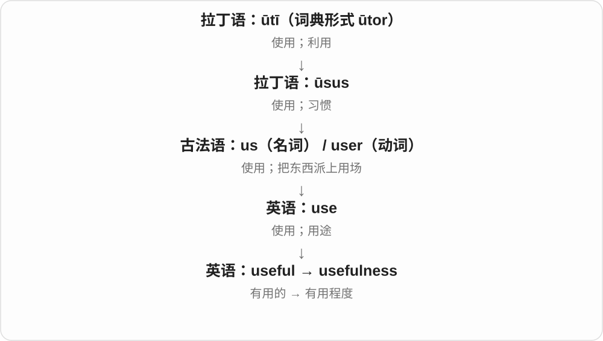

一份报告可能写得很漂亮，但如果不能帮人判断或行动，usefulness 就有限。这个词让我们直接讨论实际帮助。

**常见搭配与例句**

the usefulness of…；question its usefulness；limited usefulness；outlive its usefulness（已不再有用）。

> The usefulness of the guide depends on how often it is updated.

这份指南有没有用，取决于它更新得是否及时。

> The team questioned the usefulness of another long meeting.

团队怀疑再开一次长会能有多大帮助。

**别混淆**

usefulness 不等于使用次数。一个很少用到的急救工具，仍可能在需要时极有用处。

### 133. meek — 温顺、谦顺的；不反抗的

**音标**：/miːk/

**先抓住这个画面**

声音轻，不争强，受了要求也顺从，可以说 meek。有时是赞温和谦逊，有时是在批评过于顺从。

**怎么拆**

中古英语 meke 等通常接古诺斯语 mjukr 柔软的；柔软的身体画面走到不强硬、温顺的态度。

**怎么变成今天的意思**

**古诺斯语 mjukr 柔软等 → 中古英语 meke**  
柔和、温顺的性质

↓

**英语 meek → meekness**  
温和谦顺；这种态度、品质

a meek voice 温顺的声音；a meek reply 谦顺回答；meek and mild 温和顺从。

**常见搭配与例句**

a meek reply；meek and mild。

> She answered in a meek voice.

她用谦顺的声音回答。

> He was far less meek than his quiet manner suggested.

他并不像安静的外表看起来那样顺从。

**别混淆**

meek 是态度柔顺，weak 是力量、能力弱；一个人可以有能力却温和，也可以无力却很强硬。

### 134. meekness — 谦顺、温顺

**音标**：/ˈmiːknəs/

**先抓住这个画面**

meek 是人表现得柔和不争，meekness 则说这份谦顺本身。它的褒贬取决于文本是在赞谦逊，还是批评不反抗。

**怎么拆**

现代构词对应 meek + -ness → meekness。-ness 把前面的性质作为状态、程度等来谈。

**怎么变成今天的意思**

**古诺斯语 mjukr 柔软等 → 中古英语 meke**  
柔和、温顺的性质

↓

**英语 meek → meekness**  
温和谦顺；这种态度、品质

↓

**meek + -ness → meekness**  
谦顺、温顺的性质

文学、宗教语境可正面谈谦顺；普通叙事也可说态度过分顺从。

**常见搭配与例句**

with meekness 谦顺地；an appearance of meekness 温顺的外表。

> He accepted the criticism with unexpected meekness.

他一反常态，谦顺地接受了批评。

> The story contrasts her meekness with her inner strength.

故事对照了她外在的温顺与内心的力量。

**别混淆**

meekness 温顺与 weakness 弱小不等同；前者主要是态度，后者可说能力、力量。

### 135. preparedness — 准备就绪的状态；应变准备；愿意做的态度

**音标**：英 /prɪˈpeərɪdnəs/；美 /prɪˈperdnəs/

**先抓住这个画面**

preparedness 像把手电、计划、分工都放到位之后的那份底气：真有事情发生，知道该怎么应对。

**怎么拆**

prepared + -ness，是英语中从“备好的”形成表示状态的名词。

**怎么变成今天的意思**

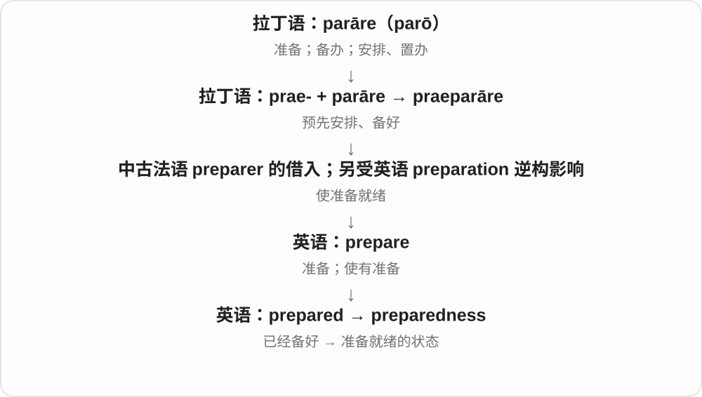

常说 emergency preparedness，涉及面对突发事件时是否备好人员、物资和安排。preparedness to do 还可以表示愿意采取某种行动。英式读法常在 d 前保留一个 /ɪ/。

**常见搭配与例句**

emergency preparedness；a state of preparedness；preparedness to cooperate。

> The exercise tested the team’s emergency preparedness.

这次演练检验了团队的应急准备情况。

> Her preparedness to listen made the discussion easier.

她愿意倾听的态度让讨论顺畅了许多。

**别混淆**

preparation 偏向准备过程和具体工作；preparedness 偏向准备达到的状态、应对能力或意愿。

### 136. smug — 自鸣得意、自满得让人不舒服的

**音标**：英、美 /smʌɡ/

**先抓住这个画面**

答对一个问题，就露出一副我早就知道、你们都不如我的神气，是 smug。它不是单纯高兴，而是得意里透着令人反感的自满。

**怎么拆**

较早表示整洁、光鲜，可能接低地德语 smuk 等相关词；后来从外表光滑、满意自己的模样，走向显出自满的态度。

**怎么变成今天的意思**

**可能的低地德语整洁、装点词 → 英语 smug**  
较早正面或中性的光鲜、整齐义

↓

**光鲜、满意自己的模样 → 自鸣得意**  
现代常带批评，而非一般夸人自信

a smug smile 让人看出自得；look smug 是显得自满；feel smug about something 是因为某事沾沾自喜。

**常见搭配与例句**

a smug smile；look smug；smug about。

> He wore a smug smile after winning the argument.

争论赢了之后，他脸上挂着自鸣得意的笑。

> She looked far too smug about her easy victory.

她对这场轻松的胜利显得过分沾沾自喜。

**别混淆**

confident 可以是踏实自信，smug 通常嫌一个人过分满意自己。得意本身也未必 smug，要看有没有那股自满神气。

### 137. smugness — 自满；自鸣得意的神气

**音标**：英、美 /ˈsmʌɡnəs/

**先抓住这个画面**

smug 说一个人自鸣得意，smugness 则把那股我比别人行的神气拿出来谈。别人可能受不了的，正是这种态度。

**怎么拆**

smug + 完整 -ness → smugness，词基保留。-ness 把形容词的性质变成状态、特点名词。

**怎么变成今天的意思**

**smug 的光鲜旧义 → 自满的现代评价**  
形容词描述人或其表情、态度

↓

**smug + -ness → smugness**  
把自满当作可评价的一种状态、特点

an air of smugness 是一股自鸣得意的神气；a hint of smugness 是一丝自满；without smugness 是没有沾沾自喜。

**常见搭配与例句**

an air of smugness；a hint of smugness；without smugness。

> There was a hint of smugness in his reply.

他的回答里透着一丝自鸣得意。

> She spoke about the award with pride but without smugness.

她谈起获奖时很自豪，却没有沾沾自喜。

**别混淆**

satisfaction 是满意，可以很自然；smugness 常是别人觉得过头、自以为是的那部分。

### 138. toughness — 韧性、坚韧；强硬、难对付程度

**音标**：/ˈtʌfnəs/

**先抓住这个画面**

不是说某件东西 tough，而是讨论它能扛住多少、表现得有多坚韧；也可描述态度强硬。

**怎么拆**

tough + -ness，形成性质名词。材料、心理坚持、政策态度按对象选中文，不全部译成硬度。

**怎么变成今天的意思**

**古英语 tōh → 中古英语 tough、towgh → tough**  
牢固、韧、不易分开

↓

**英语 tough**  
耐损、坚韧；难嚼、难做、艰难；强硬等

↓

**tough + -ness → toughness**  
坚韧或强硬这一性质

mental toughness 心理韧性，the toughness of the material 材料韧性，show toughness 显示强硬、坚毅。

**常见搭配与例句**

mental toughness；material toughness；show toughness。

> The test compared the toughness of the two materials.

测试比较了两种材料的韧性。

> The long race required patience and mental toughness.

长距离比赛需要耐心和心理韧性。

**别混淆**

toughness 韧性不等于 hardness 硬度；把硬玻璃敲碎，正好能提醒硬和不易断不是一回事。

### 139. selfless — 无私的；为别人着想的

**音标**：/ˈselfləs/

**先抓住这个画面**

做决定时把别人的需要放在前面，不只盘算自己能得什么，这种付出可以说 selfless。

**怎么拆**

self 自己 + -less 无、少；现代固定为不以自己利益为中心的性质，不是说一个人没有身份。

**怎么变成今天的意思**

**self + -less → selfless**  
不以自身私利为中心

↓

**现代 selfless**  
愿意为他人付出的、无私的

a selfless act 无私举动；selfless service 无私服务；selfless devotion 无私奉献。

**常见搭配与例句**

a selfless act；selfless service。

> It was a selfless act that helped the whole group.

那是帮助全组人的无私举动。

> She is admired for her selfless service.

她因无私服务而受到敬重。

**别混淆**

selfless 无私与 selfish 自私方向相反；selfless 评价动机、付出，quiet 安静并不能说明同样的品质。

### 140. selflessness — 无私；无私付出

**音标**：/ˈselfləsnəs/

**先抓住这个画面**

selfless 描述那个人或举动，selflessness 是把先顾他人、不求私利的品质拿出来说。

**怎么拆**

现代构词对应 selfless + -ness → selflessness。-ness 把前面的性质作为状态、程度等来谈。

**怎么变成今天的意思**

**英语 selfless**  
为他人着想、无私的

↓

**selfless + -ness → selflessness**  
无私；无私付出

可说一次行动体现的无私，也可说某人一贯的品质。

**常见搭配与例句**

show selflessness 表现无私；an example of selflessness 无私付出的例子。

> Her selflessness impressed the whole team.

她的无私让全队印象深刻。

> The rescue was an example of extraordinary selflessness.

这次救援体现了非凡的无私付出。

**别混淆**

selflessness 是无私的品质，selfishness 是以私利为中心；词干 selfless、selfish 决定方向。

### 141. inventive — 富有创造力的；善于想办法的

**音标**：/ɪnˈventɪv/

**先抓住这个画面**

材料不多，条件有限，他仍能想出新的做法，这种脑子活、点子新的特点就是 inventive。

**怎么拆**

经古法语 inventif 来自中世纪拉丁语 inventīvus，与“发现、想出”的 invenīre 词族相连；现代对应 invent + -ive。

**怎么变成今天的意思**

不必真有专利发明才称 inventive。厨师搭配食材、老师设计课堂、孩子编玩法，都能表现这种创造性。

**常见搭配与例句**

an inventive solution；an inventive mind；inventive use of materials。

> The team found an inventive solution using recycled materials.

团队用回收材料想出了一个有创意的解决办法。

> She is an inventive cook who rarely follows a recipe exactly.

她是个很有创意的厨师，很少完全照着菜谱做。

**别混淆**

inventive 强调新点子和巧办法；invented 只是已经被发明或编造。an invented story 不一定写得 inventive。

### 142. inventiveness — 善于发明；有巧思、创意

**音标**：/ɪnˈventɪvnəs/

**先抓住这个画面**

没有现成工具，却能把手边材料改成一个新办法，这种善于想招、动脑创造的能力是 inventiveness。

**怎么拆**

现代构词对应 inventive + -ness → inventiveness。-ness 把前面的性质作为状态、程度等来谈。

**怎么变成今天的意思**

**英语 inventive**  
能想出新方法、有创造力的

↓

**inventive + -ness → inventiveness**  
善于发明；有巧思、创意

常夸解决问题的巧思、作品的新颖安排，也可说技术发明能力。

**常见搭配与例句**

technical inventiveness 技术创造力；show inventiveness 展现巧思。

> The solution showed remarkable inventiveness.

这个解决办法展现了出色巧思。

> We admired the inventiveness of the stage design.

我们赞赏舞台设计的创造力。

**别混淆**

inventiveness 强调想出新东西、新办法，imitation 模仿则借已有样式；实际创作也可能两者并用。

### 143. attractiveness — 吸引力；吸引人的程度

**音标**：/əˈtræktɪvnəs/

**先抓住这个画面**

attractiveness 问“为什么人愿意选它、它有多吸引人”。它可以来自外貌，也可以来自地段、价格或方便程度。

**怎么拆**

attractive + -ness，表示“有吸引力”这种性质。

**怎么变成今天的意思**

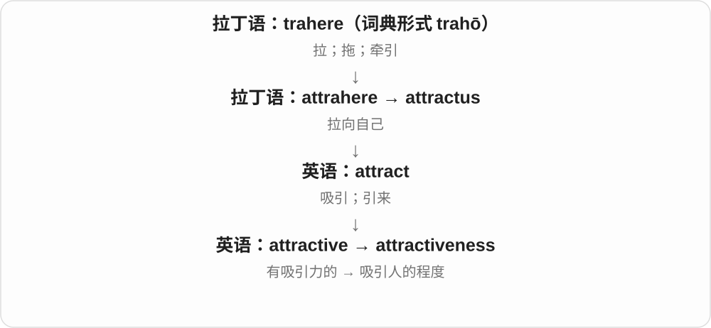

形容词夸这个对象有吸引力，名词让你进一步分析或比较这种吸引力。不是只用于外貌打分。

**常见搭配与例句**

the attractiveness of…；increase attractiveness；commercial attractiveness；physical attractiveness。

> Better transport increased the attractiveness of the area.

交通改善提高了这个地区的吸引力。

> The study examined the attractiveness of different job offers.

研究考察了不同工作机会的吸引力。

**别混淆**

attractiveness 评价吸引人的程度；attraction 还可以数具体的景点。三个景点是 three attractions，不是 three attractivenesses。

### 144. sluggish — 迟缓的；反应慢、缺少活力的

**音标**：/ˈslʌɡɪʃ/

**先抓住这个画面**

点了按钮半天才反应，早晨脑子转不快，市场迟迟没活跃起来，都能 sluggish。它是该动却慢、没精神的感觉。

**怎么拆**

接中古英语 slugge 懒散者等 + -ish 性质尾；不是必须从今天蛞蝓动物名反推动词先后，旧词族本就有慢、懒散材料。

**怎么变成今天的意思**

**中古英语 slugge 懒散的人等 + -ish → sluggish**  
早期描述人、头脑迟钝懒散

↓

**现代 sluggish → sluggishness**  
反应慢、缺少活力；相应迟缓状态

a sluggish response 迟缓反应；a sluggish economy 低迷经济；feel sluggish 感到没精神。

**常见搭配与例句**

a sluggish response；feel sluggish。

> The computer became sluggish after the update.

更新后，电脑反应变慢了。

> I felt sluggish all morning.

整个上午我都觉得没精神。

**别混淆**

sluggish 重缺少应有反应、活力，slow 只是速度慢；故意放慢做细工，不一定是 sluggish。

### 145. sluggishness — 迟缓、反应慢；不活跃

**音标**：/ˈslʌɡɪʃnəs/

**先抓住这个画面**

sluggish 是系统、人或经济表现得慢，sluggishness 是把这种迟迟动不起来的状态拿来讨论。

**怎么拆**

现代构词对应 sluggish + -ness → sluggishness。-ness 把前面的性质作为状态、程度等来谈。

**怎么变成今天的意思**

**中古英语 slugge 懒散的人等 + -ish → sluggish**  
早期描述人、头脑迟钝懒散

↓

**现代 sluggish → sluggishness**  
反应慢、缺少活力；相应迟缓状态

↓

**sluggish + -ness → sluggishness**  
迟缓、不活跃的状态

既可以说身体、头脑的迟钝感，也可以评价系统反应与市场活跃度。

**常见搭配与例句**

system sluggishness 系统迟缓；economic sluggishness 经济不活跃。

> Users complained about the system’s sluggishness.

用户抱怨系统反应迟缓。

> The report notes continued sluggishness in demand.

报告指出需求持续不活跃。

**别混淆**

sluggishness 不是稳定 steady；稳定说变化平稳，迟缓说反应、进展达不到所需速度。

### 146. selfishness — 自私、只顾自己的性质

**音标**：/ˈselfɪʃnəs/

**先抓住这个画面**

讨论的不是哪一个具体动作，而是其中那份只顾自己的倾向，就把 selfish 变成 selfishness。

**怎么拆**

selfish + -ness，性质、状态名词。-ness 不把人变成另一种人物称谓。

**怎么变成今天的意思**

**self 自己 + -ish → selfish**  
过多、只顾自己的利益，忽视他人

↓

**-ly 与 -ness**  
自私地行动；自私这种性质

an act of selfishness 自私行为，because of selfishness 因为自私，criticise someone’s selfishness 批评某人的自私。通常不可数。

**常见搭配与例句**

an act of selfishness；someone’s selfishness。

> His selfishness damaged the friendship.

他的自私伤害了友谊。

> She regretted the selfishness of her earlier demands.

她后悔先前的要求太自私。

**别混淆**

selfishness 是抽象性质，不能拿来直接指一个人；说 a selfish person，而不是把 selfishness 当人物名词。

### 147. uniqueness — 独特性；唯一性

**音标**：/juːˈniːknəs/

**先抓住这个画面**

uniqueness 是把“只有这一个”或“它有自己的样子”这点拿出来讨论。

**怎么拆**

unique + -ness，把性质变成名词。

**怎么变成今天的意思**

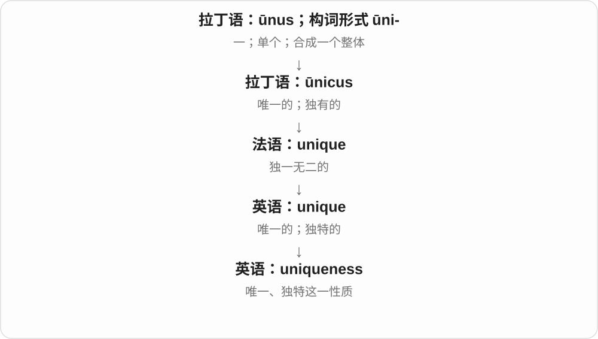

在设计中可以欣赏独特性；在数学或数据中，需要证明没有第二个满足条件的对象。

**常见搭配与例句**

the uniqueness of…；prove uniqueness；a uniqueness constraint。

> The renovation preserved the building’s uniqueness.

改造保留了这栋建筑的独特之处。

> The proof establishes the uniqueness of the solution.

这个证明确立了解的唯一性。

**别混淆**

originality 更强调创意和原创；uniqueness 强调独有、不重复，两者不总重合。

### 148. stiffness — 僵硬、硬挺；刚度；拘谨、生硬

**音标**：/ˈstɪfnəs/

**先抓住这个画面**

stiff 的硬直性质抽出来，是 stiffness。材料科学可量它抵抗形变的程度，社交场面则说态度有多不放松。

**怎么拆**

stiff + -ness，承中古英语相应名词；由实体性质扩展到动作、举止的生硬。

**怎么变成今天的意思**

**古英语 stif → 中古英语 stif、stiff → stiff**  
硬直、不易弯曲

↓

**stiff + -ness → stiffness**  
硬直性质、程度；举止拘谨

material stiffness 材料刚度，stiffness in movement 动作僵硬，social stiffness 社交拘谨。

**常见搭配与例句**

the stiffness of the material；stiffness in her manner。

> The engineers compared the stiffness of the panels.

工程师比较了这些板材的刚度。

> There was a stiffness in his manner at first.

他起初举止有些拘谨。

**别混淆**

工程 stiffness 刚度与 hardness 硬度不是同一个量；前者关注抵抗形变，后者常关注抵抗局部压入、划伤等。

### 149. breathless — 气喘吁吁的；屏息般激动的；急促兴奋的

**音标**：/ˈbreθləs/

**先抓住这个画面**

跑完楼梯气接不上，或激动得仿佛忘了呼吸；-less 给出缺气的感觉，但日常不每次都表示完全停止呼吸。

**怎么拆**

breath 气息 + -less 缺少，先抓缺气、喘不过气的性质，再看兴奋、叙述语气等比喻。

**怎么变成今天的意思**

**古英语 brǣþ → 中古英语 breth、breeth → breath**  
气味、呼出气等旧义 → 呼吸、气息

↓

**breath + -less → breathless**  
喘不过气；像屏息般急切、激动

leave someone breathless 让人喘不过气、惊叹，breathless excitement 屏息般兴奋，a breathless account 急促激动的叙述。

**常见搭配与例句**

leave someone breathless；breathless excitement；a breathless account。

> The climb left us breathless.

爬坡让我们气喘吁吁。

> She gave a breathless account of the match.

她急促兴奋地讲了比赛经过。

**别混淆**

breathless 可说人的状态或叙述语气，breathtaking 常评价景色等令人惊叹；两者都借气息，却不互换所有搭配。

### 150. breathlessness — 气喘、呼吸急促；喘不过气的感觉

**音标**：/ˈbreθləsnəs/

**先抓住这个画面**

跑上楼后话接不上，要停下来吸气，那份喘不过气的感觉是 breathlessness。也可在强烈激动、紧张的叙述里出现。

**怎么拆**

现代构词对应 breathless + -ness → breathlessness。-ness 把前面的性质作为状态、程度等来谈。

**怎么变成今天的意思**

**英语 breathless**  
气喘、来不及换气的

↓

**breathless + -ness → breathlessness**  
气喘、呼吸急促；喘不过气的感觉

breathless 描述人当时气喘，breathlessness 把这种呼吸感觉拿出来谈。

**常见搭配与例句**

a feeling of breathlessness 气喘感；sudden breathlessness 突然喘不过气。

> She paused to recover from her breathlessness.

她停下来缓一缓气喘。

> The report records episodes of breathlessness.

报告记录了几次喘不过气的情况。

**别混淆**

breathlessness 是气喘、呼吸困难感，breathing 是呼吸动作本身；后者不自动带不适。

### 151. sleepless — 无眠的；睡不着的

**音标**：/ˈsliːpləs/

**先抓住这个画面**

该睡的时间过去了，睡眠却没来；可以描述一夜，也可以描述那个人。

**怎么拆**

sleep + -less 没有，形成没有睡眠的状态形容词。常见 sleepless night。

**怎么变成今天的意思**

**古英语 slēpan、slǣp → 中古英语 slepen、slepe**  
睡觉；睡眠

↓

**现代 sleep**  
动作、睡眠状态 → 困意、睡眠者和相关物件

↓

**sleep + -less → sleepless**  
没有睡眠 → 无眠、睡不着

a sleepless night 不眠之夜，sleepless with worry 担心得睡不着；不从单个词就诊断具体睡眠疾病。

**常见搭配与例句**

a sleepless night；sleepless with worry；sleepless hours。

> She spent a sleepless night worrying about the interview.

她因担心面试而一夜未眠。

> The noise left us sleepless until dawn.

噪声让我们直到天亮都没睡着。

**别混淆**

sleepless 没睡，sleepy 有困意；一个人熬过 sleepless night，第二天很可能 sleepy。

### 152. sleeplessness — 睡不着、失眠；不眠状态

**音标**：/ˈsliːpləsnəs/

**先抓住这个画面**

身体想休息，夜里却一直没睡着，这段缺少睡眠的状态是 sleeplessness。

**怎么拆**

现代构词对应 sleepless + -ness → sleeplessness。-ness 把前面的性质作为状态、程度等来谈。

**怎么变成今天的意思**

**英语 sleepless**  
没有睡眠、睡不着的

↓

**sleepless + -ness → sleeplessness**  
睡不着、失眠；不眠状态

sleepless 描述那一夜、那个人，sleeplessness 把没睡的状态及影响拿出来谈。

**常见搭配与例句**

a period of sleeplessness 一段失眠时期；sleeplessness and tiredness 不眠与疲劳。

> Worry contributed to her sleeplessness.

担忧让她睡不着。

> Sleeplessness made the next day difficult.

一夜没睡让第二天很难熬。

**别混淆**

sleeplessness 是没睡、睡不着，sleepiness 是困意；很想睡也可能仍然睡不着。

### 153. hardness — 硬度；坚硬；严厉、冷硬

**音标**：英 /ˈhɑːdnəs/；美 /ˈhɑːrdnəs/

**先抓住这个画面**

同样压一下、划一下，物体抵抗变形的程度可以拿来比较。

**怎么拆**

hard + -ness，接古英语 heardnes、中古英语 hardnesse 等；是性质名词，不是困难的个数。

**怎么变成今天的意思**

**古英语 heard → 中古英语 hard**  
坚硬、强固；难以克服

↓

**古英语 heardnes → 中古英语 hardnesse → hardness**  
坚硬程度；冷硬、严厉等性质

the hardness of a material 是材料硬度，a hardness test 是硬度测试；声音、眼神也可带 a hardness。water hardness 是水硬度的专门名称，不能按水能切成固体解释。

**常见搭配与例句**

material hardness；a hardness test；the hardness of one’s voice。

> The test compares the hardness of different materials.

测试比较不同材料的硬度。

> There was an unfamiliar hardness in his voice.

他声音里有一种陌生的冷硬。

**别混淆**

hardness 是硬的性质，hardship 是艰难处境；失业带来的困顿不常直接称作 hardness。

### 154. laziness — 懒惰、懒散；不用心

**音标**：/ˈleɪzinəs/

**先抓住这个画面**

把不愿费力、做事敷衍这种状态拿出来谈，就说 laziness。它常带批评语气。

**怎么拆**

lazy + -ness，y 变 i。-ness 把性质变成名词，不是在说一个懒的人。

**怎么变成今天的意思**

**16世纪英语 lazy；更早来源未定**  
有低地德语松散、无力相关词等分析

↓

**lazy 的不同评价**  
不愿费力；悠闲、缓慢；草率不用心

↓

**lazy + -ness → laziness**  
懒惰、懒散等状态、性质

sheer laziness 纯粹是懒，intellectual laziness 思想上不肯用功，out of laziness 因为懒。

**常见搭配与例句**

sheer laziness；intellectual laziness。

> He blamed his untidy desk on laziness.

他把桌子凌乱归因于自己懒。

> The teacher challenged the class’s intellectual laziness.

老师批评全班不愿认真思考。

**别混淆**

laziness 是对不愿努力的描述、评价；lack of energy 只是缺少精力，原因可能不同。

### 155. closeness — 接近；亲密；紧密程度；闷热感〔依语境〕

**音标**：英 /ˈkləʊsnəs/；美 /ˈkloʊsnəs/

**先抓住这个画面**

人与人可以距离近，也可以心里近；这里抽出近、紧密这份性质。

**怎么拆**

close（近、紧密的）+ -ness；close 在这条路读 /s/，不沿关闭动词的 /z/。

**怎么变成今天的意思**

**close〔近、紧密〕**  
距离、关系或接合紧

↓

**close + -ness → closeness**  
接近、亲密、紧密程度等

emotional closeness 感情亲近，the closeness of the two houses 两屋距离近。形容室内空气也可能是闷热、不流通感，按 close 的相应义项。

**常见搭配与例句**

emotional closeness；the closeness of；a sense of closeness。

> The letters reveal the closeness of their friendship.

信件显出他们友谊的亲密。

> The closeness of the houses left little room for gardens.

房屋挨得太近，几乎没留下花园空间。

**别混淆**

closeness 是状态名词，closure 是关闭、结束或心理了结等另一名词；亲密关系不能机械写成 emotional closure。

### 156. fondness — 喜爱、钟爱；深情

**音标**：英 /ˈfɒndnəs/；美 /ˈfɑːndnəs/

**先抓住这个画面**

把 fond 那种心里亲近、喜欢的感觉当成一份感情来说，就是 fondness。a fondness for something 是对它有偏爱。

**怎么拆**

fond + -ness，性质、情感名词，中古英语已有相应形式。现代多承喜爱义。

**怎么变成今天的意思**

**中古英语 fonnen、fonned → fond**  
旧义愚傻；经过分疼爱走向喜爱、深情

↓

**fond + -ness → fondness**  
喜爱这一情感、偏好

a fondness for music 对音乐的喜爱，speak with fondness 带着深情谈起。

**常见搭配与例句**

a fondness for；with great fondness。

> He developed a fondness for gardening.

他渐渐喜欢上园艺。

> She spoke of the town with great fondness.

她满怀深情地谈起那座小镇。

**别混淆**

fondness 通常是温和亲近、偏爱，不必达到强烈迷恋。

### 157. soggy — 湿软的、浸湿发沉的

**音标**：英 /ˈsɒɡi/；美 /ˈsɑːɡi/

**先抓住这个画面**

面包泡了汤，原来的脆劲没了，变成软塌塌的一团。soggy 不只说表面有水，还常让人想到被水浸软、浸重。

**怎么拆**

可能由旧方言 sog 沼泽、湿透等材料加 -y 形成；更早来源不明，与 soak 等是否相连也不宜说死。现代常说湿透而软、沉的状态。

**怎么变成今天的意思**

**旧 sog 湿地、浸透等材料；来源不定**  
柔软潮湿、被浸透

↓

**可能加 -y → soggy**  
湿软、湿重的现代形容词

soggy bread 湿软的面包；soggy ground 泥泞湿软的地；soggy shoes 湿透的鞋；a soggy sandwich 被水汽或汁浸软的三明治。

**常见搭配与例句**

go soggy；wet and soggy。

> The cereal went soggy in the milk.

麦片泡在牛奶里变软了。

> Our shoes were soggy after the walk through the wet grass.

走过湿草地后，我们的鞋都湿透了。

**别混淆**

wet 范围宽，soggy 常突出湿得软塌、发沉、失去原有质感。脆饼变 soggy，丢掉的正是脆。

### 158. sogginess — 湿软、湿塌的状态

**音标**：英 /ˈsɒɡinəs/；美 /ˈsɑːɡinəs/

**先抓住这个画面**

炸物吸了水不脆、面包被汤汁泡软，那种湿塌塌的状态就是 sogginess。说的不只是有水，还常嫌原来的挺、脆没了。

**怎么拆**

soggy 变 y 为 i，再接完整 -ness → sogginess；基础 sog 一系来源未定，不把现代 soak 当它确定的直接父词。

**怎么变成今天的意思**

**旧 sog 湿地、浸透等材料 → soggy**  
湿软、湿重；更远联系未定

↓

**soggy 变 y 为 i + -ness → sogginess**  
湿软这一性质、状态

the sogginess of the pastry 是酥皮的湿软，avoid sogginess 是避免变得湿塌；通常作为不可数性质名词。

**常见搭配与例句**

unpleasant sogginess 让人不喜欢的湿软；sogginess at the bottom 底部湿塌。

> The sogginess of the pastry spoiled the pie.

酥皮湿塌塌的，影响了馅饼口感。

> Too much sauce can add to the sogginess of the bread.

酱汁太多，会让面包更湿软。

**别混淆**

sogginess 与 dampness 都可有湿，但前者还常突出软、失去脆挺；轻微潮气不一定使东西 soggy。

### 159. steadfast — 坚定的；忠贞不移的

**音标**：英 /ˈstedfɑːst/；美 /ˈstedfæst/

**先抓住这个画面**

外面风向变了，这个人在承诺、信念上仍站得稳，不轻易动摇。

**怎么拆**

古英语 stedefæst 延续，stead 位置、地方 + fast 牢固。现代 stead 常在 instead、in someone’s stead 等残留表达里出现；这里不是稳稳跑快。

**怎么变成今天的意思**

**stead 地方、位置；fast 牢固的**  
并列构词部分

↓

**steadfast**  
稳固在原位 → 信念、支持坚定不移

steadfast support 坚定支持，a steadfast friend 忠实朋友，remain steadfast 继续坚定。语气通常带肯定。

**常见搭配与例句**

steadfast support；remain steadfast；a steadfast commitment。

> She remained steadfast in her support for the project.

她始终坚定支持这个项目。

> He has been a steadfast friend through difficult times.

在艰难时期，他一直是位忠实可靠的朋友。

**别混淆**

steadfast 坚守立场常褒义，stubborn 固执常贬义；评价取决于语境，但不能都粗译成不肯变。

### 160. steadfastness — 坚定、不动摇；忠贞

**音标**：/ˈstedfæstnəs/

**先抓住这个画面**

压力来了，仍稳稳站在承诺的位置上，这份不轻易改心的坚持是 steadfastness。

**怎么拆**

现代构词对应 steadfast + -ness → steadfastness。-ness 把前面的性质作为状态、程度等来谈。

**怎么变成今天的意思**

**英语 steadfast**  
立场、承诺坚定的

↓

**steadfast + -ness → steadfastness**  
坚定、不动摇；忠贞

前面的 steadfast 含旧的站立位置与牢固材料，fast 在这里不是快；-ness 把坚定品质名词化。

**常见搭配与例句**

steadfastness in adversity 逆境中的坚定；steadfastness of purpose 目标坚定。

> Her steadfastness encouraged the rest of the team.

她的坚定鼓舞了其他队员。

> The letter praises his steadfastness in difficult times.

信中赞扬了他在困难时期的不动摇。

**别混淆**

steadfastness 常赞坚持信念，stubbornness 常批评拒不改变；具体评价看坚持的理由和情境。

### 161. completeness — 完整性；齐全程度

**音标**：英、美 /kəmˈpliːtnəs/

**先抓住这个画面**

检查一套材料时，问的不是每一项好不好，而是“该交的都交齐了吗”。

**怎么拆**

complete + -ness，表示完整这一性质或状态。

**怎么变成今天的意思**

数据的 completeness 看该有的信息是否齐全；accuracy 看内容是否准确。for completeness 常表示为了交代完整，再补上一点。

**常见搭配与例句**

check for completeness；data completeness；for completeness。

> The assistant checked the application for completeness.

助理检查了申请材料是否齐全。

> For completeness, the report includes the unsuccessful trials.

为完整呈现情况，报告也列入了失败的试验。

**别混淆**

completion 是完成的过程或时点；completeness 是已有东西是否完整。

### 162. incompleteness — 不完整；缺失的状态

**音标**：英、美 /ˌɪnkəmˈpliːtnəs/

**先抓住这个画面**

把“缺一块”本身拿出来谈：资料的空白会怎样影响判断。

**怎么拆**

incomplete + -ness。

**怎么变成今天的意思**

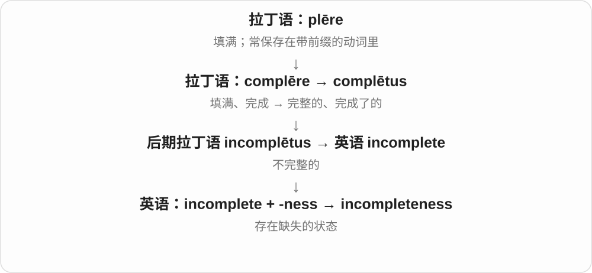

可以说记录、说明或知识的不完整；这是抽象性质，通常不可数。数学中的 incompleteness 有专门定义，不等于某位作者漏写几行。

**常见搭配与例句**

the incompleteness of the record；a sense of incompleteness。

> The incompleteness of the records makes comparison difficult.

记录不全，使比较变得困难。

> The final chapter leaves a deliberate sense of incompleteness.

最后一章刻意留下了一种未完的感觉。

**别混淆**

inaccuracy 是失准；incompleteness 是不全。缺页不一定意味着剩下的页写错了。

### 163. freshness — 新鲜；清新感；新意、活力

**音标**：/ˈfreʃnəs/

**先抓住这个画面**

食物尝起来不陈，空气闻着清爽，作品看着有新意，都是 fresh 这种特点。

**怎么拆**

fresh + -ness。性质名词随对象分味道、空气、表达风格等，不是一种统一可数物品。

**怎么变成今天的意思**

**古英语 fersċ → 中古英语 fressh → fresh**  
淡而不咸、清新；同族法语形式影响词形和用法

↓

**现代 fresh**  
新鲜、新近、未用过；清新、有精神；另源无礼义单列

↓

**fresh + -ness → freshness**  
新鲜、清新、有新意的性质

the freshness of the ingredients 食材新鲜度，a sense of freshness 清新感。

**常见搭配与例句**

the freshness of；retain freshness；a sense of freshness。

> The freshness of the ingredients makes a real difference.

食材的新鲜程度确实很影响效果。

> The performance had a freshness that delighted the audience.

表演带着让观众喜欢的清新感。

**别混淆**

freshness 强调新鲜、新意，novelty 可说新奇性、新鲜感；一个作品有 freshness 不一定每个细节都前所未有。

### 164. shrewd — 精明的、判断敏锐的；精于实际事务的

**音标**：/ʃruːd/

**先抓住这个画面**

别人还没看出门道，他已经看出哪里合算、哪里有问题。shrewd 常夸人能抓住实际利害，也可能带精于盘算的味道。

**怎么拆**

中古英语 shreued 接旧 shrewe 恶人等材料和形容词词尾，早期有邪恶、恶意义。后来转为狡黠、机敏，再弱化或转向实际判断敏锐。不是现代动词 shrew 的普通过去式。

**怎么变成今天的意思**

**中古英语 shrewe + 形容词材料 → shreued**  
早期恶意、狡黠等负面评价

↓

**现代 shrewd**  
精明、洞察敏锐；有时仍带善于算计感

a shrewd observer 敏锐的观察者；a shrewd choice 精明的选择；a shrewd businesswoman 精明的女商人；shrewd judgment 敏锐判断。

**常见搭配与例句**

a shrewd assessment；a shrewd move。

> She is a shrewd judge of character.

她看人很准。

> Moving the shop closer to the station was a shrewd decision.

把商店搬到车站附近是个精明的决定。

**别混淆**

clever 范围广，shrewd 多说看得准、懂实际利害。它常是赞许，但放进竞争、交易场景也可能让人感到算得很精。

### 165. shrewdness — 精明；敏锐的判断力；善于盘算

**音标**：英、美 /ˈʃruːdnəs/

**先抓住这个画面**

别人只看到表面，他却能看出谁在让步、哪里有机会、价格有没有水分，这种看得准、算得清的本事，就是 shrewdness。

**怎么拆**

承中古英语相应名词，现代可对应 shrewd + 完整 -ness。shrewd 早期有恶意、狡黠等负面评价，后来发展为判断敏锐、精明。

**怎么变成今天的意思**

**中古英语 shrewd 的早期形式及相应 -ness 名词**  
早期常带负面性格评价

↓

**词义逐渐转向机敏、精明 → 现代 shrewdness**  
可赞判断能力，也可暗示善于算计

business shrewdness 是商业判断的精明；political shrewdness 是政治眼光敏锐；show shrewdness 是显出精明判断。

**常见搭配与例句**

business shrewdness；political shrewdness；show shrewdness。

> Her shrewdness helped her spot a weakness in the proposal.

她判断敏锐，看出了提案里的一个弱点。

> He combined practical shrewdness with a good sense of humour.

他既精明务实，也很有幽默感。

**别混淆**

intelligence 是更广的理解、思考能力，shrewdness 常看具体局面中能否判断得准。它不自动等于 dishonesty 不诚实。

### 166. craziness — 疯狂、荒唐；混乱热闹的状况

**音标**：/ˈkreɪzinəs/

**先抓住这个画面**

把 crazy 那种离谱、失控或乱成一团的状态，作为一件事来谈。

**怎么拆**

crazy + -ness，y 改 i，-ness 把性质变成状态名词。旧义包括破损，今天日常常说荒唐或混乱。

**怎么变成今天的意思**

**中古英语 crasen**  
打碎、弄裂；更早可能日耳曼来源，借入路径有讨论

↓

**craze 与 crazy**  
破损、失常 → 失去常态；强烈热衷、流行热潮

↓

**crazy + -ness → craziness**  
疯狂、荒唐或混乱的状态

the craziness of the plan 方案的荒唐，the craziness of the holiday season 节日期间忙乱的状况。

**常见搭配与例句**

the craziness of life；escape the craziness；the craziness of the idea。

> We needed a quiet weekend away from all the craziness.

我们需要一个远离各种忙乱的安静周末。

> She laughed at the craziness of the idea.

她笑这个想法太离谱。

**别混淆**

craziness 多为口语评价，不能只凭它判断疾病；chaos 混乱更直接说秩序状态。

### 167. callous — 冷漠无情、麻木不仁的

**音标**：/ˈkæləs/

**先抓住这个画面**

别人正在受苦，他却像心上长了硬茧，感受不到痛，也不在意，是 callous 的比喻核心。

**怎么拆**

借拉丁 callosus 硬皮的，来自 callum 硬皮、老茧；身体变硬的材料发展为对别人痛苦缺乏感受。

**怎么变成今天的意思**

**拉丁 callum 硬皮、老茧 → callosus**  
皮肤变硬、变厚

↓

**英语 callous → callousness**  
像心长了硬茧 → 冷漠无情；相应性质

a callous remark 冷酷言语；a callous disregard for suffering 对痛苦的冷漠无视；callous behaviour 冷酷行为。

**常见搭配与例句**

a callous remark；callous disregard。

> His callous remark upset the family.

他冷酷的话让家人难过。

> The report criticised the callous treatment of the workers.

报告批评了对工人冷漠无情的待遇。

**别混淆**

callous 重无视他人感受，calm 是平静；在困难时保持平静，不等于对痛苦无动于衷。

### 168. callousness — 冷酷、麻木不仁

**音标**：/ˈkæləsnəs/

**先抓住这个画面**

callous 描述那句伤人的话、那个不在乎的人，callousness 则是这种心像硬茧一样没反应的冷漠。

**怎么拆**

现代构词对应 callous + -ness → callousness。-ness 把前面的性质作为状态、程度等来谈。

**怎么变成今天的意思**

**拉丁 callum 硬皮、老茧 → callosus**  
皮肤变硬、变厚

↓

**英语 callous → callousness**  
像心长了硬茧 → 冷漠无情；相应性质

↓

**callous + -ness → callousness**  
冷漠无情的性质

常评价对痛苦、不幸、弱势处境的麻木态度，比普通不友好更重。

**常见搭配与例句**

the callousness of a remark 言语的冷酷；show callousness 表现冷漠。

> The callousness of the response shocked everyone.

回应的冷酷让所有人震惊。

> She was angered by his callousness.

他的麻木不仁让她愤怒。

**别混淆**

callousness 不是 mere bluntness 说话直接；直说事实与不顾对方痛苦，是两个不同评价。

### 169. foolishness — 愚蠢、不明智；愚蠢行为、胡闹

**音标**：/ˈfuːlɪʃnəs/

**先抓住这个画面**

把某一次傻做法或那种判断糊涂的性质打包成名词：这种不明智、这种胡闹。

**怎么拆**

foolish + -ness，性质、状态名词；中古英语已有对应形式。不必理解成许多个 fool 的集合。

**怎么变成今天的意思**

**拉丁 follis → 古法语 fol → 英语 fool**  
风箱、皮囊等 → 蠢人、弄臣，具体语义桥梁有推测

↓

**英语动词与派生**  
愚人、受骗者 → 欺骗；foolish 不明智，foolhardy 莽撞

↓

**foolish + -ness → foolishness**  
不明智的性质，也可指具体愚蠢做法

the foolishness of doing 做某事的不明智，youthful foolishness 年少胡闹，an act of foolishness 一次愚蠢行为。

**常见搭配与例句**

the foolishness of；youthful foolishness；an act of foolishness。

> She recognized the foolishness of trying to do everything alone.

她意识到试图独自包办一切很不明智。

> He laughed at his own youthful foolishness.

他笑起了自己年少时的胡闹。

**别混淆**

foolishness 常不可数；若要明确数一次行为，可说 an act of foolishness。不是 folly、stupidity 在任何语境都能无差别替换。

### 170. nervousness — 紧张；不安情绪

**音标**：英 /ˈnɜːvəsnəs/；美 /ˈnɜːrvəsnəs/

**先抓住这个画面**

还没真正面对事情，心里已经有些绷住了。

**怎么拆**

nervous 加 -ness，把紧张不安的性质或状态变成名词。

**怎么变成今天的意思**

**拉丁 nervus**  
筋腱、弦；引申为力量；中世纪也指神经

↓

**拉丁 nervōsus → 中古英语 nervous**  
有筋腱的、有力的；与神经相关的

↓

**英语 nervous**  
神经的；后来也指紧张不安的

↓

**英语 nervous + -ness → nervousness**  
紧张、不安的状态

常与初次演讲、考试或公开表现有关。a sign of nervousness 可以是声音发抖等表现，词本身不表示某种医学诊断。

**常见搭配与例句**

initial nervousness；overcome nervousness；a sign of nervousness。

> Her initial nervousness disappeared after the first question.

第一个问题过后，她最初的紧张消失了。

> He hid his nervousness behind a cheerful smile.

他用愉快的笑容掩饰自己的紧张。

**别混淆**

nerve 有胆量义；nervousness 通常是紧张，不能按词根机械理解成“胆量很多”。

### 171. responsiveness — 回应能力；反应灵敏程度；及时响应

**音标**：英 /rɪˈspɒnsɪvnəs/；美 /rɪˈspɑːnsɪvnəs/

**先抓住这个画面**

发出请求后，有没有反应、反应是否及时合适，把这些表现作为一种能力来看。

**怎么拆**

responsive + -ness，英语抽象名词。

**怎么变成今天的意思**

**拉丁语 spondere，分词 sponsus**  
郑重承诺、作担保

↓

**拉丁语 re- + spondere → respondere；分词 responsus**  
回作承诺 → 回答、回应

↓

**后期拉丁 responsivus → 法语 responsif → 英语 responsive**  
作出回应的；反应积极的

↓

**英语 responsive + -ness → responsiveness**  
会回应的 → 回应能力或程度

customer service responsiveness 可以看回复速度和处理需求的表现；系统 responsiveness 则可能看输入之后多久产生可见反馈。

**常见搭配与例句**

improve responsiveness；responsiveness to feedback。

> Users praised the responsiveness of the new interface.

用户称赞新界面反应灵敏。

> The survey measured the department’s responsiveness to complaints.

调查衡量了该部门回应投诉的表现。

**别混淆**

responsibility 是责任；responsiveness 是响应表现，字长接近却不能混。

### 172. fullness — 充满、充实；丰满；完整程度

**音标**：/ˈfʊlnəs/

**先抓住这个画面**

把装得满、内容丰富、声音饱满这些感觉，单独拿出来当一种性质谈。

**怎么拆**

full + -ness，接古英语 fulnes 等及中古英语 fulnesse；-ness 形成性质名词。

**怎么变成今天的意思**

**古英语 full → 中古英语 ful**  
装满、完整

↓

**古英语 fulnes → 中古英语 fulnesse → fullness**  
满、完整、丰富的状态

fullness of flavour 是风味饱满，fullness of life 是生命体验的丰富，the fullness of a voice 是声音丰满。意义随所形容对象变化。

**常见搭配与例句**

fullness of flavour；a sense of fullness；the fullness of life。

> The extra instruments gave the music a new fullness.

增添的乐器让音乐更饱满。

> The essay celebrates the fullness of ordinary life.

文章赞美平凡生活的丰富充实。

**别混淆**

fullness 是性质状态，a handful 是具体一把量；两者不都指容器容量。

### 173. sharpness — 锋利度、锐度；敏锐、尖刻

**音标**：英 /ˈʃɑːpnəs/；美 /ˈʃɑːrpnəs/

**先抓住这个画面**

刀有多利、照片边缘有多清楚，或一个人的回应多么尖锐，都能把这种性质名词化为 sharpness。

**怎么拆**

古英语 scearpnes 经中古英语传下，现代对应 sharp + -ness。不同对象决定具体可测、可感的性质。

**怎么变成今天的意思**

**古英语 scearp → 中古英语 scharp → sharp**  
尖、利；更远联系切割词族

↓

**scearpnes → sharpnesse → sharpness；对应 sharp + -ness**  
尖利、清晰、敏锐等性质

image sharpness 图像锐度，the sharpness of a blade 刀刃锋利度，the sharpness of a reply 回应的尖锐。

**常见搭配与例句**

image sharpness；the sharpness of a blade；the sharpness of a reply。

> The new lens improved the image sharpness.

新镜头提高了图像清晰锐度。

> The sharpness of his reply surprised her.

他回应的尖锐让她吃惊。

**别混淆**

sharpness 锐度不等于 resolution 分辨率，二者有关却不是同一个参数；语言的 sharpness 也不是空间像素。

### 174. awkwardness — 笨拙；尴尬、不自在；难处理的性质

**音标**：英 /ˈɔːkwədnəs/；美 /ˈɔːkwərdnəs/

**先抓住这个画面**

把场面里的不自然、动作里的不协调当作一种状态来谈，就是 awkwardness。它不是天生给某类人贴的固定标签。

**怎么拆**

awkward + -ness，性质、状态名词。保留 awkward 多条常用意义，不只剩社交场面这一条。

**怎么变成今天的意思**

**旧 awk：方向不对、倒着、不顺 → awkward**  
-ward 方向词尾；早期向不合适的方向

↓

**现代 awkward**  
笨拙、不便处理；社交尴尬、不自在

↓

**awkward + -ness → awkwardness**  
不协调、尴尬或难处理的状态

a sense of awkwardness 尴尬感，ease the awkwardness 缓解尴尬，the awkwardness of the shape 形状不便处理的性质。

**常见搭配与例句**

a sense of awkwardness；ease the awkwardness。

> A friendly question eased the awkwardness.

一个友好的问题缓解了尴尬。

> The awkwardness of the shape made the package difficult to carry.

包裹形状别扭，搬起来很不方便。

**别混淆**

awkwardness 是性质、感受，不是 awkward 的人物名词；clumsiness 更常突出动作笨拙，未必是社交气氛。

### 175. faithfulness — 忠诚；忠实性

**音标**：英、美 /ˈfeɪθfəlnəs/

**先抓住这个画面**

能不能长久守住关系，以及能不能保留原作的样子，这种品质就是 faithfulness。

**怎么拆**

faithful + -ness；中古英语已有 feithfulnesse，是把忠实的性质变成名词。

**怎么变成今天的意思**

**拉丁语 fides，宾格 fidem**  
信任、信义、信仰

↓

**古法语 feid / fei → 中古英语 faith → faith**  
经过法语的日常词形 → 信任；信仰

↓

**中古英语 feithful + -ness → feithfulnesse → faithfulness**  
忠实的 → 忠诚、忠实性

faithfulness to a partner 说对伴侣忠诚；faithfulness to the original 说改编、翻译等对原作的忠实程度。

**常见搭配与例句**

faithfulness to；marital faithfulness；faithfulness to the original。

> The translation was praised for its faithfulness to the original.

这份译文因忠于原文而受到赞赏。

> Her faithfulness to the team never wavered.

她对团队的忠诚从未动摇。

**别混淆**

faith 指信任或信仰；faithfulness 指守住这种承诺或忠于对象的品质。

### 176. soreness — 疼痛；酸痛；恼怒、不快

**音标**：英 /ˈsɔːnəs/；美 /ˈsɔːrnəs/

**先抓住这个画面**

把某处疼、酸，或心里不痛快的状态单独拿出来说。

**怎么拆**

sore + -ness，古英语 sārnes 已有身体、精神痛苦等对应形式。通常是状态名词，不用它替代具体伤口形状。

**怎么变成今天的意思**

**古英语 sār、sāriġ 等 → 中古英语 sor、sory**  
疼痛、痛苦；忧伤、难过

↓

**sore、sorry 词族**  
疼的、不快的；抱歉、遗憾；sorely 表强烈程度

↓

**sore + -ness → soreness**  
疼、不快 → 疼痛、不快状态

muscle soreness 肌肉酸痛，soreness in the shoulder 肩部疼痛；也可文学、口语说残留的不快。

**常见搭配与例句**

muscle soreness；soreness in；a feeling of soreness。

> She felt some soreness in her shoulders after carrying the boxes.

搬完箱子后，她觉得肩膀有些酸痛。

> The diary records both tiredness and soreness after the journey.

日记记录了旅行后的疲倦和酸痛。

**别混淆**

soreness 是感受、状态，a sore 可以是一处具体疮；sorrow 悲伤另有词源，不因外形像就都拆成 sore。

### 177. aloof — 冷淡疏远的；不参与的

**音标**：/əˈluːf/

**先抓住这个画面**

大家在热络聊天，他像站在圈外，保持距离，不愿加入，这种态度是 aloof。它常是情感、人际上的远。

**怎么拆**

从含 loof 上风方向的航海用语发展，早期有保持离开某处、保持距离的材料；后来用来形容人疏远、置身事外。

**怎么变成今天的意思**

**含 loof 上风方向等材料的航海用语**  
让船保持距离；远源通常联系荷兰语 loef

↓

**英语 aloof → aloofness**  
空间上远离 → 人际态度疏远、冷淡

remain aloof 保持疏远；aloof from the group 与群体保持距离；an aloof manner 冷淡态度。

**常见搭配与例句**

remain aloof；aloof from。

> She seemed aloof at the first meeting.

第一次见面时，她显得有些疏远。

> He remained aloof from the argument.

他置身争论之外。

**别混淆**

aloof 常是态度上不亲近，alone 是一个人；独处的人未必冷淡，人多时也可显得 aloof。

### 178. aloofness — 疏远、冷淡；置身事外的态度

**音标**：/əˈluːfnəs/

**先抓住这个画面**

aloof 描述那个人像站在圈外，aloofness 则是别人感到的那层距离：不容易接近，也不容易读懂态度。

**怎么拆**

现代构词对应 aloof + -ness → aloofness。-ness 把前面的性质作为状态、程度等来谈。

**怎么变成今天的意思**

**含 loof 上风方向等材料的航海用语**  
让船保持距离；远源通常联系荷兰语 loef

↓

**英语 aloof → aloofness**  
空间上远离 → 人际态度疏远、冷淡

↓

**aloof + -ness → aloofness**  
人际疏远、冷淡的性质

常说人际间的冷淡、保留；可带批评，也可只是描述尚未熟悉。

**常见搭配与例句**

an air of aloofness 疏离气质；apparent aloofness 表面冷淡。

> Her apparent aloofness disappeared as we got to know her.

熟悉起来后，她表面上的疏远消失了。

> He greeted them with polite aloofness.

他礼貌却疏离地和他们打招呼。

**别混淆**

aloofness 重人与人之间的距离，shyness 重害羞；表面都少说话，原因不一定相同。

### 179. softness — 柔软；柔和；软弱、宽松

**音标**：英 /ˈsɒftnəs/；美 /ˈsɔːftnəs/

**先抓住这个画面**

把材料软、声音柔或态度不强硬这项性质单独拿出来说。

**怎么拆**

soft + -ness，性质名词。是舒适柔和还是过分宽松，要看搭配与评价。

**怎么变成今天的意思**

**古英语 softe、sefte → 中古英语 softe → soft**  
柔软、温和

↓

**现代 soft**  
材料容易变形 → 声音、态度柔和；硬件的相对软件命名

↓

**soft + -ness → softness**  
柔软、温和等性质

the softness of the fabric 面料柔软度，softness in her voice 声音里的温柔；softness on crime 可批评执法态度宽松。

**常见搭配与例句**

the softness of；a feeling of softness；softness in the voice。

> The fabric is valued for its softness.

这种面料因柔软而受喜爱。

> There was a new softness in his voice.

他的声音多了一分柔和。

**别混淆**

softness 不是每次都负面软弱；柔软布料可优点，具体政策态度则另作评价。

### 180. stillness — 静止；寂静；宁静

**音标**：/ˈstɪlnəs/

**先抓住这个画面**

身体不动、周围也安静下来，像水面没有一丝涟漪。

**怎么拆**

still（静止、安静）+ -ness，接古英语 stilnes 等性质名词形式；不是蒸馏器名词的派生。

**怎么变成今天的意思**

**古英语 stille → stilnes 等形式**  
安静 → 安静、静止的状态

↓

**英语 stillness**  
静止、寂静、宁静

the stillness of the room 是房间寂静，sit in stillness 是静静坐着。语境可以温柔、庄重，也可能令人不安。

**常见搭配与例句**

in stillness；the stillness of；break the stillness。

> A bird’s call broke the stillness.

一声鸟鸣打破了寂静。

> She sat in stillness beside the lake.

她在湖边静静坐着。

**别混淆**

stillness 兼可强调少动作，silence 更聚焦没有声音；人不动时可以有音乐，静止不等于绝对无声。

### 181. ugliness — 难看、丑陋；丑恶行为、恶劣气氛

**音标**：/ˈʌɡlinəs/

**先抓住这个画面**

把不好看或让人反感的性质整体说出来；争吵里的 ugliness 可以是恶毒、敌意，不是人的脸。

**怎么拆**

ugly 的 y 变 i + -ness，性质名词。-ness 将外观和行为两种评价都保留下来。

**怎么变成今天的意思**

**古诺尔斯语 uggr → uggligr → 英语 ugly**  
恐惧 → 可怕的、令人难受的

↓

**英语常用范围**  
难看的；行为、争执、局势丑恶危险的

↓

**ugly → ugliness**  
难看、恶劣的 → 这种性质或表现

the ugliness of a building 建筑的难看，the ugliness of the dispute 争端中的丑恶，hide the ugliness 掩盖丑陋面。

**常见搭配与例句**

the ugliness of；the ugliness of the dispute；hide the ugliness。

> The renovation softened the ugliness of the old concrete block.

翻修改善了旧混凝土楼块难看的外观。

> The letter exposed the ugliness behind the polite public statements.

那封信揭示了公开客气话背后的丑恶。

**别混淆**

ugliness 不只审美评价；在争执、偏见等语境，常强调行为丑恶。用 beauty/ugliness 对照也要看作者的价值标准。

### 182. lightness — 轻盈；轻微；轻松感；明度、浅色程度

**音标**：/ˈlaɪtnəs/

**先抓住这个画面**

一只包拿着轻，一段动作看着轻盈；颜色也能讨论明暗浅深，但这是另一条来源。

**怎么拆**

light + -ness，光义与轻义各有旧名词形式；同形名词的不同义项不能强串一条从灯光到重量的祖先链。

**怎么变成今天的意思**

**light〔轻〕+ -ness；light〔亮、浅〕+ -ness**  
两条同形 light 各自对应的性质名词

↓

**lightness**  
重量、动作、语气的轻；色彩明度等

the lightness of the bag 包的轻，lightness of touch 手法轻巧，color lightness 色彩明度。按谈的是重量、风格还是颜色来选义。

**常见搭配与例句**

lightness of touch；the lightness of；color lightness。

> I was surprised by the lightness of the frame.

框架这么轻，让我意外。

> The actor brought lightness to a serious scene.

演员让严肃场景多了一点轻松感。

**别混淆**

lightness 轻盈常可欣赏，lightheadedness 头晕是另一复合词；不能只凭中文轻就混作一种感觉。

### 183. nothingness — 空无；虚无；消失得什么也不剩的状态

**音标**：/ˈnʌθɪŋnəs/

**先抓住这个画面**

不只是缺少某一件东西，而是把空空的、无所存在的状态当成一个概念来谈。

**怎么拆**

英语 nothing + -ness，把不定代词的无、没有变成状态名词。它能进入哲学，也能用于文学描写。

**怎么变成今天的意思**

**英语 nothing 没有；状态后缀 -ness**  
两组材料组成空无的性质或状态

↓

**英语 nothingness**  
抽象的无，也用于消失、空寂的描写

fade into nothingness 是渐渐消失得不留痕迹。讨论哲学中的 nothingness 时，具体含义要看作者；日常的空盒子通常直接说 empty，而不用这个抽象大词。

**常见搭配与例句**

a sense of nothingness；fade into nothingness；the idea of nothingness。

> The final note faded into nothingness.

最后一个音渐渐消失得无影无踪。

> The essay contrasts existence with nothingness.

这篇文章把存在与虚无作对比。

**别混淆**

emptiness 可以是某个容器或生活里的空；nothingness 更彻底、更抽象，常把有与无本身作为话题。

### 184. tightness — 紧度、紧绷感；紧张、余地少的状态

**音标**：/ˈtaɪtnəs/

**先抓住这个画面**

不说具体去拉、去拧，而是把有多紧、处于紧状态这件事当名词。绳子、衣服、预算都可能有自己的紧。

**怎么拆**

tight + -ness 状态名词。抽象场景沿 tight 的时间、资金余地小等用法延伸。

**怎么变成今天的意思**

**北欧语、古英语表示密实的相关词 → 中古英语 thight、tight 等**  
密、实、贴合

↓

**tight 的现代扩展**  
绷紧、衣物紧；时间资金紧；比赛接近

↓

**tight + -ness → tightness**  
紧的性质、程度或感受

check the tightness 检查松紧，the tightness of the knot 结的紧度，budget tightness 预算紧张。

**常见搭配与例句**

check the tightness；the tightness of the knot；budget tightness。

> Check the tightness of the knot before lifting the box.

提箱子前，检查绳结是否够紧。

> The tightness of the budget left little room for changes.

预算紧张，几乎没有调整余地。

**别混淆**

tightness 状态名词，tighten 动作；tightness 不自动说明为什么紧，原因需要看后文。

### 185. redness — 发红；红色状态

**音标**：/ˈrednəs/

**先抓住这个画面**

不只给东西贴红的标签，而是谈它发红这个状态。

**怎么拆**

red + -ness，把颜色性质名词化。这里不双写 d，因为 red 直接接辅音开头的后缀。

**怎么变成今天的意思**

**古英语 rēad → 中古英语 red**  
红的

↓

**英语 red**  
红色；后有警示、财务、政治等约定象征用法

↓

**red + -ness → redness**  
红的 → 发红、红色状态

the redness of the sky 天空的红色；facial redness 面部发红。描述皮肤颜色状态不自动说明原因。

**常见搭配与例句**

a patch of redness；the redness of the sky；notice some redness。

> The redness of the evening sky faded into grey.

傍晚天空的红色渐渐褪成灰色。

> She noticed some redness where the mask had rubbed her skin.

她注意到口罩摩擦皮肤的地方有些发红。

**别混淆**

redness 是状态名词，reddish 是微红的形容词；不能只凭 redness 这个词认定一定是日晒或某一种疾病。

### 186. hopelessness — 绝望；无望感、无望状态

**音标**：英 /ˈhəʊpləsnəs/；美 /ˈhoʊpləsnəs/

**先抓住这个画面**

把“怎么做也看不到出路”的感觉抽出来，当作一种状态谈。

**怎么拆**

hopeless + -ness，先由 hope + -less 得无望的，再加 -ness 形成状态名词。

**怎么变成今天的意思**

**古英语 hopian → 中古英语 hopen**  
希望、期待

↓

**英语 hope〔相应名词也有古英语前身〕**  
希望；抱有实现可能的愿望

↓

**hopeless + -ness → hopelessness**  
无望的状态、绝望感

a sense of hopelessness 无望感，overcome hopelessness 摆脱绝望。可描写人的感受，也可评价局面；不要混成 helplessness 无助。

**常见搭配与例句**

a sense of hopelessness；feelings of hopelessness；overcome hopelessness。

> The novel captures the character’s sense of hopelessness.

小说写出了角色的无望感。

> Small successes slowly replaced their hopelessness with confidence.

一次次小成功慢慢用信心替代了他们的绝望。

**别混淆**

hopelessness 看不到希望，helplessness 缺乏办法或力量；两种感受可能一起出现，但意义不同。

### 187. dryness — 干燥；干的程度；枯燥、冷淡等特征〔按对象〕

**音标**：/ˈdraɪnəs/

**先抓住这个画面**

把干这个特点拿出来说：皮肤有多干、空气有多干；谈文章时也可能说它有多枯燥。

**怎么拆**

dry + -ness，形成性质名词，中古英语已有相应形式。词尾 y 保留。

**怎么变成今天的意思**

**古英语 drȳġe〔形容词〕、drȳġan〔动词〕→ 中古英语 drye、drien**  
干的；使干、变干

↓

**英语 dry**  
干燥；使干；扩展到不甜、枯燥、冷面幽默等

↓

**dry + -ness → dryness**  
干燥的状态、程度；引申相应的干淡特点

skin dryness 皮肤干燥，the dryness of the air 空气的干燥程度，dryness of tone 冷淡、平直的语调。

**常见搭配与例句**

skin dryness；the dryness of；a feeling of dryness。

> The dryness of the air made the paper curl.

空气干燥，使纸张卷了起来。

> He commented on the dryness of the textbook’s style.

他评论说，这本教科书的文风很枯燥。

**别混淆**

dryness 状态，drying 使干、变干的过程；dryness 本身不是某一疾病的确诊名称。

### 188. friendliness — 友善、亲切、友好程度

**音标**：/ˈfrendlinəs/

**先抓住这个画面**

把待人让人放松、被欢迎的那种性质当名词；不是在数有多少个朋友。

**怎么拆**

friendly 的 y 变 i + -ness，形成性质名词；中古英语已有相应形式。

**怎么变成今天的意思**

**friend + -ly → friendly**  
像朋友那样相待；-ly 在这里形成形容词

↓

**friendly → friendliness〔y 变 i 接 -ness〕**  
友善、亲切这种性质

warmth and friendliness 热情与友善，the friendliness of the staff 员工的亲切，user friendliness 易用性〔组合概念〕。

**常见搭配与例句**

warmth and friendliness；the friendliness of；show friendliness。

> We appreciated the staff’s friendliness.

我们很欣赏员工的亲切。

> Her friendliness helped the new students relax.

她的友善让新同学放松下来。

**别混淆**

friendliness 态度性质，friendship 友谊关系；一个陌生人也可以很友善，不必已经建立友谊。

### 189. politeness — 礼貌、客气；礼貌举动

**音标**：/pəˈlaɪtnəs/

**先抓住这个画面**

polite 是人或话语得体，politeness 是这种待人方式本身。out of politeness 就是出于礼貌。

**怎么拆**

polite + -ness，形成性质名词，通常不可数；具体礼节、客套行为有时也可用可数相关表达。

**怎么变成今天的意思**

**拉丁 polire 打磨 → politus**  
磨光、精细、文雅

↓

**英语 polite**  
由文雅、修养扩展为待人有礼、考虑他人

↓

**polite + -ness → politeness**  
礼貌、客气的性质

out of politeness 出于礼貌，common politeness 基本礼貌，a matter of politeness 礼貌问题。

**常见搭配与例句**

out of politeness；common politeness。

> I stayed for a few minutes out of politeness.

我出于礼貌又待了几分钟。

> A little politeness made the conversation easier.

稍微客气一点，谈话就顺畅多了。

**别混淆**

politeness 不等于承诺；别人出于礼貌倾听，不能只据此判断对方已经答应。

### 190. weirdness — 古怪、怪异之处

**音标**：英 /ˈwɪədnəs/；美 /ˈwɪrdnəs/

**先抓住这个画面**

把让人觉得怪的特点单独拎出来：一个地方整体的怪气氛，或发生的反常情况。

**怎么拆**

weird + -ness，形成性质名词，不是多出一个人的职业后缀。

**怎么变成今天的意思**

**古英语 wyrd → 中古英语、苏格兰语 weird 等**  
命运、定数；与发生、成为的旧词族有关

↓

**命运女神、Weird Sisters 等文学传统 → 英语 weird**  
超自然、神秘；后来常指古怪、不寻常

↓

**weird + -ness → weirdness**  
古怪这一特点、怪异之处

the weirdness of the situation 情况的怪异，embrace the weirdness 接纳古怪之处，a sense of weirdness 怪异感。

**常见搭配与例句**

the weirdness of；a sense of weirdness；embrace the weirdness。

> We laughed at the weirdness of the situation.

我们觉得这情况实在古怪，笑了起来。

> The film’s weirdness is part of its appeal.

这部电影的古怪正是它的吸引力之一。

**别混淆**

weirdness 特点，weirdo 人物称呼；奇怪的情境不是 a weirdo。

### 191. helplessness — 无助、无能为力；无助感

**音标**：/ˈhelpləsnəs/

**先抓住这个画面**

helpless 是“我眼下没办法”，helplessness 把那种处境或感受拿出来说。可以是真做不了，也可以是主观觉得做不了。

**怎么拆**

helpless + -ness → helplessness，两个词尾分工：-less 先形成缺少帮助、能力的形容词，-ness 再把性质变名词。

**怎么变成今天的意思**

**help 帮助 + -less 缺少 → helpless**  
缺少帮助或无法行动、应对

↓

**helpless + -ly、-ness**  
无能为力地；无助状态和感受

a sense of helplessness 无助感；feelings of helplessness 无能为力的感受；the helplessness of a situation 某种处境的无奈。

**常见搭配与例句**

a sense of helplessness；feelings of helplessness。

> The long wait left her with a sense of helplessness.

漫长等待让她产生了无助感。

> The novel captures the helplessness of people who cannot influence the decision.

小说写出了那些无力影响决定的人们的无奈。

**别混淆**

helplessness 不等于一个人毫无价值；它描述状态、感受。hopelessness 重点是看不到希望，不能只凭中文都难受就混用。

### 192. lawlessness — 无法无天；秩序失控、缺乏法治的状态

**音标**：/ˈlɔːləsnəs/

**先抓住这个画面**

不只某人一次犯规，而是规则普遍约束不了人的局面。

**怎么拆**

lawless + -ness，先由 law + -less 得形容词，再加 -ness 说状态。

**怎么变成今天的意思**

**古诺尔斯语 lǫg → 古英语 lagu**  
原意为放下、确立的事物 → 法、规章

↓

**中古英语 lawe → 英语 law**  
法律、规则、定律

↓

**law → lawless → lawlessness**  
法律 → 无法无天的 → 无法无天的状态

a period of lawlessness 是秩序失控的一段时期，restore order after lawlessness 是在混乱后恢复秩序。政治报道中的评价仍要看证据、说话人。

**常见搭配与例句**

a period of lawlessness；widespread lawlessness；violence and lawlessness。

> The novel describes a period of violence and lawlessness.

小说描写了一段暴力横行、秩序失控的时期。

> The documentary examines the causes of lawlessness in the region.

纪录片考察该地区秩序失控的原因。

**别混淆**

lawlessness 状态名词，lawless 形容词；lawlessness 不等于只是尚未给新事物立专项法律。

### 193. rudeness — 粗鲁；无礼；失礼的举动

**音标**：/ˈruːdnəs/

**先抓住这个画面**

把不尊重别人、缺少礼貌的表现当作一种行为或性质来讲。

**怎么拆**

中古英语 rudenesse，现代对应 rude + -ness；不是新的拉丁整词借入。

**怎么变成今天的意思**

**拉丁 rudis**  
粗糙、未经加工或训练的

↓

**古法语 rude → 中古英语 rude / rudenesse → 英语 rudeness**  
无礼的 → 无礼这种行为或性质

apologize for rudeness 是为失礼道歉；mistake shyness for rudeness 是把害羞误认作不礼貌。通常不可数。

**常见搭配与例句**

apologize for one’s rudeness；sheer rudeness；an act of rudeness。

> She apologized for her rudeness at the meeting.

她为自己在会上失礼的表现道歉。

> His brief reply was due to shyness, not rudeness.

他回答简短是因为害羞，并非无礼。

**别混淆**

silence 只是沉默；rudeness 是对行为的评价，不能不问情境就把沉默看成无礼。

### 194. boldness — 大胆、勇气；冒失；醒目、粗重程度

**音标**：英 /ˈbəʊldnəs/；美 /ˈboʊldnəs/

**先抓住这个画面**

把敢做、显眼这类性质当成一个对象来评价，就是 boldness。设计师可谈颜色的 boldness，评论者也可谈决定的胆量。

**怎么拆**

bold + -ness，中古英语已有 boldnesse。继承人的胆量和视觉显著程度等多种意义。

**怎么变成今天的意思**

**古英语 bald／beald → 中古英语 bold → bold**  
勇敢、有胆量；也可冒失、放肆

↓

**视觉性质的扩展**  
醒目、强烈；字体笔画粗重

↓

**bold + -ness → boldness**  
胆量、冒失或视觉粗重醒目这一性质

the boldness of the plan 计划的大胆，admire her boldness 欣赏她的勇气，the boldness of the lettering 字体的粗重醒目程度。

**常见搭配与例句**

the boldness of；admire someone’s boldness。

> The boldness of the proposal surprised the committee.

提案的大胆让委员会感到意外。

> The designer adjusted the boldness of the lettering.

设计师调整了字样的粗重程度。

**别混淆**

boldness 不自动等于 wisdom 明智；勇敢尝试与结果是否正确，是两种评价。

### 195. eagerness — 热切；渴望；积极劲头

**音标**：英 /ˈiːɡənəs/；美 /ˈiːɡərnəs/

**先抓住这个画面**

那股很想做、等不及开始的劲头。

**怎么拆**

eager + -ness，把热切的状态变成名词。没有独立的古代整词借入步骤。

**怎么变成今天的意思**

**拉丁 acer，相关形式 acris，尖锐、刺激、强烈**  
味觉、言语和愿望都可以很强烈

↓

**通常重建俗拉丁 \*acrus → 古法语 aigre**  
由尖锐、酸烈到强劲；星号表示重建形式

↓

**英语 eager**  
强烈地想要、热切期待

↓

**英语 eager + -ness → eagerness**  
强烈期待和想做事的状态

in her eagerness to finish 常暗示太想赶快完成，以至于忽略了别的事。eagerness 本身可以是优点，也可以需要节制。

**常见搭配与例句**

eagerness to learn；eagerness for change；in one’s eagerness to do something。

> She impressed us with her eagerness to learn.

她热切求学的劲头给我们留下了深刻印象。

> In his eagerness to leave, he forgot his keys.

他急着出门，忘了带钥匙。

**别混淆**

enthusiasm 更广泛地说兴趣和热情；eagerness 常指向一个即将做的动作或想得到的东西。

### 196. randomness — 随机性；无规律、偶然成分

**音标**：/ˈrændəmnəs/

**先抓住这个画面**

不是某一个偶然结果，而是结果不能按固定确定方式预先锁死的性质；也可日常说事情显得没规律。

**怎么拆**

random + -ness，性质名词。随机性可对应不同概率分布，不把它定义成所有结果一律等可能。

**怎么变成今天的意思**

**古法语 randon、randir → 中古英语 randoun、randon**  
疾冲、奔跑、冲劲

↓

**at random 等说法 → random 形容词**  
不朝特定方向 → 无固定目的、随机

↓

**random + -ness → randomness**  
随机的性质、偶然成分

a source of randomness 随机性来源，introduce randomness 引入随机性，test for randomness 检查随机性。

**常见搭配与例句**

a source of randomness；introduce randomness；test for randomness。

> The game uses randomness to keep each round different.

游戏借随机性让每轮有所不同。

> The lesson distinguished randomness from equal probability.

课程区分了随机性与等概率。

**别混淆**

randomness 不等于 uniformity 均匀、等概率；结果暂时出现图案，也不能只凭外观就断定没有随机性。

### 197. shyness — 害羞、腼腆、怕生

**音标**：/ˈʃaɪnəs/

**先抓住这个画面**

把 shy 这种不太敢接近、开口的感觉当成一个状态来讨论，就是 shyness。它可以随对象、场景变化。

**怎么拆**

shy + -ness，保留 y，加状态、品质后缀。由害羞的形容词变成害羞这个名词。

**怎么变成今天的意思**

**古英语 scēoh → 中古英语 shei → shy**  
易受惊、胆怯；后说不敢接近他人

↓

**shy + -ness → shyness**  
害羞、怕生的状态

overcome shyness 克服害羞，initial shyness 起初的腼腆，because of shyness 因为害羞。通常不可数。

**常见搭配与例句**

overcome shyness；initial shyness。

> Her initial shyness faded as the conversation continued.

聊着聊着，她最初的腼腆渐渐消失了。

> Acting classes helped him overcome some of his shyness.

表演课帮助他减少了一些害羞。

**别混淆**

shyness 是描述性状态词，不凭它就能判断临床诊断；也不等于能力低或不愿交朋友。

### 198. calmness — 平静；镇定

**音标**：/ˈkɑːmnəs/

**先抓住这个画面**

把平稳、不慌张这种状态当作一种品质来谈。

**怎么拆**

calm + -ness，把形容词变成状态名词。

**怎么变成今天的意思**

**传统解释：希腊 kauma → 晚期拉丁 cauma**  
太阳的热；与 kaiein 燃烧相关

↓

**可能经古意大利语 calma → 法语 calme → 英语 calm**  
炎热时的风静 → 无风、平静；也可能直接从意大利语借入

↓

**英语 calm + -ness → calmness**  
平静的 → 平静这种状态

her calmness under pressure 指她面对压力仍然镇定；the calmness of the lake 则是湖面的平稳。它不等于对事情毫不在乎。

**常见搭配与例句**

a sense of calmness；calmness under pressure；remarkable calmness。

> Her calmness helped the team focus on the next step.

她的镇定帮助团队专注于下一步。

> The calmness of the lake made every reflection look sharp.

平静的湖面让每一处倒影都显得清晰。

**别混淆**

calmness 偏安稳镇定；indifference 是不关心。认真在意的人也可以非常镇定。

### 199. drunkenness — 醉酒、酩酊；醉态

**音标**：/ˈdrʌŋkənnəs/

**先抓住这个画面**

drunken 描写醉了的样子，drunkenness 把这种醉酒状态单独拿出来讨论。不是所有饮酒行为本身都叫 drunkenness。

**怎么拆**

drunken + -ness → drunkenness，原词末 n 接后缀首 n，拼写 nn。drunken 接 drink 的历史分词材料，不是 drunk + 表人的 -en。

**怎么变成今天的意思**

**drink 的旧强变化分词材料 → drunken**  
原有喝醉、被饮用等旧用法，现代形容词分化

↓

**drunken + -ness、-ly**  
醉酒状态；醉态的表现方式

signs of drunkenness 醉酒表现；public drunkenness 公共场所醉酒这一表达；a scene of drunkenness 醉态场景。

**常见搭配与例句**

signs of drunkenness；a state of drunkenness。

> The story describes a scene of noisy drunkenness.

故事描写了一幕吵闹的醉酒场景。

> The witness could not tell whether the unsteadiness was a sign of drunkenness.

证人无法判断那种站立不稳是否是醉酒表现。

**别混淆**

drunkenness 是醉酒状态，不等于 alcoholism 酒精依赖相关概念；一个词不能替代另一个临床或行为分类。

### 200. numbness — 麻木；感觉减弱；情感迟钝

**音标**：/ˈnʌmnəs/

**先抓住这个画面**

把摸不太出来、心里没反应的这种状态，单独拿出来描述。

**怎么拆**

numb + -ness，b 仍不发音；相接的 m、n 自然衔接，不插入一个 b 音。

**怎么变成今天的意思**

**古英语 niman → 中古英语 nimen 的分词 nome 等**  
拿取、攫住；分词形容失去感觉、活动能力

↓

**英语 numb**  
麻木、失去感觉；使感觉减弱

↓

**numb + -ness → numbness**  
麻木或反应减弱的状态

numbness in the fingers 是手指麻木，a sense of numbness 是一阵麻木感。身体与情感语境都可用，不能由词义代替判断原因。

**常见搭配与例句**

numbness in；a feeling of numbness；emotional numbness。

> He described numbness in his fingers.

他描述手指有麻木感。

> The novel captures the numbness that followed the shock.

小说写出了打击之后那种麻木。

**别混淆**

numbness 偏感受迟钝，weakness 偏力量、能力不足；没有力气和感觉减弱可以并存，但不是一个词义。

### 201. cuteness — 可爱；讨喜的特质

**音标**：英、美 /ˈkjuːtnəs/

**先抓住这个画面**

把那些让人觉得“真可爱”的外形、表情或行为当成一种整体感受。

**怎么拆**

英语 cute + -ness。cute 本身由 acute 缩短并产生新义，这个性质名词主要接今天常见的可爱义。

**怎么变成今天的意思**

**acute → cute**  
敏锐词的缩略，后发展出可爱义

↓

**cute + -ness → cuteness**  
可爱这一性质

↓

**日常评价**  
外形、行为、设计等的讨喜程度

the cuteness of a kitten 是小猫的可爱之处；设计里的 cuteness 可能来自圆润造型、表情或比例。它不是 beauty 的完整替换词，一个宏伟壮丽的建筑很美，却不一定可爱。

**常见搭配与例句**

the cuteness of something；sheer cuteness；a sense of cuteness；cuteness in design。

> The kitten’s awkward movements added to its cuteness.

小猫笨拙的动作让它更显可爱。

> The character design relies on cuteness rather than realistic proportions.

这个角色设计依靠可爱感，而不是写实的比例。

**别混淆**

cute 是可爱的，cuteness 是可爱这个性质。词源的 acute 不代表现代 cuteness 含有“尖锐度”，后来的词义已走向不同场景。

### 202. shortness — 短；矮；不足；简短

**音标**：英 /ˈʃɔːtnəs/；美 /ˈʃɔːrtnəs/

**先抓住这个画面**

把短或不够的性质单独拿出来说。

**怎么拆**

short + -ness；旧英语已有对应名词形式。-ness 把性质变成可谈论的状态。

**怎么变成今天的意思**

**古英语 sċeort → 中古英语 schort / short**  
短的

↓

**英语 short**  
距离、时间短；数量不足；某些糕点酥脆

↓

**旧英语 sċortnes 等形式 → shortness**  
短、缺少的状态

the shortness of the visit 访问时间短；shortness of breath 是气短、呼吸不畅这个固定说法。用在哪方面，要看后面的名词。

**常见搭配与例句**

the shortness of the day；shortness of breath；the shortness of his reply。

> The shortness of the visit disappointed her grandparents.

探望时间太短，让她的祖父母有些失望。

> The shortness of his reply made it sound unfriendly.

他的答复过于简短，听起来不太友好。

**别混淆**

shortness 通常泛指短的性质；shortage 常指供应、数量不足。a shortage of staff 比 shortness of staff 更常用。

### 203. shrill — 尖高刺耳的、尖厉的；尖锐激烈的

**音标**：/ʃrɪl/

**先抓住这个画面**

声音高得像细针扎进耳朵，叫 shrill。它不只是“响”，而是又高又尖、容易让人觉得刺耳。

**怎么拆**

接中古英语 schrylle，可能与古英语 scralletan 等叫喊材料相关，大概拟声；不是 thrill 兴奋去掉 t 的形式。

**怎么变成今天的意思**

**中古英语 schrylle 及相应旧叫喊材料 → shrill**  
尖高、穿耳；大概拟声，可能联系古英语 scralletan

↓

**现代声音形容词及比喻**  
尖厉；话语、批评有尖锐、激烈或刺耳的感觉

a shrill whistle 是尖厉哨声，shrill criticism 是尖锐、激烈的批评；后者把听感借给说话态度。

**常见搭配与例句**

a shrill voice 尖厉嗓音；a shrill alarm 刺耳的警报。

> A shrill whistle cut through the noise.

一声尖厉的哨响穿过喧闹声。

> The debate became increasingly shrill.

辩论的语气越来越尖锐刺耳。

**别混淆**

high 描述音调高，可以中性；shrill 常多了刺耳的评价。loud 讲音量，低沉的声响也能很 loud。

### 204. shrillness — 声音尖厉刺耳的特点；语气尖锐激烈的程度

**音标**：/ˈʃrɪlnəs/

**先抓住这个画面**

把“声音尖得扎耳朵”这一特点整体提出来，叫 shrillness；也能说一场争论的语气越来越尖锐。

**怎么拆**

shrill + 性质名词后缀 -ness，已有 ll 保留，不去 l、不双写 n。

**怎么变成今天的意思**

**中古英语 schrylle 及相应旧叫喊材料 → shrill**  
尖高、穿耳；大概拟声，可能联系古英语 scralletan

↓

**现代声音形容词及比喻**  
尖厉；话语、批评有尖锐、激烈或刺耳的感觉

↓

**shrill + -ness → shrillness**  
声音或语气尖厉这一性质

the shrillness of the whistle 是哨声的尖厉，the shrillness of the debate 是辩论语气的尖锐、激烈。

**常见搭配与例句**

shrillness in her voice 她声音里的尖厉感；reduce the shrillness 减轻刺耳程度。

> The shrillness of the whistle made me cover my ears.

哨声尖厉刺耳，让我捂住耳朵。

> I was surprised by the shrillness of the argument.

这场争论的语气如此尖锐，令我意外。

**别混淆**

shrillness 与 loudness 不一样：前者关乎尖高刺耳的听感，后者关乎音量大小；调小音量也未必完全不尖。

### 205. aggressiveness — 攻击性、好斗程度；进取性、强劲程度

**音标**：/əˈɡresɪvnəs/

**先抓住这个画面**

把 aggressive 当成可观察的特点：这个人多爱冲撞，这个策略多敢往前推，问的都是那股劲有多强。

**怎么拆**

aggressive + -ness，形容词转性质名词。不是一次具体攻击的专名，而是进攻倾向、行为风格或力度。

**怎么变成今天的意思**

**拉丁 ad- + gradī → aggredī → aggressus**  
朝对方迈过去 → 接近、进攻

↓

**英语 aggressive**  
主动逼近、力度很强的；是否带贬义看对象

↓

**aggressive + -ness → aggressiveness**  
进攻倾向、强劲程度这一性质

verbal aggressiveness 言语攻击性，the aggressiveness of a strategy 策略的强势程度；技术文本里也可能描述介质侵蚀材料的强度。

**常见搭配与例句**

verbal aggressiveness；the aggressiveness of a strategy。

> Her calm reply reduced the aggressiveness of the exchange.

她平静的回答缓和了交锋中的火药味。

> Investors questioned the aggressiveness of the expansion plan.

投资者质疑扩张计划是否推进得过猛。

**别混淆**

aggression 常指攻击行为或攻击性本身；aggressiveness 更突出某人、某做法具有这种性质的程度，两者有交叠。

### 206. smoothness — 光滑、平稳、流畅；相应程度

**音标**：/ˈsmuːðnəs/

**先抓住这个画面**

把桌面摸起来多顺、车行驶多稳、动作接得多流畅，作为一种可比较的性质拿出来。

**怎么拆**

smooth + -ness，性质名词，历史有中古及古英语相应形式。数学里也有专门的光滑性概念，不凭日常触感直接代替定义。

**怎么变成今天的意思**

**古英语 smēþe、smōþ 等 → 中古英语 smothe → smooth**  
表面平、无粗糙；柔和

↓

**英语扩展**  
触感、运动、进程或话语没有明显磕绊

↓

**smooth + -ness → smoothness**  
平滑、流畅的性质与程度

the smoothness of the surface 表面光滑度，the smoothness of the ride 行驶平稳性，remarkable smoothness 非常流畅。

**常见搭配与例句**

the smoothness of the surface；the smoothness of the ride。

> The polish improved the smoothness of the wood.

抛光改善了木头表面的光滑度。

> We were impressed by the smoothness of the camera movement.

镜头运动的流畅让我们印象深刻。

**别混淆**

smoothness 是过程或表面的平顺程度，softness 是软；玻璃可以 smooth，却并不 soft。

### 207. carelessness — 粗心；疏忽

**音标**：英 /ˈkeələsnəs/；美 /ˈkerləsnəs/

**先抓住这个画面**

不是某件东西少了关爱，而是做事时该留的心没留到。carelessness 把这个问题单独作为一种状态、原因来谈。

**怎么拆**

现代对应 careless + -ness；历史上古英语已有 carlēasnes 等形式，早期也能说无忧、安稳，后来缺少小心的义成为常用重心。

**怎么变成今天的意思**

**古英语 carlēas、carlēasnes → 中古英语相关形式**  
无忧、缺少挂念；也走向不留心

↓

**英语 careless + -ly、-ness**  
做事不小心的方式；粗心这种状态

through carelessness 因疏忽；an act of carelessness 一次疏忽；usually 不可数，具体一次行为可借 act 表达。

**常见搭配与例句**

through carelessness；sheer carelessness；a moment of carelessness。

> A moment of carelessness caused the documents to be lost.

一时疏忽导致文件丢失。

> The review identified carelessness rather than deliberate deception.

审查认为这是疏忽，并非蓄意欺骗。

**别混淆**

carelessness 是疏忽，malice 是恶意；出错不自动证明有意伤害。careful 的名词 carefulness 则强调谨慎。

### 208. quickness — 迅速；敏捷；反应快

**音标**：/ˈkwɪknəs/

**先抓住这个画面**

把做事快、反应灵这个特点拿出来说，而不是指某一次动作。

**怎么拆**

quick + -ness，中古英语已有对应名词。常用作不可数的性质、能力描述。

**怎么变成今天的意思**

**古英语 cwic → 中古英语 quik**  
活着的、有生命的；敏捷的

↓

**现代 quick**  
有活力、反应灵 → 快、耗时短

↓

**quick + -ness → quickness**  
快速、敏捷的性质

quickness of thought 思维敏捷，quickness of movement 动作敏捷，mental quickness 反应灵活。

**常见搭配与例句**

quickness of thought；mental quickness；quickness of movement。

> Her quickness of thought helped solve the puzzle.

她思维敏捷，帮助解开了难题。

> The player is known for his quickness around the court.

这位球员以场上移动敏捷闻名。

**别混淆**

quickness 性质名词，quickly 方式副词；with great quickness 与 acted quickly 是两种表达结构。

### 209. robustness — 结实程度；稳健性；强健

**音标**：英 /rəʊˈbʌstnəs/；美 /roʊˈbʌstnəs/

**先抓住这个画面**

把“撑得住”这种特性拿出来比较、测试。

**怎么拆**

英语 robust + -ness，形容词变为性质名词。-ness 不增加“更强”的意思，只让这项性质成为讨论对象。

**怎么变成今天的意思**

**拉丁语 robur、robus；词干 robor-**  
橡木、硬木；力量、坚固

↓

**拉丁语 robustus；法语 robuste**  
结实、有力

↓

**英语 robust**  
身体强健；器物结实；系统稳健；态度有力

↓

**英语 robust + -ness → robustness**  
强健、结实或稳健这种性质

背包的 robustness 可以看接缝是否经得住拉扯；一个系统的 robustness 可以看条件变差后是否还能正常工作。不要一看到中文“鲁棒性”就以为是另一回事，它仍然是这幅“受点折腾也能撑住”的画面。

**常见搭配与例句**

test robustness；improve robustness；the robustness of a design；robustness checks。

> Repeated loading tests showed the robustness of the frame.

反复承重测试显示了这个框架的结实程度。

> The engineers improved the software’s robustness by testing unusual inputs.

工程师通过测试异常输入提高了软件的稳健性。

**别混淆**

robustness 不是 speed：运行快不说明受干扰时稳。不同领域测试的扰动也不同，需要看具体是在考验材料、输入还是方法假设。

### 210. stubbornness — 固执、倔强；难以改变的性质

**音标**：英 /ˈstʌbənnəs/；美 /ˈstʌbərnnəs/

**先抓住这个画面**

stubborn 描写这个人很倔，stubbornness 把那股“就是不改”的劲头单独拿出来说。

**怎么拆**

stubborn + -ness → stubbornness，原词末 n 与后缀首 n 接在一起，拼写 nn。名词化的是性质，不是人数。

**怎么变成今天的意思**

**中古英语 stiborne、stibourne、stoburne 等 → stubborn**  
顽固、不肯屈服；更早来源未定

↓

**stubborn + -ly、-ness**  
固执地；固执这种性质

sheer stubbornness 十足的固执；out of stubbornness 出于固执；admire someone’s stubbornness 欣赏某人的倔强，褒贬看场景。

**常见搭配与例句**

sheer stubbornness；out of stubbornness。

> His stubbornness made a simple discussion much harder.

他的固执让一次简单讨论变得困难得多。

> She survived the long project through patience and stubbornness.

她靠耐心和一股倔劲熬完了那个长期项目。

**别混淆**

determination 多赞下定决心；stubbornness 更容易指出不愿改变，但也可写支撑人熬过困难的韧劲。

### 211. coolness — 凉意；冷静；冷淡；酷的感觉

**音标**：/ˈkuːlnəs/

**先抓住这个画面**

把 cool 的某种状态当成一件事来讲：空气的凉意，遇事的镇定，或者待人的冷淡。

**怎么拆**

cool + -ness，性质状态名词；相应凉意词形古英语已有。现代不同 cool 义均可对应相应的 coolness。

**怎么变成今天的意思**

**古英语 cōl、cōlian → 英语 cool**  
凉的；冷却；也用于情绪平静

↓

**现代 cool**  
温度不高 → 情绪不热、态度冷淡；口语赞许很酷

↓

**cool + -ness → coolness**  
凉、镇定、冷淡等 → 相应性质

the coolness of the evening 晚间凉意，coolness under pressure 压力下的冷静；a certain coolness in her voice 声音中的几分冷淡。

**常见搭配与例句**

evening coolness；coolness under pressure；the coolness of her response。

> We enjoyed the coolness of the evening air.

我们享受着晚风中的凉意。

> His coolness under pressure impressed the team.

他面对压力的镇定令团队印象深刻。

**别混淆**

coolness 可以赞扬镇定，也可说关系冷淡；coldness 常更明显地带寒冷或冷漠意味，但仍要看上下文。

### 212. drowsy — 昏昏欲睡、犯困的

**音标**：/ˈdraʊzi/

**先抓住这个画面**

眼皮往下沉，注意力开始飘，像随时会睡过去，是 drowsy。温暖的房间、安静的午后很容易给它一个画面。

**怎么拆**

现代与 drowse 打瞌睡 + -y 对应，相关旧材料接古英语困倦、低垂等；现存记录中 drowsy 早于现代动词 drowse，不能强排动词必先。

**怎么变成今天的意思**

**古英语 drusian 等低垂、困倦材料；drowse、drowsy 的对应**  
形容词 drowsy 的记录早于现代 drowse 动词记录

↓

**现代 drowsy → drowsiness**  
犯困、昏昏欲睡；困倦状态

feel drowsy 感到犯困；a drowsy smile 睡意朦胧的笑；a drowsy afternoon 昏昏欲睡的下午。

**常见搭配与例句**

feel drowsy；a drowsy smile。

> The warm room made me drowsy.

暖和的房间让我犯困。

> He gave a drowsy smile and closed his eyes.

他睡意朦胧地笑了笑，闭上眼睛。

**别混淆**

drowsy 重接近入睡，dizzy 重头晕；听起来像晕乎，两词的身体感觉并不相同。

### 213. drowsiness — 困倦、昏昏欲睡

**音标**：/ˈdraʊzinəs/

**先抓住这个画面**

drowsy 是你快睡着，drowsiness 是那股困意本身：它一上来，听讲、阅读都会开始费劲。

**怎么拆**

现代构词对应 drowsy + -ness，y 改 i → drowsiness。-ness 把前面的性质作为状态、程度等来谈。

**怎么变成今天的意思**

**古英语 drusian 等低垂、困倦材料；drowse、drowsy 的对应**  
形容词 drowsy 的记录早于现代 drowse 动词记录

↓

**现代 drowsy → drowsiness**  
犯困、昏昏欲睡；困倦状态

↓

**drowsy + -ness → drowsiness**  
困倦的状态

白天打瞌睡的感觉可说 daytime drowsiness；它描述接近入睡的状态。

**常见搭配与例句**

daytime drowsiness 白天困倦；overcome drowsiness 克服困意。

> Drowsiness made it hard to follow the lecture.

困意让人很难跟上讲课。

> She tried to shake off her drowsiness.

她试着驱散困意。

**别混淆**

drowsiness 与 fatigue 都可说不在状态，但前者更靠近想睡、要睡，后者可泛说疲劳。

### 214. firmness — 结实程度；坚定；严格而明确的态度

**音标**：英 /ˈfɜːmnəs/；美 /ˈfɝːmnəs/

**先抓住这个画面**

把一个东西按下去有多稳，或一个人面对压力有多不动摇，当作性质来谈，就是 firmness。

**怎么拆**

firm + -ness；形容词形成状态名词。

**怎么变成今天的意思**

**拉丁 firmus**  
稳固的

↓

**古法语 ferm / ferme → 中古英语 → firm**  
稳固的；坚定的

↓

**英语 firm + -ness → firmness**  
稳固的 → 稳固程度、坚定性

选床垫时谈软硬与支撑的 firmness；管理事情时谈态度的 firmness。它不自动带“冷酷”的意思。

**常见搭配与例句**

mattress firmness；firmness of purpose；with firmness。

> You can choose the firmness of the mattress.

你可以选择床垫的软硬程度。

> She handled the disagreement with patience and firmness.

她耐心而坚定地处理了分歧。

**别混淆**

hardness 主要说硬度；firmness 还常说立场坚定和有分寸的严格。

### 215. restlessness — 坐立不安；烦躁；渴望变化的不满足

**音标**：/ˈrestləsnəs/

**先抓住这个画面**

把静不下来、总想动或想改变的那股劲单独拿出来说。

**怎么拆**

restless + -ness，形成状态名词；不等于没有休息时间这一事实本身。

**怎么变成今天的意思**

**两条来路：古英语 ræst、restan；拉丁语 restāre 经法语 reste、rester**  
前者休息、安静、支撑；后者留下、剩余

↓

**英语同形 rest**  
休息、支托；另一支为其余、剩下的部分；部分动词用法后来交叠

↓

**restless → restlessness**  
静不下来的 → 不安、躁动状态

a feeling of restlessness 一种坐立不安感；youthful restlessness 年轻时渴望尝试变化的躁动。原因要看语境。

**常见搭配与例句**

a sense of restlessness；restlessness among the crowd；overcome restlessness。

> A sense of restlessness made him want to travel again.

一股不安于现状的感觉，让他又想出发旅行。

> The teacher noticed growing restlessness among the students.

老师注意到学生们越来越坐不住。

**别混淆**

restlessness 是不安、躁动状态，unrest 常说群体、社会层面的不平静；不是两个词长短不同就能全互换。

### 216. togetherness — 相聚；亲密、团结、在一起的联结感

**音标**：英 /təˈɡeðənəs/；美 /təˈɡeðərnəs/

**先抓住这个画面**

不只几个人碰巧挤在一屋，而是感觉彼此连着、一起做事、一起生活。

**怎么拆**

together + -ness，-ness 抽出在一起的状态、感受；可强调情感联结而非物理距离。

**怎么变成今天的意思**

**together**  
共同、在一起

↓

**together + -ness → togetherness**  
共同相处、团结和联结的感受

family togetherness 家人相聚的亲密感，a sense of togetherness 团结、联结感；常带积极感受。

**常见搭配与例句**

family togetherness；a sense of togetherness；promote togetherness。

> Cooking the meal created a sense of togetherness.

一起做饭带来了亲密联结感。

> The festival celebrates family togetherness.

节庆强调家人团聚。

**别混淆**

togetherness 亲密联结，being in the same room 只是同处一室；空间接近未必产生联结感。

### 217. stealthy — 悄无声息的；隐蔽、不易察觉的

**音标**：/ˈstelθi/

**先抓住这个画面**

猫已经靠近了，老鼠还没察觉；人放轻每一步，尽量不引起注意，这样的动作或行动者叫 stealthy。

**怎么拆**

stealth + 形容词 -y；stealth 属 steal 的旧抽象名词词族，但现代 /stelθ/ 的元音不是 steal 的 /iː/。

**怎么变成今天的意思**

**与 steal 同族的中古英语 stelthe → stealth**  
旧偷窃义扩到秘密、难被察觉的行动；更早古英语名词为推定形式

↓

**stealth + -y → stealthy**  
把不容易惊动别人、被别人察觉的方式当作性质

↓

**stealthy 的程度、方式和性质扩展**  
stealthier、stealthiest；stealthily；stealthiness

stealthy movements 悄无声息的动作；a stealthy approach 隐蔽接近；a stealthy animal 行动不易被察觉的动物。

**常见搭配与例句**

a stealthy step；make a stealthy exit 悄悄离开。

> The cat approached with slow, stealthy movements.

猫用缓慢而悄无声息的动作靠近。

> We made a stealthy exit while everyone was watching the stage.

大家看着舞台时，我们悄悄离开了。

**别混淆**

stealthy 侧重避免被察觉，sneaky 更容易带不诚实、耍小聪明的评价；猫 stealthy 不一定是在做人类意义的坏事。

### 218. stealthiness — 隐蔽性；悄无声息、不易察觉的程度

**音标**：/ˈstelθinəs/

**先抓住这个画面**

不再说某一个动作，而是把“不容易让人察觉”这项特点拿出来讨论，就用 stealthiness。

**怎么拆**

stealthy 改 y 为 i，加性质名词 -ness；stealth → stealthy → stealthiness，分清基础行动名词与形容词的性质名词。

**怎么变成今天的意思**

**与 steal 同族的中古英语 stelthe → stealth**  
旧偷窃义扩到秘密、难被察觉的行动；更早古英语名词为推定形式

↓

**stealth + -y → stealthy**  
把不容易惊动别人、被别人察觉的方式当作性质

↓

**stealthy 的程度、方式和性质扩展**  
stealthier、stealthiest；stealthily；stealthiness

↓

**stealthy → stealthiness**  
把隐蔽、悄无声息的性质作为讨论对象

the stealthiness of its movements 它行动的隐蔽性；rely on stealthiness 靠不易察觉的特点。

**常见搭配与例句**

speed and stealthiness 速度与隐蔽性；the animal’s stealthiness。

> The camera revealed the surprising stealthiness of the fox.

摄像头让人看清了狐狸行动有多么隐蔽。

> The game rewards stealthiness rather than speed.

这个游戏奖励的是行动隐蔽，而不是速度快。

**别混淆**

stealth 更常直接说隐蔽行动、秘密手段；stealthiness 更像点名某物的隐蔽特点，在比较特征时使用。

### 219. recklessness — 鲁莽；不顾后果的性质、行为

**音标**：/ˈrekləsnəs/

**先抓住这个画面**

把几次决定、整个做法里不顾后果的共同问题抽出来，就是 recklessness。它是对风险态度的评价，不只是一个动作速度快。

**怎么拆**

承古英语 recelasnes、中古英语相应名词，现代对应 reckless + -ness。-less 与 -ness 各有作用：先是否定顾虑，再把整个性质名词化。

**怎么变成今天的意思**

**旧动词 reck 顾虑、在意 + -less → 古英语 recelas 等**  
不顾虑、不在意后果的性质

↓

**reckless + -ness → recklessness**  
不顾后果的性质、程度

an act of recklessness 一次鲁莽行为；sheer recklessness 全然不顾后果；the recklessness of a decision 决定的鲁莽。

**常见搭配与例句**

an act of recklessness；sheer recklessness。

> The accident exposed the recklessness of the earlier decision.

事故暴露了先前决定的鲁莽。

> She saw the stunt as an act of recklessness.

她认为那次特技表演是鲁莽之举。

**别混淆**

-lessness 这里可分 -less + -ness，不是一个“越多越少”的绕口逻辑；名词谈的是不顾虑这份性质。

### 220. gentleness — 温柔；轻柔；温和

**音标**：/ˈdʒentəlnəs/

**先抓住这个画面**

对人或物留有分寸，不用粗暴的力量压过去。

**怎么拆**

中古英语 gentilnesse 延续下来；现代对应 gentle + -ness。

**怎么变成今天的意思**

**拉丁 gignere、genitus；同族 genus、gener-**  
生出、产生；种类、出身

↓

**拉丁 gēns → gentīlis → 古法语 gentil**  
氏族 → 同族的；出身高贵的

↓

**中古英语 gentilnesse → gentleness**  
高贵、温和的品质 → 温柔、轻柔

可以说照料伤者时动作轻柔，也可以说提醒别人时态度温和。gentleness 不是能力不足，而是表达和用力有分寸。

**常见搭配与例句**

gentleness and patience；the gentleness of her voice。

> He handled the frightened animal with great gentleness.

他非常轻柔地照料那只受惊的动物。

> The gentleness of her reply surprised him.

她回答时的温和态度让他吃惊。

**别混淆**

weakness 是弱；gentleness 是温和的方式，两者不能直接画等号。

### 221. indebtedness — 负债状况、负债程度；感激之情

**音标**：/ɪnˈdetɪdnəs/

**先抓住这个画面**

把“欠着别人”的状态作为一个整体来谈。

**怎么拆**

indebted + -ness，形容词变成表示状态的名词；debt 一支的 b 仍不发音。

**怎么变成今天的意思**

**拉丁 debere → debitum**  
欠、应当 → 所欠之物

↓

**英语 indebted → indebtedness**  
欠债、感激 → 负债状态或感激之情

household indebtedness 是家庭部门负债状况，level of indebtedness 看债务负担有多重；acknowledge one’s indebtedness to a teacher 则是承认自己受益于老师。后者常见于序言或致谢，语气比较郑重。

**常见搭配与例句**

a level of indebtedness；household indebtedness；acknowledge indebtedness to。

> The study examines changes in household indebtedness.

这项研究考察了家庭负债状况的变化。

> In the introduction, she acknowledges her indebtedness to her first teacher.

她在序言中表达了对启蒙老师的感激。

**别混淆**

debt 可指一笔具体债务；indebtedness 更常概括负债状态或程度。感激义也比简单的 thanks 正式。

### 222. alertness — 警觉；清醒敏锐的状态

**音标**：英 /əˈlɜːtnəs/；美 /əˈlɜːrtnəs/

**先抓住这个画面**

周围发生什么，脑子能迅速接到信号；没有困得漏看、漏听。

**怎么拆**

alert + -ness，表示保持清醒警觉的状态。

**怎么变成今天的意思**

**拉丁语：regere**  
引导、使直；治理

↓

**意大利语 all’erta → 法语 alerte → 英语 alert**  
高处警戒 → 警觉的

↓

**英语：alert + -ness → alertness**  
清醒、敏锐的状态

可以说 mental alertness。它关注人当下是否清醒、反应敏捷，不等于长期的智力水平。

**常见搭配与例句**

mental alertness；maintain alertness；a loss of alertness。

> The long journey gradually reduced his alertness.

长途旅行让他渐渐不那么警觉了。

> The task requires both patience and alertness.

这项任务既需要耐心，也需要保持敏锐。

**别混淆**

intelligence 偏理解和推理能力；alertness 偏此刻有没有精神、能否注意到变化。

### 223. cleverness — 聪明、机巧；巧思

**音标**：英 /ˈklevənəs/；美 /ˈklevərnəs/

**先抓住这个画面**

一个设计妙在哪里、一个人善于想办法，把这种性质单独谈，就是 cleverness。

**怎么拆**

clever + -ness，将性质形容词转成名词。可谈人的聪明，也可谈作品的巧妙。

**怎么变成今天的意思**

**早期方言 cliver 等**  
手巧、擅长抓取等意义；更早来源有多种分析

↓

**clever 的智力扩展**  
反应快、善用办法；点子巧妙

↓

**clever + -ness → cleverness**  
聪明、机巧的性质

the cleverness of a design 设计的巧妙，admire someone’s cleverness 赞赏某人的聪明。

**常见搭配与例句**

the cleverness of the design；admire the cleverness。

> I admired the cleverness of the folding mechanism.

我很欣赏折叠机构的巧思。

> The joke depends on verbal cleverness.

这个笑话靠的是语言上的机巧。

**别混淆**

cleverness 不等于 wisdom；巧思和成熟判断可以同时有，也可以分别不足。

### 224. loudness — 响度、听起来有多响；声音大这一性质

**音标**：/ˈlaʊdnəs/

**先抓住这个画面**

把听起来响不响、响到什么程度当名词；声音测量中还要区分人的感受和具体物理量，不能只用一个按钮代表全部声学。

**怎么拆**

古英语 hlūdnes 等经中古英语传下，现代对应 loud + -ness。

**怎么变成今天的意思**

**古英语 hlūd → 中古英语 loude、loud → loud**  
响亮、声音大；较远联系听见的词族

↓

**hlūdnes → loudnesse → loudness；对应 loud + -ness**  
响亮的程度、响度

perceived loudness 感知响度，adjust the loudness 调整听感响度，the loudness of a sound 声音的响度。

**常见搭配与例句**

perceived loudness；adjust the loudness；the loudness of a sound。

> The test compared the perceived loudness of two sounds.

测试比较了两种声音的感知响度。

> The app includes a loudness setting.

应用包含一个响度设置。

**别混淆**

loudness 与 pitch 音高不同；声压、频率等都会影响听感，不能把响度与某一个简单数字永远画等号。

### 225. strangeness — 奇怪；陌生感；奇异数〔物理〕

**音标**：/ˈstreɪndʒnəs/

**先抓住这个画面**

熟悉的参照突然没有了，于是感到不习惯或不寻常。

**怎么拆**

现代可看作 strange + -ness；中古英语已有 straungenesse。物理学后来借用这个词命名专门的量子数。

**怎么变成今天的意思**

**拉丁 exterus／extrā**  
外面的；在外面

↓

**拉丁 extrāneus → 古法语 estrange**  
外来的、不属于这里的

↓

**中古英语 straunge → straungenesse**  
由“陌生、奇怪”形成性质名词

↓

**英语 strangeness**  
不熟悉或奇怪的感觉；另有粒子物理术语义

日常说 the strangeness of a new place，强调新环境带来的陌生感。物理学里的 strangeness 是与奇夸克相关的量子数，数值有专门定义，不是衡量粒子“有多怪”。

**常见搭配与例句**

a sense of strangeness；the strangeness of the situation；strangeness in particle physics。

> The strangeness of the empty station made her slow down.

空荡车站带来的陌生感让她放慢了脚步。

> After a week, the strangeness of the new routine began to fade.

一星期后，新作息带来的不适应感开始消退。

**别混淆**

strangeness 可来自不熟悉；mystery 强调尚未揭开的疑问，怪异感不一定伴随谜团。

### 226. timeliness — 及时性；合时性

**音标**：/ˈtaɪmlinəs/

**先抓住这个画面**

新闻消息即使完全正确，晚到一个月也可能帮不上忙。timeliness 就是它来得是否及时、是否赶上用途。

**怎么拆**

timely 加 -ness，y 改为 i，形成表示性质的名词；不是从另一种语言整词借入。

**怎么变成今天的意思**

**英语 timely**  
及时、合时的

↓

**英语 timely + -ness → timeliness**  
把来得合适、及时这一性质名词化

常用来评价数据、服务、回复和报道。它可以与 accuracy“准确性”并列：一个看对不对，一个看来得是否及时。

**常见搭配与例句**

the timeliness of a response；data timeliness；accuracy and timeliness。

> The review praised the timeliness of the support team’s replies.

评估称赞了支持团队回复的及时性。

> For this report, timeliness matters as much as accuracy.

对这份报告而言，及时性与准确性同样重要。

**别混淆**

timing 是时间安排或时机；timeliness 是安排或到达符合需要的程度。timeliness 不是所有持续时间的总称。

### 227. baldness — 秃头、脱发状态；光秃、不加修饰的性质

**音标**：英 /ˈbɔːldnəs/；美 /ˈbɔːldnəs/

**先抓住这个画面**

bald 是头发少、光秃的，baldness 把这种状态作为名词。谈一个人的秃发情况，或文字没有修饰的直白程度，都能按对象理解。

**怎么拆**

承中古英语 ballednesse，现代对应 bald + -ness。性质名词承接缺毛、缺修饰等义，常用重点是秃头状态。

**怎么变成今天的意思**

**中古英语 balled、ballid、bald → bald**  
毛发缺少、光秃，最早来源有不同解释

↓

**bald + -ness → baldness**  
秃头、光秃的状态或性质

the onset of baldness 开始秃发；a study of baldness 关于秃发的研究；the baldness of a statement 陈述的直白。

**常见搭配与例句**

the onset of baldness；the baldness of。

> The portrait shows his developing baldness.

画像表现了他渐渐秃发的样子。

> The baldness of the statement surprised the audience.

陈述的直白让听众吃了一惊。

**别混淆**

baldness 是状态名词，不直接给出脱发成因；hair loss 关注头发减少、脱落，可与之有重叠。

### 228. hoarse — 嗓音沙哑的、嘶哑的

**音标**：英 /hɔːs/；美 /hɔːrs/

**先抓住这个画面**

声音失去平滑清亮的感觉，像嗓子粗了、哑了，叫 hoarse。它描述听起来怎样，不指定是感冒、喊多了还是别的原因。

**怎么拆**

承古英语 has，经中古英语 hos、hors 等到现代 hoarse；r 的历史出现不好完全解释，不能把它拆成 horse 马。

**怎么变成今天的意思**

**古英语 has → 中古英语 hos、hors → hoarse**  
沙哑；后来 r 的出现有不同解释，不能编成已确定的一次规则变化

↓

**hoarse 的现代扩展**  
人嗓音粗哑；-ly 写说话方式，-ness 写沙哑状态

a hoarse voice 是沙哑嗓音，go hoarse 是声音变哑，shout yourself hoarse 是喊到嗓子哑。

**常见搭配与例句**

sound hoarse 听起来嗓子哑；a hoarse whisper 沙哑的低语。

> Her voice was hoarse after the long rehearsal.

长时间排练后，她的声音哑了。

> We shouted ourselves hoarse at the match.

比赛时，我们喊得嗓子都哑了。

**别混淆**

hoarse 讲音色粗哑，quiet 讲音量小。人可以压低声音但仍沙哑；hoarse 和 horse 在许多口音中同音，意义分开。

### 229. hoarseness — 嗓音沙哑、嘶哑的状态

**音标**：英 /ˈhɔːsnəs/；美 /ˈhɔːrsnəs/

**先抓住这个画面**

把“嗓音哑了”这件事整体提出来，就是 hoarseness。-ness 像把一个特点装进名词盒子，方便说它出现、消失或能被听出来。

**怎么拆**

hoarse + 性质名词后缀 -ness，保留 e → hoarseness。基础词的 r、se 都属于既有拼写。

**怎么变成今天的意思**

**古英语 has → 中古英语 hos、hors → hoarse**  
沙哑；后来 r 的出现有不同解释，不能编成已确定的一次规则变化

↓

**hoarse 的现代扩展**  
人嗓音粗哑；-ly 写说话方式，-ness 写沙哑状态

↓

**hoarse + -ness → hoarseness**  
嗓音沙哑这一状态

hoarseness in her voice 是她声音里的沙哑，the hoarseness faded 是沙哑逐渐消退；通常整体当不可数名词。

**常见搭配与例句**

slight hoarseness 轻微沙哑；notice the hoarseness 听出声音沙哑。

> I could hear the hoarseness in his voice.

我听得出他声音里的沙哑。

> The hoarseness faded after a quiet weekend.

安静休息了一个周末后，嗓音的沙哑减轻了。

**别混淆**

hoarse 用来直接形容 voice、person；hoarseness 把这一特点当名词说，如 the hoarseness of his voice。

### 230. vastness — 辽阔、浩瀚；巨大程度

**音标**：英 /ˈvɑːstnəs/；美 /ˈvæstnəs/

**先抓住这个画面**

不再只说海很大，而是把“大得望不到边”这种感觉拿出来：the vastness of the ocean。

**怎么拆**

vast + -ness，性质名词；词尾 -ness 把形容词描述变成可讨论的状态、程度。

**怎么变成今天的意思**

**拉丁 vastus → 法语 vaste**  
辽阔、空旷、巨大

↓

**英语 vast**  
极大的、范围广阔的

↓

**vast + -ness → vastness**  
广大、浩瀚这一性质

the vastness of space 太空的浩瀚，a sense of vastness 辽阔感；也能说任务、问题规模的巨大。

**常见搭配与例句**

the vastness of space；the vastness of the ocean；a sense of vastness。

> The photograph captures the vastness of the desert.

照片呈现了沙漠的辽阔。

> She began to understand the vastness of the task.

她开始理解这项任务的规模有多大。

**别混淆**

vastness 是大小、范围的感觉，emptiness 是空；浩瀚宇宙让人感到二者，但两个词不互相包含。

### 231. harshness — 严酷、苛刻；刺耳、粗厉的性质

**音标**：英 /ˈhɑːʃnəs/；美 /ˈhɑːrʃnəs/

**先抓住这个画面**

你讨论声音有多扎耳、冬天多难熬，或批评多不留情面，把这种性质拿出来说，就用 harshness。

**怎么拆**

harsh + -ness，承中古英语相应状态名词形式。-ness 把性质变成抽象名词。

**怎么变成今天的意思**

**中古英语 harsk、harshe 等**  
粗糙、粗劣、不舒服；具体斯堪的纳维亚或低地德语路线有不同解释

↓

**触觉 → 其他感官和处境**  
刺耳、刺眼；严酷、苛刻

↓

**harsh + -ly / -ness**  
苛刻地、刺耳地；严酷、粗糙的性质

the harshness of the climate 气候严酷，the harshness of his tone 语气生硬严厉，reduce harshness 减少刺耳、粗厉感。

**常见搭配与例句**

the harshness of；reduce the harshness。

> The trees protected the house from the harshness of the wind.

树木替房子挡住了猛烈的风。

> She was surprised by the harshness of his reply.

他回答得那么生硬严厉，让她吃了一惊。

**别混淆**

harshness 不是一条具体批评，而是批评等表现出的性质；通常不可数。

### 232. hotness — 热；辣；热门或性感的程度

**音标**：英 /ˈhɒtnəs/；美 /ˈhɑːtnəs/

**先抓住这个画面**

把多热、多辣，或某种热门、性感的感觉拿出来当作性质来谈。

**怎么拆**

hot + -ness，把形容词性质名词化。具体含义继承当前语境中的 hot，不总是物理温度。

**怎么变成今天的意思**

**古英语 hāt → 中古英语 hot / hoot**  
热的

↓

**英语 hot**  
温度高；辣；热门；激烈；口语还可说性感或赃物

↓

**hot → hotness**  
热、辣等性质 → 相应的程度或状态

the hotness of a pepper 辣椒的辣度；the hotness of the room 房间的热。形容人时可能是很口语的性感、吸引力，语体不同。

**常见搭配与例句**

the hotness of the sauce；judge the hotness；the hotness of the day。

> The label gives a rough guide to the sauce’s hotness.

标签粗略说明了这款酱的辣度。

> We were surprised by the hotness of the room.

房间里热得出乎我们的意料。

**别混淆**

温度场景常直接用 heat 或 temperature；hotness 是可用的性质名词，却不是所有 heat 都应替换成它。

### 233. weightless — 失重的；轻若无物的

**音标**：/ˈweɪtləs/

**先抓住这个画面**

像宇航员一样没有平时脚下承托的重量感，但身体、器材仍有质量。

**怎么拆**

weight + -less 没有，物理用法指失重状态；在轨道中常来自持续自由落体，并非地球引力完全消失。

**怎么变成今天的意思**

**古英语 wiht、gewiht → 中古英语 weight → weight**  
重量；与 weigh 称重同族

↓

**现代 weight**  
重的量 → 影响力、重要性；也指训练负重

↓

**weight + -less → weightless**  
没有通常承重感觉 → 失重

a weightless environment 失重环境，feel weightless 感到轻若无物；广告描写面料也可能是轻盈比喻。

**常见搭配与例句**

a weightless environment；feel weightless；weightless conditions。

> The astronauts practised moving in a weightless environment.

宇航员练习在失重环境中移动。

> In the pool, she felt almost weightless.

在泳池里，她几乎感觉不到身体的重量。

**别混淆**

weightless 失重，massless 无质量；轨道宇航员不是 massless。NASA 说明微重力环境中的表观失重。

### 234. weightlessness — 失重；失重状态

**音标**：/ˈweɪtləsnəs/

**先抓住这个画面**

人在航天器里像漂浮着，不再被地板托出熟悉的体重感，这就是常见的 weightlessness 画面。

**怎么拆**

现代构词对应 weightless + -ness → weightlessness。-ness 把前面的性质作为状态、程度等来谈。

**怎么变成今天的意思**

**英语 weightless**  
处于失重状态的

↓

**weightless + -ness → weightlessness**  
失重；失重状态

轨道上的失重常来自人和航天器一起自由落体；引力仍在起作用，物体质量也没有消失。

**常见搭配与例句**

experience weightlessness 体验失重；a period of weightlessness 一段失重状态。

> The astronauts experienced weightlessness in orbit.

宇航员在轨道上经历失重。

> The film shows how objects move during weightlessness.

影片展示了物体在失重状态下怎样运动。

**别混淆**

weightlessness 是失重状态，不等于 masslessness 没有质量；也不能直接解释为空间里完全没有引力。

### 235. coldness — 寒冷；冷淡、冷漠

**音标**：英 /ˈkəʊldnəs/；美 /ˈkoʊldnəs/

**先抓住这个画面**

可以是水、空气的冷，也可以是接触一个人时感到的疏远。

**怎么拆**

cold + -ness，把温度低或态度冷的性质名词化；具体是哪种冷，由修饰对象决定。

**怎么变成今天的意思**

**古英语 cald、ċeald → 中古英语 cold**  
冷的；名词也有对应寒冷形式

↓

**英语 cold**  
温度低；冷淡；感冒；缺少事先接触或准备的

↓

**cold → coldness**  
冷的、冷淡的 → 寒冷、冷淡这种性质

the coldness of the water 水的冰冷；the coldness of her reply 她答复中的冷淡。the cold 也常直接说寒冷天气，不必处处换成 coldness。

**常见搭配与例句**

the coldness of the air；a certain coldness；emotional coldness。

> The coldness of the water took my breath away for a moment.

水冰冷得让我一时倒吸一口气。

> I was surprised by the coldness of his reply.

他答复中的冷淡让我吃了一惊。

**别混淆**

coldness 可说人际缺少温情；coolness 除凉爽外，还可能是沉着、镇定，不一定带相同负面感觉。

### 236. worthiness — 值得、相称的性质；合格程度

**音标**：英 /ˈwɜːðinəs/；美 /ˈwɝːðinəs/

**先抓住这个画面**

不是只问有没有价值，而是问值不值得某种认可、是否达到某个用途的要求。这层值得、合格的评价可以叫 worthiness。

**怎么拆**

worthy + -ness，y 变 i；中古英语已有 worthynesse。由形容词转成性质名词。

**怎么变成今天的意思**

**worth → worthy**  
有价值、值得、符合某种要求

↓

**unworthy／worthiness**  
不值得、不相称；值得、合格这一性质

↓

**worthy + -ness → worthiness**  
值得、相称或合格这一性质

the worthiness of a cause 一项事业的正当、值得支持之处，assess worthiness 评估是否值得、是否相称。更具体的复合词如 roadworthiness 则看特定用途要求。

**常见搭配与例句**

the worthiness of a cause；assess worthiness。

> No one questioned the worthiness of the cause.

没人质疑这项事业值得支持。

> The committee debated the project’s worthiness of further funding.

委员会讨论了这个项目是否值得继续资助。

**别混淆**

worthiness 是评价性质，worth 可以更直接说价值。讨论 worthy of an award 时，是对该奖项标准的判断，不能自动等同于人生总体价值。

### 237. wholeness — 完整性；完整、统一的感觉

**音标**：英 /ˈhəʊlnəs/；美 /ˈhoʊlnəs/

**先抓住这个画面**

零散的部分没有缺失，也能连成一个整体，不只是随手堆在一起。

**怎么拆**

whole + -ness；接古英语 hālnes、中古英语 holnesse 等形式。-ness 表性质、状态。

**怎么变成今天的意思**

**古英语 hāl → 中古英语 hol / hool**  
完整、无损、健康

↓

**古英语 hālnes → 中古英语 holnesse → wholeness**  
完整、无损的状态

可用于物品、艺术作品、个人体验等。a sense of wholeness 是完整统一的感觉，不由这个词自动推出某种医学或心理治疗结论。

**常见搭配与例句**

a sense of wholeness；restore wholeness；the wholeness of a work。

> The final chapter gives the novel a sense of wholeness.

最后一章让小说有了完整统一的感觉。

> The essay examines the wholeness of the composition.

文章分析了这件作品的整体性。

**别混淆**

wholeness 是完整状态，wholly 是完全地；一个名词，一个副词，不把词尾当装饰互换。

### 238. assertiveness — 坚定表达的能力；自信坚持

**音标**：英 /əˈsɜːtɪvnəs/；美 /əˈsɜːrtɪvnəs/

**先抓住这个画面**

知道自己的需要，也能把它清楚表达出来，而不总是退让或爆发。

**怎么拆**

assertive + -ness，把坚定表达的性质、能力变成名词。

**怎么变成今天的意思**

**拉丁语 serere**  
把东西连接、排列在一起

↓

**拉丁语 ad- + serere → asserere / assertus**  
提出权属主张；断言、维护

↓

**两种分析：中世纪拉丁语 assertivus；英语 assert + -ive**  
宣称的、坚定表达的

↓

**英语 assertive**  
敢于表达立场和需要的

↓

**英语 assertive + -ness → assertiveness**  
明确表达立场的特质或能力

assertiveness training 常练习提出请求、拒绝不合理要求、表达不同意见。重点是沟通方式，不是练习比谁声大。

**常见搭配与例句**

assertiveness training；develop assertiveness。

> The workshop focuses on assertiveness in difficult conversations.

工作坊重点训练在困难对话中坚定表达的能力。

> Her assertiveness helped the team discuss the problem openly.

她明确表达立场的方式帮助团队坦诚讨论了问题。

**别混淆**

confidence 是更广的自信；assertiveness 特别落在表达和维护立场上。

### 239. slowness — 缓慢；迟缓

**音标**：英 /ˈsləʊnəs/；美 /ˈsloʊnəs/

**先抓住这个画面**

把速度慢本身当成问题、特点或感受来讨论。

**怎么拆**

slow + -ness，状态性质名词；与 slowly 方式副词分工不同。

**怎么变成今天的意思**

**古英语 slāw → 中古英语 slaw、slow → slow**  
慢、迟缓；旧有懒惰等相关义

↓

**现代 slow 词族**  
速度低 → 放慢；slow + -th 的历史分支 sloth

↓

**slow + -ness → slowness**  
慢的性质 → 缓慢、迟缓

the slowness of the response 响应迟缓，frustrating slowness 令人烦躁的缓慢。

**常见搭配与例句**

the slowness of；frustrating slowness；slowness in responding。

> Users complained about the slowness of the website.

用户抱怨网站速度慢。

> He was frustrated by the slowness of the negotiations.

谈判进展迟缓让他感到沮丧。

**别混淆**

slowness 说速度，delay 说延误、等待；系统可能响应慢但尚未超过承诺期限。

### 240. connectedness — 相连状态、关联性；联系感、归属联系

**音标**：/kəˈnektɪdnəs/

**先抓住这个画面**

不是数一共有几根线，而是看各部分连在一起的状态，或一个人觉得自己与他人有联系。

**怎么拆**

connected + -ness，把相连的性质、状态名词化。社交、心理语境可说联系感，数学、网络等语境有更具体的定义。

**怎么变成今天的意思**

**拉丁 con- + nectere → connectere → connect**  
共同 + 系结 → 连接

↓

**connect + -ed → connected**  
连着、有关联；也可人脉广

↓

**connected + -ness → connectedness**  
相连、有关联的状态；主观联系感

social connectedness 社会联系感，a sense of connectedness 联系感，the connectedness of a network 网络连通性。

**常见搭配与例句**

social connectedness；a sense of connectedness；network connectedness。

> The club gave her a sense of connectedness.

俱乐部让她感到与别人有了联系。

> The study examined connectedness within the network.

研究考察了网络内部的连通情况。

**别混淆**

connectedness 关注相连状态、联系感；connections 可具体一条条联系、人脉，不完全等于连接数量。

### 241. inclusiveness — 包容性、广纳程度

**音标**：/ɪnˈkluːsɪvnəs/

**先抓住这个画面**

一套安排让不同背景的人都能参与，不把他们挡在外面，便有 inclusiveness。它把 inclusive 这种纳入的性质作为名词讨论。

**怎么拆**

inclusive + -ness，保留末尾 e。由包容、涵盖的形容词形成性质名词。

**怎么变成今天的意思**

**include 包含 → inclusive**  
把有关人、物纳入的

↓

**inclusive + -ness、-ity**  
inclusiveness、inclusivity：包容、广纳的性质

the inclusiveness of a programme 项目的包容性，improve inclusiveness 提升包容性。

**常见搭配与例句**

social inclusiveness；the inclusiveness of the event。

> The organisers worked to improve the event’s inclusiveness.

组织者努力提升活动的包容性。

> The review praised the inclusiveness of the programme.

评议赞扬了项目广纳不同群体的特点。

**别混淆**

与 inclusivity 大体同义；具体包容到哪些人、需要哪些安排，单个词并不自动给出方案。

### 242. newness — 新颖；新鲜感；新近的状态

**音标**：英 /ˈnjuːnəs/；美 /ˈnuːnəs/

**先抓住这个画面**

说的是“它很新”这个特点，而不是某个新东西。

**怎么拆**

new + -ness，把形容词变成表示性质的名词。

**怎么变成今天的意思**

**英语 new**  
新的

↓

**new + -ness → newness**  
新的性质、新鲜感

the newness of a job 可以说新工作的陌生、新鲜感；the newness of a device 也可说设备还很新。具体指新奇体验还是使用年限短，要看后面的对象。

**常见搭配与例句**

the newness of an experience；lose its newness。

> The newness of the city made every walk feel like an adventure.

这座城市带来的新鲜感，让每次散步都像一次探险。

> The newness of the equipment does not guarantee that it will work well.

设备很新，并不保证它一定好用。

**别混淆**

newness 是新这一性质；news 是消息。多一个 n 并不是 news 的某种复数或高级形式。

### 243. grouchy — 脾气不好的；爱抱怨、易烦躁的

**音标**：/ˈɡraʊtʃi/

**先抓住这个画面**

别人正常问一句，自己也容易嫌烦，脸上、语气里都带着不高兴，这样可以说 grouchy。

**怎么拆**

grouch 的不快名词 + 形容词 -y；形容词的早期记录稍早于人物名词记录，不必因此倒说人物义是唯一基础。

**怎么变成今天的意思**

**十九世纪末英语 grouch：不快状态，后指坏脾气的人**  
来源未定，可能接 grutching 抱怨等较早材料

↓

**grouch 名词 → grouch 动词；grouch + -y → grouchy**  
不快状态名词、人物义、动词和形容词记录不完全按现代长短排序

↓

**grouch + -y → grouchy**  
从不快状态材料形成易烦躁、坏脾气性质

feel grouchy 感到烦躁；a grouchy reply 没好气的回答；grouchy in the morning 早上脾气不好。

**常见搭配与例句**

a grouchy neighbour；get grouchy when tired。

> I get grouchy when I have not slept enough.

睡不够时，我会变得没好气。

> The supposedly grouchy neighbour was kind to the children.

那位据说脾气不好的邻居，对孩子们却很和善。

**别混淆**

grouchy 与 grumpy 很接近，日常多能互通；都比 sad 更容易写对外表现的不耐烦。

### 244. grouchiness — 坏脾气；爱抱怨、易烦躁的状态

**音标**：/ˈɡraʊtʃinəs/

**先抓住这个画面**

把今天总嫌这嫌那、容易没好气的状态拎出来说，就用 grouchiness。可以是一阵，也可以是较常见的脾气特点。

**怎么拆**

grouchy 改 y 为 i，加性质名词 -ness；内层 grouch + -y 先形成形容词。

**怎么变成今天的意思**

**十九世纪末英语 grouch：不快状态，后指坏脾气的人**  
来源未定，可能接 grutching 抱怨等较早材料

↓

**grouch 名词 → grouch 动词；grouch + -y → grouchy**  
不快状态名词、人物义、动词和形容词记录不完全按现代长短排序

↓

**grouchy → grouchiness**  
把烦躁、爱抱怨的性质名词化

morning grouchiness 早晨的坏脾气；a spell of grouchiness 一阵烦躁；forgive the grouchiness 包容一时没好气。

**常见搭配与例句**

tiredness and grouchiness 疲倦和烦躁；usual grouchiness。

> Her grouchiness disappeared after breakfast.

吃过早饭，她那阵坏脾气就消散了。

> He blamed his grouchiness on the long wait.

他把自己没好气归因于等了太久。

**别混淆**

grouchiness 指状态、性质，a grouch 才能直接指那个人；不要把性质名词当人物称呼。

### 245. heaviness — 沉重；沉闷、沉重感

**音标**：/ˈhevinəs/

**先抓住这个画面**

把重的感觉单独提出来，可以是物品、身体部位或心情。

**怎么拆**

heavy + -ness，y 改 i，成为 heaviness。抽象情绪义从沉重负担的感觉延伸。

**怎么变成今天的意思**

**古英语 hefig → 中古英语 hevy → heavy**  
重；严肃、负担大等义也很早

↓

**现代 heavy**  
物重 → 量大、强烈、难负担；深沉等语境义

↓

**heavy + -ness → heaviness**  
重的性质、感觉 → 沉重感

the heaviness of the bag 包的沉重，a heaviness in the atmosphere 气氛的沉闷。

**常见搭配与例句**

a feeling of heaviness；the heaviness of；emotional heaviness。

> The heaviness of the curtains made the room feel formal.

厚重窗帘让房间显得庄重。

> A heaviness settled over the room after the news.

消息传来后，房间气氛沉重起来。

**别混淆**

heaviness 是感觉或性质，weight 更可具体测量重量；某物体积大也不必重。

### 246. truthfulness — 诚实；真实可信、如实的性质

**音标**：/ˈtruːθfəlnəs/

**先抓住这个画面**

从某一句答案，转到一个人、叙述是否一贯照事实说的性质。

**怎么拆**

truthful + -ness；完整链是 truth → truthful → truthfulness，不是 truth + fullness“装满”。

**怎么变成今天的意思**

**truthful**  
诚实、如实的

↓

**truthful + -ness → truthfulness**  
诚实、如实的性质

question the truthfulness of an account 质疑叙述是否属实，value truthfulness 重视诚实。与 truth 相比，更常审视人或表达是否如实。

**常见搭配与例句**

the truthfulness of；value truthfulness；doubt someone’s truthfulness。

> The interview raised questions about the truthfulness of his account.

采访引发了对他叙述真实性的质疑。

> The teacher valued kindness and truthfulness.

老师重视善良与诚实。

**别混淆**

truth 真相、真实内容，truthfulness 如实的性质；知道部分 truth 不保证叙述者一定有 truthfulness。

### 247. forgetfulness — 健忘；容易忘事的状态

**音标**：英 /fəˈɡetfəlnəs/；美 /fərˈɡetfəlnəs/

**先抓住这个画面**

不是某一次忘记，而是容易忘记这件事本身。

**怎么拆**

forgetful + -ness，把形容人的特点变成名词。

**怎么变成今天的意思**

**英语 forgetful**  
容易忘记的

↓

**forgetful + -ness → forgetfulness**  
健忘这种状态或特点

一句 I apologize for my forgetfulness 可以为自己忘事道歉。它通常不可数；若要数具体漏掉了几件事，可说 three things I forgot，不要把每次忘记都数成一个 forgetfulness。

**常见搭配与例句**

occasional forgetfulness；apologize for one’s forgetfulness。

> She apologized for her forgetfulness and sent the document at once.

她为自己忘事道歉，并立即发出了文件。

> A reminder on my phone helps me deal with everyday forgetfulness.

手机上的提醒能帮我应付日常忘事的问题。

**别混淆**

forgetfulness 强调记不住；carelessness 强调不够用心。某次忘事可能出于粗心，但两个词不是永远等同。

### 248. vagueness — 含糊；模糊；不明确

**音标**：/ˈveɪɡnəs/

**先抓住这个画面**

信息没画出足够清楚的边界，让人不知道究竟算什么、要做什么。

**怎么拆**

vague + -ness，把“不明确”这种性质变成名词。

**怎么变成今天的意思**

**拉丁 vagus；vagari**  
游荡的；四处走动

↓

**法语 vague → 英语 vague**  
没有固定落点 → 不明确的

↓

**vague + -ness → vagueness**  
不明确的 → 不明确这一性质

the vagueness of a promise 是承诺讲得太笼统，例如只有“很快处理”，却没有说明何时做完。它能描述措辞、计划、记忆或概念，不仅是视觉模糊。

**常见搭配与例句**

the vagueness of；avoid vagueness；deliberate vagueness。

> The vagueness of the deadline caused confusion.

截止时间说得不明确，造成了混乱。

> Adding a concrete example removes much of the vagueness.

加一个具体例子，就能消除很多含糊之处。

**别混淆**

vagueness 说界限或细节不清；uncertainty 说不确定、缺乏把握。计划可以写得很清楚，但结果仍有 uncertainty。

### 249. remoteness — 偏远；疏远；距离遥远的状态

**音标**：英 /rɪˈməʊtnəs/；美 /rɪˈmoʊtnəs/

**先抓住这个画面**

remoteness 是距离带来的感觉或条件：难到达、联系少，也可能是一个人显得难以接近。

**怎么拆**

remote + -ness。

**怎么变成今天的意思**

可以说地理条件，也可比喻情感上的距离。不自动等于环境差或毫无联系。

**常见搭配与例句**

the remoteness of the village；geographical remoteness；emotional remoteness。

> The remoteness of the island makes transport difficult.

岛屿的偏远位置使交通不便。

> His apparent remoteness made conversation difficult.

他显得有些疏远，让交谈不容易展开。

**别混淆**

removal 是移除动作；remoteness 是遥远状态。

### 250. nakedness — 裸体、裸露；无掩饰、无遮护状态

**音标**：/ˈneɪkɪdnəs/

**先抓住这个画面**

把没有覆盖的状态整体拿出来说，既可谈身体，也可谈一个动机终于完全露出来。

**怎么拆**

naked + -ness，接古英语 nacodnes 等历史名词。两个词尾各保留作用，不是从 naked 去掉 ed 再重新造词。

**怎么变成今天的意思**

**古英语 nacod → 中古英语 naked → naked**  
没有衣物、覆盖物

↓

**现代具体、比喻扩展**  
无保护、无掩饰；肉眼观察不借仪器

↓

**naked + -ness → nakedness**  
裸露、无遮盖的状态

physical nakedness 身体裸露，the nakedness of the landscape 景物的无遮蔽感，the nakedness of ambition 野心的毫不掩饰。

**常见搭配与例句**

physical nakedness；the nakedness of；a sense of nakedness。

> The sculpture explores nakedness without idealizing the body.

雕塑探讨裸体，却没有美化身体。

> The nakedness of his ambition surprised his colleagues.

他如此毫不掩饰的野心让同事意外。

**别混淆**

nakedness 常不可数；nudity 更集中谈人体无衣，nakedness 还可借到脆弱、暴露和无掩饰。

### 251. sleepiness — 困倦；睡意

**音标**：/ˈsliːpinəs/

**先抓住这个画面**

不是睡了多少小时，而是现在有多想睡。sleepiness 把这种眼皮发沉的感觉当作一个状态来谈。

**怎么拆**

sleepy + -ness，y 改 i → sleepiness；-ness 构成性质、状态名词。

**怎么变成今天的意思**

**sleep + -y；历史相应 sleepy 形式**  
带睡意的；令人觉得安静无活力的

↓

**sleepy 改 y 为 i 接 -ly／-ness**  
困倦地；困倦这种状态

daytime sleepiness 白天困倦；a wave of sleepiness 一阵睡意；sleepiness after lunch 午饭后的困意。

**常见搭配与例句**

daytime sleepiness；a wave of sleepiness。

> A wave of sleepiness came over him after lunch.

午饭后，他涌上一阵睡意。

> The diary records periods of daytime sleepiness.

日记记录了白天出现困意的时段。

**别混淆**

sleepiness 是想睡的感觉，sleeplessness 是睡不着或缺少睡眠的状态；拼写只差一点，方向不同。

### 252. pettiness — 小心眼、斤斤计较；琐碎狭隘的态度

**音标**：/ˈpetinəs/

**先抓住这个画面**

不是一件东西体积小，而是心思一直困在一点点不快、小利益里；这种狭隘、计较的状态就是 pettiness。

**怎么拆**

petty + -ness，y 变 i，形成性质名词；常接 petty 对人或行为的负面评价。

**怎么变成今天的意思**

**古法语 petit → 中古英语 peti、pety → petty**  
小、次要；更远来源未定

↓

**规模小 → 不重要 → 小心眼**  
小额款项可中性，行为评价则常带贬意

↓

**petty + -ness → pettiness**  
琐碎狭隘、小心眼的性质

petty behaviour 的性质可说 pettiness，rise above pettiness 不受小心眼、琐碎计较影响。

**常见搭配与例句**

rise above pettiness；an act of pettiness。

> She was tired of the pettiness in the office.

她厌倦了办公室里的小心眼和琐碎计较。

> They tried to rise above personal pettiness.

他们试图摆脱个人之间的小心眼。

**别混淆**

pettiness 不等于普通 smallness 体积小；它通常评价态度和行为。

### 253. resourcefulness — 机智应变；想办法解决问题的能力

**音标**：英 /rɪˈsɔːsflnəs/、/rɪˈzɔːsflnəs/；美 /rɪˈsɔːrsflnəs/

**先抓住这个画面**

看重的不是手里有多少，而是遇到难处时能不能把现有条件用活。

**怎么拆**

resourceful + -ness。

**怎么变成今天的意思**

**拉丁语：regere**  
引导、使直；治理

↓

**拉丁语：sub- + regere → surrigere / surgere**  
从下向上挺起 → 升起

↓

**拉丁语：resurgere**  
re- 再次 + surgere → 再升起

↓

**古法语 resourdre → resourse**  
重新起来、恢复 → 可补充的来源

↓

**法语 → 英语 resource**  
可借助的办法、资源

↓

**英语 resourceful → resourcefulness**  
有办法的 → 善用条件解决问题的能力

通常不可数。show resourcefulness 是表现出应变能力，test someone’s resourcefulness 是考验一个人会不会想办法。

**常见搭配与例句**

show resourcefulness；ingenuity and resourcefulness。

> Their resourcefulness kept the expedition going after the equipment failed.

设备失灵后，他们凭借应变能力让考察继续进行。

> The challenge rewards resourcefulness rather than expensive materials.

这项挑战看重想办法的能力，而不是材料有多昂贵。

**别混淆**

resources 是资源本身；resourcefulness 是使用和寻找办法的能力。

### 254. thoughtfulness — 体贴；周到；认真思考

**音标**：英 /ˈθɔːtfəlnəs/；美 /ˈθɔːtfəlnəs/

**先抓住这个画面**

别人没开口，你已经想到他可能需要什么。

**怎么拆**

thoughtful + -ness，表示认真考虑或体贴这一品质；日常感谢时常指体贴。

**怎么变成今天的意思**

**英语 thoughtful**  
考虑周到、体贴的

↓

**thoughtful + -ness → thoughtfulness**  
周到、体贴这一品质或表现

Thank you for your thoughtfulness 常是在感谢对方多想了一步。也能说论证体现 thoughtfulness，指认真考虑过。与 -ful 的用法一样，先看谈的是人际照顾还是思考质量。

**常见搭配与例句**

show thoughtfulness；appreciate someone’s thoughtfulness；an act of thoughtfulness。

> I really appreciated her thoughtfulness in bringing food for everyone.

她想到给大家带吃的，这份体贴让我很感激。

> The thoughtfulness of his reply made the discussion more useful.

他的回答经过认真考虑，让讨论更有收获。

**别混淆**

thoughtfulness 通常不可数；具体一次体贴举动可说 a thoughtful gesture。不是 thoughts 的多种复数变化。

### 255. powerlessness — 无力感；无权力的状态

**音标**：英 /ˈpaʊələsnəs/；美 /ˈpaʊərləsnəs/

**先抓住这个画面**

powerlessness 是“事情影响着我，我却无法影响它”的处境或感受。

**怎么拆**

powerless + -ness，把无力的状态变成名词。

**怎么变成今天的意思**

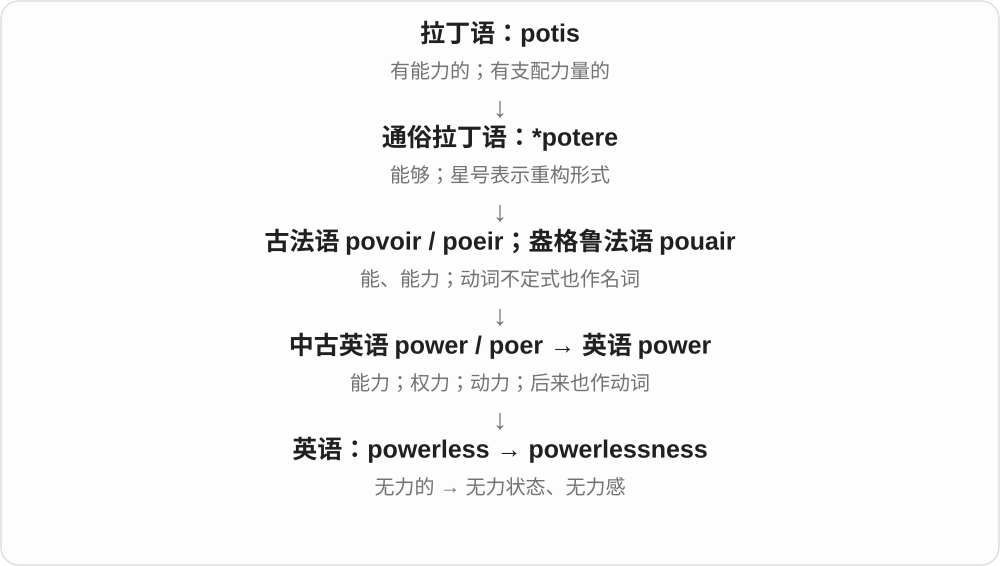

a sense of powerlessness 常用于面对疾病、复杂制度或无法控制的变化。既可以谈真实缺少权力，也可以谈主观感觉。

**常见搭配与例句**

a sense of powerlessness；feelings of powerlessness；political powerlessness。

> The long silence from the office increased her sense of powerlessness.

办公室迟迟没有回复，让她更觉得无能为力。

> The novel explores the powerlessness of people facing an unfair system.

小说探讨了人们面对不公制度时的无力处境。

**别混淆**

weakness 可以是体力、能力或某个缺点；powerlessness 专注于没有掌控或改变事情的力量。

### 256. reasonableness — 合理性、公道；通情达理的程度

**音标**：/ˈriːzənəbəlnəs/

**先抓住这个画面**

不问这是什么要求，而是问这个要求到底有多讲理、是否与条件相称。

**怎么拆**

reasonable + -ness，中古英语已有 resonabilnes 等形式。保留 reasonable 的词尾再加 -ness，不像 reasonably 要把 -ble 改成 -bly。

**怎么变成今天的意思**

**拉丁 ratiōnābilis → 古法语 resnable → 中古英语 resonable → reasonable**  
合乎理性、道理；可理解、合情理

↓

**reasonable + -ness → reasonableness**  
合理、公道这一性质

the reasonableness of a request 请求的合理性，question the reasonableness 质疑合理性，assess the reasonableness 评估是否合理。

**常见搭配与例句**

the reasonableness of；question the reasonableness；assess the reasonableness。

> We discussed the reasonableness of the deadline.

我们讨论了这个截止日期是否合理。

> The review questioned the reasonableness of the extra charges.

评论质疑额外收费是否公道。

**别混淆**

reasonableness 是性质评价，reason 原因、理由；给出一个 reason 不保证结论就有 reasonableness。

### 257. glum — 沮丧的；闷闷不乐的；神情阴沉的

**音标**：/ɡlʌm/

**先抓住这个画面**

好消息没等来，脸上的光像暗下去，人不太说话、提不起劲，这种样子叫 glum。常从脸和气氛看出来。

**怎么拆**

接中古英语 gloumen 等材料，或受低地德语相关形式影响；较远来源未定，glum 与 gloom 的现代形式差异不能代替历史依据。

**怎么变成今天的意思**

**中古英语 gloumen 等暗下、阴沉地看材料 → glum**  
也有低地德语 glum 等影响分析；与 gloom 的旧材料相关，较远来源未定

↓

**不快、阴沉的表情 → 现代沮丧、闷闷不乐**  
不接成已证实的古英语 glom 暮色路线，也不必把现代 gloom 名词排在所有形式之前

look glum 显得沮丧；a glum face 闷闷不乐的脸；glum silence 低落沉闷的安静。

**常见搭配与例句**

feel glum；a glum expression。

> He looked glum after hearing the result.

听见结果后，他显得很沮丧。

> Do not be so glum; we can try again tomorrow.

别这么闷闷不乐，明天我们还能再试。

**别混淆**

glum 常写低落、不快的神态，sulky 更常带怨气、不愿理人的行为；人可以 glum 却仍愿意好好说话。

### 258. glumness — 沮丧；闷闷不乐；阴沉的神情、气氛

**音标**：/ˈɡlʌmnəs/

**先抓住这个画面**

人坐在那里没有笑意，大家也不太说话，把这种低落、阴沉的感觉当成一件东西讨论，就用 glumness。

**怎么拆**

glum + 性质名词 -ness；不双写 m，双写出现在 glummer、glummest，后缀规则不同。

**怎么变成今天的意思**

**中古英语 gloumen 等暗下、阴沉地看材料 → glum**  
也有低地德语 glum 等影响分析；与 gloom 的旧材料相关，较远来源未定

↓

**不快、阴沉的表情 → 现代沮丧、闷闷不乐**  
不接成已证实的古英语 glom 暮色路线，也不必把现代 gloom 名词排在所有形式之前

↓

**glum + -ness → glumness**  
把低落、不快的性质或气氛名词化

shake off the glumness 摆脱低落；an air of glumness 一种闷闷不乐的气氛。

**常见搭配与例句**

the glumness in his voice；a moment of glumness。

> The good news lifted the glumness in the room.

好消息一扫房间里的低落气氛。

> There was a note of glumness in his voice.

他的声音里带着一点沮丧。

**别混淆**

glumness 是 glum 的性质名词，gloom 有阴暗、忧郁等独立用法；二者相关但不是所有搭配都一一替换。

### 259. ruthlessness — 冷酷无情；不留情面的决绝

**音标**：/ˈruːθləsnəs/

**先抓住这个画面**

ruthless 描写一个人或做法，ruthlessness 把那种为了目标不手软的性质拿出来说。它的分量比普通认真、果断更强。

**怎么拆**

ruthless + -ness → ruthlessness，两层词尾：-less 先否定怜悯，-ness 再把性质名词化。

**怎么变成今天的意思**

**中古英语 reuthe 怜悯、同情 + -less → reutheles → ruthless**  
缺少怜悯，不手软

↓

**ruthless + -ly、-ness**  
不留情面地；这种冷酷或决绝的性质

the ruthlessness of a policy 某政策的冷酷；admire the ruthlessness of the editing 欣赏删改不手软的劲头；褒贬看语境。

**常见搭配与例句**

the ruthlessness of；a degree of ruthlessness。

> The biography examines both his talent and his ruthlessness.

传记考察了他的才华，也考察了他的冷酷。

> The editor brought a useful degree of ruthlessness to the long draft.

编辑给长稿带来了一份有用的不留情面。

**别混淆**

ruthlessness 不等于所有 decisiveness 果断，缺少怜悯或不留情面的强度仍在；不要把词义磨成普通高效率。

### 260. unpleasantness — 不愉快、讨厌之处；不愉快的事、口角

**音标**：/ʌnˈplezəntnəs/

**先抓住这个画面**

不只说闻着不好受，也能把一场尴尬口角轻轻概括成 some unpleasantness。后者常是委婉地说发生了不太好看的冲突。

**怎么拆**

unpleasant + -ness → unpleasantness，性质名词又可具体指令人不快的事情。-ness 不要求永远只能说不可数的抽象性质。

**怎么变成今天的意思**

**un- 不 + pleasant 愉快的 → unpleasant**  
令人不舒服、不愉快

↓

**unpleasant + -ness → unpleasantness**  
不愉快性质，也可指不愉快事件或冲突

avoid unpleasantness 避免不愉快、冲突；some unpleasantness 一些不快；the unpleasantness of a smell 气味的难闻。

**常见搭配与例句**

avoid unpleasantness；some unpleasantness。

> I apologised quickly to avoid further unpleasantness.

我很快道歉，免得再闹出不愉快。

> The unpleasantness of the smell made us open every window.

难闻的气味让我们把所有窗户都打开了。

**别混淆**

unpleasantness 比完整说 quarrel 口角可更委婉，未必每次严重到争吵；要看事情、性质两种名词用法。

### 261. frankness — 坦率、直言不讳

**音标**：/ˈfræŋknəs/

**先抓住这个画面**

把说话不绕弯这个特点拿出来评价；你可以欣赏它，也可以觉得太直白。

**怎么拆**

frank + -ness，形成性质名词。不是说坦率的某个人，而是说这个人的表达特点。

**怎么变成今天的意思**

**中世纪拉丁语 francus、法语 franc → 中古英语 frank**  
自由、不受约束；与法兰克人称谓的历史联系

↓

**英语 frank**  
开诚布公、直率；更远民族称谓命名有争议

↓

**frank + -ness → frankness**  
坦率这一性质

appreciate someone’s frankness 欣赏某人的坦率，with great frankness 很坦率地，refreshing frankness 令人耳目一新的坦率。

**常见搭配与例句**

appreciate her frankness；with frankness；refreshing frankness。

> I appreciated her frankness about the risks.

我很欣赏她坦率地谈清风险。

> His frankness surprised the interviewers.

他的直言不讳让面试官有点意外。

**别混淆**

frankness 坦率特点，frankly 坦率地；the frankness of an answer 评价性质，不是答案里有一块叫坦率的东西。

### 262. hardiness — 强健、耐劳；耐寒、耐逆性

**音标**：英 /ˈhɑːdinəs/；美 /ˈhɑːrdinəs/

**先抓住这个画面**

hardy 描述谁扛得住，hardiness 把能扛的性质拿出来。比较植物 hardiness，就是比较它们对寒冷等环境的耐受能力。

**怎么拆**

承中古英语 hardynesse，现代对应 hardy 的 y 改 i + -ness → hardiness。性质名词承接人物耐劳、植物耐逆等用法。

**怎么变成今天的意思**

**古法语 hardi 勇敢、大胆 → 中古英语 hardy → hardy**  
上游联系日耳曼坚硬、使坚强材料，受英语 hard 影响

↓

**hardy + -ness → hardiness**  
耐劳、耐寒等承受逆境的性质

winter hardiness 越冬耐寒性；plant hardiness 植物耐寒性；the hardiness of the breed 品种的强健程度。

**常见搭配与例句**

winter hardiness；plant hardiness。

> The varieties differ in winter hardiness.

这些品种的越冬耐寒性不同。

> The hikers admired the hardiness of the local people.

徒步者佩服当地人的强健耐劳。

**别混淆**

hardiness 耐受逆境与 hardness 材料硬度不同，前者是 hardy 的名词，后者是 hard 的名词。

### 263. furtive — 偷偷摸摸的；鬼鬼祟祟的；躲着人注意的

**音标**：英 /ˈfɜːtɪv/；美 /ˈfɜːrtɪv/

**先抓住这个画面**

一边做，一边怕被人看见，动作里带着遮掩。

**怎么拆**

经法语 furtif、furtive 来自拉丁 furtivus 偷来的、隐秘的；再往前是 furtum 偷窃、fur 小偷。

**怎么变成今天的意思**

**拉丁 fur → furtum、furtivus**  
小偷 → 偷窃、偷来的 → 隐秘的

↓

**法语 furtif、furtive → 英语 furtive**  
偷偷摸摸、避免被注意到的

a furtive glance 是偷偷瞟一眼，a furtive movement 是生怕被发现的小动作。它不一定真的涉及偷东西，也能说上课偷看手机、悄悄看礼物，但通常让人感觉做事者有点心虚或不想公开。

**常见搭配与例句**

a furtive glance；furtive movements；look furtive；a furtive smile。

> He cast a furtive glance at the clock during the meeting.

开会时，他偷偷瞟了一眼时钟。

> Her furtive movements made it obvious that she was hiding a surprise.

她遮遮掩掩的小动作反而让人看出，她在准备一个惊喜。

**别混淆**

secret 只是未公开；furtive 还把遮掩的动作和神态写出来。quiet 安静未必偷偷摸摸，不能直接等同。

### 264. furtively — 偷偷地；躲躲闪闪地

**音标**：英 /ˈfɜːtɪvli/；美 /ˈfɜːrtɪvli/

**先抓住这个画面**

做某个动作时，尽量别让旁人发现自己在做。

**怎么拆**

英语 furtive + -ly；中古英语已有 furtyvely 这样的副词形式。它延续的是隐蔽、遮掩的方式义。

**怎么变成今天的意思**

**拉丁 fur → furtum、furtivus**  
小偷 → 偷窃、偷来的 → 隐秘的

↓

**法语 furtif、furtive → 英语 furtive**  
偷偷摸摸、避免被注意到的

↓

**中古英语 furtyvely → 英语 furtively**  
以躲避注意的方式；对应 furtive + -ly

check furtively 是偷偷检查，glance furtively 是偷瞟。它像给镜头加了一层心理：这个人不想被看见。可以用于小小的尴尬或惊喜，不必自动理解成犯罪。

**常见搭配与例句**

glance furtively；look around furtively；check something furtively。

> She furtively checked the answer written on the back of the card.

她偷偷看了看卡片背面写着的答案。

> He looked around furtively before placing the gift on her desk.

他躲躲闪闪地四下看了看，才把礼物放到她桌上。

**别混淆**

secretly 可以是一整件事秘密进行；furtively 更常突出眼前某个动作的遮掩神态。写人偷看、偷放东西时尤其直观。

### 265. furtiveness — 鬼鬼祟祟、偷偷摸摸的样子；遮掩的神态

**音标**：英 /ˈfɜːtɪvnəs/；美 /ˈfɝːtɪvnəs/

**先抓住这个画面**

说话前先四处看，东西往身后藏，行动像不想让别人知道；把这种遮遮掩掩的样子当成一个特点，就叫 furtiveness。

**怎么拆**

furtive + -ness，保留不发音 e；前面经法语接拉丁 furtivus、furtum、fur 的偷窃词族。

**怎么变成今天的意思**

**拉丁语 fur 小偷 → furtum 偷窃 → furtivus 偷来的、隐秘的**  
这里的拉丁 fur 与英语 fur 皮毛不是同一个来源

↓

**法语 furtif 等 → 英语 furtive → furtiveness**  
偷偷摸摸、遮掩的性质，现代不要求真的偷了东西

an air of furtiveness 一种遮遮掩掩的神态；the furtiveness of someone’s movements 某人鬼鬼祟祟的动作样子。

**常见搭配与例句**

a sense of furtiveness；furtiveness in his manner。

> There was an odd furtiveness in his manner.

他的神态有种奇怪的遮掩感。

> The furtiveness of her glance made me curious.

她偷偷瞥的那一下，让我好奇起来。

**别混淆**

privacy 是保留私人空间、信息；furtiveness 写躲避别人注意的神态，语气通常更可疑。

### 266. dampness — 潮湿、湿气；微湿状态

**音标**：/ˈdæmpnəs/

**先抓住这个画面**

damp 说墙有点潮，dampness 把那股湿气和潮湿状态单独拿出来说。不是一定看到水流才算。

**怎么拆**

damp + -ness → dampness，保留 p，不需另加连接元音。-ness 把微湿性质变成名词。

**怎么变成今天的意思**

**中古英语 damp 令人窒息的蒸气等，日耳曼相关材料**  
确切本族、借词路线未定

↓

**damp 先有压抑、抑制等，后有微湿、弄湿常用义**  
记忆可借湿物压火，不能当全部历史顺序

↓

**damp + -en、-er、-ness**  
弄湿、减弱；抑制装置；湿气状态

↓

**damp + -ness → dampness**  
微湿、潮湿的状态

dampness in the walls 墙面潮气；a smell of dampness 潮气味；signs of dampness 潮湿迹象。

**常见搭配与例句**

signs of dampness；dampness in。

> There were signs of dampness near the window.

窗边有潮湿迹象。

> The cupboard had a faint smell of dampness.

柜子里有一点潮气味。

**别混淆**

humidity 常说空气含水汽的状况，dampness 更常用于摸着、闻着或材料上的潮湿体验；不是严格互斥的二选一。

### 267. directness — 直截了当；直接性

**音标**：英、美 /dəˈrektnəs/，也读 /daɪˈrektnəs/

**先抓住这个画面**

问到关键处就说关键处，不用一圈铺垫让人猜。

**怎么拆**

direct + -ness，表示直接这一性质。

**怎么变成今天的意思**

**拉丁语：regere**  
引导、使直；治理

↓

**拉丁语：dirigere → directus**  
引向一定方向、摆直 → 直的

↓

**拉丁语及法语 → 英语 direct**  
引导、指向；直接的

↓

**英语：direct + -ness → directness**  
表达或联系的直接程度

常评价说话风格。有人喜欢这种坦率，有人觉得太冲；directness 本身不保证礼貌，也不等于粗鲁。

**常见搭配与例句**

the directness of a question；admire someone’s directness。

> I appreciated the directness of her reply.

我很欣赏她回答得直截了当。

> The directness of the question caught him off guard.

问题问得太直接，让他一时没有准备。

**别混淆**

honesty 是诚实；directness 是表达不绕弯，可以诚实但委婉。

### 268. gladness — 喜悦；高兴的心情

**音标**：/ˈɡlædnəs/

**先抓住这个画面**

把心里那份明亮、开心拿出来作为一种感受说，语气往往比常见的 happiness 更偏书面。

**怎么拆**

glad + -ness，性质、情绪名词。不是某一种具体礼物或让人开心的物品。

**怎么变成今天的意思**

**古英语 glæd → 中古英语 glad → glad**  
明亮、欢快等相联旧义

↓

**现代 glad**  
高兴；庆幸；乐意、愿意

↓

**glad + -ness → gladness**  
高兴、喜悦的状态

a feeling of gladness 喜悦感，with gladness 怀着喜悦。可见于文学、宗教或较抒情表达。

**常见搭配与例句**

a feeling of gladness；with gladness；a sense of gladness。

> A feeling of gladness came over her as she reached home.

到家时，一阵喜悦涌上她心头。

> He welcomed the visitors with gladness.

他满怀喜悦地迎接访客。

**别混淆**

gladness 喜悦情绪，gladden 使喜悦的动作；两词只差后部，句中角色不同。

### 269. idleness — 闲置、无事可做；懒散

**音标**：/ˈaɪdəlnəs/

**先抓住这个画面**

idle 描写人或机器空着，idleness 则把那段闲着、那种无所事事的状态拿出来说。是否责备，要看为什么闲着。

**怎么拆**

古英语 īdelnes 等旧名词延续，现代可对应 idle + -ness，保留末 e，不写 idlness。

**怎么变成今天的意思**

**古英语 īdel 空、无用、无事 → 中古英语 idel → idle**  
未被占用、无活动，部分语境含懒散评价

↓

**旧 īdellīce、īdelnes 等 → idly、idleness**  
现代对应方式副词与状态名词；引擎 idle 仍运转

forced idleness 被迫闲着；a period of idleness 一段闲置期；idleness and boredom 无事可做与无聊。

**常见搭配与例句**

forced idleness；a period of idleness。

> The closure forced the workers into weeks of idleness.

停工让工人连续几周无事可做。

> He enjoyed one afternoon of complete idleness.

他享受了一个什么也不做的下午。

**别混淆**

idleness 不必是个人不肯工作；缺少任务、停工也可能造成它。leisure 则更偏可自由安排的闲暇。

### 270. wildness — 野性；荒野气息；狂放、失控的性质

**音标**：/ˈwaɪldnəs/

**先抓住这个画面**

说的是那股没被驯服、没被修整的劲儿，可以属于景色，也可以属于性情。

**怎么拆**

wild + -ness，把 wild 的性质名词化。不是直接给一片荒野取地名。

**怎么变成今天的意思**

**古英语 wilde → 中古英语 wilde → wild**  
未驯服、未耕种、天然生长的

↓

**现代 wild**  
野生、荒野的；失控、狂热；缺少根据的

↓

**wild + -ness → wildness**  
未驯服、天然或狂放的性质

the wildness of the landscape 景色的荒野气息，a sense of wildness 野性、天然感。

**常见搭配与例句**

the wildness of；a sense of wildness；preserve its wildness。

> The painting captures the wildness of the sea.

这幅画抓住了大海狂放不羁的气势。

> She loved the wildness of the mountain landscape.

她喜欢山地景色未经雕琢的野趣。

**别混淆**

wildness 说性质，wilderness 通常说大片荒野这个地方；They entered the wilderness 不能只换成 wildness。

### 271. badness — 坏；恶劣程度；不良性质

**音标**：/ˈbædnəs/

**先抓住这个画面**

不说具体哪件东西，而把它“不好”的那一面抽出来讨论。

**怎么拆**

bad + -ness，中古英语已有相应名词；-ness 表性质或状态，不是复数词尾。

**怎么变成今天的意思**

**中古英语 bad / badde**  
坏、不好的

↓

**英语 bad**  
质量差、令人不快、道德不好等；更早来源不确定

↓

**bad + -ness → badness**  
不好的性质或程度

the badness of a decision 是决定的糟糕之处；讨论道德时也能说恶，但平常多用 poor quality、how bad 等更具体表达，不必处处套抽象名词。

**常见搭配与例句**

the badness of；inherent badness；the goodness or badness of。

> The essay discusses the goodness or badness of an action.

文章讨论一个行为的善恶。

> We laughed at the sheer badness of the dialogue.

对白实在太烂，把我们逗笑了。

**别混淆**

badness 抽出性质，badly 副词说明动作或程度；bad news 是坏消息，不是一个词 badness 的同义拼法。

### 272. deliciousness — 美味；令人愉悦的特质

**音标**：/dɪˈlɪʃəsnəs/

**先抓住这个画面**

不再直接夸这道菜好吃，而是把它有多好吃当成一件事来谈，这就用 deliciousness。

**怎么拆**

delicious + -ness，把性质变成名词。现代常说食物的美味，通常不可数。

**怎么变成今天的意思**

**拉丁 dēliciae 等：乐趣、愉悦 → dēliciōsus**  
令人愉悦的

↓

**法语 delicious／delicieux → 英语 delicious**  
悦人的；常用来夸食物美味

↓

**delicious + -ness → deliciousness**  
美味这一性质

the deliciousness of the sauce 酱汁的美味，sheer deliciousness 纯粹的美味享受。日常直接说 It tastes delicious 往往更轻便。

**常见搭配与例句**

the deliciousness of；sheer deliciousness。

> Everyone commented on the deliciousness of the sauce.

大家都赞叹酱汁的美味。

> The review praised the simplicity and deliciousness of the dish.

评论称赞这道菜简单又美味。

**别混淆**

delicious 形容食物，deliciously 修饰呈现方式或性质，deliciousness 才把美味作为名词谈。

### 273. thoroughness — 周密、细致；彻底性

**音标**：英 /ˈθʌrənəs/；美 /ˈθɝːoʊnəs/

**先抓住这个画面**

不是只夸检查做得快，而是夸它查得全、查得细，这种质量叫 thoroughness。

**怎么拆**

thorough + -ness，把周密、全面这一性质变成名词。不是 thorough + ness 的两段都各读成一个重音。

**怎么变成今天的意思**

**古英语 þurh／þuruh 等形式**  
从一头到另一头、穿过

↓

**中古英语 thoro／thorow → thorough**  
从头到尾做到 → 完全、周密的

↓

**thorough + -ness → thoroughness**  
做事全面细致这一性质

the thoroughness of the review 审查的周密程度，admire someone’s thoroughness 欣赏某人做事细致。

**常见搭配与例句**

the thoroughness of；with thoroughness。

> The report impressed us with its thoroughness.

报告的周密细致给我们留下了深刻印象。

> She is known for the thoroughness of her research.

她以研究全面细致而闻名。

**别混淆**

thoroughness 关注覆盖细节、做透的程度；accuracy 关注是否准确。检查得全面仍可能犯错，两个评价维度有关但不同。

### 274. quietness — 安静；平静；不张扬的特点

**音标**：/ˈkwaɪətnəs/

**先抓住这个画面**

把 quiet 的感觉单独拿出来说：周围没什么动静，或一个人的表达沉静不张扬。

**怎么拆**

quiet + -ness；中古英语已有对应形式。

**怎么变成今天的意思**

**拉丁 quiēs、quiēscere、quiētus**  
休息；安静下来；安宁、免于负担的

↓

**古法语 quiet / quiete → 中古英语 → quiet**  
安宁、休息 → 安静；安宁

↓

**英语 quiet + -ness → quietness**  
安静的 → 安静状态、沉静特点

可以说地方的清静，也可说一个人的沉静。通常不需要数成一个个 quietnesses。

**常见搭配与例句**

the quietness of the room；a quietness in her manner。

> I enjoyed the quietness of the house in the early morning.

我喜欢清晨屋子里的安静。

> There was a quietness in his manner that made people feel at ease.

他的举止有一种让人放松的沉静。

**别混淆**

silence 侧重无声；quietness 更宽，能带平稳、不热闹的感觉。

### 275. distinctiveness — 独特性；辨识度

**音标**：/dɪˈstɪŋktɪvnəs/

**先抓住这个画面**

把“哪里认得出它”当成一项特点来讨论：一条老街、一个品牌、一位作家，为什么不会与别人混淆。

**怎么拆**

distinctive + -ness，英语性质名词；不是“区别这件事”，而是具有特色的程度或性质。

**怎么变成今天的意思**

**拉丁 distinguere〔dis- + -stinguere〕**  
分开、标出区别；更古老的刺、推等分析有分歧

↓

**拉丁分词词干 distinct- → 中世纪拉丁 distinctivus**  
能够区分、标出差异的

↓

**古法语 distinctif／直接借入 → 英语 distinctive**  
有辨识度的、有特色的

↓

**英语 distinctive + -ness → distinctiveness**  
使某物容易与别的区分开的特色

preserve the distinctiveness of a place 是保留地方特色；brand distinctiveness 是品牌辨识度。独特并不自动等于质量好。

**常见搭配与例句**

cultural distinctiveness；brand distinctiveness；preserve distinctiveness。

> The renovation preserved the distinctiveness of the old neighbourhood.

改造保留了老街区原有的特色。

> The logo lost much of its distinctiveness when every competitor used similar colours.

当所有竞争者都使用相似颜色时，这个标志就失去了不少辨识度。

**别混淆**

distinction 可指差别、区分或荣誉；distinctiveness 专说有辨识度的特点。

### 276. tardiness — 迟到；拖延；迟缓

**音标**：英 /ˈtɑːdinəs/；美 /ˈtɑːrdinəs/

**先抓住这个画面**

把一次次慢到、晚做的表现，合起来称作迟到或迟缓的问题。

**怎么拆**

tardy + -ness，y 改 i；把迟到、迟缓这一性质或行为变成名词。

**怎么变成今天的意思**

**拉丁 tardus**  
慢的；迟的

↓

**晚期拉丁 tardivus → 法语 tardif**  
缓慢、迟到的

↓

**早期英语 tardive 等形式 → tardy**  
迟到的；迟缓的

↓

**tardy + -ness → tardiness**  
迟到或迟缓的状态

repeated tardiness 是反复迟到；the tardiness of a reply 是回复拖得太晚。它通常不可数；统计具体次数时可说 instances of tardiness，而不是一味给它加复数。

**常见搭配与例句**

repeated tardiness；habitual tardiness；tardiness in responding。

> Repeated tardiness disrupted the morning meetings.

反复迟到打乱了早会安排。

> She apologized for her tardiness in answering the letter.

她为迟迟没有回信而道歉。

**别混淆**

tardiness 侧重到得晚或行动晚；slowness 侧重过程速度慢。一个人操作很慢，但提前出发，仍可能没有 tardiness。

### 277. flatness — 平坦、扁平；平淡、缺少起伏

**音标**：/ˈflætnəs/

**先抓住这个画面**

拿平这个特点来描述地面，也可描述声音、文章缺乏变化。

**怎么拆**

flat + -ness，中古英语已有 flatnesse。性质名词不限定物理平面，也接乏味、平直表达。

**怎么变成今天的意思**

**古诺尔斯语 flatr → 中古英语 flat → flat**  
平、摊开、处在一个平面

↓

**另有本族 flet、苏格兰语 flat 等住房词路径**  
楼层、住处 → 公寓，与平、楼面词族有关

↓

**现代 flat 的形状与感受比喻**  
平、扁；没气、没气泡；平淡、直接等

↓

**flat + -ness → flatness**  
平坦性质；比喻缺少变化、生气

the flatness of the land 地势平坦，flatness of tone 语调平直，check the flatness 检查平整度。

**常见搭配与例句**

the flatness of；flatness of tone；check the flatness。

> We were surprised by the flatness of the landscape.

地势之平坦让我们意外。

> The flatness of his delivery made the joke less funny.

他的表达缺乏起伏，让笑话没那么好笑。

**别混淆**

flatness 平坦，smoothness 光滑；平而有粗糙纹理的板，两项性质可不同。

### 278. otherness — 异质性；不同感；他者性

**音标**：英 /ˈʌðənəs/；美 /ˈʌðərnəs/

**先抓住这个画面**

站在熟悉的人群中，忽然发现某人或自己被看成“不属于这里的那一种”。

**怎么拆**

other + -ness；-ness 把别的、不同这种性质转为抽象名词，不表示具体另一个人。

**怎么变成今天的意思**

**古英语 ōþer → 中古英语 other**  
另一个；也有第二的旧义

↓

**英语 other**  
别的、另外的

↓

**other + -ness → otherness**  
与通常或自我不同的性质、感受

文学和社会讨论常见，既可说陌生感，也可讨论人怎样被划成“他者”。具体是否带排斥、不安或好奇，要看叙述立场。

**常见搭配与例句**

a sense of otherness；the otherness of a place；cultural otherness。

> The story explores the child’s sense of otherness.

故事探讨了孩子觉得自己格格不入的感受。

> The landscape had an otherness that made familiar words seem inadequate.

这片景色有种陌生独特的气质，让熟悉的词都显得不够用。

**别混淆**

otherness 说不同或被当作他者的感觉，difference 更宽泛地说差别。otherness 不自动断言差别有高下。

### 279. earnestness — 认真、诚恳；热诚投入

**音标**：英 /ˈɜːnɪstnəs/；美 /ˈɜːrnɪstnəs/

**先抓住这个画面**

一个人未必表达熟练，但你能感觉他真心想把事情做好，那份态度是 earnestness。它说诚意和认真，不保证最后一定做对。

**怎么拆**

earnest + -ness → earnestness，性质名词。词尾接完整形容词，不写成 earning 的变体。

**怎么变成今天的意思**

**古英语 eornost、eornoste 认真、热诚等 → earnest**  
认真投入，非开玩笑或敷衍

↓

**earnest + -ly、-ness；旧副词形式延续**  
诚恳认真地；真诚投入的性质

↓

**保证金、预示的 earnest 另经法语拉丁材料**  
同形词不从 earn 挣钱或认真任意推导

speak with earnestness 诚恳地说；the earnestness of a request 请求的真切；admire someone’s earnestness 欣赏某人的认真。

**常见搭配与例句**

with earnestness；the earnestness of。

> Her earnestness made the audience listen closely.

她的真诚让听众认真听了起来。

> He lacked experience, but nobody doubted his earnestness.

他缺少经验，但没人怀疑他的认真态度。

**别混淆**

earnestness 不等于 expertise 专业能力；态度真诚和判断正确是两件可分别评价的事。

### 280. lateness — 迟到；晚、迟的状态

**音标**：/ˈleɪtnəs/

**先抓住这个画面**

不是某个迟到的人，而是来得太晚这一情况本身。

**怎么拆**

late + -ness，-ness 把迟、晚的性质名词化，保留末尾 e。

**怎么变成今天的意思**

**古英语 læt → 中古英语 late**  
慢、迟、晚

↓

**英语 late**  
迟到；接近某时段末尾

↓

**late + -ness → lateness**  
迟到或晚的状态

apologize for lateness 是为迟到道歉；the lateness of the hour 是时间已经很晚。是否带责备，要看所说的是误点还是单纯夜深。

**常见搭配与例句**

persistent lateness；apologize for lateness；the lateness of the hour。

> He apologized for his lateness.

他为迟到道歉。

> Despite the lateness of the hour, the café was still busy.

尽管时间已晚，咖啡馆仍很热闹。

**别混淆**

lateness 是名词，late 是形容词、副词；because of his lateness 与 because he was late 结构不同。

### 281. swiftness — 迅速、敏捷；速度

**音标**：/ˈswɪftnəs/

**先抓住这个画面**

把动作快这一点单独拿出来谈，就是 swiftness。the swiftness of the reply 说回复来得有多快。

**怎么拆**

承古英语 swiftnes、中古英语 swiftnesse 等，现代对应 swift + -ness。

**怎么变成今天的意思**

**古英语 swift → 中古英语 swift → swift**  
快速、敏捷

↓

**swiftnes 等 → swiftness；现代 swift + -ness**  
迅速的性质、程度

the swiftness of the response 回应的迅速，surprising swiftness 令人意外的速度。常见于较书面表达。

**常见搭配与例句**

the swiftness of the response；with surprising swiftness。

> The swiftness of the decision surprised us.

决定作出得那么快，让我们吃惊。

> The river carried the leaves away with surprising swiftness.

河水以惊人的速度把叶子带走。

**别混淆**

swiftness 是名词，swiftly 是副词；前者谈速度性质，后者修饰动作。

### 282. thankfulness — 感激；庆幸之情

**音标**：/ˈθæŋkfəlnəs/

**先抓住这个画面**

不再直接说我感激，而把心里这份谢意、庆幸当成一种感受来描述。

**怎么拆**

thankful + -ness，先 thank + -ful 得感激的，再名词化。不是 thank + fullness 物理装满。

**怎么变成今天的意思**

**古英语 þanc〔名词〕、þancian〔动词〕→ 中古英语 thank / thanken**  
感念、感谢；表达谢意

↓

**英语 thank、thanks**  
感谢；谢意、谢谢

↓

**thank → thankful → thankfulness**  
感谢 → 感激的 → 感激、庆幸之情

a feeling of thankfulness 感激之情，express thankfulness 表达感激；日常 gratitude 也常见。较抽象，适合描写情绪、态度。

**常见搭配与例句**

a feeling of thankfulness；express thankfulness；deep thankfulness。

> She felt a quiet thankfulness as the family gathered.

家人团聚时，她心里有一份安静的感激。

> His letter expressed deep thankfulness for their kindness.

他在信里对大家的善意表达了深深感激。

**别混淆**

thankfulness 感受，thanks 感谢表达或谢意；写一句 thanks 可以表达 thankfulness，但词的语法位置不同。

### 283. thinness — 薄、瘦、稀疏；单薄、缺乏分量

**音标**：/ˈθɪnnəs/

**先抓住这个画面**

把纸有多薄、人有多瘦、论据有多单薄，当作一种性质来谈。词义跟着对象走，不只指体形。

**怎么拆**

thin + -ness，古英语已有 þynnes 一类名词。现代拼写两处 n 相邻：词基末尾 n 与后缀开头 n 都保留。

**怎么变成今天的意思**

**古英语 þynne → 中古英语 thinne → thin**  
薄、稀、细

↓

**古英语 þynnes → thinness**  
薄、稀等性质；现代对应 thin + -ness

the thinness of the paper 纸的薄，the thinness of the evidence 证据的单薄，extreme thinness 极瘦状态。

**常见搭配与例句**

the thinness of the paper；the thinness of the evidence。

> The thinness of the paper made it easy to tear.

纸很薄，因而容易撕破。

> The reviewer criticized the thinness of the plot.

评论者批评了情节的单薄。

**别混淆**

thinness 是状态，thinner 可是比较级或稀释剂；thinness 不自带赞美，不等于 slimness 常有的匀称感。

### 284. dullness — 钝；暗淡；乏味；迟钝

**音标**：/ˈdʌlnəs/

**先抓住这个画面**

dull 描述东西钝、暗、无趣；dullness 把这份性质抽出来。谈刀看锋利不足，谈节目看吸引力不足，谈表面看光泽不足。

**怎么拆**

dull + -ness → dullness，保留 ll，-ness 形成性质、状态名词。它承接 dull 的不同义项，具体是哪一种由对象决定。

**怎么变成今天的意思**

**古英语 dol → 中古英语 dull、dul 等 → dull**  
愚钝、迟钝等早期状态

↓

**dull + -ness → dullness**  
钝、暗淡、乏味等性质

the dullness of the blade 刀刃的钝；the dullness of the programme 节目的乏味；a dullness in colour 色泽暗淡。

**常见搭配与例句**

the dullness of；dullness in colour。

> The dullness of the blade made cutting difficult.

刀刃太钝，切起来很费劲。

> Bright cushions relieved the dullness of the room.

亮色靠垫缓解了房间的沉闷。

**别混淆**

dullness 不总是在评价智力；颜色、刀刃、天气、节目都能谈这种性质。

### 285. defensiveness — 防御性、戒备；受质疑时急于自我辩护的反应

**音标**：/dɪˈfensɪvnəs/

**先抓住这个画面**

别人一提问题，先感觉自己被攻击，赶紧解释、反击或关上话头；日常心理、人际语境常说这种护住自己的反应。

**怎么拆**

defensive + -ness，性质名词；defensive 远接 defend 防卫词族。不是 defense 再加一个表示人的 -iveness。

**怎么变成今天的意思**

**defend → defensive**  
防卫 → 防御的、戒备自卫的

↓

**defensive + -ness → defensiveness**  
这种防御态度、反应

respond with defensiveness 带防御心回应，reduce defensiveness 减少戒备，a tone of defensiveness 自我辩护的语气。

**常见搭配与例句**

respond with defensiveness；reduce defensiveness；a tone of defensiveness。

> His defensiveness made the discussion more difficult.

他的戒备、自我辩护让讨论更难进行。

> She answered the criticism without anger or defensiveness.

她回应批评时，既不生气，也不急着自我辩护。

**别混淆**

defensiveness 常聚焦态度和反应，defence 是防守、辩护本身；合理说明理由不一定就是过度防御，要看具体互动。

### 286. sameness — 相同性；千篇一律

**音标**：/ˈseɪmnəs/

**先抓住这个画面**

把几个东西摆在一起，几乎找不到区别；重复久了，也可能觉得单调。

**怎么拆**

same + -ness，末尾不发音的 e 仍保留；-ness 把相同这一性质变成名词。

**怎么变成今天的意思**

**古诺斯语 samr；古英语 same / sama**  
相同的；相关形式共同影响英语

↓

**中古英语 same → 英语 same**  
同一个；相同的

↓

**same + -ness → sameness**  
相同的性质；缺乏变化

可中性讨论相同性，也常有缺乏个性、单调的评价。the sameness of the days 是每天差不多，未必每件事精确复制。

**常见搭配与例句**

a sense of sameness；the sameness of daily life；escape the sameness。

> She wanted to escape the sameness of her daily routine.

她想摆脱日常生活的单调重复。

> The sameness of the rooms made the hotel feel impersonal.

房间千篇一律，让酒店显得缺乏个性。

**别混淆**

sameness 偏相同或单调的感觉；similarity 可以是一处相似点，复数 similarities 也常见。不能把两者都机械译成一样。

### 287. wakeful — 不眠、清醒的；警醒的

**音标**：/ˈweɪkfəl/

**先抓住这个画面**

别人可能已经睡了，你仍醒着，或这一夜总没睡着，可以说 wakeful。它也能强调保持警醒。

**怎么拆**

wake 醒 + -ful 具有、充满相应性质，形成清醒、不眠的形容词；再加 -ness 得 wakefulness。

**怎么变成今天的意思**

**wake + -ful → wakeful**  
处于醒着、不眠状态

↓

**wakeful → wakefulness**  
清醒或不眠的状态

a wakeful night 不眠之夜；a wakeful child 还醒着的孩子；remain wakeful 保持清醒。

**常见搭配与例句**

a wakeful night；remain wakeful。

> She spent a wakeful night worrying about the exam.

她担心考试，一夜没怎么睡。

> The child was unusually wakeful.

孩子一反常态，一直醒着。

**别混淆**

wakeful 是醒着的性质，awake 也说醒着；wakeful 更常突出难以入睡、持续不眠或警醒。

### 288. wakefulness — 清醒；不眠状态

**音标**：/ˈweɪkfəlnəs/

**先抓住这个画面**

不是睁开眼那一下，而是持续醒着的状态，叫 wakefulness。它可和睡眠作为两种状态对照。

**怎么拆**

现代构词对应 wakeful + -ness → wakefulness。-ness 把前面的性质作为状态、程度等来谈。

**怎么变成今天的意思**

**英语 wakeful**  
醒着、不眠的

↓

**wakeful + -ness → wakefulness**  
清醒；不眠状态

periods of wakefulness 是一段段清醒时间；夜里持续醒着也可这样描述。

**常见搭配与例句**

sleep and wakefulness 睡眠与清醒；periods of wakefulness 清醒时段。

> The study compares sleep and wakefulness.

研究比较睡眠与清醒状态。

> The night included long periods of wakefulness.

那一夜有很长时间没睡着。

**别混淆**

wakefulness 是醒着，awareness 是意识到、觉察；人在清醒时，也可能没觉察某个具体变化。

### 289. niceness — 友善；和气；令人愉快的性质

**音标**：/ˈnaɪsnəs/

**先抓住这个画面**

把一个人待人舒服、体贴和气这一点，作为一种品质来谈。

**怎么拆**

nice + -ness，形成抽象名词。现代常接友善、和气义，不是回到拉丁语无知义。

**怎么变成今天的意思**

**拉丁语 nescius → 古法语 nice → 中古英语 nice / nyce**  
不知情、无知；愚笨等旧义

↓

**英语 nice 的多阶段词义变化**  
曾含挑剔、精细等义；后来发展出令人愉快、友善等常用义

↓

**nice → niceness**  
友善、令人愉快 → 友善、和气这一性质

her genuine niceness 她真诚的友善；an appearance of niceness 表面的和气。这个词描述给人的友好感，不必等于所有深层道德品质。

**常见搭配与例句**

genuine niceness；simple niceness；a reputation for niceness。

> People remembered her for her patience and niceness.

人们记得她的耐心和友善。

> His niceness made it easy for new students to ask questions.

他的和气让新生敢于开口提问。

**别混淆**

niceness 强调和气、友善；kindness 更容易强调关心他人、愿意帮助。两者可重叠，不能只靠微笑就证明所有品德。

### 290. cohesiveness — 凝聚程度；整体紧密性

**音标**：英 /kəʊˈhiːsɪvnəs/；美 /koʊˈhiːsɪvnəs/

**先抓住这个画面**

一个群体或作品的各部分究竟贴得有多紧。

**怎么拆**

cohesive 加 -ness，强调具有凝聚、整合特性的程度。

**怎么变成今天的意思**

**拉丁 haerēre，相关词干 haes-**  
黏住、贴住、停在原处

↓

**拉丁 co- + haerēre → cohaerēre**  
黏在一起；相互连贯

↓

**拉丁分词词干 cohaes- + 英语 -ive → cohesive**  
能结合成整体的

↓

**英语 cohesive + -ness → cohesiveness**  
紧密结合的性质

the cohesiveness of a team 是团队的团结程度；设计中的 cohesiveness 是各元素是否协调成一个整体。

**常见搭配与例句**

group cohesiveness；team cohesiveness；visual cohesiveness。

> Shared goals strengthened the group’s cohesiveness.

共同目标增强了这个小组的凝聚力。

> A consistent colour scheme gives the exhibition visual cohesiveness.

统一的配色让展览在视觉上更具整体感。

**别混淆**

cohesion 与 cohesiveness 很接近；cohesiveness 常更明确说“具有凝聚力这种性质”。

### 291. uselessness — 无用；徒劳无益

**音标**：/ˈjuːsləsnəs/

**先抓住这个画面**

uselessness 把“怎么做都帮不上忙”的感觉或状况单独拿出来说。

**怎么拆**

useless + -ness；表示“没有用”这种性质或状态。

**怎么变成今天的意思**

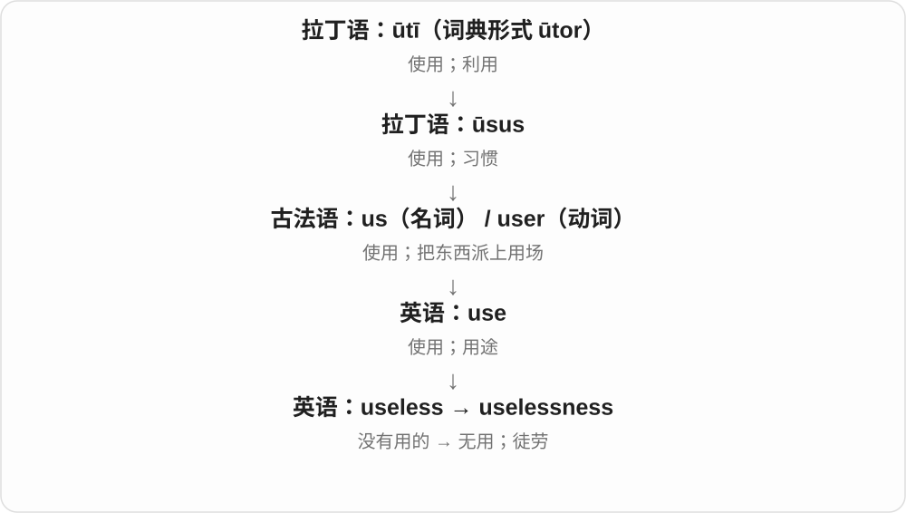

它既可评价一个办法，也可描述一个人觉得自己帮不上忙的感受。a feeling of uselessness 说的是人的感受，不能据此断言这个人没有价值。

**常见搭配与例句**

the uselessness of…；a sense / feeling of uselessness；recognize the uselessness of an approach。

> The experiment showed the uselessness of that shortcut.

实验表明，那条捷径根本帮不上忙。

> Joining the volunteer group eased his feeling of uselessness.

加入志愿者团队后，他那种觉得自己帮不上忙的感受减轻了。

**别混淆**

uselessness 是没能产生所需帮助；failure 常指某一次没达到目标。失败的尝试仍可能留下有用的经验。

### 292. genuineness — 真实性；真诚

**音标**：/ˈdʒenjuɪnnəs/

**先抓住这个画面**

把“这是真的，不是冒充的”当作一个需要确认的性质。

**怎么拆**

genuine + -ness；两处相邻 n 在连读中常合成一个。

**怎么变成今天的意思**

**拉丁 gignere、genitus；同族 genus、gener-**  
生出、产生；种类、出身

↓

**拉丁 genuīnus → 英语 genuine**  
天生、本来的 → 真实、不伪造的

↓

**英语 genuine + -ness → genuineness**  
真实、真诚这一性质

the genuineness of a document 是文件是否真；the genuineness of an apology 是道歉是否发自内心。不同对象让“真”的验证方式不同。

**常见搭配与例句**

the genuineness of；question someone’s genuineness。

> They questioned the genuineness of the document.

他们质疑这份文件的真实性。

> The genuineness of her apology was clear from her actions.

从她的行动可以看出，道歉是出于真心。

**别混淆**

genuineness 不等于 usefulness：东西可以是真的却没用，也可以是仿制品却很实用。

### 293. compactness — 紧凑；紧密；紧性〔数学〕

**音标**：/kəmˈpæktnəs/

**先抓住这个画面**

看东西是否挤得紧、安排得省空间；数学中则是一种另有严格定义的性质。

**怎么拆**

英语 compact〔紧凑的〕+ -ness，沿 compingere 的接紧支线，不沿协议名词那条路线。

**怎么变成今天的意思**

**拉丁 pangere**  
固定、钉牢；复合动词中可变为 -pingere，分词有 -pactus

↓

**拉丁 com- + pangere → compingere / compactus**  
把东西紧紧接合

↓

**法语 compact／拉丁借词 → 英语 compact**  
紧密的、紧凑的；压紧

↓

**英语 compact + -ness → compactness**  
紧凑或紧密的性质；数学紧性

赞一款折叠桌的 compactness，是说它少占地方。数学教材中的 compactness 不能简单翻成“小”：例如实数空间中的紧集有特殊的闭且有界判别，其他空间要依定义讨论。

**常见搭配与例句**

the compactness of a design；compactness and portability；a compactness argument。

> The camera’s compactness makes it easy to carry.

这款相机小巧紧凑，方便携带。

> The lecturer explained why compactness matters in this proof.

讲师解释了紧性为什么在这个证明中重要。

**别混淆**

compaction 是压实的过程；compactness 是紧凑或紧的性质。两者名词词尾相似，但问题不同。

### 294. expressiveness — 表现力；传达情感的能力

**音标**：英 /ɪkˈspresɪvnəs/；美 /ɪkˈspresɪvnəs/

**先抓住这个画面**

同样一句话，有的人能让你听见温柔、愤怒或犹豫；这种传达出来的力量就是 expressiveness。

**怎么拆**

expressive + -ness，把性质变为名词。

**怎么变成今天的意思**

可谈声音、动作、绘画和音乐。有表现力不一定声音大、动作多，细微的停顿也能做到。

**常见搭配与例句**

the expressiveness of her voice；emotional expressiveness。

> The singer is admired for the expressiveness of her voice.

这位歌手因声音富有表现力而受到欣赏。

> A small change in posture can add expressiveness to a drawing.

姿势上的一点变化就能让画面更有表现力。

**别混淆**

expression 可以是一种具体表情或说法；expressiveness 是表达能力这一性质。

### 295. fatness — 肥胖、肥厚；脂肪多的性质

**音标**：/ˈfætnəs/

**先抓住这个画面**

把肥、脂肪多这个特点单独拿出来说；它是性质名词，不是某块脂肪本身。

**怎么拆**

fat + -ness，古英语 fǣtnes、中古英语 fatnesse 等形式延续。旧用法也可说丰厚，现代主要按对象理解肥厚、含脂程度。

**怎么变成今天的意思**

**古英语 fǣtt 等 → 中古英语 fat → fat**  
肥、含脂肪；旧形容词与使肥的动词背景相关

↓

**现代 fat**  
脂肪、油脂；肥的、丰厚的等性质

↓

**旧 fǣtnes、fatnesse → fatness**  
肥厚、含脂等性质；现代对应 fat + -ness

the fatness of the meat 肉的含脂、肥厚特点，discussion of fatness 对肥胖、体形的讨论。具体语气依语境。

**常见搭配与例句**

the fatness of；a measure of fatness；cultural views of fatness。

> The fatness of the meat affected its texture.

肉的含脂程度影响了口感。

> The essay examines changing attitudes to fatness.

文章研究人们对肥胖态度的变化。

**别混淆**

fatness 性质，fat 材料或形容词；a piece of fat 一块脂肪不说 a piece of fatness。词本身也不代替具体健康判断。

### 296. attentiveness — 专注；细心周到

**音标**：/əˈtentɪvnəs/

**先抓住这个画面**

attentiveness 是能把别人的话听进去、把细微需要注意到的那份留心。

**怎么拆**

attentive + -ness。

**怎么变成今天的意思**

课堂里强调专注程度；服务、照护中强调关心到位。

**常见搭配与例句**

attentiveness to detail；customer attentiveness；show attentiveness。

> Her attentiveness to detail prevented several errors.

她对细节的留心避免了好几处错误。

> Guests appreciated the staff’s attentiveness.

客人很欣赏工作人员的周到照应。

**别混淆**

attention 可以是一时投入的注意；attentiveness 更常评价持续留心的表现或品质。

### 297. cheerfulness — 愉快、乐观的状态或性情

**音标**：英 /ˈtʃɪəfəlnəs/；美 /ˈtʃɪrfəlnəs/

**先抓住这个画面**

一个人说话、做事总显出积极明快的劲头，把这种状态或性情单独拿出来谈，就是 cheerfulness。

**怎么拆**

cheerful + -ness，中古英语已有 cherefulnes 等。-ness 将形容词性质转成名词。

**怎么变成今天的意思**

**晚期拉丁 cara → 古法语 chiere、chere**  
脸、面容、表情

↓

**表情 → 心情 → 好心情、鼓励**  
英语 cheer 的积极意义逐渐占主流

↓

**cheerful + -ness → cheerfulness**  
愉快、乐观的状态、性情

her natural cheerfulness 她自然流露的开朗，an air of cheerfulness 一种愉快气氛。通常不可数。

**常见搭配与例句**

natural cheerfulness；an air of cheerfulness。

> Her cheerfulness made the long journey easier.

她的开朗让长途旅行轻松了些。

> The room had an unexpected air of cheerfulness.

房间里有一种意想不到的愉快气氛。

**别混淆**

cheerfulness 强调愉快、积极的呈现；cheering 是欢呼、鼓舞的活动或令人振奋的性质，不是同一名词。

### 298. conscientiousness — 责任心；认真尽责的品质

**音标**：英 /ˌkɒnʃiˈenʃəsnəs/；美 /ˌkɑːnʃiˈenʃəsnəs/

**先抓住这个画面**

不是只认真了一次，而是经常把责任记在心里、把事情安排妥当的倾向。

**怎么拆**

conscientious + -ness；从对人的描述转为品质名称。

**怎么变成今天的意思**

**拉丁语 scire**  
知道、认识

↓

**拉丁语 conscientia → 中世纪拉丁语 conscientiosus → 法语 conscientieux → 英语 conscientious**  
良知 → 受良知驱动的；认真负责的

↓

**英语 conscientious + -ness → conscientiousness**  
认真负责 → 责任心及相关性格倾向

日常可夸人的尽责；人格心理学中也用它描述组织性、自律、可靠等相关倾向。不要直接把人格分数解释成一个人的全部道德价值。

**常见搭配与例句**

professional conscientiousness；a high level of conscientiousness；conscientiousness at work。

> Her conscientiousness earned the trust of the team.

她的责任心赢得了团队的信任。

> The study measured conscientiousness using a questionnaire.

这项研究用问卷测量尽责性。

**别混淆**

conscience 是良知；conscientiousness 是认真负责的品质。consciousness 则是意识。

### 299. bluntness — 钝；说话直率、生硬

**音标**：/ˈblʌntnəs/

**先抓住这个画面**

一次回答是 blunt，长期或整体说话的这种直接劲儿，是 bluntness。谈工具时仍可以回到刀刃不锋利的实义。

**怎么拆**

承中古英语 bluntnes、bluntnesse，对应 blunt + -ness。把钝、直率等形容性质抽成名词。

**怎么变成今天的意思**

**中古英语 blunt、blont → blunt**  
钝、不锐利；更早来源未定，可能有北欧联系

↓

**blunt + -ness → bluntness**  
刀刃钝的性质；言语直率生硬的性质

the bluntness of a reply 回答的生硬；admire someone’s bluntness 欣赏某人的直率；the bluntness of the tip 尖端的钝。

**常见搭配与例句**

the bluntness of；admire someone’s bluntness。

> His bluntness surprised the new team members.

他的直率让新队员吃了一惊。

> The bluntness of the tip made the tool unsuitable for fine work.

工具尖端太钝，不适合做精细活。

**别混淆**

bluntness 有人欣赏、有人觉得冒犯，评价随场合；不是后缀 -ness 自带褒贬。

### 300. steadiness — 稳定、平稳；沉着、稳健

**音标**：/ˈstedinəs/

**先抓住这个画面**

不去讲动作本身，而是看手、声音、表现有多稳；这份稳定就是 steadiness。

**怎么拆**

steady 的 y 变 i + -ness；-ness 把性质做成名词。可说物理稳定，也可说情绪和表现稳定。

**怎么变成今天的意思**

**中古英语 stedy 等 → steady**  
稳定、站得住；联系 stead 位置的词族及相关日耳曼语形式

↓

**英语性质扩展**  
手不抖、情绪不乱、速度均匀、收入持续等

↓

**steady → steadiness**  
稳定的 → 稳定性质、程度

the steadiness of her hand 她手的稳定程度，steadiness under pressure 压力下的沉着，steadiness of performance 表现的稳定。

**常见搭配与例句**

the steadiness of；steadiness under pressure；steadiness of performance。

> The job requires steadiness of hand and close attention.

这份工作要求手稳，并且专注。

> Her steadiness under pressure reassured the team.

她在压力下的沉着让团队安心。

**别混淆**

steadiness 不等于僵硬不动：稳定表现也可持续调整。stiffness 则更强调硬、僵或不易弯。

### 301. childishness — 幼稚、孩子气；幼稚行为

**音标**：/ˈtʃaɪldɪʃnəs/

**先抓住这个画面**

childish 描写做法幼稚，childishness 则把那种不成熟的劲头单独拿出来谈，也能指具体行为。

**怎么拆**

childish + -ness → childishness，中古英语已有相应名词。先由 child 加 -ish 成性质，再由 -ness 成名词。

**怎么变成今天的意思**

**child + -ish → childish**  
像小孩，现代常带不成熟评价

↓

**childish + -ly、-ness**  
幼稚地；幼稚性质、行为

a moment of childishness 一时孩子气；the childishness of an argument 争论的幼稚；不是 childhood 童年这段时间。

**常见搭配与例句**

a moment of childishness；the childishness of。

> The argument revealed the childishness of their rivalry.

争吵显出了他们竞争方式的幼稚。

> He regretted that moment of childishness.

他后悔那一时的孩子气。

**别混淆**

childishness 评价性质，childhood 是人生阶段；儿童也可以成熟处事，成年人也可能表现 childishness。

### 302. rightness — 正确；正当；恰当性

**音标**：/ˈraɪtnəs/

**先抓住这个画面**

不仅做了某件事，还判断“这么做对不对、合不合适”。

**怎么拆**

right + -ness；接古英语 rihtnes 等相应性质名词。这里通常接正确、正当，不说右侧位置。

**怎么变成今天的意思**

**古英语 riht → 中古英语 right**  
直、正；适当、正确

↓

**古英语 rihtnes → 英语 rightness**  
正确、公正、恰当的性质

the rightness of a decision 可谈道德上正当，也可谈情境中合适。a sense of rightness 是觉得某事恰如其分。通常不可数。

**常见搭配与例句**

the rightness of；a sense of rightness；question the rightness。

> She never doubted the rightness of her decision.

她从未怀疑自己决定的正确性。

> There was a quiet sense of rightness about the arrangement.

这样的安排让人觉得自然妥帖。

**别混淆**

rightness 是性质，rights 是权利复数。the rightness of his actions 与 his rights 不能互换。

### 303. stickiness — 黏性、黏着感；不易改变、摆脱的性质

**音标**：/ˈstɪkinəs/

**先抓住这个画面**

手指碰糖浆，想分开还有拉扯感，是 stickiness；习惯、价格等迟迟不动，也可借“不容易脱开”来表达。

**怎么拆**

sticky 的 y 改 i + -ness → stickiness。不是 stick + in + ess，中间 in 不是进入的前缀。

**怎么变成今天的意思**

**stick 附着、卡住 + -y → sticky**  
容易粘着、不易摆脱

↓

**sticky 末 y 改 i + -ness → stickiness**  
黏性；难摆脱、难调整的状态

the stickiness of honey 蜂蜜的黏性；price stickiness 价格调整迟缓的黏性；具体抽象技术义看领域。

**常见搭配与例句**

the stickiness of；price stickiness。

> The stickiness of the dough made it hard to handle.

面团很黏，操作起来不方便。

> The paper uses stickiness to describe prices that adjust slowly.

论文用黏性来描述调整缓慢的价格。

**别混淆**

stickiness 不只说物理胶黏；stiffness 更说难弯、僵硬，物理上不黏也可以很 stiff。

### 304. viciousness — 凶狠、恶毒；伤害程度

**音标**：/ˈvɪʃəsnəs/

**先抓住这个画面**

把一次攻击或一种态度里狠毒的部分单独拿出来看。

**怎么拆**

vicious + -ness，表示性质或程度的名词；-ness 不改变前面的基本重音。

**怎么变成今天的意思**

**拉丁 vitium**  
缺陷、过错；身体或品行上的问题

↓

**英语 vicious → viciousness**  
凶狠恶毒 → 这种性质或程度

the viciousness of the comments 是评论的恶毒程度；the viciousness of an attack 可以说袭击很凶狠。它描述表现出的性质，不是给一个人永久贴上某种医学或人格诊断。

**常见搭配与例句**

the viciousness of；shocked by the viciousness；unexpected viciousness。

> She was shocked by the viciousness of the online comments.

网络评论的恶毒程度让她震惊。

> The argument escalated with unexpected viciousness.

争吵以出乎意料的恶毒程度升级了。

**别混淆**

vicious 是形容词，viciousness 是名词；vice 是恶习或缺点，并不等于每一处 viciousness 的“凶狠程度”。

### 305. nearness — 接近；邻近；亲近

**音标**：英 /ˈnɪənəs/；美 /ˈnɪrnəs/

**先抓住这个画面**

把彼此距离短、关系靠得近的状态，单独拿出来说。

**怎么拆**

near + -ness，中古英语有 nernes 等形式；-ness 名词化，不表示比较级。

**怎么变成今天的意思**

**古英语 nēar〔nēah 的比较级〕→ 中古英语 ner / nere**  
较近

↓

**英语 near**  
近；临近；逐渐靠近

↓

**near + -ness → nearness**  
距离、时间或关系接近的状态

the nearness of the sea 海离得近，the nearness of a deadline 截止时间临近。比较正式，日常常直接说 how near 或 how close。

**常见搭配与例句**

the nearness of；physical nearness；a sense of nearness。

> The nearness of the sea keeps the air mild.

临近海洋使这里的空气比较温和。

> The nearness of the deadline made everyone focus.

截止时间临近，让大家都专注起来。

**别混淆**

nearness 状态名词，nearly 几乎；不能因为都有 near 就把 nearly finished 改成 nearness finished。

### 306. graciousness — 亲切有礼；宽厚；仁慈

**音标**：/ˈɡreɪʃəsnəs/

**先抓住这个画面**

把别人照顾得有体面、说话做事不咄咄逼人的那种待人品质。

**怎么拆**

gracious + -ness；英语把形容词变成表示性质的名词。

**怎么变成今天的意思**

**拉丁 gratus**  
令人喜欢、受欢迎；也指心怀感谢

↓

**拉丁 gratia → gratiosus → 古法语 gracieus**  
恩惠 → 亲切、受欢迎的

↓

**中古英语 gracious → gracious**  
亲切有礼、宽厚的

↓

**英语 gracious + -ness → graciousness**  
亲切宽厚这种品质

常用于主人、接待者或面对得失时的态度。graciousness 不意味着必须同意别人，而是拒绝或分歧时仍给尊重。

**常见搭配与例句**

the graciousness of a host；respond with graciousness。

> Her graciousness put the nervous visitors at ease.

她亲切周到的态度让紧张的访客放松下来。

> He showed graciousness even when the decision went against him.

即使决定对他不利，他仍表现得宽厚有礼。

**别混淆**

gracefulness 偏动作优美；graciousness 偏人际间的体面和善意。

### 307. ripeness — 成熟、成熟度；时机成熟的状态

**音标**：/ˈraɪpnəs/

**先抓住这个画面**

同样是桃子，有的硬，有的刚好软，比较它们熟到什么程度，就是看 ripeness。词把成熟这个性质提出来谈。

**怎么拆**

承古英语 rīpness 等旧名词；现代对应 ripe + -ness，保留末 e。不是 ripe + 表示少的 less。

**怎么变成今天的意思**

**古英语 rīpe 适合收获、成熟 → ripe**  
与 reap 收获词族有关

↓

**ripe + -en、-ness；un-、over- + ripe**  
变熟；成熟状态；未熟、过熟

the ripeness of fruit 果实成熟度；judge ripeness 判断成熟程度；at peak ripeness 在最佳成熟阶段。

**常见搭配与例句**

judge ripeness；at peak ripeness。

> The colour alone did not reveal the fruit’s ripeness.

只看颜色并不能判断果子的成熟度。

> The pears were picked at different stages of ripeness.

这些梨是在不同成熟阶段采摘的。

**别混淆**

ripeness 是状态、程度，ripening 是成熟过程；两个长词不能只因都译成熟就互换。

### 308. awfulness — 糟糕、可怕的程度或性质

**音标**：英 /ˈɔːfəlnəs/；美 /ˈɔːfəlnəs/

**先抓住这个画面**

不是只说电影 awful，而是把它到底糟到什么程度拿出来吐槽。现代日常多选负面，不是赞叹它伟大。

**怎么拆**

awful + -ness，性质名词。awful 历史上可表示令人敬畏，后来普通用法转到可怕、糟糕；awfulness 也随词义变化。

**怎么变成今天的意思**

**awe 敬畏 + -ful → awful**  
原有令人敬畏等义 → 现代常用可怕、糟糕

↓

**awful + -ness → awfulness**  
糟糕、可怕这一性质或程度

the awfulness of the situation 局面的糟糕，sheer awfulness 糟糕透顶，the awfulness of the smell 气味难闻到什么程度。

**常见搭配与例句**

the awfulness of；sheer awfulness。

> We laughed at the sheer awfulness of the film.

电影实在烂得离谱，我们都看笑了。

> The book conveys the awfulness of the situation without exaggeration.

书没有夸张，就传达出了局面的可怕。

**别混淆**

awfulness 是性质名词，awfully 常是副词极其、很；awfully kind 很好心，不能倒推成 kindness 就很糟糕。

### 309. fierceness — 凶猛、猛烈；激烈程度

**音标**：英 /ˈfɪəsnəs/；美 /ˈfɪrsnəs/

**先抓住这个画面**

动物扑得凶，风吹得猛，竞争拼得激烈，都能谈 fierceness。共同点是一股不轻不柔、很强的力量。

**怎么拆**

fierce + -ness，保留末尾 e；中古英语已有相应性质名。承凶猛、强烈等不同修饰对象。

**怎么变成今天的意思**

**拉丁 ferus 野生、凶猛 → 法语 fiers 等 → fierce**  
凶猛、强烈的性质

↓

**fierce + -ness → fierceness**  
凶猛、强烈、激烈这一性质或程度

the fierceness of the storm 风暴的猛烈，the fierceness of competition 竞争的激烈程度。

**常见搭配与例句**

the fierceness of the wind；the fierceness of the debate。

> They were surprised by the fierceness of the wind.

风势之猛让他们吃惊。

> The fierceness of the competition pushed both teams to improve.

激烈竞争促使两队都进步。

**别混淆**

fierceness 不总是残忍；竞争、决心的强烈可中性或赞许，人物伤害行为才要读具体伦理含义。

### 310. helpfulness — 乐于助人；有帮助的程度、性质

**音标**：/ˈhelpfəlnəs/

**先抓住这个画面**

既能夸一个人愿意搭把手，也能评价说明、服务到底帮了多少忙；不是只数帮过几次。

**怎么拆**

helpful + -ness，-ness 把性质做成名词。helpfulness 可以对应态度，也可以对应实际帮助效果。

**怎么变成今天的意思**

**古英语 helpan → help**  
帮助，让事情较容易完成

↓

**help + -ful → helpful**  
有帮助、愿意帮忙

↓

**性质转方式、名词或否定**  
helpfully / helpfulness / unhelpful

↓

**helpful + -ness → helpfulness**  
愿意帮助的品质；实际有帮助的性质

kindness and helpfulness 友善与热心，the helpfulness of the advice 建议的帮助程度，appreciate someone’s helpfulness 感谢某人的热心帮助。

**常见搭配与例句**

kindness and helpfulness；the helpfulness of；appreciate someone’s helpfulness。

> We appreciated the staff’s patience and helpfulness.

我们很感激工作人员的耐心和热心。

> The survey asked users to rate the helpfulness of each answer.

问卷请用户评价每条回答的帮助程度。

**别混淆**

helpfulness 不等于结果总成功；help 好几种词性更直接，helpfulness 则专门评价性质、程度。

### 311. joblessness — 失业；无工作状态

**音标**：英 /ˈdʒɒbləsnəs/；美 /ˈdʒɑːbləsnəs/

**先抓住这个画面**

从某个人没工作，转到讨论一段时间、一个地区的无工作状态。

**怎么拆**

jobless + -ness，链条 job → jobless → joblessness；不要把 -lessness 看成没有内部结构的一整块。

**怎么变成今天的意思**

**早期英语 jobbe of work 一类表达**  
一件、一份工作；更早来源不确定

↓

**英语 job**  
任务；有报酬的工作岗位

↓

**job → jobless → joblessness**  
工作 → 无工作的 → 无工作状态

long-term joblessness 长期失业，high joblessness 高失业水平。常见于社会、经济讨论；比率如何定义看相应数据。

**常见搭配与例句**

long-term joblessness；high joblessness；reduce joblessness。

> The report examines the effects of long-term joblessness.

报告考察长期失业的影响。

> Joblessness remained high in the region.

该地区失业水平仍然很高。

**别混淆**

joblessness 状态名词，jobless 形容词或 the jobless 集合称呼；不是所有表示无工作的人、事都能用同一语法位置。

### 312. naturalness — 自然；不做作；合乎习惯的程度

**音标**：/ˈnætʃərəlnəs/

**先抓住这个画面**

naturalness 是表演、话语或动作看起来顺畅，不像刻意摆出来的那种感觉。

**怎么拆**

natural + -ness，把自然这一性质作为名词谈。

**怎么变成今天的意思**

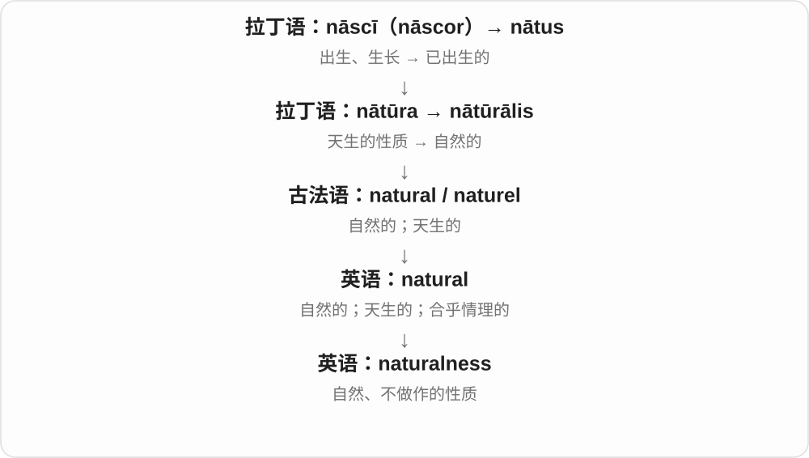

可以评价笑容、演技，也可以评价一句外语是否符合惯用表达。自然程度不等于词句有没有语法错误。

**常见搭配与例句**

the naturalness of a smile；naturalness of expression；a sense of naturalness。

> The actor’s naturalness made the scene believable.

演员自然的表现让这一幕显得可信。

> The revision improved the naturalness of the translation.

修改使译文更自然了。

**别混淆**

accuracy 是准确；naturalness 是自然顺口。译文可能准确却不够自然。

### 313. peacefulness — 安宁、平和；和平、不具攻击性的状态

**音标**：/ˈpiːsfəlnəs/

**先抓住这个画面**

湖边无人喧哗的宁静，或一个人不以冲突回应的平和，都可用这个名词表达。具体是环境、内心还是行为，要看前后文。

**怎么拆**

peaceful + -ness，peace + -ful 先说平和、安宁，再把性质变成名词。不是 peace + fullness 的满额。

**怎么变成今天的意思**

**拉丁 pax → 法语 pais/pes → 英语 peace**  
和平、安宁

↓

**peace + -ful → peaceful；再接 -ness**  
安宁的性质 → peacefulness 这一状态

the peacefulness of the garden 花园的宁静，a sense of peacefulness 平和感，the peacefulness of the gathering 集会的和平状态。

**常见搭配与例句**

the peacefulness of；a sense of peacefulness。

> She enjoyed the peacefulness of the garden.

她喜欢花园里的宁静。

> The music gave him a sense of peacefulness.

音乐让他感到平和。

**别混淆**

peacefulness 常突出平静、平和的性质，peace 可更直接说和平、和解。安静 quietness 与平和有交叠，但 quiet 不一定说明没有敌意。

### 314. rawness — 生、未经加工的状态；粗粝感；刺痛、情绪未平复的状态

**音标**：英 /ˈrɔːnəs/；美 /ˈrɔːnəs/

**先抓住这个画面**

不把表面磨光、不把感情修饰平顺，保留刚出来的棱角和刺痛感；评论表演时也可能正是欣赏这种真实劲。

**怎么拆**

raw + -ness，形成状态、性质名词。具体是材料未处理还是情绪直露，要跟着修饰对象读。

**怎么变成今天的意思**

**古英语 hrēaw → 中古英语 raw → raw**  
生的、未煮熟的

↓

**英语扩展**  
未加工、未经训练；皮肤磨破、情绪未平复

↓

**raw + -ness → rawness**  
生、未经处理、刺痛或直接袒露的性质

the rawness of his voice 嗓音的嘶哑粗粝，emotional rawness 情绪尚敏感、未平复，the rawness of the performance 表演的原生、粗粝感。

**常见搭配与例句**

emotional rawness；the rawness of the voice；the rawness of the performance。

> The rawness of her voice suited the song.

她嗓音里的粗粝感很适合这首歌。

> The memoir preserves the emotional rawness of that year.

回忆录保留了那一年感情仍未平复的刺痛感。

**别混淆**

rawness 可以是未打磨，也可有直接、真切的艺术评价；不是所有场合都译成缺点、粗制滥造。

### 315. youthfulness — 青春感；年轻的活力、外观或特点

**音标**：/ˈjuːθfəlnəs/

**先抓住这个画面**

把一个人身上那种轻快、朝气、显年轻的感觉单独拿出来谈。

**怎么拆**

youthful + -ness；链条是 youth → youthful → youthfulness，不把 -fulness 当一块解释不清的东西。

**怎么变成今天的意思**

**youth → youthful**  
青春 → 带青春特征的

↓

**youthful + -ness → youthfulness**  
显年轻、朝气等性质

the youthfulness of her voice 她声音里的年轻感，retain youthfulness 保持青春感。可说声音、态度、表达，不只肤色、皮肤。

**常见搭配与例句**

the youthfulness of；a sense of youthfulness；retain youthfulness。

> The youthfulness of his voice surprised the audience.

他声音里的年轻感让观众惊讶。

> The design conveys energy and youthfulness.

设计传达出活力与青春感。

**别混淆**

youth 年轻时期或青年，youthfulness 带青春特点的性质；年龄增长不代表所有 youthfulness 都消失。

### 316. cheapness — 便宜、低价；廉价感、低劣

**音标**：/ˈtʃiːpnəs/

**先抓住这个画面**

把价钱低或格调低作为一个性质来谈。the cheapness of the tickets 是票便宜，不一定说票本身印得烂。

**怎么拆**

cheap + -ness，性质名词随语境分低价格与低质量感。

**怎么变成今天的意思**

**古英语 cēap → 中古英语 chep 等**  
贸易、买卖、价钱

↓

**good cheap 等旧短语 → cheap〔形容词〕**  
划算的买卖 → 价格低

↓

**cheap + -ness → cheapness**  
价格低的性质；廉价、粗劣感

the cheapness of the tickets 票价便宜，cheapness of materials 材料廉价、低劣，a sense of cheapness 廉价感。

**常见搭配与例句**

the cheapness of；cheapness of materials；a sense of cheapness。

> The cheapness of the tickets attracted students.

票价便宜，吸引了学生。

> The reviewer criticized the cheapness of the materials.

评论者批评了材料的廉价低劣。

**别混淆**

cheapness 低价、廉价感，affordability 可负担程度；同一个很便宜的物件，对某人仍可能买不起。

### 317. strictness — 严格；严厉程度

**音标**：/ˈstrɪktnəs/

**先抓住这个画面**

规则或执行者到底把要求卡得多紧。

**怎么拆**

strict + -ness，把形容词变成性质名词。

**怎么变成今天的意思**

**拉丁语 stringere**  
拉紧、捆紧、压在一起

↓

**拉丁语 strictus → 英语 strict**  
拉紧的 → 严格、不松口

↓

**英语 strict + -ness → strictness**  
严格这种性质或程度

可以比较两所学校的 strictness，也能谈规则执行的严格程度。它说的是标准与执行，不自动包含责骂、惩罚或冷漠。

**常见搭配与例句**

the strictness of the rules；a reputation for strictness；excessive strictness。

> The school is known for the strictness of its attendance rules.

这所学校以出勤规定严格著称。

> His strictness at work does not prevent him from being kind.

他工作上要求严格，但待人仍然友善。

**别混淆**

severity 可以说病情、天气或惩罚有多严重；strictness 通常围绕遵守要求。

### 318. narrowness — 狭窄、狭小；范围有限、狭隘

**音标**：英 /ˈnærəʊnəs/；美 /ˈnæroʊnəs/

**先抓住这个画面**

把巷子有多窄、视野有多局限、胜负差距有多小说成一个性质；中文随对象选狭窄或狭隘。

**怎么拆**

narrow + -ness，已有中古英语相应形式。并非自带坏评价：巷子窄是尺寸，心胸、观点窄才常是批评。

**怎么变成今天的意思**

**古英语 nearu → 中古英语 narow → narrow**  
空间受限、狭窄、余地小

↓

**英语 narrow**  
宽度小 → 范围有限、差距很小；使范围缩小

↓

**narrow + -ness → narrowness**  
宽度或范围小的性质

the narrowness of the lane 巷子的狭窄，the narrowness of the victory 获胜优势微小，narrowness of outlook 眼界狭隘。

**常见搭配与例句**

the narrowness of；narrowness of outlook。

> The narrowness of the lane made deliveries difficult.

巷子太窄，送货很困难。

> The essay criticizes the narrowness of that viewpoint.

文章批评那个观点的狭隘。

**别混淆**

narrowness 可量空间或范围，thinness 多看厚度、粗细、稀密等；只用中文小来记会丢掉方向。

### 319. neatness — 整洁、工整；利落、巧妙

**音标**：/ˈniːtnəs/

**先抓住这个画面**

neat 说整洁，neatness 把整洁程度、安排得利落这件事本身变成讨论对象。字迹、房间、证明都能按场景用。

**怎么拆**

neat + -ness，形成性质、状态名词，通常不可数。

**怎么变成今天的意思**

**拉丁 nitere 发亮 → nitidus 光洁**  
光亮、漂亮、整洁

↓

**法语 net、neit → neat**  
干净、整齐、利落；又有纯净、不掺杂义

↓

**neat + -ness → neatness**  
整洁、利落的性质

the neatness of handwriting 字迹工整，value neatness 重视整洁，the neatness of a solution 解法的利落巧妙。

**常见搭配与例句**

the neatness of；value neatness。

> The teacher praised the neatness of her work.

老师表扬了她作业的工整。

> I admired the neatness of the solution.

我很欣赏那个解法的简洁巧妙。

**别混淆**

neatness 不必与事物绝对正确画等号：笔记整齐与内容正确，是两种评价。

### 320. shallowness — 浅、浅度；肤浅、缺少深度

**音标**：英 /ˈʃæləʊnəs/；美 /ˈʃæloʊnəs/

**先抓住这个画面**

shallow 是浅的，shallowness 就把这种深度不足变成一个性质：水有多浅，分析有多浮，都能讨论。

**怎么拆**

shallow + -ness，性质名词。保留原词形，实体水深与抽象思考深度随语境选择。

**怎么变成今天的意思**

**中古英语 schalowe，联系更早 sceald 等浅的词形**  
水、空间的深度小；具体更早演变有讨论

↓

**shallow + -ness → shallowness**  
深度小；思想、分析的浅薄

the shallowness of the water 水的浅，the shallowness of an argument 论证的浅薄。

**常见搭配与例句**

the shallowness of the pool；intellectual shallowness。

> The shallowness of the pool was clear from the visible bottom.

能看见池底，足见池水很浅。

> The essay exposed the shallowness of the original argument.

文章揭出了原论证缺少深度。

**别混淆**

物理浅度中性；评价思想、人物时 shallowness 通常是批评，不能一律用同样语气翻译。

### 321. keenness — 热切、热心；敏锐、锋利程度

**音标**：/ˈkiːnnəs/

**先抓住这个画面**

刀有多锋利，人有多敏锐，做事有多积极，都能把 keen 的性质拿出来称 keenness。前后的对象决定该用哪个中文。

**怎么拆**

keen + -ness；keen 末尾 n 与 -ness 开头 n 都保留，写成 nn，并不是重新双写词干来加 -ing。

**怎么变成今天的意思**

**古英语 cēne → 中古英语 kene → keen**  
勇敢、有能力、聪明等；更早核心连接有讨论

↓

**现代常见分支**  
热切、敏锐、锋利、强烈

↓

**后缀**  
keenly 方式、程度；keenness 性质；keener 比较级或口语人物名词

keenness to learn 学习的热切，keenness of mind 思维敏锐，the keenness of a blade 刀刃锋利。通常不可数。

**常见搭配与例句**

keenness to learn；keenness of mind。

> Her keenness to help was obvious.

她很愿意帮忙，这一点很明显。

> Age had not reduced his keenness of mind.

年纪增长没有削弱他思维的敏锐。

**别混淆**

keenness 是品质、程度，不是一个热心人；人物名词 keener 在一些口语语境中另用。

### 322. roundness — 圆度；圆润的性质

**音标**：/ˈraʊndnəs/

**先抓住这个画面**

roundness 是问“它到底有多圆、圆得怎么样”：可以看轮廓，也能形容声音的圆润感。

**怎么拆**

round + -ness，中古英语已有 roundnesse。

**怎么变成今天的意思**

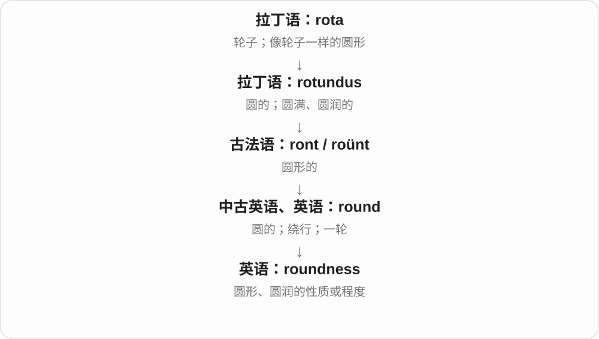

工程里的圆度要按具体测量定义判断；日常只是形状或感官描述。不是简单看周长大不大。

**常见搭配与例句**

the roundness of a pebble；measure roundness；roundness of tone。

> The potter checked the roundness of the bowl.

陶艺师检查了碗的圆度。

> The singer’s tone had warmth and roundness.

歌手的声音温暖而圆润。

**别混淆**

size 是大小；roundness 是圆的程度。很小的东西也可能非常圆。

### 323. smallness — 小；规模小、微小的性质

**音标**：英 /ˈsmɔːlnəs/；美 /ˈsmɔːlnəs/

**先抓住这个画面**

不直接说小房间，而把“它小”这一特点拎出来当讨论对象。

**怎么拆**

small + -ness，中古英语有 smalnesse 等，形成性质、状态名词。

**怎么变成今天的意思**

**古英语 smæl → 中古英语 smal / small**  
窄、细小、纤细

↓

**英语 small**  
小；少；规模、程度低

↓

**small + -ness → smallness**  
体积、规模等小的性质

the smallness of the room 房间狭小，the smallness of a team 团队规模小。可带局促，也可说明灵活，态度看上下文。

**常见搭配与例句**

the smallness of；the smallness of the room；a sense of smallness。

> The smallness of the room made storage difficult.

房间太小，让储物变得困难。

> The team’s smallness made quick decisions easier.

团队规模小，决定更容易迅速作出。

**别混淆**

smallness 是性质名词，smallish 形容偏小；不是凡是 -ness 都表示令人不快。

### 324. decisiveness — 果断；决定性

**音标**：/dɪˈsaɪsɪvnəs/

**先抓住这个画面**

能把待定事项推进到明确选择的劲头，或者某个因素足以决定结果的力量。

**怎么拆**

decisive + -ness，英语性质名词；不是 decision 的复数。

**怎么变成今天的意思**

**拉丁 caedere，分词 caesus；复合词常见 -cidere / -cisus**  
切、砍、击杀

↓

**拉丁 de- + caedere → decidere；分词 decisus**  
切断 → 了结争执、作出判断

↓

**中世纪拉丁 decisivus；中古法语 decisif → 英语 decisive**  
能决定结果的；后来也指果断的

↓

**英语 decisive + -ness → decisiveness**  
果断的、决定性的 → 果断、决定性

评价人常强调及时判断与行动；评价胜利等则强调结果明确。果断与鲁莽不同，还要看判断是否有依据。

**常见搭配与例句**

show decisiveness；the decisiveness of a victory。

> The crisis required both careful judgment and decisiveness.

这场危机既需要审慎判断，也需要果断行动。

> The decisiveness of the vote surprised the organisers.

表决结果如此明确，让组织者感到意外。

**别混淆**

speed 只有速度；decisiveness 还涉及明确选择和结束摇摆。

### 325. indecisiveness — 优柔寡断；犹豫不决的倾向

**音标**：/ˌɪndɪˈsaɪsɪvnəs/

**先抓住这个画面**

不是一次还没决定，而是做选择时反复摇摆、难以拍板的那种表现或倾向。

**怎么拆**

indecisive + -ness；先由 in- 否定 decisive，再把性质名词化。

**怎么变成今天的意思**

**拉丁 caedere，分词 caesus；复合词常见 -cidere / -cisus**  
切、砍、击杀

↓

**拉丁 de- + caedere → decidere；分词 decisus**  
切断 → 了结争执、作出判断

↓

**中世纪拉丁 decisivus；中古法语 decisif → 英语 decisive**  
能决定结果的；后来也指果断的

↓

**英语 indecisive → indecisiveness**  
犹豫不决的 → 优柔寡断

可以描述某一阶段，也可描述长期习惯。常说 frustration with someone’s indecisiveness，抱怨对方迟迟拿不定主意。

**常见搭配与例句**

chronic indecisiveness；indecisiveness over…。

> Her indecisiveness over small details slowed the preparations.

她在小细节上犹豫不决，拖慢了准备进度。

> The team mistook careful reflection for indecisiveness.

团队把认真思考误当成了优柔寡断。

**别混淆**

indecision 常指某次犹豫的状态；indecisiveness 更容易指这种性格或行为倾向。

### 326. lawfulness — 合法性、守法；按规律运行的性质

**音标**：英 /ˈlɔːfəlnəs/；美 /ˈlɔːfəlnəs/

**先抓住这个画面**

lawful 是合乎法律，lawfulness 把这件事变成可讨论的性质。examine the lawfulness of an action 是考察行为是否合乎适用法律。

**怎么拆**

lawful + -ness，中古英语已有相应形式；-ful 形成性质，-ness 再名词化。

**怎么变成今天的意思**

**law + -ful → lawful**  
符合法律的

↓

**lawful + -ness → lawfulness**  
符合法律这一性质；也可有按规律运行的抽象义

the lawfulness of a decision 决定的合法性，question the lawfulness 质疑合法性。

**常见搭配与例句**

assess the lawfulness of；the lawfulness of an action。

> The court examined the lawfulness of the decision.

法院审查了这一决定的合法性。

> The report distinguishes lawfulness from public approval.

报告区分了合法性与公众赞同。

**别混淆**

lawfulness 与 fairness 公平关注不同方面；评价一项行为时，两个问题可以分别讨论。

### 327. smartness — 聪明、机敏；衣着整洁得体；智能特性〔依语境〕

**音标**：英 /ˈsmɑːtnəs/；美 /ˈsmɑːrtnəs/

**先抓住这个画面**

把聪明、利落这个特点当名词来谈；评人可能说脑子，评衣着可能说整洁。

**怎么拆**

smart + -ness，中古英语已有对应形式，旧义还可接疼痛、尖锐感；现代按对象取聪明、得体等常用支线。

**怎么变成今天的意思**

**古英语 smeart〔形容词〕、smeortan 等〔动词〕**  
刺痛的、造成尖锐疼痛；感到刺痛

↓

**中古英语及后续 smart**  
话语尖刻、机敏；聪明、利落、穿着得体；设备智能

↓

**现代动词 smart**  
刺痛、难受；保留旧感觉支线

↓

**smart + -ness → smartness**  
smart 的性质；现代聪明、利落等

the smartness of the design 设计的巧妙，the smartness of the uniform 制服的整洁得体。

**常见搭配与例句**

the smartness of；technical smartness；a sense of smartness。

> The smartness of the design lies in its simplicity.

设计的巧妙就在于简洁。

> The school valued the smartness of its uniforms.

学校重视制服穿着的整洁得体。

**别混淆**

smartness 不等于 kindness 善良；聪明与判断、品格是不同评价。衣着 smartness 也不自动指电子智能功能。

### 328. looseness — 松动、松散；宽松、不严密

**音标**：/ˈluːsnəs/

**先抓住这个画面**

把“没有收紧、没有严密扣住”当一个性质讨论：零件能晃，论证也可能松散。

**怎么拆**

loose + -ness，保留 e，状态名词。现代不是 lose 丢失 + -ness。

**怎么变成今天的意思**

**古诺尔斯语 lauss → 中古英语 loos → loose**  
松开、自由、未束缚

↓

**loose + -ness → looseness**  
松紧程度的松；关系、论证不严密

looseness in a joint 接合处松动，looseness of structure 结构松散，looseness in the argument 论证不严密。

**常见搭配与例句**

looseness in a joint；looseness of structure；looseness in an argument。

> The mechanic checked for looseness in the steering joint.

机械师检查了转向接合处是否松动。

> The editor pointed out a looseness in the argument.

编辑指出了论证不严密的地方。

**别混淆**

looseness 状态，loosen 动作；looseness of fit 说装配、合身关系，不能只固定译成随便态度。

### 329. crispness — 脆度；清晰度；清爽利落的质感

**音标**：/ˈkrɪspnəs/

**先抓住这个画面**

把咬起来脆、看起来清楚、空气清爽等特点，作为一种性质来谈。

**怎么拆**

crisp + -ness；英语用性质名词后缀把形容词变成名词，不是单指某种食物。

**怎么变成今天的意思**

**拉丁 crispus 卷曲、有褶的**  
先抓住弯曲、起皱的外形

↓

**古英语 crisp 卷曲的 → 中古英语 crisp → 现代英语 crisp**  
后来出现脆、爽利、清晰等义；卷曲到脆的具体中间过程并不完全确定

↓

**英语 crisp + -ness → crispness**  
脆、清晰、清爽等性质的名称

retain its crispness 是保持脆度；the crispness of an image 是图像的清晰锐利感。它通常不可数，要看所修饰对象决定中文。

**常见搭配与例句**

retain crispness；lose its crispness；the crispness of an image。

> The biscuits lost their crispness in the damp air.

饼干在潮湿空气中失去了酥脆感。

> I like the crispness of the new display.

我喜欢新显示屏清晰锐利的效果。

**别混淆**

crispness 强调清楚或脆爽的质感；hardness 是硬度。坚硬的石头未必有食品广告所说的 crispness。

### 330. prettiness — 漂亮；秀美、精致好看的性质

**音标**：/ˈprɪtinəs/

**先抓住这个画面**

把外观让人觉得好看这一点，拿出来当作一种特征。

**怎么拆**

pretty + -ness，y 变 i。名词保留现代好看义，不是抽象化成机巧、狡诈。

**怎么变成今天的意思**

**古英语 prættiġ → 中古英语 prety / praty**  
机巧、狡黠、巧妙等旧义

↓

**英语 pretty**  
后来发展出精巧、好看等义；现代也常作程度副词

↓

**pretty → prettiness**  
漂亮的 → 漂亮这一性质

the prettiness of a village 村庄的秀美；mere prettiness 可表示只有好看、缺乏更深内容，这是上下文的评价。

**常见搭配与例句**

the prettiness of the setting；mere prettiness；delicate prettiness。

> The garden’s prettiness attracted visitors in spring.

春天，花园的秀美吸引了访客。

> The review praised the film’s depth rather than its prettiness alone.

评论赞扬电影的深度，而不只是画面好看。

**别混淆**

prettiness 偏好看、精致的感受；beauty 范围更广，也能说壮美、深刻之美。两者有重叠，不是硬划等级。

### 331. wrongness — 错误；不当、不公的性质；不对劲的感觉

**音标**：英 /ˈrɒŋnəs/；美 /ˈrɔːŋnəs/

**先抓住这个画面**

先不点名是哪件错事，而是把它哪里不对、为什么不当拿出来看。

**怎么拆**

wrong + -ness，性质名词；可谈事实错误、道德不当，也可表达直觉中的不对劲。

**怎么变成今天的意思**

**古诺斯语 rangr / vrangr；英语早期 wrang 等形式**  
歪的、扭曲的；不对的

↓

**中古英语 wrong → 英语 wrong**  
不正确、不合适、不公正；出毛病

↓

**wrong → wrongness**  
不对的 → 不对、不当这种性质

the wrongness of an action 行为的不当；a sense of wrongness 一种不对劲的感觉。比 a mistake 更抽象，不主要用来数犯了几个错。

**常见搭配与例句**

the wrongness of something；a sense of wrongness；recognize the wrongness。

> She immediately sensed the wrongness of the arrangement.

她立刻感到这个安排不对劲。

> The essay examines the moral wrongness of deception.

文章探讨欺骗在道德上的不当。

**别混淆**

wrongness 是性质，wrongdoing 是不当行为；一份报告的 factual errors 常比 a list of wrongnesses 自然。

### 332. gratefulness — 感激、感谢之情

**音标**：/ˈɡreɪtfəlnəs/

**先抓住这个画面**

对方帮了忙，你心里记着这份好，这种感谢的心情就是 gratefulness；重点是人的感受。

**怎么拆**

grateful + -ness。grateful 接旧形容词 grate、拉丁 gratus，不是 grate 刨碎，也不拼 greatfulness。

**怎么变成今天的意思**

**拉丁 gratus → 英语旧形容词 grate**  
令人愉快、受欢迎；心怀感谢

↓

**grate + -ful → grateful**  
心存感谢的

↓

**grateful + -ness → gratefulness**  
感激这一状态、心情

a sense of gratefulness 感激之情，express gratefulness 表达感谢，gratefulness for someone’s support 对某人支持的感激。gratitude 是同义而很常见的名词。

**常见搭配与例句**

a sense of gratefulness；express gratefulness；gratefulness for。

> She spoke with genuine gratefulness for their support.

她谈起他们的支持时充满由衷的感激。

> He felt a deep sense of gratefulness when he read the message.

他读到那条消息时，心里十分感激。

**别混淆**

grateful 形容词，gratefully 副词，gratefulness 名词。gratitude 往往更简洁自然，不必为了展示后缀每次都换成长词。

### 333. seasickness — 晕船；晕船不适

**音标**：/ˈsiːsɪknəs/

**先抓住这个画面**

把晕船的状态作为一种不适来讲，而不是拿形容词直接充当名词。

**怎么拆**

seasick + -ness，性质状态名词；也能按 sea + sickness 理解。这里 -ness 不表示人。

**怎么变成今天的意思**

**古英语 sǣ → 中古英语 see → sea**  
海；日耳曼古老水域词，更远来历有争论

↓

**现代 sea 词族**  
海域、海水 → 岸边、航行、海洋生物等复合词

↓

**seasick + -ness → seasickness**  
晕船的 → 晕船状态、不适

suffer from seasickness 晕船，a bout of seasickness 一阵晕船不适；通常不可数。

**常见搭配与例句**

suffer from seasickness；a bout of seasickness；seasickness during a voyage。

> Seasickness spoiled the first day of the voyage.

晕船影响了航程的第一天。

> She had never experienced seasickness before that trip.

那次旅行前，她从未体验过晕船。

**别混淆**

I feel seasick 形容词，I suffer from seasickness 名词；不是 I feel seasickness 的机械替换。

### 334. steepness — 陡峭程度、坡度大；变化急剧的程度

**音标**：/ˈstiːpnəs/

**先抓住这个画面**

把 steep 这种陡变成可以讨论的性质，就是 steepness。看山坡有多立，也能看图上的线变化多急。

**怎么拆**

steep + -ness，性质名词；接陡峭形容词这一支，不接泡茶动词。

**怎么变成今天的意思**

**古英语 stēap 高耸 → 中古英语 steep → steep**  
高耸、突起 → 坡度很大；后又形容价格过高

↓

**steep + -ness → steepness**  
陡峭的性质、程度

the steepness of a slope 坡的陡峭程度，the steepness of the curve 曲线的陡峭程度。

**常见搭配与例句**

the steepness of the hill；the steepness of a curve。

> We underestimated the steepness of the hill.

我们低估了这座山坡有多陡。

> The steepness of the curve shows how rapidly the value changes.

曲线的陡峭程度显示数值变化得有多快。

**别混淆**

日常 steepness 看坡有多陡；数学讨论还要明确坐标尺度，图画得更窄并不会改变原始数据。

### 335. vividness — 鲜明程度；生动性；清晰强烈的感受

**音标**：/ˈvɪvɪdnəs/

**先抓住这个画面**

有的记忆只剩轮廓，有的连颜色、声音都像在眼前；后者的 vividness 更强。

**怎么拆**

vivid + -ness；英语性质名词。

**怎么变成今天的意思**

**拉丁 vīvus、vīvere；相关 vīta**  
活着的、生活；生命

↓

**拉丁 vividus → 法语 vivide / 直接拉丁借入 → 英语 vivid**  
充满生命力的 → 鲜明、生动的

↓

**英语 vivid + -ness → vividness**  
鲜明的 → 鲜明、生动的程度

可说描写、梦境、色彩或记忆。衡量的是主观印象强弱，而非直接衡量真实度。

**常见搭配与例句**

the vividness of a memory；colour vividness；vividness of description。

> The vividness of the dream stayed with her all morning.

那个梦鲜明的感受整个上午都留在她脑中。

> The vividness of the description helped readers imagine the room.

描写的生动性帮助读者想象房间的样子。

**别混淆**

accuracy 是准确性；vividness 是鲜明程度，不能用“记得真清楚”替代事实核对。

### 336. obviousness — 明显；显而易见的程度

**音标**：英 /ˈɒbviəsnəs/；美 /ˈɑːbviəsnəs/

**先抓住这个画面**

说的不是某条结论本身，而是它有多容易被看出来。

**怎么拆**

obvious + -ness，把“明显的”变成一种性质。

**怎么变成今天的意思**

**拉丁 via**  
道路、路径

↓

**拉丁 ob + viam → obviam → obvius**  
在路前面、迎面可遇见的

↓

**英语 obvious**  
从容易遇到、摆在眼前，发展为明显的

↓

**英语 obvious + -ness → obviousness**  
容易看出这一性质

the obviousness of the error 是错误明显到什么程度。这个名词比 obvious 更抽象，适合比较不同人的观察或解释为什么一个问题容易被忽略。

**常见搭配与例句**

the obviousness of a mistake；apparent obviousness。

> The obviousness of the error made the delay hard to explain.

错误如此明显，拖到现在才处理就很难解释。

> What surprised her was the obviousness of the solution once it was drawn.

令她惊讶的是，解法一画出来就显得那么明白。

**别混淆**

obviousness 讨论清楚程度；certainty 讨论确定程度。某件事乍看很明显，仍可能判断错。

### 337. creepiness — 阴森感、瘆人感；令人不安的特质

**音标**：/ˈkriːpɪnəs/

**先抓住这个画面**

一个地方、行为或故事里，那种说不清哪里不对却让你不舒服的感觉，就是 creepiness。

**怎么拆**

creepy + -ness，y 改 i；性质名词，把令人发毛这一特点或感受当成整体来谈。

**怎么变成今天的意思**

**creep 缓慢爬行 → creepy**  
引起仿佛虫在皮肤上爬的不适感 → 令人发毛的

↓

**creepy + -ness → creepiness**  
令人发毛的性质、感受

the creepiness of a place 地方的阴森感，add to the creepiness 增添瘆人感。

**常见搭配与例句**

a sense of creepiness；the creepiness of the scene。

> The flickering light added to the room’s creepiness.

忽明忽暗的灯增添了房间的阴森感。

> The film creates creepiness without showing a monster.

电影不展示怪物，也营造出了瘆人的感觉。

**别混淆**

creepiness 既可能来自恐怖氛围，也可能来自让人不适的注视、越界行为，不限鬼故事。

### 338. possessiveness — 占有欲；独占、控制的倾向

**音标**：/pəˈzesɪvnəs/

**先抓住这个画面**

possessiveness 是把“我在乎你”推成“你的时间和选择都该归我”的倾向，也可指对物品不肯分享。

**怎么拆**

possessive + -ness，把这种态度变成名词。

**怎么变成今天的意思**

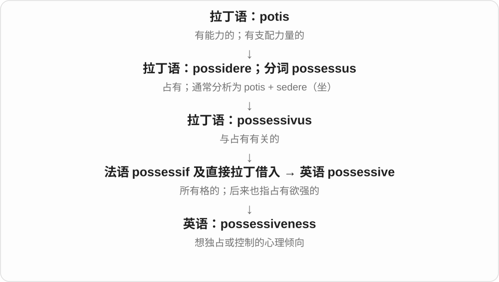

常用于关系中的控制欲，也可描述孩子不愿共享玩具。它谈的是态度，不能与“某人确实拥有某件东西”混为一谈。

**常见搭配与例句**

jealousy and possessiveness；emotional possessiveness；possessiveness about belongings。

> Her possessiveness about the family photographs surprised me.

她对家庭照片那种不肯让人分享的态度让我吃惊。

> He learned to distinguish affection from possessiveness.

他学会了区分关爱与占有欲。

**别混淆**

possession 是拥有、占有的事实；possessiveness 是不愿分享或放手的心理。

### 339. sourness — 酸味；不悦、刻薄的态度

**音标**：英 /ˈsaʊənəs/；美 /ˈsaʊərnəs/

**先抓住这个画面**

sour 描述味道酸，sourness 把酸的程度、性质单独拿出来。声音、态度里的不悦也可以像味道一样被品出来。

**怎么拆**

承古英语 sūrnes、中古英语 sournesse 等，对应 sour + -ness。味觉与情绪评价的性质名词随 sour 义项发展。

**怎么变成今天的意思**

**古英语 sūr → 中古英语 sour → sour**  
酸味的日耳曼旧词

↓

**sour + -ness → sourness**  
酸的性质、程度；不悦态度

the sourness of the fruit 水果的酸味；a hint of sourness 一丝酸味或不悦。

**常见搭配与例句**

the sourness of；a hint of sourness。

> A little sugar balanced the sourness of the fruit.

少量糖平衡了水果的酸味。

> There was a trace of sourness in his reply.

他的回答里带着一点不悦。

**别混淆**

sourness 的味道、态度义看对象；不能把所有酸度测量都只凭味觉 sourness 推算。

### 340. suddenness — 突然性、突如其来的程度

**音标**：/ˈsʌdənnəs/

**先抓住这个画面**

不是在说发生了哪件事，而是把“来得这么突然”这个特点单独拿出来说。

**怎么拆**

sudden + -ness，形成性质名词。词干末尾 n 与后缀开头 n 都保留在拼写中。

**怎么变成今天的意思**

**拉丁语 subīre → subitus、subitāneus**  
来到、临近等；突然发生的

↓

**通俗拉丁语重建形 \*subitānus → 法语 sodain、subdain → 中古英语 sodeyn → sudden**  
突然、出乎预料的

↓

**sudden + -ness → suddenness**  
突发、没有预告这一性质

the suddenness of the change 变化的突然性，with surprising suddenness 出人意料地突然。

**常见搭配与例句**

the suddenness of；with suddenness；shocked by the suddenness。

> We were shocked by the suddenness of his departure.

他离开得这么突然，让我们很吃惊。

> The storm arrived with surprising suddenness.

暴风雨来得出人意料地突然。

**别混淆**

suddenness 突然这一特点，speed 速度；令人吃惊的往往是没预告，而不只是物理运动快。

### 341. agreeableness — 随和；亲切合作的倾向；宜人的性质

**音标**：/əˈɡriːəbəlnəs/

**先抓住这个画面**

相处时愿意体谅、合作，较少硬碰硬；也可泛说环境或体验让人舒服。

**怎么拆**

agreeable + -ness，把合意、随和的形容词变成性质名词。

**怎么变成今天的意思**

**拉丁 gratus**  
令人喜欢、受欢迎；也指心怀感谢

↓

**古法语 gré → agreer → agreable**  
合意 → 使人愉快、可接受的

↓

**中古英语 agreable → agreeable**  
令人愉快的；愿意接受的

↓

**英语 agreeable + -ness → agreeableness**  
宜人、随和这种性质

人格心理学里常译“宜人性”，讨论合作、信任、体谅等倾向。它不是“一个人总是正确地同意别人”，也不等于没有主见。

**常见搭配与例句**

high agreeableness；the agreeableness of her manner。

> Her agreeableness helped the team handle small disputes calmly.

她随和的性格帮助团队平静处理小分歧。

> The survey measured agreeableness as one aspect of personality.

调查将宜人性作为人格的一个方面来测量。

**别混淆**

agreement 是某次或某件事上的一致；agreeableness 是待人风格或令人愉快的性质。

### 342. meaningfulness — 意义感、有意义的程度；含义的充分性

**音标**：/ˈmiːnɪŋfəlnəs/

**先抓住这个画面**

一份活动让人觉得值得、和生活有关，这种有意义的程度可以叫 meaningfulness；讨论一句话是否真能传达含义时，也能用它。

**怎么拆**

meaningful + -ness，形成性质、程度名词。里面 meaning + -ful 先给出有意义，-ness 再把性质变成讨论对象。

**怎么变成今天的意思**

**meaning 意义、含义 + -ful → meaningful**  
有意义、有分量；含有某种暗示

↓

**meaningful + -ly → meaningfully**  
实质性地；意味深长地

↓

**meaningful + -ness → meaningfulness**  
有意义、有价值、能传达含义的性质

a sense of meaningfulness 意义感，the meaningfulness of work 工作的意义感，question the meaningfulness of a statement 质疑说法是否真有意义。

**常见搭配与例句**

the meaningfulness of；a sense of meaningfulness。

> The interviews explored the meaningfulness of the volunteers’ work.

访谈探讨了志愿者工作带来的意义感。

> Shared goals gave the project a sense of meaningfulness.

共同目标让项目有了意义感。

**别混淆**

meaningfulness 不是意义很多的数量单位；日常 meaning 也能表达意义，长词更突出这种性质或程度。

### 343. greenness — 绿色、绿意；青涩、经验不足

**音标**：/ˈɡriːnnəs/

**先抓住这个画面**

把绿这项特点单独拿出来说：可以是景物有多绿，也可以是人有多青涩。

**怎么拆**

green + -ness，性质、状态名词；相应形式古英语已有。不同 green 义都可能形成 greenness，要看修饰对象。

**怎么变成今天的意思**

**古英语 grēne → 中古英语 grene → green**  
生长植物的绿色；新鲜、有生机

↓

**现代 green**  
颜色 → 未成熟、缺经验；环保等语境义

↓

**green + -ness → greenness**  
绿色、青涩 → 相应性质或状态

the greenness of the hills 山峦的绿意，his greenness as a manager 他作为经理的缺经验。

**常见搭配与例句**

the greenness of the landscape；youthful greenness；greenness as a newcomer。

> The rain brought out the greenness of the hills.

雨让山峦的绿意更显眼了。

> His greenness showed during his first negotiation.

他在第一次谈判时显露出经验不足。

**别混淆**

greenness 是性质，greenery 是实际植物；一把绿叶可以提供 greenery，也让环境增加 greenness。

### 344. healthiness — 健康、健康程度；健全性

**音标**：/ˈhelθinəs/

**先抓住这个画面**

把 healthy 这个特点拿出来比较、讨论：一种饮食、环境、状态究竟有多健康。

**怎么拆**

healthy + -ness，y 改为 i。性质名词与较基本的 health 关系接近，healthiness 常突出某物是否健康、健康到什么程度。

**怎么变成今天的意思**

**health + -y → healthy**  
健康、健全的；丰足等比喻用法

↓

**healthy + -ly/-ness**  
以健康方式；健康程度、健康状态

the healthiness of a diet 一种饮食的健康程度，assess healthiness 评估健康程度。具体衡量标准由上下文说明。

**常见搭配与例句**

the healthiness of；assess healthiness；perceived healthiness。

> The study examined people’s views of the healthiness of different meals.

研究考察了人们对不同餐食健康程度的看法。

> The label influenced their perception of the product’s healthiness.

标签影响了他们对产品健康程度的印象。

**别混淆**

healthiness 具有 healthy 性质的程度，health 健康这一基本概念；healthiness 不能拿一个产品的宣传词当确定医学结论。

### 345. rebelliousness — 叛逆性；不服管束的倾向

**音标**：英美 /rɪˈbeljəsnəs/

**先抓住这个画面**

不是哪一次具体反抗，而是一个人身上常有的“不想照你安排”的性情。

**怎么拆**

英语 rebellious + -ness，把叛逆的性质或状态名词化。-ness 不增加“更严重”或“很多次”的含义。

**怎么变成今天的意思**

**拉丁 bellum → bellare**  
战争 → 作战

↓

**拉丁 rebellare／rebellis**  
反抗、重新作战／反抗的

↓

**英语 rebellious + -ness**  
叛逆的 → 叛逆性、不服从的倾向

谈一个孩子、艺术家或群体的 rebelliousness，常是在概括一种持续的态度。它既可能惹来冲突，也可能表现为敢于质疑传统，不能一见这个词就译成犯罪倾向。

**常见搭配与例句**

teenage rebelliousness；a streak of rebelliousness；signs of rebelliousness。

> Her early rebelliousness later became a willingness to challenge outdated ideas.

她早年的叛逆后来变成了敢于挑战过时观念的态度。

> The teacher saw frustration behind his apparent rebelliousness.

老师从他表面上的不服管束看出了挫败感。

**别混淆**

rebellion 更容易指一场或一次反抗；rebelliousness 通常不可数，更强调特质、倾向。

## 这一组要分清什么

weariness 疲倦与 wariness 警惕分清；soundness 可说结构、方案可靠，并非声音大小；tenderness 随对象可指温柔、食物柔嫩或压痛；weightlessness 的失重不意味着质量或引力消失。

## 串起来练习

Her tiredness was obvious, but she answered everyone with kindness.

她显然很疲惫，但对每个人仍很和善。
