# 0110 · -ence — 动作、状态、性质；也可指具体发生的事

[逐词精讲目录](../00_逐词精讲目录.md) · [总目录](../00_总目录_按常用程度.md)

## 核心词根与来源

把几个词放在句子里看：She is excellent 是在赞她，Her excellence 是在谈她的出色。reference 可以是参考资料、提及；residence 可以是住所；occurrence 可以是一件发生的事。名词尾只提示用法方向，不代替整词含义。

**-ENCE：从描述某人、某事，转到谈状态或过程本身**

converge 汇合 → convergence 汇合、趋同；excellent 出色的 → excellence 卓越。不是多出神秘概念，而是换成可以作为主语、宾语来谈的名词。

- **向同一点靠拢**：converge · convergence
- **使人打消念头**：deter · deterrent · deterrence
- **强烈排斥与疫病旧用语**：abhor · abhorrent · abhorrence · pestilence
- **表现突出与卓越**：excel · excellent · excellence
- **常见状态、关系与事件**：confidence · presence · absence · existence · difference · occurrence
- **资料、经验和认识**：reference · experience · evidence · intelligence · science · conscience
- **reference → references：指向资料、提及与推荐**：reference · references
- **prefer、preference → preferences：优先看待**：prefer · preference · preferences
- **revere 敬重 → reverence、reverent 等**：revere · reverence · reverent · reverend · reverential · reverently · irreverent · irreverence

## 词形与演化规律

与 -ance 的法语、拉丁历史密切相关，远接 -entia、-antia 等材料；现代不能只按 /əns/ 的读音判断拼 a 还是 e。常见 -ent／-ence 对应，如 excellent／excellence、abhorrent／abhorrence；convergence 则可对应 converge + -ence。许多词整体借入，人物名词、动词或形容词在现代英语里的长短顺序不自动等于出现年代。

名词有英语派生或法语借入分析，动词后来由名词转用。

preference 有法语、中世纪拉丁独立名词来源。

同接拉丁 revereri 敬畏，re- 可加强，vereri 敬畏。reverence 对应状态名词 -ence，reverent 接现在分词 -ent，reverend 另接 -endus 应被敬重；-ial、-ly、否定 ir- 各完整解释，不能混成真理 ver-。

## 单词速览（按词族由简到繁）

同一基础词的相关扩展放在一起，先读基础形式，再读扩展；各组之间优先读常用的。具体词源关系见各词讲解。

| 单词 | 音标 | 核心意思 |
|---|---|---|
| [experience](#w-34) | 英 /ɪkˈspɪəriəns/；美 /ɪkˈspɪriəns/ | 经验；经历、体验；亲身经历 |
| [evidence](#w-35) | /ˈevɪdəns/ | 证据；迹象；显示、证明 |
| [science](#w-36) | 英、美 /ˈsaɪəns/ | 科学；学科；系统知识 |
| [difference](#w-1) | /ˈdɪfərəns/，常弱读 /ˈdɪfrəns/ | 差别；差额；分歧；影响 |
| [influence](#w-37) | /ˈɪnfluəns/ | 影响；影响力；有影响的人或事 |
| [violence](#w-38) | /ˈvaɪələns/ | 暴力、强力侵害；猛烈、剧烈 |
| [reference](#w-2) | 英、美 /ˈrefrəns/ | 提及；参照、引用；参考资料；推荐证明；引用、提及 |
| [references](#w-59) | 英 /ˈrefərənsɪz/；美 /ˈrefərənsɪz/ | 提及、引用、参考文献；推荐人、推荐证明〔复数〕；提到、引用〔第三人称单数〕 |
| [audience](#w-39) | 英 /ˈɔːdiəns/；美 /ˈɑːdiəns/ | 听众；观众；受众；正式会见 |
| [presence](#w-41) | /ˈprezəns/ | 在场；存在；气场、风度 |
| [excel](#w-51) | /ɪkˈsel/ | 擅长；表现出色；胜过 |
| [excellent](#w-40) | /ˈeksələnt/ | 极好的；出色的 |
| [excellence](#w-48) | /ˈeksələns/ | 卓越；出色的品质、水准 |
| [intelligence](#w-42) | /ɪnˈtelɪdʒəns/ | 理解与思考能力；情报 |
| [confidence](#w-43) | 英 /ˈkɒnfɪdəns/；美 /ˈkɑːnfɪdəns/ | 信心；信任；把握；秘密 |
| [dependence](#w-10) | 英、美 /dɪˈpendəns/ | 依赖；依靠；取决关系 |
| [independence](#w-3) | 英、美 /ˌɪndɪˈpendəns/ | 独立；自主；自立 |
| [prefer](#w-60) | 英 /prɪˈfɜː/；美 /prɪˈfɜːr/ | 更喜欢；宁愿选择 |
| [preference](#w-6) | 英、美 /ˈprefrəns/ | 偏好；优先选择；优待 |
| [preferences](#w-61) | /ˈprefrənsɪz/ | 偏好、喜好；优先选择〔复数〕 |
| [existence](#w-4) | /ɪɡˈzɪstəns/ | 存在；生存；生活状态 |
| [residence](#w-5) | /ˈrezɪdəns/ | 住所；居住；驻留 |
| [sequence](#w-44) | /ˈsiːkwəns/ | 顺序；序列；一连串 |
| [consequence](#w-47) | 英 /ˈkɒnsɪkwəns/；美 /ˈkɑːnsəkwəns/ | 结果；后果；重要性 |
| [absence](#w-45) | /ˈæbsəns/ | 缺席；不在；缺乏、不存在 |
| [patience](#w-46) | /ˈpeɪʃəns/ | 耐心；忍耐力；单人纸牌游戏〔英式〕 |
| [convenience](#w-49) | 英 /kənˈviːniəns/；美 /kənˈviːnjəns/ | 方便；便利；便利设施 |
| [interference](#w-7) | 英 /ˌɪntəˈfɪərəns/；美 /ˌɪntərˈfɪrəns/ | 干预、妨碍；信号干扰；干涉〔物理〕 |
| [coincidence](#w-8) | 英 /kəʊˈɪnsɪdəns/；美 /koʊˈɪnsɪdəns/ | 巧合；同时发生；重合 |
| [conscience](#w-50) | 英 /ˈkɒnʃəns/；美 /ˈkɑːnʃəns/ | 良心；良知；内心的道德判断 |
| [occurrence](#w-9) | 英 /əˈkʌrəns/；美 /əˈkɜːrəns/ | 发生；出现的事件 |
| [revere](#w-64) | 英 /rɪˈvɪə/；美 /rɪˈvɪr/ | 深深敬重；崇敬 |
| [reverend](#w-62) | 英、美 /ˈrevərənd/ | 应受尊敬的；教士称谓〔如牧师〕 |
| [reverence](#w-63) | 英、美 /ˈrevərəns/ | 崇敬；敬意；敬畏 |
| [irreverence](#w-67) | 英 /ɪˈrevərəns/；美 /ɪˈrevərəns/ | 不敬；不拘庄重的态度；大胆戏谑 |
| [reverent](#w-66) | 英、美 /ˈrevərənt/ | 恭敬的；怀着崇敬的 |
| [reverently](#w-68) | 英、美 /ˈrevərəntli/ | 恭敬地；怀着崇敬地 |
| [irreverent](#w-65) | 英 /ɪˈrevərənt/；美 /ɪˈrevərənt/ | 不恭敬的；不把权威、惯例当神圣的；戏谑大胆的 |
| [reverential](#w-69) | 英 /ˌrevəˈrenʃəl/；美 /ˌrevəˈrenʃəl/ | 崇敬的；表示深敬的 |
| [negligence](#w-52) | /ˈneɡlɪdʒəns/ | 疏忽；过失；未尽应有注意 |
| [competence](#w-53) | 英 /ˈkɒmpətəns/；美 /ˈkɑːmpətəns/ | 胜任能力；权限；旧义足够维持生活的资财 |
| [resilience](#w-11) | 英 /rɪˈzɪliəns/；美 /rɪˈzɪljəns/ | 回弹力；适应力、恢复力、韧性 |
| [deter](#w-54) | 英 /dɪˈtɜː/；美 /dɪˈtɜːr/ | 使打消念头；阻止、吓阻 |
| [deterrent](#w-55) | 英 /dɪˈterənt/；美 /dɪˈtɜːrənt/ | 阻吓因素、威慑物；起阻遏作用的 |
| [deterrence](#w-20) | 英 /dɪˈterəns/；美 /dɪˈtɜːrəns/ | 威慑；阻吓、阻遏作用 |
| [converge](#w-56) | 英 /kənˈvɜːdʒ/；美 /kənˈvɜːrdʒ/ | 汇合；趋同；收敛 |
| [convergence](#w-12) | 英 /kənˈvɜːdʒəns/；美 /kənˈvɜːrdʒəns/ | 汇合；趋同；收敛 |
| [insistence](#w-13) | /ɪnˈsɪstəns/ | 坚持；坚决要求 |
| [precedence](#w-14) | 常用 /ˈpresɪdəns/；也读 /prɪˈsiːdəns/ | 优先；在先；先后次序 |
| [resurgence](#w-15) | 英 /rɪˈsɜːdʒəns/；美 /rɪˈsɜːrdʒəns/ | 复苏；再度兴起；重新抬头 |
| [inference](#w-16) | 英、美 /ˈɪnfərəns/ | 推理；推论、推断结果 |
| [recurrence](#w-17) | 英 /rɪˈkʌrəns/；美 /rɪˈkɜːrəns/ | 再次发生；复现 |
| [abstinence](#w-18) | /ˈæbstɪnəns/ | 戒除；节制；禁欲 |
| [subsistence](#w-19) | /səbˈsɪstəns/ | 生计；维持生存；基本生活所需 |
| [abhor](#w-58) | 英 /əbˈhɔː/；美 /əbˈhɔːr/ | 憎恶；极其厌恶 |
| [abhorrent](#w-57) | 英 /əbˈhɒrənt/；美 /əbˈhɔːrənt/ | 令人憎恶的；令人强烈反感的 |
| [abhorrence](#w-31) | 英 /əbˈhɒrəns/；美 /əbˈhɔːrəns/ | 憎恶；强烈厌恶 |
| [deference](#w-21) | 英、美 /ˈdefərəns/ | 敬重；尊重而顺从、让步 |
| [transcendence](#w-22) | /trænˈsendəns/ | 超越；超越性 |
| [ambivalence](#w-23) | 英、美 /æmˈbɪvələns/ | 矛盾心理；又想要又抗拒的态度 |
| [condolence](#w-24) | 英 /kənˈdəʊləns/；美 /kənˈdoʊləns/ | 吊唁；哀悼慰问 |
| [pestilence](#w-25) | /ˈpestɪləns/ | 瘟疫；严重流行病〔文学、历史用语〕 |
| [subsidence](#w-26) | 英 /səbˈsaɪdəns/，也 /ˈsʌbsɪdəns/；美 /səbˈsaɪdəns/ | 地面沉降；下陷；减退 |
| [salience](#w-28) | /ˈseɪliəns/ | 显著性、突出程度；引人注意的程度 |
| [subservience](#w-29) | 英 /səbˈsɜːviəns/；美 /səbˈsɜːrviəns/ | 屈从；过度顺从；从属地位 |
| [transience](#w-32) | 英 /ˈtrænziəns/；美 /ˈtrænʃəns/，亦读 /ˈtrænziəns/ | 短暂；转瞬即逝；无常 |
| [belligerence](#w-33) | 英美 /bəˈlɪdʒərəns/ | 好斗、挑衅的态度或行为；交战状态 |

## 逐词讲解

### 1. experience — 经验；经历、体验；亲身经历

**音标**：英 /ɪkˈspɪəriəns/；美 /ɪkˈspɪriəns/

**先抓住这个画面**

亲自做过、碰到过，留下来的认识是 experience；某一次碰到的事则是 an experience。

**怎么拆**

借古法语，上接拉丁 experientia、experiri 尝试、经历。可联系试过、走过的画面，不拆成现代 ex- 前任加一个英语独立词 perience。

**怎么变成今天的意思**

**拉丁 experiri 尝试、经历 → experientia**  
由实际试验、经历获得的认识

↓

**古法语、英语 experience**  
经验；一次经历；亲身经历

工作经验 work experience 通常不可数；一次经历 an experience 可数；动词 experience difficulties 是遇到困难。

**常见搭配与例句**

work experience；gain experience；an unusual experience；experience difficulties。

> She has experience in teaching young children.

她有教幼儿的经验。

> Travelling alone was a new experience for him.

独自旅行对他是一次新体验。

**别混淆**

experience 是经历或其积累，experiment 是为检验想法而设计的实验；一次经历不一定是实验。

### 2. evidence — 证据；迹象；显示、证明

**音标**：/ˈevɪdəns/

**先抓住这个画面**

evidence 是让一句话不只停留在嘴上的材料：照片、记录、足迹都可能帮你判断发生了什么。

**怎么拆**

来自拉丁语 ēvidentia“清楚、证明”，与 evident 同族；不是英语 evident 简单换尾的历史全过程。

**怎么变成今天的意思**

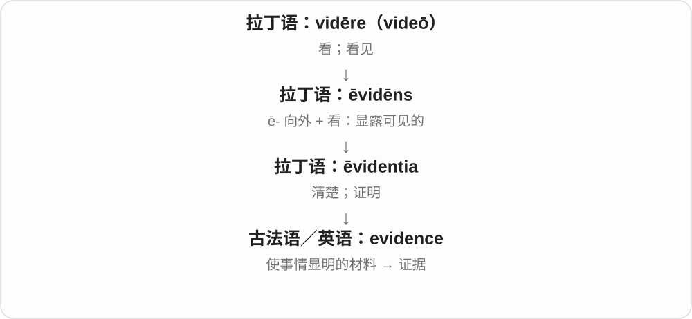

“事情变得看得清”转为“让事情看得清的依据”。证据可以支持某种判断，并不必然等于最终证明。

**常见搭配与例句**

evidence of…；evidence that…；gather evidence；a piece of evidence。

> The footprints were evidence that someone had entered the garden.

这些脚印表明有人进过花园。

> We need more evidence before drawing a conclusion.

下结论前，我们需要更多证据。

**别混淆**

通常不可数，说 some evidence 或 a piece of evidence。proof 更强调足以证实；evidence 可能仍不充分。

### 3. science — 科学；学科；系统知识

**音标**：英、美 /ˈsaɪəns/

**先抓住这个画面**

不只是“听说如此”，而是用观察、证据和推理，持续检查我们对世界的理解。

**怎么拆**

经法语 science 追溯到拉丁语 scientia“知识”，它关联 scire“知道”。英语早期范围比今天的自然科学更宽。

**怎么变成今天的意思**

**拉丁语 scire**  
知道、认识

↓

**拉丁语 sciens → scientia → 古法语 science / escience → 中古英语 science**  
知识、学问

↓

**英语 science**  
从广义知识逐步发展出科学、各门系统研究的现代用法

science 可统称科学，也可说 a science 一门学科。the science behind something 问的是支持某种现象或技术的科学原理，不代表任何贴着科学标签的说法都可靠。

**常见搭配与例句**

study science；the natural sciences；the science behind a process。

> Good science allows its claims to be tested.

好的科学研究允许自己的主张接受检验。

> The museum explains the science behind everyday objects.

这家博物馆解释日常物品背后的科学原理。

**别混淆**

knowledge 是更宽的知识；science 常强调系统研究及证据检验。technology 更侧重把知识和技术用于实践。

### 4. difference — 差别；差额；分歧；影响

**音标**：/ˈdɪfərəns/，常弱读 /ˈdɪfrəns/

**先抓住这个画面**

两件东西一对照，中间那一截不一样的地方，就是 difference。钱数之间的那一截，则是差额。

**怎么拆**

经法语 difference 或直接来自拉丁 differentia，建立在 differēns“不同”的词干上。它与 different 平行借入。

**怎么变成今天的意思**

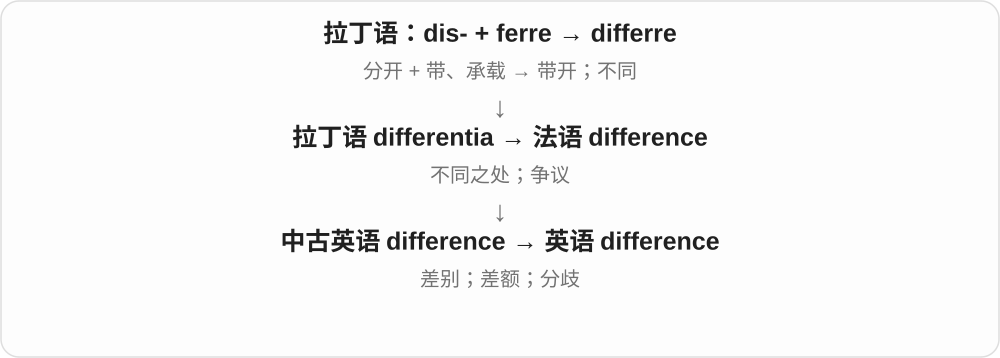

make a difference 是带来实际影响；tell the difference 是分辨出区别；settle differences 是解决分歧。不要只背“不同”一个抽象译词。

**常见搭配与例句**

the difference between；make a difference；a difference of ten。

> Can you tell the difference between these two sounds?

你能分辨这两个声音的区别吗？

> A short break made a big difference to my concentration.

短暂休息让我的注意力明显好了很多。

**别混淆**

different 是“不同的”；difference 是“哪里不同、差多少”这件事。

### 5. influence — 影响；影响力；有影响的人或事

**音标**：/ˈɪnfluəns/

**先抓住这个画面**

一种力量不必直接命令你，却慢慢改变你怎么想、怎么做，像水流渗进来改变周围。

**怎么拆**

拉丁 in- 向里 + fluere 流，形成 īnfluere、īnfluentia；经法语进入英语。

**怎么变成今天的意思**

**拉丁 fluere；分词 fluēns、fluxus；相关 fluvius**  
流动；流动的；河流

↓

**拉丁 īnfluere → 中世纪拉丁 īnfluentia**  
流入；古时所谓星体流来的作用力

↓

**古法语 influence → 中古英语 → influence**  
影响力；后来作动词“影响”

早期英语含占星术中星体力量作用于人的观念，那是词义历史，不是科学事实。现代常说人、环境、思想对结果的影响。

**常见搭配与例句**

influence a decision；have an influence on；under the influence of。

> Her teacher had a lasting influence on her choice of career.

老师对她的职业选择产生了持久影响。

> The weather may influence our plans.

天气可能影响我们的计划。

**别混淆**

control 强调掌控结果；influence 只要求产生影响，不保证对方照你的意思行动。

### 6. violence — 暴力、强力侵害；猛烈、剧烈

**音标**：/ˈvaɪələns/

**先抓住这个画面**

人与人之间以力量伤害、压制，叫 violence；风暴、爆炸等猛烈到让人感到冲击，也可借用同一词。

**怎么拆**

中古英语 violence 借古法语 violence，上接拉丁 violentia，由 violēns、violentus 的猛烈、强力含义接抽象名词。不是 violin 小提琴或 violet 紫罗兰的随意缩写。

**怎么变成今天的意思**

**拉丁 violentia → 古法语 violence → 中古英语 violence**  
强力、猛烈、暴力

↓

**英语 violence**  
暴力侵害；自然力量的猛烈

domestic violence 家庭暴力，an act of violence 暴力行为，the violence of the storm 风暴的猛烈，nonviolence 非暴力立场、方式。

**常见搭配与例句**

an act of violence；domestic violence；the violence of the storm。

> The novel explores the effects of violence on a family.

小说探讨暴力对一个家庭的影响。

> We were surprised by the violence of the storm.

风暴的猛烈程度让我们吃惊。

**别混淆**

violent 强烈、暴力的形容词，violence 名词；不同专业文本对暴力的范围可能不同，读搭配确认是人际侵害还是自然力量。

### 7. reference — 提及；参照、引用；参考资料；推荐证明；引用、提及

**音标**：英、美 /ˈrefrəns/

**先抓住这个画面**

在这里留一根线，让人能顺着它找到另一份信息或另一个可靠的人。

**怎么拆**

现代可拆 refer + -ence；历史有英语内部派生与法语 référence 借入两种分析。法语支线常上溯中世纪拉丁 *referentia，部分词源资料把它标为重构；动词 reference 后来由名词转用。

**怎么变成今天的意思**

**拉丁语：ferre；第一人称 ferō**  
带、承载；承受；生出

↓

**拉丁语：re- + ferre → referre**  
带回；报告；提交处理

↓

**两种分析：英语 refer 加名词后缀；或法语 référence 借入**  
法语支线常追到中世纪拉丁 \*referentia；此形式在部分词源资料中标为重构

↓

**英语：reference**  
提及；参照、引用；推荐证明

for reference 是留供查阅；a reference to something 是提到它；论文 references 列出依据。求职中的 reference 是对能力、人品的说明，也可指提供说明的人。

**常见搭配与例句**

for future reference；a reference book；a list of references；provide a reference。

> Keep this email for future reference.

保留这封邮件，方便以后查阅。

> The article includes references to three earlier studies.

文章引用了三项较早的研究。

> My former supervisor agreed to write a reference for me.

我以前的主管同意为我写推荐证明。

**别混淆**

quotation 是原话引用；reference 可以只指明出处，不必抄出原句。

### 8. references — 提及、引用、参考文献；推荐人、推荐证明〔复数〕；提到、引用〔第三人称单数〕

**音标**：英 /ˈrefərənsɪz/；美 /ˈrefərənsɪz/

**先抓住这个画面**

把读者或听者指向另一个人、另一份材料，是 references 的线索。文末指向资料的条目、谈话里的提及、求职时可供核实的人，都从这个功能理解。

**怎么拆**

reference + -s，/s/ 后读 /ɪz/。reference 可分析 refer + -ence，也有法语 référence 借入分析；后者较早常接标为重构的中世纪拉丁 *referentia。动词后来从名词转用。

**怎么变成今天的意思**

**refer 词族／法语 référence → reference**  
指向某处 → 提及、查考或证明资料

↓

**reference + -s → references；动词转用**  
多项引用、推荐资料；单数主语引用

a list of references 参考文献表；references to earlier work 对早期工作的提及；provide two references 提供两位推荐人或两份推荐证明。

**常见搭配与例句**

check the references 核对引文；references at the end of the article 文末参考文献。

> The article includes references to earlier studies.

文章包含对早期研究的引用。

> Please provide contact details for two references.

请提供两位推荐人的联系方式。

**别混淆**

求职中的 references 可能要人名和联系方式，也可能要书面推荐，按具体要求判断。文献引用只指明来源，不一定照抄原话。

### 9. audience — 听众；观众；受众；正式会见

**音标**：英 /ˈɔːdiəns/；美 /ˈɑːdiəns/

**先抓住这个画面**

audience 先想台下正在接收你表达的人：他们可能听演讲、看节目，也可能读文章。

**怎么拆**

来自拉丁语 audientia，与 audiēns“正在听的”有关，再经法语进入英语。现代 audience 不是 audio + ence。

**怎么变成今天的意思**

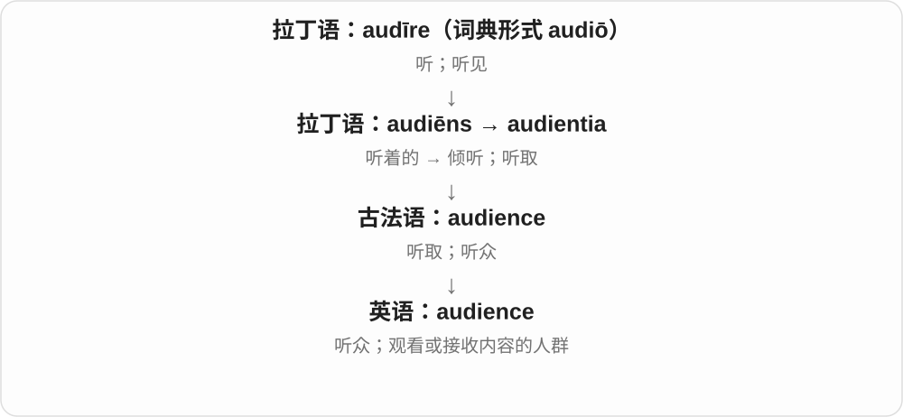

“听”的动作转向参与听的人，再扩展到视觉媒体和文字内容的接受者。an audience with someone 还保留正式获准见面、陈述的意思。

**常见搭配与例句**

a live audience；a target audience；address an audience；an audience with a leader。

> The audience fell silent as the music began.

音乐响起时，观众安静下来。

> The article was written for a young audience.

这篇文章是写给年轻读者看的。

**别混淆**

audience 常是作为整体的受众；spectators 更突出在现场看比赛或活动的人。网页的 audience 也可以从未坐到同一间屋里。

### 10. presence — 在场；存在；气场、风度

**音标**：/ˈprezəns/

**先抓住这个画面**

某人或某物在那里；有些人一出现，就会让人明显感觉到他的存在感。

**怎么拆**

经古法语 presence 来自拉丁语 praesentia 在场，与 present 的在场形容词分支相关。不是把现代 present 的 t 随便改成 ce。

**怎么变成今天的意思**

**拉丁语 praesens；相关 praesentāre**  
在眼前、在场；把东西放到眼前、呈上

↓

**经法语进入英语 present 词族**  
当前、在场；礼物；展示、提交

↓

**拉丁语 praesentia → 法语 presence → 英语 presence**  
在场、存在；后也说显著存在感

in someone’s presence 当着某人的面；a strong presence 强烈存在感；the presence of water 有水存在。与礼物的 presents 读音很近，靠语境区分。

**常见搭配与例句**

in the presence of；make one’s presence felt；a calm presence；the presence of。

> Her presence helped everyone feel calmer.

她在场让大家安心了些。

> The test showed the presence of salt in the water.

检测表明水中有盐。

**别混淆**

presence 是在场、存在，presents 是 present 礼物的复数；presence of mind 是临危镇定、反应敏捷，不是礼物在脑中。

### 11. excel — 擅长；表现出色；胜过

**音标**：/ɪkˈsel/

**先抓住这个画面**

同样一件事，他做得特别好、比通常水平更出众，可以说 excel。重点是表现突出，不只是勉强能做。

**怎么拆**

借拉丁 excellere 高出、超越；可看 ex- 向外、超出与其高起的历史材料，但不另造常用英语 cell 来硬拆。

**怎么变成今天的意思**

**拉丁 excellere → excellens、excellentia 等**  
高出、超越；卓越的、卓越这一性质

↓

**英语 excel、excellent、excellence**  
擅长、出色；极好的；卓越

excel at something 擅长某事；excel in a field 在某领域表现出色；excel yourself 超常发挥，尤见英式。

**常见搭配与例句**

excel at；excel in。

> She excels at explaining difficult ideas clearly.

她很擅长把难懂的想法解释清楚。

> The team excelled in the final round.

团队在最后一轮表现出色。

**别混淆**

excel 是动词擅长、出色；Excel 大写还可指微软表格软件，不能把每句 he excels 都翻成他用表格。

### 12. excellent — 极好的；出色的

**音标**：/ˈeksələnt/

**先抓住这个画面**

质量、表现高得让人愿意明确称赞，就是 excellent；日常 Excellent! 也可以简短表示太好了。

**怎么拆**

经法语 excellent 接拉丁 excellens 高出、杰出的材料，与 excel 相联；现代可按 excel 与 -ent 对应，但借入历史不只英语临时加尾。

**怎么变成今天的意思**

**拉丁 excellere → excellens、excellentia 等**  
高出、超越；卓越的、卓越这一性质

↓

**英语 excel、excellent、excellence**  
擅长、出色；极好的；卓越

an excellent idea 极好的主意；excellent service 出色服务；excellent at doing 很擅长做。

**常见搭配与例句**

an excellent choice；excellent quality。

> The guide gave an excellent explanation of the building’s history.

向导把建筑历史解释得非常清楚。

> The hotel provided excellent service.

酒店提供了出色服务。

**别混淆**

excellent 是评价很好，不保证 perfect 完全无瑕；一份出色作品仍可以有值得改进的地方。

### 13. excellence — 卓越；出色的品质、水准

**音标**：/ˈeksələns/

**先抓住这个画面**

excellent 说这件东西很好，excellence 则把这份高水准当成追求、评价的对象：希望长期做得出色。

**怎么拆**

经法语 excellence 接拉丁 excellentia，与 excellent 的 -ent／-ence 对应。不是把完整 excellent 原样再加 ence。

**怎么变成今天的意思**

**拉丁 excellere → excellens、excellentia 等**  
高出、超越；卓越的、卓越这一性质

↓

**英语 excel、excellent、excellence**  
擅长、出色；极好的；卓越

academic excellence 学术卓越；a commitment to excellence 追求卓越的承诺；excellence in design 设计的高水准。

**常见搭配与例句**

strive for excellence；excellence in。

> The award recognises excellence in teaching.

这个奖表彰卓越的教学。

> The workshop has a reputation for craftsmanship and excellence.

这家工坊以精湛工艺和高水准闻名。

**别混淆**

excellence 是卓越水准，excellency 是某些外交等称呼中的阁下；正式称谓和品质名词别混用。

### 14. intelligence — 理解与思考能力；情报

**音标**：/ɪnˈtelɪdʒəns/

**先抓住这个画面**

intelligence 像从很多线索中分辨出有用关系，弄明白发生了什么；收集到的关键信息也可叫情报。

**怎么拆**

来自 intellegentia，联系 inter- + legere“在其中分辨”，再经法语进入英语。

**怎么变成今天的意思**

能力义和情报义要分开：high intelligence 说理解能力；gather intelligence 是搜集信息。

**常见搭配与例句**

artificial intelligence；emotional intelligence；gather intelligence。

> The task requires intelligence and patience.

这项任务需要理解力和耐心。

> The report contains useful intelligence about the market.

报告包含有关市场的有用情报。

**别混淆**

intelligence 不等于知识储量；knowledge 是知道的内容，intelligence 更偏理解、推理等能力。

### 15. confidence — 信心；信任；把握；秘密

**音标**：英 /ˈkɒnfɪdəns/；美 /ˈkɑːnfɪdəns/

**先抓住这个画面**

心里觉得“靠得住，能办成”，于是敢于把事情交出去或自己去做。

**怎么拆**

来自拉丁语 confidentia，可经古法语 confidence 或直接借入；与 confidere 同族。英语名词比一些后来的派生形式更早，不必画成现代 confide + -ence 的单一路线。

**怎么变成今天的意思**

**拉丁语 fidere；同族名词 fides**  
信任、相信；信用、信义

↓

**拉丁语 confidere**  
con- 在这里通常作加强理解 + fidere → 充分信任

↓

**拉丁语 confidentia；古法语 confidence 或直接借入**  
信任、把握

↓

**中古英语 confidence → confidence**  
信任别人 → 也指对自己的信心；私密的信任关系

confidence in someone 是信任别人；gain confidence 是自己更有把握。tell someone something in confidence 表示私下告知，并期待对方保密。

**常见搭配与例句**

have confidence in；gain confidence；with confidence；in confidence。

> Practice gave her the confidence to speak in public.

练习让她有了在公众面前讲话的信心。

> I told you that in confidence.

那件事我是私下告诉你、希望你保密的。

**别混淆**

confidence 是名词；confident 是形容词。保密义来自把秘密交托给可信的人。

### 16. dependence — 依赖；依靠；取决关系

**音标**：英、美 /dɪˈpendəns/

**先抓住这个画面**

把“离不开某种支持”当作一种关系来谈，而不是只讲一次求助。

**怎么拆**

经法语 dépendance，并有中世纪拉丁 dependentia 的来源背景，远接 dependere。英语早期 dependance 与 dependence 并存，后来拉丁化拼写占优势。

**怎么变成今天的意思**

**拉丁 pendēre；相关动词 pendere**  
悬垂；使悬挂、称量

↓

**拉丁 dependere → dependentia；法语 dépendance**  
依赖关系的名词形式

↓

**英语 dependence**  
从另一事物获得支持或由其决定的状态

dependence on public transport 是生活依赖公共交通；dependence on one supplier 是业务过度或单纯倚靠一家供应商。程度和好坏需要上下文，依赖本身不总是缺点。

**常见搭配与例句**

dependence on；reduce dependence；economic dependence；mutual dependence。

> Better bus services could reduce our dependence on cars.

更好的公交服务可以减少我们对汽车的依赖。

> The report highlights the company’s dependence on a single customer.

报告强调了这家公司对单一客户的依赖。

**别混淆**

dependence 与 dependency 有重叠；dependence 多指抽象状态，dependency 在软件里还能指一个具体依赖项。

### 17. independence — 独立；自主；自立

**音标**：英、美 /ˌɪndɪˈpendəns/

**先抓住这个画面**

把“能自己作决定、支撑生活或不受外部统治”的状态当成一件重要的事。

**怎么拆**

现代对应 independent 的名词，也可分析为 in- + dependence；来源资料有英语配词与法语 indépendance 借入两种描述。保留这些平行分析，不假设法语名词由英语词倒造。

**怎么变成今天的意思**

**拉丁 dependere 家族 → 法语、英语的依赖词汇**  
依附、依赖及其状态

↓

**法语 indépendance／英语 independent 与 dependence 的否定名词构词**  
不依赖、不受控制

↓

**英语 independence**  
个人自主、机构独立或政治独立

personal independence 是个人自主；editorial independence 是编辑独立；national independence 是国家独立。它们共同点是决定权或支撑能力，但衡量的具体方面不同。

**常见搭配与例句**

gain independence；maintain independence；financial independence；independence from。

> Learning to travel alone gave him a new sense of independence.

学会独自出行，让他有了新的自主感。

> The newspaper promised to protect its editorial independence.

这家报纸承诺维护编辑独立。

**别混淆**

freedom 范围很广，可指行动自由；independence 尤其强调不依赖某方或不受其控制。

### 18. prefer — 更喜欢；宁愿选择

**音标**：英 /prɪˈfɜː/；美 /prɪˈfɜːr/

**先抓住这个画面**

两个选项摆在面前，你把其中一个往前放，表示“我更要这个”。

**怎么拆**

拉丁 prae-“在前” + ferre → praeferre，经盎格鲁法语借入。现代 pre- + fer 可以帮助记忆，但不是英语新造词。

**怎么变成今天的意思**

**拉丁语：ferre；第一人称 ferō**  
带、承载；承受；生出

↓

**拉丁语：prae- + ferre → praeferre**  
放到前面；优先看待

↓

**盎格鲁法语 preferer → 中古英语 preferren**  
提拔；更看重

↓

**英语：prefer**  
更喜欢；宁可选择

prefer A to B 把 A 排在 B 前；prefer doing A to doing B 比较两种活动。would prefer 常表达眼下较礼貌的选择。

**常见搭配与例句**

prefer tea to coffee；prefer to walk；would prefer…。

> I prefer a window seat to an aisle seat.

比起过道座位，我更喜欢靠窗座位。

> We would prefer to discuss the details in person.

我们更希望当面讨论细节。

**别混淆**

like 可以只说喜欢；prefer 本身带着比较，另一个选择有时省略。

### 19. preference — 偏好；优先选择；优待

**音标**：英、美 /ˈprefrəns/

**先抓住这个画面**

你心里那张排序表：某个口味、方式或人选，被排在前面。

**怎么拆**

法语 preference 来自中世纪拉丁 preferentia，远接 praeferre。现代能与 prefer + -ence 对应，但名词有自己的借入链。

**怎么变成今天的意思**

**拉丁语：ferre；第一人称 ferō**  
带、承载；承受；生出

↓

**拉丁语：prae- + ferre → praeferre**  
放到前面；优先看待

↓

**中世纪拉丁语 preferentia → 法语 preference**  
优先选择、偏爱

↓

**英语：preference**  
偏好；优先权

a preference for something 表示偏爱；give preference to someone 是在安排或选择时优先考虑。复数 preferences 也可指软件里个人选择的设置。

**常见搭配与例句**

have a preference for；give preference to；personal preferences。

> Do you have a preference for a morning or afternoon appointment?

预约上午还是下午，你更倾向哪一个？

> The survey records customers’ food preferences.

这份调查记录顾客的食物偏好。

**别混淆**

priority 强调先做或最重要；preference 可以只是个人更喜欢，不一定更重要。

### 20. preferences — 偏好、喜好；优先选择〔复数〕

**音标**：/ˈprefrənsɪz/

**先抓住这个画面**

几种选择放在面前，心里更愿意把哪种排在前面，这些选择倾向就是 preferences。系统设置里的 preferences，也是把想要的方式先选好。

**怎么拆**

preference 经法语 preference 接中世纪拉丁 preferentia，连 praeferre 放到前面，prae- 加 ferre 带。现代整个名词加 -s，/s/ 后读 /ɪz/。

**怎么变成今天的意思**

**拉丁 praeferre、preferentia → 法语、英语 preference**  
放在前面 → 优先看待、偏爱

↓

**preference + -s → preferences**  
多个选择倾向、个人设置

personal preferences 个人偏好；food preferences 饮食偏好；change the preferences 修改偏好设置。

**常见搭配与例句**

preferences for… 对……的偏好；respect people’s preferences 尊重别人的选择倾向。

> The questionnaire asks about reading preferences.

问卷询问阅读偏好。

> You can change the display preferences in the menu.

可以在菜单里修改显示偏好设置。

**别混淆**

preferences 不一定是强烈爱好，也可以只是两者中稍微更愿意选哪一个。软件里通常是可按个人需要调整的一组设置。

### 21. existence — 存在；生存；生活状态

**音标**：/ɪɡˈzɪstəns/

**先抓住这个画面**

把“有这么回事”单独拿出来谈，也能说一个人怎样维持生活。

**怎么拆**

后期拉丁 existentia 经古法语进入中古英语；现代可看成 exist + -ence，但不是必须经英语 exist 才产生的名词。

**怎么变成今天的意思**

**拉丁 sistere〔与 stāre“站”相关〕**  
使站住、放置；站定、停住

↓

**拉丁 ex- + sistere → exsistere / existere**  
站出来、出现 → 存在

↓

**后期拉丁 existentia → 古法语 existence → 中古英语 existence**  
存在这一状态；独立名词路线

prove the existence of something 是证明某物确实存在。lead a quiet existence 说过着安静的生活；这里不必带“仅仅苟活”的负面意味，要看修饰语。

**常见搭配与例句**

come into existence；the existence of life；lead a peaceful existence。

> The map confirms the existence of an earlier road.

地图证实这里以前有过一条道路。

> They led a quiet existence in a small coastal town.

他们在一座海边小镇过着安静的生活。

**别混淆**

existence 说有没有、怎样存在；experience 说经历了什么，两个近形词不要混。

### 22. residence — 住所；居住；驻留

**音标**：/ˈrezɪdəns/

**先抓住这个画面**

residence 既能指落脚的那栋房子，也能指“在这里住着”这一状态。

**怎么拆**

中古拉丁 residentia 经古法语 residence、中古英语 residence 而来；现代与 reside + -ence 对应，但名词有独立借入链。

**怎么变成今天的意思**

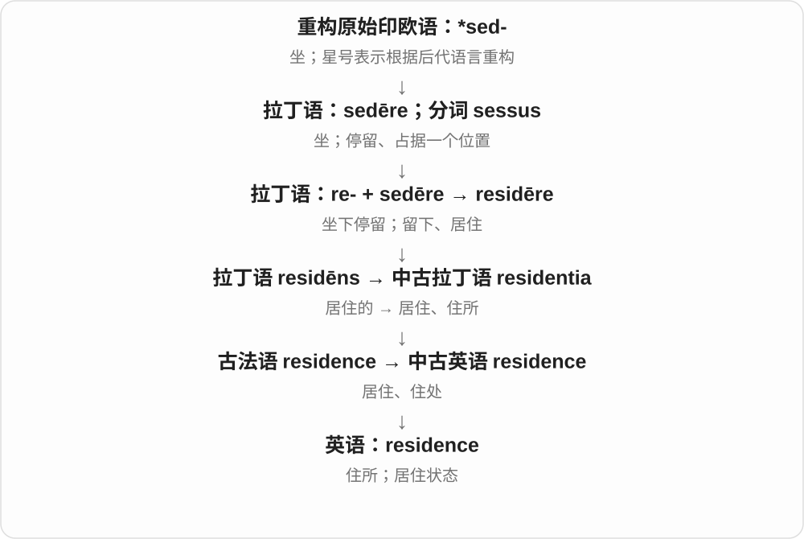

a private residence 是私人住宅；take up residence 是开始居住；place of residence 是居住地。比 home 更正式。

**常见搭配与例句**

a permanent residence；place of residence；take up residence。

> The form asks for your current place of residence.

表格要求填写你目前的居住地。

> The building was once a private residence.

这栋建筑以前是私人住宅。

**别混淆**

home 常有家的归属感；residence 偏正式地说明住处或居住状态。

### 23. sequence — 顺序；序列；一连串

**音标**：/ˈsiːkwəns/

**先抓住这个画面**

把几件事按“谁跟着谁”排成一条队，这条队和它的排列方式都可以叫 sequence。

**怎么拆**

拉丁语 sequēns“跟着的”形成 sequentia，经古法语进入英语。

**怎么变成今天的意思**

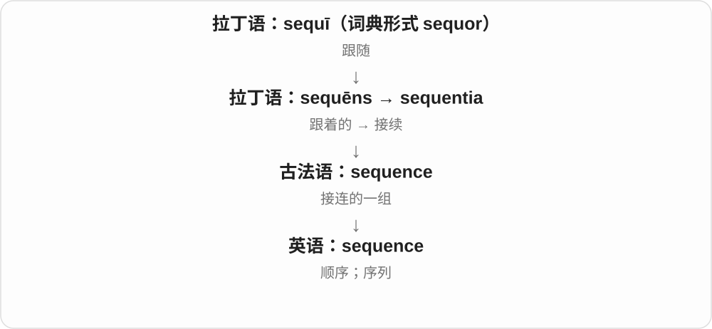

数字、镜头、操作步骤都能形成 sequence。它不一定表示因果，只说明存在次序或连续安排。

**常见搭配与例句**

in sequence；a sequence of events；the correct sequence；sequence data。

> Put the pictures in the correct sequence.

把图片按正确顺序排列。

> The film opens with a long sequence set in a railway station.

电影以一段发生在火车站的较长连续场景开场。

**别混淆**

sequence 是排列；consequence 是由前面引出的结果。先后顺序本身不能证明因果。

### 24. consequence — 结果；后果；重要性

**音标**：英 /ˈkɒnsɪkwəns/；美 /ˈkɑːnsəkwəns/

**先抓住这个画面**

把一块多米诺骨牌推倒，后面跟着倒下的那些，就是前一步带来的 consequences。

**怎么拆**

拉丁语 cōnsequī“跟随”产生 consequentia，经法语进入英语。

**怎么变成今天的意思**

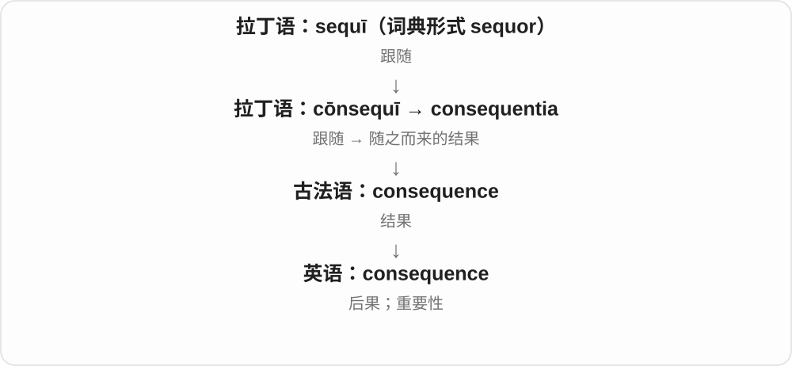

“跟在后面的事”发展成因行动而来的结果。常谈不好的后果，但也能有 positive consequences。of consequence 则是有分量、有重要性。

**常见搭配与例句**

as a consequence；face the consequences；unintended consequences；of little consequence。

> Every choice has consequences.

每个选择都会带来后果。

> The delay had little consequence for the final result.

这次延误对最终结果影响不大。

**别混淆**

result 比较中性；consequence 常提醒你承担后续影响，但它并不天然等于惩罚。

### 25. absence — 缺席；不在；缺乏、不存在

**音标**：/ˈæbsəns/

**先抓住这个画面**

原本可以有个人、一件东西或一种条件的位置，现在是空的；既能说人没来，也能说某种证据或特点根本没有。

**怎么拆**

拉丁 absentia 接 absens“缺席的”，经古法语 absence 进入英语。现代可与 absent 对照记忆，但名词有独立的拉丁、法语路线。

**怎么变成今天的意思**

**拉丁 ab，构词中也有 abs-、a- 等形式**  
离开、从……分离、去掉

↓

**拉丁 ab- + esse → abesse；分词 absens／absent-**  
存在于别处 → 不在场

↓

**拉丁 absentia → 古法语 absence → 中古英语 absence**  
不在场这一状态

↓

**英语 absence**  
缺席；缺乏、不存在

in someone’s absence 是在某人不在的时候；in the absence of evidence 是缺乏证据的情况下。a leave of absence 是获准的一段请假时间。

**常见搭配与例句**

absence from work；in someone’s absence；in the absence of；a leave of absence。

> Nora handled the orders in her colleague’s absence.

同事不在时，诺拉负责处理订单。

> The absence of labels made the old photographs difficult to identify.

旧照片没有标签，很难辨认其中的内容。

**别混淆**

absence 本身不说明是否获准或为什么缺席。absenteeism 常谈反复缺席的现象，absence 可以只是一回或一种状态。

### 26. patience — 耐心；忍耐力；单人纸牌游戏〔英式〕

**音标**：/ˈpeɪʃəns/

**先抓住这个画面**

事情没有立刻如愿，你仍能稳住，不急着发火或放弃。

**怎么拆**

拉丁 patientia 接 patiēns，作为名词经古法语 pacience 借入；现代可与 patient 对照，但不是英语才把 patient 的词尾临时改出来。

**怎么变成今天的意思**

**拉丁 patī／patior；完成分词 passus**  
承受、经历、忍受

↓

**拉丁 patiēns → patientia → 古法语 pacience**  
忍耐着的 → 忍耐这一品质

↓

**中古英语 pacience → 英语 patience**  
耐心；后来也指单人纸牌游戏

have patience with children 是对孩子有耐心；lose patience 是逐渐受不了。英式纸牌游戏 patience 相当于常见美式说法 solitaire，来自需要耐心摆牌的联想。

**常见搭配与例句**

have patience with；lose patience；run out of patience；a game of patience。

> Teaching someone to read takes patience.

教人认字需要耐心。

> After the third unexplained delay, she began to lose patience.

第三次无缘无故延误之后，她开始失去耐心。

**别混淆**

patience 是通常不可数的品质；patients 是 patient“患者”的复数。只听读音时，要靠句子判断。

### 27. convenience — 方便；便利；便利设施

**音标**：英 /kənˈviːniəns/；美 /kənˈviːnjəns/

**先抓住这个画面**

不用额外跑一趟、不必花太多时间，一件东西或一种安排带来的这种省事感就是 convenience。

**怎么拆**

借自拉丁语 convenientia“相合、适宜”，与 conveniēns 相连；现代是 convenient 对应的名词。

**怎么变成今天的意思**

for convenience 是为了方便。复数 conveniences 可指让生活省事的设备；convenience store 是提供便利购物的小商店。

**常见搭配与例句**

for your convenience；at your convenience；a convenience store；modern conveniences。

> The form can be completed online for your convenience.

为方便你办理，表格可以在线填写。

> Please call me at your convenience.

请在方便时给我打电话。

**别混淆**

convenience 是方便这一性质；convenient 是形容词。at your convenience 是在你方便时，语气不表示必须立刻。

### 28. interference — 干预、妨碍；信号干扰；干涉〔物理〕

**音标**：英 /ˌɪntəˈfɪərəns/；美 /ˌɪntərˈfɪrəns/

**先抓住这个画面**

把 interfere 的影响作为现象来谈，就是 interference。电台杂音是干扰；光波叠加出现明暗变化，则是物理干涉的典型画面。

**怎么拆**

interfere + -ence，去词尾 e。物理义在近代波动研究中固定，不应只按日常妨碍作负面理解。

**怎么变成今天的意思**

**拉丁 ferīre 击打 → 古法语 ferir；entre- 相互、之间**  
相互击打、相撞

↓

**entreferir → 英语 interfere**  
碰撞、妨碍 → 干预、干扰

↓

**interfere + -ence → interference**  
干预现象；波叠加的干涉效果

outside interference 外来干预，radio interference 无线电干扰，an interference pattern 干涉图样，constructive／destructive interference 相长／相消干涉。

**常见搭配与例句**

radio interference；an interference pattern；constructive interference。

> The radio signal suffered from interference.

无线电信号受到干扰。

> The experiment produced an interference pattern.

实验产生了干涉图样。

**别混淆**

物理干涉不等于波永远互相消灭；相位等关系不同，局部可增强、可减弱。日常干预义与技术术语要分开。

### 29. coincidence — 巧合；同时发生；重合

**音标**：英 /kəʊˈɪnsɪdəns/；美 /koʊˈɪnsɪdəns/

**先抓住这个画面**

没有事先商量，两件本来独立的事却刚好对上了，这种“这么巧”就是 coincidence。

**怎么拆**

英语借自中古法语 coincidence，远处是 co- + incidere；现代词形可与 coincide + -ence 对照。

**怎么变成今天的意思**

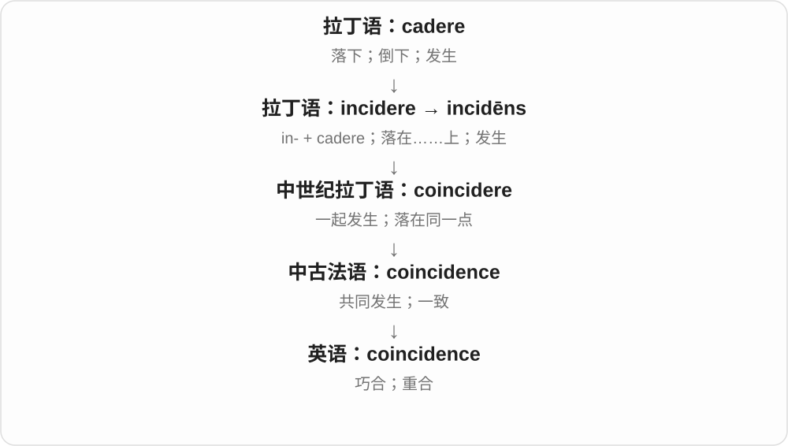

遇到同名同姓的人、朋友恰好坐在隔壁桌，都可以让人说 What a coincidence! 技术语境也可单指重合或同时发生，并不总在讨论神秘缘分。

**常见搭配与例句**

by coincidence；a strange coincidence；pure coincidence；What a coincidence!。

> By coincidence, we booked rooms in the same hotel.

碰巧我们在同一家酒店订了房间。

> It was pure coincidence that both letters arrived on the same day.

两封信同一天到达，纯属巧合。

**别混淆**

巧合不能单凭同时出现就证明因果关系。coincidence 是名词，coincide 是动词，coincidental 是形容词。

### 30. conscience — 良心；良知；内心的道德判断

**音标**：英 /ˈkɒnʃəns/；美 /ˈkɑːnʃəns/

**先抓住这个画面**

别人也许不知道你做过什么，但你自己知道，并会问自己这样做对不对。

**怎么拆**

古法语 conscience 或直接拉丁语 conscientia 借入；conscientia 是内在知道、共同知道，与 conscire 相关。不是英语 conscious 去词尾再加 -ence。

**怎么变成今天的意思**

**拉丁语 scire**  
知道、认识

↓

**拉丁语 conscire → conscientia → 古法语 conscience / 直接拉丁语 → 英语 conscience**  
内心知道 → 对自身行为对错的判断

a guilty conscience 是因为做错事而内疚；a clear conscience 是自认问心无愧。conscience 的判断可能受个人经历与信念影响，不是外部事实自动发出的声音。

**常见搭配与例句**

a guilty conscience；a clear conscience；a matter of conscience。

> My conscience would not let me keep the extra money.

良心让我不能把多出来的钱留下。

> She could answer with a clear conscience.

她能问心无愧地作答。

**别混淆**

consciousness 是意识与知觉；conscience 是对行为对错的内心判断。

### 31. occurrence — 发生；出现的事件

**音标**：英 /əˈkʌrəns/；美 /əˈkɜːrəns/

**先抓住这个画面**

occur 是事情出现；occurrence 把那次出现单独框起来，作为一个事件来谈。

**怎么拆**

经法语 occurrence 来自中世纪拉丁语 occurrentia，与 occurrere 同族；现代词形是 occur + -ence 的对应。

**怎么变成今天的意思**

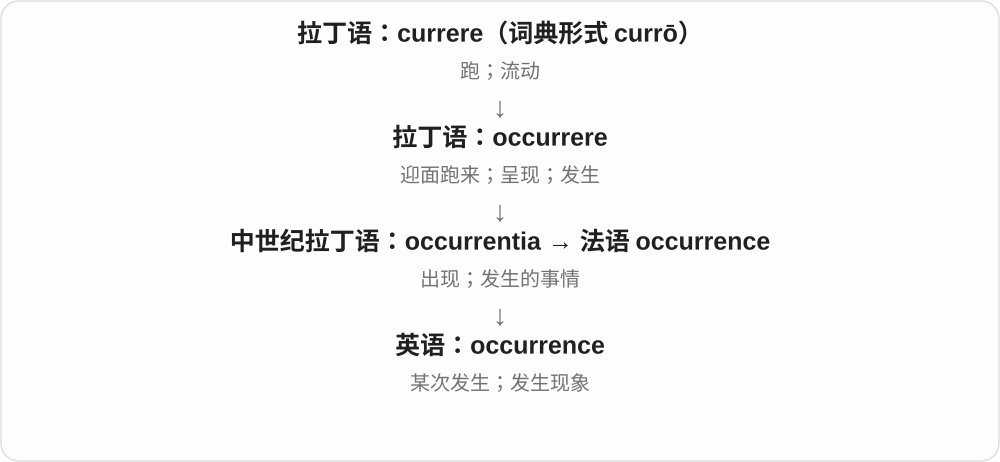

a common occurrence 表示经常出现的一类事情；the occurrence of an error 侧重错误发生这一事实。注意双写 rr。

**常见搭配与例句**

a rare occurrence；a common occurrence；the occurrence of…。

> Snow in April is a rare occurrence here.

这里四月下雪很少见。

> The report records each occurrence of the fault.

报告记录了每一次故障发生的情况。

**别混淆**

occurrence 是事件或发生；recurrence 是同类事情再度发生，多了 re- 的“回来”。

### 32. revere — 深深敬重；崇敬

**音标**：英 /rɪˈvɪə/；美 /rɪˈvɪr/

**先抓住这个画面**

对某个人、某种传统抱有很深的敬意，像面对值得珍重的东西，不敢轻慢，就是 revere。比一般觉得不错更郑重。

**怎么拆**

经法语 révérer 接拉丁 revereri 敬畏、敬重，含加强性的 re- 与 vereri 敬畏。现代不把 re- 固定理解为再一次，ver- 也不是这里的真理词根。

**怎么变成今天的意思**

**拉丁 re- 加强 + vereri 敬畏 → revereri → 法语 révérer**  
敬畏、尊崇的情感联系起来

↓

**英语 revere 深敬**  
reverence 名词及相关动词出现更早；现代学习先放基础动词，是为了看清词性

revere a teacher 是崇敬老师；revere a tradition 是敬重传统；revere someone as something 是尊某人为……。

**常见搭配与例句**

revere a teacher；revere a tradition；revere someone as。

> Many former students revere her as a great teacher.

许多以前的学生把她敬奉为一位伟大的老师。

> The community continues to revere the old tradition.

这个社区仍然深深敬重那项古老传统。

**别混淆**

respect 很通用，revere 更强调深深敬重，常带庄重感。revere 是对人的态度，不自动表示赞成对方做过的每一件事。

### 33. reverend — 应受尊敬的；教士称谓〔如牧师〕

**音标**：英、美 /ˈrevərənd/

**先抓住这个画面**

把某位教士郑重地称为值得尊敬的人，是 Reverend 作为称谓的来历。现代常在姓名前看到 the Reverend 或缩写 Rev.。

**怎么拆**

接法语相关形式与拉丁 reverendus 应被敬重的，是 revereri 敬畏的动形词。-endus 的历史被动、应当色彩，与 reverent 的现在分词 -ent 分开。

**怎么变成今天的意思**

**拉丁 revereri 敬畏 → reverendus 应受敬重的 → reverend**  
英语早期也泛说因年龄、品格而值得敬重

↓

**尊敬形容词 → 教士敬称**  
现代常作某些基督教教士的姓名前称谓，也有相应名词用法

the Reverend 加姓名是教士敬称；Rev. 是常见缩写；a reverend figure 在较旧或文学语境可说值得尊敬的人物。

**常见搭配与例句**

the Reverend；Rev.；a reverend figure。

> The notice names the Reverend Anne Brown as the speaker.

通知列出安妮·布朗牧师为发言人。

> The novel introduces a quiet reverend who runs the village school.

小说介绍了一位安静的牧师，他负责村里的学校。

**别混淆**

reverent 常说某人态度恭敬；Reverend 常是教士称谓。一般说一位令人尊敬的老师，现代 respect、respected 等往往更通用。

### 34. reverence — 崇敬；敬意；敬畏

**音标**：英、美 /ˈrevərəns/

**先抓住这个画面**

面对珍重的人或事，声音放轻、态度郑重，这种深深的敬意是 reverence。既可以是心里的情感，也可以表现为举止。

**怎么拆**

经法语、拉丁 reverentia 敬意，接 revereri 敬畏、敬重词族；-ence 对应状态、性质名词材料。现代可与 revere 对照，但不能说历史上英语先有 revere 才加 -ence。

**怎么变成今天的意思**

**拉丁 revereri 敬畏 → reverentia → 法语、英语 reverence**  
名词保留深敬、庄重对待的意思

↓

**现代 reverence for、with reverence**  
分别说对某物的敬意、怀着敬意采取行动

reverence for someone 是对某人的崇敬；with reverence 是怀着敬意；a sense of reverence 是肃然起敬的感觉。

**常见搭配与例句**

reverence for；with reverence；a sense of reverence。

> She spoke of her mentor with reverence.

她怀着敬意谈起自己的导师。

> The ceremony expressed reverence for the natural world.

仪式表达了对自然世界的敬畏。

**别混淆**

reverence 通常是不可数情感名词；revere 是动词，reverent 是表现恭敬的形容词。三个词表达同一种敬意在句中不同的位置。

### 35. irreverence — 不敬；不拘庄重的态度；大胆戏谑

**音标**：英 /ɪˈrevərəns/；美 /ɪˈrevərəns/

**先抓住这个画面**

把通常该肃然起敬的对象拿来开玩笑，这种态度或风格叫 irreverence。它把 irreverent 所描述的性质作为一个名词来谈。

**怎么拆**

ir- 不 + reverence 敬意，是现代易认的对应。历史接法语 irreverence、拉丁 irreverentia，来自否定的敬畏词族；-ence 对应状态、性质名词材料。

**怎么变成今天的意思**

**拉丁 irreverens 不恭敬的 → irreverentia → 法语等 → irreverence**  
名词有独立借入历史，不能只按现代英语先后顺序推断

↓

**现代不敬、戏谑挑战惯例的态度**  
对艺术风格的评价可能带欣赏，也可能带责备

a touch of irreverence 是一点不拘庄重；irreverence towards authority 是对权威不存通常敬畏；a spirit of irreverence 是敢于戏谑、挑战的精神。

**常见搭配与例句**

a touch of irreverence；irreverence towards；a spirit of irreverence。

> A touch of irreverence kept the ceremony from becoming dull.

一点不拘庄重的幽默使仪式没有变得沉闷。

> Some readers disliked the book’s irreverence towards tradition.

有些读者不喜欢这本书对传统的不敬态度。

**别混淆**

irreverence 是名词，irreverent 是形容词。an irreverent joke 形容笑话，the joke’s irreverence 讨论这则笑话的不拘庄重之处。

### 36. reverent — 恭敬的；怀着崇敬的

**音标**：英、美 /ˈrevərənt/

**先抓住这个画面**

面对自己深深尊重的人或事，举止认真、声音放轻，是 reverent。它主要描述表现出来的敬意，而不只是对方地位高。

**怎么拆**

经法语或拉丁 reverens、reverent-，是 revereri 敬畏的现在分词材料；末尾 -ent 在英语里形成相应形容词。re- 在这条历史词里可起加强作用。

**怎么变成今天的意思**

**拉丁 revereri 敬畏 → reverens、reverent- → reverent**  
历史上也有值得敬重的旧义

↓

**现代 reverent 深敬、表现恭敬**  
常修饰语气、态度、沉默等行为表现

a reverent tone 是恭敬语气；reverent silence 是肃静、带敬意的沉默；a reverent attitude 是恭敬态度。

**常见搭配与例句**

a reverent tone；reverent silence；a reverent attitude。

> The visitors stood in reverent silence.

参观者们肃然静立。

> He spoke in a reverent tone about his teacher.

他用恭敬的语气谈起自己的老师。

**别混淆**

reverent 常描述人怀着敬意的态度；reverend 常见于教士称谓，历史词尾也不同。现代不能只看最后 d、t 相近就互换。

### 37. reverently — 恭敬地；怀着崇敬地

**音标**：英、美 /ˈrevərəntli/

**先抓住这个画面**

小心地翻开一位敬重之人的旧笔记，态度很郑重，这个动作可以用 reverently 来说明。它把 reverent 的敬意放到动作方式上。

**怎么拆**

reverent 恭敬的 + 完整 -ly 副词词尾 → reverently，原词不改。reverent 接拉丁敬畏词族的现在分词材料，-ent 是形容词历史组成部分。

**怎么变成今天的意思**

**拉丁 revereri 敬畏 → reverent 恭敬的**  
现代形容人的态度、表现

↓

**reverent + -ly → reverently**  
形成方式副词，说明带着敬意怎样做

speak reverently 是怀着敬意说话；bow reverently 是恭敬地鞠躬；handle something reverently 是郑重、小心地对待某物。

**常见搭配与例句**

speak reverently；bow reverently；handle reverently。

> She opened the old notebook reverently.

她怀着敬意翻开了旧笔记本。

> The audience listened reverently as the poem was read.

诗歌朗读时，听众们恭敬地聆听。

**别混淆**

a reverent gesture 是恭敬的举动，bowed reverently 是恭敬地鞠了躬。形容词修饰事物，副词修饰动作，不必逐个重新猜词根义。

### 38. irreverent — 不恭敬的；不把权威、惯例当神圣的；戏谑大胆的

**音标**：英 /ɪˈrevərənt/；美 /ɪˈrevərənt/

**先抓住这个画面**

别人对一件事很庄重，你偏要开个玩笑、打破那份严肃，可以说 irreverent。它可能批评不尊重，也可能赞作品敢于挑战惯例。

**怎么拆**

ir- 不，是 in- 在 r 前同化的形式 + reverent 恭敬的 → irreverent。历史经法语或直接接拉丁 irreverens、irreverent-，不是现代英语才首次临时拼成。

**怎么变成今天的意思**

**拉丁 in- 不 + reverens 恭敬的 → irreverens → 法语等 → irreverent**  
否定敬意，形成不恭敬的描述

↓

**现代不恭敬与戏谑挑战权威的评价**  
作品评论里可能是欣赏其不拘一格，褒贬取决于场景

irreverent humour 是不拘庄重、敢开权威玩笑的幽默；an irreverent remark 是不恭敬的话；an irreverent take on something 是戏谑式重新解读。

**常见搭配与例句**

irreverent humour；an irreverent remark；an irreverent take on。

> The film is known for its irreverent humour.

影片以它大胆戏谑的幽默著称。

> His irreverent remark surprised the otherwise solemn audience.

他那句不拘庄重的话让原本严肃的听众吃了一惊。

**别混淆**

irreverent 不总等于恶意辱骂。它说对庄重对象缺少通常的敬意，艺术语境也可能欣赏这种大胆、幽默的突破。

### 39. reverential — 崇敬的；表示深敬的

**音标**：英 /ˌrevəˈrenʃəl/；美 /ˌrevəˈrenʃəl/

**先抓住这个画面**

讲一位大师的作品时，几乎每句话都带着郑重的赞叹，可以说语气很 reverential。它突出对对象抱有深深敬意的表达方式。

**怎么拆**

历史接拉丁 reverentia 敬意的 reverenti- 材料 + 完整 -al 相关的 → reverential。现代可以用 reverence 名词与 reverential 形容词来对照，词形里有 -ial 这一段。

**怎么变成今天的意思**

**拉丁 reverentia 敬意 → reverenti- + -al → reverential**  
与 revere、reverent 同接敬畏词族，形容词形成材料不同

↓

**现代 reverential 崇敬、带敬意的**  
常形容文字、评论、语气与对待对象的方式

a reverential tone 是崇敬的语气；reverential treatment 是郑重、崇敬的对待；a reverential account 是带着敬意的记述。

**常见搭配与例句**

a reverential tone；reverential treatment；a reverential account。

> The biography takes a reverential approach to its subject.

这部传记以崇敬的态度对待传主。

> She lowered her voice to a reverential whisper.

她压低声音，化为带着敬意的轻语。

**别混淆**

reverential 与 reverent 意义接近，前者尤其常形容对对象的呈现、对待方式。也可被评论者用来指出过于崇敬，具体褒贬看语境。

### 40. negligence — 疏忽；过失；未尽应有注意

**音标**：/ˈneɡlɪdʒəns/

**先抓住这个画面**

negligence 像本该检查的接头没检查，本该维护的地方一直没维护。

**怎么拆**

来自拉丁语 neglegentia，经法语传入；与 negligent、neglect 平行同源。

**怎么变成今天的意思**

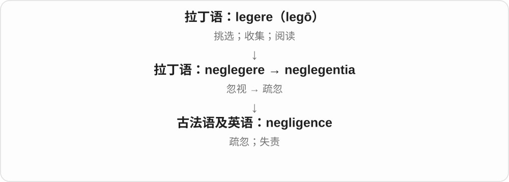

日常可指疏忽，法律里则有特定成立条件；不能把所有小失误都直接判为法律过失。

**常见搭配与例句**

professional negligence；gross negligence；an allegation of negligence。

> The report blamed the damage on negligence.

报告把损坏归因于疏忽。

> The court examined the allegation of negligence.

法院审查了有关过失的指控。

**别混淆**

negligence 是疏忽的行为或状态；negligible 却是小到可忽略。

### 41. competence — 胜任能力；权限；旧义足够维持生活的资财

**音标**：英 /ˈkɒmpətəns/；美 /ˈkɑːmpətəns/

**先抓住这个画面**

不是只说“知道一点”，而是具备把任务完成到要求水平的本领；谈机构时，也可以是它有权管到的范围。

**怎么拆**

经法语 compétence 借入，来自拉丁 competentia“相合、足够”，与 competens 同族。现代与 competent 对应，历史却有独立名词路线。

**怎么变成今天的意思**

**拉丁 petere**  
朝向、寻求、争取；也可指扑向、攻击或请求

↓

**拉丁 com- 一起 + petere → competere**  
走到一起、相合、适合；后来也指一起争取某物

↓

**拉丁 competentia → 法语 compétence**  
相合、足够

↓

**英语 competence**  
足以应付生活或任务 → 胜任能力；权限

professional competence 是专业胜任能力；within someone’s competence 可以指能力范围，也可指职权范围。旧书中 a competence 还可能指足够舒适生活的财产或收入。

**常见搭配与例句**

demonstrate competence；professional competence；within the committee’s competence。

> The interview assessed her technical competence.

面试评估了她的技术能力。

> That decision falls outside the committee’s competence.

这项决定超出了委员会的职权范围。

**别混淆**

competence 常整体说胜任程度；competency 也能这样用，复数 competencies 则常列出具体能力项目。

### 42. resilience — 回弹力；适应力、恢复力、韧性

**音标**：英 /rɪˈzɪliəns/；美 /rɪˈzɪljəns/

**先抓住这个画面**

把海绵压扁，松手后它慢慢恢复；用到人或系统，是受冲击后还能调整、重新运转的能力。

**怎么拆**

re- 回 + salire 跳，在拉丁语形成 resilire。英语名词用拉丁分词词干加 -ence；它在英语中的记录早于 resilient，不能画成英语形容词先生出这个名词。

**怎么变成今天的意思**

**拉丁 salire**  
跳、跃起；复合词中常变成 -silire

↓

**拉丁 re- + salire → resilire**  
向后跳、弹回去

↓

**拉丁 resiliens 的词干 + 英语 -ence → resilience**  
弹回、回弹能力

↓

**英语 resilience 的扩展**  
材料恢复能力；人、群体或系统的适应和恢复能力

材料的 resilience 可以观察受压后恢复的情况；人的 resilience 还包含适应、资源和支持。用海绵作记忆画面很直观，但人的恢复不一定快，也不要求原封不动地回到过去。

**常见搭配与例句**

emotional resilience；build resilience；the resilience of a system。

> The foam regained its shape, showing good resilience.

泡沫恢复了原形，表现出良好的回弹性。

> Support from her friends helped her rebuild her resilience after the setback.

挫折之后，朋友的支持帮助她重新获得适应和恢复的力量。

**别混淆**

resistance 偏抵挡冲击、阻止变化；resilience 允许经历变化，重点在适应或恢复。

### 43. deter — 使打消念头；阻止、吓阻

**音标**：英 /dɪˈtɜː/；美 /dɪˈtɜːr/

**先抓住这个画面**

本来想做，想到代价、风险或障碍，又不敢、不愿做了，某因素就 deterred you。它常是在行动之前让人退缩。

**怎么拆**

借拉丁 deterrere，关联 de- 离开等与 terrere 使害怕；从吓退扩展到由成本、困难劝退。

**怎么变成今天的意思**

**拉丁 de- + terrere → deterrere**  
使害怕、吓退的材料

↓

**英语 deter、deterrent、deterrence**  
使打消念头；阻吓因素；威慑、阻遏作用

deter someone from doing 使某人不去做；deter visitors 让游客却步。

**常见搭配与例句**

deter someone from；deter crime。

> The high price deterred many buyers.

高价让许多买家打消了念头。

> Rain did not deter the volunteers from continuing.

雨没有让志愿者打消继续干下去的念头。

**别混淆**

deter 侧重让人打消行动意愿；prevent 更广说让事情没能发生，不一定通过意愿、恐惧。

### 44. deterrent — 阻吓因素、威慑物；起阻遏作用的

**音标**：英 /dɪˈterənt/；美 /dɪˈtɜːrənt/

**先抓住这个画面**

让人一想到就不想干、退一步的东西，是 a deterrent；也能作形容词说具有这种劝退、威慑作用。

**怎么拆**

接 deter 的相应 -ent 形式，r 在常见拼写中双写；与拉丁 deterrens 等材料相应。

**怎么变成今天的意思**

**拉丁 de- + terrere → deterrere**  
使害怕、吓退的材料

↓

**英语 deter、deterrent、deterrence**  
使打消念头；阻吓因素；威慑、阻遏作用

a deterrent to theft 防盗的威慑因素；a deterrent effect 阻遏效果；act as a deterrent 起威慑作用。

**常见搭配与例句**

a deterrent to；a deterrent effect。

> Visible security cameras may act as a deterrent to theft.

看得见的监控摄像头可能对盗窃起威慑作用。

> The study examined the rule’s deterrent effect.

研究考察了规则的阻遏效果。

**别混淆**

deterrent 是起作用的因素或形容词，deterrence 是威慑、阻遏这一过程或效应；有 deterrent 不保证效果一定强。

### 45. deterrence — 威慑；阻吓、阻遏作用

**音标**：英 /dɪˈterəns/；美 /dɪˈtɜːrəns/

**先抓住这个画面**

不是把每次行动都当场拦住，而是让人预先觉得代价太大，不值得去做。deterrence 谈的就是这种制止意愿的作用。

**怎么拆**

deterrent 的词干材料与 -ence 对应，接 deter 的吓退、劝退词族。别把两个 r 看成另一个词根。

**怎么变成今天的意思**

**拉丁 de- + terrere → deterrere**  
使害怕、吓退的材料

↓

**英语 deter、deterrent、deterrence**  
使打消念头；阻吓因素；威慑、阻遏作用

crime deterrence 犯罪阻遏；a policy of deterrence 威慑政策；the effectiveness of deterrence 威慑的效力。

**常见搭配与例句**

a deterrence strategy；the deterrence of。

> The course examines different theories of deterrence.

课程考察不同的威慑理论。

> The report distinguishes punishment from deterrence.

报告区分了惩罚与威慑。

**别混淆**

deterrence 说行动前的阻吓效果；punishment 是惩罚行为本身。惩罚可能被用于威慑，但两个概念不等同。

### 46. converge — 汇合；趋同；收敛

**音标**：英 /kənˈvɜːdʒ/；美 /kənˈvɜːrdʒ/

**先抓住这个画面**

几条路朝同一点来，几个人的看法越谈越接近，都像原本分开的线合到一起，这叫 converge。

**怎么拆**

借拉丁 convergere，con- 一起 + vergere 倾向、转向；不是 cover 覆盖多塞了几个字母。

**怎么变成今天的意思**

**拉丁 con- + vergere → convergere**  
一起 + 转向、倾向 → 朝一处来

↓

**英语 converge → convergence**  
汇合、趋同、收敛；相应过程

converge on a place 向某地汇集；views converge 看法趋同；converge to a limit 数学上收敛到极限。

**常见搭配与例句**

converge on；converge towards。

> Three paths converge at the village square.

三条小路在村广场汇合。

> Their views began to converge after several discussions.

几次讨论后，他们的看法开始趋同。

**别混淆**

converge 是靠拢、汇合，diverge 是分开、分歧；不要求每次都真有几条直线。

### 47. convergence — 汇合；趋同；收敛

**音标**：英 /kənˈvɜːdʒəns/；美 /kənˈvɜːrdʒəns/

**先抓住这个画面**

converge 是逐渐合过来，convergence 是这份合到一起、越来越接近的过程或关系。技术融合、观点趋同也能用。

**怎么拆**

converge 去 e 加 -ence，并有拉丁 convergentia 的相应材料联系；名词化后可讨论过程、趋势。

**怎么变成今天的意思**

**拉丁 con- + vergere → convergere**  
一起 + 转向、倾向 → 朝一处来

↓

**英语 converge → convergence**  
汇合、趋同、收敛；相应过程

the convergence of two technologies 两种技术融合；a convergence of views 观点趋同；numerical convergence 数值收敛。

**常见搭配与例句**

the convergence of；a convergence between。

> The project explores the convergence of art and technology.

项目探索艺术与技术的融合。

> There was a gradual convergence of opinion.

意见逐渐趋同。

**别混淆**

convergence 不是 coincidence 巧合；多个趋势靠拢可能有共同原因，也可能只是时间相近，要看论证。

### 48. insistence — 坚持；坚决要求

**音标**：/ɪnˈsɪstəns/

**先抓住这个画面**

把“我就是要求这样”的态度持续顶在前面。

**怎么拆**

中古英语从法语 insister 及拉丁词干形成此名词；记录早于常用英语 insist，现代 insist + -ence 只是便于理解的对应。

**怎么变成今天的意思**

**拉丁 sistere〔与 stāre“站”相关〕**  
使站住、放置；站定、停住

↓

**拉丁 in- + sistere → insistere**  
站在某点上不离开 → 坚持、力促

↓

**古法语 insister 及拉丁词干 + -ence → 中古英语 insistence**  
先有“坚持、迫切要求”的名词用法

at someone’s insistence 表示因为某人坚持，事情才这样做。insistence on accuracy 是不肯放松准确性；语气可赞扬认真，也可批评固执，要看要求是否合理。

**常见搭配与例句**

at her insistence；insistence on accuracy；insistence that…。

> At her insistence, we checked the figures once more.

在她坚持要求下，我们又核对了一遍数字。

> His insistence on immediate payment delayed the agreement.

他坚持要求立即付款，拖慢了协议的达成。

**别混淆**

persistence 着眼持续多久、有没有放弃；insistence 着眼要求或主张有多坚决。

### 49. precedence — 优先；在先；先后次序

**音标**：常用 /ˈpresɪdəns/；也读 /prɪˈsiːdəns/

**先抓住这个画面**

几件事排队时，谁有资格排到前面。

**怎么拆**

可联系 precede 与 -ence；词典另列法语 précédence、中世纪拉丁 praecedentia，或英语 precedent 改接 -ence 的分析。

**怎么变成今天的意思**

**拉丁 cēdere；分词词干 cess-**  
走、离开；让步、让出

↓

**拉丁 prae- + cēdere → praecēdere**  
走在前面、先发生

↓

**法语 précédence／中世纪拉丁 praecedentia；亦有英语 precedent + -ence 分析**  
在先的状态、顺序

↓

**英语 precedence**  
优先权、优先次序

take precedence over… 是比……优先。运算里的 operator precedence 决定先算乘法还是加法；礼仪场合也可谈席位和尊卑次序。

**常见搭配与例句**

take precedence over；give precedence to；operator precedence。

> Safety takes precedence over speed.

安全优先于速度。

> Multiplication has precedence over addition in this expression.

这个表达式中先做乘法，再做加法。

**别混淆**

precedent 是一个可援引的先例；precedence 是优先关系。通常说 set a precedent，不说 set a precedence。

### 50. resurgence — 复苏；再度兴起；重新抬头

**音标**：英 /rɪˈsɜːdʒəns/；美 /rɪˈsɜːrdʒəns/

**先抓住这个画面**

本来安静下来的一股潮流，又重新热闹起来；重点是“回来了”。

**怎么拆**

英语中以 resurge“再起来”所对应的 resurg- 词干加 -ence 构成；与 resurgent 是名词、形容词配套，远源为拉丁语 resurgere。

**怎么变成今天的意思**

**拉丁语：regere**  
引导、使直；治理

↓

**拉丁语：sub- + regere → surrigere / surgere**  
从下向上挺起 → 升起

↓

**拉丁语：resurgere**  
re- 再次 + surgere → 再升起

↓

**英语：resurg- + -ence → resurgence**  
再次升起、重新活跃

a resurgence of interest 是兴趣重新高涨；a resurgence in sales 是销售恢复势头。它不保证已经超过过去最高点。

**常见搭配与例句**

a resurgence of interest；a resurgence in popularity。

> There has been a resurgence of interest in handwritten letters.

人们对手写信的兴趣又回来了。

> The small theatre enjoyed a resurgence after its renovation.

小剧院翻修后重新兴旺起来。

**别混淆**

recovery 常强调恢复正常；resurgence 更强调重新活跃、重新有力量。

### 51. inference — 推理；推论、推断结果

**音标**：英、美 /ˈɪnfərəns/

**先抓住这个画面**

从“我知道这些”走到“所以可能是那样”的一步，以及这一步得到的结论。

**怎么拆**

有拉丁 inferentia 的名词借入分析，远接 inferre；现代形态对应 infer + -ence。

**怎么变成今天的意思**

**拉丁语：ferre；第一人称 ferō**  
带、承载；承受；生出

↓

**拉丁语：in- + ferre → inferre**  
带入；提出；推断

↓

**中世纪拉丁语：inferentia**  
推论

↓

**英语：inference**  
推理过程；推得的结论

draw an inference 是作出推断。a reasonable inference 可以有根据，但仍要与直接观察到的事实区分。统计里的 inference 也涉及从样本推到更大范围。

**常见搭配与例句**

draw an inference；an inference from；by inference。

> Her silence alone does not justify that inference.

仅凭她沉默，还不足以支持那个推断。

> The exercise asks students to separate observations from inferences.

这道练习要求学生区分观察事实和推论。

**别混淆**

observation 是看到、测到的东西；inference 是据此往前推得的东西。

### 52. recurrence — 再次发生；复现

**音标**：英 /rɪˈkʌrəns/；美 /rɪˈkɜːrəns/

**先抓住这个画面**

把“它又来了”这件事当作一个名词：我们可以记录这次复现，也可以设法防止下一次。

**怎么拆**

recurrent 的词干与 -ence 对应，属于 recurrere“返回”词族。

**怎么变成今天的意思**

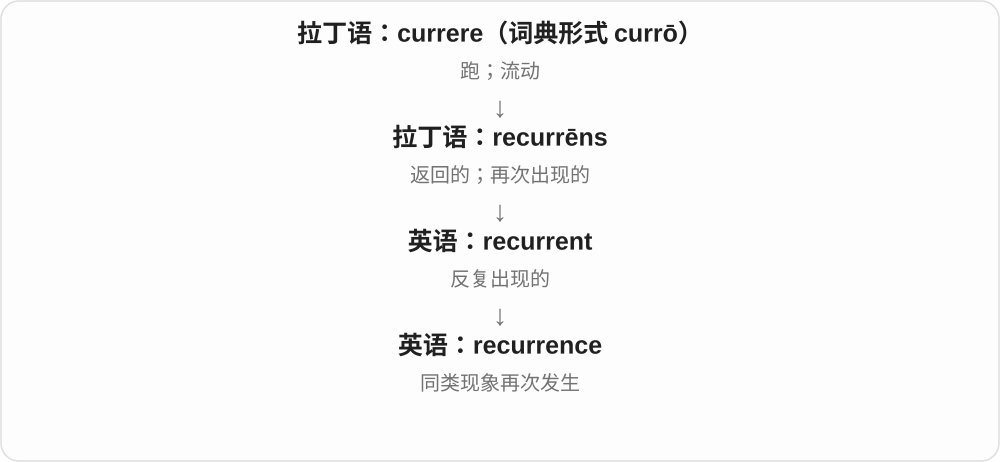

常用于问题、错误、事件的重复出现。它不是简单的 occurrence，因为已经包含一次“再”。

**常见搭配与例句**

prevent a recurrence；a recurrence of the problem；reduce recurrence。

> We changed the process to prevent a recurrence of the error.

我们修改了流程，防止错误再次发生。

> The report notes a recurrence of the same pattern.

报告指出同一种模式再次出现。

**别混淆**

recurrence 说事情又出现；recursion 是递归关系，不是泛指重复。

### 53. abstinence — 戒除；节制；禁欲

**音标**：/ˈæbstɪnəns/

**先抓住这个画面**

abstinence 像面对想做的事，持续给自己设一道“不做”的边界，常说不喝酒、禁食某物或不发生性行为。

**怎么拆**

经古法语 abstinence 来自拉丁语 abstinentia，联系 abstinēre“把自己克制住”。

**怎么变成今天的意思**

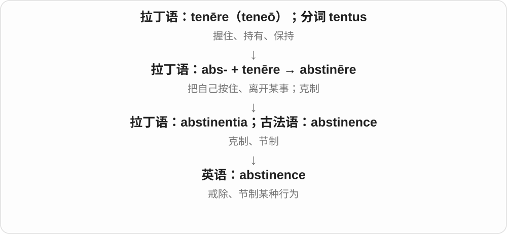

不是简单少一点，而常指在所说的范围或期间内不做。具体戒除什么，要看 from 后面的内容。

**常见搭配与例句**

abstinence from alcohol；a period of abstinence；total abstinence。

> He chose a month of abstinence from alcohol.

他决定一个月不喝酒。

> The article discusses voluntary abstinence from certain foods.

文章讨论了自愿不吃某些食物的做法。

**别混淆**

moderation 是适量、有节制地做；abstinence 通常是在某个范围内完全不做。

### 54. subsistence — 生计；维持生存；基本生活所需

**音标**：/səbˈsɪstəns/

**先抓住这个画面**

先把“今天还能过下去”的底线保住。

**怎么拆**

后期拉丁 subsistentia 及法语 subsistence 借入中古英语，原有实际存在义，后来发展为维持生命；现代可对应 subsist + -ence。

**怎么变成今天的意思**

**拉丁 sistere〔与 stāre“站”相关〕**  
使站住、放置；站定、停住

↓

**拉丁 sub- + sistere → subsistere**  
站住、停住、维持存在

↓

**后期拉丁 subsistentia／中古法语 subsistence → 中古英语 subsistence**  
实际存在、稳固；独立名词路线

↓

**英语 subsistence 的后续义**  
维持生命的过程、资源与最低生活水平

subsistence farming 以满足家庭或当地基本生活需要为主，不是主要为大规模商业出售。subsistence level 说刚够基本需要，具体标准随地区和讨论方式而变。

**常见搭配与例句**

a means of subsistence；subsistence farming；at subsistence level。

> Fishing provided the village with a means of subsistence.

捕鱼为村民提供了谋生手段。

> The family grew maize mainly for subsistence.

这家人种玉米主要是为了满足自己的基本生活需要。

**别混淆**

income 是收入，可多可少；subsistence 指生活得以维持这一层，不是所有收入都叫生存底线。

### 55. abhor — 憎恶；极其厌恶

**音标**：英 /əbˈhɔː/；美 /əbˈhɔːr/

**先抓住这个画面**

不是普通的不喜欢，而是强烈到内心想退开、拒绝与它沾边；常针对残酷、欺骗等行为。

**怎么拆**

拉丁 ab- 加 horrere“战栗、毛发竖起”形成 abhorrere“厌恶得退避”，经法语 abhorrer 或直接拉丁借入英语。可以用“厌恶得缩回去”理解，不等于必须真的发抖。

**怎么变成今天的意思**

**拉丁 ab，构词中也有 abs-、a- 等形式**  
离开、从……分离、去掉

↓

**拉丁 ab- + horrere → abhorrere**  
战栗、毛发竖起 → 厌恶得退避

↓

**法语 abhorrer／直接拉丁借入 → 中古英语 abhorren**  
强烈厌恶、退避

↓

**英语 abhor**  
憎恶、非常反感

abhor cruelty 是憎恶残酷行为；abhor doing something 也可用。词语较正式、分量很重，往往表达原则上的反感。

**常见搭配与例句**

abhor cruelty；abhor violence；abhor deception；abhor the idea of。

> She abhors cruelty to animals.

她憎恶虐待动物的行为。

> He abhorred the idea of taking credit for someone else’s work.

他极其反感把别人的功劳据为己有的想法。

**别混淆**

dislike 可以是口味不合；abhor 通常远强于普通不喜欢。不要只为了显得高级，就拿它说不爱某种零食。

### 56. abhorrent — 令人憎恶的；令人强烈反感的

**音标**：英 /əbˈhɒrənt/；美 /əbˈhɔːrənt/

**先抓住这个画面**

把视角从“我憎恶它”换到“它令人憎恶”：形容某种做法、观念或行为本身使人强烈排斥。

**怎么拆**

借拉丁 abhorrens、abhorrent-，是 abhorrere 的现在分词，原有相悖、退避等用法；英语后来突出令人厌恶。现代可联系 abhor，但保留分词借入路线。

**怎么变成今天的意思**

**拉丁 ab，构词中也有 abs-、a- 等形式**  
离开、从……分离、去掉

↓

**拉丁 ab- + horrere → abhorrere**  
战栗、毛发竖起 → 厌恶得退避

↓

**拉丁分词 abhorrens／abhorrentem → 英语 abhorrent**  
相悖、不相容、退避的

↓

**英语 abhorrent 的常用义**  
令人强烈憎恶的

morally abhorrent 是道德上令人憎恶；abhorrent to someone 是令某人强烈反感。它通常评价对象，而不是简单说某个人正处于憎恶的情绪中。

**常见搭配与例句**

morally abhorrent；abhorrent behaviour；abhorrent to；find something abhorrent。

> The committee called the deliberate deception morally abhorrent.

委员会称这种蓄意欺骗在道德上令人憎恶。

> The idea of exploiting vulnerable people is abhorrent to her.

利用弱势者的想法令她深感厌恶。

**别混淆**

abhor 是动词，abhorrent 是形容词。I abhor the practice 与 I find the practice abhorrent 表达相近意思，但句法不同。

### 57. abhorrence — 憎恶；强烈厌恶

**音标**：英 /əbˈhɒrəns/；美 /əbˈhɔːrəns/

**先抓住这个画面**

不是轻轻一句不喜欢，而是想到那件事就强烈排斥，甚至像想往后缩。abhorrence 把这份憎恶作为名词来谈。

**怎么拆**

abhorrent 与 -ence 的对应，词族接拉丁 ab- 离开 + horrere 战栗、毛发竖起；从惊惧退缩走到强烈厌恶。

**怎么变成今天的意思**

**拉丁 ab- + horrere → abhorrere**  
退缩、强烈排斥

↓

**abhor、abhorrent → abhorrence**  
憎恶；这份强烈厌恶的感觉

abhorrence of cruelty 对残酷行为的憎恶；in abhorrence 怀着强烈厌恶，较正式。

**常见搭配与例句**

an abhorrence of；express abhorrence。

> She expressed her abhorrence of cruelty.

她表达了对残酷行为的憎恶。

> His abhorrence of dishonesty shaped his decisions.

他对不诚实的强烈厌恶影响了他的决定。

**别混淆**

abhorrence 是强烈憎恶的名词；abhorrent 是令人生厌、可憎的形容词，不要只按长短猜词性。

### 58. deference — 敬重；尊重而顺从、让步

**音标**：英、美 /ˈdefərəns/

**先抓住这个画面**

因为认可对方的经验或地位，你把决定的位置让给他。

**怎么拆**

借自法语 déférence，来自 déférer“听从”，远接拉丁 deferre；属于 defer to 支线，不是“推迟”的名词。

**怎么变成今天的意思**

**拉丁语：ferre；第一人称 ferō**  
带、承载；承受；生出

↓

**拉丁语：de- + ferre → deferre**  
带走、移交；提交别人判断

↓

**法语 déférer**  
听从、依从

↓

**法语：déférence**  
对别人意见或地位的尊重、顺从

↓

**英语：deference**  
敬重；尊重而让步

out of deference to 或 in deference to 表示出于尊重而调整行为。尊重可能合理，也可能在语境里显得过分顺从。

**常见搭配与例句**

show deference to；out of deference to；in deference to。

> They postponed the celebration out of deference to the grieving family.

出于对丧亲家庭的尊重，他们推迟了庆祝活动。

> She listened with deference but still asked difficult questions.

她恭敬地倾听，但仍提出了难以回答的问题。

**别混淆**

respect 可只是敬重；deference 常落实为听从、让步或主动调整自己的做法。

### 59. transcendence — 超越；超越性

**音标**：/trænˈsendəns/

**先抓住这个画面**

从“这件事超出了限制”转而讨论那种超出的状态、体验或性质。

**怎么拆**

与 transcendent 相应的名词；词源分析可追中世纪拉丁 transcendentia，也可按英语 transcendent + -ence 解释。两种路线不要硬合成唯一先后顺序。

**怎么变成今天的意思**

**拉丁 trans／trans-**  
越过、穿过；在另一边

↓

**拉丁 trans- + scandere → transcendere**  
攀过去、越过；超出限制

↓

**拉丁 transcendens → 中世纪拉丁 transcendentia；或英语 transcendent + -ence**  
超越这一状态或性质

↓

**英语 transcendence**  
超越、超越性；宗教与审美等领域的用语

the transcendence of boundaries 是跨越界限；religious transcendence 则可能讨论超越日常经验或物质世界的性质。文艺评论也会用它说超出日常自我感受的体验。

**常见搭配与例句**

spiritual transcendence；a sense of transcendence；the transcendence of limits。

> The critic writes about music’s capacity to create a sense of transcendence.

评论者讨论音乐让人感到超越日常的能力。

> The chapter examines the idea of divine transcendence.

这一章考察神的超越性这一观念。

**别混淆**

transcend 是行动，transcendent 是性质，transcendence 把性质或体验作为讨论对象。

### 60. ambivalence — 矛盾心理；又想要又抗拒的态度

**音标**：英、美 /æmˈbɪvələns/

**先抓住这个画面**

同一件事把你往两个方向拉：想接受它带来的好处，又放不下它带来的损失。

**怎么拆**

借自德语心理学词 Ambivalenz，由 ambi-“两边”与 valentia“力量、效力”组成。英语还曾用 ambivalency；这不是普通英语 ambi- + valence 临时拼出的词。

**怎么变成今天的意思**

可以同时期待与害怕搬家，同时欣赏又怨恨一个人。ambivalence 不是完全没有态度，而是几种相反态度同时存在。

**常见搭配与例句**

ambivalence about a decision；ambivalence towards someone；a sense of ambivalence。

> She felt ambivalence about leaving a secure job to travel.

她对放弃稳定工作去旅行心情矛盾，既向往又舍不得。

> The novel captures his ambivalence towards his hometown.

小说写出了他对故乡既亲近又抗拒的复杂感情。

**别混淆**

indifference 是不在乎；ambivalence 是在乎，却同时被相反感受拉扯。

### 61. condolence — 吊唁；哀悼慰问

**音标**：英 /kənˈdəʊləns/；美 /kənˈdoʊləns/

**先抓住这个画面**

别人失去亲友时，表达我知道你很难过、我与你一同哀伤。

**怎么拆**

核心是拉丁 con- 一同 + dolere 悲伤 → condolere。英语名词可分析为 condole + -ence，受到法语 condoléance 影响；也有从拉丁 condolens 词干解释的词源分析。

**怎么变成今天的意思**

**拉丁 dolere 疼痛、悲伤**  
既可身体疼痛，也可内心难过；更远来源未定

↓

**晚期拉丁 con- + dolere → condolere，与 condolens 词干相关**  
同感悲伤

↓

**英语 condole → condolence，受法语 condoléance 影响**  
名词形成有词典分析差异，确定的共同起点是共同哀伤

日常更常见复数 condolences，例如 offer my condolences。a letter of condolence 则用单数形式作抽象修饰。它主要用于丧亲慰问，不是所有小挫折都适合用的普通安慰。

**常见搭配与例句**

offer condolences to someone；express one’s condolences；a message of condolence。

> Please accept my condolences on the loss of your father.

请接受我对你父亲离世的哀悼和慰问。

> The family received many letters of condolence.

这家人收到了许多慰问信。

**别混淆**

sympathy 范围更广；condolences 通常特指有人去世后的慰问。congratulations 是祝贺，两个复数套语不可混用。

### 62. pestilence — 瘟疫；严重流行病〔文学、历史用语〕

**音标**：/ˈpestɪləns/

**先抓住这个画面**

历史叙述里，疾病成片蔓延、带来灾难，会写 pestilence。它带有古老、沉重的灾祸感，不是日常每次感冒都这样叫。

**怎么拆**

经法语 pestilence 接拉丁 pestilentia，关联 pestilens 有害、带病与 pestis 疫病；不是现代 pest 害虫直接加 ilence。

**怎么变成今天的意思**

**拉丁 pestis → pestilens、pestilentia**  
疫病、有害、严重疫情等材料

↓

**英语 pestilence**  
瘟疫、严重疫病；历史文学常用

famine and pestilence 饥荒与瘟疫；an outbreak of pestilence 瘟疫暴发。

**常见搭配与例句**

famine and pestilence；the spread of pestilence。

> The chronicle describes years of famine and pestilence.

编年史描述了饥荒与瘟疫持续的岁月。

> The painting presents pestilence as a figure of disaster.

画作把瘟疫表现为灾难的象征。

**别混淆**

pestilence 是宽泛、带历史文学色彩的疫病名称，不等于一个精确病原体、特定诊断；pest 今天常说害虫或烦人的人。

### 63. subsidence — 地面沉降；下陷；减退

**音标**：英 /səbˈsaɪdəns/，也 /ˈsʌbsɪdəns/；美 /səbˈsaɪdəns/

**先抓住这个画面**

subsidence 像地面下面的支撑变了，上面的地面随之往下落；它把注意力放在下沉这个过程上。

**怎么拆**

联系拉丁 subsidēns / subsīdere 的词干；现代对应 subside + -ence，也有独立拉丁来源分析。

**怎么变成今天的意思**

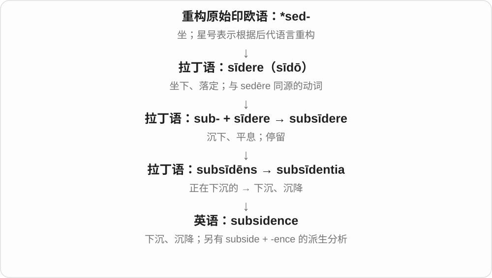

最常见地质、建筑语境中的地面沉降，关注的是地面或地层位置下降这一现象。

**常见搭配与例句**

ground subsidence；land subsidence；evidence of subsidence。

> The survey recorded gradual subsidence near the old mine.

调查记录了旧矿区附近地面的逐渐沉降。

> The report examines the causes of land subsidence.

报告考察了地面沉降的原因。

**别混淆**

erosion 是材料被侵蚀、带走；subsidence 是地面或地层位置下沉，两者可能有关但并非同义。

### 64. salience — 显著性、突出程度；引人注意的程度

**音标**：/ˈseɪliəns/

**先抓住这个画面**

一堆灰色按钮中有一个红按钮，它更容易被看见；salience 就是在说这种“从背景里凸出来”的程度。

**怎么拆**

英语 salient 的形容词词干改用 -ence，形成表示性质的名词；远接拉丁 salire“跳”。

**怎么变成今天的意思**

**拉丁 salire**  
跳、跃起；复合词中常变成 -silire

↓

**拉丁 saliens／salientem**  
跳跃着的，salire 的现在分词

↓

**英语 salient**  
先有跃起、向外突出的用法，后有突出、显著义

↓

**英语 salient → salience**  
突出的 → 突出程度、显著性

在注意、设计或社会议题中都能用。某个消息的 salience 上升，表示它更进入人们视野；不自动证明消息更真实，或事情客观上更重要。

**常见搭配与例句**

visual salience；the salience of an issue；increase salience。

> The red label increases the button’s visual salience.

红色标签让这个按钮在视觉上更显眼。

> The issue gained salience after the public debate.

公开辩论之后，这个问题更受到人们关注。

**别混淆**

salience 是容易引起注意的程度；significance 可指意义、重要性或统计显著性，不能混为一谈。

### 65. subservience — 屈从；过度顺从；从属地位

**音标**：英 /səbˈsɜːviəns/；美 /səbˈsɜːrviəns/

**先抓住这个画面**

不只某一次听话，而是长期把自己的判断放在别人下面的状态。

**怎么拆**

subservient 的 -ent 对应名词 -ence，表示这种状态或态度。

**怎么变成今天的意思**

常批评权力关系中的盲目服从。用于目标关系时，也可说某事从属于另一事。

**常见搭配与例句**

subservience to authority；an attitude of subservience。

> The novel criticizes unquestioning subservience to authority.

小说批评对权威不加质疑的屈从。

> Her silence was mistaken for subservience.

她的沉默被误认为是顺从。

**别混淆**

cooperation 是合作；subservience 是把判断权让到别人之下，尤其可能违背自身判断。

### 66. transience — 短暂；转瞬即逝；无常

**音标**：英 /ˈtrænziəns/；美 /ˈtrænʃəns/，亦读 /ˈtrænziəns/

**先抓住这个画面**

关注的不是某一件短暂的东西，而是“来了又走、留不长”的共同性质。

**怎么拆**

英语 transient 改为名词 transience，-ence 表状态或性质；它接在已借入的形容词之后。

**怎么变成今天的意思**

**拉丁 trans／trans-**  
越过、穿过；在另一边

↓

**拉丁 trans- + ire → transire**  
走过去、经过

↓

**后期拉丁 transiens／transient- → 英语 transient**  
经过而不久留的；短暂的

↓

**英语 transient → transience**  
短暂的 → 短暂这一性质

the transience of fame 是名声难以长久；the transience of life 常带文学、哲思意味。物理现象也可具有 transience，但具体技术名称不一定用这个名词。

**常见搭配与例句**

the transience of life；the transience of fame；a sense of transience。

> The poem reflects on the transience of fame.

这首诗思考名声的短暂。

> The melting sculpture made visitors notice the transience of the moment.

逐渐融化的雕塑让参观者意识到这一刻转瞬即逝。

**别混淆**

transience 是性质名词，transient 是形容词或某种瞬态现象；transition 则是从一种状态变到另一种状态的过程。

### 67. belligerence — 好斗、挑衅的态度或行为；交战状态

**音标**：英美 /bəˈlɪdʒərəns/

**先抓住这个画面**

谈话本来可以合作进行，却处处像在迎战；这种挑衅劲就是日常语境里的 belligerence。

**怎么拆**

英语 belligerent 的 -ent 改为名词形式 -ence。较早的 belligerent 接拉丁 belligerans“正在作战的”，其中 belli- 是战争，-ger- 接 gerere“进行、承载”。

**怎么变成今天的意思**

**拉丁 bellum + gerere → belligerare／belligerans**  
战争 + 进行 → 进行战争／正在作战的

↓

**英语 belligerent**  
交战的；好斗的

↓

**belligerent → belligerence**  
这种态度、行为或交战状态

日常写作常说 with belligerence，强调说话或行为带着攻击性。历史、外交文字中也可能讨论实际交战的状态，不能一律理解成脾气暴躁。

**常见搭配与例句**

a tone of belligerence；respond with belligerence；growing belligerence；military belligerence。

> The customer’s belligerence made the discussion increasingly difficult.

那位顾客咄咄逼人的态度让交谈越来越困难。

> The report traced the shift from negotiation to open belligerence.

报告梳理了从谈判转向公开交战的过程。

**别混淆**

confidence 是自信，不必向别人挑衅；belligerence 暗示把互动变成对抗。是否指正式交战，要看战争或外交上下文。

## 这一组要分清什么

deterrent 是阻吓因素、相应形容词，deterrence 是威慑作用；excellence 卓越与 excellency 称谓分开；-ance／-ence 发音相近，拼写仍按词族；pestilence 常见于历史文学，不是某种特定病原体的精确名称。

## 串起来练习

The evidence showed a convergence of views and a shared commitment to excellence.

证据显示观点逐渐趋同，大家也共同追求高水准。
