# 0112 · -ation — 动作、过程、状态及相应结果；也可指具体对象

[逐词精讲目录](../00_逐词精讲目录.md) · [总目录](../00_总目录_按常用程度.md)

## 核心词根与来源

不要只把它译成某某化。compilation 可以是一本合集，realization 可以是突然意识到，dispensation 可以是特许。名词尾告诉你能把事情整体拿来谈，具体谈什么，仍由基础词和用法决定。

**-ATION：把动词所做的事，或形成的结果，作为名词来谈**

compile 汇编 → compilation 汇编作品；starve 挨饿 → starvation 严重饥饿；mobilize 动员 → mobilization 动员过程。

- **汇编、理解、描写与严重缺食**：compile · compilation · realize · realization · characterize · characterization · starve · starvation
- **炎症、大量侵扰与住院**：inflame · inflammation · infest · infestation · hospitalize · hospitalization
- **合法化与刑事罪名变化**：legalize · legalise · legalization · legalisation · decriminalize · decriminalization
- **时代、专业、地方与标准**：modernize · modernization · specialize · specialization · localize · localization · standardize · standardization
- **动员与固定**：mobilize · mobilization · mobilise · mobilisation · immobilize · immobilization
- **占据、挂念、分配与分类**：occupy · occupied · occupation · preoccupied · preoccupation · dispense · dispensation · category · categorize · categorization
- **利用、变现、减少与抵消**：utilize · utilization · utilise · utilisation · monetize · monetization · minimize · minimization · neutralize · neutralization
- **计算机、字母与资本的专门用法**：initialize · initialization · capitalize · capitalization · capitalisation · serialize · serialization
- **轻巧亲近与短暂尝试**：flirt · flirty · flirtation
- **先认识特征、角色与字符，再读 characterize**：character · characterize · characterization
- **character → characters：特点、人物与文字符号**：character · characters
- **category → categories：说明属性到归类**：category · categories
- **conversation → conversations：相处、交往到谈话**：conversation · conversations
- **characterize → characterized：用特征说明是什么样**：character · characterize · characterized · characterization
- **preparation → preparations：预先备好的工作**：prepare · preparation · preparations
- **lamentation 与 lament 的借词、逆构路线**：lament · laments · lamented · lamenting · lamentation · lamentations
- **starve、starving 与 starvation 的同族对照**：starving

## 词形与演化规律

主要接法语、拉丁 -atio、-ation- 等动作名词材料，也广用于英语类推构词。compile、starve 等常去末尾 e 加 -ation；realize、mobilize 等相应形成 -ization。-ate 结尾的 vibrate 等通常去 e 加 -ion，外观也成为 -ation。借入历史不总按英语短词先、长词后：decriminalize 有从 decriminalization 逆构的解释。-ise、-ize 系列常相应出现 -isation、-ization。

character 接希腊语刻印材料，经法语、拉丁语进入英语。characterize、characterization 在此基础上表达描述特征与相应刻画、表征。

刻出的印记、区别标记，发展出事物特征与可辨认人物等义。

希腊公开断言词进入逻辑范畴，再有一般分类用途。

法语及拉丁 conversationem 借入，英语现代口头交流义后发展。

希腊拉丁特征标明词族，现代对应 character 与 ize，过去 z 后读 d。

名词接法语、拉丁独立借词，影响英语 prepare 的形成。

lamentation 经法语、拉丁名词借入；lament 动词可能逆构于它，也可分析为法语、拉丁借词，学习从短到长不等于历史从短到长。

starving 是 starve 去 e 加 -ing，不是 -ation 派生词；这里与 starvation 同族学习。古英语 steorfan 较早泛指死，后常指因寒冷、饥饿等死亡，现代又有夸张说饿极了。

## 单词速览（按词族由简到繁）

同一基础词的相关扩展放在一起，先读基础形式，再读扩展；各组之间优先读常用的。具体词源关系见各词讲解。

| 单词 | 音标 | 核心意思 |
|---|---|---|
| [formation](#w-5) | 英 /fɔːˈmeɪʃən/；美 /fɔːrˈmeɪʃən/ | 形成；组成；队形；形成物 |
| [information](#w-1) | 英 /ˌɪnfəˈmeɪʃən/；美 /ˌɪnfərˈmeɪʃən/ | 信息；资料；消息 |
| [misinformation](#w-72) | 英 /ˌmɪsɪnfəˈmeɪʃən/；美 /ˌmɪsɪnfərˈmeɪʃən/ | 错误信息 |
| [transformation](#w-16) | 英 /ˌtrænsfəˈmeɪʃən/；美 /ˌtrænsfərˈmeɪʃən/ | 转变；改造；变换 |
| [deformation](#w-80) | 英 /ˌdiːfɔːˈmeɪʃən/；美 /ˌdiːfɔːrˈmeɪʃən/ | 变形；形变 |
| [character](#w-251) | 英 /ˈkærɪktə/；美 /ˈkærəktər/ | 性格、品质；特征；角色；字符 |
| [characters](#w-252) | 英 /ˈkærəktəz/；美 /ˈkærəktərz/ | 人物、角色；字符；性格、特质〔复数〕 |
| [characterize](#w-228) | /ˈkærəktəraɪz/ | 描写、刻画；构成……的特征 |
| [characterized](#w-255) | 英 /ˈkærəktəraɪzd/；美 /ˈkærəktəraɪzd/，也 /ˈkerəktəraɪzd/ | 刻画、描述了；以……为特征的〔过去式、过去分词〕 |
| [characterization](#w-49) | 英 /ˌkærəktəraɪˈzeɪʃən/；美 /ˌkærəktərəˈzeɪʃən/ | 特征描述；人物塑造；表征〔专业〕 |
| [hospital](#w-214) | 英 /ˈhɒspɪtəl/；美 /ˈhɑːspɪtəl/ | 医院；慈善收容机构〔历史用法〕 |
| [hospitalize](#w-250) | 英 /ˈhɒspɪtəlaɪz/；美 /ˈhɑːspɪtəlaɪz/ | 使住院、送入医院治疗 |
| [hospitalization](#w-91) | 英 /ˌhɒspɪtəlaɪˈzeɪʃən/；美 /ˌhɑːspɪtələˈzeɪʃən/ | 住院；住院治疗、经历 |
| [capital](#w-215) | /ˈkæpɪtəl/ | 首都；资本；大写字母；柱头；主要的；涉及死刑的 |
| [capitalize](#w-227) | /ˈkæpɪtəlaɪz/ | 用大写书写；使资本化；利用机会 |
| [capitalization](#w-83) | /ˌkæpɪtəlaɪˈzeɪʃən/ | 大写使用；资本化；资本额、市值〔依搭配〕 |
| [capitalisation](#w-160) | /ˌkæpɪtəlaɪˈzeɪʃən/ | 使用大写；资本化；市值〔搭配〕 |
| [realize](#w-216) | /ˈrɪəlaɪz/ | 意识到；实现；变现 |
| [realise](#w-219) | /ˈrɪəlaɪz/ | 意识到；实现〔realize 的常见英式拼写〕 |
| [realization](#w-37) | /ˌrɪəlaɪˈzeɪʃən/ | 意识到；实现；变现〔特定语境〕 |
| [conversation](#w-2) | 英 /ˌkɒnvəˈseɪʃən/；美 /ˌkɑːnvərˈseɪʃən/ | 交谈；谈话 |
| [conversations](#w-254) | 英 /ˌkɒnvəˈseɪʃənz/；美 /ˌkɑːnvərˈseɪʃənz/ | 谈话、交谈〔复数〕 |
| [combination](#w-3) | 英 /ˌkɒmbɪˈneɪʃən/；美 /ˌkɑːmbɪˈneɪʃən/ | 组合、结合；组合结果；密码组合 |
| [category](#w-217) | 英 /ˈkætəɡəri/；美 /ˈkætəɡɔːri/ | 类别、种类；范畴 |
| [categories](#w-253) | 英 /ˈkætəɡəriz/；美 /ˈkætəɡɔːriz/ | 类别、门类、范畴〔复数〕 |
| [categorize](#w-238) | /ˈkætəɡəraɪz/ | 分类；把……归为某类 |
| [categorization](#w-123) | 英 /ˌkætəɡəraɪˈzeɪʃən/；美 /ˌkætəɡərəˈzeɪʃən/ | 分类、归类；分类方式 |
| [transportation](#w-4) | 英 /ˌtrænspɔːˈteɪʃən/；美 /ˌtrænspərˈteɪʃən/ | 运输；交通运输系统或方式 |
| [prepare](#w-256) | 英 /prɪˈpeə/；美 /prɪˈper/ | 准备；使做好准备；制作、备好 |
| [preparation](#w-8) | /ˌprepəˈreɪʃən/ | 准备；准备工作；配制品 |
| [preparations](#w-257) | /ˌprepəˈreɪʃənz/ | 准备工作、筹备、安排〔复数〕；配制品〔依语境〕 |
| [explanation](#w-6) | 英、美 /ˌekspləˈneɪʃən/ | 解释；说明；原因说明 |
| [organisation](#w-7) | /ˌɔːɡənaɪˈzeɪʃən/ | 组织、机构；组织安排，organization 的另一种拼写 |
| [registration](#w-9) | /ˌredʒɪˈstreɪʃən/ | 登记、注册、报名；登记资料或凭证 |
| [occupy](#w-221) | 英 /ˈɒkjʊpaɪ/；美 /ˈɑːkjəpaɪ/ | 占用、占据；居住、使用；使忙于 |
| [occupied](#w-218) | 英 /ˈɒkjʊpaɪd/；美 /ˈɑːkjəpaɪd/ | 被占用的；忙着的；被占领的 |
| [occupation](#w-220) | 英 /ˌɒkjəˈpeɪʃən/；美 /ˌɑːkjəˈpeɪʃən/ | 职业；占用、居住；占领 |
| [preoccupation](#w-119) | 英 /priˌɒkjuˈpeɪʃən/；美 /priˌɑːkjuˈpeɪʃən/ | 一心想着；反复挂念的事；心神不属 |
| [preoccupied](#w-231) | 英 /priˈɒkjupaɪd/；美 /priˈɑːkjupaɪd/ | 心事重重的；心不在焉的；一心想着的 |
| [implementation](#w-10) | 英 /ˌɪmplɪmenˈteɪʃən/；美 /ˌɪmpləmenˈteɪʃən/ | 实施；落实；实现方案〔尤其软件〕 |
| [presentation](#w-11) | /ˌprezənˈteɪʃən/ | 展示、报告；呈现方式；颁赠 |
| [examination](#w-12) | /ɪɡˌzæmɪˈneɪʃən/ | 检查、审查；考试、考核 |
| [imagination](#w-13) | /ɪˌmædʒɪˈneɪʃən/ | 想象力；想象、设想 |
| [interpretation](#w-14) | 英 /ɪnˌtɜːprəˈteɪʃən/；美 /ɪnˌtɜːrprəˈteɪʃən/ | 解释、解读；口译；艺术演绎方式 |
| [misinterpretation](#w-139) | /ˌmɪsɪntɜːrprɪˈteɪʃən/ | 错误解读；曲解；误释 |
| [motivation](#w-15) | 英 /ˌməʊtɪˈveɪʃən/；美 /ˌmoʊtɪˈveɪʃən/ | 动力；动机；积极性 |
| [exploration](#w-17) | /ˌekspləˈreɪʃən/ | 探索；考察；探究 |
| [determination](#w-18) | 英 /dɪˌtɜːmɪˈneɪʃən/；美 /dɪˌtɜːrmɪˈneɪʃən/ | 决心；确定；测定 |
| [observation](#w-19) | 英 /ˌɒbzəˈveɪʃən/；美 /ˌɑːbzərˈveɪʃən/ | 观察；观察结果；评论 |
| [confirmation](#w-20) | 英 /ˌkɒnfəˈmeɪʃən/；美 /ˌkɑːnfərˈmeɪʃən/ | 确认；证实；确认通知 |
| [variation](#w-21) | 英 /ˌveəriˈeɪʃən/；美 /ˌveriˈeɪʃən/ | 变化；差别；变式；变奏 |
| [consultation](#w-22) | 英 /ˌkɒnsəlˈteɪʃən/；美 /ˌkɑːnsəlˈteɪʃən/ | 咨询；磋商；征求意见；咨询会面 |
| [resignation](#w-23) | /ˌrezɪɡˈneɪʃən/ | 辞职；辞呈；无奈接受、顺从 |
| [adaptation](#w-24) | 英、美 /ˌædæpˈteɪʃən/ | 适应；改编；改编作品 |
| [civilization](#w-25) | 英 /ˌsɪvəlaɪˈzeɪʃən/；美 /ˌsɪvələˈzeɪʃən/ | 文明；某一文明社会；有组织的生活环境 |
| [preservation](#w-26) | 英 /ˌprezəˈveɪʃən/；美 /ˌprezərˈveɪʃən/ | 保存；保护；维持原状 |
| [expectation](#w-27) | /ˌekspekˈteɪʃən/ | 预期；期待；期望要求 |
| [configuration](#w-28) | 英 /kənˌfɪɡəˈreɪʃən/；美 /kənˌfɪɡjəˈreɪʃən/ | 配置；布局；各部分的组合方式 |
| [documentation](#w-29) | 英 /ˌdɒkjumenˈteɪʃən/；美 /ˌdɑːkjumenˈteɪʃən/ | 文件资料；说明文档；记录和举证的过程 |
| [reservation](#w-30) | 英 /ˌrezəˈveɪʃən/；美 /ˌrezərˈveɪʃən/ | 预订；保留意见；保留地 |
| [compile](#w-226) | /kəmˈpaɪl/ | 汇编、编制；编译〔程序〕 |
| [compilation](#w-31) | 英 /ˌkɒmpɪˈleɪʃən/；美 /ˌkɑːmpɪˈleɪʃən/ | 汇编、编纂；汇编作品、精选集；编译 |
| [activation](#w-32) | /ˌæktɪˈveɪʃən/ | 激活；启动；使生效 |
| [minimize](#w-222) | /ˈmɪnɪmaɪz/ | 尽量减少；淡化；最小化〔界面、数学〕 |
| [minimization](#w-150) | /ˌmɪnɪmaɪˈzeɪʃən/ | 最小化；尽量减少；淡化 |
| [starve](#w-225) | 英 /stɑːv/；美 /stɑːrv/ | 挨饿、饿死；使挨饿；极度缺乏 |
| [starving](#w-264) | 英 /ˈstɑːvɪŋ/；美 /ˈstɑːrvɪŋ/ | 挨饿；饿得厉害；饿极了〔分词、形容词〕 |
| [starvation](#w-50) | 英 /stɑːˈveɪʃən/；美 /stɑːrˈveɪʃən/ | 严重饥饿；挨饿、饥饿致死 |
| [designation](#w-33) | /ˌdezɪɡˈneɪʃən/ | 指定；任命；名称、称号；划定的身份 |
| [utilize](#w-223) | 英 /ˈjuːtɪlaɪz/；美 /ˈjuːtəlaɪz/ | 利用；使派上用场 |
| [utilization](#w-52) | 英 /ˌjuːtɪlaɪˈzeɪʃən/；美 /ˌjuːtələˈzeɪʃən/ | 利用；使用情况；利用程度 |
| [utilisation](#w-131) | /ˌjuːtɪlaɪˈzeɪʃən/ | 利用、使用；利用程度〔搭配〕 |
| [utilise](#w-237) | /ˈjuːtɪlaɪz/ | 利用、使用〔utilize 的常见英式拼写〕 |
| [authorization](#w-34) | 英 /ˌɔːθəraɪˈzeɪʃən/；美 /ˌɔːθərəˈzeɪʃən/ | 授权；批准；授权文件 |
| [inflame](#w-242) | /ɪnˈfleɪm/ | 激化、激起；使发炎 |
| [inflammation](#w-35) | /ˌɪnfləˈmeɪʃən/ | 炎症；发炎 |
| [confrontation](#w-36) | 英 /ˌkɒnfrʌnˈteɪʃn/；美 /ˌkɑːnfrənˈteɪʃn/ | 对抗；冲突；当面对质 |
| [temptation](#w-38) | /tempˈteɪʃən/ | 诱惑；让人心动的事物 |
| [continuation](#w-39) | /kənˌtɪnjuˈeɪʃən/ | 继续；延续；续接部分 |
| [limitation](#w-40) | /ˌlɪmɪˈteɪʃən/ | 限制、限制条件；局限、短处 |
| [relaxation](#w-41) | 英、美 /ˌriːlækˈseɪʃən/ | 放松；休息；放宽；弛豫 |
| [optimization](#w-42) | 英 /ˌɒptɪmaɪˈzeɪʃən/；美 /ˌɑptɪməˈzeɪʃən/ | 优化；寻求最优方案的过程 |
| [accusation](#w-43) | /ˌækjʊˈzeɪʃən/ | 指控；指责 |
| [degradation](#w-44) | 英、美 /ˌdeɡrəˈdeɪʃən/ | 退化；恶化；降解；受辱 |
| [deportation](#w-45) | 英 /ˌdiːpɔːˈteɪʃən/；美 /ˌdiːpɔːrˈteɪʃən/ | 驱逐出境；强制遣送 |
| [sanitation](#w-46) | /ˌsænɪˈteɪʃən/ | 公共卫生；环境卫生；卫生设施与废物处理 |
| [accreditation](#w-47) | /əˌkredɪˈteɪʃən/ | 正式认证；认可资格；授权 |
| [consolation](#w-48) | 英 /ˌkɒnsəˈleɪʃən/；美 /ˌkɑːnsəˈleɪʃən/ | 安慰；慰藉；使人稍感好受的人或事 |
| [flirt](#w-224) | 英 /flɜːt/；美 /flɜːrt/ | 调情；短暂考虑、涉足〔搭配〕；爱调情的人 |
| [flirty](#w-235) | 英 /ˈflɜːti/；美 /ˈflɜːrti/ | 爱调情的；带暧昧意味的 |
| [flirtation](#w-132) | 英 /flɜːˈteɪʃən/；美 /flɜːrˈteɪʃən/ | 调情；短暂暧昧关系；短暂涉足 |
| [quotation](#w-51) | 英 /kwəʊˈteɪʃən/；美 /kwoʊˈteɪʃən/ | 引文；引用；报价或报价单 |
| [experimentation](#w-53) | /ɪkˌsperɪmenˈteɪʃən/ | 实验活动、试验探索；反复尝试的过程 |
| [notation](#w-54) | 英 /nəʊˈteɪʃən/；美 /noʊˈteɪʃən/ | 符号表示法；记谱法；记号；简短记录 |
| [globalization](#w-55) | 英 /ˌɡləʊbəlaɪˈzeɪʃən/；美 /ˌɡloʊbələˈzeɪʃən/ | 全球化 |
| [instrumentation](#w-56) | /ˌɪnstrəmenˈteɪʃən/ | 仪器配置、测量装置系统；配器、乐器编配 |
| [manifestation](#w-57) | /ˌmænɪfeˈsteɪʃən/ | 表现；显现；体现出来的迹象 |
| [legalize](#w-230) | /ˈliːɡəlaɪz/ | 使合法；使获得法律许可 |
| [legalization](#w-58) | /ˌliːɡəlaɪˈzeɪʃən/ | 合法化 |
| [legalise](#w-246) | /ˈliːɡəlaɪz/ | 使合法化〔legalize 的常见英式拼写〕 |
| [legalisation](#w-157) | /ˌliːɡəlaɪˈzeɪʃən/ | 合法化〔legalization 的常见英式拼写〕 |
| [oxidation](#w-59) | 英 /ˌɒksɪˈdeɪʃən/；美 /ˌɑːksɪˈdeɪʃən/ | 氧化 |
| [civilisation](#w-60) | 英 /ˌsɪvəlaɪˈzeɪʃən/；美 /ˌsɪvələˈzeɪʃən/ | 文明；文明社会〔civilization 的拼写变体〕 |
| [inclination](#w-61) | /ˌɪnklɪˈneɪʃən/ | 倾向；意愿；斜度；倾角 |
| [colonization](#w-62) | 英 /ˌkɒlənaɪˈzeɪʃən/；美 /ˌkɑːlənəˈzeɪʃən/ | 殖民过程；建立群体；定植〔生物〕 |
| [modernize](#w-236) | 英 /ˈmɒdənaɪz/；美 /ˈmɑːdərnaɪz/ | 使现代化；更新 |
| [modernization](#w-63) | 英 /ˌmɒdənaɪˈzeɪʃən/；美 /ˌmɑːdərnəˈzeɪʃən/ | 现代化；更新改造 |
| [authentication](#w-64) | 英 /ɔːˌθentɪˈkeɪʃən/；美 /ɔːˌθentɪˈkeɪʃən/，也读 /ɑːˌθentɪˈkeɪʃən/ | 真实性鉴定；身份验证；来源验证 |
| [computation](#w-65) | 英 /ˌkɒmpjuˈteɪʃən/；美 /ˌkɑːmpjuˈteɪʃən/ | 计算过程；一次运算；计算结果 |
| [alteration](#w-66) | /ˌɔːltəˈreɪʃən/ | 改动；修改 |
| [visualization](#w-67) | 英 /ˌvɪʒuəlaɪˈzeɪʃən/；美 /ˌvɪʒuələˈzeɪʃən/ | 可视化；在脑中形成画面 |
| [aspiration](#w-68) | /ˌæspəˈreɪʃən/ | 志向；愿望；送气〔语音〕；抽吸、误吸〔医学〕 |
| [stabilization](#w-69) | /ˌsteɪbəlaɪˈzeɪʃən/ | 稳定过程；使稳定的措施 |
| [specialize](#w-229) | /ˈspeʃəlaɪz/ | 专门从事；专攻 |
| [specialization](#w-70) | 英 /ˌspeʃəlaɪˈzeɪʃən/；美 /ˌspeʃələˈzeɪʃən/ | 专门化、专业化；专业方向 |
| [privatization](#w-74) | 英、美 /ˌpraɪvətaɪˈzeɪʃən/ | 私有化；由公营转为私人经营的过程 |
| [mobilize](#w-232) | 英 /ˈməʊbəlaɪz/；美 /ˈmoʊbəlaɪz/ | 动员、调集；组织起来行动 |
| [mobilization](#w-73) | 英 /ˌməʊbəlaɪˈzeɪʃən/；美 /ˌmoʊbələˈzeɪʃən/ | 动员；资源调集、组织行动 |
| [mobilisation](#w-133) | /ˌməʊbəlaɪˈzeɪʃən/ | 动员、调集〔mobilization 的常见英式拼写〕 |
| [mobilise](#w-241) | /ˈməʊbəlaɪz/ | 动员、调集〔mobilize 的常见英式拼写〕 |
| [immobilize](#w-247) | 英 /ɪˈməʊbəlaɪz/；美 /ɪˈmoʊbəlaɪz/ | 使不能动；使停止活动 |
| [immobilization](#w-188) | 英 /ɪˌməʊbɪlaɪˈzeɪʃən/；美 /ɪˌmoʊbələˈzeɪʃən/ | 固定；使不能移动；限制活动 |
| [localize](#w-244) | 英 /ˈləʊkəlaɪz/；美 /ˈloʊkəlaɪz/ | 使本地化；定位；限制在局部 |
| [localization](#w-71) | 英 /ˌləʊkəlaɪˈzeɪʃən/；美 /ˌloʊkələˈzeɪʃən/ | 本地化；定位；局部化 |
| [lament](#w-258) | /ləˈment/ | 哀叹、悲叹；哀歌、悲叹的话 |
| [lamented](#w-259) | /ləˈmentɪd/ | 哀叹、惋惜了；受到哀悼的 |
| [laments](#w-260) | /ləˈments/ | 哀叹、惋惜〔第三人称单数〕；哀歌、悲叹〔复数〕 |
| [lamenting](#w-261) | /ləˈmentɪŋ/ | 正在哀叹、惋惜；表达悲伤的活动 |
| [lamentations](#w-262) | /ˌlæmənˈteɪʃənz/，也 /ˌlæmɪnˈteɪʃənz/ | 阵阵哀哭；一篇篇、一段段悲叹 |
| [lamentation](#w-263) | /ˌlæmənˈteɪʃən/，也 /ˌlæmɪnˈteɪʃən/ | 哀叹、恸哭；一段悲叹 |
| [fragmentation](#w-75) | /ˌfræɡmenˈteɪʃən/ | 碎片化；分裂；零散分布 |
| [segmentation](#w-76) | /ˌseɡmenˈteɪʃən/ | 分段；分割；细分 |
| [deforestation](#w-77) | 英 /diːˌfɒrɪˈsteɪʃən/；美 /diːˌfɔːrɪˈsteɪʃən/ | 森林砍伐、毁林；失去森林覆盖的过程 |
| [stagnation](#w-78) | /stæɡˈneɪʃən/ | 停滞；萧条；不流动 |
| [infest](#w-243) | /ɪnˈfest/ | 大量侵扰、寄生〔害虫、鼠类等〕 |
| [infestation](#w-79) | /ˌɪnfesˈteɪʃən/ | 虫害、鼠患等；大量寄生、侵扰 |
| [reclamation](#w-81) | 英、美 /ˌrekləˈmeɪʃən/ | 土地开垦、整治或填海；回收利用；收回 |
| [flotation](#w-82) | 英 /fləʊˈteɪʃən/；美 /floʊˈteɪʃən/ | 漂浮、浮起；浮选；〔商业〕发行上市 |
| [condensation](#w-84) | 英 /ˌkɒndenˈseɪʃən/；美 /ˌkɑːndenˈseɪʃən/ | 冷凝；凝结的水珠；内容的压缩、精简版 |
| [inhalation](#w-85) | /ˌɪnhəˈleɪʃən/ | 吸入；吸气 |
| [neutralize](#w-233) | 英 /ˈnjuːtrəlaɪz/；美 /ˈnuːtrəlaɪz/ | 中和；抵消、使失去作用 |
| [neutralization](#w-180) | 英 /ˌnjuːtrəlaɪˈzeɪʃən/；美 /ˌnuːtrələˈzeɪʃən/ | 中和；抵消、使失去作用 |
| [adoration](#w-86) | 英 /ˌædəˈreɪʃən/；美 /ˌædəˈreɪʃən/ | 崇拜；热爱；敬拜 |
| [dispense](#w-234) | 英、美 /dɪˈspens/ | 分发；配发药物；〔dispense with〕省去、不再需要 |
| [dispensation](#w-120) | /ˌdɪspenˈseɪʃən/ | 特许、豁免；施予、分配；制度、秩序〔正式〕 |
| [synchronization](#w-87) | 英 /ˌsɪŋkrənaɪˈzeɪʃən/；美 /ˌsɪŋkrənəˈzeɪʃən/ | 同步；使步调或数据一致 |
| [causation](#w-88) | /kɔːˈzeɪʃən/ | 造成结果的过程；因果关系 |
| [improvisation](#w-89) | 英 /ˌɪmprəvaɪˈzeɪʃən/；美 /ɪmˌprɑːvəˈzeɪʃən/ | 即兴创作；临场应变；临时凑成的办法 |
| [sterilization](#w-90) | 英 /ˌsterɪlaɪˈzeɪʃən/；美 /ˌsterələˈzeɪʃən/ | 灭菌；绝育〔另一用法〕 |
| [standardize](#w-240) | 英 /ˈstændədaɪz/；美 /ˈstændərdaɪz/ | 标准化；统一规范或格式 |
| [standardization](#w-92) | 英 /ˌstændədaɪˈzeɪʃən/；美 /ˌstændərdəˈzeɪʃən/ | 标准化；统一规范 |
| [industrialization](#w-93) | 英 /ɪnˌdʌstriəlaɪˈzeɪʃən/；美 /ɪnˌdʌstriəlɪˈzeɪʃən/ | 工业化、工业化过程 |
| [fertilization](#w-94) | 英 /ˌfɜːtəlaɪˈzeɪʃən/；美 /ˌfɜːrtələˈzeɪʃən/ | 受精；施肥 |
| [importation](#w-95) | 英 /ˌɪmpɔːˈteɪʃən/；美 /ˌɪmpɔːrˈteɪʃən/ | 进口；引入过程 |
| [derivation](#w-96) | /ˌderɪˈveɪʃən/ | 来源、词源形成；派生构词；推导过程 |
| [urbanization](#w-97) | 英 /ˌɜːbənaɪˈzeɪʃən/；美 /ˌɜːrbənəˈzeɪʃən/ | 城市化；城镇化 |
| [ionization](#w-98) | 英 /ˌaɪənaɪˈzeɪʃən/；美 /ˌaɪənəˈzeɪʃən/ | 电离；离子化 |
| [excitation](#w-99) | /ˌeksaɪˈteɪʃən/ | 激发；兴奋作用；励磁 |
| [socialization](#w-100) | 英 /ˌsəʊʃəlaɪˈzeɪʃən/；美 /ˌsoʊʃələˈzeɪʃən/ | 社会化；学习社会规范的过程；社交活动 |
| [immunization](#w-101) | 英 /ˌɪmjʊnaɪˈzeɪʃən/；美 /ˌɪmjənəˈzeɪʃən/ | 免疫、使获得免疫保护的过程；预防接种〔常见用法〕 |
| [electrification](#w-102) | /ɪˌlektrɪfɪˈkeɪʃən/ | 电气化；通电、带电过程 |
| [normalization](#w-103) | 英 /ˌnɔːməlaɪˈzeɪʃən/；美 /ˌnɔːrmələˈzeɪʃən/ | 正常化；归一化；规范化 |
| [commercialization](#w-105) | 英 /kəˌmɜːʃəlaɪˈzeɪʃən/；美 /kəˌmɜːrʃələˈzeɪʃən/ | 商业化；商品化 |
| [misrepresentation](#w-106) | /ˌmɪsreprɪzenˈteɪʃən/ | 歪曲；不实陈述；错误呈现 |
| [globalisation](#w-107) | 英 /ˌɡləʊbəlaɪˈzeɪʃən/；美 /ˌɡloʊbələˈzeɪʃən/ | 全球化〔英式常见拼写〕 |
| [supplementation](#w-108) | 英 /ˌsʌplɪmenˈteɪʃən/；美 /ˌsʌpləmenˈteɪʃən/ | 补充；增补的过程 |
| [connotation](#w-109) | 英 /ˌkɒnəˈteɪʃən/；美 /ˌkɑːnəˈteɪʃən/ | 附带含义；联想义；感情色彩 |
| [revocation](#w-110) | /ˌrevəˈkeɪʃən/ | 撤销；收回；废止 |
| [summation](#w-111) | /sʌˈmeɪʃən/ | 求和；总括；总结陈述 |
| [invocation](#w-112) | /ˌɪnvəˈkeɪʃən/ | 祈求；祷文；援引；程序调用 |
| [menstruation](#w-114) | /ˌmenstruˈeɪʃən/ | 月经；月经来潮 |
| [recitation](#w-115) | /ˌresɪˈteɪʃən/ | 背诵；朗诵；复述；习题讨论课〔美〕 |
| [revitalization](#w-116) | 英 /ˌriːˌvaɪtəlaɪˈzeɪʃən/；美 /ˌriːˌvaɪtələˈzeɪʃən/ | 振兴；恢复活力 |
| [pigmentation](#w-118) | /ˌpɪɡmenˈteɪʃən/ | 色素形成；色素沉着；色素着色状态 |
| [centralization](#w-136) | 英 /ˌsentrəlaɪˈzeɪʃən/；美 /ˌsentrələˈzeɪʃən/ | 集中化；集权；统一管理 |
| [decentralization](#w-117) | 英 /diːˌsentrəlaɪˈzeɪʃən/；美 /diːˌsentrələˈzeɪʃən/ | 分权；分散化；去中心化 |
| [polymerization](#w-121) | 英 /ˌpɒlɪməraɪˈzeɪʃən/；美 /pəˌlɪmərəˈzeɪʃən/ | 聚合；聚合反应 |
| [liberalization](#w-122) | 英 /ˌlɪbərəlaɪˈzeɪʃən/；美 /ˌlɪbərələˈzeɪʃən/ | 自由化；放宽限制的过程 |
| [victimization](#w-125) | 英 /ˌvɪktɪmaɪˈzeɪʃən/；美也常 /ˌvɪktɪməˈzeɪʃən/ | 使受害、欺凌、迫害；受害经历 |
| [discoloration](#w-126) | /dɪsˌkʌləˈreɪʃən/ | 变色；褪色；变色的斑迹 |
| [monetize](#w-239) | /ˈmʌnətaɪz/，亦有 /ˈmɒnətaɪz/ | 使变现；从……获取收益；货币化 |
| [monetization](#w-134) | /ˌmʌnətaɪˈzeɪʃən/，亦有 /ˌmɒnətaɪˈzeɪʃən/ | 变现；货币化；收益获取机制 |
| [germination](#w-127) | 英 /ˌdʒɜːmɪˈneɪʃən/；美 /ˌdʒɜːrmɪˈneɪʃən/ | 发芽；萌发过程 |
| [democratization](#w-128) | 英 /dɪˌmɒkrətaɪˈzeɪʃən/；美 /dɪˌmɑːkrətəˈzeɪʃən/ | 民主化；让更多人有机会使用或参与 |
| [ornamentation](#w-129) | 英 /ˌɔːnəmenˈteɪʃən/；美 /ˌɔːrnəmenˈteɪʃən/ | 装饰；装饰手法或整体装饰细节 |
| [rationalization](#w-135) | 英 /ˌræʃənəlaɪˈzeɪʃən/；美 /ˌræʃənələˈzeɪʃən/ | 合理化、整合以提高效率；自圆其说、为行为找理由；有理化 |
| [disorientation](#w-137) | 英 /dɪsˌɔːriənˈteɪʃən/；美 /dɪsˌɔːriənˈteɪʃən/ | 迷失方向；定向障碍；茫然 |
| [equalization](#w-138) | 英 /ˌiːkwəlaɪˈzeɪʃən/；美 /ˌiːkwələˈzeɪʃən/ | 均等化；调平；均衡处理 |
| [perspiration](#w-140) | 英 /ˌpɜːspəˈreɪʃən/；美 /ˌpɜːrspəˈreɪʃən/ | 汗；出汗 |
| [sedimentation](#w-141) | /ˌsedɪmenˈteɪʃən/ | 沉降；沉积作用 |
| [reconsideration](#w-142) | /ˌriːkənˌsɪdəˈreɪʃən/ | 重新考虑；复议；再次审视 |
| [indentation](#w-143) | 英、美 /ˌɪndenˈteɪʃn/ | 缩进；凹痕；凹口 |
| [permutation](#w-144) | 英 /ˌpɜːmjʊˈteɪʃən/；美 /ˌpɜːrmjʊˈteɪʃən/ | 排列；排列方式；变化形式 |
| [encapsulation](#w-145) | 英 /ɪnˌkæpsjuˈleɪʃən/；美也读 /ɪnˌkæpsəˈleɪʃən/ | 封装；包裹；精炼概括 |
| [memorization](#w-147) | 英 /ˌmeməraɪˈzeɪʃən/；美 /ˌmemərəˈzeɪʃən/ | 记忆、背熟的过程 |
| [decriminalize](#w-248) | /diːˈkrɪmɪnəlaɪz/ | 使非刑罪化；不再按刑事犯罪处理 |
| [decriminalization](#w-146) | /diːˌkrɪmɪnəlaɪˈzeɪʃən/ | 非刑罪化；取消刑事犯罪地位 |
| [prioritization](#w-148) | 英 /praɪˌɒrətaɪˈzeɪʃən/；美 /praɪˌɔːrətəˈzeɪʃən/ | 优先顺序的安排；确定轻重缓急 |
| [militarization](#w-149) | 英 /ˌmɪlɪtəraɪˈzeɪʃən/；美 /ˌmɪlətərəˈzeɪʃən/ | 军事化过程；军事化程度的增长 |
| [personalization](#w-151) | 英 /ˌpɜːsənəlaɪˈzeɪʃən/；美 /ˌpɜːrsənəlaɪˈzeɪʃən/ | 个性化；面向个人的定制 |
| [initialize](#w-245) | /ɪˈnɪʃəlaɪz/ | 初始化；设定初始状态 |
| [initialization](#w-152) | 英 /ɪˌnɪʃəlaɪˈzeɪʃən/；美 /ɪˌnɪʃələˈzeɪʃən/ | 初始化；初始设置 |
| [criminalization](#w-154) | /ˌkrɪmɪnəlaɪˈzeɪʃən/ | 犯罪化、入罪化的过程或政策 |
| [digitization](#w-155) | 英 /ˌdɪdʒɪtaɪˈzeɪʃən/；美 /ˌdɪdʒɪtəˈzeɪʃən/ | 数字化；转换为数字资料的过程 |
| [reforestation](#w-158) | 英 /riːˌfɒrɪˈsteɪʃən/；美 /riːˌfɔːrɪˈsteɪʃən/ | 重新造林、森林恢复 |
| [oxygenation](#w-159) | 英 /ˌɒksɪdʒəˈneɪʃən/；美 /ˌɑːksɪdʒəˈneɪʃən/ | 供氧；充氧；氧合 |
| [harmonization](#w-163) | 英 /ˌhɑːmənaɪˈzeɪʃən/；美 /ˌhɑːrmənəˈzeɪʃən/ | 协调、统一的过程；和声编配 |
| [immunisation](#w-164) | /ˌɪmjʊnaɪˈzeɪʃən/ | 免疫、预防接种〔immunization 的常见英式拼写〕 |
| [magnetization](#w-165) | 英 /ˌmæɡnɪtaɪˈzeɪʃən/；美 /ˌmæɡnɪtəˈzeɪʃən/ | 磁化；磁化状态或磁化强度 |
| [dramatization](#w-167) | 英 /ˌdræmətaɪˈzeɪʃən/；美 /ˌdræmətəˈzeɪʃən/ | 戏剧化改编；改编作品；戏剧化表现 |
| [maximization](#w-169) | /ˌmæksɪmaɪˈzeɪʃən/ | 最大化；尽量提高某个目标值的过程 |
| [serialize](#w-249) | 英 /ˈsɪəriəlaɪz/；美 /ˈsɪriəlaɪz/ | 分期连载；序列化〔数据〕 |
| [serialization](#w-170) | 英 /ˌsɪəriəlaɪˈzeɪʃən/；美 /ˌsɪriələˈzeɪʃən/ | 连载；序列化 |
| [mechanization](#w-173) | 英 /ˌmekənaɪˈzeɪʃən/；美 /ˌmekənəˈzeɪʃən/ | 机械化 |
| [exportation](#w-174) | 英 /ˌekspɔːˈteɪʃən/；美 /ˌekspɔːrˈteɪʃən/ | 出口；输出过程 |
| [exhalation](#w-175) | /ˌekshəˈleɪʃən/ | 呼气；呼出的气；散发出的气体或气味 |
| [politicization](#w-176) | 英 /pəˌlɪtɪsaɪˈzeɪʃən/；美 /pəˌlɪtəsəˈzeɪʃən/ | 政治化；政治意识或参与的增强 |
| [sensitization](#w-177) | 英 /ˌsensətaɪˈzeɪʃən/；美 /ˌsensətəˈzeɪʃən/ | 敏化；使反应增强或意识提高的过程 |
| [dehumanization](#w-185) | 英 /ˌdiːhjuːmənaɪˈzeɪʃən/；美 /ˌdiːhjuːmənəˈzeɪʃən/ | 去人性化；非人化 |
| [stigmatization](#w-189) | 英 /ˌstɪɡmətaɪˈzeɪʃən/；美 /ˌstɪɡmətəˈzeɪʃən/ | 污名化 |
| [vocalization](#w-190) | 英 /ˌvəʊkəlaɪˈzeɪʃən/；美 /ˌvoʊkələˈzeɪʃən/ | 发声；发出的声音；元音化 |
| [homogenization](#w-193) | 美 /həˌmɑːdʒənəˈzeɪʃən/ 或 /hoʊˌmɑːdʒənəˈzeɪʃən/ | 均质化；同质化、趋于一致的过程 |
| [sexualization](#w-194) | 英 /ˌsekʃuəlaɪˈzeɪʃən/；美 /ˌsekʃuələˈzeɪʃən/ | 性化；赋予性意味 |
| [idealization](#w-198) | 英 /aɪˌdiːəlaɪˈzeɪʃən/；美 /aɪˌdiːələˈzeɪʃən/ | 理想化；理想化的表现或模型 |
| [digitalization](#w-200) | 英 /ˌdɪdʒɪtəlaɪˈzeɪʃən/；美 /ˌdɪdʒɪtələˈzeɪʃən/ | 数字化；数字技术的采用过程 |
| [summarization](#w-206) | 英 /ˌsʌməraɪˈzeɪʃən/；美 /ˌsʌmərəˈzeɪʃən/ | 概括；摘要生成；总结过程 |
| [familiarization](#w-210) | 英 /fəˌmɪliəraɪˈzeɪʃən/；美 /fəˌmɪljərəˈzeɪʃən/ | 熟悉过程；入门熟悉训练 |
| [computerization](#w-212) | 英 /kəmˌpjuːtəraɪˈzeɪʃən/；美 /kəmˌpjuːtərəˈzeɪʃən/ | 电脑化；引入计算机处理的过程 |

## 逐词讲解

### 1. formation — 形成；组成；队形；形成物

**音标**：英 /fɔːˈmeɪʃən/；美 /fɔːrˈmeɪʃən/

**先抓住这个画面**

原本没有清楚轮廓的东西，逐渐聚成一套结构；也可以指最后排出来的那种形状。

**怎么拆**

来自法语 formacion、拉丁语 fōrmātiō，与 fōrmāre“塑形”同族；现代对应 form + -ation。

**怎么变成今天的意思**

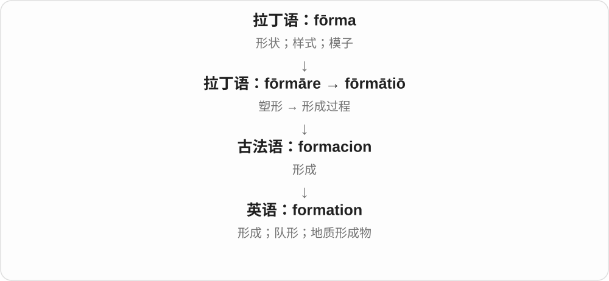

cloud formation 可以说云形成的过程；rock formations 是岩石地貌；in formation 是有组织地排成队形。

**常见搭配与例句**

cloud formation；the formation of a team；fly in formation。

> We studied the formation of clouds.

我们研究了云的形成。

> The planes flew in a tight formation.

飞机保持紧密队形飞行。

**别混淆**

form 可以指一个静态样子；formation 常突出形成过程，或多个部分排成的结构。

### 2. information — 信息；资料；消息

**音标**：英 /ˌɪnfəˈmeɪʃən/；美 /ˌɪnfərˈmeɪʃən/

**先抓住这个画面**

你原先不知道几点、在哪里、怎么做，补上这些空白的内容就是 information。

**怎么拆**

来自法语 information、拉丁语 īnfōrmātiō；与 inform 同族，但英语 information 不是必须由英语 inform 后来造出。

**怎么变成今天的意思**

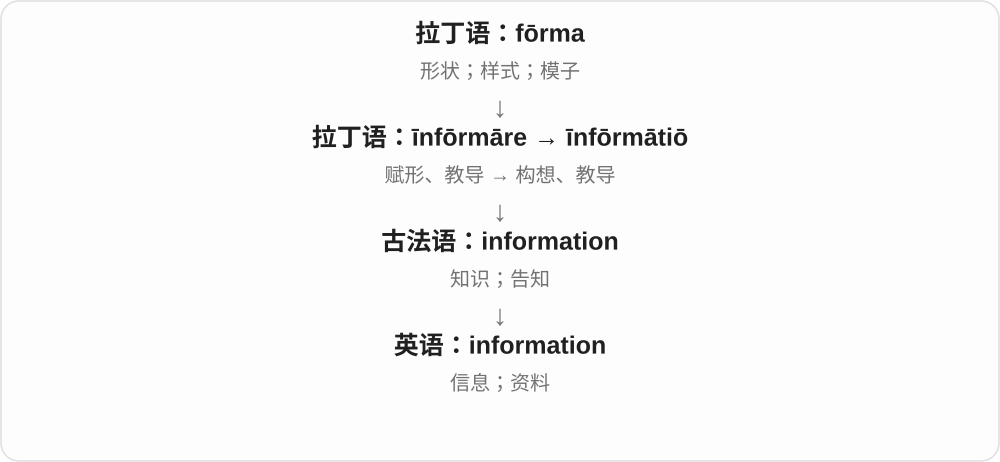

历史上的教导、构想变成让人知道情况的内容。现代通常是不可数名词：一条信息说 a piece of information。

**常见搭配与例句**

provide information；useful information；information about…。

> The website provides information about train services.

这个网站提供列车服务的信息。

> We need more information before deciding.

我们需要更多信息才能作决定。

**别混淆**

data 是记录的数据；information 强调能告诉我们情况的内容。普通英语不说 an information。

### 3. misinformation — 错误信息

**音标**：英 /ˌmɪsɪnfəˈmeɪʃən/；美 /ˌmɪsɪnfərˈmeɪʃən/

**先抓住这个画面**

消息在传播，可里面的内容不对；转发的人甚至可能以为自己在帮忙。

**怎么拆**

mis- + information，错误的信息。

**怎么变成今天的意思**

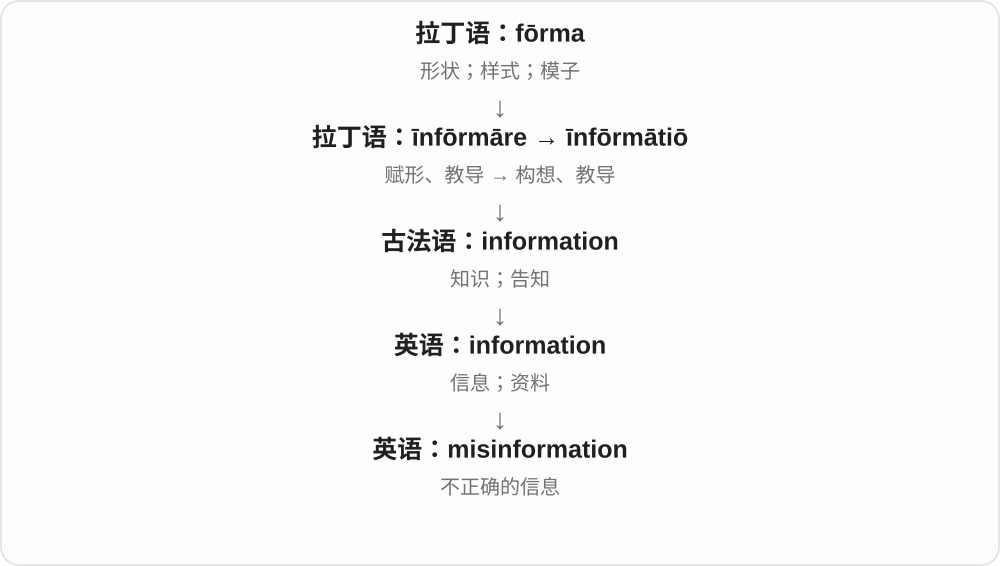

通常先说信息是否可靠，不要求传播者有欺骗意图。过时的路线、错记的日期都可能成为 misinformation。

**常见搭配与例句**

spread misinformation；correct misinformation；misinformation about…。

> The website corrected the misinformation about ticket prices.

网站纠正了关于票价的错误信息。

> An old screenshot can spread misinformation if its date is missing.

旧截图如果没了日期，可能传播错误信息。

**别混淆**

disinformation 通常突出故意欺骗；misinformation 本身不一定故意。

### 4. transformation — 转变；改造；变换

**音标**：英 /ˌtrænsfəˈmeɪʃən/；美 /ˌtrænsfərˈmeɪʃən/

**先抓住这个画面**

把从原先的样子走到新样子的整段变化，打包成一个名词。

**怎么拆**

经法语来自拉丁语 trānsfōrmātiō；与 transform 同族，现代可对应 transform + -ation。

**怎么变成今天的意思**

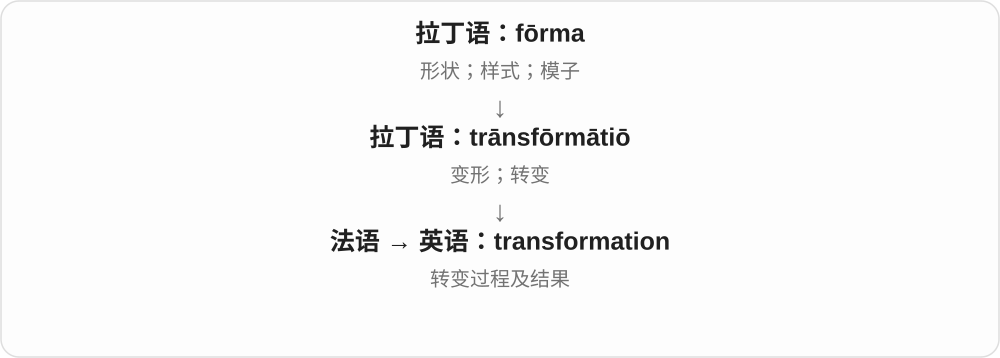

可以是城市改造、人的变化，也可以是数学变换。日常语境通常比一个小调整更明显。

**常见搭配与例句**

undergo a transformation；a remarkable transformation；digital transformation。

> The old station has undergone a remarkable transformation.

老车站经历了显著改造。

> The photos document her garden’s transformation over five years.

这些照片记录了她的花园五年间的变化。

**别混淆**

formation 是形成；transformation 是已经存在的东西变成另一个状态。

### 5. deformation — 变形；形变

**音标**：英 /ˌdiːfɔːˈmeɪʃən/；美 /ˌdiːfɔːrˈmeɪʃən/

**先抓住这个画面**

把“哪里被压弯、拉长了”当作一个过程或结果来观察，就是 deformation。

**怎么拆**

经法语 deformation，属于拉丁语 dēfōrmāre 词族；现代对应 deform + -ation。

**怎么变成今天的意思**

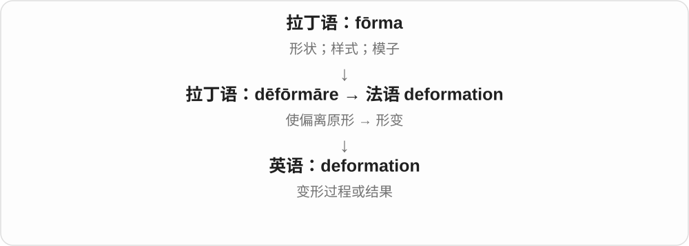

工程里常测受力前后尺寸、轮廓怎样改变。elastic deformation 能在卸力后恢复，plastic deformation 通常留下永久变化。

**常见搭配与例句**

permanent deformation；elastic deformation；deformation under load。

> The test measured deformation under pressure.

测试测量了受压时的形变。

> The spring returned to its original shape after a small elastic deformation.

弹簧发生小幅弹性形变后恢复了原形。

**别混淆**

deformation 是一般形变；malformation 常指生长或形成过程中出现的结构异常。

### 6. character — 性格、品质；特征；角色；字符

**音标**：英 /ˈkærɪktə/；美 /ˈkærəktər/

**先抓住这个画面**

一个人与别人不同的那套特点，是 character；作者给人物安排的特点组成角色；写下的一个符号，也保留了刻印、标记的老画面。

**怎么拆**

经法语、拉丁语接希腊语 kharakter 刻印工具、印记等，与 kharassein 刻写相连。刻出的区别标记，较早已被用于独有特点的比喻。

**怎么变成今天的意思**

**希腊语刻印材料 → 法语、拉丁语、英语 character**  
印记、文字符号；独有特点

↓

**多条现代意义**  
性格、品质；作品人物；字符

a strong character 坚强的性格；a fictional character 虚构角色；Chinese characters 汉字；the character of a town 小镇特色。

**常见搭配与例句**

a person of good character；special characters。

> The novel has several memorable characters.

小说里有几个令人难忘的角色。

> Her character was shaped by years of hard work.

多年的艰苦工作塑造了她的性格。

> The password must contain a special character.

密码须包含一个特殊字符。

**别混淆**

character 的角色义指故事里的人物，actor 是扮演角色的演员；字符义则是书写、编码中的符号单位。

### 7. characters — 人物、角色；字符；性格、特质〔复数〕

**音标**：英 /ˈkærəktəz/；美 /ˈkærəktərz/

**先抓住这个画面**

能让一个人、一件事显出自己特点的印记，是理解 character 的起点；故事里有特点的人物、书写中可辨认的符号，都在这个词里。

**怎么拆**

character + -s，读 /z/。character 经法语、拉丁语接希腊 kharaktḗr 刻印工具、印记，关联 kharássein 刻写；标记引出特征、个性、符号等多条意义。

**怎么变成今天的意思**

**希腊刻写词族 → 拉丁、法语 → character**  
刻出的印记 → 区别特征、文字标记等

↓

**character + -s → characters**  
多个人物、多个字符或不同特质

main characters 主要人物；Chinese characters 汉字；special characters 特殊字符；people of different characters 性格各异的人。

**常见搭配与例句**

create memorable characters；a password of twelve characters。

> The story has only three main characters.

这个故事只有三个主要人物。

> The name must contain fewer than twenty characters.

名称必须少于二十个字符。

**别混淆**

characters 可以是 letters 字母、digits 数字或其他符号的总称。故事人物不必是人类，动物、幻想生物也可成为 characters。性格这个整体概念常用单数或不可数结构。

### 8. characterize — 描写、刻画；构成……的特征

**音标**：/ˈkærəktəraɪz/

**先抓住这个画面**

说某人最突出的特点是什么，是 characterize；某个特点反过来成为一个地方、时代的代表，也能作主语 characterize it。

**怎么拆**

接希腊、拉丁按特征标明的动词材料，现代对应 character 特征、人物 + -ize，形成描述、赋予特征的动词。

**怎么变成今天的意思**

**希腊 charakter 标记等 → charakterizein → 拉丁相关形式**  
用特征标明、描述

↓

**英语 characterize → characterization**  
刻画、构成特征；特征描述、人物塑造

characterize someone as 把某人描述为；be characterized by 以……为特征；characterize a material 表征材料。

**常见搭配与例句**

characterize as；be characterized by。

> The region is characterized by dry summers.

这个地区以干燥的夏季为特征。

> She characterized the plan as overly ambitious.

她把计划描述为过于雄心勃勃。

**别混淆**

characterize as 是作一种描述，不保证描述公正；be characterized by 则指出对象的主要特点。

### 9. characterized — 刻画、描述了；以……为特征的〔过去式、过去分词〕

**音标**：英 /ˈkærəktəraɪzd/；美 /ˈkærəktəraɪzd/，也 /ˈkerəktəraɪzd/

**先抓住这个画面**

抓住最能认出它的特点，说清它是什么样，就是 characterized；某种特点贯穿其中，也能说它以此为特征。

**怎么拆**

characterize 去 e 加完整 -ed，/z/ 后读 /d/。characterize 联系希腊、拉丁按特征标明的词族，现代可对应 character 特征加 -ize。

**怎么变成今天的意思**

**希腊 kharakter、kharakterizein → 拉丁及英语 characterize**  
用特点标明、描述

↓

**characterize 去 e + -ed → characterized**  
已被描述；具有某种鲜明特征

characterized by simplicity 以简洁为特点；characterized A as B 把 A 描述为 B。

**常见搭配与例句**

clearly characterized 描绘清楚的；characterized the period 构成那个时期的特征。

> The room was characterized by simple lines and warm colours.

房间的特点是线条简洁、色彩温暖。

> The review characterized the book as thoughtful and clear.

评论把这本书描述为有思想、表达清楚。

**别混淆**

characterized as 说别人怎样描述它；characterized by 说它本身有哪些突出特点。英式也常拼 characterised，意义相同。

### 10. characterization — 特征描述；人物塑造；表征〔专业〕

**音标**：英 /ˌkærəktəraɪˈzeɪʃən/；美 /ˌkærəktərəˈzeɪʃən/

**先抓住这个画面**

小说怎样让一个人显出性格，是 characterization；研究怎样说明一种材料的性质，也是 characterization。共同点是把它是什么样说清楚。

**怎么拆**

characterize 去 e 加 -ation，把刻画、标明特征的过程名词化；人物与材料只是不同对象。

**怎么变成今天的意思**

**希腊 charakter 标记等 → charakterizein → 拉丁相关形式**  
用特征标明、描述

↓

**英语 characterize → characterization**  
刻画、构成特征；特征描述、人物塑造

↓

**characterize + -ation → characterization**  
对特征的描述；通过细节塑造人物

the characterization of a person 对人的描述；strong characterization 鲜明人物塑造；material characterization 材料表征。

**常见搭配与例句**

strong characterization；material characterization。

> The novel is praised for its vivid characterization.

小说以生动的人物塑造受到称赞。

> The report includes the characterization of the new material.

报告包括新材料的表征。

**别混淆**

characterization 不只文学，技术研究也常用；classification 是分类，不必已经详细描述每个对象。

### 11. hospital — 医院；慈善收容机构〔历史用法〕

**音标**：英 /ˈhɒspɪtəl/；美 /ˈhɑːspɪtəl/

**先抓住这个画面**

最初是让需要帮助的人住下、得到照料的地方，后来“照料病人”成为最熟悉的用途。

**怎么拆**

拉丁 hospes / hospit- 客人与主人 → hospitalis 与待客有关 → hospitale 接待处；经古法语 hospital 进入英语。不是 host 加一个现代英语 -pital。

**怎么变成今天的意思**

**拉丁 hospes，词干 hospit-**  
客人；接待客人的主人

↓

**拉丁 hospitalis → 名词 hospitale**  
与客人接待有关的 → 留宿处、接待处

↓

**古法语 hospital / ospital → 中古英语 hospital**  
庇护、接待和照料人的地方

↓

**英语 hospital**  
医院；旧式慈善收容机构

现代主要指提供诊疗和住院等服务的医院。英国英语 be in hospital 常指住院，美国英语通常说 be in the hospital。历史机构名字里的 Hospital 有时保留慈善养育、收容义。

**常见搭配与例句**

a children’s hospital；be admitted to hospital；hospital care。

> She visited her father in hospital after work.

下班后，她去医院看望住院的父亲。

> The hospital opened a new outpatient department.

这家医院开设了新的门诊部。

**别混淆**

clinic 往往指门诊或专门诊所；hospital 常可提供住院照护，但实际机构名称和规模各有不同。

### 12. hospitalize — 使住院、送入医院治疗

**音标**：英 /ˈhɒspɪtəlaɪz/；美 /ˈhɑːspɪtəlaɪz/

**先抓住这个画面**

不是到医院问完问题就走，而是被收治、留在医院接受诊疗，这时常说 be hospitalized。

**怎么拆**

hospital 医院 + -ize，使进入相应状态、场所；词族与接待来客的拉丁医院、旅舍材料相连。

**怎么变成今天的意思**

**hospital 医院 + -ize → hospitalize**  
使进入医院接受住院诊疗

↓

**hospitalize + -ation → hospitalization**  
住院过程、经历或次数

be hospitalized 住院；be hospitalized with an illness 因病住院；hospitalize a patient 收治病人。

**常见搭配与例句**

be hospitalized；hospitalize a patient。

> She was hospitalized after the accident.

事故后她住进了医院。

> The report states that three people were hospitalized.

报告说有三个人住院。

**别混淆**

hospitalize 常着眼住院收治，visit a hospital 可能只是看门诊、探视；到过医院不一定住了院。

### 13. hospitalization — 住院；住院治疗、经历

**音标**：英 /ˌhɒspɪtəlaɪˈzeɪʃən/；美 /ˌhɑːspɪtələˈzeɪʃən/

**先抓住这个画面**

hospitalize 是收治住院，hospitalization 把这段住院过程或这次经历作为名词。统计里复数还可数住院事件。

**怎么拆**

hospitalize 去 e 加 -ation，形成过程、事件名词；保留 hospital 医院这一完整基础。

**怎么变成今天的意思**

**hospital 医院 + -ize → hospitalize**  
使进入医院接受住院诊疗

↓

**hospitalize + -ation → hospitalization**  
住院过程、经历或次数

↓

**hospitalize + -ation → hospitalization**  
住院收治的过程；一次住院经历

require hospitalization 需要住院；a period of hospitalization 一段住院时间；hospitalization rates 住院率。

**常见搭配与例句**

require hospitalization；hospitalization rates。

> The injury required hospitalization.

伤势需要住院治疗。

> The study recorded several hospitalizations during the year.

研究记录了这一年间的几次住院。

**别混淆**

hospitalization 是住院经历、收治，hospital 是机构或场所；报告多少次住院与统计多少家医院不同。

### 14. capital — 首都；资本；大写字母；柱头；主要的；涉及死刑的

**音标**：/ˈkæpɪtəl/

**先抓住这个画面**

把“头”分成三个画面：国家的中心、经营所依靠的本金、柱子顶端的小头。现代 capital 把这些不同支线收在同一个拼写里。

**怎么拆**

首要、大写等义来自 capitālis；资本义经中世纪拉丁 capitale“本金、财产”；柱头义另经法语 capitel / chapitel，来自 capitellum“小头”。它们不是依次由首都变资本、再变柱头。

**怎么变成今天的意思**

**拉丁语：caput；属格 capitis**  
头；首领；顶端、主要部分

↓

**拉丁并行支线：capitālis / capitale；capitellum**  
头的、主要的／本金财产；小头、柱头

↓

**法语及直接拉丁借入的不同路线 → 英语 capital**  
主要的、首都、大写；资本；柱头

capital city 是首都或首府；capital letter 是大写字母；raise capital 是筹集资本。capital punishment 中的“头”联系人的生命，指死刑，不能理解成“主要惩罚”。

**常见搭配与例句**

working capital；a capital letter；the national capital；a column capital。

> Write your name in capital letters.

请用大写字母写下你的姓名。

> The firm needs more capital to expand its workshop.

这家公司需要更多资本来扩建车间。

> We visited the capital and admired the carved capitals of its old columns.

我们参观了首都，欣赏了古老柱子上雕刻的柱头。

**别混淆**

capital 是城市、资金等；capitol 特别指议会建筑。两词通常同音。

### 15. capitalize — 用大写书写；使资本化；利用机会

**音标**：/ˈkæpɪtəlaɪz/

**先抓住这个画面**

它有两幅常用画面：把小写 a 变成大写 A；把一个有利条件转成实际优势。

**怎么拆**

capital + -ize；首字母义用“大写”支线，经营义用“资本”支线。capitalize on 的利用义后来从获利、取得优势引申出来。

**怎么变成今天的意思**

**拉丁语：caput；属格 capitis**  
头；首领；顶端、主要部分

↓

**英语 capital 的并行义：大写；资本**  
同族不同用途

↓

**英语：capital + -ize → capitalize**  
写成大写；转成资本；利用优势

capitalize a name 是按规则用大写；capitalize on an opportunity 是利用机会。英式常拼 capitalise。

**常见搭配与例句**

capitalize the first letter；capitalize on experience。

> Capitalize the first word of each sentence.

把每句话的第一个词首字母大写。

> The team capitalized on its opponents’ mistakes.

这支队伍利用了对手的失误。

**别混淆**

capitalize on 强调把已有条件转成优势；exploit 还可能带不公平利用的批评。

### 16. capitalization — 大写使用；资本化；资本额、市值〔依搭配〕

**音标**：/ˌkæpɪtəlaɪˈzeɪʃən/

**先抓住这个画面**

编辑看 capitalization，会检查哪些字母该大写；读公司资料看到 market capitalization，则是在看公司股票的总市值。

**怎么拆**

capitalize + -ation；英式也写 capitalisation。不同用法继承 capital 的不同支线。

**怎么变成今天的意思**

**拉丁语：caput；属格 capitis**  
头；首领；顶端、主要部分

↓

**英语 capital → capitalize**  
大写／资本 → 相应动作

↓

**英语：capitalization**  
大写规则；资本化及相关金额

market capitalization 通常按股价与已发行股份数量计算；一般的 capitalization 还可能说融资结构或会计资本化。先读完整搭配。

**常见搭配与例句**

rules of capitalization；market capitalization；capitalization of costs。

> The editor corrected the capitalization in the headings.

编辑改正了标题里的大小写。

> The table groups companies by market capitalization.

表格按市值给公司分组。

**别混淆**

capitalization 的印刷义与股票义同拼写；不能看到 capital 就一律译成首都。

### 17. capitalisation — 使用大写；资本化；市值〔搭配〕

**音标**：/ˌkæpɪtəlaɪˈzeɪʃən/

**先抓住这个画面**

文字里问首字母该不该大写，是 capitalisation；企业语境还可涉及资本化，market capitalisation 则是市值。先看对象是字母还是资金、企业。

**怎么拆**

capitalise 去 e 加 -ation，与 capitalization 为同词变体；capital 的大写字母和资本分支分别进入这个名词。

**怎么变成今天的意思**

**capital → capitalise／capitalize**  
大写字母、资本等 → 相应处理动作

↓

**capitalise + -ation → capitalisation**  
使用大写；资本化；特定搭配中的市值

capitalisation rules 大写规则；market capitalisation 市值；the capitalisation of costs 成本资本化，属会计专门用法。

**常见搭配与例句**

capitalisation rules；market capitalisation。

> Check the capitalisation of every title.

检查每个标题的大小写。

> The chart compares the companies by market capitalisation.

图表按市值比较这些公司。

**别混淆**

大写与资本两条现义不要只背成一种；market capitalisation 不是公司的名字写了多少个大写字母。

### 18. realize — 意识到；实现；变现

**音标**：/ˈrɪəlaɪz/

**先抓住这个画面**

原来模糊的事忽然在脑中“成了真的”：啊，原来是这样。也可以把计划真正做出来。

**怎么拆**

real + -ize，-ize 常表示使成为或进入某种状态；形成与法语 réaliser 等相应形式有联系。不能把所有义项都死译为“使真实”。

**怎么变成今天的意思**

**拉丁 rēs → 晚期拉丁 reālis**  
事物 → 实际的

↓

**古法语 reel → 英语 real**  
真实的、实际存在的

↓

**real + -ize；与法语 réaliser 等对应**  
使成实际；使头脑清楚认识

↓

**英语 realize**  
意识到；实现；把资产变成现金

realize that 通常是意识到某事；realize a dream 是实现梦想。金融语境 realize a gain 表把账面收益变成已实现收益，realize assets 可指变现。

**常见搭配与例句**

realize that；realize how；realize a dream；realize a gain。

> I suddenly realized that I had left my keys at home.

我突然意识到钥匙落在家里了。

> She worked for years to realize her dream of opening a bakery.

她努力多年，实现了开一家面包店的梦想。

**别混淆**

realize 常有此前没明白、现在明白了的转折；know 只说知道。I realized I was wrong 比 I knew I was wrong 多了认识发生变化的感觉。

### 19. realise — 意识到；实现〔realize 的常见英式拼写〕

**音标**：/ˈrɪəlaɪz/

**先抓住这个画面**

看到 s 不必重新猜义，它和 realize 是同一个常用动词的两种拼写。

**怎么拆**

real + -ise；-ise 与 -ize 是这一类动词的拼写变体。法语 réaliser 也是相关形式；这里不是再接一个独立词 ise。

**怎么变成今天的意思**

**拉丁 rēs → 晚期拉丁 reālis**  
事物 → 实际的

↓

**古法语 reel → 英语 real**  
真实的、实际存在的

↓

**real + -ise → realise**  
与 realize 对应的拼写形式

realise 常用于英式英语，realize 在美式普遍，也用于部分英式编辑规范。两者用法和读音基本相同，一篇文章里保持所选拼写习惯即可。

**常见搭配与例句**

realise that；realise the importance；realise an ambition。

> I did not realise how late it was.

我没意识到已经这么晚了。

> The project helped her realise a long-held ambition.

这个项目帮助她实现了长久以来的抱负。

**别混淆**

realise 和 release“释放”拼写相近，但词源和含义不同；意识到错误用 realise a mistake，不能写 release a mistake。

### 20. realization — 意识到；实现；变现〔特定语境〕

**音标**：/ˌrɪəlaɪˈzeɪʃən/

**先抓住这个画面**

“啊，原来如此”是在头脑里终于看清；多年计划真正落地，则是现实中的实现。realization 把 realize 的这些过程拿来谈。

**怎么拆**

接法语 réalisation 等，与 realize + -ation 对应；real 真实的、实际的经使成实际、看清实际发展出不同分支。

**怎么变成今天的意思**

**real → realize**  
实际的 → 实现、清楚认识

↓

**realize + -ation → realization**  
意识到的过程；成为现实的结果

the realization that ... 意识到……；the realization of a dream 梦想的实现；asset realization 可指资产变现。

**常见搭配与例句**

the realization that；the realization of。

> The realization that she was safe brought relief.

意识到自己安全后，她松了口气。

> The project is the realization of a long-standing dream.

项目实现了一个长久以来的梦想。

**别混淆**

realization 是看清、实现的过程或结果，reality 是现实本身；脑中意识到与外界做成，还要看具体搭配。

### 21. conversation — 交谈；谈话

**音标**：英 /ˌkɒnvəˈseɪʃən/；美 /ˌkɑːnvərˈseɪʃən/

**先抓住这个画面**

人们经常在一起生活、来往，就会互相说话。这个词走的是“共处 → 交往 → 交谈”的路线。

**怎么拆**

经法语 conversacion 借自拉丁语 conversātiō；现代与 converse 配套，但不是英语先造 converse 再机械加 -ation。

**怎么变成今天的意思**

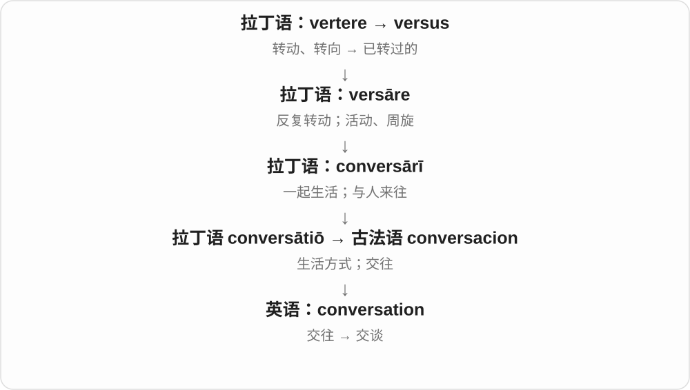

真正的 conversation 通常有来有回，不只是一个人长篇发言。它也能比喻公共讨论，如 a conversation about education。

**常见搭配与例句**

have a conversation with…；start a conversation；join the conversation。

> We had a long conversation about our plans.

我们就各自的打算聊了很久。

> She joined the conversation after listening for a few minutes.

她听了几分钟后加入了谈话。

**别混淆**

conversation 是交谈过程；speech 通常是一人对众人讲话；conversion 少一个 a，意思是转变。

### 22. conversations — 谈话、交谈〔复数〕

**音标**：英 /ˌkɒnvəˈseɪʃənz/；美 /ˌkɑːnvərˈseɪʃənz/

**先抓住这个画面**

几个人把想法来回说给彼此听，一次次这样的交流就是 conversations。可以轻松闲聊，也可以认真谈某个问题。

**怎么拆**

conversation + -s，/n/ 后读 /z/。名词经法语 conversacion 及拉丁 conversātiō 借入，连到 conversārī 与人相处、交往，较早 con- 与 versāre 转动的材料；英语口头交流义后来居于中心。

**怎么变成今天的意思**

**拉丁 conversātiō → 法语及英语 conversation**  
相处、交往、生活方式 → 口头思想交流

↓

**conversation + -s → conversations**  
几次谈话、不同主题的交谈

have conversations 进行交谈；conversations with friends 与朋友谈话；conversations about work 关于工作的谈话。

**常见搭配与例句**

everyday conversations 日常会话；private conversations 私人交谈。

> She practised English through everyday conversations.

她通过日常会话练习英语。

> Our conversations often return to the books we are reading.

我们的谈话常又回到正在读的书上。

**别混淆**

conversation 常强调双方或多方交流，speech 常是一人向听众讲话。with 给交谈对象，about 给话题；不是现代 converse 临时加 ation 才有全部词史。

### 23. combination — 组合、结合；组合结果；密码组合

**音标**：英 /ˌkɒmbɪˈneɪʃən/；美 /ˌkɑːmbɪˈneɪʃən/

**先抓住这个画面**

不只问怎么合，还可以说合成的这一套是什么：衣服颜色搭配、几种因素共同作用、锁的数字序列，都能叫 combination。

**怎么拆**

经法语 combination 接晚期拉丁 combīnātiō，名词有独立借入路线；现代对应 combine 去 e 加 -ation，但不是一定先有英语动词才新造名词。

**怎么变成今天的意思**

**拉丁 com- + bīnī → 晚期拉丁 combīnāre → 法语 combiner → combine**  
一起 + 两两 → 联结、合在一起

↓

**拉丁 combīnātiō → 法语 combination → combination**  
结合行为；形成的一套组合

a combination of A and B 两者组合，in combination with 与某物结合，a combination lock 密码锁，the combination to the safe 保险箱密码。

**常见搭配与例句**

a combination of；in combination with；a combination lock。

> The dish uses a combination of sweet and sour flavours.

这道菜把甜味与酸味结合起来。

> She forgot the combination to the lock.

她忘了锁的密码。

**别混淆**

combination 可组合结果也可行为；锁的 combination 常数字顺序也重要，不可仅按数学组合不计顺序的专义理解所有日常用法。

### 24. category — 类别、种类；范畴

**音标**：英 /ˈkætəɡəri/；美 /ˈkætəɡɔːri/

**先抓住这个画面**

按一个规则把相近东西放在同一个格子里，这个格子就是 category。规则变了，同一件东西也可能换分类。

**怎么拆**

经法语 catégorie、拉丁 categoria 接希腊 kategoria，远源是公开说出、断言、指控的材料，后来进入逻辑范畴和一般分类。不是 cat 猫加一个动物分类后缀。

**怎么变成今天的意思**

**希腊 kategoria、kategorein 等说出、指控材料**  
进入逻辑陈述、范畴命名

↓

**法语、拉丁相应形式 → category；categoricus + -al 等 → categorical**  
类别；分类性质或明确断言性质

a category of books 一类书；fall into a category 属于一类；a broad category 大类；different categories 不同类别。

**常见搭配与例句**

fall into a category；a broad category。

> The books are divided into three categories.

这些书分为三类。

> This example does not fit neatly into any single category.

这个例子不能很整齐地归入单一类别。

**别混淆**

category 是类别，criterion 是分类标准；先有标准，再据此决定把东西放到哪类。

### 25. categories — 类别、门类、范畴〔复数〕

**音标**：英 /ˈkætəɡəriz/；美 /ˈkætəɡɔːriz/

**先抓住这个画面**

把一堆东西按某个共同特点放到不同格子里，这些格子就是 categories。这个画面帮助理解现代分类义，较早词史则走过公开断言和逻辑范畴。

**怎么拆**

category 的辅音字母 + y 改 ies。经法语 catégorie、拉丁 categoria 接希腊 katēgoria，较早 kata 与 agoreuein 公开说、断言等材料；逻辑里的范畴义再扩展为一般类别。

**怎么变成今天的意思**

**希腊 katēgoria → 拉丁、法语 → category**  
断言、逻辑范畴 → 一般分类

↓

**category：y 改 ies → categories**  
多个归类后的类别、门类

different categories 不同类别；sort into categories 按类整理；categories of books 图书类别。

**常见搭配与例句**

broad categories 大类；categories on the form 表格中的分类项。

> The library divides the books into several categories.

图书馆把图书分为几类。

> Choose the categories that best describe your interests.

请选择最能描述你兴趣的类别。

**别混淆**

category 的分法依目的、标准而定，同一对象可以在不同分类体系里放到不同格子。categorize 是分类动词，categories 是类别复数。

### 26. categorize — 分类；把……归为某类

**音标**：/ˈkætəɡəraɪz/

**先抓住这个画面**

面前一堆东西，你决定哪些放同一格、分别叫什么类，是 categorize。把人归成一种类型，也是在做这种分类。

**怎么拆**

category 类别去 y 接 -ize → categorize；category 远接希腊断言、范畴的材料，现代动词强调归类动作。

**怎么变成今天的意思**

**category 类别 + -ize → categorize**  
按类别把对象分组

↓

**categorize + -ation → categorization**  
分类的过程、方法、结果

categorize by size 按大小分类；categorize something as something 将某物归为某类；categorize into groups 分组。

**常见搭配与例句**

categorize by；categorize as。

> The files are categorized by topic.

文件按主题分类。

> She categorized the problem as a design issue.

她把问题归为设计问题。

**别混淆**

categorize 是归类，characterize 是描述特征；描述可以帮助分类，但不等于已经选定类别。

### 27. categorization — 分类、归类；分类方式

**音标**：英 /ˌkætəɡəraɪˈzeɪʃən/；美 /ˌkætəɡərəˈzeɪʃən/

**先抓住这个画面**

categorize 是放入类别，categorization 是这套归类过程或安排。类别怎样划分，会影响我们怎样看待对象。

**怎么拆**

categorize 去 e 加 -ation，把分类动作名词化；与 category 类别、categorical 类别的等同族相照。

**怎么变成今天的意思**

**category 类别 + -ize → categorize**  
按类别把对象分组

↓

**categorize + -ation → categorization**  
分类的过程、方法、结果

↓

**categorize + -ation → categorization**  
分类行为、方法或结果

the categorization of data 数据分类；automatic categorization 自动归类；a simple categorization 简单分类方式。

**常见搭配与例句**

the categorization of；automatic categorization。

> The system supports automatic categorization of messages.

系统支持自动分类消息。

> The book questions this simple categorization.

书中对这种简单分类提出质疑。

**别混淆**

categorization 的类别是一种整理方式，不必穷尽对象的所有特征；无法整齐归类不等于对象本身有错。

### 28. transportation — 运输；交通运输系统或方式

**音标**：英 /ˌtrænspɔːˈteɪʃən/；美 /ˌtrænspərˈteɪʃən/

**先抓住这个画面**

transportation 把运送人和货物这件事整体拿出来说，可以指一次运输，也可以指一座城市的交通系统。

**怎么拆**

transport + -ation，形成表示过程的名词。

**怎么变成今天的意思**

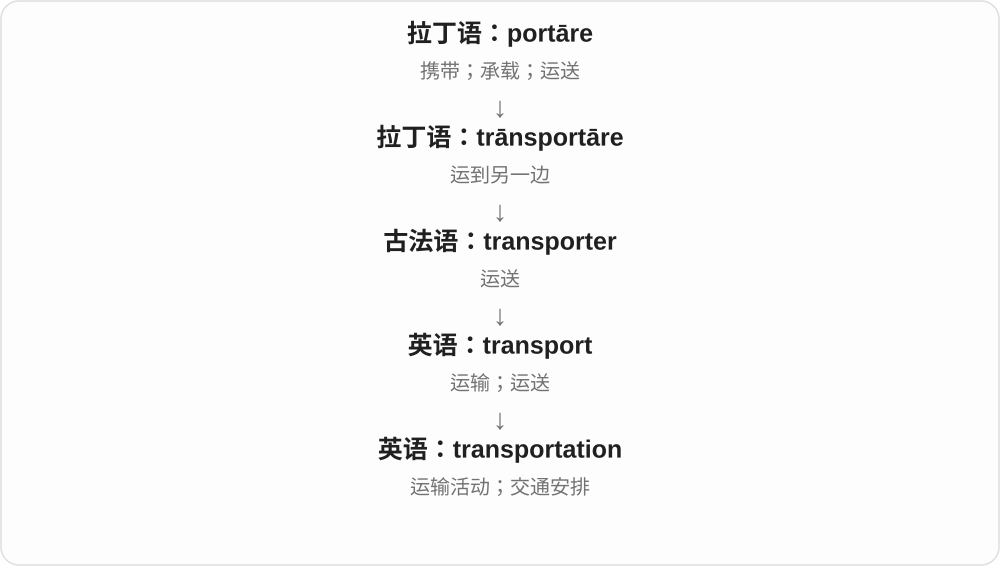

在美式英语中，public transportation 很常见；英式常用 public transport。历史语境还可能指把犯人运往殖民地的流放制度。

**常见搭配与例句**

public transportation（公共交通）；transportation costs（运输费用）；a means of transportation（交通方式）。

> The ticket includes transportation to the museum.

票价包含前往博物馆的交通费用。

> Reliable public transportation makes commuting easier.

可靠的公共交通让通勤更方便。

**别混淆**

transportation 不是特指旅游。旅游包含目的和活动，transportation 只是把人从一处送到另一处。

### 29. prepare — 准备；使做好准备；制作、备好

**音标**：英 /prɪˈpeə/；美 /prɪˈper/

**先抓住这个画面**

prepare 是在事情开始前，把工具、材料、步骤或心态安排到能用的状态。

**怎么拆**

拉丁 prae-（预先）+ parāre（备好）→ praeparāre；英语既有法语 preparer 的借入，也受到 preparation 逆构影响。

**怎么变成今天的意思**

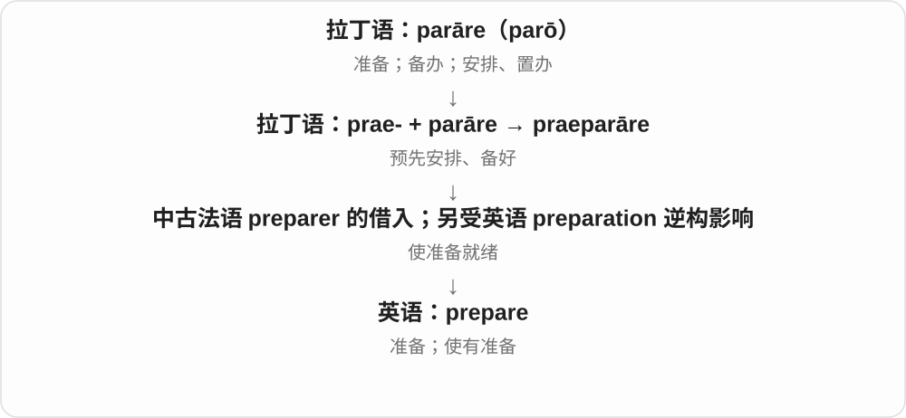

prepare dinner 是做饭、备餐；prepare for an exam 是为考试准备；prepare someone for bad news 是让对方先有心理准备。

**常见搭配与例句**

prepare a meal；prepare for a meeting；prepare someone for something。

> I will prepare dinner while you set the table.

你摆餐桌时，我来准备晚饭。

> Nothing had prepared her for the sudden change.

她完全没有料到会出现这样的突然变化。

**别混淆**

plan 主要安排以后怎样做；prepare 还包括真正备材料、练习、收拾等行动。

### 30. preparation — 准备；准备工作；配制品

**音标**：/ˌprepəˈreɪʃən/

**先抓住这个画面**

preparation 是正式开始之前做的那些功课：找材料、练习、排时间，让事情不至于临时抓瞎。

**怎么拆**

来自拉丁 praeparātiō，经法语 preparacion 借入；现代对应 prepare + -ation，但这个名词在英语中还影响了 prepare 的形成。

**怎么变成今天的意思**

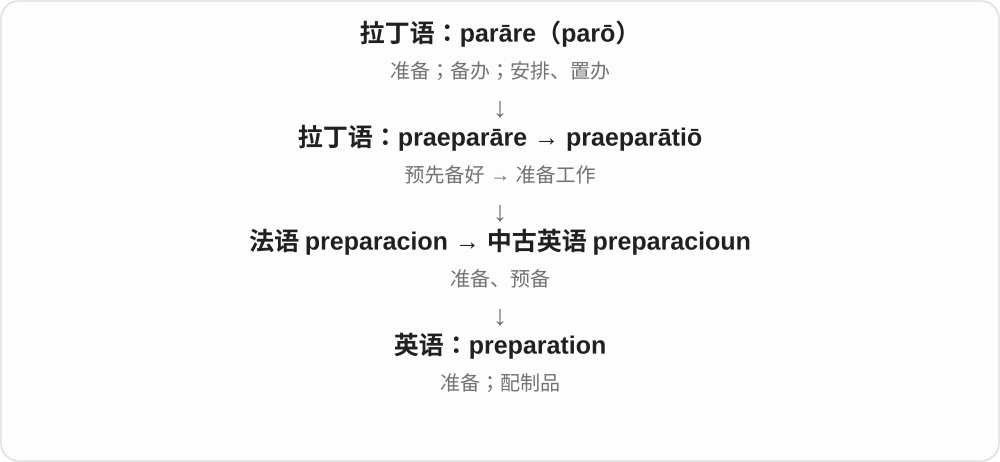

不可数时说准备过程；make preparations 用复数说具体筹备工作。a skin preparation 可以是已经配制好的护肤制剂。

**常见搭配与例句**

in preparation for；make preparations；careful preparation。

> Careful preparation made the presentation easier.

充分准备让这次演示轻松了许多。

> We are making preparations for the move.

我们正在为搬家作准备。

**别混淆**

preparation 是前期准备；performance 是实际执行或表现。准备充分并不自动保证结果。

### 31. preparations — 准备工作、筹备、安排〔复数〕；配制品〔依语境〕

**音标**：/ˌprepəˈreɪʃənz/

**先抓住这个画面**

事情开始前，先把场地、材料、人员等逐一备好，这些具体工作合起来是 preparations。

**怎么拆**

preparation 经法语 preparacion 接拉丁 praeparatio，连 prae- 预先 + parare 准备。英语名词也影响 prepare 的形成，不只看成现代动词后加尾；现代名词加 -s，尾 /nz/。

**怎么变成今天的意思**

**拉丁 praeparare、praeparatio → 法语、英语 preparation**  
预先备好 → 准备工作

↓

**preparation + -s → preparations**  
多项筹备工作、安排；另有配制品义

make preparations 作准备；preparations for the trip 旅行筹备；final preparations 最后的准备工作。

**常见搭配与例句**

careful preparations 仔细筹备；preparations are under way 正在筹备。

> Preparations for the concert began in spring.

音乐会的筹备在春天开始。

> We made the final preparations before the visitors arrived.

访客到达前，我们做好了最后的准备。

**别混淆**

preparation 泛说准备过程常不可数；preparations 常把具体事项打包说出来。句子里看到 for，可顺着看是为了哪件事。

### 32. explanation — 解释；说明；原因说明

**音标**：英、美 /ˌekspləˈneɪʃən/

**先抓住这个画面**

把听者原先看不懂的地方讲通，让“为什么”有一个能理解的答案。

**怎么拆**

借自拉丁语 explanatio，来自 explanare 的名词支线；英语 explain 与 explanation 是相关借词，不是只在现代 explain 后直接接字母。

**怎么变成今天的意思**

**拉丁语：planus；planum**  
平坦的；平面、平地

↓

**拉丁语：ex- + planare → explanare**  
铺平、展开 → 讲清楚

↓

**拉丁语：explanatio → 英语 explanation**  
讲清楚；解释、说明

an explanation for something 可以是原因说明；an explanation of something 可以是讲解内容。

**常见搭配与例句**

give an explanation；a plausible explanation。

> Her explanation made the problem much easier to understand.

她的解释让这个问题容易理解多了。

> There may be another explanation for the missing data.

数据缺失可能还有别的原因。

**别混淆**

excuse 常用于替行为开脱；explanation 可以只说明原因，不表示免除责任。

### 33. organisation — 组织、机构；组织安排，organization 的另一种拼写

**音标**：/ˌɔːɡənaɪˈzeɪʃən/

**先抓住这个画面**

和 organization 一样，既可以是一个机构，也可以是把事情安排好的过程。

**怎么拆**

接法语 organisation、拉丁 organizatio；这是 -isation 拼写。

**怎么变成今天的意思**

**希腊 organon → 拉丁 organum**  
工具、发挥作用的部分 → 工具、器官

↓

**拉丁 organizatio → 法语 organisation → 英语 organisation**  
组织构造、安排 → 机构或组织工作

这是英式文本中常见的写法。charitable organisation 与 charitable organization 都指慈善组织；不需要因一个 s 或 z 重新理解词义。

**常见搭配与例句**

a voluntary organisation；a large organisation；the organisation of a conference。

> She works for an environmental organisation.

她在一家环保组织工作。

> The organisation of the conference took several months.

这次会议的组织筹备花了好几个月。

**别混淆**

英式英语也可以使用 organization。按所用文本的拼写规范保持一致即可。

### 34. registration — 登记、注册、报名；登记资料或凭证

**音标**：/ˌredʒɪˈstreɪʃən/

**先抓住这个画面**

从“我想参加”到“系统里已经有我的正式记录”，这个手续和记录结果都可能叫 registration。

**怎么拆**

经法语 registration 或直接接中世纪拉丁 registratio，来自 registrare 登记。现代可对照 register 与 -ation，但名词有独立借入路线。

**怎么变成今天的意思**

**拉丁 gerere，分词 gestus**  
携带、承担；做、进行

↓

**拉丁 re- 回 + gerere → regerere，分词 regestus**  
带回；记录、记下

↓

**晚期拉丁 regesta → 中世纪拉丁 registrum／regestrum**  
记下的事项 → 记录册

↓

**中世纪拉丁 registrare → registratio；法语 registration**  
登记行为

↓

**英语 registration**  
登记、注册；登记资料

registration fee 是报名或注册费；vehicle registration 是车辆登记，也可指相应文件、号码等，具体看制度和语境。不是所有 registration 都意味着开了网络账户。

**常见搭配与例句**

complete registration；a registration form；registration opens；vehicle registration。

> Online registration closes at noon.

网上报名在中午截止。

> Please keep the registration document with the other records.

请把登记文件与其他记录放在一起保存。

**别混淆**

application 是提出申请，registration 是登记；在需要审核的场景，申请不必然等于已完成登记。

### 35. occupy — 占用、占据；居住、使用；使忙于

**音标**：英 /ˈɒkjʊpaɪ/；美 /ˈɑːkjəpaɪ/

**先抓住这个画面**

椅子上有人，空间被占；一天全在开会，时间被占；一件事让你不停地想，注意力也被占。这个占住就是 occupy 的核心。

**怎么拆**

经法语 occuper 接拉丁 occupare，关联 ob- 与 capere 拿、抓的材料，拉丁词干在组合中改变。过去式 occupied 把 y 改 i 再加 -ed。

**怎么变成今天的意思**

**拉丁 ob- + capere 拿住的材料 → occupare**  
占住、抓住；组合后词干发生变化

↓

**法语 occuper → 英语 occupy → occupied 等**  
占空间、时间、注意力；处于被占用的状态

occupy a room 占用、使用房间；occupy time 占时间；occupy someone’s thoughts 占据某人心思；occupy territory 占领地区。

**常见搭配与例句**

occupy a room；occupy someone’s thoughts。

> The desk occupies most of the room.

桌子占了房间的大部分空间。

> The question occupied her thoughts all afternoon.

整个下午，她脑子里都在想那个问题。

**别混淆**

occupy 是占着、使用的状态或动作，own 是拥有产权；租客可以 occupy 一间房而不 own 它。

### 36. occupied — 被占用的；忙着的；被占领的

**音标**：英 /ˈɒkjʊpaɪd/；美 /ˈɑːkjəpaɪd/

**先抓住这个画面**

洗手间门上写 Occupied，表示里面有人。用在人身上，心力、时间被事情占着，就可以说忙着。

**怎么拆**

occupy 的 y 改 i，加 -ed → occupied，既是过去式、过去分词，也作形容词。一个占据核心，按对象分成空间、忙碌、占领等场景。

**怎么变成今天的意思**

**拉丁 ob- + capere 拿住的材料 → occupare**  
占住、抓住；组合后词干发生变化

↓

**法语 occuper → 英语 occupy → occupied 等**  
占空间、时间、注意力；处于被占用的状态

↓

**occupy + -ed → occupied**  
被占用、正忙、处于占领状态

an occupied seat 有人的座位；keep someone occupied 让某人有事做；occupied territory 被占领地区。

**常见搭配与例句**

an occupied seat；keep someone occupied。

> Every seat was occupied.

每个座位都有人。

> The puzzle kept the children occupied.

拼图让孩子们一直有事做。

**别混淆**

occupied 常说空间、时间被占用；preoccupied 常说心思被某事占住而顾不上别的；occupied 的 -ed 不自动表示整句过去。

### 37. occupation — 职业；占用、居住；占领

**音标**：英 /ˌɒkjəˈpeɪʃən/；美 /ˌɑːkjəˈpeɪʃən/

**先抓住这个画面**

平常用什么工作占据时间，是职业；房屋被使用、地区被控制，则是占用、占领。共同材料是某处或某事被占据。

**怎么拆**

经法语接拉丁 occupatio、occupare 等占据材料；现代与 occupy 对应，不能把 occupation 每次都只译职业。

**怎么变成今天的意思**

**拉丁 occupare 占据、抓住 → occupatio → 法语 occupation**  
占用、从事的活动与控制关系

↓

**英语 occupation → occupational**  
职业、占用等；相关性质

state your occupation 填写职业；military occupation 军事占领；a building in occupation 有人使用、居住的建筑，后者较正式。

**常见搭配与例句**

state your occupation；military occupation。

> The form asks for your name and occupation.

表格要求填写姓名和职业。

> The book examines life during the occupation.

书中研究了占领时期的生活。

**别混淆**

occupation 通常职业，具体职位可说 job；occupation 的占领义不是在问从事哪个行业。

### 38. preoccupation — 一心想着；反复挂念的事；心神不属

**音标**：英 /priˌɒkjuˈpeɪʃən/；美 /priˌɑːkjuˈpeɪʃən/

**先抓住这个画面**

一件事一直占着脑子，是 preoccupation 的状态；那件占住心思的事情本身，也能叫 a preoccupation。

**怎么拆**

经法语接拉丁 praeoccupatio，来自事先占据的材料；现代与 preoccupy、preoccupied 对应，不能只按 occupation 职业义来译。

**怎么变成今天的意思**

**拉丁 prae- 在先 + occupare 占据 → praeoccupare、praeoccupatio**  
先占住某处、某种注意力

↓

**英语 preoccupied、preoccupation**  
心思被占着；反复挂念的状态、事情

↓

**praeoccupatio → preoccupation**  
先占据 → 心思被占住、常想的事

a preoccupation with money 一心想着钱；a major preoccupation 主要挂心的事；in a state of preoccupation 心神不属。

**常见搭配与例句**

a preoccupation with；a major preoccupation。

> Her main preoccupation was finding a safe place to live.

她最挂心的是找到安全住处。

> His preoccupation with detail slowed the discussion.

他过度纠结细节，让讨论慢了下来。

**别混淆**

preoccupation 可以是正常关心的重要事，也可带过度专注的评价；不必每次都译成病态迷恋。

### 39. preoccupied — 心事重重的；心不在焉的；一心想着的

**音标**：英 /priˈɒkjupaɪd/；美 /priˈɑːkjupaɪd/

**先抓住这个画面**

别人正在说话，你脑子却早被另一件事占满，注意力接不进来，就是 preoccupied。可能是担忧，也可能只是太专注别的事。

**怎么拆**

preoccupy 占据心思的过去分词、形容词，接 pre- 在先与 occupy 占据的材料；现代重心是注意力已被别的事情占着。

**怎么变成今天的意思**

**拉丁 prae- 在先 + occupare 占据 → praeoccupare、praeoccupatio**  
先占住某处、某种注意力

↓

**英语 preoccupied、preoccupation**  
心思被占着；反复挂念的状态、事情

be preoccupied with work 一心想着工作；look preoccupied 显得有心事；too preoccupied to notice 忙着想别的而没注意到。

**常见搭配与例句**

be preoccupied with；look preoccupied。

> She seemed preoccupied during the meeting.

开会时她似乎心事重重。

> He was preoccupied with the coming examination.

他心里一直想着即将到来的考试。

**别混淆**

an occupied room 是房间被占用，a preoccupied person 是人的心思被别事占着；前者还可说空间，后者常说注意力。

### 40. implementation — 实施；落实；实现方案〔尤其软件〕

**音标**：英 /ˌɪmplɪmenˈteɪʃən/；美 /ˌɪmpləmenˈteɪʃən/

**先抓住这个画面**

从“我们准备这样做”走到“实际按这个办法运行”的整段工作。

**怎么拆**

implement〔动词〕 + -ation；英语派生。

**怎么变成今天的意思**

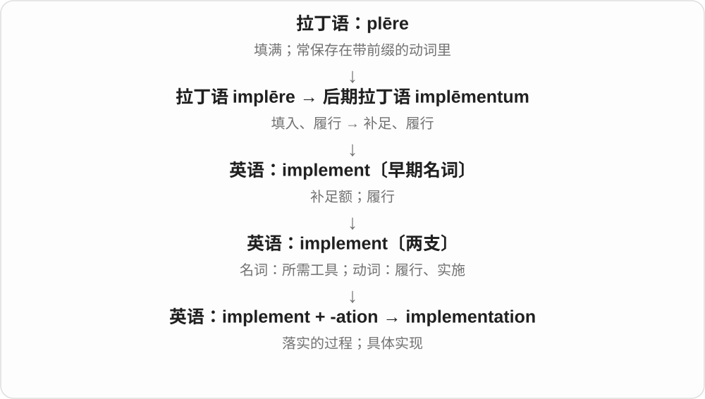

政策 implementation 可能包括培训、安排与检查；软件 an implementation 可以是按照某个思路写出的一套具体程序。同一算法能有多种实现。

**常见搭配与例句**

policy implementation；successful implementation；an implementation of an algorithm。

> The policy is simple, but its implementation will require careful training.

政策本身很简单，落实时却需要细致的培训。

> This implementation uses less memory than the earlier version.

这个实现方案比早先版本占用的内存更少。

**别混淆**

planning 是制定做法；implementation 是把做法落实。implementation 不自动意味着效果成功。

### 41. presentation — 展示、报告；呈现方式；颁赠

**音标**：/ˌprezənˈteɪʃən/

**先抓住这个画面**

既可以是把成果讲给别人看的那一次活动，也可以是东西摆出来、表现出来的样子。

**怎么拆**

经法语 presentation 接拉丁语 praesentātiō 展示、呈上，与 present 动词词族相关；现代可对应 present + -ation 的活动名词关系。

**怎么变成今天的意思**

**拉丁语 praesens；相关 praesentāre**  
在眼前、在场；把东西放到眼前、呈上

↓

**经法语进入英语 present 词族**  
当前、在场；礼物；展示、提交

↓

**拉丁语 praesentātiō → 法语、英语 presentation**  
展示、呈上 → 报告、呈现方式、颁赠活动

give a presentation 作报告；food presentation 菜肴摆盘、呈现；the presentation of an award 颁奖。做 presentation 不一定使用幻灯片。

**常见搭配与例句**

give a presentation；a presentation on；visual presentation；the presentation of an award。

> She gave a short presentation on the new design.

她就新设计作了一个简短报告。

> The restaurant pays attention to the presentation of each dish.

餐厅很注重每道菜的呈现。

**别混淆**

presentation 是展示、报告及其呈现方式；slides 是幻灯片，二者不是同一范围的词。

### 42. examination — 检查、审查；考试、考核

**音标**：/ɪɡˌzæmɪˈneɪʃən/

**先抓住这个画面**

examine 是做仔细检验，examination 把这次检验当一件事；试卷考试、身体检查、证据审查都可能用它。

**怎么拆**

经法语 examinacion 接拉丁 exāminātiō 的动作名词，现代可对应 examine + -ation，但保留自己的借入链。exam 是它的常见缩短形式。

**怎么变成今天的意思**

**拉丁 exāmen、exāmināre**  
称量、检验、仔细考虑，较远与 exigere 等联系

↓

**法语 examiner、examinacion → 英语 examine、examination**  
检查、询问与检验过程分别借入

↓

**英语 examination 与缩短 exam**  
检验过程、考试

a written examination 笔试，a close examination 仔细检查，under examination 正被审查，a medical examination 体检。

**常见搭配与例句**

a written examination；close examination；under examination。

> The documents are still under examination.

文件仍在审查中。

> She passed the final examination.

她通过了期末考试。

**别混淆**

examination 不只学校考试；exam 也可体检，但日常多见考试缩写。名词“考试”可数，抽象审查过程可不可数。

### 43. imagination — 想象力；想象、设想

**音标**：/ɪˌmædʒɪˈneɪʃən/

**先抓住这个画面**

把没有摆在面前的东西组合起来：一张纸箱变成太空船，一个限制变成新点子的起点。

**怎么拆**

拉丁 imaginari 形成名词 imaginatio／imaginationem，经古法语 imaginacion 进入英语。现代可以联系 imagine + -ation，真实历史却已有完整拉丁、法语名词。

**怎么变成今天的意思**

**拉丁 imago，属格 imaginis，宾格 imaginem**  
像、形象、相似的表示；imagin- 是词干

↓

**拉丁 imaginari → imaginatio／imaginationem**  
想象 → 想象的活动、能力

↓

**古法语 imaginacion → 中古英语 imaginacioun → imagination**  
心中构想 → 想象力、想象内容

use your imagination 是让构想能力发挥作用；a figment of your imagination 是想象出来、并非实际存在的东西。词本身也可褒义说创造力，并不等于胡思乱想。

**常见搭配与例句**

a vivid imagination；use your imagination；capture the imagination；a figment of the imagination。

> The children turned the empty box into a spaceship with a little imagination.

孩子们发挥一点想象力，就把空箱子变成了宇宙飞船。

> The strange sound was real, not a product of her imagination.

那奇怪的声音确实存在，并非她想象出来的。

**别混淆**

imagery 是表现出来的意象或影像集合；imagination 是形成、运用这些构想的能力和活动。

### 44. interpretation — 解释、解读；口译；艺术演绎方式

**音标**：英 /ɪnˌtɜːprəˈteɪʃən/；美 /ɪnˌtɜːrprəˈteɪʃən/

**先抓住这个画面**

同一段沉默，有人当同意，有人当犹豫；每一种赋予的意思都是一种 interpretation。演奏同一首曲子也可有不同处理。

**怎么拆**

经法语接拉丁 interpretātiō，动作名词。现代对应 interpret + -ation；历史有自己的借入路线，不必把所有义写成英语临时加尾巴。

**怎么变成今天的意思**

**拉丁 interpres → interpretārī**  
中间人、传达者 → 解释、转达意思

↓

**法语相关形式 → 英语 interpret 等**  
解释、理解、口译；名词、人物词各有借入路线

↓

**现代专门用法**  
艺术演绎；计算机解释执行

↓

**interpretātiō → interpretacion → interpretation**  
解释过程、理解结果；现代对应 interpret + -ation

an interpretation of the data 数据解读，open to interpretation 可有不同解释，simultaneous interpretation 同声传译，her interpretation of the song 她对歌曲的演绎。

**常见搭配与例句**

an interpretation of；open to interpretation；simultaneous interpretation。

> The evidence allows more than one interpretation.

证据可以有不止一种解读。

> Her interpretation of the song was quiet and restrained.

她演绎这首歌时安静而克制。

**别混淆**

interpretation 是对意思的理解、呈现，不等于 objective fact 客观事实；同声传译中的 interpretation 又是跨语言传达活动。

### 45. misinterpretation — 错误解读；曲解；误释

**音标**：/ˌmɪsɪntɜːrprɪˈteɪʃən/

**先抓住这个画面**

不对的解释已经形成了，可以把它指出、澄清或纠正。

**怎么拆**

mis- + interpretation；也可按 misinterpret + -ation 理解结构。

**怎么变成今天的意思**

**日耳曼语系的 mis-，古英语已有**  
方向或结果不对；不是希腊“厌恶”

↓

**英语 interpretation 加 mis-，与 misinterpret 同族**  
解释、领会发生错误

↓

**misinterpretation**  
错误的解读或解释过程

a common misinterpretation 是经常出现的一种误读。例如相关关系被解读成因果关系，就可以说 a misinterpretation of the data。这个名词着重“解释成了什么”，而不只是看漏了一个字。

**常见搭配与例句**

a misinterpretation of the results；a common misinterpretation；open to misinterpretation。

> The conclusion rests on a misinterpretation of the survey results.

这个结论建立在对调查结果的错误解读上。

> The writer added a note to prevent misinterpretation.

作者加了一条说明，防止读者误解。

**别混淆**

misreading 可以偏重读错或看错；misinterpretation 更突出意义解释。不过日常使用有很多重叠。

### 46. motivation — 动力；动机；积极性

**音标**：英 /ˌməʊtɪˈveɪʃən/；美 /ˌmoʊtɪˈveɪʃən/

**先抓住这个画面**

motivation 是让你从“知道该做”走到“愿意开始、愿意继续”的推动力。

**怎么拆**

与 motive（动机）+ -ation 对应，形成于相关法语、德语词影响下；现代常与 motivate 配套理解。

**怎么变成今天的意思**

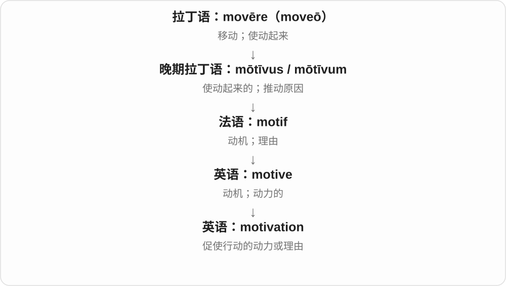

既可说做某事的理由，也可说持续投入的意愿。缺少动力不一定是不知道方法。

**常见搭配与例句**

motivation to learn；lack motivation；intrinsic motivation。

> Learning with friends increased her motivation.

和朋友一起学习提高了她的积极性。

> His main motivation was to help his family.

他的主要动力是帮助家人。

**别混淆**

motive 常问“为什么这样做”；motivation 也常问“有没有劲去做”。

### 47. exploration — 探索；考察；探究

**音标**：/ˌekspləˈreɪʃən/

**先抓住这个画面**

把走进去、查下去、试着理解的整个过程作为一件事来谈。

**怎么拆**

来自法语 exploration 或拉丁 exploratio；英语名词早于 explore，不能把它的起源只写成英语动词加 -ation。

**怎么变成今天的意思**

**拉丁 explorare**  
调查、搜寻；传统解释联系 ex- + plorare，但内部来源有异说

↓

**拉丁 exploratio → 法语或直接借入 → 英语 exploration**  
调查、考察的名词；先于英语 explore

space exploration 是太空探索；an exploration of identity 是对身份主题的探讨。探索既能发生在地理空间里，也能发生在一本书或一场讨论中。

**常见搭配与例句**

space exploration；further exploration；an exploration of a theme。

> The mission was designed for the exploration of a distant moon.

这项任务是为探索一颗遥远的卫星而设计的。

> The film offers a thoughtful exploration of family loyalty.

这部电影深入探讨了对家庭的忠诚。

**别混淆**

exploration 强调探查与理解；explanation 是解释，两词虽然开头相似，来源和意思不同。

### 48. determination — 决心；确定；测定

**音标**：英 /dɪˌtɜːmɪˈneɪʃən/；美 /dɪˌtɜːrmɪˈneɪʃən/

**先抓住这个画面**

一方面是把答案定下来，另一方面是把方向定下来之后坚持走。前者是测定，后者是决心。

**怎么拆**

拉丁 dēterminātiō 经法语进入英语；现代可联系 determine + -ation，历史名词已有自己的借入路线。

**怎么变成今天的意思**

**拉丁语 terminus**  
边界；界标；尽头

↓

**拉丁 dētermināre → dēterminātiō；古法语 determinacion**  
限定、确定 → 确定的行为

↓

**中古英语 → determination**  
确定；测定；坚定的意志

show determination 是表现出决心；determination of a value 是测定数值。别在实验报告里一看它就译成“决心”。

**常见搭配与例句**

with determination；determination to do；the determination of。

> She approached the task with quiet determination.

她以沉静而坚定的决心着手完成任务。

> The experiment allows accurate determination of the sample’s mass.

这个实验能准确测定样本质量。

**别混淆**

decision 是作出的决定；determination 常是推动自己把决定坚持到底的劲头。

### 49. observation — 观察；观察结果；评论

**音标**：英 /ˌɒbzəˈveɪʃən/；美 /ˌɑːbzərˈveɪʃən/

**先抓住这个画面**

认真看见了什么，把那个发现记下来或说出来；过程和发现都可以叫 observation。

**怎么拆**

经法语来自拉丁语 observātiō；与 observe 同族，现代对应 observe + -ation。

**怎么变成今天的意思**

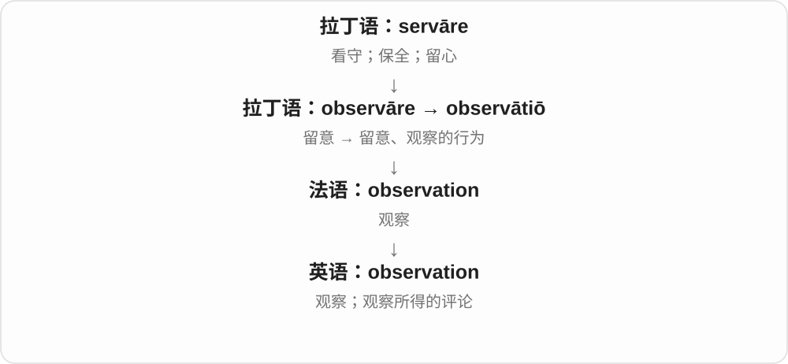

under observation 是处于观察中。make an observation 可以提出一个看法，不一定拿着仪器测量。

**常见搭配与例句**

careful observation；make an observation；under observation；an observation about…。

> Careful observation revealed a change in the colour.

仔细观察发现颜色有了变化。

> She made a useful observation about the design.

她对设计提出了一个有用的看法。

**别混淆**

observation 是观察或评论；observance 主要是遵守、纪念活动。

### 50. confirmation — 确认；证实；确认通知

**音标**：英 /ˌkɒnfəˈmeɪʃən/；美 /ˌkɑːnfərˈmeɪʃən/

**先抓住这个画面**

等待中的安排收到一句“已经定好了”，这句答复或它带来的确定，就是 confirmation。

**怎么拆**

拉丁 cōnfirmātiō，经古法语 confirmacion 借入；现代与 confirm + -ation 对应，但历史上是名词借词。

**怎么变成今天的意思**

**拉丁 firmus → firmāre**  
稳固的 → 使稳固、使确定

↓

**拉丁 cōnfirmāre → cōnfirmātiō → 古法语 confirmacion**  
使确定 → 确认、加强

↓

**中古英语 → confirmation**  
确认过程；确认信息

可指确认这一行为，也可指邮件、号码等确认凭据。在基督教语境中另指坚振礼等宗教仪式，用法要看所属传统。

**常见搭配与例句**

booking confirmation；confirmation email；confirmation of receipt。

> You will receive a confirmation email after booking.

预订后你会收到一封确认邮件。

> We are still waiting for confirmation of the date.

我们仍在等待日期得到确认。

**别混淆**

confirmation 是确认结果或过程；permission 是许可，有了收件确认不等于请求获准。

### 51. variation — 变化；差别；变式；变奏

**音标**：英 /ˌveəriˈeɪʃən/；美 /ˌveriˈeɪʃən/

**先抓住这个画面**

一个基本样式没有完全丢掉，但大小、做法或细节发生了变化。

**怎么拆**

来自法语 variacion、拉丁语 variatio，基于 variare；与 vary + -ation 的现代对应，不等于历史上从英语 vary 才造出。

**怎么变成今天的意思**

**拉丁语 varius**  
不同的、多样的；带不同颜色的

↓

**拉丁语 variare / variatio → 法语 variacion → 英语 variation**  
改变 → 变化、差别、变式

variation in temperature 是温度变化；a variation on a recipe 是菜谱的一个改版；音乐变奏保留可辨认的主题，同时改节奏、和声等。

**常见搭配与例句**

seasonal variation；a variation on a theme；variation between groups。

> The study found large variation in sleep duration.

研究发现睡眠时长差异很大。

> This soup is a variation on my grandmother’s recipe.

这道汤是按祖母的菜谱稍作变化做成的。

**别混淆**

difference 指存在的差别；variation 还强调围绕某个样式的变动范围或具体改版。

### 52. consultation — 咨询；磋商；征求意见；咨询会面

**音标**：英 /ˌkɒnsəlˈteɪʃən/；美 /ˌkɑːnsəlˈteɪʃən/

**先抓住这个画面**

把问题拿出来，让有经验的人或受影响的人参与判断；也能指为此专门安排的一次会面。

**怎么拆**

拉丁 consultatio 来自 consultare，经中古法语 consultation 借入。现代可看作 consult 对应的过程名词，历史上不是英语动词才加 -ation 生出的。

**怎么变成今天的意思**

**拉丁 consulere → consultare**  
商议、考虑 → 征求意见、商量

↓

**拉丁 consultatio → 中古法语 consultation**  
商议、考虑

↓

**英语 consultation**  
咨询过程、磋商或一次咨询会面

a consultation 常指一次专业会面；public consultation 则是一段公开征求意见的过程。意见被听取，不等于所有意见都会被接受。

**常见搭配与例句**

in consultation with；a public consultation；a consultation with a specialist。

> The design was revised after consultation with residents.

征求居民意见后，设计作了修改。

> She booked a consultation to discuss the options.

她预约了一次咨询，讨论有哪些选择。

**别混淆**

consultation 重在征求意见；negotiation 重在协商条件并争取达成协议。

### 53. resignation — 辞职；辞呈；无奈接受、顺从

**音标**：/ˌrezɪɡˈneɪʃən/

**先抓住这个画面**

resignation 的两幅画面都带“放下”：把职位交出去；或发现改变不了，放下抵抗、接受现实。

**怎么拆**

中古拉丁 resignātiō 经古法语 resignation / resignacion 或直接借入；现代对应 resign 与 -ation，但不是只从英语动词新造。

**怎么变成今天的意思**

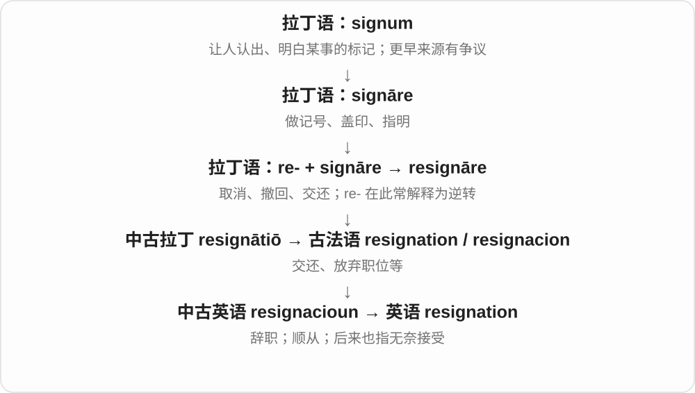

submit a resignation 是递交辞呈；accept something with resignation 是无奈接受，未必发生任何离职。

**常见搭配与例句**

a letter of resignation；announce a resignation；with resignation。

> She submitted her resignation on Monday.

她在周一递交了辞呈。

> He heard the delay announced with quiet resignation.

听到延期通知，他平静而无奈地接受了。

**别混淆**

acceptance 可以心甘情愿；resignation 往往暗含不喜欢这个结果，却认为没法改变。

### 54. adaptation — 适应；改编；改编作品

**音标**：英、美 /ˌædæpˈteɪʃən/

**先抓住这个画面**

换了环境或表现形式，原来的东西也跟着换一种合适的样子。

**怎么拆**

经法语 adaptation，追到中世纪拉丁 adaptātiō；与 adapt 同族，但名词有自己的借入路线。

**怎么变成今天的意思**

**拉丁语：ad**  
朝向；靠近；加到

↓

**拉丁语：aptāre → adaptāre**  
使合适 → 调整到合适

↓

**中世纪拉丁 adaptātiō → 法语 adaptation → 英语 adaptation**  
使合适的过程；适应；改编作品

动物的 adaptation 是适合环境的特征或过程；a film adaptation 是把小说等搬上银幕后的作品。不是逐字复制。

**常见搭配与例句**

adaptation to；an adaptation of a novel；a film adaptation。

> Thick fur is an adaptation to cold conditions.

厚毛是适应寒冷环境的一种特征。

> The television adaptation moves the story to the present day.

这部电视改编作品把故事移到了当代。

**别混淆**

translation 主要换语言；adaptation 可以改情节、结构或媒介。

### 55. civilization — 文明；某一文明社会；有组织的生活环境

**音标**：英 /ˌsɪvəlaɪˈzeɪʃən/；美 /ˌsɪvələˈzeɪʃən/

**先抓住这个画面**

把一个社会的制度、城市、知识、技术和生活方式放在一起看。

**怎么拆**

现代可拆 civilize + -ation；常用社会文化义与法语 civilisation 的借入有关。英语另有较早的法律用法，不宜把所有义项都画成一次简单派生。

**怎么变成今天的意思**

**拉丁 cīvis**  
公民；共同生活在一个城邦中的人

↓

**拉丁 cīvīlis → 法语 civil → civiliser → civilisation**  
公共生活 → 文明化的过程与状态

↓

**英语 civilization／civilisation**  
文明；一个社会的整体文化与生活方式

ancient civilizations 说古代不同文明；the development of civilization 说文明发展。口语 back to civilization 常是离开偏远处，回到有交通、商店等设施的生活环境。这个词不能简化成“人人都有礼貌”。

**常见搭配与例句**

ancient civilization；the rise of civilization；a centre of civilization；back to civilization。

> The exhibition compares the writing systems of several ancient civilizations.

展览比较了几种古代文明的文字系统。

> After a week in the mountains, they joked that they were returning to civilization.

在山里待了一周后，他们开玩笑说终于要回到文明世界了。

**别混淆**

culture 更常说一个群体的价值、习俗和表达方式；civilization 常从历史尺度看整个社会的组织与成就，两者范围会重叠。

### 56. preservation — 保存；保护；维持原状

**音标**：英 /ˌprezəˈveɪʃən/；美 /ˌprezərˈveɪʃən/

**先抓住这个画面**

把东西长期留好，不让时间、环境或使用把它毁掉的过程。

**怎么拆**

古法语 preservacion 来自中世纪拉丁语 praeservātiō；现代对应 preserve + -ation。

**怎么变成今天的意思**

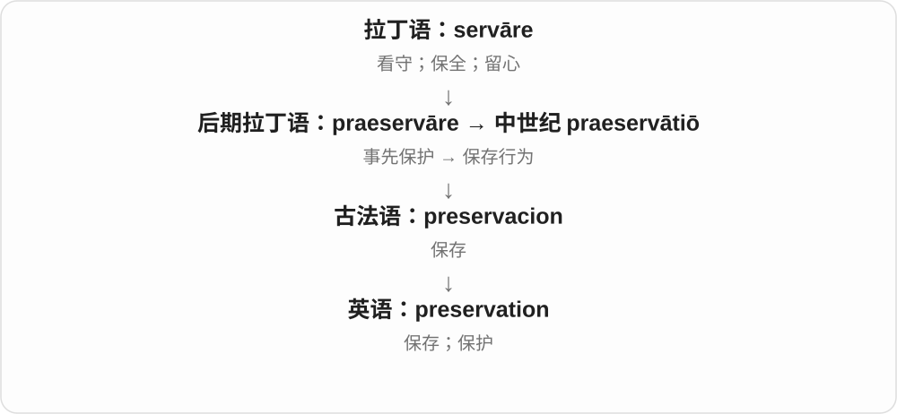

可以讨论档案、建筑、食物或自然环境的保存。词义偏持续留存，不只一次临时防护。

**常见搭配与例句**

food preservation；the preservation of records；historic preservation。

> Low humidity helps with the preservation of old documents.

较低湿度有助于保存旧文献。

> The group supports the preservation of historic buildings.

这个团体支持保护历史建筑。

**别混淆**

preservation 强调留存；restoration 是修复到某种较早状态。保存可能需要修复，但两词不完全相同。

### 57. expectation — 预期；期待；期望要求

**音标**：/ˌekspekˈteɪʃən/

**先抓住这个画面**

expectation 是你事先在脑中画好的结果：事情应该会怎样，别人应该做到什么程度。

**怎么拆**

来自拉丁语 exspectātiō，经中古法语传入；expect + -ation 是现代可见的对应。

**怎么变成今天的意思**

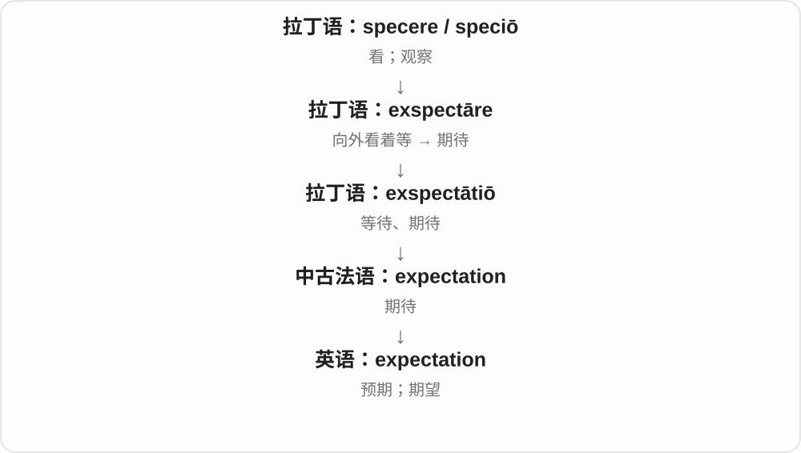

现实可以符合、超过或低于这个预先画出的标准。复数 expectations 常谈一个人或群体对结果的要求。

**常见搭配与例句**

meet expectations；exceed expectations；against expectations。

> The results exceeded our expectations.

结果超出了我们的预期。

> We need to make our expectations clear.

我们需要把期望说清楚。

**别混淆**

expectation 不等于 certainty：很高的预期也可能落空。

### 58. configuration — 配置；布局；各部分的组合方式

**音标**：英 /kənˌfɪɡəˈreɪʃən/；美 /kənˌfɪɡjəˈreɪʃən/

**先抓住这个画面**

把同一批东西换个摆法、换组设置，整体就会不同；configuration 说的就是这个具体组合。

**怎么拆**

接晚期拉丁 configuratio、configurationem，来自动词 configurare；经法语或直接拉丁借入英语。名词有自己的借入路线，并非从现代英语 configure 才开始形成。

**怎么变成今天的意思**

**拉丁 figura（与 fingere 同族）**  
形状、形象；表达的形式

↓

**拉丁 figurare → configurare（con- + figurare）**  
塑造 → 按一定形式安排、构成

↓

**晚期拉丁 configuratio／configurationem → 法语 configuration／直接拉丁借入**  
各部分安排形成的形态

↓

**英语 configuration**  
结构、布局；设备或软件的配置

a configuration file 保存系统设置；the seating configuration 是座位布局；different hardware configurations 是不同的硬件组合。它既能指配置过程，也常指配置后的结构或一组参数。

**常见搭配与例句**

a configuration file；the default configuration；hardware configuration；seating configuration。

> Save the current configuration before changing the network settings.

修改网络设置前，先保存当前配置。

> The new seating configuration leaves more space near the entrance.

新的座位布局在入口附近留出了更多空间。

**别混淆**

setting 可以只是一个选项；configuration 往往说多个选项或部件组成的整体。layout 更强调可见的空间布局。

### 59. documentation — 文件资料；说明文档；记录和举证的过程

**音标**：英 /ˌdɒkjumenˈteɪʃən/；美 /ˌdɑːkjumenˈteɪʃən/

**先抓住这个画面**

把需要知道或证明的事整理清楚，留下可查、可用的材料。

**怎么拆**

现代对应 document + -ation；词源也有中世纪拉丁 documentātiō 的借入分析。两条路线都接“教导、提供依据”的 document 词族。

**怎么变成今天的意思**

**拉丁 docēre；完成分词 doctus**  
教；使人知道；有学问的

↓

**拉丁 documentum；相关中世纪拉丁 documentātiō**  
示例、依据；教导、提醒

↓

**英语 document + -ation；亦有拉丁名词借入分析**  
documentation：记录、提供依据 → 文档资料

software documentation 教人怎样安装、使用或维护软件；supporting documentation 是支持某项说法或手续的文件。通常作不可数名词，不能用 a documentation 指一份普通文件。

**常见搭配与例句**

technical documentation；supporting documentation；read the documentation；documentation of a process。

> The documentation explains how to configure the software.

说明文档解释了如何配置软件。

> The application was returned because the supporting documentation was incomplete.

申请因证明材料不完整而被退回。

**别混淆**

a document 是一份具体材料；documentation 是相关材料的整体，也可以指整理这些记录的活动。

### 60. reservation — 预订；保留意见；保留地

**音标**：英 /ˌrezəˈveɪʃən/；美 /ˌrezərˈveɪʃən/

**先抓住这个画面**

留住一个房间是预订；把一部分赞同留着不给，是保留意见。两种意思都抓住“还留下一点”。

**怎么拆**

来自法语 reservation，深连拉丁语 reservātiō；现代对应 reserve + -ation。

**怎么变成今天的意思**

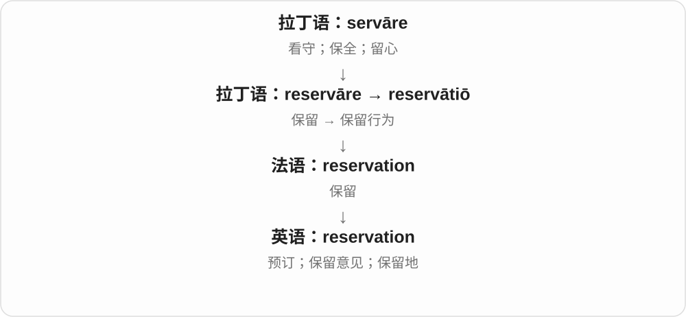

I have reservations 是我有顾虑，不是我订了好几间房。reservation 的土地义也用于一些国家的原住民保留地。

**常见搭配与例句**

make a reservation；have reservations about；without reservation。

> I made a reservation for Friday night.

我预订了星期五晚上的位置。

> She has reservations about the proposed schedule.

她对拟议的日程安排有些顾虑。

**别混淆**

reservation 单数常是一次预订；reservations 也经常是顾虑。必须看宾语与语境。

### 61. compile — 汇编、编制；编译〔程序〕

**音标**：/kəmˈpaɪl/

**先抓住这个画面**

散落的资料先收起来，再按目的排成一份清单、书籍，是 compile。编程里则把源代码按语言规则翻译成另一种代码、中间形式。

**怎么拆**

经法语 compiler 接拉丁 compilare，早有搜掠、汇集材料的意思。现代汇编通常是中性整理；计算机编译是后来的技术用法。

**怎么变成今天的意思**

**拉丁 compilare 搜掠、汇集 → 法语 compiler**  
把来自各处的材料聚拢

↓

**英语 compile → compilation**  
汇编、编译；汇集过程与汇编作品

compile a list 编制清单；compile a report 汇编报告；compile code 编译代码。

**常见搭配与例句**

compile a list；compile code。

> She compiled a list of useful references.

她编了一份有用的参考资料清单。

> The tool compiles the code into a different format.

工具把代码编译成另一种格式。

**别混淆**

compile 比单纯 collect 收集常多整理成品的步骤；程序 compile 则按特定语言、工具规则转换，不只是把文本拼在一起。

### 62. compilation — 汇编、编纂；汇编作品、精选集；编译

**音标**：英 /ˌkɒmpɪˈleɪʃən/；美 /ˌkɑːmpɪˈleɪʃən/

**先抓住这个画面**

compile 是把材料整理成一份，compilation 既能说这个过程，也能说最终那本合集、那张精选唱片。编程中则是编译过程。

**怎么拆**

经法语接拉丁 compilatio；现代对应 compile 去 e 加 -ation，保留材料聚拢的词族关系。

**怎么变成今天的意思**

**拉丁 compilare 搜掠、汇集 → 法语 compiler**  
把来自各处的材料聚拢

↓

**英语 compile → compilation**  
汇编、编译；汇集过程与汇编作品

↓

**compilatio → compilation**  
汇集过程；汇集成的作品；后有编译用法

a compilation of essays 文章合集；a compilation album 精选专辑；compilation errors 编译错误。

**常见搭配与例句**

a compilation of；compilation errors。

> The book is a compilation of travel essays.

这本书是旅行随笔合集。

> Compilation failed because of a syntax error.

由于语法错误，编译失败了。

**别混淆**

compilation 可以是许多来源作品的集合，composition 常是创作、组成；汇编与原创写作的角度不同。

### 63. activation — 激活；启动；使生效

**音标**：/ˌæktɪˈveɪʃən/

**先抓住这个画面**

activation 像把准备好的设备从待命切到工作，关键是开始发挥作用。

**怎么拆**

activate + -ion，也可对应 active + -ation；现代英语构词。

**怎么变成今天的意思**

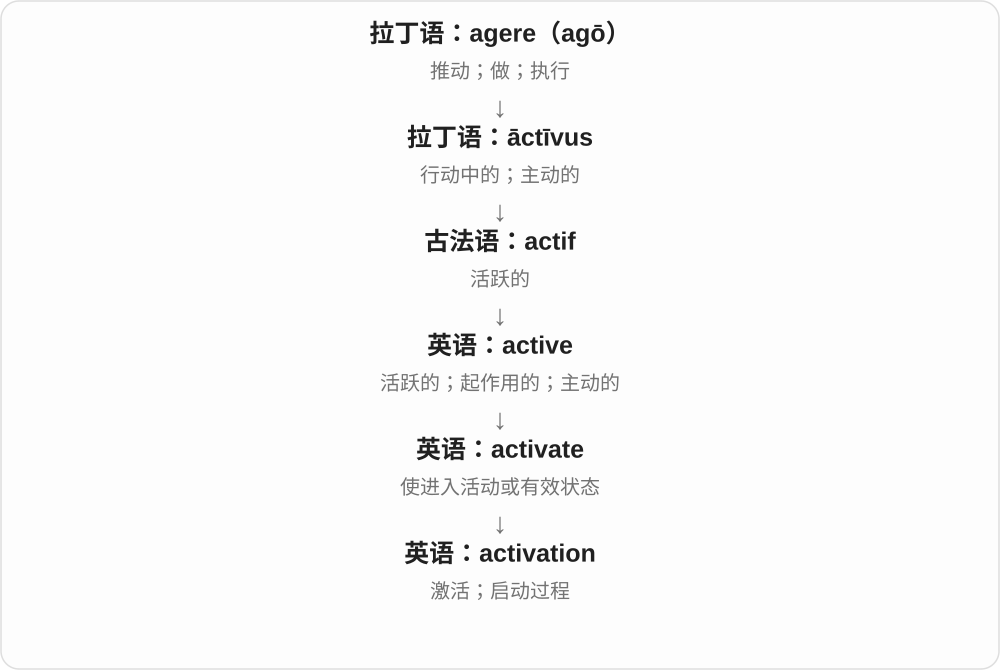

可说账号启用、设备触发或某个过程开始起作用。具体学科中的 activation 有自己的判据，不一定真有一个开关。

**常见搭配与例句**

account activation；activation energy；automatic activation。

> Account activation takes only a few minutes.

账号激活只需几分钟。

> The sensor controls the activation of the alarm.

传感器控制警报的触发。

**别混淆**

activity 是活动状态或活动量；activation 是进入这种有效状态的过程。

### 64. minimize — 尽量减少；淡化；最小化〔界面、数学〕

**音标**：/ˈmɪnɪmaɪz/

**先抓住这个画面**

把损失、浪费压低，是 minimize；把严重问题说得很轻，也是 minimize。电脑把窗口收起，则取最小化显示的技术义。

**怎么拆**

拉丁 minimus 最小的 + -ize 形成使尽量小的动词；英语再把数量、影响、界面操作等具体化。

**怎么变成今天的意思**

**拉丁 minimus 最小的 + -ize → minimize**  
把量或作用降到尽量小

↓

**minimize + -ation → minimization**  
最小化；淡化严重程度的做法

minimize waste 减少浪费；minimize the risk 尽量降低风险；minimize a problem 淡化问题；minimize a window 最小化窗口。

**常见搭配与例句**

minimize waste；minimize a window。

> The design aims to minimize waste.

设计旨在尽量减少浪费。

> He tried to minimize the seriousness of the mistake.

他试图淡化错误的严重性。

**别混淆**

minimize 常是尽量降低，不必降为零；eliminate 才常说消除。淡化问题的用法还可能带负面评价。

### 65. minimization — 最小化；尽量减少；淡化

**音标**：/ˌmɪnɪmaɪˈzeɪʃən/

**先抓住这个画面**

minimize 是把量压低，minimization 是这套减少过程；数学里可寻找目标函数的最小值，交流里也可说淡化问题。

**怎么拆**

minimize 去 e 加 -ation，把使尽量小的动作名词化。不同对象让它成为优化、节约或话语评价。

**怎么变成今天的意思**

**拉丁 minimus 最小的 + -ize → minimize**  
把量或作用降到尽量小

↓

**minimize + -ation → minimization**  
最小化；淡化严重程度的做法

↓

**minimize + -ation → minimization**  
减到尽量小的过程；弱化问题的表述

waste minimization 减少废弃物；cost minimization 成本最小化；the minimization of a problem 淡化问题。

**常见搭配与例句**

waste minimization；cost minimization。

> The project focuses on waste minimization.

项目着重减少废弃物。

> The report criticises the minimization of the problem.

报告批评了淡化问题的做法。

**别混淆**

minimization 讨论怎样减少某量，minimum 是得到的最小值、下限；过程名词与数值名词分开。

### 66. starve — 挨饿、饿死；使挨饿；极度缺乏

**音标**：英 /stɑːv/；美 /stɑːrv/

**先抓住这个画面**

身体得不到足够食物，是 starve 的核心。口语 I’m starving 常夸张说饿极了；be starved of information 则像一直没有得到所需的信息。

**怎么拆**

接古英语 steorfan，早期只是死去，后来英语意义收窄到饥饿导致的衰弱、死亡等；与德语 sterben 死同源。

**怎么变成今天的意思**

**古英语 steorfan → 中古英语 sterven**  
原来泛指死亡、死去

↓

**现代 starve → starvation**  
意义集中到挨饿、饿死；严重缺食状态

starve to death 饿死；be starving 饿极了、正挨饿；be starved of something 严重缺少某物。

**常见搭配与例句**

be starving；starve to death；be starved of。

> I skipped lunch, and now I am starving.

我没吃午饭，现在饿极了。

> The team was starved of reliable information.

团队极度缺乏可靠信息。

**别混淆**

口语 starving 可以夸张饥饿，正式 starvation 常是严重缺食；看语境决定实际强度。

### 67. starving — 挨饿；饿得厉害；饿极了〔分词、形容词〕

**音标**：英 /ˈstɑːvɪŋ/；美 /ˈstɑːrvɪŋ/

**先抓住这个画面**

真的长时间没有足够食物，是 starving；日常走了很久，说 I’m starving，又常只是夸张地说饿死我了。

**怎么拆**

starve 去末尾 e，加完整 -ing → starving。starve 承古英语 steorfan 死，后来逐渐多指因寒冷、饥饿等死亡，现代常集中到缺食物。

**怎么变成今天的意思**

**古英语 steorfan 泛指死 → 中古英语 sterven 等**  
后来有因寒冷、饥饿而死的较窄词义

↓

**英语 starve 的挨饿义 → starving；口语夸张用法**  
现代可指真正缺食物，也可说眼下极饿

starving people 是挨饿的人；I’m starving 是我饿极了；starving for attention 又可比喻极其渴望关注。

**常见搭配与例句**

I’m starving；a starving traveler；starving for attention。

> We were starving after the long walk.

走了很长一段路后，我们饿极了。

> The story begins with a starving traveler at the gate.

故事从一个在门口挨饿的旅人写起。

**别混淆**

starving 的严重程度要看语境；正式叙述可能是真正饥饿，熟人饭前说这句话常带夸张。

### 68. starvation — 严重饥饿；挨饿、饥饿致死

**音标**：英 /stɑːˈveɪʃən/；美 /stɑːrˈveɪʃən/

**先抓住这个画面**

不只是饭晚了一个小时，而是持续得不到足够食物，身体受到严重影响的处境，是 starvation。它把 starve 的状态整体命名。

**怎么拆**

starve 去 e 加 -ation；从英语动词构成名词，词干与后缀相接后 /v/ 和重音位置发生对应变化。

**怎么变成今天的意思**

**古英语 steorfan → 中古英语 sterven**  
原来泛指死亡、死去

↓

**现代 starve → starvation**  
意义集中到挨饿、饿死；严重缺食状态

↓

**starve + -ation → starvation**  
严重缺食的状态、过程及后果

face starvation 面临严重饥饿；die of starvation 饿死；prevent starvation 防止严重饥饿。

**常见搭配与例句**

face starvation；die of starvation。

> The aid was intended to prevent starvation.

援助旨在防止人们遭受严重饥饿。

> The report describes families facing starvation.

报告描述了面临严重饥饿的家庭。

**别混淆**

starvation 通常比 hunger 饥饿强；I’m hungry 日常想吃饭，不必译成自己正处在饥荒、饥饿致死状态。

### 69. designation — 指定；任命；名称、称号；划定的身份

**音标**：/ˌdezɪɡˈneɪʃən/

**先抓住这个画面**

designation 可以是给一个对象“贴上正式标签”这件事，也可以是贴上的名称或身份。

**怎么拆**

拉丁 dēsignātiō 经古法语 designacion 或直接借入，中古英语已有 designacioun；名词记录早于现代动词 designate。

**怎么变成今天的意思**

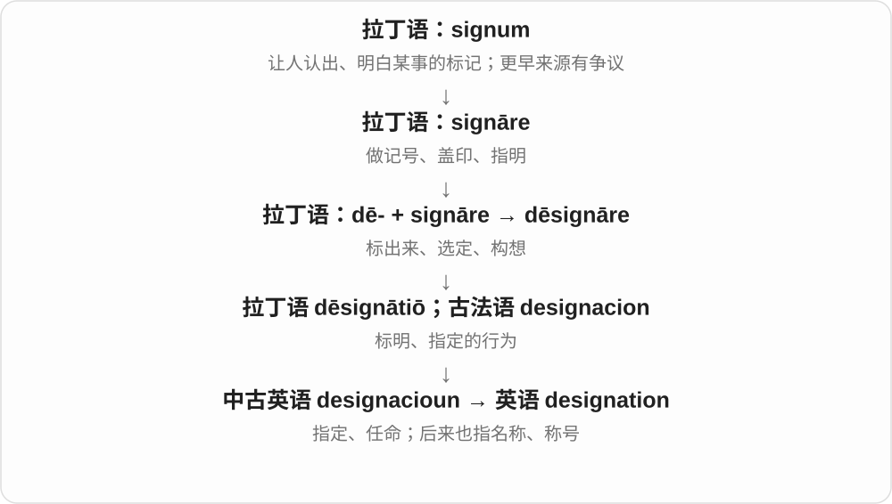

official designation 是正式名称；designation as a protected site 是被划为保护地点。语境会告诉你在说命名结果还是指定行为。

**常见搭配与例句**

official designation；designation as；a job designation。

> The building received designation as a protected landmark.

这栋建筑被列为受保护地标。

> Each model has a different letter designation.

每个型号都有不同的字母名称标识。

**别混淆**

name 是一般名字；designation 常带分类、职位或正式用途的标签感。

### 70. utilize — 利用；使派上用场

**音标**：英 /ˈjuːtɪlaɪz/；美 /ˈjuːtəlaɪz/

**先抓住这个画面**

utilize 常把目光放在已有资源上：空着的房间、闲置的设备、已经收集的数据，怎样让它们发挥作用。

**怎么拆**

经法语 utiliser，与意大利语 utilizzare 相连；更远来自拉丁语 ūtilis“有用的”。现代可识别 util- 与动词后缀 -ize。

**怎么变成今天的意思**

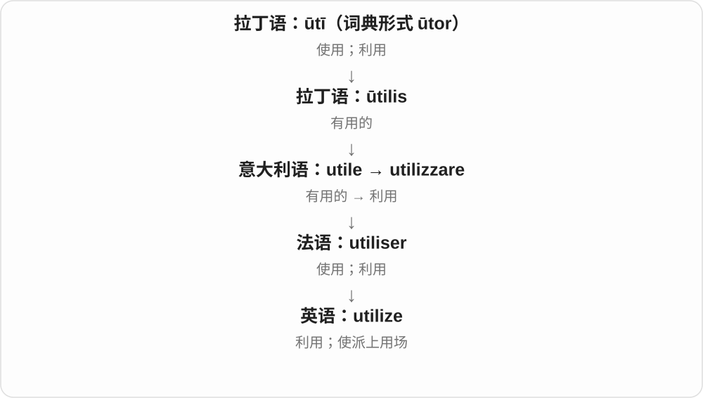

从“有用”形成“使之用于某事”的动词。它常见于正式说明，适合讨论资源利用，但并不强制表示新用途或特别聪明的用法。

**常见搭配与例句**

utilize available resources；utilize space；utilize data；fully utilize。

> The school utilized an empty classroom as a music room.

学校把一间空教室利用起来，改作音乐室。

> The new design utilizes the available space more efficiently.

新设计更有效地利用了现有空间。

**别混淆**

utilize 与 use 大量重叠。日常说 use a spoon 就足够，不需要为了显得正式而处处换成 utilize。

### 71. utilization — 利用；使用情况；利用程度

**音标**：英 /ˌjuːtɪlaɪˈzeɪʃən/；美 /ˌjuːtələˈzeɪʃən/

**先抓住这个画面**

utilization 常出现在“资源有没有用起来、用了多少”的讨论中。比如十台机器只有三台开着，就可以谈设备利用情况。

**怎么拆**

utilize + -ation，把“利用”的动作变成名词；也与法语 utilisation 对应。

**怎么变成今天的意思**

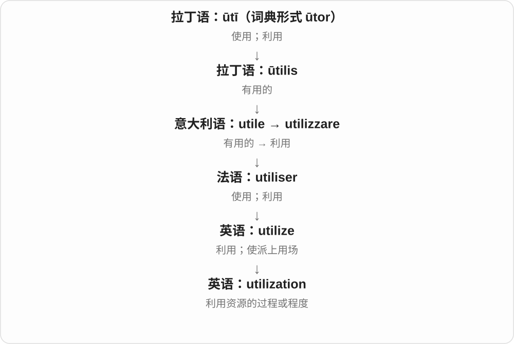

重心从“谁用了什么”转成“整体利用得怎样”。因此它很适合和 capacity、resource、equipment 一起讨论，但具体指标仍要看语境。

**常见搭配与例句**

resource utilization；capacity utilization；equipment utilization；improve utilization。

> The dashboard shows server utilization throughout the day.

这个面板显示服务器全天的使用情况。

> Sharing the workshop improved the utilization of its equipment.

共享这间工坊提高了设备的利用程度。

**别混淆**

utilization 是利用情况；efficiency 是投入与产出之间的效率。机器一直开着，利用率很高，也可能因为浪费能源而效率不高。

### 72. utilisation — 利用、使用；利用程度〔搭配〕

**音标**：/ˌjuːtɪlaɪˈzeɪʃən/

**先抓住这个画面**

资源怎样被用上、用到了多少，是 utilisation 讨论的事情。机器闲着还是忙着，报告里也常用这个名词。

**怎么拆**

接法语 utilisation，现代对应 utilise 去 e 加 -ation；与 utilization 是同词的拼写变体。

**怎么变成今天的意思**

**拉丁 utilis 有用的、uti 使用 → 法语 utiliser**  
把事物用于某目的

↓

**英语 utilise → utilisation**  
利用；使用、发挥用途的过程

↓

**utilise + -ation → utilisation**  
使用过程；所能发挥的使用程度

resource utilisation 资源利用；capacity utilisation 产能利用；utilisation rate 利用率，具体计算按指标定义。

**常见搭配与例句**

resource utilisation；capacity utilisation。

> The report examines resource utilisation.

报告考察资源利用情况。

> Better scheduling improved the utilisation of the equipment.

改进排程提高了设备利用率。

**别混淆**

utilisation 是使用的过程、程度，utility 可指用途、效用或公用事业；名词不能只看共同的 util- 就互换。

### 73. utilise — 利用、使用〔utilize 的常见英式拼写〕

**音标**：/ˈjuːtɪlaɪz/

**先抓住这个画面**

把手头资源用起来，让它在某个目的上发挥作用，是 utilise。它比 use 正式，但并不另指一种神秘的使用动作。

**怎么拆**

借法语 utiliser，接意大利语、拉丁有用、使用的词族材料；现代与 utilize 对应，-ise 是相应拼写。

**怎么变成今天的意思**

**拉丁 utilis 有用的、uti 使用 → 法语 utiliser**  
把事物用于某目的

↓

**英语 utilise → utilisation**  
利用；使用、发挥用途的过程

utilise resources 利用资源；utilise space 利用空间；utilise information 利用信息。

**常见搭配与例句**

utilise resources；utilise space。

> The design utilises the available space efficiently.

设计高效利用了现有空间。

> The team utilised data from earlier studies.

团队利用了先前研究的数据。

**别混淆**

utilise 与 utilize 同义；use 是更普通的常用动词，不必所有简单使用都换成长词。

### 74. authorization — 授权；批准；授权文件

**音标**：英 /ˌɔːθəraɪˈzeɪʃən/；美 /ˌɔːθərəˈzeɪʃən/

**先抓住这个画面**

把“已经允许这样做”作为一种资格、决定或书面凭据来谈。

**怎么拆**

authorize + -ation；英式也常拼 authorization 或 authorisation，随采用的拼写体系而定。

**怎么变成今天的意思**

**拉丁 augēre；分词 auctus**  
使增加、成长；已经增长的

↓

**拉丁 auctor 词族 → 英语 authorize**  
权威来源 → 正式授权

↓

**英语 authorize + -ation → authorization**  
授权的行为、许可或证明

written authorization 是书面授权。系统里可以已经知道你是谁，却仍不允许你改文件：身份得到确认，不等于获得了每项操作的 authorization。

**常见搭配与例句**

written authorization；prior authorization；authorization to do；without authorization。

> The supplier needs written authorization before starting work.

供应商开始工作前需要书面授权。

> Your account has authorization to view the file but not to edit it.

你的账户获准查看这个文件，但不能编辑。

**别混淆**

authentication 核实身份；authorization 决定允许做什么。日常语境里 permission 更普通，authorization 更正式。

### 75. inflame — 激化、激起；使发炎

**音标**：/ɪnˈfleɪm/

**先抓住这个画面**

原本已有火星，又给它添了火，情绪、冲突更强了，是 inflame 的比喻。身体组织发炎的红热感也保留了火的旧画面。

**怎么拆**

经法语接拉丁 inflammare，in- 进入与 flamma 火焰的材料；点燃义走向激起情绪、使发炎等用法。

**怎么变成今天的意思**

**拉丁 in- 进入 + flamma 火焰 → inflammare**  
点燃；引申为激起强烈反应

↓

**法语、英语 inflame；拉丁 inflammatio → inflammation**  
使激化、使发炎；炎症

inflame tensions 加剧紧张；inflame public opinion 激起舆情；inflamed skin 发炎的皮肤。

**常见搭配与例句**

inflame tensions；inflamed skin。

> The remarks inflamed tensions between the groups.

这些话加剧了群体间的紧张。

> The skin around the cut became inflamed.

伤口周围的皮肤发炎了。

**别混淆**

inflame 常使反应更强，soothe 是缓和、安抚；这两个词可沿加火与降温的画面对照。

### 76. inflammation — 炎症；发炎

**音标**：/ˌɪnfləˈmeɪʃən/

**先抓住这个画面**

组织受到刺激、损伤或感染等影响后，出现一套反应，常见红、肿、热、痛，这就是 inflammation。火只是帮助理解旧命名，不是真在身体里燃烧。

**怎么拆**

经法语接拉丁 inflammatio，来自 inflammare 点燃、激起；现代对应 inflame 去 e 加 -ation。

**怎么变成今天的意思**

**拉丁 in- 进入 + flamma 火焰 → inflammare**  
点燃；引申为激起强烈反应

↓

**法语、英语 inflame；拉丁 inflammatio → inflammation**  
使激化、使发炎；炎症

↓

**inflammatio → inflammation**  
发炎这一反应、状态

inflammation of the skin 皮肤炎症；signs of inflammation 炎症表现；reduce inflammation 减轻炎症。

**常见搭配与例句**

signs of inflammation；inflammation of。

> The report describes inflammation around the joint.

报告描述了关节周围的炎症。

> The study examines how inflammation develops.

研究考察炎症如何形成。

**别混淆**

inflammation 是炎症，infection 是感染；损伤等也可引起炎症，不能把两个词一律当同义词。

### 77. confrontation — 对抗；冲突；当面对质

**音标**：英 /ˌkɒnfrʌnˈteɪʃn/；美 /ˌkɑːnfrənˈteɪʃn/

**先抓住这个画面**

双方立场直接碰上，不再只是各自暗中不满。

**怎么拆**

接中古拉丁 confrontatio/confrontation-“对质”，来自 confrontari“使面对面”。现代与 confront + -ation 可对应，但这个名词有独立的拉丁借入历史。

**怎么变成今天的意思**

**拉丁语 frons，词干 front-**  
前额、正面、前部

↓

**中古拉丁 confrontari → confrontatio**  
使面对面 → 对质、当面对照

↓

**17 世纪英语 confrontation**  
当面对质；发展为冲突、对抗

a confrontation over money 可以是一场紧张的当面争执，并不一定打起来。政治或工作中的 confrontation 也能指持续的对抗局面；具体是一次事件还是一种状态，要看上下文。

**常见搭配与例句**

a confrontation with someone；confrontation between two groups；avoid confrontation；a heated confrontation。

> A calm explanation prevented a confrontation at the meeting.

一番平静的解释避免了会议上发生冲突。

> The novel ends with a confrontation between the two former friends.

小说以两位昔日好友的正面对质收尾。

**别混淆**

disagreement 可以只是意见不同；confrontation 通常意味着分歧已经变成直接、紧张的对立。它不是任何普通会面的同义词。

### 78. temptation — 诱惑；让人心动的事物

**音标**：/tempˈteɪʃən/

**先抓住这个画面**

temptation 像某件事向你招手，让你想偏离原本的计划或原则。

**怎么拆**

来自拉丁 temptātiō，经古法语 temptacion；现代可联系 tempt + -ation。

**怎么变成今天的意思**

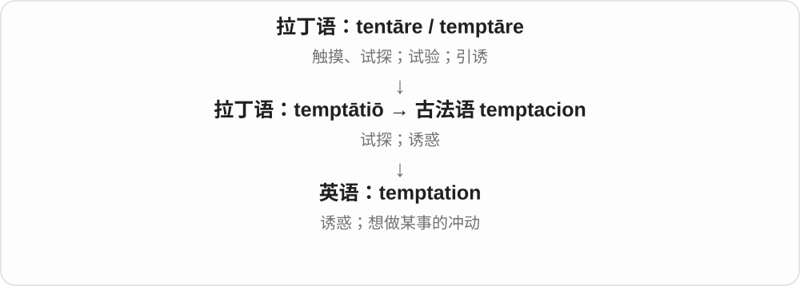

有时只是多吃一块蛋糕的小诱惑，不必每次都涉及严重过错。

**常见搭配与例句**

resist temptation；give in to temptation；the temptation to do。

> I resisted the temptation to check my phone.

我忍住了查看手机的冲动。

> The extra cake was a real temptation.

多出来的那块蛋糕实在让人心动。

**别混淆**

temptation 是吸引你去做的冲动或东西；attempt 是已经作出的尝试。

### 79. continuation — 继续；延续；续接部分

**音标**：/kənˌtɪnjuˈeɪʃən/

**先抓住这个画面**

continuation 像故事下一章把上一章接着讲，既可以说接着进行，也可以指接上来的那一段。

**怎么拆**

经古法语 continuation 来自拉丁语 continuātiō，与 continuāre“使继续”同族。

**怎么变成今天的意思**

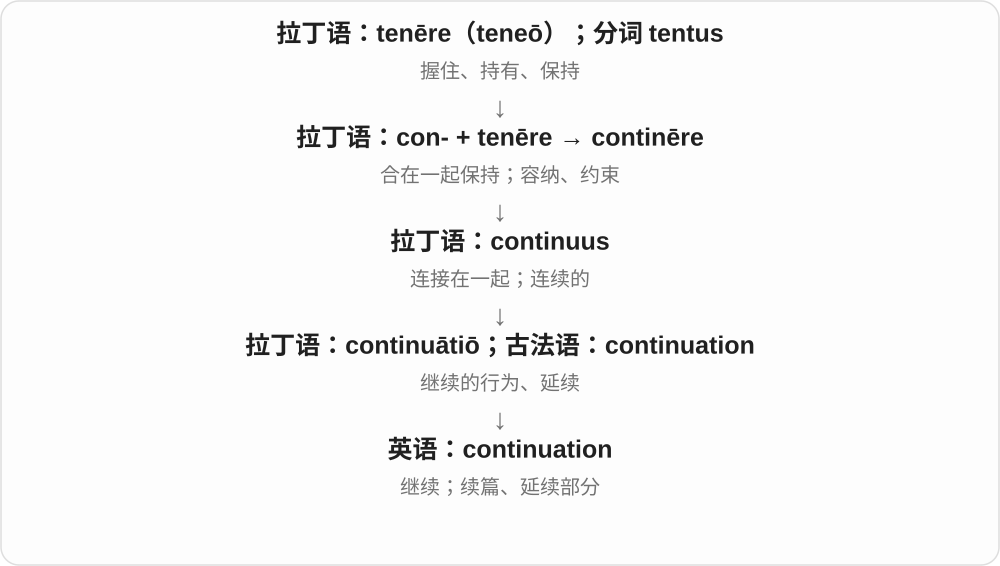

常用于工作、谈判、故事或路线的延续。不是所有 continuation 都从头重新来，通常保留前面的进展。

**常见搭配与例句**

a continuation of…；the continuation of talks；a direct continuation。

> The second book is a continuation of the first story.

第二本书接着讲第一本的故事。

> Both sides agreed to the continuation of the talks.

双方同意继续谈判。

**别混淆**

continuity 强调前后不断、相连的性质；continuation 强调继续做或接续的部分。

### 80. limitation — 限制、限制条件；局限、短处

**音标**：/ˌlɪmɪˈteɪʃən/

**先抓住这个画面**

你能做到这里、做不到那里，那个卡住范围的条件就是 limitation；说人的、工具的 limitations，常是各自做不到的地方。

**怎么拆**

经法语 limitacion、拉丁 līmitātiō 等接限制的动作名词；现代可对应 limit + -ation，但名词有独立借入史，不当成英语动词后来才生出来的唯一后代。

**怎么变成今天的意思**

**拉丁 līmes、līmit- → 古法语 limite → 中古英语 limit**  
田地间边界等 → 界限

↓

**拉丁 līmitāre → 法语 limiter → 英语 limit〔动词〕**  
划界、限定 → 使不超过某范围

↓

**拉丁 līmitātiō → 法语 limitacion → limitation**  
限制行为、条件；能力上的局限

a limitation of the method 方法的局限，time limitations 时间限制，recognize your limitations 认识自己的局限。

**常见搭配与例句**

a limitation of；time limitations；recognize your limitations。

> The study has several important limitations.

这项研究有几个重要局限。

> We discussed the limitations of the new design.

我们讨论了新设计的局限。

**别混淆**

limit 常指边界、上限，limitation 可指造成边界的条件或短板。limitations 不一定是犯错，而是适用范围有限。

### 81. relaxation — 放松；休息；放宽；弛豫

**音标**：英、美 /ˌriːlækˈseɪʃən/

**先抓住这个画面**

把紧张程度降下来。可以是人从忙碌中松下来，也可以是规则从严变宽。

**怎么拆**

经古法语 relaxacion 及直接拉丁语借入 relaxatio，基于 relaxare；名词有自己的借入历史，不是仅由现代 relax 加词尾才出现。

**怎么变成今天的意思**

**拉丁语 laxus → laxare**  
松的、宽的 → 使松开

↓

**拉丁语 re- + laxare → relaxare**  
松开、舒缓、减弱约束

↓

**拉丁语 relaxatio → 古法语 relaxacion、英语 relaxation**  
松弛、减轻；后来用于身心放松和规则放宽

relaxation of restrictions 是放宽限制。科学中的 relaxation 常称弛豫，描述系统受扰动后向平衡或稳定状态趋近，要按具体模型理解。

**常见搭配与例句**

rest and relaxation；relaxation of rules；relaxation time。

> Reading in the garden is her favourite form of relaxation.

在花园里读书是她最喜欢的放松方式。

> The announcement promised a gradual relaxation of restrictions.

公告承诺逐步放宽限制。

**别混淆**

recreation 是休闲活动；relaxation 是放松状态或过程，活动热闹与否不是判断标准。

### 82. optimization — 优化；寻求最优方案的过程

**音标**：英 /ˌɒptɪmaɪˈzeɪʃən/；美 /ˌɑptɪməˈzeɪʃən/

**先抓住这个画面**

把“调得更合适”这项工作整体装进一个名词里。

**怎么拆**

optimize + -ation；词尾形成 -ization，表示过程。

**怎么变成今天的意思**

**拉丁 optimus／其中性形式 optimum**  
最好的；最佳者

↓

**英语 optimize → optimization**  
优化 → 优化过程

route optimization 说路线优化；performance optimization 说性能优化。专业问题通常要说清优化目标和约束，例如时间更少但费用不能超标，否则“最优”没有明确参照。

**常见搭配与例句**

performance optimization；route optimization；an optimization problem。

> The project focuses on route optimization for delivery vehicles.

这个项目重点研究配送车辆的路线优化。

> We measured the results before and after optimization.

我们测量了优化前后的结果。

**别混淆**

optimization 是过程，optimum 是理想点或最佳状态。做过优化，不等于已证明达到全局最优。

### 83. accusation — 指控；指责

**音标**：/ˌækjʊˈzeɪʃən/

**先抓住这个画面**

accusation 是那句具体的“你做了坏事”的说法。它把 accuse 的动作装进一个名词，方便说“提出、否认、回应这项指控”。

**怎么拆**

现代可对照 accuse 与 -ation 理解；历史上英语借用了法语 acusacion，后者来自拉丁语 accūsātiō，属于 accūsāre 的动作名词。

**怎么变成今天的意思**

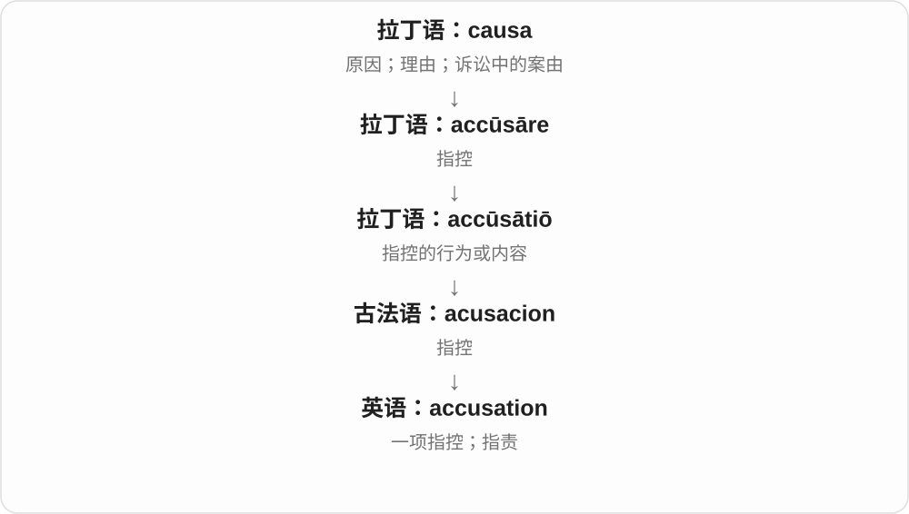

accusation 可以是一项具体说法，也可指指责的行为。语气比单纯的 comment 或 criticism 更重，因为它通常涉及某人做错了什么。

**常见搭配与例句**

make an accusation（提出指控）；deny an accusation（否认指控）；an accusation of fraud（欺诈指控）；an accusation against someone（针对某人的指控）。

> She denied the accusation that she had changed the records.

她否认了自己修改记录的指控。

> His accusation took everyone in the room by surprise.

他的指责让房间里的所有人都很意外。

**别混淆**

criticism 可以只是“你的方法不够好”；accusation 往往是“你做了不该做的事”。提出 accusation 不等于已经证明它。

### 84. degradation — 退化；恶化；降解；受辱

**音标**：英、美 /ˌdeɡrəˈdeɪʃən/

**先抓住这个画面**

原来较高的质量、地位或完整性，一层层掉下去。

**怎么拆**

借法语 dégradation；可联系拉丁 dēgradāre 和现代 degrade + -ation。

**怎么变成今天的意思**

**拉丁 gradus；gradī / gradior**  
一步、台阶、等级；走、迈步

↓

**晚期拉丁 dēgradāre → 法语 dégradation → 英语 degradation**  
降级 → 地位、质量或完整性的降低

土地 degradation 是土地状况恶化；材料 degradation 是结构分解、性能衰减；人的 degradation 则可强调尊严受损。

**常见搭配与例句**

environmental degradation；material degradation；human degradation。

> The report documents the degradation of the soil.

报告记录了土壤状况的恶化。

> Heat accelerated the degradation of the coating.

高温加快了涂层的降解。

**别混淆**

decomposition 较具体说分解；degradation 还包括性能、环境或尊严下降。

### 85. deportation — 驱逐出境；强制遣送

**音标**：英 /ˌdiːpɔːˈteɪʃən/；美 /ˌdiːpɔːrˈteɪʃən/

**先抓住这个画面**

deportation 是由当局把一个人强制送离某个国家的过程。词源中的“运走”在这里变成了制度性行动。

**怎么拆**

来自法语 déportation，与 deport 相连；现代可看成 deport + -ation。

**怎么变成今天的意思**

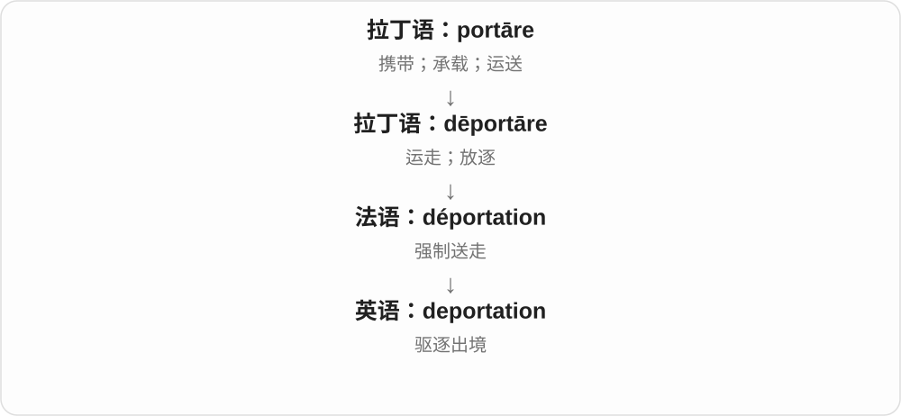

它描述强制离境，不是普通旅行安排。不同语境涉及的具体制度不同，理解单词时先抓住谁在强制把谁送走。

**常见搭配与例句**

face deportation（面临驱逐出境）；a deportation order（驱逐出境令）；deportation proceedings（驱逐出境程序）。

> The report describes the family’s experience of deportation.

报告描述了这家人被驱逐出境的经历。

> The newspaper reported that a deportation order had been issued.

报纸报道说，已发出一份驱逐出境令。

**别混淆**

deportation 是被强制遣离；departure 只是离开。不要把一个中性的出发词读成强制行动。

### 86. sanitation — 公共卫生；环境卫生；卫生设施与废物处理

**音标**：/ˌsænɪˈteɪʃən/

**先抓住这个画面**

一个地方的污水、垃圾和排泄物能不能妥善处理，让人有基本卫生条件。

**怎么拆**

从英语 sanitary 的词干不规则形成，不是从 sanitize 换词尾得到。

**怎么变成今天的意思**

**拉丁 sanus**  
健康、健全；更早来源未定

↓

**拉丁 sanitas → 法语 sanitaire → 英语 sanitary**  
健康 → 公共卫生、卫生条件相关的

↓

**英语 sanitary → sanitation**  
卫生条件 → 维护公共卫生的措施和系统

access to sanitation 常谈厕所、排污等基本服务；sanitation workers 是环卫相关工作人员。它通常指一整套卫生条件，不是一瓶洗手液。

**常见搭配与例句**

water and sanitation；basic sanitation；sanitation workers。

> The programme improved access to clean water and sanitation.

项目改善了居民获得清洁用水和卫生设施的条件。

> Poor sanitation can affect an entire neighbourhood.

卫生条件差可能影响整个社区。

**别混淆**

sanitization 常说一次或一种卫生处理；sanitation 更常说公共卫生设施、系统与环境条件。

### 87. accreditation — 正式认证；认可资格；授权

**音标**：/əˌkredɪˈteɪʃən/

**先抓住这个画面**

accreditation 是那次正式认可的过程，也可以是得到认可之后的资格状态。

**怎么拆**

accredit + -ation，是英语动作名词派生。

**怎么变成今天的意思**

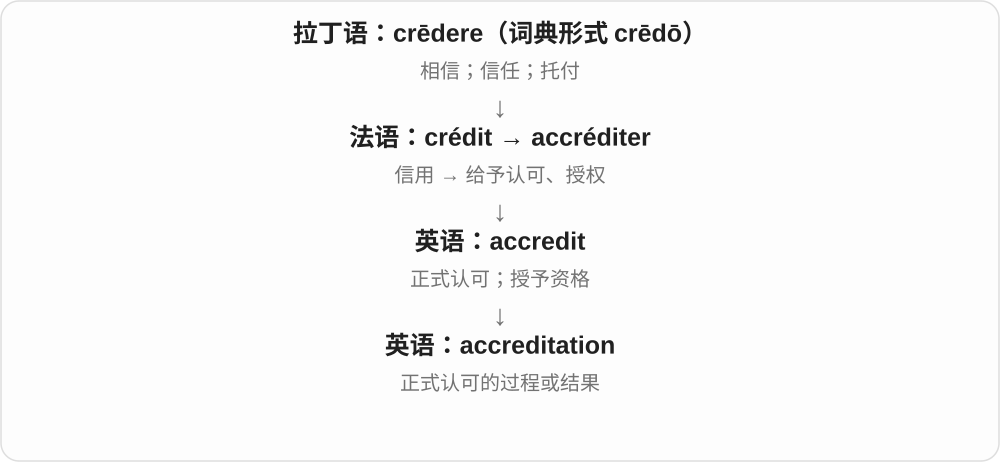

它把“谁认可谁”的动作变成机构可以申请、获得、维持的资格。具体认可什么，由认证范围决定。

**常见搭配与例句**

apply for accreditation；gain accreditation；maintain accreditation；institutional accreditation。

> The school applied for accreditation of its new program.

学校为新项目申请了认证。

> The laboratory renewed its accreditation this year.

这家实验室今年续办了认证资格。

**别混淆**

accreditation 不等于笼统地保证一切优秀。它通常说明符合某项认可体系的要求，仍要看范围与有效状态。

### 88. consolation — 安慰；慰藉；使人稍感好受的人或事

**音标**：英 /ˌkɒnsəˈleɪʃən/；美 /ˌkɑːnsəˈleɪʃən/

**先抓住这个画面**

结果仍然不理想，但总有一点东西，让心里没那么难受。

**怎么拆**

经古法语 consolacion 来自拉丁 consolatio／consolation-，是 consolari“安慰”的动作名词。英语名词比现代动词 console 更早，不能把真实借入路线简单排成 console + -ation。

**怎么变成今天的意思**

**拉丁 solari → consolari**  
安慰、鼓励

↓

**拉丁 consolatio／consolation- → 古法语 consolacion**  
安慰、缓解悲伤

↓

**中古英语 consolation → 现代 consolation**  
慰藉；令人稍感好受的事

One consolation is that... 是说“有一点可以安慰自己的是……”。consolation prize 是安慰奖，没有拿到主要奖项的人也得到一点肯定。这个词不保证损失已经弥补，只说情绪上稍有缓冲。

**常见搭配与例句**

take consolation in something；a source of consolation；a consolation prize；small consolation。

> Her friends’ messages were a source of consolation.

朋友们的信息给了她一些慰藉。

> Missing the final was disappointing, but winning the audience award was some consolation.

没能进入决赛令人失望，但获得观众奖多少让人感到安慰。

**别混淆**

compensation 更强调赔偿或补偿损失；consolation 更强调心里得到安慰。金钱可以构成一种 consolation，但两词并不等义。

### 89. flirt — 调情；短暂考虑、涉足〔搭配〕；爱调情的人

**音标**：英 /flɜːt/；美 /flɜːrt/

**先抓住这个画面**

说话、微笑带着暧昧、逗趣的吸引，是 flirt with someone。对一个想法有点心动，却还没认真投入，也能 flirt with the idea。

**怎么拆**

早期英语 flirt、flurt 等轻弹、嘲弄的词形和人物称呼发生交汇，较远来历未定；现代集中在轻巧、试探性的亲近与尝试。

**怎么变成今天的意思**

**早期英语 flirt、flurt 等词形交汇**  
轻弹、嘲弄等旧材料；确切远源未定

↓

**现代 flirt → flirty、flirtation**  
调情；短暂玩味某种想法、活动及其相应状态

flirt with someone 与某人调情；flirt with the idea of doing 短暂考虑做；a flirt 爱调情的人。

**常见搭配与例句**

flirt with someone；flirt with the idea。

> He flirted with her at the party.

他在聚会上和她调情。

> She flirted with the idea of moving abroad.

她曾短暂考虑过搬到国外。

**别混淆**

flirt with an idea 说想法上的试探，未必涉及恋爱；和人调情也不保证存在认真、持久的恋爱意图。

### 90. flirty — 爱调情的；带暧昧意味的

**音标**：英 /ˈflɜːti/；美 /ˈflɜːrti/

**先抓住这个画面**

一句话、一个笑容让人觉得带着试探性的吸引，是 flirty。它描述氛围、表达方式，也能描述人的倾向。

**怎么拆**

flirt + -y，形成带有调情性质的形容词；同一基础词在日常口语里的短扩展。

**怎么变成今天的意思**

**早期英语 flirt、flurt 等词形交汇**  
轻弹、嘲弄等旧材料；确切远源未定

↓

**现代 flirt → flirty、flirtation**  
调情；短暂玩味某种想法、活动及其相应状态

↓

**flirt + -y → flirty**  
爱调情、表现暧昧的性质

a flirty smile 暧昧笑容；a flirty message 带调情意味的信息；a flirty tone 轻佻、暧昧的语气。

**常见搭配与例句**

a flirty smile；a flirty tone。

> She sent him a flirty message.

她给他发了一条带调情意味的信息。

> The dialogue has a light, flirty tone.

对话带着轻松暧昧的语气。

**别混淆**

flirty 比 friendly 友好更可能带吸引、暧昧意味；判断具体交流时，仍要看言语、情境。

### 91. flirtation — 调情；短暂暧昧关系；短暂涉足

**音标**：英 /flɜːˈteɪʃən/；美 /flɜːrˈteɪʃən/

**先抓住这个画面**

flirt 是试探性地亲近，flirtation 是这段调情、暧昧；对艺术流派、职业方向试了一阵又离开，也能叫 a flirtation with it。

**怎么拆**

flirt + -ation，英语把外来的名词尾用到这个本族发展词上；不需要假设整词先存在于拉丁语。

**怎么变成今天的意思**

**早期英语 flirt、flurt 等词形交汇**  
轻弹、嘲弄等旧材料；确切远源未定

↓

**现代 flirt → flirty、flirtation**  
调情；短暂玩味某种想法、活动及其相应状态

↓

**flirt + -ation → flirtation**  
轻巧、短暂的亲近或尝试

a brief flirtation 短暂调情、暧昧；a flirtation with politics 短暂涉足政治；a harmless flirtation 无伤大雅的调情，含说话者评价。

**常见搭配与例句**

a brief flirtation；a flirtation with。

> Their flirtation lasted only a few weeks.

他们的暧昧只持续了几周。

> Her flirtation with abstract art was brief.

她只短暂涉足过抽象艺术。

**别混淆**

flirtation 通常比 commitment 投入、承诺轻；短暂试水不表示决定长期走这条路。

### 92. quotation — 引文；引用；报价或报价单

**音标**：英 /kwəʊˈteɪʃən/；美 /kwoʊˈteɪʃən/

**先抓住这个画面**

把引用的话、报出的价作为一段完整内容拿出来看。

**怎么拆**

现代可联系 quote + -ation；历史有英语动词派生说，也有直接借中世纪拉丁 quotatio / quotationem“编号”的分析。不能只按现代名词 quote 加尾巴解释全部历史。

**怎么变成今天的意思**

**拉丁 quot → quotus**  
多少 → 顺序里的第几个、哪一份

↓

**中世纪拉丁 quotare → quotatio / quotationem；另一路为早期英语 quote 的名词派生**  
并列来源分析：编号、标注

↓

**英语 quotation 的意义扩展**  
引用行为、引文；后来也用于报价

a quotation from a novel 是小说中的一段引文；a quotation for repairs 是维修报价。quotation marks 是引号，包住原话的边界。quotation 比名词 quote 稍正式，但两者在许多场合能互换。

**常见搭配与例句**

a direct quotation；quotation marks；request a quotation；a written quotation。

> The essay begins with a short quotation from a novel.

这篇文章以小说中的一小段引文开头。

> Please send us a written quotation for replacing the windows.

请给我们一份更换窗户的书面报价。

**别混淆**

citation 可以只是出处信息；quotation 是被引用的那段话。报价单 quotation 和账单 invoice 的用途不同，前者提出价格，后者要求付款。

### 93. experimentation — 实验活动、试验探索；反复尝试的过程

**音标**：/ɪkˌsperɪmenˈteɪʃən/

**先抓住这个画面**

把一次次尝试不同办法、观察结果看成一段实践；不是只数某一次实验，而是强调试着摸索的过程。

**怎么拆**

experiment 作动词接 -ation 的过程名词，词基较早有拉丁法语背景；历史不必重新解释成拉丁 ex- 加一串现代字母。

**怎么变成今天的意思**

**拉丁 experīrī → experimentum → 法语 esperiment → experiment**  
尝试、检验 → 一次试验、证明

↓

**experiment〔动词〕+ -ation → experimentation**  
做实验、试验探索的活动过程

experimentation with materials 材料探索，through experimentation 通过试验，artistic experimentation 艺术探索。

**常见搭配与例句**

experimentation with；through experimentation；artistic experimentation。

> The design emerged through experimentation with paper.

设计是在反复尝试纸材时形成的。

> The course encourages artistic experimentation.

课程鼓励艺术探索。

**别混淆**

an experiment 可一次实验，experimentation 常不可数说实践过程；更多试验不自动保证结论正确，还需看设计和观察。

### 94. notation — 符号表示法；记谱法；记号；简短记录

**音标**：英 /nəʊˈteɪʃən/；美 /noʊˈteɪʃən/

**先抓住这个画面**

先约定一套符号，再用这些符号把东西记下来。

**怎么拆**

借法语 notation 或拉丁 notatio，接 notare“做标记”。英语 notation 早于动词 notate；虽然今天能对照成一对，不能把名词一概画成由后来的英语动词产生。

**怎么变成今天的意思**

**拉丁 nota → notare**  
标记、符号；做记号、记下

↓

**拉丁 notatio / notation-**  
标记、记录的行为或方式

↓

**法语 notation／直接拉丁借入 → 英语 notation**  
记号；符号表示法

数学有 mathematical notation，音乐有 musical notation。这个词既能说整套符号系统，也能说纸上写下的一条简短记录，要看上下文。

**常见搭配与例句**

scientific notation；musical notation；standard notation；a notation in the margin。

> The teacher explained the notation used in the equation.

老师解释了这个方程使用的符号。

> She added a brief notation beside the date.

她在日期旁写了一条简短记录。

**别混淆**

annotation 通常是给既有内容加注释；notation 更常说用什么符号记、符号系统本身。

### 95. globalization — 全球化

**音标**：英 /ˌɡləʊbəlaɪˈzeɪʃən/；美 /ˌɡloʊbələˈzeɪʃən/

**先抓住这个画面**

不同地方的生产、消费、信息与人员往来越来越连在一起。

**怎么拆**

globalize + -ation；也可从 global 加 -ization 分析，名词化全球扩展这一过程。不是只指一家企业出海。

**怎么变成今天的意思**

**拉丁 globus**  
圆团、球体

↓

**法语 globe／拉丁直接借入 → 中古英语 globe → 英语 globe**  
球体 → 地球、地球仪

↓

**英语 globe + -al → global**  
原有球形义；后来发展全球、整体范围义，受法语义项发展影响

↓

**英语 globalize + -ation → globalization**  
全球范围的联系和整合不断扩大的过程

economic globalization 说经济联系加深；cultural globalization 可以说文化产品与观念跨地域传播。它是过程名称，具体影响可能因地区和群体而不同。

**常见搭配与例句**

economic globalization；the effects of globalization；the pace of globalization。

> The course examines how globalization changed supply chains.

这门课考察全球化如何改变供应链。

> The effects of globalization differ across industries.

全球化对不同行业的影响并不相同。

**别混淆**

globalism 更常是一种主张或世界范围的政策取向；globalization 主要说正在发生的过程。

### 96. instrumentation — 仪器配置、测量装置系统；配器、乐器编配

**音标**：/ˌɪnstrəmenˈteɪʃən/

**先抓住这个画面**

一边问这套系统放哪些测量仪器，一边问这段音乐让哪些乐器各自负责什么；共同点是器具怎么配起来。

**怎么拆**

instrument + -ation，动作、系统相关名词；后段重音在 /teɪ/。不同专业把配置的对象选为测量器具、演奏乐器等。

**怎么变成今天的意思**

**拉丁 īnstruere → īnstrūmentum**  
装配、准备 → 工具、用具

↓

**法语 instrument → 英语 instrument**  
器具；乐器；测量仪器；达成目的的手段

↓

**instrument + -ation → instrumentation**  
配备、使用器具；仪器系统或音乐配器

laboratory instrumentation 实验室仪器系统，electronic instrumentation 电子测量装置，the song’s instrumentation 歌曲配器。

**常见搭配与例句**

laboratory instrumentation；electronic instrumentation；the song’s instrumentation。

> The laboratory upgraded its instrumentation.

实验室升级了仪器系统。

> The song’s sparse instrumentation leaves space for the singer.

歌曲的乐器编配很简约，给歌手留出了空间。

**别混淆**

instrumentation 可是整体配置、编配，instrument 通常是一件器具；音乐编配与实验测量不要只看同一个中文仪器来混译。

### 97. manifestation — 表现；显现；体现出来的迹象

**音标**：/ˌmænɪfeˈsteɪʃən/

**先抓住这个画面**

manifestation 像看见水面上的波纹，才知道水下发生了什么：内在的状态通过可观察的现象表现出来。

**怎么拆**

借自晚期拉丁 manifestātiō，来自 manifestāre“使显露”；现代可对应 manifest + -ation，但名词有独立借入路线。

**怎么变成今天的意思**

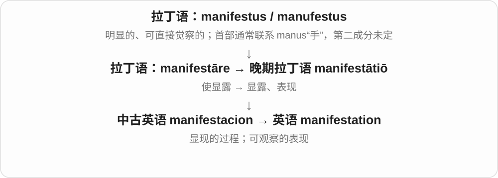

a manifestation of anxiety 是焦虑的一种表现，不是焦虑本身的全部。某些政治语境还指示威，受法语用法影响。

**常见搭配与例句**

a manifestation of；physical manifestations；an outward manifestation。

> The tension was a manifestation of deeper disagreements.

这种紧张气氛体现了更深层的分歧。

> The exhibition explores different manifestations of the same idea.

展览探讨了同一个观念的不同表现形式。

**别混淆**

cause 是原因；manifestation 是某种状态显露出来的形式，两者方向不同。

### 98. legalize — 使合法；使获得法律许可

**音标**：/ˈliːɡəlaɪz/

**先抓住这个画面**

以前法律不允许，规则改了以后，这件事可以依法进行。

**怎么拆**

legal + -ize“使成为”，英语动词；英式也拼 legalise。

**怎么变成今天的意思**

**拉丁语 lex，属格 legis**  
法律、规则

↓

**拉丁语 legalis**  
属于法律的；依法的

↓

**拉丁语直接借入，或经古法语 légal → 英语 legal**  
法律的；合法的

↓

**英语 legal + -ize → legalize**  
使变得合法

legalize an activity 强调改变其法律地位。它不保证人们一定赞同，也不等于所有限制都消失。

**常见搭配与例句**

legalize an activity；a proposal to legalize…。

> The bill would legalize street performances in designated areas.

该法案将允许在指定区域合法进行街头表演。

> The debate concerned whether to legalize the practice or keep the ban.

争论围绕应当让这种做法合法化，还是继续禁止它。

**别混淆**

decriminalize 通常说去掉刑事处罚；legalize 说使合法，两个政策动作的范围可能不同。

### 99. legalization — 合法化

**音标**：/ˌliːɡəlaɪˈzeɪʃən/

**先抓住这个画面**

legalize 是把某事变成法律允许的活动，legalization 把这个变化、相关政策过程作为讨论对象。

**怎么拆**

legalize 去 e 加 -ation；legal 的合法材料加使成为的动词尾，再形成过程名词。

**怎么变成今天的意思**

**legal 合法的 + -ize／-ise → legalize、legalise**  
使法律上得到允许

↓

**相应动词 + -ation → legalization、legalisation**  
合法化的过程、政策变化

↓

**legalize + -ation → legalization**  
合法化的过程、制度改变

the legalization of an activity 某活动的合法化；debate legalization 讨论合法化；support or oppose legalization 支持或反对合法化。

**常见搭配与例句**

the legalization of；debate legalization。

> The report examines the effects of legalization.

报告考察合法化的影响。

> The debate concerns the legalization of the activity.

争论涉及这项活动的合法化。

**别混淆**

legalization 是变为合法的过程，legality 是目前是否合法这一性质；变化与状态角度不同。

### 100. legalise — 使合法化〔legalize 的常见英式拼写〕

**音标**：/ˈliːɡəlaɪz/

**先抓住这个画面**

原先法律不允许，后来改变规则，使某种行为得到法律允许，就是 legalise。s 与 z 是这一词族的拼写习惯差别。

**怎么拆**

legal 合法的 + -ise；与 legalize 同词的拼写变体，legal 的远源接拉丁 lex 法律词族。

**怎么变成今天的意思**

**legal 合法的 + -ize／-ise → legalize、legalise**  
使法律上得到允许

↓

**相应动词 + -ation → legalization、legalisation**  
合法化的过程、政策变化

legalise an activity 使某种活动合法化；legalise gambling 使赌博合法化；a proposal to legalise something 提议使某事合法化。

**常见搭配与例句**

legalise an activity；legalise gambling。

> The article debates whether to legalise gambling.

文章讨论是否应让赌博合法化。

> The proposal would legalise the activity under new rules.

提案将按新规则使这项活动合法化。

**别混淆**

legalise 与 decriminalise 的关注点不同：前者说合法化，后者说去除刑事罪名；具体制度变化仍看文本。

### 101. legalisation — 合法化〔legalization 的常见英式拼写〕

**音标**：/ˌliːɡəlaɪˈzeɪʃən/

**先抓住这个画面**

看到 -sation，不必另背一种法律变化。它与 legalization 说的是同一个词义，只沿 legalise 的拼写习惯。

**怎么拆**

legalise 去 e 加 -ation → legalisation；-ise、-ize 系列常相应出现 -isation、-ization。

**怎么变成今天的意思**

**legal 合法的 + -ize／-ise → legalize、legalise**  
使法律上得到允许

↓

**相应动词 + -ation → legalization、legalisation**  
合法化的过程、政策变化

↓

**legalise + -ation → legalisation**  
合法化，同词的拼写变体

the legalisation of something 某物合法化；legalisation debate 合法化争论。一般在同一篇文本里保持所选拼写一致。

**常见搭配与例句**

the legalisation of；a legalisation debate。

> The essay reviews arguments for legalisation.

文章回顾支持合法化的理由。

> Legalisation became the central topic of the debate.

合法化成为辩论的中心话题。

**别混淆**

legalisation 与 legalization 不分法律效果强弱；拼写不能告诉你某项政策具体取消了哪些限制。

### 102. oxidation — 氧化

**音标**：英 /ˌɒksɪˈdeɪʃən/；美 /ˌɑːksɪˈdeɪʃən/

**先抓住这个画面**

从“与氧结合”这个早期概念，扩展为按电子变化或氧化数升高识别的过程。

**怎么拆**

借法语 oxidation / oxydation，接 oxider 与 oxide；英语不是必须先有 oxidize 再加 -ation。化学认识扩大后，名称仍沿用。

**怎么变成今天的意思**

**希腊 oxýs**  
尖锐的；酸的

↓

**近代法语 oxygène**  
用希腊来源成分造出“产酸者”名称

↓

**法语 oxide / oxyde**  
由 oxygène 与 acide 的成分组合，命名氧化物

↓

**法语 oxider → oxidation / oxydation**  
形成氧化物、氧化的过程

↓

**英语 oxidation**  
氧化；后来扩展到电子与氧化数的现代概念

生锈是熟悉的相关现象，但现代氧化不限于生锈，也不限于有氧气参与。化学上常用失电子或氧化数升高来判断。

**常见搭配与例句**

oxidation of metals；an oxidation reaction；oxidation state；oxidation and reduction。

> The coating slows the oxidation of the metal.

涂层减缓了金属的氧化。

> The teacher used electron loss to explain oxidation.

老师用失去电子来解释氧化。

**别混淆**

oxygenation 是向血液、水等供氧；oxidation 是氧化反应，两者不能见到“氧”就混译。

### 103. civilisation — 文明；文明社会〔civilization 的拼写变体〕

**音标**：英 /ˌsɪvəlaɪˈzeɪʃən/；美 /ˌsɪvələˈzeɪʃən/

**先抓住这个画面**

一整套社会生活发展起来：有人组织公共事务，也有知识和文化传承。

**怎么拆**

对应 civilisation 的 -s- 拼写，常见于英式英语；与 civilization 同源同义，不是另一种文明。可按 civilise + -ation 看形式。

**怎么变成今天的意思**

**拉丁 cīvis**  
公民；共同生活在一个城邦中的人

↓

**拉丁 cīvīlis → 法语 civil → civiliser → civilisation**  
公共生活 → 文明化的过程与状态

↓

**英语 civilisation；与 civilization 并行的拼写**  
文明及其社会形态

a history of civilisation 是文明史。写作时 civilise、civilised、civilisation 可保持同一套拼写；英式英语也允许 -ize 系列，不能据一个 z 就判为美式。

**常见搭配与例句**

ancient civilisation；industrial civilisation；the history of civilisation。

> The course explores the history of civilisation through everyday objects.

课程通过日常器物探索文明史。

> Trade connected this civilisation with communities beyond the mountains.

贸易把这个文明与山外的群体连接起来。

**别混淆**

civilisation 是社会层面的文明；civility 是交往中的客气。一个社会的物质成就与一个人的礼貌不是同一概念。

### 104. inclination — 倾向；意愿；斜度；倾角

**音标**：/ˌɪnklɪˈneɪʃən/

**先抓住这个画面**

把朝某方向偏的状态拿出来说，可以是想法，也可以是几何角度。

**怎么拆**

拉丁 inclinatio 经法语或直接借入；与 incline 同源，但不是现代英语动词机械加 -ation 才有的词。

**怎么变成今天的意思**

**拉丁 -clinare**  
弯、倾斜；与希腊 klinein 倾斜、躺卧同源，并非后者的直接后代

↓

**拉丁 inclinare → inclinatio；古法语 inclination → 英语 inclination**  
倾斜 → 倾向；倾斜角度

have no inclination to argue 是一点也不想争论；an angle of inclination 是倾角。by inclination 可以说明出于个人爱好、性情。

**常见搭配与例句**

an inclination to do；by inclination；the angle of inclination。

> She had little inclination to discuss work during the holiday.

假期里，她不大想讨论工作。

> The diagram shows the roof’s angle of inclination.

示意图标出了屋顶的倾角。

**别混淆**

intention 是行动意图，通常更接近计划；inclination 可以仅仅是偏好，还没打算去做。

### 105. colonization — 殖民过程；建立群体；定植〔生物〕

**音标**：英 /ˌkɒlənaɪˈzeɪʃən/；美 /ˌkɑːlənəˈzeɪʃən/

**先抓住这个画面**

从到达一个地方，发展到在那里站稳并形成持续存在的群体。

**怎么拆**

colonize + -ation；英式也写 colonisation。

**怎么变成今天的意思**

**拉丁 colere；分词 cultus**  
耕作、照料；居住；尊敬、崇奉

↓

**拉丁 colōnus → colōnia**  
耕作者、定居者 → 定居点

↓

**中古英语 colane / colonye → 英语 colony**  
殖民地；定居群体；生物群体

↓

**英语 colon- + -ize → colonize**  
建立殖民地；生物迁入并建立种群

↓

**英语 colonize + -ation → colonization**  
建立殖民地或种群的过程

历史里说领土的殖民过程；生态学里说植物或动物进入新栖息地；微生物定植不自动等于已有感染和症状。不同领域共享“建立据点”的比喻。

**常见搭配与例句**

colonization of an island；plant colonization；bacterial colonization。

> The book traces the colonization of the island.

这本书追溯了岛屿的殖民过程。

> The bare rock showed early signs of plant colonization.

裸岩上出现了植物开始定居生长的迹象。

**别混淆**

colonialism 偏制度与支配关系；colonization 偏建立与扩展的过程。

### 106. modernize — 使现代化；更新

**音标**：英 /ˈmɒdənaɪz/；美 /ˈmɑːdərnaɪz/

**先抓住这个画面**

把旧设备、旧制度或旧做法更新到当下需要的水平。

**怎么拆**

可分析为英语 modern + -ize，也有法语 moderniser 的借入影响；两种解释都接 modern，不必强行指定唯一造词地点。

**怎么变成今天的意思**

**拉丁语：modus**  
尺度、分寸；方式

↓

**拉丁语 modo → modernus；法语及英语 modern(e)**  
如今 → 现代的

↓

**英语 modern + -ize／法语 moderniser → modernize**  
使采用较新的形式、方法

modernize a railway 可能包括轨道、信号和管理的更新；不是把外壳换漂亮就一定完成了。英式也写 modernise。

**常见搭配与例句**

modernize the system；modernize infrastructure。

> The city plans to modernize its railway stations.

这座城市计划更新火车站的设施。

> The firm modernized its training methods.

公司更新了培训方法。

**别混淆**

renovate 常是修缮建筑；modernize 明确强调采用较新的技术或做法。

### 107. modernization — 现代化；更新改造

**音标**：英 /ˌmɒdənaɪˈzeɪʃən/；美 /ˌmɑːdərnəˈzeɪʃən/

**先抓住这个画面**

旧设备、旧流程换成更符合当代需要的方式，是 modernization。它可以涉及技术，也可以涉及组织、制度。

**怎么拆**

接法语 modernisation 或 modernize + -ation；modern 当代的，先形成使现代化的动词，再有过程名词的对应。

**怎么变成今天的意思**

**modern → modernize**  
当代的 → 使采用现代方式

↓

**modernize + -ation → modernization**  
现代化、更新改造的过程

the modernization of a railway 铁路现代化；industrial modernization 工业现代化；modernization plans 更新改造计划。

**常见搭配与例句**

the modernization of；modernization plans。

> The railway is undergoing modernization.

铁路正在进行现代化改造。

> The plan includes modernization of the hospital’s equipment.

计划包括医院设备的更新改造。

**别混淆**

modernization 强调转向当代方式，maintenance 是维护现有状态；修好旧设施未必就是现代化改造。

### 108. authentication — 真实性鉴定；身份验证；来源验证

**音标**：英 /ɔːˌθentɪˈkeɪʃən/；美 /ɔːˌθentɪˈkeɪʃən/，也读 /ɑːˌθentɪˈkeɪʃən/

**先抓住这个画面**

把“核验这是真的、确实来自所声称的一方”整个过程当作名词说出来。

**怎么拆**

authenticate + -ion，英语动作名词；保留 authent- 真实性这一支，并非 auto- 自动 + 其他成分。

**怎么变成今天的意思**

**希腊 autos**  
自己；自身；同一

↓

**希腊 authentes → authentikos → 拉丁 authenticus**  
主事者 → 本原、可信的

↓

**中世纪拉丁 authenticare，分词 authenticatus → 英语 authenticate**  
证实真实性；鉴定

↓

**英语 authenticate + -ion → authentication**  
真实性或身份的核验过程

user authentication 是用户身份验证；document authentication 是文件真实性鉴定。技术场景中它可核验人、设备或消息来源，不只限于输入密码。

**常见搭配与例句**

user authentication；an authentication method；authentication failure；multifactor authentication。

> The login failed because authentication could not be completed.

由于未能完成身份验证，登录失败了。

> The archive requires authentication before accepting valuable manuscripts.

档案馆在接收贵重手稿前要求先鉴定真伪。

**别混淆**

authorization 是授权，authentication 是验证；encryption 是加密，也不能用来替代这两个词。

### 109. computation — 计算过程；一次运算；计算结果

**音标**：英 /ˌkɒmpjuˈteɪʃən/；美 /ˌkɑːmpjuˈteɪʃən/

**先抓住这个画面**

把“算”这件事拿出来讨论：用了哪些步骤、耗了多久、得到什么数。

**怎么拆**

经中古法语 computation 或直接拉丁 computatio 借入，后者来自 computare 的分词词干。今天可对照 compute + -ation，但英语名词的记录更早，不能倒画为现代动词的后代。

**怎么变成今天的意思**

**拉丁 putare**  
修剪、清理；计算、考虑、判断

↓

**拉丁 com- 一起 + putare → computare**  
合起来计算、盘算

↓

**拉丁 computatio → 中古法语 computation／直接借入**  
计算的行为、过程

↓

**中古英语 computacioun → computation**  
计算过程或结果

可指整个处理过程，也可数一次次运算。复杂的 computation 可以包含许多简单计算，不必只是一道加法题。

**常见搭配与例句**

perform a computation；a lengthy computation；the result of a computation。

> The computation takes less than a second.

这次计算耗时不到一秒。

> A small error in the input changed the result of the computation.

输入中的一个小错误改变了计算结果。

**别混淆**

calculation 常可互换；computation 在算法、机器处理、数值方法的语境中尤其常见。

### 110. alteration — 改动；修改

**音标**：/ˌɔːltəˈreɪʃən/

**先抓住这个画面**

alter 是动手改，alteration 是改的这件事，或者改出来的那一处。常见于衣服修改、房屋改造和文本调整。

**怎么拆**

现代可分析为 alter + -ation；历史上也经法语承接拉丁语 alterātiō。

**怎么变成今天的意思**

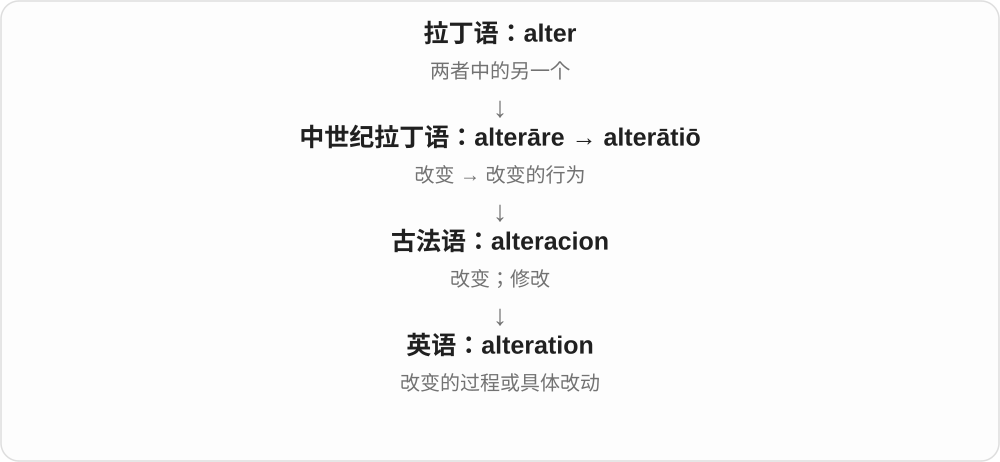

一个名词把动作变成可数的改动：make a few alterations，就是做几处修改。衣服店里的 alterations 常直接指改衣服务。

**常见搭配与例句**

make alterations to…；minor alterations；clothing alterations。

> The jacket needs a few minor alterations.

这件夹克需要做几处小修改。

> No alteration to the design is necessary.

这个设计无需改动。

**别混淆**

alteration 是改动，不一定是改进；improvement 才明确表示变得更好。

### 111. visualization — 可视化；在脑中形成画面

**音标**：英 /ˌvɪʒuəlaɪˈzeɪʃən/；美 /ˌvɪʒuələˈzeɪʃən/

**先抓住这个画面**

visualization 是把数字、关系或想象变成一幅能看懂的图景，让你不必只盯着抽象符号。

**怎么拆**

visualize + -ation，表示形成图像的过程或结果。

**怎么变成今天的意思**

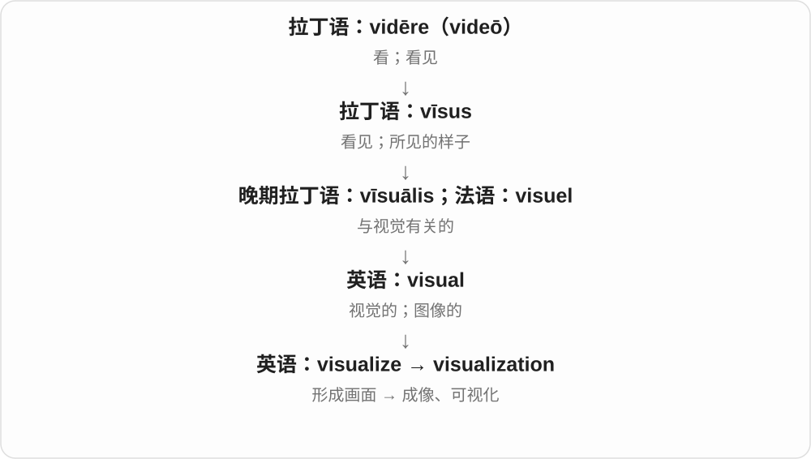

既可指数据图，也可指在心里排演一个场景。图形有助于理解，但仍要看它如何选取和呈现信息。

**常见搭配与例句**

data visualization；a visualization of the process；mental visualization。

> The visualization makes the seasonal pattern easy to see.

这幅可视化图让季节性规律一目了然。

> She used visualization to rehearse the performance in her mind.

她用想象画面的方式在脑中排练演出。

**别混淆**

visualization 强调把内容转成图像；illustration 也能是装饰或具体插图，范围不完全相同。

### 112. aspiration — 志向；愿望；送气〔语音〕；抽吸、误吸〔医学〕

**音标**：/ˌæspəˈreɪʃən/

**先抓住这个画面**

日常是向往更高目标；专业语境则回到气流、吸入和抽出的动作。

**怎么拆**

接拉丁 aspiratio、aspirare 及相关借入路线。英语早期已有呼气、语音用义，志向义随后发展；不应把专业名词都画成后来英语 aspirate 动词的产物。

**怎么变成今天的意思**

**拉丁语 spirare**  
吹气、呼吸；更远词源未定

↓

**拉丁语 aspirare → aspiratio；英语早期 aspiration**  
吹气 → 呼吸、语音送气等义

↓

**英语 aspiration 的多条发展**  
志向；语音送气；医学抽吸或误吸

career aspirations 是职业志向。语音学 aspiration 指某些辅音释放后的一股气；医学里可指抽取液体或组织，也可指食物、液体误入气道。后两种需要上下文分辨。

**常见搭配与例句**

career aspirations；aspirations for the future；needle aspiration。

> Her aspirations changed as she gained more experience.

随着经验增加，她的志向也发生了变化。

> English “pin” usually begins with an audible burst of aspiration.

英语 pin 开头通常带有可听出的送气。

> The clinician explained that aspiration here meant drawing out a fluid sample.

医生解释说，这里的 aspiration 指抽取液体样本。

**别混淆**

aspiration 的志向义不等于一般 appetite“胃口”；医学抽吸是操作，误吸是物质进入错误通道，不能互译。

### 113. stabilization — 稳定过程；使稳定的措施

**音标**：/ˌsteɪbəlaɪˈzeɪʃən/

**先抓住这个画面**

把晃动压下去、把波动控制住的过程，作为一个整体来谈，就是 stabilization。

**怎么拆**

stabilize + -ation，去掉结尾 e 后形成名词；英式也写 stabilisation。

**怎么变成今天的意思**

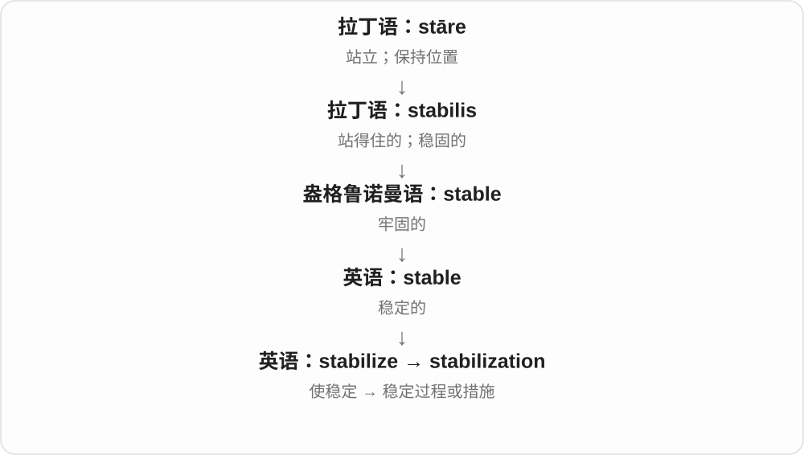

它强调从不稳走向较稳的行动或变化。图像稳定、电压稳定、边坡加固都可按具体对象使用。

**常见搭配与例句**

image stabilization；voltage stabilization；soil stabilization。

> The camera includes image stabilization.

这台相机具有图像稳定功能。

> The project includes stabilization of the riverbank.

这个项目包括河岸加固工程。

**别混淆**

stability 是稳定性，stabilization 是取得稳定的过程；有措施不等于结果已完全稳定。

### 114. specialize — 专门从事；专攻

**音标**：/ˈspeʃəlaɪz/

**先抓住这个画面**

specialize 像从一棵大树选一条枝干继续深挖：领域变窄，知识和服务变深。

**怎么拆**

special + -ize，构成“使专门化、专门从事”的动词；英式也拼 specialise。

**怎么变成今天的意思**

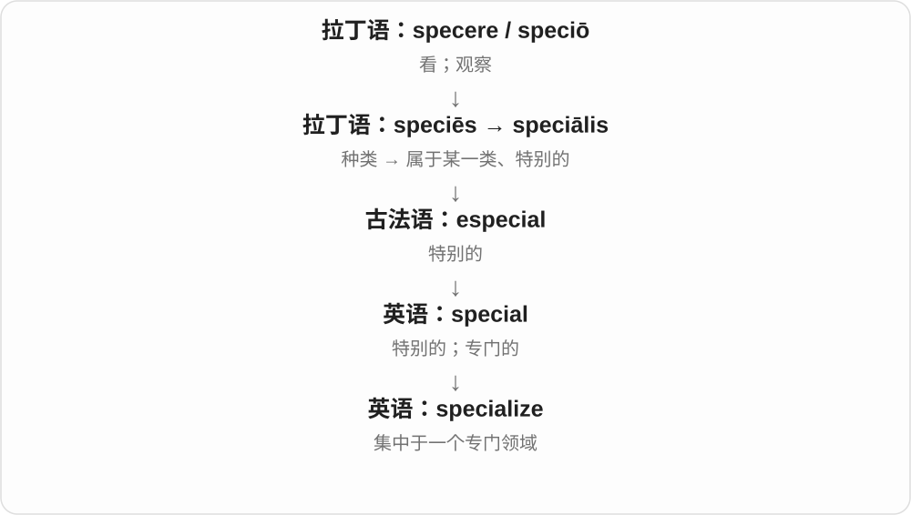

人可以专攻某学科，商店可以专营某类商品。常接 in，后面说明专注的领域。

**常见搭配与例句**

specialize in medicine；specialize in repairs；highly specialized。

> The shop specializes in old maps.

这家店专卖旧地图。

> She plans to specialize in environmental law.

她计划专攻环境法。

**别混淆**

know something 是有所了解；specialize in 通常意味着持续专门从事。

### 115. specialization — 专门化、专业化；专业方向

**音标**：英 /ˌspeʃəlaɪˈzeɪʃən/；美 /ˌspeʃələˈzeɪʃən/

**先抓住这个画面**

不再什么都平均做，而是把知识、技能集中到一个领域，是 specialization。也能把那个重点领域本身叫 a specialization。

**怎么拆**

specialize 去 e 加 -ation；special 专门的、特殊的经 -ize 动词形式，再形成过程、领域名词。

**怎么变成今天的意思**

**special → specialize**  
专门的 → 专攻、专门从事

↓

**specialize + -ation → specialization**  
专业化过程；专门领域

a specialization in history 历史专业方向；professional specialization 职业专业化；division of labour and specialization 分工与专业化。

**常见搭配与例句**

a specialization in；professional specialization。

> Her specialization is medieval history.

她的专业方向是中世纪历史。

> The company encouraged greater specialization within the team.

公司鼓励团队内部进一步专业分工。

**别混淆**

specialization 是集中某一方向，expertise 是已经具备的专业知识、能力；选定方向不自动表示已成专家。

### 116. privatization — 私有化；由公营转为私人经营的过程

**音标**：英、美 /ˌpraɪvətaɪˈzeɪʃən/

**先抓住这个画面**

讨论的不是某一家企业今天的状态，而是控制权从公共部门转往私人部门的整个变化。

**怎么拆**

private + -ization；二十世纪政策用语传播与德语 Privatisierung 等术语有关。该名词在现代政策义中早于常见动词 privatize，后者常按反构解释。

**怎么变成今天的意思**

**拉丁语 privus → privare / privatus**  
单独的、个人的 → 分开、剥去；与公共部分分开的

↓

**拉丁语 privatus → 英语 private**  
属于个人的、非公共的；私下的

↓

**英语 private + -ization → privatization**  
使成为私人的过程；现代政策词也有德语相关术语影响

可以说 privatization of a company，也可讨论某种服务的私营化。词本身描述变化方向，不自动说明效果好坏或方案是否完整。

**常见搭配与例句**

a privatization plan；partial privatization；the process of privatization。

> The report compares several models of privatization.

报告比较了几种私有化模式。

> Workers asked how privatization would affect their contracts.

员工询问私有化会怎样影响他们的合同。

**别混淆**

private 是已有的私人性质；privatization 是变为私人所有或经营的过程。

### 117. mobilize — 动员、调集；组织起来行动

**音标**：英 /ˈməʊbəlaɪz/；美 /ˈmoʊbəlaɪz/

**先抓住这个画面**

人力、钱、支持原来各在一处，你把它们组织起来投入某项行动，就是 mobilize。军队动员是其中一类，社区清理街道也能用。

**怎么拆**

借法语 mobiliser，与 mobile 可移动的及 -ize 对应；从使可动走向把资源实际调动起来。

**怎么变成今天的意思**

**法语 mobile 可移动的 → mobiliser、mobilisation**  
把人员、资源组织得可以行动

↓

**英语 mobilize／mobilise 与相应名词**  
调动、动员；可用于军队及普通社会行动

mobilize support 动员支持；mobilize resources 调集资源；mobilize volunteers 动员志愿者。

**常见搭配与例句**

mobilize support；mobilize resources。

> The group mobilized volunteers to clean the beach.

团体动员志愿者清理海滩。

> The team quickly mobilized the necessary resources.

团队迅速调集了必要资源。

**别混淆**

mobilize 强调组织行动，motivate 强调激发意愿；有意愿的人仍可能需要被组织、调集。

### 118. mobilization — 动员；资源调集、组织行动

**音标**：英 /ˌməʊbəlaɪˈzeɪʃən/；美 /ˌmoʊbələˈzeɪʃən/

**先抓住这个画面**

mobilize 是让人、资源动起来，mobilization 则把这一整套准备、组织、投入行动的过程拿来讨论。

**怎么拆**

接法语 mobilisation，或由 mobilize 去 e 加 -ation；保留 mobile 可动的词族材料。

**怎么变成今天的意思**

**法语 mobile 可移动的 → mobiliser、mobilisation**  
把人员、资源组织得可以行动

↓

**英语 mobilize／mobilise 与相应名词**  
调动、动员；可用于军队及普通社会行动

↓

**mobilize + -ation → mobilization**  
人员、资源被组织并调动的过程

the mobilization of resources 资源调集；military mobilization 军事动员；community mobilization 社区动员。

**常见搭配与例句**

the mobilization of；community mobilization。

> The response required rapid mobilization of resources.

应对工作需要迅速调集资源。

> The study examines community mobilization after the flood.

研究考察洪水过后的社区动员。

**别混淆**

mobilization 是组织和调动，movement 可以泛说运动、移动；一次物体位移未必涉及动员。

### 119. mobilisation — 动员、调集〔mobilization 的常见英式拼写〕

**音标**：/ˌməʊbəlaɪˈzeɪʃən/

**先抓住这个画面**

沿 mobilise 的拼写把动作变成名词，就是 mobilisation。可谈人，也可谈物资、社会支持。

**怎么拆**

接法语 mobilisation，现代对应 mobilise 去 e 加 -ation；与 mobilization 是同词的拼写变体。

**怎么变成今天的意思**

**法语 mobile 可移动的 → mobiliser、mobilisation**  
把人员、资源组织得可以行动

↓

**英语 mobilize／mobilise 与相应名词**  
调动、动员；可用于军队及普通社会行动

↓

**mobilise + -ation → mobilisation**  
动员与资源调集的过程

resource mobilisation 资源调集；the mobilisation of volunteers 志愿者动员；social mobilisation 社会动员。

**常见搭配与例句**

resource mobilisation；the mobilisation of。

> The plan depends on the mobilisation of local volunteers.

计划依靠动员当地志愿者。

> Resource mobilisation took longer than expected.

资源调集比预期花了更长时间。

**别混淆**

mobilisation 的 s 不表示规模更小，也不表示只限民用；含义仍由修饰语和上下文决定。

### 120. mobilise — 动员、调集〔mobilize 的常见英式拼写〕

**音标**：/ˈməʊbəlaɪz/

**先抓住这个画面**

把支持者、资源组织起来行动，仍是同一个动词。mobilise 的 s 主要反映拼写习惯，不改变动员这个画面。

**怎么拆**

法语 mobiliser 的相关借词形式，英语常写 mobilise 或 mobilize；-ise 与 -ize 是这一词族的对应拼写。

**怎么变成今天的意思**

**法语 mobile 可移动的 → mobiliser、mobilisation**  
把人员、资源组织得可以行动

↓

**英语 mobilize／mobilise 与相应名词**  
调动、动员；可用于军队及普通社会行动

mobilise resources 调动资源；mobilise support 动员支持；mobilise a team 组织团队行动。

**常见搭配与例句**

mobilise resources；mobilise support。

> The campaign mobilised support across the region.

活动在整个地区动员起了支持。

> Local groups mobilised to help the residents.

当地团体组织起来帮助居民。

**别混淆**

mobilise 不只出现在战争新闻里；社会组织、企业、社区也常调动资源。

### 121. immobilize — 使不能动；使停止活动

**音标**：英 /ɪˈməʊbəlaɪz/；美 /ɪˈmoʊbəlaɪz/

**先抓住这个画面**

immobilize 是把还能动的东西限制住，让它不能继续移动或行动。

**怎么拆**

来自法语 immobiliser；现代可分析为 immobile + -ize，英式也拼 immobilise。

**怎么变成今天的意思**

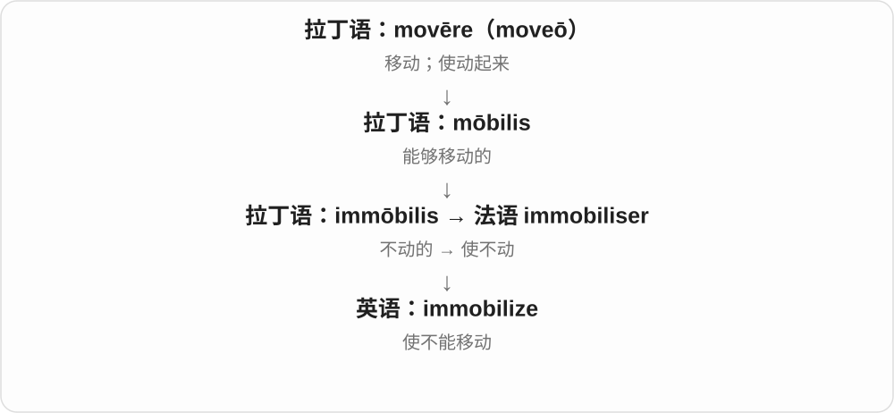

可形容设备被故障卡住、交通被天气阻断，也可用于身体固定的描述。

**常见搭配与例句**

immobilize a vehicle；be immobilized by；immobilize a joint。

> The heavy snow immobilized several vehicles.

大雪使几辆车无法行驶。

> The locking mechanism immobilizes the wheel.

锁定机构让轮子不能转动。

**别混淆**

immobile 是状态，immobilize 是使进入这种状态的动作。

### 122. immobilization — 固定；使不能移动；限制活动

**音标**：英 /ɪˌməʊbɪlaɪˈzeɪʃən/；美 /ɪˌmoʊbələˈzeɪʃən/

**先抓住这个画面**

把原本能动的部分固定住，或让车辆无法移动，这种使不动的过程、状态是 immobilization。

**怎么拆**

immobilize 去 e 加 -ation；im- 不与 mobil- 可移动的材料，再接动词、名词尾。也与法语 immobilisation 相应。

**怎么变成今天的意思**

**im- + mobile 等 → immobilize**  
使不能移动、固定

↓

**immobilize + -ation → immobilization**  
固定过程；活动受到限制的状态

temporary immobilization 暂时固定；vehicle immobilization 车辆锁止；prolonged immobilization 长时间固定、活动受限。

**常见搭配与例句**

temporary immobilization；prolonged immobilization。

> The device allows temporary immobilization of the vehicle.

装置可暂时使车辆无法移动。

> The report discusses prolonged immobilization after injury.

报告讨论受伤后的长时间固定。

**别混淆**

immobilization 是使不动，mobilization 是动员、使动起来；im- 在这里起否定作用，关注点相反。

### 123. localize — 使本地化；定位；限制在局部

**音标**：英 /ˈləʊkəlaɪz/；美 /ˈloʊkəlaɪz/

**先抓住这个画面**

让东西适合某个地方，也可以把问题找准或控制在某一小块地方。

**怎么拆**

local + -ize；英语构词，并可参照法语 localiser。英式也写 localise。

**怎么变成今天的意思**

**拉丁语 locus**  
地方、位置

↓

**后期拉丁语 localis；法语 local → 中古英语 local**  
属于某地的 → 当地的

↓

**英语 local + -ize → localize**  
使与某地相适合；确定或限制所在处

localize an app 不只是逐字翻译，还可能调整货币、日期和文化表达；localize the fault 则是缩小范围、找到故障位置。

**常见搭配与例句**

localize software；localize the source；localized pain。

> The team localized the app for Spanish-speaking users.

团队为西班牙语用户对应用作了本地化调整。

> The tests helped localize the fault to one circuit.

测试帮助把故障定位到一条电路。

**别混淆**

translate 主要转换语言；localize 为一个地区调整整个使用体验。

### 124. localization — 本地化；定位；局部化

**音标**：英 /ˌləʊkəlaɪˈzeɪʃən/；美 /ˌloʊkələˈzeɪʃən/

**先抓住这个画面**

把产品改得适合当地语言、习惯，是 localization；确定声音、物体在哪里，则是定位。共同材料是 local 某个地方、局部。

**怎么拆**

localize 去 e 加 -ation，接 local 地方的、局部的。不同领域把使与某地相联系具体化为适配、定位、局限。

**怎么变成今天的意思**

**local → localize**  
地方、局部相关 → 使适应当地、确定位置等

↓

**localize + -ation → localization**  
本地化过程；定位或局部化

software localization 软件本地化；sound localization 声源定位；the localization of production 生产本地化。

**常见搭配与例句**

software localization；sound localization。

> The company invested in software localization.

公司投入资源做软件本地化。

> The experiment tests sound localization.

实验测试声源定位能力。

**别混淆**

localization 常比 translation 翻译范围宽，还可涉及格式、文化习惯；声源定位义又是另一具体分支。

### 125. lament — 哀叹、悲叹；哀歌、悲叹的话

**音标**：/ləˈment/

**先抓住这个画面**

把“真可惜，失去了”带着悲伤说出来，就是 lament。它既能为逝者哀哭，也能书面地惋惜旧事物的消失。

**怎么拆**

动词可能从 lamentation 逆构，也有法语、拉丁借入分析；拉丁 lamentum 更远或接拟声的呼喊材料与 -mentum。现代不能硬拆成 lam + -ent。

**怎么变成今天的意思**

**拉丁 lamentum → lamentari；法语相应形式 → 英语 lamentation**  
哀哭、哀叹；名词在英语的记录较早

↓

**英语 lament 动词；名词另有法语、拉丁借入路线**  
动词有从 lamentation 逆构，或法语、拉丁借入的分析

lament the loss of... 是哀叹失去某人、某物；a lament for... 是为某人、某事写的哀歌、悲叹。

**常见搭配与例句**

lament the passing of an era 感叹一个时代的逝去；a musical lament 一曲哀歌。

> Many residents lament the loss of the old theatre.

许多居民惋惜老剧院的消失。

> The song is a lament for a lost home.

这首歌是一曲怀念失去家园的哀歌。

**别混淆**

grieve 常突出内心悲痛，lament 常突出把哀伤、惋惜说出或唱出；两者可以描写同一次失去。

### 126. lamented — 哀叹、惋惜了；受到哀悼的

**音标**：/ləˈmentɪd/

**先抓住这个画面**

过去为某种失去叹惋，用 lamented；说一位大家都怀念的逝者，也可形容为 much lamented。

**怎么拆**

lament + 完整 -ed，/t/ 后读 /ɪd/。从哀叹动词的分词，还能形成受到悼念的形容词用途。

**怎么变成今天的意思**

**拉丁 lamentum → lamentari；法语相应形式 → 英语 lamentation**  
哀哭、哀叹；名词在英语的记录较早

↓

**英语 lament 动词；名词另有法语、拉丁借入路线**  
动词有从 lamentation 逆构，或法语、拉丁借入的分析

↓

**lament + -ed → lamented**  
过去哀叹 → 受到哀悼、惋惜的

lamented the loss 是惋惜失去，much lamented 是深受哀悼、怀念的，后者语气较正式。

**常见搭配与例句**

lamented the closure 惋惜关闭；lamented his absence 感叹他不在。

> They lamented the closure of the village school.

他们惋惜村里学校的关闭。

> She lamented how little time they had spent together.

她感叹他们相处的时间竟那么少。

**别混淆**

lamented 作前置形容词可说被怀念的人，不能只因 -ed 就认定描述本人正在感到悲伤。

### 127. laments — 哀叹、惋惜〔第三人称单数〕；哀歌、悲叹〔复数〕

**音标**：/ləˈments/

**先抓住这个画面**

一个人说着某种失去多么可惜，叫 laments；几首哀歌、几段悲叹，也能用同样的名词复数。

**怎么拆**

lament + -s，/t/ 后读 /s/。基础名词、动词的借词与逆构历史分别保留，现代两种词性再各加复数、三单词尾。

**怎么变成今天的意思**

**拉丁 lamentum → lamentari；法语相应形式 → 英语 lamentation**  
哀哭、哀叹；名词在英语的记录较早

↓

**英语 lament 动词；名词另有法语、拉丁借入路线**  
动词有从 lamentation 逆构，或法语、拉丁借入的分析

↓

**lament + -s → laments**  
他、她惋惜；几首哀歌、几段悲叹

laments the lack of time 是感叹时间不够；traditional laments 是传统哀歌。

**常见搭配与例句**

laments the change 惋惜变化；laments for the dead 为逝者唱的哀歌。

> She laments the disappearance of the old bookshops.

她惋惜那些老书店的消失。

> The collection includes several traditional laments.

这部选集中有几首传统哀歌。

**别混淆**

laments 往往是带悲伤、惋惜的表达；complains 可以侧重不满、要求改变，语气和目的可能不同。

### 128. lamenting — 正在哀叹、惋惜；表达悲伤的活动

**音标**：/ləˈmentɪŋ/

**先抓住这个画面**

一边回想失去的东西，一边说“太可惜了”，就是 lamenting。它常把惋惜变成听得见的话。

**怎么拆**

lament + 完整 -ing，直接相接。英语动词的借入或逆构先形成，现代词尾再标明过程、活动。

**怎么变成今天的意思**

**拉丁 lamentum → lamentari；法语相应形式 → 英语 lamentation**  
哀哭、哀叹；名词在英语的记录较早

↓

**英语 lament 动词；名词另有法语、拉丁借入路线**  
动词有从 lamentation 逆构，或法语、拉丁借入的分析

↓

**lament + -ing → lamenting**  
表达哀叹、惋惜的过程

lamenting the loss of... 是哀叹某种失去；lamenting that... 后说感叹的内容。

**常见搭配与例句**

lamenting the change 惋惜变化；lamenting the lack of time 感叹时间不够。

> He sat by the window, lamenting the changes in his old neighbourhood.

他坐在窗边，感叹老街区的变化。

> She was lamenting that the summer had passed so quickly.

她正感叹夏天过得太快。

**别混淆**

lamenting 强调表达伤感，remembering 只说明回想、记得；回忆可以愉快，也可以悲伤。

### 129. lamentations — 阵阵哀哭；一篇篇、一段段悲叹

**音标**：/ˌlæmənˈteɪʃənz/，也 /ˌlæmɪnˈteɪʃənz/

**先抓住这个画面**

悲叹不是一声就结束，而是一阵阵哭诉、一段段伤感表达，可以叫 lamentations。

**怎么拆**

lamentation + -s，/n/ 后读 /z/。先有借来的哀叹名词，再以现代规则复数数出多段表达。

**怎么变成今天的意思**

**拉丁 lamentum → lamentari；法语相应形式 → 英语 lamentation**  
哀哭、哀叹；名词在英语的记录较早

↓

**英语 lament 动词；名词另有法语、拉丁借入路线**  
动词有从 lamentation 逆构，或法语、拉丁借入的分析

↓

**lamentation + -s → lamentations**  
若干次、若干段哀叹

lamentations over the loss 是为失去而发的阵阵悲叹；也可在文学叙事中写葬礼的哭声。

**常见搭配与例句**

loud lamentations 阵阵大声哀哭；repeated lamentations 反复的哀叹。

> Their lamentations could be heard from the courtyard.

院子里能听见他们阵阵哀哭。

> The letters are full of lamentations over the passing of the old days.

这些信满是对旧日逝去的悲叹。

**别混淆**

laments 与 lamentations 都能指悲叹，laments 还常数哀歌；后者通常更正式、铺陈，不必在普通难过场景硬用。

### 130. lamentation — 哀叹、恸哭；一段悲叹

**音标**：/ˌlæmənˈteɪʃən/，也 /ˌlæmɪnˈteɪʃən/

**先抓住这个画面**

把哀伤喊出来、哭出来，或用一段话表达出来，这件事叫 lamentation。语气比日常 sadness 更正式，也更着重表达。

**怎么拆**

经法语 lamentation、拉丁 lamentatio 借入；现代对应 lament + -ation，但英语名词记录早于 lament 动词，不能把学习顺序当成历史顺序。

**怎么变成今天的意思**

**拉丁 lamentum → lamentari；法语相应形式 → 英语 lamentation**  
哀哭、哀叹；名词在英语的记录较早

↓

**英语 lament 动词；名词另有法语、拉丁借入路线**  
动词有从 lamentation 逆构，或法语、拉丁借入的分析

↓

**法语、拉丁名词 → 中古英语 lamentacioun → lamentation**  
哀叹、哀哭的行为或表达

a cry of lamentation 是一声哀哭，a lamentation over... 是对某事的悲叹。

**常见搭配与例句**

loud lamentation 大声哀哭；a song of lamentation 一首悲叹之歌。

> A cry of lamentation rose from the crowd.

人群中响起一声哀哭。

> The poem is a lamentation over the loss of a way of life.

这首诗哀叹一种生活方式的消失。

**别混淆**

lamentation 是活动、表达的名词，lament 还可作动词；长词不一定在英语里比短词晚出现。

### 131. fragmentation — 碎片化；分裂；零散分布

**音标**：/ˌfræɡmenˈteɪʃən/

**先抓住这个画面**

一个整体被分开，结果变得难以衔接或统一。

**怎么拆**

fragment 动词加 -ation，形成过程、状态名词。不是古代拉丁词直接等于现代计算机术语。

**怎么变成今天的意思**

**拉丁 frangere，分词 frāctus**  
打碎、折断；被打断的

↓

**拉丁 fragmentum → 法语或英语 fragment**  
破开后留下的一块；片段

↓

**英语 fragment + -ation → fragmentation**  
分成碎块的过程或状态

habitat fragmentation 是栖息地被道路等切成孤立的块；信息和市场也能 fragmentation。计算机里通常谈数据或空间分成零散片段，具体含义取决于系统。

**常见搭配与例句**

habitat fragmentation；market fragmentation；data fragmentation。

> New roads have increased habitat fragmentation in the region.

新建道路加剧了这一地区栖息地的分割。

> The company wants to reduce the fragmentation of its customer data.

公司希望减少客户数据分散在各处的情况。

**别混淆**

division 可以是有计划地分工；fragmentation 常强调分散后整体联系受损。

### 132. segmentation — 分段；分割；细分

**音标**：/ˌseɡmenˈteɪʃən/

**先抓住这个画面**

先找出内部边界，再让各部分分别接受分析或处理。

**怎么拆**

segment + -ation；把“分成若干段”变成过程名称。

**怎么变成今天的意思**

**拉丁 secāre；分词 sectus**  
切、割；切开的

↓

**拉丁 segmentum → 英语 segment**  
切下的一条、一块 → 部分、分段

↓

**英语 segment 由名词发展动词**  
把整体划分成若干段或群体

↓

**英语 segment + -ation → segmentation**  
把整体分段、分组的过程

market segmentation 是把市场按需求等标准细分；image segmentation 是把图像中不同区域或对象区分出来。它不是随便切成同样大小的格子，分法取决于目的。

**常见搭配与例句**

market segmentation；customer segmentation；image segmentation；segmentation criteria。

> Good market segmentation starts with clear criteria.

好的市场细分要从清楚的标准开始。

> The software uses image segmentation to separate the object from the background.

软件用图像分割把物体与背景区分开。

**别混淆**

classification 给对象判类别；segmentation 还强调把整体划出不同区域或群体。两者可以结合，但不是每个任务都相同。

### 133. deforestation — 森林砍伐、毁林；失去森林覆盖的过程

**音标**：英 /diːˌfɒrɪˈsteɪʃən/；美 /diːˌfɔːrɪˈsteɪʃən/

**先抓住这个画面**

把森林成片变没这件事作为过程、现象来谈；不只是今天某个人砍了一根枝条。

**怎么拆**

deforest + -ation，名词命名森林覆盖被清除的过程。重音落在 -sta- 处，不能照 deforest 原重音直接拖尾。

**怎么变成今天的意思**

**中世纪拉丁 forestis → 古法语 forest → 中古英语 forest → forest**  
林地、狩猎保留地等 → 森林

↓

**deforest + -ation → deforestation**  
森林消失、被清除的过程

the rate of deforestation 森林砍伐速度，reduce deforestation 减少毁林，causes of deforestation 毁林原因。

**常见搭配与例句**

the rate of deforestation；reduce deforestation；causes of deforestation。

> The report tracks deforestation over twenty years.

报告追踪了二十年的森林减少情况。

> The class discussed the causes of deforestation.

课堂讨论了毁林的原因。

**别混淆**

deforestation 森林减少或被改作其他用途的过程，forestry 林业领域；两者不是负面与正面的同一个后缀变形。

### 134. stagnation — 停滞；萧条；不流动

**音标**：/stæɡˈneɪʃən/

**先抓住这个画面**

把长时间没有推进这一状态当成一个整体问题来看。

**怎么拆**

英语 stagnate 配 -ion 的动作、状态名词，底层是拉丁 stagnare 静水不流。现代常用于经济、职业或机构发展。

**怎么变成今天的意思**

**拉丁 stagnum 静水、池 → stagnare 形成静水、不流动**  
水不再流动，成为发展停住的画面

↓

**拉丁 stagnatus → 英语 stagnate**  
停止流动；后来指不再发展

↓

**英语 stagnate → stagnation**  
停止流动，进而指长期缺少发展

economic stagnation 是经济增长长期乏力；creative stagnation 是创作上没有新变化。通常不可数，不把一次小停顿就夸成长期停滞。

**常见搭配与例句**

economic stagnation；years of stagnation；break out of stagnation。

> The region faced years of economic stagnation.

这个地区经历了多年的经济停滞。

> A change of leadership helped the organisation escape stagnation.

领导层的变动帮助这个组织走出了停滞。

**别混淆**

recession 通常说经济活动收缩，stagnation 更强调不增长或缺少动力。stability 可以是理想状态，stagnation 常带不满。

### 135. infest — 大量侵扰、寄生〔害虫、鼠类等〕

**音标**：/ɪnˈfest/

**先抓住这个画面**

不是偶然飞进一只虫，而是某种不受欢迎的生物大量盘踞、侵扰一个地方，是 infest。

**怎么拆**

经法语接拉丁 infestare 侵扰，基础 infestus 敌对的；更远来源未定。现代尤其用来描述害虫等大量存在。

**怎么变成今天的意思**

**拉丁 infestus 敌对的 → infestare → 法语 infester**  
攻击、侵扰

↓

**英语 infest → infestation**  
害虫等大量侵扰、寄生；侵扰状态

rats infest a building 鼠类盘踞建筑；a house infested with insects 虫害严重的房屋；常见被动 be infested with。

**常见搭配与例句**

be infested with；infest a building。

> Mice had infested the old warehouse.

旧仓库里鼠患严重。

> The cupboard was infested with moths.

柜子里蛾患严重。

**别混淆**

infest 常说害虫等侵扰场所、宿主，infect 是感染；食品厂有鼠患与人体遭感染，英语用词角度不同。

### 136. infestation — 虫害、鼠患等；大量寄生、侵扰

**音标**：/ˌɪnfesˈteɪʃən/

**先抓住这个画面**

infest 是大量盘踞、侵扰，infestation 是已经形成的这种问题、状态。具体是什么侵扰，要看 of 或修饰语。

**怎么拆**

经法语接晚期拉丁 infestatio，现代对应 infest + -ation；不是 inflammation 炎症的另一种拼写。

**怎么变成今天的意思**

**拉丁 infestus 敌对的 → infestare → 法语 infester**  
攻击、侵扰

↓

**英语 infest → infestation**  
害虫等大量侵扰、寄生；侵扰状态

↓

**infestatio → infestation**  
大量侵扰、寄生的状态或事件

an infestation of mice 鼠患；an insect infestation 虫害；signs of infestation 大量侵扰的迹象。

**常见搭配与例句**

an infestation of；signs of infestation。

> The house had an infestation of mice.

房子里有鼠患。

> The inspection found signs of insect infestation.

检查发现了虫害迹象。

**别混淆**

infestation 与 infection、inflammation 是三件不同的事：大量侵扰、感染、炎症，要按对象和上下文区分。

### 137. reclamation — 土地开垦、整治或填海；回收利用；收回

**音标**：英、美 /ˌrekləˈmeɪʃən/

**先抓住这个画面**

把原先难以利用、已经废弃或失去控制的东西，经过处理重新纳入使用。

**怎么拆**

经古法语 réclamacion 及拉丁语 reclāmātiō 借入。它与 reclaim 同族，历史上不是英语先有 reclaim 再简单加 -ation。

**怎么变成今天的意思**

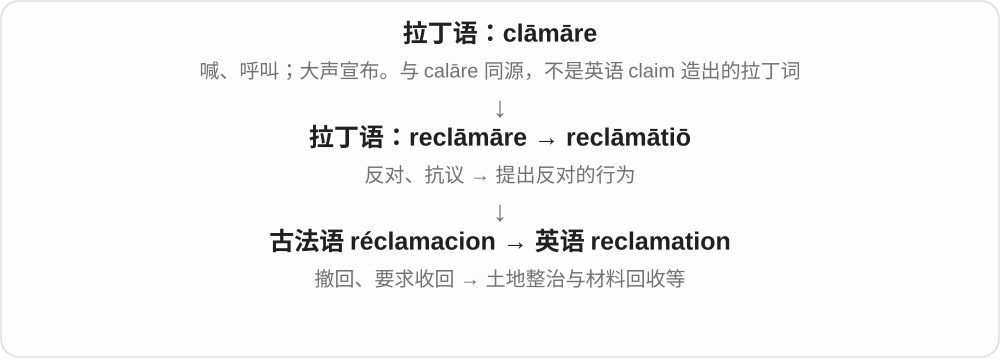

land reclamation 可以是土地整治或填海造地，译法要看场景；water reclamation 是处理废水以便再用。核心是变得可用，不保证恢复成历史原貌。

**常见搭配与例句**

land reclamation；water reclamation；a reclamation project。

> The reclamation project turned the former mine into a park.

这项土地整治工程把旧矿区改成了公园。

> Water reclamation reduces the amount of fresh water the factory needs.

废水回用减少了工厂对新鲜水的需求。

**别混淆**

restoration 偏向恢复原貌或功能；reclamation 可以为新用途创造可用条件。

### 138. flotation — 漂浮、浮起；浮选；〔商业〕发行上市

**音标**：英 /fləʊˈteɪʃən/；美 /floʊˈteɪʃən/

**先抓住这个画面**

float 是浮，flotation 把浮起、保持浮起这件事当名词。矿物加工里浮选也借气泡把选中的颗粒带上来；商业里另有发行上市的固定义。

**怎么拆**

float + -ation，形成动作、状态及专业过程名词。另有 floatation 拼法；词尾发音和重音按 /ˈteɪʃən/ 记。

**怎么变成今天的意思**

**古英语 flotian → float**  
浮在水上；与水流、船等旧词族相关

↓

**水上浮着 → 空中轻飘、维持不沉**  
想法也可被提出，让别人考虑

↓

**float + -ation → flotation**  
浮起状态、过程 → 浮选、发行上市等术语

a flotation device 浮力装置，mineral flotation 矿物浮选，a share flotation 股票发行上市。专业词义由所在领域决定。

**常见搭配与例句**

a flotation device；mineral flotation。

> The boat carries flotation devices for emergencies.

船上备有应急浮力装置。

> The plant uses flotation to separate selected minerals.

工厂用浮选分离特定矿物。

**别混淆**

flotation 的浮选不只是随便让所有东西浮起来，而是选择性分离过程；这里不把发行上市直接译成股票在水上漂。

### 139. condensation — 冷凝；凝结的水珠；内容的压缩、精简版

**音标**：英 /ˌkɒndenˈseɪʃən/；美 /ˌkɑːndenˈseɪʃən/

**先抓住这个画面**

冷玻璃上的小水珠，是空气中的水蒸气变成了液态。这个过程和留下的水珠都能叫 condensation；文章语境则是把篇幅压短。

**怎么拆**

现代能看见 condense 与 -ation 的关系；历史来自晚期拉丁 condensatio、condensationem，接 condensare 的分词词干，是独立名词借入。

**怎么变成今天的意思**

**拉丁 densus**  
密、厚、挤在一起的；更早来源未定

↓

**拉丁 condensare → 晚期拉丁 condensatio／condensationem**  
使变密、变紧凑的过程

↓

**英语 condensation**  
冷凝过程及水珠；内容压缩与缩写成果

condensation on a window 是窗上的凝结水。a condensation of a book 可以指书的缩写版。基础相变义不应说成“任何东西变成固体”；化学里还有专门的缩合反应义。

**常见搭配与例句**

condensation on glass；water condensation；a condensation of the original。

> Condensation covered the outside of the cold bottle.

冷饮瓶外面结满了水珠。

> The chapter is a readable condensation of a much longer study.

这一章把一份长得多的研究精简成了便于阅读的内容。

**别混淆**

condensation 是过程，也常指水珠；condensate 更专门指冷凝得到的产物。evaporation 的方向相反，是液体变成气体。

### 140. inhalation — 吸入；吸气

**音标**：/ˌɪnhəˈleɪʃən/

**先抓住这个画面**

把吸进去这件事当作一个过程来谈，尤其常见于烟尘、气体和吸入给药的描述。

**怎么拆**

外形可认出 inhale 与 -ation，但英语名词更早。它接拉丁 inhalare 的分词词干构成行动名词；拉丁原有向……呼气义，在英语中用于吸入。

**怎么变成今天的意思**

**拉丁 halare 呼吸；inhalare 向……呼气**  
拉丁 in- 原有向着、在……上等义；英语这里发展为吸入

↓

**拉丁 inhalare 的分词词干 → 英语 inhalation**  
十七世纪已有吸入义，早于英语动词 inhale

smoke inhalation 是吸入烟雾，inhalation of dust 是吸入粉尘。复数 inhalations 可以逐次计数每一口吸气，通常名词单数则指整个过程。

**常见搭配与例句**

smoke inhalation；inhalation of fumes；by inhalation。

> The report linked the incident to the inhalation of smoke.

报告把这次事故与吸入烟雾联系起来。

> The recording marks each inhalation with a soft sound.

录音用一个轻柔的声音标记每一次吸气。

**别混淆**

inhalation 是气息或物质随呼吸进入；ingestion 是吞食进入消化道。两者不是同一种进入身体的方式。

### 141. neutralize — 中和；抵消、使失去作用

**音标**：英 /ˈnjuːtrəlaɪz/；美 /ˈnuːtrəlaɪz/

**先抓住这个画面**

一种作用被另一种作用抵住，不再像原先那样起效，是 neutralize。可以谈酸碱，也可以谈对手优势、某项因素的影响。

**怎么拆**

接法语 neutraliser，现代对应 neutral 中性的 + -ize；把不偏一方、中性的材料具体化为抵消效力。

**怎么变成今天的意思**

**neutral 中性的、不偏向的 + -ize → neutralize**  
使某种作用被抵消、不再占优势

↓

**法语 neutralisation 等 → neutralization**  
中和；使失去作用的过程

neutralize an acid 中和酸；neutralize an advantage 抵消优势；neutralize a threat 消除威胁。

**常见搭配与例句**

neutralize an acid；neutralize an advantage。

> The experiment shows how the base neutralizes the acid.

实验展示碱如何中和酸。

> Their advantage was neutralized by the new rule.

新规则抵消了他们的优势。

**别混淆**

neutralize 侧重使作用不起效，remove 可能是把对象搬走；抵消效果不必让原有物质、对象完全消失。

### 142. neutralization — 中和；抵消、使失去作用

**音标**：英 /ˌnjuːtrəlaɪˈzeɪʃən/；美 /ˌnuːtrələˈzeɪʃən/

**先抓住这个画面**

neutralize 是抵消作用，neutralization 是中和、消除效力的过程。化学、免疫、策略等领域各有自己的具体对象。

**怎么拆**

借法语 neutralisation，也对应 neutralize 去 e 加 -ation；名词化后可讨论反应、过程及其效果。

**怎么变成今天的意思**

**neutral 中性的、不偏向的 + -ize → neutralize**  
使某种作用被抵消、不再占优势

↓

**法语 neutralisation 等 → neutralization**  
中和；使失去作用的过程

↓

**neutralize + -ation → neutralization**  
中和、抵消效力的过程

acid–base neutralization 酸碱中和；the neutralization of a threat 威胁的消除；a neutralization reaction 中和反应。

**常见搭配与例句**

a neutralization reaction；the neutralization of。

> Neutralization is one type of chemical reaction.

中和是一类化学反应。

> The report describes the neutralization of the threat.

报告描述了威胁如何被消除。

**别混淆**

neutralization 不等于所有对象都恢复成原样；它聚焦作用被抵消，reversal 才更突出过程、状态反转。

### 143. adoration — 崇拜；热爱；敬拜

**音标**：英 /ˌædəˈreɪʃən/；美 /ˌædəˈreɪʃən/

**先抓住这个画面**

不是平平淡淡地喜欢，而是带着仰望、倾慕，目光都被吸住。

**怎么拆**

经法语 adoration 借入晚期拉丁 adoratio／adoration-；与 adore 同族，名词有自己的借入路径。

**怎么变成今天的意思**

**拉丁 ad- 朝向 + orare 恳求、祈祷 → adorare**  
向其祈求 → 敬拜、崇敬

↓

**晚期拉丁 adoratio → 法语 adoration → 英语 adoration**  
敬拜行为 → 崇拜、强烈爱慕

look at someone with adoration 是满眼爱慕地看着某人；the adoration of fans 是粉丝的崇拜。宗教语境仍可指敬拜，普通语境则强调情感强烈。

**常见搭配与例句**

look with adoration；the adoration of fans；an object of adoration。

> The child looked at her older sister with adoration.

小女孩满眼崇拜地看着姐姐。

> The singer seemed uncomfortable with the adoration of the crowd.

那位歌手似乎不太适应人群的狂热崇拜。

**别混淆**

affection 可以温和亲切；adoration 更热烈、带仰慕。adoration 不意味着被爱的一方一定也回报感情。

### 144. dispense — 分发；配发药物；〔dispense with〕省去、不再需要

**音标**：英、美 /dɪˈspens/

**先抓住这个画面**

把东西按份给出去：机器发票，药房配药，人也可以给出建议。加 with 后，则常表示把某一步或某样东西省掉。

**怎么拆**

经古法语 dispenser，接拉丁 dispensare，它是 dispendere“分别称出、花出”的反复式。中世纪这个词族还有准予豁免的用法，帮助理解 dispense with“免去、不用”。

**怎么变成今天的意思**

**拉丁 dis- + pendere → dispendere**  
分别称出、支付

↓

**拉丁反复式 dispensare**  
按份分配、管理；后来也有准予豁免的用法

↓

**古法语 dispenser → 中古英语 dispensen → dispense**  
分配、给予；准予免除的相关用法

↓

**英语 dispense with**  
省去某物或不再需要某人某物

dispense medicine 是配发药物；dispense advice 是给出建议。dispense with the introduction 则是省去开场介绍，with 让常用意思发生明显变化。

**常见搭配与例句**

dispense medicine；dispense advice；dispense tickets；dispense with formalities。

> The machine dispenses a ticket when you press the button.

按下按钮，机器就会出一张票。

> We can dispense with the long introduction and begin the discussion.

我们可以省去冗长的开场，直接开始讨论。

**别混淆**

disperse 是散开，dispense 是分发。dispense something 是给出它；dispense with something 常是省去它。

### 145. dispensation — 特许、豁免；施予、分配；制度、秩序〔正式〕

**音标**：/ˌdɪspenˈseɪʃən/

**先抓住这个画面**

一般规则要求大家都做到，有权决定的人却给某个情况开了特许口子，是 dispensation。另一条用法是把某种资源、正义等施予出去。

**怎么拆**

经法语接拉丁 dispensatio，来自 dispensare 分配、管理，远接 dis- 分开与 pendere 称量。现代分支包含分配、管理安排、特许等。

**怎么变成今天的意思**

**拉丁 dis- + pendere 等 → dispensare、dispensatio**  
称量分派、管理安排

↓

**英语 dispensation**  
施予、分配；特许豁免；特定制度

a special dispensation 特别许可；dispensation from a requirement 免于某要求的特许；the dispensation of justice 司法公正的施行。

**常见搭配与例句**

a special dispensation；dispensation from。

> The student received dispensation from the attendance requirement.

学生获得了免于出勤要求的特许。

> The essay discusses the dispensation of justice.

文章讨论司法公正的施行。

**别混淆**

dispensation 的豁免来自有权作出的特别安排，disobedience 是不服从；一个是特许，一个是违反要求。

### 146. synchronization — 同步；使步调或数据一致

**音标**：英 /ˌsɪŋkrənaɪˈzeɪʃən/；美 /ˌsɪŋkrənəˈzeɪʃən/

**先抓住这个画面**

把两台设备的时间、画面与声音，或两份文件的状态对齐。

**怎么拆**

synchronize + -ation；上接希腊 syn- 一起 + khronos 时间。

**怎么变成今天的意思**

**希腊 khronos**  
时间

↓

**希腊 synkhronos → 英语 synchronize**  
同一时间的 → 使同步

↓

**synchronize + -ation → synchronization**  
同步动作 → 同步过程或状态

音画 synchronization 是嘴形与声音对上；文件 synchronization 是让两处修改后的内容协调一致。具体技术里的实现可能不同，核心学习画面是“两边对上”。

**常见搭配与例句**

file synchronization；audio synchronization；automatic synchronization；a synchronization error。

> Poor synchronization made the voices arrive after the actors moved their lips.

同步不佳导致演员嘴形动了以后声音才传来。

> Automatic synchronization keeps the calendar up to date on both devices.

自动同步让两台设备上的日历都保持最新。

**别混淆**

synchronization 强调协调一致；backup 强调保留可恢复的副本。把文件同步删除，不等于还留着备份。

### 147. causation — 造成结果的过程；因果关系

**音标**：/kɔːˈzeɪʃən/

**先抓住这个画面**

causation 关注“到底是什么让它发生了”。想象你看到一排倒下的骨牌，接着追查第一下推动从哪里来。

**怎么拆**

cause 与名词后缀 -ation 相结合，把“引起”变成可讨论的过程或关系。

**怎么变成今天的意思**

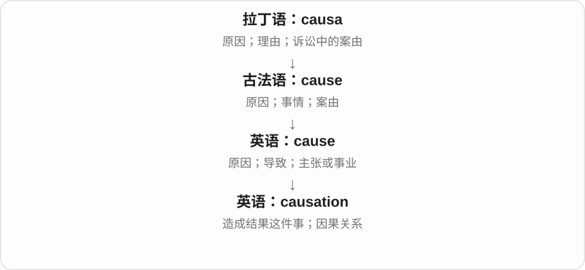

这个词把注意力放在原因怎样产生结果。Correlation does not imply causation 说的是：两个现象一起变化，仍可能受第三个因素影响，不能光凭相伴出现就认定一个造成另一个。

**常见搭配与例句**

establish causation（证明因果关系）；evidence of causation（因果关系的证据）；correlation and causation（相关与因果）。

> The pattern suggests a connection but does not establish causation.

这种规律说明可能有关联，但还不能证明因果关系。

> The experiment was designed to investigate causation.

这项实验旨在研究因果关系。

**别混淆**

correlation 是“变化有联系”；causation 是“一个对另一个产生作用”。两者可以同时存在，却不是同一件事。

### 148. improvisation — 即兴创作；临场应变；临时凑成的办法

**音标**：英 /ˌɪmprəvaɪˈzeɪʃən/；美 /ɪmˌprɑːvəˈzeɪʃən/

**先抓住这个画面**

improvisation 是没有现成脚本时，边做边想出下一步；爵士乐独奏和临时搭雨棚都可能如此。

**怎么拆**

借自法语 improvisation；与 improvise 同族，现代对应 improvise + -ation。

**怎么变成今天的意思**

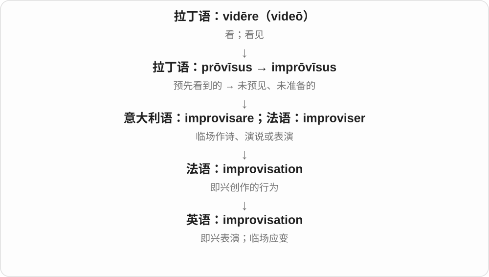

未提前准备的状态，发展出现场创造的活动。即兴可以依赖很强的经验和训练，并不等于胡来。

**常见搭配与例句**

musical improvisation；a piece of improvisation；room for improvisation。

> The performance included several minutes of improvisation.

表演中有几分钟的即兴发挥。

> With no proper tools, the repair required some improvisation.

没有合适的工具，这次修理需要临时想办法。

**别混淆**

improvisation 强调当场产生；preparation 是事先准备。优秀即兴常建立在长期准备上。

### 149. sterilization — 灭菌；绝育〔另一用法〕

**音标**：英 /ˌsterɪlaɪˈzeɪʃən/；美 /ˌsterələˈzeɪʃən/

**先抓住这个画面**

将使无菌或使不能繁殖这件事，作为过程来谈；对象不同，词的中文落点不同。

**怎么拆**

sterilize + -ation，也可认 sterile + -ization；去掉动词末尾 e 再接名词词尾。英式也写 sterilisation。

**怎么变成今天的意思**

**拉丁 sterilis → 法语 stérile → sterile**  
不生育、不结果 → 无产出

↓

**sterile + -ize → sterilize**  
使不能繁殖；医学中使达到无菌状态

↓

**sterilize + -ation → sterilization**  
上述处理的过程、结果

equipment sterilization 设备灭菌，a sterilization process 灭菌过程，surgical sterilization 外科绝育。

**常见搭配与例句**

equipment sterilization；a sterilization process；surgical sterilization。

> The laboratory keeps records of equipment sterilization.

实验室保存设备灭菌记录。

> The chapter discusses sterilization in the history of reproductive medicine.

这一章讨论生殖医学史中的绝育。

**别混淆**

sterilization 不等于所有 cleaning 清洁，也不能一见它就认为是在谈避孕绝育；先看 equipment、surgical 等搭配。

### 150. standardize — 标准化；统一规范或格式

**音标**：英 /ˈstændədaɪz/；美 /ˈstændərdaɪz/

**先抓住这个画面**

大家原来各写各的日期、各量各的尺寸，现在约定同一套规则，让结果能比较、能配合。

**怎么拆**

standard + -ize，形成使符合标准的动词。standardise 是同义拼写；-ize 常见于美式，也用于部分英式规范。

**怎么变成今天的意思**

**standard 的历史旗帜、标杆义 → 通行参照**  
已有基础词精讲，现代作为统一要求或形式

↓

**standard + -ize／-ise；non- + standard**  
使统一到标准；非标准形式

standardize the format 统一格式，standardize measurements 统一测量标准。标准可以是技术要求，也可以是组织约定。

**常见搭配与例句**

standardize the format；standardize measurements；standardize procedures。

> We need to standardize the date format across the database.

我们需要统一整个数据库的日期格式。

> The company standardized its training procedures.

公司统一了培训流程。

**别混淆**

standardize 让一致，improve 改善；一致以后未必每个方面都更好，仍需看采用的标准。

### 151. standardization — 标准化；统一规范

**音标**：英 /ˌstændədaɪˈzeɪʃən/；美 /ˌstændərdəˈzeɪʃən/

**先抓住这个画面**

原来各做各的，尺寸、格式、做法不一致，后来按共同标准对齐，是 standardization。关键是有一个大家能对照的规范。

**怎么拆**

standardize 去 e 加 -ation；standard 标准经 -ize 形成使标准化的动词，再以名词谈过程。

**怎么变成今天的意思**

**standard → standardize**  
标准 → 使符合共同标准

↓

**standardize + -ation → standardization**  
统一标准、规范的过程

the standardization of procedures 流程标准化；data standardization 数据标准化；standardization efforts 标准化工作。

**常见搭配与例句**

the standardization of；data standardization。

> Standardization made the parts easier to replace.

标准化让零件更容易替换。

> The team worked on the standardization of reporting formats.

团队着手统一报告格式。

**别混淆**

standardization 不必把所有内容做得一模一样，可以只统一单位、接口、格式；individual content 仍能不同。

### 152. industrialization — 工业化、工业化过程

**音标**：英 /ɪnˌdʌstriəlaɪˈzeɪʃən/；美 /ɪnˌdʌstriəlɪˈzeɪʃən/

**先抓住这个画面**

把工业逐渐成为生产、经济重要基础的变化过程作为一个现象讨论，可能伴随城市、职业、生活方式变化。

**怎么拆**

与法语 industrialisation 相接，现代可分析 industrial + -ization，或 industrialize 对应的 -ation 名词。不是把英语 industrialize 的完整拼写直接贴上 ation。

**怎么变成今天的意思**

**拉丁 industria → 法语 industriel 等 → industrial**  
勤勉、活动词族 → 劳作的、工业的

↓

**法语 industrialisation、英语相应派生 → industrialization**  
工业发展的转变过程

rapid industrialization 快速工业化，the effects of industrialization 工业化影响，a period of industrialization 工业化时期。

**常见搭配与例句**

rapid industrialization；the effects of industrialization；a period of industrialization。

> Industrialization changed the city’s population and jobs.

工业化改变了城市的人口与就业。

> The course examines the social effects of industrialization.

课程研究工业化的社会影响。

**别混淆**

industrialization 是转变过程，industry 是工业、行业或勤勉等；并非每条行业新闻都是在说工业化进程。

### 153. fertilization — 受精；施肥

**音标**：英 /ˌfɜːtəlaɪˈzeɪʃən/；美 /ˌfɜːrtələˈzeɪʃən/

**先抓住这个画面**

强调那件让生长、繁殖成为可能的过程：给土补肥，或完成生殖细胞的结合。

**怎么拆**

可分析成 fertilize + -ation；历史也可能借自法语 fertilisation。两种分析都在词典中出现。

**怎么变成今天的意思**

**拉丁语：ferre；第一人称 ferō**  
带、承载；承受；生出

↓

**拉丁语：fertilis**  
能生出、产出的；多产的

↓

**法语 fertiliser / fertilisation；英语 fertile → fertilize**  
使肥沃、使受精；两种名词来源分析

↓

**英语：fertilization**  
施肥或受精的过程

农业语境多指施肥，生物学语境多指受精。英国英语也常用 fertilisation。看宾语和领域，比机械固定成一个中文义可靠。

**常见搭配与例句**

soil fertilization；the process of fertilization；after fertilization。

> The lesson compares internal and external fertilization in animals.

这节课比较动物的体内受精和体外受精。

> The study compared two methods of soil fertilization.

研究比较了两种土壤施肥方法。

**别混淆**

fertility 是能力、性质；fertilization 是一次或一类过程。

### 154. importation — 进口；引入过程

**音标**：英 /ˌɪmpɔːˈteɪʃən/；美 /ˌɪmpɔːrˈteɪʃən/

**先抓住这个画面**

importation 把“从外面带进来”作为正式过程来讲。可以是商品进口，也可比喻引入外来的做法或观念。

**怎么拆**

import + -ation，构成动作过程名词。

**怎么变成今天的意思**

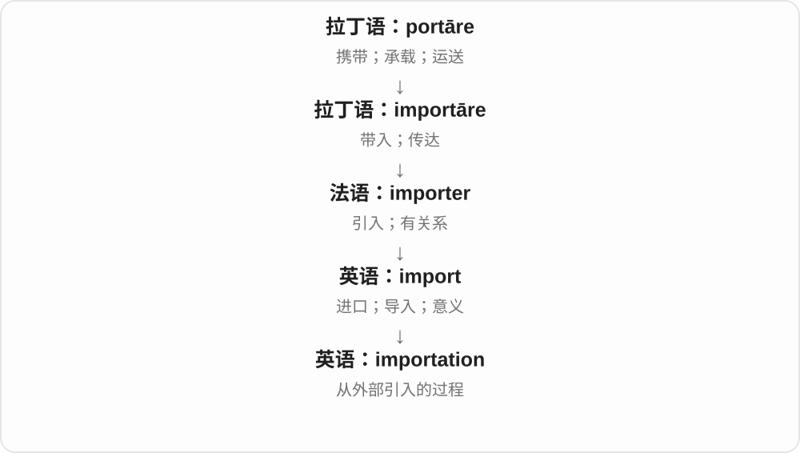

常出现在较正式的制度、贸易或历史文字中。它通常谈引入行为，具体进口商品常用 imports。

**常见搭配与例句**

the importation of goods（货物进口）；the importation of new ideas（新思想的引入）。

> The museum studies the importation of ceramics during that period.

博物馆研究那个时期陶瓷的进口情况。

> The essay discusses the importation of foreign ideas.

文章讨论了外来观念的引入。

**别混淆**

importation 向内，exportation 向外。普通日常表达里 import 常更简洁。

### 155. derivation — 来源、词源形成；派生构词；推导过程

**音标**：/ˌderɪˈveɪʃən/

**先抓住这个画面**

derive 是从哪里来、怎样得出，derivation 就把这条来路或推导步骤拿出来。词源研究看历史，数学看推导，构词学看怎样造新词。

**怎么拆**

经法语 dérivation 接拉丁 dērīvātiō，来自 dērīvāre 的过程名词。现代对应 derive 与 -ation，但名词有平行借入史，不只在英语里现场接词尾。

**怎么变成今天的意思**

**拉丁 dē- 离开 + rīvus 溪流 → dērīvāre**  
把水从原来的河流引出、导向别处

↓

**法语 deriver → 英语 derive**  
从源头而来、取得；后来可由依据推导

↓

**dērīvātiō → 法语 dérivation → derivation**  
引出、导出过程 → 来源、构词派生、推导

the derivation of a word 一个词的来源，a mathematical derivation 数学推导，derivation by suffixation 通过加后缀派生新词。

**常见搭配与例句**

the derivation of a word；a mathematical derivation；derivation by suffixation。

> The dictionary explains the derivation of the word.

词典解释了这个词的来源。

> The appendix gives a step-by-step derivation of the formula.

附录逐步给出了公式的推导。

**别混淆**

derivation 在构词学常指形成新词，walks、walked 这类时态、人称变化通常讨论 inflection 屈折；历史来源解释又不等于每个单词都能按现代英语规则重新造一遍。

### 156. urbanization — 城市化；城镇化

**音标**：英 /ˌɜːbənaɪˈzeɪʃən/；美 /ˌɜːrbənəˈzeɪʃən/

**先抓住这个画面**

把城市人口增长、土地开发和城市生活扩展看作一个变化过程。

**怎么拆**

urbanize + -ation，构成过程名词；英式也写 urbanisation。

**怎么变成今天的意思**

**拉丁语 urbs，属格 urbis**  
城市、城镇；更早来源未定

↓

**拉丁 urbanus 一系 → 英语 urban 与法语 urbain**  
城市的；旧时也含文雅义

↓

**英语 urban + -ize；城市化义也受法语 urbaniser 影响 → urbanize**  
早期有使文雅义，后常指使城市化

↓

**英语 urbanize → urbanization**  
使城市化 → 城市化过程

研究中的 urbanization 常涉及城市人口占比上升，也可谈地区的城市化改造。它不是简单地把所有房屋建高，交通、就业和基础设施也会随之变化。

**常见搭配与例句**

rapid urbanization；the pace of urbanization；patterns of urbanization。

> Rapid urbanization increased demand for housing and public transport.

快速城市化增加了住房和公共交通需求。

> The map shows changing patterns of urbanization over a century.

地图展示了一个世纪以来城市化格局的变化。

**别混淆**

urbanism 常是城市生活、规划理念；urbanization 是成为更城市化社会或地区的过程。

### 157. ionization — 电离；离子化

**音标**：英 /ˌaɪənaɪˈzeɪʃən/；美 /ˌaɪənəˈzeɪʃən/

**先抓住这个画面**

把形成离子的变化当作一个过程来讨论。

**怎么拆**

ionize + -ation；英式也常写 ionisation，重音移到 -zation 的 /zeɪ/。

**怎么变成今天的意思**

**希腊 ienai 去、行进；ion 正在去的东西**  
原本描述移动

↓

**19 世纪科学命名 ion → 英语 ion**  
以电解中的移动命名；现代定义是带净电荷的原子或分子粒子

↓

**英语 ionize → ionization**  
形成离子 → 电离过程

ionization of a gas 是气体电离；ionization energy 在常见化学用法里是从气态粒子移走电子所需的能量。名词强调过程或相关现象。

**常见搭配与例句**

ionization of a gas；ionization energy；the degree of ionization。

> The graph shows how the degree of ionization changes with temperature.

图中显示电离程度如何随温度变化。

> Students compared the first ionization energies of several elements.

学生比较了几种元素的第一电离能。

**别混淆**

ion 是粒子，ionization 是形成离子的过程；不是电离后所有物质都必然带同一种电荷。

### 158. excitation — 激发；兴奋作用；励磁

**音标**：/ˌeksaɪˈteɪʃən/

**先抓住这个画面**

输入刺激或能量，让系统进入更活跃的状态。

**怎么拆**

拉丁 excitātiō，经法语 excitation 借入；不是只在英语 excite 后临时加 -ation。

**怎么变成今天的意思**

**拉丁 ciēre → citāre**  
使动起来、唤起 → 召唤、促动

↓

**拉丁 excitāre → excitātiō → 法语 excitation**  
唤起 → 激发过程

↓

**英语 excitation**  
后来常用于物理、生理、电气等专业语境

光学里 excitation 可指使原子、分子进入激发态；生理学里可指兴奋作用；电机中还可指励磁。都抓“被激起来”，但实际机制各异。

**常见搭配与例句**

optical excitation；excitation energy；excitation of a nerve。

> The experiment used light for excitation of the molecules.

实验用光来激发这些分子。

> The paper compares excitation and inhibition in the neural circuit.

论文比较了神经回路中的兴奋与抑制。

**别混淆**

日常“旅行让我兴奋”通常用 excitement，不用技术感强的 excitation。

### 159. socialization — 社会化；学习社会规范的过程；社交活动

**音标**：英 /ˌsəʊʃəlaɪˈzeɪʃən/；美 /ˌsoʊʃələˈzeɪʃən/

**先抓住这个画面**

一个人不断从家庭、学校和同伴那里学会“大家怎么一起生活”，这是 socialization 的核心画面。

**怎么拆**

socialize + -ation，也可从 social 与 -ization 理解。

**怎么变成今天的意思**

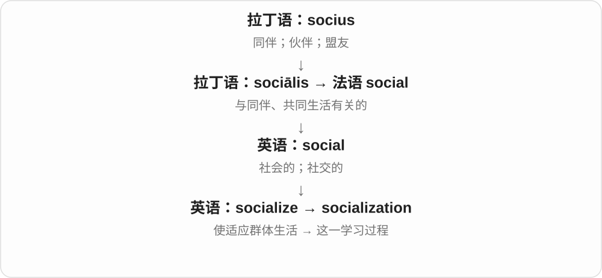

社会学语境强调学习规范、角色与习惯，不只练习聊天。日常用法也可宽泛指人际接触。

**常见搭配与例句**

childhood socialization；peer socialization；opportunities for socialization。

> Peers play a part in children’s socialization.

同伴在儿童社会化过程中发挥作用。

> The club provides opportunities for socialization.

俱乐部提供与人交往的机会。

**别混淆**

education 可以是正式教学；socialization 包含大量没人专门上课、却在生活中学会的规则。

### 160. immunization — 免疫、使获得免疫保护的过程；预防接种〔常见用法〕

**音标**：英 /ˌɪmjʊnaɪˈzeɪʃən/；美 /ˌɪmjənəˈzeɪʃən/

**先抓住这个画面**

把获得保护当作一个过程来看。日常免疫接种活动常用这个词，但它强调的不是针扎进去本身，而是形成相应保护。

**怎么拆**

接法语 immunisation，现代对应 immunize + -ation 或 immune + -ization。immunisation 是常见英式拼写。

**怎么变成今天的意思**

**拉丁 in- 不 + mūnus 义务、公共服务 → immūnis**  
免于某种负担、义务

↓

**法语相关形式 → immune**  
豁免 → 不易受某事影响；医学免疫

↓

**immunize / immunization**  
使产生免疫保护；形成保护的过程

an immunization programme 免疫接种项目，immunization records 预防接种记录，routine immunization 常规免疫接种。

**常见搭配与例句**

an immunization programme；immunization records；routine immunization。

> The school asked parents for their children’s immunization records.

学校请家长提供孩子的预防接种记录。

> The chart summarizes the local immunization programme.

图表概述了当地免疫接种项目。

**别混淆**

vaccination 是接种动作，immunization 是获得相应免疫保护的过程，常被日常近义使用；保护程度不由一个词保证绝对。

### 161. electrification — 电气化；通电、带电过程

**音标**：/ɪˌlektrɪfɪˈkeɪʃən/

**先抓住这个画面**

把“给某地或某行业换上电力”看成一个整体过程：不只是买一台电器，还可能涉及线路、设备与供能方式的改变。

**怎么拆**

英语 electrify 对应的 -fication 动作名词。早期可指带电，现代常指设施、交通或生产过程改用电力。

**怎么变成今天的意思**

**古希腊 elektron → 拉丁 electrum**  
琥珀；摩擦后能吸引轻小物体

↓

**近代拉丁 electricus**  
像琥珀那样具有电性；吉尔伯特在 1600 年用于这一现象

↓

**英语 electric**  
电的、电动的；比喻气氛激动人心

↓

**英语 electric 词基 + -fy → electrify**  
使带电、通电；使兴奋；改用电力

↓

**英语 electrify → electrification**  
使带电的过程 → 电气化、采用电力

rural electrification 是农村通电建设；transport electrification 是交通电气化。它说明用能方式变了，具体发电来源要另外讨论。

**常见搭配与例句**

rural electrification；railway electrification；the electrification of transport。

> Rural electrification changed evening life in the village.

农村通电改变了村里的夜间生活。

> The report estimates the cost of railway electrification.

报告估算了铁路电气化改造的成本。

**别混淆**

electrification 是转向电力的过程；electricity generation 是发电，两者相互关联但不是同一件事。

### 162. normalization — 正常化；归一化；规范化

**音标**：英 /ˌnɔːməlaɪˈzeɪʃən/；美 /ˌnɔːrmələˈzeɪʃən/

**先抓住这个画面**

不是只看某件事已经“正常”，而是关注把它调到某个标准的过程：关系、数值、数据库都可能有各自的标准。

**怎么拆**

英语 normalize 的名词化形式，用 -ation 表过程或结果；也写 normalisation。

**怎么变成今天的意思**

**拉丁 norma**  
木工直角尺；由此指规则、标准

↓

**拉丁 normalis → 英语 normal**  
按直角尺的；合乎规则、常态的；几何中为垂直的

↓

**英语 normal + -ize → normalize**  
使达到常态、共同标准；使被视为正常

↓

**英语 normalize → normalization**  
达到常态或约定标准的过程

数据归一化常让数值可以在共同尺度上比较；数据库规范化则按依赖关系组织表，以减少不必要重复和更新矛盾。两者共享“按规则整理”，但操作并不相同。

**常见搭配与例句**

normalization of relations；data normalization；database normalization。

> Normalization put the measurements on a common scale.

归一化把这些测量值放到了共同尺度上。

> Database normalization reduced the repeated customer details.

数据库规范化减少了重复存储的客户资料。

**别混淆**

normality 是正常状态；normalization 是使之正常化或规范化的过程。不要把数据库中的词义直接套成“所有数字缩到 0 到 1”。

### 163. commercialization — 商业化；商品化

**音标**：英 /kəˌmɜːʃəlaɪˈzeɪʃən/；美 /kəˌmɜːrʃələˈzeɪʃən/

**先抓住这个画面**

把想法、技术或活动接到实际销售和收入上，让它能够作为生意运转。

**怎么拆**

commercialize 与 -ation 对应，也可看作 commercial + -ization；英语名词构词。英式也拼 commercialisation。

**怎么变成今天的意思**

**拉丁语 merx，属格 mercis**  
货物、商品

↓

**拉丁语 commercium；后期拉丁语 commercialis**  
商业往来；商业的

↓

**法语 commerce → 英语 commerce；另一分析经法语 commercial 借入**  
英语 commerce + -al 与法语形容词借入两种分析

↓

**英语 commercial**  
商业的；以营利为目的的

↓

**英语 commercialize → commercialization**  
使商业化 → 商业化过程

技术 commercialization 常是从研究成果走向产品和服务；节日的 commercialization 则可能是在批评商业利益占得太多。

**常见搭配与例句**

the commercialization of research；rapid commercialization。

> The team is preparing the invention for commercialization.

团队正在为把这项发明投入商业应用做准备。

> Residents worried about the commercialization of the traditional festival.

居民担心传统节日变得过于商业化。

**别混淆**

invention 是发明出来；commercialization 还要解决产品、客户、生产和经营等问题。

### 164. misrepresentation — 歪曲；不实陈述；错误呈现

**音标**：/ˌmɪsreprɪzenˈteɪʃən/

**先抓住这个画面**

被讲歪的内容，或者把内容讲歪这件事。

**怎么拆**

可分析为 mis- + representation，也可联系 misrepresent + -ation；不必强行把名词当成一定晚于动词的产物。

**怎么变成今天的意思**

**日耳曼语系的 mis-，古英语已有**  
方向或结果不对；不是希腊“厌恶”

↓

**英语 representation 加 mis-；与 misrepresent 同族**  
不准确的呈现或描述

↓

**misrepresentation**  
失真的陈述、呈现或相关行为

a misrepresentation of the facts 是对事实的歪曲。它既能表示一般意义上的失真，也能出现在商业或法律争议中，后者要依具体语境理解。不要把所有观点分歧都叫 misrepresentation。

**常见搭配与例句**

a misrepresentation of the facts；a serious misrepresentation；correct a misrepresentation。

> The author called the review a misrepresentation of her argument.

作者认为那篇评论歪曲了她的论点。

> The company corrected the misrepresentation in its brochure.

公司更正了宣传册中的不实描述。

**别混淆**

representation 是呈现；misrepresentation 是呈现有问题。disagreement 只表示不同意，并不证明对方歪曲了事实。

### 165. globalisation — 全球化〔英式常见拼写〕

**音标**：英 /ˌɡləʊbəlaɪˈzeɪʃən/；美 /ˌɡloʊbələˈzeɪʃən/

**先抓住这个画面**

把许多本地活动放进互相联系的世界网络中。

**怎么拆**

globalise + -ation，或 global + -isation；与 globalization 是同一个词的拼写选择，并没有两种不同的全球化。

**怎么变成今天的意思**

**拉丁 globus**  
圆团、球体

↓

**法语 globe／拉丁直接借入 → 中古英语 globe → 英语 globe**  
球体 → 地球、地球仪

↓

**英语 globe + -al → global**  
原有球形义；后来发展全球、整体范围义，受法语义项发展影响

↓

**英语 globalise + -ation → globalisation**  
全球化过程；globalization 的拼写变体

a debate about globalisation 是讨论全球联系加深的影响；常和 trade、culture、technology 等具体领域搭配。写作时不要同一段随意混用 -sation 和 -zation。

**常见搭配与例句**

the impact of globalisation；globalisation of trade；debates about globalisation。

> The book links globalisation with changes in everyday consumption.

这本书把全球化与日常消费的变化联系起来。

> They discussed both the benefits and costs of globalisation.

他们讨论了全球化的收益与代价。

**别混淆**

globalisation 是过程，global 是形容词。a global company 不能直接写成 a globalisation company 来表达全球公司。

### 166. supplementation — 补充；增补的过程

**音标**：英 /ˌsʌplɪmenˈteɪʃən/；美 /ˌsʌpləmenˈteɪʃən/

**先抓住这个画面**

持续把缺的那一部分加进去，而不是另换一整套。

**怎么拆**

supplement〔动词〕 + -ation。

**怎么变成今天的意思**

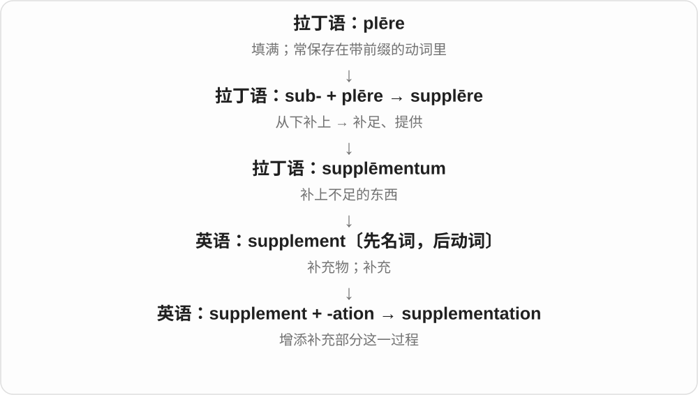

词较正式，营养研究中常见；也可谈数据、饲料等方面的补充。它只描述增加什么，不表示增加了就一定有益。

**常见搭配与例句**

dietary supplementation；supplementation with additional data。

> The report examines dietary supplementation among older adults.

报告考察了老年人使用膳食补充品的情况。

> Supplementation of the survey data with interviews revealed new concerns.

在问卷数据之外补入访谈材料，揭示了新的问题。

**别混淆**

supplement 是补充物或补充动作；supplementation 把补充作为过程来谈。

### 167. connotation — 附带含义；联想义；感情色彩

**音标**：英 /ˌkɒnəˈteɪʃən/；美 /ˌkɑːnəˈteɪʃən/

**先抓住这个画面**

一个词说出主要意思时，顺手带进来的那种感觉：同样说节省，thrifty 往往让人赞许，stingy 则让人想到小气。

**怎么拆**

中世纪拉丁 connotatio 来自 connotare“附带标示”；英语名词独立借入，并非较晚出现的英语 connote 加 -ation 才造出。

**怎么变成今天的意思**

**拉丁 con- + notare → 中世纪拉丁 connotare**  
一起 + 标记 → 附带表示另一层意思

↓

**中世纪拉丁 connotatio → 英语 connotation**  
随主要意思带出的含义

positive / negative connotations 常说褒贬联想，但 connotation 也能是文化、场景或风格联想。逻辑学里还可说一个概念包含的属性，不只感情色彩。

**常见搭配与例句**

a negative connotation；carry connotations of luxury。

> The word “cheap” can have a negative connotation.

cheap 这个词有时带有不太好的意味。

> The name carries connotations of tradition and craftsmanship.

这个名字让人联想到传统和手工技艺。

**别混淆**

denotation 关注词指什么；connotation 关注它还让人想到什么。联想会随语境和群体变化。

### 168. revocation — 撤销；收回；废止

**音标**：/ˌrevəˈkeɪʃən/

**先抓住这个画面**

“许可被收回”这件事，作为一个过程或正式结果，就是 revocation。

**怎么拆**

经法语 revocacion 接拉丁 revocatio，来自 revocare 的名词支线。现代可与 revoke 对应理解，但名词不是英语动词出现后才造的拉丁式词。

**怎么变成今天的意思**

**拉丁 vocare**  
呼唤、叫来、称呼；与 vox“声音”同族

↓

**拉丁 revocare → revocatio**  
叫回、收回 → 收回这一行为

↓

**法语 revocacion → 英语 revocation**  
撤销、取消已经授予的权利或许可

revocation of access 是权限撤销；notice of revocation 是撤销通知。词本身没有说明原因是否合理，只说明原有效力被收回。

**常见搭配与例句**

revocation of permission；license revocation；a notice of revocation。

> The letter confirmed the revocation of the permit.

信中确认了许可证已被撤销。

> The system logs every revocation of user access.

系统记录每一次用户访问权限的撤销。

**别混淆**

rejection 是一开始不接受；revocation 是此前已经给出或成立，后来又收回。

### 169. summation — 求和；总括；总结陈述

**音标**：/sʌˈmeɪʃən/

**先抓住这个画面**

把分散的数字加起来，或把分散的论点收拢成最后一段话。

**怎么拆**

借自近代拉丁 summatio，接 summare“求和”；现代可对应 sum + -ation，但不是只在英语里首次形成。

**怎么变成今天的意思**

**拉丁 summus → summa**  
最高的 → 顶端、总体、总额、要点

↓

**拉丁 summare → 近代拉丁 summatio → 英语 summation**  
求和 → 求和过程；后来也指总括陈述

a summation sign 是求和符号；a closing summation 是最后的总结陈述。比 summary 更正式，也更常出现在数学和法庭陈述等语境。

**常见搭配与例句**

the summation of a series；a closing summation；a concise summation。

> The formula uses a summation sign to combine all the values.

公式用求和符号把所有数值加起来。

> Her final paragraph is a concise summation of the debate.

她的最后一段简明概括了这场争论。

**别混淆**

sum 常是加出来的结果；summation 常强调相加过程，也可说综合陈述。

### 170. invocation — 祈求；祷文；援引；程序调用

**音标**：/ˌɪnvəˈkeɪʃən/

**先抓住这个画面**

把“呼求或调用”作为一次行为来数：仪式开头的一段祈祷，或程序里一次函数执行请求，都可以是 invocation。

**怎么拆**

经古法语 invocacion 来自拉丁 invocatio，基础是 invocare。名词在英语中的早期记录比 invoke 动词更早，不能画成现代英语动词先造出拉丁名词。

**怎么变成今天的意思**

**拉丁 vocare**  
呼唤、叫来、称呼；与 vox“声音”同族

↓

**拉丁 invocare → invocatio**  
呼求、请求援助 → 呼求这一行为

↓

**古法语 invocacion → 中古英语 invocacioun → invocation**  
祈求、祷文；后来也用于援引与程序调用

an invocation at a ceremony 是仪式中的祈祷；a function invocation 是一次函数调用。the invocation of tradition 则是把传统搬出来作为理由或权威。

**常见搭配与例句**

an opening invocation；the invocation of authority；a function invocation。

> The ceremony began with a short invocation.

仪式以一段简短祈祷开始。

> The log records the duration of each function invocation.

日志记录每次函数调用的耗时。

**别混淆**

invocation 是祈求、援引、调用；evocation 更常指唤起某种记忆或形象。

### 171. menstruation — 月经；月经来潮

**音标**：/ˌmenstruˈeɪʃən/

**先抓住这个画面**

说的是这一生理过程本身，而不是整个月经周期的每一天。

**怎么拆**

接晚期拉丁 menstruare“来月经”的分词词干，并使用 -ation 形成过程名词。现代可与 menstruate + -ion 配对记忆，但不能据此断言英语动词的现行义一定更早。

**怎么变成今天的意思**

**拉丁 mensis → menstruus / menstrua**  
月 → 每月的；月经

↓

**晚期拉丁 menstruare，词干 menstruat-**  
来月经

↓

**英语 menstruation**  
用 -ation 构成的过程名称

月经发生时，子宫内膜的一部分脱落，血液和组织经阴道排出。menstruation 是较正式的过程名称，日常谈具体一次月经常说 a period；menstrual cycle 则包括出血期之外的阶段。

**常见搭配与例句**

during menstruation；the onset of menstruation；education about menstruation。通常不可数。

> The lesson explains menstruation in clear, age-appropriate language.

课程用清楚且适合年龄的语言解释月经。

> The booklet distinguishes menstruation from the rest of the menstrual cycle.

手册区分了月经来潮与月经周期的其他阶段。

**别混淆**

menstruation 不等于整个 menstrual cycle，也不等于一般受伤出血 bleeding；具体意义来自生理语境。

### 172. recitation — 背诵；朗诵；复述；习题讨论课〔美〕

**音标**：/ˌresɪˈteɪʃən/

**先抓住这个画面**

把内容说出来这一活动，或围绕课程内容反复练习的课堂环节。

**怎么拆**

拉丁 recitātiō 经法语 récitation 独立借入，接 recitāre“读出”。

**怎么变成今天的意思**

**拉丁 ciēre → citāre**  
使动起来、唤起 → 召唤、促动

↓

**拉丁 recitāre → recitātiō → 法语 récitation**  
朗读 → 朗读、陈述这件事

↓

**英语 recitation**  
背诵朗诵；美国课程中的讨论、练习课

诗歌 recitation 是朗诵；大学课表里的 recitation section 常是配合大课的小班练习或讨论，并不一定全班背课文。

**常见搭配与例句**

a poetry recitation；a recitation section；recitation from memory。

> The programme included a recitation of the poem.

节目中安排了这首诗的朗诵。

> We solve practice problems in the weekly recitation.

我们在每周的习题讨论课上解练习题。

**别混淆**

recital 现代常是演出；recitation 更常指朗诵行为或教学环节。

### 173. revitalization — 振兴；恢复活力

**音标**：英 /ˌriːˌvaɪtəlaɪˈzeɪʃən/；美 /ˌriːˌvaɪtələˈzeɪʃən/

**先抓住这个画面**

把让地方、机构或传统重新活起来的过程，作为一个整体来谈。

**怎么拆**

revitalize + -ation，形成过程名词；动词的 -ize 在名词中对应 -ization，主重音落到 /zeɪ/。

**怎么变成今天的意思**

**拉丁 vīta；与 vīvere“活着”同族**  
生命

↓

**拉丁 vītālis → 古法语 vital，亦直接拉丁借入**  
与生命有关的；维系生命的

↓

**英语 vital**  
生命所必需；至关重要；充满活力

↓

**英语 re- + vital + -ize → revitalize**  
重新赋予活力

↓

**英语 revitalize + -ation → revitalization**  
恢复活力的过程

urban revitalization 常涉及城市活动、商业与社区生活；language revitalization 则是让一种使用减少的语言重新被更多人学习、使用。

**常见搭配与例句**

urban revitalization；language revitalization；a revitalization project。

> Residents played a central role in the neighbourhood’s revitalization.

居民在街区复兴中发挥了核心作用。

> The school supports language revitalization through classes for children.

学校通过儿童课程支持语言振兴。

**别混淆**

renovation 主要指翻修；revitalization 指恢复活力，不能只看外墙是否刷了新漆。

### 174. pigmentation — 色素形成；色素沉着；色素着色状态

**音标**：/ˌpɪɡmenˈteɪʃən/

**先抓住这个画面**

讨论的不是把表面涂上油漆，而是色素在组织里形成、分布后，呈现怎样的颜色。

**怎么拆**

pigment 名词 + -ation，可能受到法语 pigmentation 的影响。英语名词记录早于 pigment 作动词的常见记录，不宜只画成现代动词加后缀。

**怎么变成今天的意思**

**拉丁 pingere，过去分词 pictus**  
绘画、着色；用图像表现

↓

**拉丁 pigmentum → 中古英语 pigment**  
着色材料、颜料

↓

**英语 pigment**  
颜料；生物体内的色素

↓

**英语 pigment 名词 + -ation → pigmentation〔可能有法语范词〕**  
色素形成及由色素产生的着色状态

常见 skin pigmentation，也可用于动物、植物。changes in pigmentation 是色素着色发生变化，词本身不判定这是疾病还是正常差异。

**常见搭配与例句**

skin pigmentation；changes in pigmentation；differences in pigmentation。

> The study compares pigmentation in the leaves of several varieties.

研究比较了几个品种叶片的色素着色情况。

> The photographs show natural differences in skin pigmentation.

照片展示了皮肤色素着色的自然差异。

**别混淆**

pigment 是物质，pigmentation 是色素形成、分布及着色状态；colour 是更宽泛的可见颜色。

### 175. centralization — 集中化；集权；统一管理

**音标**：英 /ˌsentrəlaɪˈzeɪʃən/；美 /ˌsentrələˈzeɪʃən/

**先抓住这个画面**

原先各自决定的事情，改由一个中心集中处理。

**怎么拆**

受法语 centralisation 影响或直接借入；现代可按 centralize + -ation 理解。

**怎么变成今天的意思**

**希腊 kéntron → 拉丁 centrum**  
尖点、刺；圆规固定的一点 → 圆心、中心

↓

**法语 central → centraliser → centralisation**  
中央的 → 集中到中央 → 集中化

↓

**英语 centralization**  
权力、资源或操作的集中

可以说政府权限、企业采购或数据管理的集中。它只说明组织方向，本身不保证效率一定更高。

**常见搭配与例句**

the centralization of power；data centralization。

> Centralization moved purchasing decisions to the head office.

集中管理把采购决策移到了总部。

> The report discusses the costs of data centralization.

报告讨论了数据集中化的成本。

**别混淆**

concentration 泛指聚集；centralization 更常强调围绕一个管理或组织中心。

### 176. decentralization — 分权；分散化；去中心化

**音标**：英 /diːˌsentrəlaɪˈzeɪʃən/；美 /diːˌsentrələˈzeɪʃən/

**先抓住这个画面**

从一个中心包办，变成多个地点或主体分担。

**怎么拆**

de- + centralization，或 decentralize + -ation，两种现代分析对应同一分散过程。

**怎么变成今天的意思**

**希腊 kéntron → 拉丁 centrum**  
尖点、刺；圆规固定的一点 → 圆心、中心

↓

**拉丁 centrālis，经法语或直接借入英语 central**  
中心的；处在关键位置的

↓

**英语 centralize / centralization**  
集中管理；集中化

↓

**英语 de- + centralization / decentralize + -ation → decentralization**  
管理、权限或功能由中心向外分散

讨论时要看究竟分散了决定权、数据存储还是日常执行；这些层面不一定一起发生。

**常见搭配与例句**

administrative decentralization；the decentralization of power。

> The report evaluates the effects of administrative decentralization.

报告评估了行政分权的影响。

> Decentralization gave regional teams more control over their schedules.

分散管理让地区团队更能自主安排日程。

**别混淆**

distribution 只说分布；decentralization 通常还牵涉中心作用的减弱或权责调整。

### 177. polymerization — 聚合；聚合反应

**音标**：英 /ˌpɒlɪməraɪˈzeɪʃən/；美 /pəˌlɪmərəˈzeɪʃən/

**先抓住这个画面**

把“许多小单元接成大分子”这整个过程当作一个名词来讲。

**怎么拆**

现代可拆 polymerize + -ation；历史上也按 polymer + -ization 分析，是随 polymer 一起发展的化学词族。早期术语使用不能直接套上今天全部反应理论。

**怎么变成今天的意思**

**polymer 词族及 -ize／-ization**  
形成聚合物的动词与过程名词

↓

**英语 polymerization**  
聚合过程的名称

↓

**现代高分子化学**  
形成高分子链或网络的一类反应

讨论 polymerization rate 时，说的是聚合发生多快；degree of polymerization 则指链中单元数这一量。一个在问过程速度，一个在问链有多长，别因为都带 polymerization 就当成同一个指标。

**常见搭配与例句**

a polymerization reaction；the rate of polymerization；degree of polymerization；polymerization of monomers。

> The researchers compared the rates of polymerization.

研究人员比较了聚合反应的速率。

> The textbook separates polymerization from simple physical mixing.

教材把聚合与单纯的物理混合区分开来。

**别混淆**

polymer 是所得物质，polymerize 是动作，polymerization 是过程。polymerization 不等于材料从液体变固体的所有情况。

### 178. liberalization — 自由化；放宽限制的过程

**音标**：英 /ˌlɪbərəlaɪˈzeɪʃən/；美 /ˌlɪbərələˈzeɪʃən/

**先抓住这个画面**

把规则逐步放松、让市场或社会活动有更多选择的这段变化，当成一个过程来讨论。

**怎么拆**

liberalize + -ation，英语动作名词；也可分析为 liberal + -ization。英式常见 liberalisation。

**怎么变成今天的意思**

**拉丁 liber**  
自由的；不受束缚的

↓

**拉丁 liberalis → 古法语 liberal／直接拉丁借入**  
适合自由人的；慷慨的

↓

**中古英语 → 英语 liberal**  
慷慨、宽容；近代又形成政治用法

↓

**英语 liberal + -ize → liberalize**  
使更开放、放宽限制

↓

**英语 liberalize + -ation → liberalization**  
制度、市场等放宽限制的过程

trade liberalization 是贸易自由化；political liberalization 是政治领域限制有所放宽。不同领域不应自动等同，也不一定表示所有限制一次性取消。

**常见搭配与例句**

trade liberalization；market liberalization；economic liberalization。

> The report examines the effects of trade liberalization on small firms.

报告考察贸易自由化对小企业的影响。

> The reforms marked a gradual liberalization of the system.

这些改革标志着制度逐步放宽了限制。

**别混淆**

deregulation 更直接强调撤销或减少监管；liberalization 强调开放和放宽限制，可能同时伴随新的规则安排。

### 179. victimization — 使受害、欺凌、迫害；受害经历

**音标**：英 /ˌvɪktɪmaɪˈzeɪʃən/；美也常 /ˌvɪktɪməˈzeɪʃən/

**先抓住这个画面**

把伤害、排挤某人的整件过程拿出来谈，也可谈承受它留下的处境；不只是一个人的称号。

**怎么拆**

victimize + -ation，对应 victim + -ization；动词末尾 e 在后缀前不保留，重音移到后段。

**怎么变成今天的意思**

**拉丁 victima → 法语 victime、英语 victim**  
祭献中的牺牲对象，深源不定

↓

**英语受害者义**  
遭人、事故、处境等伤害的人

↓

**victimize + -ation → victimization**  
使受害的行为、过程与经历

repeated victimization 反复受害，a fear of victimization 对遭报复迫害的担心，a victimization survey 受害经历调查。

**常见搭配与例句**

repeated victimization；a fear of victimization；a victimization survey。

> The study examines repeated victimization at school.

研究考察了校园中的反复受害经历。

> Workers described a fear of victimization after speaking out.

工人说，发声后他们担心遭到报复迫害。

**别混淆**

victimization 多说发生的伤害、欺凌过程，victimhood 多说受害者处境或自我认同；不能只因中文都能有受害就总互换。

### 180. discoloration — 变色；褪色；变色的斑迹

**音标**：/dɪsˌkʌləˈreɪʃən/

**先抓住这个画面**

把颜色走样这件事，或者走样后留下的那块痕迹，整体说出来。

**怎么拆**

现代可联系 discolor 与 -ation；历史也经旧动词 discolorate，追溯到中世纪拉丁 discolorare 的分词词干。

**怎么变成今天的意思**

**拉丁 dis- + colorare → 中世纪拉丁 discolorare**  
使偏离原有颜色

↓

**英语旧动词 discolorate → discoloration**  
改变颜色 → 变色的过程、状态或痕迹

discoloration of the ceiling 可能是天花板上出现了水渍颜色。表示变色现象时通常不可数；指一块块变色痕迹时也可用复数 discolorations。它只是描述颜色变化，不直接告诉你原因。

**常见搭配与例句**

cause discoloration；signs of discoloration；brown discoloration；discolouration（英式变体）。

> The leak left brown discoloration on the ceiling.

漏水在天花板上留下了褐色的变色痕迹。

> The restorer photographed every area of discoloration before starting work.

修复师动手前拍下了每一处变色区域。

**别混淆**

stain 常指污渍、染上的斑；discoloration 更宽，也可能由老化、阳光或其他变化造成。不是原本天然的花纹 coloration。

### 181. monetize — 使变现；从……获取收益；货币化

**音标**：/ˈmʌnətaɪz/，亦有 /ˈmɒnətaɪz/

**先抓住这个画面**

有人看你的内容，是关注；把这些关注接成广告、订阅等收入，才是常见互联网语境的 monetize。它说怎么变成收入。

**怎么拆**

借法语 monétiser，关联拉丁 moneta 钱币与使成为的动词尾；现代内容、平台的变现义是货币材料的扩展。

**怎么变成今天的意思**

**拉丁 moneta 钱币等 → 法语 monétiser**  
把事物与货币、收益相联系

↓

**英语 monetize → monetization**  
变现、货币化；相应收益机制与过程

monetize content 内容变现；monetize an audience 将受众注意力转为收益；monetize a service 从服务获取收入。

**常见搭配与例句**

monetize content；monetize a service。

> The company monetizes the service through subscriptions.

公司通过订阅从这项服务获得收入。

> The creators are exploring ways to monetize their content.

创作者在探索内容变现方式。

**别混淆**

monetize 说获得收入的机制，不保证已经 profitable 盈利；有收入仍可能覆盖不了成本。

### 182. monetization — 变现；货币化；收益获取机制

**音标**：/ˌmʌnətaɪˈzeɪʃən/，亦有 /ˌmɒnətaɪˈzeɪʃən/

**先抓住这个画面**

monetize 是把某种价值接成收入，monetization 是这个过程、策略或机制。金融等领域还有更具体的货币化用法。

**怎么拆**

monetize 去 e 加 -ation，形成过程名词；接前面钱币、货币的词族材料。

**怎么变成今天的意思**

**拉丁 moneta 钱币等 → 法语 monétiser**  
把事物与货币、收益相联系

↓

**英语 monetize → monetization**  
变现、货币化；相应收益机制与过程

↓

**monetize + -ation → monetization**  
转为货币收益的过程、机制

a monetization strategy 变现策略；content monetization 内容变现；monetization through advertising 通过广告获收入。

**常见搭配与例句**

a monetization strategy；content monetization。

> The app’s monetization relies on subscriptions.

应用的变现依赖订阅。

> The team tested several monetization strategies.

团队测试了几种变现策略。

**别混淆**

monetization 是变成收入的方式，valuation 是价值评估；估值很高与已经能赚钱是两回事。

### 183. germination — 发芽；萌发过程

**音标**：英 /ˌdʒɜːmɪˈneɪʃən/；美 /ˌdʒɜːrmɪˈneɪʃən/

**先抓住这个画面**

把“种子开始发芽”这段过程当成一件事来讨论。

**怎么拆**

借拉丁 germinatio，其变格形式 germinationem 接动词 germinare“萌发”。现代可与 germinate + -ion 配对记忆，但英语名词有较早记录，不能把现代拆法当成唯一历史顺序。

**怎么变成今天的意思**

**拉丁 germen，词干 germin-**  
芽、萌芽；新生命的起点

↓

**拉丁 germinare → germinatio**  
萌发 → 萌发过程

↓

**英语 germination**  
直接借入的发芽、萌发名词

种子包装上的 germination rate 指发芽率，问有多少种子成功开始发育；germination time 指从播种到萌发所需的时间，不是植物长成成熟植株的总时间。

**常见搭配与例句**

seed germination；germination rate；germination time；conditions for germination。

> The packet lists a germination time of seven to ten days.

包装袋注明发芽时间为七到十天。

> The students compared germination rates under different conditions.

学生们比较了不同条件下的发芽率。

**别混淆**

germination 是过程，seedling 是已经长出的幼苗。一个说正在发生什么，一个说长出来的东西。

### 184. democratization — 民主化；让更多人有机会使用或参与

**音标**：英 /dɪˌmɒkrətaɪˈzeɪʃən/；美 /dɪˌmɑːkrətəˈzeɪʃən/

**先抓住这个画面**

原来权力或资源集中在少数人手里，后来参与范围扩大；这个变化过程就是 democratization。

**怎么拆**

democratize + -ation；也可从 democratic 对应的 -ization 派生关系理解。

**怎么变成今天的意思**

**古希腊 krátos**  
力量；权力、支配

↓

**希腊 dêmos + -kratía → dēmokratía**  
人民 + 治理 → 民主政体

↓

**中世纪拉丁 dēmocratia → 法语 démocratie**  
民主制度

↓

**法语 démocratiser → 英语 democratize → democratization**  
使更民主 → 民主化的过程

政治中指制度民主化；技术、教育等场景也可比喻降低门槛。后一种用法不意味着某个工具本身建立了民主政体。

**常见搭配与例句**

the democratization of education；political democratization。

> The book studies democratization after a period of authoritarian rule.

这本书研究威权统治之后的民主化过程。

> Public libraries contributed to the democratization of access to knowledge.

公共图书馆帮助更多人获得接触知识的机会。

**别混淆**

democracy 是制度或理念；democratization 是向它变化的过程，也可指资源普及。

### 185. ornamentation — 装饰；装饰手法或整体装饰细节

**音标**：英 /ˌɔːnəmenˈteɪʃən/；美 /ˌɔːrnəmenˈteɪʃən/

**先抓住这个画面**

看整面墙上添了多少雕花和花纹，而不只数其中一件小摆件。

**怎么拆**

英语 ornament + -ation，起初可指成套的装饰，后来也指装饰过程；与许多直接借入的拉丁动作名词不同，这里是英语派生。

**怎么变成今天的意思**

**拉丁 ornare**  
配备、布置；装饰

↓

**英语 ornament → ornamentation**  
装饰物／装饰 → 整体装饰及装饰过程

建筑评论中的 elaborate ornamentation 是繁复装饰；音乐中可指加到旋律上的装饰音及处理。通常关注一整套细节、风格或手法，而不是一个可拿走的小物件。

**常见搭配与例句**

elaborate ornamentation；architectural ornamentation；musical ornamentation。

> The building has very little ornamentation.

这座建筑几乎没有多余装饰。

> The pianist used subtle ornamentation in the repeated melody.

钢琴家在重复的旋律中加入了细腻的装饰处理。

**别混淆**

an ornament 可以数成一件；ornamentation 常是不可数的整体概念。装饰多不必然漂亮，评价要看上下文。

### 186. rationalization — 合理化、整合以提高效率；自圆其说、为行为找理由；有理化

**音标**：英 /ˌræʃənəlaɪˈzeɪʃən/；美 /ˌræʃənələˈzeɪʃən/

**先抓住这个画面**

同样叫合理化，可能是流程真的更顺，也可能只是把理由讲得更顺；看原本问题有没有被面对。

**怎么拆**

接法语 rationalisation，现代对应 rationalize + -ation，或 rational + -ization。英式常见 rationalisation。

**怎么变成今天的意思**

**拉丁 ratio → rationalis → 法语、英语 rational**  
推理、计算、比率 → 理性的；可写成比率的

↓

**法语 rationaliser / rationalisation 等 → 英语相应词**  
使有条理、提高效率；为行为找合理说辞

↓

**rationalize → rationalization**  
改造流程、整理理由或数学有理化的过程

industrial rationalization 工业整合增效，a rationalization for failure 为失败作的辩解，rationalization of the denominator 分母有理化。

**常见搭配与例句**

industrial rationalization；a rationalization for；rationalization of the denominator。

> The merger was presented as a rationalization of services.

合并被说成是对服务的整合增效。

> Her explanation sounded more like a rationalization than an honest account.

她的解释听着更像自我辩解，而非坦诚交代。

**别混淆**

rationalization 是借口时，不保证理由真实；效率调整时也不一定指思想辩解。词形相同，使用对象让意思分开。

### 187. disorientation — 迷失方向；定向障碍；茫然

**音标**：英 /dɪsˌɔːriənˈteɪʃən/；美 /dɪsˌɔːriənˈteɪʃən/

**先抓住这个画面**

原来的方向参照失效，一时不知道自己在哪里、该往哪走。

**怎么拆**

dis- + orientation；也有从 disorientate 形成动作或状态名词的分析。

**怎么变成今天的意思**

**拉丁 orīrī；分词 ortus**  
升起、出现、出生

↓

**拉丁 oriēns / orient-**  
正在升起 → 日出方向、东方

↓

**法语 orienter → orientation；也有英语 orient + -ation 分析**  
确定方位或朝向

↓

**英语 orientation**  
朝向；定位、适应新环境；取向

↓

**英语 dis- + orientation → disorientation；亦联系 disorientate**  
失去方位或环境定位

可以是走出陌生地铁站时的方向混乱，也可比喻突然进入新环境后的茫然。专业语境中还可涉及对时间、地点或人物的定位。

**常见搭配与例句**

a sense of disorientation；spatial disorientation；cause disorientation。

> The identical corridors created a sense of disorientation.

一模一样的走廊让人感到迷失方向。

> Moving to a new country brought me a brief period of disorientation.

搬到新国家后，我经历了一段短暂的茫然期。

**别混淆**

confusion 是宽泛的糊涂；disorientation 特别像丢了坐标，不知道自身位置。

### 188. equalization — 均等化；调平；均衡处理

**音标**：英 /ˌiːkwəlaɪˈzeɪʃən/；美 /ˌiːkwələˈzeɪʃən/

**先抓住这个画面**

说的是把差距调整好这一过程，而不是已经相等的静态结果。

**怎么拆**

equalize + -ation；名词把调平、使相等的动作作为过程来谈。

**怎么变成今天的意思**

**拉丁 aequus**  
平、等量、公平、平稳

↓

**拉丁 aequalis → 中古英语 equal**  
相等的、均匀的

↓

**英语 equal**  
相等；匹敌；地位相等的人

↓

**英语 equalize + -ation → equalization**  
调平、使均衡的过程

pressure equalization 是压力平衡过程；audio equalization 是音频均衡处理。资源方面的 equalization 也可指减少地区或群体之间的差距。

**常见搭配与例句**

pressure equalization；audio equalization；the equalization of resources。

> Pressure equalization took several seconds.

压力平衡花了几秒钟。

> The engineer applied gentle equalization to make the voice clearer.

工程师稍作均衡处理，让人声更清晰。

**别混淆**

equality 是相等这一状态；equalization 是使其趋向相等或均衡的过程。完成某项调整，也不保证所有方面都已相等。

### 189. perspiration — 汗；出汗

**音标**：英 /ˌpɜːspəˈreɪʃən/；美 /ˌpɜːrspəˈreɪʃən/

**先抓住这个画面**

汗水从皮肤出来这一过程，以及冒出来的汗本身。

**怎么拆**

借自法语 perspiration，接 perspirer、拉丁 perspirare。早期指经过皮肤逸出的湿气，后来成为汗的较正式说法；英语记录早于 perspire。

**怎么变成今天的意思**

**拉丁语 spirare**  
吹气、呼吸；更远词源未定

↓

**拉丁语 per- + spirare → perspirare**  
透过而呼出、持续吹气

↓

**法语 perspiration → 英语 perspiration**  
经皮肤逸出的湿气 → 汗、出汗

beads of perspiration 是一颗颗汗珠。也可借汗水比喻努力，但不能把“有付出”自动理解成某一句名言的引用。

**常见搭配与例句**

beads of perspiration；wipe away perspiration；heavy perspiration。

> Beads of perspiration formed on his forehead.

他的额头冒出了汗珠。

> She wiped the perspiration from her face with a towel.

她用毛巾擦掉脸上的汗。

**别混淆**

perspiration 与 inspiration 只差开头，却分别是汗与灵感；同样保留呼吸的远源，不同前缀已走出不同义。

### 190. sedimentation — 沉降；沉积作用

**音标**：/ˌsedɪmenˈteɪʃən/

**先抓住这个画面**

sedimentation 像静放浑水时颗粒慢慢落下的全过程，不只是最后留下的那层泥沙。

**怎么拆**

sediment + -ation，形成过程名词。

**怎么变成今天的意思**

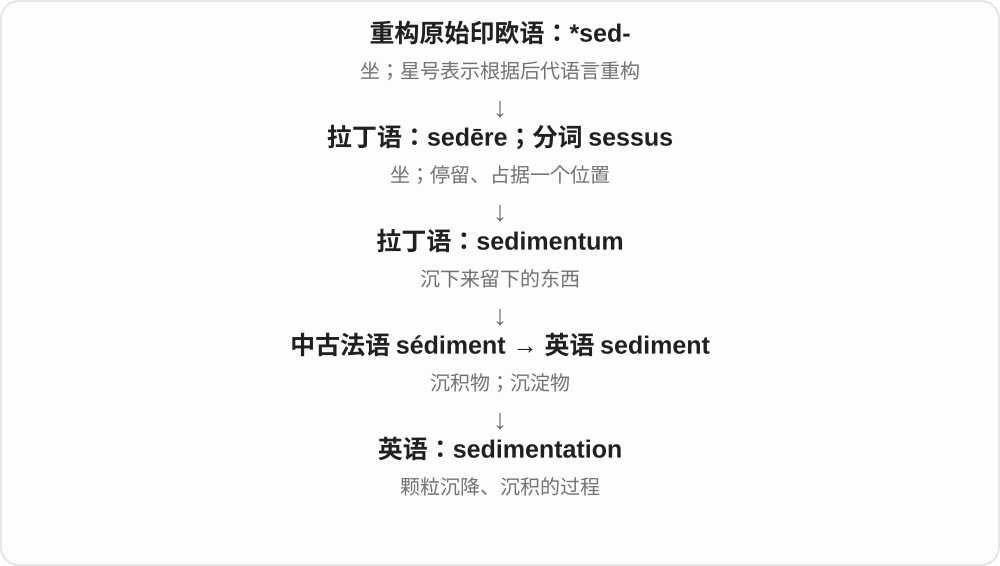

用于河湖地质过程，也用于处理悬浮颗粒的技术语境。具体机制随环境不同，不必一律理解成化学反应。

**常见搭配与例句**

sedimentation rate；sedimentation in a lake；a sedimentation tank。

> The study measured sedimentation in the reservoir.

研究测量了水库中的沉积情况。

> Fine particles remained suspended longer, slowing sedimentation.

细颗粒悬浮得更久，使沉降变慢。

**别混淆**

sediment 是留下的物质；sedimentation 是形成沉积的过程。

### 191. reconsideration — 重新考虑；复议；再次审视

**音标**：/ˌriːkənˌsɪdəˈreɪʃən/

**先抓住这个画面**

把再想一次作为一个正式步骤，给原先的结论一次重新评估的机会。

**怎么拆**

英语 reconsider + -ation 形成动作名词。与动词共享重新审视的意思，名词重音移到 -ation。

**怎么变成今天的意思**

**re- 再次；consider 考虑**  
重新审视已有想法或决定

↓

**法语 reconsidérer 与英语 re- + consider → reconsider**  
既有法语借入解释，也有英语自行组合的路线

↓

**英语 reconsider → reconsideration**  
重新考虑的行为或过程

after reconsideration 是重新考虑后；a request for reconsideration 是要求再审视的请求。是否属于某种正式法律程序，要由具体制度决定。

**常见搭配与例句**

careful reconsideration；a request for reconsideration；under reconsideration。

> After careful reconsideration, we kept the original design.

经过认真重新考虑，我们保留了原设计。

> She submitted a request for reconsideration of the funding decision.

她提出申请，请对方重新考虑资助决定。

**别混淆**

reconsideration 不等于 reversal 撤回或推翻；复议可以得出与原来相同的结论。

### 192. indentation — 缩进；凹痕；凹口

**音标**：英、美 /ˌɪndenˈteɪʃn/

**先抓住这个画面**

向里退进去的空白、边缘或表面痕迹。

**怎么拆**

英语 indent 对应 -ation 名词。边缘缺口、排版义接 indent 的拉丁牙齿支线；压出的凹坑义接另源的 in- + dent。名词在这些用法里都存在，不能只给出一条假统一历史。

**怎么变成今天的意思**

**两条来源：拉丁 dens；英语 dent/dint**  
牙齿、齿状缺口；另支为撞击留下的凹痕

↓

**拉丁系：中古拉丁 indentare；古法语 endenter**  
形成齿状边缘，借入英语 indent

↓

**并行英语构词：in- + dent → indent**  
向内压出凹痕，与上支同形

↓

**现代英语 indent**  
排版缩进接缺口支线；压凹接凹痕支线

↓

**英语 indent → indentation**  
向内的缺口、缩进；另支也表示压凹形成的痕迹

adjust the indentation 是调段落的缩进量；an indentation in a cushion 是垫子上压下去的一块。读这个词时先看宾语是文字还是实体表面，就容易选对意思。

**常见搭配与例句**

paragraph indentation；adjust the indentation；a deep indentation；leave an indentation in。

> The editor changed the indentation of the numbered list.

编辑调整了编号列表的缩进。

> The heavy box left an indentation in the cushion.

沉重的箱子在垫子上压出了一块凹痕。

**别混淆**

indent 常可作动词或指一个缩进位置；indentation 更常说缩进方式、程度或留下的凹陷。它与 intention“意图”不是同一个词。

### 193. permutation — 排列；排列方式；变化形式

**音标**：英 /ˌpɜːmjʊˈteɪʃən/；美 /ˌpɜːrmjʊˈteɪʃən/

**先抓住这个画面**

permutation 像同样三张牌重新换座位，牌没变，次序变了。

**怎么拆**

经法语来自拉丁语 permūtātiō“更换”，per- 加强 mūtāre“改变”。

**怎么变成今天的意思**

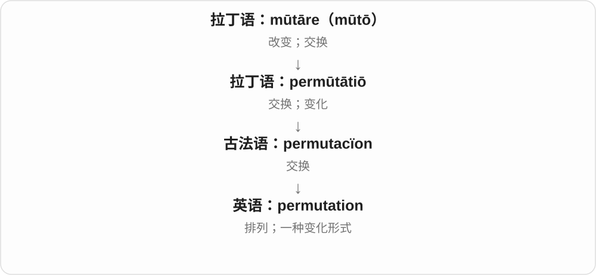

数学里排列关心顺序；日常也可指一个方案的不同组合样式。不是每次提到都在严格计数。

**常见搭配与例句**

all possible permutations；a permutation of the letters；different permutations。

> List all permutations of the three letters.

列出这三个字母的所有排列。

> We tried several permutations of the schedule.

我们尝试了几种不同的日程安排。

**别混淆**

数学里的 combination 常不计顺序；permutation 计顺序，AB 与 BA 可以算不同。

### 194. encapsulation — 封装；包裹；精炼概括

**音标**：英 /ɪnˌkæpsjuˈleɪʃən/；美也读 /ɪnˌkæpsəˈleɪʃən/

**先抓住这个画面**

把内容收进一个有边界的整体，或用很短的表达保住它的要点。

**怎么拆**

encapsulate 对应的动作名词，-ate 换为 -ation；英语也可按 en- + capsule + -ation 分析。包裹义与比喻概括义各有发展，不必假设后者一定先出现在动词中。

**怎么变成今天的意思**

**拉丁 capsa 盒、箱**  
装东西的容器；各支借入英语的时间和路线不同

↓

**拉丁 capsula 小盒 → 法语 capsule → 英语 capsule**  
小容器、囊；后来用于药物胶囊、太空舱等

↓

**英语 en- + capsule + -ate → encapsulate；动作名词 encapsulation**  
字面封装、包裹的词族

↓

**encapsulation 发展出精炼概括与软件封装等用法**  
将内容组织为完整而可控制边界的单位

a neat encapsulation of an argument 是对论点的精炼概括。软件中的 encapsulation 把状态和操作组织起来，并限制外部直接碰内部细节；它不是把文件压小。

**常见搭配与例句**

data encapsulation；a concise encapsulation；encapsulation of an idea。

> Her final sentence was a neat encapsulation of the argument.

她最后一句话精炼地概括了整个论点。

> Encapsulation lets us change the internal code without changing the public interface.

封装让我们可以修改内部代码而不改变公开接口。

**别混淆**

compression 是压缩体积或数据长度；encapsulation 强调封在一个边界内。encryption 是加密，目的和操作都不同。

### 195. memorization — 记忆、背熟的过程

**音标**：英 /ˌmeməraɪˈzeɪʃən/；美 /ˌmemərəˈzeɪʃən/

**先抓住这个画面**

把陌生内容练到能记牢，这段学习过程作为一个整体来讨论；例如背台词需要多少时间、怎样配合理解。

**怎么拆**

memorize + -ation，英语动作名词；英式也常见 memorisation。不是把所有 memory“回忆”都换成这个较长的词。

**怎么变成今天的意思**

**拉丁 memor**  
记着的；放在心上的

↓

**拉丁 memoria → 古法语 memoire／盎格鲁法语 memorie**  
记忆；记录

↓

**中古英语 memorie → 英语 memory**  
记忆力、回忆；后来也用于计算机存储信息的能力与装置

↓

**英语 memory 词干 + -ize → memorize**  
早期也指写下来留存；后来常说有意识地记牢

↓

**英语 memorize + -ation → memorization**  
有意识地记牢内容的过程

rote memorization 特指机械背记；单独 memorization 不一定否定理解，也可能与图像、例子和练习结合。通常作不可数名词。

**常见搭配与例句**

rote memorization；aid memorization；memorization of vocabulary；memorization and understanding。

> The lesson combines memorization with practical use of the new words.

这节课把新词的记忆与实际运用结合起来。

> Understanding the pattern made memorization much easier.

理解规律后，记牢这些内容容易多了。

**别混淆**

memory 是记忆能力或回忆，memorization 是把内容记牢的活动；a childhood memory 不能替换成 a childhood memorization。

### 196. decriminalize — 使非刑罪化；不再按刑事犯罪处理

**音标**：/diːˈkrɪmɪnəlaɪz/

**先抓住这个画面**

一项行为原先按刑事犯罪处理，后来撤去这种定性，就是 decriminalize。它关注刑事处罚这一层，其他规则可能仍存在。

**怎么拆**

词史有从 decriminalization 去掉名词尾逆构的解释；现代对应 de- 去除 + criminalize 定为犯罪，不必把短动词画成历史上必然先有。

**怎么变成今天的意思**

**de- 去除 + criminalization 定为犯罪的过程**  
取消某行为的刑事犯罪地位

↓

**decriminalization → decriminalize 的逆构对应**  
较长名词提供短动词的形成材料

decriminalize an activity 使某行为非刑罪化；a proposal to decriminalize 提议取消某刑事罪名。

**常见搭配与例句**

decriminalize an activity；a proposal to decriminalize。

> The proposal would decriminalize the activity.

提案将不再把这项行为按刑事犯罪处理。

> The article explains what it means to decriminalize an offence.

文章解释取消某项刑事罪名意味着什么。

**别混淆**

decriminalize 与 legalize 常在同一议题出现；去掉刑事罪名，不自动表示一切许可、行政规则也已取消。

### 197. decriminalization — 非刑罪化；取消刑事犯罪地位

**音标**：/diːˌkrɪmɪnəlaɪˈzeɪʃən/

**先抓住这个画面**

把刑事罪名这一层移开，这个过程叫 decriminalization。它把制度变化作为名词，便于讨论范围、效果和争议。

**怎么拆**

de- 去除 + criminalization 刑罪化；现代也可与 decriminalize + -ation 对应。短动词有从这个长名词逆构的词史。

**怎么变成今天的意思**

**de- 去除 + criminalization 定为犯罪的过程**  
取消某行为的刑事犯罪地位

↓

**decriminalization → decriminalize 的逆构对应**  
较长名词提供短动词的形成材料

the decriminalization of an activity 某行为非刑罪化；debate decriminalization 讨论非刑罪化。

**常见搭配与例句**

the decriminalization of；debate decriminalization。

> The paper distinguishes decriminalization from legalization.

论文区分非刑罪化与合法化。

> Decriminalization became a major topic in the discussion.

非刑罪化成为讨论中的重要议题。

**别混淆**

decriminalization 与 legalization 的具体边界要看制度文本；常见学习重点是取消刑罪与法律许可这两个不同焦点。

### 198. prioritization — 优先顺序的安排；确定轻重缓急

**音标**：英 /praɪˌɒrətaɪˈzeɪʃən/；美 /praɪˌɔːrətəˈzeɪʃən/

**先抓住这个画面**

prioritize 是动手排顺序，prioritization 是把这项取舍工作拿出来讨论：用什么标准决定谁在前。

**怎么拆**

prioritize + -ation；英语动作名词；也写 prioritisation。

**怎么变成今天的意思**

**古拉丁 pri；拉丁 prior**  
在前 → 较早的、居前的

↓

**中世纪拉丁 priōritās → 古法语 priorite → 英语 priority**  
居前的状态 → 优先地位、优先事项

↓

**英语 priority + -ize → prioritize**  
安排先后、给予优先地位

↓

**英语 prioritize + -ation → prioritization**  
排优先级 → 排序取舍的过程

常见 task prioritization、resource prioritization。它不是单纯按字母排序，而是依据重要性、时限或目的来安排先后。

**常见搭配与例句**

task prioritization；effective prioritization；prioritization of resources。

> Clear criteria make task prioritization easier.

清晰的标准让任务优先级的安排更容易。

> The meeting focused on the prioritization of limited resources.

会议重点讨论了有限资源应该优先用在哪些方面。

**别混淆**

priority 是某件事的优先地位或事项本身；prioritization 是确定这些先后关系的过程。

### 199. militarization — 军事化过程；军事化程度的增长

**音标**：英 /ˌmɪlɪtəraɪˈzeɪʃən/；美 /ˌmɪlətərəˈzeɪʃən/

**先抓住这个画面**

把“给某地增加军事部署”或“让某机构更像军队”看成一个正在发生的过程。

**怎么拆**

现代可拆 militarize + -ation；历史上英语名词很可能对应、翻译法语 militarisation，因此不只把它解释成英语动词后来加尾。militarisation 也是英式拼写。

**怎么变成今天的意思**

**拉丁 miles，属格 militis**  
士兵；更早来源尚无定论

↓

**拉丁 militaris → 法语 militaire**  
军事的

↓

**法语 militarisation；英语 militarize + -ation 的构词对应**  
英语名词很可能受已有法语名词影响

↓

**英语 militarization**  
使军事化的过程或结果

the militarization of a region 可以讨论驻军、设施与控制方式的变化；the militarization of language 也可以比喻讲话越来越采用战争和敌我对抗的框架。

**常见搭配与例句**

the militarization of a border；increasing militarization；resist militarization。

> The report documents the gradual militarization of the region.

报告记录了该地区逐步军事化的过程。

> The essay discusses the militarization of everyday language.

文章讨论了日常语言越来越采用军事化表达的现象。

**别混淆**

militarism 是崇尚军力的思想或体制倾向；militarization 是变得军事化的过程，两者相关但不相同。

### 200. personalization — 个性化；面向个人的定制

**音标**：英 /ˌpɜːsənəlaɪˈzeɪʃən/；美 /ˌpɜːrsənəlaɪˈzeɪʃən/

**先抓住这个画面**

把给大家的一套内容，调整成更贴合某个人的一套；这是定制的过程或效果。

**怎么拆**

personalize 去末尾 e + -ation 成名词；也可看 personal + -ization 的词族对应。重音移到 -zation 的 za。

**怎么变成今天的意思**

**拉丁语 persōna → persōnālis → 法语 personal**  
人、角色 → 与个人有关的

↓

**中古英语 personal → 现代英语 personal**  
个人的、私人的；针对个人的

↓

**personalize + -ation → personalization**  
按个人定制 → 个性化过程、结果

message personalization 信息个性化，product personalization 产品定制；可以是人工加名字，也可以根据偏好调整内容，不是只有算法推荐才叫这个词。

**常见搭配与例句**

content personalization；product personalization；personalization options。

> The website offers several personalization options.

网站提供多种个性化设置。

> Simple personalization made each invitation feel more thoughtful.

简单的个人化处理，让每张请柬都显得更用心。

**别混淆**

personalization 定制过程，personality 个性、性格。礼物加了名字是 personalization，不是礼物长出了人的 personality。

### 201. initialize — 初始化；设定初始状态

**音标**：/ɪˈnɪʃəlaɪz/

**先抓住这个画面**

让程序、设备先具备开始工作所需的起点：给变量一个初值，把资源准备好。

**怎么拆**

initial + -ize，使进入初始状态。英式也可拼 initialise；此处讲常见技术动词，不把每次初始化都说成清空所有数据。

**怎么变成今天的意思**

**拉丁 inīre → initium → initiālis**  
进去、开始 → 开端 → 开始的

↓

**经法语或拉丁借入 → initial**  
最初的；名字开头字母；后作签首字母动词

↓

**initial + -ize → initialize**  
设定开始所需的状态、数值或资源

initialize a variable 初始化变量，initialize the system 初始化系统；具体做了什么由那个系统的操作定义。

**常见搭配与例句**

initialize a variable；initialize the system；initialize the device。

> The program initializes the counter to zero.

程序把计数器初始化为零。

> The device takes a few seconds to initialize.

设备需要几秒钟完成初始化。

**别混淆**

initialize 建立初始条件，reset 重置，restart 重启；操作可能有交叉，但名称不保证执行步骤和数据影响完全相同。

### 202. initialization — 初始化；初始设置

**音标**：英 /ɪˌnɪʃəlaɪˈzeɪʃən/；美 /ɪˌnɪʃələˈzeɪʃən/

**先抓住这个画面**

一件新东西要开始工作，先把数值、资源、状态设到起点，这个准备过程是 initialization。它不必等于重置所有旧数据。

**怎么拆**

initialize 去 e 加 -ation；initial 最初的、开始的经 -ize 形成置于初始状态的动词，再名词化。

**怎么变成今天的意思**

**initial → initialize**  
初始的 → 设置初始值、状态

↓

**initialize + -ation → initialization**  
初始化、开始前的状态准备

system initialization 系统初始化；variable initialization 变量初始化；during initialization 初始化期间。

**常见搭配与例句**

system initialization；variable initialization。

> The initialization takes only a few seconds.

初始化只需几秒。

> The program failed during initialization.

程序在初始化时失败了。

**别混淆**

initialization 是设初始状态，installation 是安装；程序已安装好，仍可能每次启动时初始化某些资源。

### 203. criminalization — 犯罪化、入罪化的过程或政策

**音标**：/ˌkrɪmɪnəlaɪˈzeɪʃən/

**先抓住这个画面**

把某种行为纳入犯罪范围这件事，作为一个过程、问题来讨论，而不是在数有几个罪犯。

**怎么拆**

criminalize 去 e 加 -ation，也可从 criminal + -ization 认识。名词命名使犯罪化过程。

**怎么变成今天的意思**

**拉丁语 crīmen、crīmin- → crīminālis**  
指控、罪等 → 与罪有关的

↓

**法语 criminal、criminel → 中古英语 cryminal → criminal**  
犯罪的、刑事的；名词罪犯

↓

**criminalize + -ation → criminalization**  
把行为归入犯罪的过程、做法

the criminalization of an activity 某活动的犯罪化，debate over criminalization 对入罪化的争论。

**常见搭配与例句**

the criminalization of；debate over criminalization；a policy of criminalization。

> The lecture examined the history of criminalization.

讲座研究了犯罪化做法的历史。

> The essay distinguishes social disapproval from criminalization.

文章区分了社会反对与把行为规定为犯罪。

**别混淆**

criminalization 入罪过程，crime 犯罪、criminal 罪犯或刑事性质；名词不是犯罪人数的简称。

### 204. digitization — 数字化；转换为数字资料的过程

**音标**：英 /ˌdɪdʒɪtaɪˈzeɪʃən/；美 /ˌdɪdʒɪtəˈzeɪʃən/

**先抓住这个画面**

把“正在把东西转成数字文件”这个动作，作为一个项目或过程来谈。

**怎么拆**

digitize + -ation；构词时去掉词尾 e，组成 digitization。

**怎么变成今天的意思**

**拉丁语 digitus**  
手指、脚趾；与计数有关的用法

↓

**英语 digit**  
一个数码；也可指手指或脚趾

↓

**digit + -ize → digitize**  
现代常指把资料转成数字形式

↓

**digitize + -ation → digitization**  
数字化的过程

the digitization of records 指把记录转换成数字形式这项工作。它往往涉及整理、扫描、校对和保存，但这个词本身不承诺所有步骤都已做完。讨论项目时，问清楚数字化到了哪一步比只听一个大词有用。

**常见搭配与例句**

the digitization of archives；a digitization project。

> Digitization has made the archive easier to search.

数字化让这批档案更容易检索。

> The digitization project will begin with the oldest maps.

数字化项目将从最古老的地图开始。

**别混淆**

digitize 是动词，digitization 是名词。它和 digitalization 在实际使用中有重叠，不能只凭拼写强行划出绝对界限。

### 205. reforestation — 重新造林、森林恢复

**音标**：英 /riːˌfɒrɪˈsteɪʃən/；美 /riːˌfɔːrɪˈsteɪʃən/

**先抓住这个画面**

原来有林、后来没了或受损，再让林地恢复，不是简单把所有空地都种成同一种树。

**怎么拆**

reforest + -ation；reforest 对应 re- 再 + forest。名字说明重新成林的方向，不保证一个项目已经长成成熟森林。

**怎么变成今天的意思**

**中世纪拉丁 forestis → 古法语 forest → 中古英语 forest → forest**  
林地、狩猎保留地等 → 森林

↓

**re- + forest → reforest；加 -ation → reforestation**  
重新恢复森林的过程

a reforestation project 重新造林项目，reforestation efforts 森林恢复工作，fund reforestation 资助重新造林。

**常见搭配与例句**

a reforestation project；reforestation efforts；fund reforestation。

> The community started a reforestation project.

社区启动了一个重新造林项目。

> The plan includes long-term support for reforestation.

计划包括对森林恢复的长期支持。

**别混淆**

reforestation 重新恢复林地，afforestation 常在原本较长期无林土地造林；具体专业界定看材料，两者都不等于已经形成成熟天然林。

### 206. oxygenation — 供氧；充氧；氧合

**音标**：英 /ˌɒksɪdʒəˈneɪʃən/；美 /ˌɑːksɪdʒəˈneɪʃən/

**先抓住这个画面**

把“获得氧”看成一个过程，或讨论这个过程进行得怎样。

**怎么拆**

以 oxygen 加 -ation 形成过程名词，现代与 oxygenate 配对；关键词干仍是 oxygen，而非较短的 oxid-。

**怎么变成今天的意思**

**希腊 oxýs**  
尖锐的；酸的

↓

**近代法语 oxygène**  
用希腊来源成分造出“产酸者”名称

↓

**英语 oxygen**  
氧元素；通常也指氧气

↓

**英语 oxygen + -ation → oxygenation**  
向某物提供氧的过程

blood oxygenation 说血液的氧合；water oxygenation 说水的充氧。它常与含氧状态的测量联系，但不是 oxidation 的冗长写法。

**常见搭配与例句**

blood oxygenation；tissue oxygenation；improve oxygenation。

> The team monitored blood oxygenation during the study.

团队在研究过程中监测了血液氧合情况。

> The report compares two methods of water oxygenation.

报告比较了两种给水充氧的方法。

**别混淆**

ventilation 说通气或空气进出；oxygenation 说氧的获得与供应。相关过程需要区别看。

### 207. harmonization — 协调、统一的过程；和声编配

**音标**：英 /ˌhɑːmənaɪˈzeɪʃən/；美 /ˌhɑːrmənəˈzeɪʃən/

**先抓住这个画面**

harmonize 是做协调，harmonization 是把协调这整个过程拿出来说。标准、数据和音乐编配都能出现。

**怎么拆**

harmonize 去末尾 e 加 -ation；-ize + -ation 连成 -ization，形成过程、结果名词。

**怎么变成今天的意思**

**希腊 harmonía**  
拼接、结合，进而说声音配合、意见一致

↓

**拉丁 harmonia → 法语 harmonie → harmony**  
和声、协调、和谐

↓

**后续词形**  
harmonize 使协调；harmonization 协调过程；disharmony 不和

↓

**harmonize + -ation → harmonization**  
协调过程、编配结果

data harmonization 数据协调，the harmonization of standards 标准协调，a harmonization of a melody 一首旋律的和声编配。

**常见搭配与例句**

the harmonization of；data harmonization。

> Data harmonization made the two datasets easier to compare.

数据协调让两套数据更容易比较。

> The choir performed a new harmonization of the melody.

合唱团演唱了这段旋律的新和声编配。

**别混淆**

harmonization 不是 harmony 的同义替换：前者常说使之协调的过程，后者可说已经协调的状态。

### 208. immunisation — 免疫、预防接种〔immunization 的常见英式拼写〕

**音标**：/ˌɪmjʊnaɪˈzeɪʃən/

**先抓住这个画面**

看到 s 不必再学一种接种方式，它和 immunization 在常见医学语境里是同一个过程名词。

**怎么拆**

接法语 immunisation 等形式，现代对应 immunise + -ation；-ise/-ize 相关拼写使名词出现 -isation/-ization 两种形式。

**怎么变成今天的意思**

**拉丁 immūnis / immūnitās → 法语、英语相应词**  
免除义务、负担 → 豁免及其状态

↓

**医学与一般引申**  
对疾病的免疫保护；不受某种影响

↓

**现代派生**  
immunize/immunization；immunology；-s- 拼写变体 immunisation

↓

**immunise + -ation → immunisation**  
与 immunization 对应的常见英式名词拼写

an immunisation programme 免疫接种项目，immunisation records 接种记录，routine immunisation 常规免疫接种。

**常见搭配与例句**

an immunisation programme；immunisation records；routine immunisation。

> The leaflet explains the school immunisation programme.

传单介绍学校免疫接种项目。

> Please bring the child’s immunisation records to the appointment.

预约时请带上孩子的接种记录。

**别混淆**

immunisation/immunization 不是两种不同疫苗；vaccination 与它们的区别仍是接种动作和形成免疫保护的概念侧重。

### 209. magnetization — 磁化；磁化状态或磁化强度

**音标**：英 /ˌmæɡnɪtaɪˈzeɪʃən/；美 /ˌmæɡnɪtəˈzeɪʃən/

**先抓住这个画面**

不仅问“有没有磁性”，还可以研究磁化怎样发生、达到什么状态。

**怎么拆**

magnetize + -ation，表示磁化过程或结果；物理中也作专门量名。

**怎么变成今天的意思**

**希腊磁石名称 → 拉丁 magnes、magnet- → 英语 magnet**  
磁石 → 磁铁

↓

**英语 magnetize → magnetization**  
使磁化 → 磁化过程及状态

日常学习先记“使材料获得或改变磁性的过程”。物理文章里的 magnetization 还可指磁化强度这一量，不能在所有句子里都翻成一次操作。

**常见搭配与例句**

the magnetization of a material；residual magnetization；measure magnetization。

> The experiment measured the sample’s magnetization.

实验测量了样品的磁化强度。

> Some magnetization remained after the external field was removed.

外部磁场撤去后，材料仍保留了一部分磁化状态。

**别混淆**

magnetism 泛指磁性及相关现象；magnetization 更具体地指磁化或材料的磁化量。

### 210. dramatization — 戏剧化改编；改编作品；戏剧化表现

**音标**：英 /ˌdræmətaɪˈzeɪʃən/；美 /ˌdræmətəˈzeɪʃən/

**先抓住这个画面**

原本是文字或发生过的事情，现在被组织成可观看的场景。

**怎么拆**

dramatize 加 -ation，表示改编过程或改编出的作品。英式也常写 dramatization / dramatisation，基本意义相同。

**怎么变成今天的意思**

**希腊 dráō / drân**  
做、行动、表演

↓

**希腊 drâma，词干 dramat-**  
做出的行动；戏剧作品

↓

**后期拉丁 drama → 英语 drama**  
戏剧；充满波折的事件

↓

**英语 dramatize + -ation → dramatization**  
戏剧化改编及其成品

a dramatization of a trial 是用演员和场景重现审判；它可能据事实改编，也可能调整细节，所以不等于现场录像。

**常见搭配与例句**

a dramatization of；a television dramatization；a stage dramatization。

> The programme includes a dramatization of the rescue.

节目包含对救援过程的戏剧化重现。

> She preferred the novel to its television dramatization.

相比电视改编版，她更喜欢原著小说。

**别混淆**

documentary 以纪录为主；dramatization 明确包含表演和情节组织，两种形式也可能结合。

### 211. maximization — 最大化；尽量提高某个目标值的过程

**音标**：/ˌmæksɪmaɪˈzeɪʃən/

**先抓住这个画面**

把“尽可能多、尽可能大”变成一个明确追求的目标。

**怎么拆**

maximize + -ation，动词转为过程名词；英式另常写 maximisation。

**怎么变成今天的意思**

**拉丁 magnus → maximus**  
大的 → 最大的、最高的

↓

**拉丁 maximum → 英语 maximum**  
最大的量、最高程度

↓

**英语 maximize → maximization**  
使最大化 → 最大化过程或目标

profit maximization 是利润最大化，space maximization 是尽量利用空间。它只告诉你重点要提高什么，不能保证其他方面也都变好；例如一味提高产量可能影响成本或质量。读到这个词时找出被最大化的对象。

**常见搭配与例句**

profit maximization；utility maximization；the maximization of；a maximization problem。

> The design focuses on the maximization of usable space.

这个设计着重尽可能扩大可用空间。

> The course compares profit maximization with other business objectives.

课程比较利润最大化与其他经营目标。

**别混淆**

optimization 是优化，maximization 是最大化；优化问题也可能以最小化成本为目标，不一定都是越大越好。

### 212. serialize — 分期连载；序列化〔数据〕

**音标**：英 /ˈsɪəriəlaɪz/；美 /ˈsɪriəlaɪz/

**先抓住这个画面**

小说拆成一期一期发表，是 serialize；程序把结构化数据转成可存储、传送的顺序表示，也是 serialize。两者都把内容安排成一串。

**怎么拆**

serial 序列的、连载的 + -ize；计算机用法发展为把数据转成约定的顺序表示，以便保存、传输、恢复相应数据。

**怎么变成今天的意思**

**serial 成序列的、连载的 + -ize → serialize**  
使内容成为一系列、按一定顺序表示

↓

**serialize + -ation → serialization**  
分期连载；数据序列化

serialize a novel 连载小说；serialize data 序列化数据；serialize an object 序列化对象的相关数据表示。

**常见搭配与例句**

serialize a novel；serialize data。

> The magazine serialized her first novel.

杂志分期刊登了她的第一部小说。

> The program serializes the data before sending it.

程序在发送前把数据序列化。

**别混淆**

serialize 不等于 encrypt 加密；数据排成可保存的形式，并不自动变成别人无法读取的密文。

### 213. serialization — 连载；序列化

**音标**：英 /ˌsɪəriəlaɪˈzeɪʃən/；美 /ˌsɪriələˈzeɪʃən/

**先抓住这个画面**

serialize 是把内容按期、按序排出来，serialization 是这个过程或安排。程序里重在有约定的数据表示，之后能据此恢复相应内容。

**怎么拆**

serialize 去 e 加 -ation，接 serial 序列的词族；小说分期发布与数据转换在不同领域具体化。

**怎么变成今天的意思**

**serial 成序列的、连载的 + -ize → serialize**  
使内容成为一系列、按一定顺序表示

↓

**serialize + -ation → serialization**  
分期连载；数据序列化

↓

**serialize + -ation → serialization**  
连载过程；数据转为顺序表示的过程

the serialization of a novel 小说连载；data serialization 数据序列化；a serialization format 序列化格式。

**常见搭配与例句**

data serialization；a serialization format。

> The serialization of the novel attracted new readers.

小说连载吸引了新读者。

> The error occurred during data serialization.

错误发生在数据序列化期间。

**别混淆**

serialization 不保证压缩数据，compression 才说压缩；某些格式甚至会增加可读标签和额外信息。

### 214. mechanization — 机械化

**音标**：英 /ˌmekənaɪˈzeɪʃən/；美 /ˌmekənəˈzeɪʃən/

**先抓住这个画面**

生产或工作过程逐渐换上机器，这种转变整体叫机械化。

**怎么拆**

mechanize + -ation；英式也拼 mechanisation。名词说的是过程或程度，不是某一台具体机器。

**怎么变成今天的意思**

**古希腊语 mekhane；多里斯方言 makhana**  
工具、装置，也可指巧妙办法；更远来源有争议

↓

**希腊语 mekhanikos → 拉丁语 mechanicus；古法语 mecanique**  
与器械、技艺有关的

↓

**英语 mechanic 的机械词干 + -ize → mechanize**  
使成为机械式 → 使用机器、机械化

↓

**英语 mechanize + -ation → mechanization**  
用机器完成 → 机械化过程

agricultural mechanization 包括耕作、播种、收割等采用机械。它可能改变工作量、技能需求和生产组织，但这些具体效果要由实际条件决定。

**常见搭配与例句**

agricultural mechanization；the mechanization of production。

> Mechanization changed the skills needed on the farm.

机械化改变了农场所需的技能。

> The report traces the mechanization of textile production.

报告追溯了纺织生产机械化的过程。

**别混淆**

machinery 是设备；mechanization 是采用设备带来的过程变化。买到设备也不代表整条流程已经机械化。

### 215. exportation — 出口；输出过程

**音标**：英 /ˌekspɔːˈteɪʃən/；美 /ˌekspɔːrˈteɪʃən/

**先抓住这个画面**

exportation 把“把东西运出境”作为一项过程来说。它比日常的 export 更正式，常见于制度、历史或行业文字。

**怎么拆**

export + -ation，形成动作过程名词。

**怎么变成今天的意思**

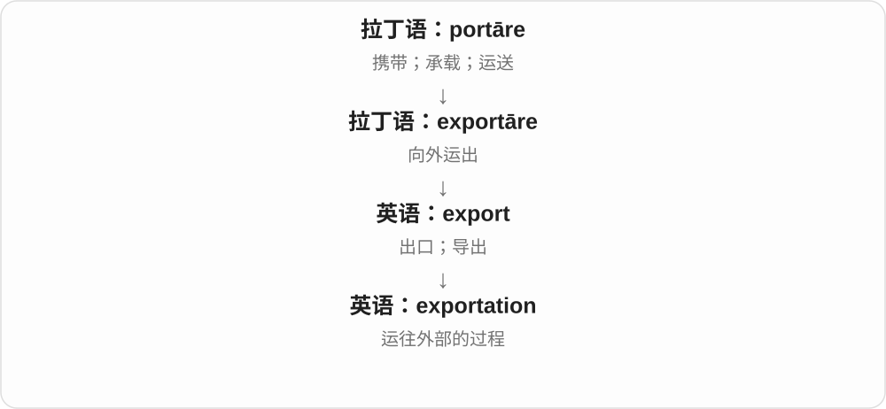

重点是运出的行为，通常不指一件具体出口商品。若说一国的出口商品或出口额，常用 exports。

**常见搭配与例句**

the exportation of goods（货物出口）；exportation to overseas markets（出口海外市场）。

> The report traces the exportation of wool during that period.

报告追溯了那个时期羊毛出口的情况。

> The goods were prepared for exportation.

这些货物已准备好出口。

**别混淆**

exportation 是出口过程；an export 可以是某项出口商品。一般句子里 export 往往更简洁自然。

### 216. exhalation — 呼气；呼出的气；散发出的气体或气味

**音标**：/ˌekshəˈleɪʃən/

**先抓住这个画面**

把“往外呼一口气”当作一次动作或一股呼出的气息来谈，焦点落在这一步。

**怎么拆**

拉丁 exhalare → 名词 exhalatio／exhalation- → 英语 exhalation。现代可与 exhale、-ation 对照，但它有独立的拉丁名词借入历史，并非必须从英语动词新造。

**怎么变成今天的意思**

**拉丁 ex- + halare → exhalare**  
向外呼出、散发

↓

**拉丁名词 exhalatio／exhalation- → 英语 exhalation**  
呼出、散发这一动作；呼出的气息

a long exhalation 是长长呼出的一口气；inhalation and exhalation 是吸气与呼气。旧式或文学场景中也可能指地面、植物等散出的气体或气味。

**常见搭配与例句**

a slow exhalation；a long exhalation；inhalation and exhalation。

> A long exhalation broke the silence.

一声长长的呼气打破了寂静。

> The animation shows inhalation followed by exhalation.

动画展示了先吸气、再呼气的过程。

**别混淆**

exhale 是做这个动作的动词；exhalation 把动作当成名词来讨论。expiration 在医学中也可指呼气，但一般阅读还常指到期。

### 217. politicization — 政治化；政治意识或参与的增强

**音标**：英 /pəˌlɪtɪsaɪˈzeɪʃən/；美 /pəˌlɪtəsəˈzeɪʃən/

**先抓住这个画面**

把变化当成一个过程来谈：一个问题怎样开始牵动政治立场，一群人又怎样开始参与公共事务。

**怎么拆**

politicize 去掉词尾 e 加 -ation；英式也写 politicisation。

**怎么变成今天的意思**

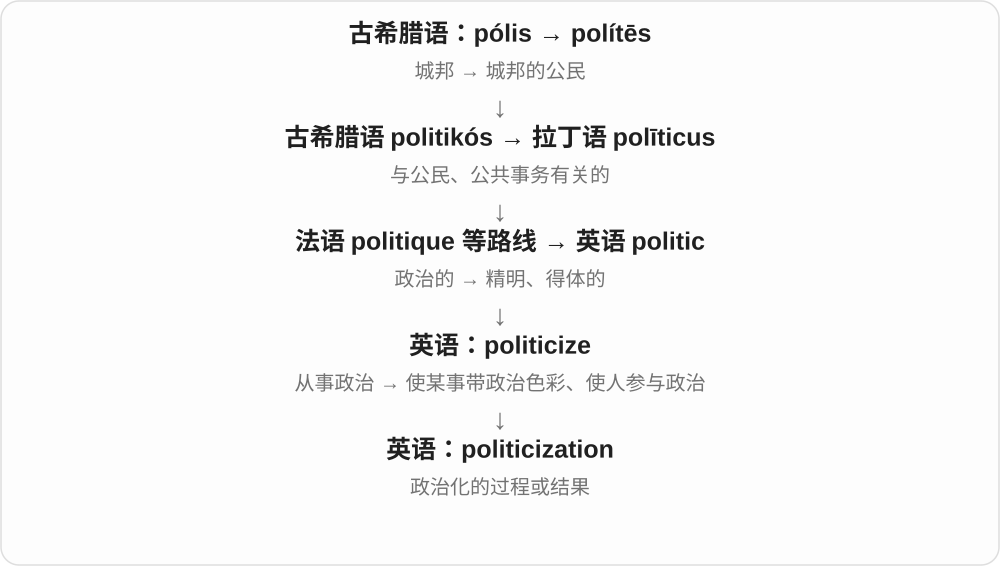

可批评机构受到党派影响，也可研究公众政治意识的形成。词本身不自动表示好或坏。

**常见搭配与例句**

the politicization of education；increasing politicization；youth politicization。

> The report examines the politicization of school appointments.

报告考察了学校人事任命的政治化。

> The historian traces the politicization of young workers.

这位历史学家追溯了年轻工人政治意识增强的过程。

**别混淆**

politicization 指政治因素进入或增强；polarization 指立场向两端分化，二者可能相关，但不是同一个过程。

### 218. sensitization — 敏化；使反应增强或意识提高的过程

**音标**：英 /ˌsensətaɪˈzeɪʃən/；美 /ˌsensətəˈzeɪʃən/

**先抓住这个画面**

它把“越来越能感觉到、越来越容易起反应”当成一个变化过程。

**怎么拆**

sensitize + -ation，去掉词尾 e 后构成名词；英式也写 sensitisation。

**怎么变成今天的意思**

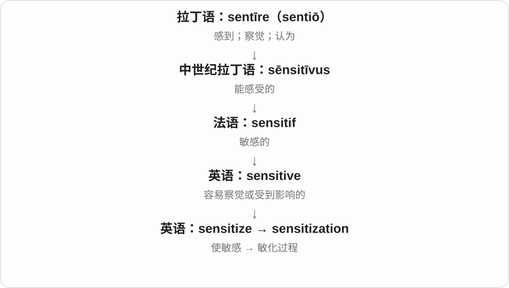

在材料、生理和社会教育语境可有不同专门含义。先看是什么对象对什么变得敏感，再翻译。

**常见搭配与例句**

sensitization to light；a sensitization process；public sensitization。

> The paper describes the sensitization of the photographic material.

论文描述了这种照相材料的敏化过程。

> The training includes sensitization to cultural differences.

培训包含帮助学员认识文化差异的内容。

**别混淆**

sensitivity 是当下敏感程度；sensitization 是敏感程度或意识发生变化的过程。

### 219. dehumanization — 去人性化；非人化

**音标**：英 /ˌdiːhjuːmənaɪˈzeɪʃən/；美 /ˌdiːhjuːmənəˈzeɪʃən/

**先抓住这个画面**

把活生生的人当成编号、物件或低等对象，从而不再认真对待他们的感受和尊严。

**怎么拆**

dehumanize + -ation；de- 在这里表示剥夺，human 指人的特征、地位与尊严。

**怎么变成今天的意思**

**拉丁语 humanus，与 homo / homin- 同族**  
人的；有教养、有人情味的

↓

**古法语 humain → 英语 human / humane**  
人的，也曾包含仁慈的意思

↓

**英语 de- + human + -ize → dehumanize**  
剥去人的特征或应有待遇

↓

**dehumanize + -ation → dehumanization**  
这种过程或结果

可谈宣传把某群体描绘成不配得到同情，也可谈制度让个人只剩数字。不是指身体真的变成另一物种。

**常见搭配与例句**

the dehumanization of workers；resist dehumanization。

> The novel shows the dehumanization of people reduced to numbers.

小说展示了人被简化成编号后的非人化处境。

> The campaign challenged language that encouraged dehumanization.

这场倡议反对助长去人性化的语言。

**别混淆**

depersonalization 可能指失去个性化，也有特定心理学义；dehumanization 更突出否认人的地位或尊严。

### 220. stigmatization — 污名化

**音标**：英 /ˌstɪɡmətaɪˈzeɪʃən/；美 /ˌstɪɡmətəˈzeɪʃən/

**先抓住这个画面**

把“给人贴坏标签”整个过程拿出来讨论。

**怎么拆**

英语 stigmatize + 名词后缀 -ation，词尾形成 -ization。这个名词早期也用于宗教伤痕语境；现代社会讨论中通常指对人或群体施加污名。

**怎么变成今天的意思**

**希腊 stizein → stigma，词干 stigmat-**  
刺、刻记号 → 点、刺出的标记或烙印

↓

**希腊 stigmatizein → 中世纪拉丁 stigmatizare**  
给人或物打上标记、烙印

↓

**中世纪拉丁借入说；亦有经法语 stigmatiser 的分析**  
英语 stigmatize：打上污名，贴上贬损标签

↓

**英语 stigmatize → stigmatization**  
把行为或状态名词化；现代常说社会性的污名化

the stigmatization of a group 关注这种负面标签是怎样形成、传播并影响人的。它常见于较正式的社会研究和政策讨论，但核心仍是“别先用身份把一个人判坏”。

**常见搭配与例句**

social stigmatization；the stigmatization of illness；reduce stigmatization。

> The study examines the stigmatization of people living in poverty.

这项研究考察社会如何给贫困人群贴上负面标签。

> Clear information can help reduce stigmatization.

清楚的信息有助于减少污名化。

**别混淆**

stigma 是标签或坏名声，stigmatization 是施加、传播这种标签的过程；discrimination 则进一步涉及不公平对待。

### 221. vocalization — 发声；发出的声音；元音化

**音标**：英 /ˌvəʊkəlaɪˈzeɪʃən/；美 /ˌvoʊkələˈzeɪʃən/

**先抓住这个画面**

从“发声”这个动作，转成一次声音或一类发声行为：比如鸟的一声叫，或婴儿连续的咿呀声。

**怎么拆**

英语 vocalize + -ation 的分析，与法语 vocalisation 借入说并存；法语名词有较早记录。现代结构清楚，但不把英语动词派生说当作唯一历史。

**怎么变成今天的意思**

**拉丁 vox，词干 voc-，宾格 vocem**  
声音、话语；与 vocare“呼唤”同族

↓

**拉丁 vocalis → 法语／英语 vocal**  
与声音有关

↓

**法语 vocalisation；或英语 vocalize + -ation**  
两种来源分析：发声这一过程或产物

↓

**英语 vocalization**  
发声、叫声；语言学中的元音化

可数的 a vocalization 是一次或一种发声；不可数时谈发声能力、过程。动物的 vocalizations 不等于人类词语，研究时需看它们承担什么功能。

**常见搭配与例句**

animal vocalizations；early vocalization；the vocalization of a consonant。

> The microphone captured several quiet vocalizations from the bird.

麦克风录到了那只鸟几声轻轻的鸣叫。

> The chapter discusses the vocalization of consonants in this dialect.

这一章讨论这种方言中辅音转成元音的现象。

**别混淆**

voice 是嗓音或发声能力；vocalization 可是具体的一段叫声，也可指发声活动。

### 222. homogenization — 均质化；同质化、趋于一致的过程

**音标**：美 /həˌmɑːdʒənəˈzeɪʃən/ 或 /hoʊˌmɑːdʒənəˈzeɪʃən/

**先抓住这个画面**

原本不同部分各有差别，经过处理或长期变化，整体越来越均匀、越来越像。

**怎么拆**

英语 homogenize + -ation，表示使均一的过程或结果；homogenize 属于 homogeneous 词族，远接希腊 homos“相同”+ genos“种类”。英式也常写 homogenisation。

**怎么变成今天的意思**

**希腊 homogenēs → 拉丁 homogeneus → 英语 homogeneous**  
同类的、均一的

↓

**英语 homogenize**  
使组成或性质更均一

↓

**homogenize + -ation → homogenization**  
均质化的过程；文化、产品等的同质化

牛奶的 homogenization 是使脂肪微粒更细、更均匀分散，减少上浮分层；这与加热杀菌不是同一件事。cultural homogenization 则说不同地方的文化越来越像，常用于讨论特色是否正在消失。

**常见搭配与例句**

milk homogenization；cultural homogenization；the homogenization of retail spaces。

> Homogenization helps keep the fat evenly dispersed in milk.

均质化有助于让牛奶中的脂肪保持均匀分散。

> Local artists worry about the homogenization of shopping streets.

当地艺术家担心购物街越来越千篇一律。

**别混淆**

standardization 强调采用共同标准；homogenization 强调结果更相似、更均匀。统一插头标准并不等于所有产品失去个性。

### 223. sexualization — 性化；赋予性意味

**音标**：英 /ˌsekʃuəlaɪˈzeɪʃən/；美 /ˌsekʃuələˈzeɪʃən/

**先抓住这个画面**

原本可以从多方面看待的人或事，被特别套上性的意义。

**怎么拆**

sexualize + -ation，也可按 sexual + -ization 理解；名词承接赋予性特征的动词。

**怎么变成今天的意思**

**拉丁 sexus**  
性别、雌雄类别；更早是否接“切分”词根仍有争议

↓

**晚期拉丁 sexuālis → 英语 sexual**  
与性别、生殖有关的 → 与性吸引、性行为有关的

↓

**英语 sexual + -ize → sexualize → sexualization**  
赋予性意味 → 这一过程或结果

媒体讨论里常指过分突出性吸引，使人物其他特点被遮住。分析时应说明具体呈现手法，而不是把任何身体描写都当作性化。

**常见搭配与例句**

the sexualization of advertising；media sexualization。

> The essay criticises the sexualization of the character in the adaptation.

文章批评改编作品对这个人物的性化处理。

> The study examines sexualization in product advertising.

研究考察产品广告中的性化现象。

**别混淆**

sexuality 是人的性体验等广义概念；sexualization 是赋予或强化性意味的过程。

### 224. idealization — 理想化；理想化的表现或模型

**音标**：英 /aɪˌdiːəlaɪˈzeɪʃən/；美 /aɪˌdiːələˈzeɪʃən/

**先抓住这个画面**

把对象处理成一个更完美或更简单的版本；也可以指处理后得到的那个版本。

**怎么拆**

可按 idealize + -ation 理解，词源资料也提出可能经法语 idéalisation。不能把法语名词画成从已经存在的英语名词再回流到过去。

**怎么变成今天的意思**

**ideal 及 idealize 词族**  
理想形式；作理想化处理

↓

**英语 -ation 名词／可能的法语 idéalisation 借入**  
idealization 的形成分析

↓

**现代用途**  
美化对象；为研究作理想化设定

a romantic idealization of the past 是把过去浪漫化；a useful idealization in physics 则可能是有用的简化模型。要问它省掉了什么、用来做什么，而不是看到这个词就一律判断为坏事。

**常见搭配与例句**

the idealization of childhood；romantic idealization；a useful idealization；an idealization of a real system。

> The essay challenges the idealization of life before the internet.

这篇文章质疑把互联网出现前的生活理想化的看法。

> A frictionless plane is a useful idealization for this problem.

无摩擦平面是分析这个问题时一种有用的理想化设定。

**别混淆**

idealization 是处理过程或结果；idealism 是一种思想态度或哲学立场。做一个理想化模型，不说明作者就是理想主义者。

### 225. digitalization — 数字化；数字技术的采用过程

**音标**：英 /ˌdɪdʒɪtəlaɪˈzeɪʃən/；美 /ˌdɪdʒɪtələˈzeɪʃən/

**先抓住这个画面**

既可能是资料形式的转换，也可能是在说整个服务或流程改变了做法。

**怎么拆**

digitalize + -ation，也可分析为 digital + -ization；保留 digital 的完整词干。

**怎么变成今天的意思**

**拉丁语 digitus → digitalis**  
手指、脚趾 → 与其有关的

↓

**英语 digital**  
与数字有关；后来用于数字技术

↓

**digitalize → digitalization**  
数字化这一过程或变化

digitalization of public services 可以包括网上申请、电子记录和系统间的信息交换。有些商业文章把它与 digitization 区分，前者谈流程、后者谈资料，但普通词典和实际用例也有交叉。理解时先问“什么东西发生了什么改变”。

**常见搭配与例句**

digitalization of services；digitalization of records；digitalization efforts。

> Digitalization allowed residents to submit forms from home.

数字化使居民可以在家提交表格。

> The report examines the costs of digitalization for small businesses.

报告考察了数字化对小企业带来的成本。

**别混淆**

digitalization 不自动等于业务已经变好，也不自动等于全面自动化；这些效果需要上下文另行说明。

### 226. summarization — 概括；摘要生成；总结过程

**音标**：英 /ˌsʌməraɪˈzeɪʃən/；美 /ˌsʌmərəˈzeɪʃən/

**先抓住这个画面**

把长材料压成短摘要这项工作，关注过程而不只是成品。

**怎么拆**

summarize + -ation，构成行为名词。

**怎么变成今天的意思**

**拉丁 summus → summa**  
最高的 → 顶端、总体、总额、要点

↓

**拉丁 summarius → 英语 summary〔形容词〕；summarium → summary〔名词〕**  
扼要的；汇集主要内容的摘要

↓

**英语 summarize → summarization**  
进行概括 → 概括的过程

text summarization 是文本摘要生成；automatic summarization 常见于软件功能说明。它既可能保留原文片段，也可能重新组织表达，词本身不限定方法。

**常见搭配与例句**

text summarization；automatic summarization；a summarization task。

> The software offers automatic summarization of long documents.

软件提供长文档自动摘要功能。

> Good summarization preserves the main point without every supporting detail.

好的概括能保留主旨，而不必把每个支撑细节都留下。

**别混淆**

summary 通常是摘要成品；summarization 更强调制作摘要这个过程。

### 227. familiarization — 熟悉过程；入门熟悉训练

**音标**：英 /fəˌmɪliəraɪˈzeɪʃən/；美 /fəˌmɪljərəˈzeɪʃən/

**先抓住这个画面**

正式开始之前，先认环境、看操作、试一下，让人不再摸不着头脑。

**怎么拆**

familiarize + -ation，也可分析 familiar + -ization；英式有 familiarisation。

**怎么变成今天的意思**

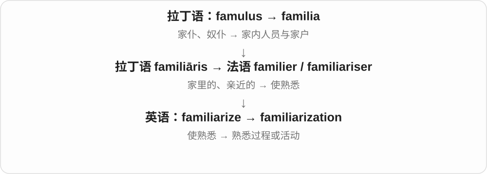

多见于培训、设备操作和新员工入门。一次 familiarization 不必等于完整专业训练。

**常见搭配与例句**

a familiarization session；equipment familiarization。

> New employees attend a familiarization session on their first day.

新员工第一天参加入门熟悉活动。

> The programme includes familiarization with the laboratory equipment.

项目包括熟悉实验室设备的环节。

**别混淆**

familiarity 是已经熟悉的程度；familiarization 是逐渐熟悉的过程。

### 228. computerization — 电脑化；引入计算机处理的过程

**音标**：英 /kəmˌpjuːtəraɪˈzeɪʃən/；美 /kəmˌpjuːtərəˈzeɪʃən/

**先抓住这个画面**

从纸本、手工步骤过渡到计算机系统的整个改变，包括改记录方式，也包括改工作流程。

**怎么拆**

computerize → computerization；-ize 变为 -ization，表示这个转变的过程。

**怎么变成今天的意思**

**拉丁 putare**  
修剪、清理；计算、考虑、判断

↓

**拉丁 com- 一起 + putare → computare**  
合起来计算、盘算

↓

**法语 computer／拉丁 computare → 英语 compute**  
计算、求值

↓

**英语 compute + -er → computer**  
先指做计算的人，后指计算机器

↓

**英语 computerize**  
使采用计算机处理

↓

**英语 computerize → computerization**  
电脑化过程

它通常不是买来机器就结束，还可能涉及数据迁移、流程调整和人员学习。词义说的是这一转变，不是自动保证效率提高。

**常见搭配与例句**

the computerization of records；a computerization project；gradual computerization。

> Computerization made the old paper index searchable.

电脑化让原来的纸质索引变得可以检索。

> The museum planned the computerization of its catalogue.

博物馆规划了藏品目录的电脑化。

**别混淆**

automation 说自动完成工作；computerization 说采用计算机，两者可以重合但不完全相同。

## 这一组要分清什么

inflammation 炎症、infection 感染、infestation 大量侵扰分用；localization 本地化可超出翻译；capitalisation 按字母、资本语境分义；序列化不等于加密或压缩；英美拼写变体放在相应词族一起看。

## 串起来练习

The compilation combines observations from several studies and explains the categorization of the data.

这份汇编结合了几项研究的观察，并解释数据如何分类。
