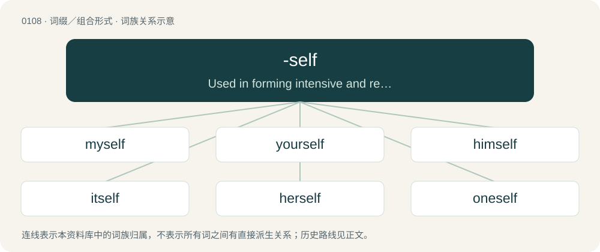

# 0112 · -self — Used in forming intensive and reflexive forms of the singular personal pronouns.

[总目录](../00_总目录_按常用程度.md)

**类型**：词缀／组合形式　｜　**来源语言**：见词源记录

## 核心含义与来源

- 核心含义：Used in forming intensive and reflexive forms of the singular personal pronouns.
- 英文含义：Used in forming intensive and reflexive forms of the singular personal pronouns.
- 词形：-self

**来源记录 1**（后缀／后置成分；Used in forming intensive and reflexive forms of the singular personal pronouns.）

From Middle English -self, from Old English self; compare Dutch -zelf.

## 词族图

## 单词速览（常用到不常用）

| 单词 | 音标 | 释义 |
|---|---|---|
| [myself](#w-1) | /maɪˈsɛlf/ | pron. 我自己, 我亲自, 我独自 |
| [yourself](#w-2) | /jəˈsɛlf/ | pron. 你自己 |
| [himself](#w-3) | /hɪmˈsɛlf/ | pron. 他自己, 他亲自 |
| [itself](#w-4) | 英 /ɪtˈsɛlf/ | pron. 它本身, 它自己 |
| [herself](#w-5) | 英 /hɜːˈsɛlf/；美 /hɝˈsɛlf/ | pron. 她自己, 她亲自 |
| [oneself](#w-6) | /wʌnˈsɛlf/ | pron. 自己, 亲自 |
| [themself](#w-7) | /ðɛmˈsɛlf/ | pron. \[俚\]他自己；\[俚\]其本身 |
| [ourself](#w-8) | /(ˌ)aʊə(ɹ)ˈsɛlf/ | pron. 自己；我们 |
| [hisself](#w-9) | /ˈhɪz.sɛlf/ | pron. &lt;非规范&gt;&lt;方&gt;=himself |

## 逐词详解

### 1. myself

**词性**：代词　｜　**音标**：/maɪˈsɛlf/

**中文释义**：pron. 我自己, 我亲自, 我独自

**英文义项**：Me, as direct or indirect object the speaker as the object of a verb or preposition, when the speaker is also the subject. / Personally, for my part; used in apposition to I, sometimes for simple emphasis and sometimes with implicit exclusion of any others performing the activity described.

**构词拆分**：me + self；my + self

**词源与演化**：

From Middle English myself, meself, from Old English mē selfum and similar phrases, equivalent to me + self, later partly reinterpreted as my + self / -self. Cognate with Scots mysel, mysell (“myself”), West Frisian mysels (“myself”), Dutch mijzelf (“myself”), German mich selbst, mir selbst (“myself”), Norwegian Bokmål meg selv (“myself”).

**例句**：

> (I) don’t think much of your new car, myself.

该用例对应义项：Me, as direct or indirect object the speaker as the object of a verb or preposition, when the speaker is also the subject.

### 2. yourself

**词性**：代词　｜　**音标**：/jəˈsɛlf/

**中文释义**：pron. 你自己

**英文义项**：Your own self (singular). / You (singular); used emphatically, especially to indicate exclusiveness of the referent's participation in the predicate, i.e., that no one else is involved.

**构词拆分**：your + -self

**词源与演化**：

From Middle English yourself, equivalent to your + -self.

**例句**：

> After a good night's sleep you'll feel like yourself again.

该用例对应义项：Your own self (singular).

### 3. himself

**词性**：代词　｜　**音标**：/hɪmˈsɛlf/

**中文释义**：pron. 他自己, 他亲自

**英文义项**：Him; the male object of a verb or preposition that also appears as the subject / He; used as an intensifier, often to emphasize that the referent is the exclusive participant in the predicate

**构词拆分**：him + -self

**词源与演化**：

From Middle English hymself, from Old English him selfum. Equivalent to him + -self.

**例句**：

> Has himself come down to breakfast yet?

该用例对应义项：The subject or non-reflexive object of a predicate; he (used of upper-class gentlemen, or sarcastically, of men who imagine themselves to be more important than others)

### 4. itself

**词性**：代词　｜　**音标**：英 /ɪtˈsɛlf/

**中文释义**：pron. 它本身, 它自己

**英文义项**：it; A thing as the object of a verb or preposition that also appears as the subject / it; used to intensify the subject, especially to emphasize that it is the only participant in the predicate

**构词拆分**：it + -self

**词源与演化**：

From Middle English hit-self, equivalent to it + -self.

**例句**：

> When the opportunity presented itself, no feasible course of action suggested itself (to us).

该用例对应义项：it; A thing as the object of a verb or preposition that also appears as the subject

### 5. herself

**词性**：代词　｜　**音标**：英 /hɜːˈsɛlf/；美 /hɝˈsɛlf/

**中文释义**：pron. 她自己, 她亲自

**英文义项**：Her; the feminine object of a verb or preposition that also appears as the subject. / She; an intensifier of the female subject or object, often used to indicate the directness or exclusiveness of that person .

**构词拆分**：her + -self

**词源与演化**：

From Middle English. Equivalent to her + -self.

**例句**：

> The United States is causing problems for herself with this policy.

该用例对应义项：Her; the feminine object of a verb or preposition that also appears as the subject.

### 6. oneself

**词性**：代词　｜　**音标**：/wʌnˈsɛlf/

**中文释义**：pron. 自己, 亲自

**英文义项**：A person's self: general form of himself, herself, themselves or yourself.

**构词拆分**：one + -self

**词源与演化**：

A contracted form of one's self (Mid-16th century). Equivalent to one + -self.

**例句**：

> Teaching oneself to swim can be dangerous.

该用例对应义项：A person's self: general form of himself, herself, themselves or yourself.

### 7. themself

**词性**：代词　｜　**音标**：/ðɛmˈsɛlf/

**中文释义**：pron. \[俚\]他自己；\[俚\]其本身

**英文义项**：The reflexive form of they, the third-person singular personal pronoun. The single person previously mentioned, as the object of a verb or following a preposition (also used for emphasis).

**构词拆分**：them + -self

**词源与演化**：

From Middle English theimself. Equivalent to them + -self. Reinforced by analogy with the singular-plural distinction between yourself and yourselves.

**例句**：

> Anyone who wants a car like mine can buy one themself.

该用例对应义项：The reflexive form of they, the third-person singular personal pronoun. The single person previously mentioned, as the object of a verb or following a preposition (also used for emphasis).

### 8. ourself

**词性**：代词　｜　**音标**：/(ˌ)aʊə(ɹ)ˈsɛlf/

**中文释义**：pron. 自己；我们

**英文义项**：The reflexive of the royal or editorial we: myself (as used by one who is a monarch, writer or speaker when referring to oneself as we). / The reflexive of the generic we: oneself.

**构词拆分**：our + -self

**词源与演化**：

From Middle English oure-selfe; equivalent to our + -self.

**例句**：

> In the present study, we will limit ourself to the simplest of cases.

该用例对应义项：The reflexive of the royal or editorial we: myself (as used by one who is a monarch, writer or speaker when referring to oneself as we).

### 9. hisself

**词性**：代词　｜　**音标**：/ˈhɪz.sɛlf/

**中文释义**：pron. &lt;非规范&gt;&lt;方&gt;=himself

**英文义项**：Himself.

**构词拆分**：his + -self

**词源与演化**：

From Middle English his-self, his self, his-selfe, his-selven, his selfen; equivalent to his + -self.
