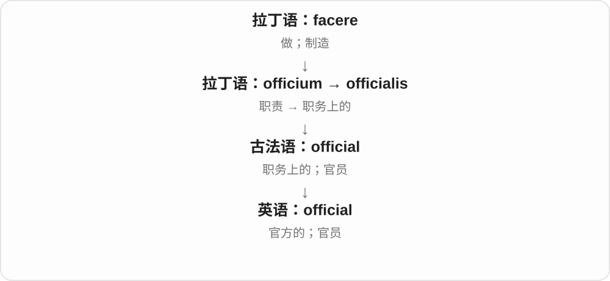
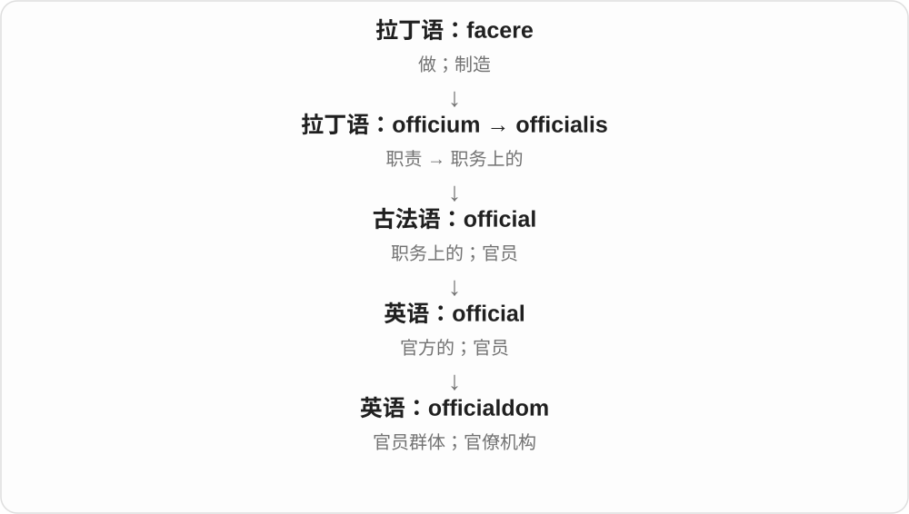

# 0113 · -dom — 状态、身份、统辖领域；某类人的整体

[逐词精讲目录](../00_逐词精讲目录.md) · [总目录](../00_总目录_按常用程度.md)

## 核心词根与来源

-dom 来自古英语 dom 判断、法令等原本独立的词，早已形成后缀，扩展出统辖范围、状态、性质等义。现代 doom 常说厄运，但不能把 freedom、wisdom 都译成某种灾难；那是同族材料后来的不同分工。

**DOM：处在怎样一种状态，或属于谁的领域、群体**

kingdom 是国王的领域，freedom 是自由的状态，wisdom 是有见识的智慧，fandom 则像把同好圈在一个圈子里。

- **状态与性质**：free · freedom；wise · wisdom；bore · boredom
- **身份、领地与统辖**：king · kingdom；duke · dukedom；fief · fiefdom
- **经历与人群**：martyr · martyrdom；fan · fandom；star · stardom；official · officialdom

## 词形与演化规律

wise／wisdom 是古老组合的对应，元音不能按今天 wise 的读音直接拼；martyr + -dom 显示借来的词也能接本族后缀。duke／dukedom 可说爵位也可说领地；fiefdom 还常比喻私人控制的组织地盘。

## 单词速览（按词族由简到繁）

同一基础词的相关扩展放在一起，先读基础形式，再读扩展；各组之间优先读常用的。具体词源关系见各词讲解。

| 单词 | 音标 | 核心意思 |
|---|---|---|
| [free](#w-14) | /friː/ | 自由的；空闲的；免费的；释放 |
| [freedom](#w-1) | /ˈfriːdəm/ | 自由；不受某种约束的状态 |
| [star](#w-15) | 英 /stɑː/；美 /stɑːr/ | 星；星形标记；明星；主演；标星 |
| [stardom](#w-7) | 英 /ˈstɑːdəm/；美 /ˈstɑːrdəm/ | 明星地位；成名 |
| [superstardom](#w-13) | 英 /ˈsuːpəstɑːdəm/；美 /ˈsuːpərstɑːrdəm/ | 超级明星地位；巨星身份 |
| [king](#w-16) | /kɪŋ/ | 国王；王；某领域的顶尖人物 |
| [kingdom](#w-2) | /ˈkɪŋdəm/ | 王国；领域；生物分类中的界 |
| [official](#w-17) | /əˈfɪʃəl/ | 官方的；官员 |
| [officialdom](#w-10) | /əˈfɪ.ʃəl.dəm/ | 官员群体；官僚机构 |
| [fan](#w-18) | /fæn/ | 风扇、扇子；扇动；迷、粉丝〔另源〕 |
| [fandom](#w-4) | /ˈfændəm/ | 粉丝群体；粉丝文化、圈子；作为粉丝的状态 |
| [wise](#w-19) | /waɪz/ | 明智的；有智慧的；知情的〔部分搭配〕 |
| [wisdom](#w-3) | /ˈwɪzdəm/ | 智慧；明智判断；经验之谈 |
| [duke](#w-20) | 英 /djuːk/〔亦 /dʒuːk/〕；美 /duːk/ | 公爵 |
| [dukedom](#w-12) | 英 /ˈdjuːkdəm/；美 /ˈduːkdəm/ | 公爵爵位；公爵领地 |
| [bore](#w-21) | 英 /bɔː/；美 /bɔːr/ | 钻孔；孔、内径；使厌烦、无聊的人或事；bear 的过去式；潮涌 |
| [boredom](#w-5) | 英 /ˈbɔːdəm/；美 /ˈbɔːrdəm/ | 无聊、厌倦的状态 |
| [doom](#w-22) | /duːm/ | 毁灭；厄运；使注定失败 |
| [martyr](#w-23) | 英 /ˈmɑːtə/；美 /ˈmɑːrtər/ | 殉道者；为信念、事业牺牲者；自显受苦的人〔批评用法〕 |
| [martyrdom](#w-6) | 英 /ˈmɑːtədəm/；美 /ˈmɑːrtərdəm/ | 殉道；为信仰、事业受难牺牲；受苦状态〔亦可夸张〕 |
| [fief](#w-24) | /fiːf/ | 封地；受封土地或相应权利〔历史〕 |
| [fiefdom](#w-9) | /ˈfiːfdəm/ | 封地、封域；被某人当作私人地盘的组织领域〔常见比喻〕 |

## 逐词讲解

### 1. free — 自由的；空闲的；免费的；释放

**音标**：/friː/

**先抓住这个画面**

先问少了什么限制：人不受束缚，时间没被占用，服务不收费用。

**怎么拆**

接古英语 frēo 等形式。更早日耳曼语形式还与亲爱、自己群体中的自由成员等历史有关；不能简单宣称所有现代义都是“因为被爱所以自由”。动词 free“使自由”也有早期英语形式。

**怎么变成今天的意思**

**古英语 frēo / frēoh → 中古英语 fre**  
自由的；不受奴役的

↓

**英语 free**  
不受限制；不收费；释放

free to leave 是可以自由离开，free this afternoon 是下午有空，free admission 是免门票；free the bird 是释放鸟。free from fear 是不受恐惧困扰。

**常见搭配与例句**

free to do；free from；free of charge；free time；set free。

> Are you free for lunch tomorrow?

你明天有空一起吃午饭吗？

> Admission to the museum is free.

博物馆免费入场。

> They freed the bird from the net.

他们把鸟从网中解救出来。

**别混淆**

free 既可免费也可自由：free software 在某些技术语境强调使用修改的自由，不只价钱；a free seat 则可能是空座，需看语境。

### 2. freedom — 自由；不受某种约束的状态

**音标**：/ˈfriːdəm/

**先抓住这个画面**

能作选择、能行动，或终于不用受某种压迫和困扰。

**怎么拆**

free + -dom，与古英语 frēodōm、中古英语 fredom 相连；-dom 表状态、领域等，在此形成自由的抽象名词。不是 free + doom“厄运”。

**怎么变成今天的意思**

**古英语 frēo / frēoh → 中古英语 fre**  
自由的；不受奴役的

↓

**古英语 frēodōm → 中古英语 fredom → freedom**  
自由身份及不受限制的状态

freedom of speech 是言论自由，freedom to choose 是选择自由，freedom from hunger 是免于饥饿。of、to、from 指向不同关系。

**常见搭配与例句**

freedom of expression；freedom to choose；freedom from fear。

> The job gives her the freedom to work from home.

这份工作让她可以自由选择在家办公。

> The novel explores the desire for freedom.

小说探讨了对自由的渴望。

**别混淆**

free 是形容词或动词，freedom 是名词。free time 是空闲时间，freedom of time 并不是它的普通替换。

### 3. star — 星；星形标记；明星；主演；标星

**音标**：英 /stɑː/；美 /stɑːr/

**先抓住这个画面**

天上显眼发亮的星，被借来称在人群中出众、受关注的人；星形又成了评分、收藏标记。

**怎么拆**

由古英语 steorra 经中古英语 sterre 延续，与拉丁 stella 等远处同族。名人比喻、星形标记及动词主演是不同固定用法，不能只记天文名词。

**怎么变成今天的意思**

**古英语 steorra → 中古英语 sterre → star**  
星

↓

**现代 star**  
恒星、星形标记 → 明星、突出者；主演、标星等

a bright star 明亮的星，a film star 电影明星；star in a film 在电影里主演，star a message 给消息标星。太阳也是一颗恒星，但日常 night sky 的 stars 常有更窄的场景。

**常见搭配与例句**

a film star；a rising star；star in；a five-star rating。

> She stars in the new film.

她在新电影中担任主演。

> I starred the message so I could find it later.

我给消息标了星，方便以后找到。

**别混淆**

star 星、明星，stare 盯着看；starred 与 stared 只差一个 r，却对应不同动词。

### 4. stardom — 明星地位；成名

**音标**：英 /ˈstɑːdəm/；美 /ˈstɑːrdəm/

**先抓住这个画面**

不是某一个明星，而是被大众认识、追捧的那种地位和生活状态。

**怎么拆**

star 明星 + -dom 身份、状态后缀；与 kingdom 中的 -dom 同一类材料，但这里不是一块明星领土。

**怎么变成今天的意思**

**古英语 steorra → 中古英语 sterre → star**  
星

↓

**现代 star**  
恒星、星形标记 → 明星、突出者；主演、标星等

↓

**star + -dom → stardom**  
明星 → 明星身份、成名状态

rise to stardom 成名，achieve stardom 成为明星；the pressures of stardom 明星地位带来的压力。

**常见搭配与例句**

rise to stardom；achieve stardom；the pressures of stardom。

> Her first album brought her overnight stardom.

第一张专辑让她一夜成名。

> He found the pressures of stardom difficult to handle.

他发现明星地位带来的压力很难应对。

**别混淆**

star 可指人，stardom 指地位、状态；a film star 电影明星，不说 a film stardom 来指一个演员。

### 5. superstardom — 超级明星地位；巨星身份

**音标**：英 /ˈsuːpəstɑːdəm/；美 /ˈsuːpərstɑːrdəm/

**先抓住这个画面**

不只是一个明星，而是站到名气和公众关注的最前排，把这种地位整体称作 superstardom。

**怎么拆**

英语 superstar + -dom；也可理解 super- 强化 stardom。-dom 在这里表示身份或状态，不是实际的王国。

**怎么变成今天的意思**

**拉丁 super**  
在上方、超过、越过

↓

**英语构词成分 super-**  
超出一般程度；在上、额外或超过某界限

↓

**英语 superstar + -dom → superstardom**  
巨星 → 巨星地位、成名状态

rise to superstardom 说从普通知名度走向巨星地位。它可以伴随压力和曝光，不只表示事业成功这一面。

**常见搭配与例句**

rise to superstardom；the pressures of superstardom。

> The album launched her into international superstardom.

这张专辑让她成为国际巨星。

> He found the constant attention of superstardom exhausting.

巨星身份带来的持续关注让他感到疲惫。

**别混淆**

superstar 是人物；superstardom 是身份与成名状态。

### 6. king — 国王；王；某领域的顶尖人物

**音标**：/kɪŋ/

**先抓住这个画面**

国家君王是本义；借它在等级顶端的位置，也叫某领域最出名、最强或最有影响的人。

**怎么拆**

由古英语 cyning 等形式缩短延续。历史与 kin 亲族相关，但最初究竟怎样从亲族关系命名君王有争论，不把现代 king 说成今天 kin + -ing 的动名词。

**怎么变成今天的意思**

**古英语 cyning 等 → 中古英语 king**  
君王，与 kin 亲族词族有历史关联，具体最初命名关系有争论

↓

**英语 king**  
国王；君王棋子、纸牌；比喻领军者、顶尖者

a king and queen 国王与王后或女王，the king in chess 国际象棋的王；the king of comedy 喜剧之王。也可用于君王棋子、纸牌名称。

**常见搭配与例句**

a reigning king；a king of comedy；the king in chess；a king of hearts。

> The king appears only in the final chapter of the story.

故事中的国王到最后一章才出现。

> She moved her king to a safer square.

她把国际象棋中的王移到了更安全的格子。

**别混淆**

king 国王，kingdom 王国，kingship 王位、君王身份；三者分别是人、领地或政治共同体、角色制度。

### 7. kingdom — 王国；领域；生物分类中的界

**音标**：/ˈkɪŋdəm/

**先抓住这个画面**

不是国王本人，而是君主统治的国家、领域；也能用来谈动物界等分类范围。

**怎么拆**

king + -dom 状态、领域，古英语 cyningdōm 已有对应组合。-dom 不是 dome 圆顶；生物分类义是后来专门用法。

**怎么变成今天的意思**

**古英语 cyning 等 → 中古英语 king**  
君王，与 kin 亲族词族有历史关联，具体最初命名关系有争论

↓

**英语 king**  
国王；君王棋子、纸牌；比喻领军者、顶尖者

↓

**古英语 cyningdōm → kingdom**  
君王权力、领域 → 王国；其他领域义

a fictional kingdom 虚构王国，the animal kingdom 动物界；生物分类中的界如何划分依分类体系，不由这个英语词固定全部名单。

**常见搭配与例句**

a fictional kingdom；the animal kingdom；a kingdom in a fairy tale。

> The fairy tale is set in a distant kingdom.

童话以一个遥远王国为背景。

> The lesson introduces diversity in the animal kingdom.

课上介绍了动物界的多样性。

**别混淆**

kingdom 王国，kingship 君王身份、制度。a kingdom 不是国王的船，也不是只有男性居住的国家。

### 8. official — 官方的；官员

**音标**：/əˈfɪʃəl/

**先抓住这个画面**

盖了主管机构的章、能代表机构立场的消息，是 official；受委派行使职责的人，也可以叫 an official。

**怎么拆**

来自拉丁语 officialis，经法语传入；可与 office + -ial 对照理解。

**怎么变成今天的意思**

office 是职务，official 强调与职务及授权相连。因此 official explanation 是官方解释，并不自动保证解释完全正确。

**常见搭配与例句**

an official statement；a government official；the official website。

> We are waiting for an official announcement.

我们在等正式的官方公告。

> A local official answered the residents’ questions.

一位地方官员回答了居民的问题。

**别混淆**

formal 强调形式郑重；official 强调机构授权。正式聚餐不一定是官方活动。

### 9. officialdom — 官员群体；官僚机构

**音标**：/əˈfɪ.ʃəl.dəm/

**先抓住这个画面**

不是某一个窗口的人，而是整套官员、手续和制度，人们可概括叫 officialdom。

**怎么拆**

official + -dom，-dom 可形成领域或群体的名称。

**怎么变成今天的意思**

单个 official 扩展为整体行政群体。这个词常带疏离感或批评，尤其谈手续繁复时。

**常见搭配与例句**

deal with officialdom；the world of officialdom。

> She spent weeks dealing with officialdom over the permit.

为办理许可证，她花了数周与官僚机构打交道。

> The novel gently mocks officialdom.

小说温和地讽刺了官场。

**别混淆**

government 可以中性指政府；officialdom 更突出官员群体及办事风格。

### 10. fan — 风扇、扇子；扇动；迷、粉丝〔另源〕

**音标**：/fæn/

**先抓住这个画面**

风扇把空气扇起来，粉丝把热情投向喜欢的对象；这两路现代同形，却不能编成同一个来源。

**怎么拆**

扇具义接古英语 fann，远接拉丁 vannus 扬谷器具；爱好者义通常由 fanatic 缩略，可能也有相关爱好者表达影响。两条历史分开。

**怎么变成今天的意思**

**拉丁 vannus → 古英语 fann → fan**  
扬谷器具 → 扇子、风扇；送风、扇动

↓

**另源 fanatic → fan〔缩略〕**  
狂热爱好者 → 迷、粉丝；起初常见于美国体育语境

an electric fan 电风扇，fan the flames 扇旺火焰、煽动情绪，a football fan 球迷，I’m a fan of ... 我很喜欢……。

**常见搭配与例句**

an electric fan；fan the flames；a football fan；a fan of。

> She switched on the fan to cool the room.

她打开风扇，让房间凉快些。

> I’m a big fan of her writing.

我非常喜欢她写的东西。

**别混淆**

fan 粉丝常是中性热爱者，fanatic 往往有过度狂热意味；不能因为历史缩略关系就把所有粉丝说成极端狂热者。

### 11. fandom — 粉丝群体；粉丝文化、圈子；作为粉丝的状态

**音标**：/ˈfændəm/

**先抓住这个画面**

不只一个人喜欢，而是围绕作品、人物、运动形成共同讨论、创作、相聚的圈子。

**怎么拆**

fan 粉丝 + -dom，后缀可表领域、群体、状态。这里接爱好者 fan，不接风扇。

**怎么变成今天的意思**

**另源 fanatic → fan〔缩略〕**  
狂热爱好者 → 迷、粉丝；起初常见于美国体育语境

↓

**fan + -dom → fandom**  
粉丝群体、所形成的圈子和文化

the fandom of a series 某剧粉丝群体，join a fandom 进入粉丝圈，fandom culture 粉丝文化。

**常见搭配与例句**

join a fandom；fandom culture；an active fandom。

> The series has an active online fandom.

这部剧有活跃的网络粉丝群体。

> She discovered fan art through the fandom.

她通过粉丝圈接触到了同人画作。

**别混淆**

fan 是单个爱好者，fandom 群体、领域；fan club 是有一定组织形式的粉丝俱乐部，fandom 可以更松散。

### 12. wise — 明智的；有智慧的；知情的〔部分搭配〕

**音标**：/waɪz/

**先抓住这个画面**

遇到事情不只反应快，还知道该怎么做、什么后果值得顾及，这样的判断可以说 wise。

**怎么拆**

承古英语 wis 有见识、审慎、有经验的，与知道、看见的古老词族相关。现代不是把 why 为什么加一个 s 造出来。

**怎么变成今天的意思**

**古英语 wīs → 中古英语 wis、wise**  
有知识、经验，能审慎判断的

↓

**现代 wise**  
明智、有智慧；特定搭配中知情

a wise decision 明智决定；be wise to do something 做某事是明智的；none the wiser 仍不明白；wise to a trick 已识破把戏。

**常见搭配与例句**

a wise choice；wise advice；none the wiser。

> It was wise to check the address before leaving.

出发前核对地址是明智的。

> She gave me some wise advice.

她给了我一些明智的建议。

**别混淆**

clever 偏聪明、能想办法，wise 更强调判断成熟、顾及后果；一个巧妙但后患很多的点子可以 clever 却不 wise。

### 13. wisdom — 智慧；明智判断；经验之谈

**音标**：/ˈwɪzdəm/

**先抓住这个画面**

知道很多事实是知识；碰到复杂局面，能判断什么值得做、什么时候该停，更接近 wisdom。

**怎么拆**

承古英语 wisdom，wis 明智的 + dom 状态、判断等材料，与 wise 同族。现代智慧义是长期延续，不是从英语 wise 临时去 e 再读成 /wɪz/ 的普遍拼读规则。

**怎么变成今天的意思**

**古英语 wīs + dōm → wīsdōm**  
明智、见识的状态及判断

↓

**英语 wisdom**  
智慧、明智见解、经验判断

practical wisdom 实践智慧；the wisdom of a decision 一个决定是否明智；words of wisdom 经验之谈，语气可认真也可幽默。

**常见搭配与例句**

practical wisdom；question the wisdom of。

> She had the wisdom to ask for help.

她很明智，懂得向别人求助。

> He questioned the wisdom of starting another project so soon.

他质疑这么快再开一个项目是否明智。

**别混淆**

knowledge 是知道的内容，wisdom 更看怎样运用见识作出好判断；读了很多书不自动等于凡事有 wisdom。

### 14. duke — 公爵

**音标**：英 /djuːk/〔亦 /dʒuːk/〕；美 /duːk/

**先抓住这个画面**

在历史小说或贵族称号里，duke 是公爵；具体是否拥有统治权，要看国家与时代，头衔本身不等于国王。

**怎么拆**

经古法语 duc 接拉丁 dux、ducis 领袖、统帅，与 ducere 引领同族。职位名称后来演成不同地区的公爵称号，不是现代英语 do + uke。

**怎么变成今天的意思**

**拉丁 dux、ducis → 古法语 duc**  
领袖、统帅及统治者称号

↓

**英语 duke**  
公爵这一贵族或统治者称号

the Duke of 某地公爵；a duke and a duchess 一位公爵和公爵夫人或女公爵。duke it out 争斗是另一路口语固定用法，不能只按爵位解释。

**常见搭配与例句**

the Duke of …；a royal duke。

> The duke received the guests in the main hall.

公爵在大厅接待宾客。

> The portrait shows a duke in ceremonial dress.

肖像画中的公爵穿着礼服。

**别混淆**

duke 公爵、king 国王、earl 伯爵等称号不能只按有钱贵人互换；各国历史体系也不是一张完全统一的表。

### 15. dukedom — 公爵爵位；公爵领地

**音标**：英 /ˈdjuːkdəm/；美 /ˈduːkdəm/

**先抓住这个画面**

duke 是人所持的公爵称号，dukedom 可以说这个爵位，也能说公爵管辖的领域。看上下文是在继承头衔还是谈地图上的土地。

**怎么拆**

duke + -dom，中古英语已有相关形式；-dom 可说身份、地位，也可说统辖范围，所以不能只固定译成领地。

**怎么变成今天的意思**

**duke + -dom 的中古英语组合**  
公爵 + 身份、领域材料

↓

**dukedom**  
公爵爵位；公爵领地

inherit a dukedom 继承公爵爵位；the boundaries of a dukedom 公爵领地边界。duchy 也常指公爵领地，实际称谓随历史和专名看。

**常见搭配与例句**

inherit a dukedom；a hereditary dukedom。

> He inherited the dukedom from his father.

他从父亲那里继承了公爵爵位。

> The historian studied the changing borders of the dukedom.

历史学家研究了公爵领地边界的变化。

**别混淆**

duke 是人物称号，dukedom 是爵位或领域；继承爵位与继承每一块具体土地不是在所有历史体系中都完全等价。

### 16. bore — 钻孔；孔、内径；使厌烦、无聊的人或事；bear 的过去式；潮涌

**音标**：英 /bɔː/；美 /bɔːr/

**先抓住这个画面**

钻头开孔是一幅画面，听人讲个没完、坐不住是另一幅。可以用钻头慢慢磨人帮助记忆，但历史关系不能说死。

**怎么拆**

钻孔接古英语 borian；厌烦义常被联系到持续钻磨，也有词源疑问。She bore the cost 里的 bore 又是 bear 承担的过去式；河口潮涌名词还有另一北欧相关路线。

**怎么变成今天的意思**

**古英语 borian → bore**  
钻孔、穿透；孔及其直径

↓

**另一常用 bore 厌烦义**  
令人乏味的人、事与使厌烦；和钻孔义的历史联系有争议

↓

**其他同形来源**  
bear 的过去式 bore；潮涌 bore 常联系北欧浪涛词

bore a hole 钻孔，bore someone 让某人厌烦，a complete bore 极无聊的人或事，the bore of a pipe 管内径，bore the cost 承担了费用。

**常见搭配与例句**

bore a hole；bore someone；a complete bore；the bore of a pipe。

> They bored a hole through the wall.

他们在墙上钻了一个孔。

> The endless explanation bored me.

没完没了的解释让我厌烦。

> She bore the cost of the repairs herself.

她自己承担了维修费。

**别混淆**

bore 厌烦义过去式 bored；bear 承担过去式 bore，分词 borne/born。I bore him yesterday 若想说昨天让他无聊，通常应是 I bored him yesterday。

### 17. boredom — 无聊、厌倦的状态

**音标**：英 /ˈbɔːdəm/；美 /ˈbɔːrdəm/

**先抓住这个画面**

不是某件无聊的东西，而是人陷进去的那股闷、没劲、想找点刺激的感觉。

**怎么拆**

bore + -dom，-dom 表状态、领域等，像 freedom 的词尾。这里不是 bored 再加 -om，也不说明有一个无聊王国。

**怎么变成今天的意思**

**另一常用 bore 厌烦义**  
令人乏味的人、事与使厌烦；和钻孔义的历史联系有争议

↓

**bore + -dom → boredom**  
被乏味困住的状态、无聊感

out of boredom 出于无聊，relieve boredom 解闷，sheer boredom 纯粹的无聊，boredom with routine 对日常重复的厌倦。

**常见搭配与例句**

out of boredom；relieve boredom；sheer boredom。

> He started drawing out of boredom.

他无聊之下开始画画。

> Music helped relieve the boredom of the long wait.

音乐帮人熬过漫长等待中的无聊。

**别混淆**

boredom 不等于 loneliness 孤独：缺少兴趣和缺少陪伴是不同感受，可以同时出现，也可以分开。

### 18. doom — 毁灭；厄运；使注定失败

**音标**：/duːm/

**先抓住这个画面**

像坏结局已经等在前面，事情再往下走就会撞上它。

**怎么拆**

古英语 dōm 本来指判断、判决；英语自己继承了它，并非从希腊语借来。远源或与“放置、设定”有关。

**怎么变成今天的意思**

**原始日耳曼语 \*domaz**  
判断、法规；与更远“放置”根的联系并非定论

↓

**古英语 dōm → 中古英语 doom**  
判决、裁断

↓

**英语 doom**  
走向厄运的命运；使注定失败

名词 doom 常带强烈的不祥感；动词 doom 常说某个条件使计划、关系等难逃失败。doom a plan to failure 不是正式宣判，而是形象地说失败几乎被决定了。

**常见搭配与例句**

a sense of doom；spell doom for；doom something to failure。

> A sense of doom hung over the abandoned station.

那座废弃车站弥漫着不祥的感觉。

> The lack of funding doomed the project to failure.

资金不足使这个项目注定失败。

**别混淆**

fate 可以好也可以坏；doom 在现代常指坏结局。

### 19. martyr — 殉道者；为信念、事业牺牲者；自显受苦的人〔批评用法〕

**音标**：英 /ˈmɑːtə/；美 /ˈmɑːrtər/

**先抓住这个画面**

为坚持信仰或事业而遭迫害、牺牲的人，可称 martyr；日常说 Don’t be a martyr，有时是在劝人别把所有活都揽下又让人觉得欠他。

**怎么拆**

经晚期拉丁 martyr 接希腊 martys、martyr 见证人，宗教用法转到以受苦、死亡见证信仰的人，再扩展到别的事业。不是英语 mar 破坏 + tyr 的组合。

**怎么变成今天的意思**

**希腊 martys、martyr → 拉丁 martyr**  
见证人；宗教中的殉道者

↓

**英语 martyr 的扩展**  
为信仰、事业牺牲的人；也有夸张、批评义

a martyr to a cause 为事业牺牲者；play the martyr 摆出受苦牺牲者姿态。不同语境语气差很大，不能把日常一句抱怨理解成真的殉难。

**常见搭配与例句**

a religious martyr；play the martyr。

> The museum tells the story of a religious martyr.

博物馆讲述了一位宗教殉道者的故事。

> You do not have to play the martyr and do every task alone.

你不必摆出一副独自牺牲的样子，把所有活都一个人揽下。

**别混淆**

victim 受害者不一定因坚持信念而受害；martyr 常连着信仰、事业或被赋予的象征角色，也有专门的日常批评用法。

### 20. martyrdom — 殉道；为信仰、事业受难牺牲；受苦状态〔亦可夸张〕

**音标**：英 /ˈmɑːtədəm/；美 /ˈmɑːrtərdəm/

**先抓住这个画面**

martyr 是受难牺牲的人，martyrdom 把经历、受难状态拿出来说；不是一定指一片殉道者统治的土地。

**怎么拆**

martyr + -dom，古英语已有 martyrdom 的对应组合，借来的宗教人物词也能接本族后缀。

**怎么变成今天的意思**

**martyr**  
殉道者、为信仰受难者

↓

**古英语 martyrdōm → martyrdom**  
相应受难、殉道状态或经历

the martyrdom of a saint 一位圣人的殉难；a sense of martyrdom 觉得自己一直在牺牲受苦的感觉，日常可带批评。

**常见搭配与例句**

suffer martyrdom；a sense of martyrdom。

> The painting depicts the saint’s martyrdom.

画作描绘了这位圣人的殉难。

> She described the chores with an exaggerated sense of martyrdom.

她说起那些家务时，带着夸张的自我牺牲感。

**别混淆**

martyrdom 不是所有 ordinary inconvenience 一般不便；严肃历史义与夸张抱怨要分开。

### 21. fief — 封地；受封土地或相应权利〔历史〕

**音标**：/fiːf/

**先抓住这个画面**

历史里的领主把一块土地或相应收益、权利授给封臣，交换某些义务；这份受封的东西可叫 fief。

**怎么拆**

经古法语 fief 接中世纪拉丁 fevum、feudum 等，远与日耳曼语财富、财产、牲畜材料有关；与 fee 等有词源联系。不是 thief 小偷少 th 的另一个词。

**怎么变成今天的意思**

**中世纪拉丁 fevum、feudum → 法语 fief**  
封地、财产权利等材料

↓

**英语 fief**  
历史封地或相应授予权益

hold land as a fief 以封地形式持有土地；a medieval fief 中世纪封地。具体义务与地区、时期有关，不能把所有田地都叫 fief。

**常见搭配与例句**

a medieval fief；hold a fief。

> The map marks the boundaries of the medieval fief.

地图标出了那块中世纪封地的边界。

> He held the land as a fief.

他以封地形式持有那片土地。

**别混淆**

fief 是历史封建关系中的概念，farm 泛指农场；租地耕种不因此自动是受封封地。

### 22. fiefdom — 封地、封域；被某人当作私人地盘的组织领域〔常见比喻〕

**音标**：/ˈfiːfdəm/

**先抓住这个画面**

原来是一块封地；办公室里某人把一个部门抓在手里，不让别人过问，评论者也会说那成了他的 private fiefdom。

**怎么拆**

fief 封地 + -dom 领域、统辖范围。现代常用比喻，不一定真有一个封建领主。

**怎么变成今天的意思**

**fief + -dom**  
封地相关的领域、统辖范围

↓

**现代 fiefdom 的比喻**  
个人强势控制、排斥他人介入的小地盘

a personal fiefdom 个人地盘；run a department as a fiefdom 把部门当私人领地经营。常含权力割据的批评。

**常见搭配与例句**

a private fiefdom；a personal fiefdom。

> He treated the department as his personal fiefdom.

他把部门当成了自己的私人地盘。

> The reform aimed to break up competing bureaucratic fiefdoms.

改革旨在打破互相争权的官僚小地盘。

**别混淆**

department 部门是中性组织名，fiefdom 比喻它被某人牢牢当作地盘控制；不是所有有负责人的部门都该这样叫。

## 这一组要分清什么

wisdom 智慧不只是 knowledge 知识多；fiefdom 比喻常含把组织当私产的批评；dukedom 可说头衔，不总是土地；-dom 与现代 doom 的厄运义不能机械等同。

## 串起来练习

He had the wisdom to give the team freedom instead of treating it as a private fiefdom.

他很明智，给团队自由，没有把团队当成自己的私人地盘。
