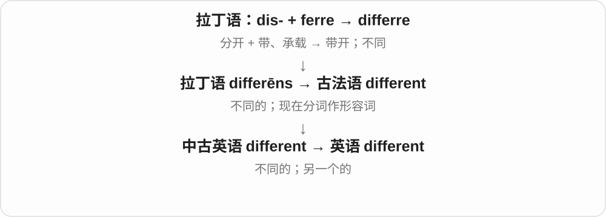
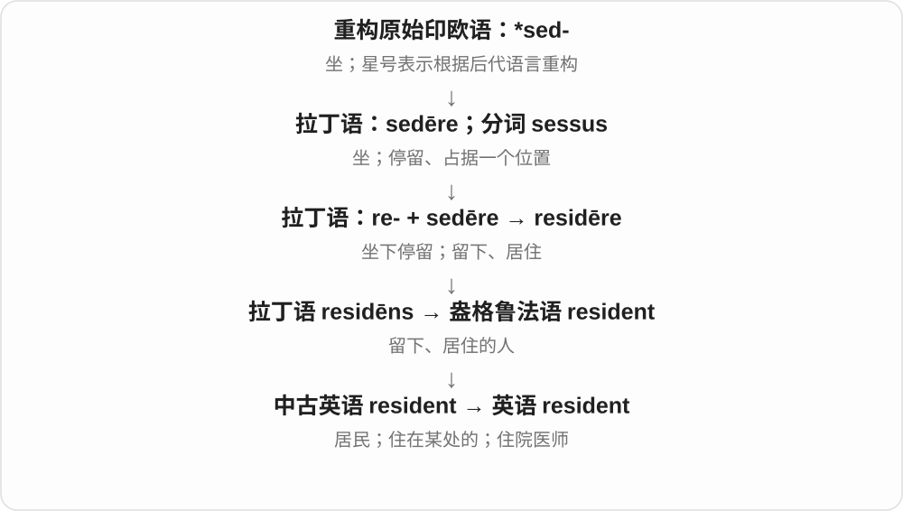
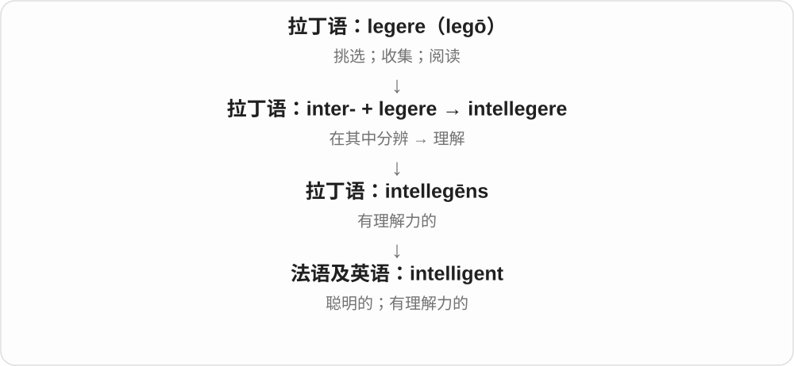
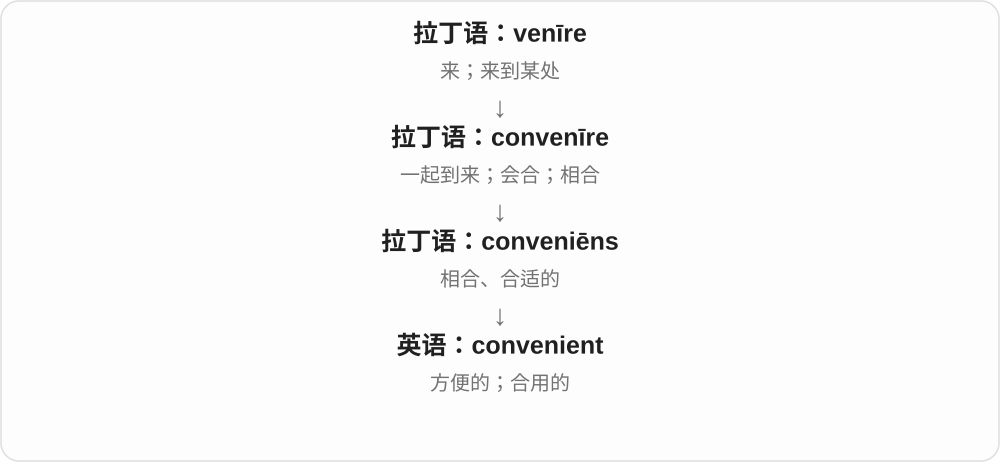
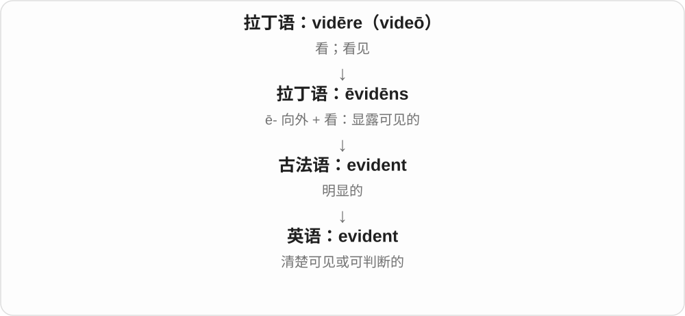
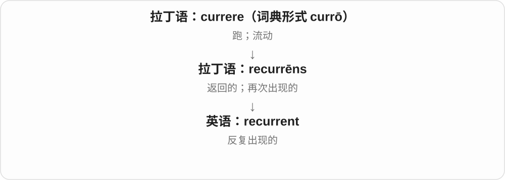

# 0126 · -ent — 处于某状态、有相应作用；也可转指人、物

[逐词精讲目录](../00_逐词精讲目录.md) · [总目录](../00_总目录_按常用程度.md)

## 核心词根与来源

不要只记成正在做。student 是学生，resident 可指居民，repellent 可指驱避用品；还有 innocent 无辜的、convenient 方便的等形容词。后缀提供历史线索，今天用法仍靠完整词。

**-ENT：原有动作、状态走成描述词或相应的人、物**

excellent 出色的；resident 居住者、居住的；solvent 溶剂、有偿付能力的。它与拉丁分词历史相关，现代词义已经各有发展。

- **显眼的光**：fluorescence · fluorescent · resplendent · luminescent
- **出色、居住与人**：excellent · student · resident
- **作用和状态**：solvent · repellent · resilient · recurrent
- **判断、性格与程度**：lenient · salient · abhorrent · transcendent
- **常见形容词与名词对应**：different · patient · present · absent · confident · independent · intelligent · convenient · competent · innocent

## 词形与演化规律

经法语 -ent 或直接接拉丁 -ens、-ent- 等现在分词材料，与 -ant 有历史联系；英语中的拼写受到多次借入、复古拼写影响，不能只凭发音任选 ant 或 ent。常与 -ence 名词相应：excellent／excellence、resident／residence。fluorescence、fluorescent 属十九世纪科学命名，现代能与 fluoresce 对照，却不能断言动词一定先出现。

## 单词速览（按词族由简到繁）

同一基础词的相关扩展放在一起，先读基础形式，再读扩展；各组之间优先读常用的。具体词源关系见各词讲解。

| 单词 | 音标 | 核心意思 |
|---|---|---|
| [different](#w-19) | /ˈdɪfərənt/，常弱读 /ˈdɪfrənt/ | 不同的；另一个的 |
| [present](#w-20) | 形容词、名词 /ˈprezənt/；动词 /prɪˈzent/ | 在场的；当前的；现在；礼物；展示、提交、颁给 |
| [student](#w-1) | 英 /ˈstjuːdənt/；美 /ˈstuːdənt/ | 学生；学习者；研究某方面的人 |
| [dependent](#w-28) | 英、美 /dɪˈpendənt/ | 依赖的；取决于……的；受供养的人 |
| [independent](#w-21) | 英、美 /ˌɪndɪˈpendənt/ | 独立的；自主的；不受相关一方控制的；无党派人士 |
| [patient](#w-22) | /ˈpeɪʃənt/ | 有耐心的；病人、患者 |
| [excellent](#w-2) | /ˈeksələnt/ | 极好的；出色的 |
| [violent](#w-23) | /ˈvaɪələnt/ | 暴力的；猛烈、剧烈的 |
| [innocent](#w-24) | 英 /ˈɪnəsənt/；美 /ˈɪnəsənt/ | 无辜的、清白的；天真的；无恶意的 |
| [confident](#w-25) | 英 /ˈkɒnfɪdənt/；美 /ˈkɑːnfɪdənt/ | 有信心的；确信的；自信的 |
| [decent](#w-26) | /ˈdiːsənt/ | 得体、体面的；像样、还不错的；厚道正派的 |
| [resident](#w-3) | /ˈrezɪdənt/ | 居民；住在某处的；住院医师 |
| [intelligent](#w-27) | /ɪnˈtelɪdʒənt/ | 聪明的；有理解力的；设计巧妙的 |
| [convenient](#w-29) | 英 /kənˈviːniənt/；美 /kənˈviːnjənt/ | 方便的；合适的；省事的 |
| [urgent](#w-4) | 英 /ˈɜːdʒənt/；美 /ˈɜrdʒənt/ | 紧急的；迫切的 |
| [evident](#w-30) | /ˈevɪdənt/ | 明显的；清楚可见的 |
| [absent](#w-31) | 形容词 /ˈæbsənt/；动词 /æbˈsent/ | 缺席的；不存在的；心不在焉的；使自己缺席 |
| [competent](#w-32) | 英 /ˈkɒmpətənt/；美 /ˈkɑːmpətənt/ | 能胜任的；合格的；具有相应权限的 |
| [contingent](#w-5) | /kənˈtɪndʒənt/ | 取决于条件的；不必然发生的；代表团、分遣队〔名词〕 |
| [resilient](#w-6) | /rɪˈzɪliənt/，亦读 /rɪˈzɪljənt/ | 有回弹性的；能适应、能恢复的 |
| [solvent](#w-8) | 英 /ˈsɒlvənt/；美 /ˈsɑːlvənt/ | 有偿债能力的；溶剂 |
| [fluorescent](#w-9) | /fləˈresnt/，也有 /flʊəˈresənt/ 等读法 | 荧光的；颜色鲜亮显眼的 |
| [fluorescence](#w-33) | /fləˈresns/，也有较完整首音节读法 | 荧光；荧光现象 |
| [recurrent](#w-10) | 英 /rɪˈkʌrənt/；美 /rɪˈkɜːrənt/ | 反复发生的；屡次出现的 |
| [lenient](#w-11) | /ˈliːniənt/ | 宽容的；从轻处理的；不严厉的 |
| [salient](#w-12) | /ˈseɪliənt/ | 突出的、显著的；突出部〔军事〕 |
| [abhorrent](#w-13) | 英 /əbˈhɒrənt/；美 /əbˈhɔːrənt/ | 令人憎恶的；令人强烈反感的 |
| [transcendent](#w-14) | /trænˈsendənt/ | 超凡的；超越通常界限的；超越经验或物质世界的〔哲学、神学〕 |
| [repellent](#w-15) | /rɪˈpelənt/ | 驱避的；令人反感的；驱虫剂 |
| [resplendent](#w-16) | /rɪˈsplendənt/ | 灿烂耀眼的；华丽夺目的 |
| [luminescent](#w-17) | 英 /ˌluːmɪˈnesənt/；美 /ˌluːməˈnesənt/ | 冷发光的；发出非白炽光的 |
| [referent](#w-18) | 英、美 /ˈrefərənt/ | 所指对象；指称对象 |

## 逐词讲解

### 1. different — 不同的；另一个的

**音标**：/ˈdɪfərənt/，常弱读 /ˈdɪfrənt/

**先抓住这个画面**

把两张卡叠在一起，发现没有完全重合。different 可以说性质不一样，也可以只是说“换一个”。

**怎么拆**

法语 different 来自拉丁 differēns，是 differre“不同”的现在分词。形容词有独立借入链，不只是英语 differ 后面新接 -ent。

**怎么变成今天的意思**

a different colour 是不同颜色；a different doctor 也可能只是另一位医生。different from 用途很广；different to 在英式中常见，different than 在美式中也常见。

**常见搭配与例句**

different from；a different approach；different people。

> We reached the same place by different routes.

我们走不同路线到了同一个地方。

> Could we try a different time?

我们能换个时间试试吗？

**别混淆**

different 不一定是奇怪或错误，只表示不相同。another 更直接表示另一个。

### 2. present — 在场的；当前的；现在；礼物；展示、提交、颁给

**音标**：形容词、名词 /ˈprezənt/；动词 /prɪˈzent/

**先抓住这个画面**

在眼前，可以是人正在这里、时间就是现在；把东西放到别人面前，又成了展示或送礼。

**怎么拆**

形容词接拉丁语 praesens 在场的；动词经法语来自 praesentāre 放到面前。礼物名词与把东西呈送到人面前的表达有关。来路相关，但现代分两种重音。

**怎么变成今天的意思**

**拉丁语 praesens；相关 praesentāre**  
在眼前、在场；把东西放到眼前、呈上

↓

**经法语进入英语 present 词族**  
当前、在场；礼物；展示、提交

be present 在场；at present 目前；a birthday present 生日礼物；present a report 提交、展示报告。the present tense 是语法现在时，仍读 /ˈprezənt/。

**常见搭配与例句**

be present at；at present；a birthday present；present something to someone。

> All the students were present at the meeting.

所有学生都出席了会议。

> She brought a small present for the host.

她给主人带了一份小礼物。

> I’ll present the results tomorrow.

我明天展示结果。

**别混淆**

present 在场、礼物的重音在前，present 提交、展示重音在后；currently 强调目前，present 动词强调呈给别人看。

### 3. student — 学生；学习者；研究某方面的人

**音标**：英 /ˈstjuːdənt/；美 /ˈstuːdənt/

**先抓住这个画面**

student 的出发点是正在用心学习的人。学校提供一个常见场景，但这个词不只认学生证。

**怎么拆**

拉丁 studēns 是 studēre 的现在分词，经古法语 estudiant 传入；不是历史上从英语 study 简单裁字加 -ent。

**怎么变成今天的意思**

**拉丁 studēre；名词 studium**  
用心投入、热衷；专注、学习

↓

**拉丁 studēns → 古法语 estudiant → 中古英语 → student**  
正在用心学习的 → 学习者

a university student 是大学生；a student of history 也可指长期钻研历史的人，并不一定在读学位。英美对学校不同阶段的习惯称呼有差别。

**常见搭配与例句**

a medical student；a student of human nature；international students。

> She is a medical student in her final year.

她是最后一年在读的医学生。

> He has always been a careful student of human behaviour.

他一直认真观察和研究人的行为。

**别混淆**

pupil 在英式英语常指中小学学生；student 可涵盖更广的学习者，美国尤其常用于各学段。

### 4. dependent — 依赖的；取决于……的；受供养的人

**音标**：英、美 /dɪˈpendənt/

**先抓住这个画面**

自己还不能完全支撑自己，或某个结果必须跟着另一个条件走。

**怎么拆**

接法语 dependant、拉丁 dependens／dependent- 的分词形容词路线，不是必须先有英语 depend 再加 -ent。名词的英式拼法常是 dependant，美式通常也用 dependent。

**怎么变成今天的意思**

**拉丁 pendēre；相关动词 pendere**  
悬垂；使悬挂、称量

↓

**拉丁 dependere 的分词 dependens；法语 dependant**  
依附、依赖的

↓

**英语 dependent／名词也拼 dependant**  
需要依靠的；受供养的人

be dependent on imports 是依赖进口；a dependent child 是经济上需要供养的孩子。数学里的 dependent variable 是因变量，也沿用“值取决于其他量”的关系。

**常见搭配与例句**

dependent on；financially dependent；dependent children；a dependent variable。

> The island is dependent on imported fuel.

这座岛依赖进口燃料。

> The form asks how many dependents live with the applicant.

表格询问有多少受供养者与申请人同住。

**别混淆**

dependable 是别人可以依靠的，dependent 是自己需要依靠的：一个人可以同时对某些资源 dependent，又在工作中很 dependable。

### 5. independent — 独立的；自主的；不受相关一方控制的；无党派人士

**音标**：英、美 /ˌɪndɪˈpendənt/

**先抓住这个画面**

自己站得住，或者能作判断而不受某个外部控制者牵着走。独立总要看“相对于谁、在哪方面”。

**怎么拆**

in-“不”+ dependent，英语近代形成的否定形容词；法语 indépendant 等有平行形式。in- 不是“进入”，所以不是“向里依赖”。

**怎么变成今天的意思**

**拉丁 pendēre；相关动词 pendere**  
悬垂；使悬挂、称量

↓

**拉丁 dependere 的分词 dependens；法语 dependant**  
依附、依赖的

↓

**英语 dependent／名词也拼 dependant**  
需要依靠的；受供养的人

↓

**英语 in-“不”+ dependent → independent**  
不依赖、能自主；法语也有相应形式

financially independent 是经济独立；an independent review 是由与被审查方有适当独立性的一方作评估。独立不等于永远不合作，也不保证每个判断必定正确。

**常见搭配与例句**

independent of；an independent company；independent research；an independent candidate。

> She wants to become financially independent.

她想在经济上独立。

> An independent team reviewed the findings.

一个独立团队复核了这些发现。

**别混淆**

alone 是独自一个人；independent 是自主、不依赖或不受控制。有人相伴仍可以 independent，独处也不一定自主。

### 6. patient — 有耐心的；病人、患者

**音标**：/ˈpeɪʃənt/

**先抓住这个画面**

不舒服或等待都落在自己身上：能耐住是有耐心，接受诊治的人是患者。

**怎么拆**

接拉丁 patī 的现在分词 patiēns“承受着的”，经法语借入。形容词与医疗名词在法语已有相关用法，不必把英语病人义解释成“因为病人必须耐心”。

**怎么变成今天的意思**

**拉丁 patī／patior；完成分词 passus**  
承受、经历、忍受

↓

**拉丁 patiēns → 古法语 pacient**  
承受着的；能忍受的；承受病痛的人

↓

**中古英语 pacient → 英语 patient**  
有耐心的；接受医疗照护的人

be patient with someone 是对人有耐心；a patient 是接受医疗照护的人，不要求对方性格温和。语言学还把承受动作影响的一方称为 patient，即受事。

**常见搭配与例句**

be patient with；a patient teacher；a hospital patient；patient care。

> Please be patient with the new students while they learn the routine.

新同学熟悉流程时，请对他们多一点耐心。

> The nurse explained the procedure to the patient.

护士向患者解释了操作过程。

**别混淆**

patient 作形容词不能加 a 表示“一个耐心”；a patient 通常是“一位患者”。patients 与 patience 常同音，拼写和语法不同。

### 7. excellent — 极好的；出色的

**音标**：/ˈeksələnt/

**先抓住这个画面**

质量、表现高得让人愿意明确称赞，就是 excellent；日常 Excellent! 也可以简短表示太好了。

**怎么拆**

经法语 excellent 接拉丁 excellens 高出、杰出的材料，与 excel 相联；现代可按 excel 与 -ent 对应，但借入历史不只英语临时加尾。

**怎么变成今天的意思**

**拉丁 excellere → excellens、excellentia 等**  
高出、超越；卓越的、卓越这一性质

↓

**英语 excel、excellent、excellence**  
擅长、出色；极好的；卓越

an excellent idea 极好的主意；excellent service 出色服务；excellent at doing 很擅长做。

**常见搭配与例句**

an excellent choice；excellent quality。

> The guide gave an excellent explanation of the building’s history.

向导把建筑历史解释得非常清楚。

> The hotel provided excellent service.

酒店提供了出色服务。

**别混淆**

excellent 是评价很好，不保证 perfect 完全无瑕；一份出色作品仍可以有值得改进的地方。

### 8. violent — 暴力的；猛烈、剧烈的

**音标**：/ˈvaɪələnt/

**先抓住这个画面**

力量来得又猛又冲：可以是人动手，也可以是风暴、摇晃。不是每个 violent 都在说犯罪人物。

**怎么拆**

经法语或直接接拉丁 violentus，联系 vīs 力量、强力的词族。vio- 这里不是 violet 紫罗兰；-ent 也不单独决定暴力。

**怎么变成今天的意思**

**拉丁 vīs 力量及 violentus**  
强力、猛烈、暴力的

↓

**法语 violent → 英语 violent**  
暴力；自然力量、运动、情绪的剧烈

violent behavior 暴力行为，a violent storm 猛烈风暴，a violent reaction 强烈反应，violent shaking 剧烈晃动。

**常见搭配与例句**

violent behavior；a violent storm；a violent reaction。

> A violent storm struck the coast.

一场猛烈风暴袭击海岸。

> The story shows how a small dispute can turn violent.

故事展示了一场小争执怎样变成暴力冲突。

**别混淆**

violent 可说强力、伤害性或剧烈，不等于只是生气 angry；a violent storm 是风暴猛烈，不是风暴有坏心。

### 9. innocent — 无辜的、清白的；天真的；无恶意的

**音标**：英 /ˈɪnəsənt/；美 /ˈɪnəsənt/

**先抓住这个画面**

坏事不是他做的，或他根本没有那种坏心思。

**怎么拆**

拉丁 in- 不 + nocens“伤害的、有罪的”组成 innocens，经古法语进入英语；in- 在这里是否定。

**怎么变成今天的意思**

**拉丁 nocere**  
伤害、造成损害

↓

**拉丁 in- 不 + nocens 造成伤害的 → innocens**  
不伤害的、无罪的

↓

**古法语 innocent → 英语 innocent**  
清白的、无辜的；天真的

an innocent person 可以是没有做被指责坏事的人，an innocent question 是没有挖坑或恶意的问题。形容孩子时还可以指未经世事、心思单纯；因此 innocent 不只有“法庭上无罪”一个使用场景。

**常见搭配与例句**

innocent of wrongdoing；innocent people；an innocent question；an innocent mistake。

> She insisted that she was innocent.

她坚持说自己没有做被指控的事。

> It was an innocent question, but everyone suddenly went quiet.

那只是个没有恶意的问题，大家却突然安静下来。

> The child gave him an innocent smile.

孩子朝他露出一个天真的笑容。

**别混淆**

innocent 常涉及责任、动机或纯真，ignorant 只说不知道；无知未必无辜，无辜也不必无知。

### 10. confident — 有信心的；确信的；自信的

**音标**：英 /ˈkɒnfɪdənt/；美 /ˈkɑːnfɪdənt/

**先抓住这个画面**

面对人或事情时，心里有底，觉得自己能应对或结果靠得住。

**怎么拆**

经法语 confident 来自拉丁语 confidere 的现在分词 confidens / confident-，表示充分信任着的。

**怎么变成今天的意思**

**拉丁语 fidere；同族名词 fides**  
信任、相信；信用、信义

↓

**拉丁语 confidere**  
con- 在这里通常作加强理解 + fidere → 充分信任

↓

**拉丁语 confidens / confident- → 法语 confident → 英语 confident**  
信任着的 → 有信心的、自信的

be confident about the interview 是对面试有信心；be confident that... 是确信某事。它说的是把握感，不保证判断一定正确。

**常见搭配与例句**

confident about；confident of；confident that；a confident smile。

> She felt confident about the interview.

她对面试很有信心。

> We are confident that the repairs will be completed on time.

我们确信维修会按时完成。

**别混淆**

confidant 是可以倾诉秘密的人；confident 是描述自信的形容词，末尾是 -ent。

### 11. decent — 得体、体面的；像样、还不错的；厚道正派的

**音标**：/ˈdiːsənt/

**先抓住这个画面**

达到该有的基本标准：住处像样、人做事不亏待别人、衣着足以见客。说 decent 往往是过得去到不错，不必夸顶级。

**怎么拆**

经法语或直接接拉丁 decēns，来自适合、合宜的 decēre。现代不拆成 de- 去掉 + cent 分币。

**怎么变成今天的意思**

**拉丁 decēre → decēns**  
适合、合宜 → 得体、合乎标准的

↓

**法语 décent → 英语 decent**  
体面、合宜 → 过得去、像样；人品厚道

a decent meal 像样的一餐，a decent salary 不错的工资，a decent person 厚道人；Are you decent? 可问穿好衣服、方便见人了吗。

**常见搭配与例句**

a decent meal；a decent salary；a decent person；Are you decent?。

> We finally found a decent place to stay.

我们终于找到了像样的住处。

> It was decent of you to help without being asked.

不用人开口你就来帮忙，真够厚道。

**别混淆**

decent /ˈdiːsənt/ 与 descent /dɪˈsent/ 下降、dissent /dɪˈsent/ 异议，重音、拼写和词源不同。

### 12. resident — 居民；住在某处的；住院医师

**音标**：/ˈrezɪdənt/

**先抓住这个画面**

resident 是在某处住着、持续待在那里的人，像把生活的落脚点安在这里。

**怎么拆**

拉丁 residēns 是 residēre“留下居住”的现在分词，经盎格鲁法语和中古英语借入；现代可对应 reside + -ent。

**怎么变成今天的意思**

local residents 是当地居民；resident in a town 是居住在城里。医疗语境中 a resident 通常是接受毕业后临床培训的医生，历史名称与过去住在医院有关。

**常见搭配与例句**

local residents；a permanent resident；resident in；a medical resident。

> Local residents asked for a safer crossing.

当地居民要求设置更安全的过街通道。

> The resident discussed the case with a senior doctor.

这位住院医师与资深医生讨论了病例。

**别混淆**

visitor 是来访者；resident 是在此居住的人，是否永久居住要看修饰语和具体制度。

### 13. intelligent — 聪明的；有理解力的；设计巧妙的

**音标**：/ɪnˈtelɪdʒənt/

**先抓住这个画面**

intelligent 像能迅速看懂线索之间的关系，不只记住材料，还知道怎样用。

**怎么拆**

来自 intellegēns“有理解力的”，经法语传入；不必拆成 in + tell + gent。

**怎么变成今天的意思**

可以评价人，也可评价问题、回答或设计。intelligent question 是问得有洞察，不是问题本身有脑子。

**常见搭配与例句**

an intelligent question；an intelligent student；intelligent design choices。

> She asked an intelligent question about the results.

她针对结果问了一个很有见地的问题。

> The design makes intelligent use of limited space.

这个设计巧妙利用了有限的空间。

**别混淆**

intelligent 是能理解的能力好；intelligible 是表达本身能被理解。

### 14. convenient — 方便的；合适的；省事的

**音标**：英 /kənˈviːniənt/；美 /kənˈviːnjənt/

**先抓住这个画面**

时间、地点或方式刚好配合你的需要，不用多绕路、多费力，就是 convenient。

**怎么拆**

来自拉丁语 conveniēns“相合、合适的”，是 convenīre 的分词；con-（一起）+ venīre（来）先形成合到一起、相配的意思。

**怎么变成今天的意思**

重点不只是东西容易，而是它和人的安排、需要合得来。a convenient excuse 还可暗示借口正好替自己省去麻烦。

**常见搭配与例句**

a convenient time；convenient for travelers；convenient to use；if it is convenient。

> Would Friday afternoon be convenient for you?

星期五下午你方便吗？

> The hotel is convenient for the station.

从这家旅馆去车站很方便。

**别混淆**

通常说 a time is convenient for me，不说 I am convenient。comfortable 是舒适，convenient 是省事、合用。

### 15. urgent — 紧急的；迫切的

**音标**：英 /ˈɜːdʒənt/；美 /ˈɜrdʒənt/

**先抓住这个画面**

事情像在不断催你：现在就得处理，不能再拖。

**怎么拆**

来自法语 urgent、拉丁 urgens／urgent-，是 urgere 的现在分词词干；英语 urgent 的记录早于动词 urge。

**怎么变成今天的意思**

**拉丁 urgere**  
压迫、催逼、推动

↓

**拉丁 urgens／urgent- → 法语 urgent**  
正在催逼、迫切的

↓

**英语 urgent**  
需要尽快处理的

an urgent request 是迫切请求；urgent repairs 是不能久拖的维修。紧急的关键是时间压力，而不仅是事情重大。

**常见搭配与例句**

urgent action；an urgent request；urgent repairs；an urgent need for something。

> The building needs urgent repairs.

这栋楼急需维修。

> I received an urgent message asking me to call back.

我收到一条紧急留言，让我尽快回电。

**别混淆**

important 是重要，urgent 是时间上等不起。长期学习很重要，但明天漏水的水管可能更 urgent。

### 16. evident — 明显的；清楚可见的

**音标**：/ˈevɪdənt/

**先抓住这个画面**

evident 是线索已经摆得很清楚，让人容易看出某个情况，而不是靠猜。

**怎么拆**

ē-（向外、显露）+ vidēns（看），在拉丁语形成 ēvidēns；经法语借入。

**怎么变成今天的意思**

从显露可见，引申为道理、感受或结果清楚可判断。It is evident that… 后面说看得出的事实。

**常见搭配与例句**

evident from…；evident in…；it is evident that…；clearly evident。

> Her relief was evident in her smile.

从她的笑容能明显看出她松了口气。

> It was evident that the plan needed more work.

很明显，这个计划还需要完善。

**别混淆**

evident 强调容易看出；evidence 是可用来判断的证据材料，词性不同。

### 17. absent — 缺席的；不存在的；心不在焉的；使自己缺席

**音标**：形容词 /ˈæbsənt/；动词 /æbˈsent/

**先抓住这个画面**

人没在应在的位置，叫 absent；视线虽然在眼前，心思却飘走了，也可以借这个画面来说。

**怎么拆**

形容词接拉丁 absens、absent-，是 abesse“在别处、不在场”的分词，经法语或直接借入。动词另经晚期拉丁 absentare、法语 absenter，现代常用 absent oneself。

**怎么变成今天的意思**

**拉丁 ab，构词中也有 abs-、a- 等形式**  
离开、从……分离、去掉

↓

**拉丁 ab- + esse → abesse；分词 absens／absent-**  
存在于别处 → 不在场

↓

**形容词路线：古法语 absent／ausent → 英语 absent**  
不在场、缺席；缺乏注意

↓

**并行的动词路线：晚期拉丁 absentare → 古法语 absenter → 英语 absent**  
使自己不在场、退出

be absent from class 是缺课；an absent smile 是心不在焉的一笑。absent yourself from a meeting 表示让自己不出席；作动词时重音后移。

**常见搭配与例句**

be absent from；conspicuously absent；an absent look；absent oneself from。

> Two students were absent from class this morning.

今天上午有两名学生缺课。

> She gave an absent smile while reading the message.

她看着消息，心不在焉地笑了一下。

> He absented himself from the discussion because it concerned his own application.

由于讨论涉及他本人的申请，他没有参加这场讨论。

**别混淆**

missing 强调该有却找不到；absent 强调在某处或某场合没有出现。absence 是名词，不能说 he is absence。

### 18. competent — 能胜任的；合格的；具有相应权限的

**音标**：英 /ˈkɒmpətənt/；美 /ˈkɑːmpətənt/

**先抓住这个画面**

把任务的要求与一个人的能力叠在一起：两者对得上，事情交给他能妥当完成，就是 competent。

**怎么拆**

来自拉丁 competens，competere 的现在分词，经法语或直接进入英语。这里保留“相合、适合、足够”的古义，不是从现代 compete“竞争”推导出“会赢”。

**怎么变成今天的意思**

**拉丁 petere**  
朝向、寻求、争取；也可指扑向、攻击或请求

↓

**拉丁 com- 一起 + petere → competere**  
走到一起、相合、适合；后来也指一起争取某物

↓

**拉丁 competens / competentem → 法语 competent**  
相合、符合要求的

↓

**中古英语 competent**  
足够、适合 → 有能力胜任

a competent mechanic 是能把本职工作做好的修理师，未必是顶尖大师。competent authority 则说有权处理某事的机构，不是在赞美机构特别聪明。

**常见搭配与例句**

competent at a task；competent to do something；a competent professional；the competent authority。

> She is a competent editor who rarely misses an error.

她是一位称职的编辑，很少漏掉错误。

> The matter was referred to the competent authority.

此事被提交给了有权处理的主管机构。

**别混淆**

capable 强调具备能力或潜力；competent 强调达到某项实际工作的要求，常有稳妥合格的意味。

### 19. contingent — 取决于条件的；不必然发生的；代表团、分遣队〔名词〕

**音标**：/kənˈtɪndʒənt/

**先抓住这个画面**

形容事情，要等另一个条件接上才能成立；作名词，指大队伍里分出来的一组人。

**怎么拆**

法语或中世纪拉丁 contingens 借入，接 contingere“触及、碰上、发生”。名词的团体义经过“分摊给某方的一份”，后来用于派出的人员。

**怎么变成今天的意思**

**拉丁 tangere；完成分词 tactus**  
碰、触及、达到

↓

**拉丁 contingere → contingens／contingent-**  
接触、碰到 → 发生、碰上

↓

**中世纪拉丁及法语 contingent → 英语 contingent**  
可能发生的；取决于条件的；名词另发展为分遣队、代表团

contingent on approval 是以获批为条件；a contingent of volunteers 是一支志愿者队伍。逻辑中的 contingent 则说既非必真也非必假的命题，不要所有场景都译成“偶然的”。

**常见搭配与例句**

contingent on／upon；a contingent of；a national contingent；contingent workers。

> The trip is contingent on suitable weather.

这次出行要看天气是否合适。

> A small contingent of volunteers arrived before dawn.

一小队志愿者在黎明前到达。

**别混淆**

conditional 强调有条件；contingent 常点明取决于什么。作名词的 contingent 是某个整体中的一组，并不表示这组人靠运气碰到一起。

### 20. resilient — 有回弹性的；能适应、能恢复的

**音标**：/rɪˈzɪliənt/，亦读 /rɪˈzɪljənt/

**先抓住这个画面**

被压过还能弹起，受到冲击还能重新找到办法：形容的是“受过影响，但仍有恢复和调整能力”。

**怎么拆**

拉丁 resilire 的现在分词 resiliens／resilientem 借入英语；-ent 是分词形容词形式。

**怎么变成今天的意思**

**拉丁 salire**  
跳、跃起；复合词中常变成 -silire

↓

**拉丁 re- + salire → resilire**  
向后跳、弹回去

↓

**拉丁 resiliens／resilientem**  
正在弹回、恢复的，resilire 的现在分词

↓

**英语 resilient**  
可恢复形状的；经受冲击后能适应、恢复的

a resilient economy 遇到波动后仍能恢复；a resilient person 在困难中能适应。这个词没有“从来不难过”的意思，也不能仅凭一个人恢复得慢，就断言他没有韧性。

**常见搭配与例句**

resilient materials；a resilient community；resilient in the face of change。

> The sole is made from a light, resilient material.

鞋底用轻巧而有回弹性的材料制成。

> The community proved resilient after the storm and gradually reopened its shops.

风暴之后，这个社区展现了恢复能力，各家店铺逐渐重新营业。

**别混淆**

resistant to heat 是抗热、不易被热破坏；resilient after disruption 是受扰动后能恢复。

### 21. solvent — 有偿债能力的；溶剂

**音标**：英 /ˈsɒlvənt/；美 /ˈsɑːlvənt/

**先抓住这个画面**

两条用法都接着“松解”：把债务清掉的人能还债，把其他物质溶开的物质是溶剂。

**怎么拆**

拉丁语 solvens / solvent- 是 solvere 的现在分词；形容词经法语 solvent 传入，化学名词也据拉丁词形形成。不是现代英语 solve 加一个随意的 -nt。

**怎么变成今天的意思**

**拉丁语 solvere；分词 solutus**  
松开、解开；清偿、解释

↓

**拉丁语 solvens / solvent-**  
松解、清偿的现在分词

↓

**法语 solvent 及拉丁语 → 英语 solvent**  
有偿债能力的；能溶解的；溶剂

The company is solvent 说公司有偿债能力。化学里的 a solvent 指溶液中承担溶解角色的成分，日常多为液体；水是常见溶剂，但溶剂不限于水，也不能笼统说都危险。

**常见搭配与例句**

remain solvent；a solvent for grease；an organic solvent。

> The company remained solvent despite a difficult year.

尽管这一年经营艰难，公司仍有偿债能力。

> In salt water, water acts as the solvent.

在盐水中，水充当溶剂。

**别混淆**

solvent 名词是溶剂，solute 是溶质。财务上有偿债能力也不等于任何时候都能立刻拿出足够现金。

### 22. fluorescent — 荧光的；颜色鲜亮显眼的

**音标**：/fləˈresnt/，也有 /flʊəˈresənt/ 等读法

**先抓住这个画面**

荧光灯利用这种发光现象；衣服、标记上的 fluorescent yellow 则常说特别醒目的荧光黄。要看是在谈光学性质还是日常颜色。

**怎么拆**

1853 年已有斯托克斯使用的 fluorescent，以 fluor- 与 -escent 构词；现代也能与 fluoresce 发荧光 + -ent 对照，但不把现代拆法当作历史出现顺序。

**怎么变成今天的意思**

**萤石 fluorspar 的命名材料 + -escence → fluorescence**  
斯托克斯于十九世纪据萤石等现象命名荧光

↓

**fluor- + -escent → fluorescent；现代也可与 fluoresce + -ent 对照**  
具有荧光的；相关现代词形不等于较短动词必先出现

a fluorescent lamp 荧光灯；fluorescent paint 荧光涂料；fluorescent yellow 荧光黄。

**常见搭配与例句**

fluorescent lighting；fluorescent colours。

> The room was lit by fluorescent lamps.

房间用荧光灯照明。

> She marked the route with fluorescent yellow tape.

她用荧光黄胶带标记路线。

**别混淆**

fluorescent 荧光与 reflective 反光不同：反光材料主要把入射光反射回去，不能所有亮色、反光条都只凭外观认成同一种材料。

### 23. fluorescence — 荧光；荧光现象

**音标**：/fləˈresns/，也有较完整首音节读法

**先抓住这个画面**

用合适光线照到某些材料，它们吸收能量后又发出光，看起来颜色特别亮。普通荧光的发光通常在激发停止后很快消退。

**怎么拆**

斯托克斯于 1852 年以 fluorspar 萤石的材料加 -escence 命名，类比 phosphorescence。不能把它讲成普通英语 fluoresce 一定先有，再临时加 ence 的唯一历史。

**怎么变成今天的意思**

**萤石 fluorspar 的命名材料 + -escence → fluorescence**  
斯托克斯于十九世纪据萤石等现象命名荧光

↓

**fluor- + -escent → fluorescent；现代也可与 fluoresce + -ent 对照**  
具有荧光的；相关现代词形不等于较短动词必先出现

fluorescence under ultraviolet light 紫外光照射下的荧光；fluorescence intensity 荧光强度。

**常见搭配与例句**

fluorescence microscopy；fluorescence intensity。

> The mineral showed fluorescence under ultraviolet light.

矿物在紫外光下显出荧光。

> The experiment measured changes in fluorescence intensity.

实验测量了荧光强度的变化。

**别混淆**

fluorescence 与 phosphorescence 磷光的持续时间、机制不同；不是所有黑暗中发光都叫荧光，也不表示材料自身一定是元素氟。

### 24. recurrent — 反复发生的；屡次出现的

**音标**：英 /rɪˈkʌrənt/；美 /rɪˈkɜːrənt/

**先抓住这个画面**

问题不是孤零零来一次，而是隔一阵又来，已经形成反复出现的特征。

**怎么拆**

来自拉丁语 recurrēns，是 recurrere“返回”的相关形式；现代可联系 recur + -ent。

**怎么变成今天的意思**

它形容现象本身有反复性，例如 recurrent delays。没有保证发生间隔规律，也没有保证每次严重程度一样。

**常见搭配与例句**

a recurrent problem；recurrent delays；a recurrent theme。

> The team investigated a recurrent software fault.

团队调查了一项反复出现的软件故障。

> Isolation is a recurrent theme in her novels.

孤独是她小说中反复出现的主题。

**别混淆**

frequent 是频繁，未必强调同一种事情重现；recurrent 强调相同或相似的现象又回来。

### 25. lenient — 宽容的；从轻处理的；不严厉的

**音标**：/ˈliːniənt/

**先抓住这个画面**

本来可以罚得重、要求得严，却把力度放软了一些。

**怎么拆**

法语 lenient 接拉丁 leniens，来自 lenire 使柔和，源于 lenis 柔和的。先有舒缓的背景，后来常用于规则、处罚和管理。

**怎么变成今天的意思**

**拉丁 lenis 柔和的 → lenire 使柔和、缓和**  
不那么硬、不那么严厉

↓

**拉丁 leniens，词干 lenient- → 法语 lenient → 英语 lenient**  
由舒缓发展到处理、处罚宽和

a lenient teacher 不会对每个小错误都严厉惩罚；a lenient sentence 是较轻的判罚。可以出于体谅，也可能被批评管得太松。

**常见搭配与例句**

be lenient with somebody；a lenient sentence；lenient rules。

> The teacher was lenient with students who had missed the deadline.

老师对错过截止日期的学生比较宽容。

> Critics said the penalty was too lenient.

批评者认为处罚太轻。

**别混淆**

kind 是友善，lenient 特别涉及原本可以严格要求的场合。lax 常批评疏于管理，lenient 不一定是负面评价。

### 26. salient — 突出的、显著的；突出部〔军事〕

**音标**：/ˈseɪliənt/

**先抓住这个画面**

一页文字里有一点一下子抓住眼睛，就像从背景里凸出来；它是你最该先注意到的特征。

**怎么拆**

来自拉丁 saliens／salientem，salire“跳”的现在分词。历史有跃起、向外凸出的义，不是英语 sale 加 -ient。

**怎么变成今天的意思**

**拉丁 salire**  
跳、跃起；复合词中常变成 -silire

↓

**拉丁 saliens／salientem**  
跳跃着的，salire 的现在分词

↓

**英语 salient**  
先有跃起、向外突出的用法，后有突出、显著义

现代常说 salient features、salient points。历史上的 salient point 还关联拉丁 punctum saliens“跳动的点”，指胚胎跳动的心脏，后来用于要点。“跳到眼前”是帮助记忆的比喻；军事名词 a salient 则是向敌方凸出的阵地部分。

**常见搭配与例句**

the salient features；a salient point；a salient in the front line。

> The summary highlights the proposal’s most salient features.

摘要突出了提案最值得注意的特点。

> The troops withdrew from the exposed salient.

部队撤离了暴露的突出阵地。

**别混淆**

salient 强调突出、值得注意；important 强调重要。一个显眼特征不一定是最终最重要的原因。

### 27. abhorrent — 令人憎恶的；令人强烈反感的

**音标**：英 /əbˈhɒrənt/；美 /əbˈhɔːrənt/

**先抓住这个画面**

把视角从“我憎恶它”换到“它令人憎恶”：形容某种做法、观念或行为本身使人强烈排斥。

**怎么拆**

借拉丁 abhorrens、abhorrent-，是 abhorrere 的现在分词，原有相悖、退避等用法；英语后来突出令人厌恶。现代可联系 abhor，但保留分词借入路线。

**怎么变成今天的意思**

**拉丁 ab，构词中也有 abs-、a- 等形式**  
离开、从……分离、去掉

↓

**拉丁 ab- + horrere → abhorrere**  
战栗、毛发竖起 → 厌恶得退避

↓

**拉丁分词 abhorrens／abhorrentem → 英语 abhorrent**  
相悖、不相容、退避的

↓

**英语 abhorrent 的常用义**  
令人强烈憎恶的

morally abhorrent 是道德上令人憎恶；abhorrent to someone 是令某人强烈反感。它通常评价对象，而不是简单说某个人正处于憎恶的情绪中。

**常见搭配与例句**

morally abhorrent；abhorrent behaviour；abhorrent to；find something abhorrent。

> The committee called the deliberate deception morally abhorrent.

委员会称这种蓄意欺骗在道德上令人憎恶。

> The idea of exploiting vulnerable people is abhorrent to her.

利用弱势者的想法令她深感厌恶。

**别混淆**

abhor 是动词，abhorrent 是形容词。I abhor the practice 与 I find the practice abhorrent 表达相近意思，但句法不同。

### 28. transcendent — 超凡的；超越通常界限的；超越经验或物质世界的〔哲学、神学〕

**音标**：/trænˈsendənt/

**先抓住这个画面**

像站到平常标准之上，原来那把尺子已经不足以衡量它。

**怎么拆**

借自拉丁 transcendens／transcendent-，是 transcendere 的现在分词；现代也可对应 transcend + -ent，但历史有独立分词借入路线。

**怎么变成今天的意思**

**拉丁 trans／trans-**  
越过、穿过；在另一边

↓

**拉丁 trans- + scandere → transcendere**  
攀过去、越过；超出限制

↓

**拉丁 transcendens／transcendent- → 英语 transcendent**  
正在超越 → 超过普通界限、卓越的

a transcendent performance 是极出色的演出；神学里的 transcendent God 说神超出受造世界的限制。哲学语境要看作者怎样界定经验与超越，不能都译成“特别优秀”。

**常见搭配与例句**

transcendent beauty；a transcendent experience；a transcendent deity。

> The final movement gave the concert a moment of transcendent beauty.

最后一个乐章让音乐会呈现出一刻超凡的美。

> The theologian describes God as transcendent rather than confined to the physical world.

这位神学家把神描述为超越物质世界，而非受其限制。

**别混淆**

transcendent 常是超出某个范围；Kant 的 transcendental 特指经验与认识何以可能的条件，两者不是随手替换。

### 29. repellent — 驱避的；令人反感的；驱虫剂

**音标**：/rɪˈpelənt/

**先抓住这个画面**

让东西靠不过来：气味赶走昆虫，表面让水不易附着，行为也可能让人退避。

**怎么拆**

接拉丁 repellēns，来自 repellere 的现在分词；现代可联系 repel + -ent。

**怎么变成今天的意思**

**拉丁 pellere；过去分词 pulsus**  
推、驱赶、击打

↓

**拉丁 repellere → repellēns**  
驱回 → 正在排斥、能驱避的

↓

**英语 repellent**  
驱避的；令人反感的；驱避剂

作名词常指 insect repellent。驱避与杀死不同；一件东西能驱虫，不等于它是杀虫剂。

**常见搭配与例句**

insect repellent；repellent behaviour；repellent to。

> We packed insect repellent for the camping trip.

我们为露营带上了驱虫剂。

> She found his arrogant behaviour repellent.

她觉得他的傲慢行为令人反感。

**别混淆**

repulsive 常强调令人恶心；repellent 也能说实用的驱避作用，因此不总是负面评价。

### 30. resplendent — 灿烂耀眼的；华丽夺目的

**音标**：/rɪˈsplendənt/

**先抓住这个画面**

礼服、宫殿、金色树叶亮得让人眼前一亮，较文学地赞它华丽灿烂，可以说 resplendent。

**怎么拆**

接拉丁 resplendere 闪耀、反照与相应分词材料，re- 在这里不能机械限定为又一次，splend- 关联发光。现代末尾 -ent 对应形容词用法，不找一个常用 resplend 来强记。

**怎么变成今天的意思**

**拉丁 splendere、resplendere 等**  
发亮、闪耀、反照

↓

**英语 resplendent**  
灿烂、华丽夺目的

resplendent in gold 身着金色服装、装饰而华丽夺目；resplendent autumn colours 灿烂秋色。

**常见搭配与例句**

resplendent in；look resplendent。

> The hall was resplendent with flowers and lights.

大厅鲜花与灯光交映，华丽夺目。

> She arrived resplendent in a deep blue gown.

她穿着深蓝礼服到来，光彩照人。

**别混淆**

resplendent 常是较文学的华丽赞美；fluorescent 说荧光性质或鲜亮颜色，不是同一种光学概念。

### 31. luminescent — 冷发光的；发出非白炽光的

**音标**：英 /ˌluːmɪˈnesənt/；美 /ˌluːməˈnesənt/

**先抓住这个画面**

形容某种材料或物体以冷发光机制放出光。

**怎么拆**

与 luminescence 相应的形容词，词尾 -ence 对应 -ent。按历史记录，形容词早于后来逆构的 luminesce 动词，现代可拆分不等于首次造词顺序。

**怎么变成今天的意思**

**拉丁语 lumen；属格 luminis、词干 lumin-**  
光；发光之物，也有开口的含义

↓

**十九世纪科学术语：lumin- + -escence**  
为并非单靠高温而发出的光建立名称；与物理学家 Wiedemann 的术语工作有关

↓

**英语 luminescence**  
非白炽的发光现象；常称冷发光

↓

**英语 luminescence → luminescent**  
这种发光现象 → 具有这种发光性质的

luminescent paint 能在适当激发下发光；它不一定每时每刻亮着，也不保证只有一种颜色。词强调发光方式，比文学描写里的 luminous 更具体。

**常见搭配与例句**

luminescent paint；luminescent materials；a luminescent coating；luminescent organisms。

> The watch hands are coated with a luminescent material.

表针涂覆着一种冷发光材料。

> The sample became visibly luminescent under ultraviolet light.

这个样品在紫外光照射下发出了可见光。

**别混淆**

luminescent 不等于 reflective。反光材料把外来的光反射出去；冷发光材料经过激发后会发射光，不能仅因夜里看着亮就混为一类。

### 32. referent — 所指对象；指称对象

**音标**：英、美 /ˈrefərənt/

**先抓住这个画面**

“那个人”“它”“这张桌子”像标签；referent 是标签实际指向的那个人或东西。

**怎么拆**

现代可拆 refer + -ent；历史也有直接联系拉丁 referens、词干 referent- 的借入分析，不能只按英语加后缀断定来源。

**怎么变成今天的意思**

**拉丁语：ferre；第一人称 ferō**  
带、承载；承受；生出

↓

**拉丁语：re- + ferre → referre**  
带回；报告；提交处理

↓

**拉丁分词 referens，词干 referent-；或英语 refer + -ent**  
正在指向、有关联的；两种形成分析

↓

**英语：referent**  
一个表达式实际指向的对象

语言学里，词语或符号是指称工具，referent 是它指向的对象。代词没有清楚的 referent，读者就不知道 it 指谁或什么。

**常见搭配与例句**

the referent of a pronoun；an unclear referent。

> In this sentence, the referent of “she” is the narrator’s sister.

在这句话里，she 指的是叙述者的姐姐。

> The editor asked me to clarify the referent of “this”.

编辑让我说清楚 this 指的是什么。

**别混淆**

meaning 是词语的意义；referent 是某次使用时实际指向的对象。

## 这一组要分清什么

fluorescent 与 reflective 反光不同；resplendent 是较文学的华丽描写；student 等已是人员名词；-ent／-ence 可帮助配对，但不是所有同尾单词都在现代临时拼成。

## 串起来练习

The student noticed the fluorescent markings under the lamp.

学生在灯下注意到了荧光标记。
