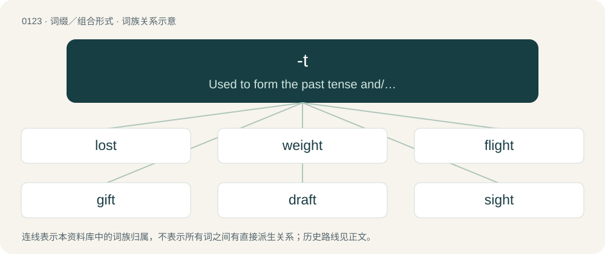

# 0127 · -t — Used to form the past tense and/or past participle of some verbs.

[总目录](../00_总目录_按常用程度.md)

**类型**：词缀／组合形式　｜　**来源语言**：见词源记录

## 核心含义与来源

- 核心含义：Used to form the past tense and/or past participle of some verbs.
- 英文含义：Used to form the past tense and/or past participle of some verbs.
- 词形：-t

**多个词源／构词路径**：同一拼写可能有不同来源；以下按词性和含义分别列出。

**来源记录 1**（后缀／后置成分；Used to form the past tense and/or past participle of some verbs.）

From Middle English -te (past tense ending), -t (past participle ending), from Old English -te, -de (first and third person past tense ending), -t, -ed, -od (past participle ending), from Proto-Germanic \*-id- (past tense stem ending of class 1 weak verbs) and \*-idaz (past participle ending of class 1 weak verbs). In some verbs, like lose/lost, the ‐t‐/‐t arose during the Middle English period from the devoicing of the earlier ‐d‐/‐d. This devoicing typically occurred after the suffix was syncopated from ‐ede and ‐ed, forcing the voiced alveolar stop directly against the stem’s final consonant. See -ed (etymologies 1 and 2). Furthermore, in forms such as spelt and burnt, the participial -t is a later development during the Early Modern English period.

**来源记录 2**（后缀／后置成分；An excrescent ending appended to words suffixed with -s.）

From Middle English -t (e.g. aȝenst vs. aȝens (“against”)), likely resulting from -s + the, or various other words beginning with th-, t-.

**来源记录 3**（后缀／后置成分；Used to form nouns from verbs of action; equivalent to -th.）

From Middle English -t, from Old English -t, variant of -þ (“-th”) following spirant/fricative sounds, from Proto-Germanic \*-þiz. More at -th.

**来源记录 4**（后缀／后置成分；Used to form verbs from nouns or adjectives (compare -ate, -ize), frequently having a causative force, or modified from an existing verb into a frequentative verb.）

Suffix from Middle English -ten, from Old English -ettan, from Proto-West Germanic \*-attjan, from Proto-Germanic \*-atjaną.

## 词族图

## 单词速览（常用到不常用）

| 单词 | 音标 | 释义 |
|---|---|---|
| [lost](#w-1) | 英 /lɒst/；美 /lɔst/ | a. 失去的, 遗失的, 迷惑的；lose的过去式和过去分词 |
| [weight](#w-2) | /weɪt/ | n. 重, 重量, 体重, 砝码, 重大, 影响, 力量；vt. 加重量于, 压迫, 使加权, 称重量；\[计\] 粗细 |
| [flight](#w-3) | 英 /ˈflaɪ̯t/；/ˈflɐɪ̯t/ | n. 飞行, 射程, 逃走, 飞跃, 飞机航程, 班机, 迁徙, 飞逝；vi. 迁徙；vt. 射击(飞禽), 为(箭)装上羽毛, 使惊飞 |
| [gift](#w-4) | 英 /ɡɪft/ | n. 礼物, 赠予, 天才；vt. 赋予 |
| [draft](#w-5) | 英 /dɹɑːft/；美 /dɹæft/ | n. 气流, 草稿, 汇票, 草案；vt. 起草, 征兵；\[计\] 草稿 |
| [sight](#w-6) | /saɪt/ | n. 景观, 视力, 眼界, 阅读, 见解, 意见；vt. 看见, 瞄准；vi. 瞄准, 观看 |
| [height](#w-7) | /haɪt/ | n. 高度, 海拔, 高地, 顶点；\[化\] 高度 |
| [whilst](#w-8) | 英 /waɪlst/；/ʍaɪlst/ | conj. 当...的时候, 和...同时, 虽然, 只要, 然而, 而, 尽管 |
| [ought](#w-9) | 英 /ɔːt/；美 /ɔt/ | aux. 应该, 大概；n. 责任 |
| [amongst](#w-10) | 英 /əˈmʌŋst/；/əˈmɜŋst/ | prep. 在...当中, 在...之间, 在...之中 |
| [theft](#w-11) | 英 /θɛft/ | n. 盗窃, 失窃, 盗窃罪, 赃物；\[法\] 盗窃行为, 偷窃, 失窃 |
| [bout](#w-12) | /ˈbaʊt/ | n. 一回, 回合, 较量；\[医\] 发作 |
| [bent](#w-13) | 英 /bɛnt/ | a. 弯曲的, 决心的；n. 爱好；bend的过去式和过去分词 |
| [drought](#w-14) | /dɹaʊt/ | n. 干旱, 缺乏 |
| [drift](#w-15) | /dɹɪft/ | n. 漂流物, 漂流, 动向；v. (使)漂流 |
| [amidst](#w-16) | 英 /aˈmɪdst/ | prep. 在...当中 |
| [thrift](#w-17) | /ˈθɹɪft/ | n. 节约, 茂盛, 海石竹 |
| [dreamt](#w-18) | /dɹɛmt/ | dream的过去式和过去分词 |
| [draught](#w-19) | 英 /dɹɑːft/；美 /dɹæft/ | n. 气流, 草稿, 汇票, 通风, 拉, 牵引；vt. 起草, 征兵, 选派 |
| [jolt](#w-20) | 英 /d͡ʒɒlt/；美 /d͡ʒoʊlt/ | n. 震摇, 摇动, 颠簸；vi. 颠簸而行, 震摇；vt. 使颠簸, 使慌张, 猛击 |
| [silt](#w-21) | /sɪlt/ | n. 淤泥；vt. 使淤塞；vi. 淤塞 |
| [pent](#w-22) | /pɛnt/ | a. 被关禁的, 被关起来的；n. 单斜顶棚 |
| [cleft](#w-23) | /ˈklɛft/ | n. 裂缝, 裂口；a. 劈开的；cleave的过去式和过去分词 |
| [spilt](#w-24) | /spɪlt/ | spill的过去式和过去分词 |
| [heft](#w-25) | 英 /hɛft/ | n. 重量, 影响, 重要性；vt. 举起试重量, 举起；vi. 称重量 |
| [blurt](#w-26) | 英 /ˈblɜːt/；美 /ˈblɝt/ | vt. 冲口说出, 脱口说出 |
| [weft](#w-27) | /wɛft/ | n. 织物, 狭长求救信号旗, 求救信号 |
| [shrift](#w-28) | 英 /ʃɹɪft/ | n. 忏悔, 临终忏悔, 招认, 承认；\[法\] 忏悔, 赦免, 临终忏悔 |

## 逐词详解

### 1. lost

**词性**：形容词　｜　**音标**：英 /lɒst/；美 /lɔst/

**中文释义**：a. 失去的, 遗失的, 迷惑的；lose的过去式和过去分词

**英文义项**：Having wandered from, or unable to find, the way. / In an unknown location; unable to be found.

**构词拆分**：lose + -t

**词源与演化**：

From Middle English loste, losede (preterite) and Middle English lost, ilost, ilosed (past participle), from Old English losode (preterite) and Old English losod, ġelosod, equivalent to lose + -t.

**例句**：

> The children were soon lost in the forest.

该用例对应义项：Having wandered from, or unable to find, the way.

### 2. weight

**词性**：名词　｜　**音标**：/weɪt/

**中文释义**：n. 重, 重量, 体重, 砝码, 重大, 影响, 力量；vt. 加重量于, 压迫, 使加权, 称重量；\[计\] 粗细

**英文义项**：The downwards force an object experiences due to gravity. / An object used to make something heavier.

**构词拆分**：weigh + -t (abstract nominal suffix)

**词源与演化**：

From Middle English weight, weiȝte, weght, wight, from Old English wiht, ġewiht (“weight”), from Proto-Germanic \*wihtiz ("weight"; compare \*weganą (“to move”)), from Proto-Indo-European \*weǵʰ- (“to move; pull; draw; drive”). Equivalent to weigh + -t (abstract nominal suffix). Cognate with Scots wecht, weicht (“weight”), Saterland Frisian Wächte (“scale”), Gewicht (“weight”), West Frisian gewicht (“weight”), Dutch gewicht (“weight”), German Low German Wicht, Gewicht (“weight”), German Wucht (“massiveness, force”), Gewicht (“weight”).

**例句**：

> He's working out with weights. Weight-bearing exercise is now understood to be just as important as cardio.

该用例对应义项：An object, such as a weight plate or barbell, used for strength training.

### 3. flight

**词性**：名词　｜　**音标**：英 /ˈflaɪ̯t/；/ˈflɐɪ̯t/

**中文释义**：n. 飞行, 射程, 逃走, 飞跃, 飞机航程, 班机, 迁徙, 飞逝；vi. 迁徙；vt. 射击(飞禽), 为(箭)装上羽毛, 使惊飞

**英文义项**：The act of flying; the ability to fly. / An instance of flying.

**构词拆分**：fly + -t

**词源与演化**：

From Middle English flight, from Old English flyht (“flight”), from Proto-West Germanic \*fluhti (“flight”), derived from \*fleuganą (“to fly”), from Proto-Indo-European \*plewk- (“to fly”), enlargement of \*plew- (“flow”). Analyzable as fly + -t (variant of -th). Cognate with West Frisian flecht (“flight”), Dutch vlucht (“flight”), German Flucht (“flight”) (etymology 2).

**例句**：

> The central figure in the painting is a young woman, surrounded by a flight of angels.

该用例对应义项：A group of angels or types of angels, e.g., seraphim, cherubim.

### 4. gift

**词性**：名词　｜　**音标**：英 /ɡɪft/

**中文释义**：n. 礼物, 赠予, 天才；vt. 赋予

**英文义项**：Something given to another voluntarily, without charge. / A talent or natural ability.

**构词拆分**：give + -t；yive + -t

**词源与演化**：

From Middle English yifte, ȝift, partly from Old English ġift, ġyft (“giving, consideration, dowry, wedding”) and Old Norse gipt (“gift, present, wedding”); both from Proto-Germanic \*giftiz (“gift”). Equivalent to give + -t (etymologically yive + -t). Cognates Cognate with West Frisian jefte (“gift”), Dutch gift (“gift”) and its doublet gif (“poison”), German Gift (“poison”), Luxembourgish Gëft (“poison”), Vilamovian gejft, gyjft (“poison”), Yiddish גיפֿט (gift, “poison”), Danish, Norwegian Bokmål, Norwegian Nynorsk, and Swedish gift (“poison”), Icelandic gift (“gift”). Doublet of yift. Distantly related to English habit, from Latin habitus.

**例句**：

> She gave him a cell phone as a birthday gift.

该用例对应义项：Something given to another voluntarily, without charge.

### 5. draft

**词性**：名词　｜　**音标**：英 /dɹɑːft/；美 /dɹæft/

**中文释义**：n. 气流, 草稿, 汇票, 草案；vt. 起草, 征兵；\[计\] 草稿

**英文义项**：A current of air, usually coming into a room or vehicle. / The draw through a flue of gasses or smoke resulting from a combustion process.

**构词拆分**：By surface analysis, draw + -t

**词源与演化**：

A phonetic spelling of draught (compare laughter), from Middle English draught, draght (“that which is pulled; that which is drawn up, a design”), from Old English \*dreaht, \*dræht, from Proto-West Germanic \*drahti, \*drahtu, from Proto-Germanic \*drahtuz (“a pulling, drawing”). Cognate with Dutch dracht, German Tracht, Icelandic dráttur. By surface analysis, draw + -t.

**例句**：

> His first drafts were better than most authors' final products.

该用例对应义项：A version of a written work (such as a book or paper) or drawing.

### 6. sight

**词性**：名词　｜　**音标**：/saɪt/

**中文释义**：n. 景观, 视力, 眼界, 阅读, 见解, 意见；vt. 看见, 瞄准；vi. 瞄准, 观看

**英文义项**：The sense or faculty by which objects are perceived through the agency of light; the sense by which we see. / An act, instance, opportunity or possibility of seeing; the perception of objects by the eye; view (see also idiomatic expressions such as in sight, out of sight, catch sight of, etc.)

**构词拆分**：see + -t

**词源与演化**：

From Middle English sighte, from Old English sihþ (“something seen; vision”), from Proto-West Germanic \*sihti (“seeing, sight”), equivalent to see + -t. Cognates Cognate with Cimbrian gazicht (“sight, vision; pupil”), Dutch gezicht (“face; sight, vision”), zicht (“sight, vision”), German Gesicht (“face; sight, vision”), Sicht (“view; sight; visibility”), Luxembourgish Gesiicht (“face”), Siicht (“view; sight”), Yiddish געזיכט (gezikht, “face”), Danish sigt (“sight; visibility”), Norwegian Bokmål and Norwegian Nynorsk sikt (“visibility”), Swedish sikt (“visibility”), sikte (“sight”).

**例句**：

> We went to London and saw all the sights – Buckingham Palace, Tower Bridge, and so on.

该用例对应义项：Something worth seeing; a spectacle, either good or bad.

### 7. height

**词性**：名词　｜　**音标**：/haɪt/

**中文释义**：n. 高度, 海拔, 高地, 顶点；\[化\] 高度

**英文义项**：The distance from the base to the top of something. / The vertical distance from the ground to the highest part of a standing person or animal (withers in the case of a horse).

**构词拆分**：high + -t (abstract nominal suffix)

**词源与演化**：

From Middle English heighte, heiȝþe, from Old English hēahþu, hēhþo, hīehþu (“height”), Proto-West Germanic \*hauhiþu, from Proto-Germanic \*hauhiþō (compare \*hauhaz). Equivalent to high + -t (abstract nominal suffix). The regular pronunciation is now obsolete /heɪt/ (as with other words in -eight); the modern form developed early on, at first as a variant, by analogy with the underlying adjective. Cognates See also Saterland Frisian Höchte, Hööchte (“height”), West Frisian hichte (“height”), Dutch hoogte (“height”), Middle High German hœhede, hœhte (“height”), Old Norse hæð (“height”) (compare Swedish höjd, Norwegian høyde), Gothic 𐌷𐌰𐌿𐌷𐌹𐌸𐌰 (hauhiþa, “height”).

**例句**：

> The area of a triangle is "a half base times height".

该用例对应义项：The minimum distance from a vertex of a triangle to (the extension of) the edge opposite, namely along a line perpendicular to the edge.

### 8. whilst

**词性**：连词　｜　**音标**：英 /waɪlst/；/ʍaɪlst/

**中文释义**：conj. 当...的时候, 和...同时, 虽然, 只要, 然而, 而, 尽管

**英文义项**：During the whole, or until the end, of the time that; as long as, at the same time. / Within, or before the end, of the time that.

**构词拆分**：whiles + -t (excrescent suffix appended to words suffixed with -s)

**词源与演化**：

From Late Middle English whilst, whilest, qwhilste (Northern England), quilest (Northwest Midlands) \[and other forms\], from whiles (“during the time that, while; only so long as; provided that; because, since; until”) + -t (excrescent suffix, perhaps due to a combination of -(e)s and the following word the, or influenced by the superlative suffix -est). Whiles is derived from whiles (“period of time, a while”, noun) (probably from the second element of adverbs and conjunctions like otherwhiles and somewhiles), from while (“period of time, a while”, noun) + -s (suffix forming adverbs of manner, space, and time); and while is from Old English hwīl (“period of time, a while”), ultimately from Proto-Germanic \*hwīlō (“period of time, a while; period of rest, break, pause”), from Proto-Indo-European \*kʷyeh₁- (“to rest; peace, rest”). The English word can be analysed as whiles + -t (excrescent suffix appended to words suffixed with -s). cognates \* West Frisian wylst (“whilst”)

**例句**：

> Drivers must switch off engines whilst on stand.

该用例对应义项：During the whole, or until the end, of the time that; as long as, at the same time.

### 9. ought

**词性**：动词　｜　**音标**：英 /ɔːt/；美 /ɔt/

**中文释义**：aux. 应该, 大概；n. 责任

**英文义项**：Indicating duty or obligation. / Indicating advisability or prudence.

**构词拆分**：owe + -t

**词源与演化**：

From Middle English oughte, aughte, aȝte, ahte, from Old English āhte, first and third person singular past tense of Old English āgan (“to own, possess”), equivalent to owe + -t. Cognate with Sanskrit ईश्वर (īśvará, “capable of, liable”).

**例句**：

> We ought to arrive by noon if we take the motorway, shouldn't we?

该用例对应义项：Indicating likelihood or probability.

### 10. amongst

**词性**：介词　｜　**音标**：英 /əˈmʌŋst/；/əˈmɜŋst/

**中文释义**：prep. 在...当中, 在...之间, 在...之中

**英文义项**：Denotes a mingling or intermixing with distinct or separable objects. See usage note at amidst.

**构词拆分**：amongs + -t (excrescent)；among + -s (genitive)

**词源与演化**：

From amongs + -t (excrescent), from among + -s (genitive). By surface analysis, among + -st (excrescent). Root among from Old English ongemang, from on (“in”) + gemang (“assemblage, mingling”).

**例句**：

> Janek feels very at ease amongst his friends, but gets incredibly nervous when meeting new people.

该用例对应义项：Denotes a mingling or intermixing with distinct or separable objects. See usage note at amidst.

### 11. theft

**词性**：名词　｜　**音标**：英 /θɛft/

**中文释义**：n. 盗窃, 失窃, 盗窃罪, 赃物；\[法\] 盗窃行为, 偷窃, 失窃

**英文义项**：The act of stealing property.

**构词拆分**：thieve + -t (abstract nominal suffix)

**词源与演化**：

From Middle English theft, thefte, þefte, þefþe, þiefþe, Old English þīefþ, from Proto-West Germanic \*þiubīþu, from Proto-Germanic \*þiubīþō (“theft”), from \*þiubijaną (“to thieve, steal”), equivalent to thieve + -t (abstract nominal suffix). Cognate with West Frisian tsjeafte (“theft”), dialectal Dutch diefte (“theft”), obsolete German Diebde (“theft”), Icelandic þýfð (“theft”).

**例句**：

> A suspect was arrested for the theft of a gold necklace.

该用例对应义项：The act of stealing property.

### 12. bout

**词性**：名词　｜　**音标**：/ˈbaʊt/

**中文释义**：n. 一回, 回合, 较量；\[医\] 发作

**英文义项**：A period of something, especially one painful or unpleasant, like an illness. / A boxing match.

**构词拆分**：bow + -t

**词源与演化**：

From Middle English bout, bowt, bught (whence also modern English bought (“bend, curve”)), probably from Old English \*buht (“bend, turn”), an unrecorded variant of Old English byht (“a bend, curve”), from Proto-West Germanic \*buhti, from Proto-Germanic \*buhtiz (“a bend”). Equivalent to bow + -t. Doublet of bight and bought. Compare Dutch bocht and German Bucht. For the sense development compare bender.

**例句**：

> I've boxed in exhibition bouts to entertain the crowds.

该用例对应义项：A period of something, especially one painful or unpleasant, like an illness.

### 13. bent

**词性**：形容词　｜　**音标**：英 /bɛnt/

**中文释义**：a. 弯曲的, 决心的；n. 爱好；bend的过去式和过去分词

**英文义项**：Folded or dented out of its usual shape. / Corrupt, dishonest.

**构词拆分**：bend + -t

**词源与演化**：

From Middle English bent-, preterite stem (as in bente, benten, etc.), and Middle English bent, ibent, ybent, past participle forms of Middle English benden (“to bend”). Equivalent to bend + -t.

**例句**：

> She was bent about "certain kinds of people" having civil rights; she wanted to roll those back.

该用例对应义项：Annoyed; out of sorts; having a bee in one's bonnet.

### 14. drought

**词性**：名词　｜　**音标**：/dɹaʊt/

**中文释义**：n. 干旱, 缺乏

**英文义项**：A period of unusually low rainfall, longer and more severe than a dry spell. / A longer than expected term without success, particularly in sport.

**构词拆分**：By surface analysis, dry + -t (abstract nominal suffix)

**词源与演化**：

From Middle English droughte, droghte, drouȝte, from Old English drūgaþ. Cognate with Dutch droogte, Low German Dröögde. By surface analysis, dry + -t (abstract nominal suffix).

**例句**：

> Sri Lanka ended their ten-game drought with a consolation win over Bangladesh.

该用例对应义项：A longer than expected term without success, particularly in sport.

### 15. drift

**词性**：名词　｜　**音标**：/dɹɪft/

**中文释义**：n. 漂流物, 漂流, 动向；v. (使)漂流

**英文义项**：Anything driven at random. / A mass of matter which has been driven or forced onward together in a body, or thrown together in a heap, etc., especially by wind or water.

**构词拆分**：drive + -t

**词源与演化**：

From Middle English drift, dryft (“act of driving, drove, shower of rain or snow, impulse”), from Old English \*drift (“drift”), from Proto-Germanic \*driftiz (“drift”), from Proto-Indo-European \*dʰreybʰ- (“to drive, push”). Equivalent to drive + -t; cognate with North Frisian drift (“drift”), Saterland Frisian Drift (“current, flow, stream, drift”), Dutch drift (“drift, passion, urge”), German Drift (“drift”) and Trift (“drove, pasture”), Danish drift (“impulse, instinct”), Swedish drift (“impulse, instinct”), Icelandic drift (“drift, snow-drift”).

**例句**：

> a drift of snow, of ice, of sand, of plants, etc.

该用例对应义项：A mass of matter which has been driven or forced onward together in a body, or thrown together in a heap, etc., especially by wind or water.

### 16. amidst

**词性**：介词　｜　**音标**：英 /aˈmɪdst/

**中文释义**：prep. 在...当中

**英文义项**：In the midst or middle of; surrounded or encompassed by; among.

**构词拆分**：amids + -t (excrescent)；amid + -s (genitive)

**词源与演化**：

From amids + -t (excrescent), from amid + -s (genitive). By surface analysis, amid + -st (excrescent). Root amid from Middle English amidde, amiddes, on midden, from Old English on middan (“in the middle”), from midd (“central”) (English mid).

**例句**：

> I want to live in a big postmodern castle amidst majestic nature.

### 17. thrift

**词性**：名词　｜　**音标**：/ˈθɹɪft/

**中文释义**：n. 节约, 茂盛, 海石竹

**英文义项**：The characteristic of using a minimum of something (especially money). / A savings bank.

**构词拆分**：thrive + -t

**词源与演化**：

From Middle English thrift, thryfte, þrift, from Old Norse þrift (“thriving condition, prosperity”). Equivalent to thrive + -t.

**例句**：

> His thrift can be seen in how little the trashman takes from his house.

该用例对应义项：The characteristic of using a minimum of something (especially money).

### 18. dreamt

**词性**：形容词　｜　**音标**：/dɹɛmt/

**中文释义**：dream的过去式和过去分词

**英文义项**：Imagined or only extant in a dream or dreams.

**构词拆分**：dream + -t

**词源与演化**：

From dream + -t.

**例句**：

> When I was in primary school, I dreamt of becoming a pilot.

### 19. draught

**词性**：名词　｜　**音标**：英 /dɹɑːft/；美 /dɹæft/

**中文释义**：n. 气流, 草稿, 汇票, 通风, 拉, 牵引；vt. 起草, 征兵, 选派

**英文义项**：A checker: a game piece used in the game of draughts. / Ale: a type of beer brewed using top-fermenting yeast.

**构词拆分**：draw + -t

**词源与演化**：

From Middle English draught, draght, draȝt, from Old English \*dreaht, \*dræht (related to dragan (“to draw, drag”)), from Proto-Germanic \*drahtuz, noun form of \*draganą; equivalent to draw + -t.

**例句**：

> You have caught cold because of your sitting in the draught.

### 20. jolt

**词性**：动词　｜　**音标**：英 /d͡ʒɒlt/；美 /d͡ʒoʊlt/

**中文释义**：n. 震摇, 摇动, 颠簸；vi. 颠簸而行, 震摇；vt. 使颠簸, 使慌张, 猛击

**英文义项**：To push or shake abruptly and roughly. / To knock sharply

**构词拆分**：joll (“to knock, strike”) + -t (frequentative suffix)

**词源与演化**：

Perhaps from joll (“to knock, strike”) + -t (frequentative suffix).

**例句**：

> The bus jolted its passengers at every turn.

该用例对应义项：To push or shake abruptly and roughly.

### 21. silt

**词性**：名词　｜　**音标**：/sɪlt/

**中文释义**：n. 淤泥；vt. 使淤塞；vi. 淤塞

**英文义项**：Mud or fine earth deposited from running or standing water. / Any material with similar physical characteristics, regardless of its origins or transport.

**构词拆分**：sile + -t

**词源与演化**：

From Middle English silte, cilte, cylte, perhaps from Middle English silen ("to filter; strain"; equivalent to sile + -t), or cognate with Norwegian and Danish sylt (“salt marsh”), Middle Low German sulte (“salt-marsh”), German Sülze (“meat in aspic”), ultimately from Proto-Germanic \*sultijō (“salty water; brine”). Related to Old English sealt (“salt”).

**例句**：

> Silt has a finer particle size than sand, but not as fine as clay.

### 22. pent

**词性**：名词　｜　**音标**：/pɛnt/

**中文释义**：a. 被关禁的, 被关起来的；n. 单斜顶棚

**英文义项**：Confinement; concealment.

**构词拆分**：From pen + -t.

**词源与演化**：

From pen + -t.

**例句**：

> This is the result of many years of pent up anger and frustration.

### 23. cleft

**词性**：名词　｜　**音标**：/ˈklɛft/

**中文释义**：n. 裂缝, 裂口；a. 劈开的；cleave的过去式和过去分词

**英文义项**：An opening, fissure, or V-shaped indentation made by or as if by splitting. / A piece made by splitting.

**构词拆分**：cleave + -t (“-th”)

**词源与演化**：

From Middle English clift, from Old English ġeclyft, from Proto-West Germanic \*klufti, from Proto-Germanic \*kluftiz, equivalent to cleave + -t (“-th”). Compare Dutch klucht (“coarse comedy”), Swedish klyft (“cave, den”), German Kluft. See cleave.

**例句**：

> The river flows through a cleft in the mountains.

该用例对应义项：An opening, fissure, or V-shaped indentation made by or as if by splitting.

### 24. spilt

**词性**：形容词　｜　**音标**：/spɪlt/

**中文释义**：spill的过去式和过去分词

**英文义项**：That has been spilled.

**构词拆分**：From spill + -t.

**词源与演化**：

From spill + -t.

**例句**：

> Don't cry over spilt milk; tears won't put it back in the glass.

该用例对应义项：That has been spilled.

### 25. heft

**词性**：名词　｜　**音标**：英 /hɛft/

**中文释义**：n. 重量, 影响, 重要性；vt. 举起试重量, 举起；vi. 称重量

**英文义项**：The feel of the weight of something; heaviness. / The force exerted by an object due to gravitation; weight.

**构词拆分**：heave + -t (suffix forming nouns from verbs)

**词源与演化**：

The noun is derived from Late Middle English heft (“heaviness; something heavy, a weight”), from heven (“to lift, raise”) + -th (suffix denoting a condition, quality, state of being, etc., forming nouns), by analogy with the development of weft from weven (modern English weave), etc. (also compare words like cleft from cleave, and theft from thieve, where the development occurred in Old English or earlier languages). The English word is analysable as heave + -t (suffix forming nouns from verbs). The verb is probably derived from the noun.

**例句**：

> A high quality hammer should have good balance and heft.

该用例对应义项：The feel of the weight of something; heaviness.

### 26. blurt

**词性**：动词　｜　**音标**：英 /ˈblɜːt/；美 /ˈblɝt/

**中文释义**：vt. 冲口说出, 脱口说出

**英文义项**：To utter suddenly and unadvisedly; to speak quickly or without thought; to divulge inconsiderately — commonly with out. / To spurt.

**构词拆分**：blear + -t

**词源与演化**：

Possibly imitative, or possibly an alteration of Middle English blurden (“to wail, cry out, threaten”), or possibly from Middle English \*blerten, \*blarten, \*blorten, from Old English \*blǣrettan, a frequentative or emphatic form of \*blǣran (“to blear, bellow, roar”). If so, equivalent to blear + -t.

**例句**：

> Please think about your reply and don't just blurt out the first thing that comes to mind.

该用例对应义项：To utter suddenly and unadvisedly; to speak quickly or without thought; to divulge inconsiderately — commonly with out.

### 27. weft

**词性**：名词　｜　**音标**：/wɛft/

**中文释义**：n. 织物, 狭长求救信号旗, 求救信号

**英文义项**：The horizontal threads that are interlaced through the warp in a woven fabric. / The yarn used for the weft; the fill.

**构词拆分**：weave + -t (abstract nominal suffix)

**词源与演化**：

From Middle English wefte, from Old English wefan (“to weave”), from Proto-West Germanic \*weban, from Proto-Germanic \*webaną. Equivalent to weave + -t (abstract nominal suffix).

**例句**：

> In weaving, the weft threads run horizontally, interlacing with the vertical warp threads.

### 28. shrift

**词性**：名词　｜　**音标**：英 /ʃɹɪft/

**中文释义**：n. 忏悔, 临终忏悔, 招认, 承认；\[法\] 忏悔, 赦免, 临终忏悔

**英文义项**：The act of going to or hearing a religious confession. / Confession to a priest.

**构词拆分**：shrive + -t

**词源与演化**：

From Middle English shrift (“confession to a priest; act or instance of this; sacrament of penance; penance assigned by a priest; penitence, repentance; punishment for sin”) \[and other forms\], from Old English sċrift (“penance, shrift; something prescribed as punishment, penalty; one who passes sentence, a judge”), from sċrīfan (“of a priest: to prescribe absolution or penance; to pass judgment, ordain, prescribe; to appoint, decree”) (whence shrive), from Proto-Germanic \*skrībaną (“to write”), from Latin scrībō (“to write”), ultimately from Proto-Indo-European \*(s)kreybʰ- (“to scratch, tear”). Equivalent to shrive + -t.

**例句**：

> Tom begged Mary for a second chance, but she gave him short shrift.
