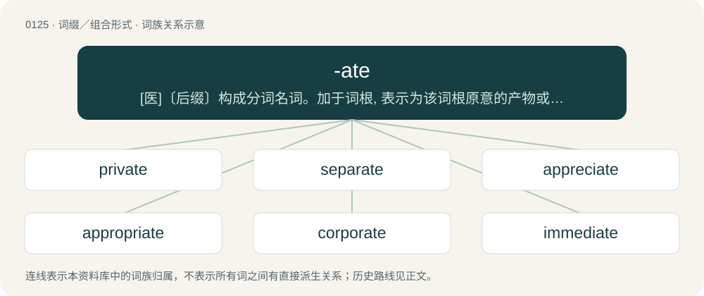

# 0129 · -ate — \[医\]〔后缀〕构成分词名词。加于词根, 表示为该词根原意的产物或作用。例如hemolysate表示溶血产物

[总目录](../00_总目录_按常用程度.md)

**类型**：词缀／组合形式　｜　**来源语言**：见词源记录

## 核心含义与来源

- 核心含义：\[医\]〔后缀〕构成分词名词。加于词根, 表示为该词根原意的产物或作用。例如hemolysate表示溶血产物
- 英文含义：forms adjectives with meaning "having the specified thing"
- 词形：-ate

**多个词源／构词路径**：同一拼写可能有不同来源；以下按词性和含义分别列出。

**来源记录 1**（后缀／后置成分；forms adjectives with meaning "having the specified thing"）

First attested in the 15th century; borrowed from Latin -ātus, the perfect passive participle ending of first conjugation verbs, also used to form participial adjectives from nouns. Before -ate was introduced as a suffix in Middle English, Latin-borrowed participial adjectives were written with final -at (Middle English desolat for modern desolate) and could also be used as past participles (see degenerate or communicate for remnants of it) with or without a corresponding verb ending in -aten; see Etymology 2. Doublet of -ee and, distantly, of -ed.

**来源记录 2**（后缀／后置成分；derives or adapts verbs (mostly) from Latin stems）

See Etymology 1. In Middle English, verbs were derived from Latin-borrowed participial adjectives (also used as their past participles) and formed their infinitives in -aten (see -en; Middle English desolaten for modern desolate). In the 15th century, the loss of most verbal morphology made verbs formally identical to adjectives. This led to the heteronymy of Middle English verbs in -aten with their corresponding past participles, numerous adjectives in -ate being used as verbs, and, in the late 16th century, the systematic borrowing of such Latin participles as English verbs. The sheer number of newly borrowed verbs from Latin ending in -ate later gave rise to -ate's productivity as a verbal suffix. further etymology The same process also led to the systematic borrowing of Latin perfect passive participle of other kinds as English verbs. See dissect, delete, erase, applause (when older applaud) and exhaust: all borrowed from Latin participial stems of diverse conjugation groups. Compare also Basque -tu for similar development.

**来源记录 3**（后缀／后置成分；forms nouns meaning "person or thing that is either the object of a performed transitive verb or the subject of an intransitive one"）

From the substantivization of perfect passive participles of first conjugation Latin verbs; see Etymology 1. Partly taken from French animate substantives that began to be Latinized during the 14th century: see French avoué and its re-Latinized version avocat, whence English advocate which underwent further re-Latinization. Partly from inanimate substantives taken from neuter forms of Latin participles: see mandate. French -é (e.g., avoué, employé) later gave English -ee.

**来源记录 4**（后缀／后置成分；forms derivatives of specified elements or compounds; especially salts or esters of an acid whose name ends in -ic）

From the substantivization of perfect passive participle from first conjugation Latin verbs; see Etymology 1.

**来源记录 5**（后缀／后置成分；forms nouns denoting a rank or office）

From the Latin abstract-noun-forming suffix -ātus, -ātūs.

## 词族图

## 单词速览（常用到不常用）

| 单词 | 音标 | 释义 |
|---|---|---|
| [private](#w-1) | /ˈpɹaɪ.vɪt/ | a. 私人的, 秘密的, 私立的, 隐蔽的；n. 士兵, 隐士, 阴部；\[计\] 私人的 |
| [separate](#w-2) | 美 /ˈsɛp.əˌɹeɪt/ | n. 独立件, 抽印本；a. 分开的, 各别的, 单独的, 分隔的；vi. 分开, 隔开, 分居 |
| [appreciate](#w-3) | 英 /əˈpɹiː.ʃi.eɪt/ | vt. 赏识, 鉴别, 为...而感激, 领会, 欣赏；vi. 增值, 涨价 |
| [appropriate](#w-4) | 英 /əˈpɹəʊ.pɹi.ɪt/；美 /əˈpɹoʊ.pɹi.ɪt/ | 【英文】Suitable or fit; proper; felicitous. |
| [corporate](#w-5) | 英 /ˈkɔː.pə.ɹət/；美 /ˈkoɹ.pə.ɹət/ | a. 社团的, 合伙的, 公司的；\[经\] 团体的, 法人的, 社团的 |
| [immediate](#w-6) | 英 /ɪˈmiː.dɪət/；美 /ɪˈmi.di.ɪt/ | a. 立即的, 直接的, 接近的；\[医\] 直接的, 立即的 |
| [graduate](#w-7) | 美 /ˈɡɹæd͡ʒuɪt/；/ˈɡɹæd͡ʒuət/ | n. 毕业生, 量杯；a. 已得学位的, 研究生的, 毕业的；vi. 毕业, 得学位, 逐渐变为 |
| [operate](#w-8) | 英 /ˈɒpəɹeɪt/；美 /ˈɑpəɹeɪt/ | v. 操作, 运转, 动手术, 活动 |
| [celebrate](#w-9) | 英 /ˈsɛl.ɪ.bɹeɪt/；美 /ˈsɛl.ə.bɹeɪt/ | v. 庆祝, 祝贺, 举行 |
| [participate](#w-10) | 英 /pɑːˈtɪs.ɪ.peɪt/；美 /pɑɹˈtɪs.əˌpeɪt/ | vi. 参加, 分享, 参与, 带有；vt. 分享, 分担 |
| [associate](#w-11) | 英 /əˈsəʊʃi.ət/；美 /əˈsoʊʃi.ət/ | 【英文】A person united with another or others in an act, enterprise, or business; a partner or employee. |
| [indicate](#w-12) | /ˈɪndɪˌkeɪt/ | vt. 显示, 象征, 指示, 指出；\[医\] 指示 |
| [desperate](#w-13) | 英 /ˈdɛs.p(ə.)ɹɪt/；/ˈdɛs.p(ə.)ɹət/ | a. 不顾一切的, 危急的, 令人绝望的, 极渴望的 |
| [investigate](#w-14) | /ɪnˈvɛs.tə.ɡeɪt/ | v. 调查, 审查 |
| [estimate](#w-15) | /ˈɛs.tɪˌmeɪt/ | 【英文】To calculate roughly, often from imperfect data. |
| [moderate](#w-16) | 英 /ˈmɒdəɹət/；美 /ˈmɑdəɹət/ | a. 适度的, 稳健的, 中等的, 节制的；vt. 节制, 减轻, 使缓和；vi. 变缓和, 主持会议 |
| [generate](#w-17) | 英 /ˈd͡ʒɛn.ə.ɹeɪt/；美 /ˈd͡ʒɛn.ə.ɹeɪt/ | vt. 产生, 发生, 导致；\[电\] 产生 |
| [legitimate](#w-18) | /lɪˈd͡ʒɪt.ɪ.mət/ | a. 合法的, 正当的, 婚生的；vt. 认为正当, 立为嫡嗣, 使合法 |
| [advocate](#w-19) | /ˈæd.və.kət/ | n. 提倡者, 拥护者；vt. 主张, 提倡 |
| [communicate](#w-20) | /kəˈmjuːnɪkeɪt/ | vt. 显露, 传达, 感染；vi. 通讯 |
| [demonstrate](#w-21) | 英 /ˈdɛm.ənˌstɹeɪt/ | vt. 示范, 证明；vi. 示威 |
| [eliminate](#w-22) | 英 /ɪˈlɪm.ɪ.neɪt/；美 /ɪˈlɪm.ɪ.neɪt/ | vt. 除去, 排除, 剔除, 消除 |
| [passionate](#w-23) | /ˈpæʃənɪt/ | a. 热情的, 热烈的, 易怒的, 热恋的 |
| [concentrate](#w-24) | 英 /ˈkɒn.sən.tɹeɪt/；美 /ˈkɑn.sən.tɹeɪt/ | n. 浓缩, 精选；v. 集中, 专心 |
| [intimate](#w-25) | /ˈɪn.tɪ.mət/ | a. 亲密的, 私人的, 秘密的；vt. 暗示, 通知, 告诉；n. 至交 |
| [adequate](#w-26) | 英 /ˈæd.ɪ.kwət/；美 /ˈæd.ə.kwɪt/ | a. 适当的, 足够的；\[法\] 胜任的, 适当的, 充分的 |
| [intermediate](#w-27) | /ɪn.tə(ɹ)ˈmi.di.ət/ | n. 中间物, 调停者, 中级；a. 中间的, 中级的；vi. 起媒介作用 |
| [accommodate](#w-28) | 英 /əˈkɒməˌdeɪt/；美 /əˈkɑməˌdeɪt/ | vt. 使适应, 调和, 通融, 容纳, 向...提供；vi. 适应 |
| [delicate](#w-29) | 英 /ˈdɛl.ɪ.kət/；美 /ˈdɛl.ɪ.kɪt/ | a. 细致优雅的, 微妙的, 美味的；\[医\] 柔弱的 |
| [affiliate](#w-30) | 英 /əˈfɪl.i.ət/ | vt. 使紧密联系, 使附属, 接纳, 收养；vi. 发生联系, 参加 |
| [facilitate](#w-31) | /fəˈsɪlɪteɪt/ | vt. 使容易, 促进, 帮助；\[法\] 使容易, 使便利, 推进 |
| [negotiate](#w-32) | 英 /nəˈɡəʊ.ʃi.eɪt/；美 /nəˈɡoʊ.ʃi.eɪt/ | vi. 商议, 谈判, 交涉；vt. 谈妥, 转让, 处理 |
| [fortunate](#w-33) | 英 /ˈfɔː.t͡ʃə.nɪt/；美 /ˈfɔɹ.t͡ʃə.nɪt/ | a. 幸运的, 幸福的 |
| [mandate](#w-34) | 美 /ˈmeə̯ndeɪ̯t/；/ˈmændeɪ̯t/ | n. 命令, 指令, 要求；vt. 委任统治 |
| [aggregate](#w-35) | /ˈæɡ.ɹɪ.ɡət/ | 【英文】Formed by a collection of particulars into a whole mass or sum; collective; combined; added up. |
| [locate](#w-36) | 英 /lə(ʊ)ˈkeɪt/；美 /ˈloʊˌkeɪt/ | vt. 找出, 设于, 位于；vi. 定居 |
| [translate](#w-37) | 英 /tɹɑːnzˈleɪt/；美 /tɹænzˈleɪt/ | vt. 翻译, 解释, 转化, 转变为, 调动；vi. 翻译, 被译；\[计\] 转换 |
| [educate](#w-38) | 美 /ˈɛd͡ʒ.əˌkeɪt/；/ˈɛd͡ʒ.ʊˌkeɪt/ | vt. 教育, 培养, 训练 |
| [calculate](#w-39) | /ˈkælkjʊleɪt/ | v. 计算, 预测, 计划, 打算 |
| [dominate](#w-40) | 英 /ˈdɒm.ɪ.neɪt/；美 /ˈdɑ.məˌneɪt/ | v. 支配, 占优势 |
| [tolerate](#w-41) | 英 /ˈtɒl.ə.ɹeɪt/；美 /ˈtɑ.lə.ɹeɪt/ | vt. 宽容, 容许, 有耐力 |
| [coordinate](#w-42) | 英 /kəʊˈɔː.dɪ.nɪt/；美 /koʊˈɔɹ.də.nɪt/ | n. 同等的人(或物), 坐标；a. 同等的, 并列的；v. (使)协调 |
| [deliberate](#w-43) | 英 /dɪˈlɪb.(ə.)ɹət/；美 /dɪˈlɪb.ɚ.ət/ | a. 深思熟虑的, 故意的, 从容的；v. 仔细考虑 |
| [cooperate](#w-44) | 英 /kəʊˈɒp.ə.ɹeɪt/；美 /koʊˈɑ.pəˌɹeɪt/ | vi. 合作, 协力, 配合；\[化\] 合作 |
| [hesitate](#w-45) | 英 /ˈhɛz.ɪ.teɪt/；美 /ˈhɛz.ə.teɪt/ | vi. 犹豫, 迟疑, 踌躇, 支吾, 停顿 |
| [compensate](#w-46) | 英 /ˈkɒm.pən.seɪt/；美 /ˈkɑm.pənˌseɪt/ | v. 偿还, 补偿, 付报酬 |
| [activate](#w-47) | /ˈæktɪˌveɪt/ | vt. 使活动, 使激活, 正式建成；vi. 有活力 |
| [violate](#w-48) | /ˈvaɪəˌleɪt/ | vt. 违犯, 亵渎, 违反, 侵犯, 妨碍；\[经\] 违犯, 违反 |
| [clergy](#w-49) | 英 /ˈklɜːdʒi/；美 /ˈklɝd͡ʒi/ | n. 牧师, 僧侣, 神职人员 |
| [initiate](#w-50) | /ɪˈnɪʃ.i.eɪt/ | n. 入会, 开始；a. 新加入的；vt. 开始, 传授基本知识给 |
| [anticipate](#w-51) | 英 /ænˈtɪs.ɪ.peɪt/；美 /ænˈtɪs.ɪ.peɪt/ | vt. 预期, 占先, 加速, 提前使用；\[医\] 提前出现, 先期发生 |
| [integrate](#w-52) | 英 /ˈɪn.tɪ.ɡɹeɪt/；美 /ˈɪn.təˌɡɹeɪt/ | vt. 综合, 使完整, 使成整体；vi. 成一体；a. 完整的, 完全的 |
| [magistrate](#w-53) | /ˈmæd͡ʒ.ɪˌstɹeɪt/ | n. 长官, 法官, 推事；\[法\] 司法行政官, 治安法官, 地方法官 |
| [confederate](#w-54) | /kənˈfɛdəɹət/ | n. 同盟者, 同盟国；a. 同盟的, 联合的；v. (使)联盟, (使)联合 |
| [delegate](#w-55) | 英 /ˈdɛlɪɡət/；美 /ˈdɛlɪɡət/ | n. 代表；vt. 委派...为代表 |
| [navigate](#w-56) | 英 /ˈnæv.ɪ.ɡeɪt/；美 /ˈnæv.ɪ.ɡeɪt/ | vi. 航行；vt. 航行于, 驾驶, 操纵, 使通过 |
| [stimulate](#w-57) | 英 /ˈstɪm.jʊ.leɪt/；美 /ˈstɪm.jəˌleɪt/ | vt. 刺激, 激励, 鼓舞；vi. 起刺激作用 |
| [accelerate](#w-58) | 英 /əkˈsɛl.əˌɹeɪt/；美 /ɪkˈsɛl.əˌɹeɪt/ | v. 加速, 促进 |
| [terminate](#w-59) | 英 /ˈtɜːmɪneɪ̯t/；美 /ˈtɝmɪneɪ̯t/ | a. 有结尾的, (可)结束的；vi. 结束, 终止, 满期；vt. 使停止, 使结束, 使终止 |
| [approximate](#w-60) | 英 /əˈpɹɒk.sɪ.mət/；美 /əˈpɹɑk.sə.mət/ | a. 大约的, 接近的, 近似的；vt. 接近, 使接近, 粗略估计；vi. 接近于 |
| [electorate](#w-61) | 英 /ɪˈlɛktəɹət/ | n. 选民, 有选举权者, 选区；\[法\] 选民, 选举团, 选区 |
| [differentiate](#w-62) | 英 /dɪf.əˈɹɛn.ʃi.eɪt/；美 /ˌdɪf.əˈɹɛn.ʃi.eɪt/ | v. 区别, 区分 |
| [motivate](#w-63) | 英 /ˈməʊ.tɪ.veɪt/；美 /ˈmoʊ.tɪ.veɪt/ | vt. 给与动机, 刺激, 提高...的学习欲望, 促动；\[经\] 促动, 激发, 激励 |
| [congratulate](#w-64) | 美 /kənˈɡɹæd͡ʒ.ʊˌleɪt/；/kənˈɡɹæt͡ʃ.ʊˌleɪt/ | vt. 祝贺, 庆贺 |
| [dictate](#w-65) | 英 /(ˌ)dɪkˈteɪt/；美 /ˈdɪkˌteɪt/ | 【英文】To order, command, control. |
| [rotate](#w-66) | 英 /ɹəʊˈteɪt/；美 /ˈɹoʊ.teɪt/ | a. 辐状的；vt. 使旋转, 使转动, 使轮流；vi. 旋转, 循环 |
| [intricate](#w-67) | /ˈɪn.tɹɪ.kət/ | a. 复杂的, 错综的, 缠结的, 难懂的 |
| [penetrate](#w-68) | /ˈpɛnɪtɹeɪt/ | vt. 穿透, 刺穿, 渗透, 看穿, 洞察, 了解, 使充溢；vi. 刺入, 看穿, 渗透, 打进 |
| [mitigate](#w-69) | /ˈmitigeit/ | 【英文】Mitigated, alleviated. |
| [evacuate](#w-70) | /ɪˈvæk.ju.eɪt/ | v. 疏散, 撤出, 排泄 |
| [dedicate](#w-71) | 英 /ˈdɛdɪˌkeɪt/ | vt. 献出, 贡献 |
| [discriminate](#w-72) | 英 /dɪˈskɹɪm.ɪ.neɪt/；美 /dɪˈskɹɪm.əˌneɪt/ | v. 区别, 差别待遇 |
| [syndicate](#w-73) | 英 /ˈsɪndɪkət/ | n. 企业联合, 辛迪加, 财团；v. 联合成辛迪加 |
| [commemorate](#w-74) | /kəˈmɛməˌɹeɪt/ | vt. 纪念 |
| [accumulate](#w-75) | 英 /əˈkjuːmjʊˌleɪt/；美 /əˈkju.mjəˌleɪt/ | v. 积聚, 堆积 |
| [innate](#w-76) | /ɪˈneɪt/ | a. 先天的, 天生的；\[医\] 先天的, 生来的 |
| [speculate](#w-77) | 英 /ˈspɛk.jʊˌleɪt/；美 /ˈspɛk.jəˌleɪt/ | vi. 深思, 推测, 投机；\[经\] 投机 |
| [simulate](#w-78) | 英 /ˈsɪm.jʊˌleɪt/；美 /ˈsɪm.jəˌleɪt/ | vt. 模拟, 假装, 模仿；\[法\] 伪装的, 模拟的; 假装的, 伪装的, 冒充 |
| [migrate](#w-79) | /maɪˈɡɹeɪt/ | vi. 移动, 移往, 随季节而移居；\[计\] 迁移程序 |
| [cultivate](#w-80) | 英 /ˈkʌltɪveɪt/ | vt. 培养, 耕作 |
| [phosphate](#w-81) | 英 /ˈfɒsfeɪt/；美 /ˈfɑsfeɪt/ | 【英文】To treat or coat with a phosphate or phosphoric acid. |
| [contemplate](#w-82) | 英 /ˈkɒn.təmˌpleɪt/；美 /ˈkɑn.təmˌpleɪt/ | vt. 注视, 沉思, 盘算；vi. 冥思苦想 |
| [directorate](#w-83) | 英 /dɪˈɹɛktəɹət/；/daɪˈɹɛktəɹət/ | n. 理事之职务, 董事会, 理事会；\[经\] 董事会 |
| [emulate](#w-84) | 英 /ˈɛm.jʊ.leɪt/；美 /ˈɛm.jə.leɪt/ | vt. 效法, 尽力赶上, 同...竞争；\[计\] 仿真 |
| [validate](#w-85) | /ˈvæl.ɪ.deɪt/ | vt. 使有效, 使生效, 确认, 证实, 验证；\[计\] 验证 |
| [elevate](#w-86) | /ˈɛləvət/ | 【英文】Elevated, raised aloft. |
| [designate](#w-87) | 英 /ˈdɛz.ɪɡ.neɪt/ | vt. 指定, 指明, 称呼；a. 已选出而未上任的 |
| [illiterate](#w-88) | /ɪˈlɪtəɹət/ | n. 文盲；a. 目不识丁的, 没受教育的 |
| [originate](#w-89) | 英 /əˈɹɪd͡ʒɪneɪt/ | vt. 创始, 发明, 发起；vi. 发源, 发生, 起航；\[计\] 发自 |
| [decorate](#w-90) | /ˈdɛkəɹeɪt/ | v. 装饰 |
| [affectionate](#w-91) | /əˈfɛkʃəneɪt/ | a. 深情的, 充满情爱的 |
| [degenerate](#w-92) | /dɪˈd͡ʒɛnəɹɪt/ | a. 堕落的；vi. 退化, 堕落；vt. 使变质, 使退化 |
| [temperate](#w-93) | /ˈtɛmpəɹət/ | a. 温和的, 适度的, 有节制的, 温带的 |
| [allocate](#w-94) | 英 /ˈæl.ə.keɪt/；美 /ˈæl.əˌkeɪt/ | vt. 分派, 分配；\[计\] 分配 |
| [intimidate](#w-95) | 英 /ɪnˈtɪmɪdeɪt/ | vt. 威胁, 恐吓；\[法\] 恐吓, 威胁, 使恐惧 |
| [illuminate](#w-96) | 英 /ɪˈl(j)umɪneɪt/ | vt. 照明, 用灯装饰, 阐明, 说明, 使灿烂；vi. 照亮, 用灯装饰 |
| [eradicate](#w-97) | /iˈrædikeit/ | 【英文】eradicated |
| [imitate](#w-98) | 美 /ˈɪmɪteɪt/ | vt. 模仿, 效法, 冒充, 仿造 |
| [literate](#w-99) | /ˈlɪtəɹət/ | n. 学者；a. 有读写能力的, 精通文学的, 受过教育的 |
| [complicate](#w-100) | 英 /ˈkɒmplɪkeɪt/；美 /ˈkɑmplɪkeɪt/ | vt. 弄复杂, 使错综, 使恶化；vi. 变复杂 |
| [disparate](#w-101) | 英 /ˈdɪsp(ə)ɹət/；美 /ˈdɪsp(ə)ɹət/ | a. 根本不同的, 全异的, 不相干的；n. 无法相比的东西(或人) |
| [meditate](#w-102) | /ˈmɛ.dɪˌteɪt/ | vt. 想, 考虑, 计划；vi. 沉思, 反省 |
| [formulate](#w-103) | /ˈfɔː(ɹ)mjʊleɪt/ | vt. 用公式表示, 明确叙述, 制订；\[机\] 公式化, 公式表示 |
| [carbonate](#w-104) | 英 /ˈkɑː(ɹ).bə.neɪt/；美 /ˈkɑɹbəneɪt/ | n. 碳酸盐；vt. 使碳酸盐化, 使充满二氧化碳 |
| [laureate](#w-105) | 英 /ˈlɒɹ.i.ət/；美 /ˈlɔ.ɹi.ət/ | a. 戴桂冠的, 用月桂树枝编织成的, 荣誉的；n. 桂冠诗人；vt. 使戴桂冠 |
| [caliphate](#w-106) | /ˈkælɪfeɪt/ | n. 伊斯兰教国王的职权或其领域 |
| [assassinate](#w-107) | 英 /əˈsæsɪneɪt/；美 /əˈsæs(ə)nˌeɪt/ | vt. 暗杀, 行刺；\[法\] 暗杀, 行刺, 中伤 |
| [exaggerate](#w-108) | /ɛɡˈzæd͡ʒ.ə.ɹeɪt/ | v. 夸大, 夸张 |
| [sulfate](#w-109) | /ˈsʌlfeɪt/ | n. 硫酸盐, 硫酸脂；\[化\] 硫酸盐; 硫酸盐或酯、根 |
| [masturbate](#w-110) | 英 /ˈmæ.stə.beɪt/；美 /ˈmæs.tɚ.beɪt/ | v. 手淫 |
| [circulate](#w-111) | 英 /ˈsɜː.kjʊˌleɪt/；美 /ˈsɝ.kjʊˌleɪt/ | v. (使)流通, (使)循环, (使)传播 |
| [desolate](#w-112) | /ˈdɛs.ə.lət/ | a. 荒凉的 |
| [acetate](#w-113) | /ˈæsɪteɪ̯t/ | n. 醋酸盐；\[化\] 醋酸盐(或酯、根) |
| [deteriorate](#w-114) | 英 /dɪˈtɪə.ɹɪə.ɹeɪt/；美 /dɪˈtɪɹ.iə.ɹeɪt/ | v. (使)恶化 |
| [animate](#w-115) | 英 /ˈæn.ɪ.mət/；美 /ˈæn.ə.mət/ | vt. 使有生气, 赋予生命；a. 有生命的, 有生气的 |
| [innovate](#w-116) | /ˈɪn.ə.veɪt/ | vi. 改革, 创新 |
| [mediate](#w-117) | 美 /ˈmidieɪt/ | a. 居间的, 间接的；vt. 斡旋, 调停；vi. 处于中间, 调解 |
| [penultimate](#w-118) | /pɪˈnʌl.tɪ.mɪt/ | a. 倒数第二的 |
| [propagate](#w-119) | 英 /ˈpɹɒpəˌɡeɪt/；美 /ˈpɹɑpəˌɡeɪt/ | vt. 繁殖, 传播, 传送；vi. 繁殖, 蔓延 |
| [humiliate](#w-120) | /hjuːˈmɪliˌeɪt/ | vt. 使丢脸, 使蒙羞, 屈辱 |
| [irritate](#w-121) | /ˈɪɹ.ɪˌteɪt/ | vt. 激怒, 使发怒, 使兴奋, 使发炎；vi. 引起不快 |
| [deviate](#w-122) | 英 /ˈdiː.vi.eɪt/；美 /ˈdi.vi.eɪt/ | vi. 脱离, 偏离；vt. 使偏离；a. 脱离常规的 |
| [assimilate](#w-123) | 英 /əˈsɪm.ɪ.leɪt/ | vt. 使同化, 吸收, 使相拟, 把...比作；vi. 被吸收, 被同化 |
| [renovate](#w-124) | 英 /ˈɹɛn.nə(ʊ).veɪt/；美 /ˈɹɛn.ə.veɪt/ | vt. 更新, 革新, 刷新, 修复, 使恢复活力 |
| [consummate](#w-125) | 英 /ˈkɒnsəmət/；美 /ˈkɑnsəmət/ | vt. 完成, 使完美；a. 无上的, 至上的, 完美的 |
| [particulate](#w-126) | 英 /pɑːˈtɪk.jʊ.lɪt/；美 /pɑɹˈtɪk.jə.lət/ | n. 微粒；a. 微粒的 |
| [proportionate](#w-127) | 英 /pɹəˈpɔːʃənət/；美 /pɹəˈpɔɹʃənət/ | a. 相称的, 成比例的, 适当的；vt. 使相称, 使成比例 |
| [alienate](#w-128) | /ˈeɪ.li.ə.neɪt/ | vt. 使疏远, 离间, 转让；\[法\] 转让, 让与, 疏远 |
| [curate](#w-129) | 英 /ˈkjʊəɹət/；美 /ˈkjʊɹɪt/ | n. 助理牧师 |
| [disseminate](#w-130) | 英 /dɪˈsɛmɪˌneɪt/ | vt. 散播, 传播, 宣传；vi. 广为传播 |
| [evaporate](#w-131) | 英 /ɪˈvæp.ə.ɹeɪt/ | vi. 蒸发, 失去水分, 消失；vt. 使蒸发, 使脱水, 使消失 |
| [inanimate](#w-132) | 英 /ɪnˈænɪmət/ | a. 失去知觉的, 没生命的, 无精打采的；\[医\] 无生命的, 无生机的 |
| [invalidate](#w-133) | 英 /ɪnˈvæl.ɪ.deɪt/；美 /ɪnˈvæl.əˌdeɪt/ | vt. 使无效；\[法\] 使无效, 使无效力, 使作废 |
| [fluctuate](#w-134) | /ˈflʌkt͡ʃu.eɪt/ | vi. 变动, 起伏, 动摇；vt. 使波动, 使动摇 |
| [frustrate](#w-135) | 英 /fɹʌˈstɹeɪt/；美 /ˈfɹʌsˌtɹeɪt/ | vt. 挫败, 击败, 破坏；a. 无益的, 挫败的, 挫折的 |
| [incarnate](#w-136) | 英 /ɪnˈkɑːneɪt/；美 /ɪnˈkɑːɹ.nɪt/ | vt. 体现, 使具体化, 使实体化；a. 化身的, 实体化的, 肉色的, 深红色的 |
| [detonate](#w-137) | 英 /ˈdɛtəneɪt/；美 /ˈdɛtəˌneɪt/ | vt. 引爆, 使爆炸, 使爆裂；vi. 爆炸, 发爆炸声 |
| [vertebrate](#w-138) | /ˈvɛɹ.tɪ.bɹeɪt/ | n. 脊椎动物；a. 有椎骨的, 有脊椎的 |
| [dissipate](#w-139) | /ˈdɪsɪpeɪt/ | vt. 散失, 驱散, 浪费；vi. 消散, 放荡 |
| [confiscate](#w-140) | 英 /ˈkɒnfɪskeɪt/；美 /ˈkɑnfəˌskeɪt/ | vt. 没收, 把...充公, 查抄；a. 被没收的 |
| [corroborate](#w-141) | 英 /kəˈɹɒbəɹeɪ̯t/；美 /kəˈɹɑbəɹeɪ̯t/ | vt. 巩固, 确证；\[法\] 确证, 确定, 证实 |
| [exacerbate](#w-142) | 英 /ɪɡˈzæsəˌbeɪt/；美 /ɪɡˈzæsɚˌbeɪt/ | vt. 使恶化, 使增剧, 激怒, 使加剧 |
| [exterminate](#w-143) | 英 /ɛkˈstəː.mɪ.neɪt/；美 /ɪkˈstɝ.mɪ.neɪt/ | vt. 扑灭, 消灭, 根绝 |
| [interrogate](#w-144) | 英 /ɪnˈtɛɹəɡeɪt/；美 /ɪnˈtɛɹəɡeɪt/ | vt. 质问, 讯问, 审问；vi. 质问, 讯问 |
| [protectorate](#w-145) | /pɹəˈtɛktəɹɪt/ | n. 摄政职位, 摄政政体；\[法\] 保护国, 保护权, 保护制度 |
| [baccalaureate](#w-146) | /bækəˈlɔːɹɪət/ | n. 学士学位, 毕业班临别宗教仪式 |
| [fabricate](#w-147) | 英 /ˈfæb.ɹɪ.keɪt/；美 /ˈfæb.ɹɪ.keɪt/ | vt. 制造, 建造, 装配, 伪造 |
| [annihilate](#w-148) | 英 /əˈnaɪ.ə.leɪt/ | vt. 消灭, 废止 |
| [glutamate](#w-149) | 英 /ˈɡluː.tə.meɪt/；美 /ˈɡlu.tə.meɪt/ | n. 谷氨酸盐, 味精, 谷氨酸脂；\[医\] 谷氨酸盐 |
| [citrate](#w-150) | /ˈsɪtɹeɪt/ | n. 柠檬酸盐；\[化\] 柠檬酸(或枸橼酸)盐(酯或根) |
| [suffocate](#w-151) | /ˈsʌfəkeɪt/ | vt. 使窒息, 噎住, 闷熄；vi. 闷死, 窒息, 受阻 |
| [predicate](#w-152) | 英 /ˈpɹɛd.ɪ.kət/；美 /ˈpɹɛd.ɪ.kɪt/ | n. 谓语, 谓项；a. 谓语的；vt. 断定为, 使基于, 意味着, 预言 |
| [implicate](#w-153) | /ˈɪmplɪkeɪt/ | vt. 涉及, 含意, 暗示, 牵连；n. 包含的东西 |
| [commensurate](#w-154) | 英 /kəˈmens(ə)rət/；美 /kəˈmɛnsəɹət/ | a. 同量的, 同等的, 相称的 |
| [contaminate](#w-155) | 英 /kənˈtæmɪneɪt/；美 /kənˈtæmɪneɪt/ | vt. 弄污, 弄脏, 污染, 毒害；\[化\] 污染 |
| [insulate](#w-156) | 英 /ˈɪnsjʊleɪt/；美 /ˈɪnsʊleɪt/ | vt. 使绝缘, 隔离；\[医\] 绝缘 |
| [urinate](#w-157) | 英 /ˈjʊəɹɪneɪt/；美 /ˈjʊɹɪneɪt/ | vi. 小便, 撒尿；\[医\] 排尿 |
| [aggravate](#w-158) | /ˈæɡ.ɹə.veɪ̯t/ | vt. 使恶化, 使更严重, 加重 |
| [liquidate](#w-159) | 英 /ˈlɪkwɪdeɪt/；美 /ˈlɪkwəˌdeɪt/ | vt. 偿付, 清算, 扫除, 整理, 变卖, 消灭；vi. 清算, 清理 |
| [calibrate](#w-160) | 英 /ˈkæl.ɪ.bɹeɪ̯t/ | vt. 测定口径, 校准, 使标准化, 调整；\[化\] 校准 |
| [inspectorate](#w-161) | /inˈspektərit/ | \[法\] 检查员, 检查员的管辖区域, 视察团 |
| [irate](#w-162) | /aɪˈɹeɪt/ | a. 发怒的, 生气的 |
| [precipitate](#w-163) | 英 /pɹɪˈsɪpɪtət/ | 【英文】A product resulting from a process, event, or course of action. |
| [reciprocate](#w-164) | /ɹɪˈsɪpɹəˌkeɪt/ | vt. 回报, 互换, 交换, 报答, 使往复运动；vi. 往复运动, 回报, 互换, 酬答 |
| [placate](#w-165) | 英 /pləˈkeɪt/；美 /ˈpleɪkeɪt/ | vt. 抚慰, 平息, 使和解, 怀柔 |
| [stipulate](#w-166) | /ˈstɪpjuˌleɪt/ | v. 规定, 保证 |
| [accentuate](#w-167) | 英 /əkˈsɛn.t͡ʃu.eɪt/ | vt. 以重音念, 强调, 重读 |
| [condensate](#w-168) | /ˈkɒndənseɪt/ | n. 聚合物, 冷凝物, 冷凝液；\[化\] 冷凝; 冷凝物; 冷凝液; 缩合物 |
| [instigate](#w-169) | /ˈɪnstəɡeɪt/ | vt. 教唆, 怂恿, 煽动；\[法\] 教唆, 煽动, 怂恿 |
| [sedate](#w-170) | 英 /sɪˈdeɪt/；美 /səˈdeɪt/ | a. 沉着的, 镇静的, 安静的；vt. 给...服镇静剂 |
| [emirate](#w-171) | /ˈɛməɹət/ | n. 埃米尔的地位, 酋长国 |
| [impersonate](#w-172) | /ɪmˈpɜːsəneɪt/ | vt. 模仿, 扮演, 体现, 使人格化；\[法\] 体现, 模仿, 拟人 |
| [culminate](#w-173) | 英 /ˈkʌl.mɪ.neɪt/；美 /ˈkʌl.məˌneɪt/ | vi. 到绝顶, 达于极点, 达到高潮；vt. 使到绝顶, 使达到高潮 |
| [modulate](#w-174) | 英 /ˈmɒd͡ʒɪleɪt/；美 /ˈmɑ.d͡ʒəˌleɪt/ | vt. 调整, 使转调, 控制；vi. 转调, 调制 |
| [celibate](#w-175) | /ˈsɛləbət/ | n. 独身者, 独身主义者；a. 独身的, 独身主义的 |
| [obstinate](#w-176) | 英 /ˈɒb.stɪ.nət/；美 /ˈɑb.stə.nət/ | a. 倔强的, 顽固的, 不让步的 |
| [vaccinate](#w-177) | /ˈvæksɪneɪt/ | v. 预防接种 |
| [authenticate](#w-178) | 英 /ɒˈθɛn.tɪ.keɪt/；美 /ɔˈθɛn.tɪ.keɪt/ | 【英文】Synonym of authentic. |
| [lactate](#w-179) | 英 /ˈlæk.teɪt/；美 /ˈlæk.teɪt/ | 【英文】Any salt or ester of lactic acid. |
| [procrastinate](#w-180) | 英 /pɹəʊˈkɹæs.tɪ.neɪt/；美 /pɹoʊˈkɹæs.tə.neɪt/ | v. 延迟, 耽搁 |
| [elucidate](#w-181) | 英 /ɪˈl(j)uːsɪdeɪt/；美 /əˈlusəˌdeɪt/ | vt. 阐明, 说明 |
| [hibernate](#w-182) | 英 /ˈhaɪbə(r)ˌneɪt/；美 /ˈhaɪbəɹˌneɪt/ | vi. 过冬, 冬眠, 避寒 |
| [prostrate](#w-183) | 英 /ˈpɹɒstɹeɪt/；美 /ˈpɹɑstɹeɪt/ | 【英文】To lie flat or face-down. |
| [rejuvenate](#w-184) | /ɹɪˈd͡ʒuːvəneɪt/ | vt. 使年轻, 使复原, 使恢复精神；vi. 返老还童, 复原 |
| [silicate](#w-185) | /ˈsɪlɪkət/ | n. 硅酸盐；\[化\] 硅酸盐; 硅酸酯 |
| [abdicate](#w-186) | 英 /ˈæb.dɪˌkeɪt/ | vt. 正式放弃；vi. 退位, 退出, 辞职 |
| [excavate](#w-187) | /ˈɛk.skə.veɪt/ | v. 挖空, 挖出, 凿通 |
| [orchestrate](#w-188) | 英 /ˈɔː(ɹ).kə.stɹeɪt/；美 /ˈɔɹ.kəˌstɹeɪt/ | v. 编管弦乐曲 |
| [folate](#w-189) | /ˈfəuleit/ | \[医\] 叶酸盐 |
| [prelate](#w-190) | 英 /ˈpɹɛlət/ | n. 高级教士 |
| [agitate](#w-191) | 英 /ˈæ.d͡ʒɪ.teɪt/ | vt. 使摇动, 搅动, 使激动, 使不安；vi. 鼓动, 煽动 |
| [officiate](#w-192) | /əˈfɪ.ʃi.eɪt/ | vt. 执行, 司仪, 担任(体育比赛)裁判；vi. 主持宗教仪式, 行使职务 |
| [germinate](#w-193) | /ˈd͡ʒɜː(ɹ)mɪneɪt/ | vi. 发芽, 萌芽, 开始发育；vt. 使发芽, 使发育 |
| [mutate](#w-194) | 英 /mjuːˈteɪt/；美 /ˈmju.teɪt/ | vi. 变化, 产生变异, 变化元音；vt. 使变异 |
| [permeate](#w-195) | 英 /ˈpɜːmiˌeɪt/；美 /ˈpɝmiˌeɪ̯t/ | vt. 弥漫, 渗透, 充满, 影响, 感染；vi. 透入, 散布 |
| [devastate](#w-196) | 英 /ˈdɛv.ə.steɪt/ | vt. 毁坏；\[法\] 使荒废, 毁灭, 掠夺 |
| [deflate](#w-197) | 英 /diːˈfleɪt/ | vt. 放气, 抽出空气, 使缩小；vi. 缩小 |
| [postulate](#w-198) | 英 /ˈpɒstjʊlət/；美 /ˈpɑst͡ʃələt/ | n. 假定, 基本条件；vt. 要求, 假定 |
| [denigrate](#w-199) | 英 /ˈdɛn.ɪ.ɡɹeɪ̯t/ | vt. 使变黑, 玷污, 诋毁 |
| [insinuate](#w-200) | 英 /ɪnˈsɪnjueɪt/ | vt. 巴结, 暗示, 使滋长；vi. 旁敲侧击 |
| [marinate](#w-201) | /ˈmæɹɪneɪt/ | vt. 用腌泡汁腌/泡(肉/鱼) |
| [incriminate](#w-202) | 英 /ɪnˈkɹɪm.ɪ.neɪ̯t/ | vt. 连累, 暗示...有罪, 控告；\[法\] 控告, 使入罪, 连累 |
| [irrigate](#w-203) | /ˈɪɹəˌɡeɪt/ | vt. 灌溉, 冲洗伤口, 使清新；vi. 灌溉 |
| [ovate](#w-204) | 英 /ˈəʊ.veɪt/；美 /ˈoʊ.veɪt/ | a. 卵形的；\[医\] 卵圆形的(叶) |
| [obligate](#w-205) | 英 /ˈɒb.lɪˌɡeɪt/；美 /ˈɑ.blɪˌɡeɪt/ | vt. 使负义务, 强使, 使感激, 施恩惠于；a. 有责任的, 必须的 |
| [delineate](#w-206) | 英 /dɪˈlɪniːeɪt/ | vt. 描绘...的轮廓, 描绘, 描写 |
| [ejaculate](#w-207) | 英 /ɪˈdʒæk.jʊ.leɪt/；美 /ɪˈd͡ʒæk.jə.leɪt/ | vt. 突然说出, 射出；vi. 射出, 射精；n. 精液 |
| [triumvirate](#w-208) | 英 /tɹaɪˈʌmvəɹət/ | n. 三执政, 三头统治, 三人执政之职 |
| [dispassionate](#w-209) | 英 /dɪsˈpæʃəneɪt/ | 【英文】To free from passion. |
| [captivate](#w-210) | 英 /ˈkæptɪveɪt/；美 /ˈkæptəˌveɪt/ | vt. 迷住, 迷惑 |
| [legate](#w-211) | /ləˈɡeɪt/ | 【英文】To leave as a legacy. |
| [levitate](#w-212) | /ˈlɛvɪteɪt/ | v. (使)轻轻浮起, (使)飘浮空中 |
| [encapsulate](#w-213) | /ɪnˈkæps(j)ʊˌleɪt/ | vt. 装入胶囊, 封进内部, 压缩；vi. 做成胶囊 |
| [fascinate](#w-214) | /ˈfæsɪneɪt/ | vt. 令人入神, 使着迷；vi. 入迷 |
| [governorate](#w-215) | /ˈɡʌvə(ɹ)nəɹət/ | n. 省 |
| [capitulate](#w-216) | 英 /kəˈpɪ.tjʊ.leɪt/；美 /kəˈpɪt͡ʃ.(j)ʊ.leɪt/ | vi. (有条件)投降；\[法\] 投降, 投降 |
| [decimate](#w-217) | 英 /ˈdɛsɪmeɪt/；美 /ˈdɛsəmeɪt/ | vt. 每十人杀一人, 大批杀害 |
| [impregnate](#w-218) | /ˈɪmpɹɛɡneɪt/ | vt. 使怀孕, 使肥沃, 使充满, 灌输；a. 怀孕的, 充满的 |
| [medicate](#w-219) | /ˈmɛdɪkeɪt/ | vt. 用药治疗；\[医\] 用药治疗, 投药, 加药, 使含药 |
| [pyruvate](#w-220) | 英 /pʌɪˈɹuː.veɪt/；美 /paɪˈɹuː.veɪt/ | n. \[化\]丙酮酸盐(或酯) |
| [depreciate](#w-221) | 英 /dɪˈpɹiːʃɪeɪt/；美 /dəˈpriʃiˌeɪt/ | vi. 贬值；vt. 降价, 贬低 |
| [dissociate](#w-222) | 英 /dɪˈsəʊ.ʃi.eɪt/；美 /dɪˈsoʊ.ʃi.eɪt/ | v. 把...分开, 分离, 游离, 分裂 |
| [incubate](#w-223) | /ˈɪŋkjʊbeɪt/ | vt. 孵, 培养, 使发展；vi. 孵蛋, 潜伏, 筑巢, 孵化, 酝酿；n. 孵育物 |
| [mutilate](#w-224) | /ˈmjuː.tɪˌleɪt/ | vt. 切断, 使残废, 使不完整；\[医\] 致残毁 |
| [sultanate](#w-225) | 英 /ˈsʌltənət/；美 /ˈsʌltn̩ət/ | n. 苏丹的职务, 苏丹统治的领土 |
| [litigate](#w-226) | /ˈlɪtɪɡeɪt/ | vi. 对簿法庭；vt. 在法庭相争, 诉讼 |
| [lubricate](#w-227) | /ˈluːbrɪkeɪt/ | vt. 使润滑, 涂油；vi. 润滑 |
| [pollinate](#w-228) | /ˈpɒlɪneɪt/ | vt. 对...授粉 |
| [collate](#w-229) | 英 /kəˈleɪt/；美 /ˈkoʊ.leɪt/ | vt. 校对, 校勘；\[计\] 整理 |
| [consecrate](#w-230) | 英 /ˈkɒnsəkɹeɪt/；美 /ˈkɑnsəkɹeɪt/ | vt. 把...供祭祀用, 奉献, 使神圣；a. 被献给神的, 神圣的 |
| [oscillate](#w-231) | 美 /ˈɑsɪleɪt/ | vi. 振动, 彷徨, 犹豫；vt. 使振动, 使动摇 |
| [infuriate](#w-232) | 英 /ɪnˈfjʊəɹieɪt/；/ɪnˈfjʊəɹɪət/ | a. 狂怒的；vt. 激怒 |
| [defecate](#w-233) | /ˈdɛfɪkeɪt/ | vt. 除去污物, 澄清, 净化；vi. 澄清, 排便 |
| [enumerate](#w-234) | 英 /ɪˈnjuː.məˌɹeɪt/；美 /ɪˈn(j)u.məˌɹeɪt/ | vt. 列举, 计算, 枚举, 数；\[法\] 举出, 列举, 枚举 |
| [aspartate](#w-235) | /ˈæspə(ɹ)teɪt/ | \[机\] 门冬氨酸盐 |
| [distillate](#w-236) | /ˈdɪstɪlət/ | n. 馏出物, 精华；\[化\] 馏出液; 馏出物 |
| [hallucinate](#w-237) | /həˈl(j)uːsɪneɪt/ | vt. 使产生幻觉 |
| [incapacitate](#w-238) | 英 /ˌɪn.kəˈpæ.sɪ.teɪt/ | vt. 使无能力, 使无行为能力；\[法\] 使无资格, 使无能力, 剥夺资格 |
| [attenuate](#w-239) | 英 /əˈtɛn.juˌeɪt/ | a. 纤细的, 稀薄的, 稀释的；vt. 使减弱, 使纤细；vi. 变稀薄, 变纤细, 减少 |
| [inveterate](#w-240) | 英 /ɪnˈvɛtəɹɪt/ | a. 根深的, 成癖的, 积习的；\[医\] 慢性顽固性的, 绵延难治的 |
| [oxalate](#w-241) | /ˈɒksəleɪt/ | n. 草酸盐, 乙二酸盐；\[医\] 草酸盐 |
| [punctuate](#w-242) | 英 /ˈpʰʌŋktjuːeɪt/ | vt.vi. 给文章加标点, 加标点符号；vt. 强调, 加强, (常用被动)不时打断；n. 标点, 标点法, 标点符号 |
| [castrate](#w-243) | 英 /kæsˈtɹeɪt/；美 /ˈkæs.tɹeɪt/ | vt. 阉割, 删除, 使丧失力量(或效果)；\[医\] 去生殖腺者, 阉者, 阉, 阉割 |
| [determinate](#w-244) | 英 /dɪˈtɜːmɪnət/ | a. 确定的, 坚决的, 决定的；\[法\] 决定性的, 限定性的, 有限的 |
| [cingulate](#w-245) | /ˈsiŋ^jjlit,-leit/ | a. (昆虫腹部)有色带环绕的 |
| [extortionate](#w-246) | 英 /ɛkˈstɔːʃənət/；美 /ɛkˈstɔɹʃənət/ | a. 敲诈的, 勒索的, 过度的, 昂贵的；\[法\] 勒索的, 敲诈的, 强夺的 |
| [invigorate](#w-247) | /ɪnˈvɪɡəɹeɪt/ | vt. 使精力充沛, 鼓舞, 搞活, 使健壮 |
| [fixate](#w-248) | 英 /fɪkˈseɪt/；美 /ˈfɪkseɪt/ | vi. 使固定, 使不变, 注视；vt. 使固定, 注视 |
| [palatinate](#w-249) | /pəˈlætɪnɪt/ | 【英文】Of or pertaining to a palatinate or the Palatinate. |
| [inculcate](#w-250) | 英 /ɪnˈkʌl.keɪt/；美 /ˈɪn.kʌl.keɪt/ | vt. 反复灌输, 谆谆教诲 |
| [promulgate](#w-251) | 英 /ˈpɹɒml̩.ɡeɪt/；美 /ˈpɹɑ.məl.ɡeɪt/ | vt. 发布, 公布, 发表, 传播；\[法\] 颁布, 公告, 散播 |
| [reverberate](#w-252) | 英 /ɹɪˈvɜːbəˌɹeɪt/；美 /ɹəˈvɜɹbəˌɹeɪt/ | vi. 回响, 反响, 被反射；vt. 使反响, 使回响, 反射；a. 回响的, 反射的 |
| [obfuscate](#w-253) | 英 /ˈɒbfəskeɪt/；美 /ˈɑbfəskeɪt/ | vt. 弄暗, 使模糊, 使迷惑 |
| [venerate](#w-254) | /ˈvɛnəɹeɪt/ | vt. 尊敬, 崇敬, 崇拜 |
| [dentate](#w-255) | /ˈdɛnteɪt/ | a. 有齿的, 锯齿状的, 齿状的；\[化\] 配位基 |
| [inoculate](#w-256) | 英 /ɪˈnɒkjuleɪt/；美 /ɪˈnɑːkjuleɪt/ | vt. 接种, 嫁接；\[医\] 接种 |
| [benzoate](#w-257) | 英 /ˈbɛn.zəʊ.eɪt/；美 /ˈbɛn.zoʊˌeɪt/ | n. 苯(甲)酸盐；\[化\] 苯甲酸盐(或酯) |
| [indoctrinate](#w-258) | /inˈdɒktrineit/ | vt. 教训, 教导, 灌输 |
| [satiate](#w-259) | /ˈseɪʃɪeɪt/ | vt. 使饱足, 使厌腻, 充分满足；a. 饱足的, 厌腻的 |
| [phthalate](#w-260) | 英 /ˈ(f)θa.leɪt/；美 /ˈ(f)θæ.leɪt/ | \[化\] 邻苯二甲酸盐; 邻苯二甲酸酯；\[医\] 邻苯二甲酸盐, 肽酸盐 |
| [abbreviate](#w-261) | 英 /əˈbɹiː.vi.eɪt/；美 /əˈbɹi.vi.eɪt/ | vt. 缩写, 使...简略, 缩短；vi. 使用缩写词 |
| [commentate](#w-262) | /ˈkɒ.mənˌteɪt/ | vt. 注释, 解说；vi. 评论时事 |
| [emancipate](#w-263) | 英 /ɪˈmæn(t)sɪpeɪt/；美 /əˈmæn(t)səˌpeɪt/ | vt. 释放, 解放 |
| [malate](#w-264) | /ˈmæleit, ˈmeileit/ | n. \[化\]苹果酸盐(或酯) |
| [incarcerate](#w-265) | 英 /ɪnˈkɑː.səˌɹeɪt/；美 /ɪnˈkɑɹ.səˌɹeɪt/ | vt. 下狱, 监禁, 禁闭；\[法\] 监禁, 使下狱, 禁闭 |
| [pastorate](#w-266) | /ˈpæstərət/ | n. 牧师职务, 牧师任期, 牧师团 |
| [succinate](#w-267) | /ˈsʌksi,neit/ | n. \[化\]琥珀酸盐(或酯) |
| [eviscerate](#w-268) | /ɪˈvɪsəˌɹeɪt/ | vt. 取出内脏, 除去精华, 切除(病人)器官；vi. (因手术不良)内脏凸出 |
| [oblate](#w-269) | 英 /ˈɒbleɪt/；美 /ˈɑbleɪt/ | n. 献身于修会的俗人；a. 献身修会的, 扁圆的, 椭圆的 |
| [profligacy](#w-270) | 美 /ˈpɹɑflɪɡəsi/ | n. 放荡, 不检点, 浪费 |
| [reprobate](#w-271) | /ˈɹɛpɹəbət/ | n. 堕落的人, 恶棍, 被神遗弃的人；a. 堕落的, 邪恶的；vt. 斥责, 非难, 拒绝 |
| [copulate](#w-272) | 英 /ˈkɒp.jʊ.lət/；美 /ˈkɔ.pjə.lət/ | 【英文】Joining subject and predicate; copulative. |
| [inactivate](#w-273) | /ɪˈnæktɪveɪt/ | vt. 使不活动, 撤销, 使失去活性, 灭活；\[医\] 灭活, 使不活动 |
| [intestate](#w-274) | /ɪnˈtɛsteɪt/ | a. 没有遗嘱的, 无遗嘱嘱明处置的；n. 无遗嘱的死亡者 |
| [perchlorate](#w-275) | /pə(ɹ)ˈklɔːɹeɪt/ | \[化\] 高氯酸盐；\[医\] 高氯酸盐 |
| [excommunicate](#w-276) | 英 /ˌɛkskəˈmjuːnɪkeɪt/；美 /ˌɛkskəˈmjunəkeɪt/ | vt. 开除...教籍, 逐出教会；a. 被逐出教会的；n. 被逐出教会的人 |
| [ruminate](#w-277) | /ˈɹumɪneɪt/ | v. 反刍, 沉思 |
| [triangulate](#w-278) | /tɹaɪˈæŋɡjəleɪt/ | vt. 把...分成三角形, 作三角测量, 使...成三角形；a. 三角形的, 由三角形组成的, 有三角斑纹的 |
| [methacrylate](#w-279) | /mɪˈθækrɪleɪt/ | n. 甲基丙烯酸酯；异丁烯酸甲酯 |
| [ovulate](#w-280) | /ˈɒvjʊleɪt/ | vi. 排卵, 产卵 |
| [renate](#w-281) |  | n. (Renate)人名；(罗)雷纳特 |
| [percolate](#w-282) | 英 /ˈpɜːkəleɪt/；美 /ˈpɝkəleɪt/ | vt.vi. 滤, 滤过, 渗开, (使)渗透, (使)渗滤；n. 滤过液, 渗出液；vt. 用渗滤壶煮(咖啡) |
| [propionate](#w-283) | /ˈprəʊpɪəneɪt/ | n. \[有化\] 丙酸盐；丙酸酯 |
| [butyrate](#w-284) | /ˈbjuːtireit/ | \[化\] 丁酸盐(酯或根); 丁酸；\[医\] 丁酸盐 |
| [novitiate](#w-285) | /nəˈvɪʃi.ət/ | n. 见习期 |
| [alginate](#w-286) | /ˈæl.dʒɪ.neɪt/ | 藻酸盐 |
| [cremate](#w-287) | 英 /kɹɪˈmeɪt/；美 /ˈkɹimeɪt/ | vt. 烧成灰, 火葬 |
| [barbiturate](#w-288) | /ˌbɑː(ɹ)ˈbɪt͡ʃəɹɪt/ | n. 巴比土酸盐；\[化\] 巴比妥类药物 |
| [obviate](#w-289) | 英 /ˈɒb.viˌeɪt/；美 /ˈab.viˌeɪt/ | vt. 除去, 排除, 使成为不必要, 避免 |
| [eventuate](#w-290) | 英 /ɪˈvɛntjuːeɪt/ | vi. 结果为, 终于发生 |
| [domesticate](#w-291) | /dəˈmɛ.stɪ.keɪt/ | vt. 养驯, 引进(外来词等), 教化 |
| [luxuriate](#w-292) | /lʌɡˈʒʊəɹ.i.eɪt/ | vi. 繁茂, 过奢侈生活, 沉溺 |
| [abrogate](#w-293) | 英 /ˈæb.ɹəʊ.ɡeɪt/；美 /ˈæb.ɹoʊˌɡeɪt/ | vt. 废除, 取消；\[经\] 取消, 废除, 不生效(的法令) |
| [acrylate](#w-294) | /ˈækɹɪleɪt/ | n. 丙烯酸盐, 丙烯酸树脂；\[化\] 丙烯酸酯(或盐) |
| [stellate](#w-295) | 英 /ˈstɛl.eɪt/；美 /ˈstɛlˌeɪt/ | a. 星形的, 似星的；\[医\] 星状的 |
| [tartrate](#w-296) | /ˈtɑːtreit/ | n. 酒石酸盐；\[医\] 酒石酸盐 |
| [carboxylate](#w-297) | 美 /kɑɹˈbɑksɪleɪ̯t/ | n. 羰化物；\[化\] 羧化物; 羧酸盐(或酯) |
| [inundate](#w-298) | 英 /ˈɪn.ənˌdeɪt/；美 /ˈɪn.ənˌdeɪt/ | vt. 浸水, 泛滥, 淹没, 使充满 |
| [borate](#w-299) | /ˈbəureit/ | n. 硼酸盐；vt. 使与硼酸混合 |
| [formate](#w-300) | /ˈfɔː(ɹ)meɪt/ | n. 甲酸盐, 编队飞行；\[医\] 甲酸盐 |
| [chlorate](#w-301) | /ˈklɒːreit/ | n. 氯酸盐；\[化\] 氯酸盐(或酯) |
| [salicylate](#w-302) | /ˈsælisileit/ | n. 水杨酸盐；\[医\] 水杨酸盐, 水杨酸酯 |
| [innervate](#w-303) | 英 /ˈɪn.ə.veɪt/；美 /ɪˈnɝˌveɪt/ | vt. 使受神经支配, 使神经分布于 |
| [perforate](#w-304) | /ˈpəːfəreit/ | vt. 穿孔于, 刺穿, 打孔穿透；vi. 穿孔, 穿过；a. 有孔的, 穿孔的 |
| [obdurate](#w-305) | 英 /ˈɒbdʒʊɹɪt/；美 /ˈɑbd(j)ʊɹɪt/ | a. 顽固的, 执拗的, 冷酷的；\[法\] 执迷不悟的, 毫不悔改的, 无情的 |
| [ascorbate](#w-306) | /əsˈkɔː(ɹ)beɪt/ | n. \[化\]抗坏血酸盐 |
| [fumarate](#w-307) | /ˈfjuːməreit/ | n. \[化\]延胡索酸盐(或酯) |
| [instantiation](#w-308) | /ɪnˌstænʃiˈeɪʃən/ | n. 实例化；例示 |
| [interpolate](#w-309) | 英 /ɪnˈtɜː.pəˌleɪt/；美 /ɪnˈtɝ.pəˌleɪt/ | v. 篡改, 插入新语句, 添写进去 |

## 逐词详解

### 1. private

**词性**：形容词　｜　**音标**：/ˈpɹaɪ.vɪt/

**中文释义**：a. 私人的, 秘密的, 私立的, 隐蔽的；n. 士兵, 隐士, 阴部；\[计\] 私人的

**英文义项**：Belonging or pertaining to an individual person, group of people, or entity that is not the state. / Relating to an individual or group of individuals outside of their official roles; often, sensitive or personal.

**词源与演化**：

From Middle English privat(e) (“individual, exclusive, private”), from Latin prīvātus (“bereaved, deprived, set apart from, release”), perfect passive participle of prīvō (“to bereave, deprive, release”) (see -ate (adjective-forming suffix) for more), from prīvus (“private, one's own, proper”), ultimately from Proto-Indo-European \*per; compare prime, prior, pristine. Doublet of privy.

**例句**：

> In some countries, healthcare is provided by both the government and private companies.

该用例对应义项：Belonging or pertaining to an individual person, group of people, or entity that is not the state.

### 2. separate

**词性**：动词　｜　**音标**：美 /ˈsɛp.əˌɹeɪt/

**中文释义**：n. 独立件, 抽印本；a. 分开的, 各别的, 单独的, 分隔的；vi. 分开, 隔开, 分居

**英文义项**：To divide (a thing) into separate parts. / To disunite from a group or mass; to disconnect.

**词源与演化**：

From Middle English separaten (“to separate”), from separat (“separated”) + -en, from Latin sēparātus, perfect passive participle of sēparō (“to separate”) (see -ate (verb-forming suffix)), from sē- (“apart”) + parō (“prepare”), ultimately from Proto-Indo-European \*per- (“produce, procure, bring forward, bring forth”). Displaced Middle English scheden, from Old English scēadan (whence English shed). Doublet of sever, also derived from the same Latin verb.

**例句**：

> If the kids get too noisy, separate them for a few minutes.

该用例对应义项：To cause (things or people) to be separate.

### 3. appreciate

**词性**：动词　｜　**音标**：英 /əˈpɹiː.ʃi.eɪt/

**中文释义**：vt. 赏识, 鉴别, 为...而感激, 领会, 欣赏；vi. 增值, 涨价

**英文义项**：To be grateful or thankful for. / To view as valuable.

**词源与演化**：

Originated 1645–55; from Medieval Latin appreciātus (“valued or appraised”), later variant of Late Latin appretiātus (“appraised”), the perfect passive participle of appretiō (see -ate (verb-forming suffix)), from a(d) (“toward”) + preti(um) (“price”) + -ō (first conjugation verb-forming suffix). Cognate to French apprécier. Latin root also origin of English appraise, which has various Romance cognates; see also precious.

**例句**：

> It is essential for the reader to appreciate how important this argument is.

该用例对应义项：To be fully conscious of; understand; be aware of; detect.

### 4. appropriate

**词性**：形容词　｜　**音标**：英 /əˈpɹəʊ.pɹi.ɪt/；美 /əˈpɹoʊ.pɹi.ɪt/

**英文义项**：Suitable or fit; proper; felicitous. / Suitable to the social situation or to social respect or social discreetness; socially correct; socially discreet; well-mannered; proper.

**词源与演化**：

From Middle English appropriat (“appropriated”), see -ate (adjective-forming suffix) and Etymology 1 for more.

**例句**：

> The headmaster wondered what an appropriate measure would be to make the pupil behave better.

该用例对应义项：Suitable or fit; proper; felicitous.

### 5. corporate

**词性**：形容词　｜　**音标**：英 /ˈkɔː.pə.ɹət/；美 /ˈkoɹ.pə.ɹət/

**中文释义**：a. 社团的, 合伙的, 公司的；\[经\] 团体的, 法人的, 社团的

**英文义项**：Of or relating to an institution; institutional. / Formed into a institution; incorporated.

**词源与演化**：

The adjective is first attested in 1429, the noun in 1849; from Middle English corporat(e) (“(if a true adjective) corporeal, physical, embodied; (participle/participial adjective) incorporated; corporated, constituted as a legal corporation”, used as the past participle of corporaten), from Latin corporātus, perfect passive participle of corporō (“to make into a body”) (see -ate (adjective-forming suffix)), from corpus (“body”, oblique stem in corp-) + -ō (verb-forming suffix). The noun was derived by substantivization from the adjective, see -ate (noun-forming suffix).

**例句**：

> It's not that their interior decorating is horrible; it's just that, well, it's so corporate.

该用例对应义项：Soulless and inoffensive; sanitized and sterile, like a design from an institution.

### 6. immediate

**词性**：形容词　｜　**音标**：英 /ɪˈmiː.dɪət/；美 /ɪˈmi.di.ɪt/

**中文释义**：a. 立即的, 直接的, 接近的；\[医\] 直接的, 立即的

**英文义项**：Happening right away, instantly, with no delay. / Very close; direct or adjacent.

**词源与演化**：

From Old French immediat (French immédiat), borrowed from Late Latin immediātus (“without in-between, moderation”), from Latin in + mediātus, perfect passive participle of mediō (“to halve, to be in the middle”) (see -ate (adjective-forming suffix)), from medius (“middle”). By surface analysis, im- + mediate.

**例句**：

> Computer users these days expect immediate results when they click on a link.

该用例对应义项：Happening right away, instantly, with no delay.

### 7. graduate

**词性**：名词　｜　**音标**：美 /ˈɡɹæd͡ʒuɪt/；/ˈɡɹæd͡ʒuət/

**中文释义**：n. 毕业生, 量杯；a. 已得学位的, 研究生的, 毕业的；vi. 毕业, 得学位, 逐渐变为

**英文义项**：A person who is recognized by a university as having completed the requirements of a degree studied at the institution. / A person who is recognized by a high school as having completed the requirements of a course of study at the school.

**词源与演化**：

From Middle English graduat(e) (“(noun) a graduate of a university; (adjective) graduate, having graduated”, also used as the past participle of graduaten (“to graduate”)), borrowed from Medieval Latin graduātus (“graduated, graduate”), perfect passive participle of graduō (“to graduate”) (see -ate (adjective-forming suffix)), from gradus (“step”) + -ō (verb-forming suffix). The noun is originally derived within Latin from the adjective via substantivization, see -ate (noun-forming suffix). Sense 10 of the verb, relating to Japanese entertainment, is a semantic loan from Japanese 卒業 (sotsugyō).

**例句**：

> If the government wants graduates to stay in the country, they should offer more incentives.

该用例对应义项：A person who is recognized by a university as having completed the requirements of a degree studied at the institution.

### 8. operate

**词性**：动词　｜　**音标**：英 /ˈɒpəɹeɪt/；美 /ˈɑpəɹeɪt/

**中文释义**：v. 操作, 运转, 动手术, 活动

**英文义项**：To perform a work or labour; to exert power or strength, physical or mechanical; to act. / To produce an effect.

**词源与演化**：

From Latin operātus, perfect passive participle of operor (“to work, labor, toil, have effect”), see -ate (verb-forming suffix).

**例句**：

> In this town, the garbage removal staff operate between six o'clock at midnight.

该用例对应义项：To perform a work or labour; to exert power or strength, physical or mechanical; to act.

### 9. celebrate

**词性**：动词　｜　**音标**：英 /ˈsɛl.ɪ.bɹeɪt/；美 /ˈsɛl.ə.bɹeɪt/

**中文释义**：v. 庆祝, 祝贺, 举行

**英文义项**：To extol or honour in a solemn manner. / To honour by rites, by ceremonies of joy and respect, or by refraining from ordinary business; to observe duly.

**词源与演化**：

From Middle English celebraten, from celebrat(e) (“celebrated”, also used as the past participle of celebraten) + -en, borrowed from Latin celebrātus, perfect passive participle of celebrō (“frequent, go to in great numbers, celebrate, honor, praise”) (see -ate (verb-forming suffix)), from celeber (“frequented, populous”). Displaced native Old English fæġnian and frēolsian.

**例句**：

> I was promoted today at work—let’s celebrate!

该用例对应义项：To engage in joyful activity in appreciation of an event.

### 10. participate

**词性**：动词　｜　**音标**：英 /pɑːˈtɪs.ɪ.peɪt/；美 /pɑɹˈtɪs.əˌpeɪt/

**中文释义**：vi. 参加, 分享, 参与, 带有；vt. 分享, 分担

**英文义项**：To join in, to take part, to involve oneself (in something). / To share, to take part in (something).

**词源与演化**：

Borrowed from Latin participātus, the perfect passive participle of participō (“to take part in, share in, give part in, impart”) (see -ate (verb-forming suffix) and -ate (adjective-forming suffix)), from particeps (“taking part (in), sharing (in); someone who takes part (in)”, particip- in compounds), from pars (“part”, part- in compounds) + -ceps (“which takes, taker”), literally “(someone) who takes part”; see part and capable. Compare Old English dǣlniman (“to participate”), an earlier calque of the same Latin verb.

**例句**：

> Anyone can participate in the game, no matter what nationality they are.

### 11. associate

**词性**：名词　｜　**音标**：英 /əˈsəʊʃi.ət/；美 /əˈsoʊʃi.ət/

**英文义项**：A person united with another or others in an act, enterprise, or business; a partner or employee. / Somebody with whom one works, coworker, colleague.

**词源与演化**：

From the substantivization of the above adjective, see -ate (noun-forming suffix) and Etymology 1 for more.

**例句**：

> Allow me to introduce my business associates, Alice and Bob, who are senior VPs for ops and strategy, respectively.

该用例对应义项：A person united with another or others in an act, enterprise, or business; a partner or employee.

### 12. indicate

**词性**：动词　｜　**音标**：/ˈɪndɪˌkeɪt/

**中文释义**：vt. 显示, 象征, 指示, 指出；\[医\] 指示

**英文义项**：To point out; to discover; to direct to a knowledge of; to show; to make known. / To show or manifest by symptoms.

**词源与演化**：

Borrowed from Latin indicātus, perfect passive participle of indicō (“to point out, indicate”) (see -ate (verb-forming suffix)), from in- (“in, to”) + dicō (“to declare, (originally) to point”). See also diction and index.

**例句**：

> Marked weakness unresponsive to dietary change and exercise may indicate an underlying neurologic or metabolic problem.

该用例对应义项：To show or manifest by symptoms.

### 13. desperate

**词性**：形容词　｜　**音标**：英 /ˈdɛs.p(ə.)ɹɪt/；/ˈdɛs.p(ə.)ɹət/

**中文释义**：a. 不顾一切的, 危急的, 令人绝望的, 极渴望的

**英文义项**：In dire need (of something); having a dire need or desire. / Being filled with, or in a state of, despair; hopeless.

**词源与演化**：

From Middle English desperat(e) (“desperate”), borrowed from Latin dēspērātus, perfect passive participle of dēspērō (“to be without hope”), see -ate (adjective-forming suffix). The noun is derived from the adjective or from the Latin source through substantivization, see -ate (noun-forming suffix).

**例句**：

> He dove into the rushing waters in a desperate effort to save her life.

该用例对应义项：Involving or employing extreme measures, without regard to danger or safety; reckless due to hopelessness.

### 14. investigate

**词性**：动词　｜　**音标**：/ɪnˈvɛs.tə.ɡeɪt/

**中文释义**：v. 调查, 审查

**英文义项**：To inquire into or study in order to ascertain facts or information. / To examine, look into, or scrutinize in order to discover something hidden or secret.

**构词拆分**：in- + vestigate

**词源与演化**：

Recorded since circa 1510, a back-formation from investigation on the basis of -ate (verb-forming suffix), from Latin investīgātiō (“a searching into”), from investīgātus, the perfect passive participle of investīgō, equivalent to in- + vestigate. Displaced native Old English undersēċan (literally “to search under or between”).

**例句**：

> He was asked to investigate a robbery.

该用例对应义项：To inquire into or study in order to ascertain facts or information.

### 15. estimate

**词性**：动词　｜　**音标**：/ˈɛs.tɪˌmeɪt/

**英文义项**：To calculate roughly, often from imperfect data. / To judge and form an opinion of the value of, from imperfect data.

**词源与演化**：

Borrowed from Latin aestimātus, perfect passive participle of aestimō (“to estimate”) (see -ate), older form aestumō (“to value, rate, esteem”); from Old Latin \*ais-temos (“one who cuts copper”), meaning one in the Roman Republic who mints money. Compare Middle English estymatt (“reputed”) / estimat. See also the doublet esteem, as well as aim.

### 16. moderate

**词性**：形容词　｜　**音标**：英 /ˈmɒdəɹət/；美 /ˈmɑdəɹət/

**中文释义**：a. 适度的, 稳健的, 中等的, 节制的；vt. 节制, 减轻, 使缓和；vi. 变缓和, 主持会议

**英文义项**：Not excessive; acting in moderation. / More than mild but less than severe.

**词源与演化**：

From Middle English moderat(e) (“moderate, temperate”), borrowed from Latin moderātus, perfect active participle of moderor (“to regulate, to restrain, to moderate”) (see -ate (adjective-forming suffix)), from moder-, modes-, a stem appearing also in modestus (“moderate, discreet, modest”), from modus (“a measure”); see mode and modest. Doublet of moderato. Displaced native Old English ġemetlīċ (“moderate”) and metegian (“to moderate”). Cognate with French modéré.

**用法示例／搭配（非完整句）**：

> travelling at a moderate speed

该用例对应义项：Not excessive; acting in moderation.

### 17. generate

**词性**：动词　｜　**音标**：英 /ˈd͡ʒɛn.ə.ɹeɪt/；美 /ˈd͡ʒɛn.ə.ɹeɪt/

**中文释义**：vt. 产生, 发生, 导致；\[电\] 产生

**英文义项**：To bring into being; give rise to. / To produce as a result of a chemical or physical process.

**构词拆分**：Latin generō (“beget, procreate, produce”) + -ate (verb-forming suffix)

**词源与演化**：

From Latin generō (“beget, procreate, produce”) + -ate (verb-forming suffix), from genus (“a kind, race, family”, gener- in compounds) + -ō; see genus. Compare Italian generare, French générer (and its older (and now obsolete) English cognate from Middle French, gender (“engender, breed, copulate”)).

**例句**：

> Adding concentrated sulphuric acid to water generates heat.

该用例对应义项：To produce as a result of a chemical or physical process.

### 18. legitimate

**词性**：形容词　｜　**音标**：/lɪˈd͡ʒɪt.ɪ.mət/

**中文释义**：a. 合法的, 正当的, 婚生的；vt. 认为正当, 立为嫡嗣, 使合法

**英文义项**：In accordance with the law or established legal forms and requirements. / Conforming to known principles, or established or accepted rules or standards; valid.

**词源与演化**：

From Middle English legitimat, legytymat, from Medieval Latin lēgitimātus, perfect passive participle of Latin lēgitimō (“to make legal”) (see -ate (adjective-forming suffix)), from Latin lēgitimus (“lawful”), originally "fixed by law, in line with the law," from Latin lēx (“law”). Originally "lawfully begotten". The noun was derived from the adjective within English or earlier by substantivization (see -ate (noun-forming suffix)), the verb from the adjective by conversion (see -ate (verb-forming suffix)).

**例句**：

> Besides his four legitimate wives, the caliph had dozens of concubines.

该用例对应义项：Legally married.

### 19. advocate

**词性**：名词　｜　**音标**：/ˈæd.və.kət/

**中文释义**：n. 提倡者, 拥护者；vt. 主张, 提倡

**英文义项**：Someone whose job is to speak for someone's case in a court of law; a counsel. / Anyone who argues the case of another; an intercessor.

**词源与演化**：

From Middle English advocat, advoket, from Old French advocat, from Latin advocātus (“an advocate”), from the substantivization of the perfect passive participle of advocāre (“to call for”) (see -ate (noun-forming suffix)), from a calque of Ancient Greek παράκλητος (paráklētos) (whence English paraclete). Doublet of advoke, avocat, avouch, and avow. The verb derives from the noun on the basis of -ate (verb-forming suffix).

**例句**：

> Since she started working with her advocate, she has become much more confident.

该用例对应义项：A person who supports others to make their voices heard, or ideally for them to speak up for themselves.

### 20. communicate

**词性**：动词　｜　**音标**：/kəˈmjuːnɪkeɪt/

**中文释义**：vt. 显露, 传达, 感染；vi. 通讯

**英文义项**：To impart or transmit (information or knowledge) to someone; to make known, to tell. / To impart or transmit (an intangible quantity, substance); to give a share of.

**词源与演化**：

Adapted borrowing of Latin commūnicāt- (past participial stem of commūnicō (“share, impart; make common”)) + -ate (verb-forming suffix), from commūnis (“common”) + -icō. Compare French communiquer and its older (and now obsolete) English cognate from Middle French, communique.

**例句**：

> I feel I hardly know him; I just wish he'd communicate with me a little more.

该用例对应义项：To express or convey ideas, either through verbal or nonverbal means; to have intercourse, to exchange information.

### 21. demonstrate

**词性**：动词　｜　**音标**：英 /ˈdɛm.ənˌstɹeɪt/

**中文释义**：vt. 示范, 证明；vi. 示威

**英文义项**：To show how to use (something). / To show the steps taken to create a logical argument or equation.

**词源与演化**：

Borrowed from Latin dēmonstrātus, the perfect passive participle of dēmonstrō (“to show, point at”), see -ate (verb-forming suffix). Cognate with French démontrer.

**例句**：

> Can you demonstrate the new tools for us?

该用例对应义项：To show how to use (something).

### 22. eliminate

**词性**：动词　｜　**音标**：英 /ɪˈlɪm.ɪ.neɪt/；美 /ɪˈlɪm.ɪ.neɪt/

**中文释义**：vt. 除去, 排除, 剔除, 消除

**英文义项**：To completely remove, get rid of, put an end to. / To render (a facility) unusable, to destroy it; to disable (a soldier), make them unable to fight (typically but not necessarily by killing)

**词源与演化**：

Borrowed from Latin ēlīminātus, perfect passive participle of ēlīminō (“to turn out of doors, banish”), from ē- + līmen (“a threshold”, līmin- in compounds) + -ō (first conjugation verb-forming suffix) (see -ate (verb-forming suffix)), akin to Latin līmes (“a boundary”); see also English limit and limen.

**例句**：

> Let's eliminate the course on Akkadian hieroglyphics.

该用例对应义项：terminate, end, or take out

### 23. passionate

**词性**：形容词　｜　**音标**：/ˈpæʃənɪt/

**中文释义**：a. 热情的, 热烈的, 易怒的, 热恋的

**英文义项**：Given to strong feeling, sometimes romantic, sexual, or both. / Fired with intense feeling.

**构词拆分**：passion + -ate (adjective-forming suffix)

**词源与演化**：

From Middle English passionat, from Medieval Latin passiōnātus (“affected, impassioned, libidinous, easely angered”). Equivalent to passion + -ate (adjective-forming suffix). Compare French passionné.

**例句**：

> Mandy is a passionate lover.

该用例对应义项：Given to strong feeling, sometimes romantic, sexual, or both.

### 24. concentrate

**词性**：动词　｜　**音标**：英 /ˈkɒn.sən.tɹeɪt/；美 /ˈkɑn.sən.tɹeɪt/

**中文释义**：n. 浓缩, 精选；v. 集中, 专心

**英文义项**：To bring to, or direct toward, a common center; to unite more closely; to gather into one body, mass, or force. / To increase the strength and diminish the bulk of, as of a liquid or an ore; to intensify, by getting rid of useless material; to condense.

**词源与演化**：

(early 17th century) From a Romance language, see French concentrer, Italian concentràre, Spanish concentrar; alternatively from Medieval Latin/New Latin concentrō + -ate (verb-forming suffix). Compare also earlier concentre and German konzentrieren. By surface analysis, con- + center (centr- in compounds) + -ate (verb-forming suffix).

**例句**：

> Population tends to concentrate in cities.

该用例对应义项：To approach or meet in a common center; to consolidate.

### 25. intimate

**词性**：形容词　｜　**音标**：/ˈɪn.tɪ.mət/

**中文释义**：a. 亲密的, 私人的, 秘密的；vt. 暗示, 通知, 告诉；n. 至交

**英文义项**：Closely acquainted; familiar. / Personal; private.

**词源与演化**：

Borrowed from Latin intimātus, the perfect passive participle of intimō (“to put or bring into, to impress, to make familiar”) (see -ate (adjective forming suffix)), from intimus (“inmost, innermost, most intimate”), superlative of intus (“within”), from in (“in”); see interior.

**例句**：

> Black powder consists of an intimate mixture of potassium nitrate, charcoal, and sulfur.

该用例对应义项：Very finely mixed.

### 26. adequate

**词性**：形容词　｜　**音标**：英 /ˈæd.ɪ.kwət/；美 /ˈæd.ə.kwɪt/

**中文释义**：a. 适当的, 足够的；\[法\] 胜任的, 适当的, 充分的

**英文义项**：Equal to or fulfilling some requirement.

**用法示例／搭配（非完整句）**：

> powers adequate to a great work

该用例对应义项：Equal to or fulfilling some requirement.

### 27. intermediate

**词性**：形容词　｜　**音标**：/ɪn.tə(ɹ)ˈmi.di.ət/

**中文释义**：n. 中间物, 调停者, 中级；a. 中间的, 中级的；vi. 起媒介作用

**英文义项**：Being between two extremes, or in the middle of a range.

**词源与演化**：

Borrowed from Medieval Latin intermediātus, perfect passive participle of intermediō (see -ate (adjective-forming suffix)), further from intermedius (“intermediate”) + -ō (verb-forming suffix).

**例句**：

> Going from sitting to standing without intermediate pushes with the hands.

该用例对应义项：lying between two extremes in time or space or state

### 28. accommodate

**词性**：动词　｜　**音标**：英 /əˈkɒməˌdeɪt/；美 /əˈkɑməˌdeɪt/

**中文释义**：vt. 使适应, 调和, 通融, 容纳, 向...提供；vi. 适应

**英文义项**：To render fit, suitable, or correspondent; to adapt. / To cause to come to agreement; to bring about harmony; to reconcile.

**词源与演化**：

First use appears c. the 1530s, borrowed from Latin accommodātus, perfect passive participle of accommodō (see -ate (verb-forming suffix) and -ate (adjective-forming suffix)), from ad- (“to, towards, at”) + commodō (“to provide, lend; to make fit, accommodate”), from con- + modus (“measure, proportion, limit”) + -ō (verb-forming suffix) (see English mode).

**例句**：

> This venue accommodates three hundred people.

该用例对应义项：To contain comfortably; to have space for.

### 29. delicate

**词性**：形容词　｜　**音标**：英 /ˈdɛl.ɪ.kət/；美 /ˈdɛl.ɪ.kɪt/

**中文释义**：a. 细致优雅的, 微妙的, 美味的；\[医\] 柔弱的

**英文义项**：Easily damaged or requiring careful handling. / Characterized by a fine structure or thin lines.

**词源与演化**：

From Middle English delicat, from Latin dēlicātus (“giving pleasure, delightful, soft, luxurious, delicate, (in Medieval Latin also) fine, slender”), from dēlicia + -ātus (see -ate (adjective-forming suffix)), usually in plural dēliciae (“pleasure, delight, luxury”), from dēliciō (“to allure, entice”), from dē- (“away”) + laciō (“to lure, to deceive”), from Proto-Italic \*lakjō (“to draw, pull”), of unknown ultimate origin. Compare delight, delicious and Spanish delgado (“thin, skinny”). The noun is from a substantivization of the adjective (see -ate).

**例句**：

> Please don't speak so loudly: I'm feeling a bit delicate this morning.

该用例对应义项：Unwell, especially because of having drunk too much alcohol.

### 30. affiliate

**词性**：名词　｜　**音标**：英 /əˈfɪl.i.ət/

**中文释义**：vt. 使紧密联系, 使附属, 接纳, 收养；vi. 发生联系, 参加

**英文义项**：Someone or something, especially, a television station, that is associated with a larger, related organization, such as a television network; a member of a group of associated things.

**构词拆分**：Latin affīliō + -ate

**词源与演化**：

From Medieval Latin affīliātus, the passive past participle of Late Latin adfīliō, affīliō (“to adopt as son”), from ad- + fīlius + -ō. Equivalent to Latin affīliō + -ate. Compare French affilié (noun).

**例句**：

> Our local TV channel is an affiliate of NBC.

该用例对应义项：Someone or something, especially, a television station, that is associated with a larger, related organization, such as a television network; a member of a group of associated things.

### 31. facilitate

**词性**：动词　｜　**音标**：/fəˈsɪlɪteɪt/

**中文释义**：vt. 使容易, 促进, 帮助；\[法\] 使容易, 使便利, 推进

**英文义项**：To make easy or easier. / To help bring about.

**词源与演化**：

Anglicisation of French faciliter (“facilitate”) through -ate (verb-forming suffix), ultimately from Latin facilis.

**例句**：

> You could facilitate the process by sharing your knowledge.

该用例对应义项：make easier

### 32. negotiate

**词性**：动词　｜　**音标**：英 /nəˈɡəʊ.ʃi.eɪt/；美 /nəˈɡoʊ.ʃi.eɪt/

**中文释义**：vi. 商议, 谈判, 交涉；vt. 谈妥, 转让, 处理

**英文义项**：To confer with others in order to come to terms or reach an agreement. / To arrange or settle something by mutual agreement.

**词源与演化**：

c. 1598; borrowed from Latin negōtiātus, perfect active participle of negōtior (“to do business, trade”) (see -ate (verb-forming suffix)), from negotium (“business”) + -or, from nec (“not”) + otium (“leisure, ease, inactivity”).

**例句**：

> The client and server computers must first negotiate a network protocol to be used.

该用例对应义项：To arrange or settle something by mutual agreement.

### 33. fortunate

**词性**：形容词　｜　**音标**：英 /ˈfɔː.t͡ʃə.nɪt/；美 /ˈfɔɹ.t͡ʃə.nɪt/

**中文释义**：a. 幸运的, 幸福的

**英文义项**：Auspicious. / Happening by good luck or favorable chance.

**词源与演化**：

From Middle English fortunat(e) (“fortunate”), from Latin fortūnātus, from fortūna (“fortune, luck”) + -ātus (adjective-forming suffix), see -ate (adjective-forming suffix). See also Middle English fortunaten (“to assure the success (of), make fortunate”); cognate with French fortuné (“lucky”). By surface analysis, fortune + -ate.

**例句**：

> Patrick was the unlikely match-winner as Berkeley earned a fortunate victory over Chisolm.

该用例对应义项：Happening by good luck or favorable chance.

### 34. mandate

**词性**：名词　｜　**音标**：美 /ˈmeə̯ndeɪ̯t/；/ˈmændeɪ̯t/

**中文释义**：n. 命令, 指令, 要求；vt. 委任统治

**英文义项**：An official or authoritative command; an order or injunction; a commission; a judicial precept; an authorization. / The order or authority to do something, as granted to a politician by the electorate.

**词源与演化**：

First attested in 1521; borrowed from Latin mandātum (“a charge, order, command, commission, injunction”), substantivized from the neuter forms of mandātus, perfect passive participle of mandō (“to commit to one's charge, order, command, commission, literally to put into one's hands”) (see -ate (noun-forming suffix)), from manus (“hand”) + -dere (“to put”). Sense 3 in Canadian English is likely a semantic loan from French mandat.

**例句**：

> Unlike other Scandinavian and European nations, Sweden did not mandate a lockdown.

### 35. aggregate

**词性**：形容词　｜　**音标**：/ˈæɡ.ɹɪ.ɡət/

**英文义项**：Formed by a collection of particulars into a whole mass or sum; collective; combined; added up. / Consisting or formed of smaller objects or parts.

**词源与演化**：

From Middle English aggregat(e) (“aggregated”, used as the past participle of aggregaten), see -ate (adjective-forming suffix) and Etymology 1 for more.

**用法示例／搭配（非完整句）**：

> aggregate glands

该用例对应义项：Formed into clusters or groups of lobules.

### 36. locate

**词性**：动词　｜　**音标**：英 /lə(ʊ)ˈkeɪt/；美 /ˈloʊˌkeɪt/

**中文释义**：vt. 找出, 设于, 位于；vi. 定居

**英文义项**：To place; to set in a particular spot or position. / To find out where something is located.

**词源与演化**：

Borrowed from Latin locātus, perfect passive participle of locō (“to place”) (see -ate (verb-forming suffix)), from locus (“place”) + -ō (verb-forming suffix). Cognate with French louer; see also local and lieu.

**例句**：

> The council must locate the new hospital.

该用例对应义项：To designate the site or place of; to define the limits of (Note: the designation may be purely descriptive: it need not be prescriptive.)

### 37. translate

**词性**：动词　｜　**音标**：英 /tɹɑːnzˈleɪt/；美 /tɹænzˈleɪt/

**中文释义**：vt. 翻译, 解释, 转化, 转变为, 调动；vi. 翻译, 被译；\[计\] 转换

**英文义项**：To change spoken words or written text (of a book, document, movie, etc.) from one language to another. / To provide a translation of spoken words or written text in another language; to be, or be capable of being, rendered in another language.

**词源与演化**：

From Middle English translaten (“to transport, translate, transform”), from Anglo-Norman translater, from Latin trānslātus, perfect passive participle of trānsferō (“to transport, carry across, translate”). See also -ate (verb-forming suffix). Distant doublet of transfer, see collate and confer, delate and defer, as well as prelate and prefer among others. In this sense, displaced Old English wendan (“to translate,” also the word for “to turn” and “to change”).

**例句**：

> Excellent writing does not necessarily translate well into film.

该用例对应义项：To change, or be capable of being changed, from one form or medium to another.

### 38. educate

**词性**：动词　｜　**音标**：美 /ˈɛd͡ʒ.əˌkeɪt/；/ˈɛd͡ʒ.ʊˌkeɪt/

**中文释义**：vt. 教育, 培养, 训练

**英文义项**：To instruct or train.

**词源与演化**：

From Middle English educaten, from educat(e) (“educated”, also used as the past participle of educaten) + -en (verb-forming suffix), from Latin ēducātus, the perfect passive participle of ēducō (“(of a child, physically or mentally) to bring up, train, nourish; (of a person in learning or art) to rear, educate, train; (plants or animals) to nourish, support, or produce”) (see -ate (verb-forming suffix)), further from an intensive/frequentative formed on ēducō (“lead out, draw out; to raise up, erect”) + -ō.

**例句**：

> Wang said such changes to the Baishui glacier provide the chance to educate visitors about global warming.

该用例对应义项：To instruct or train.

### 39. calculate

**词性**：动词　｜　**音标**：/ˈkælkjʊleɪt/

**中文释义**：v. 计算, 预测, 计划, 打算

**英文义项**：To determine the value of something or the solution to something by a mathematical process. / To determine values or solutions by a mathematical process; reckon.

**词源与演化**：

Borrowed from Latin calculātus, perfect passive participle of calculō (“to reckon, compute, calculate”, originally by means of pebbles) (see -ate (verb-forming suffix)), from calculus (“a pebble”), further from calx (“limestone”, calc- in compounds) + -ulus (forms diminutives).

**例句**：

> Calculate the square root of 3 to 10 decimal places.

该用例对应义项：To determine the value of something or the solution to something by a mathematical process.

### 40. dominate

**词性**：动词　｜　**音标**：英 /ˈdɒm.ɪ.neɪt/；美 /ˈdɑ.məˌneɪt/

**中文释义**：v. 支配, 占优势

**英文义项**：To govern, rule or control by superior authority or power. / To exert an overwhelming guiding influence over something or someone.

**词源与演化**：

Borrowed from Latin dominātus, perfect active participle of dominor (“to rule, have dominion”) (see -ate (verb-forming suffix)), from dominus (“lord, master”) + -or (verb-forming suffix).

**例句**：

> The Tuaregs dominate basically all the territory north of the Niger River.

### 41. tolerate

**词性**：动词　｜　**音标**：英 /ˈtɒl.ə.ɹeɪt/；美 /ˈtɑ.lə.ɹeɪt/

**中文释义**：vt. 宽容, 容许, 有耐力

**英文义项**：To allow or permit without explicit approval, usually if it is perceived as negative. / To bear, withstand.

**词源与演化**：

Borrowed from Latin tolerātus, the perfect passive participle of tolerō (“to endure”), see -ate (verb-forming suffix). Cognate with Old English þolian (“to tolerate, suffer, bear”) and French tolérer. More at thole.

**例句**：

> I can tolerate working on Saturday, but not Sunday.

该用例对应义项：To bear, withstand.

### 42. coordinate

**词性**：形容词　｜　**音标**：英 /kəʊˈɔː.dɪ.nɪt/；美 /koʊˈɔɹ.də.nɪt/

**中文释义**：n. 同等的人(或物), 坐标；a. 同等的, 并列的；v. (使)协调

**英文义项**：Of the same rank; equal.

**构词拆分**：co- + ordinate

**词源与演化**：

From Medieval Latin coōrdinātus, perfect passive participle of coōrdinō (“arrange together”), from co- + ōrdinō, equivalent to co- + ordinate. See -ate (adjective-forming suffix) for more. See also ordain and ordinate.

**用法示例／搭配（非完整句）**：

> two coordinate terms

该用例对应义项：Of the same rank; equal.

### 43. deliberate

**词性**：形容词　｜　**音标**：英 /dɪˈlɪb.(ə.)ɹət/；美 /dɪˈlɪb.ɚ.ət/

**中文释义**：a. 深思熟虑的, 故意的, 从容的；v. 仔细考虑

**英文义项**：Done on purpose; intentional. / Formed with deliberation; carefully considered; not sudden or rash.

**词源与演化**：

Inherited from Middle English deliberat(e), borrowed from Latin dēlīberātus, perfect passive participle of dēlīberō (“to consider, weigh well”) (see -ate (adjective-forming suffix) and -ate (verb-forming suffix)), from dē- + \*līberō / lībrō (“to weigh”)), from \*libera / libra (“a balance”); see librate. Doublet of deliber.

**例句**：

> The jury took eight hours to come to its deliberate verdict.

该用例对应义项：Of a person, weighing facts and arguments with a view to a choice or decision; carefully considering the probable consequences of a step; slow in determining.

### 44. cooperate

**词性**：动词　｜　**音标**：英 /kəʊˈɒp.ə.ɹeɪt/；美 /koʊˈɑ.pəˌɹeɪt/

**中文释义**：vi. 合作, 协力, 配合；\[化\] 合作

**英文义项**：To work or act together, especially for a common purpose or benefit. / To allow for mutual unobstructed action.

**构词拆分**：co- + operate

**词源与演化**：

Originated 1595–1605 from Late Latin cooperātus, perfect passive participle of cooperor (“to work with”), see -ate (verb-forming suffix) for more. Equivalent to co- + operate. Displaced native Old English efnwyrċan.

**例句**：

> We expect you and your workers to fully cooperate in the investigation.

### 45. hesitate

**词性**：动词　｜　**音标**：英 /ˈhɛz.ɪ.teɪt/；美 /ˈhɛz.ə.teɪt/

**中文释义**：vi. 犹豫, 迟疑, 踌躇, 支吾, 停顿

**英文义项**：To stop or pause respecting decision or action; to be in suspense or uncertainty as to a determination. / To stammer; to falter in speaking.

**词源与演化**：

Borrowed from Latin haesitātus, perfect passive participle of haesitō (see -ate (verb-forming suffix)), intensive of haereō (“to hesitate, stick fast; to hang or hold fast”). Displaced native Old English wandian. Compare French hésiter.

**例句**：

> He hesitated whether to accept the offer or not; men often hesitate in forming a judgment.

该用例对应义项：To stop or pause respecting decision or action; to be in suspense or uncertainty as to a determination.

### 46. compensate

**词性**：动词　｜　**音标**：英 /ˈkɒm.pən.seɪt/；美 /ˈkɑm.pənˌseɪt/

**中文释义**：v. 偿还, 补偿, 付报酬

**英文义项**：To do (something good) after (something bad) happens. / To pay or reward someone in exchange for work done or some other consideration.

**词源与演化**：

Borrowed from Latin compēnsātus, perfect passive participle of compensō (“to weight together one thing against another, balance, make good”), -ate (verb-forming suffix) for more.

**例句**：

> To compensate me for his tree landing on my shed, my neighbor paved my driveway.

该用例对应义项：To make up for; to do something in place of something else; to correct, satisfy; to reach an agreement such that the scales are literally or (metaphorically) balanced; to equalize or make even.

### 47. activate

**词性**：动词　｜　**音标**：/ˈæktɪˌveɪt/

**中文释义**：vt. 使活动, 使激活, 正式建成；vi. 有活力

**英文义项**：To encourage development or induce increased activity; to stimulate. / To put a device, mechanism (alarm etc.) or system into action or motion; to trigger, to actuate, to set off, to enable.

**构词拆分**：active + -ate

**词源与演化**：

From active + -ate.

**例句**：

> The burglar alarm activates automatically.

该用例对应义项：To enter an active state.

### 48. violate

**词性**：动词　｜　**音标**：/ˈvaɪəˌleɪt/

**中文释义**：vt. 违犯, 亵渎, 违反, 侵犯, 妨碍；\[经\] 违犯, 违反

**英文义项**：To break or disregard (a rule or convention). / To rape.

**词源与演化**：

From Middle English violaten (“to defile, render impure”), from violat(e) (“defiled, desecrated”, also used as the past participle of violaten) + -en, borrowed from Latin violātus, perfect passive participle of violō (“to treat with violence (whether bodily or mental)”), see -ate (verb-forming suffix). Ultimately from vīs (“strength, power, force, violence”).

**例句**：

> Accessing unauthorized files violates security protocol.

该用例对应义项：To break or disregard (a rule or convention).

### 49. clergy

**词性**：名词　｜　**音标**：英 /ˈklɜːdʒi/；美 /ˈklɝd͡ʒi/

**中文释义**：n. 牧师, 僧侣, 神职人员

**英文义项**：A body of persons, such as priests, who are trained and ordained for religious service.

**构词拆分**：cleric + -ate

**词源与演化**：

From Middle English clergie (attested in the 13th century), from Old French clergie (“learned men”), from Late Latin clēricātus, from Latin clēricus (“one ordained for religious services”), from Ancient Greek κληρικός (klērikós, “of the clergy”). Equivalent to cleric + -ate.

**例句**：

> Today we brought together clergy from the Anglican, Catholic, Orthodox, and Reformed traditions for ecumenical dialogue.

该用例对应义项：A body of persons, such as priests, who are trained and ordained for religious service.

### 50. initiate

**词性**：动词　｜　**音标**：/ɪˈnɪʃ.i.eɪt/

**中文释义**：n. 入会, 开始；a. 新加入的；vt. 开始, 传授基本知识给

**英文义项**：To begin; to start. / To instruct in the rudiments or principles; to introduce.

**词源与演化**：

Borrowed from Latin initiātus, perfect passive participle of initiō (“to begin, originate”) (see -ate (verb-forming suffix)), from initium (“a beginning”) + -ō (verb-forming suffix), from initus (“an entrance, coming in, approach”) + -ium, from ineō + -tus, from in- + eō (“to go”). Cognate with French initier.

**例句**：

> You shouldn't wait for changes to come – you should initiate them yourself.

### 51. anticipate

**词性**：动词　｜　**音标**：英 /ænˈtɪs.ɪ.peɪt/；美 /ænˈtɪs.ɪ.peɪt/

**中文释义**：vt. 预期, 占先, 加速, 提前使用；\[医\] 提前出现, 先期发生

**英文义项**：To act before (someone), especially to prevent an action. / To take up or introduce (something) prematurely.

**词源与演化**：

Borrowed from Latin anticipātus, perfect passive participle of anticipō (“to anticipate”) (see -ate (verb-forming suffix)), from ante- (“before”), + capiō (“to take”, cip- when prefixed) + -ō (verb-forming suffix). See capable.

**例句**：

> Little Johnny started to anticipate the arrival of Santa Claus a week before Christmas.

该用例对应义项：To eagerly wait for (something)

### 52. integrate

**词性**：动词　｜　**音标**：英 /ˈɪn.tɪ.ɡɹeɪt/；美 /ˈɪn.təˌɡɹeɪt/

**中文释义**：vt. 综合, 使完整, 使成整体；vi. 成一体；a. 完整的, 完全的

**英文义项**：To include as a constituent part or functionality. / To join a group or an environment harmoniously; to make oneself fit in.

**词源与演化**：

First attested in the 1450's as an adjective, first attested in 1638 as a verb; from Middle English integrat(e) (“intact, whole”), borrowed from Latin integrātus, perfect passive participle of integrō (“to make whole, renew, repair, begin again”) (see -ate (verb-forming suffix) and -ate (adjective-forming suffix)), from integer (“whole, fresh”) + -ō (verb-forming suffix). See integer and integral.

**例句**：

> President Eisenhower had to call out the National Guard to integrate Little Rock Central High School.

该用例对应义项：To desegregate, as a school or neighborhood.

### 53. magistrate

**词性**：名词　｜　**音标**：/ˈmæd͡ʒ.ɪˌstɹeɪt/

**中文释义**：n. 长官, 法官, 推事；\[法\] 司法行政官, 治安法官, 地方法官

**英文义项**：A judicial officer with limited authority to administer and enforce the law. A magistrate's court may have jurisdiction in civil or criminal cases, or both. / A comparable official in medieval or modern institutions.

**词源与演化**：

From Middle English magistrat, maiestrat (“magistrate; magistracy”), borrowed from Latin magistrātus. See also -ate (forms nouns denoting rank or office).

**例句**：

> Like other civil servants, Ashok Kumar started his career as an Assistant Collector cum Sub-divisional Magistrate.

该用例对应义项：A comparable official in medieval or modern institutions.

### 54. confederate

**词性**：形容词　｜　**音标**：/kənˈfɛdəɹət/

**中文释义**：n. 同盟者, 同盟国；a. 同盟的, 联合的；v. (使)联盟, (使)联合

**英文义项**：Of, relating to, or united in a confederacy / Banded together; allied.

**词源与演化**：

First attested in 1387, in Middle english; inherited from Middle English confederat(e) (“confederated, allied, associated in a plot; united or bound, as in friendship or troth”), borrowed from Late Latin cōnfoederātus perfect passive participle of cōnfoederō, see -ate (adjective-forming suffix) and -ate (noun-forming suffix). Regular participial usage of the adjective up until Early Modern English. By surface analysis, con- + federate.

**例句**：

> The confederate flag is considered by many to be a racist symbol.

### 55. delegate

**词性**：名词　｜　**音标**：英 /ˈdɛlɪɡət/；美 /ˈdɛlɪɡət/

**中文释义**：n. 代表；vt. 委派...为代表

**英文义项**：A person authorized to act as representative for another; a deputy. / A representative at a conference, etc.

**词源与演化**：

From Middle English delegat, from Old French delegat, from Latin dēlēgātus substantivized from the nominative masculine singular of dēlēgātus, the perfect passive participle of dēlēgō (“to send, assign, delegate”), see -ate (noun-forming suffix). See also legate.

**例句**：

> The house of delegates in apartheid-era South Africa lacked any real voting power.

该用例对应义项：A member of a governmental legislature who lacks voting power.

### 56. navigate

**词性**：动词　｜　**音标**：英 /ˈnæv.ɪ.ɡeɪt/；美 /ˈnæv.ɪ.ɡeɪt/

**中文释义**：vi. 航行；vt. 航行于, 驾驶, 操纵, 使通过

**英文义项**：To plan, control and record the position and course of a vehicle, ship, aircraft, etc., on a journey; to follow a planned course. / To give directions, as from a map, to someone driving a vehicle.

**词源与演化**：

First attested in 1588; borrowed from Latin nāvigātus, the perfect passive participle of nāvigō (see -ate (verb-forming suffix)), from nāvis (“ship”) + -igō, from Proto-Indo-European \*néh₂us (“boat”).

**例句**：

> It was difficult to navigate back to the home page.

该用例对应义项：To move between web pages, menus, etc. by means of hyperlinks, mouse clicks, or any other mechanism.

### 57. stimulate

**词性**：动词　｜　**音标**：英 /ˈstɪm.jʊ.leɪt/；美 /ˈstɪm.jəˌleɪt/

**中文释义**：vt. 刺激, 激励, 鼓舞；vi. 起刺激作用

**英文义项**：To encourage into action. / To arouse an organism to functional activity.

**词源与演化**：

Borrowed from Latin stimulātus, perfect passive participle of stimulō (“to urge, goad on”) (see -ate (verb-forming suffix)), from Latin stimulus (“a sting or prick; a stimulus, goad”).

**用法示例／搭配（非完整句）**：

> stimulate the economy

该用例对应义项：To encourage into action.

### 58. accelerate

**词性**：动词　｜　**音标**：英 /əkˈsɛl.əˌɹeɪt/；美 /ɪkˈsɛl.əˌɹeɪt/

**中文释义**：v. 加速, 促进

**英文义项**：To cause to move faster; to quicken the motion of; to add to the speed of. / To quicken the natural or ordinary progression or process of.

**词源与演化**：

First attested in the 1520s. Either from Latin accelerātus, perfect passive participle of accelerō (“to accelerate, hasten”) (see -ate (verb-forming suffix) and -ate (adjective-forming suffix)), formed from ad + celerō (“to hasten”), which is from celer (“quick”) (see celerity), or back-formation from acceleration.

**例句**：

> The company plans to accelerate its growth with new marketing strategies.

该用例对应义项：To quicken the natural or ordinary progression or process of.

### 59. terminate

**词性**：动词　｜　**音标**：英 /ˈtɜːmɪneɪ̯t/；美 /ˈtɝmɪneɪ̯t/

**中文释义**：a. 有结尾的, (可)结束的；vi. 结束, 终止, 满期；vt. 使停止, 使结束, 使终止

**英文义项**：To end something, especially when left in an incomplete state. / To conclude.

**词源与演化**：

From Middle English terminaten (“to bring to an end; to adjudicate; to end, stop; to border, confine, contain”) from terminat(e) (“bounded”, also used as the past participle of terminaten) + -en (verb-forming suffix), borrowed from Latin terminātus, perfect passive participle of terminō (“to set bounds to, bound, limit, end, close, terminate”) (see -ate (verb-forming suffix)), from terminus (“a bound, limit, end”) + -ō (verb-forming suffix); see term, terminus. Doublet of termine, cognate with French terminer.

**例句**：

> This train terminates at the next station.

该用例对应义项：Of a mode of transport, to end its journey; or, of a railway line, to reach its terminus.

### 60. approximate

**词性**：形容词　｜　**音标**：英 /əˈpɹɒk.sɪ.mət/；美 /əˈpɹɑk.sə.mət/

**中文释义**：a. 大约的, 接近的, 近似的；vt. 接近, 使接近, 粗略估计；vi. 接近于

**英文义项**：Approaching; proximate; nearly resembling. / Nearing correctness; nearly exact; not perfectly accurate.

**词源与演化**：

From Middle English approximat(e) (“close, near (to); similar; intimate”, also used as the past participle of approximaten), from Latin approximātus, the perfect passive participle of approximō (see -ate (adjective-forming suffix)), further from ad- (“to, towards, at”) + proximō (“to come near”). The noun was derived from the adjective through substantivization, see -ate (noun-forming suffix). See also proximate. By surface analysis, ap- + proximate.

**例句**：

> NASA’s Genesis spacecraft has on board an ion monitor to record the speed, density, temperature and approximate composition of the solar wind ions.

该用例对应义项：Nearing correctness; nearly exact; not perfectly accurate.

### 61. electorate

**词性**：名词　｜　**音标**：英 /ɪˈlɛktəɹət/

**中文释义**：n. 选民, 有选举权者, 选区；\[法\] 选民, 选举团, 选区

**英文义项**：The collective people of a country, state, or electoral district who are entitled to vote. / The office, or area of dominion, of an Elector (“a German prince entitled to elect the emperor of the Holy Roman Empire”); an electorship.

**构词拆分**：elector (“person eligible to vote in an election; German prince entitled to elect the emperor of the Holy Roman Empire”) + -ate (forms nouns denoting a rank or office, the concrete charge of it)

**词源与演化**：

From elector (“person eligible to vote in an election; German prince entitled to elect the emperor of the Holy Roman Empire”) + -ate (forms nouns denoting a rank or office, the concrete charge of it).

**例句**：

> The votes have been counted and the electorate has spoken.

该用例对应义项：The collective people of a country, state, or electoral district who are entitled to vote.

### 62. differentiate

**词性**：动词　｜　**音标**：英 /dɪf.əˈɹɛn.ʃi.eɪt/；美 /ˌdɪf.əˈɹɛn.ʃi.eɪt/

**中文释义**：v. 区别, 区分

**英文义项**：To modify so as to create a difference or distinction. / To show or be the difference or distinction between things.

**词源与演化**：

From New Latin differentiātus, perfect passive participle of differentiō (see -ate (verb-forming suffix) and -ate (noun-forming suffix)), from Latin differentia (“difference”); see difference.

**例句**：

> How do you differentiate a fake smile from a genuine one?

该用例对应义项：To recognize as different or distinct.

### 63. motivate

**词性**：动词　｜　**音标**：英 /ˈməʊ.tɪ.veɪt/；美 /ˈmoʊ.tɪ.veɪt/

**中文释义**：vt. 给与动机, 刺激, 提高...的学习欲望, 促动；\[经\] 促动, 激发, 激励

**英文义项**：To provide someone with an incentive to do something; to encourage; to actuate. / To animate; to propel; to cause to take action.

**构词拆分**：motive + -ate

**词源与演化**：

From motive + -ate (verb-forming suffix). Compare French motiver.

**例句**：

> The weekly staff meeting was meant to motivate employees.

该用例对应义项：To provide someone with an incentive to do something; to encourage; to actuate.

### 64. congratulate

**词性**：动词　｜　**音标**：美 /kənˈɡɹæd͡ʒ.ʊˌleɪt/；/kənˈɡɹæt͡ʃ.ʊˌleɪt/

**中文释义**：vt. 祝贺, 庆贺

**英文义项**：To express one’s sympathetic pleasure or joy to the person(s) it is felt for / To consider oneself fortunate in some matter.

**词源与演化**：

First attested in 1548; borrowed from Latin congrātulātus, the perfect active participle of Latin congrātulor (“to wish joy, rejoice (with); to congratulate”) (see -ate (verb-forming suffix)), from con- + grātulor, from grātus (“grateful, pleasing, agreeable, beloved”) + -or. By surface analysis, con- + gratulate.

**例句**：

> Remind me to congratulate Dave and Lisa on their wedding.

该用例对应义项：To express one’s sympathetic pleasure or joy to the person(s) it is felt for

### 65. dictate

**词性**：动词　｜　**音标**：英 /(ˌ)dɪkˈteɪt/；美 /ˈdɪkˌteɪt/

**英文义项**：To order, command, control. / To speak in order for someone to write down the words.

**词源与演化**：

First attested in 1577; borrowed from Latin dictātus, perfect passive participle of dictō (“to pronounce or declare repeatedly; to dictate”) (see -ate (verb-forming suffix)), frequentative of dīcō (“say, speak”).

**例句**：

> Etiquette dictates that wedding invitations should be acknowledged in writing.

该用例对应义项：To order, command, control.

### 66. rotate

**词性**：动词　｜　**音标**：英 /ɹəʊˈteɪt/；美 /ˈɹoʊ.teɪt/

**中文释义**：a. 辐状的；vt. 使旋转, 使转动, 使轮流；vi. 旋转, 循环

**英文义项**：To spin, turn, or revolve. / To advance through a sequence; to take turns.

**词源与演化**：

Borrowed from Latin rotātus, perfect passive participle of rotō (“revolve”) (see -ate (verb-forming suffix) and -ate (adjective-forming suffix)), from rota (“wheel”) + -ō (verb-forming suffix).

**例句**：

> The supermarket rotates the stock daily so that old foods don't sit around.

该用例对应义项：To replace older materials or to place older materials in front of newer ones so that older ones get used first.

### 67. intricate

**词性**：形容词　｜　**音标**：/ˈɪn.tɹɪ.kət/

**中文释义**：a. 复杂的, 错综的, 缠结的, 难懂的

**英文义项**：Having a great deal of fine detail or complexity.

**词源与演化**：

From Middle English intricat(e) (“entangled, intricate”), from Latin intrīcātus, perfect passive participle of intricō, see -ate (adjective-forming suffix).

**例句**：

> The architecture of this clock is very intricate.

该用例对应义项：Having a great deal of fine detail or complexity.

### 68. penetrate

**词性**：动词　｜　**音标**：/ˈpɛnɪtɹeɪt/

**中文释义**：vt. 穿透, 刺穿, 渗透, 看穿, 洞察, 了解, 使充溢；vi. 刺入, 看穿, 渗透, 打进

**英文义项**：To enter into; to make way into the interior of; to pierce. / To achieve understanding of, despite some obstacle; to comprehend; to understand.

**词源与演化**：

From Latin penētrātus, perfect passive participle of penētrō (“to put, set, or place within, enter, pierce, penetrate”) (see -ate (verb-forming suffix)), from penes (“within, with”) by analogy to intrō (“to go in, enter”). Compare French pénétrer.

**例句**：

> I could not penetrate Burke's opaque rhetoric.

该用例对应义项：To achieve understanding of, despite some obstacle; to comprehend; to understand.

### 69. mitigate

**词性**：形容词　｜　**音标**：/ˈmitigeit/

**英文义项**：Mitigated, alleviated.

**词源与演化**：

From Middle English mitigat(e) (“mitigated”, also used as the past participle of mitigaten and of mitigate in Early Modern English), see -ate (adjective-forming suffix) and Etymology 1 for more.

### 70. evacuate

**词性**：动词　｜　**音标**：/ɪˈvæk.ju.eɪt/

**中文释义**：v. 疏散, 撤出, 排泄

**英文义项**：To leave or withdraw from; to quit; to retire from. / To cause (or help) to leave or withdraw from.

**词源与演化**：

First attested in 1526; borrowed from Latin ēvacuātus, the perfect passive participle of ēvacuō (“to empty out, evacuate”), see -ate (verb-forming suffix).

**例句**：

> The firefighters decided to evacuate all the inhabitants from the street.

该用例对应义项：To cause (or help) to leave or withdraw from.

### 71. dedicate

**词性**：动词　｜　**音标**：英 /ˈdɛdɪˌkeɪt/

**中文释义**：vt. 献出, 贡献

**英文义项**：To set apart for a deity or for religious purposes; consecrate. / To set apart for a special use.

**词源与演化**：

From Middle English dedicaten (“to dedicate”), from dedicat(e) (“dedicated”, also used as the past participle of dedicaten) + -en (verb-forming suffix), from Latin dēdicātus, the perfect passive participle of dēdicō (“to dedicate, proclaim”), see -ate (verb-forming suffix).

**用法示例／搭配（非完整句）**：

> dedicate a monument.

该用例对应义项：To show to the public for the first time.

### 72. discriminate

**词性**：动词　｜　**音标**：英 /dɪˈskɹɪm.ɪ.neɪt/；美 /dɪˈskɹɪm.əˌneɪt/

**中文释义**：v. 区别, 差别待遇

**英文义项**：To make distinctions. / To treat or affect differently, depending on differences in traits.

**词源与演化**：

First attested in 1615; borrowed from Latin discrīminātus, perfect passive participle of discrīminō (“to divide, separate, distinguish”) (see -ate (verb-forming suffix) and -ate (adjective-forming suffix)), from discrīmen (“a space between, division, separation, distinction”), from discernō (“to divide, separate, distinguish, discern”). By surface analysis, dis- + criminate.

**例句**：

> Since he was color blind he was unable to discriminate between the blue and green bottles.

该用例对应义项：To make distinctions.

### 73. syndicate

**词性**：名词　｜　**音标**：英 /ˈsɪndɪkət/

**中文释义**：n. 企业联合, 辛迪加, 财团；v. 联合成辛迪加

**英文义项**：A group of individuals or companies formed to transact some specific business, or to promote a common interest; a self-coordinating group. / A group of gangsters engaged in organized crime.

**词源与演化**：

Anglicized from French syndicat (“office of a syndic; board of syndics; trade union”) on the basis of -ate (forms nouns denoting rank or office, a group formed of people of this same office), equivalent to syndic (“syndic; representative; (especially) chief magistrate of Geneva”) + -at (“-ate”, forms nouns denoting rank or office), from Medieval Latin \*syndicātus, from syndicus (“representative of a corporation or town; syndic”) (from Ancient Greek σύνδικος (súndikos, “advocate for a defendant”), from σύν (sún, “beside; with”) + δίκη (díkē, “judgment; justice”)) + -ātus (“-ate”). By surface analysis, syndic + -ate. Compare Italian sindacato (“syndicate; trade union; audit, control, supervision”), Occitan sendegat, Portuguese sindicato (“trade union”), Spanish sindicado, sindicato (“office of a syndic; syndicate; trade union”).

**用法示例／搭配（非完整句）**：

> a gambling syndicate

该用例对应义项：A group of individuals or companies formed to transact some specific business, or to promote a common interest; a self-coordinating group.

### 74. commemorate

**词性**：动词　｜　**音标**：/kəˈmɛməˌɹeɪt/

**中文释义**：vt. 纪念

**英文义项**：To honour the memory of someone or something with a ceremony or object. / To serve as a memorial to someone or something.

**词源与演化**：

First attested in 1599; borrowed from Latin commemorātus, perfect passive participle of commemorō, see -ate (verb-forming suffix) and -ate (adjective-forming suffix). Sporadic usage of the adjective up until Early Modern English.

**例句**：

> On November 11th we commemorate the fallen with a march.

该用例对应义项：To honour the memory of someone or something with a ceremony or object.

### 75. accumulate

**词性**：动词　｜　**音标**：英 /əˈkjuːmjʊˌleɪt/；美 /əˈkju.mjəˌleɪt/

**中文释义**：v. 积聚, 堆积

**英文义项**：To heap up in a mass; to pile up; to collect or bring together (either literally or figuratively), often gradually and without active intent. / To gradually grow or increase in quantity or number.

**词源与演化**：

First attested c. 1487; from Middle English accumylaten, borrowed from Latin accumulātus, perfect passive participle of accumulō (“to amass, pile up”) (see -ate (verb-forming suffix) and -ate (adjective-forming suffix)), formed from ad (“to, towards, at”) + cumulō (“to heap”), from cumulus (“a heap”) + -ō (first conjugation verb-forming suffix). Cognate with French accumuler.

**例句**：

> With her company going bankrupt, her divorce, and a gambling habit, debts started to accumulate so she had to sell her house.

该用例对应义项：To gradually grow or increase in quantity or number.

### 76. innate

**词性**：形容词　｜　**音标**：/ɪˈneɪt/

**中文释义**：a. 先天的, 天生的；\[医\] 先天的, 生来的

**英文义项**：Inborn; existing or having existed since birth. / Originating in, or derived from, the constitution of the intellect, as opposed to acquired from experience.

**词源与演化**：

The adjective is first attested in the 1420s, the verb in 1602; from Middle English innat(e) (“innate, inborn”), borrowed from Latin innātus (“inborn, innate”) (see -ate (adjective-forming suffix)), perfect active participle of innāscor (“to be born in, grow up in”), from in- (“in, at on”) + nāscor (“to be born”); see natal, native. The verb is derived from the adjective, see -ate (verb-forming suffix).

**用法示例／搭配（非完整句）**：

> an innate anther

该用例对应义项：Joined by the base to the very tip of a filament.

### 77. speculate

**词性**：动词　｜　**音标**：英 /ˈspɛk.jʊˌleɪt/；美 /ˈspɛk.jəˌleɪt/

**中文释义**：vi. 深思, 推测, 投机；\[经\] 投机

**英文义项**：To think, meditate or reflect on a subject; to consider, to deliberate or cogitate. / To make an inference based on inconclusive evidence; to surmise or conjecture.

**词源与演化**：

Borrowed from Latin speculātus, perfect active participle of speculor (“to watch, observe, examine, spy”) (see -ate (verb-forming suffix)), from specula (“a watchtower”), ultimately from speciō (“to look at”).

**例句**：

> We can only speculate about what Tom was doing there.

### 78. simulate

**词性**：动词　｜　**音标**：英 /ˈsɪm.jʊˌleɪt/；美 /ˈsɪm.jəˌleɪt/

**中文释义**：vt. 模拟, 假装, 模仿；\[法\] 伪装的, 模拟的; 假装的, 伪装的, 冒充

**英文义项**：To model, replicate, duplicate the behavior, appearance or properties of.

**词源与演化**：

First attested in 1652; Borrowed from Latin simulātus, perfect passive participle of simulō (“make like, imitate, copy, represent, feign”) (see -ate (verb-forming suffix)), from similis (“like”). See similar.

**例句**：

> We will use a smoke machine to simulate the fog you will actually encounter.

该用例对应义项：To model, replicate, duplicate the behavior, appearance or properties of.

### 79. migrate

**词性**：动词　｜　**音标**：/maɪˈɡɹeɪt/

**中文释义**：vi. 移动, 移往, 随季节而移居；\[计\] 迁移程序

**英文义项**：To relocate periodically from one region to another, usually according to the seasons. / To change one's geographic pattern of habitation.

**词源与演化**：

First attested in 1623; borrowed from Latin migrātus, perfect passive participle of migrō (“to migrate, change, transport”), see -ate (verb-forming suffix).

**例句**：

> Once the hosts started bickering in the kitchens, the guests began to migrate towards the living room.

该用例对应义项：To move slowly towards, usually in groups.

### 80. cultivate

**词性**：动词　｜　**音标**：英 /ˈkʌltɪveɪt/

**中文释义**：vt. 培养, 耕作

**英文义项**：To grow plants, notably crops. / To nurture; to foster; to tend.

**词源与演化**：

From Medieval Latin cultivātus, perfect passive participle of cultivō (“till, cultivate”) (see -ate (verb-forming suffix) for more), from cultīvus (“tilled”), from Latin cultus, perfect passive participle of colō (“till, cultivate”), which comes from earlier \*quelō, from Proto-Indo-European \*kʷel- (“to move; to turn (around)”). Cognates include Ancient Greek πέλω (pélō) and Sanskrit चरति (cárati). The same Proto-Indo-European root also gave Latin in-quil-īnus (“inhabitant”) and anculus (“servant”).

**例句**：

> They tried to cultivate an interest in learning among their students.

该用例对应义项：To nurture; to foster; to tend.

### 81. phosphate

**词性**：动词　｜　**音标**：英 /ˈfɒsfeɪt/；美 /ˈfɑsfeɪt/

**英文义项**：To treat or coat with a phosphate or phosphoric acid.

**构词拆分**：phosphoric acid + -ate

**词源与演化**：

From phosphoric acid + -ate (verb-forming suffix).

### 82. contemplate

**词性**：动词　｜　**音标**：英 /ˈkɒn.təmˌpleɪt/；美 /ˈkɑn.təmˌpleɪt/

**中文释义**：vt. 注视, 沉思, 盘算；vi. 冥思苦想

**英文义项**：To look at on all sides or in all its aspects; to view or consider with continued attention; to regard with deliberate care; to meditate on; to study, ponder, or consider. / To consider as a possibility.

**词源与演化**：

First attested in the 1590s; borrowed from Latin contemplātus, the perfect active participle of contemplor (“to observe, survey, gaze (at), contemplate”), see -ate (verb-forming suffix). See also template.

**例句**：

> Beethoven's instrumental music invites us to contemplate a landscape gigantic beyond measure.

### 83. directorate

**词性**：名词　｜　**音标**：英 /dɪˈɹɛktəɹət/；/daɪˈɹɛktəɹət/

**中文释义**：n. 理事之职务, 董事会, 理事会；\[经\] 董事会

**英文义项**：An agency headed by a director, usually a subdivision of a major government department. / A body of directors.

**构词拆分**：director + -ate

**词源与演化**：

From director + -ate.

**例句**：

> Over three million Indonesians have become new tax payers in the last year, according to the Directorate General of Taxation.

### 84. emulate

**词性**：动词　｜　**音标**：英 /ˈɛm.jʊ.leɪt/；美 /ˈɛm.jə.leɪt/

**中文释义**：vt. 效法, 尽力赶上, 同...竞争；\[计\] 仿真

**英文义项**：To copy or imitate, especially a person. / of a program or device: to imitate another program or device

**词源与演化**：

First attested in 1586; borrowed from Latin aemulātus, perfect active participle of Latin aemulor (“to rival, emulate”), see -ate (verb-forming suffix) and -ate (adjective-forming suffix).

**例句**：

> People are endlessly fascinating, even if you'd never want to emulate them.

该用例对应义项：To copy or imitate, especially a person.

### 85. validate

**词性**：动词　｜　**音标**：/ˈvæl.ɪ.deɪt/

**中文释义**：vt. 使有效, 使生效, 确认, 证实, 验证；\[计\] 验证

**英文义项**：To render valid. / To check or prove the validity of; verify.

**词源与演化**：

First attested in 1648; borrowed from Medieval Latin validātus (“to validate”) (perhaps through Middle French valider), the perfect passive participle of validō (see -ate (verb-forming suffix)), from validus + -ō (verb-forming suffix). By surface analysis, valid + -ate.

**例句**：

> The data file cannot be imported because it doesn't validate.

该用例对应义项：To have its validity successfully proven.

### 86. elevate

**词性**：形容词　｜　**音标**：/ˈɛləvət/

**英文义项**：Elevated, raised aloft.

**词源与演化**：

From Middle English elevat(e) (“(in physical elevation, in rank, in altitude above the horizon) high”, also used as the past participle of elevaten), see -ate (adjective-forming suffix) and Etymology 1 for more. Cognate with French élevé.

### 87. designate

**词性**：动词　｜　**音标**：英 /ˈdɛz.ɪɡ.neɪt/

**中文释义**：vt. 指定, 指明, 称呼；a. 已选出而未上任的

**英文义项**：To mark out and make known; to point out; to indicate; to show; to distinguish by marks or description / To call by a distinctive title; to name.

**词源与演化**：

Borrowed from Latin dēsignātus, perfect passive participle of designō, see -ate (adjective-forming suffix) and -ate (verb-forming suffix). Doublet of design.

**用法示例／搭配（非完整句）**：

> to designate the rioters who are to be arrested

该用例对应义项：To mark out and make known; to point out; to indicate; to show; to distinguish by marks or description

### 88. illiterate

**词性**：形容词　｜　**音标**：/ɪˈlɪtəɹət/

**中文释义**：n. 文盲；a. 目不识丁的, 没受教育的

**英文义项**：Unable to read and write. / Having less than an expected standard of familiarity with language and literature, or having little formal education.

**词源与演化**：

First attested in 1425–1475, in Middle English; from Middle English illiterat(e) (“uneducated, ignorant of Latin”), borrowed from Latin illīterātus, illitterātus (“unlearned, ignorant”), itself from in- (“un-”) + līterātus, litterātus (“furnished with letters”) (see -ate (adjective-forming suffix)), from lītera, littera (“letter, character”). The noun was derived from the adjective by substantivization, see -ate (noun-forming suffix).

**例句**：

> About half of the population in Ethiopia is illiterate.

该用例对应义项：Unable to read and write.

### 89. originate

**词性**：动词　｜　**音标**：英 /əˈɹɪd͡ʒɪneɪt/

**中文释义**：vt. 创始, 发明, 发起；vi. 发源, 发生, 起航；\[计\] 发自

**英文义项**：To cause (someone or something) to be; to bring (someone or something) into existence; to produce or initiate a person or thing. / To come into existence; to have origin or beginning; to spring, be derived (from, with).

**词源与演化**：

From Medieval Latin orīginātus, perfect passive participle of orīginō (“to begin, give rise to”) (see -ate (verb-forming suffix) for more), from orīgō (orīgin- in compounds) + -ō. Compare Italian originare and Spanish originar. By surface analysis, origin + -ate.

**例句**：

> People originate from the same Source, yet they hate each other.

### 90. decorate

**词性**：动词　｜　**音标**：/ˈdɛkəɹeɪt/

**中文释义**：v. 装饰

**英文义项**：To furnish with decorations. / To improve the appearance of an interior of, as a house, room, or office.

**词源与演化**：

From Middle English decorat (“adorned”), from Latin decorātus, perfect passive participle of decorō (“to adorn, distinguish, honor”) (see -ate (verb-forming suffix)), from decus (“ornament, grace, dignity, honor”, decor- in compounds), akin to decor (“elegance, grace, beauty, ornament”), from decet (“adorn, befit”).

**例句**：

> People tend to decorate for the holidays or special events.

该用例对应义项：To improve the appearance of an interior of, as a house, room, or office.

### 91. affectionate

**词性**：动词　｜　**音标**：/əˈfɛkʃəneɪt/

**中文释义**：a. 深情的, 充满情爱的

**英文义项**：To show affection to; to have affection for.

**构词拆分**：affection + -ate (verb-forming suffix)

**词源与演化**：

Either from the above adjective by metanalysis or from affection + -ate (verb-forming suffix) (modelled on Middle French affectionner (French affectionner)).

**例句**：

> Cats can be very affectionate to people who respect their boundaries.

### 92. degenerate

**词性**：形容词　｜　**音标**：/dɪˈd͡ʒɛnəɹɪt/

**中文释义**：a. 堕落的；vi. 退化, 堕落；vt. 使变质, 使退化

**英文义项**：Having deteriorated, degraded or fallen from normal, coherent, balanced and desirable to undesirable and typically abnormal. / Having lost good or desirable qualities; hence also having bad character or habits, base, immoral, corrupt.

**词源与演化**：

Learned borrowing from Latin dēgenerātus. See -ate (adjective-forming suffix) for more.

**例句**：

> The genetic code is degenerate because a single amino acid can be coded by one of several codons.

该用例对应义项：Having multiple domain elements correspond to one element of the range.

### 93. temperate

**词性**：形容词　｜　**音标**：/ˈtɛmpəɹət/

**中文释义**：a. 温和的, 适度的, 有节制的, 温带的

**英文义项**：Moderate; not excessive. / Specifically, moderate in temperature.

**词源与演化**：

The adjective is first attested in 1380, in Middle English, the verb in 1540; borrowed from Latin temperātus, perfect passive participle of temperō (“to moderate, forbear, combine properly”), see -ate (adjective-forming suffix) and -ate (verb-forming suffix). See temper. Displaced native Old English ġemetegod.

**例句**：

> These trees can only grow in temperate climates.

该用例对应义项：Specifically, moderate in temperature.

### 94. allocate

**词性**：动词　｜　**音标**：英 /ˈæl.ə.keɪt/；美 /ˈæl.əˌkeɪt/

**中文释义**：vt. 分派, 分配；\[计\] 分配

**英文义项**：To set aside for a purpose. / To distribute according to a plan, generally followed by the adposition to.

**词源与演化**：

From Latin allocātus, perfect passive participle of Latin allocō (see -ate (verb-forming suffix)), from ad- (“to”) + locō. Doublet of allow. By surface analysis, al- + locate.

**例句**：

> The Algerian government needs to allocate more funds for local development.

### 95. intimidate

**词性**：动词　｜　**音标**：英 /ɪnˈtɪmɪdeɪt/

**中文释义**：vt. 威胁, 恐吓；\[法\] 恐吓, 威胁, 使恐惧

**英文义项**：To make timid or afraid; to cause to feel fear or nervousness; to deter, especially by threats of violence.

**词源与演化**：

From Medieval Latin intimidātus, perfect passive participle of Latin intimidō (“to intimidate, terrify”) (see -ate (verb-forming suffix)), from in- (“in”) + timidus (“afraid, timid”) + -ō (verb-forming suffix); see timid.

**例句**：

> He's trying to intimidate you. If you ignore him, hopefully he'll stop.

该用例对应义项：To make timid or afraid; to cause to feel fear or nervousness; to deter, especially by threats of violence.

### 96. illuminate

**词性**：动词　｜　**音标**：英 /ɪˈl(j)umɪneɪt/

**中文释义**：vt. 照明, 用灯装饰, 阐明, 说明, 使灿烂；vi. 照亮, 用灯装饰

**英文义项**：To shine light on something. / To decorate something with lights.

**词源与演化**：

From Middle English illuminaten, borrowed from Latin illūminātus, perfect passive participle of illūminō (“lighten, light up, show off”) (see -ate (verb-forming suffix) for more), from in + lūminō (“light up”), from lūmen (“light”). Cognate with Old English lȳman (“to glow, shine”). More at leam.

**例句**：

> Men of genius are meteors destined to burn in order to illuminate their century.

### 97. eradicate

**词性**：动词　｜　**音标**：/iˈrædikeit/

**英文义项**：eradicated

**词源与演化**：

From Middle English eradicat(e) (“eradicated”, past participle of eradicaten), used up until Early Modern English, see -ate (adjective-forming suffix) and Etymology 1 for more.

### 98. imitate

**词性**：动词　｜　**音标**：美 /ˈɪmɪteɪt/

**中文释义**：vt. 模仿, 效法, 冒充, 仿造

**英文义项**：To follow as a model or a pattern; to make a copy, counterpart or semblance of.

**词源与演化**：

Borrowed from Latin imitātus, perfect active participle of imitor (“to copy, portray, imitate”), see -ate (verb-forming suffix). Cognate with French imiter.

**例句**：

> Beloved, don’t imitate that which is evil, but that which is good.

### 99. literate

**词性**：形容词　｜　**音标**：/ˈlɪtəɹət/

**中文释义**：n. 学者；a. 有读写能力的, 精通文学的, 受过教育的

**英文义项**：Able to read and write; having literacy. / Knowledgeable in literature, writing; literary; well-read.

**词源与演化**：

Inherited from Middle English litterate, borrowed from Latin lītterātus, līterātus, see -ate (adjective-forming suffix) and -ate (noun-forming suffix). Doublet of literato and literatus. Displaced native Old English stæfwīs.

**例句**：

> He asked me to read him the Quran because he wasn't very literate.

### 100. complicate

**词性**：动词　｜　**音标**：英 /ˈkɒmplɪkeɪt/；美 /ˈkɑmplɪkeɪt/

**中文释义**：vt. 弄复杂, 使错综, 使恶化；vi. 变复杂

**英文义项**：To make complex; to modify so as to make something intricate or difficult. / To involve in a convoluted matter.

**词源与演化**：

First attested in the early 17th century; borrowed from Latin complicātus, perfect passive participle of complicō (“to fold together, fold up”) (see -ate (verb-forming suffix) and -ate (adjective-forming suffix)), from con- (“with, together with, in the company of, in connection with, along with, together, and”) + plicō (“to fold, wind, coil”); see plaid, and compare complex. See also Middle English complicate (“involved”).

**例句**：

> Don't complicate yourself in issues that are beyond the scope of your understanding.

该用例对应义项：To involve in a convoluted matter.

### 101. disparate

**词性**：形容词　｜　**音标**：英 /ˈdɪsp(ə)ɹət/；美 /ˈdɪsp(ə)ɹət/

**中文释义**：a. 根本不同的, 全异的, 不相干的；n. 无法相比的东西(或人)

**英文义项**：Composed of inherently different or distinct elements; incongruous. / Essentially different; of different species, unlike but not opposed in pairs.

**词源与演化**：

First attested in 1586; either borrowed from Middle French desparat or directly from Latin disparātus, perfect passive participle of disparō (“to divide”) (see -ate (adjective-forming suffix) and -ate (noun-forming suffix)), from dis- (“apart”) + parō (“to arrange”), ultimately from Proto-Indo-European \*dwóh₁ (“two”) and the root \*per- (“carry forth”).

**例句**：

> The board of the company was decidedly disparate, with no two members from the same social or economic background.

该用例对应义项：Composed of inherently different or distinct elements; incongruous.

### 102. meditate

**词性**：动词　｜　**音标**：/ˈmɛ.dɪˌteɪt/

**中文释义**：vt. 想, 考虑, 计划；vi. 沉思, 反省

**英文义项**：To contemplate; to keep the mind fixed upon something; to study. / To sit or lie down and come to a deep rest while still remaining conscious.

**词源与演化**：

First attested in 1560; borrowed from Latin meditātus, perfect active participle of meditor (“to think or reflect upon, consider, design, purpose, intend”) (see -ate (verb-forming suffix) and -ate (adjective-forming suffix)), morphologically as if frequentative of medeor (“to heal, to cure, to remedy”); in sense and in form near to Ancient Greek μελετάω (meletáō, “to care for, attend to, study, practise, etc.”). Participial usage up until Early Modern English.

**例句**：

> During my childhood, I often came here to observe the surroundings and meditate.

### 103. formulate

**词性**：动词　｜　**音标**：/ˈfɔː(ɹ)mjʊleɪt/

**中文释义**：vt. 用公式表示, 明确叙述, 制订；\[机\] 公式化, 公式表示

**英文义项**：To put into a clear and definite form of statement or expression.

**构词拆分**：formula + -ate

**词源与演化**：

From formula + -ate.

**例句**：

> He failed to formulate his ideas more clearly.

该用例对应义项：To put into a clear and definite form of statement or expression.

### 104. carbonate

**词性**：名词　｜　**音标**：英 /ˈkɑː(ɹ).bə.neɪt/；美 /ˈkɑɹbəneɪt/

**中文释义**：n. 碳酸盐；vt. 使碳酸盐化, 使充满二氧化碳

**英文义项**：Any salt or ester of carbonic acid.

**构词拆分**：carbon + -ate (“suffix used for salts of acids ending in -ic”)

**词源与演化**：

From French carbonate, equivalent of carbon + -ate (“suffix used for salts of acids ending in -ic”).

### 105. laureate

**词性**：形容词　｜　**音标**：英 /ˈlɒɹ.i.ət/；美 /ˈlɔ.ɹi.ət/

**中文释义**：a. 戴桂冠的, 用月桂树枝编织成的, 荣誉的；n. 桂冠诗人；vt. 使戴桂冠

**英文义项**：Crowned, or decked, with laurel.

**词源与演化**：

First attested during the end of the 15th century, in Middle English; borrowed from Latin laureātus, from laurea (“laurel crown, wreath”, a high reward given to poets and later to the triumphant) + -ātus (forming adjectives indicating possession) (see -ate (adjective-forming suffix) and -ate (noun-forming suffix)), from laureus (“of laurel”), from laurus (“laurel”). The verb was formed by metanalysis, see -ate (verb-forming suffix). Cognate with French lauréat.

**例句**：

> Itzhak Rabin was the Nobel Peace Prize laureate for the year 1994.

### 106. caliphate

**词性**：名词　｜　**音标**：/ˈkælɪfeɪt/

**中文释义**：n. 伊斯兰教国王的职权或其领域

**英文义项**：Monarchical government based on a claim of succession to the Islamic State of Muhammad, ruled by a caliph.

**构词拆分**：caliph + -ate

**词源与演化**：

From Medieval Latin calīphātus, equivalent to caliph + -ate.

**例句**：

> The Mongols invaded Baghdad in 1258 and destroyed the Abbasid Caliphate.

### 107. assassinate

**词性**：动词　｜　**音标**：英 /əˈsæsɪneɪt/；美 /əˈsæs(ə)nˌeɪt/

**中文释义**：vt. 暗杀, 行刺；\[法\] 暗杀, 行刺, 中伤

**英文义项**：To murder someone, especially an important person, by a sudden or obscure attack, especially for ideological or political reasons. / To harm, ruin, or defame severely or destroy by treachery, slander, libel, or obscure attack.

**构词拆分**：assassin + -ate

**词源与演化**：

From assassin + -ate, after Middle French assassiner.

**例句**：

> Senator Tom Jackson advised the President of the plot to assassinate him.

### 108. exaggerate

**词性**：动词　｜　**音标**：/ɛɡˈzæd͡ʒ.ə.ɹeɪt/

**中文释义**：v. 夸大, 夸张

**英文义项**：To overstate, to describe more than the fact.

**词源与演化**：

Borrowed from Latin exaggerātus, perfect passive participle of exaggerō (“to heap up, increase, enlarge, magnify, amplify, exaggerate”) (see -ate (verb-forming suffix) and -ate (adjective-forming suffix)), from ex- (“out, up”) + aggerō, aggerāre (“to heap up”), from agger (“a pile, heap, mound, dike, mole, pier, etc.”), from aggerō, aggerere (“to bear, carry to (some place), bring together”), from ad- (“to, toward”) + gerō (“to carry”).

**例句**：

> I've told you a billion times not to exaggerate!

该用例对应义项：To overstate, to describe more than the fact.

### 109. sulfate

**词性**：名词　｜　**音标**：/ˈsʌlfeɪt/

**中文释义**：n. 硫酸盐, 硫酸脂；\[化\] 硫酸盐; 硫酸盐或酯、根

**英文义项**：Any salt or ester of sulfuric acid.

**构词拆分**：sulf(ur) + -ate (“salt or ester”)

**词源与演化**：

From French sulfate, from New Latin sulphatum, taken from the expression acidum sulphatum (“sulfuric acid”), from sulphatus, from Latin sulphur (“sulfur”). The term was first used in 1787 by the French chemist L. B. G. De Morveau. Equivalent to sulf(ur) + -ate (“salt or ester”).

### 110. masturbate

**词性**：动词　｜　**音标**：英 /ˈmæ.stə.beɪt/；美 /ˈmæs.tɚ.beɪt/

**中文释义**：v. 手淫

**英文义项**：To stimulate oneself sexually, especially by use of one’s hand or a sex toy made for this purpose, often to the point of ejaculation or orgasm. / To manually or by other means than one's own genitals stimulate someone else's genitals sexually.

**词源与演化**：

A back-formation from masturbation, or else from Latin masturbātus (see -ate), past participle of masturbor. Further derivation of the Latin verb is uncertain; see masturbor for more.

**例句**：

> I'm looking for some hot videos to masturbate to.

该用例对应义项：To stimulate oneself sexually, especially by use of one’s hand or a sex toy made for this purpose, often to the point of ejaculation or orgasm.

### 111. circulate

**词性**：动词　｜　**音标**：英 /ˈsɜː.kjʊˌleɪt/；美 /ˈsɝ.kjʊˌleɪt/

**中文释义**：v. (使)流通, (使)循环, (使)传播

**英文义项**：To move in circles or through a circuit. / To cause (a person or thing) to move in circles or through a circuit.

**词源与演化**：

Borrowed from Late Latin circulātus, perfect passive participle of Late Latin circulō (“to make circular, encircle”) (see -ate (verb-forming suffix)), a later collateral form of circulor (“form a circle (of men) around oneself”), from circulus (“a circle”). See also Middle English circulat(e) (“(alchemy) changed by continuous distillation in a closed vessel”).

**用法示例／搭配（非完整句）**：

> to circulate money or gossip

该用例对应义项：To spread or disseminate.

### 112. desolate

**词性**：形容词　｜　**音标**：/ˈdɛs.ə.lət/

**中文释义**：a. 荒凉的

**英文义项**：Deserted and devoid of inhabitants. / Barren and lifeless.

**词源与演化**：

From Middle English desolat(e). See Etymology 2 and -ate (adjective-forming suffix) for more.

**例句**：

> He was left desolate by the early death of his wife.

该用例对应义项：Sad, forlorn and hopeless.

### 113. acetate

**词性**：名词　｜　**音标**：/ˈæsɪteɪ̯t/

**中文释义**：n. 醋酸盐；\[化\] 醋酸盐(或酯、根)

**英文义项**：Any ester or salt of acetic acid. / Cellulose acetate.

**例句**：

> Do you know what benzyl acetate smells like?

### 114. deteriorate

**词性**：动词　｜　**音标**：英 /dɪˈtɪə.ɹɪə.ɹeɪt/；美 /dɪˈtɪɹ.iə.ɹeɪt/

**中文释义**：v. (使)恶化

**英文义项**：To make worse; to make inferior in quality or value; to impair. / To grow worse; to be impaired in quality; to degenerate.

**词源与演化**：

Learned borrowing from Late Latin dēteriorātus, perfect passive participle of Late Latin dēteriorō (see -ate (verb-forming suffix)), further from Latin dēterior (“worse”). Cognate with French détériorer.

**例句**：

> Liz's son's behaviour started to deteriorate when he started secondary school.

### 115. animate

**词性**：形容词　｜　**音标**：英 /ˈæn.ɪ.mət/；美 /ˈæn.ə.mət/

**中文释义**：vt. 使有生气, 赋予生命；a. 有生命的, 有生气的

**英文义项**：That lives. / That has (or is believed to have) a spirit (anima) and/or some amount of consciousness and sentience, either being alive or supernaturally seeming alive.

**词源与演化**：

From Middle English animat(e), from Latin animātus, perfect passive participle of animō (“to fill with breath, quicken, encourage, animate”) (see -ate (adjective-forming suffix)), from anima (“soul, spirit, breath”); see anima. The verb derives from the adjective, see -ate (verb-forming suffix).

**例句**：

> Nouns can be singular or plural, and one of two genders, animate or inanimate.

该用例对应义项：having a referent that is considered alive (this generally includes humans, animals and deities, sometimes also plants, spirits, etc.)

### 116. innovate

**词性**：动词　｜　**音标**：/ˈɪn.ə.veɪt/

**中文释义**：vi. 改革, 创新

**英文义项**：To alter, to change into something new; to revolutionize. / To introduce something new to a particular environment; to do something new.

**词源与演化**：

First attested in 1548; borrowed from Latin innovātus, perfect passive participle of innovō (“to renew”), see -ate (verb-forming suffix).

**用法示例／搭配（非完整句）**：

> to innovate a word or an act

该用例对应义项：To introduce (something) as new.

### 117. mediate

**词性**：动词　｜　**音标**：美 /ˈmidieɪt/

**中文释义**：a. 居间的, 间接的；vt. 斡旋, 调停；vi. 处于中间, 调解

**英文义项**：To resolve differences, or to bring about a settlement, between conflicting parties. / To intervene between conflicting parties in order to resolve differences or bring about a settlement.

**词源与演化**：

The adjective is first attested in the 1440s in Middle English, the verb in 1538; from Middle English mediat(e) (“intermediate; intercessory”), borrowed from Late Latin mediātus, perfect passive participle of mediō (“to divide in the middle; (in Medieval Latin) to be in the middle, be or become between, mediate”) (see -ate (verb-forming suffix) and -ate (adjective-forming suffix)), from medius (“middle”) + -ō (verb-forming suffix).

**例句**：

> Negotiators managed to mediate a ceasefire.

该用例对应义项：To resolve differences, or to bring about a settlement, between conflicting parties.

### 118. penultimate

**词性**：形容词　｜　**音标**：/pɪˈnʌl.tɪ.mɪt/

**中文释义**：a. 倒数第二的

**英文义项**：Next to last, second to last; immediately preceding the end of a sequence, list, etc. / Of or pertaining to a penult.

**构词拆分**：Latin paenultimus (“penultimate”) + -ate (adjective-forming suffix)；pene- + ultimate

**词源与演化**：

From Latin paenultimus (“penultimate”) + -ate (adjective-forming suffix), from paene (“almost”) + ultimus (“last”). Equivalent to pene- + ultimate. Compare French pénultième.

**例句**：

> The author inadvertently reveals the murderer in the penultimate chapter.

该用例对应义项：next to the last

### 119. propagate

**词性**：动词　｜　**音标**：英 /ˈpɹɒpəˌɡeɪt/；美 /ˈpɹɑpəˌɡeɪt/

**中文释义**：vt. 繁殖, 传播, 传送；vi. 繁殖, 蔓延

**英文义项**：To cause to continue or multiply by generation, or successive production. / To cause to spread to extend; to impel or continue forward in space.

**词源与演化**：

First attested in 1535; from Latin prōpāgātus, perfect passive participle of prōpāgō, see -ate (verb-forming suffix) and -ate (adjective-forming suffix). Participial usage up until Early Modern English.

**例句**：

> It takes 24 hours for password changes to propagate throughout the system.

该用例对应义项：To take effect on all relevant devices in a network.

### 120. humiliate

**词性**：动词　｜　**音标**：/hjuːˈmɪliˌeɪt/

**中文释义**：vt. 使丢脸, 使蒙羞, 屈辱

**英文义项**：To cause to be ashamed; to injure the dignity and self-respect of. / To make humble; to lower in condition or status.

**词源与演化**：

Borrowed from Late Latin humiliātus, perfect passive participle of humiliō (“to abase, humble”) (see -ate (verb-forming suffix)), from Latin humilis (“lowly, humble”), from humus (“ground; earth, soil”); see humble.

**例句**：

> The bully tried to humiliate the other students during lunch.

该用例对应义项：To cause to be ashamed; to injure the dignity and self-respect of.

### 121. irritate

**词性**：动词　｜　**音标**：/ˈɪɹ.ɪˌteɪt/

**中文释义**：vt. 激怒, 使发怒, 使兴奋, 使发炎；vi. 引起不快

**英文义项**：To provoke impatience, anger, or displeasure in. / To cause or induce displeasure or irritation.

**词源与演化**：

Borrowed from Latin irrītātus, perfect passive participle of irrītō (“excite, irritate, incite, stimulate”), see -ate (verb-forming suffix).

**例句**：

> The substance can irritate or corrode the skin, eyes, or mucous membranes.

### 122. deviate

**词性**：动词　｜　**音标**：英 /ˈdiː.vi.eɪt/；美 /ˈdi.vi.eɪt/

**中文释义**：vi. 脱离, 偏离；vt. 使偏离；a. 脱离常规的

**英文义项**：To go off course from; to change course; to change plans. / To fall outside of, or part from, some norm; to stray.

**词源与演化**：

From Late Latin dēviātus, perfect passive participle of dēviō, see -ate (verb-forming suffix) for more. Compare French dévier.

**例句**：

> Some long lives serve to deviate from the plans of youth.

### 123. assimilate

**词性**：动词　｜　**音标**：英 /əˈsɪm.ɪ.leɪt/

**中文释义**：vt. 使同化, 吸收, 使相拟, 把...比作；vi. 被吸收, 被同化

**英文义项**：To incorporate nutrients into the body, especially after digestion. / To incorporate or absorb (knowledge) into the mind.

**词源与演化**：

First attested in the early 15ᵗʰ century, in Middle English; Middle English assimilaten (“to become similar; to make like”), from assimilat(e) (“assimilated”, also used as the past participal of assimilaten) + -en (verb-forming suffix), borrowed from Late Latin assimilātus, variant of Latin assimulātus (“made similar, imitated”), perfect passive participle of assimulō (see -ate (verb-forming suffix)), from ad + simulō (“to imitate, copy”), from similis (“like, similar”), ultimately from Proto-Indo-European \*sem- (“together, one”). Doublet of assemble.

**例句**：

> The teacher paused in her lecture to allow the students to assimilate what she had said.

该用例对应义项：To incorporate or absorb (knowledge) into the mind.

### 124. renovate

**词性**：动词　｜　**音标**：英 /ˈɹɛn.nə(ʊ).veɪt/；美 /ˈɹɛn.ə.veɪt/

**中文释义**：vt. 更新, 革新, 刷新, 修复, 使恢复活力

**英文义项**：To renew; to revamp something to make it look new again. / To restore to freshness or vigor.

**词源与演化**：

The adjective first attested in 1440, the verb in 1535; from Middle English renovat(e) (“renewed”), from Latin renovātus, perfect passive participle of renovō (“to renew”), see -ate (verb-forming suffix). Participial usage up until Early Modern English.

**例句**：

> This will renovate my spirits.

该用例对应义项：give new life or energy to

### 125. consummate

**词性**：形容词　｜　**音标**：英 /ˈkɒnsəmət/；美 /ˈkɑnsəmət/

**中文释义**：vt. 完成, 使完美；a. 无上的, 至上的, 完美的

**英文义项**：Complete in every detail, perfect, absolute. / Supremely skilled and experienced; highly accomplished; fully qualified.

**词源与演化**：

First attested in the beginning of the 15ᵗʰ century, in Middle English; inherited from Middle English consummat(e) (“(past participle) fulfilled, completed; (adjective) perfect, consummate”), borrowed from Latin cōnsummātus, perfect passive participle of cōnsummō (“to sum up, finish, complete”) (see -ate (adjective-forming suffix)), from con- (“together”) + summa (“a sum”) + -ō (verb-forming suffix); see sum, summation. Common participial usage up until Early Modern English.

**用法示例／搭配（非完整句）**：

> a consummate sergeant

该用例对应义项：Supremely skilled and experienced; highly accomplished; fully qualified.

### 126. particulate

**词性**：形容词　｜　**音标**：英 /pɑːˈtɪk.jʊ.lɪt/；美 /pɑɹˈtɪk.jə.lət/

**中文释义**：n. 微粒；a. 微粒的

**英文义项**：Composed of separate particles. / Pertaining to heritable characteristics which are attributable discretely to either one or another of an offspring's parents, rather than a blend of the two.

**词源与演化**：

From New Latin particulātus (“divided into small parts”) (also particulāta (“small parts”), from its neuter plural), from Classical Latin particula (“particle”), from pars (“part, piece”) + -cula (diminutive suffix), + -ātus (-ate). The verb is probably independently from the adjective rather than from Etymology 2.

**用法示例／搭配（非完整句）**：

> particulate air pollution

该用例对应义项：Composed of separate particles.

### 127. proportionate

**词性**：形容词　｜　**音标**：英 /pɹəˈpɔːʃənət/；美 /pɹəˈpɔɹʃənət/

**中文释义**：a. 相称的, 成比例的, 适当的；vt. 使相称, 使成比例

**英文义项**：In proportion; proportional; commensurable. / Harmonious and symmetrical.

**构词拆分**：By surface analysis, proportion + -ate

**词源与演化**：

Borrowed from Latin prōportiōnātus, see -ate (adjective-forming suffix) and -ate (verb-forming suffix). By surface analysis, proportion + -ate.

**例句**：

> Proportionate representation of a minority group.

该用例对应义项：being in due proportion

### 128. alienate

**词性**：动词　｜　**音标**：/ˈeɪ.li.ə.neɪt/

**中文释义**：vt. 使疏远, 离间, 转让；\[法\] 转让, 让与, 疏远

**英文义项**：To convey or transfer to another, as title, property, or right; to part voluntarily with ownership of. / To estrange; to withdraw affections or attention from; to make indifferent or averse, where love or friendship before subsisted.

**词源与演化**：

Either from the above adjective or directly borrowed from Latin alienātus, see -ate (verb-forming suffix) and Etymology 1 for more. Cognate with French aliéner.

**例句**：

> With that attitude, you will alienate all of your potential allies.

### 129. curate

**词性**：名词　｜　**音标**：英 /ˈkjʊəɹət/；美 /ˈkjʊɹɪt/

**中文释义**：n. 助理牧师

**英文义项**：An assistant rector or vicar. / A parish priest.

**构词拆分**：cure + -ate (noun-forming suffix)

**词源与演化**：

Borrowed from Medieval Latin cūrātus (“one who has been curated, a curate”), a substantivation of the perfect passive participle of cūrō. Doublet of curato. Equivalent to cure + -ate (noun-forming suffix).

**例句**：

> Any more breakage and you'll never curate a blown glass exhibit in this town again!

### 130. disseminate

**词性**：动词　｜　**音标**：英 /dɪˈsɛmɪˌneɪt/

**中文释义**：vt. 散播, 传播, 宣传；vi. 广为传播

**英文义项**：To sow and scatter principles, ideas, opinions, etc, or concrete things, for growth and propagation, like seeds. / To become widespread.

**词源与演化**：

Borrowed from Latin dissēminātus, the perfect passive participle of dissēminō (“to broadcast, disseminate”) (see -ate (verb-forming suffix)), further from dis- (“asunder, in all directions”) + sēminō (“to plant, sow”), from sēmen (“seed”) + -ō (verb-forming suffix). See also Middle English disseminat(e) (“disseminated”).

**例句**：

> If you're going to disseminate ideas, make sure they're worthwhile.

### 131. evaporate

**词性**：动词　｜　**音标**：英 /ɪˈvæp.ə.ɹeɪt/

**中文释义**：vi. 蒸发, 失去水分, 消失；vt. 使蒸发, 使脱水, 使消失

**英文义项**：To transition from a liquid state into a gaseous state. / To expel moisture from (usually by means of artificial heat), leaving the solid portion.

**词源与演化**：

First attested in 1545, borrowed from Latin ēvapōrātus, the perfect passive participle of ēvapōrō (“to evaporate”), see -ate (verb-forming suffix) and -ate (adjective-forming suffix). See also Middle English evaporaten (“to draw off humors or "spirits" as "vapor"”) and evaporen (“to draw off bodily fluid, an excess or toxic matter by converting it into "vapor"; to treat (a part of the body) by drawing off toxic matter converted into "vapor"”). Participial usage up until Early Modern English.

**用法示例／搭配（非完整句）**：

> to evaporate apples

该用例对应义项：To expel moisture from (usually by means of artificial heat), leaving the solid portion.

### 132. inanimate

**词性**：形容词　｜　**音标**：英 /ɪnˈænɪmət/

**中文释义**：a. 失去知觉的, 没生命的, 无精打采的；\[医\] 无生命的, 无生机的

**英文义项**：Lacking the quality or ability of motion; as an inanimate object. / Not alive, and never having been alive, especially not like humans and animals.

**词源与演化**：

Inherited from Middle English inanimat(e), from Late Latin inanimātus, from Latin in- + animātus (“animated”), see -ate (adjective-forming suffix). By surface analysis, in- + animate. The noun was derived by substantivization from the adjective, see -ate (noun-forming suffix).

**例句**：

> The inorganic world is inanimate.

该用例对应义项：not endowed with life

### 133. invalidate

**词性**：动词　｜　**音标**：英 /ɪnˈvæl.ɪ.deɪt/；美 /ɪnˈvæl.əˌdeɪt/

**中文释义**：vt. 使无效；\[法\] 使无效, 使无效力, 使作废

**英文义项**：To make invalid (especially in to contract law) / To make or declare (an argument, statement, or theory) unsound or erroneous; disprove.

**构词拆分**：invalid + -ate

**词源与演化**：

First attested in 1649; borrowed from Middle French invalider, from invalide + -er. By surface analysis, in- + validate or invalid + -ate.

**例句**：

> Telling an angry person to "calm down" can invalidate their feelings.

该用例对应义项：To render invalid; discredit.

### 134. fluctuate

**词性**：动词　｜　**音标**：/ˈflʌkt͡ʃu.eɪt/

**中文释义**：vi. 变动, 起伏, 动摇；vt. 使波动, 使动摇

**英文义项**：To vary irregularly; to swing. / To undulate.

**词源与演化**：

First attested in 1630; borrowed from Latin flūctuātus, perfect passive participle of flūctuō (“(of the sea) to surge, swell; (of man) to waver, fluctuate”), see -ate (verb-forming suffix) and -ate (adjective-forming suffix).

**例句**：

> The temperature here can fluctuate wildly, even within the same day.

### 135. frustrate

**词性**：动词　｜　**音标**：英 /fɹʌˈstɹeɪt/；美 /ˈfɹʌsˌtɹeɪt/

**中文释义**：vt. 挫败, 击败, 破坏；a. 无益的, 挫败的, 挫折的

**英文义项**：To disappoint or defeat; to vex by depriving of something expected or desired. / To hinder or thwart.

**词源与演化**：

From Middle English frustraten (“to prevent, disappoint, render useless”), from Latin frūstrātus, perfect passive participle of frūstrō (“to deceive”), see -ate (verb-forming suffix). Compare French frustrer.

**例句**：

> This test frustrates me because if I fail, it'll destroy my grade.

该用例对应义项：To cause stress or annoyance.

### 136. incarnate

**词性**：形容词　｜　**音标**：英 /ɪnˈkɑːneɪt/；美 /ɪnˈkɑːɹ.nɪt/

**中文释义**：vt. 体现, 使具体化, 使实体化；a. 化身的, 实体化的, 肉色的, 深红色的

**英文义项**：Embodied in flesh; given a bodily, especially a human, form; personified. / Flesh-colored; crimson.

**词源与演化**：

First attested in 1395, in Middle English; inherited from Middle English incarnat(e) (“(of God or Christ) embodied in human form or flesh, incarnate; provided with new tissues, healed; (with devel, in curses) bloody”), borrowed from Ecclesiastical Latin incarnātus, perfect passive participle of incarnor (“to be made flesh, become incarnate”) (see -ate (adjective-forming suffix)), from in- + Latin carō (“flesh”, carn- in its oblique stem) + -ō (verb-forming suffix). By surface analysis, in- + Latin carn- + -ate.

**例句**：

> A monarch...regarded as a god incarnate.

该用例对应义项：invested with a bodily form especially of a human body

### 137. detonate

**词性**：动词　｜　**音标**：英 /ˈdɛtəneɪt/；美 /ˈdɛtəˌneɪt/

**中文释义**：vt. 引爆, 使爆炸, 使爆裂；vi. 爆炸, 发爆炸声

**英文义项**：To explode, blow up / To combust or decompose supersonically via shock compression.

**词源与演化**：

First attested in 1729; either borrowed from French détoner or directly from Latin dētonātus, perfect passive participle of dētonō (“to thunder down (strongly); (figuratively, of a person) to thunder, speak threateningly, to rage; to stop thundering”) (see -ate (verb-forming suffix)), from dē- (“off, from”) + tonō (“to thunder”)). Ultimately from Proto-Indo-European \*(s)tenh₂-. The current interlingual meaning seems to be a new formation in postclassical times (to thunder → make a large noise → explode), compare explode.

**例句**：

> The police caught the suicide bomber before he could detonate his bomb.

### 138. vertebrate

**词性**：形容词　｜　**音标**：/ˈvɛɹ.tɪ.bɹeɪt/

**中文释义**：n. 脊椎动物；a. 有椎骨的, 有脊椎的

**英文义项**：Having a backbone. / Of, being, or pertaining to Vertebrata, animals with backbones.

**词源与演化**：

Adapted borrowing of French vertébré, from Latin vertebrātus (“jointed”) (see -ate (adjective-forming suffix) for more).

**例句**：

> Like a typical vertebrate the human has two pairs of limbs.

### 139. dissipate

**词性**：动词　｜　**音标**：/ˈdɪsɪpeɪt/

**中文释义**：vt. 散失, 驱散, 浪费；vi. 消散, 放荡

**英文义项**：To drive away, disperse. / To use up or waste; squander.

**词源与演化**：

The verb is first attested in 1425, in Middle English, the adjective from 1606 to 1765; from Middle English dissipaten, from Latin dissipātus, perfect passive participle of dissipō (see -ate (verb-forming suffix) and -ate (adjective-forming suffix)), also written dissupō (“to scatter, disperse, demolish, destroy, squander, dissipate”), from dis- (“apart”) + supō (“to throw”). Doublet of dissipe (“to dissipate”), now obsolete.

**例句**：

> Let's not dissipate our efforts on pointless and time-wasting schemes.

### 140. confiscate

**词性**：动词　｜　**音标**：英 /ˈkɒnfɪskeɪt/；美 /ˈkɑnfəˌskeɪt/

**中文释义**：vt. 没收, 把...充公, 查抄；a. 被没收的

**英文义项**：To use one's authority to lay claim to and separate a possession from its holder.

**词源与演化**：

Borrowed from Latin cōnfiscātus, the perfect passive participle of Latin cōnfiscō (“to seize for the public treasury (fiscus)”), see -ate (verb-forming suffix) and -ate (adjective-forming suffix).

**例句**：

> In schools, it is common for teachers to confiscate electronic games and other distractions.

该用例对应义项：To use one's authority to lay claim to and separate a possession from its holder.

### 141. corroborate

**词性**：动词　｜　**音标**：英 /kəˈɹɒbəɹeɪ̯t/；美 /kəˈɹɑbəɹeɪ̯t/

**中文释义**：vt. 巩固, 确证；\[法\] 确证, 确定, 证实

**英文义项**：To confirm or support something with additional evidence; to attest or vouch for. / To make strong; to strengthen.

**词源与演化**：

First attested in the 1530s; borrowed from Latin corrōborātus (“strengthened”), perfect passive participle of corrōborō (“to support, corroborate”) (see -ate (verb-forming suffix) and -ate (adjective-forming suffix)), from con- (“together”) + rōborō (“to strengthen”), from rōbur, rōboris (“strength”). Regular participial usage of the adjective up until Early Modern English, otherwise archaic.

**例句**：

> There was no one who could corroborate Sami's alibi.

### 142. exacerbate

**词性**：动词　｜　**音标**：英 /ɪɡˈzæsəˌbeɪt/；美 /ɪɡˈzæsɚˌbeɪt/

**中文释义**：vt. 使恶化, 使增剧, 激怒, 使加剧

**英文义项**：To make worse (a problem, bad situation, negative feeling, etc.).

**词源与演化**：

First attested in 1660; borrowed from Latin exacerbātus, perfect passive participle of Latin exacerbō (“to provoke”) (see -ate (verb-forming suffix)), from ex- (“out of; thoroughly”) + acerbō (“to embitter, harshen or worsen”).

**例句**：

> The proposed shutdown would exacerbate unemployment problems.

该用例对应义项：To make worse (a problem, bad situation, negative feeling, etc.).

### 143. exterminate

**词性**：动词　｜　**音标**：英 /ɛkˈstəː.mɪ.neɪt/；美 /ɪkˈstɝ.mɪ.neɪt/

**中文释义**：vt. 扑灭, 消灭, 根绝

**英文义项**：To kill or otherwise permanently eliminate all of (a population, often of pests or undesirables), usually intentionally. / To bring a definite end to; to finish completely.

**词源与演化**：

Borrowed from Latin exterminātus, perfect passive participle of exterminō (see -ate (verb-forming suffix)), from ex- (“thoroughly”) + terminō (“to finish, close, end”), from terminus (“limit, end”) + -ō (verb-forming suffix).

**例句**：

> The public school failed to exterminate truancy.

该用例对应义项：To bring a definite end to; to finish completely.

### 144. interrogate

**词性**：动词　｜　**音标**：英 /ɪnˈtɛɹəɡeɪt/；美 /ɪnˈtɛɹəɡeɪt/

**中文释义**：vt. 质问, 讯问, 审问；vi. 质问, 讯问

**英文义项**：To question or quiz, especially in a thorough or aggressive manner. / To query (something); to request information from (something).

**词源与演化**：

Learned borrowing from Latin interrogātus, the perfect passive participle of Latin interrogō (“to inquire, interrogate”), see -ate (verb-forming suffix).

**用法示例／搭配（非完整句）**：

> to interrogate a database

该用例对应义项：To query (something); to request information from (something).

### 145. protectorate

**词性**：名词　｜　**音标**：/pɹəˈtɛktəɹɪt/

**中文释义**：n. 摄政职位, 摄政政体；\[法\] 保护国, 保护权, 保护制度

**英文义项**：Government by a protector; especially, The Protectorate: government of England, Scotland, and Ireland between 1653 and 1659 under the Lord Protector of the Commonwealth Oliver Cromwell, later his son Richard Cromwell. / The office or position of the Lord Protector of the Commonwealth.

**构词拆分**：protector + -ate

**词源与演化**：

From protector + -ate (forms nouns denoting rank or office, a system ruled by people of such office).

**例句**：

> Egypt became a British protectorate in 1914.

该用例对应义项：The authority assumed by a state over another state deemed inferior or dependent, whereby the former protects the latter from invasion and shares in the management of its affairs but the protected state retains its nominal sovereignty.

### 146. baccalaureate

**词性**：名词　｜　**音标**：/bækəˈlɔːɹɪət/

**中文释义**：n. 学士学位, 毕业班临别宗教仪式

**英文义项**：A bachelor's degree. / A high school completion exam and qualification awarded in many countries (e.g. Finland, France, Moldova, Romania), designed to enable students to pursue higher education.

**词源与演化**：

First attested in 1625; borrowed from French baccalauréat, from Medieval Latin baccalaureātus, from Medieval Latin baccalaureus, an alteration made to baccalārius (“young man aspiring to knighthood, apprentice, bachelor”) for it to resemble bacca lauri (“laurel berry”) (the ancient symbol of victory). See bachelor and -ate (forms nouns denoting rank or office).

**例句**：

> "If you get your Baccalaureate, I'll buy you a bike," the father told his son.

### 147. fabricate

**词性**：动词　｜　**音标**：英 /ˈfæb.ɹɪ.keɪt/；美 /ˈfæb.ɹɪ.keɪt/

**中文释义**：vt. 制造, 建造, 装配, 伪造

**英文义项**：To form into a whole by uniting its parts; to construct; to build. / To form by art and labor; to manufacture; to produce.

**词源与演化**：

From Middle English fabricaten (“to fashion, make”), from Latin fabricātus, perfect active participle of fabricor (see -ate (verb-forming suffix)), from fabrica (“a fabric, building”) + -or (verb-forming suffix); see fabric and forge. Cognate with French fabriquer.

**用法示例／搭配（非完整句）**：

> to fabricate a bridge or ship

该用例对应义项：To form into a whole by uniting its parts; to construct; to build.

### 148. annihilate

**词性**：动词　｜　**音标**：英 /əˈnaɪ.ə.leɪt/

**中文释义**：vt. 消灭, 废止

**英文义项**：To reduce to nothing, to destroy, to eradicate. / To react with antimatter, producing gamma radiation and (for higher-mass reactants, especially composite particles such as protons) lighter particles (such as pions, muons, and neutrinos).

**词源与演化**：

Borrowed from Latin annihilātus, perfect passive participle of annihilō (“to reduce to nothing”) (see -ate (verb-forming suffix)), from ad (“to”) + nihil (“nothing”) + -ō (verb-forming suffix). See also an-.

**例句**：

> An atom bomb can annihilate a whole city.

该用例对应义项：To reduce to nothing, to destroy, to eradicate.

### 149. glutamate

**词性**：名词　｜　**音标**：英 /ˈɡluː.tə.meɪt/；美 /ˈɡlu.tə.meɪt/

**中文释义**：n. 谷氨酸盐, 味精, 谷氨酸脂；\[医\] 谷氨酸盐

**英文义项**：Any salt or ester of glutamic acid. / The anion of glutamic acid in its role as a neurotransmitter.

**构词拆分**：From glutamic acid + -ate.

**词源与演化**：

From glutamic acid + -ate.

**例句**：

> Asian cuisine is often flavoured with monosodium glutamate.

### 150. citrate

**词性**：名词　｜　**音标**：/ˈsɪtɹeɪt/

**中文释义**：n. 柠檬酸盐；\[化\] 柠檬酸(或枸橼酸)盐(酯或根)

**英文义项**：Any salt or ester of citric acid.

**构词拆分**：From citric acid + -ate.

**词源与演化**：

From citric acid + -ate.

### 151. suffocate

**词性**：动词　｜　**音标**：/ˈsʌfəkeɪt/

**中文释义**：vt. 使窒息, 噎住, 闷熄；vi. 闷死, 窒息, 受阻

**英文义项**：To suffer, or cause someone to suffer, from severely reduced oxygen intake to the body. / To die due to, or kill someone by means of, insufficient oxygen supply to the body.

**词源与演化**：

The adjective is first attested in the 1420s, the verb in 1526; from Middle English suffocat(e) (“deprived of air, suffocated”), borrowed from Latin suffōcātus, the perfect passive participle of Latin suffōcō (see -ate (verb-forming suffix) and -ate (adjective-forming suffix)), from sub- (“under, up to”) + fōx (“throat”, oblique stem in fōc-). Participial usage up until Early Modern English.

**用法示例／搭配（非完整句）**：

> to suffocate fire

该用例对应义项：To destroy; to extinguish.

### 152. predicate

**词性**：名词　｜　**音标**：英 /ˈpɹɛd.ɪ.kət/；美 /ˈpɹɛd.ɪ.kɪt/

**中文释义**：n. 谓语, 谓项；a. 谓语的；vt. 断定为, 使基于, 意味着, 预言

**英文义项**：The part of the sentence (or clause) which states a property that a subject has or is characterized by. / A term of a statement, where the statement may be true or false depending on whether the thing referred to by the values of the statement's variables has the property signified by that (predicative) term.

**词源与演化**：

From Middle English predicat(e), from Old French predicat (French prédicat), from Medieval Latin praedicātum (“thing said of a subject, predicate”), substantivized from the nominative neuter singular of praedicātus, the perfect passive participle praedicō (“to proclaim”), see -ate (noun-forming suffix); see also Etymology 2 below. The adjective was derived from the noun by metanalysis, see -ate (adjective-forming suffix).

**例句**：

> A propositional variable may be treated as a nullary predicate.

该用例对应义项：A term of a statement, where the statement may be true or false depending on whether the thing referred to by the values of the statement's variables has the property signified by that (predicative) term.

### 153. implicate

**词性**：动词　｜　**音标**：/ˈɪmplɪkeɪt/

**中文释义**：vt. 涉及, 含意, 暗示, 牵连；n. 包含的东西

**英文义项**：To show to be connected or involved in an unfavorable or criminal way. / To imply, to have as a necessary consequence or accompaniment.

**词源与演化**：

First attested in the 15th century, in Middle English; inherited from Middle English implicaten (poorly attested), from implicat(e) (“wrapped, entwined; involved, connected (with)”, possibly also used as the past participle of implicaten) + -en (verb-forming suffix), borrowed from Latin implicātus, perfect passive participle of implicō (“to entangle, involve”) (see -ate (verb-forming suffix)), from plicō (“to fold”). Doublet of imply and employ.

**例句**：

> The evidence implicates involvement of top management in the scheme.

该用例对应义项：To show to be connected or involved in an unfavorable or criminal way.

### 154. commensurate

**词性**：形容词　｜　**音标**：英 /kəˈmens(ə)rət/；美 /kəˈmɛnsəɹət/

**中文释义**：a. 同量的, 同等的, 相称的

**英文义项**：Of a proportionate or similar measurable standard. / Describing a crystal in which every atom or molecule is placed in the same relative position

**词源与演化**：

First attested in 1641; borrowed from Late Latin commēnsūrātus, from com- (“together, with”) + mēnsūrātus, perfect passive participle of mēnsūrō (“to measure, to estimate”), (see -ate (adjective-forming suffix) and -ate (verb-forming suffix)), from Latin mēnsūra (“measure”) + -ō (verb-forming suffix).

**例句**：

> The rewards will be commensurate with the efforts made.

该用例对应义项：Of a proportionate or similar measurable standard.

### 155. contaminate

**词性**：动词　｜　**音标**：英 /kənˈtæmɪneɪt/；美 /kənˈtæmɪneɪt/

**中文释义**：vt. 弄污, 弄脏, 污染, 毒害；\[化\] 污染

**英文义项**：To make something dangerous or toxic by introducing impurities or foreign matter. / To soil, stain, corrupt, or infect by contact or association.

**词源与演化**：

First attested in the early 15ᵗʰ century, in Middle English; from Middle English contaminaten (“to defile; to infect with desease”), from contaminat(e) (“sullied, defiled; infected with desease”, also used as the past participle of contaminaten) + -en (verb-forming suffix), from Latin contāminātus, the perfect passive participle of contāminō (“to touch together, blend, mingle, corrupt, defile”) (see -ate (verb-forming suffix)), which see for further informations. More at taste, tax, and taxi.

**例句**：

> Do not contaminate the peanut butter with the jelly.

该用例对应义项：To make unfit for use by the introduction of unwholesome or undesirable elements.

### 156. insulate

**词性**：动词　｜　**音标**：英 /ˈɪnsjʊleɪt/；美 /ˈɪnsʊleɪt/

**中文释义**：vt. 使绝缘, 隔离；\[医\] 绝缘

**英文义项**：To separate, detach, or isolate. / To separate a body or material from others, e.g. by non-conductors to prevent the transfer of electricity, heat, etc.

**构词拆分**：Latin īnsula (“isle, island”) + -ate (verb-forming suffix)

**词源与演化**：

From Latin īnsula (“isle, island”) + -ate (verb-forming suffix) or from Late Latin īnsulātus (“made an island”), see etymology at -ate. First attested in the 16th century; the general verb īnsulō (“insulate”) is attested only in New Latin and postdates the English term, but influence from an otherwise unattested Medieval Latin counterpart cannot be ruled out. Piecewise doublet of isolate.

**例句**：

> Ceramic can be used to insulate power lines.

该用例对应义项：To separate a body or material from others, e.g. by non-conductors to prevent the transfer of electricity, heat, etc.

### 157. urinate

**词性**：动词　｜　**音标**：英 /ˈjʊəɹɪneɪt/；美 /ˈjʊɹɪneɪt/

**中文释义**：vi. 小便, 撒尿；\[医\] 排尿

**英文义项**：To pass urine from the body.

**构词拆分**：urine + -ate

**词源与演化**：

Borrowed from Medieval Latin urinātus, perfect passive participle of urinō (“urinate”) (see -ate (verb-forming suffix)), equivalent to urine + -ate. Compare French uriner.

**例句**：

> Our new puppy still urinates on the carpet, but we're housebreaking her.

该用例对应义项：To pass urine from the body.

### 158. aggravate

**词性**：动词　｜　**音标**：/ˈæɡ.ɹə.veɪ̯t/

**中文释义**：vt. 使恶化, 使更严重, 加重

**英文义项**：To make (an offence) worse or more severe; to increase in offensiveness or heinousness. / To make (any bad thing) worse.

**词源与演化**：

The adjective is first attested in 1471 in Middle English, the verb in 1530; from Latin aggravātus, perfect passive participle of aggravō (“to add to the weight of, make worse, oppress, annoy”) (see -ate (verb-forming suffix) and -ate (adjective-forming suffix)), from ad- (“to”) + gravō (“to make heavy”), from gravis (“heavy”) + -ō (verb-forming suffix). See grave and compare aggrieve and aggrege. Participial usage of the adjective up until Early Modern English. By surface analysis, ag- + grave (“heavy”) + -ate (“verb suffix”).

**例句**：

> The taunts at the end of the match failed to aggravate Tom.

### 159. liquidate

**词性**：动词　｜　**音标**：英 /ˈlɪkwɪdeɪt/；美 /ˈlɪkwəˌdeɪt/

**中文释义**：vt. 偿付, 清算, 扫除, 整理, 变卖, 消灭；vi. 清算, 清理

**英文义项**：To make (a sound) less harsh. / To use up (money or other assets) wastefully; to dissipate, to squander, to waste.

**词源与演化**：

Learned borrowing from Late Latin liquidātus (“liquid; clear”, adjective) + English -ate (suffix forming verbs, and forming adjectives with the sense ‘characterized by \[the specified things\]’). Liquidātus is the perfect passive participle of liquidō (“to turn into a liquid, melt; to make clear”), from Latin liquidus (“fluid, liquid; clear, transparent”) + -ō (suffix forming regular first-conjugation verbs); while liquidus is from liqueō (“to be fluid or liquid; to be clear or transparent”) (ultimately from Proto-Indo-European \*wleykʷ- (“to make wet; moist”)) + -idus (suffix meaning ‘tending to’ forming adjectives). By surface analysis, liquid (adjective) + -ate. Verb sense 1.2.3 (“to kill; to abolish or eliminate”) is a semantic loan from Russian ликвиди́ровать (likvidírovatʹ); while verb sense 1.2.4 and verb sense 2 (business-related senses) were influenced by French liquider and Italian liquidare, all ultimately from Latin liquidus (see above).

**例句**：

> COVID-19 hit the company hard—I foresee it will liquidate within a year.

该用例对应义项：Of a corporation, partnership, or other business: to settle financial affairs with the aim of ceasing operations; to go into liquidation, to wind up.

### 160. calibrate

**词性**：动词　｜　**音标**：英 /ˈkæl.ɪ.bɹeɪ̯t/

**中文释义**：vt. 测定口径, 校准, 使标准化, 调整；\[化\] 校准

**英文义项**：To check or adjust by comparison with a standard. / To mark the scale of a measuring instrument.

**构词拆分**：caliber + -ate

**词源与演化**：

From calibre + -ate.

**例句**：

> I need to calibrate the front tire of my motorcycle.

### 161. inspectorate

**词性**：名词　｜　**音标**：/inˈspektərit/

**中文释义**：\[法\] 检查员, 检查员的管辖区域, 视察团

**英文义项**：An organized group of inspectors. / The office of an inspector.

**构词拆分**：inspector + -ate

**词源与演化**：

From inspector + -ate (forms nouns denoting a rank or office, a body of people performing it, the concrete charge of it).

**例句**：

> Ziri reported his toxic boss to the labor inspectorate.

### 162. irate

**词性**：形容词　｜　**音标**：/aɪˈɹeɪt/

**中文释义**：a. 发怒的, 生气的

**英文义项**：Extremely angry; wrathful; enraged.

**词源与演化**：

From Latin īrātus (“angered, angry”) (see -ate (adjective-forming suffix)), from īrāscor (“to be angry”), from īra (“anger, wrath”).

**用法示例／搭配（非完整句）**：

> totally irate

该用例对应义项：Extremely angry; wrathful; enraged.

### 163. precipitate

**词性**：名词　｜　**音标**：英 /pɹɪˈsɪpɪtət/

**英文义项**：A product resulting from a process, event, or course of action. / A solid that exits the liquid phase of a solution.

**构词拆分**：Latin praecipitō + -ate (noun-forming suffix)

**词源与演化**：

From New Latin praecipitātum. Equivalent to Latin praecipitō + -ate (noun-forming suffix).

### 164. reciprocate

**词性**：动词　｜　**音标**：/ɹɪˈsɪpɹəˌkeɪt/

**中文释义**：vt. 回报, 互换, 交换, 报答, 使往复运动；vi. 往复运动, 回报, 互换, 酬答

**英文义项**：To exchange two things, with both parties giving one thing and taking another thing. / To give something else in response (where the "thing" may also be abstract, a feeling or action) To make a reciprocal gift.

**词源与演化**：

From Latin recīprocātus, perfect passive participle of recīprocō (“to move back and forth”) (see -ate (verb-forming suffix)), from reciprocus (“back an forth, reciprocal, alternating”) + -ō (first conjugation verb-forming suffix), itself possibly from a phrase such as reque proque (“back and forth”), from re- (“back”), prō (“forwards”) and -que (“and”). See also reciprocal. Compare French réciproquer.

**例句**：

> We always invite the neighbors and they never reciprocate!

该用例对应义项：act, feel, or give mutually or in return

### 165. placate

**词性**：动词　｜　**音标**：英 /pləˈkeɪt/；美 /ˈpleɪkeɪt/

**中文释义**：vt. 抚慰, 平息, 使和解, 怀柔

**英文义项**：To calm; to bring peace to; to influence someone who was furious to the point that they become content or at least no longer irate.

**词源与演化**：

First attested in the late 17ᵗʰ century; borrowed from Latin plācātus, perfect passive participle of plācō (“appease, placate”, literally “smooth, smoothen”) (see -ate (verb-forming suffix) and -ate (adjective-forming suffix) for more), ultimately thought to be from Proto-Indo-European \*plāk- (“smooth, flat”), from \*pele- (“broad, flat, plain”). Related to Latin placeō (“appease”), Old English flōh (“flat stone, chip”). More at please.

**例句**：

> The Romans used bread and circuses to placate the underclasses.

### 166. stipulate

**词性**：动词　｜　**音标**：/ˈstɪpjuˌleɪt/

**中文释义**：v. 规定, 保证

**英文义项**：To require (something) as a condition of a contract or agreement. / To specify, promise or guarantee something in an agreement.

**词源与演化**：

From Latin stipulātus, perfect active participle of stipulor (“to demand a formal promise, stipulate”), see -ate (verb-forming suffix).

**例句**：

> We will stipulate to our receipt of all pertinent discovery documents.

该用例对应义项：To mutually agree.

### 167. accentuate

**词性**：动词　｜　**音标**：英 /əkˈsɛn.t͡ʃu.eɪt/

**中文释义**：vt. 以重音念, 强调, 重读

**英文义项**：To pronounce with an accent or vocal stress. / To bring out distinctly; to make more noticeable or prominent; to emphasize.

**构词拆分**：accent + -u- + -ate

**词源与演化**：

First attested in 1731; borrowed from Medieval Latin accentuātus, perfect passive participle of accentuō (see -ate (verb-forming suffix)), from Latin accentus. accent + -u- + -ate.

**例句**：

> Carmela's high cheekbones accentuate her facial structure, enhancing her natural beauty.

### 168. condensate

**词性**：名词　｜　**音标**：/ˈkɒndənseɪt/

**中文释义**：n. 聚合物, 冷凝物, 冷凝液；\[化\] 冷凝; 冷凝物; 冷凝液; 缩合物

**英文义项**：A liquid that is the product of condensation of a gas, i.e. of steam. / The product of a condensation reaction.

**构词拆分**：condense + -ate (noun-forming suffix)

**词源与演化**：

From condense + -ate (noun-forming suffix). Alternatively, back-formation from condensation.

**例句**：

> At those temperatures, some atoms can also form a fifth state of matter, called a Bose-Einstein condensate that does not exist in nature.

### 169. instigate

**词性**：动词　｜　**音标**：/ˈɪnstəɡeɪt/

**中文释义**：vt. 教唆, 怂恿, 煽动；\[法\] 教唆, 煽动, 怂恿

**英文义项**：To bring about by urging or encouraging. / To goad or urge (a person) forward, especially to wicked actions.

**词源与演化**：

Borrowed from Latin īnstīgātus, perfect passive participle of īnstīgō (“to instigate”), see -ate (verb-forming suffix).

**用法示例／搭配（非完整句）**：

> to instigate someone to a crime

该用例对应义项：To goad or urge (a person) forward, especially to wicked actions.

### 170. sedate

**词性**：形容词　｜　**音标**：英 /sɪˈdeɪt/；美 /səˈdeɪt/

**中文释义**：a. 沉着的, 镇静的, 安静的；vt. 给...服镇静剂

**英文义项**：Of a person or animal, or their behaviour: calm and composed (often in a dignified manner), and avoiding or unaffected by activity or excitement. / Of an object, particularly a building: not overly ornate or showy; not having a strong colour or design.

**词源与演化**：

The adjective is derived from Late Middle English sedate (“not painful or sore”), and directly from its etymon Latin sēdātus (“calm, quiet, composed”), participial adjective from sēdō (“to allay, appease, calm, settle; to end, stop”), ultimately from Proto-Indo-European \*sed- (“to sit”). Compare English -ate (suffix forming adjectives meaning ‘characterized by \[the thing specified\]’). The verb is partly derived from sēdāt-, a participial stem of sēdō (verb sense 2—“to make (someone or something) calm”; see above), and partly a back-formation from sedation (verb sense 1—“to give (a person) a sedative”) + English -ate (suffix forming verbs). It is first attested slightly later than the adjective.

**例句**：

> A quiet sedate nature.

该用例对应义项：dignified and somber in manner or character and committed to keeping promises

### 171. emirate

**词性**：名词　｜　**音标**：/ˈɛməɹət/

**中文释义**：n. 埃米尔的地位, 酋长国

**英文义项**：A country ruled by an emir. / The office of an emir.

**构词拆分**：emir + -ate

**词源与演化**：

From emir + -ate (forms nouns denoting rank or office, the concrete charge of it).

**例句**：

> Algeria is not an Islamic emirate.

### 172. impersonate

**词性**：动词　｜　**音标**：/ɪmˈpɜːsəneɪt/

**中文释义**：vt. 模仿, 扮演, 体现, 使人格化；\[法\] 体现, 模仿, 拟人

**英文义项**：To pretend to be (a different person); to assume the identity of, especially when there is an intent to deceive. / To operate with the permissions of a different user account.

**构词拆分**：in- + person + -ate

**词源与演化**：

From im- + person + -ate (verb-forming suffix).

**例句**：

> The conman managed to impersonate several executives.

该用例对应义项：To pretend to be (a different person); to assume the identity of, especially when there is an intent to deceive.

### 173. culminate

**词性**：动词　｜　**音标**：英 /ˈkʌl.mɪ.neɪt/；美 /ˈkʌl.məˌneɪt/

**中文释义**：vi. 到绝顶, 达于极点, 达到高潮；vt. 使到绝顶, 使达到高潮

**英文义项**：Of a heavenly body, to be at the highest point, reach its greatest altitude. / To reach the (physical or figurative) summit, highest point, peak etc.

**词源与演化**：

First attested in 1647; borrowed from Medieval Latin culminātus, perfect passive participle of culminō (“to crown”) (see -ate (verb-forming suffix)), from Latin culmen (“peak, highest point”, oblique stem culmin-) + -ō (verb-forming suffix), older form columen (“top, summit”), from Proto-Italic \*kolamen, from a Proto-Indo-European base \*kol-, \*kelH- (“to project, rise; peak, summit, top”), whence also English hill and holm.

**例句**：

> The class will culminate with a rigorous examination.

该用例对应义项：To reach a climax; to come to a decisive point, especially an end or conclusion.

### 174. modulate

**词性**：动词　｜　**音标**：英 /ˈmɒd͡ʒɪleɪt/；美 /ˈmɑ.d͡ʒəˌleɪt/

**中文释义**：vt. 调整, 使转调, 控制；vi. 转调, 调制

**英文义项**：To change the pitch, intensity or tone of one's voice or of a musical instrument. / To vary the amplitude, frequency or phase of a carrier wave in proportion to the amplitude etc of a source wave (such as speech or music).

**构词拆分**：Latin modulor (“to measure, regulate, modulate”) + -ate (verb-forming suffix)；By surface analysis, modul(e) + -ate

**词源与演化**：

From Latin modulor (“to measure, regulate, modulate”) + -ate (verb-forming suffix), from modulus (“measure”). Compare module, modulus. By surface analysis, modul(e) + -ate.

### 175. celibate

**词性**：形容词　｜　**音标**：/ˈsɛləbət/

**中文释义**：n. 独身者, 独身主义者；a. 独身的, 独身主义的

**英文义项**：Not married. / Abstaining from sexual relations and pleasures.

**构词拆分**：Latin caelebs (“single”) + -ate

**词源与演化**：

Probably from the noun (“celibacy”) or from celibacy on the model of privacy/private, etc. Alternatively, from Latin caelebs (“single”) + -ate.

**例句**：

> Members of religious communities sometimes take vows to remain celibate.

该用例对应义项：Abstaining from sexual relations and pleasures.

### 176. obstinate

**词性**：形容词　｜　**音标**：英 /ˈɒb.stɪ.nət/；美 /ˈɑb.stə.nət/

**中文释义**：a. 倔强的, 顽固的, 不让步的

**英文义项**：Stubbornly adhering to an opinion, purpose, or course, usually with implied unreasonableness; persistent. / Of an inanimate object, not easily subdued or removed.

**词源与演化**：

Inherited from Middle English obstinat(e) (“obstinate, stubborn”), from Latin obstinātus, perfect passive participle of obstinō (“set one's mind firmly upon, resolve”) (see -ate (adjective-forming suffix)), from ob (“before”) + \*stinare, from stare (“to stand”). Doublet of ostinato.

**用法示例／搭配（非完整句）**：

> an obstinate blockage in the pipe

该用例对应义项：Of an inanimate object, not easily subdued or removed.

### 177. vaccinate

**词性**：动词　｜　**音标**：/ˈvæksɪneɪt/

**中文释义**：v. 预防接种

**英文义项**：To treat (a person or an animal) with a vaccine to produce immunity against a disease.

**构词拆分**：vaccine + -ate

**词源与演化**：

From vaccine + -ate (verb-forming suffix).

**例句**：

> We vaccinate against scarlet fever.

该用例对应义项：perform vaccinations or produce immunity in by inoculation

### 178. authenticate

**词性**：形容词　｜　**音标**：英 /ɒˈθɛn.tɪ.keɪt/；美 /ɔˈθɛn.tɪ.keɪt/

**英文义项**：Synonym of authentic.

**构词拆分**：authentic + -ate

**词源与演化**：

From authentic + -ate (adjective-forming suffix).

### 179. lactate

**词性**：名词　｜　**音标**：英 /ˈlæk.teɪt/；美 /ˈlæk.teɪt/

**英文义项**：Any salt or ester of lactic acid.

**构词拆分**：lactic acid + -ate (“salt or ester”)

**词源与演化**：

From lactic acid + -ate (“salt or ester”).

### 180. procrastinate

**词性**：动词　｜　**音标**：英 /pɹəʊˈkɹæs.tɪ.neɪt/；美 /pɹoʊˈkɹæs.tə.neɪt/

**中文释义**：v. 延迟, 耽搁

**英文义项**：To delay taking action; to wait until later. / To put off; to delay (something).

**词源与演化**：

First attested in 1548; from Latin prōcrastinātus, perfect passive participle of prōcrastinō (“defer, put off till tomorrow”) (see -ate (verb-forming suffix)), from prō- (“in favor of”) + crāstinus (“of or belonging to tomorrow”) + -ō (verb-forming suffix), from crās (“tomorrow”).

**例句**：

> I like to procrastinate, then binge work, even though it isn't healthy.

### 181. elucidate

**词性**：动词　｜　**音标**：英 /ɪˈl(j)uːsɪdeɪt/；美 /əˈlusəˌdeɪt/

**中文释义**：vt. 阐明, 说明

**英文义项**：To make (something) lucid (“bright, luminous; also, clear, transparent”). / To make (something) clear and understandable; to clarify, to illuminate, to shed light on.

**词源与演化**：

From Late Latin ēlūcidātus, perfect passive participle of ēlūcidō (“to lighten, enlighten”) (see -ate (verb-forming suffix)), from ē(x)- (“out, from”) + lūcidus (“bright, clear, understandable”) + -ō (first conjugation verb-forming suffix), literally “to make light of (something)”, ultimately from Proto-Indo-European \*lewk- (“bright; to see; to shine”). Compare French élucider.

### 182. hibernate

**词性**：动词　｜　**音标**：英 /ˈhaɪbə(r)ˌneɪt/；美 /ˈhaɪbəɹˌneɪt/

**中文释义**：vi. 过冬, 冬眠, 避寒

**英文义项**：To spend the winter in a dormant or inactive state of minimal activity, low body temperature, slow breathing and heart rate, and low metabolic rate; to go through a winter sleep. / To live in seclusion.

**词源与演化**：

Borrowed from Latin hībernātus, perfect passive participle of hībernō (see -ate (verb-forming suffix)), from hībernus (“wintry”).

**例句**：

> Hedgehogs and bears are two of the many mammals that hibernate in winter.

该用例对应义项：To spend the winter in a dormant or inactive state of minimal activity, low body temperature, slow breathing and heart rate, and low metabolic rate; to go through a winter sleep.

### 183. prostrate

**词性**：动词　｜　**音标**：英 /ˈpɹɒstɹeɪt/；美 /ˈpɹɑstɹeɪt/

**英文义项**：To lie flat or face-down. / To throw oneself down in submission.

**词源与演化**：

From Middle English prostraten (“(reflexive) to prostrate; (with doun) to fall down in a state of humility or submission”), from prostrat(e) (“prostrate, prostrated”, also used as the past participle of prostraten) + -en (verb-forming suffix), from Latin prōstrātus, see -ate (verb-forming suffix) and Etymology 1 for more.

### 184. rejuvenate

**词性**：动词　｜　**音标**：/ɹɪˈd͡ʒuːvəneɪt/

**中文释义**：vt. 使年轻, 使复原, 使恢复精神；vi. 返老还童, 复原

**英文义项**：To render young again. / To give new energy or vigour to; to revitalise.

**构词拆分**：re- (“again”) + Latin iuvenis (“young”) + -ate (verb-forming suffix)

**词源与演化**：

From re- (“again”) + Latin iuvenis (“young”) + -ate (verb-forming suffix). Compare Old French rejuvener. Displaced native Middle English gingen, from Old English \*ġinġan (literally “to make young”), equivalent to Old English ġeong + Old English -an.

**例句**：

> We need new blood to rejuvenate our country.

### 185. silicate

**词性**：名词　｜　**音标**：/ˈsɪlɪkət/

**中文释义**：n. 硅酸盐；\[化\] 硅酸盐; 硅酸酯

**英文义项**：Any salt of silica or of one of the silicic acids; any mineral composed of silicates.

**构词拆分**：From silicic acid + -ate (“salt or ester”).

**词源与演化**：

From silicic acid + -ate (“salt or ester”).

**例句**：

> Serpentine is a greenish rock, a silicate of magnesia, in which there is sometimes from 30 to 40 per cent of magnesia.

### 186. abdicate

**词性**：动词　｜　**音标**：英 /ˈæb.dɪˌkeɪt/

**中文释义**：vt. 正式放弃；vi. 退位, 退出, 辞职

**英文义项**：To surrender, renounce or relinquish, as sovereign power; to withdraw definitely from filling or exercising, as a high office, station, dignity; to fail to fulfill responsibility for. / To relinquish or renounce a throne, or other high office or dignity; to renounce sovereignty.

**词源与演化**：

First attested in 1532; borrowed from Latin abdicātus (“renounced”), perfect passive participle of abdicō (“to renounce, reject, disclaim”) (see -ate (verb-forming suffix)), formed from ab (“away”) + dicō (“proclaim, dedicate, declare”), akin to dīcō (“to say”). Compare Middle English abdicat (“forsaken, renounced”). Compare typologically abandon, Russian отказа́ться (otkazátʹsja), отре́чься (otréčʹsja).

**用法示例／搭配（非完整句）**：

> to abdicate the throne, the crown, the papacy

该用例对应义项：To surrender, renounce or relinquish, as sovereign power; to withdraw definitely from filling or exercising, as a high office, station, dignity; to fail to fulfill responsibility for.

### 187. excavate

**词性**：动词　｜　**音标**：/ˈɛk.skə.veɪt/

**中文释义**：v. 挖空, 挖出, 凿通

**英文义项**：To make a hole in (something); to hollow. / To remove part of (something) by scooping or digging it out.

**词源与演化**：

First attested in 1599, from Latin excavātus (“hollowed out”), perfect passive participle of excavō (“to hollow out”) (see -ate (verb-forming suffix) and -ate (adjective-forming suffix)), from ex (“out”) + cavō (“to hollow out, pierce”), from cavus (“cave, hole”) + -ō (verb-forming suffix). Participial usage up until Early Modern English.

**例句**：

> The mining company wants to excavate the hillside.

该用例对应义项：remove the inner part or the core of

### 188. orchestrate

**词性**：动词　｜　**音标**：英 /ˈɔː(ɹ).kə.stɹeɪt/；美 /ˈɔɹ.kəˌstɹeɪt/

**中文释义**：v. 编管弦乐曲

**英文义项**：To arrange or score music for performance by an orchestra. / To compose or arrange orchestral music for a dramatic performance.

**构词拆分**：orchestra + -ate (verb-forming suffix)

**词源与演化**：

From orchestra + -ate (verb-forming suffix). Compare French orchestrer.

### 189. folate

**词性**：名词　｜　**音标**：/ˈfəuleit/

**中文释义**：\[医\] 叶酸盐

**英文义项**：A salt or ester of folic acid, especially one present in the vitamin B complex.

**构词拆分**：From folic acid + -ate (“salt or ester”).

**词源与演化**：

From folic acid + -ate (“salt or ester”).

### 190. prelate

**词性**：名词　｜　**音标**：英 /ˈpɹɛlət/

**中文释义**：n. 高级教士

**英文义项**：A clergyman of high rank and authority, having jurisdiction over an area or a group of people; normally a bishop.

**词源与演化**：

From Old French prelat (French prélat), from Medieval Latin praelātus, perfect passive participle of praeferō (“to carry before, prefer, exceed”), see -ate (noun-forming suffix). Doublet of prefer. See also infer, relate and refer, delate and defer, as well as collate and confer among others.

**例句**：

> What's the difference between a prelate and a bishop?

### 191. agitate

**词性**：动词　｜　**音标**：英 /ˈæ.d͡ʒɪ.teɪt/

**中文释义**：vt. 使摇动, 搅动, 使激动, 使不安；vi. 鼓动, 煽动

**英文义项**：To disturb or excite; to perturb or stir up (a person). / To cause to move with a violent, irregular action; to shake.

**词源与演化**：

From Middle English agitat(e) (“set in motion”), borrowed from Latin agitātus, perfect passive participle of agitō (“to put in motion”) (see -ate (verb-forming suffix)), frequentative of agō (“to drive, move, push”), see -tō. Cognate with French agiter. See also act and agent.

**例句**：

> Politicians agitate desperate designs.

该用例对应义项：To mull over, or think deeply about; to consider, to devise.

### 192. officiate

**词性**：动词　｜　**音标**：/əˈfɪ.ʃi.eɪt/

**中文释义**：vt. 执行, 司仪, 担任(体育比赛)裁判；vi. 主持宗教仪式, 行使职务

**英文义项**：To perform the functions of some office. / To serve as umpire or referee.

**词源与演化**：

Borrowed from Latin officiātus, perfect participle of Late Latin officior (“to perform a function”) and of Medieval Latin officiō (“to officiate, say mass (9th cent.); to serve a church (13th cent.); to serve (early 13th c., 14th in British sources); to discharge an office (14th c.)”), from Latin officium (“official duty, service”), see -ate (verb-forming suffix). The noun is derived from Medieval Latin officiātus (“monk in charge of a monastic office, official (start of 12th c., 14th in British sources)”), substantivized from the participle, see -ate (noun-forming suffix).

**例句**：

> Oleg started to officiate the wedding.

### 193. germinate

**词性**：动词　｜　**音标**：/ˈd͡ʒɜː(ɹ)mɪneɪt/

**中文释义**：vi. 发芽, 萌芽, 开始发育；vt. 使发芽, 使发育

**英文义项**：Of a seed, to begin to grow, to sprout roots and leaves. / To cause to grow; to produce.

**词源与演化**：

From oblique stem of Latin germen, germinis (“shoot, sprout, bud”) + -ate, from germinātus (“sprouted, budded, grown”), past participle of germinō (“to sprout, bud, grow”), from germen, germinis (“shoot, sprout, bud”).

**例句**：

> Please, explain to me how to germinate Lophophora seeds.

### 194. mutate

**词性**：动词　｜　**音标**：英 /mjuːˈteɪt/；美 /ˈmju.teɪt/

**中文释义**：vi. 变化, 产生变异, 变化元音；vt. 使变异

**英文义项**：To undergo mutation. / To cause mutation.

**词源与演化**：

First attested in 1796; back-formation from mutation on the basis of -ate (verb-forming suffix), ultimately from Latin mūtō (“to exchange; to change, to vary”). Doublet of moult.

**例句**：

> Harmful bacteria cannot mutate to overcome this type of weapon.

### 195. permeate

**词性**：动词　｜　**音标**：英 /ˈpɜːmiˌeɪt/；美 /ˈpɝmiˌeɪ̯t/

**中文释义**：vt. 弥漫, 渗透, 充满, 影响, 感染；vi. 透入, 散布

**英文义项**：To pass through the pores or interstices of; to penetrate and pass through without causing rupture or displacement; applied especially to fluids which pass through substances of loose texture / To enter and spread through; to pervade.

**词源与演化**：

First attested in 1656; borrowed from Latin permeātus, perfect passive participle of permeō (“to pass through”), see -ate (verb-forming suffix) and -ate (noun-forming suffix).

**例句**：

> Bright sunshine permeates the room on a sunny day.

该用例对应义项：To enter and spread through; to pervade.

### 196. devastate

**词性**：动词　｜　**音标**：英 /ˈdɛv.ə.steɪt/

**中文释义**：vt. 毁坏；\[法\] 使荒废, 毁灭, 掠夺

**英文义项**：To ruin many or all things over a large area, such as most or all buildings of a city, or cities of a region, or trees of a forest. / To destroy a whole collection of related ideas, beliefs, and strongly held opinions.

**词源与演化**：

Borrowed from Latin dēvastātus, perfect passive participle of dēvastō (“to lay waste, devastate”) (see -ate (verb-forming suffix)); from dē- (augmentative prefix) + vastō (“to destroy, lay waste”). See vast. First attested in 1638.

**例句**：

> The flood waters will devastate the nearby town.

### 197. deflate

**词性**：动词　｜　**音标**：英 /diːˈfleɪt/

**中文释义**：vt. 放气, 抽出空气, 使缩小；vi. 缩小

**英文义项**：To remove air or some other gas from within an elastic container, e.g. a balloon or tyre. / To cause an object to decrease or become smaller in some parameter, e.g. to shrink

**构词拆分**：de- + (in)flate；Latin dē- (“away, from”) + Latin flō (“blow”) + -ate (verb-forming suffix)

**词源与演化**：

From de- + (in)flate. Coined in 1891, in reference to balloons. Equivalent to Latin dē- (“away, from”) + Latin flō (“blow”) + -ate (verb-forming suffix).

**用法示例／搭配（非完整句）**：

> deflate someone's ego

该用例对应义项：To let (someone) down, disappoint them, or put them in their place.

### 198. postulate

**词性**：名词　｜　**音标**：英 /ˈpɒstjʊlət/；美 /ˈpɑst͡ʃələt/

**中文释义**：n. 假定, 基本条件；vt. 要求, 假定

**英文义项**：Something assumed without proof as being self-evident or generally accepted, especially when used as a basis for an argument. Sometimes distinguished from axioms as being relevant to a particular science or context, rather than universally true, and following from other axioms rather than being an absolute assumption. / A fundamental element; a basic principle.

**词源与演化**：

Borrowed from Latin postulātum, a neuter nominalization of postulātus, perfect passive participle of postulō, possibly from poscō. See -ate (noun-forming suffix) for more. Cognate with French postulat.

**例句**：

> Seriously, I postulate that I am, right after my ex-girlfriend leaves my house, going to talk to myself in Lojban.

### 199. denigrate

**词性**：动词　｜　**音标**：英 /ˈdɛn.ɪ.ɡɹeɪ̯t/

**中文释义**：vt. 使变黑, 玷污, 诋毁

**英文义项**：To criticize so as to besmirch; traduce, disparage or defame. / To treat as worthless; belittle, degrade or disparage.

**词源与演化**：

Derived from Latin dēnigrātus, the perfect passive participle of dēnigrō (“to blacken”) \[see -ate (verb-forming suffix)\], from dē- (“of; from”) + nigrō (“to blacken”) \[from niger (“black”)\]. Cognate with Middle English denigart(e) (“darkened, discolored”).

**例句**：

> You have no right to denigrate people and things that you have no personal experience with.

该用例对应义项：To treat as worthless; belittle, degrade or disparage.

### 200. insinuate

**词性**：动词　｜　**音标**：英 /ɪnˈsɪnjueɪt/

**中文释义**：vt. 巴结, 暗示, 使滋长；vi. 旁敲侧击

**英文义项**：To hint; to suggest tacitly (usually something bad) while avoiding a direct statement. / To creep, wind, or flow into; to enter gently, slowly, or imperceptibly, as into crevices.

**词源与演化**：

First attested in 1529; Borrowed from Latin īnsinuātus, perfect passive participle of īnsinuō (“to push in, creep in, steal in”) (see -ate (verb-forming suffix) and -ate (adjective-forming suffix)), from in- (“in”) + sinus (“a winding, bend, bay, fold, bosom”) -ō (verb-forming suffix). Regular participial usage of the adjective up until Early Modern English.

**例句**：

> Are you trying to insinuate that a woman could never be as intelligent as a man?!

### 201. marinate

**词性**：动词　｜　**音标**：/ˈmæɹɪneɪt/

**中文释义**：vt. 用腌泡汁腌/泡(肉/鱼)

**英文义项**：To allow a sauce or flavoring mixture to absorb into something; to steep or soak something in a marinade to flavor or prepare it for cooking. / To allow a substance to be absobed into the hair or scalp.

**词源与演化**：

First attested in 1645; adapted from either French mariner or the earlier attested Italian marinare (“to pickle, marinate”) (see -ate (verb-forming suffix) and -ate (adjective-forming suffix)), from Late Latin marina (“brine, salt water”), short for aqua marina (“sea water”), from Latin marinus (“marine, of the sea”), from Latin mare (“the sea”) from Proto-Indo-European \*móri (“the sea”).

**例句**：

> You'll get a better flavour from the chicken if you marinate it first.

该用例对应义项：To allow a sauce or flavoring mixture to absorb into something; to steep or soak something in a marinade to flavor or prepare it for cooking.

### 202. incriminate

**词性**：动词　｜　**音标**：英 /ɪnˈkɹɪm.ɪ.neɪ̯t/

**中文释义**：vt. 连累, 暗示...有罪, 控告；\[法\] 控告, 使入罪, 连累

**英文义项**：To accuse or bring criminal charges against. / To indicate the guilt of.

**词源与演化**：

Borrowed from Medieval Latin incrīminātus, perfect passive participle of Latin incrīminō, see -ate (verb-forming suffix). First attested in 1736. By surface analysis, in- + criminate.

**例句**：

> We have all sorts of evidence which incriminates you.

该用例对应义项：To indicate the guilt of.

### 203. irrigate

**词性**：动词　｜　**音标**：/ˈɪɹəˌɡeɪt/

**中文释义**：vt. 灌溉, 冲洗伤口, 使清新；vi. 灌溉

**英文义项**：To supply (farmland) with water, by building ditches, pipes, etc. / To clean (a wound) with a fluid.

**词源与演化**：

First attested in 1615; borrowed from Latin irrigātus, perfect passive participle of irrigō, see -ate (verb-forming suffix). See also Middle English irrigat(e) (“watered, irrigated”).

**例句**：

> The nurse will show you how to irrigate the wound to prevent infection.

该用例对应义项：To clean (a wound) with a fluid.

### 204. ovate

**词性**：形容词　｜　**音标**：英 /ˈəʊ.veɪt/；美 /ˈoʊ.veɪt/

**中文释义**：a. 卵形的；\[医\] 卵圆形的(叶)

**英文义项**：Shaped like an egg. / With the broadest extremity near the base.

**词源与演化**：

Borrowed from Latin ōvātus, from ōvum (“an egg”) + -ātus; see -ate (adjective-forming suffix) and -ate (noun-forming suffix).

### 205. obligate

**词性**：动词　｜　**音标**：英 /ˈɒb.lɪˌɡeɪt/；美 /ˈɑ.blɪˌɡeɪt/

**中文释义**：vt. 使负义务, 强使, 使感激, 施恩惠于；a. 有责任的, 必须的

**英文义项**：To bind, compel, constrain, or oblige by a social, legal, or moral tie. / To cause to be grateful or indebted; to oblige.

**词源与演化**：

First attested in 1533; borrowed from Latin obligātus, perfect passive participle of obligō, see -ate (verb-forming suffix). Doublet of oblige, taken through French.

**例句**：

> Not even a state can obligate you to take others' lives.

### 206. delineate

**词性**：动词　｜　**音标**：英 /dɪˈlɪniːeɪt/

**中文释义**：vt. 描绘...的轮廓, 描绘, 描写

**英文义项**：To sketch out, draw or trace an outline. / To depict, represent with pictures.

**词源与演化**：

First attested in 1559; borrowed from Latin dēlīneātus, perfect passive participle of dēlīneo (“to sketch out, to delineate”) (see -ate (verb-forming suffix) and -ate (adjective-forming suffix)), from dē- + līnea (“line”) + -ō (verb-forming suffix). Regular participial usage of the adjective up until Early Modern English.

**例句**：

> In 2000, Saudi Arabia and Yemen agreed to delineate their border.

### 207. ejaculate

**词性**：动词　｜　**音标**：英 /ɪˈdʒæk.jʊ.leɪt/；美 /ɪˈd͡ʒæk.jə.leɪt/

**中文释义**：vt. 突然说出, 射出；vi. 射出, 射精；n. 精液

**英文义项**：To eject abruptly; to throw out suddenly and swiftly. / To say abruptly.

**词源与演化**：

Borrowed from Latin ēiaculātus, perfect active participle of ēiaculor (“to hurl, shoot out”) (see -ate (verb-forming suffix) and -ate (noun-forming suffix)), from ē (“out”) + iaculor (“throw, dart”), from iaculum (“a missile, a dart”), from iaciō (“to throw, to hurl”).

**例句**：

> Men can ejaculate between 0.1 and 10 milliliters of semen on average.

该用例对应义项：Of a human being or other mammal: to forcibly eject from the urethra in response to sexual stimulation, in a male, semen; and, in a female, vaginal fluid.

### 208. triumvirate

**词性**：名词　｜　**音标**：英 /tɹaɪˈʌmvəɹət/

**中文释义**：n. 三执政, 三头统治, 三人执政之职

**英文义项**：A council of three magistrates ruling jointly; specifically, the First Triumvirate (60 or 59 – 53 B.C.E.) or the Second Triumvirate (43 – 33 or 27 B.C.E.); the office of a triumvir (“one of such magistrates”), or of the three triumviri. / Any group of three joint rulers.

### 209. dispassionate

**词性**：动词　｜　**音标**：英 /dɪsˈpæʃəneɪt/

**英文义项**：To free from passion.

**构词拆分**：dispassion + -ate

**词源与演化**：

From dispassion + -ate (verb-forming suffix).

### 210. captivate

**词性**：动词　｜　**音标**：英 /ˈkæptɪveɪt/；美 /ˈkæptəˌveɪt/

**中文释义**：vt. 迷住, 迷惑

**英文义项**：To make (a person, an animal, etc.) a captive; to take prisoner; to capture, to subdue. / To capture or control (the mind, etc.); to subdue, to subjugate.

**构词拆分**：captive + -ate (verb-forming suffix)

**词源与演化**：

Learned borrowing from Late Latin captīvātus, the perfect passive participle of captīvō (“to capture”), from Latin captīvus (“captive, prisoner”) (ultimately from capiō (“to capture, seize”), from Proto-Indo-European \*kap- (“to hold; to seize”)) + -ō (suffix forming first-conjugation verbs). Equivalent to captive + -ate (verb-forming suffix).

**例句**：

> Mary is a charismatic performer, and really knows how to captivate her audience.

### 211. legate

**词性**：动词　｜　**音标**：/ləˈɡeɪt/

**英文义项**：To leave as a legacy.

**词源与演化**：

Borrowed from Latin lēgātus, perfect passive participle of lēgō (“to bequeath, leave as legacy, legate”), see -ate (verb-forming suffix) and -ate (adjective-forming suffix).

### 212. levitate

**词性**：动词　｜　**音标**：/ˈlɛvɪteɪt/

**中文释义**：v. (使)轻轻浮起, (使)飘浮空中

**英文义项**：To cause to rise in the air and float, as if in defiance of gravity. / To be suspended in the air, as if in defiance of gravity.

**词源与演化**：

First attested in 1673; borrowed from New Latin levitātus, perfect passive participle of levitō (“to levitate; to have one's motion directed upward, as opposed to the downward motion induced by gravity”) (first attested c. 1670), modeled on gravitō (“to gravitate”) (← Latin gravis (“heavy”)), from levis (“light”), see -ate (verb-forming suffix).

**例句**：

> The guru claimed that he could levitate.

该用例对应义项：To be suspended in the air, as if in defiance of gravity.

### 213. encapsulate

**词性**：动词　｜　**音标**：/ɪnˈkæps(j)ʊˌleɪt/

**中文释义**：vt. 装入胶囊, 封进内部, 压缩；vi. 做成胶囊

**英文义项**：To enclose something in, or as if in, a capsule. / To epitomize something by expressing it as a brief summary.

**构词拆分**：en- + capsule + -ate

**词源与演化**：

From en- + capsule + -ate (verb-forming suffix).

### 214. fascinate

**词性**：动词　｜　**音标**：/ˈfæsɪneɪt/

**中文释义**：vt. 令人入神, 使着迷；vi. 入迷

**英文义项**：To evoke an intense interest or attraction in someone. / To make someone hold motionless; to spellbind.

**词源与演化**：

Borrowed from Latin fascinātus, perfect passive participle of fascinō (“to enchant, bewitch, fascinate”) (see -ate (verb-forming suffix)), from fascinum (“a phallus-shaped amulet worn around the neck in Ancient Rome; witchcraft”) + -ō (verb-forming suffix), itself of obscure origin.

**例句**：

> Her gait fascinates all men.

该用例对应义项：To be irresistibly charming or attractive to.

### 215. governorate

**词性**：名词　｜　**音标**：/ˈɡʌvə(ɹ)nəɹət/

**中文释义**：n. 省

**英文义项**：The territory governed by a governor; a province.

**构词拆分**：governor + -ate

**词源与演化**：

From governor + -ate (forms nouns denoting rank or office, the concrete charge of it).

**例句**：

> In 1781, Catherine II granted Yekaterinburg the status of a district city of Perm Governorate.

### 216. capitulate

**词性**：动词　｜　**音标**：英 /kəˈpɪ.tjʊ.leɪt/；美 /kəˈpɪt͡ʃ.(j)ʊ.leɪt/

**中文释义**：vi. (有条件)投降；\[法\] 投降, 投降

**英文义项**：To surrender on stipulated terms, end all resistance, give up, go along with or comply. / To draw up in chapters, heads or articles; to enumerate, specify.

**词源与演化**：

The adjective is first attested in 1528, the verb in 1537; borrowed from Medieval Latin capitulātus perfect passive participle of Medieval Latin capitulō (“(originally; of a book, text) to draw up under distinct headings; (from the 15ᵗʰ c.) to bargain, parley, convene”) (see -ate (verb-forming suffix) and -ate (adjective-forming suffix)), from capitulum (“heading, chapter, title”) + -ō (verb-forming suffix), diminutive of caput (“head”), ultimately from Proto-Indo-European \*kap-. Common participial usage of the adjective up until Early Modern English.

**例句**：

> Tom had no choice but to capitulate.

### 217. decimate

**词性**：动词　｜　**音标**：英 /ˈdɛsɪmeɪt/；美 /ˈdɛsəmeɪt/

**中文释义**：vt. 每十人杀一人, 大批杀害

**英文义项**：To kill one-tenth of (a group), (historical, specifically) as a military punishment in the Roman army selected by lot, usually carried out by the surviving soldiers. / To destroy or remove one-tenth of (something).

**词源与演化**：

The verb is first attested in 1591, the noun in 1641; borrowed from Latin decimātus, perfect passive participle of decimō (“to kill one tenth; to tithe”) (see, from -ate (verb-forming suffix) and -ate (noun-forming suffix)), from decimus (“tenth”) + -ō (verb-forming suffix). As a noun, via Latin decimatus (“tithing area; tithing rights”).

**例句**：

> The aliens will bring more of their army to decimate the planet.

### 218. impregnate

**词性**：动词　｜　**音标**：/ˈɪmpɹɛɡneɪt/

**中文释义**：vt. 使怀孕, 使肥沃, 使充满, 灌输；a. 怀孕的, 充满的

**英文义项**：To cause to become pregnant. / To fertilize.

**词源与演化**：

The adjective is first attested in 1540, the verb in 1605; borrowed from Medieval Latin impraegnātus, perfect passive participle of Latin impraegnō, see -ate (verb-forming suffix) and -ate (adjective-forming suffix). Doublet of impregn; participial usage of the adjective up until Early Modern English.

**例句**：

> Impregnate the cloth with alcohol.

该用例对应义项：infuse or fill completely

### 219. medicate

**词性**：动词　｜　**音标**：/ˈmɛdɪkeɪt/

**中文释义**：vt. 用药治疗；\[医\] 用药治疗, 投药, 加药, 使含药

**英文义项**：To prescribe or administer medication to. / To have a medicinal or healing effect on a person, body part, or ailment; to act on.

**词源与演化**：

From Latin medicō (“heal, cure”) + English -ate (verb-forming suffix).

### 220. pyruvate

**词性**：名词　｜　**音标**：英 /pʌɪˈɹuː.veɪt/；美 /paɪˈɹuː.veɪt/

**中文释义**：n. \[化\]丙酮酸盐(或酯)

**英文义项**：Any salt or ester of pyruvic acid.

**构词拆分**：pyruvic acid + -ate

**词源与演化**：

From pyruvic acid + -ate (“salt or ester”).

### 221. depreciate

**词性**：动词　｜　**音标**：英 /dɪˈpɹiːʃɪeɪt/；美 /dəˈpriʃiˌeɪt/

**中文释义**：vi. 贬值；vt. 降价, 贬低

**英文义项**：To lessen in price or estimated value; to lower the worth of. / To decline in value over time.

**词源与演化**：

Inherited from Middle English depreciaten, borrowed from Late Latin dēpretiātus / dēpreciātus, perfect passive participle of dēpretiō / dēpreciō (see -ate (verb-forming suffix)), from dē- + pretium (“price”) + -ō.

**例句**：

> Algeria shouldn't depreciate its national currency.

### 222. dissociate

**词性**：动词　｜　**音标**：英 /dɪˈsəʊ.ʃi.eɪt/；美 /dɪˈsoʊ.ʃi.eɪt/

**中文释义**：v. 把...分开, 分离, 游离, 分裂

**英文义项**：To cease associating; To part. / To undergo dissociation.

**词源与演化**：

From Latin dissociō + -ate (verb-forming suffix), from dis- (“apart”) + sociō (“join”), from socius (“related, leagued”).

**例句**：

> A number of group members wish to dissociate themselves from the majority.

该用例对应义项：To cease associating with; to make unrelated; to sever a connection; to separate.

### 223. incubate

**词性**：动词　｜　**音标**：/ˈɪŋkjʊbeɪt/

**中文释义**：vt. 孵, 培养, 使发展；vi. 孵蛋, 潜伏, 筑巢, 孵化, 酝酿；n. 孵育物

**英文义项**：To brood, raise, or maintain eggs, organisms, or living tissue through the provision of ideal environmental conditions. / To incubate metaphorically; to ponder an idea slowly and deliberately as if in preparation for hatching it.

**词源与演化**：

First attested in 1641; borrowed from Latin incubātus, an alternative to incubitus, perfect passive participle of incubō (“to hatch”) (see -ate (verb-forming suffix) and -ate (adjective-forming suffix)), from in- (“in”) + cubō (“to lie”).

**例句**：

> You should incubate your bacterial culture at 37 degrees.

### 224. mutilate

**词性**：动词　｜　**音标**：/ˈmjuː.tɪˌleɪt/

**中文释义**：vt. 切断, 使残废, 使不完整；\[医\] 致残毁

**英文义项**：To physically harm as to impair use, notably by cutting off or otherwise disabling a vital part, such as a limb. / To destroy beyond recognition.

**词源与演化**：

Learned borrowing from Latin mutilātus, the perfect passive participle of mutilō (“to mutilate”) (see -ate (verb-forming suffix) and -ate (adjective-forming suffix)), itself from mutilus (“maimed”).

### 225. sultanate

**词性**：名词　｜　**音标**：英 /ˈsʌltənət/；美 /ˈsʌltn̩ət/

**中文释义**：n. 苏丹的职务, 苏丹统治的领土

**英文义项**：A sovereign or vassal princely state—usually Muslim—where the ruler is styled sultan. / The office or position of a sultan.

**构词拆分**：sultan + -ate

**词源与演化**：

From sultan + -ate (suffix forming nouns denoting offices or ranks, or the charges or contexts of these). Sultan is borrowed from Middle French sultan or from its etymon Medieval Latin sultanus, from Arabic سُلْطَان (sulṭān, “authority; dominion, rule; power, strength”) (from the Arabic root س ل ط (“related to power”); possibly through from Ottoman Turkish سلطان (sultan)). cognates \* Classical Persian سَلْطَنَت (saltanat)

**例句**：

> A sultanate since the 12th century, the Maldives became a British protectorate in 1887.

### 226. litigate

**词性**：动词　｜　**音标**：/ˈlɪtɪɡeɪt/

**中文释义**：vi. 对簿法庭；vt. 在法庭相争, 诉讼

**英文义项**：To go to law; to carry on a lawsuit. / To contest in law.

**词源与演化**：

First attested in 1606; borrowed from Latin lītigātus, perfect passive participle of lītigō (see -ate (verb-forming suffix)), from līs (“a lawsuit”, oblique stem in līt-) + -igō (denominative verb-forming suffix).

### 227. lubricate

**词性**：动词　｜　**音标**：/ˈluːbrɪkeɪt/

**中文释义**：vt. 使润滑, 涂油；vi. 润滑

**英文义项**：To make slippery or smooth (normally to minimize friction) by applying a lubricant. / To cause someone to become drunk, especially to make them more sociable or talkative.

**词源与演化**：

Borrowed from Latin lūbricātus, perfect passive participle of lūbricō (“make slippery”) (see -ate (verb-forming suffix) for more), from lūbricus (“slippery”). Ultimately from Proto-Indo-European \*slewbʰ- (“slip, slide”).

**例句**：

> If your bicycle chain is squeaking you should lubricate it.

该用例对应义项：To make slippery or smooth (normally to minimize friction) by applying a lubricant.

### 228. pollinate

**词性**：动词　｜　**音标**：/ˈpɒlɪneɪt/

**中文释义**：vt. 对...授粉

**英文义项**：To apply pollen to (a stigma).

**构词拆分**：pollen + -ate

**词源与演化**：

From pollin- (compound form of "pollen") + -ate (verb-forming suffix). From oblique stem of Latin pollen, pollinis.

**例句**：

> Bees help pollinate flowers as they collect nectar.

该用例对应义项：To apply pollen to (a stigma).

### 229. collate

**词性**：动词　｜　**音标**：英 /kəˈleɪt/；美 /ˈkoʊ.leɪt/

**中文释义**：vt. 校对, 校勘；\[计\] 整理

**英文义项**：To examine diverse documents and so on, to discover similarities and differences. / To assemble something in a logical sequence.

**词源与演化**：

From Latin collātus, perfect passive participle of conferō, see -ate (verb-forming suffix). Doublet of confer. See also infer, delate and defer (Etymology 2), relate and refer, as well as prelate and prefer among others. Not related to collateral.

**用法示例／搭配（非完整句）**：

> collate information

该用例对应义项：To examine diverse documents and so on, to discover similarities and differences.

### 230. consecrate

**词性**：动词　｜　**音标**：英 /ˈkɒnsəkɹeɪt/；美 /ˈkɑnsəkɹeɪt/

**中文释义**：vt. 把...供祭祀用, 奉献, 使神圣；a. 被献给神的, 神圣的

**英文义项**：To declare something holy, or make it holy by some procedure. / To ordain as a bishop.

**词源与演化**：

First attested in the late 14ᵗʰ century, in Middle English; inherited from Middle English consecraten (“to dedicate, consecrate (an altar, church); to ordain (a bishop), anoint (a king, a pope); to devote one to religious life”), from consecrat(e) (“consecrated”, used as the past participle of consecraten) + -en (verb-forming suffix), borrowed from Latin cōnsecrātus, perfect passive participle of cōnsecrāre, see -ate (verb-forming suffix).

**例句**：

> We have taken a great duty upon us, and to this duty, gentlemen, we consecrate our lives.

### 231. oscillate

**词性**：动词　｜　**音标**：美 /ˈɑsɪleɪt/

**中文释义**：vi. 振动, 彷徨, 犹豫；vt. 使振动, 使动摇

**英文义项**：To swing back and forth, especially if with a regular rhythm. / To vacillate between conflicting opinions, etc.

**词源与演化**：

First attested in 1726; borrowed from Latin ōscillātus, perfect passive participle of Latin ōscillō (“to swing”) (see -ate (verb-forming suffix)), from ōscillum (“a swing”), usually identified with ōscillum (“a little face or mask hung on a tree that sways with the wind”), diminutive of ōs (“mouth, face”). See also osculate.

**例句**：

> A pendulum oscillates slower as it gets longer.

该用例对应义项：To swing back and forth, especially if with a regular rhythm.

### 232. infuriate

**词性**：动词　｜　**音标**：英 /ɪnˈfjʊəɹieɪt/；/ɪnˈfjʊəɹɪət/

**中文释义**：a. 狂怒的；vt. 激怒

**英文义项**：To make furious or mad with anger; to fill with fury.

**词源与演化**：

First attested in 1667; borrowed from Medieval Latin infuriātus (“enraged”), perfect passive participle of infuriō (“to enrage”) (see -ate (verb-forming suffix)), from Latin furia (“rage, fury, frenzy”); perhaps via Italian infuriato.

**例句**：

> In a packed bus, it would infuriate me to miss my stop on account of other passengers.

### 233. defecate

**词性**：动词　｜　**音标**：/ˈdɛfɪkeɪt/

**中文释义**：vt. 除去污物, 澄清, 净化；vi. 澄清, 排便

**英文义项**：To excrete feces from one's bowels.

**词源与演化**：

Borrowed from Latin dēfaecātus, the perfect passive participle of dēfaecō, see -ate (verb-forming suffix) and -ate (adjective-forming suffix). See also faeces; cognate with French déféquer.

**例句**：

> Damiano encouraged the dog to defecate on Rima’s carpet.

### 234. enumerate

**词性**：动词　｜　**音标**：英 /ɪˈnjuː.məˌɹeɪt/；美 /ɪˈn(j)u.məˌɹeɪt/

**中文释义**：vt. 列举, 计算, 枚举, 数；\[法\] 举出, 列举, 枚举

**英文义项**：To specify each member of a sequence individually in incrementing order. / To determine the amount of.

**词源与演化**：

First attested in 1600–1650; borrowed from Latin enumerātus, the perfect passive participle of enumerō, see -ate (verb-forming suffix) and -ate (adjective-forming suffix). Participial usage of the adjective up until Early Modern English.

**例句**：

> Use Roman numerals to enumerate the chapters of the novel.

### 235. aspartate

**词性**：名词　｜　**音标**：/ˈæspə(ɹ)teɪt/

**中文释义**：\[机\] 门冬氨酸盐

**英文义项**：The conjugate base of aspartic acid, or any salt or ester of it.

**构词拆分**：From aspartic + -ate.

**词源与演化**：

From aspartic + -ate.

### 236. distillate

**词性**：名词　｜　**音标**：/ˈdɪstɪlət/

**中文释义**：n. 馏出物, 精华；\[化\] 馏出液; 馏出物

**英文义项**：The liquid that has been condensed from vapour during distillation; normally a purified form or a fraction of an original liquid. / The essence of something.

**构词拆分**：From distill + -ate (noun-forming suffix).

**词源与演化**：

From distill + -ate (noun-forming suffix).

### 237. hallucinate

**词性**：动词　｜　**音标**：/həˈl(j)uːsɪneɪt/

**中文释义**：vt. 使产生幻觉

**英文义项**：To seem to perceive things (with one or more of one's senses) which are not really present; to have visions; to experience a hallucination. / To produce information that is not supported by the model's training data.

**词源与演化**：

First attested in 1604; borrowed from Latin hallūcinātus, alternative form of alūcinātus, perfect active participle of alucinor (“to dream”); see -ate (verb-forming suffix).

**例句**：

> I got food poisoning and began to hallucinate. Shoot, I almost died.

### 238. incapacitate

**词性**：动词　｜　**音标**：英 /ˌɪn.kəˈpæ.sɪ.teɪt/

**中文释义**：vt. 使无能力, 使无行为能力；\[法\] 使无资格, 使无能力, 剥夺资格

**英文义项**：To make someone or something incapable of doing something; to disable. / To imprison a potential offender and thereby prevent them from offending.

**构词拆分**：incapacity + -ate (verb-forming suffix)

**词源与演化**：

Mid-17th century, from incapacity + -ate (verb-forming suffix). Compare French incapaciter.

### 239. attenuate

**词性**：动词　｜　**音标**：英 /əˈtɛn.juˌeɪt/

**中文释义**：a. 纤细的, 稀薄的, 稀释的；vt. 使减弱, 使纤细；vi. 变稀薄, 变纤细, 减少

**英文义项**：To reduce in size, force, value, amount, or degree. / To make thinner, as by physically reshaping, starving, or decaying.

**词源与演化**：

The verb is first attested in 1530, the adjective in 1626; borrowed from Latin attenuātus, the perfect passive participle of attenuō (see -ate (verb-forming suffix) and -ate (adjective-forming suffix)), from ad- (“to, towards, at”) + tenuo (“to make thin”), itself from tenuis (“thin”) + -ō (verb-forming suffix).

**例句**：

> Rousseff said that the intensity of Brazil's downturn caught her by surprise and that she would do "whatever it takes" to attenuate it.

### 240. inveterate

**词性**：形容词　｜　**音标**：英 /ɪnˈvɛtəɹɪt/

**中文释义**：a. 根深的, 成癖的, 积习的；\[医\] 慢性顽固性的, 绵延难治的

**英文义项**：Firmly established from having been around for a long time; of long standing. / Having had a habit (usually a bad habit) for a long time.

**词源与演化**：

The adjective is first attested in 1528, the verb in 1574; borrowed from Latin inveterātus (“of long standing, chronic”), perfect passive participle of inveterō and participial adjective (see -ate (verb-forming suffix) and -ate (adjective-forming suffix)), from in- (“in, into”) + veterō (“to age”), from vetus, veteris (“old”). Cognate with Italian inveterato, French invétéré. By surface analysis, in- (“not, opposite”) + veterate.

**用法示例／搭配（非完整句）**：

> an inveterate disease

该用例对应义项：Firmly established from having been around for a long time; of long standing.

### 241. oxalate

**词性**：名词　｜　**音标**：/ˈɒksəleɪt/

**中文释义**：n. 草酸盐, 乙二酸盐；\[医\] 草酸盐

**英文义项**：Any salt or ester of oxalic acid.

**构词拆分**：oxalic acid + -ate (“salt or ester”)

**词源与演化**：

From French oxalate, equivalent to oxalic acid + -ate (“salt or ester”).

### 242. punctuate

**词性**：动词　｜　**音标**：英 /ˈpʰʌŋktjuːeɪt/

**中文释义**：vt.vi. 给文章加标点, 加标点符号；vt. 强调, 加强, (常用被动)不时打断；n. 标点, 标点法, 标点符号

**英文义项**：To add punctuation to. / To add or to interrupt at regular intervals.

**词源与演化**：

Borrowed from Medieval Latin pūnctuātus, perfect passive participle of pūnctuō (“to mark with points”), from Medieval Latin pūnctus (“a point, dot”), from pungō (“to prick, punch”); see -ate (verb-forming suffix) and -ate (adjective-forming suffix). Doublet of punch.

**例句**：

> If you don't punctuate your chat messages, George will straight-up block you.

### 243. castrate

**词性**：名词　｜　**音标**：英 /kæsˈtɹeɪt/；美 /ˈkæs.tɹeɪt/

**中文释义**：vt. 阉割, 删除, 使丧失力量(或效果)；\[医\] 去生殖腺者, 阉者, 阉, 阉割

**英文义项**：A castrated man; a eunuch.

**词源与演化**：

Likely from an unattested sense of Middle English castrat (“(adjective) castrated; (noun) a castrated animal”), substantivized borrowing of Latin castrātus, perfect passive participle of castrō (“to prune, amputate, castrate”), see -ate (noun-forming suffix)).

**例句**：

> Pet owners sometimes castrate male animals to make them more docile.

### 244. determinate

**词性**：形容词　｜　**音标**：英 /dɪˈtɜːmɪnət/

**中文释义**：a. 确定的, 坚决的, 决定的；\[法\] 决定性的, 限定性的, 有限的

**英文义项**：Distinct, clearly defined. / Fixed, determined, set, unvarying.

**词源与演化**：

From Middle English determinate, determynat, determinat, from Latin dēterminātus, perfect passive participle of dēterminō (“to limit, set bounds”), see -ate (adjective-forming suffix) for more.

**例句**：

> Determinate variations in animals.

该用例对应义项：precisely determined or limited or defined; especially fixed by rule or by a specific and constant cause

### 245. cingulate

**词性**：形容词　｜　**音标**：/ˈsiŋ^jjlit,-leit/

**中文释义**：a. (昆虫腹部)有色带环绕的

**英文义项**：Pertaining to a cingulum.

**构词拆分**：cingulum + -ate

**词源与演化**：

From cingulum + -ate.

### 246. extortionate

**词性**：形容词　｜　**音标**：英 /ɛkˈstɔːʃənət/；美 /ɛkˈstɔɹʃənət/

**中文释义**：a. 敲诈的, 勒索的, 过度的, 昂贵的；\[法\] 勒索的, 敲诈的, 强夺的

**英文义项**：Of, related to, or typifying extortion (“the practice of obtaining money or other property by the use of force or threats”). / Greatly exceeding what is moderate or reasonable; exorbitant.

**构词拆分**：extortion + -ate (adjective-forming suffix)

**词源与演化**：

From extortion + -ate (adjective-forming suffix).

**例句**：

> Many influencers and YouTubers often release a range of cosmetics at extortionate prices.

### 247. invigorate

**词性**：动词　｜　**音标**：/ɪnˈvɪɡəɹeɪt/

**中文释义**：vt. 使精力充沛, 鼓舞, 搞活, 使健壮

**英文义项**：To impart vigor, strength, or vitality to. / To heighten or intensify.

**词源与演化**：

First attested in 1646; borrowed from New Latin invigōrātus, perfect passive participle of invigōrō, see -ate (verb-forming suffix) and -ate (adjective-forming suffix). By surface analysis, in- + vigor + -ate.

### 248. fixate

**词性**：动词　｜　**音标**：英 /fɪkˈseɪt/；美 /ˈfɪkseɪt/

**中文释义**：vi. 使固定, 使不变, 注视；vt. 使固定, 注视

**英文义项**：To make something fixed and stable; to fix. / To stare fixedly at something.

**构词拆分**：fix + -ate (verb-forming suffix)；Latin fixus (“fixed, solid”) + -ate

**词源与演化**：

From fix + -ate (verb-forming suffix) or Latin fixus (“fixed, solid”) + -ate.

**例句**：

> Don't fixate on the toxicity of your job.

### 249. palatinate

**词性**：形容词　｜　**音标**：/pəˈlætɪnɪt/

**英文义项**：Of or pertaining to a palatinate or the Palatinate.

**构词拆分**：palatine + -ate

**词源与演化**：

From palatine + -ate (adjective-forming suffix).

### 250. inculcate

**词性**：动词　｜　**音标**：英 /ɪnˈkʌl.keɪt/；美 /ˈɪn.kʌl.keɪt/

**中文释义**：vt. 反复灌输, 谆谆教诲

**英文义项**：To teach by repeated instruction. / To induce understanding or a particular sentiment in a person or persons.

**词源与演化**：

Borrowed from Latin inculcātus, perfect passive participle of inculcō (“impress upon, force upon”) (see -ate (verb-forming suffix) and -ate (adjective-forming suffix)), from in- (“in”) + calcō (“tread upon, trample”), from calx (“heel”). Participial usage of the adjective up until Early Modern English.

**例句**：

> Inculcate values into the young generation.

该用例对应义项：teach and impress by frequent repetitions or admonitions

### 251. promulgate

**词性**：动词　｜　**音标**：英 /ˈpɹɒml̩.ɡeɪt/；美 /ˈpɹɑ.məl.ɡeɪt/

**中文释义**：vt. 发布, 公布, 发表, 传播；\[法\] 颁布, 公告, 散播

**英文义项**：To make known or make public. / To put into effect as a regulation.

**词源与演化**：

Inherited from Middle English promulgaten, from Latin prōmulgātus, perfect passive participle of prōmulgō (“to make known, publish”), either from provulgō (“to make known, publish”), from pro (“forth”) + vulgō (“to publish”), or from mulgeō (“to bring forth”, literally “to milk”); see -ate (verb-forming suffix) and -ate (adjective-forming suffix). Doublet of promulge.

**例句**：

> They are simply trying to promulgate an accurate version of the facts.

### 252. reverberate

**词性**：动词　｜　**音标**：英 /ɹɪˈvɜːbəˌɹeɪt/；美 /ɹəˈvɜɹbəˌɹeɪt/

**中文释义**：vi. 回响, 反响, 被反射；vt. 使反响, 使回响, 反射；a. 回响的, 反射的

**英文义项**：To cause (a sound) to be (repeatedly) bounced against one or more surfaces; to re-echo. / Followed by on (to): to deflect or divert (flames, heat, etc.) on to something.

**词源与演化**：

Borrowed from Latin reverberātus, perfect passive participle of reverberō (“to rebound; to reflect; to repel”) (see -ate (verb-forming suffix)), whence Middle French reverberer (French réverbérer) and Middle English reverberen (“to send back”)), from re- (prefix meaning ‘again’) and verberō (“to beat; to lash, whip”) (from verber (“rod; lash, whip”) + -ō (suffix forming regular first-conjugation verbs)).

**例句**：

> The waves reverberate as far away as the end of the building.

该用例对应义项：be reflected as heat, sound, or light or shock waves

### 253. obfuscate

**词性**：动词　｜　**音标**：英 /ˈɒbfəskeɪt/；美 /ˈɑbfəskeɪt/

**中文释义**：vt. 弄暗, 使模糊, 使迷惑

**英文义项**：To make dark; to overshadow. / To deliberately make more confusing in order to conceal the truth.

**词源与演化**：

The adjective is first attested in 1487, in Middle English, the verb in 1536; either borrowed from Middle French obfusquer, offusquer, from Old French offusquer, or directly from Late Latin obfuscātus, offuscātus, the perfect passive participle of obfuscō, offuscō (see -ate (verb-forming suffix) and -ate (adjective-forming suffix)), from Latin ob- + fuscō (“to darken”). Doublet of dusken (“to darken, make obscure”).

**例句**：

> Before leaving the scene, the murderer set a fire in order to obfuscate any evidence of his identity.

该用例对应义项：To deliberately make more confusing in order to conceal the truth.

### 254. venerate

**词性**：动词　｜　**音标**：/ˈvɛnəɹeɪt/

**中文释义**：vt. 尊敬, 崇敬, 崇拜

**英文义项**：To treat with great respect and deference. / To revere or hold in awe.

**词源与演化**：

First attested in 1623; borrowed from Latin venerātus, perfect active participle of veneror (“to worship, venerate”), see -ate (verb-forming suffix).

**例句**：

> Even people who don't believe in the Catholic church venerate the Pope as a symbolic leader.

### 255. dentate

**词性**：形容词　｜　**音标**：/ˈdɛnteɪt/

**中文释义**：a. 有齿的, 锯齿状的, 齿状的；\[化\] 配位基

**英文义项**：Having teeth or toothlike projections; serrated, toothed.

**词源与演化**：

Borrowed from Latin dentātus, from dēns (“tooth”, oblique stem in dēnt-) + -ātus, see -ate (adjective-forming suffix).

### 256. inoculate

**词性**：动词　｜　**音标**：英 /ɪˈnɒkjuleɪt/；美 /ɪˈnɑːkjuleɪt/

**中文释义**：vt. 接种, 嫁接；\[医\] 接种

**英文义项**：To introduce an antigenic substance or vaccine into something (e.g. the body) or someone, such as to produce immunity to a specific disease. / To safeguard or protect something as if by inoculation.

**词源与演化**：

First attested in c. 1440; inherited from Middle English inoculaten (“to graft”), from Latin inoculātus, perfect passive participle of inoculō (“to ingraft an eye or bud of one plant into (another), implant”) (see -ate (verb-forming suffix)), from in- (“in”) + oculus (“an eye”) + -ō (verb-forming suffix).

**用法示例／搭配（非完整句）**：

> to inoculate the bud of one tree or plant into another

该用例对应义项：To graft by inserting buds.

### 257. benzoate

**词性**：名词　｜　**音标**：英 /ˈbɛn.zəʊ.eɪt/；美 /ˈbɛn.zoʊˌeɪt/

**中文释义**：n. 苯(甲)酸盐；\[化\] 苯甲酸盐(或酯)

**英文义项**：Any salt or ester of benzoic acid.

**构词拆分**：benzoic + -ate

**词源与演化**：

From benzoic + -ate.

**例句**：

> Sodium benzoate is a very common food preservative.

### 258. indoctrinate

**词性**：动词　｜　**音标**：/inˈdɒktrineit/

**中文释义**：vt. 教训, 教导, 灌输

**英文义项**：To teach (a person) with a biased, one-sided or uncritical ideology; to brainwash. / To teach and instill (something, to a person) in a biased, one-sided way.

**构词拆分**：in- + doctrine + -ate (verb-forming suffix)

**词源与演化**：

From in- + doctrine + -ate (verb-forming suffix). Compare French endoctriner.

**例句**：

> The Moonies indoctrinate their disciples.

该用例对应义项：teach doctrines to; teach uncritically

### 259. satiate

**词性**：动词　｜　**音标**：/ˈseɪʃɪeɪt/

**中文释义**：vt. 使饱足, 使厌腻, 充分满足；a. 饱足的, 厌腻的

**英文义项**：To fill to satisfaction; to satisfy. / To satisfy to excess. To fill to satiety.

**词源与演化**：

First attested in the 1440–1450s, in Middle English; borrowed from Latin satiātus, perfect passive participle of satiō (“to fill full, satiate, satisfy”) (see -ate (verb-forming suffix) and -ate (adjective-forming suffix)), from satis (“sufficient”).

**例句**：

> Nothing seemed to satiate her desire for knowledge.

该用例对应义项：To fill to satisfaction; to satisfy.

### 260. phthalate

**词性**：名词　｜　**音标**：英 /ˈ(f)θa.leɪt/；美 /ˈ(f)θæ.leɪt/

**中文释义**：\[化\] 邻苯二甲酸盐; 邻苯二甲酸酯；\[医\] 邻苯二甲酸盐, 肽酸盐

**英文义项**：Any salt or ester of a phthalic acid.

**构词拆分**：phthal(ic) + -ate (“salt or ester”)

**词源与演化**：

From phthal(ic) + -ate (“salt or ester”), short for obsolete naphthalic acid, from naphthalene.

### 261. abbreviate

**词性**：动词　｜　**音标**：英 /əˈbɹiː.vi.eɪt/；美 /əˈbɹi.vi.eɪt/

**中文释义**：vt. 缩写, 使...简略, 缩短；vi. 使用缩写词

**英文义项**：To shorten by omitting parts or details. / To speak or write in a brief manner.

**词源与演化**：

From Middle English abbreviaten, from abbreviat(e) (“abbreviated”, used as the participle of abbreviaten) + -en (verb-forming suffix), borrowed from Latin abbreviātus, perfect passive participle of abbreviō (“to shorten”) (see -ate (verb-forming suffix)), formed from ab- + breviō (“to shorten”), from brevis (“short”). Alternatively, a back-formation from abbreviation. Doublet of abridge.

**例句**：

> Abbreviate `New York' and write `NY'.

该用例对应义项：shorten

### 262. commentate

**词性**：动词　｜　**音标**：/ˈkɒ.mənˌteɪt/

**中文释义**：vt. 注释, 解说；vi. 评论时事

**英文义项**：To provide a commentary; to act as a commentator; to maintain a stream of comments about some event.

**构词拆分**：comment + -ate (verb-forming suffix)

**词源与演化**：

Back-formation from commentator. Equivalent to comment + -ate (verb-forming suffix).

**例句**：

> For the radio audience he will commentate on the match.

该用例对应义项：To provide a commentary; to act as a commentator; to maintain a stream of comments about some event.

### 263. emancipate

**词性**：动词　｜　**音标**：英 /ɪˈmæn(t)sɪpeɪt/；美 /əˈmæn(t)səˌpeɪt/

**中文释义**：vt. 释放, 解放

**英文义项**：To set free (a person or group) from the oppression or restraint of another; to liberate. / To cause (a place) to be free from the colonization or rule of another entity.

**词源与演化**：

Learned borrowing from Latin ēmancipātus (“liberated, emancipated”) + English -ate (suffix forming verbs, and adjectives with the sense ‘characterized by the specified thing’). Ēmancipātus is the perfect passive participle of ēmancipō (“to declare (someone) free and independent of another’s power, emancipate; to give (something) from one’s authority or power into that of another, to alienate, transfer; to cause (oneself or someone) to become another’s slave; to make (someone) subservient”), from ē- (a variant of ex- (prefix meaning ‘away; out’)) + mancipō (“to sell; to transfer”) (from manceps (“owner, possessor; purchaser; etc.”) + -ō (suffix forming infinitives of first-conjugation verbs)). The verb emancipate has verb sense 1.1 (“to set free”) and verb sense 1.3 (“(obsolete) to place under one’s control”) which are contradictory. The Latin word ēmancipō had the same senses, and the Oxford English Dictionary notes that according to the Latin grammarian Paulus Festus (fl. 8th century) this is because both actions were effected by the legal process of mancipation.

**例句**：

> Education can emancipate us from error or prejudices.

该用例对应义项：Often followed by from: to free (oneself or someone, or something) from some constraint or controlling influence (especially when evil or undue); also, to free (oneself or someone) from mental oppression.

### 264. malate

**词性**：名词　｜　**音标**：/ˈmæleit, ˈmeileit/

**中文释义**：n. \[化\]苹果酸盐(或酯)

**英文义项**：Any salt or ester of malic acid.

**构词拆分**：From malic + -ate (“salt or ester”).

**词源与演化**：

From malic + -ate (“salt or ester”).

### 265. incarcerate

**词性**：动词　｜　**音标**：英 /ɪnˈkɑː.səˌɹeɪt/；美 /ɪnˈkɑɹ.səˌɹeɪt/

**中文释义**：vt. 下狱, 监禁, 禁闭；\[法\] 监禁, 使下狱, 禁闭

**英文义项**：To lock away; to imprison, especially for breaking the law. / To confine; to shut up or enclose; to hem in.

**词源与演化**：

The adjective is first attested in 1528, the verb in 1575; borrowed from Medieval Latin incarcerātus, perfect passive participle of incarcerō (“to imprison”) (see -ate (verb-forming suffix) and -ate (adjective-forming suffix)), from Latin in- (“in”) + carcer (“a prison”) + -ō (verb-forming suffix). Common participial usage of the adjective up until Early Modern English.

**例句**：

> If we incarcerate these old men, we can take control.

### 266. pastorate

**词性**：名词　｜　**音标**：/ˈpæstərət/

**中文释义**：n. 牧师职务, 牧师任期, 牧师团

**英文义项**：The role or responsibilities of a pastor. / The period of service of a particular pastor to their congregation; their term of office.

**构词拆分**：pastor + -ate

**词源与演化**：

From pastor + -ate (forms nouns denoting rank or office, a body of people involved with it).

**例句**：

> His pastorate had been marked by several changes in church policy with regards to community outreach.

该用例对应义项：The period of service of a particular pastor to their congregation; their term of office.

### 267. succinate

**词性**：名词　｜　**音标**：/ˈsʌksi,neit/

**中文释义**：n. \[化\]琥珀酸盐(或酯)

**英文义项**：Any salt or ester of succinic acid.

**构词拆分**：From succinic acid + -ate (“salt or ester”).

**词源与演化**：

From succinic acid + -ate (“salt or ester”).

### 268. eviscerate

**词性**：动词　｜　**音标**：/ɪˈvɪsəˌɹeɪt/

**中文释义**：vt. 取出内脏, 除去精华, 切除(病人)器官；vi. (因手术不良)内脏凸出

**英文义项**：To disembowel; to remove the viscera. / To destroy or make ineffectual or meaningless.

**构词拆分**：e- (“out”) + viscera + -ate

**词源与演化**：

From Latin ēviscerātus, past participle of ēviscerāre (“to disembowel”), from e- (“out”) + viscera (“bowels”), equivalent to e- (“out”) + viscera + -ate.

### 269. oblate

**词性**：形容词　｜　**音标**：英 /ˈɒbleɪt/；美 /ˈɑbleɪt/

**中文释义**：n. 献身于修会的俗人；a. 献身修会的, 扁圆的, 椭圆的

**英文义项**：Designating a person who is an oblate, of or belonging to an order of oblates.

**词源与演化**：

From French oblat and its source, Ecclesiastical Latin oblātus (“person dedicated to religious life”), nominalization of oblātus, perfect passive participle of offerō (“to offer”); see -ate (noun-forming suffix).

**用法示例／搭配（非完整句）**：

> an Oblate Father

该用例对应义项：Designating a person who is an oblate, of or belonging to an order of oblates.

### 270. profligacy

**词性**：名词　｜　**音标**：美 /ˈpɹɑflɪɡəsi/

**中文释义**：n. 放荡, 不检点, 浪费

**英文义项**：Careless wastefulness. / Shameless and immoral behaviour.

**构词拆分**：proflig(ate) + -acy；-ate + -cy

**词源与演化**：

From proflig(ate) + -acy (with -acy a suffixal construction from -ate + -cy), from Latin prōflīgātus, past participle of Latin prōflīgō, from prō- (“forward”) + flīgō (“to strike, dash”) (whence pro-).

**例句**：

> The profligacy that made him the most popular boy in his set eventually led to his family abruptly calling him home.

### 271. reprobate

**词性**：形容词　｜　**音标**：/ˈɹɛpɹəbət/

**中文释义**：n. 堕落的人, 恶棍, 被神遗弃的人；a. 堕落的, 邪恶的；vt. 斥责, 非难, 拒绝

**英文义项**：Rejected; cast off as worthless. / Rejected by God; damned, sinful.

**词源与演化**：

First attested in c. 1425, in Middle English; inherited from Middle English reprobat(e) (“condemned, damned”, also used as the past participle of reprobaten), borrowed from Latin reprobātus (“disapproved, rejected, condemned”), perfect passive participle of reprobō, see -ate (adjective-forming suffix). The noun was derived from the adjective by substantivization, see -ate (noun-forming suffix).

**例句**：

> The reprobate criminal sneered at me.

该用例对应义项：Immoral, having no religious or principled character.

### 272. copulate

**词性**：形容词　｜　**音标**：英 /ˈkɒp.jʊ.lət/；美 /ˈkɔ.pjə.lət/

**英文义项**：Joining subject and predicate; copulative.

**词源与演化**：

From Latin cōpulātus, the perfect passive participle of cōpulō (“to couple, join, connect”). See -ate (adjective-forming suffix) for more.

### 273. inactivate

**词性**：动词　｜　**音标**：/ɪˈnæktɪveɪt/

**中文释义**：vt. 使不活动, 撤销, 使失去活性, 灭活；\[医\] 灭活, 使不活动

**英文义项**：To make inactive.

**构词拆分**：inactive + -ate；inactive + -ate (verb-forming suffix)；in- + activate

**词源与演化**：

From inactive + -ate (verb-forming suffix) or in- + activate.

### 274. intestate

**词性**：形容词　｜　**音标**：/ɪnˈtɛsteɪt/

**中文释义**：a. 没有遗嘱的, 无遗嘱嘱明处置的；n. 无遗嘱的死亡者

**英文义项**：Without a valid will indicating whom to leave one's estate to after death. / Not devised or bequeathed; not disposed of by will.

**词源与演化**：

From Latin intestātus, from in- (“not”) + testātus (“testate”), see -ate (adjective-forming suffix) and -ate (noun-forming suffix).

### 275. perchlorate

**词性**：名词　｜　**音标**：/pə(ɹ)ˈklɔːɹeɪt/

**中文释义**：\[化\] 高氯酸盐；\[医\] 高氯酸盐

**英文义项**：Any salt of perchloric acid; used in pyrotechnics and as powerful oxidizing agents.

**构词拆分**：From perchloric acid + -ate (“derivative”).

**词源与演化**：

From perchloric acid + -ate (“derivative”).

### 276. excommunicate

**词性**：动词　｜　**音标**：英 /ˌɛkskəˈmjuːnɪkeɪt/；美 /ˌɛkskəˈmjunəkeɪt/

**中文释义**：vt. 开除...教籍, 逐出教会；a. 被逐出教会的；n. 被逐出教会的人

**英文义项**：To officially exclude someone from membership of a church or religious community.

**词源与演化**：

From Ecclesiastical Latin excommunicātus, perfect passive participle of excommunicō (“excommunicate”), see -ate (verb-forming suffix). By surface analysis, ex- + communicate.

### 277. ruminate

**词性**：动词　｜　**音标**：/ˈɹumɪneɪt/

**中文释义**：v. 反刍, 沉思

**英文义项**：To chew cud. (Said of ruminants.) Involves regurgitating partially digested food from the rumen. / To meditate or reflect.

**词源与演化**：

First attested in 1533; borrowed from Latin rūminātus, perfect active participle of rūminor (“to chew the cud, turn over in the mind”) (see -ate (verb-forming suffix)), from rūmen (“the throat, gullet”) + -ō (verb-forming suffix), itself of uncertain origin.

**例句**：

> I didn't answer right away because I needed to ruminate first.

该用例对应义项：To meditate or reflect.

### 278. triangulate

**词性**：动词　｜　**音标**：/tɹaɪˈæŋɡjəleɪt/

**中文释义**：vt. 把...分成三角形, 作三角测量, 使...成三角形；a. 三角形的, 由三角形组成的, 有三角斑纹的

**英文义项**：To locate by means of triangulation. / To pit two others against each other in order to achieve a desired outcome or to gain an advantage; to "play both sides against the middle".

**词源与演化**：

From Latin triangulum + -ate or Medieval Latin \*triangulāt-, the past participial stem of \*triangulō. Compare French trianguler.

**例句**：

> Triangulate the piece of cardboard.

该用例对应义项：divide into triangles or give a triangular form to

### 279. methacrylate

**词性**：名词　｜　**音标**：/mɪˈθækrɪleɪt/

**中文释义**：n. 甲基丙烯酸酯；异丁烯酸甲酯

**英文义项**：Any salt or ester of methacrylic acid, especially an ester used in the manufacture of resins and plastics. / A resin manufactured from methacrylic acid or a methacrylate.

**构词拆分**：methacrylic + -ate

**词源与演化**：

From methacrylic + -ate (“salt or ester”).

### 280. ovulate

**词性**：动词　｜　**音标**：/ˈɒvjʊleɪt/

**中文释义**：vi. 排卵, 产卵

**英文义项**：To produce eggs or ova.

**构词拆分**：ovul(e) + -ate (verb-forming suffix)

**词源与演化**：

From ovul(e) + -ate (verb-forming suffix). Compare French ovuler.

**例句**：

> Women ovulate about once every month.

该用例对应义项：produce and discharge eggs

### 281. renate

**词性**：形容词

**中文释义**：n. (Renate)人名；(罗)雷纳特

**英文义项**：Reborn or reincarnated.

**构词拆分**：Latin renāscor (“to reborn”, renā- in compounds) + -ate (adjective-forming suffix)

**词源与演化**：

From Latin renātus (“reborn”). Equivalent to Latin renāscor (“to reborn”, renā- in compounds) + -ate (adjective-forming suffix).

### 282. percolate

**词性**：动词　｜　**音标**：英 /ˈpɜːkəleɪt/；美 /ˈpɝkəleɪt/

**中文释义**：vt.vi. 滤, 滤过, 渗开, (使)渗透, (使)渗滤；n. 滤过液, 渗出液；vt. 用渗滤壶煮(咖啡)

**英文义项**：To pass a liquid through a porous substance; to filter. / To drain or seep through a porous substance.

**词源与演化**：

Borrowed from Latin percōlātus, perfect passive participle of percōlō (“to filter”), itself, from per (“through”) + cōlō (“to strain”) (from cōlum (“a strainer”), of unknown origin); see -ate (verb-forming suffix) and -ate (noun-forming suffix).

**例句**：

> Water percolates through sand.

该用例对应义项：To drain or seep through a porous substance.

### 283. propionate

**词性**：名词　｜　**音标**：/ˈprəʊpɪəneɪt/

**中文释义**：n. \[有化\] 丙酸盐；丙酸酯

**英文义项**：Any salt or ester of propionic acid.

**构词拆分**：From propionic acid + -ate (“salt or ester”).

**词源与演化**：

From propionic acid + -ate (“salt or ester”).

### 284. butyrate

**词性**：名词　｜　**音标**：/ˈbjuːtireit/

**中文释义**：\[化\] 丁酸盐(酯或根); 丁酸；\[医\] 丁酸盐

**英文义项**：Any salt or ester of butyric acid.

**构词拆分**：From butyric + -ate.

**词源与演化**：

From butyric + -ate.

**例句**：

> Manufacturers add ethyl butyrate to their orange juice to make it taste fresher.

### 285. novitiate

**词性**：名词　｜　**音标**：/nəˈvɪʃi.ət/

**中文释义**：n. 见习期

**英文义项**：A novice. / The period during which a novice of a religious order undergoes training.

**词源与演化**：

First attested in 1517; either borrowed from Middle French noviciat, novitiat or from Medieval Latin noviciātus, novitiātus (“a novitiate”), from Latin novicius, novitius + -ātus (see -ate (forming nouns denoting a rank or office)), from novus (“new”). Sense 1 is not attested in cognates.

### 286. alginate

**词性**：名词　｜　**音标**：/ˈæl.dʒɪ.neɪt/

**中文释义**：藻酸盐

**英文义项**：Any salt or ester of alginic acid.

**构词拆分**：From alginic acid + -ate (“salt, ester”).

**词源与演化**：

From alginic acid + -ate (“salt, ester”).

### 287. cremate

**词性**：动词　｜　**音标**：英 /kɹɪˈmeɪt/；美 /ˈkɹimeɪt/

**中文释义**：vt. 烧成灰, 火葬

**英文义项**：To burn something to ashes. / To incinerate a dead body (as an alternative to burial).

**词源与演化**：

First attested in 1889; borrowed from Latin cremātus, perfect passive participle of cremō (“to burn to ashes; to cremate”), see -ate (verb-forming suffix).

**例句**：

> Sami was allowed to cremate his wife.

### 288. barbiturate

**词性**：名词　｜　**音标**：/ˌbɑː(ɹ)ˈbɪt͡ʃəɹɪt/

**中文释义**：n. 巴比土酸盐；\[化\] 巴比妥类药物

**英文义项**：Any salt or ester of barbituric acid. / Any of derivatives of barbituric acid that act as depressants of the central nervous system and are used as sedatives or hypnotics.

**构词拆分**：barbituric + -ate

**词源与演化**：

Borrowed from German Barbiturat, equivalent to barbituric + -ate.

### 289. obviate

**词性**：动词　｜　**音标**：英 /ˈɒb.viˌeɪt/；美 /ˈab.viˌeɪt/

**中文释义**：vt. 除去, 排除, 使成为不必要, 避免

**英文义项**：To anticipate and prevent or bypass (something which would otherwise have been necessary or required); to render (something) unnecessary. / To avoid (a future problem or difficult situation).

**词源与演化**：

First attested in 1567; borrowed from Latin obviātus, perfect passive participle of obviō (“to block, to hinder”), see -ate (verb-forming suffix).

**例句**：

> These days, a smart phone with a good data plan can obviate the need for a land line.

### 290. eventuate

**词性**：动词　｜　**音标**：英 /ɪˈvɛntjuːeɪt/

**中文释义**：vi. 结果为, 终于发生

**英文义项**：To have a given result; to turn out (well, badly etc.); to result in. / To happen as a result; to come about.

**构词拆分**：Latin ēventu(s) (“an event, happening”) + -ate (verb-forming suffix)

**词源与演化**：

American English, from Latin ēventu(s) (“an event, happening”) + -ate (verb-forming suffix), perhaps modeled after actuate.

**例句**：

> The rain forecast for yesterday didn't eventuate.

### 291. domesticate

**词性**：动词　｜　**音标**：/dəˈmɛ.stɪ.keɪt/

**中文释义**：vt. 养驯, 引进(外来词等), 教化

**英文义项**：To make domestic. / To make (more) fit for domestic life.

**词源与演化**：

First attested in 1620; either borrowed from Middle French domestiquer (Modern French domestiquer) or directly from Medieval Latin domesticātus, perfect passive participle of domesticō (“to domesticate”), see -ate (verb-forming suffix). By surface analysis, domestic + -ate.

**例句**：

> We didn't domesticate cats; cats domesticated us.

### 292. luxuriate

**词性**：动词　｜　**音标**：/lʌɡˈʒʊəɹ.i.eɪt/

**中文释义**：vi. 繁茂, 过奢侈生活, 沉溺

**英文义项**：To enjoy luxury, to indulge. / To be luxuriant; to grow exuberantly.

**词源与演化**：

First attested in 1621; borrowed from Latin lūxuriātus, perfect passive participle of lūxuriō, see -ate (verb-forming suffix).

**例句**：

> Luxuriate in the wonderful service of our five-star hotel.

该用例对应义项：To enjoy luxury, to indulge.

### 293. abrogate

**词性**：动词　｜　**音标**：英 /ˈæb.ɹəʊ.ɡeɪt/；美 /ˈæb.ɹoʊˌɡeɪt/

**中文释义**：vt. 废除, 取消；\[经\] 取消, 废除, 不生效(的法令)

**英文义项**：To annul (as a law, decree, ordinance, etc.) by an authoritative act; to abolish by the authority of the maker or their successor; to repeal. / To put an end to; to do away with.

**词源与演化**：

First attested in 1526, from Middle English abrogat (“abolished”), from Latin abrogātus, perfect passive participle of abrogō (“repeal”) (see -ate (verb-forming suffix) and -ate (adjective-forming suffix)), formed from ab (“away”) + rogō (“ask, inquire, propose”). See rogation.

**例句**：

> Did the ruling abrogate your right to seek compensation?

### 294. acrylate

**词性**：名词　｜　**音标**：/ˈækɹɪleɪt/

**中文释义**：n. 丙烯酸盐, 丙烯酸树脂；\[化\] 丙烯酸酯(或盐)

**英文义项**：Any salt or ester of acrylic acid.

**构词拆分**：acrylic + -ate

**词源与演化**：

From acrylic + -ate.

### 295. stellate

**词性**：形容词　｜　**音标**：英 /ˈstɛl.eɪt/；美 /ˈstɛlˌeɪt/

**中文释义**：a. 星形的, 似星的；\[医\] 星状的

**英文义项**：Shaped like a star, having points, or rays radiating from a center.

**构词拆分**：stell(a) + -ate (adjective-forming suffix)

**词源与演化**：

Borrowed from Latin stēllātus (“starry”), from stēlla (“star”) + -ātus (“-ate”, adjectival suffix); equivalent to stell(a) + -ate (adjective-forming suffix).

**用法示例／搭配（非完整句）**：

> stellate flowers

该用例对应义项：Shaped like a star, having points, or rays radiating from a center.

### 296. tartrate

**词性**：名词　｜　**音标**：/ˈtɑːtreit/

**中文释义**：n. 酒石酸盐；\[医\] 酒石酸盐

**英文义项**：Any salt or ester of tartaric acid.

**构词拆分**：tartaric acid + -ate (“salt or ester”)

**词源与演化**：

From tartaric acid + -ate (“salt or ester”).

### 297. carboxylate

**词性**：名词　｜　**音标**：美 /kɑɹˈbɑksɪleɪ̯t/

**中文释义**：n. 羰化物；\[化\] 羧化物; 羧酸盐(或酯)

**英文义项**：Any salt or ester of a carboxylic acid.

**构词拆分**：From carboxylic acid + -ate.

**词源与演化**：

From carboxylic acid + -ate.

### 298. inundate

**词性**：动词　｜　**音标**：英 /ˈɪn.ənˌdeɪt/；美 /ˈɪn.ənˌdeɪt/

**中文释义**：vt. 浸水, 泛滥, 淹没, 使充满

**英文义项**：To cover with large amounts of water; to flood. / To overwhelm.

**词源与演化**：

First attested in 1623; borrowed from Latin inundātus, the perfect passive participle of inundō (“to flood, overflow”) (see -ate (verb-forming suffix)), from in- + undō (“to overflow, wave”), from unda (“wave”) + -ō (verb-forming suffix).

**例句**：

> The Dutch would sometimes inundate the land to hinder the Spanish army.

该用例对应义项：To cover with large amounts of water; to flood.

### 299. borate

**词性**：名词　｜　**音标**：/ˈbəureit/

**中文释义**：n. 硼酸盐；vt. 使与硼酸混合

**英文义项**：The oxyanion BO₃³⁻ or any of several more complex derivatives. / Any salt or ester formed by the combination of boric acid with a base or positive radical.

**构词拆分**：boron + -ate

**词源与演化**：

From bor(on) + -ate.

### 300. formate

**词性**：名词　｜　**音标**：/ˈfɔː(ɹ)meɪt/

**中文释义**：n. 甲酸盐, 编队飞行；\[医\] 甲酸盐

**英文义项**：Any salt or ester of formic acid.

**构词拆分**：From formic + -ate (“salt or ester”).

**词源与演化**：

From formic + -ate (“salt or ester”).

### 301. chlorate

**词性**：名词　｜　**音标**：/ˈklɒːreit/

**中文释义**：n. 氯酸盐；\[化\] 氯酸盐(或酯)

**英文义项**：Any salt of chloric acid.

**构词拆分**：From chloric acid + -ate (“salt or ester”).

**词源与演化**：

From chloric acid + -ate (“salt or ester”).

**例句**：

> Chlorates are powerful oxidizing agents.

该用例对应义项：Any salt of chloric acid.

### 302. salicylate

**词性**：名词　｜　**音标**：/ˈsælisileit/

**中文释义**：n. 水杨酸盐；\[医\] 水杨酸盐, 水杨酸酯

**英文义项**：Any salt or ester of salicylic acid.

**构词拆分**：From salicylic acid + -ate (“salt or ester”).

**词源与演化**：

From salicylic acid + -ate (“salt or ester”).

### 303. innervate

**词性**：动词　｜　**音标**：英 /ˈɪn.ə.veɪt/；美 /ɪˈnɝˌveɪt/

**中文释义**：vt. 使受神经支配, 使神经分布于

**英文义项**：To supply (an organ or part of the body) with nerves. / Synonym of innerve (“to supply with nervous energy”).

**构词拆分**：in- + nerve + -ate

**词源与演化**：

From in- + nerve + -ate (verb-forming suffix).

**例句**：

> The parasympathetic nerves of a developing salivary gland innervate the salivary gland epithelium which is essential for organogenesis.

### 304. perforate

**词性**：动词　｜　**音标**：/ˈpəːfəreit/

**中文释义**：vt. 穿孔于, 刺穿, 打孔穿透；vi. 穿孔, 穿过；a. 有孔的, 穿孔的

**英文义项**：To pierce; to penetrate. / To make a line of holes in (a thin material) to allow separation at the line.

**词源与演化**：

The adjective is first attested in 1425, in Middle English, the verb in 1538; from Middle English perforat(e) (“perforated, pierced”), borrowed from Latin perforātus, the perfect passive participle of perforō (“to bore or pierce through, to perforate”) (see -ate (verb-forming suffix) and -ate (adjective-forming suffix)), from per- (“through, thorough”) + forō (“to bore, pierce”). Participial usage of the adjective up until Early Modern English.

**用法示例／搭配（非完整句）**：

> to perforate a sheet of postage stamps

该用例对应义项：To make a line of holes in (a thin material) to allow separation at the line.

### 305. obdurate

**词性**：形容词　｜　**音标**：英 /ˈɒbdʒʊɹɪt/；美 /ˈɑbd(j)ʊɹɪt/

**中文释义**：a. 顽固的, 执拗的, 冷酷的；\[法\] 执迷不悟的, 毫不悔改的, 无情的

**英文义项**：Stubbornly persistent, generally in wrongdoing; refusing to reform or repent. / Physically hardened, toughened.

**词源与演化**：

First attested in the 1450s, in Middle English; inherited from Middle English obdurat(e), borrowed from Latin obdūrātus (“hardened”), perfect passive participle of obdūrō (“to harden”) (see -ate (adjective-forming suffix)), from ob- (“against”) + dūrō (“to harden, render hard”), from dūrus (“hard”). Compare durable, endure.

**例句**：

> They called her obdurate, and indeed she was the most stubborn member of the opposition.

### 306. ascorbate

**词性**：名词　｜　**音标**：/əsˈkɔː(ɹ)beɪt/

**中文释义**：n. \[化\]抗坏血酸盐

**英文义项**：Any salt or ester of ascorbic acid.

**构词拆分**：From ascorb(ic acid) + -ate.

**词源与演化**：

From ascorb(ic acid) + -ate.

### 307. fumarate

**词性**：名词　｜　**音标**：/ˈfjuːməreit/

**中文释义**：n. \[化\]延胡索酸盐(或酯)

**英文义项**：Any salt or ester of fumaric acid; they are produced in the body as part of the urea cycle.

**构词拆分**：fumaric acid + -ate

**词源与演化**：

From fumaric acid + -ate (“salt or ester”).

### 308. instantiation

**词性**：名词　｜　**音标**：/ɪnˌstænʃiˈeɪʃən/

**中文释义**：n. 实例化；例示

**英文义项**：The production of an instance, example, or specific application of a general classification, principle, theory, etc. / Something resulting from the act of instantiating; an instance.

**构词拆分**：instantiate + -ion；instance + -ate

**词源与演化**：

A coinage of the twentieth century, from instantiate + -ion, itself coined in 1946 from instance + -ate. The latter, in the sense "a case, an example", from Middle English instance, from Medieval Latin īnstantia (“a being near, presence; also perseverance, earnestness, importunity, urgency”), from Latin īnstāns (“urgent”); see English instant.

### 309. interpolate

**词性**：动词　｜　**音标**：英 /ɪnˈtɜː.pəˌleɪt/；美 /ɪnˈtɝ.pəˌleɪt/

**中文释义**：v. 篡改, 插入新语句, 添写进去

**英文义项**：To introduce (something) between other things; especially to insert (possibly spurious) words into a text. / To estimate the value of a function between two tabulated points.

**词源与演化**：

From Latin interpolātus, perfect passive participle of interpolō, see -ate (verb-forming suffix). Compare French interpoler.
