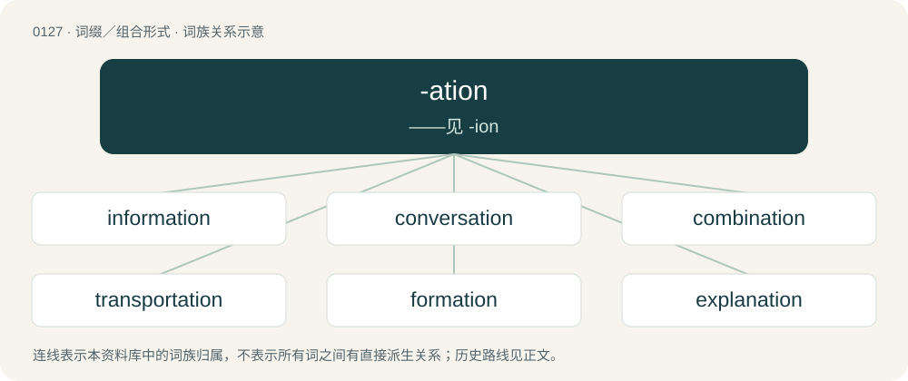

# 0131 · -ation — ——见 -ion

[总目录](../00_总目录_按常用程度.md)

**类型**：词缀／组合形式　｜　**来源语言**：见词源记录

## 核心含义与来源

- 核心含义：——见 -ion
- 英文含义：An action or process.
- 词形：-ation

**来源记录 1**（后缀／后置成分；An action or process.）

Inherited from Middle English -acioun, borrowed from Old French -ation, a learned borrowing from Latin -ātiō, from -tiō, from Proto-Italic \*-tiō, from Proto-Indo-European \*-tiHō, from \*-tis + \*-Hō. By surface analysis, -ate + -ion.

## 词族图

## 单词速览（常用到不常用）

| 单词 | 音标 | 释义 |
|---|---|---|
| [information](#w-1) | 英 /ˌɪn.fəˈmeɪ.ʃn̩/；美 /ˌɪn.fɚˈmeɪ.ʃn̩/ | n. 消息, 知识, 通知, 情报, 信息, 问讯处, 起诉；\[计\] 信息 |
| [conversation](#w-2) | 英 /ˌkɒn.vəˈseɪ.ʃn̩/；美 /ˌkɑn.vəɹˈseɪ.ʃən/ | n. 会话, 说话, 交谈；\[法\] 交谈, 社交, 性交 |
| [combination](#w-3) | 英 /ˌkɒmbɪˈneɪʃən/；美 /ˌkɑmbɪˈneɪʃən/ | n. 组合, 合并, 联合；\[计\] 组合图 |
| [transportation](#w-4) | 英 /tɹænspɔːˈteɪʃən/；美 /tɹænspɚˈteɪʃən/ | n. 运输, 输送, 交通车辆；\[经\] 运转, 运输, 运输费 |
| [formation](#w-5) | 英 /fɔːˈmeɪʃ(ə)n/；美 /fɔɹˈmeɪʃ(ə)n/ | n. 形成, 构造, 编队；\[医\] 形成, 结构 |
| [explanation](#w-6) | 英 /ˌɛkspləˈneɪʃən/ | n. 解释, 说明, 辩解, 表明；\[经\] 解释, 注释, 说明 |
| [organisation](#w-7) | 英 /ˈɔː.ɡə.naɪˌzeɪ.ʃən/；美 /ˌoɹ.ɡə.nɪˈzeɪ.ʃən/ | n. 组织, 团体, 体制, 编制 |
| [preparation](#w-8) | 英 /ˌpɹɛpəˈɹeɪʃ(ə)n/ | n. 准备, 预备, 预习；\[化\] 制剂 |
| [registration](#w-9) | 英 /ˌɹɛd͡ʒ.ɪˈstɹeɪ.ʃən/ | n. 登记, 挂号, 注册；\[计\] 登记; 定位; 对齐; 记录 |
| [implementation](#w-10) | 英 /ˌɪmplɪmənˈteɪʃən/；美 /ˌɪmpləmɛnˈteɪʃən/ | n. 安装启用, 实行, 履行；\[计\] 实施; 实现 |
| [presentation](#w-11) | 英 /ˌpɹɛzn̩ˈteɪʃn̩/ | n. 赠与, 描述, 介绍；\[计\] 简报 |
| [examination](#w-12) | 英 /ɪɡˌzæm.ɪˈneɪ.ʃən/；美 /ɪɡˌzæm.əˈneɪ.ʃən/ | n. 考试, 测验, 审查；\[医\] 检查, 诊察 |
| [imagination](#w-13) | /ɪˌmæd͡ʒəˈneɪʃən/ | n. 想像, 听觉, 想像力；\[医\] 想像 |
| [interpretation](#w-14) | 英 /ɪnˌtɜːpɹəˈteɪʃən/；美 /ɪnˌtɝpɹəˈteɪʃən/ | n. 解释, 演出, 翻译；\[计\] 插值; 插值法; 解释 |
| [motivation](#w-15) | 英 /ˈməʊ.tɪ.veɪ.ʃən/；美 /ˈmoʊ.tə.veɪ.ʃən/ | n. 动机, 刺激, 推动；\[医\] 促动, 推动, 诱导 |
| [transformation](#w-16) | 英 /ˌtɹæns.fə(ɹ)ˈmeɪ.ʃən/；美 /ˌtɹæns.fɔɹˈmeɪ.ʃən/ | n. 变形, 变质, 变化, 改革, 变换；\[化\] 转化; 变换 |
| [exploration](#w-17) | 美 /ˌɛkspləˈɹeɪʃən/ | n. 探险, 踏勘, 探测；\[医\] 探察 |
| [determination](#w-18) | 英 /dɪˌtɜːmɪˈneɪʃən/ | n. 决心, 果断；\[化\] 判定; 测定 |
| [observation](#w-19) | 英 /ˌɒbzəˈveɪʃn̩/；美 /ˌɑbzɚˈveɪʃn̩/ | n. 观察, 注意, 观测, 观察力；\[化\] 观察 |
| [confirmation](#w-20) | 英 /ˌkɒn.fəˈmeɪ.ʃən/；美 /ˌkɑn.fəɹˈmeɪ.ʃən/ | n. 证实, 证明, 批准, 确认；\[计\] 确认 |
| [variation](#w-21) | 英 /ˌvɛəɹɪˈeɪʃn̩/；美 /ˌvɛəɹiˈeɪʃn̩/ | n. 变更, 变化, 变种, 变奏；\[医\] 变异, 变易; 变度 |
| [consultation](#w-22) | 英 /ˌkɒnsəlˈteɪʃən/；美 /ˌkɑnsəlˈteɪʃən/ | n. 请教, 咨询, 磋商会；\[医\] 会诊 |
| [resignation](#w-23) | 英 /ˌɹɛz.ɪɡˈneɪ.ʃən/ | n. 辞职, 辞呈, 听从；\[经\] 辞职 |
| [adaptation](#w-24) | 英 /ˌæd.əpˈteɪ.ʃən/；美 /ˌæd.æpˈteɪ.ʃən/ | n. 适应, 改编, 改编本；\[医\] 适应\[作用\] |
| [civilization](#w-25) | 英 /ˌsɪv.ɪ.laɪˈzeɪ.ʃən/；美 /ˌsɪv.ə.laɪˈzeɪ.ʃən/ | n. 文明, 教化；\[法\] 文明, 文化, 文明国家的总称 |
| [preservation](#w-26) | 英 /ˌpɹɛz.əˈveɪ.ʃən/；美 /ˌpɹɛz.ɚˈveɪ.ʃən/ | n. 保存, 保藏, 保护；\[医\] 保藏, 保存, 防腐 |
| [expectation](#w-27) | 英 /ˌɛk.spɛkˈteɪ.ʃən/ | n. 期待, 指望, 展望；\[化\] 期望值 |
| [configuration](#w-28) | 英 /kənˌfɪɡ.əˈɹeɪ̯.ʃən/；美 /kənˌfɪɡ.jəˈɹeɪ̯.ʃən/ | n. 结构, 表面配置, 外形, 配置；\[计\] 配置 |
| [documentation](#w-29) | 英 /ˌdɒkjʊmɛnˈteɪʃən/；美 /ˌdɑkjəmɛnˈteɪʃən/ | n. (总称)文件；\[计\] 文件编制, 文档 |
| [reservation](#w-30) | 美 /ˌɹɛz.ɚˈveɪ.ʃən/ | n. 保留, 预定, 保留品, 保留地；\[经\] 预定, 预约, 权益保留 |
| [compilation](#w-31) | 英 /ˌkɒm.pɪˈleɪ.ʃən/；美 /ˌkɑm.pɪˈleɪ.ʃən/ | n. 编辑, 编纂, 编辑(编纂)物；\[计\] 编译 |
| [activation](#w-32) | 英 /ˌæktɪˈveɪʃn̩/；美 /ˌæktəˈveɪʃən/ | n. 活化, 激活；\[化\] 活化; 活化作用; 激活; 激活作用 |
| [designation](#w-33) | /dɛzɪɡˈneɪʃən/ | n. 指示, 指定, 命名；\[电\] 指定 |
| [authorization](#w-34) | 英 /ˌɔːθəɹaɪˈzeɪʃən/；/ˌɔθəɹəˈzeɪʃən/ | n. 授权, 许可；\[经\] 授权, 许可, 批准 |
| [inflammation](#w-35) | /ɪnfləˈmeɪ̯ʃən/ | n. 怒火, 发火, 燃烧, 发炎；\[医\] 炎\[症\] |
| [confrontation](#w-36) | 英 /ˌkɒn.fɹənˈteɪ.ʃən/；美 /ˌkɑn.fɹənˈteɪ.ʃən/ | n. 对抗；对质；面对 |
| [realization](#w-37) | 英 /ˌɹɪə.laɪˈzeɪ.ʃən/；美 /ˌɹiə.lɪˈzeɪ.ʃən/ | n. 实现, 领悟, 实得；\[医\] 现实化, 实现 |
| [temptation](#w-38) | /ˌtɛmpˈteɪʃən/ | n. 诱惑, 诱惑物；\[法\] 诱惑, 诱惑物 |
| [continuation](#w-39) | 英 /kənˌtɪnjʊˈeɪʃ(ə)n/ | n. 继续, 续集, 补编；\[医\] 连续 |
| [limitation](#w-40) | /lɪmɪˈteɪʃən/ | n. 限制, 缺陷, 限额；\[医\] 限界, 限制, 限度 |
| [relaxation](#w-41) | 英 /ˌɹiːlækˈseɪʃən/；美 /ˌɹilækˈseɪʃən/ | n. 松弛, 放松, 减轻, 缓和, 休息, 休养；\[化\] 松弛; 驰豫 |
| [optimization](#w-42) | 美 /ˌɑptəmaɪˈzeɪʃən/ | n. 最佳化, 最优化；\[计\] 优化 |
| [accusation](#w-43) | 英 /ˌæk.jʊˈzeɪ.ʃ(ə)n/ | n. 控告, 指控, 指责；\[法\] 控告, 起诉, 告发 |
| [degradation](#w-44) | 英 /ˌdɛɡɹəˈdeɪʃən/ | n. 降格, 堕落, 退化；\[计\] 降级 |
| [deportation](#w-45) | 英 /diːˌpɔːˈteɪʃən/ | n. 驱逐出境, 放逐；\[法\] 递解出境, 放逐, 驱逐 |
| [sanitation](#w-46) | /ˌsænɪˈteɪʃən/ | n. (环境)卫生, 环境卫生的提倡/维持, 卫生设备, 下水道设施, 卫生设施；\[医\] 环境卫生 |
| [accreditation](#w-47) | 英 /əˌkɹɛd.ɪˈteɪ.ʃən/；美 /əˌkɹɛd.ɪˈteɪ.ʃən/ | n. 委派, 信托, 鉴定合格；\[法\] 立案, 备案, 任命 |
| [consolation](#w-48) | 英 /ˌkɒn.səˈleɪ.ʃən/；美 /ˌkɑn.səˈleɪ.ʃən/ | n. 安慰, 令人安慰的事物；\[法\] 安慰, 慰问 |
| [characterization](#w-49) | 英 /ˌkæɹəktəɹaɪˈzeɪʃən/；美 /ˌkæɹəktəɹəˈzeɪʃən/ | n. 特性描述, 人物之塑造；\[建\] 特性因数 |
| [starvation](#w-50) | 英 /stɑːˈveɪʃən/；美 /stɑɹˈveɪʃən/ | n. 饥饿, 饿死；\[医\] 绝食, 饥锇(指长时期的) |
| [quotation](#w-51) | 美 /kwoʊˈteɪʃn̩/ | n. 引用语, 语录, 牌价, 报价；\[化\] 报价 |
| [utilization](#w-52) | /.juːtilaiˈzeiʃən/ | n. 利用；\[医\] 利用 |
| [experimentation](#w-53) | 英 /ɪkˌspɛɹ.ɪ.mənˈteɪ.ʃən/；美 /ɪkˌspɛɹ.ə.mənˈteɪ.ʃən/ | n. 实验, 试验, 实验法；\[化\] 实验; 实验过程 |
| [notation](#w-54) | 美 /noʊˈteɪʃən/ | n. 记号, 符号表示法, 注释；\[计\] 记数法 |
| [globalization](#w-55) | 英 /ˌɡləʊ.bə.laɪˈzeɪ.ʃən/；美 /ˌɡloʊ.bə.laɪˈzeɪ.ʃən/ | \[计\] 全球化, 普及到世界范围 |
| [instrumentation](#w-56) | /.instrumenˈteiʃən/ | n. 乐器法, 仪器制造学, 仪表化；\[医\] 器械用法, 器械操作法 |
| [manifestation](#w-57) | /ˌmænɪfɛˈsteɪʃən/ | n. 显示, 证明, 示威运动；\[医\] 表现, 表示 |
| [legalization](#w-58) | /.liːgəlaiˈzeiʃən/ | n. 合法化, 法律认可；\[经\] 立法, 合法化 |
| [oxidation](#w-59) | 英 /ɒksɪˈdeɪʃ(ə)n/；美 /ˌɑksɪˈdeɪʃ(ə)n/ | n. 氧化；\[化\] 氧化 |
| [civilisation](#w-60) | 英 /ˌsɪv.ɪ.laɪˈzeɪ.ʃən/；美 /ˌsɪv.ɪ.lɪˈzeɪ.ʃən/ | n. 文明, 文明世界, 文化, 开化, 教化 |
| [inclination](#w-61) | 英 /ˌɪn.klɪˈneɪ.ʃən/ | n. 倾向, 趋向, 倾斜度, 点头；\[化\] 倾角 |
| [colonization](#w-62) | British/Southern/Standard /kɔlənɪˈzɛjʃən/ | \[医\] 移生, 移地发育; 集中护理(精神病人) |
| [modernization](#w-63) | 英 /ˌmɒdənɪˈzeɪʃn̩/；美 /ˌmɑdɚnɪˈzeɪʃn̩/ | n. 现代化 |
| [authentication](#w-64) | 英 /ɔːˌθɛntɪˈkeɪʃn̩/；/ɔˌθɛntɪˈkeɪʃn̩/ | n. 证明可信, 证实为真, 使具法律效力；\[计\] 验证 |
| [computation](#w-65) | 英 /ˌkɒmpjʊˈteɪʃn̩/；美 /ˌkɑmpjʊˈteɪʃn̩/ | n. 计算, 计数, 计算结果；\[经\] 计算, 估计, 计算法 |
| [alteration](#w-66) | 英 /ɒl.tə(ɹ)ˈeɪ.ʃən/；美 /ɔl.tɚˈeɪ.ʃən/ | n. 变更, 改动；\[医\] 变更 |
| [visualization](#w-67) | 英 /ˌvɪʒ.ʊ.ə.laɪˈzeɪ.ʃən/；美 /ˌvɪʒ.u.ə.laɪˈzeɪ.ʃən/ | n. 可见性, 形象化；\[医\] 使显形, 造影\[术\], 想象 |
| [aspiration](#w-68) | 英 /ˌæspəˈɹeɪʃən/ | n. 热望, 志向, 渴望；\[医\] 吸入; 吸\[引\], 吸引术 |
| [stabilization](#w-69) | /ˌsteɪ.bəl.ɪzˈeɪ.ʃən/ | n. 安定, 稳定, 平抑, 安定化, 稳定化；\[医\] 稳定, 安定 |
| [specialization](#w-70) | /.speʃəlaiˈzeiʃən/ | n. 专业化, 特殊化, 专门化；\[经\] 特殊化, 专门化 |
| [localization](#w-71) | 英 /ˌləʊkəlaɪˈzeɪʃən/；美 /ˌloʊkəlɪˈzeɪʃən/ | n. 局限, 地方化；\[化\] 定位化 |
| [misinformation](#w-72) | 英 /ˌmɪs.ɪn.fəˈmeɪ.ʃən/；美 /ˌmɪs.ɪn.fɚˈmeɪ.ʃən/ | n. 错误的消息, 误传；\[法\] 错误的消息, 误传 |
| [mobilization](#w-73) | /ˌmoʊ.bəl.əˈzeɪ.ʃən/ | n. 动员, 调动, 活动法；\[化\] 活动化 |
| [privatization](#w-74) | 英 /ˌpɹaɪvɪtaɪˈzeɪʃ(ə)n/；美 /ˌpɹaɪvətaɪˈzeɪʃən/ | \[计\] 私有化 |
| [fragmentation](#w-75) | 英 /ˌfɹæɡmənˈteɪ̯ʃən/；/ˌfɹeɪ̯ɡmənˈteɪ̯ʃən/ | n. 分裂, 破碎；\[计\] 在IP层将打包文件切成适当大小的程序 |
| [segmentation](#w-76) | /.segmənˈteiʃən/ | n. 分割, 割断, 细胞分裂；\[计\] 分段; 分割; 段式调度; 分段法 |
| [deforestation](#w-77) | 英 /dɪˌfɒɹɪsˈteɪʃən/ | n. 采伐森林, 森林开伐；\[法\] 砍伐森森 |
| [stagnation](#w-78) | 英 /stæɡˈneɪʃn̩/；美 /stæɡˈneɪʃən/ | n. 淤塞, 停滞；\[医\] 停滞, 滞留, 郁积 |
| [infestation](#w-79) | /ˌɪnfɛsˈteɪ̯ʃən/ | n. 骚扰, 大批出没, 横行；\[医\] 侵染, 感染 |
| [deformation](#w-80) | 英 /ˌdɛfəˈmeɪʃən/；美 /ˌdɛfɚˈmeɪʃn̩/ | n. 损形, 变丑, 畸形；\[化\] 变形; 形变 |
| [reclamation](#w-81) | 英 /(ˌ)ɹɛkləˈmeɪʃn̩/；美 /ˌɹɛkləˈmeɪʃn̩/ | n. 开垦, 教化；\[经\] 经济上的复原再造 |
| [flotation](#w-82) | 英 /fləʊˈteɪʃən/；美 /floʊˈteɪʃən/ | \[化\] 浮; 浮游选矿；\[医\] 浮集(法), 浮选(法) |
| [capitalization](#w-83) | /ˌkæpɪtəlaɪˈzeɪʃən/ | n. 资本化, 资本总额, 本金化, 大写；\[经\] (收益的)资本化, 资本总额 |
| [condensation](#w-84) | 英 /ˌkɒn.dɛnˈseɪ.ʃən/ | n. 压缩, 凝缩, 冷凝；\[化\] 冷凝; 冷凝作用; 缩合; 缩合作用; 凝聚; 凝聚作用; 凝结作用 |
| [inhalation](#w-85) | /ˌɪnhəˈleɪʃən/ | n. 吸入；\[医\] 吸入剂, 吸入\[法\] |
| [adoration](#w-86) | /ˌæ.dəˈɹeɪ.ʃən/ | n. 崇拜, 爱慕 |
| [synchronization](#w-87) | /,siŋkrənaiˈzeiʃən/ | \[计\] 同步 |
| [causation](#w-88) | 英 /kɔːˈzeɪ.ʃən/；美 /kɔˈzeɪ.ʃən/ | n. 因果关系, 原因；\[法\] 因果律, 原因作用, 因果关系 |
| [improvisation](#w-89) | 英 /ɪmpɹəvaɪˈzeɪʃən/；美 /ɪmˌpɹɑvəˈzeɪʃən/ | n. 即兴而作, 即席演奏, 即席作品 |
| [sterilization](#w-90) | /.sterəlaiˈzeiʃən/ | n. 使成不毛, 无用状态, 杀菌, 绝育；\[化\] 消毒 |
| [hospitalization](#w-91) | 英 /ˌhɒs.pɪ.tə.laɪˈzeɪ.ʃn̩/；美 /ˌhɑ(ː)s.pɪ.tə.lɪˈzeɪ.ʃən/ | n. 医院收容, 住院治疗；\[医\] 住院, 入院 |
| [standardization](#w-92) | 英 /ˌstæn.də.daɪˈzeɪ.ʃən/；美 /ˌstæn.dɚˌdɪˈzeɪ.ʃən/ | \[计\] 标准化, 规格化；\[化\] 标准化; 标定 |
| [industrialization](#w-93) | 英 /ɪnˌdʌstɹɪəlaɪˈzeɪʃən/；美 /ɪnˌdʌstɹɪəlɪˈzeɪʃən/ | n. 工业化, 产业化；\[经\] 工业化 |
| [fertilization](#w-94) | /.fəːtilaiˈzeiʃən/ | n. 使肥沃, 土地肥沃法, 施肥；\[医\] 受精, 授精 |
| [importation](#w-95) | /.impɒːˈteiʃən/ | n. 进口, 输入品；\[医\] 输入, 传入 |
| [derivation](#w-96) | /ˌdɛ.ɹɪˈveɪ.ʃ(ə)n/ | n. 推论, 推导, 来历；\[医\] 衍化, 诱导 |
| [urbanization](#w-97) | /.əːbənaiˈzeiʃən/ | n. 都市化；\[医\] 都市化, 人口城市集中 |
| [ionization](#w-98) | /ˌaɪənɪˈzeɪʃən/ | n. 离子化, 电离；\[化\] 电离; 电离作用 |
| [excitation](#w-99) | /ˌɛksaɪˈteɪʃən/ | n. 刺激, 鼓舞, 兴奋；\[化\] 激发 |
| [socialization](#w-100) | /.səuʃəlaiˈzeiʃən/ | n. 社会化, 社会主义化 |
| [immunization](#w-101) | /.imjuːnaiˈzeiʃən/ | n. 免疫；\[医\] 免疫法 |
| [electrification](#w-102) | /ɪˈlɛktɹɪfɪkeɪʃən/ | n. 起电, 带电, 电气化；\[化\] 起电 |
| [normalization](#w-103) | 美 /ˌnɔɹ.mə.ləˈzeɪ.ʃən/ | n. 常态化, 正常化, 正规化；\[化\] 归一化; 正态化; 正火; 正火处理 |
| [phosphorylation](#w-104) | /fɔ,sfɔriˈleiʃən/ | \[化\] 磷酸化作用；\[医\] 磷酸化\[作用\] |
| [commercialization](#w-105) | 英 /kəˌmɜːʃəlaɪˈzeɪʃən/；美 /kəˌmɝʃəlaɪˈzeɪʃən/ | \[计\] 商业化 |
| [misrepresentation](#w-106) | /mɪsˌɹɛpɹɪzɛnˈteɪʃən/ | \[计\] 错误表示法；\[经\] 误列, 错误表示, 告知不实 |
| [globalisation](#w-107) | 英 /ˌɡləʊ.bə.laɪˈzeɪ.ʃən/；美 /ˌɡloʊ.bə.lɪˈzeɪ.ʃən/ | n. 全球化, =globalization |
| [supplementation](#w-108) | /,sʌplimenˈteiʃən/ | n. 增补, 补足, 补充 |
| [connotation](#w-109) | 英 /ˌkɒnəˈteɪʃən/；美 /ˌkɑnəˈteɪʃən/ | n. 含蓄, 内涵 |
| [revocation](#w-110) | /ˌɹɛvəˈkeɪʃən/ | n. 废止, 取消, 撤回；\[经\] 撤销 |
| [summation](#w-111) | 英 /sʌˈmeɪʃən/ | n. 总和, 和, 合计；\[医\] 总和, 总合 |
| [invocation](#w-112) | /ˌɪn.voʊˈkeɪ.ʃən/ | n. 祈祷, 符咒 |
| [methylation](#w-113) | /ˌmɛθɪˈleɪʃən/ | \[化\] 甲基化作用(指加甲基作用和加甲醇使酒精变性的作用)；\[医\] 甲基化\[作用\] |
| [menstruation](#w-114) | 英 /ˌmɛnstɹuːˈeɪʃən/；美 /ˌmɛnstɹuˈeɪʃən/ | n. 月经, 月经期间；\[医\] 月经, 行经 |
| [recitation](#w-115) | 英 /ˌɹɛsɪˈteɪʃən/；美 /ˌɹɛsəˈteɪʃən/ | n. 详述, 吟诵, 背诵的诗；\[法\] 叙述, 评述, 书面陈述 |
| [revitalization](#w-116) | 英 /ɹiːˌvaɪ.tə.laɪˈzeɪ.ʃən/；美 /ɹiːˌvaɪ.tə.ləˈzeɪ.ʃən/ | \[医\] 复苏, 回生, 复新 |
| [decentralization](#w-117) | 英 /diːˌsɛntɹəlaɪˈzeɪʃən/ | n. 分散, 权力分散, 权力下放；\[经\] 分散化, 分权化, 疏散 |
| [pigmentation](#w-118) | /.pigmənˈteiʃən/ | n. 染色, 着色, 色素沉着, 天然颜色；\[医\] 色素沉着, 着色 |
| [preoccupation](#w-119) | 英 /ˌpɹiɒkjʊˈpeɪʃən/；美 /ˌpɹiɑkjʊˈpeɪʃən/ | n. 抢先占据, 先人之见, 入神；\[医\] 成见, 注意散漫, 心不在焉 |
| [dispensation](#w-120) | 英 /dɪsˌpɛnˈseɪʃən/ | n. 分配, 施与, (义务的)免除；\[法\] 特免权, 豁免, 执行 |
| [polymerization](#w-121) | 英 /ˌpɒl.ɪ.məɹ.aɪˈzeɪ.ʃən/ | n. 聚合；\[化\] 叠合反应; 聚合; 聚合反应 |
| [liberalization](#w-122) | /.libərəlaiˈzeiʃən/ | n. 自由主义化, 宽大；\[法\] 自由化 |
| [categorization](#w-123) | 英 /ˌkæt.ə.ɡə.ɹaɪˈzeɪ.ʃən/；美 /ˌkæt.ə.ɡə.ɹəˈzeɪ.ʃən/ | \[计\] 归类, 分类；\[经\] 分门别类 |
| [fibrillation](#w-124) | /ˌfɪbɹɪˈleɪʃən/ | n. 纤维性颤动；\[医\] 纤维性颤动, 原纤维形成 |
| [victimization](#w-125) | /ˌvɪk.tɪ.maɪˈzeɪ.ʃən/ | n. 牺牲, 欺骗 |
| [discoloration](#w-126) | /dis,kʌləˈreiʃən/ | n. 变色, 污染 |
| [germination](#w-127) | /ˌdʒɜːɹ.mɪˈneɪ.ʃən/ | n. 发芽, 萌芽, 发育；\[医\] 出芽, 生芽, 发芽 |
| [democratization](#w-128) | 英 /dɪˌmɒkɹətaɪˈzeɪʃən/；美 /dɪˌmɑkɹətəˈzeɪʃən/ | n. 民主化；\[法\] 民主化 |
| [ornamentation](#w-129) | /,ɔːnəmenˈteiʃən/ | n. 装饰, 装饰术, 装饰品, 修饰 |
| [inactivation](#w-130) | /in,æktiˈveiʃən/ | n. 灭活, 失效；\[化\] 失活 |
| [utilisation](#w-131) | /,juːtilaiˈzeiʃən;-liˈz-/ | n. 利用；使用（等于utilization） |
| [flirtation](#w-132) | 英 /fləˈteɪʃn̩/；美 /flɚˈteɪʃn̩/ | n. 调情, 挑逗, 调戏, 不认真的考虑 |
| [mobilisation](#w-133) | /ˌməʊbɪlaɪˈzeɪʃən/ | n. 动员, 运用 |
| [monetization](#w-134) | 英 /ˌmʌnətaɪˈzeɪʃən/；美 /ˌmɒnətaɪˈzeɪʃən/ | n. 定为货币, 作为货币, 货币铸造 |
| [rationalization](#w-135) | 英 /ˌræʃ(ə)n(ə)laɪˈzeɪʃn̩/；美 /ˌræʃənəlaɪˈzeɪʃən/ | n. 合理化；\[计\] 有理化 |
| [centralization](#w-136) | 英 /ˌsɛntɹəˌlaɪˈzeɪʃən/；美 /ˌsɛntɹələˈzeɪʃən/ | n. 集中, 中央集权化；\[计\] 集中式; 集中化 |
| [disorientation](#w-137) | 英 /dɪsˌɔːɹɪənˈteɪʃən/；美 /dɪsˌɔ.ɹi.ɪnˈteɪ.ʃn̩/ | n. 迷向, 迷惑；\[化\] 解取向; 乱取向 |
| [equalization](#w-138) | /.iːkwəlaiˈzeiʃən/ | n. 均等, 同等化, 平等化；\[计\] 平衡, 均衡 |
| [misinterpretation](#w-139) | /ˈmisin,təːpriˈteiʃən/ | \[计\] 错误判断 |
| [perspiration](#w-140) | 英 /ˌpɜːspəˈɹeɪʃən/；美 /ˌpɝspəˈɹeɪʃən/ | n. 汗, 流汗, 努力；\[医\] 出汗; 汗 |
| [sedimentation](#w-141) | /.sedimenˈteiʃən/ | n. 沉淀, 沉积；\[化\] 沉积作用; 沉降 |
| [reconsideration](#w-142) |  | n. 再考虑, 再审查, 再议 |
| [indentation](#w-143) | /ˌɪndɛnˈteɪʃən/ | n. 呈锯齿状, 缩排, 缺口, 印凹痕；\[计\] 缩进 |
| [permutation](#w-144) | 英 /ˌpɜː.mjʊˈteɪ.ʃən/；美 /ˌpɝ.mjʊˈteɪ.ʃ(ə)n/ | n. 交换, 更动, 排列；\[计\] 排列 |
| [encapsulation](#w-145) | /in,kæpsjuˈleiʃən/ | \[计\] 封闭, 封装, 密封, 灌封, 装箧；\[化\] 封铸; 包胶; 封入胶内; 胶囊化 |
| [decriminalization](#w-146) | /diːˌkɹɪmɪnəlaɪzˈeɪʃən/ | \[法\] 非刑事化, 非罪刑化, 合法化 |
| [memorization](#w-147) | 英 /ˈmem(ə)ɹaɪˌzeɪʃn̩/ | n. 凭记忆, 暗记 |
| [prioritization](#w-148) | /prʌɪˌɒrətʌɪˈzeɪʃ(ə)n/ | \[计\] 优化 |
| [militarization](#w-149) | /ˌmɪ.lɪ.tə.ɹaɪˈzeɪ.ʃn̩/ | n. 军事化, 军国主义化 |
| [minimization](#w-150) | 英 /ˈmɪn.ɪ.maɪˈzeɪʃən/；美 /ˈmɪn.ɪ.mɪˈzeɪʃən/ | n. 减到最小限度, 估到最低额, 轻视 |
| [personalization](#w-151) | 英 /ˌpɜːs(ə)nəlaɪˈzeɪʃən/；美 /ˌpɝs(ə)nəlaɪˈzeɪʃən/ | \[医\] 人格化 |
| [initialization](#w-152) | /i,niʃəlaiˈzeiʃən/ | \[计\] 初始化, 赋初值, 预置 |
| [quantization](#w-153) | /,kwɔntaiˈzeiʃən/ | n. 量子化；\[计\] 量子化 |
| [criminalization](#w-154) | /ˌkɹɪmɪnəlaɪzˈeɪʃən/ | \[法\] 定罪, 宣布犯有罪行 |
| [digitization](#w-155) | /.didʒitaiˈzeiʃən. -tiˈz-/ | n. 数字化, 数位化, 数码化 |
| [canonization](#w-156) | /.kænənaiˈzeiʃən/ | n. 追封为圣者, 视...为典范 |
| [legalisation](#w-157) | /ˌliːgəlaɪˈzeɪʃən/ | n. 合法化, 法律上认可 |
| [reforestation](#w-158) | /.riːfɒːrisˈteiʃən/ | n. 重新造林 |
| [oxygenation](#w-159) | /.ɒksidʒəˈneiʃən/ | n. 以氧气处理, 氧化；\[化\] 氧合作用 |
| [capitalisation](#w-160) | /ˌkæpɪtəlaɪˈzeɪʃən/ | n. &lt;主英&gt;=capitalization |
| [actualization](#w-161) | /.æktʃuəlaiˈzeiʃən/ | n. 现实化 |
| [evangelization](#w-162) |  | n. 福音传道, 基督教化 |
| [harmonization](#w-163) | /.hɑːmənaiˈzeiʃən/ | n. 调和化, 融洽, 一致 |
| [immunisation](#w-164) | /ˌɪmjʊnaɪˈzeɪʃən/ | n. 免疫(immunization) |
| [magnetization](#w-165) | 美 /ˌmæɡ.nɪ.taɪˈzeɪ.ʃən/ | n. 磁化；\[化\] 磁感应强度 |
| [commutation](#w-166) | 英 /kɒmjuːˈteɪʃən/ | 【英文】The process or habit of journeying to and from work on a regular basis; commuting. |
| [dramatization](#w-167) | /.dræmətaiˈzeiʃən/ | n. 编剧, 改编成戏剧；\[医\] 梦中剧情 |
| [fluoridation](#w-168) | /,fljəriˈdeiʃən/ | \[医\] 氟化 |
| [maximization](#w-169) | /,mæksəmaiˈzeiʃən/ | \[计\] 极大化, 最大化 |
| [serialization](#w-170) | /.siəriəlaiˈzeiʃən/ | n. 连载；\[计\] 串行化 |
| [calcification](#w-171) | /ˌkælsɪfɪˈkeɪʃən/ | n. 钙化；\[化\] 钙化作用; 骨化作用 |
| [factorization](#w-172) | /,fæktəraiˈzeiʃən/ | \[计\] 因了分解；\[医\] 因子分解 |
| [mechanization](#w-173) | 美 /ˌmɛkənaɪˈzeɪʃən/ | n. 机械化, 机动化；\[化\] 机械化 |
| [exportation](#w-174) | /,ekspɔːˈteiʃən/ | n. 输出, 出口物, 输出品, 出口；\[经\] 出口(货) |
| [exhalation](#w-175) | /ˌɛkshəˈleɪ̯ʃən/ | n. 呼气, 蒸发, 散发物；\[医\] 呼出 |
| [politicization](#w-176) | /pəˌlɪt.ɪ.sɪˈzeɪ.ʃən/ | n. 政治化 |
| [sensitization](#w-177) | /.sensitaiˈzeiʃən/ | n. 敏感化, 致敏作用；\[化\] 敏化作用; 致敏作用 |
| [cavitation](#w-178) | /ˌkævɪˈteɪʃən/ | n. 成穴, 空化(作用)；\[化\] 空化; 空蚀; 气蚀; 汽蚀; 汽穴 |
| [feminization](#w-179) | 美 /ˌfɛmɪnɪˈzeɪʃən/ | \[医\] 女性化(指男子) |
| [neutralization](#w-180) | 英 /ˌnjuːtɹəlaɪˈzeɪʃən/；美 /ˌnuːtɹəlaɪˈzeɪʃən/ | n. 中立化, 中立状态, 中和；\[化\] 中和; 中和作用; 抵消; 使失效 |
| [secularization](#w-181) | 英 /ˈsɛkjələɹaɪˌzeɪʃən/ | n. 俗化, 还俗, 把教育与宗教分离 |
| [hydrogenation](#w-182) | /,haidrədʒəˈneiʃən/ | \[化\] 氢化；\[医\] 氢化\[作用\] |
| [securitization](#w-183) | 英 /sɪˈkjʊəɹɪtʌɪzeɪʃən/ | n. 证券化 |
| [usurpation](#w-184) | /ˌjuː.sə(ɹ)ˈpeɪ.ʃən/ | n. 篡夺, 霸占, 夺取；\[法\] 篡夺, 强夺, 霸占 |
| [dehumanization](#w-185) | 英 /diːˌhjuːmənaɪˈzeɪʃən/ | n. 使失人性, 非人化, 灭绝人性, 使成兽性 |
| [demobilization](#w-186) | 英 /diːˌməʊbɪlaɪˈzeɪʃən/ | n. 复员, 遣散；\[法\] 复员, 遣散 |
| [glycosylation](#w-187) | 美 /ˌɡlaɪ.koʊ.səˈleɪ.ʃən/ | n. \[生化\]糖基化 |
| [immobilization](#w-188) | /i.məubilaiˈzeiʃən/ | n. 固定, 使停止流通；\[医\] 制动术, 固定术 |
| [stigmatization](#w-189) |  | \[医\] 斑痕形成; 瘀斑形成; 特征发生 |
| [vocalization](#w-190) | 英 /vəʊk(ə)lʌɪˈzeɪʃ(ə)n/；美 /voʊk(ə)l(a)ɪˈzeɪʃ(ə)n/ | n. 发声, 元音化；\[医\] 发音, 发声 |
| [ruination](#w-191) | /ˌɹuː.ɪˈneɪʃən/ | n. 毁灭, 祸因, 毁坏 |
| [centrifugation](#w-192) | /sen,trifjuˈ^eiʃən/ | n. 离心/分离作用；\[化\] 离心法; 离心过滤 |
| [homogenization](#w-193) | /,həumədʒənaiˈzeiʃən/ | \[计\] 均匀性, 均化作用；\[化\] 均化; 均化作用 |
| [sexualization](#w-194) | /,sɛʃʊəlaɪˈzeʃən/ | \[医\]雌雄鉴别（家禽的）, 性化（作用） |
| [ulceration](#w-195) | /ˌʌlsəˈɹeɪʃən/ | n. 溃疡；\[医\] 溃疡形成; 溃疡 |
| [herniation](#w-196) | /,h\\\\ːniˈeiʃən/ | \[医\] 疝形成, 突出 |
| [granulation](#w-197) | /.grænjuˈleiʃən/ | n. 使成粒状, 粗糙；\[医\] 肉芽, 肉芽发生, 制粒法(片剂),\[颗\]粒 |
| [idealization](#w-198) | /ai.diəlaiˈzeiʃən/ | n. 理想化, 理想化事物；\[医\] 观念化, 理想化 |
| [compartmentalization](#w-199) | 英 /(ˌ)kɒm.pɑː(ɹ)tˌmɛn.təl.aɪˈzeɪ.ʃən/；美 /(ˌ)kɑm.pɑɹtˌmɛn.təl.əˈzeɪ.ʃən/ | \[化\] 区室化 |
| [digitalization](#w-200) | 英 /ˌdɪdʒɪtəlaɪˈzeɪʃən/ | n. \[药\]洋地黄丸 |
| [disputation](#w-201) | 英 /dɪsˌpjuːˈteɪʃən/ | n. 争论, 议论, 讨论 |
| [passivation](#w-202) | 英 /ˌpæsəˈveɪʃən/ | n. 钝化；\[计\] 钝化 |
| [occultation](#w-203) | 英 /ˌɒkəlˈteɪʃ(ə)n/；美 /ˌɑkəlˈteɪʃ(ə)n/ | n. 掩蔽, 遮掩, 掩星 |
| [alkylation](#w-204) | /.ælkiˈleiʃən/ | n. 烷化作用, 烷化；\[化\] 烷基化; 烷基取代 |
| [peroxidation](#w-205) | /pə,rɔksiˈdeiʃən/ | n. 过氧化反应 |
| [summarization](#w-206) | /ˌsʌməɹaɪˈzeɪʃən/ | n. 摘要, 概要 |
| [denaturation](#w-207) | 英 /diːˌnætʃəˈɹeɪʃən/ | n. 变性(作用)；\[化\] 变性; 变性作用 |
| [professionalization](#w-208) | 英 /pɹəˌfɛʃn̩əlʌɪˈzeɪʃən/ | 职业化; 专业化 |
| [cyclization](#w-209) | /,saikliˈzeiʃən/ | n. 环合, 环的形成；\[化\] 环化 |
| [familiarization](#w-210) |  | n. 亲密, 精通, 熟悉 |
| [acclimatization](#w-211) | 美 /əˌklaɪ.mə.təˈzeɪ.ʃən/ | n. 服水土, 顺应, 适应环境；\[化\] 驯化; 驯化作用; 适量沉淀 |
| [computerization](#w-212) | /kəmˌpjuːtəɹaɪˈzeɪʃən/ | n. 给...装备电子计算机, 用计算机控制, (使)电子计算机化, 电脑化；\[计\] 计算机化 |
| [dimerization](#w-213) | /,daiməriˈzeiʃən/ | n. \[化\]二聚(作用) |

## 逐词详解

### 1. information

**词性**：名词　｜　**音标**：英 /ˌɪn.fəˈmeɪ.ʃn̩/；美 /ˌɪn.fɚˈmeɪ.ʃn̩/

**中文释义**：n. 消息, 知识, 通知, 情报, 信息, 问讯处, 起诉；\[计\] 信息

**英文义项**：Something that provides a definitive characterization or description of the nature and attributes of a specified entity. / Things that are or can be known about a given topic; communicable knowledge of something.

**构词拆分**：inform + -ation

**词源与演化**：

From Middle English enformacioun, informacioun, borrowed from Anglo-Norman informacioun, enformation, Old French information, from Latin īnfōrmātiō (“formation, conception; education”), from the participle stem of īnformāre (“to inform”). Equivalent to inform + -ation.

**例句**：

> For your information, I did this because I wanted to.

该用例对应义项：The act of informing or imparting knowledge; notification.

### 2. conversation

**词性**：名词　｜　**音标**：英 /ˌkɒn.vəˈseɪ.ʃn̩/；美 /ˌkɑn.vəɹˈseɪ.ʃən/

**中文释义**：n. 会话, 说话, 交谈；\[法\] 交谈, 社交, 性交

**英文义项**：Expression and exchange of individual ideas through talking with other people; also, a set instance or occasion of such talking. / Dialogue or interaction regarding a topic.

**构词拆分**：converse + -ation

**词源与演化**：

From Middle English conversacioun, from Old French conversacion and its etymon, Latin conversātiōnem, accusative singular of conversātiō (“conversation”), from conversor (“abide, keep company with”). Displaced native Old English wordlaþu. Doublet of conversazione. Morphologically converse + -ation.

**例句**：

> I had an interesting conversation with Nicolas yesterday about how much he's getting paid.

该用例对应义项：Expression and exchange of individual ideas through talking with other people; also, a set instance or occasion of such talking.

### 3. combination

**词性**：名词　｜　**音标**：英 /ˌkɒmbɪˈneɪʃən/；美 /ˌkɑmbɪˈneɪʃən/

**中文释义**：n. 组合, 合并, 联合；\[计\] 组合图

**英文义项**：The act of combining, the state of being combined or the result of combining. / An object formed by combining.

**构词拆分**：combine + -ation

**词源与演化**：

From Middle English combinacioun, combynacyoun, from Old French combination, from Late Latin combīnātiō. Morphologically combine + -ation.

**例句**：

> These guidelines should be followed in combination with those given last week.

该用例对应义项：The act of combining, the state of being combined or the result of combining.

### 4. transportation

**词性**：名词　｜　**音标**：英 /tɹænspɔːˈteɪʃən/；美 /tɹænspɚˈteɪʃən/

**中文释义**：n. 运输, 输送, 交通车辆；\[经\] 运转, 运输, 运输费

**英文义项**：The act of transporting, or the state of being transported; conveyance, often of people, goods etc. / A means or manner of conveyance; a system of conveyance.

**构词拆分**：transport + -ation

**词源与演化**：

From transport + -ation.

**例句**：

> We have to get people out of their cars and encourage them to use alternative forms of transportation.

该用例对应义项：The act of transporting, or the state of being transported; conveyance, often of people, goods etc.

### 5. formation

**词性**：名词　｜　**音标**：英 /fɔːˈmeɪʃ(ə)n/；美 /fɔɹˈmeɪʃ(ə)n/

**中文释义**：n. 形成, 构造, 编队；\[医\] 形成, 结构

**英文义项**：The act of assembling a group or structure. / Something possessing structure or form.

**构词拆分**：form + -ation

**词源与演化**：

From Middle English formacioun, formation, borrowed from Old French formacion, from Latin fōrmātiō, from fōrmō (“form”, verb); see form as verb. Morphologically form + -ation.

**例句**：

> The students observed the formation of ice crystals.

学生们观察了冰晶的形成过程。

### 6. explanation

**词性**：名词　｜　**音标**：英 /ˌɛkspləˈneɪʃən/

**中文释义**：n. 解释, 说明, 辩解, 表明；\[经\] 解释, 注释, 说明

**英文义项**：The act or process of explaining. / Something that explains or makes understandable.

**构词拆分**：explain + -ation

**词源与演化**：

From Latin explanatio (“an explanation, interpretation”), from explanare (“explain”); see explain. Morphologically explain + -ation. Displaced native Old English racu.

**例句**：

> An explanation for the UFO sightings was easily found.

该用例对应义项：Something that explains or makes understandable.

### 7. organisation

**词性**：名词　｜　**音标**：英 /ˈɔː.ɡə.naɪˌzeɪ.ʃən/；美 /ˌoɹ.ɡə.nɪˈzeɪ.ʃən/

**中文释义**：n. 组织, 团体, 体制, 编制

**英文义项**：Non-Oxford British English and Australian standard spelling of organization.

**构词拆分**：organise + -ation

**词源与演化**：

From Middle French organisation, equivalent to organise + -ation.

**例句**：

> He argues that all it would take is a little more organisation.

### 8. preparation

**词性**：名词　｜　**音标**：英 /ˌpɹɛpəˈɹeɪʃ(ə)n/

**中文释义**：n. 准备, 预备, 预习；\[化\] 制剂

**英文义项**：The act of preparing or getting ready. / The state of being prepared; readiness.

**构词拆分**：prepare + -ation

**词源与演化**：

From Middle English preparacion, from Middle French preparacion, from Latin praeparatio, praeparationem. Morphologically prepare + -ation.

**例句**：

> The traditional remedy is a bitter preparation made from steamed herbs.

该用例对应义项：A substance, especially a remedy, that is prepared.

### 9. registration

**词性**：名词　｜　**音标**：英 /ˌɹɛd͡ʒ.ɪˈstɹeɪ.ʃən/

**中文释义**：n. 登记, 挂号, 注册；\[计\] 登记; 定位; 对齐; 记录

**英文义项**：The act of signing up or registering for something. / That which registers or makes something official, e.g. the form or paper that registers.

**构词拆分**：register + -ation

**词源与演化**：

From register + -ation.

**例句**：

> Did you submit your car registration yet?

该用例对应义项：That which registers or makes something official, e.g. the form or paper that registers.

### 10. implementation

**词性**：名词　｜　**音标**：英 /ˌɪmplɪmənˈteɪʃən/；美 /ˌɪmpləmɛnˈteɪʃən/

**中文释义**：n. 安装启用, 实行, 履行；\[计\] 实施; 实现

**英文义项**：The process of moving an idea from concept to reality. In business, engineering and other fields, implementation refers to the building process rather than the design process. / A result of implementing something; a finished product, system or device.

**构词拆分**：implement + -ation

**词源与演化**：

From implement + -ation.

**例句**：

> Now that the requirements are complete we can move on to implementation.

该用例对应义项：The process of moving an idea from concept to reality. In business, engineering and other fields, implementation refers to the building process rather than the design process.

### 11. presentation

**词性**：名词　｜　**音标**：英 /ˌpɹɛzn̩ˈteɪʃn̩/

**中文释义**：n. 赠与, 描述, 介绍；\[计\] 简报

**英文义项**：The act of presenting, or something presented. / The outward appearance or representation of a person or thing to the human mind.

**构词拆分**：present + -ation

**词源与演化**：

From Old French presentation (French présentation), from Latin praesentātiōnem, accusative singular of praesentātiō (“representation, exhibition”). Morphologically present + -ation.

**例句**：

> The presentation of the thirty-four-year-old male in the emergency room was slight fever, dilated pupils, and marked disorientation.

该用例对应义项：The symptoms, signs, and other possible indications of disease, trauma, etc., that are exhibited by a patient who has sought, or has otherwise come to, the attention of a physician.

### 12. examination

**词性**：名词　｜　**音标**：英 /ɪɡˌzæm.ɪˈneɪ.ʃən/；美 /ɪɡˌzæm.əˈneɪ.ʃən/

**中文释义**：n. 考试, 测验, 审查；\[医\] 检查, 诊察

**英文义项**：The act of examining. / Particularly, an inspection by a medical professional to establish the extent and nature of any sickness or injury.

**构词拆分**：examine + -ation

**词源与演化**：

From Middle English examinacioun, from Old French examinacion, from Latin exāminātiō. Morphologically examine + -ation.

**例句**：

> Your success depends on whether you pass the STEP examination or not.

### 13. imagination

**词性**：名词　｜　**音标**：/ɪˌmæd͡ʒəˈneɪʃən/

**中文释义**：n. 想像, 听觉, 想像力；\[医\] 想像

**英文义项**：The image-making power of the mind; the act of mentally creating or reproducing an object not previously perceived; the ability to create such images. / Particularly, construction of false images; fantasizing.

**构词拆分**：imagine + -ation

**词源与演化**：

From Middle English ymaginacioun, from Old French imaginacion, ymaginacion, from Latin imāginātiō. Equivalent to imagine + -ation.

**例句**：

> You think someone's been following you? That's just your imagination.

该用例对应义项：Particularly, construction of false images; fantasizing.

### 14. interpretation

**词性**：名词　｜　**音标**：英 /ɪnˌtɜːpɹəˈteɪʃən/；美 /ɪnˌtɝpɹəˈteɪʃən/

**中文释义**：n. 解释, 演出, 翻译；\[计\] 插值; 插值法; 解释

**英文义项**：An act of interpreting or explaining something unclear; a translation; a version. / A sense given by an interpreter; an exposition or explanation given; meaning.

**构词拆分**：interpret + -ation

**词源与演化**：

From Middle English interpretacioun, from the Anglo-Norman form of Old French interpretacion, from Latin interpretātiō, noun of action from interpretor (“to explain, expound, interpret, understand, conclude, infer, comprehend”). Morphologically interpret + -ation.

**例句**：

> Commentators give various interpretations of the same passage of Scripture.

该用例对应义项：A sense given by an interpreter; an exposition or explanation given; meaning.

### 15. motivation

**词性**：名词　｜　**音标**：英 /ˈməʊ.tɪ.veɪ.ʃən/；美 /ˈmoʊ.tə.veɪ.ʃən/

**中文释义**：n. 动机, 刺激, 推动；\[医\] 促动, 推动, 诱导

**英文义项**：Willingness of action especially in behavior. / The action of motivating.

**构词拆分**：motive + -ation；motive (verb) + -ation

**词源与演化**：

From motive (verb) + -ation, probably after French motivation and German Motivation.

**例句**：

> The motivation scores showed that 65% of people wanted to visit our website to learn more about the offer after watching the commercial.

该用例对应义项：A research rating that measures how the rational and emotional elements of a commercial affect consumer intention to consider, visit, or buy something.

### 16. transformation

**词性**：名词　｜　**音标**：英 /ˌtɹæns.fə(ɹ)ˈmeɪ.ʃən/；美 /ˌtɹæns.fɔɹˈmeɪ.ʃən/

**中文释义**：n. 变形, 变质, 变化, 改革, 变换；\[化\] 转化; 变换

**英文义项**：The act of transforming or the state of being transformed. / A marked change in appearance or character, especially one for the better.

**构词拆分**：transform + -ation

**词源与演化**：

Inherited from Middle English transformacioun, from Middle French, from Ecclesiastical Latin trānsfōrmātiō. Morphologically transform + -ation.

**用法示例／搭配（非完整句）**：

> undergo a radical transformation

该用例对应义项：The act of transforming or the state of being transformed.

### 17. exploration

**词性**：名词　｜　**音标**：美 /ˌɛkspləˈɹeɪʃən/

**中文释义**：n. 探险, 踏勘, 探测；\[医\] 探察

**英文义项**：The process of exploring. / The process of penetrating, or ranging over for purposes of (especially geographical) discovery.

**构词拆分**：explore + -ation

**词源与演化**：

From Middle French exploration, from Latin exploratio. Morphologically explore + -ation.

**例句**：

> The exploration of unknown areas was often the precursor to colonization.

该用例对应义项：The process of penetrating, or ranging over for purposes of (especially geographical) discovery.

### 18. determination

**词性**：名词　｜　**音标**：英 /dɪˌtɜːmɪˈneɪʃən/

**中文释义**：n. 决心, 果断；\[化\] 判定; 测定

**英文义项**：The act, process, or result of any accurate measurement, as of length, volume, weight, intensity, etc. / The act of defining a concept or notion by giving its essential constituents.

**构词拆分**：determine + -ation

**词源与演化**：

From Middle English determinacion, determynacioun, from Old French determinacion, from Latin dēterminātiō. Morphologically determine + -ation.

**例句**：

> I am indebted to a friend for the determination of most of these shells.

该用例对应义项：The act of determining the relations of an object, such as genus and species; the referring of minerals, plants, or animals, to the species to which they belong; classification

### 19. observation

**词性**：名词　｜　**音标**：英 /ˌɒbzəˈveɪʃn̩/；美 /ˌɑbzɚˈveɪʃn̩/

**中文释义**：n. 观察, 注意, 观测, 观察力；\[化\] 观察

**英文义项**：The act of observing, and the fact of being observed (see observance) / The act of noting and recording some event; or the record of such noting.

**构词拆分**：observe + -ation

**词源与演化**：

From Middle English observacion, borrowed from Middle French observacion. Also a borrowing from French observation and a learned borrowing from Latin observātiō(n-). Morphologically observe + -ation.

**例句**：

> I need to do your observation before the end of the week.

该用例对应义项：An evaluation conducted through observing.

### 20. confirmation

**词性**：名词　｜　**音标**：英 /ˌkɒn.fəˈmeɪ.ʃən/；美 /ˌkɑn.fəɹˈmeɪ.ʃən/

**中文释义**：n. 证实, 证明, 批准, 确认；\[计\] 确认

**英文义项**：An official indicator that things will happen as planned. / A verification that something is true or has happened.

**构词拆分**：confirm + -ation

**词源与演化**：

From Middle English confirmacioun, from Old French confirmacion, from Latin cōnfirmātiō, noun of process from cōnfirmātus (“confirmed”), perfect passive participle of cōnfirmāre, from con- (“with”) + firmāre (“to firm or strengthen”). Morphologically confirm + -ation.

**例句**：

> The announcement in the newspaper was a confirmation of my suspicions.

该用例对应义项：A verification that something is true or has happened.

### 21. variation

**词性**：名词　｜　**音标**：英 /ˌvɛəɹɪˈeɪʃn̩/；美 /ˌvɛəɹiˈeɪʃn̩/

**中文释义**：n. 变更, 变化, 变种, 变奏；\[医\] 变异, 变易; 变度

**英文义项**：The act of varying; a partial change in the form, position, state, or qualities of a thing. / A related but distinct thing.

**构词拆分**：vary + -ation

**词源与演化**：

From Middle French variation, from Old French variacion, from Latin variātiō, from vary + -ation.

**例句**：

> When the process didn't work, we tried a variation.

该用例对应义项：A related but distinct thing.

### 22. consultation

**词性**：名词　｜　**音标**：英 /ˌkɒnsəlˈteɪʃən/；美 /ˌkɑnsəlˈteɪʃən/

**中文释义**：n. 请教, 咨询, 磋商会；\[医\] 会诊

**英文义项**：The act of consulting. / A conference for the exchange of information and advice.

**构词拆分**：consult + -ation

**词源与演化**：

From Middle French consultation, from Latin consultatio. Morphologically consult + -ation.

**例句**：

> A consultation of several medical specialists.

该用例对应义项：a conference between two or more people to consider a particular question

### 23. resignation

**词性**：名词　｜　**音标**：英 /ˌɹɛz.ɪɡˈneɪ.ʃən/

**中文释义**：n. 辞职, 辞呈, 听从；\[经\] 辞职

**英文义项**：The act of resigning. / A written or oral declaration that one resigns.

**构词拆分**：resign + -ation

**词源与演化**：

From Middle English resignacion, resignacioun, from Old French resignation, from Medieval Latin resignātiōnem, accusative of resignātio. Equivalent to resign + -ation.

**例句**：

> With resignation I acknowledged that after the accident I would not be able to ski again.

该用例对应义项：An uncomplaining acceptance of something undesirable but unavoidable.

### 24. adaptation

**词性**：名词　｜　**音标**：英 /ˌæd.əpˈteɪ.ʃən/；美 /ˌæd.æpˈteɪ.ʃən/

**中文释义**：n. 适应, 改编, 改编本；\[医\] 适应\[作用\]

**英文义项**：The process of adapting something or becoming adapted to a situation; adjustment, modification. / A change that is made or undergone to suit a condition or environment.

**构词拆分**：adapt + -ation

**词源与演化**：

From French adaptation, from Medieval Latin adaptātiō, from Latin adaptō (“to fit, adjust, modify; to adapt, fit or adjust to”); see adapt. Equivalent to adapt + -ation.

**例句**：

> Fans of the original will also be satisfied with this live-action adaptation.

### 25. civilization

**词性**：名词　｜　**音标**：英 /ˌsɪv.ɪ.laɪˈzeɪ.ʃən/；美 /ˌsɪv.ə.laɪˈzeɪ.ʃən/

**中文释义**：n. 文明, 教化；\[法\] 文明, 文化, 文明国家的总称

**英文义项**：An organized culture encompassing many communities, often on the scale of a nation or a people; a stage or system of social, political, or technical development. / Human society, particularly civil society.

**构词拆分**：civilize + -ation；civil + -ization

**词源与演化**：

Borrowed from French civilisation, equivalent to civilize + -ation or civil + -ization.

**例句**：

> Modern civilization is a product of industrialization and globalization.

该用例对应义项：An organized culture encompassing many communities, often on the scale of a nation or a people; a stage or system of social, political, or technical development.

### 26. preservation

**词性**：名词　｜　**音标**：英 /ˌpɹɛz.əˈveɪ.ʃən/；美 /ˌpɹɛz.ɚˈveɪ.ʃən/

**中文释义**：n. 保存, 保藏, 保护；\[医\] 保藏, 保存, 防腐

**英文义项**：The act of preserving; care to preserve; act of keeping from destruction, decay or any ill. / The state of being preserved, how something has survived.

**构词拆分**：preserve + -ation

**词源与演化**：

From Old French preservacion, from Medieval Latin preservatio. Morphologically preserve + -ation.

**例句**：

> Sorting your packaging means actively participating in the preservation of the environment.

### 27. expectation

**词性**：名词　｜　**音标**：英 /ˌɛk.spɛkˈteɪ.ʃən/

**中文释义**：n. 期待, 指望, 展望；\[化\] 期望值

**英文义项**：The act or state of expecting or looking forward to an event as about to happen. / That which is expected or looked for.

**构词拆分**：By surface analysis, expect + -ation

**词源与演化**：

From Middle French expectation, from Latin exspectātiō, from exspectō (“expect”). By surface analysis, expect + -ation. Displaced native Old English wēn.

**例句**：

> He struggled with his parents' expectations.

该用例对应义项：An implicit obligation or duty held by another in someone's view.

### 28. configuration

**词性**：名词　｜　**音标**：英 /kənˌfɪɡ.əˈɹeɪ̯.ʃən/；美 /kənˌfɪɡ.jəˈɹeɪ̯.ʃən/

**中文释义**：n. 结构, 表面配置, 外形, 配置；\[计\] 配置

**英文义项**：The form of a thing, as depending on the relative placement of the parts of a thing's shape. / The relative positions of a set of things; the way things are arranged or put together;

**构词拆分**：configure + -ation

**词源与演化**：

From Middle French configuration, from Latin cōnfigūrātiō. Morphologically configure + -ation.

**例句**：

> The software requires a specific configuration to run properly.

该用例对应义项：The way a computing environment (physical or software) is set up or customized to the needs of its users.

### 29. documentation

**词性**：名词　｜　**音标**：英 /ˌdɒkjʊmɛnˈteɪʃən/；美 /ˌdɑkjəmɛnˈteɪʃən/

**中文释义**：n. (总称)文件；\[计\] 文件编制, 文档

**英文义项**：Something transposed from a thought to a document; the written account of an idea. / Documentary evidence and sources.

**构词拆分**：document + -ation

**词源与演化**：

From document + -ation or Medieval Latin documentātio.

**例句**：

> His documentation of the results was excellent.

该用例对应义项：documentary validation

### 30. reservation

**词性**：名词　｜　**音标**：美 /ˌɹɛz.ɚˈveɪ.ʃən/

**中文释义**：n. 保留, 预定, 保留品, 保留地；\[经\] 预定, 预约, 权益保留

**英文义项**：The act of reserving, withholding or keeping back. / The practice of reserving part of the consecrated bread of the Eucharist for the communion of the sick.

**构词拆分**：reserve + -ation

**词源与演化**：

From Middle French reservation, equivalent to reserve + -ation.

**例句**：

> A vehicle crashed through the central reservation into the path of oncoming traffic.

该用例对应义项：The area which separates opposing lanes of traffic on a divided motorway or dual carriageway.

### 31. compilation

**词性**：名词　｜　**音标**：英 /ˌkɒm.pɪˈleɪ.ʃən/；美 /ˌkɑm.pɪˈleɪ.ʃən/

**中文释义**：n. 编辑, 编纂, 编辑(编纂)物；\[计\] 编译

**英文义项**：The act or process of compiling or gathering together from various sources. / That which is compiled; especially, a book or document composed of materials gathering from other books or documents.

**构词拆分**：compile + -ation

**词源与演化**：

English compile + -ation, from Middle French, from Latin compilatio (“a raking together, a plundering, a collection of documents”).

**例句**：

> Susie made Jasmine a compilation CD of some of the best songs they'd heard at the festival.

该用例对应义项：That which is compiled; especially, a book or document composed of materials gathering from other books or documents.

### 32. activation

**词性**：名词　｜　**音标**：英 /ˌæktɪˈveɪʃn̩/；美 /ˌæktəˈveɪʃən/

**中文释义**：n. 活化, 激活；\[化\] 活化; 活化作用; 激活; 激活作用

**英文义项**：Making active and effective; bringing into a state of activity. / The process of making a radioisotope by bombarding a stable element with neutrons or protons.

**构词拆分**：active + -ation + activate + -ion

**词源与演化**：

From active or activate + -ation

**用法示例／搭配（非完整句）**：

> using shopper activation to convert shoppers into buyers

该用例对应义项：The promotion of a brand through an event or campaign.

### 33. designation

**词性**：名词　｜　**音标**：/dɛzɪɡˈneɪʃən/

**中文释义**：n. 指示, 指定, 命名；\[电\] 指定

**英文义项**：An act or instance of designating / Selection and appointment for a purpose or office.

**构词拆分**：design + -ation

**词源与演化**：

From Middle English designacioun, from Latin dēsignātiō, and partly (especially in sense 5) from design + -ation. By surface analysis, designate + -ion.

**例句**：

> His designation as chief justice was controversial.

该用例对应义项：Selection and appointment for a purpose or office.

### 34. authorization

**词性**：名词　｜　**音标**：英 /ˌɔːθəɹaɪˈzeɪʃən/；/ˌɔθəɹəˈzeɪʃən/

**中文释义**：n. 授权, 许可；\[经\] 授权, 许可, 批准

**英文义项**：An act of authorizing. / The state of being authorized to do something or to be somewhere; formally granted permission.

**构词拆分**：authorize + -ation

**词源与演化**：

From authorize + -ation.

**例句**：

> We've had the authorization for years, but we've never gotten an appropriation.

该用例对应义项：Permission, possibly limited, to spend funds for a specific budgetary purpose.

### 35. inflammation

**词性**：名词　｜　**音标**：/ɪnfləˈmeɪ̯ʃən/

**中文释义**：n. 怒火, 发火, 燃烧, 发炎；\[医\] 炎\[症\]

**英文义项**：The state of being inflamed. / A condition of any part of the body, consisting of congestion of the blood vessels, with obstruction of the blood current, and growth of morbid tissue. It is manifested outwardly by redness and swelling, attended with heat and pain.

**构词拆分**：inflame + -ation

**词源与演化**：

From Middle French inflammation, from Latin īnflammātiō, equivalent to inflame + -ation.

**例句**：

> He tried to calm those who were in a state of extreme inflammation.

该用例对应义项：the state of being emotionally aroused and worked up

### 36. confrontation

**词性**：名词　｜　**音标**：英 /ˌkɒn.fɹənˈteɪ.ʃən/；美 /ˌkɑn.fɹənˈteɪ.ʃən/

**中文释义**：n. 对抗；对质；面对

**英文义项**：The act of confronting or challenging another, especially face to face. / A conflict between armed forces.

**构词拆分**：confront + -ation

**词源与演化**：

From Middle French. Morphologically confront + -ation.

**例句**：

> The government was not ready for a confrontation with the unions.

该用例对应义项：the act of hostile groups opposing each other

### 37. realization

**词性**：名词　｜　**音标**：英 /ˌɹɪə.laɪˈzeɪ.ʃən/；美 /ˌɹiə.lɪˈzeɪ.ʃən/

**中文释义**：n. 实现, 领悟, 实得；\[医\] 现实化, 实现

**英文义项**：An act of figuring out or becoming aware. / The act of making real.

**构词拆分**：realize + -ation

**词源与演化**：

From French réalisation, from Middle French; equivalent to realize + -ation.

**例句**：

> A bath is a lovely relaxing event, until the realization that you're soaking in your own crud.

该用例对应义项：An act of figuring out or becoming aware.

### 38. temptation

**词性**：名词　｜　**音标**：/ˌtɛmpˈteɪʃən/

**中文释义**：n. 诱惑, 诱惑物；\[法\] 诱惑, 诱惑物

**英文义项**：The act of tempting. / The condition of being tempted.

**构词拆分**：tempt + -ation

**词源与演化**：

From Old French temptacion, from Latin temptatio. Morphologically tempt + -ation.

**例句**：

> There are several good protections against temptation, but the surest is cowardice.

### 39. continuation

**词性**：名词　｜　**音标**：英 /kənˌtɪnjʊˈeɪʃ(ə)n/

**中文释义**：n. 继续, 续集, 补编；\[医\] 连续

**英文义项**：The act or state of continuing or being continued; uninterrupted extension or succession / That which extends, increases, supplements, or carries on.

**构词拆分**：continue + -ation

**词源与演化**：

From Middle English continuacion, from Old French continuation, from Latin continuātiō. Morphologically continue + -ation.

**例句**：

> The series' continuation was commercially if not artistically successful.

该用例对应义项：That which extends, increases, supplements, or carries on.

### 40. limitation

**词性**：名词　｜　**音标**：/lɪmɪˈteɪʃən/

**中文释义**：n. 限制, 缺陷, 限额；\[医\] 限界, 限制, 限度

**英文义项**：The act of limiting or the state of being limited. / A restriction; a boundary, real or metaphorical, caused by some thing or some circumstance.

**构词拆分**：limit + -ation

**词源与演化**：

Borrowed from Latin limitatio. Morphologically limit + -ation.

**例句**：

> Getting into his wheelchair after his amputation, it felt like a limitation you could roll in.

该用例对应义项：A restriction; a boundary, real or metaphorical, caused by some thing or some circumstance.

### 41. relaxation

**词性**：名词　｜　**音标**：英 /ˌɹiːlækˈseɪʃən/；美 /ˌɹilækˈseɪʃən/

**中文释义**：n. 松弛, 放松, 减轻, 缓和, 休息, 休养；\[化\] 松弛; 驰豫

**英文义项**：The act of relaxing or the state of being relaxed; the opposite of stress or tension; the aim of recreation and leisure activities. / A diminution of tone, tension, or firmness; specifically in pathology: a looseness; a diminution of the natural and healthy tone of parts.

**构词拆分**：relax + -ation

**词源与演化**：

Borrowed from Latin relaxatio, relaxationis; equivalent to relax + -ation.

**用法示例／搭配（非完整句）**：

> relaxation of the soft palate

该用例对应义项：A diminution of tone, tension, or firmness; specifically in pathology: a looseness; a diminution of the natural and healthy tone of parts.

### 42. optimization

**词性**：名词　｜　**音标**：美 /ˌɑptəmaɪˈzeɪʃən/

**中文释义**：n. 最佳化, 最优化；\[计\] 优化

**英文义项**：The design and operation of a system or process to make it as good as possible in some defined sense. / The reduction of a program or algorithm to its most efficient form, as during compilation, by removing unused portions of code and improving the speed or resource usage of others.

**构词拆分**：optimize + -ation

**词源与演化**：

From optimize + -ation.

**例句**：

> Have you worked on process optimization projects before?

### 43. accusation

**词性**：名词　｜　**音标**：英 /ˌæk.jʊˈzeɪ.ʃ(ə)n/

**中文释义**：n. 控告, 指控, 指责；\[法\] 控告, 起诉, 告发

**英文义项**：The act of accusing. / A formal charge brought against a person in a court of law.

**构词拆分**：accuse + -ation

**词源与演化**：

First attested in the late 14th century. Inherited from Middle English accusacion, borrowed from Old French acusacion (French: accusation), from Latin accūsātiō (“accusation, indictment”), from accūsō (“blame, accuse”). Doublet of accusatio. More at accuse. Equivalent to accuse + -ation.

**用法示例／搭配（非完整句）**：

> an accusation of a crime

该用例对应义项：An allegation.

### 44. degradation

**词性**：名词　｜　**音标**：英 /ˌdɛɡɹəˈdeɪʃən/

**中文释义**：n. 降格, 堕落, 退化；\[计\] 降级

**英文义项**：The act of reducing in rank, character, or reputation, or of abasing; a lowering from one's standing or rank in office or society / The state of being reduced in rank, character, or reputation; baseness; moral, physical, or intellectual degeneracy; disgrace; abasement; debasement.

**构词拆分**：degrade + -ation

**词源与演化**：

From French dégradation. Morphologically degrade + -ation.

**用法示例／搭配（非完整句）**：

> muscle degradation

该用例对应义项：Arrest of development, or degeneration of any organ, or of the body as a whole.

### 45. deportation

**词性**：名词　｜　**音标**：英 /diːˌpɔːˈteɪʃən/

**中文释义**：n. 驱逐出境, 放逐；\[法\] 递解出境, 放逐, 驱逐

**英文义项**：The act of deporting or exiling, or the state of being deported; banishment; transportation.

**构词拆分**：deport + -ation

**词源与演化**：

From Middle French déportation, equivalent to deport + -ation.

**例句**：

> His deportation to a penal colony.

该用例对应义项：the act of expelling a person from their native land

### 46. sanitation

**词性**：名词　｜　**音标**：/ˌsænɪˈteɪʃən/

**中文释义**：n. (环境)卫生, 环境卫生的提倡/维持, 卫生设备, 下水道设施, 卫生设施；\[医\] 环境卫生

**英文义项**：The hygienic disposal or recycling of waste. / The policy and practice of protecting health through hygienic measures.

**构词拆分**：sanitary + -ation

**词源与演化**：

From sanitary + -ation.

**例句**：

> Impoverished countries may lack the resources to provide clean water and sanitation.

### 47. accreditation

**词性**：名词　｜　**音标**：英 /əˌkɹɛd.ɪˈteɪ.ʃən/；美 /əˌkɹɛd.ɪˈteɪ.ʃən/

**中文释义**：n. 委派, 信托, 鉴定合格；\[法\] 立案, 备案, 任命

**英文义项**：The giving of credentials. / The act of accrediting.

**构词拆分**：accredit + -ation

**词源与演化**：

First attested in 1806, from accredit + -ation.

**用法示例／搭配（非完整句）**：

> letters of accreditation

该用例对应义项：The act of accrediting.

### 48. consolation

**词性**：名词　｜　**音标**：英 /ˌkɒn.səˈleɪ.ʃən/；美 /ˌkɑn.səˈleɪ.ʃən/

**中文释义**：n. 安慰, 令人安慰的事物；\[法\] 安慰, 慰问

**英文义项**：The act or example of consoling; the condition of being consoled. / The prize or benefit for the loser.

**构词拆分**：console + -ation

**词源与演化**：

From Old French consolacion (French consolatio), from Latin cōnsōlātiō, from the deponent verb cōnsōlor (“I console, encourage”) with the -tiō suffix, while cōnsōlor comprises the intensifying prefix con- with the deponent verb sōlor (“I comfort, console”). Equivalent to console + -ation. Doublet of consolatio.

**例句**：

> His presence was a consolation to her.

该用例对应义项：the act of consoling; giving relief in affliction

### 49. characterization

**词性**：名词　｜　**音标**：英 /ˌkæɹəktəɹaɪˈzeɪʃən/；美 /ˌkæɹəktəɹəˈzeɪʃən/

**中文释义**：n. 特性描述, 人物之塑造；\[建\] 特性因数

**英文义项**：The act or process of characterizing.

**构词拆分**：characterize + -ation

**词源与演化**：

From characterize + -ation.

**例句**：

> The media's characterization of Al Gore as a nerd.

该用例对应义项：the act of describing distinctive characteristics or essential features

### 50. starvation

**词性**：名词　｜　**音标**：英 /stɑːˈveɪʃən/；美 /stɑɹˈveɪʃən/

**中文释义**：n. 饥饿, 饿死；\[医\] 绝食, 饥锇(指长时期的)

**英文义项**：A condition of severe suffering due to a lack of nutrition. / Severe shortage of resources.

**构词拆分**：starve + -ation

**词源与演化**：

From starve + -ation.

**例句**：

> When we were on the brink of starvation, they saved our lives.

### 51. quotation

**词性**：名词　｜　**音标**：美 /kwoʊˈteɪʃn̩/

**中文释义**：n. 引用语, 语录, 牌价, 报价；\[化\] 报价

**英文义项**：A fragment of a human expression that is repeated by somebody else, for example from literature or a famous speech. / The act of quoting someone or something.

**构词拆分**：quote + -ation

**词源与演化**：

The obsolete sense of “quota”, from Medieval Latin quotātiō, from Latin quotāre, is attested from the 15th century. The sense “fragment of verbal expression”, attested from the 17th century, may come from this source, or else from the verb quote + -ation.

**例句**：

> Let's get a quotation for repairing the roof before we decide whether it's worth doing.

该用例对应义项：A price that has been quoted for buying or selling.

### 52. utilization

**词性**：名词　｜　**音标**：/.juːtilaiˈzeiʃən/

**中文释义**：n. 利用；\[医\] 利用

**英文义项**：US, Canada, and Oxford British English standard spelling of utilisation.

**构词拆分**：utilize + -ation

**词源与演化**：

From French utilisation or from utilize + -ation.

**例句**：

> To improve profits, we need to increase the utilization of our factory.

### 53. experimentation

**词性**：名词　｜　**音标**：英 /ɪkˌspɛɹ.ɪ.mənˈteɪ.ʃən/；美 /ɪkˌspɛɹ.ə.mənˈteɪ.ʃən/

**中文释义**：n. 实验, 试验, 实验法；\[化\] 实验; 实验过程

**英文义项**：The act of experimenting; practice by experiment. / A set of actions and observations, performed to verify or falsify a hypothesis or to research a causal relationship between phenomena.

**构词拆分**：experiment + -ation

**词源与演化**：

From Latin ex- + -periri (akin to periculum), "attempt". Morphologically experiment + -ation.

**例句**：

> The bear was about to be sold to a laboratory for scientific experimentation.

### 54. notation

**词性**：名词　｜　**音标**：美 /noʊˈteɪʃən/

**中文释义**：n. 记号, 符号表示法, 注释；\[计\] 记数法

**英文义项**：The act, process, method, or an instance of representing by a system or set of marks, signs, figures, or characters. / A system of characters, symbols, or abbreviated expressions used in an art or science or in mathematics or logic to express technical facts or quantities.

**构词拆分**：notate + -ion；note + -ation

**词源与演化**：

From Latin notātiō, equivalent to notate + -ion or note + -ation.

**例句**：

> This section lists all algebraic notation used in this book.

该用例对应义项：A system of characters, symbols, or abbreviated expressions used in an art or science or in mathematics or logic to express technical facts or quantities.

### 55. globalization

**词性**：名词　｜　**音标**：英 /ˌɡləʊ.bə.laɪˈzeɪ.ʃən/；美 /ˌɡloʊ.bə.laɪˈzeɪ.ʃən/

**中文释义**：\[计\] 全球化, 普及到世界范围

**英文义项**：American and Oxford British English standard spelling of globalisation.

**构词拆分**：globalize + -ation

**词源与演化**：

From globalize + -ation.

**例句**：

> Globalization doesn't just take place in the economy, but also in culture.

### 56. instrumentation

**词性**：名词　｜　**音标**：/.instrumenˈteiʃən/

**中文释义**：n. 乐器法, 仪器制造学, 仪表化；\[医\] 器械用法, 器械操作法

**英文义项**：The act of using or adapting as an instrument; a series or combination of instruments. / The arrangement of a musical composition for performance by a number of different instruments; instrumental composition; composition for an orchestra or military band.

**构词拆分**：instrument + -ation

**词源与演化**：

From instrument + -ation.

**例句**：

> The car's instrumentation included fuel, temperature, voltimeter and oil pressure gauges, along with a speedometer and tachometer.

该用例对应义项：On a vehicle, dashboard gauges monitoring engine functions and performance, along with other essential functions.

### 57. manifestation

**词性**：名词　｜　**音标**：/ˌmænɪfɛˈsteɪʃən/

**中文释义**：n. 显示, 证明, 示威运动；\[医\] 表现, 表示

**英文义项**：The act or process of becoming manifest. / The embodiment of an intangible, or variable thing.

**构词拆分**：By surface analysis, manifest + -ation

**词源与演化**：

From Middle English manifestacion, manyfestacion, manyfestacioun; from Late Latin manifestātiō. In the political sense, a semantic loan from French manifestation. By surface analysis, manifest + -ation.

**例句**：

> The last known manifestation of the ghost was over ten years ago.

该用例对应义项：The act or process of becoming manifest.

### 58. legalization

**词性**：名词　｜　**音标**：/.liːgəlaiˈzeiʃən/

**中文释义**：n. 合法化, 法律认可；\[经\] 立法, 合法化

**英文义项**：The process of making something legal, the process to legalize, decriminalization.

**构词拆分**：legalize + -ation

**词源与演化**：

From legalize + -ation. Piecewise doublet of loyalization.

**例句**：

> The hippies marched for the legalization of marijuana.

该用例对应义项：The process of making something legal, the process to legalize, decriminalization.

### 59. oxidation

**词性**：名词　｜　**音标**：英 /ɒksɪˈdeɪʃ(ə)n/；美 /ˌɑksɪˈdeɪʃ(ə)n/

**中文释义**：n. 氧化；\[化\] 氧化

**英文义项**：The combination of a substance with oxygen. / A reaction in which the atoms of an element lose electrons and the oxidation state of the element increases.

**构词拆分**：oxide + -ation

**词源与演化**：

From French oxydation, equivalent to oxide + -ation. See oxidate.

**例句**：

> Oolong tea falls between green and black tea, with varying oxidation levels.

### 60. civilisation

**词性**：名词　｜　**音标**：英 /ˌsɪv.ɪ.laɪˈzeɪ.ʃən/；美 /ˌsɪv.ɪ.lɪˈzeɪ.ʃən/

**中文释义**：n. 文明, 文明世界, 文化, 开化, 教化

**英文义项**：UK, Ireland, Australia, New Zealand, South Africa, Hong Kong, and Commonwealth spelling of civilization.

**构词拆分**：civilise + -ation；civil + -isation

**词源与演化**：

Borrowed from French civilisation, equivalent to civilise + -ation or civil + -isation.

**例句**：

> Tom's log cabin is situated in a lonely bay far from civilisation.

### 61. inclination

**词性**：名词　｜　**音标**：英 /ˌɪn.klɪˈneɪ.ʃən/

**中文释义**：n. 倾向, 趋向, 倾斜度, 点头；\[化\] 倾角

**英文义项**：A physical tilt or bend. / A slant or slope.

**构词拆分**：incline + -ation

**词源与演化**：

From Middle English inclinacioun, inclinacyon, from Old French inclination and Latin inclīnātiō. Morphologically incline + -ation.

**例句**：

> The inclination of his head increased and he awoke with a start.

该用例对应义项：A physical tilt or bend.

### 62. colonization

**词性**：名词　｜　**音标**：British/Southern/Standard /kɔlənɪˈzɛjʃən/

**中文释义**：\[医\] 移生, 移地发育; 集中护理(精神病人)

**英文义项**：The process of establishing a colony. / The process of colonizing or taking over.

**构词拆分**：colonize + -ation

**词源与演化**：

From colonize + -ation.

**例句**：

> The British colonization of America.

该用例对应义项：the act of colonizing; the establishment of colonies

### 63. modernization

**词性**：名词　｜　**音标**：英 /ˌmɒdənɪˈzeɪʃn̩/；美 /ˌmɑdɚnɪˈzeɪʃn̩/

**中文释义**：n. 现代化

**英文义项**：The act, process, or result of modernizing.

**构词拆分**：modernize + -ation

**词源与演化**：

From modernize + -ation or French modernisation.

**例句**：

> Iran's mining sector suffers from a lack of investment and modernization.

### 64. authentication

**词性**：名词　｜　**音标**：英 /ɔːˌθɛntɪˈkeɪʃn̩/；/ɔˌθɛntɪˈkeɪʃn̩/

**中文释义**：n. 证明可信, 证实为真, 使具法律效力；\[计\] 验证

**英文义项**：Something which validates or confirms the authenticity of something; or the process of doing so. / Proof of identity required by a user to log on to some network or access some resource.

**构词拆分**：authenticate + -ation

**词源与演化**：

From authenticate + -ation.

**例句**：

> The museum required scientific tests for the authentication of the painting.

该用例对应义项：Something which validates or confirms the authenticity of something; or the process of doing so.

### 65. computation

**词性**：名词　｜　**音标**：英 /ˌkɒmpjʊˈteɪʃn̩/；美 /ˌkɑmpjʊˈteɪʃn̩/

**中文释义**：n. 计算, 计数, 计算结果；\[经\] 计算, 估计, 计算法

**英文义项**：The act or process of computing; calculation; reckoning. / The result of computation; the amount computed.

**构词拆分**：compute + -ation

**词源与演化**：

From late Middle English computacioun, from Middle French computation, from Latin computatiō, from computare (“sum up, reckon, compute”); see compute. Morphologically compute + -ation.

**例句**：

> The notion of algorithm forms the core of all of the computation theory.

### 66. alteration

**词性**：名词　｜　**音标**：英 /ɒl.tə(ɹ)ˈeɪ.ʃən/；美 /ɔl.tɚˈeɪ.ʃən/

**中文释义**：n. 变更, 改动；\[医\] 变更

**英文义项**：The act of altering or making different. / A minor adjustment to clothing, such as hemming or shortening, to make it fit better.

**构词拆分**：alter + -ation

**词源与演化**：

From Old French alteracion (French altération), from Medieval Latin alterātiō. Morphologically alter + -ation.

**例句**：

> The doctors don't see any alteration in the patient's condition.

该用例对应义项：The state of being altered; a change made in the form or nature of a thing; a changed condition.

### 67. visualization

**词性**：名词　｜　**音标**：英 /ˌvɪʒ.ʊ.ə.laɪˈzeɪ.ʃən/；美 /ˌvɪʒ.u.ə.laɪˈzeɪ.ʃən/

**中文释义**：n. 可见性, 形象化；\[医\] 使显形, 造影\[术\], 想象

**英文义项**：The act of visualizing, or something visualized. / A visual representation of data.

**构词拆分**：visualize + -ation

**词源与演化**：

From visualize + -ation.

**例句**：

> Complex data is more easily interpreted through visualization.

### 68. aspiration

**词性**：名词　｜　**音标**：英 /ˌæspəˈɹeɪʃən/

**中文释义**：n. 热望, 志向, 渴望；\[医\] 吸入; 吸\[引\], 吸引术

**英文义项**：The act of aspiring or ardently desiring; an ardent wish or desire, chiefly after what is elevated or spiritual (with common adjunct adpositions being to and of).

**构词拆分**：aspire + -ation

**词源与演化**：

From aspire + -ation.

**例句**：

> Morgan has an aspiration of winning the game.

该用例对应义项：The act of aspiring or ardently desiring; an ardent wish or desire, chiefly after what is elevated or spiritual (with common adjunct adpositions being to and of).

### 69. stabilization

**词性**：名词　｜　**音标**：/ˌsteɪ.bəl.ɪzˈeɪ.ʃən/

**中文释义**：n. 安定, 稳定, 平抑, 安定化, 稳定化；\[医\] 稳定, 安定

**英文义项**：The process of stabilizing. / The result of being stabilized.

**构词拆分**：stabilize + -ation

**词源与演化**：

From stabilize + -ation.

**例句**：

> He worked for price stabilization for farm products.

该用例对应义项：the act of stabilizing something or making it more stable

### 70. specialization

**词性**：名词　｜　**音标**：/.speʃəlaiˈzeiʃən/

**中文释义**：n. 专业化, 特殊化, 专门化；\[经\] 特殊化, 专门化

**英文义项**：The act or process of specializing. / The area in which someone specializes.

**构词拆分**：specialize + -ation

**词源与演化**：

From specialize + -ation.

**例句**：

> A triangle is a specialization of a polygon to one with exactly three sides.

该用例对应义项：A proof, axiom, problem, or definition whose cases are completely covered by another, broader concept.

### 71. localization

**词性**：名词　｜　**音标**：英 /ˌləʊkəlaɪˈzeɪʃən/；美 /ˌloʊkəlɪˈzeɪʃən/

**中文释义**：n. 局限, 地方化；\[化\] 定位化

**英文义项**：The act of localizing. / The switch of positions in power from the colonizing population to the local population.

**构词拆分**：localize + -ation

**词源与演化**：

From localize + -ation; compare French localisation.

**例句**：

> Streamline your localization process with a translation management solution (TMS).

### 72. misinformation

**词性**：名词　｜　**音标**：英 /ˌmɪs.ɪn.fəˈmeɪ.ʃən/；美 /ˌmɪs.ɪn.fɚˈmeɪ.ʃən/

**中文释义**：n. 错误的消息, 误传；\[法\] 错误的消息, 误传

**英文义项**：Information that is incorrect, whether intentionally or unintentionally.

**构词拆分**：mis- + information + misinform + -ation

**词源与演化**：

From mis- + information.

**用法示例／搭配（非完整句）**：

> spread misinformation on the internet

该用例对应义项：Information that is incorrect, whether intentionally or unintentionally.

### 73. mobilization

**词性**：名词　｜　**音标**：/ˌmoʊ.bəl.əˈzeɪ.ʃən/

**中文释义**：n. 动员, 调动, 活动法；\[化\] 活动化

**英文义项**：The act of mobilizing. / The marshalling and organizing of troops and national resources in preparation for war, bringing them to a state of readiness for an action.

**构词拆分**：mobilize + -ation

**词源与演化**：

From French mobilisation or mobilize + -ation.

**用法示例／搭配（非完整句）**：

> a national mobilization to fight climate change

该用例对应义项：The act of mobilizing.

### 74. privatization

**词性**：名词　｜　**音标**：英 /ˌpɹaɪvɪtaɪˈzeɪʃ(ə)n/；美 /ˌpɹaɪvətaɪˈzeɪʃən/

**中文释义**：\[计\] 私有化

**英文义项**：The transfer of a company or organization from government to private ownership and control. / The rendering of a thought or an idea, as private in scope.

**词源与演化**：

Calque of German Privatisierung (with English -ation), derived from Latin prīvātus (“apart from the state; private”), with reference to post-First World War German economic principles. Popularized by Sidney Merlin in 1943, who was aware of the term reprivatization (used in similar contexts), already attested at the time.

**例句**：

> It was disappointing to hear about the privatization of Chilean copper.

### 75. fragmentation

**词性**：名词　｜　**音标**：英 /ˌfɹæɡmənˈteɪ̯ʃən/；/ˌfɹeɪ̯ɡmənˈteɪ̯ʃən/

**中文释义**：n. 分裂, 破碎；\[计\] 在IP层将打包文件切成适当大小的程序

**英文义项**：The act of fragmenting or something fragmented; disintegration. / The process by which fragments of an exploding bomb scatter.

**构词拆分**：fragment + -ation

**词源与演化**：

From fragment + -ation.

**例句**：

> Fragmentation slows system performance because it takes extra time to locate and assemble the parts of the fragmented file.

该用例对应义项：(computer science) the condition of a file that is broken up and stored in many different locations on a magnetic disk

### 76. segmentation

**词性**：名词　｜　**音标**：/.segmənˈteiʃən/

**中文释义**：n. 分割, 割断, 细胞分裂；\[计\] 分段; 分割; 段式调度; 分段法

**英文义项**：The act or an instance of dividing into segments. / The state of being divided into segments

**构词拆分**：segment + -ation

**词源与演化**：

From segment + -ation.

**例句**：

> Numerous violent and sudden casualties among C++ developers are caused by segmentation faults every year.

### 77. deforestation

**词性**：名词　｜　**音标**：英 /dɪˌfɒɹɪsˈteɪʃən/

**中文释义**：n. 采伐森林, 森林开伐；\[法\] 砍伐森森

**英文义项**：The process of destroying a forest and replacing it with something else, especially with an agricultural system. / A transformation to eliminate intermediate data structures within a program.

**构词拆分**：deforest + -ation

**词源与演化**：

From deforest + -ation. First attested in 1870.

**例句**：

> A biodiversity sanctuary in Brazil called The Pantanal is threatened by deforestation.

### 78. stagnation

**词性**：名词　｜　**音标**：英 /stæɡˈneɪʃn̩/；美 /stæɡˈneɪʃən/

**中文释义**：n. 淤塞, 停滞；\[医\] 停滞, 滞留, 郁积

**英文义项**：The state of lacking flow or motion, usually causing a lack of freshness or health; (countable) an instance of this. / The state of lacking activity, change or progress, or excitement in an unhealthy manner; inactivity, staleness; (countable) an instance of this.

**构词拆分**：stagnate + -ation (suffix denoting an action or process, or its result)

**词源与演化**：

From stagnate + -ation (suffix denoting an action or process, or its result), Stagnate is derived from stagnāt-, the participial stem of Latin stagnāre, the present active infinitive of stāgnō (“of waters: to cover the land as a lake, to become a pool, to stagnate”), from stāgnum (“body of standing water (lake, swamp, etc.)”) (possibly from Proto-Indo-European \*steh₂g- (“to drip; to seep”)) + -ō (suffix forming regular first-conjugation verbs).

**例句**：

> The general concern about industrial stagnation inspired an overhaul of the patent system.

该用例对应义项：The state of lacking activity, change or progress, or excitement in an unhealthy manner; inactivity, staleness; (countable) an instance of this.

### 79. infestation

**词性**：名词　｜　**音标**：/ˌɪnfɛsˈteɪ̯ʃən/

**中文释义**：n. 骚扰, 大批出没, 横行；\[医\] 侵染, 感染

**英文义项**：The presence of a large number of pest organisms in an area or field, on the surface of a host or anything that might contact a host, or in the soil.

**构词拆分**：infest + -ation

**词源与演化**：

From Middle French infestation, from Late Latin infestatio. Morphologically infest + -ation.

**例句**：

> Ziri and Rima are having a rat infestation in their mansion.

### 80. deformation

**词性**：名词　｜　**音标**：英 /ˌdɛfəˈmeɪʃən/；美 /ˌdɛfɚˈmeɪʃn̩/

**中文释义**：n. 损形, 变丑, 畸形；\[化\] 变形; 形变

**英文义项**：Physically so. / A transformation.

**构词拆分**：deform + -ation

**词源与演化**：

From Old French deformation, see deform. Morphologically deform + -ation.

**例句**：

> The metal showed signs of deformation under stress.

该用例对应义项：Physically so.

### 81. reclamation

**词性**：名词　｜　**音标**：英 /(ˌ)ɹɛkləˈmeɪʃn̩/；美 /ˌɹɛkləˈmeɪʃn̩/

**中文释义**：n. 开垦, 教化；\[经\] 经济上的复原再造

**英文义项**：The act of reclaiming or the state of being reclaimed. / The recovery of a wasteland, or of flooded land so it can be cultivated.

**构词拆分**：reclaim + -ation

**词源与演化**：

Borrowed from Middle French réclamation, from Latin reclamatio. Equivalent to reclaim + -ation.

**例句**：

> Tom thinks it's theft, even if they call it individual reclamation.

### 82. flotation

**词性**：名词　｜　**音标**：英 /fləʊˈteɪʃən/；美 /floʊˈteɪʃən/

**中文释义**：\[化\] 浮; 浮游选矿；\[医\] 浮集(法), 浮选(法)

**英文义项**：A state of floating, or being afloat. / The ability (as of a tire or snowshoes) to stay on the surface of soft ground or snow.

**构词拆分**：float + -ation

**词源与演化**：

From float + -ation.

**例句**：

> A life jacket is one type of flotation device.

### 83. capitalization

**词性**：名词　｜　**音标**：/ˌkæpɪtəlaɪˈzeɪʃən/

**中文释义**：n. 资本化, 资本总额, 本金化, 大写；\[经\] (收益的)资本化, 资本总额

**英文义项**：American and Oxford British English standard spelling of capitalisation.

**构词拆分**：capitalize + -ation

**词源与演化**：

From capitalize + -ation.

**例句**：

> You may also add sentences that you can't translate yourself. Perhaps someone else can! Also, please don't forget capitalization and punctuation! Many thanks!

### 84. condensation

**词性**：名词　｜　**音标**：英 /ˌkɒn.dɛnˈseɪ.ʃən/

**中文释义**：n. 压缩, 凝缩, 冷凝；\[化\] 冷凝; 冷凝作用; 缩合; 缩合作用; 凝聚; 凝聚作用; 凝结作用

**英文义项**：The act or process of condensing or of being condensed. / The state of being condensed.

**构词拆分**：condense + -ation

**词源与演化**：

From condense + -ation, borrowed from Latin condēnsātiō, condēnsātiōnem.

**例句**：

> Condensation is a challenge that has to be carefully planned for in home-building, to avoid problems such as mould and structural damage.

该用例对应义项：The accumulation of water due to contact between the air's water vapour and a cold surface such as a glass, window, wall, etc.

### 85. inhalation

**词性**：名词　｜　**音标**：/ˌɪnhəˈleɪʃən/

**中文释义**：n. 吸入；\[医\] 吸入剂, 吸入\[法\]

**英文义项**：The act of inhaling; inbreathing. / The substance (medicament) which is inhaled.

**构词拆分**：inhale + -ation

**词源与演化**：

From inhale + -ation.

**例句**：

> The kitten was treated for smoke inhalation.

### 86. adoration

**词性**：名词　｜　**音标**：/ˌæ.dəˈɹeɪ.ʃən/

**中文释义**：n. 崇拜, 爱慕

**英文义项**：An act of religious worship. / Admiration or esteem.

**构词拆分**：adore + -ation

**词源与演化**：

Borrowed from Middle French adoration, from Latin adōrātiō, adōrātiōnem (“worship, adoration”), from adōrō (“beseech; adore, worship”), from ad (“to, towards”) + ōrō (“beg”). From adore + -ation.

**例句**：

> Because of Gerald's adoration for Katie, he was blind to her flaws.

该用例对应义项：The act of adoring; loving devotion or fascination; an intense love sometimes bordering on veneration or infatuation.

### 87. synchronization

**词性**：名词　｜　**音标**：/,siŋkrənaiˈzeiʃən/

**中文释义**：\[计\] 同步

**英文义项**：The state or property of being synchronized. / The arrangement of military actions in time, space, and purpose to produce maximum relative combat power at a decisive place and time.

**构词拆分**：synchronize + -ation

**词源与演化**：

From synchronize + -ation.

**例句**：

> The generator went off line when it lost synchronization with the power line.

该用例对应义项：The state or property of being synchronized.

### 88. causation

**词性**：名词　｜　**音标**：英 /kɔːˈzeɪ.ʃən/；美 /kɔˈzeɪ.ʃən/

**中文释义**：n. 因果关系, 原因；\[法\] 因果律, 原因作用, 因果关系

**英文义项**：The act of causing. / The act or agency by which an effect is produced.

**构词拆分**：cause + -ation

**词源与演化**：

From cause + -ation.

**例句**：

> The more I study for an exam, the worse I do! I guess correlation does not imply causation.

### 89. improvisation

**词性**：名词　｜　**音标**：英 /ɪmpɹəvaɪˈzeɪʃən/；美 /ɪmˌpɹɑvəˈzeɪʃən/

**中文释义**：n. 即兴而作, 即席演奏, 即席作品

**英文义项**：The act or art of composing and making music, poetry, and the like, extemporaneously / That which is improvised; an impromptu.

**构词拆分**：improvise + -ation

**词源与演化**：

From French improvisation. Morphologically improvise + -ation.

**例句**：

> He played a quick improvisation on the keyboard.

该用例对应义项：The act or art of composing and making music, poetry, and the like, extemporaneously

### 90. sterilization

**词性**：名词　｜　**音标**：/.sterəlaiˈzeiʃən/

**中文释义**：n. 使成不毛, 无用状态, 杀菌, 绝育；\[化\] 消毒

**英文义项**：The process of treating something to kill or inactivate microorganisms. / A procedure to permanently prevent an organism from reproducing.

**构词拆分**：sterile + -ization；sterilize + -ation

**词源与演化**：

From sterile + -ization or sterilize + -ation.

**例句**：

> Heat sterilization is used during canning so the food can be safely stored for long periods.

该用例对应义项：The process of treating something to kill or inactivate microorganisms.

### 91. hospitalization

**词性**：名词　｜　**音标**：英 /ˌhɒs.pɪ.tə.laɪˈzeɪ.ʃn̩/；美 /ˌhɑ(ː)s.pɪ.tə.lɪˈzeɪ.ʃən/

**中文释义**：n. 医院收容, 住院治疗；\[医\] 住院, 入院

**英文义项**：The hospitalizing of a patient, the condition of being hospitalized, or the period a patient stays in hospital. / Insurance that pays a patient's expenses.

**构词拆分**：hospitalize + -ation

**词源与演化**：

From hospitalize + -ation. Piecewise doublet of hotelization.

**例句**：

> He hoped to avoid the expense of hospitalization.

该用例对应义项：the condition of being treated as a patient in a hospital

### 92. standardization

**词性**：名词　｜　**音标**：英 /ˌstæn.də.daɪˈzeɪ.ʃən/；美 /ˌstæn.dɚˌdɪˈzeɪ.ʃən/

**中文释义**：\[计\] 标准化, 规格化；\[化\] 标准化; 标定

**英文义项**：The act, process, or result of complying with a standard. / The act, process, or result of establishing a standard.

**构词拆分**：standardize + -ation

**词源与演化**：

From standardize + -ation.

**例句**：

> Standardization of nuts and bolts had saved industry millions of dollars.

该用例对应义项：the condition in which a standard has been successfully established

### 93. industrialization

**词性**：名词　｜　**音标**：英 /ɪnˌdʌstɹɪəlaɪˈzeɪʃən/；美 /ɪnˌdʌstɹɪəlɪˈzeɪʃən/

**中文释义**：n. 工业化, 产业化；\[经\] 工业化

**英文义项**：A process of social and economic change whereby a human society is transformed from a preindustrial to an industrial state.

**构词拆分**：industrial + -ization；industrialize + -ation

**词源与演化**：

From French industrialisation. Analyzable as industrial + -ization or industrialize + -ation.

**例句**：

> Industrialization had a great influence on the development of the economy in Japan.

### 94. fertilization

**词性**：名词　｜　**音标**：/.fəːtilaiˈzeiʃən/

**中文释义**：n. 使肥沃, 土地肥沃法, 施肥；\[医\] 受精, 授精

**英文义项**：The act or process of rendering fertile. / The act of fecundating or impregnating the gametes of animals, plants, etc.; including the process by which in flowers the pollen renders the ovule fertile, an analogous process in flowerless plants, or the joining of sperm and egg in animals.

**构词拆分**：fertilize + -ation

**词源与演化**：

From French fertilisation; equivalent to fertilize + -ation.

**例句**：

> The pollen tube grows down the style to reach the ovary during fertilization.

### 95. importation

**词性**：名词　｜　**音标**：/.impɒːˈteiʃən/

**中文释义**：n. 进口, 输入品；\[医\] 输入, 传入

**英文义项**：The act or an instance of importing. / The act or an instance of carrying or conveying, especially into some system, place, area or country.

**构词拆分**：import + -ation

**词源与演化**：

From import + -ation.

**例句**：

> The importation of rare wild animals to this country is strictly prohibited.

### 96. derivation

**词性**：名词　｜　**音标**：/ˌdɛ.ɹɪˈveɪ.ʃ(ə)n/

**中文释义**：n. 推论, 推导, 来历；\[医\] 衍化, 诱导

**英文义项**：A leading or drawing off of water from a stream or source. / The act of receiving anything from a source; the act of procuring an effect from a cause, means, or condition, as profits from capital, conclusions or opinions from evidence.

**构词拆分**：derive + -ation

**词源与演化**：

From Middle English derivacioun, borrowed from Middle French dérivation, from Latin dērīvātiō, dērīvātiōnem. Morphologically derive + -ation.

**用法示例／搭配（非完整句）**：

> the derivation of a word from an Indo-European root

该用例对应义项：The act of tracing origin or descent; an instance thereof (for example, an etymology).

### 97. urbanization

**词性**：名词　｜　**音标**：/.əːbənaiˈzeiʃən/

**中文释义**：n. 都市化；\[医\] 都市化, 人口城市集中

**英文义项**：The process of the formation and growth of cities. / The change in a country or region when its population migrates from rural to urban areas.

**构词拆分**：urbanize + -ation

**词源与演化**：

From urbanize + -ation.

**例句**：

> The city experienced a rapid urbanization after being declared as the capital.

### 98. ionization

**词性**：名词　｜　**音标**：/ˌaɪənɪˈzeɪʃən/

**中文释义**：n. 离子化, 电离；\[化\] 电离; 电离作用

**英文义项**：Any process that leads to the dissociation of a neutral atom or molecule into charged particles ions; the state of being ionized.

**构词拆分**：ionize + -ation

**词源与演化**：

From ionize + -ation.

**例句**：

> The ionization of a gas.

该用例对应义项：the condition of being dissociated into ions (as by heat or radiation or chemical reaction or electrical discharge)

### 99. excitation

**词性**：名词　｜　**音标**：/ˌɛksaɪˈteɪʃən/

**中文释义**：n. 刺激, 鼓舞, 兴奋；\[化\] 激发

**英文义项**：The act of exciting or putting in motion; the act of rousing up or awakening. / The act of producing excitement (stimulation); also, the excitement produced.

**构词拆分**：excite + -ation

**词源与演化**：

From Middle English excitacion, excitacioun, from Old French excitation, from Latin excitātiō. Morphologically excite + -ation.

**例句**：

> The amount of stimulation or electrical excitation of the natural tissue that's been required to date is also a significant challenge.

### 100. socialization

**词性**：名词　｜　**音标**：/.səuʃəlaiˈzeiʃən/

**中文释义**：n. 社会化, 社会主义化

**英文义项**：The process of learning how to live in a way acceptable to one's own society, said especially about children. / The act of interacting with others, of being social.

**构词拆分**：socialize + -ation；social + -ization

**词源与演化**：

From socialize + -ation or social + -ization.

**例句**：

> Forced socialization rarely creates strong friendships, but there are exceptions.

该用例对应义项：The act of interacting with others, of being social.

### 101. immunization

**词性**：名词　｜　**音标**：/.imjuːnaiˈzeiʃən/

**中文释义**：n. 免疫；\[医\] 免疫法

**英文义项**：The process by which a person is safely exposed in a controlled manner to a material that is designed to prime their immune system against that material. / One such exposure.

**构词拆分**：immunize + -ation；immune + -ization

**词源与演化**：

From French immunisation. Coined by Albert Calmette. Equivalent to immunize + -ation or immune + -ization.

**例句**：

> Immunization against influenza is important for all child-care workers.

该用例对应义项：The process by which a person is safely exposed in a controlled manner to a material that is designed to prime their immune system against that material.

### 102. electrification

**词性**：名词　｜　**音标**：/ɪˈlɛktɹɪfɪkeɪʃən/

**中文释义**：n. 起电, 带电, 电气化；\[化\] 起电

**英文义项**：The act of electrifying, or the state of being charged with electricity. / The adaptation (of a home, farm, village, city, countryside, industry, railroad) for electric power.

**构词拆分**：electrify + -ation

**词源与演化**：

From electrify + -ation.

**用法示例／搭配（非完整句）**：

> rural electrification

该用例对应义项：The adaptation (of a home, farm, village, city, countryside, industry, railroad) for electric power.

### 103. normalization

**词性**：名词　｜　**音标**：美 /ˌnɔɹ.mə.ləˈzeɪ.ʃən/

**中文释义**：n. 常态化, 正常化, 正规化；\[化\] 归一化; 正态化; 正火; 正火处理

**英文义项**：Any process that makes something more normal or regular, which typically means conforming to some regularity or rule, or returning from some state of abnormality. / Standardization, act of imposing standards or norms or rules or regulations.

**构词拆分**：normal + -ization；normalize + -ation

**词源与演化**：

From normal + -ization or normalize + -ation.

**例句**：

> Let us ensure that hate speech and its normalization are never tolerated.

### 104. phosphorylation

**词性**：名词　｜　**音标**：/fɔ,sfɔriˈleiʃən/

**中文释义**：\[化\] 磷酸化作用；\[医\] 磷酸化\[作用\]

**英文义项**：the process of transferring a phosphate group from a donor to an acceptor; often catalysed by enzymes.

**构词拆分**：phosphoryl + -ation

**词源与演化**：

From phosphoryl + -ation.

**例句**：

> Phosphorylation is an important step in the synthesis of ATP.

### 105. commercialization

**词性**：名词　｜　**音标**：英 /kəˌmɜːʃəlaɪˈzeɪʃən/；美 /kəˌmɝʃəlaɪˈzeɪʃən/

**中文释义**：\[计\] 商业化

**英文义项**：The act of commercializing.

**构词拆分**：commercialize + -ation；commercial + -ization

**词源与演化**：

From commercialize + -ation or commercial + -ization.

**例句**：

> My father considered the commercialization of Christmas to be a sacrilege.

该用例对应义项：the act of commercializing something; involving something in commerce

### 106. misrepresentation

**词性**：名词　｜　**音标**：/mɪsˌɹɛpɹɪzɛnˈteɪʃən/

**中文释义**：\[计\] 错误表示法；\[经\] 误列, 错误表示, 告知不实

**英文义项**：Erroneous or false representation; an unfair or dishonest account or exposition; a false statement. / Incorrect or unfaithful representation in the capacity of agent or official representative, such as of a principal in a matter of business, or of constituents in legislation.

**构词拆分**：mis- + representation；misrepresent + -ation

**词源与演化**：

From mis- + representation or misrepresent + -ation.

### 107. globalisation

**词性**：名词　｜　**音标**：英 /ˌɡləʊ.bə.laɪˈzeɪ.ʃən/；美 /ˌɡloʊ.bə.lɪˈzeɪ.ʃən/

**中文释义**：n. 全球化, =globalization

**英文义项**：The process of becoming a more interconnected world. / The process of the world economy becoming dominated by capitalist models, according to the World System Theory.

**构词拆分**：global + -isation；globalise + -ation

**词源与演化**：

From global + -isation or globalise + -ation. Popularized by German-American economist and professor at Harvard Business School Theodore Levitt.

**例句**：

> Does globalisation mean the disappearance of local sluts?

### 108. supplementation

**词性**：名词　｜　**音标**：/,sʌplimenˈteiʃən/

**中文释义**：n. 增补, 补足, 补充

**英文义项**：The act of supplementing / Something added as a supplement

**构词拆分**：supplement + -ation

**词源与演化**：

From supplement + -ation.

### 109. connotation

**词性**：名词　｜　**音标**：英 /ˌkɒnəˈteɪʃən/；美 /ˌkɑnəˈteɪʃən/

**中文释义**：n. 含蓄, 内涵

**英文义项**：A meaning of a word or phrase that is suggested or implied, as opposed to a denotation, or literal meaning. A characteristic of words or phrases, or of the contexts that words and phrases are used in. / The attribute or aggregate of attributes connoted by a term, contrasted with denotation.

**构词拆分**：connote + -ation

**词源与演化**：

Borrowed from Medieval Latin connotātiō, from connotō (“to mark in addition”), from Latin con- (“together, with”) + notō (“to note”); equivalent to connote + -ation.

**例句**：

> The word "happy" has a positive connotation, while "sad" has a negative connotation.

该用例对应义项：A meaning of a word or phrase that is suggested or implied, as opposed to a denotation, or literal meaning. A characteristic of words or phrases, or of the contexts that words and phrases are used in.

### 110. revocation

**词性**：名词　｜　**音标**：/ˌɹɛvəˈkeɪʃən/

**中文释义**：n. 废止, 取消, 撤回；\[经\] 撤销

**英文义项**：An act or instance of revoking.

**构词拆分**：revoke + -ation

**词源与演化**：

From Middle English revocacioun, revocation, from Old French revocacion, from Latin revocationem (accusative of revocatio); equivalent to revoke + -ation.

**例句**：

> The revocation of a law.

该用例对应义项：the act (by someone having the authority) of annulling something previously done

### 111. summation

**词性**：名词　｜　**音标**：英 /sʌˈmeɪʃən/

**中文释义**：n. 总和, 和, 合计；\[医\] 总和, 总合

**英文义项**：Summarization; summary; summing up. / Summing; summing up; adding (adding up) of a series of items.

**构词拆分**：sum + -ation

**词源与演化**：

From sum + -ation.

**例句**：

> The summation of four and three gives seven.

该用例对应义项：the arithmetic operation of summing; calculating the sum of two or more numbers

### 112. invocation

**词性**：名词　｜　**音标**：/ˌɪn.voʊˈkeɪ.ʃən/

**中文释义**：n. 祈祷, 符咒

**英文义项**：The act or form of calling for the assistance or presence of some superior being, especially prayer offered to a divine being. / A call or summons, especially a judicial call, demand, or order.

**构词拆分**：invoke + -ation

**词源与演化**：

From Middle English invocacioun, from Old French invocacion, from Latin invocatio, invocationem. Equivalent to invoke + -ation.

**用法示例／搭配（非完整句）**：

> the invocation of papers or evidence into court

该用例对应义项：A call or summons, especially a judicial call, demand, or order.

### 113. methylation

**词性**：名词　｜　**音标**：/ˌmɛθɪˈleɪʃən/

**中文释义**：\[化\] 甲基化作用(指加甲基作用和加甲醇使酒精变性的作用)；\[医\] 甲基化\[作用\]

**英文义项**：The addition of a methyl group to a molecule. / The addition of a methyl group to cytosine and adenine residues in DNA that leads to the epigenetic modification of DNA and the reduction of gene expression and protein production.

**构词拆分**：methyl + -ation

**词源与演化**：

From methyl + -ation.

**例句**：

> NASA’s Twins Study preliminary results have revealed that space travel causes an increase in methylation, the process of turning genes on and off.

### 114. menstruation

**词性**：名词　｜　**音标**：英 /ˌmɛnstɹuːˈeɪʃən/；美 /ˌmɛnstɹuˈeɪʃən/

**中文释义**：n. 月经, 月经期间；\[医\] 月经, 行经

**英文义项**：The periodic discharging of the menses, the flow of blood and cells from the lining of the uterus in unfertilized females of humans and other primates. / An instance of menstruation, the part of each month during which a fertile woman menstruates.

**构词拆分**：menstruum + -ation

**词源与演化**：

From menstruum + -ation, modelled after Late Latin menstruatio. The word is a cognate with French menstruation, Spanish menstruación, which displaced Old English mōnaþblōd (literally “monthblood”).

**例句**：

> The women were sickly and subject to excessive menstruation.

该用例对应义项：the monthly discharge of blood from the uterus of nonpregnant women from puberty to menopause

### 115. recitation

**词性**：名词　｜　**音标**：英 /ˌɹɛsɪˈteɪʃən/；美 /ˌɹɛsəˈteɪʃən/

**中文释义**：n. 详述, 吟诵, 背诵的诗；\[法\] 叙述, 评述, 书面陈述

**英文义项**：The act of publicly reciting something previously memorized. / The material recited.

**构词拆分**：recite + -ation

**词源与演化**：

Borrowed from Middle French récitation, from Latin recitatio, equivalent to recite + -ation.

**例句**：

> The professor assigned the recitation sections to the teaching assistants.

### 116. revitalization

**词性**：名词　｜　**音标**：英 /ɹiːˌvaɪ.tə.laɪˈzeɪ.ʃən/；美 /ɹiːˌvaɪ.tə.ləˈzeɪ.ʃən/

**中文释义**：\[医\] 复苏, 回生, 复新

**英文义项**：The process of revitalizing.

**构词拆分**：revitalize + -ation

**词源与演化**：

From revitalize + -ation.

**例句**：

> Despite revitalization efforts, the number of speakers of the language continues to decline.

### 117. decentralization

**词性**：名词　｜　**音标**：英 /diːˌsɛntɹəlaɪˈzeɪʃən/

**中文释义**：n. 分散, 权力分散, 权力下放；\[经\] 分散化, 分权化, 疏散

**英文义项**：The process of decentralizing / The state of being decentralized.

**构词拆分**：decentralize + -ation；de- + centralization

**词源与演化**：

From de- + centralization or decentralize + -ation.

**例句**：

> The decentralization of information has helped our cause a lot.

### 118. pigmentation

**词性**：名词　｜　**音标**：/.pigmənˈteiʃən/

**中文释义**：n. 染色, 着色, 色素沉着, 天然颜色；\[医\] 色素沉着, 着色

**英文义项**：Coloration of human, plant or animal tissue, especially by pigment.

**构词拆分**：pigment + -ation

**词源与演化**：

From pigment + -ation.

### 119. preoccupation

**词性**：名词　｜　**音标**：英 /ˌpɹiɒkjʊˈpeɪʃən/；美 /ˌpɹiɑkjʊˈpeɪʃən/

**中文释义**：n. 抢先占据, 先人之见, 入神；\[医\] 成见, 注意散漫, 心不在焉

**英文义项**：The state of being preoccupied or an idea that preoccupies the mind; enthrallment. / The act of occupying something before someone else.

**构词拆分**：preoccupy + -ation

**词源与演化**：

Borrowed from Middle French préoccupation, from Latin praeoccupātiō. By surface analysis, pre- + occupation or preoccupy + -ation.

**例句**：

> Preoccupation with sex is the basis of all mental activity.

### 120. dispensation

**词性**：名词　｜　**音标**：英 /dɪsˌpɛnˈseɪʃən/

**中文释义**：n. 分配, 施与, (义务的)免除；\[法\] 特免权, 豁免, 执行

**英文义项**：The act of dispensing or dealing out; distribution / The distribution of good and evil by God to man.

**构词拆分**：By surface analysis, dispens(e) + -ation

**词源与演化**：

From Middle English dispensacioun, from Old French despensacion, from Latin dispensātiō. By surface analysis, dispens(e) + -ation.

**用法示例／搭配（非完整句）**：

> the Patriarchal, Mosaic, and Christian dispensations

该用例对应义项：A system of principles, promises, and rules ordained and administered; scheme; economy

### 121. polymerization

**词性**：名词　｜　**音标**：英 /ˌpɒl.ɪ.məɹ.aɪˈzeɪ.ʃən/

**中文释义**：n. 聚合；\[化\] 叠合反应; 聚合; 聚合反应

**英文义项**：The chemical process, normally with the aid of a catalyst, to form a polymer by bonding together multiple identical units (monomers).

**构词拆分**：polymerize + -ation

**词源与演化**：

From polymerize + -ation.

### 122. liberalization

**词性**：名词　｜　**音标**：/.libərəlaiˈzeiʃən/

**中文释义**：n. 自由主义化, 宽大；\[法\] 自由化

**英文义项**：The process or act of making more liberal. / The lessening of government regulations and restrictions in an economy in exchange for greater participation by private entities.

**构词拆分**：liberalize + -ation；liberal + -ization

**词源与演化**：

From liberalize + -ation or liberal + -ization.

**例句**：

> It will be four years before the definite result of beef liberalization emerges.

### 123. categorization

**词性**：名词　｜　**音标**：英 /ˌkæt.ə.ɡə.ɹaɪˈzeɪ.ʃən/；美 /ˌkæt.ə.ɡə.ɹəˈzeɪ.ʃən/

**中文释义**：\[计\] 归类, 分类；\[经\] 分门别类

**英文义项**：A group of things arranged by category. / The process of sorting or arranging things into categories or classes.

**构词拆分**：categorize + -ation

**词源与演化**：

From categorize + -ation.

### 124. fibrillation

**词性**：名词　｜　**音标**：/ˌfɪbɹɪˈleɪʃən/

**中文释义**：n. 纤维性颤动；\[医\] 纤维性颤动, 原纤维形成

**英文义项**：The rapid, irregular, and unsynchronized contraction of the muscle fibers of the heart.

**构词拆分**：fibrilla + -ation

**词源与演化**：

From fibrilla + -ation.

**例句**：

> Atrial fibrillation happens when electrical impulses in two of the four chambers of the heart go into an irregular or chaotic pattern.

### 125. victimization

**词性**：名词　｜　**音标**：/ˌvɪk.tɪ.maɪˈzeɪ.ʃən/

**中文释义**：n. 牺牲, 欺骗

**英文义项**：An act that victimizes or exploits someone. / Adversity as a result of being a victim.

**构词拆分**：victim + -ization；victimize + -ation

**词源与演化**：

From victim + -ization or victimize + -ation.

**例句**：

> Paying Blacks less and charging them more is a form of victimization.

该用例对应义项：an act that exploits or victimizes someone (treats them unfairly)

### 126. discoloration

**词性**：名词　｜　**音标**：/dis,kʌləˈreiʃən/

**中文释义**：n. 变色, 污染

**英文义项**：The act of discoloring, or the state of being discolored; an alteration of hue or appearance. / A discolored spot; a stain.

**构词拆分**：discolor + -ation

**词源与演化**：

From discolor + -ation.

**例句**：

> Several areas of the epidermis of the face show a peculiar yellowish discoloration.

### 127. germination

**词性**：名词　｜　**音标**：/ˌdʒɜːɹ.mɪˈneɪ.ʃən/

**中文释义**：n. 发芽, 萌芽, 发育；\[医\] 出芽, 生芽, 发芽

**英文义项**：The process of germinating; the beginning of vegetation or growth from a seed or spore; the first development of germs, either animal or vegetable.

**词源与演化**：

From oblique stem of Latin germen, germinis (“shoot, sprout, bud”) + -ation, from Latin germinātiō, germinātiōnem (“sprouting, budding, growing”), from germinātus (“sprouted, budded, grown”), past participle of germinō (“to sprout, bud, grow”), from germen, germinis (“shoot, sprout, bud”). By surface analysis, germinate + -ion.

**例句**：

> The germination of their discontent.

该用例对应义项：the origin of some development

### 128. democratization

**词性**：名词　｜　**音标**：英 /dɪˌmɒkɹətaɪˈzeɪʃən/；美 /dɪˌmɑkɹətəˈzeɪʃən/

**中文释义**：n. 民主化；\[法\] 民主化

**英文义项**：The introduction of democracy, its functions or principles, to an area or country which did not have democracy previously. / The spread of democracy as a concept.

**构词拆分**：democratiz(e) + -ation；democrat(ic) + -ization

**词源与演化**：

From democratiz(e) + -ation or democrat(ic) + -ization.

**例句**：

> Tebboune is working for the democratization of Algeria but he's facing daunting challenges.

### 129. ornamentation

**词性**：名词　｜　**音标**：/,ɔːnəmenˈteiʃən/

**中文释义**：n. 装饰, 装饰术, 装饰品, 修饰

**英文义项**：Decoration, adornment or embellishment. / The act or process of decorating etc.

**构词拆分**：ornament + -ation

**词源与演化**：

From ornament + -ation.

**例句**：

> He is singing with a lot of ornamentation.

### 130. inactivation

**词性**：名词　｜　**音标**：/in,æktiˈveiʃən/

**中文释义**：n. 灭活, 失效；\[化\] 失活

**英文义项**：The process of rendering something inactive.

**构词拆分**：inactive + -ation；in- + activation

**词源与演化**：

From in- + activation or inactive + -ation.

**例句**：

> The gene inactivation system.

该用例对应义项：the process of rendering inactive

### 131. utilisation

**词性**：名词　｜　**音标**：/,juːtilaiˈzeiʃən;-liˈz-/

**中文释义**：n. 利用；使用（等于utilization）

**英文义项**：The act of using something. / The manner in which something is used.

**构词拆分**：utilise + -ation

**词源与演化**：

From French utilisation or from utilise + -ation.

**例句**：

> Education is the acquisition of the art of the utilisation of knowledge.

### 132. flirtation

**词性**：名词　｜　**音标**：英 /fləˈteɪʃn̩/；美 /flɚˈteɪʃn̩/

**中文释义**：n. 调情, 挑逗, 调戏, 不认真的考虑

**英文义项**：Playing at courtship; coquetry. / An instance of flirting.

**构词拆分**：flirt + -ation

**词源与演化**：

From flirt + -ation.

**例句**：

> Aside from a brief flirtation with belly dancing, Mary decided she would rather kick-box.

### 133. mobilisation

**词性**：名词　｜　**音标**：/ˌməʊbɪlaɪˈzeɪʃən/

**中文释义**：n. 动员, 运用

**英文义项**：the act of mobilising

**构词拆分**：mobilise + -ation

**词源与演化**：

From French mobilisation or mobilise + -ation.

### 134. monetization

**词性**：名词　｜　**音标**：英 /ˌmʌnətaɪˈzeɪʃən/；美 /ˌmɒnətaɪˈzeɪʃən/

**中文释义**：n. 定为货币, 作为货币, 货币铸造

**英文义项**：The conversion of something (especially metal) into money. / The process of making a business activity profit-generating, particularly in computer and Internet-related activities.

**构词拆分**：monetize + -ation

**词源与演化**：

From monetize + -ation.

### 135. rationalization

**词性**：名词　｜　**音标**：英 /ˌræʃ(ə)n(ə)laɪˈzeɪʃn̩/；美 /ˌræʃənəlaɪˈzeɪʃən/

**中文释义**：n. 合理化；\[计\] 有理化

**英文义项**：A statement of one's motives, or of the causes of some event. / The reorganization of a company or organization in order to improve its efficiency through the reallocation of resources and changes in its workforce.

**构词拆分**：rational + -ization；rationalize + -ation

**词源与演化**：

First attested in 1831. From French rationalisation, equivalent to rational + -ization or rationalize + -ation.

**例句**：

> It began with the familiar political motives of civil service rationalization and downsizing.

该用例对应义项：The reorganization of a company or organization in order to improve its efficiency through the reallocation of resources and changes in its workforce.

### 136. centralization

**词性**：名词　｜　**音标**：英 /ˌsɛntɹəˌlaɪˈzeɪʃən/；美 /ˌsɛntɹələˈzeɪʃən/

**中文释义**：n. 集中, 中央集权化；\[计\] 集中式; 集中化

**英文义项**：The act or process of centralizing, or the state of being centralized; the act or process of combining or reducing several parts into a whole

**构词拆分**：central + -ization；centralize + -ation

**词源与演化**：

From French centralisation, equivalent to central + -ization or centralize + -ation.

**用法示例／搭配（非完整句）**：

> the centralization of power in the general government

该用例对应义项：The act or process of centralizing, or the state of being centralized; the act or process of combining or reducing several parts into a whole

### 137. disorientation

**词性**：名词　｜　**音标**：英 /dɪsˌɔːɹɪənˈteɪʃən/；美 /dɪsˌɔ.ɹi.ɪnˈteɪ.ʃn̩/

**中文释义**：n. 迷向, 迷惑；\[化\] 解取向; 乱取向

**英文义项**：the loss of one's sense of direction, or of one's position in relationship with the surroundings. / a state of confusion with regard to time, place or identity.

**构词拆分**：dis- + orientation；disorientate + -ation

**词源与演化**：

From dis- + orientation or perhaps disorientate + -ation.

**例句**：

> His disorientation was the result of inattention.

该用例对应义项：confusion (usually transient) about where you are and how to proceed; uncertainty as to direction

### 138. equalization

**词性**：名词　｜　**音标**：/.iːkwəlaiˈzeiʃən/

**中文释义**：n. 均等, 同等化, 平等化；\[计\] 平衡, 均衡

**英文义项**：The act of equalizing, or state of being equalized. / Maneuvers to balance the pressure in the middle ear with the outside pressure by letting air enter along the Eustachian tubes.

**构词拆分**：equalize + -ation

**词源与演化**：

From equalize + -ation.

**例句**：

> California’s state Board of Equalization estimated the tampon tax repeal would have cost $20 million in 2016.

### 139. misinterpretation

**词性**：名词　｜　**音标**：/ˈmisin,təːpriˈteiʃən/

**中文释义**：\[计\] 错误判断

**英文义项**：An instance of misinterpreting.

**构词拆分**：mis- + interpretation；misinterpret + -ation

**词源与演化**：

From mis- + interpretation or misinterpret + -ation.

**例句**：

> It appears there was a misinterpretation on your part.

### 140. perspiration

**词性**：名词　｜　**音标**：英 /ˌpɜːspəˈɹeɪʃən/；美 /ˌpɝspəˈɹeɪʃən/

**中文释义**：n. 汗, 流汗, 努力；\[医\] 出汗; 汗

**英文义项**：The action or process of perspiring. / Synonym of hard work.

**构词拆分**：perspire + -ation

**词源与演化**：

Borrowed from late Middle French perspiration, from perspirer (“perspire”), from Latin perspirare (“to blow or breathe constantly”), from per (“through”) + spirare (“to breathe, blow”). Morphologically perspire + -ation.

**例句**：

> Perspiration is a homeostatic process.

该用例对应义项：the process of the sweat glands of the skin secreting a salty fluid

### 141. sedimentation

**词性**：名词　｜　**音标**：/.sedimenˈteiʃən/

**中文释义**：n. 沉淀, 沉积；\[化\] 沉积作用; 沉降

**英文义项**：The separation of a suspension of solid particles into a concentrated slurry and a supernatant liquid, either to concentrate the solid or to clarify the liquid.

**构词拆分**：sediment + -ation

**词源与演化**：

From sediment + -ation.

### 142. reconsideration

**词性**：名词

**中文释义**：n. 再考虑, 再审查, 再议

**英文义项**：The act of reconsidering or something reconsidered.

**构词拆分**：reconsider + -ation

**词源与演化**：

From reconsider + -ation.

**例句**：

> There is no room for reconsideration.

### 143. indentation

**词性**：名词　｜　**音标**：/ˌɪndɛnˈteɪʃən/

**中文释义**：n. 呈锯齿状, 缩排, 缺口, 印凹痕；\[计\] 缩进

**英文义项**：The act of indenting or state of being indented. / A notch or recess, in the margin or border of anything.

**构词拆分**：indent + -ation

**词源与演化**：

From indent + -ation.

**用法示例／搭配（非完整句）**：

> the indentations of a leaf

该用例对应义项：A notch or recess, in the margin or border of anything.

### 144. permutation

**词性**：名词　｜　**音标**：英 /ˌpɜː.mjʊˈteɪ.ʃən/；美 /ˌpɝ.mjʊˈteɪ.ʃ(ə)n/

**中文释义**：n. 交换, 更动, 排列；\[计\] 排列

**英文义项**：One of the ways something exists, or the ways a set of objects can be ordered. / A one-to-one mapping from a finite set to itself.

**构词拆分**：permute + -ation

**词源与演化**：

From Middle English permutacioun, permutacyoun, from Old French permutacïon, promutatïon and Medieval Latin permūtātiōnem, accusative of permūtātiō. Morphologically permute + -ation.

**例句**：

> There are six permutations of three elements, e.g. {abc, acb, bac, bca, cab, cba}.

该用例对应义项：An ordering of a finite set of distinct elements.

### 145. encapsulation

**词性**：名词　｜　**音标**：/in,kæpsjuˈleiʃən/

**中文释义**：\[计\] 封闭, 封装, 密封, 灌封, 装箧；\[化\] 封铸; 包胶; 封入胶内; 胶囊化

**英文义项**：The act of enclosing in a capsule; the growth of a membrane around (any part) so as to enclose it in a capsule. / Grouping together an object’s ‘state’ (its data) and the operations that may alter or interrogate it (its methods).

**构词拆分**：en- + capsule + -ation；encapsulate + -ion

**词源与演化**：

From en- + capsule + -ation or encapsulate + -ion.

**例句**：

> The encapsulation of tendons in membranous sheaths.

该用例对应义项：the condition of being enclosed (as in a capsule)

### 146. decriminalization

**词性**：名词　｜　**音标**：/diːˌkɹɪmɪnəlaɪzˈeɪʃən/

**中文释义**：\[法\] 非刑事化, 非罪刑化, 合法化

**英文义项**：The act of making an activity or substance no longer criminalized (no longer a crime, subject to criminal penalties, to perform or possess). (Compare legalization, which often implies regulation.) / The act of ceasing to treat a person as a criminal, by making their activities legal or no longer subjecting them to the criminal justice system (but instead possibly the mental healthcare system, etc).

**构词拆分**：de- + criminalization；decriminalize + -ation

**词源与演化**：

From de- + criminalization or decriminalize + -ation.

**用法示例／搭配（非完整句）**：

> the decriminalization of all plant-based psychedelics

该用例对应义项：The act of making an activity or substance no longer criminalized (no longer a crime, subject to criminal penalties, to perform or possess). (Compare legalization, which often implies regulation.)

### 147. memorization

**词性**：名词　｜　**音标**：英 /ˈmem(ə)ɹaɪˌzeɪʃn̩/

**中文释义**：n. 凭记忆, 暗记

**英文义项**：The act of committing something to memory or memorizing.

**构词拆分**：memorize + -ation

**词源与演化**：

From memorize + -ation.

**例句**：

> Most people don't even scratch the surface of the human mind's capacity for memorization.

### 148. prioritization

**词性**：名词　｜　**音标**：/prʌɪˌɒrətʌɪˈzeɪʃ(ə)n/

**中文释义**：\[计\] 优化

**英文义项**：The process of assigning priorities to things or tasks.

**构词拆分**：prioritize + -ation

**词源与演化**：

From prioritize + -ation.

### 149. militarization

**词性**：名词　｜　**音标**：/ˌmɪ.lɪ.tə.ɹaɪˈzeɪ.ʃn̩/

**中文释义**：n. 军事化, 军国主义化

**英文义项**：The process whereby some area, procedure, aspect of culture, etc., becomes controlled by the military or administered in a military fashion.

**构词拆分**：militarize + -ation

**词源与演化**：

From militarize + -ation.

**例句**：

> Morocco can't stop Algeria's militarization efforts.

### 150. minimization

**词性**：名词　｜　**音标**：英 /ˈmɪn.ɪ.maɪˈzeɪʃən/；美 /ˈmɪn.ɪ.mɪˈzeɪʃən/

**中文释义**：n. 减到最小限度, 估到最低额, 轻视

**英文义项**：The act of lowering something to its smallest value or extent. / The tendency to present events as trivial or unimportant; trivialization

**构词拆分**：minimize + -ation

**词源与演化**：

From minimize + -ation.

**用法示例／搭配（非完整句）**：

> the minimization of racial experiences by peers

该用例对应义项：The tendency to present events as trivial or unimportant; trivialization

### 151. personalization

**词性**：名词　｜　**音标**：英 /ˌpɜːs(ə)nəlaɪˈzeɪʃən/；美 /ˌpɝs(ə)nəlaɪˈzeɪʃən/

**中文释义**：\[医\] 人格化

**英文义项**：The act of personalizing something, or adapting it for somebody's needs or tastes. / The configuration of a software product to suit the needs or tastes of one specific user.

**构词拆分**：personalize + -ation

**词源与演化**：

From personalize + -ation.

### 152. initialization

**词性**：名词　｜　**音标**：/i,niʃəlaiˈzeiʃən/

**中文释义**：\[计\] 初始化, 赋初值, 预置

**英文义项**：The process of preparing something to begin. / An act of preparing something to begin.

**构词拆分**：initialize + -ation

**词源与演化**：

From initialize + -ation.

**例句**：

> Mutable objects can be changed after initialization; immutable objects cannot.

### 153. quantization

**词性**：名词　｜　**音标**：/,kwɔntaiˈzeiʃən/

**中文释义**：n. 量子化；\[计\] 量子化

**英文义项**：The process of approximating a continuous signal by a set of discrete symbols or integer values / A procedure for constructing a quantum field theory starting from a classical field theory; to represent by quanta

**构词拆分**：quantize + -ation

**词源与演化**：

From quantize + -ation.

### 154. criminalization

**词性**：名词　｜　**音标**：/ˌkɹɪmɪnəlaɪzˈeɪʃən/

**中文释义**：\[法\] 定罪, 宣布犯有罪行

**英文义项**：The act of making a previously legal activity illegal, the act of making something a criminal offence. / The act of turning someone into a criminal by making their activities illegal.

**构词拆分**：criminal + -ization；criminalize + -ation

**词源与演化**：

From criminal + -ization or criminalize + -ation.

**例句**：

> The criminalization of marijuana.

该用例对应义项：legislation that makes something illegal

### 155. digitization

**词性**：名词　｜　**音标**：/.didʒitaiˈzeiʃən. -tiˈz-/

**中文释义**：n. 数字化, 数位化, 数码化

**英文义项**：The conversion of data or information from analog to digital or binary. / Hence, the transformation of a process or system from mainly analogue form to digital form

**构词拆分**：digitize + -ation

**词源与演化**：

From digitize + -ation.

**例句**：

> The Internet, cell phones, or digitization... What effects will the technological evolution have on people's opinions, behavior, and political interests?

### 156. canonization

**词性**：名词　｜　**音标**：/.kænənaiˈzeiʃən/

**中文释义**：n. 追封为圣者, 视...为典范

**英文义项**：The final process or decree (following beatification) by which the name of a deceased person is placed in the catalogue (canon) of saints and commended to perpetual veneration and invocation. / The state of being canonized or sainted.

**构词拆分**：canonize + -ation

**词源与演化**：

From canonize + -ation.

**例句**：

> If feeling sick of the world could by itself grant saintliness, I don't see how I could avoid canonization.

### 157. legalisation

**词性**：名词　｜　**音标**：/ˌliːgəlaɪˈzeɪʃən/

**中文释义**：n. 合法化, 法律上认可

**英文义项**：Non-Oxford British spelling of legalization.

**构词拆分**：legalise + -ation

**词源与演化**：

From legalise + -ation. Piecewise doublet of loyalisation.

### 158. reforestation

**词性**：名词　｜　**音标**：/.riːfɒːrisˈteiʃən/

**中文释义**：n. 重新造林

**英文义项**：The act or process of replanting a forest, especially after clear-cutting.

**构词拆分**：reforest + -ation

**词源与演化**：

From reforest + -ation.

**例句**：

> Since the decades-long reforestation program, there are hardly any bare mountains anymore.

### 159. oxygenation

**词性**：名词　｜　**音标**：/.ɒksidʒəˈneiʃən/

**中文释义**：n. 以氧气处理, 氧化；\[化\] 氧合作用

**英文义项**：The process of reacting or treating something with oxygen.

**构词拆分**：oxygen + -ation

**词源与演化**：

From oxygen + -ation.

**例句**：

> The oxygenation of the blood.

该用例对应义项：the process of providing or combining or treating with oxygen

### 160. capitalisation

**词性**：名词　｜　**音标**：/ˌkæpɪtəlaɪˈzeɪʃən/

**中文释义**：n. &lt;主英&gt;=capitalization

**英文义项**：Choice of case (when writing a word); the act or process of writing a word in a particular case, such as ALL CAPS, Title Case, CamelCase, Sentence case, or all lowercase. / The act or process of writing (something: either an entire word or text, or just the initial letter(s) thereof) in capital letters.

**构词拆分**：capitalise + -ation

**词源与演化**：

From capitalise + -ation.

**例句**：

> English and French have different rules for the capitalisation of the names of the days of the week.

该用例对应义项：Choice of case (when writing a word); the act or process of writing a word in a particular case, such as ALL CAPS, Title Case, CamelCase, Sentence case, or all lowercase.

### 161. actualization

**词性**：名词　｜　**音标**：/.æktʃuəlaiˈzeiʃən/

**中文释义**：n. 现实化

**英文义项**：Making actual or really existent.

**构词拆分**：actualize + -ation

**词源与演化**：

From actualize + -ation.

### 162. evangelization

**词性**：名词

**中文释义**：n. 福音传道, 基督教化

**英文义项**：The act of evangelizing; the state of being evangelized.

**构词拆分**：evangelize + -ation

**词源与演化**：

From evangelize + -ation.

### 163. harmonization

**词性**：名词　｜　**音标**：/.hɑːmənaiˈzeiʃən/

**中文释义**：n. 调和化, 融洽, 一致

**英文义项**：An act of harmonizing.

**构词拆分**：harmonize + -ation

**词源与演化**：

From harmonize + -ation.

### 164. immunisation

**词性**：名词　｜　**音标**：/ˌɪmjʊnaɪˈzeɪʃən/

**中文释义**：n. 免疫(immunization)

**英文义项**：The process of immunising signalling and traction power supplies so they don't interfere with each other.

**构词拆分**：immunise + -ation；immune + -isation

**词源与演化**：

From French immunisation. Equivalent to immunise + -ation or immune + -isation.

### 165. magnetization

**词性**：名词　｜　**音标**：美 /ˌmæɡ.nɪ.taɪˈzeɪ.ʃən/

**中文释义**：n. 磁化；\[化\] 磁感应强度

**英文义项**：The act of magnetizing, or the state of being magnetized / The magnitude of the magnetic strength of a magnetized object.

**构词拆分**：magnetize + -ation

**词源与演化**：

From magnetize + -ation.

### 166. commutation

**词性**：名词　｜　**音标**：英 /kɒmjuːˈteɪʃən/

**英文义项**：The process or habit of journeying to and from work on a regular basis; commuting.

**构词拆分**：commute + -ation

**词源与演化**：

From commute + -ation.

### 167. dramatization

**词性**：名词　｜　**音标**：/.dræmətaiˈzeiʃən/

**中文释义**：n. 编剧, 改编成戏剧；\[医\] 梦中剧情

**英文义项**：The act of adapting a literary work for the theatre. / The act of presenting something in a dramatic or melodramatic manner.

**构词拆分**：dramatize + -ation

**词源与演化**：

From dramatize + -ation.

**例句**：

> This is a dramatization of life 1000 years ago.

该用例对应义项：A version that has been dramatized.

### 168. fluoridation

**词性**：名词　｜　**音标**：/,fljəriˈdeiʃən/

**中文释义**：\[医\] 氟化

**英文义项**：The act or process of adding fluoride to something, especially water.

**构词拆分**：fluoride + -ation

**词源与演化**：

From fluoride + -ation.

### 169. maximization

**词性**：名词　｜　**音标**：/,mæksəmaiˈzeiʃən/

**中文释义**：\[计\] 极大化, 最大化

**英文义项**：The act of raising something to its greatest value or extent. / The process of finding the maximum value of a function.

**构词拆分**：maximize + -ation

**词源与演化**：

From maximize + -ation.

**例句**：

> Monopolies engaging in profit maximization will produce at the quantity where its marginal revenue equals marginal cost.

该用例对应义项：The act of raising something to its greatest value or extent.

### 170. serialization

**词性**：名词　｜　**音标**：/.siəriəlaiˈzeiʃən/

**中文释义**：n. 连载；\[计\] 串行化

**英文义项**：The process or action of converting something in a serial or into serial form. / The process of serializing.

**构词拆分**：serialize + -ation

**词源与演化**：

From serialize + -ation.

### 171. calcification

**词性**：名词　｜　**音标**：/ˌkælsɪfɪˈkeɪʃən/

**中文释义**：n. 钙化；\[化\] 钙化作用; 骨化作用

**英文义项**：The process of change into a stony or calcareous substance by the deposition of lime salt; normally, as in the formation of bone and of teeth; abnormally, as in the calcareous degeneration of tissue.

**构词拆分**：calcify + -ation

**词源与演化**：

From calcify + -ation.

**例句**：

> To counteract calcification, do mental gymnastics at Tatoeba.

### 172. factorization

**词性**：名词　｜　**音标**：/,fæktəraiˈzeiʃən/

**中文释义**：\[计\] 因了分解；\[医\] 因子分解

**英文义项**：The process of creating a list of factors. / An expression listing items that, when multiplied together, will produce a desired quantity.

**构词拆分**：factorize + -ation

**词源与演化**：

From factorize + -ation.

**例句**：

> Why isn't one a prime number? That way, prime factorization is unique.

### 173. mechanization

**词性**：名词　｜　**音标**：美 /ˌmɛkənaɪˈzeɪʃən/

**中文释义**：n. 机械化, 机动化；\[化\] 机械化

**英文义项**：The use of machinery to replace human or animal labour, especially in agriculture and industry.

**构词拆分**：mechanize + -ation

**词源与演化**：

From mechanize + -ation.

### 174. exportation

**词性**：名词　｜　**音标**：/,ekspɔːˈteiʃən/

**中文释义**：n. 输出, 出口物, 输出品, 出口；\[经\] 出口(货)

**英文义项**：The act of exporting; the act of conveying or sending commodities abroad or to another country, in the course of commerce. / The commodity exported; an export.

**构词拆分**：export + -ation

**词源与演化**：

From export + -ation.

**例句**：

> The government has been reconsidering its firearms exportation.

### 175. exhalation

**词性**：名词　｜　**音标**：/ˌɛkshəˈleɪ̯ʃən/

**中文释义**：n. 呼气, 蒸发, 散发物；\[医\] 呼出

**英文义项**：The act or process of exhaling; breathing out / That which is exhaled, or which rises in the form of vapor, fume, or steam

**构词拆分**：exhale + -ation

**词源与演化**：

From Latin exhālātiō, from exhālō (“to breathe out, to exhale”), from hālō (“to breathe”). Equivalent to exhale + -ation.

**用法示例／搭配（非完整句）**：

> exhalations from the earth or flowers

该用例对应义项：That which is exhaled, or which rises in the form of vapor, fume, or steam

### 176. politicization

**词性**：名词　｜　**音标**：/pəˌlɪt.ɪ.sɪˈzeɪ.ʃən/

**中文释义**：n. 政治化

**英文义项**：The state of being (or process of becoming) politicized

**构词拆分**：politicize + -ation

**词源与演化**：

From politicize + -ation.

### 177. sensitization

**词性**：名词　｜　**音标**：/.sensitaiˈzeiʃən/

**中文释义**：n. 敏感化, 致敏作用；\[化\] 敏化作用; 致敏作用

**英文义项**：The process of making something sensitive.

**构词拆分**：sensitize + -ation

**词源与演化**：

From sensitize + -ation.

### 178. cavitation

**词性**：名词　｜　**音标**：/ˌkævɪˈteɪʃən/

**中文释义**：n. 成穴, 空化(作用)；\[化\] 空化; 空蚀; 气蚀; 汽蚀; 汽穴

**英文义项**：The formation of pits on a surface. / The formation, in a fluid, of vapor bubbles that rapidly collapse, especially in a rotating marine propeller or pump impeller.

**构词拆分**：cavity + -ation

**词源与演化**：

From cavity + -ation.

### 179. feminization

**词性**：名词　｜　**音标**：美 /ˌfɛmɪnɪˈzeɪʃən/

**中文释义**：\[医\] 女性化(指男子)

**英文义项**：The act of feminizing, or the state of being feminized. / The development of female sex characteristics.

**构词拆分**：feminize + -ation

**词源与演化**：

From feminize + -ation.

### 180. neutralization

**词性**：名词　｜　**音标**：英 /ˌnjuːtɹəlaɪˈzeɪʃən/；美 /ˌnuːtɹəlaɪˈzeɪʃən/

**中文释义**：n. 中立化, 中立状态, 中和；\[化\] 中和; 中和作用; 抵消; 使失效

**英文义项**：The act of neutralizing.

**构词拆分**：neutralize + -ation

**词源与演化**：

Borrowed from French neutralisation. By surface analysis, neutral + -ization or neutralize + -ation.

### 181. secularization

**词性**：名词　｜　**音标**：英 /ˈsɛkjələɹaɪˌzeɪʃən/

**中文释义**：n. 俗化, 还俗, 把教育与宗教分离

**英文义项**：The transformation of a society from close identification with religious values and institutions toward non-religious (or "irreligious") values and secular institutions. / The deconsecration of a church.

**构词拆分**：secularize + -ation

**词源与演化**：

From secularize + -ation.

### 182. hydrogenation

**词性**：名词　｜　**音标**：/,haidrədʒəˈneiʃən/

**中文释义**：\[化\] 氢化；\[医\] 氢化\[作用\]

**英文义项**：The chemical reaction of hydrogen with another substance, especially with an unsaturated organic compound, and usually under the influence of temperature, pressure and catalysts.

**构词拆分**：hydrogen + -ation

**词源与演化**：

From hydrogen + -ation.

**例句**：

> Food producers use hydrogenation to keep fat from becoming rancid.

该用例对应义项：a chemical process that adds hydrogen atoms to an unsaturated oil

### 183. securitization

**词性**：名词　｜　**音标**：英 /sɪˈkjʊəɹɪtʌɪzeɪʃən/

**中文释义**：n. 证券化

**英文义项**：The fact or process of securitizing assets; the conversion of loans into securities, usually in order to sell them on to other investors. / The act of convincing a relevant audience to treat a topic as a matter of security (regardless of whether it constitutes an actual threat), thus justifying the use of extraordinary measures.

**构词拆分**：securitize + -ation

**词源与演化**：

From securitize + -ation.

### 184. usurpation

**词性**：名词　｜　**音标**：/ˌjuː.sə(ɹ)ˈpeɪ.ʃən/

**中文释义**：n. 篡夺, 霸占, 夺取；\[法\] 篡夺, 强夺, 霸占

**英文义项**：The wrongful seizure of something by force, especially of sovereignty or other authority. / Trespass onto another's property without permission.

**构词拆分**：usurp + -ation

**词源与演化**：

From Middle English usurpacioun, from Old French usurpacion, from Latin ūsurpātiō; equivalent to usurp + -ation.

**例句**：

> A succession of generals who ruled by usurpation.

该用例对应义项：wrongfully seizing and holding (an office or powers) by force (especially the seizure of a throne or supreme authority)

### 185. dehumanization

**词性**：名词　｜　**音标**：英 /diːˌhjuːmənaɪˈzeɪʃən/

**中文释义**：n. 使失人性, 非人化, 灭绝人性, 使成兽性

**英文义项**：The act or process of dehumanizing.

**构词拆分**：de- + humanization；dehumanize + -ation；de- + human + -ization

**词源与演化**：

From de- + humanization or dehumanize + -ation or de- + human + -ization.

**例句**：

> Science has been blamed for the dehumanization of modern life.

该用例对应义项：the act of degrading people with respect to their best qualities

### 186. demobilization

**词性**：名词　｜　**音标**：英 /diːˌməʊbɪlaɪˈzeɪʃən/

**中文释义**：n. 复员, 遣散；\[法\] 复员, 遣散

**英文义项**：The disorganization or disarming of troops which have previously been mobilized or called into active service; the change from a war footing to a peace footing; the act of demobilizing.

**构词拆分**：de- + mobilization；demobilize + -ation

**词源与演化**：

From de- + mobilization or demobilize + -ation.

**例句**：

> Immediate demobilization of the reserves.

该用例对应义项：act of changing from a war basis to a peace basis including disbanding or discharging troops

### 187. glycosylation

**词性**：名词　｜　**音标**：美 /ˌɡlaɪ.koʊ.səˈleɪ.ʃən/

**中文释义**：n. \[生化\]糖基化

**英文义项**：The reaction of a saccharide with a hydroxy or amino functional group to form a glycoside; especially the reaction with a protein or lipid to form a glycoprotein or glycolipid.

**构词拆分**：glycosyl + -ation

**词源与演化**：

From glycosyl + -ation.

### 188. immobilization

**词性**：名词　｜　**音标**：/i.məubilaiˈzeiʃən/

**中文释义**：n. 固定, 使停止流通；\[医\] 制动术, 固定术

**英文义项**：The act or process of preventing a thing from moving. / The process in which organic soil matter is decomposed and absorbed by microorganisms, and thus not available to plants.

**构词拆分**：im- + mobilization；immobilize + -ation

**词源与演化**：

From French immobilisation or im- + mobilization or immobilize + -ation.

**例句**：

> The broken bones were able to heal, thanks to the immobilization of her leg in a cast.

该用例对应义项：The act or process of preventing a thing from moving.

### 189. stigmatization

**词性**：名词

**中文释义**：\[医\] 斑痕形成; 瘀斑形成; 特征发生

**英文义项**：The process or act of stigmatizing. / The production of stigmata upon the body.

**构词拆分**：stigmatize + -ation

**词源与演化**：

From stigmatize + -ation.

**用法示例／搭配（非完整句）**：

> the stigmatization of ethnic minorities

该用例对应义项：The process or act of stigmatizing.

### 190. vocalization

**词性**：名词　｜　**音标**：英 /vəʊk(ə)lʌɪˈzeɪʃ(ə)n/；美 /voʊk(ə)l(a)ɪˈzeɪʃ(ə)n/

**中文释义**：n. 发声, 元音化；\[医\] 发音, 发声

**英文义项**：The act of vocalizing or something vocalized; a vocal utterance / Any specific mode of utterance; pronunciation

**构词拆分**：vocalize + -ation

**词源与演化**：

From vocalize + -ation.

### 191. ruination

**词性**：名词　｜　**音标**：/ˌɹuː.ɪˈneɪʃən/

**中文释义**：n. 毁灭, 祸因, 毁坏

**英文义项**：The state of being ruined, a state of devastation or destruction. / The act of ruining or wrecking.

**构词拆分**：ruin + -ation

**词源与演化**：

From ruin + -ation.

### 192. centrifugation

**词性**：名词　｜　**音标**：/sen,trifjuˈ^eiʃən/

**中文释义**：n. 离心/分离作用；\[化\] 离心法; 离心过滤

**英文义项**：The process in which mixtures are separated using the centripetal force generated by spinning in a centrifuge.

**构词拆分**：centrifuge + -ation

**词源与演化**：

From centrifuge + -ation.

### 193. homogenization

**词性**：名词　｜　**音标**：/,həumədʒənaiˈzeiʃən/

**中文释义**：\[计\] 均匀性, 均化作用；\[化\] 均化; 均化作用

**英文义项**：The act of making something homogenous, or the same throughout; or the tendency of something to become homogenous. / Intensive mixing of mutually insoluble substances or groups of substances to obtain a soluble suspension or emulsion.

**构词拆分**：homogenize + -ation

**词源与演化**：

From homogenize + -ation.

**例句**：

> Cream does not separate from milk that has undergone a homogenization process.

该用例对应义项：The act of making something homogenous, or the same throughout; or the tendency of something to become homogenous.

### 194. sexualization

**词性**：名词　｜　**音标**：/,sɛʃʊəlaɪˈzeʃən/

**中文释义**：\[医\]雌雄鉴别（家禽的）, 性化（作用）

**英文义项**：The act or process of sexualizing.

**构词拆分**：sexual + -ization；sexualize + -ation

**词源与演化**：

From sexual + -ization or sexualize + -ation.

**例句**：

> We oppose the sexualization of children and children's TV shows.

### 195. ulceration

**词性**：名词　｜　**音标**：/ˌʌlsəˈɹeɪʃən/

**中文释义**：n. 溃疡；\[医\] 溃疡形成; 溃疡

**英文义项**：The development of an ulcer. / An ulcerous condition.

**构词拆分**：ulcer + -ation

**词源与演化**：

From ulcer + -ation.

### 196. herniation

**词性**：名词　｜　**音标**：/,h\\\\ːniˈeiʃən/

**中文释义**：\[医\] 疝形成, 突出

**英文义项**：The formation of a hernia.

**构词拆分**：hernia + -ation

**词源与演化**：

From hernia + -ation.

**例句**：

> Disk herniation is when cartilage, called 'intervertebral disk' and found between each vertebra, slips out.

### 197. granulation

**词性**：名词　｜　**音标**：/.grænjuˈleiʃən/

**中文释义**：n. 使成粒状, 粗糙；\[医\] 肉芽, 肉芽发生, 制粒法(片剂),\[颗\]粒

**英文义项**：The formation of granules, or of cereal grains. / The forming of metals into granules by pouring them through a sieve into water while hot.

**构词拆分**：Late Latin grānulum (“granule”) + -ation

**词源与演化**：

From Late Latin grānulum (“granule”) + -ation. Attested earlier than granule and granulate. By surface analysis, granulate + -ion.

**例句**：

> The granulation of medicines.

该用例对应义项：the act of forming something into granules or grains

### 198. idealization

**词性**：名词　｜　**音标**：/ai.diəlaiˈzeiʃən/

**中文释义**：n. 理想化, 理想化事物；\[医\] 观念化, 理想化

**英文义项**：The act or process of idealizing. / The representation of natural objects, scenes, etc., in such a way as to show their most important characteristics; the study of the ideal.

**构词拆分**：idealize + -ation

**词源与演化**：

From idealize + -ation.

**例句**：

> The idealization of rural life was very misleading.

该用例对应义项：a portrayal of something as ideal

### 199. compartmentalization

**词性**：名词　｜　**音标**：英 /(ˌ)kɒm.pɑː(ɹ)tˌmɛn.təl.aɪˈzeɪ.ʃən/；美 /(ˌ)kɑm.pɑɹtˌmɛn.təl.əˈzeɪ.ʃən/

**中文释义**：\[化\] 区室化

**英文义项**：Division into compartments or parts. / The act or process of dividing a complex task or structure into smaller, often more manageable pieces.

**构词拆分**：compartmentalize + -ation

**词源与演化**：

From compartmentalize + -ation.

### 200. digitalization

**词性**：名词　｜　**音标**：英 /ˌdɪdʒɪtəlaɪˈzeɪʃən/

**中文释义**：n. \[药\]洋地黄丸

**英文义项**：Synonym of digitization.

**构词拆分**：digitalize + -ation；digital + -ization

**词源与演化**：

From digitalize + -ation or digital + -ization.

**例句**：

> Have humans become slaves to digitalization?

### 201. disputation

**词性**：名词　｜　**音标**：英 /dɪsˌpjuːˈteɪʃən/

**中文释义**：n. 争论, 议论, 讨论

**英文义项**：The act of disputing; a dispute or argument. / A rhetorical exercise in which parties reason in opposition to each other over a belief or proposition.

**构词拆分**：dispute + -ation

**词源与演化**：

English dispute + -ation, from Old French disputation, from Latin disputatio.

### 202. passivation

**词性**：名词　｜　**音标**：英 /ˌpæsəˈveɪʃən/

**中文释义**：n. 钝化；\[计\] 钝化

**英文义项**：The process of making a material passive (non-reactive) in relation to another material prior to using the materials together. / The spontaneous formation of a hard non-reactive surface film (usually an oxide or nitride) that inhibits further corrosion.

**构词拆分**：passive + -ation

**词源与演化**：

From passive + -ation.

### 203. occultation

**词性**：名词　｜　**音标**：英 /ˌɒkəlˈteɪʃ(ə)n/；美 /ˌɑkəlˈteɪʃ(ə)n/

**中文释义**：n. 掩蔽, 遮掩, 掩星

**英文义项**：An astronomical event that occurs when one celestial object is hidden by another celestial object that passes between it and the observer when the nearer object appears larger and completely hides the more distant object. / The state of being occult (“hidden, undetected”).

**构词拆分**：occult + -ation

**词源与演化**：

From Latin occultātiōnem, accusative singular of occultātiō (“concealment; insinuation”), from occultāre, present active infinitive of occultō (“to conceal, hide”); analysable as occult + -ation.

### 204. alkylation

**词性**：名词　｜　**音标**：/.ælkiˈleiʃən/

**中文释义**：n. 烷化作用, 烷化；\[化\] 烷基化; 烷基取代

**英文义项**：Any reaction in which an alkyl group is added to a molecule; used in the production of high-octane petroleum fuels.

**构词拆分**：alkyl + -ation

**词源与演化**：

From alkyl + -ation.

### 205. peroxidation

**词性**：名词　｜　**音标**：/pə,rɔksiˈdeiʃən/

**中文释义**：n. 过氧化反应

**英文义项**：Any oxidation reaction, especially of an oxide, that produces a peroxide. / The reaction of a double bond with a peroxide.

**构词拆分**：peroxide + -ation

**词源与演化**：

From peroxide + -ation.

### 206. summarization

**词性**：名词　｜　**音标**：/ˌsʌməɹaɪˈzeɪʃən/

**中文释义**：n. 摘要, 概要

**英文义项**：The act of summarizing. / The process of summarizing.

**构词拆分**：summarize + -ation

**词源与演化**：

From summarize + -ation.

**例句**：

> After summarization, these documents seem much simpler.

该用例对应义项：The process of summarizing.

### 207. denaturation

**词性**：名词　｜　**音标**：英 /diːˌnætʃəˈɹeɪʃən/

**中文释义**：n. 变性(作用)；\[化\] 变性; 变性作用

**英文义项**：The deliberate addition of a noxious substance to alcohol to make it unfit to drink / The change of folding structure of a protein (and thus of physical properties) caused by heating, changes in pH, or exposure to certain chemicals.

**构词拆分**：denature + -ation

**词源与演化**：

From denature + -ation.

### 208. professionalization

**词性**：名词　｜　**音标**：英 /pɹəˌfɛʃn̩əlʌɪˈzeɪʃən/

**中文释义**：职业化; 专业化

**英文义项**：The act or process of professionalizing, or becoming professional.

**构词拆分**：professionalize + -ation

**词源与演化**：

From professionalize + -ation.

**例句**：

> The professionalization of American sports.

该用例对应义项：the social process whereby people come to engage in an activity for pay or as a means of livelihood

### 209. cyclization

**词性**：名词　｜　**音标**：/,saikliˈzeiʃən/

**中文释义**：n. 环合, 环的形成；\[化\] 环化

**英文义项**：The process of cyclizing, of becoming or causing to become aromatic. / Any reaction that results in the formation of a ring.

**构词拆分**：cyclize + -ation

**词源与演化**：

From cyclize + -ation.

### 210. familiarization

**词性**：名词

**中文释义**：n. 亲密, 精通, 熟悉

**英文义项**：The act, process or result of familiarizing.

**构词拆分**：familiar + -ization；familiarize + -ation

**词源与演化**：

From familiar + -ization or familiarize + -ation.

### 211. acclimatization

**词性**：名词　｜　**音标**：美 /əˌklaɪ.mə.təˈzeɪ.ʃən/

**中文释义**：n. 服水土, 顺应, 适应环境；\[化\] 驯化; 驯化作用; 适量沉淀

**英文义项**：The act of acclimatizing; the process of inuring to a new climate, or the state of being so inured. / The climatic adaptation of an organism that has been moved to a new environment.

**构词拆分**：acclimatize + -ation

**词源与演化**：

From acclimatize + -ation.

**例句**：

> The scientist studied the acclimatization of plants introduced into new environments.

该用例对应义项：The act of acclimatizing; the process of inuring to a new climate, or the state of being so inured.

### 212. computerization

**词性**：名词　｜　**音标**：/kəmˌpjuːtəɹaɪˈzeɪʃən/

**中文释义**：n. 给...装备电子计算机, 用计算机控制, (使)电子计算机化, 电脑化；\[计\] 计算机化

**英文义项**：The act of computerizing something, or something computerized.

**构词拆分**：computerize + -ation

**词源与演化**：

From computerize + -ation.

### 213. dimerization

**词性**：名词　｜　**音标**：/,daiməriˈzeiʃən/

**中文释义**：n. \[化\]二聚(作用)

**英文义项**：Any chemical reaction in which two monomers react to form a dimer.

**构词拆分**：dimer + -ization；dimerize + -ation

**词源与演化**：

From dimer + -ization or dimerize + -ation.
