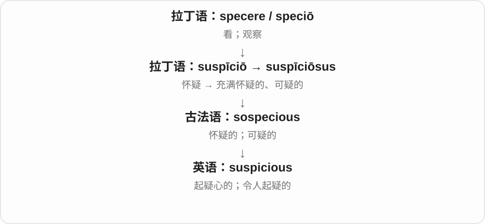

# 0138 · -ous — 有某种性质；充满、涉及或倾向于某种情况

[逐词精讲目录](../00_逐词精讲目录.md) · [总目录](../00_总目录_按常用程度.md)

## 核心词根与来源

先看它描写的是什么。humorous story 是有趣的故事，treacherous road 是危险难信赖的路，advantageous agreement 是有利协议。不要把“充满”当成唯一答案：路不是真的充满背叛，协议也不是把优势倒进了容器。

**-OUS：某种特点落到了人、物或事情上**

caution 谨慎 → cautious 谨慎的；peril 危险 → perilous 危险的；melody 旋律 → melodious 悦耳的。后缀提示形容词，具体评价由整词决定。

- **谨慎、幽默与华丽**：caution · cautious · humor · humour · humorous · glamour · glamorous
- **乏味、恐惧与到处可见**：tedium · tedious · horror · horrendous · ubiquity · ubiquitous
- **优势与不利**：advantage · advantageous · disadvantage · disadvantageous
- **背信、危险和显赫**：treachery · treacherous · peril · perilous · illustrious
- **丰美、迷乱与暧昧**：luscious · delirium · delirious · flirt · flirtation · flirtatious
- **黏液、亵渎和叛国等专门词义**：mucus · mucous · blasphemy · blasphemous · treason · treasonous
- **光泽和旋律**：luster · lustre · lustrous · melody · melodious
- **cancer 与 cancerous：疾病名到性质形容词**：cancer · cancerous
- **advantage → advantages：处在前面的有利条件**：advantage · advantages
- **fury、furious、furiously：怒火、狂怒的与猛烈地**：fury · furious · furiously
- **melody → melodies：一条条能哼出的曲调**：melody · melodies
- **prestige 声望 ↔ prestigious 有声望的**：prestige
- **felon 人 → felony 罪、felonious 性质**：felon · felony · felonious
- **frivolous 与 frivolity：轻浮的性质、行为**：frivolity
- **拉丁遗忘词族：oblivion 与 oblivious**：oblivion · oblivious

## 词形与演化规律

主要经法语 -ous、-eux 接拉丁 -osus 等材料，英语又继续形成相应形容词；形似的 -ious、-eous 等还可能包含不同的词干和借入历史。caution／cautious、melody／melodious、mucus／mucous 等都有词干对应，不是原词不动地一律加 ous。-ous 通常弱读，整词重音要单查：advantage 与 advantageous 重音、元音会变。humorous 的旧义与体液观念有关，现代主要说幽默；luscious 的确切词源有分歧，不硬造唯一短词。

cancer 医学词经拉丁螃蟹、肿瘤旧名称等历史进入英语；cancer + -ous → cancerous，现代义按细胞、组织的癌性理解。旧形状比喻不是病因解释。

法语 avantage 接 avant 在前，英语 d 后来按拉丁化理解加入。

fury 经法语接拉丁 furia，furious 经另一相关借入形式，不只英语名词临时加 ous。

希腊 melos 与 oide 组合后经拉丁、法语进入英语；复数只改变数目，不另造一次曲调来源。

prestige 接法语、拉丁幻象词族，后来发展出令人仰慕的声望。prestigious 的早期魔术、迷惑义先于现代 prestige 正面义，学习排序不等于历史出现顺序。

经法语邪恶、罪行词族，更远来源有争议。felony 名词、felon 人与 felonious 形容词对照；felony 变 y 为 i 加完整 -ous → felonious；各地区的法律分类不能统一按某一刑期定义。

frivolity 借法语 frivolité，远接拉丁 frivolus；与 frivolous 对应，但历史上不是把完整 frivolous 再直接加 -ity。

oblivion 经法语、拉丁 oblivio、oblivionem；oblivious 接拉丁 obliviosus，其中 -osus 对应 -ous。不是现代英语把完整 oblivion 再加 -ous；oblivisci 更远来源不定，不把抹平比喻定为事实。

## 单词速览（按词族由简到繁）

同一基础词的相关扩展放在一起，先读基础形式，再读扩展；各组之间优先读常用的。具体词源关系见各词讲解。

| 单词 | 音标 | 核心意思 |
|---|---|---|
| [various](#w-117) | 英 /ˈveəriəs/；美 /ˈveriəs/ | 各种各样的；若干不同的 |
| [serious](#w-118) | 英 /ˈsɪəriəs/；美 /ˈsɪriəs/ | 认真的；严肃的；严重的；重大的 |
| [previous](#w-119) | 英、美 /ˈpriːviəs/ | 先前的；以前的；前一个的 |
| [cancer](#w-182) | 英 /ˈkænsə/；美 /ˈkænsər/ | 癌；癌症；Cancer：巨蟹座等专名用法 |
| [cancerous](#w-183) | 英 /ˈkænsərəs/；美 /ˈkænsərəs/ | 癌性的、癌变的；比喻：像癌一样扩散、侵蚀的 |
| [religious](#w-120) | /rɪˈlɪdʒəs/ | 宗教的；虔诚信教的 |
| [famous](#w-1) | /ˈfeɪməs/ | 著名的；有名的 |
| [dangerous](#w-2) | /ˈdeɪndʒərəs/ | 危险的；可能造成损害的 |
| [advantage](#w-121) | 英 /ədˈvɑːntɪdʒ/；美 /ədˈvæntɪdʒ/ | 优势；有利条件、好处 |
| [advantages](#w-184) | 英 /ədˈvɑːntɪdʒɪz/；美 /ədˈvæntɪdʒɪz/ | 优势、好处、有利条件〔复数〕 |
| [advantageous](#w-31) | 英 /ˌædvənˈteɪdʒəs/；美 /ˌædvənˈteɪdʒəs/ | 有利的；有益处的 |
| [disadvantage](#w-142) | 英 /ˌdɪsədˈvɑːntɪdʒ/；美 /ˌdɪsədˈvæntɪdʒ/ | 不利条件；劣势；使处于不利地位 |
| [disadvantageous](#w-89) | 英 /ˌdɪsædvənˈteɪdʒəs/；美 /ˌdɪsædvənˈteɪdʒəs/ | 不利的；会造成劣势的 |
| [numerous](#w-3) | 英 /ˈnjuːmərəs/；美 /ˈnuːmərəs/ | 许多的；数量众多的 |
| [obvious](#w-4) | 英 /ˈɒbviəs/；美 /ˈɑːbviəs/ | 明显的；容易看出的 |
| [ridiculous](#w-5) | /rɪˈdɪkjələs/ | 荒唐的、可笑的；离谱的 |
| [curious](#w-6) | 英 /ˈkjʊəriəs/；美 /ˈkjʊriəs/ | 好奇的；奇特的 |
| [horror](#w-122) | 英 /ˈhɒrə/；美 /ˈhɔːrər/ | 惊骇、恐惧；令人恐怖的事；恐怖作品类型 |
| [nervous](#w-7) | 英 /ˈnɜːvəs/；美 /ˈnɜːrvəs/ | 紧张不安的；神经系统的 |
| [gorgeous](#w-123) | 英 /ˈɡɔːdʒəs/；美 /ˈɡɔːrdʒəs/ | 非常漂亮的；华丽迷人的；极好的 |
| [delicious](#w-124) | /dɪˈlɪʃəs/ | 美味的；令人愉悦、痛快的 |
| [precious](#w-125) | /ˈpreʃəs/ | 珍贵的；宝贵的；过分讲究的 |
| [hilarious](#w-126) | 英 /hɪˈleəriəs/；美 /hɪˈleriəs/ | 极其好笑的；令人捧腹的 |
| [enormous](#w-8) | 英 /ɪˈnɔːməs/；美 /ɪˈnɔːrməs/ | 巨大的；极大的 |
| [jealous](#w-127) | /ˈdʒeləs/ | 嫉妒的；吃醋的；唯恐失去的 |
| [continuous](#w-128) | /kənˈtɪnjuəs/ | 连续的；不间断的 |
| [generous](#w-129) | /ˈdʒenərəs/ | 慷慨的；宽厚的；充足的 |
| [humor](#w-130) | 英 /ˈhjuːmə/；美 /ˈhjuːmər/ | 幽默；心情、脾气；迁就〔动词〕 |
| [humour](#w-138) | 英 /ˈhjuːmə/；美 /ˈhjuːmər/ | 幽默；心情；迁就〔humor 的常见英式拼写〕 |
| [humorous](#w-21) | 英 /ˈhjuːmərəs/；美 /ˈhjuːmərəs/ | 幽默的；诙谐有趣的 |
| [conscious](#w-131) | 英 /ˈkɒnʃəs/；美 /ˈkɑːnʃəs/ | 有意识的；清醒的；察觉到的；有意作出的 |
| [anonymous](#w-9) | 英 /əˈnɒnɪməs/；美 /əˈnɑːnɪməs/ | 匿名的；身份不明的；缺少个性的 |
| [mysterious](#w-10) | 英 /mɪˈstɪəriəs/；美 /mɪˈstɪriəs/ | 神秘的；难以解释的 |
| [indigenous](#w-11) | /ɪnˈdɪdʒənəs/ | 本土的；原生的；原住民族的 |
| [suspicious](#w-132) | /səˈspɪʃəs/ | 怀疑的；可疑的 |
| [fabulous](#w-12) | /ˈfæbjələs/ | 极好的；令人惊叹的；传说中的 |
| [glorious](#w-13) | /ˈɡlɔːriəs/ | 光荣的；壮丽的；美好得令人愉快的 |
| [tremendous](#w-14) | /trəˈmendəs/ | 极大的；惊人的；极好的 |
| [fury](#w-185) | 英 /ˈfjʊəri/；美 /ˈfjʊri/ | 狂怒、盛怒；猛烈的力量 |
| [furious](#w-133) | 英 /ˈfjʊəriəs/；美 /ˈfjʊriəs/ | 狂怒的；猛烈的、激烈的 |
| [furiously](#w-186) | 英 /ˈfjʊəriəsli/；美 /ˈfjʊriəsli/ | 愤怒地；猛烈地、飞快而拼命地 |
| [caution](#w-134) | 英 /ˈkɔːʃən/；美 /ˈkɔːʃən/ | 谨慎；警告；告诫 |
| [cautious](#w-17) | 英 /ˈkɔːʃəs/；美 /ˈkɔːʃəs/ | 谨慎的；小心的 |
| [ambitious](#w-135) | /æmˈbɪʃəs/ | 有抱负的；目标宏大的；野心勃勃的 |
| [prestige](#w-188) | 英、美 /preˈstiːʒ/ | 声望；威望；因出色、重要而受到仰慕的地位 |
| [prestigious](#w-136) | /preˈstɪdʒəs/ 或 /prɪˈstɪdʒəs/ | 有威望的；享有盛誉的 |
| [autonomous](#w-15) | 英 /ɔːˈtɒnəməs/；美 /ɔːˈtɑːnəməs/ | 自治的；自主运行的；能独立决定的 |
| [treason](#w-137) | /ˈtriːzən/ | 叛国；严重背叛 |
| [treasonous](#w-63) | /ˈtriːzənəs/ | 叛国的；背叛国家、君主等的 |
| [notorious](#w-139) | 英 /nəʊˈtɔːriəs/；美 /noʊˈtɔːriəs/ | 声名狼藉的；因某种麻烦特点而出名的 |
| [infectious](#w-140) | /ɪnˈfekʃəs/ | 传染性的；能引起感染的；有感染力的 |
| [melody](#w-141) | /ˈmelədi/ | 旋律；曲调 |
| [melodies](#w-187) | /ˈmelədiz/ | 旋律、曲调〔复数〕 |
| [melodious](#w-69) | 英 /məˈləʊdiəs/；美 /məˈloʊdiəs/ | 悦耳的；旋律优美的 |
| [outrageous](#w-18) | /aʊtˈreɪdʒəs/ | 骇人、令人愤慨的；离谱、过分的；大胆出格的 |
| [felon](#w-190) | 英、美 /ˈfelən/ | 重罪犯；犯重罪的人 |
| [felony](#w-189) | 英、美 /ˈfeləni/ | 重罪〔一种犯罪类别，尤见美式法律语境〕 |
| [felonious](#w-191) | 英 /fəˈləʊniəs/；美 /fəˈloʊniəs/ | 重罪的；构成重罪的；凶恶犯罪的〔正式〕 |
| [hazardous](#w-19) | 英 /ˈhæzədəs/；美 /ˈhæzərdəs/ | 危险的、有风险的 |
| [spontaneous](#w-143) | 英 /spɒnˈteɪniəs/；美 /spɑːnˈteɪniəs/ | 自发的；自然流露的；未经事先安排的 |
| [disastrous](#w-20) | 英 /dɪˈzɑːstrəs/；美 /dɪˈzæstrəs/ | 灾难性的；造成严重失败的 |
| [rigorous](#w-144) | /ˈrɪɡərəs/ | 严格的；严密的；一丝不苟的 |
| [unanimous](#w-145) | /juːˈnænɪməs/ | 全体一致的；一致赞成的 |
| [prosperous](#w-146) | 英 /ˈprɒspərəs/；美 /ˈprɑːspərəs/ | 繁荣的、兴旺的、富裕的 |
| [courageous](#w-147) | /kəˈreɪdʒəs/ | 勇敢的；有胆量的 |
| [gracious](#w-148) | /ˈɡreɪʃəs/ | 亲切有礼的；宽厚的；仁慈的 |
| [contagious](#w-149) | /kənˈteɪdʒəs/ | 会传染的；具有感染力的 |
| [ambiguous](#w-150) | /æmˈbɪɡjuəs/ | 有歧义的；意思不明确的 |
| [poisonous](#w-22) | /ˈpɔɪzənəs/ | 有毒的；恶毒的 |
| [luxurious](#w-151) | 英 /lʌɡˈʒʊəriəs/；美 /lʌɡˈʒʊriəs/ | 奢华舒适的；极为享受的 |
| [simultaneous](#w-152) | 英 /ˌsɪmlˈteɪniəs/；美 /ˌsaɪmlˈteɪniəs/ | 同时的；同时发生的；联立的〔方程〕 |
| [flirt](#w-153) | 英 /flɜːt/；美 /flɜːrt/ | 调情；短暂考虑、涉足〔搭配〕；爱调情的人 |
| [flirtation](#w-179) | 英 /flɜːˈteɪʃən/；美 /flɜːrˈteɪʃən/ | 调情；短暂暧昧关系；短暂涉足 |
| [flirtatious](#w-56) | 英 /flɜːˈteɪʃəs/；美 /flɜːrˈteɪʃəs/ | 带调情意味的；暧昧撩人的 |
| [glamour](#w-154) | 英 /ˈɡlæmə/；美 /ˈɡlæmər/ | 迷人魅力；华丽、令人向往的光环 |
| [glamorous](#w-24) | 英 /ˈɡlæmərəs/；美 /ˈɡlæmərəs/ | 光鲜迷人的；华丽而令人向往的 |
| [tedium](#w-181) | /ˈtiːdiəm/ | 单调乏味；冗长无聊 |
| [tedious](#w-25) | /ˈtiːdiəs/ | 冗长乏味的；单调烦人的 |
| [dubious](#w-155) | 英 /ˈdjuːbiəs/；美 /ˈduːbiəs/ | 可疑的；不太可信的；拿不准的 |
| [adventurous](#w-156) | /ədˈventʃərəs/ | 爱冒险的；敢尝新的；有探索性的 |
| [vigorous](#w-157) | /ˈvɪɡərəs/ | 有力的；精力旺盛的；强烈积极的 |
| [horrendous](#w-26) | /həˈrendəs/ | 极其可怕的；糟糕透顶的 |
| [miraculous](#w-158) | 英 /mɪˈrækjələs/；美 /məˈrækjələs/ | 奇迹般的；不可思议的 |
| [ubiquity](#w-180) | /juːˈbɪkwɪti/ | 无处不在；普遍存在 |
| [ubiquitous](#w-27) | /juːˈbɪkwɪtəs/ | 无处不在的；随处可见的 |
| [monstrous](#w-159) | 英 /ˈmɒnstrəs/；美 /ˈmɑːnstrəs/ | 巨大的；骇人的；极其恶劣的 |
| [ominous](#w-160) | 英 /ˈɒmɪnəs/；美 /ˈɑːmɪnəs/ | 不祥的；让人预感坏事将发生的 |
| [peril](#w-161) | /ˈperɪl/ | 危险；严重险境 |
| [perilous](#w-37) | /ˈperɪləs/ | 危险的；充满风险的 |
| [mountainous](#w-28) | 英 /ˈmaʊntɪnəs/；美 /ˈmaʊntənəs/ | 多山的；巨大如山的 |
| [rebellious](#w-162) | 英美 /rɪˈbeljəs/ | 叛逆的；反抗的；不服管束的 |
| [conspicuous](#w-163) | /kənˈspɪkjuəs/ | 显眼的；引人注意的 |
| [joyous](#w-164) | /ˈdʒɔɪəs/ | 喜悦的；欢乐的 |
| [oblivion](#w-193) | 英 /əˈblɪviən/；美 /əˈblɪviən/ | 被遗忘、无闻的状态；无意识；消失无踪 |
| [oblivious](#w-194) | 英 /əˈblɪviəs/；美 /əˈblɪviəs/ | 毫无察觉的；浑然不知的；忘却的 |
| [treachery](#w-172) | /ˈtretʃəri/ | 背叛；背信弃义 |
| [treacherous](#w-32) | /ˈtretʃərəs/ | 背信弃义的；危险、靠不住的 |
| [illustrious](#w-33) | /ɪˈlʌstriəs/ | 杰出的；显赫的；享有盛名的 |
| [blasphemy](#w-165) | /ˈblæsfəmi/ | 亵渎神明、宗教的言行；冒犯神圣事物的言论 |
| [blasphemous](#w-54) | /ˈblæsfəməs/ | 亵渎的；被认为冒犯神明、神圣事物的 |
| [scandalous](#w-166) | /ˈskændələs/ | 可耻的；令人愤慨的；离谱的 |
| [frivolous](#w-167) | /ˈfrɪvələs/ | 轻浮的；琐碎、不严肃的；无足轻重的 |
| [frivolity](#w-192) | 英 /frɪˈvɒləti/；美 /frɪˈvɑːləti/ | 轻浮、不严肃；轻松嬉闹；无关紧要的小事 |
| [courteous](#w-168) | 英 /ˈkɜːtiəs/；美 /ˈkɜːrtiəs/ | 有礼貌的；周到的 |
| [harmonious](#w-169) | 英 /hɑːˈməʊniəs/；美 /hɑːrˈmoʊniəs/ | 和谐的；协调的；悦耳的 |
| [mischievous](#w-170) | /ˈmɪstʃɪvəs/，美式也 /ˈmɪstʃəvəs/ | 淘气的；爱捣蛋的；故意有害的 |
| [mucus](#w-171) | /ˈmjuːkəs/ | 黏液 |
| [mucous](#w-58) | /ˈmjuːkəs/ | 黏液的；分泌黏液的 |
| [momentous](#w-40) | 英 /məʊˈmentəs/；美 /moʊˈmentəs/ | 重大的；影响深远的 |
| [luscious](#w-47) | /ˈlʌʃəs/ | 甘美多汁的；丰美诱人的 |
| [luster](#w-175) | 英 /ˈlʌstə/；美 /ˈlʌstər/ | 光泽；光彩〔lustre 的常见美式拼写〕 |
| [lustre](#w-173) | 英 /ˈlʌstə/；美 /ˈlʌstər/ | 光泽；光彩〔luster 的常见英式拼写〕 |
| [lustrous](#w-65) | /ˈlʌstrəs/ | 有光泽的；光亮润泽的 |
| [delirium](#w-174) | /dɪˈlɪriəm/ | 谵妄；意识混乱；极度兴奋、狂喜〔比喻〕 |
| [delirious](#w-49) | /dɪˈlɪriəs/ | 谵妄的、神志不清的；欣喜若狂的 |
| [laborious](#w-176) | 英 /ləˈbɔːriəs/；美 /ləˈbɔːriəs/ | 费时费力的；艰苦繁琐的 |
| [industrious](#w-177) | /ɪnˈdʌstriəs/ | 勤奋的；勤勉的 |
| [ravenous](#w-178) | /ˈrævənəs/ | 饥饿极了的；渴求强烈的 |

## 逐词讲解

### 1. various — 各种各样的；若干不同的

**音标**：英 /ˈveəriəs/；美 /ˈveriəs/

**先抓住这个画面**

把一组东西摊开看，里面不是清一色，而有不同种类、来源或特点。

**怎么拆**

经法语 varieux 或直接联系拉丁语 varius；不是英语 vary 简单加 -ous 后才首次出现。

**怎么变成今天的意思**

**拉丁语 varius**  
不同的、多样的；带不同颜色的

↓

**法语 varieux 或拉丁语 varius → 英语 various**  
多样、各不相同

various reasons 是若干不同原因，既有“多个”也有“不同”的感觉。通常接复数名词，不说 a various reason。

**常见搭配与例句**

various kinds of；for various reasons；various people。

> We discussed various ways to reduce waste.

我们讨论了减少浪费的各种办法。

> The guests came from various parts of the country.

客人来自全国不同地区。

**别混淆**

several 主要说有几个；various 更突出这些人或东西之间存在不同。

### 2. serious — 认真的；严肃的；严重的；重大的

**音标**：英 /ˈsɪəriəs/；美 /ˈsɪriəs/

**先抓住这个画面**

把一件事当成有分量、不能随便开玩笑处理；也可以说问题已经重到必须重视。

**怎么拆**

经法语、中世纪拉丁语接拉丁语 sērius 认真、严肃的词族。更远来源有不同推测，不把有分量的记忆画面硬说成确定的最古词义。

**怎么变成今天的意思**

**拉丁语 sērius → 中世纪拉丁语 sēriōsus、法语 sérieux**  
严肃、认真的

↓

**中古英语 seryows → 英语 serious**  
认真、当真的；严重、重要的

a serious student 认真学生，a serious problem 严重问题；Are you serious? 你是认真的吗？be serious about a plan 是认真对待计划，不只是表情不笑。

**常见搭配与例句**

be serious about；a serious problem；a serious mistake；Are you serious?。

> She is serious about learning the language.

她是认真想学这门语言的。

> The missing records created a serious problem for the project.

记录丢失给项目造成了严重问题。

> Are you serious about moving next month?

你真打算下个月搬家吗？

**别混淆**

serious 可以认真但不悲伤；a serious musician 是认真、专业投入的音乐人，不一定冷脸或缺少幽默。

### 3. previous — 先前的；以前的；前一个的

**音标**：英、美 /ˈpriːviəs/

**先抓住这个画面**

把时间或顺序排成一队，previous 指站在当前这一项前面的。

**怎么拆**

来自拉丁语 praevius“走在前面的”，由 prae“在前”与 via“道路”组成；不是英语 preview 的变形。

**怎么变成今天的意思**

**拉丁语 prae + via → praevius**  
在前 + 道路 → 走在前面的

↓

**英语 previous**  
时间、次序上在前的

the previous day 是相对于叙述中的某一天而言的前一天，不一定是今天的昨天。previous experience 则泛指以前积累的经验。

**常见搭配与例句**

the previous owner；previous experience；the previous evening。

> The previous owner had planted an apple tree.

上一位主人曾种下一棵苹果树。

> She arrived on Friday, and I had arrived the previous day.

她星期五到达，而我前一天就到了。

**别混淆**

last 常从现在往回看；previous 常从句中已经确定的时间点往回看。

### 4. cancer — 癌；癌症；Cancer：巨蟹座等专名用法

**音标**：英 /ˈkænsə/；美 /ˈkænsər/

**先抓住这个画面**

现代医学里，它是一组异常细胞失控分裂、可能侵入或扩散到其他组织的疾病名称。老名字借螃蟹形状来联想部分肿瘤的外观。

**怎么拆**

接拉丁 cancer 螃蟹、肿瘤等旧名，与希腊 karkinos 的螃蟹、肿瘤名称相关。英语古时已借入，后有受法语影响的 canker 等形式，近代医学中又固定 cancer；大写还用于巨蟹座。

**怎么变成今天的意思**

**希腊、拉丁螃蟹与肿瘤旧名称**  
部分肿瘤周围血管使古人联想到螃蟹

↓

**英语 cancer 的医学专门化**  
现代疾病类别名称；大写另有星座用法

cancer cells 癌细胞；cancer research 癌症研究；a type of cancer 一类癌症；Cancer as a zodiac sign 巨蟹座。命名史与现代疾病机制分开理解。

**常见搭配与例句**

study cancer；cancer biology；a cancer research centre。

> The laboratory studies how cancer cells grow.

实验室研究癌细胞怎样生长。

> The museum exhibition traced the history of cancer research.

博物馆展览回顾了癌症研究的历史。

**别混淆**

cancer 通常指癌这一疾病类，cancerous 是癌性的形容词。canker 是同源分化后的另一个词，现代不能到处拿它替换 cancer。

### 5. cancerous — 癌性的、癌变的；比喻：像癌一样扩散、侵蚀的

**音标**：英 /ˈkænsərəs/；美 /ˈkænsərəs/

**先抓住这个画面**

cancer 是病名，cancerous 把癌的性质接到细胞、组织、肿瘤上。这个词说明所指东西具有癌性。

**怎么拆**

cancer + -ous，-ous 形成具有某种性质的形容词。医学词族沿旧 cancer 名称发展，后来也有恶性蔓延、侵蚀的比喻用法。

**怎么变成今天的意思**

**cancer**  
癌；疾病名称

↓

**cancer + -ous → cancerous**  
具有癌性的；后来可比喻侵蚀扩散

cancerous cells 癌细胞；cancerous tissue 癌组织；a cancerous tumour 癌性肿瘤。比喻用于抽象问题时有很强负面色彩。

**常见搭配与例句**

cancerous growth；cancerous changes。

> The textbook includes images of cancerous cells.

教材中有癌细胞的图像。

> The lecture explained how cancerous tissue can affect nearby structures.

讲座解释了癌组织怎样影响邻近结构。

**别混淆**

cancerous 描写性质，cancer 是名词。不能仅由旧螃蟹字面判断今天的科学分类；读现代医学说明时按癌性的专业义理解。

### 6. religious — 宗教的；虔诚信教的

**音标**：/rɪˈlɪdʒəs/

**先抓住这个画面**

religious 可以只是与宗教有关，也可以形容一个人的信仰很虔诚。

**怎么拆**

来自拉丁语 religiōsus，经法语传入；与 religion 平行借入，不是英语里机械去掉 -on 再加 -ous。

**怎么变成今天的意思**

宗教建筑是 religious building，虔信的人是 religious person。词源更早部分同 religion 一样有争议。

**常见搭配与例句**

religious beliefs；religious art；a religious person。

> The museum has a collection of religious art.

博物馆收藏了一批宗教艺术品。

> She comes from a deeply religious family.

她出身于一个十分虔诚信教的家庭。

**别混淆**

religious 不一定表示个人虔信：religious studies 也可以是学术研究领域。

### 7. famous — 著名的；有名的

**音标**：/ˈfeɪməs/

**先抓住这个画面**

很多人都在谈论、都听说过，于是名字传开了。

**怎么拆**

经法语 famous 接拉丁 fāmōsus，源于 fāma“传闻、声誉”。现代可与 fame + -ous 对照，历史上是完整形容词借入。

**怎么变成今天的意思**

**拉丁 fāma**  
人们说的话、传闻；声誉，与 fārī“说”同族

↓

**拉丁 fāmōsus → 法语 famous → 中古英语 famous**  
被人传说、众所周知的

↓

**英语 famous**  
有名的

be famous for 后面放出名的原因，be famous as 后面放身份。出名与能力强不是一回事：famous 首先说公众知道这个人或东西。

**常见搭配与例句**

be famous for its food；be famous as a writer；a famous landmark。

> The town is famous for its handmade pottery.

这座小镇以手工陶器闻名。

> She became famous as a writer of detective stories.

她作为侦探小说作家出了名。

**别混淆**

famous 一般是中性或褒义的知名；infamous 专门说恶名或不光彩的知名。

### 8. dangerous — 危险的；可能造成损害的

**音标**：/ˈdeɪndʒərəs/

**先抓住这个画面**

这件事本身带着伤人的可能：结冰的路危险，是因为走上去可能摔倒。

**怎么拆**

现代容易看出 danger + -ous；历史上却是法语形容词 dangeros／dangerous 整体借入，不是到英语才第一次加上 -ous。

**怎么变成今天的意思**

**拉丁 domus → dominus／domina**  
家、房屋 → 男主人／女主人，主人、掌权者

↓

**通俗拉丁 \*dominarium → 古法语 dangier → dangeros**  
权力、危险 → 有危险的

↓

**盎格鲁法语 dangerous → 中古英语 daungerous → dangerous**  
形容词独立借入，后来稳定为危险的

dangerous 描写能造成伤害或损失的对象与做法。a dangerous driver 是可能害人的司机；a driver in danger 是司机自己面临危险，这两个位置不能混。

**常见搭配与例句**

dangerous roads；dangerous to others；dangerous to do；a dangerous assumption。

> It is dangerous to cross the road without looking.

不看路况就过马路很危险。

> That shortcut rests on a dangerous assumption about the data.

那种简便做法建立在一个可能造成严重问题的数据假设上。

**别混淆**

endangered 是受到威胁的；dangerous 是可能带来威胁的。濒危动物不一定性情危险。

### 9. advantage — 优势；有利条件、好处

**音标**：英 /ədˈvɑːntɪdʒ/；美 /ədˈvæntɪdʒ/

**先抓住这个画面**

同样做一件事，你有更好的位置、工具或经验，能少费力或更有机会成功，那就是 an advantage。

**怎么拆**

经法语 avantage，来自 avant 在前的材料；英语中的 d 是后来受拉丁化拼写理解影响加入的，不把整词硬分成现代 ad + vantage 来代替历史。

**怎么变成今天的意思**

**法语 avant → avantage → 英语 advantage**  
在前 → 领先、有利地位

↓

**advantageous；disadvantage、disadvantageous**  
有利的；不利、处于劣势

an advantage over someone 相对某人的优势；take advantage of 利用机会、条件，也可指占人便宜；to your advantage 对你有利。

**常见搭配与例句**

an advantage over；take advantage of。

> Her experience gave her an advantage over other applicants.

她的经验让她比其他申请人更有优势。

> We took advantage of the quiet morning to finish the work.

我们利用早晨的安静把工作做完。

**别混淆**

advantage 是有利条件；achievement 是实际取得的成就。有优势不保证最后成功。

### 10. advantages — 优势、好处、有利条件〔复数〕

**音标**：英 /ədˈvɑːntɪdʒɪz/；美 /ədˈvæntɪdʒɪz/

**先抓住这个画面**

某个条件让自己更容易往前走、做得更好，就是 advantages。可以是比赛优势，也可以只是某种安排比较方便的好处。

**怎么拆**

advantage + -s，/dʒ/ 后读 /ɪz/。advantage 借法语 avantage，接 avant 在前；英语 d 后来受拉丁化拼写理解影响加入，不能只按 ad 与 vantage 解释借入史。

**怎么变成今天的意思**

**法语 avant、avantage → 英语 advantage**  
在前、领先的材料 → 有利条件、好处

↓

**advantage + -s → advantages**  
多个好处、优势

advantages of the plan 计划的好处；advantages over another method 相对另一方法的优势；advantages and disadvantages 优缺点。

**常见搭配与例句**

practical advantages 实际好处；take advantage of opportunities 利用机会。

> The new design has several practical advantages.

新设计有几个实际好处。

> We compared the advantages and disadvantages of both options.

我们比较了两个选项的优缺点。

**别混淆**

advantages 可以相对某个对手，也可以一般谈方便之处。take advantage of someone 则常说利用、占某人的便宜，与利用机会的语气不同。

### 11. advantageous — 有利的；有益处的

**音标**：英 /ˌædvənˈteɪdʒəs/；美 /ˌædvənˈteɪdʒəs/

**先抓住这个画面**

一个安排能让你更省事、更占优势，就是 advantageous；常用于谈条件、位置、协议等。

**怎么拆**

可接法语 avantageux，也对应 advantage + -ous。保留 g 前的 e，常用读音这一段为 /teɪdʒ/，注意与名词 advantage 的重音、元音不同。

**怎么变成今天的意思**

**法语 avant → avantage → 英语 advantage**  
在前 → 领先、有利地位

↓

**advantageous；disadvantage、disadvantageous**  
有利的；不利、处于劣势

↓

**advantage、法语相应形容词 → advantageous**  
带来优势、有利的

advantageous to someone 对某人有利；an advantageous position 有利位置。

**常见搭配与例句**

financially advantageous；advantageous to。

> The new schedule is advantageous to commuters.

新时刻表对通勤者有利。

> They negotiated a more advantageous agreement.

他们谈成了一份更有利的协议。

**别混淆**

advantageous 是有利，不等于 guaranteed 一定成功；好的位置仍需看后续行动。

### 12. disadvantage — 不利条件；劣势；使处于不利地位

**音标**：英 /ˌdɪsədˈvɑːntɪdʒ/；美 /ˌdɪsədˈvæntɪdʒ/

**先抓住这个画面**

别人有工具，你没有；别人离得近，你要多走一段路，这些让你做事更难的条件就是 disadvantages。

**怎么拆**

经法语 desavantage 等进入英语，现代可对应 dis- 与 advantage；这里说不利、劣势，不只是不存在好处。

**怎么变成今天的意思**

**法语 avant → avantage → 英语 advantage**  
在前 → 领先、有利地位

↓

**advantageous；disadvantage、disadvantageous**  
有利的；不利、处于劣势

at a disadvantage 处于劣势；a disadvantage of ……的不足；disadvantage a group 使某群体处境不利。

**常见搭配与例句**

at a disadvantage；advantages and disadvantages。

> The lack of transport put the village at a disadvantage.

交通不便让这个村子处于不利地位。

> We discussed the advantages and disadvantages of each option.

我们讨论了每个选项的利弊。

**别混淆**

disadvantage 是不利条件，failure 是失败；有不利条件不代表最后一定失败。

### 13. disadvantageous — 不利的；会造成劣势的

**音标**：英 /ˌdɪsædvənˈteɪdʒəs/；美 /ˌdɪsædvənˈteɪdʒəs/

**先抓住这个画面**

条款让你承担更多成本，安排让你更难参与，这种会把你放到不利位置的东西叫 disadvantageous。

**怎么拆**

disadvantage + -ous；也可从 dis- 与 advantageous 的对应关系看见否定、不利的方向，不强定唯一形成先后。

**怎么变成今天的意思**

**法语 avant → avantage → 英语 advantage**  
在前 → 领先、有利地位

↓

**advantageous；disadvantage、disadvantageous**  
有利的；不利、处于劣势

↓

**disadvantage + -ous → disadvantageous**  
造成劣势、不利的

disadvantageous to someone 对某人不利；disadvantageous terms 不利条款。

**常见搭配与例句**

disadvantageous to；financially disadvantageous。

> The proposed hours would be disadvantageous to parents.

提议的时间安排会对家长不利。

> They rejected the financially disadvantageous terms.

他们拒绝了经济上不利的条款。

**别混淆**

disadvantageous 说条件造成不利；disadvantaged 常说已经处于资源、机会等劣势的人或群体。

### 14. numerous — 许多的；数量众多的

**音标**：英 /ˈnjuːmərəs/；美 /ˈnuːmərəs/

**先抓住这个画面**

数出来会有一大批，不只是一两个。

**怎么拆**

来自拉丁 numerōsus“数量多的”，以 numerus“数”为基础；不是现代英语 number 删改几个字母再加 -ous。

**怎么变成今天的意思**

**拉丁 numerus**  
数；数量

↓

**拉丁 numerōsus → 中古英语 numerous**  
数量众多的

↓

**英语 numerous**  
许多的、众多的

numerous examples 比 many examples 稍书面，常见于报告或说明。修饰可数复数，如 problems、occasions，不说 numerous water。

**常见搭配与例句**

numerous examples；on numerous occasions；too numerous to list。

> The proposal has attracted numerous objections.

这个提案引来了许多反对意见。

> We have discussed the issue on numerous occasions.

我们已经多次讨论过这个问题。

**别混淆**

numerical 是数字、数量方面的；numerous 才表示数量很多。

### 15. obvious — 明显的；容易看出的

**音标**：英 /ˈɒbviəs/；美 /ˈɑːbviəs/

**先抓住这个画面**

东西就摆在你面前，不用费力绕过去找。

**怎么拆**

拉丁 obvius 中 ob- 是“迎面、在前”，via 是“路”；英语借入后形成 obvious，不是 ob + vision。

**怎么变成今天的意思**

**拉丁 via**  
道路、路径

↓

**拉丁 ob + viam → obviam → obvius**  
在路前面、迎面可遇见的

↓

**英语 obvious**  
从容易遇到、摆在眼前，发展为明显的

它可以说肉眼可见的破损，也可以说容易推出的结论。“明显”总相对于某个观察者和已知条件；It is obvious to me 不保证别人已经知道。

**常见搭配与例句**

an obvious mistake；be obvious to someone；It is obvious that…。

> The crack was obvious even from across the room.

即使站在房间另一头，那道裂缝也很明显。

> It became obvious that we needed a larger table.

我们显然需要一张更大的桌子，这一点逐渐清楚了。

**别混淆**

visible 是能看见；obvious 是容易看出或理解。一个可见的小痕迹未必让原因变得 obvious。

### 16. ridiculous — 荒唐的、可笑的；离谱的

**音标**：/rɪˈdɪkjələs/

**先抓住这个画面**

事情不合常理到让人想笑，或者气得说“这也太离谱了”。它不保证真的令人开心。

**怎么拆**

借拉丁 ridiculus“可笑的”一族，词源资料也追到 ridiculosus 形式，远接 ridere“笑”。虽然现代可联想到 ridicule + -ous，ridiculous 的英语记录早于今天的 ridicule 名词，不能反过来当成后者的普通派生。

**怎么变成今天的意思**

**拉丁 ridere；相关分词、词干 risus／ris-**  
笑；更早来源未定

↓

**拉丁 ridiculus／ridiculosus**  
可笑的、荒谬的

↓

**英语 ridiculous**  
荒唐、可笑；后可用来强调程度出奇

a ridiculous excuse 是荒唐借口；a ridiculous price 是离谱的价格。口语还可用 ridiculous 夸张地赞某种能力强得惊人，正负评价要看语境。

**常见搭配与例句**

a ridiculous idea；a ridiculous amount；look ridiculous；It is ridiculous to...。

> It is ridiculous to expect one person to finish all this by tonight.

指望一个人在今晚之前完成这些事，实在太不合理了。

> The shoes cost a ridiculous amount of money.

这双鞋贵得离谱。

**别混淆**

funny 可是让人开心或觉得奇怪；ridiculous 通常认为荒唐、不值得认真对待。嘲人时语气可能很伤人。

### 17. curious — 好奇的；奇特的

**音标**：英 /ˈkjʊəriəs/；美 /ˈkjʊriəs/

**先抓住这个画面**

注意力被一件事勾住，忍不住想弄清楚，是 curious；那件让人忍不住多看一眼的怪事，也可以 curious。

**怎么拆**

拉丁语 cūriōsus 与 cūra“用心、关切”有关，经古法语 curius 进入。

**怎么变成今天的意思**

对事情用心关注发展为想知道；再转向能引人探究的奇特事物。人的好奇与物的古怪，是同一词的两种观察角度。

**常见搭配与例句**

be curious about…；curious to know…；a curious coincidence。

> I am curious about how the machine works.

我很好奇这台机器怎样运作。

> There was a curious smell in the room.

房间里有一股奇怪的气味。

**别混淆**

curious about 是想了解；nosy 常批评爱打听隐私。a curious noise 是奇怪的声音，不是声音在好奇。

### 18. horror — 惊骇、恐惧；令人恐怖的事；恐怖作品类型

**音标**：英 /ˈhɒrə/；美 /ˈhɔːrər/

**先抓住这个画面**

看到惨烈场面，人一下僵住、汗毛竖起来：horror 抓住这种惊骇，不只是有点担心。

**怎么拆**

经古法语接拉丁 horror，来自 horrēre 竖起、发抖。身体发冷发抖的画面，走向恐惧和惊骇；不是英语 horror 再拆成两个短词。

**怎么变成今天的意思**

**拉丁 horrēre → horror**  
毛发竖起、因冷或怕而发抖 → 恐惧

↓

**古法语 horror → 英语 horror**  
强烈恐惧、惊骇，也可包含厌恶

in horror 惊恐地，to my horror 令我惊骇的是，a horror film 恐怖片，the horrors of war 战争的可怕经历。也可因残忍、丑恶而震惊厌恶。

**常见搭配与例句**

in horror；to my horror；a horror film；the horrors of war。

> She stared in horror at the ruined house.

她惊恐地望着被毁的房子。

> I enjoy mysteries, but I rarely watch horror films.

我喜欢推理故事，但很少看恐怖片。

**别混淆**

fear 可从轻微担心到强烈害怕；horror 通常更强，也容易带震惊、反感。恐怖片叫 horror film，不是所有 suspense 悬疑片都属这一类。

### 19. nervous — 紧张不安的；神经系统的

**音标**：英 /ˈnɜːvəs/；美 /ˈnɜːrvəs/

**先抓住这个画面**

面对不确定的事情，身体和心情都像绷紧了。

**怎么拆**

借拉丁 nervōsus，古义曾指筋力强，后来用于神经及神经状态，才发展出紧张义。现代可联系 nerve + -ous，但不能从“有力量”直接猜现在情绪义。

**怎么变成今天的意思**

**拉丁 nervus**  
筋腱、弦；引申为力量；中世纪也指神经

↓

**拉丁 nervōsus → 中古英语 nervous**  
有筋腱的、有力的；与神经相关的

↓

**英语 nervous**  
神经的；后来也指紧张不安的

nervous about an exam 是担心考试；the nervous system 是神经系统，不是“紧张的系统”。修饰人和修饰解剖结构时要读出两层意思。

**常见搭配与例句**

feel nervous；nervous about；the nervous system；a nervous smile。

> I was nervous about giving my first presentation.

第一次做演讲让我很紧张。

> The chapter explains how the nervous system carries information.

这一章解释神经系统如何传递信息。

**别混淆**

nervous 表示紧张；nervy 在英式常相近，在美式却可能指大胆冒失。

### 20. gorgeous — 非常漂亮的；华丽迷人的；极好的

**音标**：英 /ˈɡɔːdʒəs/；美 /ˈɡɔːrdʒəs/

**先抓住这个画面**

看到景色、衣服、布置，忍不住说“真漂亮”，gorgeous 是很常见的热情赞美；口语还可夸天气特别好。

**怎么拆**

借法语 gorgias 优雅、华丽的。更远来源未定，有与颈饰、喉部词相关的解释，但不能当定论；不按现代 gorge 峡谷、猛吃 + ous 编故事。

**怎么变成今天的意思**

**法语 gorgias**  
优雅、时髦、华丽的；远源未定

↓

**英语 gorgeous**  
华丽漂亮；日常泛赞非常好

a gorgeous view 绝美景色；a gorgeous dress 漂亮礼服；gorgeous weather 极好的天气。

**常见搭配与例句**

a gorgeous day；look gorgeous。

> The balcony had a gorgeous view of the mountains.

阳台能望见绝美的山景。

> What a gorgeous day for a walk!

真是个适合散步的好天气！

**别混淆**

gorgeous 是强烈赞美，gory 是血淋淋的；两个词的开头像，不要看漏后面。

### 21. delicious — 美味的；令人愉悦、痛快的

**音标**：/dɪˈlɪʃəs/

**先抓住这个画面**

吃一口就觉得真好吃，是 delicious 最常见的画面。它的历史范围更宽，也能形容一种让人享受的感觉。

**怎么拆**

经古法语、盎格鲁诺曼语接拉丁 dēliciōsus，再联系 dēliciae 乐趣、愉悦。词尾对应 -ous 的性质形容词，但不按现代 delicious 硬拆成 deli 店 + cious。

**怎么变成今天的意思**

**拉丁 dēliciae 等：乐趣、愉悦 → dēliciōsus**  
令人愉悦的

↓

**法语 delicious／delicieux → 英语 delicious**  
悦人的；常用来夸食物美味

a delicious meal 美味的一餐，a delicious smell 诱人的香味，a delicious irony 令人玩味、痛快的讽刺。非食物用法常带更鲜明的文体色彩。

**常见搭配与例句**

a delicious meal；a delicious smell；a delicious irony。

> The soup was absolutely delicious.

这汤真是太好喝了。

> A delicious smell drifted from the kitchen.

厨房飘出诱人的香味。

**别混淆**

delicious 常是积极的感官评价；delicate 是精细、脆弱或清淡等，虽然历史有关，现代不等义。

### 22. precious — 珍贵的；宝贵的；过分讲究的

**音标**：/ˈpreʃəs/

**先抓住这个画面**

东西的价值高到不愿轻易失去，可能贵在钱，也可能贵在感情或稀缺。

**怎么拆**

拉丁 pretium 派生 pretiōsus，经古法语 precios 进入英语；不是现代 price 加 -ous 后照字母读。

**怎么变成今天的意思**

**拉丁 pretium**  
价格、价值、报酬

↓

**拉丁 pretiōsus → 古法语 precios → 中古英语 precious**  
价值高、珍贵的

↓

**现代英语 precious**  
珍贵；有时指过分讲究、矫饰

precious memories 不必值钱，却很重要；precious time 是不能随便浪费的时间。批评 a precious style 时，也可能说风格过分精巧、矫饰。

**常见搭配与例句**

precious memories；precious metals；precious time；be precious about。

> The letters are precious to her because her mother wrote them.

这些信是母亲写的，所以她格外珍惜。

> We lost precious time looking for the missing key.

我们找那把丢失的钥匙，耽误了宝贵的时间。

**别混淆**

expensive 只说明花费高；precious 说明很值得珍惜。昂贵物品不一定对你珍贵。

### 23. hilarious — 极其好笑的；令人捧腹的

**音标**：英 /hɪˈleəriəs/；美 /hɪˈleriəs/

**先抓住这个画面**

不只是微微一笑，而是让人笑得停不下来，就可以夸 hilarious。常用来评价故事、笑话、场面。

**怎么拆**

借拉丁 hilaris 快乐的材料，加相应 -ious 形式，上接希腊 hilaros 愉快；现代常用义进一步集中到非常好笑。

**怎么变成今天的意思**

**希腊 hilaros → 拉丁 hilaris**  
欢乐、愉快

↓

**英语 hilarious**  
极其好笑、令人捧腹

a hilarious story 令人捧腹的故事；find something hilarious 觉得某事太好笑。

**常见搭配与例句**

a hilarious comedy；absolutely hilarious。

> The children thought the puppet show was hilarious.

孩子们觉得木偶戏好笑极了。

> She told a hilarious story about her first driving lesson.

她讲了一个关于第一次学车的爆笑故事。

**别混淆**

hilarious 是很好笑；happy 是高兴。描述人今天心情不错，不能直接说 he is hilarious 来表达同一意思。

### 24. enormous — 巨大的；极大的

**音标**：英 /ɪˈnɔːməs/；美 /ɪˈnɔːrməs/

**先抓住这个画面**

大到像越出了平常那把尺子的范围：不仅房屋大，工作量、压力或影响也可以大得惊人。

**怎么拆**

拉丁 ex-“出”+ norma“标准”形成 enormis；英语借来后用 -ous 形式。en- 在这里不是英语常见的“使……”前缀。

**怎么变成今天的意思**

**拉丁 norma**  
木工直角尺；由此指规则、标准

↓

**拉丁 ex- + norma → enormis**  
越出标准、不合规则；也有极大之意

↓

**英语 enormous**  
承接拉丁形容词，换用英语 -ous；巨大的、程度惊人的

早期“偏离规则、异常”的意思，后来突出到“体量或程度超常”。enormous relief 是极大的宽慰，enormous effort 是巨大的努力，并不一定指摸得着的尺寸。

**常见搭配与例句**

an enormous amount of work；enormous pressure；an enormous difference。

> An enormous tree stood beside the small cottage.

小屋旁矗立着一棵巨树。

> Her advice made an enormous difference to my confidence.

她的建议极大地增强了我的信心。

**别混淆**

huge 与 enormous 经常互换；enormous 较适合强调规模、数量或程度远超一般，不是专门表示沉重。

### 25. jealous — 嫉妒的；吃醋的；唯恐失去的

**音标**：/ˈdʒeləs/

**先抓住这个画面**

别人拥有你想要的东西，或你担心自己珍视的关系被人抢走，心里因此不舒服。

**怎么拆**

晚期拉丁 zelosus 经古法语 jalos、gelos 进入英语。zealous 后来走较直接的拉丁路线；两者同源，却不是现代英语互相改拼得到。

**怎么变成今天的意思**

**希腊 zelos 热切、竞相追求，也可指嫉妒 → 拉丁 zelus**  
同一份强烈在意，可以往投入，也可以往占有和竞争发展

↓

**晚期拉丁 zelosus → 古法语 jalos／gelos → 英语 jealous**  
经法语路线，现代常指嫉妒或唯恐失去

jealous of her success 是嫉妒她的成功；a jealous partner 常指伴侣关系里的吃醋。口语 I’m jealous! 也可以轻松表示羡慕，语气不一定恶意。

**常见搭配与例句**

be jealous of；feel jealous；a jealous partner；jealous of one’s independence。

> He was jealous of his colleague’s rapid promotion.

他嫉妒同事升职那么快。

> She felt jealous when her partner kept praising someone else.

伴侣不停称赞另一个人时，她有些吃醋。

**别混淆**

传统辨析把 envy 偏向想要别人拥有的，jealousy 偏向怕失去自己的；现代 jealous 也广泛用于前一种场景，不能把它判成一律错误。

### 26. continuous — 连续的；不间断的

**音标**：/kənˈtɪnjuəs/

**先抓住这个画面**

continuous 像一条没有断开的线，强调在所说的时间或范围内中间没有停顿、缺口。

**怎么拆**

来自拉丁语 continuus“连续、相接的”，与 continēre“保持在一起”相连；不是先有英语 continue 才造出所有同族形容词。

**怎么变成今天的意思**

可以说机器连续运行，也可以说连续分布。数学中的连续有严格定义，直观上是输入微小变化不会在该点造成突跳。

**常见搭配与例句**

continuous operation；a continuous line；continuous improvement；a continuous function。

> The machine ran for twelve hours of continuous operation.

机器连续运行了十二个小时。

> Draw a continuous line around the shape.

沿着这个形状画一条不断开的线。

**别混淆**

continual 常强调反复发生；continuous 通常强调没有中断。实际词义有交叠，但这一区分最实用。

### 27. generous — 慷慨的；宽厚的；充足的

**音标**：/ˈdʒenərəs/

**先抓住这个画面**

给钱、给时间或给别人余地时，不把手攥得很紧。

**怎么拆**

拉丁 genus“家世、出身”派生 generōsus“出身高贵的”，经法语 généreux 进入英语；高尚、宽厚与量足的意义也有早期基础。

**怎么变成今天的意思**

**拉丁 gignere、genitus；同族 genus、gener-**  
生出、产生；种类、出身

↓

**拉丁 genus → generōsus → 法语 généreux**  
出身高贵 → 宽厚、慷慨

↓

**英语 generous**  
乐于给予的；分量充足的

generous with time 是舍得花时间帮助人；a generous portion 是分量足。历史上的“高贵出身”已经不再是今天判断慷慨的条件。

**常见搭配与例句**

be generous with；a generous donation；a generous portion。

> She is generous with her time and always helps new colleagues.

她不吝惜自己的时间，总愿意帮助新同事。

> The café serves generous portions of soup.

这家咖啡馆的汤给得很足。

**别混淆**

rich 只说资源多；generous 说愿意给。资源不多的人也可以非常慷慨。

### 28. humor — 幽默；心情、脾气；迁就〔动词〕

**音标**：英 /ˈhjuːmə/；美 /ˈhjuːmər/

**先抓住这个画面**

能看到事情有趣的一面，是 a sense of humor。动词 humor someone 则像顺着对方的心情哄一哄，暂且满足他的想法。

**怎么拆**

humour 的常见美式拼写。历史接拉丁、法语液体、体液材料，旧体液学说把体液与性情相联，词义转到心情、性情，再发展出幽默。

**怎么变成今天的意思**

**拉丁 umor → 法语 humour → 英语 humor、humour**  
液体、体液等旧义

↓

**旧体液观念下的心情、性情用法 → 幽默**  
这是历史观念造成的词义联系，不是现代医学结论

↓

**humorous**  
由体液、性情相关旧义发展到逗趣、幽默

a sense of humor 幽默感；in a good humor 心情好；humor someone 迁就某人。

**常见搭配与例句**

a sense of humor；humor me。

> Her sense of humor helped everyone relax.

她的幽默感让大家放松下来。

> Just humor me and try the other route.

就先听我这一回，试试另一条路。

**别混淆**

humor 作动词不是给某人讲笑话：Just humor me 常是先顺着我一下。historical humors 体液也不等于今天幽默笑话。

### 29. humour — 幽默；心情；迁就〔humor 的常见英式拼写〕

**音标**：英 /ˈhjuːmə/；美 /ˈhjuːmər/

**先抓住这个画面**

和 humor 是同一个常用词的拼写变体：名词能说幽默、心情，动词能说迁就、哄着。

**怎么拆**

经法语 humour 上接拉丁 umor 液体。u 保留在这一常见拼写里，不能据此另分成一种不同的幽默。

**怎么变成今天的意思**

**拉丁 umor → 法语 humour → 英语 humor、humour**  
液体、体液等旧义

↓

**旧体液观念下的心情、性情用法 → 幽默**  
这是历史观念造成的词义联系，不是现代医学结论

↓

**humorous**  
由体液、性情相关旧义发展到逗趣、幽默

a sense of humour；good humour 愉快的心情；humour someone 顺着某人。

**常见搭配与例句**

a dry sense of humour；in good humour。

> The essay is full of gentle humour.

这篇文章充满温和的幽默。

> He was in good humour after the walk.

散步后，他心情很好。

**别混淆**

humour 与 humor 意义基本相同；humorous 两边常都写成这样，不顺手造 humourous。

### 30. humorous — 幽默的；诙谐有趣的

**音标**：英 /ˈhjuːmərəs/；美 /ˈhjuːmərəs/

**先抓住这个画面**

一句话、一个故事让人觉得机智有趣、想笑，就可说 humorous；不是潮湿、体液很多的日常意思。

**怎么拆**

与 humor + -ous 对应，也有中世纪拉丁相应词。早期体液、性情等旧义后来发展到逗趣；现代主要记幽默义，并注意不是 humourous。

**怎么变成今天的意思**

**拉丁 umor → 法语 humour → 英语 humor、humour**  
液体、体液等旧义

↓

**旧体液观念下的心情、性情用法 → 幽默**  
这是历史观念造成的词义联系，不是现代医学结论

↓

**humorous**  
由体液、性情相关旧义发展到逗趣、幽默

a humorous remark 幽默的话；a humorous account 诙谐的叙述。

**常见搭配与例句**

a humorous story；a humorous tone。

> She gave a humorous account of her first day at work.

她诙谐地讲了自己第一天上班的经历。

> The illustration adds a humorous touch to the article.

插图给文章增添了一点幽默。

**别混淆**

humorous 是有趣、幽默，humoral 才是现代某些医学、生理语境的体液相关形容词。

### 31. conscious — 有意识的；清醒的；察觉到的；有意作出的

**音标**：英 /ˈkɒnʃəs/；美 /ˈkɑːnʃəs/

**先抓住这个画面**

外面发生了什么，心里知道；做一件事时，也知道自己正在选择它。

**怎么拆**

来自拉丁语 conscius，与 con- + scire“共同知道、自己知道”相关；英语逐步发展出察觉、清醒和有意的用法。

**怎么变成今天的意思**

**拉丁语 scire**  
知道、认识

↓

**拉丁语 con- + scire → conscire / conscius → 英语 conscious**  
共同知道、自己知道 → 心中有意识、察觉到

be conscious of a sound 是意识到声音；remain conscious 是仍有知觉；a conscious decision 是经过自觉选择的决定。三个场景都围绕“心里知道”，却不能机械译成同一个中文词。

**常见搭配与例句**

conscious of；remain conscious；a conscious effort。

> She was conscious of the noise outside.

她注意到了外面的噪声。

> He made a conscious effort to listen without interrupting.

他有意识地努力倾听，不打断别人。

**别混淆**

conscious 强调意识、察觉；conscience 是良心；conscientious 是认真负责。

### 32. anonymous — 匿名的；身份不明的；缺少个性的

**音标**：英 /əˈnɒnɪməs/；美 /əˈnɑːnɪməs/

**先抓住这个画面**

有东西被留下、有人做了事，但名字没有跟着出现。

**怎么拆**

希腊 an- 无 + onyma 名字 → anonymos，经后期拉丁 anonymus 借入；英语 -ous 对应形容词形式。

**怎么变成今天的意思**

**古希腊语 a- / an-**  
不、没有；an- 常出现在元音之前

↓

**希腊 an- + onyma → anonymos → 后期拉丁 anonymus**  
没有名字、未署名的

↓

**英语 anonymous**  
身份未公开、作者不明的；后可指缺少个性的

an anonymous donor 是不公开姓名的捐赠者；an anonymous letter 是未署名的信。an anonymous office block 则比喻毫无特色、看不出个性的办公楼。

**常见搭配与例句**

remain anonymous；an anonymous source；an anonymous donation。

> The donation came from someone who wished to remain anonymous.

这笔捐款来自一位希望保持匿名的人。

> The hotel looked like another anonymous office building.

那家酒店看起来就像又一栋毫无特色的办公楼。

**别混淆**

unknown 只是未知；anonymous 特别关乎姓名或身份没有公开，也可能只是外观没有辨识度。

### 33. mysterious — 神秘的；难以解释的

**音标**：英 /mɪˈstɪəriəs/；美 /mɪˈstɪriəs/

**先抓住这个画面**

知道发生了什么，却看不清原因、来历或真正身份。

**怎么拆**

取 mystery 所接的 mysterium 词干，加 -ous，表示带有奥秘、难以解释。

**怎么变成今天的意思**

**希腊 myein 关闭 → mystēs 入秘仪者**  
可能联想到闭口保密或闭眼；具体连接未定

↓

**希腊 mystērion → 拉丁 mysterium；加 -ous → 英语 mysterious**  
奥秘 → 难以解释、带神秘感的

a mysterious noise 是来源不明的声响；a mysterious smile 可能是故意不说破的微笑。它并不自动表示超自然。

**常见搭配与例句**

a mysterious disappearance；mysterious circumstances；a mysterious stranger。

> A mysterious light appeared in the empty building.

空楼里出现了一道来历不明的光。

> She gave me a mysterious smile and changed the subject.

她神秘地笑了笑，换了个话题。

**别混淆**

unknown 只说不知道；mysterious 往往还带困惑、好奇或难以解释的感觉。

### 34. indigenous — 本土的；原生的；原住民族的

**音标**：/ɪnˈdɪdʒənəs/

**先抓住这个画面**

从当地生长、形成或延续下来，而不是后来由外部引入。

**怎么拆**

借晚期拉丁 indigenus：古形式 indi-/indu-“在里面” + 生出词根，英语以 -ous 结尾。

**怎么变成今天的意思**

**拉丁 gignere、genitus；同族 genus、gener-**  
生出、产生；种类、出身

↓

**拉丁 indi- + gen- → indigena / 晚期拉丁 indigenus**  
在当地出生、原产当地

↓

**英语 indigenous**  
本土的；原住民族及其文化相关的

indigenous plants 是当地原生植物。Indigenous peoples 常指有自身历史延续、文化与土地联系的原住民族；不能仅按某人出生地点就给整个族群下定义。

**常见搭配与例句**

indigenous to；indigenous plants；Indigenous languages。

> Several plants in the garden are indigenous to this region.

花园里的几种植物原产于这一地区。

> The programme supports the teaching of Indigenous languages.

这个项目支持原住民族语言教学。

**别混淆**

native 有多种日常含义；indigenous 常强调原产地或社群历史关系，不等于 primitive“原始落后”。

### 35. suspicious — 怀疑的；可疑的

**音标**：/səˈspɪʃəs/

**先抓住这个画面**

suspicious 有两边：你心里起疑，或某件东西让别人起疑。看主语是谁就容易分清。

**怎么拆**

来自拉丁语 suspīciōsus，经法语传入，属于 suspicion 的词族。

**怎么变成今天的意思**

be suspicious of someone 描述观察者的态度；a suspicious package 描述引发怀疑的物品。都不代表坏事已经得到证实。

**常见搭配与例句**

be suspicious of；suspicious behavior；look suspicious。

> She became suspicious of his sudden interest.

他突然表现出兴趣，让她起了疑心。

> The guard noticed a suspicious package.

保安注意到一个可疑包裹。

**别混淆**

suspecting 不能普遍代替 suspicious；表示多疑或警惕的态度，用 suspicious 更自然。

### 36. fabulous — 极好的；令人惊叹的；传说中的

**音标**：/ˈfæbjələs/

**先抓住这个画面**

好得像故事里才有；早期也可以真的指故事、神话中的东西。

**怎么拆**

借拉丁 fābulōsus，接 fābula“故事”；现代可看作 fable 与 -ous 对应，但不是从“著名”直接发展来的词。

**怎么变成今天的意思**

**拉丁 fārī**  
说、讲

↓

**拉丁 fābula → fābulōsus**  
故事 → 属于故事或传说的

↓

**中古英语 fabulous／fabulose → 英语 fabulous**  
传说般非凡的；口语中极好的

日常 That’s fabulous! 是强烈赞赏，不是在怀疑真假。较正式的 fabulous creatures 则可能真指龙、怪兽等传说生物。

**常见搭配与例句**

a fabulous meal；fabulous views；fabulous wealth；fabulous creatures。

> We had a fabulous meal overlooking the harbour.

我们一边俯瞰港口，一边享用了一顿极棒的饭。

> The manuscript contains drawings of fabulous creatures.

手稿里画着各种传说中的生物。

**别混淆**

fabulous 可表示极好，也可表示传说的；famous 只说出名，两者别因开头相似混淆。

### 37. glorious — 光荣的；壮丽的；美好得令人愉快的

**音标**：/ˈɡlɔːriəs/

**先抓住这个画面**

给人一种值得赞叹、很有光彩的感觉，日常也能只是热情地说“真好”。

**怎么拆**

来自法语 glorious / glorieus，接拉丁 gloriosus；现代可以按 glory + -ous 记忆，但它有独立借入路线。

**怎么变成今天的意思**

**拉丁 gloria**  
名望、荣誉、赞美；更早来源未定

↓

**拉丁 gloriosus → 古法语 glorieus / glorious → 英语 glorious**  
充满荣誉的 → 光荣的、壮丽的；后也说极好的

a glorious victory 是光荣胜利；glorious sunshine 是让人心情很好的明媚阳光。不能在每个句子里都机械翻成光荣的。

**常见搭配与例句**

a glorious victory；glorious sunshine；a glorious view；a glorious day。

> We had a glorious view of the mountains from the balcony.

从阳台上，我们看到了壮丽的山景。

> The team celebrated a glorious victory after a difficult season.

经历艰难赛季后，球队庆祝了一场光荣的胜利。

**别混淆**

glorious 比 good 热情得多，常带赞叹；glorified 则常带“只是被说得好听”的讽刺，语感不同。

### 38. tremendous — 极大的；惊人的；极好的

**音标**：/trəˈmendəs/

**先抓住这个画面**

强大得让人震动，后来连特别好的事情也能这样夸。

**怎么拆**

来自拉丁 tremendus，应当令人颤抖的、可怕的，是 tremere 的动形词。英语早期偏可怕，后来通过夸张语气发展出极大、极好的意思。

**怎么变成今天的意思**

**拉丁 tremere → tremendus**  
颤抖 → 令人发抖、可畏的

↓

**早期英语 tremendous**  
可怕、令人敬畏的

↓

**现代常用 tremendous**  
极大、惊人；也可表示极好

tremendous pressure 是巨大的压力，不是会发抖的压力；a tremendous performance 是极精彩的表演。评价好坏由名词和语境决定：tremendous damage 仍是很大的损失。

**常见搭配与例句**

tremendous effort；tremendous pressure；a tremendous success；tremendous damage。

> The project required a tremendous amount of work.

这个项目需要投入大量工作。

> The team gave a tremendous performance in the final.

这支队伍在决赛中的表现极为出色。

**别混淆**

tremulous 是在发抖的；tremendous 现代常说程度极大或非常好。两者同源但不能按一个中文意思换用。

### 39. fury — 狂怒、盛怒；猛烈的力量

**音标**：英 /ˈfjʊəri/；美 /ˈfjʊri/

**先抓住这个画面**

怒气强到像压不住地冲出来，是 fury。风暴等自然力量异常猛烈，也能借这个词说它的狂暴。

**怎么拆**

经古法语 furie、fuire 接拉丁 furia 狂怒、激烈情绪，和 furere 发怒有关，更早来源未定。furious 也借相关拉丁、法语形式，不只是现代 fury 随手换尾。

**怎么变成今天的意思**

**拉丁 furia、furere → 法语 furie → fury**  
狂怒、强烈情绪；更早词源未确定

↓

**英语 fury 的常用扩展**  
怒火 → 风暴等猛烈、狂暴的力量

in a fury 盛怒之中；shake with fury 气得发抖；the fury of the storm 风暴的猛烈。

**常见搭配与例句**

a burst of fury 一阵狂怒；control his fury 控制怒火。

> He shook with fury when he heard the lie.

听到那句谎话，他气得发抖。

> The trees bent under the fury of the storm.

树木在猛烈风暴中弯下了身。

**别混淆**

fury 比一般 anger 更突出强烈程度。神话里大写 Furies 还可指复仇女神群体，现代普通怒气义不要每次都强行代入神话人物。

### 40. furious — 狂怒的；猛烈的、激烈的

**音标**：英 /ˈfjʊəriəs/；美 /ˈfjʊriəs/

**先抓住这个画面**

气到压不住火，是 furious；风暴、工作节奏非常猛烈，也可以借用这股强烈劲头。

**怎么拆**

经法语 furieus 接拉丁 furiosus，与 furia 狂怒的材料相联；不是 furry 毛茸茸的换个尾。

**怎么变成今天的意思**

**拉丁 furia、furiosus → 法语 furieus**  
狂怒及其形容词材料

↓

**英语 furious**  
极度愤怒；猛烈、激烈

furious with someone 对某人勃然大怒；furious at/about something 因某事大怒；a furious pace 极快、激烈的节奏。

**常见搭配与例句**

furious with；at a furious pace。

> She was furious with him for missing the deadline.

他错过截止时间，让她非常生气。

> They worked at a furious pace to finish the repairs.

他们争分夺秒、紧锣密鼓地完成修理。

**别混淆**

furious 比普通 angry 强烈；fury 是狂怒名词，furry 则是毛茸茸的。

### 41. furiously — 愤怒地；猛烈地、飞快而拼命地

**音标**：英 /ˈfjʊəriəsli/；美 /ˈfjʊriəsli/

**先抓住这个画面**

既可能是气得厉害，也可能只是动作像一股猛劲冲出来。typing furiously 常说飞快敲键盘，未必正在生气。

**怎么拆**

furious + -ly；furious 经法语接拉丁语 furiosus 狂怒的，与 furia 狂怒相连。狂烈的情绪进一步扩展为动作强烈、快速。

**怎么变成今天的意思**

**furious 狂怒、猛烈的 + -ly**  
以相应强烈方式

↓

**furiously 的情绪与动作分支**  
怒气冲冲；猛烈、飞快地

shout furiously 愤怒地喊；work furiously 拼命干活；pedal furiously 拼命蹬车；type furiously 飞快敲键盘。

**常见搭配与例句**

blush furiously；wave furiously。

> He shouted furiously at the locked door.

他对着锁住的门愤怒地喊叫。

> She was typing furiously to finish before lunch.

她飞快地敲着键盘，想在午饭前完成。

**别混淆**

angrily 直接说愤怒；furiously 有时只强调动作强度、速度。看动作和上下文，别把每个 furiously 都译成生气地。

### 42. caution — 谨慎；警告；告诫

**音标**：英 /ˈkɔːʃən/；美 /ˈkɔːʃən/

**先抓住这个画面**

先看清有没有风险，再小心做，这是 caution 作为态度；提醒别人别踩坑，则是 caution 作为警告、告诫。

**怎么拆**

经法语接拉丁 cautio，与 cavere 防备、留心相联。英语旧时有担保等义，现代常见小心、警告，不必靠字母 cau 硬拆。

**怎么变成今天的意思**

**拉丁 cavere → cautio → 法语 caution**  
防备、小心；担保等相关用法

↓

**英语 caution → cautious**  
小心、警告；谨慎的

with caution 谨慎地；exercise caution 小心行事；caution someone against doing 告诫某人不要做。

**常见搭配与例句**

with caution；a note of caution。

> The findings should be interpreted with caution.

应谨慎解读这些发现。

> She cautioned him against making a hasty decision.

她告诫他不要仓促决定。

**别混淆**

caution 是态度或提醒，danger 是危险本身；一块写 Caution 的牌子在提醒注意，不等于所有场合都已经有事故。

### 43. cautious — 谨慎的；小心的

**音标**：英 /ˈkɔːʃəs/；美 /ˈkɔːʃəs/

**先抓住这个画面**

脚下先试一试，再往前走；结论先留点余地，不一下说死。这种留心风险的态度是 cautious。

**怎么拆**

与 caution 的材料加 -ous 对应，词形不保留完整 -ion；也与拉丁 cautus 小心的相应，不是 cautioned 的另一种拼写。

**怎么变成今天的意思**

**拉丁 cavere → cautio → 法语 caution**  
防备、小心；担保等相关用法

↓

**英语 caution → cautious**  
小心、警告；谨慎的

be cautious about 对……谨慎；a cautious approach 谨慎做法；cautious optimism 审慎乐观。

**常见搭配与例句**

cautious about；a cautious estimate。

> She was cautious about sharing unverified information.

她对分享未经核实的信息很谨慎。

> The team expressed cautious optimism about the results.

团队对结果表达了审慎的乐观。

**别混淆**

cautious 是谨慎，cowardly 是胆怯、懦弱；认真评估风险不等于没有勇气。

### 44. ambitious — 有抱负的；目标宏大的；野心勃勃的

**音标**：/æmˈbɪʃəs/

**先抓住这个画面**

人想走得更远，计划则想做成一件很大的事。

**怎么拆**

接拉丁 ambitiosus，经中古法语等借入；与 ambition 同源，但不能只当成英语名词随意换上 -ous。

**怎么变成今天的意思**

**拉丁 ambi- / amb- 周围、两边 + ire 去 → ambire**  
在四周走动、绕行

↓

**拉丁 ambitio → ambitiosus；中古法语 ambitieus → 英语 ambitious**  
积极争取职位 → 有强烈抱负、目标很高

an ambitious student 是有上进心的学生；an ambitious project 是目标很高、执行可能很难的项目。后者不表示项目本身有情绪。

**常见搭配与例句**

an ambitious plan；ambitious targets；an ambitious young researcher。

> The team set an ambitious target for reducing waste.

团队定下了一个大幅减废的目标。

> She is ambitious, but she is also willing to learn from others.

她很有抱负，也愿意向别人学习。

**别混淆**

aspiring 常说想成为某种人的；ambitious 更强调目标高、想取得大成绩。目标大也未必一定能实现。

### 45. prestige — 声望；威望；因出色、重要而受到仰慕的地位

**音标**：英、美 /preˈstiːʒ/

**先抓住这个画面**

别人一听这个名字，就觉得它出色、重要、值得敬重，这种声望叫 prestige。重点是人们眼中的地位和仰慕感。

**怎么拆**

整体借法语 prestige，远接拉丁 praestigium 幻象、迷惑。更远与 praestringere 遮住眼睛、使眩目等材料的联系属于通常提出的分析；现代不把拼写拆成英语 pre- 加独立 stige。

**怎么变成今天的意思**

**拉丁、法语幻象、迷惑词族 → prestige**  
英语早期也说把戏、幻象，今天这些旧义不常用

↓

**使人觉得非凡、重要的光环 → 正面的声望、威望**  
现代通常讲社会评价、受尊重的地位

gain prestige 是获得声望；social prestige 是社会声望；a position of prestige 是受人尊重的地位。

**常见搭配与例句**

gain prestige；social prestige；a position of prestige。

> The award brought the small institution considerable prestige.

这个奖为小机构带来了相当高的声望。

> She valued the work itself more than the prestige of the position.

比起职位的声望，她更看重工作本身。

**别混淆**

prestige 是名词，prestigious 是有声望的形容词。现代可以把名词放前帮助学习，但 prestigious 的旧魔术义很早，历史不能简化为现代 prestige 先加 -ous。

### 46. prestigious — 有威望的；享有盛誉的

**音标**：/preˈstɪdʒəs/ 或 /prɪˈstɪdʒəs/

**先抓住这个画面**

这个奖、学校、职位在相关圈子里很有分量，拿出来会让人尊重，可以说 prestigious。它说的是声望，不只是贵。

**怎么拆**

早期接拉丁 praestigiosus 等戏法、幻术材料，旧义带迷惑、欺骗；现代褒义与 prestige 声望的发展相连。不能说英语名词 prestige 一定早于所有 prestigious 用法。

**怎么变成今天的意思**

**拉丁 praestigiae、praestigiosus 等**  
戏法、幻术；早期英语有欺骗相关义

↓

**现代 prestige、prestigious**  
声望；享有盛誉的

a prestigious award 声望很高的奖；a prestigious institution 享有盛誉的机构。

**常见搭配与例句**

a prestigious university；a prestigious position。

> She won a prestigious literary award.

她获得了一项享有盛誉的文学奖。

> The exhibition was hosted by a prestigious museum.

展览由一家享有盛誉的博物馆举办。

**别混淆**

prestigious 是有威望，expensive 是昂贵；收费高不自动说明一个机构享有盛誉。

### 47. autonomous — 自治的；自主运行的；能独立决定的

**音标**：英 /ɔːˈtɒnəməs/；美 /ɔːˈtɑːnəməs/

**先抓住这个画面**

自己决定下一步怎么走，不用别人实时逐条指挥。

**怎么拆**

接希腊 autónomos“有自己的规则”；现代可与 autonomy + -ous 对应理解。希腊形容词本来就存在，不应画成由现代英语 autonomy 倒生出希腊词。

**怎么变成今天的意思**

**希腊 nemein → nómos；复合词中的 -nomos／-nomia**  
分配、安排 → 惯例、规则；管理的方法

↓

**希腊 autós + nómos → autónomos**  
按自己的规则治理的

↓

**英语 autonomous**  
自治的；自主作决定或运行的

an autonomous region 说有一定自治权的地区；an autonomous robot 说能自行作部分判断和动作的机器人。这不自动意味着机器人有自我意识，也不保证它在所有环境都能独立工作。

**常见搭配与例句**

an autonomous region；an autonomous institution；an autonomous robot；autonomous operation。

> The museum operates as an autonomous institution.

博物馆作为一个自主运营的机构运作。

> The autonomous robot adjusted its route around the obstacle.

自主机器人绕开障碍物，调整了路线。

**别混淆**

automatic 可以只是按固定触发条件执行；autonomous 更突出有一定独立决策、运行能力。二者都不能直接等同于“有意识”。

### 48. treason — 叛国；严重背叛

**音标**：/ˈtriːzən/

**先抓住这个画面**

通常是对国家、君主等的严重背叛，而不是朋友迟到那种普通失信；也有人在夸张批评中把背叛某种事业叫 treason。

**怎么拆**

经法语、盎格鲁诺曼语相应形式接拉丁 traditio 交出等材料，与 traitor、tradition 有历史词族联系；共同远源不代表今天同义。

**怎么变成今天的意思**

**拉丁 tradere、traditio → 法语 trair、traison 等**  
交出、交付；走向出卖、背叛

↓

**英语 treason → treasonous**  
叛国、严重背叛；被认为叛国的

accuse someone of treason 指控某人叛国；high treason 严重叛国的传统术语。具体法律范围随制度而异。

**常见搭配与例句**

an accusation of treason；charged with treason。

> The historical account describes an accusation of treason.

这段历史记述讲到了一项叛国指控。

> The character views any compromise as treason to the cause.

这个角色把任何妥协都看作对事业的背叛。

**别混淆**

treason 的国家、法律政治义比日常 betrayal 更专门；不能仅因两人反目就自动说构成叛国。

### 49. treasonous — 叛国的；背叛国家、君主等的

**音标**：/ˈtriːzənəs/

**先抓住这个画面**

用来评价行为、计划被认为具有叛国性质；它往往是很重的指责，阅读时要分清是谁在这样说。

**怎么拆**

treason + -ous；将叛国、背叛这一名词材料变为行为、性质的形容词。

**怎么变成今天的意思**

**拉丁 tradere、traditio → 法语 trair、traison 等**  
交出、交付；走向出卖、背叛

↓

**英语 treason → treasonous**  
叛国、严重背叛；被认为叛国的

a treasonous act 叛国行为；a treasonous plot 被认为叛国的阴谋。

**常见搭配与例句**

treasonous behaviour；a treasonous act。

> The ruler denounced the plot as treasonous.

统治者谴责这项阴谋具有叛国性质。

> The article examines what officials described as treasonous behaviour.

文章考察官员所称的叛国行为。

**别混淆**

treasonous 与 treacherous 都可涉及背叛，treacherous 还常说危险路面；不能把结冰道路叫 treasonous。

### 50. notorious — 声名狼藉的；因某种麻烦特点而出名的

**音标**：英 /nəʊˈtɔːriəs/；美 /noʊˈtɔːriəs/

**先抓住这个画面**

一提这个名字，人们马上想到它出了名的问题。

**怎么拆**

来自中世纪拉丁语 notorius“明显、众所周知的”，基于 notus“已知”；现代英语逐渐偏向负面的出名。

**怎么变成今天的意思**

**拉丁语：gnoscere / noscere；notus**  
开始认识、了解；已知的

↓

**中世纪拉丁语 notorius → 英语 notorious**  
广为人知；后来常带负面意味

notorious for… 常接坏事或缺点；notorious as… 常接身份。也可稍带幽默地说某人出了名地迟到。

**常见搭配与例句**

notorious for delays；a notorious criminal。

> The road is notorious for heavy traffic.

这条路堵车出了名。

> He was notorious for arriving late to every meeting.

他开会总迟到是出了名的。

**别混淆**

famous 可褒可中性；notorious 通常带负面印象，不适合随手赞美优秀人物。

### 51. infectious — 传染性的；能引起感染的；有感染力的

**音标**：/ɪnˈfekʃəs/

**先抓住这个画面**

医学里说感染可传播等性质；日常 an infectious laugh，则是他一笑，别人也跟着想笑，像情绪传开了一样。

**怎么拆**

借新拉丁 infectiosus，与 infect、infection 的染入、感染材料相联；现代也可认 infect 与 -ious 的词形对应。

**怎么变成今天的意思**

**infect、infection；新拉丁 infectiosus 等**  
感染、具有相关作用的词族

↓

**英语 infectious**  
感染、传播相关；比喻情绪能带动别人

an infectious disease 传染病；infectious laughter 有感染力的笑声；infectious enthusiasm 很能带动人的热情。

**常见搭配与例句**

an infectious disease；an infectious smile。

> The chapter introduces the study of infectious diseases.

这一章介绍传染病研究。

> Her enthusiasm was infectious.

她的热情很有感染力。

**别混淆**

infectious 与 contagious 在医学里有重合和具体区分，别一律当所有疾病都同样直接人传人；笑声的比喻常用 infectious。

### 52. melody — 旋律；曲调

**音标**：/ˈmelədi/

**先抓住这个画面**

一首歌里你能哼出来的那条音符走向，通常就是 melody；它是一前一后展开的调子。

**怎么拆**

经法语、拉丁语接希腊 meloidia，关联 melos 乐句、曲调与 oide 歌唱。不是 mellow 柔和的直接变尾。

**怎么变成今天的意思**

**希腊 melos + oide → meloidia**  
曲调、乐句 + 歌唱 → 歌唱、旋律

↓

**拉丁 melodia → 法语 melodie 等 → 英语 melody、melodious**  
旋律；悦耳动听的

a simple melody 简单旋律；a haunting melody 萦绕心头的旋律；hum a melody 哼曲调。

**常见搭配与例句**

a familiar melody；a catchy melody。

> She hummed a melody from an old song.

她哼着一首老歌的曲调。

> The flute carries the main melody.

长笛演奏主旋律。

**别混淆**

melody 是旋律线，harmony 是和声等关系；同一旋律可以配不同和声，两词不是只换说法。

### 53. melodies — 旋律、曲调〔复数〕

**音标**：/ˈmelədiz/

**先抓住这个画面**

一首歌里你能单独哼出来的那条高低起伏的线，就是 melody；几条这样的曲调是 melodies。

**怎么拆**

melody 的辅音字母 d 后 y 改为 i，加 -es。基础词由希腊 melos 歌曲、乐句 + oide 歌组合，经拉丁 melodia、法语 melodie 传入。

**怎么变成今天的意思**

**希腊 melos + oide → meloidia → 拉丁 melodia**  
歌曲、歌唱的组合

↓

**法语 melodie → melody → melodies**  
旋律；多条曲调

catchy melodies 是容易记住、听后会跟着哼的曲调；不要求有歌词。

**常见搭配与例句**

simple melodies 简单曲调；folk melodies 民间曲调。

> The children learned three simple melodies.

孩子们学了三条简单曲调。

> His songs have melodies that are easy to remember.

他的歌曲旋律很容易记住。

**别混淆**

melody 关注先后连起来的音高线条，rhythm 关注长短、轻重的节奏；同一旋律也可以换节奏来奏。

### 54. melodious — 悦耳的；旋律优美的

**音标**：英 /məˈləʊdiəs/；美 /məˈloʊdiəs/

**先抓住这个画面**

声音像有一条优美曲线，听着顺耳、动听，可以说 melodious；不必局限于正式歌曲。

**怎么拆**

中古英语经法语 melodieus、melodieux 等相应形式进入，现代与 melody、melodi- 词干和 -ous 对应；不是完整 melody 直接保留 y 再拼。

**怎么变成今天的意思**

**希腊 melos + oide → meloidia**  
曲调、乐句 + 歌唱 → 歌唱、旋律

↓

**拉丁 melodia → 法语 melodie 等 → 英语 melody、melodious**  
旋律；悦耳动听的

a melodious voice 悦耳的声音；melodious birdsong 动听鸟鸣。

**常见搭配与例句**

a melodious song；a melodious voice。

> A melodious voice came from the open window.

开着的窗里传来悦耳的声音。

> The garden was filled with melodious birdsong.

花园里响着动听的鸟鸣。

**别混淆**

melodious 常是在赞声音动听；melodic 是旋律相关的，也可说旋律性强，未必每次都是同样的赞美。

### 55. outrageous — 骇人、令人愤慨的；离谱、过分的；大胆出格的

**音标**：/aʊtˈreɪdʒəs/

**先抓住这个画面**

行为过分到令人愤慨，是 outrageous；价格高得离谱、服装大胆出格，也可借同一越界感表达。具体褒贬看对象。

**怎么拆**

来自古法语、盎格鲁法语 outrageus 等，现代对应 outrage + -ous。来源中的越过界限感，在离谱、出格等意义里仍很好理解。

**怎么变成今天的意思**

**另一条来源：ultrā 越过 → 古法语 outrage**  
越过合理界限 → 暴行、令人愤慨之事与愤慨

↓

**outrage → 法语 outrageus 等 → outrageous**  
越界、过分 → 令人愤慨、离谱或大胆出格

an outrageous price 离谱的价格，outrageous behavior 过分行为，an outrageous costume 大胆出格的服装。

**常见搭配与例句**

an outrageous price；outrageous behavior。

> They wanted an outrageous price for a tiny room.

一间小屋，他们居然要了个离谱的价钱。

> The actor arrived in an outrageous costume.

演员穿着一套大胆出格的服装到场。

**别混淆**

outrageous 不只是一点 unusual；它通常有明显超出常规、可接受程度的语气。有时故意夸张来赞叹大胆。

### 56. felon — 重罪犯；犯重罪的人

**音标**：英、美 /ˈfelən/

**先抓住这个画面**

felon 在常见法律、新闻英语里指犯了 felony 这一类重罪的人。它是在给人分类；具体所犯的罪，要由后面的叙述交代。

**怎么拆**

经古法语 felon 恶人、叛逆者等，接中世纪拉丁 fello、fellon-。更远来源有日耳曼等不同解释，尚有争议；现代不把它硬译成某种确定身体动作。

**怎么变成今天的意思**

**古法语、中世纪拉丁恶人词族 → felon**  
早期用法比今天的特定罪类称呼更宽

↓

**现代常见犯重罪者义**  
与 felony 重罪类别、felonious 相关形容词组成学习词族

a convicted felon 是被判重罪的人；a former felon 可在具体叙事中说曾犯重罪的人；a felon in the story 是故事中的重罪犯。

**常见搭配与例句**

a convicted felon；a former felon；a felon in the story。

> The novel follows a convicted felon after his release.

小说讲述一位被判过重罪的人获释后的经历。

> The character is described as a felon in the court records.

法庭记录把这个人物记为重罪犯。

**别混淆**

felon 说人，felony 说罪类。convicted felon 中 convicted 进一步说明已经定罪；不应把所有普通语境的 criminal 都机械换成 felon。

### 57. felony — 重罪〔一种犯罪类别，尤见美式法律语境〕

**音标**：英、美 /ˈfeləni/

**先抓住这个画面**

法律把犯罪分成不同类别，felony 常说其中较严重的一类，中文通常译重罪。它说的是罪行、罪类，不是犯这类罪的人。

**怎么拆**

经法语 felonie 邪恶、犯罪等名词，来自 felon 恶人、邪恶的词族。现代可用 felon + 名词 -y 理解对应，历史上却有法语整词借入的过程。

**怎么变成今天的意思**

**法语 felon → felonie → 英语 felony**  
早期涵盖背叛、恶行、犯罪等宽义

↓

**法律语境中形成特定重罪类别用法**  
现代含义依法律体系，不用词根来决定具体法定界限

a felony charge 是重罪指控；convicted of a felony 是被判犯有重罪；felony and misdemeanour 是重罪与轻罪的类别对照。

**常见搭配与例句**

a felony charge；convicted of a felony；felony and misdemeanour。

> The character was convicted of a felony in the novel.

小说中，这个人物被判犯有重罪。

> The law student learned the difference between a felony and a misdemeanour.

法学院学生学习了重罪与轻罪的区别。

**别混淆**

felony 是罪行类别，felon 是人，felonious 是相关形容词。英语资料里的具体分类要按其制度背景理解，不能只靠“很严重”这个日常感受判断。

### 58. felonious — 重罪的；构成重罪的；凶恶犯罪的〔正式〕

**音标**：英 /fəˈləʊniəs/；美 /fəˈloʊniəs/

**先抓住这个画面**

把某种行为放在 felony 的罪类、犯罪性质下描述，可以用 felonious。它是较正式的性质形容词，常见于法律或犯罪叙事。

**怎么拆**

felony 的 y 变为 i，再加完整 -ous 性质形容词词尾 → felonious。基础名词来自法语犯罪词族；末尾 -ious 在这里包含词基的拼写变化与 -ous。

**怎么变成今天的意思**

**法语 felonie → 英语 felony**  
形成犯罪、重罪类别名词

↓

**felony 变 y 为 i + -ous → felonious**  
形成相关性质形容词，旧英语形式曾有 felonous 等

felonious conduct 是构成重罪的行为；felonious intent 是重罪意图；felonious activity 是相关犯罪活动。

**常见搭配与例句**

felonious conduct；felonious intent；felonious activity。

> The report describes the conduct as felonious.

报告把那项行为描述为构成重罪。

> The novel traces the character’s gradual involvement in felonious activity.

小说追踪了这个人物逐渐卷入犯罪活动的过程。

**别混淆**

felonious 不是日常泛说讨厌、做得差的普通形容词。felony 是名词类别，felonious 修饰相应行为或意图，语域更正式。

### 59. hazardous — 危险的、有风险的

**音标**：英 /ˈhæzədəs/；美 /ˈhæzərdəs/

**先抓住这个画面**

hazard 是危险、危险源，hazardous 把这种风险变成性质：路况、物质、工作都可能因为容易造成伤害而 hazardous。

**怎么拆**

联系法语 hasardeux 等，现代对应 hazard + -ous，表示带有相应性质。-ous 读弱音，不按字母读成 ou。

**怎么变成今天的意思**

**古法语 hasard、hasart**  
掷骰游戏、机会；更早阿拉伯语等来源有争论

↓

**机会 → 可能失去、受损**  
hazard 危险、危险源；动词冒险提出等

↓

**hazard + -ous → hazardous**  
带有危险、风险的性质

hazardous conditions 危险条件，hazardous waste 危险废物，hazardous work 危险作业。专业分类的边界由相应定义决定。

**常见搭配与例句**

hazardous conditions；hazardous waste。

> Ice made the mountain road hazardous.

结冰让山路变得危险。

> The containers were labelled as hazardous waste.

这些容器被标为危险废物。

**别混淆**

hazardous 是形容词，hazard 是名词或动词；危险不表示损害已实际发生，而是存在相应可能。

### 60. spontaneous — 自发的；自然流露的；未经事先安排的

**音标**：英 /spɒnˈteɪniəs/；美 /spɑːnˈteɪniəs/

**先抓住这个画面**

没有提前排练、没有人催，听见好消息就自然鼓掌，这种从当下意愿冒出来的反应是 spontaneous。

**怎么拆**

接晚期拉丁 spontaneus，自身来自 sua sponte 等出于自愿、自行的表达；不是 modern spin 旋转换出来的，也不找一个常用英文 spontan。

**怎么变成今天的意思**

**拉丁 sua sponte、spontaneus**  
自愿、自行、出于自身意愿

↓

**英语 spontaneous**  
自发、自然流露、未预先安排

spontaneous applause 自发掌声；a spontaneous decision 临时起意的决定；a spontaneous smile 自然流露的笑。

**常见搭配与例句**

a spontaneous reaction；a spontaneous gesture。

> The announcement drew spontaneous applause.

消息一宣布，大家自发鼓起掌来。

> We made a spontaneous decision to stay another night.

我们临时决定再住一晚。

**别混淆**

spontaneous 强调自发、未预先安排；sudden 强调突然。预先安排的惊喜也可能突然，却不一定 spontaneous。

### 61. disastrous — 灾难性的；造成严重失败的

**音标**：英 /dɪˈzɑːstrəs/；美 /dɪˈzæstrəs/

**先抓住这个画面**

带来的后果很坏，足以让原先的事情全面失控或失败。

**怎么拆**

历史接法语 désastreux 或意大利 disastroso；现代可以用 disaster 与 -ous 对照，但英语形容词的早期记录不晚于名词。

**怎么变成今天的意思**

**希腊 aster、astron 星；astro-**  
天上的星，或像星一样向外放射的形状

↓

**意大利 astro → disastro；法语 désastre → désastreux，或意大利 disastroso**  
由不利星位的旧观念形成不幸、灾难性的形容词

↓

**法语／意大利形容词 → 英语 disastrous**  
灾难性的、造成严重失败的；与 disaster 对应

disastrous consequences 是灾难性后果；a disastrous performance 是表现糟透了。常与 decisions、results、effects 等连用，强调后果或质量严重不佳。

**常见搭配与例句**

disastrous consequences；a disastrous decision；prove disastrous；disastrous for。

> The missing backup proved disastrous when the server failed.

服务器发生故障时，没有备份造成了灾难性后果。

> The team recovered after a disastrous start to the season.

球队在赛季开局糟糕透顶之后逐渐恢复了状态。

**别混淆**

unfortunate 可能只是令人遗憾；disastrous 程度强得多，常指造成严重损害或失败。

### 62. rigorous — 严格的；严密的；一丝不苟的

**音标**：/ˈrɪɡərəs/

**先抓住这个画面**

每一步都要查，推论不能跳，标准不轻易放松，这种严格、严密叫 rigorous。

**怎么拆**

经法语 rigoreus 等接晚期拉丁 rigorosus，关联 rigor 硬、严格的材料；由不弯、不松的画面走到标准和推理的严密。

**怎么变成今天的意思**

**拉丁 rigor、rigorosus → 法语相应形式**  
硬、严格、刚直等材料

↓

**英语 rigorous**  
严格；严密周到

rigorous testing 严格测试；a rigorous analysis 严密分析；rigorous standards 严格标准。

**常见搭配与例句**

a rigorous review；rigorous testing。

> The device underwent rigorous testing before release.

设备发布前经过严格测试。

> Her argument was clear and rigorous.

她的论证清楚而严密。

**别混淆**

rigorous 是严密严格，vigorous 是有力、活跃；a rigorous debate 可强调论证严密，a vigorous debate 强调交锋有力。

### 63. unanimous — 全体一致的；一致赞成的

**音标**：/juːˈnænɪməs/

**先抓住这个画面**

unanimous 像举手表决时一整排手全部举起来，没有一票反对；也可以说大家在一个判断上完全一致。

**怎么拆**

拉丁语 ūnus（一）+ animus（心意）形成 ūnanimus“同心的”，进入英语成为 unanimous。

**怎么变成今天的意思**

“一个心意”不是只有一个人在想，而是相关的所有人都同意。必须看清所说的投票或人群范围。

**常见搭配与例句**

a unanimous decision；unanimous support；be unanimous in… 。

> The panel reached a unanimous decision.

评审小组作出了一致决定。

> We were unanimous in our choice of venue.

我们在场地选择上完全一致。

**别混淆**

majority 是多数；unanimous 是全体一致。九人赞成、一人反对不是 unanimous。

### 64. prosperous — 繁荣的、兴旺的、富裕的

**音标**：英 /ˈprɒspərəs/；美 /ˈprɑːspərəs/

**先抓住这个画面**

日子或生意过得好，有比较充足的资源和机会。

**怎么拆**

经英法语、古法语 prospereus 或相关拉丁形式而来，远接 prosperus；现代可联系 prosper + -ous，但不是所有历史步骤都发生在英语内。

**怎么变成今天的意思**

**拉丁 prosperus／prosperare**  
顺利、兴旺；使成功

↓

**法语 prospereus 等 → 英语 prosperous**  
发展顺利的 → 繁荣、富裕的

a prosperous town 是经济繁荣的小镇，a prosperous family 是家境富裕的家庭。它可以描述金钱，也常带整体发展顺利的意味；一件事刚赚了钱，未必足以说明长期 prosperous。

**常见搭配与例句**

a prosperous town；a prosperous business；a prosperous future。

> The port became a prosperous centre of trade.

这座港口发展成了繁荣的贸易中心。

> They hoped to build a more prosperous future for the community.

他们希望为社区创造更加富足的未来。

**别混淆**

wealthy 强调财富多，prosperous 更容易把财富与兴旺发展连在一起。

### 65. courageous — 勇敢的；有胆量的

**音标**：/kəˈreɪdʒəs/

**先抓住这个画面**

困难摆在眼前，这个人仍选择承担；courageous 是把 courage 放到人的行动和选择上。

**怎么拆**

来自古法语 corageus，基础 corage 是胆量；现代与 courage + -ous 对应，但读音和重音改变。

**怎么变成今天的意思**

它赞赏面对困难的精神。一个很安静、很小的决定，也可能是 courageous，不必有壮烈场面。

**常见搭配与例句**

a courageous decision；a courageous person；a courageous stand。

> Leaving the unsafe job was a courageous decision.

离开那份不安全的工作，是一个勇敢的决定。

> The witnesses were praised for their courageous stand.

证人们因勇敢表明立场而受到赞扬。

**别混淆**

courageous 与 brave 接近，常更正式；aggressive 是好斗或强势，并不自动等于勇敢。

### 66. gracious — 亲切有礼的；宽厚的；仁慈的

**音标**：/ˈɡreɪʃəs/

**先抓住这个画面**

让别人受到体面、温和的对待，尤其在自己有优势或原本可以发脾气的时候。

**怎么拆**

古法语 gracieus 接拉丁 gratiosus，来自 gratia。现代可见 grace 的关系，但不是单纯把优美动作变成形容词。

**怎么变成今天的意思**

**拉丁 gratus**  
令人喜欢、受欢迎；也指心怀感谢

↓

**拉丁 gratia → gratiosus → 古法语 gracieus**  
恩惠 → 亲切、受欢迎的

↓

**中古英语 gracious → gracious**  
亲切有礼、宽厚的

a gracious host 是热情周到的主人；gracious in defeat 是输了仍尊重对手。Good gracious! 是惊讶的感叹语，不能逐字译成“好的仁慈”。

**常见搭配与例句**

a gracious welcome；gracious in defeat；a gracious reply。

> She was gracious in defeat and praised her opponent.

她输得很有风度，还称赞了对手。

> Our host gave us a gracious welcome.

主人亲切周到地欢迎了我们。

**别混淆**

graceful 偏动作、外形优美；gracious 偏态度亲切、宽容。

### 67. contagious — 会传染的；具有感染力的

**音标**：/kənˈteɪdʒəs/

**先抓住这个画面**

它不只停在一个人身上，还能把状态带到别人那里。

**怎么拆**

借古法语 contagieus，接后期拉丁 contagiosus，由 contagio“接触、传染”派生。不是现代英语 contagion 简单删尾加 -ous 才首次产生。

**怎么变成今天的意思**

**拉丁 tangere；完成分词 tactus**  
碰、触及、达到

↓

**拉丁 contingere → contagio**  
接触；经接触而传播、沾染

↓

**后期拉丁 contagiosus → 古法语 contagieus → 英语 contagious**  
可传染的；后来也形容情绪传播

a contagious illness 说疾病能传播；a contagious laugh 说笑声让别人也想笑。现代“传染”不限于皮肤直接碰触，不能拿词根替代实际传播途径的知识。

**常见搭配与例句**

highly contagious；a contagious illness；contagious enthusiasm；a contagious laugh。

> The leaflet explains how the contagious illness spreads.

宣传单解释这种传染性疾病如何传播。

> Her enthusiasm was contagious, and soon everyone wanted to help.

她的热情很有感染力，很快大家都想帮忙。

**别混淆**

infectious 范围较广；contagious 特别突出能传播到别人。两者日常常重叠，但都不能单靠词形判断一种病怎样传播。

### 68. ambiguous — 有歧义的；意思不明确的

**音标**：/æmˈbɪɡjuəs/

**先抓住这个画面**

ambiguous 像一句话前面出现两条岔路，读者不知道该沿哪一条理解。

**怎么拆**

来自拉丁语 ambi-（两边、周围）+ agere，形成 ambigere，再到 ambiguus。这里不是把现代单词随意拆成 ambi + guous。

**怎么变成今天的意思**

常指一句话、信号或证据可以有不止一种解释。说话者未必故意含糊，有时只是表达没写清。

**常见搭配与例句**

an ambiguous answer；ambiguous wording；an ambiguous signal。

> The instructions are ambiguous about when to start.

说明没有明确交代什么时候开始，存在多种理解。

> Her smile gave an ambiguous signal.

她的笑容让人猜不准是什么意思。

**别混淆**

vague 是缺少细节或边界；ambiguous 是可能通向多种解释，区别在“少信息”与“有岔路”。

### 69. poisonous — 有毒的；恶毒的

**音标**：/ˈpɔɪzənəs/

**先抓住这个画面**

东西本身具有毒性；形容言语时，则是恶意很重，能伤害人或破坏气氛。

**怎么拆**

英语 poison 名词 + -ous，形成有毒性的形容词。它不是 poisoned 的长写法，两者强调的状态不同。

**怎么变成今天的意思**

**拉丁 potare 喝，相关词形 potus**  
喝与饮料，不是英语 pot 锅

↓

**拉丁 potio，词形 potionem**  
一口饮料、药水，也可指毒饮

↓

**古法语 poison／puison → 英语 poison**  
毒物

↓

**英语 poison + -ous → poisonous**  
有毒的；比喻恶毒、有破坏性的

poisonous mushrooms 是有毒蘑菇，poisonous gossip 是充满恶意的闲言碎语。词尾 -ous 不是复数，不随名词数量变化。

**常见搭配与例句**

poisonous plants；poisonous fumes；poisonous remarks。

> The guide identified several poisonous plants along the path.

向导指出了小路旁的几种有毒植物。

> Poisonous rumours divided the small community.

恶毒的谣言让这个小社区产生了分裂。

**别混淆**

poisonous 说具有毒性，poisoned 常说已经被毒物污染或被人破坏。venomous 在生物描述中多指能通过咬、蜇注入毒液的动物。

### 70. luxurious — 奢华舒适的；极为享受的

**音标**：英 /lʌɡˈʒʊəriəs/；美 /lʌɡˈʒʊriəs/

**先抓住这个画面**

软床、精致用具、宽敞浴室让人觉得舒适又讲究，就是 luxurious；也可把一次不用赶时间的热水澡说成难得享受。

**怎么拆**

经法语 luxurios 接拉丁 luxuriosus，与 luxuria、luxury 的丰富、过度、奢华材料相联；旧义不只现代豪华。

**怎么变成今天的意思**

**拉丁 luxuria、luxuriosus → 法语相应形式**  
繁盛、过多、奢华等材料

↓

**现代 luxurious**  
奢华舒适；令人享受

a luxurious hotel 奢华酒店；a luxurious bath 很享受的泡澡；luxurious comfort 极舒适的享受。

**常见搭配与例句**

a luxurious room；a luxurious feeling。

> The hotel offered luxurious rooms overlooking the bay.

酒店提供俯瞰海湾的奢华客房。

> She enjoyed a luxurious hour of doing absolutely nothing.

她享受了一个什么也不做的惬意小时。

**别混淆**

luxurious 是奢华舒适；luxuriant 常说植物茂盛、头发浓密，不能因为都有 luxur- 就全译豪华。

### 71. simultaneous — 同时的；同时发生的；联立的〔方程〕

**音标**：英 /ˌsɪmlˈteɪniəs/；美 /ˌsaɪmlˈteɪniəs/

**先抓住这个画面**

不同的事情放到同一时间点或同一组条件里看。

**怎么拆**

接拉丁 simul“同时”。有中世纪拉丁 simultāneus 的借入分析；其后半形式又有 simultim 扩展或类比其他形容词词尾等解释。

**怎么变成今天的意思**

**拉丁 simul**  
一起、同时；与 similis“相像”同族

↓

**中世纪拉丁 simultāneus → 英语 simultaneous**  
同时的；后半词形形成方式有不同分析

simultaneous events 是同时发生的事件。simultaneous equations 是要由同一组未知数值一起满足的方程，不是“要求你同时写出两行字”。

**常见搭配与例句**

simultaneous release；simultaneous interpretation；simultaneous equations。

> The cameras recorded simultaneous views from opposite sides of the room.

摄像机同时记录了房间两侧的画面。

> The same values of x and y must satisfy both simultaneous equations.

同一组 x 和 y 的值必须同时满足这两个联立方程。

**别混淆**

similar 说特点相像；simultaneous 说时间重合。两个完全不同的事件也能 simultaneous。

### 72. flirt — 调情；短暂考虑、涉足〔搭配〕；爱调情的人

**音标**：英 /flɜːt/；美 /flɜːrt/

**先抓住这个画面**

说话、微笑带着暧昧、逗趣的吸引，是 flirt with someone。对一个想法有点心动，却还没认真投入，也能 flirt with the idea。

**怎么拆**

早期英语 flirt、flurt 等轻弹、嘲弄的词形和人物称呼发生交汇，较远来历未定；现代集中在轻巧、试探性的亲近与尝试。

**怎么变成今天的意思**

**早期英语 flirt、flurt 等词形交汇**  
轻弹、嘲弄等旧材料；确切远源未定

↓

**现代 flirt → flirty、flirtation**  
调情；短暂玩味某种想法、活动及其相应状态

flirt with someone 与某人调情；flirt with the idea of doing 短暂考虑做；a flirt 爱调情的人。

**常见搭配与例句**

flirt with someone；flirt with the idea。

> He flirted with her at the party.

他在聚会上和她调情。

> She flirted with the idea of moving abroad.

她曾短暂考虑过搬到国外。

**别混淆**

flirt with an idea 说想法上的试探，未必涉及恋爱；和人调情也不保证存在认真、持久的恋爱意图。

### 73. flirtation — 调情；短暂暧昧关系；短暂涉足

**音标**：英 /flɜːˈteɪʃən/；美 /flɜːrˈteɪʃən/

**先抓住这个画面**

flirt 是试探性地亲近，flirtation 是这段调情、暧昧；对艺术流派、职业方向试了一阵又离开，也能叫 a flirtation with it。

**怎么拆**

flirt + -ation，英语把外来的名词尾用到这个本族发展词上；不需要假设整词先存在于拉丁语。

**怎么变成今天的意思**

**早期英语 flirt、flurt 等词形交汇**  
轻弹、嘲弄等旧材料；确切远源未定

↓

**现代 flirt → flirty、flirtation**  
调情；短暂玩味某种想法、活动及其相应状态

↓

**flirt + -ation → flirtation**  
轻巧、短暂的亲近或尝试

a brief flirtation 短暂调情、暧昧；a flirtation with politics 短暂涉足政治；a harmless flirtation 无伤大雅的调情，含说话者评价。

**常见搭配与例句**

a brief flirtation；a flirtation with。

> Their flirtation lasted only a few weeks.

他们的暧昧只持续了几周。

> Her flirtation with abstract art was brief.

她只短暂涉足过抽象艺术。

**别混淆**

flirtation 通常比 commitment 投入、承诺轻；短暂试水不表示决定长期走这条路。

### 74. flirtatious — 带调情意味的；暧昧撩人的

**音标**：英 /flɜːˈteɪʃəs/；美 /flɜːrˈteɪʃəs/

**先抓住这个画面**

不是普通友好，而是眼神、话语里透出一点试探性的男女或情爱兴趣，就可说 flirtatious。

**怎么拆**

从 flirtation 的词干材料接 -ous，名词 -ion 不在形容词中保留；与 flirt、flirty 一起看，不造 flirtat 独立动词。

**怎么变成今天的意思**

**flirt → flirtation**  
调情；短暂亲近、涉足

↓

**flirtation 的材料 + -ous → flirtatious**  
带调情意味的

a flirtatious smile 暧昧的笑；a flirtatious tone 调情的口气。

**常见搭配与例句**

a flirtatious glance；flirtatious behaviour。

> He gave her a flirtatious smile.

他向她露出一个带调情意味的笑。

> The message sounded playful rather than overtly flirtatious.

消息听起来顽皮有趣，却没有明显调情的意思。

**别混淆**

flirtatious 与 flirty 很接近，flirty 常更口语；friendly 友好未必带情爱意味。

### 75. glamour — 迷人魅力；华丽、令人向往的光环

**音标**：英 /ˈɡlæmə/；美 /ˈɡlæmər/

**先抓住这个画面**

红毯、灯光、精心打扮让某种生活看起来特别耀眼、令人向往，那层吸引人的光环就是 glamour。

**怎么拆**

借苏格兰语 glamour 魔法、魅惑，通常解释为与 grammar、gramarye 的学问、秘术用法相联的变化；后来转成迷人魅力。不是 gl am 等字母组合。

**怎么变成今天的意思**

**grammar、gramarye 等学问材料在苏格兰语中的变化**  
有学问、秘术等历史意义联系

↓

**苏格兰语 glamour**  
魔法、魅惑

↓

**英语 glamour → glamorous**  
迷人魅力；华丽迷人的

the glamour of travel 旅行令人向往的光环；old Hollywood glamour 旧好莱坞式魅力；add glamour to 为……增添魅力。

**常见搭配与例句**

a touch of glamour；the glamour of。

> The photographs captured the glamour of the occasion.

照片捕捉到了这个场合的华丽魅力。

> The job had less glamour than she had imagined.

这份工作没有她想象中那么光鲜。

**别混淆**

glamour 是吸引人的光环，不保证实际生活轻松；luxury 侧重奢华、优裕的物质条件。

### 76. glamorous — 光鲜迷人的；华丽而令人向往的

**音标**：英 /ˈɡlæmərəs/；美 /ˈɡlæmərəs/

**先抓住这个画面**

看起来耀眼、精致，像值得羡慕的明星生活，常用 glamorous。它强调那份吸引力，不只是东西价格高。

**怎么拆**

glamor／glamour 的材料 + -ous；形容词常用拼写 glamorous，不能因名词有 u 就一定写成 glamourous。

**怎么变成今天的意思**

**grammar、gramarye 等学问材料在苏格兰语中的变化**  
有学问、秘术等历史意义联系

↓

**苏格兰语 glamour**  
魔法、魅惑

↓

**英语 glamour → glamorous**  
迷人魅力；华丽迷人的

a glamorous lifestyle 光鲜的生活方式；a glamorous evening 华丽迷人的晚会。

**常见搭配与例句**

a glamorous job；a glamorous dress。

> The magazine showed the glamorous side of the profession.

杂志展示了这个行业光鲜的一面。

> She wore a glamorous silver dress.

她穿了一条华丽迷人的银色裙子。

**别混淆**

glamorous 不等于 comfortable 舒适；一套华丽迷人的礼服也可能穿得不舒服。

### 77. tedium — 单调乏味；冗长无聊

**音标**：/ˈtiːdiəm/

**先抓住这个画面**

同一件事机械地做了好久，时间像走不动，那种磨人的单调感叫 tedium。

**怎么拆**

借拉丁 taedium，接 taedere 使厌倦；与 tedious 同族，不是今天直接删掉 tedious 的 ous 就能说明全部借入历史。

**怎么变成今天的意思**

**拉丁 taedere → taedium、taediosus**  
使厌倦；乏味、令人厌烦

↓

**法语 tedieus → 英语 tedious；英语 tedium**  
冗长乏味的；乏味、单调的感觉

the tedium of routine work 日常重复工作的单调；relieve the tedium 缓解无聊。

**常见搭配与例句**

the tedium of；relieve the tedium。

> Music helped relieve the tedium of the long journey.

音乐缓解了长途旅行的单调。

> She struggled with the tedium of entering the same data every day.

每天输入同样的数据，那份单调让她难熬。

**别混淆**

tedium 常有重复、拖长带来的乏味；tiredness 是疲惫。无聊的工作可能不费体力，却很有 tedium。

### 78. tedious — 冗长乏味的；单调烦人的

**音标**：/ˈtiːdiəs/

**先抓住这个画面**

不一定难，就是重复、拖沓，让人很快失去兴趣，这种过程、任务叫 tedious。

**怎么拆**

经法语 tedieus 接拉丁 taediosus，与 taedium 乏味相联；现代可用 tedi- 与 -ous 认形，不造常用词 tedi。

**怎么变成今天的意思**

**拉丁 taedere → taedium、taediosus**  
使厌倦；乏味、令人厌烦

↓

**法语 tedieus → 英语 tedious；英语 tedium**  
冗长乏味的；乏味、单调的感觉

a tedious task 单调烦人的任务；a tedious explanation 冗长无趣的解释。

**常见搭配与例句**

a tedious process；long and tedious。

> Checking every entry by hand was tedious.

手工核对每一项很单调烦人。

> The meeting became tedious after the third repetition.

同样的话重复第三遍后，会议变得令人厌烦。

**别混淆**

tedious 是无聊、烦人，difficult 是困难；有的题很难却很有趣，有的流程很简单却 tedious。

### 79. dubious — 可疑的；不太可信的；拿不准的

**音标**：英 /ˈdjuːbiəs/；美 /ˈduːbiəs/

**先抓住这个画面**

一边想信，一边又觉得哪里不对，心里还没有落定。

**怎么拆**

拉丁 dubius“摇摆、拿不准”，经相关的晚期拉丁 dubiosus 进入英语；与 doubt 同族，却不是把 doubt 的拼写直接改出来。

**怎么变成今天的意思**

**拉丁 duo“二”相关的 dubius**  
心在两边摇摆 → 拿不准、怀疑

↓

**晚期拉丁 dubiosus → 英语 dubious**  
使人怀疑的；自己拿不准的

a dubious claim 是让人怀疑的说法；I am dubious about the plan 是我对计划没把握。前一种形容对象可疑，后一种描述人的疑虑。the dubious honour of 常带反讽：这个“荣誉”其实不怎么光彩。

**常见搭配与例句**

dubious about；of dubious quality；a dubious distinction。

> I am dubious about finishing the project by Friday.

我对周五前完成项目没什么把握。

> The article relies on several dubious claims.

文章依赖了几个不太可信的说法。

**别混淆**

doubtful 更常侧重不确定；dubious 容易带质量、真实性或正当性可疑的意味，但也能单纯说本人拿不准。

### 80. adventurous — 爱冒险的；敢尝新的；有探索性的

**音标**：/ədˈventʃərəs/

**先抓住这个画面**

菜单上有从没吃过的菜，路线也有没走过的选择，你愿意试试，这种开放、敢探索的态度就是 adventurous。

**怎么拆**

经古法语 aventuros 进入中古英语；现代对应 adventure + -ous 的关系，不是英语里才从零拼出的词。

**怎么变成今天的意思**

不必每次都关乎危险。adventurous cooking 可以只是大胆尝试新食材，adventurous design 则是不拘常规的设计。

**常见搭配与例句**

an adventurous traveler；an adventurous spirit；adventurous cooking。

> She became more adventurous with food while traveling.

旅行让她更敢尝试陌生食物。

> The building has an adventurous design.

这栋建筑的设计大胆新颖。

**别混淆**

brave 强调面对恐惧仍有勇气；adventurous 强调愿意尝试未知。reckless 则是鲁莽、不顾后果。

### 81. vigorous — 有力的；精力旺盛的；强烈积极的

**音标**：/ˈvɪɡərəs/

**先抓住这个画面**

动作不是轻轻意思一下，而是投入很多劲儿；讨论、行动也能充满力量，这就叫 vigorous。

**怎么拆**

经法语 vigoros 等接中世纪拉丁 vigorosus，来自 vigor 活力；现代可认 vigor 与 -ous 的对应。

**怎么变成今天的意思**

**拉丁 vigor、vigorosus → 法语相应形式**  
活力；有活力的

↓

**英语 vigorous**  
有力、积极、精力旺盛

vigorous exercise 较剧烈的运动；a vigorous debate 激烈讨论；vigorous opposition 强烈反对。

**常见搭配与例句**

a vigorous campaign；vigorous growth。

> The proposal met with vigorous opposition.

这个提案遭到强烈反对。

> The plants showed vigorous growth in spring.

这些植物在春天长势旺盛。

**别混淆**

vigorous 是力量、活跃程度强；rigorous 是严格、严密。只差开头字母，评价角度很不同。

### 82. horrendous — 极其可怕的；糟糕透顶的

**音标**：/həˈrendəs/

**先抓住这个画面**

事故惨烈得难以看下去，可以说 horrendous；堵车堵得人崩溃，也可能在日常夸张里这样说。

**怎么拆**

接拉丁 horrendus 令人畏惧的材料，再有英语 -ous 形式。与 horror 同族，但不是把完整 horror 原样加 endous；-endous 也不是这里要另记的常用后缀。

**怎么变成今天的意思**

**拉丁 horrere → horrendus**  
战栗、害怕 → 令人畏惧的

↓

**英语 horrendous**  
极其可怕；极其糟糕

a horrendous accident 极可怕的事故；horrendous traffic 糟透了的交通。

**常见搭配与例句**

horrendous conditions；horrendous traffic。

> They worked in horrendous conditions.

他们在极其糟糕的条件下工作。

> The traffic was horrendous on Friday evening.

周五傍晚的交通糟透了。

**别混淆**

horrendous 语气强，日常也可夸张；horrified 常说人感到惊恐，方向不同。

### 83. miraculous — 奇迹般的；不可思议的

**音标**：英 /mɪˈrækjələs/；美 /məˈrækjələs/

**先抓住这个画面**

所有人都以为丢失的小狗回不来了，它却自己找到了家——这个结果可以叫 miraculous。

**怎么拆**

从法语 miraculeux 借来，远接拉丁 mīrāculum“奇迹”；现代可联系 miracle，但历史上已有形容词形式。

**怎么变成今天的意思**

**拉丁语 mīrus → mīrārī**  
令人惊奇的 → 惊叹、注目

↓

**拉丁 mīrāculum → mīrāculōsus；法语 miraculeux**  
奇迹 → 如奇迹一般的

↓

**英语 miraculous**  
奇迹般的；不可思议的

既可用于宗教神迹，也可夸张形容极难发生的好结果。看到这个词不能自动认定事件违反自然规律。

**常见搭配与例句**

a miraculous escape；a miraculous recovery。

> The trapped hikers made a miraculous escape.

被困的徒步者奇迹般地脱险了。

> Finding the lost notebook felt miraculous.

找到那本丢失的笔记本，感觉像发生了奇迹。

**别混淆**

amazing 只是很惊人；miraculous 更像“照理说几乎不可能，居然成了”。

### 84. ubiquity — 无处不在；普遍存在

**音标**：/juːˈbɪkwɪti/

**先抓住这个画面**

走到哪儿都碰得见，像同一种标志、设备占满生活，这种到处存在的状态叫 ubiquity。

**怎么拆**

借中世纪拉丁 ubiquitas，上接拉丁 ubique 到处；不是 un- 不的前缀，也不拆成普通英文 ubi。

**怎么变成今天的意思**

**拉丁 ubi + -que → ubique**  
哪里、每一处 → 到处

↓

**中世纪拉丁 ubiquitas → ubiquity；英语 ubiquitous**  
无处不在；到处可见的

the ubiquity of smartphones 智能手机的普遍存在；the ubiquity of advertising 广告无处不在。

**常见搭配与例句**

the ubiquity of；growing ubiquity。

> The ubiquity of smartphones has changed how people navigate cities.

智能手机的普及改变了人们在城市里找路的方式。

> The essay questions the ubiquity of advertising in public spaces.

文章质疑公共空间里无处不在的广告。

**别混淆**

ubiquity 通常泛说到处可见，popularity 是受欢迎；满街都有的东西，不一定人人喜欢。

### 85. ubiquitous — 无处不在的；随处可见的

**音标**：/juːˈbɪkwɪtəs/

**先抓住这个画面**

咖啡店、手机屏幕、路牌上都看得到的东西，口语或文章里可以说 ubiquitous，像它到哪儿都在。

**怎么拆**

由 ubiquity 等词族材料与 -ous 对应，上接拉丁 ubique 到处；形容词不保留名词完整的 -ity。

**怎么变成今天的意思**

**拉丁 ubi + -que → ubique**  
哪里、每一处 → 到处

↓

**中世纪拉丁 ubiquitas → ubiquity；英语 ubiquitous**  
无处不在；到处可见的

ubiquitous advertising 无处不在的广告；become ubiquitous 变得到处可见。

**常见搭配与例句**

a ubiquitous feature；become ubiquitous。

> Wireless headphones have become ubiquitous on the train.

火车上随处可见无线耳机。

> The brand’s logo was ubiquitous at the event.

活动现场到处都是这个品牌的标志。

**别混淆**

ubiquitous 比 common 常见更强调遍布各处；经常用夸张，不要求数学上每个地方都存在。

### 86. monstrous — 巨大的；骇人的；极其恶劣的

**音标**：英 /ˈmɒnstrəs/；美 /ˈmɑːnstrəs/

**先抓住这个画面**

大得、怪得或坏得让人觉得不像寻常事物。

**怎么拆**

经法语或直接由拉丁 monstruosus、monstrosus 借入，英语旧形有 monstruous；现代联系 monster + -ous，但历史并非只从英语名词新造。

**怎么变成今天的意思**

**拉丁语 monere → monstrum**  
提醒、警告 → 被视为征兆的异常现象

↓

**拉丁语 monstruosus / monstrosus → 法语 monstruos 等**  
异常、令人惊骇的

↓

**英语 monstruous → monstrous**  
像怪物般的；巨大、恶劣到惊人的

a monstrous building 可以是巨大得压迫人的建筑；a monstrous lie 是极其可恶的谎话。它既能评价尺寸，也能评价行为，不能每处都译成“怪物的”。

**常见搭配与例句**

a monstrous lie；a monstrous injustice；a monstrous structure。

> A monstrous tower blocked the view of the hills.

一座庞大的高塔挡住了山景。

> The verdict was described as a monstrous injustice.

那项判决被形容为极其骇人的不公。

**别混淆**

huge 只说明巨大；monstrous 往往还带震惊、反感或不合常理的判断。

### 87. ominous — 不祥的；让人预感坏事将发生的

**音标**：英 /ˈɒmɪnəs/；美 /ˈɑːmɪnəs/

**先抓住这个画面**

眼前还没有出大事，但某个声音、表情或迹象已经让人心里一沉：恐怕要出问题了。

**怎么拆**

接拉丁 ominosus，由 omen／ominis“预兆”形成，带“有预兆意味”的意思。英语后来把常用意义收窄到坏兆头；不是把 omin- 本身定义成恐怖或邪恶。

**怎么变成今天的意思**

**拉丁 omen，属格 ominis**  
预兆；更早来源尚未确定

↓

**拉丁 ominosus → 英语 ominous**  
带有预兆的 → 现代常指预示坏事的

an ominous silence 是令人不安的沉默；an ominous sign 是坏事可能发生的迹象。它可以写乌云，也可以写公司的坏消息，重点是眼前状况让人联想到接下来的危险。

**常见搭配与例句**

an ominous sign；an ominous silence；an ominous warning；look ominous。

> An ominous silence followed the announcement.

宣布之后出现了一阵令人不安的沉默。

> The repeated payment delays were an ominous sign for the small company.

付款一再延迟，对这家小公司来说是个不祥的迹象。

**别混淆**

frightening 侧重现在让人害怕；ominous 侧重它像在预告后面的坏事。声音可以并不响，却因为出现的时机而显得 ominous。

### 88. peril — 危险；严重险境

**音标**：/ˈperɪl/

**先抓住这个画面**

不只是有点麻烦，而是处境可能带来严重损害，peril 常用较正式、戏剧化的语气说这种危险。

**怎么拆**

经法语接拉丁 periculum 危险；现代不是 perish 消亡直接截短而成，虽然危险可能导致消亡。

**怎么变成今天的意思**

**拉丁 periculum → 法语 peril**  
危险

↓

**英语 peril → perilous**  
危险处境；危险的

in peril 处于危险中；the perils of ……的危险；at your peril 你得自行承担严重风险的警告口气。

**常见搭配与例句**

in great peril；the perils of。

> The storm left the small boat in peril.

风暴让小船陷入险境。

> The article describes the perils of travelling alone in the region.

文章描述了独自在该地区旅行的危险。

**别混淆**

peril 是危险处境，difficulty 是困难；问题很难，不一定意味着面临严重伤害。

### 89. perilous — 危险的；充满风险的

**音标**：/ˈperɪləs/

**先抓住这个画面**

走错一步可能出大问题的旅途、局面，可以叫 perilous。常比普通 risky 更有严重危险的感觉。

**怎么拆**

经中古英语、古法语 perilleus 等形式，与拉丁 periculosus 相应；现代对应 peril + -ous。

**怎么变成今天的意思**

**拉丁 periculum → 法语 peril**  
危险

↓

**英语 peril → perilous**  
危险处境；危险的

a perilous journey 危险旅程；a perilous situation 危险局面。

**常见搭配与例句**

a perilous path；a perilous position。

> They faced a perilous journey through the mountains.

他们面临一段穿越群山的危险旅程。

> The company was in a perilous financial position.

公司的财务处境岌岌可危。

**别混淆**

perilous 是有危险，treacherous 常还带地形、条件难以信赖的意味；两词可重合，不能机械划成完全不同领域。

### 90. mountainous — 多山的；巨大如山的

**音标**：英 /ˈmaʊntɪnəs/；美 /ˈmaʊntənəs/

**先抓住这个画面**

地图上山接着山，是 mountainous country；桌上食物堆得特别高，也能夸张地说 mountainous。

**怎么拆**

现代容易拆成 mountain + -ous。历史上有英语派生、受法语 montagneux 影响，以及与中世纪拉丁 montaniosus 借入相关的不同分析。

**怎么变成今天的意思**

**拉丁 mons，属格 montis，词干 mont-**  
山、高地

↓

**拉丁山地词族 → 法语 montagne／montagneux、中世纪拉丁 montaniosus**  
山地；多山的

↓

**英语 mountain + -ous，亦有拉丁借入分析 → mountainous**  
多山的；像山一样巨大的

a mountainous region 描述地形，不是“有名山的地区”。a mountainous pile 强调一堆东西高大得像山；通常带夸张。

**常见搭配与例句**

mountainous terrain；a mountainous region；a mountainous pile。

> Roads are difficult to build in this mountainous region.

在这个多山地区修路很困难。

> He served us mountainous portions of pasta.

他给我们每人盛了堆得像小山一样的意面。

**别混淆**

mountainous 侧重多山或像山；montane 是生态、地理里“山地的”专业形容词，不一定强调山很多。

### 91. rebellious — 叛逆的；反抗的；不服管束的

**音标**：英美 /rɪˈbeljəs/

**先抓住这个画面**

不只是心里有不同看法，而是身上带着“你越规定，我越想挣开”的劲头。

**怎么拆**

与 rebel 一族相连；可按 rebel + -ious 理解，词源书也从拉丁 rebellis 加 -ous 分析。它在中古英语时期已出现，不是从现代名词 rebellion 简单删掉结尾得到的。

**怎么变成今天的意思**

**拉丁 bellum → bellare**  
战争 → 作战

↓

**拉丁 rebellare／rebellis**  
反抗、重新作战／反抗的

↓

**中古英语 rebellious**  
在 rebel／拉丁 rebellis 的基础上形成形容词

↓

**现代英语 rebellious**  
反抗权威、不服管束；也可形容难以控制的东西

a rebellious teenager 说孩子不愿遵守规则；a rebellious faction 说一个派别不愿服从领导。发型、音乐或穿着也能显得 rebellious，表达挑战常规的态度。

**常见搭配与例句**

a rebellious streak；a rebellious attitude；rebellious teenagers；rebellious members。

> Her rebellious streak made her question every school rule.

她那股叛逆劲让她对每条校规都提出质疑。

> The band kept its rebellious energy even after becoming famous.

这支乐队成名后仍保留着挑战常规的劲头。

**别混淆**

independent 可以只是有主见，不一定反抗谁。rebellious 则突出与权威或既有规则发生对抗，评价可正可负。

### 92. conspicuous — 显眼的；引人注意的

**音标**：/kənˈspɪkjuəs/

**先抓住这个画面**

conspicuous 像一群灰衣人中站着一个穿亮红衣的人，眼睛很难绕过他。

**怎么拆**

来自拉丁语 conspicuus，由 cōnspicere“注意到”发展；con- 在这里有加强作用。

**怎么变成今天的意思**

可因颜色、举止、位置而显眼，也可因本该出现却缺席而显眼：conspicuous by its absence。

**常见搭配与例句**

a conspicuous sign；conspicuous consumption；conspicuous by its absence。

> Her yellow coat was conspicuous in the crowd.

她的黄色外套在人群中很显眼。

> The report was conspicuous by its absence from the meeting.

会议上偏偏没有那份报告，这一点很引人注意。

**别混淆**

visible 是能看见；conspicuous 是特别容易引起注意。

### 93. joyous — 喜悦的；欢乐的

**音标**：/ˈdʒɔɪəs/

**先抓住这个画面**

一场团聚、一个好消息，让场面洋溢欢乐，较有感情色彩地可以说 joyous。

**怎么拆**

经中古英语、古法语 joieus 等形式，关联 joie 喜悦及相应形容词尾；现代可用 joy 与 -ous 对照。

**怎么变成今天的意思**

**古法语 joie → joieus**  
喜悦 → 欢乐的

↓

**英语 joyous**  
带着喜悦、充满欢乐

a joyous occasion 欢乐的场合；a joyous reunion 喜悦的重逢。

**常见搭配与例句**

a joyous celebration；a joyous moment。

> The wedding was a joyous occasion for both families.

婚礼是两家人都很高兴的喜庆场合。

> They shared a joyous reunion after years apart.

分开多年后，他们欢喜重逢。

**别混淆**

joyous 与 joyful 大量重合，joyous 常见于庆祝、团聚等场面的较抒情描写；不必硬划成一个内在、一个外在。

### 94. oblivion — 被遗忘、无闻的状态；无意识；消失无踪

**音标**：英 /əˈblɪviən/；美 /əˈblɪviən/

**先抓住这个画面**

曾经很有名，后来再也没人提起，像掉出大家记忆之外，这种被遗忘的状态叫 oblivion。它也可把完全消失、不再有意识写得很强烈。

**怎么拆**

经古法语 oblivion 或直接借拉丁 oblivio、oblivionem 遗忘，接 oblivisci 忘记。更远来源不确定，不把抹平、擦除一类解释定为已经证实的构词。

**怎么变成今天的意思**

**拉丁 oblivisci 忘记 → oblivio、oblivionem → 英语 oblivion**  
近源是遗忘名词，不确定处保留在更远层

↓

**遗忘、被忘掉 → 无闻、失去意识或彻底消失的扩展**  
现代常见 fade into oblivion

fade into oblivion 像从集体记忆里褪去；sink into oblivion 可按语境说消失在遗忘中，或进入没有知觉的状态。

**常见搭配与例句**

fade into oblivion；sink into oblivion；save from oblivion。

> The once-famous song slowly faded into oblivion.

这首曾经出名的歌慢慢被人遗忘。

> The archive saved several old films from oblivion.

档案馆让几部老电影免于被彻底遗忘。

**别混淆**

oblivion 常说事物被忘、消失的状态；oblivious 常形容某个人没有察觉。二者同源，不等于在每个句子里都是直接形容词、名词互换。

### 95. oblivious — 毫无察觉的；浑然不知的；忘却的

**音标**：英 /əˈblɪviəs/；美 /əˈblɪviəs/

**先抓住这个画面**

旁边的人已经很不耐烦，你还兴致勃勃地说个不停，完全没注意到，可以说 oblivious。事情就在身边，却没进入你的意识。

**怎么拆**

借拉丁 obliviosus 健忘的，接 oblivio 遗忘及 -osus，对应英语 -ous。由忘记、没放在心上，发展到现代毫无察觉；不从 obvious 明显的加字母而来。

**怎么变成今天的意思**

**拉丁 oblivio 遗忘 → obliviosus → 英语 oblivious**  
早期常说健忘、忘却、没放在心上

↓

**忘记、不留意 → 对身边情况毫无察觉**  
现代这个意思最值得先掌握

oblivious to the noise 是没注意到噪声；oblivious of the fact 是没意识到事实。现代表示没察觉时，to、of 都有规范用例。

**常见搭配与例句**

oblivious to；oblivious of；completely oblivious。

> He walked past, oblivious to the noise around him.

他从旁边走过，完全没注意到周围的噪声。

> She was oblivious of the fact that the meeting had started.

她浑然不知会议已经开始。

**别混淆**

obvious 是明显的，oblivious 是没察觉的；一个评价事情显不显眼，一个说人是否注意到。若要把 oblivious 的状态名词化，通常用 obliviousness。

### 96. treachery — 背叛；背信弃义

**音标**：/ˈtretʃəri/

**先抓住这个画面**

本来信任他，甚至和他一条阵线，他却暗中出卖你，这种破坏信任的背叛就是 treachery。

**怎么拆**

经中古英语 trecherie 接古法语 tricherie 等欺骗材料。与 treacherous 同族，不是 teach 教学多一个 r。

**怎么变成今天的意思**

**古法语 tricher、trechier 等及相关名词、形容词**  
欺骗、欺诈者、骗人的

↓

**英语 treachery、treacherous**  
背叛、背信；背信弃义的；引申为危险、靠不住的

an act of treachery 背叛行为；accuse someone of treachery 指责某人背信弃义。

**常见搭配与例句**

an act of treachery；suspect treachery。

> The king suspected treachery among his advisers.

国王怀疑顾问中有人背叛。

> She could not forgive what she saw as an act of treachery.

她无法原谅那件在她看来属于背叛的事。

**别混淆**

treachery 突出背信、欺骗；treason 常有背叛国家的法律、政治专门义，不能所有朋友间的背叛都叫叛国。

### 97. treacherous — 背信弃义的；危险、靠不住的

**音标**：/ˈtretʃərəs/

**先抓住这个画面**

人表面友好却暗中出卖你，是 treacherous；路面看起来能走，一踩却滑得站不住，也像它不可靠地背叛了预期。

**怎么拆**

借古法语 trecheros、tricheros，来自欺骗者等相关材料。危险地形是背信、靠不住这一义线的引申，不是路真的有道德动机。

**怎么变成今天的意思**

**古法语 tricher、trechier 等及相关名词、形容词**  
欺骗、欺诈者、骗人的

↓

**英语 treachery、treacherous**  
背叛、背信；背信弃义的；引申为危险、靠不住的

a treacherous ally 背信的盟友；treacherous roads 危险难行的道路；treacherous currents 危险的水流。

**常见搭配与例句**

treacherous conditions；a treacherous path。

> Ice made the mountain road treacherous.

结冰让山路变得危险难行。

> The novel’s hero is betrayed by a treacherous ally.

小说的主人公被一个背信弃义的盟友出卖。

**别混淆**

treacherous 形容环境时常暗示潜在危险、难以信赖；traitorous 更明确批评人的背叛行为。

### 98. illustrious — 杰出的；显赫的；享有盛名的

**音标**：/ɪˈlʌstriəs/

**先抓住这个画面**

某人在自己的领域做出了公认成就，名字很有分量，较正式地称赞他，就可说 illustrious。

**怎么拆**

接拉丁 illustris 明亮、显著、著名的材料与 -ous；亮眼、显著走到声名显赫。不能用 ill 不好的来拆开头。

**怎么变成今天的意思**

**拉丁 illustris、illustrare 等**  
明亮、显著；使著名等相关材料

↓

**英语 illustrious**  
以成就、名望而杰出的

an illustrious career 杰出的事业经历；an illustrious predecessor 声名显赫的前任。

**常见搭配与例句**

an illustrious career；an illustrious history。

> The award marked the end of an illustrious career.

这个奖项为一段杰出的职业生涯画上了句号。

> The university has many illustrious graduates.

这所大学培养了许多杰出校友。

**别混淆**

illustrious 常带杰出成就的赞许；notorious 是以坏事出名，不能因为都出名就互换。

### 99. blasphemy — 亵渎神明、宗教的言行；冒犯神圣事物的言论

**音标**：/ˈblæsfəmi/

**先抓住这个画面**

某个群体把某种言论看成对神、信仰的严重冒犯，会称为 blasphemy。这个词常体现评价者认为什么神圣、什么不可冒犯。

**怎么拆**

经法语、教会拉丁语接希腊 blasphemia 等恶言、亵渎材料；不是 blast 爆炸 + 一个现代 phemy 后缀。

**怎么变成今天的意思**

**希腊 blasphemia、blasphemos 等 → 教会拉丁语、法语**  
恶言、亵渎等相关材料

↓

**英语 blasphemy、blasphemous**  
亵渎言行；被认为亵渎的

accuse someone of blasphemy 指责某人亵渎；regard something as blasphemy 视某事为亵渎。

**常见搭配与例句**

an accusation of blasphemy；regarded as blasphemy。

> The novel explores conflicting views about blasphemy.

小说探讨了对亵渎问题的不同看法。

> Some listeners regarded the remark as blasphemy.

有些听众认为那句话是亵渎。

**别混淆**

blasphemy 侧重对宗教神圣事物的冒犯；criticism 是批评，不自动带亵渎这一判断。

### 100. blasphemous — 亵渎的；被认为冒犯神明、神圣事物的

**音标**：/ˈblæsfəməs/

**先抓住这个画面**

blasphemy 说亵渎言行这件事，blasphemous 用来评价言论、作品带着这种冒犯性质。

**怎么拆**

接拉丁 blasphemus、希腊 blasphemos 等形容词材料，也可与 blaspheme、blasphemy 的词族对应；不把名词 y 随意保留成 blasphemyous。

**怎么变成今天的意思**

**希腊 blasphemia、blasphemos 等 → 教会拉丁语、法语**  
恶言、亵渎等相关材料

↓

**英语 blasphemy、blasphemous**  
亵渎言行；被认为亵渎的

a blasphemous remark 被认为亵渎的言论；blasphemous imagery 被认为亵渎的图像。

**常见搭配与例句**

a blasphemous statement；considered blasphemous。

> The scene was condemned as blasphemous by some viewers.

一些观众谴责那一幕具有亵渎意味。

> The essay explains why the image was considered blasphemous.

文章解释了为什么那幅图像被认为亵渎神圣。

**别混淆**

blasphemous 是特定神圣性评价；offensive 更广说冒犯、令人反感，不一定涉及宗教。

### 101. scandalous — 可耻的；令人愤慨的；离谱的

**音标**：/ˈskændələs/

**先抓住这个画面**

事情糟糕到让人觉得不能接受，不只是普通的小缺点。

**怎么拆**

古法语形容词接中世纪拉丁 scandalosus，源于 scandalum；有独立借入路线，不是必须等现代英语 scandal 出现后才加 -ous。

**怎么变成今天的意思**

**希腊 skandalon → 教会拉丁 scandalum → 中世纪拉丁 scandalosus**  
使人道德上绊倒 → 令人羞耻、冒犯的

↓

**古法语相关形容词〔现代 scandaleux〕→ 英语 scandalous**  
可耻、令人震惊的；英语形容词有独立借入路线

scandalous behaviour 是可耻行为；scandalous prices 可夸张说价格离谱。它不要求真的已经有媒体报道的丑闻。

**常见搭配与例句**

scandalous behaviour；a scandalous waste；scandalous prices；scandalous neglect。

> Leaving the building unsafe for years was scandalous neglect.

多年放任这栋楼不安全，是令人愤慨的失职。

> They charge scandalous prices for a simple cup of coffee.

一杯普通咖啡，他们却卖出离谱的高价。

**别混淆**

scandalized 是受到冒犯、感到愤慨；scandalous 是让人愤慨。outrageous 在很多普通场景中可近义。

### 102. frivolous — 轻浮的；琐碎、不严肃的；无足轻重的

**音标**：/ˈfrɪvələs/

**先抓住这个画面**

该认真时却只顾玩笑，或为不值得的琐事花很多精力，frivolous 常在评价这种缺少分量、严肃性的东西。

**怎么拆**

借拉丁 frivolus 琐碎、空泛、无价值的，英语词尾改成常见 -ous 外形；不是一个常用英语 frivol 加 ous。

**怎么变成今天的意思**

**拉丁 frivolus**  
琐碎、轻浮、空泛的

↓

**英语 frivolous**  
不严肃、缺少分量的

a frivolous remark 轻浮的话；frivolous spending 在琐碎、不必要事物上花钱。法律等专业用法需按专业定义。

**常见搭配与例句**

a frivolous question；frivolous entertainment。

> She felt embarrassed by her frivolous complaint.

她为自己那无足轻重的抱怨感到不好意思。

> The programme offers an hour of frivolous entertainment.

这个节目提供一小时轻松、不严肃的娱乐。

**别混淆**

frivolous 常带批评，playful 是顽皮、轻松玩乐，未必负面；不是所有玩笑都不合时宜。

### 103. frivolity — 轻浮、不严肃；轻松嬉闹；无关紧要的小事

**音标**：英 /frɪˈvɒləti/；美 /frɪˈvɑːləti/

**先抓住这个画面**

大家正在谈严肃问题，有人只顾玩笑、玩乐，这种不当回事可以叫 frivolity。换到派对场景，它也可能只是轻松嬉闹。

**怎么拆**

借法语 frivolité，经 frivole 接拉丁 frivolus 轻薄、琐屑。与 frivolous 对应：一个说性质、行为，一个作形容词；不是 frivolous 的完整词形后面再添 -ity。

**怎么变成今天的意思**

**拉丁 frivolus 轻薄、琐屑 → 法语 frivole、frivolité**  
形成相应性质、行为名词

↓

**法语 frivolité → 英语 frivolity**  
不严肃、轻浮；也可指嬉闹或琐事

an evening of frivolity 可以是轻松玩乐的一晚；no time for frivolity 是没时间嬉闹。具体是在批评还是描述放松，要看场景。

**常见搭配与例句**

an evening of frivolity；no time for frivolity；a little frivolity。

> There was little room for frivolity during the meeting.

会议中几乎没有嬉闹的余地。

> After weeks of work, they enjoyed an evening of frivolity.

忙了几周后，他们轻松玩乐了一晚。

**别混淆**

frivolity 不总等于 stupidity 愚蠢：人可能只是暂时不严肃。frivolous 修饰事情或人，frivolity 给这种性质、行为命名。

### 104. courteous — 有礼貌的；周到的

**音标**：英 /ˈkɜːtiəs/；美 /ˈkɜːrtiəs/

**先抓住这个画面**

让别人感到被尊重，而不是只把自己的事办完。

**怎么拆**

经古法语 curteis“具有宫廷风度的”进入中古英语；现代 court + -eous 只是便于认识的表面拆法。

**怎么变成今天的意思**

**拉丁 cohors，词干 cohort-；后期缩约为 cors / cort-**  
围起来的地方；聚集在其中的队伍，hort- 与 hortus“园地”相关

↓

**古法语 cort / curt**  
庭院；宫廷、君主及其随从

↓

**古法语 curteis → 中古英语 curteis → courteous**  
具有宫廷举止的 → 礼貌周到的

常评价待人态度，尤其是服务、接待或意见不同的时候。可以不同意对方，同时保持 courteous。

**常见搭配与例句**

courteous to；a courteous reply；courteous staff。

> The receptionist was courteous to every visitor.

接待员对每位访客都很有礼貌。

> He gave a courteous but firm refusal.

他礼貌而坚决地拒绝了。

**别混淆**

polite 是常用礼貌词；courteous 常更强调尊重他人、服务周到。

### 105. harmonious — 和谐的；协调的；悦耳的

**音标**：英 /hɑːˈməʊniəs/；美 /hɑːrˈmoʊniəs/

**先抓住这个画面**

几个声音、颜色或几个人放在一起不冲突，还相互配合得好，就是 harmonious。

**怎么拆**

经法语 harmonieux，与 harmony 的协调、和声材料相联；现代对应 harmoni- 与 -ous。开头 harm 不表示伤害。

**怎么变成今天的意思**

**harmony、法语 harmonieux 等**  
和声、协调的词族材料

↓

**英语 harmonious**  
声音协调；关系和谐

harmonious relations 和谐关系；a harmonious colour scheme 协调配色；harmonious voices 和谐的声音。

**常见搭配与例句**

a harmonious relationship；a harmonious blend。

> The room uses a harmonious blend of warm colours.

房间把暖色搭配得很协调。

> They worked to build more harmonious relations.

他们努力建立更和谐的关系。

**别混淆**

harmonious 说配合协调，identical 是完全相同；颜色不同也能协调，不需要一模一样。

### 106. mischievous — 淘气的；爱捣蛋的；故意有害的

**音标**：/ˈmɪstʃɪvəs/，美式也 /ˈmɪstʃəvəs/

**先抓住这个画面**

嘴角一翘、准备开个小玩笑，可以是 mischievous；若对象是谣言，也可能有“故意添乱”的恶意。

**怎么拆**

可从盎格鲁诺曼 meschevous 经中古英语 mischevous 追溯，另有英语 mischief + -ous 的构词分析。现代用 mischief 的 f 对应 mischievous 的 v 来记，别额外添一个 i。

**怎么变成今天的意思**

**拉丁语：caput；属格 capitis**  
头；首领；顶端、主要部分

↓

**古法语 meschever 词族；盎格鲁诺曼 meschevous**  
造成麻烦、有害的

↓

**中古英语 mischevous → 英语 mischievous**  
有害的；后来常指淘气、爱捣蛋的

标准常用读法是三个音节，重音在最前面。a mischievous smile 多是顽皮笑容；mischievous rumours 则偏向有害的谣言。

**常见搭配与例句**

a mischievous grin；a mischievous child；mischievous gossip。

> He gave her a mischievous smile and hid the envelope behind his back.

他顽皮地一笑，把信封藏到身后。

> The editor rejected the mischievous rumours as unfounded.

编辑认为那些恶意谣言毫无根据，没有采用。

**别混淆**

playful 可以只是好玩；mischievous 往往还带一点故意惹麻烦。不能所有场景都翻成可爱的“淘气”。

### 107. mucus — 黏液

**音标**：/ˈmjuːkəs/

**先抓住这个画面**

鼻腔等身体部位产生的黏稠分泌物，可以叫 mucus。它是物质名词，不是“黏液的”形容词。

**怎么拆**

借拉丁 mucus；同族形容词 mucous 多一个 o，发音却通常一样。不要靠听音把拼写和词性混掉。

**怎么变成今天的意思**

**拉丁 mucus、mucosus → 英语相应名词、形容词**  
黏液；有黏液、分泌黏液的

↓

**mucus 与 mucous**  
同音，名词与形容词用法分开

nasal mucus 鼻黏液；produce mucus 产生黏液；mucus production 黏液生成。

**常见搭配与例句**

nasal mucus；produce mucus。

> The diagram explains how the nose produces mucus.

示意图解释鼻腔如何产生黏液。

> The study measured the amount of mucus in the sample.

研究测量了样本中的黏液量。

**别混淆**

mucus 是黏液本身；mucous 常修饰 membrane、gland，表示黏液相关、分泌黏液的。

### 108. mucous — 黏液的；分泌黏液的

**音标**：/ˈmjuːkəs/

**先抓住这个画面**

mucus 是那份黏液，mucous 则给相关部位、结构作修饰；mucous membrane 就是黏膜。

**怎么拆**

接晚期拉丁 mucosus，与 mucus 黏液相联；现代可认 muc-／muco- 与 -ous 的对应，不是单把 mucus 原封不动加 ous。

**怎么变成今天的意思**

**拉丁 mucus、mucosus → 英语相应名词、形容词**  
黏液；有黏液、分泌黏液的

↓

**mucus 与 mucous**  
同音，名词与形容词用法分开

a mucous membrane 黏膜；mucous glands 黏液腺。

**常见搭配与例句**

mucous membranes；mucous glands。

> The textbook describes the function of mucous membranes.

教材介绍了黏膜的功能。

> The slide shows mucous glands in the tissue.

切片展示了组织中的黏液腺。

**别混淆**

mucous 是形容词，mucus 是名词。两者同音，但不能因此把 the mucus 改成 the mucous 来指那份黏液。

### 109. momentous — 重大的；影响深远的

**音标**：英 /məʊˈmentəs/；美 /moʊˈmentəs/

**先抓住这个画面**

momentous 像人生或历史到了一个转折点，这一步的分量会延续很久。

**怎么拆**

moment 的“分量、重要性”旧义 + -ous。

**怎么变成今天的意思**

它选中的是 moment 的重要性支线，不是短时间支线；重大事件未必只发生一瞬间。

**常见搭配与例句**

a momentous decision；a momentous occasion；momentous changes。

> They made a momentous decision to leave the country.

他们作出了离开这个国家的重大决定。

> The agreement marked a momentous change.

这项协议标志着一个重大转变。

**别混淆**

momentary 是短暂；momentous 是重大，千万别把两者当近义词。

### 110. luscious — 甘美多汁的；丰美诱人的

**音标**：/ˈlʌʃəs/

**先抓住这个画面**

咬开成熟桃子，汁水和香甜一起涌出来，那种丰润、诱人的好吃，可以说 luscious；也可赞颜色、声音等丰美悦目。

**怎么拆**

中古英语有 lushious、lussyouse 等相应形式。词源解释有分歧：有联系 lusty 旧时美好、可口义的说法，也有联系 delicious 缩短形式的说法，不把任一说法当定论。

**怎么变成今天的意思**

**中古英语 lushious、lussyouse 等**  
甘美、可口的相关旧形式

↓

**现代 luscious**  
甘美多汁；感官上丰美诱人的

luscious peaches 香甜多汁的桃子；luscious colours 丰美诱人的色彩。

**常见搭配与例句**

luscious fruit；a luscious dessert。

> The stall sold luscious ripe peaches.

摊位出售香甜多汁的熟桃子。

> The dessert was rich and luscious.

这道甜点浓郁甘美。

**别混淆**

luscious 常突出丰润、浓郁的感官享受；palatable 可能只是能入口、还可接受，语气弱得多。

### 111. luster — 光泽；光彩〔lustre 的常见美式拼写〕

**音标**：英 /ˈlʌstə/；美 /ˈlʌstər/

**先抓住这个画面**

珍珠不是像灯泡那样自己发强光，却有柔和的亮泽；这份表面光彩叫 luster。声望也可能失去原有光彩。

**怎么拆**

经法语 lustre、意大利语 lustro 等接更早亮化、净化的拉丁语相关材料；不是 lust 欲望加 -er 得到的人。

**怎么变成今天的意思**

**法语 lustre、意大利语 lustro 等 → 英语 luster、lustre**  
光亮、光泽的相关借入材料

↓

**luster／lustre + -ous → lustrous**  
有光泽的；闪亮的

the luster of pearls 珍珠光泽；lose its luster 失去光彩、吸引力。

**常见搭配与例句**

a soft luster；lose its luster。

> The pearls had a soft luster.

珍珠有一种柔和光泽。

> The award had lost some of its luster after the controversy.

争议之后，这个奖项失去了一些光彩。

**别混淆**

luster 是表面光泽，light 可泛指光、光线；物品有光泽不等于本身在发光。

### 112. lustre — 光泽；光彩〔luster 的常见英式拼写〕

**音标**：英 /ˈlʌstə/；美 /ˈlʌstər/

**先抓住这个画面**

和 luster 一样，说表面的亮泽，也可比喻名声、事情原有的光彩。换成 -re，不换一套意思。

**怎么拆**

保留法语 lustre 的常见拼写，与美式 luster 对应；这里的 re 在末尾不是表示再次的前缀。

**怎么变成今天的意思**

**法语 lustre、意大利语 lustro 等 → 英语 luster、lustre**  
光亮、光泽的相关借入材料

↓

**luster／lustre + -ous → lustrous**  
有光泽的；闪亮的

restore the lustre 恢复光泽；lose its lustre 失去光彩。

**常见搭配与例句**

a metallic lustre；restore the lustre。

> Polishing restored the metal’s lustre.

抛光恢复了金属的光泽。

> The idea had lost its original lustre.

这个想法已失去最初的吸引力。

**别混淆**

lustre 是光泽；lust 是欲望，虽然字母有重合，现代不应混为一个单词。

### 113. lustrous — 有光泽的；光亮润泽的

**音标**：/ˈlʌstrəs/

**先抓住这个画面**

头发看起来顺滑有亮泽，金属表面亮而不粗糙，常可说 lustrous，像光柔和地铺在表面。

**怎么拆**

lustre／luster + -ous；常用形容词收成 lustr- + -ous，不保留完整名词的全部字母。

**怎么变成今天的意思**

**法语 lustre、意大利语 lustro 等 → 英语 luster、lustre**  
光亮、光泽的相关借入材料

↓

**luster／lustre + -ous → lustrous**  
有光泽的；闪亮的

lustrous hair 有光泽的头发；lustrous silk 光泽柔美的丝绸。

**常见搭配与例句**

a lustrous surface；lustrous pearls。

> The fabric has a smooth, lustrous surface.

这块布的表面光滑而有光泽。

> The photograph highlights her lustrous hair.

照片突出了她亮泽的头发。

**别混淆**

lustrous 不等于 luminous 发光、明亮的；表面反光的丝绸不必自身发光。

### 114. delirium — 谵妄；意识混乱；极度兴奋、狂喜〔比喻〕

**音标**：/dɪˈlɪriəm/

**先抓住这个画面**

医学里说的 delirium 是常突然出现、注意和思维等变得混乱的状态；文学、日常夸张里也能说人群兴奋得像失了常。两个语境要分清。

**怎么拆**

借拉丁 delirium 神志错乱。可与 delirious 对照；关于更远的离开田垄一类词源材料，不靠它来推定现代临床含义。

**怎么变成今天的意思**

**拉丁 delirium、delirus 等**  
神志错乱的相关材料

↓

**英语 delirium、delirious**  
谵妄、意识混乱；另有欣喜若狂的比喻义

a state of delirium 谵妄、意识混乱状态；a delirium of joy 狂喜。

**常见搭配与例句**

a state of delirium；delirium and confusion。

> The training session covered the recognition of delirium.

培训讲到了谵妄的识别。

> The crowd erupted into a delirium of joy.

人群陷入狂喜。

**别混淆**

delirium 不等于 dementia 痴呆；也不等于只要兴奋就是临床谵妄。喜悦的比喻义与医学术语分开读。

### 115. delirious — 谵妄的、神志不清的；欣喜若狂的

**音标**：/dɪˈlɪriəs/

**先抓住这个画面**

病历里可说神志混乱；球迷赢球后 delirious with joy，则是在夸张地说高兴得忘乎所以，不是在给他们下诊断。

**怎么拆**

与 delirium 及拉丁 delirus 等材料相联，现代形容词不保留名词的完整 -ium；不是 delete 删除的词族。

**怎么变成今天的意思**

**拉丁 delirium、delirus 等**  
神志错乱的相关材料

↓

**英语 delirium、delirious**  
谵妄、意识混乱；另有欣喜若狂的比喻义

delirious with fever 发热时神志不清；delirious with joy 欣喜若狂；delirious fans 狂喜的球迷。

**常见搭配与例句**

delirious with joy；a delirious patient。

> The patient was delirious and unable to follow the conversation.

患者神志混乱，无法跟上谈话。

> The supporters were delirious with joy after the final whistle.

终场哨响后，支持者欣喜若狂。

**别混淆**

delirious 的狂喜义靠语境；delighted 是很高兴，更普通，通常不会引出医学义。

### 116. laborious — 费时费力的；艰苦繁琐的

**音标**：英 /ləˈbɔːriəs/；美 /ləˈbɔːriəs/

**先抓住这个画面**

做一点就要花很多功夫，进展慢，不像顺手就能完成。

**怎么拆**

借自古法语 laborios，接拉丁 laboriosus；现代可联系 labor 与 -ious，但这个形容词先在拉丁、法语里形成。

**怎么变成今天的意思**

**拉丁语 labor**  
劳动、费力、辛苦；更早来源不确定

↓

**拉丁语 laboriosus → 古法语 laborios → 英语 laborious**  
充满辛劳的 → 费时费力的

a laborious process 往往步骤多、耗精力。它通常形容任务、过程、方式；夸一个人勤奋，日常用 hardworking 更自然。

**常见搭配与例句**

a laborious task；a laborious process；slow and laborious。

> Checking every record by hand was a laborious task.

逐条人工核对记录是一项费时费力的工作。

> The old software made even simple changes slow and laborious.

旧软件让简单改动也变得缓慢费劲。

**别混淆**

difficult 只是难；laborious 特别让人想到耗时、费劲、一步步磨出来。

### 117. industrious — 勤奋的；勤勉的

**音标**：/ɪnˈdʌstriəs/

**先抓住这个画面**

肯持续动手做，遇到细碎工作也认真完成，这种勤勉叫 industrious。重点是人的工作态度，不是工厂很多。

**怎么拆**

经法语 industrieux 接拉丁 industriosus，与 industria 勤勉等材料相联；industry 后来有工业等义，但 industrious 常保留勤奋义。

**怎么变成今天的意思**

**拉丁 industria、industriosus → 法语相应形式**  
勤勉、积极工作

↓

**英语 industrious**  
勤奋、勤勉

an industrious student 勤奋的学生；an industrious worker 勤勉的工作者。

**常见搭配与例句**

an industrious person；an industrious team。

> She was an industrious student who revised her work carefully.

她是个勤奋的学生，会认真修改自己的作业。

> The industrious team finished the preparations ahead of time.

这个勤勉的团队提前完成了准备。

**别混淆**

industrious 是勤奋的，industrial 是工业的；an industrious town 与 an industrial town 不是同一个描写。

### 118. ravenous — 饥饿极了的；渴求强烈的

**音标**：/ˈrævənəs/

**先抓住这个画面**

饿得像只想立刻扑向食物，把眼前的东西吃掉。

**怎么拆**

接古法语 ravinos、ravine 所属的掠夺、抢食词族，远源是拉丁 rapina、rapere；不是鸟名 raven“渡鸦”加后缀。

**怎么变成今天的意思**

**拉丁 rapere；第一人称 rapio；分词 raptus**  
猛地抓住、夺取、带走

↓

**拉丁 rapina → 古法语 ravine／raviner／ravinos**  
掠夺 → 抢食、贪婪的

↓

**英语 ravenous**  
饥饿得很厉害；有强烈渴求的

I’m ravenous 是非常饿；a ravenous appetite 是强烈食欲。也可以形容对知识等事物的强烈渴求，带一种急切地想不断摄取的感觉。

**常见搭配与例句**

feel ravenous；a ravenous appetite；ravenous for information。

> After the long walk, we were ravenous.

走了很长一段路后，我们饿极了。

> The students had a ravenous appetite for new ideas.

学生们对新想法充满强烈的求知欲。

**别混淆**

hungry 是一般饿；ravenous 程度更强。与 raven 的鸟名相像只是容易产生联想，不能当作真实词源。

## 这一组要分清什么

mucus 是名词、mucous 是形容词且同音；delirious with joy 是狂喜的比喻；treacherous 可说危险路面，treasonous 不这样用；humorous 两边通常都这样拼，不因 humour 有 u 就误写；ubiquitous 强调遍布，不等于一定受欢迎。

## 串起来练习

The cautious guide chose a less perilous route and kept the group cheerful with humorous stories.

谨慎的向导选了危险较少的路线，还用幽默故事让大家保持愉快。
