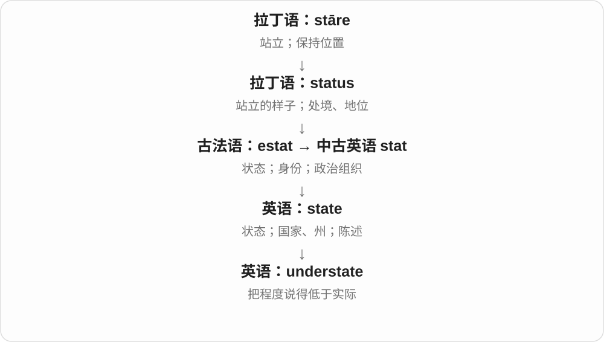
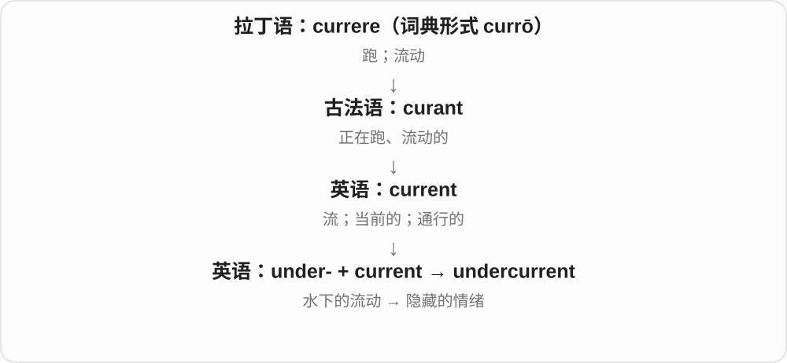
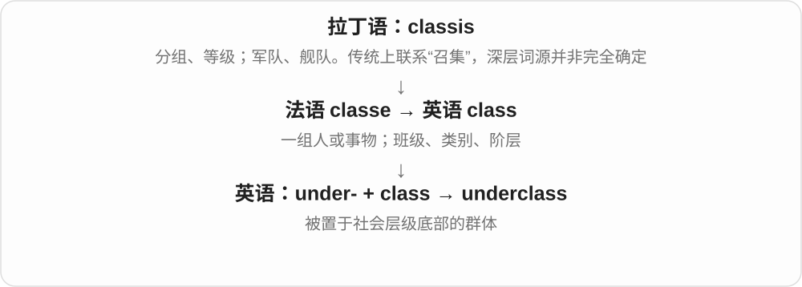
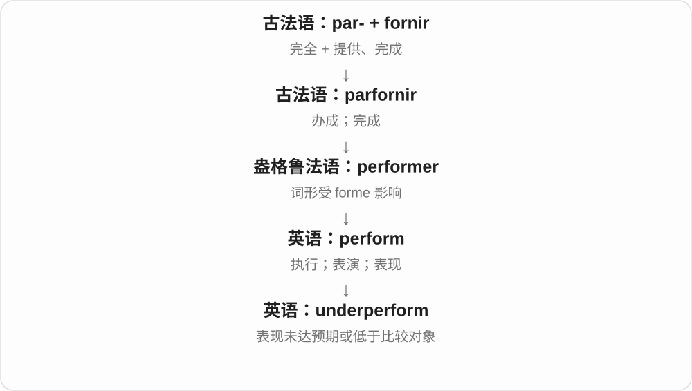
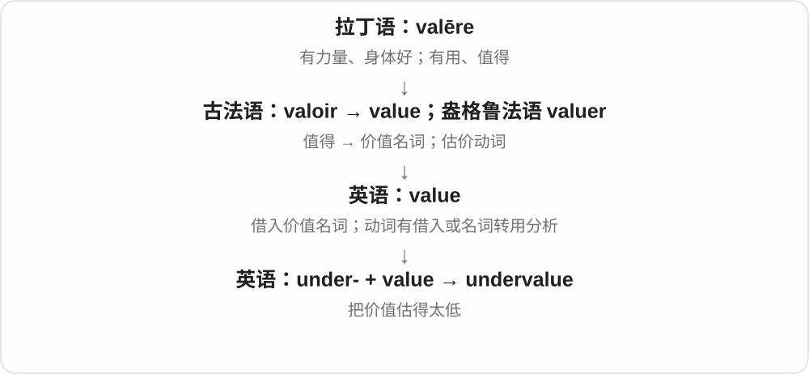

# 0142 · under- — 下方、里面一层；低于标准、数量或应有程度

[逐词精讲目录](../00_逐词精讲目录.md) · [总目录](../00_总目录_按常用程度.md)

## 核心词根与来源

别把 under- 都看成完全没有。understaffed 有员工但不够，underemployed 有工作却工时或技能利用不足，underrepresented 有代表但相对基准偏少。undermine 则保留从下方挖松支撑的画面，走向破坏信任、削弱基础。

**UNDER-：位置在下，或程度还没够**

underpants 穿在里面；underfunded 经费不够；underrated 评价偏低。一个在空间上低，一组把低移到数量、能力和评价。

- **位置、内外层与下方**：under · underneath · underpants · underwear · undergarment · underground · underwater
- **低估、轻描淡写与克制**：underrate · underrated · underestimate · underestimation · understate · understated · understatement
- **画线与构成基础**：underline · underlining · underlie · underlay
- **代表、服务、钱与人手不足**：underrepresented · underserved · underfunded · understaffed
- **利用、工作与动力不足**：underutilized · underemployed · underemployment · underpowered
- **保障、表现与研究不足**：underinsured · underperform · underperformance · understudied
- **林冠下方的一层**：understory · understorey
- **从下面削弱支撑**：undermine

## 词形与演化规律

延续古英语 under，现代可作独立介词、副词，也用于复合构词。空间义很早就引申到等级、控制、低于标准等。很多词直接接完整英语词基，但 understand、undertake 等旧复合词有更长历史，不能只用今天“在下面”强推所有义。understand 的 under- 究竟怎样与理解相连仍有争议，不把站在下面所以懂讲成定论。分词形容词 underfunded 等不要求先列一个少用动词；underlay 还需区分垫层名词、独立动词与 underlie 的过去式。

## 单词速览（按词族由简到繁）

同一基础词的相关扩展放在一起，先读基础形式，再读扩展；各组之间优先读常用的。具体词源关系见各词讲解。

| 单词 | 音标 | 核心意思 |
|---|---|---|
| [under](#w-78) | 英 /ˈʌndə/；美 /ˈʌndər/ | 在……下面；少于；在……之下、处于……中 |
| [underground](#w-2) | 形容词、副词 /ˌʌndəˈɡraʊnd/，美 /ˌʌndərˈɡraʊnd/；名词常 /ˈʌndəɡraʊnd/，美 /ˈʌndərɡraʊnd/ | 地下的、地；地铁；秘密的、非主流的 |
| [underwater](#w-5) | 英 /ˌʌndəˈwɔːtə/；美 /ˌʌndərˈwɔːtər/ | 在水下的；在水下 |
| [underway](#w-6) | 英 /ˌʌndəˈweɪ/；美 /ˌʌndərˈweɪ/ | 已经开始的；正在进行的 |
| [underage](#w-13) | 形容词 /ˌʌndərˈeɪdʒ/；名词英 /ˈʌndərɪdʒ/、美 /ˈʌndərɪdʒ/ | 未达到规定年龄的；短缺量〔名词〕 |
| [underrate](#w-69) | 英 /ˌʌndəˈreɪt/；美 /ˌʌndərˈreɪt/ | 低估；评价过低 |
| [underrated](#w-12) | 英 /ˌʌndəˈreɪtɪd/；美 /ˌʌndərˈreɪtɪd/ | 被低估的；未得到应有评价的 |
| [understand](#w-1) | 英 /ˌʌndəˈstænd/；美 /ˌʌndərˈstænd/ | 理解；懂；体谅；据悉、认为 |
| [understanding](#w-79) | 英 /ˌʌndəˈstændɪŋ/；美 /ˌʌndərˈstændɪŋ/ | 理解；体谅；共识、谅解；善解人意的 |
| [understood](#w-80) | 英 /ˌʌndəˈstʊd/；美 /ˌʌndərˈstʊd/ | 理解了；被理解的；默认的〔understand 的过去式、过去分词〕 |
| [underlie](#w-35) | 英 /ˌʌndəˈlaɪ/；美 /ˌʌndərˈlaɪ/ | 位于……下面；构成……基础；是背后原因 |
| [underlying](#w-81) | 英 /ˌʌndəˈlaɪɪŋ/；美 /ˌʌndərˈlaɪɪŋ/ | 潜在的；构成基础的；位于下面的 |
| [underlay](#w-61) | 名词英 /ˈʌndəleɪ/、美 /ˈʌndərleɪ/；动词常末重音 | 垫层；在……下面铺；也是 underlie 的过去式 |
| [underneath](#w-3) | 英 /ˌʌndəˈniːθ/；美 /ˌʌndərˈniːθ/ | 在……下面；在表面之下、内里 |
| [underwear](#w-4) | 英 /ˈʌndəweə/；美 /ˈʌndərwer/ | 内衣、贴身衣物 |
| [undergraduate](#w-7) | 英 /ˌʌndəˈɡrædʒuət/；美 /ˌʌndərˈɡrædʒuət/ | 本科生；本科阶段的 |
| [undergo](#w-8) | 英 /ˌʌndəˈɡəʊ/；美 /ˌʌndərˈɡoʊ/ | 经历；经受；接受某种过程 |
| [undertake](#w-9) | 英 /ˌʌndəˈteɪk/；美 /ˌʌndərˈteɪk/ | 承担；着手进行；承诺 |
| [underestimate](#w-10) | 动词 /ˌʌndərˈestɪmeɪt/；名词 /ˌʌndərˈestɪmət/ | 低估；估得过低的数值 |
| [underestimation](#w-68) | 英 /ˌʌndərestɪˈmeɪʃən/；美 /ˌʌndərestɪˈmeɪʃən/ | 低估；估计不足 |
| [undermine](#w-11) | 英 /ˌʌndəˈmaɪn/；美 /ˌʌndərˈmaɪn/ | 削弱；逐渐破坏；从下方挖空 |
| [underworld](#w-15) | 英 /ˈʌndəwɜːld/；美 /ˈʌndərwɜːrld/ | 冥界；犯罪社会 |
| [understate](#w-59) | 英 /ˌʌndəˈsteɪt/；美 /ˌʌndərˈsteɪt/ | 轻描淡写；少报、低估地陈述 |
| [understatement](#w-16) | 英 /ˌʌndəˈsteɪtmənt/；美 /ˌʌndərˈsteɪtmənt/ | 轻描淡写；保守、低于实际的说法 |
| [understated](#w-19) | 英 /ˌʌndəˈsteɪtɪd/；美 /ˌʌndərˈsteɪtɪd/ | 含蓄的；低调简约的；被轻描淡写的 |
| [underdog](#w-17) | 英 /ˈʌndədɒɡ/；美 /ˈʌndərdɔːɡ/ | 处于劣势者；不被看好的一方 |
| [underside](#w-18) | 英 /ˈʌndəsaɪd/；美 /ˈʌndərsaɪd/ | 底面；下侧 |
| [undercut](#w-20) | 英 /ˌʌndəˈkʌt/；美 /ˌʌndərˈkʌt/ | 以低价竞争；削弱；从下部切除；下层剃短发型 |
| [underline](#w-21) | 动词英 /ˌʌndəˈlaɪn/、美 /ˌʌndərˈlaɪn/；名词也常前重音 | 在……下画线；强调；下划线 |
| [underlining](#w-34) | 英 /ˌʌndəˈlaɪnɪŋ/；美 /ˌʌndərˈlaɪnɪŋ/ | 画下划线、强调；下划线标记 |
| [underscore](#w-22) | 名词：英 /ˈʌndəskɔː/、美 /ˈʌndərskɔːr/；动词常读：英 /ˌʌndəˈskɔː/、美 /ˌʌndərˈskɔːr/ | 强调、突出；在下方划线；下划线字符 _ |
| [underpants](#w-23) | 英 /ˈʌndəpænts/；美 /ˈʌndərpænts/ | 内裤 |
| [underprivileged](#w-24) | 英 /ˌʌndəˈprɪvəlɪdʒd/；美 /ˌʌndərˈprɪvəlɪdʒd/ | 处境不利的；缺少社会经济机会的 |
| [underrepresented](#w-25) | 英 /ˌʌndəreprɪˈzentɪd/；美 /ˌʌndərreprɪˈzentɪd/ | 代表不足的；占比低于相应基准的 |
| [undersea](#w-26) | 英 /ˈʌndəsiː/；美 /ˈʌndərsiː/ | 海底、海面下的 |
| [underpaid](#w-27) | 英 /ˌʌndəˈpeɪd/；美 /ˌʌndərˈpeɪd/ | 报酬过低的；支付不足的 |
| [underweight](#w-28) | 英 /ˌʌndəˈweɪt/；美 /ˌʌndərˈweɪt/ | 低于应有、规定重量的；体重不足的 |
| [underserved](#w-30) | 英 /ˌʌndəˈsɜːvd/；美 /ˌʌndərˈsɜːrvd/ | 服务不足的；未获充分服务的 |
| [understudy](#w-31) | 英 /ˈʌndəstʌdi/；美 /ˈʌndərstʌdi/ | 替补演员；学习某角色以备替演 |
| [understudied](#w-75) | 英 /ˌʌndəˈstʌdid/；美 /ˌʌndərˈstʌdid/ | 研究不足的；未得到充分研究的 |
| [underbelly](#w-32) | 英 /ˈʌndəˌbeli/；美 /ˈʌndərˌbeli/ | 腹下部、底面；隐藏的阴暗面、脆弱处 |
| [underfunded](#w-33) | 英 /ˌʌndəˈfʌndɪd/；美 /ˌʌndərˈfʌndɪd/ | 资金不足的；拨款不足的 |
| [undercurrent](#w-36) | 英 /ˈʌndəkʌrənt/；美 /ˈʌndərˌkɜːrənt/ | 暗流；表面之下的情绪或趋势 |
| [undergrowth](#w-37) | 英 /ˈʌndəɡrəʊθ/；美 /ˈʌndərɡroʊθ/ | 林下灌木、矮树与杂草 |
| [underpin](#w-38) | 英 /ˌʌndəˈpɪn/；美 /ˌʌndərˈpɪn/ | 从下面支撑、加固；构成……的基础 |
| [underfoot](#w-39) | 英 /ˌʌndəˈfʊt/；美 /ˌʌndərˈfʊt/ | 在脚下；碍手碍脚地 |
| [underclass](#w-40) | 英 /ˈʌndəklɑːs/；美 /ˈʌndərklæs/ | 社会最弱势、长期被排斥的群体 |
| [undertone](#w-42) | 英 /ˈʌndətəʊn/；美 /ˈʌndərtoʊn/ | 低声；潜在意味、暗含情绪；底色 |
| [undersized](#w-43) | 英 /ˌʌndəˈsaɪzd/；美 /ˌʌndərˈsaɪzd/ | 尺寸不足的；比通常、预期小的 |
| [understaffed](#w-44) | 英 /ˌʌndəˈstɑːft/；美 /ˌʌndərˈstæft/ | 人手不足的 |
| [underpass](#w-45) | 英 /ˈʌndəpɑːs/；美 /ˈʌndərpæs/ | 下穿通道；地下通道 |
| [underwrite](#w-47) | 英 /ˌʌndəˈraɪt/；美 /ˌʌndərˈraɪt/ | 承保；承销；资助、保证经费 |
| [undercarriage](#w-48) | 英 /ˈʌndəkærɪdʒ/；美 /ˈʌndərkærɪdʒ/ | 车辆底部支撑结构、底盘；飞机起落架 |
| [underutilized](#w-49) | 英 /ˌʌndəˈjuːtəlaɪzd/；美 /ˌʌndərˈjuːtəlaɪzd/ | 未充分利用的 |
| [underhanded](#w-50) | 英 /ˌʌndəˈhændɪd/；美 /ˌʌndərˈhændɪd/ | 暗中耍手段的、不光彩的；下手式投掷的〔另义〕 |
| [underemployed](#w-52) | 英 /ˌʌndərɪmˈplɔɪd/；美 /ˌʌndərɪmˈplɔɪd/ | 就业不足的；工时、技能利用不足的 |
| [undertow](#w-53) | 英 /ˈʌndətəʊ/；美 /ˈʌndərtoʊ/ | 近岸波浪回流、底层回流水；暗流、潜在情绪 |
| [underarm](#w-54) | 英 /ˈʌndərɑːm/；美 /ˈʌndərɑːrm/ | 腋下；腋下用的；低手投掷的 |
| [underpowered](#w-55) | 英 /ˌʌndəˈpaʊəd/；美 /ˌʌndərˈpaʊərd/ | 动力不足的；能力、性能不足的 |
| [underperform](#w-56) | 英 /ˌʌndəpəˈfɔːm/；美 /ˌʌndərpərˈfɔːrm/ | 表现低于预期；表现不佳 |
| [underperformance](#w-72) | 英 /ˌʌndəpəˈfɔːməns/；美 /ˌʌndərpərˈfɔːrməns/ | 表现不及预期；表现低于相应标准 |
| [undervalue](#w-57) | 英 /ˌʌndəˈvæljuː/；美 /ˌʌndərˈvæljuː/ | 低估价值；不够重视 |
| [underemployment](#w-58) | 英 /ˌʌndərɪmˈplɔɪmənt/；美 /ˌʌndərɪmˈplɔɪmənt/ | 就业不足、未充分就业 |
| [undernourished](#w-60) | 英 /ˌʌndəˈnʌrɪʃt/；美 /ˌʌndərˈnɜːrɪʃt/ | 营养不足的 |
| [undershirt](#w-62) | 英 /ˈʌndəʃɜːt/；美 /ˈʌndərʃɜːrt/ | 汗衫、内穿上衣 |
| [understory](#w-63) | 英 /ˈʌndəstɔːri/；美 /ˈʌndərstɔːri/ | 林下层；林冠下的植被层〔常见美式拼写〕 |
| [understorey](#w-82) | 英 /ˈʌndəstɔːri/；美 /ˈʌndərstɔːri/ | 林下层；林冠下的植被层〔常见英式拼写〕 |
| [underwire](#w-64) | 英 /ˈʌndəwaɪə/；美 /ˈʌndərwaɪər/ | 胸罩下托钢圈、支撑弧条；带下托的 |
| [underdevelopment](#w-65) | 英 /ˌʌndədɪˈveləpmənt/；美 /ˌʌndərdɪˈveləpmənt/ | 发展不足；欠发达状态 |
| [underfloor](#w-66) | 英 /ˈʌndəflɔː/；美 /ˈʌndərflɔːr/ | 地板下的 |
| [underbrush](#w-67) | 英 /ˈʌndəbrʌʃ/；美 /ˈʌndərbrʌʃ/ | 林下灌丛、矮生植被 |
| [underinsured](#w-71) | 英 /ˌʌndərɪnˈʃʊəd/；美 /ˌʌndərɪnˈʃʊrd/ | 保险保障不足的 |
| [undercoat](#w-73) | 英 /ˈʌndəkəʊt/；美 /ˈʌndərˌkoʊt/ | 动物的底绒毛；面漆下面的底涂层；涂底层 |
| [undergarment](#w-74) | 英 /ˈʌndəɡɑːmənt/；美 /ˈʌndərɡɑːrmənt/ | 内衣；贴身穿在外衣里面的衣物 |
| [underachiever](#w-76) | 英 /ˌʌndərəˈtʃiːvə/；美 /ˌʌndərəˈtʃiːvər/ | 表现未达预期的人 |
| [underpayment](#w-77) | 英 /ˌʌndəˈpeɪmənt/；美 /ˌʌndərˈpeɪmənt/ | 少付、支付不足；少付金额 |

## 逐词讲解

### 1. under — 在……下面；少于；在……之下、处于……中

**音标**：英 /ˈʌndə/；美 /ˈʌndər/

**先抓住这个画面**

杯子在桌下，是空间低于它；年龄 under eighteen，是数值低于十八；under pressure 是压力压在身上。几个常用义都能从相对位置、条件理解。

**怎么拆**

延续古英语 under 的日耳曼语材料，历史上已可作介词、副词，也参与复合构词。现代当独立词与当前缀的用法相关，不等于每个旧复合词都能按今天字面猜全。

**怎么变成今天的意思**

**古英语 under → 中古英语 under**  
在下面；居于较低位置、等级等

↓

**现代 under、under-**  
下方；低于数值；受某种影响、管理或处于某种过程

under the table 桌下；under ten 少于十；under pressure 承受压力；under construction 正在施工；under someone’s care 由某人照管。

**常见搭配与例句**

under the bed；under pressure；under construction。

> The cat was sleeping under the table.

猫睡在桌子下面。

> The bridge is still under construction.

这座桥仍在施工。

**别混淆**

under 不要求正好垂直在下；below 也能说较低位置，但 under the bridge 常带桥覆盖在上方的关系。价格 under ten 也只是少于十。

### 2. underground — 地下的、地；地铁；秘密的、非主流的

**音标**：形容词、副词 /ˌʌndəˈɡraʊnd/，美 /ˌʌndərˈɡraʊnd/；名词常 /ˈʌndəɡraʊnd/，美 /ˈʌndərɡraʊnd/

**先抓住这个画面**

字面是地表下面；看不见、公开渠道之外的活动，也会被借说成地下。

**怎么拆**

under 在下面 + ground 地面，早期已有相关组合。后来用于地下交通、秘密组织、非主流文化等不同场景。

**怎么变成今天的意思**

**under 在下面；ground 地面**  
并列构词部分

↓

**underground**  
地表之下 → 地下交通；秘密或非主流活动

an underground car park 地下停车场；travel by underground 坐地铁，英式常见。underground music 地下音乐通常指主流商业渠道之外，不自动表示违法。

**常见搭配与例句**

underground tunnels；go underground；underground music；the Underground。

> The cables run underground beneath the road.

电缆埋在道路下方。

> The club became known for its underground music scene.

这家俱乐部因其非主流音乐圈而闻名。

**别混淆**

underground 秘密、地下与 illegal 违法不同；一条地下管线合法，一种非主流文化也可能完全公开。

### 3. underwater — 在水下的；在水下

**音标**：英 /ˌʌndəˈwɔːtə/；美 /ˌʌndərˈwɔːtər/

**先抓住这个画面**

镜头越过水面，进入水里面，而不只是站在水边。

**怎么拆**

under + water，组合表示水面以下；可作形容词或副词。

**怎么变成今天的意思**

**under；water**  
并列组合部分

↓

**underwater**  
位于或进入水面以下

underwater photography 是水下摄影，swim underwater 是在水下游。金融报道中另可比喻资产值低于相关债务等状态，初学先抓水下画面。

**常见搭配与例句**

underwater photography；an underwater camera；swim underwater。

> The camera can take pictures underwater.

这台相机可以在水下拍照。

> The film includes stunning underwater scenes.

影片包含惊艳的水下画面。

**别混淆**

underwater 在水下，waterfront 在滨水地带；海边拍照不等于 underwater photography。

### 4. underway — 已经开始的；正在进行的

**音标**：英 /ˌʌndəˈweɪ/；美 /ˌʌndərˈweɪ/

**先抓住这个画面**

船已经离开原先固定停泊的状态；后来计划也像启程一样运转起来。

**怎么拆**

对应 under + way，形成受到荷兰语 onderweg 等用法的影响；常由航行状态扩展为进行中。under 不能死译成道路下面。

**怎么变成今天的意思**

**under + way；与荷兰语 onderweg 的用法相关**  
在途中、已起程的表达

↓

**英语 underway**  
航行状态；工作等正在进行

The repairs are underway 是维修已开始。get underway 是启动、展开。航海里的 underway 有专门界定，不等于船此刻一定在相对地面前进；日常无需靠这一术语推断船速。

**常见搭配与例句**

be underway；get underway；well underway。

> Preparations for the festival are already underway.

节日的准备工作已经开始了。

> The meeting got underway shortly after nine.

会议九点刚过就开始了。

**别混淆**

underway 说事情进行着，on the way 常说人或物在途中。We are on the way 与 The investigation is underway 的主语类型不同。

### 5. underage — 未达到规定年龄的；短缺量〔名词〕

**音标**：形容词 /ˌʌndərˈeɪdʒ/；名词英 /ˈʌndərɪdʒ/、美 /ˈʌndərɪdʒ/

**先抓住这个画面**

常用义是在年龄门槛下面；另一个名词却是在说数量不够。

**怎么拆**

形容词是 under- + age“年龄”；少见名词是 under + 名词后缀 -age，属于另一种构词，不能共用年龄解释。

**怎么变成今天的意思**

**拉丁 aevum；相关的 aetās、aetāt-**  
一生、时代；年龄

↓

**通俗拉丁 \*aetāticum〔重建形式〕 → 古法语 aage / eage**  
年龄、生命阶段

↓

**中古英语及现代英语 age**  
年龄；时代；变老或熟成

↓

**英语 under- + age → underage〔形容词〕**  
年龄未到规定门槛

↓

**另一路：under + 后缀 -age → underage〔名词〕**  
短缺额；不接 age“年龄”

underage 通常相对于某项活动的年龄规定，并不处处等于同一个岁数。账目或存货中的 an underage 则是短缺额，读音也变了。

**常见搭配与例句**

underage participants；underage drinking；an inventory underage〔专业〕。

> The club checked identification to keep underage applicants out of the adult competition.

俱乐部核验身份证明，防止未达到年龄要求的报名者参加成人比赛。

> The audit revealed an underage in the cash drawer.

审计发现收银抽屉里的现金有短缺。

**别混淆**

underage 与 overage 的年龄义相对；名词 underage 与 shortage 接近，要靠语境和读音分开。

### 6. underrate — 低估；评价过低

**音标**：英 /ˌʌndəˈreɪt/；美 /ˌʌndərˈreɪt/

**先抓住这个画面**

实际本事、价值比给出的评价更高，是你把它看低了。

**怎么拆**

under- 低于应有程度 + rate 评价。不是只说某物费用便宜，重点是判断低估。

**怎么变成今天的意思**

**拉丁 rata 规定、核定的部分 → 法语、英语 rate**  
固定份额、数值 → 比率、价格、评估

↓

**现代 rate**  
单位数量的量、频率；评价高低

↓

**under- + rate → underrate**  
给出过低评价 → 低估

underrate someone’s ability 低估能力，an underrated film 被低估的电影；常见分词 underrated。

**常见搭配与例句**

underrate ability；an underrated film；underrate the importance of。

> Do not underrate the importance of a clear plan.

不要低估清晰计划的重要性。

> Many critics initially underrated the film.

许多评论者起初低估了这部电影。

**别混淆**

underrate 低估，overrate 高估；underpay 是少付钱，不能只因都带 under 互换。

### 7. underrated — 被低估的；未得到应有评价的

**音标**：英 /ˌʌndəˈreɪtɪd/；美 /ˌʌndərˈreɪtɪd/

**先抓住这个画面**

实际很有本事、作品很好，得到的评价却没那么高，就是 underrated；这通常是说话者在替它抬一抬评价。

**怎么拆**

underrate + -ed，或从 under- 低于应有程度与 rated 评价过的材料看；-ed 形容词说被低估的状态，不自动让整个句子变过去时。

**怎么变成今天的意思**

**under- + rate → underrate**  
评价低于应有水平

↓

**underrate + -ed → underrated**  
被低估、评价不足的

an underrated actor 被低估的演员；an underrated skill 没得到充分重视的技能。

**常见搭配与例句**

seriously underrated；an underrated talent。

> She is an underrated writer with a distinctive voice.

她是位被低估的作家，有独特的表达。

> Good documentation is an underrated part of software work.

好的文档是软件工作中常被低估的一部分。

**别混淆**

underrated 是评价低于应有；unknown 是不知名。有人很出名，仍可能在某方面被低估。

### 8. understand — 理解；懂；体谅；据悉、认为

**音标**：英 /ˌʌndəˈstænd/；美 /ˌʌndərˈstænd/

**先抓住这个画面**

不是只听见一句话，而是知道对方究竟在说什么、为何这样说。

**怎么拆**

接古英语 understandan、中古英语 understanden，可辨 under- 与 stand 的历史构成；但从站立怎样发展到理解，具体解释仍有争议。“站在下面所以理解”不是已证实词源。

**怎么变成今天的意思**

**古英语 understandan → 中古英语 understanden**  
已经表示理解、领会；更早语义桥梁有争议

↓

**英语 understand**  
懂含义、明白处境、据悉

understand the instructions 是懂说明，understand how someone feels 是体谅感受；I understand that ... 还可引出据我所知。过去式、过去分词 understood。

**常见搭配与例句**

understand why；understand how；make oneself understood；as I understand it。

> I understand the words, but not the joke.

这些词我都懂，可没听懂笑话。

> Thank you for understanding why I needed more time.

谢谢你理解我为什么需要更多时间。

**别混淆**

know 可以是知道事实，understand 更强调领会意义、原因或处境。构词联想可以辅助记忆，但对这个词不能把猜测画成确定的历史因果。

### 9. understanding — 理解；体谅；共识、谅解；善解人意的

**音标**：英 /ˌʌndəˈstændɪŋ/；美 /ˌʌndərˈstændɪŋ/

**先抓住这个画面**

不只听到了，还懂了意思；懂到对方为什么这样做，就容易多一层体谅。

**怎么拆**

understand + -ing；古英语有 understanding 等理解名词与相应分词，中古英语延续。不能因为表面有 under、stand 就编成站在下面所以体谅。

**怎么变成今天的意思**

**古英语 understandan → 中古英语 understanden**  
已表示理解、领会；更早语义桥梁有争议

↓

**英语 understand**  
理解含义、处境；领会

↓

**understand + -ing；古英语相应形式延续**  
理解、共识；体谅人的性质

an understanding of a subject 对学科的理解，reach an understanding 达成谅解，an understanding teacher 体谅人的老师。名词、形容词各有场景。

**常见搭配与例句**

an understanding of；reach an understanding；a mutual understanding；an understanding teacher。

> The course gave me a better understanding of the subject.

课程让我更懂这门学科。

> My manager was very understanding when I explained the delay.

我解释延误原因时，经理很体谅。

**别混淆**

understanding 懂、体谅；agreement 同意、协议。能理解对方不等于认同对方的所有做法。

### 10. understood — 理解了；被理解的；默认的〔understand 的过去式、过去分词〕

**音标**：英 /ˌʌndəˈstʊd/；美 /ˌʌndərˈstʊd/

**先抓住这个画面**

别人解释完，你明白了，是 understood；一项规则没人明说，大家却心照不宣，也可说 understood。

**怎么拆**

understand 的不规则变位：understand → understood → understood，延续 stand／stood 一组历史变化。不是完整 understand 后面加 -ed。

**怎么变成今天的意思**

**古英语 understandan 等 → understand**  
理解；更早语义桥梁仍有争议

↓

**understand → understood**  
过去式、过去分词；另有默认、心照不宣的形容词用法

I understood 我明白了；widely understood 被广泛理解；an understood rule 心照不宣的规则；Understood? 明白了吗？

**常见搭配与例句**

widely understood；an understood agreement。

> I understood the explanation after seeing the example.

看了例子后，我明白了这个解释。

> There was an understood rule that phones stayed off during dinner.

大家心照不宣，吃晚饭时不看手机。

**别混淆**

understood 可作过去式，也可在被动、完成结构里作分词；understanding 还可以是理解、体谅的名词或形容词。

### 11. underlie — 位于……下面；构成……基础；是背后原因

**音标**：英 /ˌʌndəˈlaɪ/；美 /ˌʌndərˈlaɪ/

**先抓住这个画面**

看得见的事情下面，还有看不见的结构、假设或原因在撑着它。

**怎么拆**

古英语 underliċġan 等旧组合延续，under- 下面 + lie 位于、躺。接位置那条 lie，不接说谎；变化 underlay、underlain。

**怎么变成今天的意思**

**古英语 liċġan → 中古英语 liggen、lien → lie〔躺、位于〕**  
身体横放、处于某位置；lie—lay—lain

↓

**古英语 underliċġan → underlie**  
处在下面 → 作为基础、背后因素

assumptions that underlie a theory 理论的基础假设，factors that underlie a problem 问题背后的因素。

**常见搭配与例句**

underlie a theory；underlie a problem；assumptions that underlie。

> Several assumptions underlie the model.

这个模型以几个假设为基础。

> A lack of trust underlies much of the conflict.

很多冲突背后的原因是缺乏信任。

**别混淆**

underlie 原因、基础在下方支撑，understand 理解是另一个词；A underlies B 是 A 构成 B 基础，主客体别反过来。

### 12. underlying — 潜在的；构成基础的；位于下面的

**音标**：英 /ˌʌndəˈlaɪɪŋ/；美 /ˌʌndərˈlaɪɪŋ/

**先抓住这个画面**

表面看到的是一个症状、一次争执，下面真正支撑它、造成它的因素，可以说 underlying。像掀开表层，去找底下那一层。

**怎么拆**

underlie 的 lie 加 -ing 时变为 lying → underlying；它来自位于下方、构成基础的动词，不是 underline 画下划线的变化。

**怎么变成今天的意思**

**under- + lie → underlie**  
位于下面；构成基础

↓

**underlie + -ing → underlying**  
正在构成基础；作为形容词说底层、潜在

an underlying cause 深层原因；underlying assumptions 基础假设；underlying data 底层数据。

**常见搭配与例句**

an underlying problem；an underlying assumption。

> We need to identify the underlying cause of the delay.

我们需要找出延误的深层原因。

> The model depends on several underlying assumptions.

模型依赖几个基础假设。

**别混淆**

underlying 潜在、构成基础，underlining 则是画线、强调。lie → lying，line → lining，把这组拼写看清。

### 13. underlay — 垫层；在……下面铺；也是 underlie 的过去式

**音标**：名词英 /ˈʌndəleɪ/、美 /ˈʌndərleɪ/；动词常末重音

**先抓住这个画面**

地毯下面铺一层垫材，名词叫 underlay；动词可说在下面垫。另一条语法线里 underlay 还是 underlie 的过去式，意思要看句子。

**怎么拆**

独立的 underlay 接 under- + lay 放、铺，古英语已有相应材料；underlie → underlay 则是 lie 的 lay 过去式变化。两条关系不能混成所有 underlay 都是同一词性。

**怎么变成今天的意思**

**古英语 underlecgan 等 → underlay**  
在下面放、垫、铺；相应垫层名词

↓

**underlie → underlay → underlain**  
位于底层、构成基础的动词变位；与上一行区分

carpet underlay 地毯垫层；the causes that underlay the conflict 是冲突背后的原因，underlay 为过去式。

**常见搭配与例句**

carpet underlay；underlay the floor。

> We replaced the worn carpet underlay.

我们更换了磨损的地毯垫层。

> Several disagreements underlay the conflict.

几处分歧构成了这场冲突的根源。

**别混淆**

underlay 名词可指垫层；underlay 作 underlie 过去式时，不能简单按铺地毯解释。underlie 的过去分词是 underlain。

### 14. underneath — 在……下面；在表面之下、内里

**音标**：英 /ˌʌndəˈniːθ/；美 /ˌʌndərˈniːθ/

**先抓住这个画面**

把毯子掀起来，东西就在下面，underneath 常把被覆盖、藏在底下的画面说得更清楚；人的表面态度之下，也可有另一种感受。

**怎么拆**

延续古英语 underneothan、中古英语相应形式，历史含 under 与下方相关的 neath 材料；neath 今天很少单独日常使用。

**怎么变成今天的意思**

**古英语 underneoþan → 中古英语 undernethe 等**  
在下面

↓

**现代 underneath**  
下面；内里、表面之下

underneath the blanket 毯子下面；underneath it all 在这一切的表面之下；单独作副词也可用。

**常见搭配与例句**

underneath the surface；hidden underneath。

> The key was hidden underneath a flowerpot.

钥匙藏在花盆底下。

> Underneath his calm manner, he was worried.

他表面镇定，心里却很担忧。

**别混淆**

underneath 比 under 常更有覆盖、底下的画面；under eighteen 年龄少于十八，不能机械换成 underneath eighteen。

### 15. underwear — 内衣、贴身衣物

**音标**：英 /ˈʌndəweə/；美 /ˈʌndərwer/

**先抓住这个画面**

穿在外层衣服里面、贴近身体的衣物，统称 underwear。范围常包括内裤、文胸、背心等，不只一种单件衣服。

**怎么拆**

under- 在下面、里面 + wear 穿着物类别，按穿着层次命名。现代通常作不可数集合名词。

**怎么变成今天的意思**

**古英语 werian 等 → wear**  
穿、戴

↓

**wear 作复合词后部**  
按位置、材料、用途、人群命名穿戴物类别

↓

**underwear、knitwear**  
内层穿的衣物；针织衣物

clean underwear 干净内衣，a change of underwear 一套替换内衣，thermal underwear 保暖内衣。

**常见搭配与例句**

clean underwear；a change of underwear；thermal underwear。

> She packed a change of underwear for the trip.

她为旅行装了一套替换内衣。

> Thermal underwear kept him warm on the cold morning.

寒冷的早晨，保暖内衣让他暖和。

**别混淆**

通常不说 an underwear；可说 a piece of underwear，或用具体衣物名。underwear 与 outerwear 按内外层对照。

### 16. undergraduate — 本科生；本科阶段的

**音标**：英 /ˌʌndəˈɡrædʒuət/；美 /ˌʌndərˈɡrædʒuət/

**先抓住这个画面**

正在走向第一个大学学位，还没有跨过毕业那一级。

**怎么拆**

under-“尚未达到相应等级” + graduate；这里 under 不是说人在毕业生身体下面。

**怎么变成今天的意思**

**拉丁 gradus；gradī / gradior**  
一步、台阶、等级；走、迈步

↓

**中古拉丁 graduāre → graduātus → 中古英语 graduat**  
授予学位 → 已获学位的

↓

**中古英语 graduat；由此形成动词 graduaten → 英语 graduate**  
毕业生；毕业、授予学位、分刻度

↓

**英语 under- + graduate → undergraduate**  
尚在攻读首个本科学位的人；本科阶段的

可作名词也可作形容词，常说 undergraduate student/course/degree。结尾读 /uət/，不用动词 graduate 的 /ueɪt/。

**常见搭配与例句**

an undergraduate student；undergraduate study；an undergraduate degree。

> She is an undergraduate studying chemistry.

她是一名学习化学的本科生。

> The department offers three undergraduate courses this term.

系里本学期开设三门本科课程。

**别混淆**

postgraduate 位于首个学位之后；undergraduate 通常指取得该学位之前的学习阶段。

### 17. undergo — 经历；经受；接受某种过程

**音标**：英 /ˌʌndəˈɡəʊ/；美 /ˌʌndərˈɡoʊ/

**先抓住这个画面**

让自己走过一段过程，变化或作用发生在自己身上。

**怎么拆**

来自古英语 undergan，早期已有取得、承担等义，后来用于承受、经历。可辨认 under- 与 go 的旧成分，但不能把未经证实的“走到物体下面”当成确定原义。

**怎么变成今天的意思**

**古英语 undergan**  
取得、承担

↓

**中古英语 undergon**  
承受、经受

↓

**现代 undergo**  
经历某个过程或变化

undergo training 是接受培训；undergo changes 是发生变化；undergo surgery 是接受手术。主语往往是过程的承受者，不是操作它的人。它比日常的 have 或 go through 更正式。

**常见搭配与例句**

undergo–underwent–undergone；undergo training；undergo a transformation。

> All new employees undergo safety training.

所有新员工都要接受安全培训。

> The building has undergone several major changes.

这栋楼经历过几次重大改造。

**别混淆**

医生 perform surgery，患者 undergo surgery。undergo 不一定是痛苦过程，也可用于培训、评估、技术改造。

### 18. undertake — 承担；着手进行；承诺

**音标**：英 /ˌʌndəˈteɪk/；美 /ˌʌndərˈteɪk/

**先抓住这个画面**

把一项事情接到自己肩上，答应负责去做。

**怎么拆**

中古英语 under + take 的组合已有多种用法，后来稳定用于着手、承担。under- 的确切早期作用不完全透明，不把“从下面拿住”当作唯一确定来源。

**怎么变成今天的意思**

**中古英语 under；take**  
旧前缀；拿取

↓

**中古英语 undertaken 的着手、承担义**  
接下一项事情

↓

**现代 undertake**  
承担工作；承诺做某事

undertake a study 是开展研究；undertake to pay 是承诺付款。前者说负责做一件事，后者明确承诺将做。语气比 take on 或 promise 更正式。

**常见搭配与例句**

undertake–undertook–undertaken；undertake a project；undertake to do something。

> The team will undertake a detailed study of the site.

团队将对现场开展详细研究。

> The company undertook to repair the damage.

公司承诺修复损坏。

**别混淆**

undertake 常表示负责执行，undergo 表示经历、承受。团队 undertake an inspection，设备 undergo an inspection。

### 19. underestimate — 低估；估得过低的数值

**音标**：动词 /ˌʌndərˈestɪmeɪt/；名词 /ˌʌndərˈestɪmət/

**先抓住这个画面**

心里把所需时间放得太少，或把对手的实力看得太低，最后实际情况超过了预期。

**怎么拆**

under- 低于应有程度 + estimate。不是单说在下方估算，而是估得低了；名词、动词保留 estimate 的词尾读音区别。

**怎么变成今天的意思**

**拉丁 aestimāre / aestimātus**  
估价、判断价值及其相应形式

↓

**英语 estimate；法语 estimacion → estimation**  
估算、评估；过程、结果、评价

↓

**under- + estimate → underestimate**  
数值、能力、困难等估得偏低

underestimate the cost 低估成本，underestimate the difficulty 低估困难，never underestimate someone 别小看某人，an underestimate of demand 需求的偏低估计。

**常见搭配与例句**

underestimate the cost；underestimate the difficulty；an underestimate of。

> We underestimated how long the work would take.

我们低估了完成这项工作需要的时间。

> Do not underestimate her ability to solve the problem.

不要低估她解决这个问题的能力。

**别混淆**

低估成本可能太乐观，低估对手也可能太轻敌；underestimate 只说判断偏低，不能固定译成看不起。

### 20. underestimation — 低估；估计不足

**音标**：英 /ˌʌndərestɪˈmeɪʃən/；美 /ˌʌndərestɪˈmeɪʃən/

**先抓住这个画面**

本来要十天，你估成三天；对手本来很强，你却看得很弱，这种估得偏低叫 underestimation。

**怎么拆**

对应 underestimate 与 -ation，或 under- + estimation；先看估计低于实际的方向，不是所有数字都少一点的机械规则。

**怎么变成今天的意思**

**under- + estimate → underestimate**  
对数量、难度、能力等估得偏低

↓

**underestimation**  
低估这一判断、过程

an underestimation of the cost 对成本的低估；a serious underestimation 严重低估。

**常见搭配与例句**

an underestimation of；cost underestimation。

> The delay resulted from an underestimation of the work involved.

延误源于低估了所需工作量。

> The plan reflected a serious underestimation of demand.

计划显示对需求有严重低估。

**别混淆**

underestimation 是估得低；understatement 是说得轻。有人心里估得很准，也可能为了语气克制而说得轻。

### 21. undermine — 削弱；逐渐破坏；从下方挖空

**音标**：英 /ˌʌndəˈmaɪn/；美 /ˌʌndərˈmaɪn/

**先抓住这个画面**

墙表面还站着，底下却被挖松了；信任、权威也可能这样一点点失去支撑，这就是 undermine 的核心画面。

**怎么拆**

under- 在下面 + mine 挖、开掘；从挖空基础的动作发展到削弱信心、信誉、稳定等抽象义。

**怎么变成今天的意思**

**under- + mine**  
从下方挖掘、挖空

↓

**undermine**  
使根基不稳；引申为削弱、破坏

undermine confidence 削弱信心；undermine trust 破坏信任；undermine an argument 削弱论证。

**常见搭配与例句**

undermine confidence；undermine trust。

> Repeated delays undermined public confidence in the project.

一再延误削弱了公众对项目的信心。

> The new evidence undermined his argument.

新证据削弱了他的论证。

**别混淆**

undermine 常是削弱支撑，不要求一下彻底毁掉；destroy 强调毁坏更完整。mine 在这里不是我的这一代词义。

### 22. underworld — 冥界；犯罪社会

**音标**：英 /ˈʌndəwɜːld/；美 /ˈʌndərwɜːrld/

**先抓住这个画面**

在日常可见秩序下面，还被想象或比喻存在另一套世界。

**怎么拆**

under-（在下）+ world（世界），神话里常说死者世界，后来也说隐秘犯罪圈子；不把现代犯罪群体说成真住在地下。

**怎么变成今天的意思**

**英语 under-；world**  
并列组合的材料

↓

**under- + world → underworld**  
下方世界；冥界或隐秘犯罪圈

the criminal underworld 是犯罪社会；the Greek underworld 是希腊神话冥界。两种义项需由主题定位。

**常见搭配与例句**

the criminal underworld；the underworld of myth；an underworld figure。

> The myth describes a journey to the underworld.

神话描写了一次冥界之旅。

> The novel explores the city’s criminal underworld.

小说探究城市的犯罪社会。

**别混淆**

underworld 不等于 underground 的所有用法，underground station 是地铁站，不是犯罪社会的车站。

### 23. understate — 轻描淡写；少报、低估地陈述

**音标**：英 /ˌʌndəˈsteɪt/；美 /ˌʌndərˈsteɪt/

**先抓住这个画面**

事情很严重，却只说“有点麻烦”；把实际程度往小里说，就是 understate。

**怎么拆**

under-（低于）+ state（陈述）。

**怎么变成今天的意思**

它可以是委婉风格，也可以使记录低于实际数量。词本身描述表达效果，是否故意要看语境。

**常见搭配与例句**

understate the problem；understate the cost；an understated description。

> Calling the repair difficult would understate the problem.

只说修理起来困难，还是把问题说轻了。

> The initial estimate understated the total cost.

最初的估算把总成本报低了。

**别混淆**

underestimate 是估计偏低；understate 是说出来或记录的程度偏低。心里知道很严重也可能故意轻描淡写。

### 24. understatement — 轻描淡写；保守、低于实际的说法

**音标**：英 /ˌʌndəˈsteɪtmənt/；美 /ˌʌndərˈsteɪtmənt/

**先抓住这个画面**

已经累得站不住，却说有点累；说出口的分量比真实情况轻。

**怎么拆**

可按 under- 不足 + statement 分析，也对应 understate + -ment。它既可指修辞上的有意说轻，也可指实际陈述不足，不能一律当故意撒谎。

**怎么变成今天的意思**

**state〔陈述〕+ -ment → statement**  
把事情说出来的陈述、说法

↓

**under-/over-/re- 与 statement 组合**  
说轻、说过头、重新表达

↓

**under- + statement → understatement**  
说得低于实际；轻描淡写

To say I was tired would be an understatement. 说我累了都算轻的。常用 understatement 强调实际程度远超那个形容词。

**常见搭配与例句**

a huge understatement；a masterpiece of understatement；would be an understatement。

> Calling the journey difficult would be an understatement.

说这趟旅程艰难，都算轻描淡写。

> Her calm description was a remarkable piece of understatement.

她平静的描述把事情说得格外轻。

**别混淆**

understatement 说轻；overstatement 说过头。underestimate 是估计偏低，未必已经向别人作了陈述。

### 25. understated — 含蓄的；低调简约的；被轻描淡写的

**音标**：英 /ˌʌndəˈsteɪtɪd/；美 /ˌʌndərˈsteɪtɪd/

**先抓住这个画面**

不大喊、不堆装饰，轻轻一点就有味道，这种设计、表达常被赞 understated。也可字面说某个数字、影响被说小了。

**怎么拆**

understate + -ed；understate 是说得比实际轻，分词形容词又发展出克制、低调的风格义。

**怎么变成今天的意思**

**under- + state → understate**  
少说、轻描淡写

↓

**understated**  
被说轻；引申为表达、风格含蓄克制

understated elegance 含蓄的优雅；an understated performance 克制的表演；an understated cost 被少报的成本。

**常见搭配与例句**

understated elegance；an understated style。

> The room has an understated elegance.

房间有一种含蓄的优雅。

> Her understated performance made the scene more moving.

她克制的表演让这一幕更动人。

**别混淆**

understated 风格低调，不一定被 underrated 评价低；一件低调作品也能广受赞赏。

### 26. underdog — 处于劣势者；不被看好的一方

**音标**：英 /ˈʌndədɒɡ/；美 /ˈʌndərdɔːɡ/

**先抓住这个画面**

赛前大家认为它赢面小，处在弱势；但不意味着最后一定输。

**怎么拆**

under 在下、居劣势 + dog，历史有争斗中处下风的狗的表达，后用于竞争中的弱势一方。不要把流行锯木工故事当定论。

**怎么变成今天的意思**

**古英语 docga、dogga → 中古英语 dogge → dog**  
狗；更远来源不明

↓

**现代 dog 词族**  
犬种、用途；追逐、纠缠与坚持等联想

↓

**under + dog → underdog**  
处下风的一方 → 弱势竞争者

root for the underdog 支持弱势方，the underdog in the final 决赛中不被看好的选手或队伍。

**常见搭配与例句**

root for the underdog；start as the underdog；an underdog victory。

> The team entered the final as the underdog.

球队以不被看好的弱势方身份进入决赛。

> Many fans love an underdog victory.

许多球迷喜欢看弱队逆袭取胜。

**别混淆**

underdog 指预期、处境较弱，loser 指输了或带贬意的失败者；弱势方也能获胜。

### 27. underside — 底面；下侧

**音标**：英 /ˈʌndəsaɪd/；美 /ˈʌndərsaɪd/

**先抓住这个画面**

把桌子、叶子或物件翻过来，朝下的那一面露出来。

**怎么拆**

under-（在下）+ side（面），直接限定下侧位置。

**怎么变成今天的意思**

**英语 under-；side**  
并列组合的两个材料

↓

**under- + side → underside**  
朝下或较低的一面

the underside of a leaf 是叶背，the underside of a bridge 是桥底面。也可比喻不易看见的阴暗一面，但先看作者是否真的在比喻。

**常见搭配与例句**

on the underside；the underside of；the pale underside。

> The label is on the underside of the box.

标签在盒子底面。

> The insect hid on the underside of a leaf.

昆虫藏在叶子背面。

**别混淆**

underside 是下侧，inside 是内部；物体下方的一面可能仍是外表面。

### 28. undercut — 以低价竞争；削弱；从下部切除；下层剃短发型

**音标**：英 /ˌʌndəˈkʌt/；美 /ˌʌndərˈkʌt/

**先抓住这个画面**

从下面挖去支撑，可以让东西站不稳；报价低于别人，也像从价格下面切进去。

**怎么拆**

under- 在下、低于 + cut。切削、削弱和低价竞争形成不同固定用法；名词发型常重读前部，动词通常重读 cut。

**怎么变成今天的意思**

**中古英语 cutten → 英语 cut**  
切、割，较远来源不确定，通常联系北日耳曼语

↓

**英语 cut 的引申**  
切断连续部分 → 削减、删掉、中断等

↓

**under- + cut → undercut**  
从下方切 → 削弱支撑；价格低于对手

undercut a rival 报价低于对手，undercut an argument 削弱论点；an undercut 发型指下部或两侧剪剃得更短的形式。

**常见搭配与例句**

undercut prices；undercut a competitor；undercut an argument。

> The new shop undercut its competitors on price.

新店以低于竞争对手的价格销售。

> The missing evidence undercut his argument.

证据的缺失削弱了他的论点。

**别混淆**

undercut 削弱或报价低于，undercut 的过去式仍是 undercut；它不等于 underestimate 低估。

### 29. underline — 在……下画线；强调；下划线

**音标**：动词英 /ˌʌndəˈlaɪn/、美 /ˌʌndərˈlaɪn/；名词也常前重音

**先抓住这个画面**

给重点词底下画一条线，让它显眼；说一件事 underline a problem，就是它把问题的重要性凸显了出来。

**怎么拆**

under- 在下面 + line 画线；从真实画线到强调。它与 underlie 位于底层、构成基础的末尾字母不同。

**怎么变成今天的意思**

**under- + line → underline**  
在文字下面画线

↓

**underline 的比喻义**  
突出、强调某点

underline a word 给词画下划线；underline the importance 强调重要性。

**常见搭配与例句**

underline a phrase；underline the need for。

> Underline the words you do not understand.

在你不理解的词下面画线。

> The incident underlined the need for clearer instructions.

这件事凸显了说明需要更清楚。

**别混淆**

underline 是强调；underlie 是在……底下、构成基础。an event underlines a problem 是凸显问题，不是说事件躺在问题底下。

### 30. underlining — 画下划线、强调；下划线标记

**音标**：英 /ˌʌndəˈlaɪnɪŋ/；美 /ˌʌndərˈlaɪnɪŋ/

**先抓住这个画面**

underline 是画线、强调，underlining 可以说这项动作，或文中已经有的下划线标记。

**怎么拆**

underline 去 e 加 -ing → underlining；结尾是 line 的变化，不是 underlie 的 -ing 形式 underlying。

**怎么变成今天的意思**

**under- + line → underline**  
下画线、强调

↓

**underline + -ing → underlining**  
正在画线、强调；画线标记、动作

add underlining 添加下划线；underlining for emphasis 用下划线强调。

**常见搭配与例句**

bold and underlining；underlining key words。

> The teacher used underlining to highlight key words.

老师用下划线突出关键词。

> The message keeps underlining the importance of preparation.

这条信息一直在强调准备的重要性。

**别混淆**

underlining 在画线、强调；underlying 是潜在、构成基础的。两者只差一些字母，却对应 underline 和 underlie 两个动词。

### 31. underscore — 强调、突出；在下方划线；下划线字符 _

**音标**：名词：英 /ˈʌndəskɔː/、美 /ˈʌndərskɔːr/；动词常读：英 /ˌʌndəˈskɔː/、美 /ˌʌndərˈskɔːr/

**先抓住这个画面**

给一句话底下划一道线，是为了让人别漏看。后来即使没真画线，也能表示把某点的重要性凸显出来。

**怎么拆**

under 下方 + score 刻划、画线。先有在下面画线的动作，继而用作强调；名词也命名下划线字符。这里 score 用画线支，不是低于分数。

**怎么变成今天的意思**

**古诺尔斯语 skor、skora 等 → 中古英语 scor、scoren**  
刻痕、刻记；用刻记计数

↓

**英语 score**  
刻线、记数 → 分数、得分；记录各声部的总谱等

↓

**under + score → underscore**  
下方划线 → 强调；下划线字符

underscore the importance of 强调……的重要性；an underscore 下划线字符。文件名中的下划线通常就是 _。

**常见搭配与例句**

underscore the importance；underscore the need；an underscore in a filename。

> The mistake underscores the need for clearer instructions.

这个失误凸显了把说明写清楚的必要性。

> Use an underscore between the two words in the filename.

文件名里两个单词之间用一个下划线。

**别混淆**

underline 也可画线或强调；underscore 名词 _ 与 hyphen 连字符 - 不同。动词重音常在后，词典也收前重音变体。

### 32. underpants — 内裤

**音标**：英 /ˈʌndəpænts/；美 /ˈʌndərpænts/

**先抓住这个画面**

穿在外裤里面、贴身的那一件，用 underpants；它是具体衣物名，under- 保留穿在下面一层的画面。

**怎么拆**

under- 在下面、里面 + pants 裤子；形式上按复数使用，常配 a pair of。

**怎么变成今天的意思**

**under- + pants**  
外裤里面的一层裤子

↓

**underpants**  
内裤这一衣物名

a pair of underpants 一条内裤；clean underpants 干净内裤。

**常见搭配与例句**

a pair of underpants；cotton underpants。

> He packed two pairs of underpants for the trip.

他为这次旅行装了两条内裤。

> The shop sells cotton underpants in several colours.

这家店出售几种颜色的棉内裤。

**别混淆**

underwear 是内衣裤的统称，underpants 具体说内裤；单数数量通常用 a pair，不造 an underpant 来说一条。

### 33. underprivileged — 处境不利的；缺少社会经济机会的

**音标**：英 /ˌʌndəˈprɪvəlɪdʒd/；美 /ˌʌndərˈprɪvəlɪdʒd/

**先抓住这个画面**

同样在起跑，却缺少别人容易获得的钱、教育、支持和机会。

**怎么拆**

under-“不足” + privileged；表示所享条件和机会低于较有利群体。

**怎么变成今天的意思**

**拉丁语 privus + lex / leg- → privilegium**  
针对个人的法律安排、特殊规定

↓

**法语 privilege → 英语 privilege**  
特权；特别给予的机会、荣幸

↓

**英语 privilege → privileged → underprivileged**  
有优势的 → 缺少相应条件、机会的

常用于教育、社区与公益语境。具体写作中说明缺少什么更清楚，例如 low-income families 或 students with limited access to resources。

**常见搭配与例句**

underprivileged children；underprivileged communities；support underprivileged students。

> The project provides books to underprivileged children.

这个项目向缺少资源的儿童提供书籍。

> The scholarship aims to widen opportunities for underprivileged students.

这项奖学金旨在为处境不利的学生扩大机会。

**别混淆**

poor 主要说经济条件；underprivileged 往往还包含教育、社会资源和机会的不足。

### 34. underrepresented — 代表不足的；占比低于相应基准的

**音标**：英 /ˌʌndəreprɪˈzentɪd/；美 /ˌʌndərreprɪˈzentɪd/

**先抓住这个画面**

某群体在人群里占不少，在委员会、研究样本或屏幕上却很少出现，若相对所用基准偏少，就叫 underrepresented。

**怎么拆**

under- 低于所需、应有程度 + represented，其中 represented 对应得到代表、被呈现。它不是完全没有，而是未达到相应程度。

**怎么变成今天的意思**

**represented**  
得到代表、被呈现

↓

**under- + represented → underrepresented**  
代表不足的；占比低于相应基准的

需要看代表不足是相对于总体人口、某种目标，还是别的比较基准；词本身不指定唯一比例。

**常见搭配与例句**

an underrepresented group；underrepresented in。

> Rural communities were underrepresented in the survey.

调查中农村社区的代表不足。

> The exhibition highlights artists from underrepresented groups.

展览重点呈现代表不足群体中的艺术家。

**别混淆**

underrepresented 不是一定完全没有代表；unrepresented 才常突出没有代表。

### 35. undersea — 海底、海面下的

**音标**：英 /ˈʌndəsiː/；美 /ˈʌndərsiː/

**先抓住这个画面**

位置在海面以下，可以是在海床上，也可以是在水中，具体由后面名词决定。

**怎么拆**

under- 在下 + sea，主要作形容词，现代常见海底电缆、海下探测等。

**怎么变成今天的意思**

**古英语 sǣ → 中古英语 see → sea**  
海；日耳曼古老水域词，更远来历有争论

↓

**现代 sea 词族**  
海域、海水 → 岸边、航行、海洋生物等复合词

↓

**under- + sea → undersea**  
海面下的

an undersea cable 海底电缆，undersea exploration 海下探索。

**常见搭配与例句**

an undersea cable；undersea exploration；an undersea volcano。

> An undersea cable connects the two islands.

一条海底电缆连接着两座岛。

> The documentary explores undersea volcanoes.

纪录片探索海底火山。

**别混淆**

undersea 位于海下，不是出海次数少；overseas 海外是另一空间关系。

### 36. underpaid — 报酬过低的；支付不足的

**音标**：英 /ˌʌndəˈpeɪd/；美 /ˌʌndərˈpeɪd/

**先抓住这个画面**

钱可能已经给了，但比应有、应付或合理水平少一截。

**怎么拆**

under- 低于应有程度 + paid，对应 underpay 的分词、形容词。具体比较标准由合同、行业或说话者判断给出。

**怎么变成今天的意思**

**拉丁 pacare 使平息、满足 → 法语 paier → 英语 pay**  
满足义务 → 支付

↓

**现代 pay—paid—paid**  
付款、给薪 → 已付、未付与报酬不足

↓

**under- + paid → underpaid**  
支付不足 → 报酬过低

overworked and underpaid 工作过多、报酬过低，underpaid staff 低报酬员工；不自动等于完全没领到钱。

**常见搭配与例句**

underpaid staff；overworked and underpaid；feel underpaid。

> Many staff felt overworked and underpaid.

许多员工觉得工作过量、报酬过低。

> The audit found that some workers had been underpaid.

审计发现部分员工的报酬支付不足。

**别混淆**

unpaid 无报酬、未付，underpaid 少付；overpaid 则是报酬过高的另一方向。

### 37. underweight — 低于应有、规定重量的；体重不足的

**音标**：英 /ˌʌndəˈweɪt/；美 /ˌʌndərˈweɪt/

**先抓住这个画面**

不是普通地轻，而是比某个应有或标明的重量少。

**怎么拆**

under- 不足 + weight，与 overweight 构成方向对照。对象可以是人、动物或商品。

**怎么变成今天的意思**

**古英语 wiht、gewiht → 中古英语 weight → weight**  
重量；与 weigh 称重同族

↓

**现代 weight**  
重的量 → 影响力、重要性；也指训练负重

↓

**under- + weight → underweight**  
低于参考重量 → 重量不足

an underweight package 重量不足的包装商品，an underweight animal 体重不足的动物。

**常见搭配与例句**

slightly underweight；an underweight package；underweight for its age。

> The inspection found several underweight packages.

检查发现几包商品重量不足。

> The rescued animal was underweight when it arrived.

获救动物刚送来时体重不足。

**别混淆**

underweight 比标准不足，light 只是轻；小巧物件很轻，不一定包装缺斤少两。

### 38. underserved — 服务不足的；未获充分服务的

**音标**：英 /ˌʌndəˈsɜːvd/；美 /ˌʌndərˈsɜːrvd/

**先抓住这个画面**

地方有人住、有需求，交通、教育等服务却跟不上，这些人或地区可说 underserved。不是说大家被服务得地位低。

**怎么拆**

under- 低于所需、应有程度 + served，其中 served 对应获得服务。它不是完全没有，而是未达到相应程度。

**怎么变成今天的意思**

**served**  
获得服务

↓

**under- + served → underserved**  
服务不足的；未获充分服务的

常说服务覆盖、资源、可获得性不足，具体缺什么要在句中交代。

**常见搭配与例句**

underserved communities；an underserved area。

> The mobile library visits underserved villages.

流动图书馆前往图书服务不足的村庄。

> The company developed a product for an underserved market.

公司为一个服务尚不充分的市场开发了产品。

**别混淆**

underserved 服务不充分，undeserved 是不应得的；字母顺序不同，词义方向完全不同。

### 39. understudy — 替补演员；学习某角色以备替演

**音标**：英 /ˈʌndəstʌdi/；美 /ˈʌndərstʌdi/

**先抓住这个画面**

一位演员先在幕后把别人的角色学熟，需要时能接上舞台；under- 在这里带着替补、从属的位置感。

**怎么拆**

under- + study，在英语戏剧语境中形成名词与动词。

**怎么变成今天的意思**

**拉丁 studēre；名词 studium**  
用心投入、热衷；专注、学习

↓

**古法语 estudie / estudier → 中古英语 → study**  
学习、用心考察；学习或研究

↓

**英语 under- + study → understudy**  
预先学好角色以备替演；替补演员

替补演员要掌握角色和走位，并不等于能力差；区别在演出安排。动词可说 understudy a role 或 understudy an actor。

**常见搭配与例句**

an understudy for the lead；understudy a role；go on as an understudy。

> The understudy took over when the lead actor fell ill.

主演生病后，替补演员接演了角色。

> She is understudying the role of the queen.

她正在学习女王这个角色，以备替演。

**别混淆**

a stunt double 替演特技动作；an understudy 通常准备接替整个角色，职能不同。

### 40. understudied — 研究不足的；未得到充分研究的

**音标**：英 /ˌʌndəˈstʌdid/；美 /ˌʌndərˈstʌdid/

**先抓住这个画面**

问题很重要，现有研究却还不够，这个主题可说 understudied。不是只能给演员当替补的那个意思。

**怎么拆**

under- 低于所需、应有程度 + studied，其中 studied 对应得到研究。它不是完全没有，而是未达到相应程度。

**怎么变成今天的意思**

**studied**  
得到研究

↓

**under- + studied → understudied**  
研究不足的；未得到充分研究的

under- + studied，可作研究不足的形容词；同形词还可能是 understudy 当替角、学习替演角色的过去式或分词，按句法区分。

**常见搭配与例句**

an understudied topic；remain understudied。

> The long-term effects remain understudied.

长期影响仍缺乏充分研究。

> Her project focuses on an understudied period of local history.

她的项目聚焦地方史上一段研究不足的时期。

**别混淆**

understudied 研究不足，不是 unstudied 未经研究、自然不做作等用法；也别和名词 understudy 替角混为一个义项。

### 41. underbelly — 腹下部、底面；隐藏的阴暗面、脆弱处

**音标**：英 /ˈʌndəˌbeli/；美 /ˈʌndərˌbeli/

**先抓住这个画面**

动物下面那块腹部不常露给人看，也往往较脆弱；underbelly 因此能说表面繁华背后的阴暗面或弱点。

**怎么拆**

under- 下方 + belly 腹部，从实物下腹、底面扩展到被遮住、容易受伤害的一面。

**怎么变成今天的意思**

**古英语 bielġ、belg 等袋、鼓起物词族**  
袋状、能鼓起的部分

↓

**中古英语 bely → belly**  
腹部；再指机身等的下腹、鼓出部分

↓

**under- + belly → underbelly**  
腹下部、底面 → 隐藏的阴暗或脆弱部分

the underbelly of an animal 动物腹下部，the dark underbelly of a city 城市不为人知的阴暗面，a vulnerable underbelly 脆弱处。

**常见搭配与例句**

the dark underbelly of；a vulnerable underbelly。

> The fish had a pale underbelly.

鱼的腹下部颜色较浅。

> The novel explores the hidden underbelly of the glamorous city.

小说探讨了这座光鲜城市隐藏的阴暗面。

**别混淆**

underbelly 的阴暗面是评价性比喻，不表示城市地图上最南端或最低的地势。

### 42. underfunded — 资金不足的；拨款不足的

**音标**：英 /ˌʌndəˈfʌndɪd/；美 /ˌʌndərˈfʌndɪd/

**先抓住这个画面**

任务要做这么多，给的钱却撑不起相应工作，机构、项目就会被说成 underfunded。

**怎么拆**

under- 低于所需、应有程度 + funded，其中 funded 对应获得资金支持。它不是完全没有，而是未达到相应程度。

**怎么变成今天的意思**

**funded**  
获得资金支持

↓

**under- + funded → underfunded**  
资金不足的；拨款不足的

可以有一部分经费，仍不足以满足需求；不是等于一分钱没拿到。

**常见搭配与例句**

an underfunded service；chronically underfunded。

> The museum had been underfunded for years.

这家博物馆多年来资金不足。

> An underfunded maintenance programme led to repeated delays.

维护项目经费不足，导致一再延误。

**别混淆**

underfunded 说投入资金不足；unprofitable 是不盈利。公共服务可能本来就不以盈利为目标，两词不替换。

### 43. undercurrent — 暗流；表面之下的情绪或趋势

**音标**：英 /ˈʌndəkʌrənt/；美 /ˈʌndərˌkɜːrənt/

**先抓住这个画面**

水面看着平静，下面却有一股水在动；气氛表面友好，底下也可能有不满。

**怎么拆**

under-（在下面）+ current（流）。

**怎么变成今天的意思**

字面义是下面的水流；比喻义保留“未摆在表面，却在影响局面”的特点。

**常见搭配与例句**

an undercurrent of anger；a strong undercurrent；detect an undercurrent。

> There was an undercurrent of tension in the room.

房间里隐隐有一股紧张气氛。

> The sign warned swimmers about strong undercurrents.

告示提醒游泳者注意强劲暗流。

**别混淆**

undercurrent 不一定很猛烈；它强调不明显或在表面以下。undertow 是更具体的一种水流现象，不宜全部混称。

### 44. undergrowth — 林下灌木、矮树与杂草

**音标**：英 /ˈʌndəɡrəʊθ/；美 /ˈʌndərɡroʊθ/

**先抓住这个画面**

高树撑在上面，下面还挤着一层灌木、蕨类等低矮植物，就是这层林下植被。

**怎么拆**

under- 在下面 + growth 生长物，名称按林中层次，不是指这些植物营养不良。

**怎么变成今天的意思**

**古英语 grōwan → grow；相关旧名词 → growth**  
生长 → 生长过程、长出的东西

↓

**现代 growth 的方向、程度派生**  
低处长、向外长、重新长、长过量

↓

**under- + growth → undergrowth**  
高树下较低层的植物

dense undergrowth 稠密林下植被，push through the undergrowth 从灌木杂草中穿过；通常作不可数总称。

**常见搭配与例句**

dense undergrowth；thick undergrowth；through the undergrowth。

> The path disappeared into dense undergrowth.

小路消失在稠密的林下灌丛里。

> We heard an animal moving through the undergrowth.

我们听见一只动物在灌木杂草中移动。

**别混淆**

undergrowth 林下植物，underground 地下；低矮植物仍在地面上。

### 45. underpin — 从下面支撑、加固；构成……的基础

**音标**：英 /ˌʌndəˈpɪn/；美 /ˌʌndərˈpɪn/

**先抓住这个画面**

上面一座房，下面加支撑；理论、判断也需要下面有证据托住。证据 underpin a claim，就是给说法打基础。

**怎么拆**

under- 在下面 + pin 固定、支撑的动词支。历史上字面、比喻用法都很早，不能武断地说一定先修地基才有所有抽象义。

**怎么变成今天的意思**

**古英语 pinn 等 → pin**  
销、钉、别针等细小固定件

↓

**英语 pin**  
针状固定物 → 钉住、置顶、把希望寄托其上等

↓

**under- + pin → underpin**  
从下方固定支撑；为观点、系统提供基础

underpin a theory 支撑理论，underpin an argument 构成论证依据，values that underpin a system 体系的基础价值观。过去 underpin → underpinned。

**常见搭配与例句**

underpin a theory；underpin an argument；values that underpin。

> Several studies underpin the theory.

几项研究为理论提供了基础。

> Trust underpins their working relationship.

信任是他们工作关系的基础。

**别混淆**

underpin 不是只把针放在下面；abstract support 是基础作用，不保证单条证据就最终证明所有结论。

### 46. underfoot — 在脚下；碍手碍脚地

**音标**：英 /ˌʌndəˈfʊt/；美 /ˌʌndərˈfʊt/

**先抓住这个画面**

东西就在脚底下；人总挤在行动范围里，也会让人觉得碍事。

**怎么拆**

under 在……下面 + foot 脚，组成副词、形容性表达。由脚下位置扩展到妨碍活动的比喻。

**怎么变成今天的意思**

**under 在下面；foot 脚**  
并列构词部分

↓

**underfoot**  
脚下；因占据行动空间而碍事

soft grass underfoot 脚下柔软草地；get underfoot 在别人忙碌时碍事。说人时带说话人烦扰感，不是客观说此人毫无价值。

**常见搭配与例句**

crunch underfoot；soft underfoot；get underfoot。

> Dry leaves crunched underfoot.

干树叶在脚下沙沙作响。

> The puppy kept getting underfoot while we packed.

我们收拾行李时，小狗总在脚边转，弄得人碍手碍脚。

**别混淆**

underfoot 不等于 underground 在地下；一片脚下的落叶可以 underfoot，却没有埋进地里。

### 47. underclass — 社会最弱势、长期被排斥的群体

**音标**：英 /ˈʌndəklɑːs/；美 /ˈʌndərklæs/

**先抓住这个画面**

这个社会学标签把某些人放在社会阶层结构的最底部，强调长期贫困或难以进入主要机会体系。

**怎么拆**

under-“在下面” + class“阶层”。

**怎么变成今天的意思**

常见 the underclass、an urban underclass。这个词有时把处境不同的人一概贴标签，因此作者是否认可这种分类，要看上下文。

**常见搭配与例句**

the urban underclass；a permanent underclass；the concept of an underclass。

> The historian examines how the term underclass was used in public debate.

这位历史学者研究公共讨论中如何使用“社会底层群体”这一说法。

> The policy was criticized for creating a permanent underclass.

这项政策被批评为制造了一个长期被排斥在外的底层群体。

**别混淆**

underclass 不是 underclassman“低年级学生”；也不等于所有收入不高的 working class。

### 48. undertone — 低声；潜在意味、暗含情绪；底色

**音标**：英 /ˈʌndətəʊn/；美 /ˈʌndərtoʊn/

**先抓住这个画面**

表面声音下面，隐约还有一层情绪或颜色。

**怎么拆**

under-“下面、较低”+ tone“声音、调子”；低声义与潜在色彩的比喻相互关联。

**怎么变成今天的意思**

**希腊 teinein → tonos**  
拉伸 → 张紧、琴弦张力；音调

↓

**拉丁 tonus → 古法语 ton → 英语 tone**  
声音、音调 → 语气等

↓

**英语 under- + tone → undertone**  
低声；下面隐约带着的调子

↓

**英语 undertone 的扩展义**  
潜在情绪、底色

speak in an undertone 是低声说话，an undertone of anger 是话听着克制，却隐约带怒意。描述颜色时 a yellow undertone 是偏黄的底色；这里的 under 是较不显眼的一层，不要求有物理上分开的涂层。

**常见搭配与例句**

in an undertone；an undertone of anger；warm undertones。

> They spoke in undertones while the lecture continued.

讲座继续时，他们压低声音交谈。

> There was an undertone of disappointment in his reply.

他的回答里隐约透着失望。

**别混淆**

undertone 的低声义看音量，monotone 看声音起伏。一个人可以低声说话但语调丰富，也可以很大声却平板单调。

### 49. undersized — 尺寸不足的；比通常、预期小的

**音标**：英 /ˌʌndəˈsaɪzd/；美 /ˌʌndərˈsaɪzd/

**先抓住这个画面**

东西本身未必极小，只是放到这个用途、同类标准旁边显得不够大。undersized pump 就是对任务而言偏小、能力不足的泵。

**怎么拆**

under- 低于标准、要求 + sized。不是在某个大小的下方；-ed 在 /z/ 后读 /d/。

**怎么变成今天的意思**

**size 尺寸 + -ed → sized**  
具有某种尺寸的

↓

**over-／under- + sized**  
大于或小于通常、预期、适合的尺寸

an undersized container 偏小容器，undersized equipment 规格偏小的设备，undersized for a position 对某位置的通常体格而言偏小。比较要带着对象和用途看。

**常见搭配与例句**

an undersized container；undersized equipment；undersized for。

> The undersized container could not hold all the tools.

容器偏小，装不下全部工具。

> The engineer replaced the undersized pump.

工程师换掉了规格不足的泵。

**别混淆**

small 可是合适的小号；undersized 更常暗示低于通常或所需。和 underused 使用不足是不同关系。

### 50. understaffed — 人手不足的

**音标**：英 /ˌʌndəˈstɑːft/；美 /ˌʌndərˈstæft/

**先抓住这个画面**

要接待一百人，却只有很少几个员工忙得团团转，这个地方就 understaffed：岗位需求比现有人手多。

**怎么拆**

under- 低于所需、应有程度 + staffed，其中 staffed 对应配备工作人员。它不是完全没有，而是未达到相应程度。

**怎么变成今天的意思**

**staffed**  
配备工作人员

↓

**under- + staffed → understaffed**  
人手不足的

staff 在这里是配备人员的材料，不是手杖；常用来解释排队、工作积压等。

**常见搭配与例句**

an understaffed office；be seriously understaffed。

> The restaurant was understaffed on Saturday night.

周六晚上，餐厅人手不足。

> The office struggled to answer calls because it was understaffed.

办公室人手不足，很难及时接听来电。

**别混淆**

understaffed 是人数不足；unskilled 是缺少技能。有能力的团队也可能人手不足。

### 51. underpass — 下穿通道；地下通道

**音标**：英 /ˈʌndəpɑːs/；美 /ˈʌndərpæs/

**先抓住这个画面**

不从车流前横穿，而是从道路、铁路等下面穿过去。

**怎么拆**

under- 在下 + pass 通行，形成下方穿越通道名称。可能供行人、车辆使用，不只人行地下道。

**怎么变成今天的意思**

**under- 在下；pass 通行**  
并列构词部分

↓

**underpass**  
从道路、铁路等下方穿越的通道

a pedestrian underpass 人行地下通道，a road underpass 道路下穿通道；具体深度、长度依设施。

**常见搭配与例句**

a pedestrian underpass；walk through an underpass；a road underpass。

> The underpass connects the two sides of the busy road.

地下通道连接繁忙道路的两侧。

> Cyclists used the underpass to avoid the junction.

骑行者通过下穿通道避开路口。

**别混淆**

underpass 突出穿过上方其他线路，tunnel 隧道范围更广，可穿山、地底或水下；二者会有重叠。

### 52. underwrite — 承保；承销；资助、保证经费

**音标**：英 /ˌʌndəˈraɪt/；美 /ˌʌndərˈraɪt/

**先抓住这个画面**

不只是说支持，而是把名字、责任或资金放到承诺下面，愿意承担相应风险。

**怎么拆**

under- + write，古英语 underwrītan 有在下方签署等义；后来保险、融资语境以签名承担责任形成专业用法。不能把现代承保、承销说成在纸下面随便写字。

**怎么变成今天的意思**

**古英语 wrītan → 中古英语 writen**  
刻划、写出文字

↓

**古英语 underwrītan → 中古英语 underwriten**  
写在下方、签署

↓

**underwrite 的保证、金融用法**  
以资金或风险承担支持某事

underwrite an event 是保证活动经费，underwrite insurance 是承保；证券发行里还有承销义。几种业务的具体责任不同，不能只译成借钱。

**常见搭配与例句**

underwrite an event；underwrite a policy；underwrite an issue。

> A local foundation underwrote the exhibition.

当地基金会为展览提供了经费保障。

> The article explains how insurers underwrite policies.

文章解释了保险机构如何承保保单。

**别混淆**

underwrite 可能承担风险、保证经费，sponsor 是赞助更泛；赞助者是否有保证全部缺口的责任，要看约定，不能只按英文词推合同。

### 53. undercarriage — 车辆底部支撑结构、底盘；飞机起落架

**音标**：英 /ˈʌndəkærɪdʒ/；美 /ˈʌndərkærɪdʒ/

**先抓住这个画面**

车身下面负责支撑的那套结构，是 undercarriage；飞机落地、停放时伸出来承托机身的起落架，也沿下部支撑这个画面。

**怎么拆**

under- 在下面 + carriage 运载、支撑部件，复合名词。车辆、飞机具体结构随领域定义。

**怎么变成今天的意思**

**古北法语 carier 搬运 → cariage → carriage**  
搬运活动、运载工具

↓

**under- + carriage → undercarriage**  
下部支撑结构；飞机起落架

the aircraft’s undercarriage 飞机起落架，inspect the undercarriage 检查底部结构，retract the undercarriage 收起落架。

**常见搭配与例句**

an aircraft undercarriage；a vehicle’s undercarriage。

> The aircraft lowered its undercarriage before landing.

飞机降落前放下了起落架。

> The mechanic inspected the vehicle’s undercarriage.

维修工检查了车辆底部支撑结构。

**别混淆**

undercarriage 不只是车轮，也可包含有关支撑部件；飞机语境常直接指 landing gear。

### 54. underutilized — 未充分利用的

**音标**：英 /ˌʌndəˈjuːtəlaɪzd/；美 /ˌʌndərˈjuːtəlaɪzd/

**先抓住这个画面**

设备买了却很少开，房间空着大半时间，本来能发挥的能力没有发挥出来，这叫 underutilized。

**怎么拆**

under- 低于所需、应有程度 + utilized，其中 utilized 对应得到利用。它不是完全没有，而是未达到相应程度。

**怎么变成今天的意思**

**utilized**  
得到利用

↓

**under- + utilized → underutilized**  
未充分利用的

可以已经使用，只是低于潜力、可用能力或需求；拼写变体 underutilised 常见于采用 -ise 的文章。

**常见搭配与例句**

underutilized space；an underutilized resource。

> The report identified several underutilized buildings.

报告指出几栋没有充分利用的建筑。

> Her language skills were underutilized in that role.

她的语言能力在那个岗位没有得到充分发挥。

**别混淆**

underutilized 是用得不充分；unused 是未用。每周用一次的空间也可能仍然 underutilized。

### 55. underhanded — 暗中耍手段的、不光彩的；下手式投掷的〔另义〕

**音标**：英 /ˌʌndəˈhændɪd/；美 /ˌʌndərˈhændɪd/

**先抓住这个画面**

手在下面出招，可以是投球的动作方向；办事在人看不见处耍花招，则成了暗中不光彩的比喻。

**怎么拆**

under + hand + -ed，联系 underhand 的下方、暗中用法。现代常用义是秘密而不诚实，不把隐藏手掌的联想说成每一步已证实的历史。

**怎么变成今天的意思**

**hand + -ed → handed**  
有某种手、使用方式的性质

↓

**under + hand + -ed → underhanded**  
从下方出手；秘密、不光彩行事的

underhanded tactics 不光彩手段，an underhanded deal 暗中交易，an underhanded throw 下手式投掷。英式也常用 underhand 表不光彩。

**常见搭配与例句**

underhanded tactics；an underhanded deal；an underhanded throw。

> The team rejected underhanded tactics.

团队拒绝采用不光彩的手段。

> The child made an underhanded throw toward the basket.

孩子用下手式把球投向篮筐。

**别混淆**

underhanded 与 shorthanded 人手不足不同，常用义不是手太短。下手式投球本身也不表示作弊；语境决定是否在说道德评价。

### 56. underemployed — 就业不足的；工时、技能利用不足的

**音标**：英 /ˌʌndərɪmˈplɔɪd/；美 /ˌʌndərɪmˈplɔɪd/

**先抓住这个画面**

有工作，却工时远少于想要的，或能力、资历没有得到相应利用，可说 underemployed。不是完全找不到工作。

**怎么拆**

under- 低于所需、应有程度 + employed，其中 employed 对应受雇、就业。它不是完全没有，而是未达到相应程度。

**怎么变成今天的意思**

**employed**  
受雇、就业

↓

**under- + employed → underemployed**  
就业不足的；工时、技能利用不足的

日常与统计定义可能取不同侧重点；读数字时看具体是工时不足，还是更广的技能未充分利用。

**常见搭配与例句**

underemployed workers；feel underemployed。

> Many qualified workers felt underemployed.

许多有资历的劳动者觉得自己的能力未得到充分利用。

> The survey asked underemployed workers whether they wanted more hours.

调查询问就业工时不足的劳动者是否希望增加工时。

**别混淆**

underemployed 是工作未充分满足工时、技能利用等标准，unemployed 是失业；不能把两种人数直接当成同一口径。

### 57. undertow — 近岸波浪回流、底层回流水；暗流、潜在情绪

**音标**：英 /ˈʌndətəʊ/；美 /ˈʌndərtoʊ/

**先抓住这个画面**

表面波浪推上岸，下面有水回向海；文章里也能说笑声下面潜着一点悲伤的 undertow。

**怎么拆**

under 在下 + tow 拉，命名回流水的牵引感，再比喻明显表层之下的力量、情绪。不是地下拖车。

**怎么变成今天的意思**

**古英语 togian → 中古英语 towen → tow〔拖〕**  
把东西牵在后面拉走

↓

**under + tow → undertow**  
近岸波浪回流水；比喻表层之下的情绪趋势

an undertow of sadness 潜在悲伤，a strong undertow 较强回流，feel an emotional undertow 感到潜在情绪力量。

**常见搭配与例句**

an undertow of；a strong undertow；an emotional undertow。

> The textbook explains the undertow beneath breaking waves.

教材解释了碎浪下方的回流水。

> An undertow of sadness runs through the cheerful song.

轻快歌曲下面流着一股悲伤暗流。

**别混淆**

undertow 是特定近岸波浪回流，并非所有海流、离岸流都叫它；比喻暗流也不必表示秘密阴谋。

### 58. underarm — 腋下；腋下用的；低手投掷的

**音标**：英 /ˈʌndərɑːm/；美 /ˈʌndərɑːrm/

**先抓住这个画面**

放到手臂下面看：身体部位是腋下，投球动作则是手臂从低处送出去。

**怎么拆**

under- 在下方 + arm 手臂，名词、修饰语与投掷方式用法分别固定；腋下部位义是较晚的常用法。

**怎么变成今天的意思**

**古英语 earm → arm〔手臂〕；法语 armer → arm〔武装〕**  
身体部位与武器动词是不同传入历史

↓

**现代复合词**  
按身体位置、形状或携带武器区分

↓

**under- + arm → underarm**  
手臂下方 → 腋下；由低处投出的方式

underarm deodorant 腋下除味产品，an underarm throw 低手投掷，the underarm area 腋下部位。

**常见搭配与例句**

the underarm area；underarm deodorant；an underarm throw。

> The shirt has extra fabric in the underarm area.

衬衫腋下部位多留了一些布料。

> She made a gentle underarm throw.

她轻轻地做了一次低手投掷。

**别混淆**

underarm 这里不是装备不足的普通翻译；身体义与 arms 武器的动词组合要另分，较少用法本页不展开。

### 59. underpowered — 动力不足的；能力、性能不足的

**音标**：英 /ˌʌndəˈpaʊəd/；美 /ˌʌndərˈpaʊərd/

**先抓住这个画面**

车爬坡使不上劲，电脑跑目标任务力不从心，就可能叫 underpowered：它有动力、算力，只是不够完成所谈任务。

**怎么拆**

under- 低于所需、应有程度 + powered，其中 powered 对应有动力、受到驱动。它不是完全没有，而是未达到相应程度。

**怎么变成今天的意思**

**powered**  
有动力、受到驱动

↓

**under- + powered → underpowered**  
动力不足的；能力、性能不足的

常是相对用途来说不足，不是同一台设备在所有场景都不行；统计学的专门用法另按检验效能理解。

**常见搭配与例句**

an underpowered engine；an underpowered computer。

> The car felt underpowered on steep hills.

车上陡坡时显得动力不足。

> The laptop was underpowered for editing large video files.

这台笔记本处理大型视频文件时性能不够。

**别混淆**

underpowered 是能力不够，unpowered 是没有动力、未供电等；设备开着也可能性能不足。

### 60. underperform — 表现低于预期；表现不佳

**音标**：英 /ˌʌndəpəˈfɔːm/；美 /ˌʌndərpərˈfɔːrm/

**先抓住这个画面**

本来预计能达到那条线，实际成绩却落在下面。

**怎么拆**

under- 表低于某个水平，接 perform。

**怎么变成今天的意思**

人、团队、设备都能 underperform。它需要一个明说或暗含的标准，不等于什么也没做。

**常见搭配与例句**

underperform in a test；underperform expectations；an underperforming team。

> The device underperformed in cold conditions.

设备在寒冷条件下的表现低于预期。

> The team underperformed despite months of preparation.

尽管准备了数月，团队的表现仍不理想。

**别混淆**

underperform 是做了但没达到水平；not perform 还可能是根本没执行或没表演。

### 61. underperformance — 表现不及预期；表现低于相应标准

**音标**：英 /ˌʌndəpəˈfɔːməns/；美 /ˌʌndərpərˈfɔːrməns/

**先抓住这个画面**

不是一无所成，而是实际成绩低于承诺、目标或比较基准，underperformance 说的是这段差距。

**怎么拆**

underperform 的相应名词，也对应 under- + performance；performance 是表现，under- 把它放到低于基准的一侧。

**怎么变成今天的意思**

**under- + perform → underperform**  
表现低于相应基准

↓

**underperformance**  
未达预期、相对落后的表现

persistent underperformance 持续表现不佳；the reasons for underperformance 表现不及预期的原因。

**常见搭配与例句**

underperformance against targets；persistent underperformance。

> The review investigated the reasons for the team’s underperformance.

复盘调查了团队表现不及预期的原因。

> The report compares underperformance against the agreed targets.

报告比较实际表现与约定目标之间的不足。

**别混淆**

underperformance 要问相对什么：目标、同类或基准。数字本身正增长，也可能仍低于比较对象。

### 62. undervalue — 低估价值；不够重视

**音标**：英 /ˌʌndəˈvæljuː/；美 /ˌʌndərˈvæljuː/

**先抓住这个画面**

东西或人的贡献明明有那么大分量，你给出的评价却压得太低。

**怎么拆**

under-“不足、低于应有水平” + value。

**怎么变成今天的意思**

可以低估价格，也可以忽视某人的努力。feel undervalued 常是觉得自己的工作没有得到应有重视。

**常见搭配与例句**

undervalue someone’s contribution；undervalue an asset；feel undervalued。

> The team should not undervalue the work of its support staff.

团队不应低估支持人员的贡献。

> The old map was undervalued because its origin was unknown.

这张旧地图因来历不明而被低估了价值。

**别混淆**

underestimate 可以低估数量、难度等；undervalue 特别强调价值或重要性。

### 63. underemployment — 就业不足、未充分就业

**音标**：英 /ˌʌndərɪmˈplɔɪmənt/；美 /ˌʌndərɪmˈplɔɪmənt/

**先抓住这个画面**

有工作却没充分用上可提供的工作时间、能力；例如想多工作却只能拿到很少工时。并不是完全没有工作。

**怎么拆**

under- 不足、低于 + employment 就业。under- 评充分程度，不说人在就业大楼的地下。

**怎么变成今天的意思**

**employ → employment**  
雇用、就业的状态或安排

↓

**under- + employment → underemployment**  
有就业却未充分利用的状态

underemployment among graduates 毕业生就业不足，time-related underemployment 工时不足型就业不足，a study of underemployment 就业不足研究。

**常见搭配与例句**

underemployment among；time-related underemployment；a study of underemployment。

> The survey examined underemployment among graduates.

调查研究了毕业生的就业不足情况。

> Working too few hours was one form of underemployment discussed in the report.

工时太少是报告讨论的一种就业不足。

**别混淆**

unemployment 失业、underemployment 已有工作但未充分就业；日常还可指能力与岗位不匹配，统计资料中的具体口径须按其定义。

### 64. undernourished — 营养不足的

**音标**：英 /ˌʌndəˈnʌrɪʃt/；美 /ˌʌndərˈnɜːrɪʃt/

**先抓住这个画面**

供给低于身体需要，长期得不到足够的滋养。

**怎么拆**

under-“不足” + nourished。这里的 under 说程度低于需要，不是身体下面某个部位。

**怎么变成今天的意思**

**拉丁 nūtrīre**  
哺育、喂养、使生长

↓

**古法语 norrir；词干 norriss-**  
养育、供养

↓

**中古英语 norishen → 英语 nourish**  
滋养；使身体或精神成长

↓

**英语 nourished；加 under- → undernourished**  
营养供给不足的

描述人或动物没有得到足够营养来维持健康、生长。它比 thin 更具体：thin 只说瘦，不能单凭体形就断定营养不足。

**常见搭配与例句**

undernourished children；severely undernourished；remain undernourished。

> The shelter took in an undernourished kitten.

收容所接收了一只营养不足的小猫。

> The study tracked the growth of undernourished children.

研究追踪了营养不足儿童的生长情况。

**别混淆**

malnourished 说营养不良；undernourished 更明确地突出不足这一方向。

### 65. undershirt — 汗衫、内穿上衣

**音标**：英 /ˈʌndəʃɜːt/；美 /ˈʌndərʃɜːrt/

**先抓住这个画面**

穿在外层上衣里面的一件内衣，用 under 表层次在下、在里；它可以有袖，也可无袖。

**怎么拆**

under- 在下面、里面 + shirt，上衣底下再穿的内衣。不是低级、较差的一件 shirt。

**怎么变成今天的意思**

**古英语 scyrte → 中古英语 shirte 等 → shirt**  
短衣、贴身上衣等旧服装名称

↓

**under- + shirt → undershirt**  
穿在外层上衣里面的衣物

a cotton undershirt 棉汗衫，wear an undershirt 穿汗衫，a sleeveless undershirt 无袖汗衫。

**常见搭配与例句**

a cotton undershirt；wear an undershirt；a sleeveless undershirt。

> He wore a cotton undershirt beneath his uniform.

他在制服里穿了件棉汗衫。

> The drawer held socks and undershirts.

抽屉里放着袜子和汗衫。

**别混淆**

undershirt 内穿上衣，underwear 内衣总类更广；英式 vest 在相应语境可指汗衫，美式 vest 又常背心外衣。

### 66. understory — 林下层；林冠下的植被层〔常见美式拼写〕

**音标**：英 /ˈʌndəstɔːri/；美 /ˈʌndərstɔːri/

**先抓住这个画面**

大树把顶部撑成一层林冠，下面还有较矮的树、灌木等生长；说这片下方植被，就会用 understory。

**怎么拆**

under- 下方 + story 层、楼层；这里不是 story 故事的情节。英式相应拼写 understorey。

**怎么变成今天的意思**

**under- + story 层**  
位于上层林冠下方的一层

↓

**understory**  
森林林下的植被层

forest understory 林下层；understory plants 林下植物；dense understory 稠密的林下植被。

**常见搭配与例句**

understory vegetation；understory plants。

> Young trees grew in the forest understory.

幼树生长在林下层。

> The researchers surveyed understory plants.

研究者调查了林下植物。

**别混淆**

understory 与 understorey 是拼写变体；undergrowth 更侧重林下密集的灌丛、杂草等，范围、观察角度会有重合。

### 67. understorey — 林下层；林冠下的植被层〔常见英式拼写〕

**音标**：英 /ˈʌndəstɔːri/；美 /ˈʌndərstɔːri/

**先抓住这个画面**

和 understory 指同一片林冠下方的植被层；多一个 e，不是另一种森林。

**怎么拆**

under- + storey 楼层、层；storey 与美式 story 在楼层义上对应，所以形成两种常用拼写。

**怎么变成今天的意思**

**under- + storey**  
上层林冠下面的一层

↓

**understorey、understory**  
同一生态概念的常见拼写变体

understorey vegetation 林下植被；a dense understorey 稠密的林下层。

**常见搭配与例句**

understorey plants；a dense understorey。

> The woodland has a dense understorey of shrubs.

这片林地有一层茂密的林下灌木。

> Less light reaches the understorey beneath a closed canopy.

封闭林冠下，到达林下层的光较少。

**别混淆**

这里的 storey 是层，不是 store 商店加 y；把词形看清，再连到森林分层的画面。

### 68. underwire — 胸罩下托钢圈、支撑弧条；带下托的

**音标**：英 /ˈʌndəwaɪə/；美 /ˈʌndərwaɪər/

**先抓住这个画面**

罩杯下缘一条弯曲支撑件，像下面托着的细弧。日常按功能叫 underwire，不保证每种产品一定用同一种金属。

**怎么拆**

under- 下方 + wire 丝、细条，按支撑位置命名，名词也可修饰 bra。

**怎么变成今天的意思**

**古英语 wīr → 中古英语 wir、wyr → wire**  
金属细丝、金属丝饰物

↓

**under- + wire → underwire**  
位于罩杯下方的支撑弧条

an underwire bra 带钢圈胸罩，a broken underwire 断裂的下托弧条，without underwire 无下托钢圈。

**常见搭配与例句**

an underwire bra；a broken underwire；without underwire。

> The underwire had come loose from the fabric.

下托钢圈从布料里松脱出来了。

> She chose a bra without underwire.

她选了一件无钢圈胸罩。

**别混淆**

underwire 说支撑结构，wireless 在服装商品里可能表示无钢圈；不把服装语境的无线硬理解成无线通信。

### 69. underdevelopment — 发展不足；欠发达状态

**音标**：英 /ˌʌndədɪˈveləpmənt/；美 /ˌʌndərdɪˈveləpmənt/

**先抓住这个画面**

本该形成的能力、设施或服务还没有充分发展出来。

**怎么拆**

under- 不足、未达到充分程度 + development；这里 under- 不是空间上的在下面。

**怎么变成今天的意思**

**古法语 desveloper → 法语 développer**  
解开包裹、展开

↓

**英语 develop；对应名词 development**  
逐渐形成、发展；发展的过程和结果

↓

**under- + development → underdevelopment**  
发展 → 发展程度不足

the underdevelopment of transport infrastructure 交通基础设施发展不足；可用于地区经济、服务或某方面能力，具体说明哪方面不足更清楚。

**常见搭配与例句**

economic underdevelopment；regional underdevelopment；the underdevelopment of infrastructure。

> The report examines the underdevelopment of rural transport networks.

报告考察了农村交通网络发展不足的问题。

> The app is under development; the report is about regional underdevelopment.

应用正在开发中；报告讲的是区域发展不足。

**别混淆**

underdevelopment 一个词说发展不足；under development 两个词说正在开发。The app is under development 不是这款应用处于欠发达状态。

### 70. underfloor — 地板下的

**音标**：英 /ˈʌndəflɔː/；美 /ˈʌndərflɔːr/

**先抓住这个画面**

把管线、供暖等放在脚下地板下面，按位置直接描述。

**怎么拆**

under- 下面 + floor。常在名词前作形容修饰，尤其 underfloor heating 地暖。

**怎么变成今天的意思**

**古英语 flōr → 中古英语 flor、floor → floor**  
地面、铺地、甲板等承托表面

↓

**现代 floor**  
地板、楼层；底面、下限；发言权；击倒、使惊呆

↓

**under- + floor → underfloor**  
位于地板下面的

underfloor heating 地暖，underfloor space 地板下空间，underfloor pipes 地板下管道。

**常见搭配与例句**

underfloor heating；underfloor space；underfloor pipes。

> The apartment has underfloor heating.

这套公寓装有地暖。

> The cables run through the underfloor space.

电缆从地板下面的空间穿过。

**别混淆**

underfloor 地板下面，underground 地下；高层楼里的地暖也可 underfloor，不需要整栋房子在地底。

### 71. underbrush — 林下灌丛、矮生植被

**音标**：英 /ˈʌndəbrʌʃ/；美 /ˈʌndərbrʌʃ/

**先抓住这个画面**

高树下面还长着矮树、灌木和其他密生植物，这一层可以叫 underbrush。重点是森林下面那层植被，不是放在桌下的刷子。

**怎么拆**

under- 在下面 + brush 灌丛义。与刷具主线分开，从植被位置形成名称。

**怎么变成今天的意思**

**古法语 broce／broche 等 → brush 灌丛义**  
矮树、灌木丛；远处与刷具词源的联系有不同分析

↓

**under- + brush 灌丛 → underbrush**  
林木下方的灌木、小树等植被

dense underbrush 茂密林下灌丛，push through the underbrush 穿过林下灌丛。通常作不可数集合性名称。

**常见搭配与例句**

dense underbrush；push through the underbrush。

> The hikers pushed through dense underbrush.

徒步者穿过茂密的林下灌丛。

> Small birds sheltered in the underbrush.

小鸟躲在林下灌丛里。

**别混淆**

underbrush 和 undergrowth 常有重叠；brushwood 更常说灌木、细枝或作燃料的枝条，具体指向看语境。

### 72. underinsured — 保险保障不足的

**音标**：英 /ˌʌndərɪnˈʃʊəd/；美 /ˌʌndərɪnˈʃʊrd/

**先抓住这个画面**

不是完全没保险，而是已有保障不足以覆盖相应需要或风险，这叫 underinsured。具体不足到什么程度，要看讨论采用的标准。

**怎么拆**

under- 低于所需、应有程度 + insured，其中 insured 对应有保险保障。它不是完全没有，而是未达到相应程度。

**怎么变成今天的意思**

**insured**  
有保险保障

↓

**under- + insured → underinsured**  
保险保障不足的

文章可能从保额、保障范围等角度说不足；不能仅凭词本身推定某一固定金额。

**常见搭配与例句**

underinsured households；be underinsured。

> The report examines the problems faced by underinsured households.

报告研究保险保障不足家庭面对的问题。

> The survey asked whether respondents considered themselves underinsured.

调查询问受访者是否认为自己的保险保障不足。

**别混淆**

underinsured 是有保险却保障不足；uninsured 是没有相应保险，不能直接当成相同人群。

### 73. undercoat — 动物的底绒毛；面漆下面的底涂层；涂底层

**音标**：英 /ˈʌndəkəʊt/；美 /ˈʌndərˌkoʊt/

**先抓住这个画面**

外层下面还有一层：动物外面长毛下的细密绒毛，或面漆下先铺的一道底层，都可叫 undercoat。

**怎么拆**

under- 在下面 + coat 覆盖层。这里常用 coat 的毛被、涂层义，不是把一件外套穿到了地板底下。

**怎么变成今天的意思**

**古法语 cote/cotte → 中古英语 cote → coat**  
衣服、外衣；更早联系日耳曼语衣物名称

↓

**包在外面这一层的比喻**  
动物毛被；覆盖表面的油漆等材料层

↓

**under- + coat → undercoat**  
外毛之下的绒毛；面层之下的涂层

a dense undercoat 浓密底绒毛，a coat of undercoat 一道底涂，apply an undercoat 涂底层。

**常见搭配与例句**

a dense undercoat；apply an undercoat；undercoat and topcoat。

> The dog has a dense undercoat beneath its longer fur.

这只狗的长毛下面有浓密的底绒毛。

> The painter applied an undercoat before the final colour.

油漆工在最后的色漆之前涂了一道底层。

**别混淆**

undercoat 按所在层次命名，primer 更强调基层准备、附着等功能；产品命名可重合，但不是在所有涂装体系里都完全等同。

### 74. undergarment — 内衣；贴身穿在外衣里面的衣物

**音标**：英 /ˈʌndəɡɑːmənt/；美 /ˈʌndərɡɑːrmənt/

**先抓住这个画面**

garment 是一件衣物，前面 under- 说明它穿在外衣里面，所以 undergarment 是较正式的内衣说法。

**怎么拆**

under- 在里面一层 + garment 衣物；是可数名词，具体一件可以说 an undergarment。

**怎么变成今天的意思**

**under- + garment**  
穿在外衣下面的一件衣物

↓

**undergarment**  
内衣、贴身内层衣物

cotton undergarments 棉内衣；a thermal undergarment 保暖内衣。

**常见搭配与例句**

an undergarment；thermal undergarments。

> The drawer contained neatly folded undergarments.

抽屉里放着叠整齐的内衣。

> The shop sells lightweight thermal undergarments.

这家店出售轻薄保暖内衣。

**别混淆**

undergarment 可数，underwear 通常不可数；underpants 具体指内裤，范围更窄。

### 75. underachiever — 表现未达预期的人

**音标**：英 /ˌʌndərəˈtʃiːvə/；美 /ˌʌndərəˈtʃiːvər/

**先抓住这个画面**

这是别人把一个人的实际成绩与预期一比后给的称呼，并不说明他天生能力差。

**怎么拆**

underachieve + -er，或 under- + achiever。

**怎么变成今天的意思**

**拉丁语：caput；属格 capitis**  
头；首领；顶端、主要部分

↓

**古法语：a- + chief → achever / achiever**  
到达头端、终点 → 完成；更早形成另有分析

↓

**中古英语 acheven / achieven → 英语 achieve**  
完成；达到目标

↓

**英语：underachieve → underachiever**  
未达预期 → 被这样评价的人

常见于教育和体育讨论；解释原因比单贴这个标签更有信息。

**常见搭配与例句**

an academic underachiever；label someone an underachiever。

> The report described him as an underachiever in mathematics.

报告说他的数学表现低于预期。

> A new teaching approach helped several underachievers improve.

一种新教法帮助几位未能发挥水平的学生取得了进步。

**别混淆**

beginner 是刚入门的人；underachiever 是按某个预期来评价表现的人。

### 76. underpayment — 少付、支付不足；少付金额

**音标**：英 /ˌʌndəˈpeɪmənt/；美 /ˌʌndərˈpeɪmənt/

**先抓住这个画面**

该给的没有给够：可以账单少付，也可劳动报酬低于应付或合理标准，需看具体讨论。

**怎么拆**

under- 低于应有数量 + payment。under 不说偷偷在桌下给钱，而说数量不足。

**怎么变成今天的意思**

**pay → payment；法语 paiement 等有对应历史**  
支付 → 支付行为、款项

↓

**前缀与 repay 的派生**  
re- 还回；over- 过多；under- 不足；non- 未支付

↓

**under- + payment → underpayment**  
低于应付、相应标准的支付

an underpayment of tax 税款少付，correct an underpayment 补正少付款，underpayment of wages 工资少付。

**常见搭配与例句**

correct an underpayment；underpayment of wages；an underpayment of tax。

> The error resulted in an underpayment of wages.

错误导致工资少付。

> They corrected the underpayment the following month.

他们在下个月补正了少付金额。

**别混淆**

underpayment 付得不够，nonpayment 没付；underpayment 的判断标准要看账单、约定或上下文。

## 这一组要分清什么

underrated 被低估与 understated 低调克制分清；underlining 画线与 underlying 潜在分清；underemployed 不等于 unemployed；understory 的 story 是层；understand 不靠字面编确定词源。

## 串起来练习

The understaffed library serves an underserved area, and its value is often underrated.

这家人手不足的图书馆服务着一个服务不足的地区，它的价值还常被低估。
