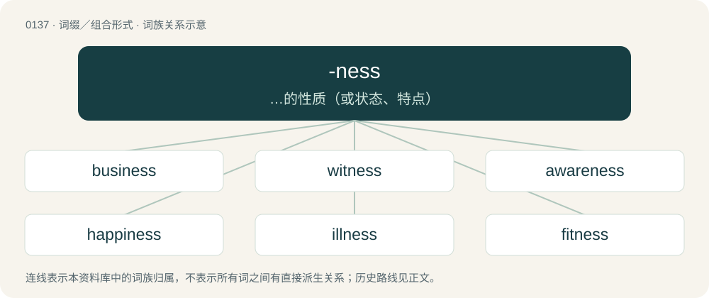

# 0143 · -ness — …的性质（或状态、特点）

[总目录](../00_总目录_按常用程度.md)

**类型**：词缀／组合形式　｜　**来源语言**：见词源记录

## 核心含义与来源

- 核心含义：…的性质（或状态、特点）
- 英文含义：Appended in general, often informally, stylistically, or jocularly, for reification of an attribute.
- 词形：-ness

**来源记录 1**（后缀／后置成分；Appended in general, often informally, stylistically, or jocularly, for reification of an attribute.）

From Middle English -nes, -nesse, from Old English -nis, -nes, from Proto-West Germanic \*-nassī, from Proto-Germanic \*-inassuz. This suffix was formed already in Proto-Germanic by false division of the final consonant \*-n- of the preceding stem + the actual suffix \*-assuz. The latter was in turn derived from an earlier \*-at(s)-tuz, from the verbal suffix \*-at-janą + the noun suffix \*-þuz. Compare German -nis and Dutch -nis of the same origin.

## 词族图

## 单词速览（常用到不常用）

| 单词 | 音标 | 释义 |
|---|---|---|
| [business](#w-1) | /ˈbɪz.nɪs/ | n. 生意, 事情, 业务, 商业, 商行, 职责；\[经\] 企业, 商业, 营业 |
| [witness](#w-2) | 英 /ˈwɪt.nɪs/；/ˈwɪt.nəs/ | n. 证人, 目击者, 证据, 证词；vt. 目击, 作证, 证明, 表明；vi. 作证人, 作为证据 |
| [awareness](#w-3) | 英 /əˈwɛə.nəs/；美 /əˈwɛɹ.nəs/ | n. 意识, 认识；\[计\] 识别, 议定, 明白 |
| [happiness](#w-4) | /ˈhæpinɪs/ | n. 快乐, 幸运, 适当 |
| [illness](#w-5) | /ˈɪl.nəs/ | n. 疾病, 恶意；\[医\] 病 |
| [fitness](#w-6) | /ˈfɪt.nəs/ | n. 适合, 合宜, 合理, 恰当, 健康；\[医\] 适合性, 适应性 |
| [darkness](#w-7) | 英 /ˈdɑːk.nəs/；美 /ˈdɑɹk.nɪs/ | n. 黑暗, 暗, 深色, 隐密, 模糊, 无知 |
| [weakness](#w-8) | 英 /ˈwiːk.nɪs/；美 /ˈwik.nɪs/ | n. 虚弱, 薄弱, 弱点；\[经\] 欲振乏力 |
| [consciousness](#w-9) | 英 /ˈkɒnʃəsnəs/；美 /ˈkɑnʃəsnəs/ | n. 意识, 知觉, 自觉；\[医\] (有)意识, 清醒 |
| [goodness](#w-10) | /ˈɡʊdnəs/ | n. 仁慈, 善良 |
| [effectiveness](#w-11) | /ɪˈfɛk.tɪv.nɪs/ | n. 效力；\[经\] 有效性, 能行性 |
| [kindness](#w-12) | /ˈkaɪnd.nəs/ | n. 仁慈, 亲切, 和蔼 |
| [madness](#w-13) | 英 /ˈmad.nəs/；美 /ˈmæd.nəs/ | n. 疯狂, 愚蠢的行为；\[医\] 狂, 疯狂 |
| [sadness](#w-14) | /ˈsædnəs/ | n. 悲哀, 悲伤 |
| [willingness](#w-15) | 英 /ˈwɪlɪŋnəs/ | n. 乐意, 心甘情愿, 愿意 |
| [fairness](#w-16) | 英 /ˈfɛə.nəs/；美 /ˈfɛɚ.nəs/ | n. 晴朗, 光明正大, 美丽；\[经\] 公正, 适当 |
| [thickness](#w-17) | /ˈθɪknəs/ | n. 厚度, 密度, 愚钝, 含混不清；\[医\] 厚度 |
| [greatness](#w-18) | /ˈɡɹeɪtnəs/ | n. 大, 巨大, 广大 |
| [loneliness](#w-19) | 美 /ˈloʊnlinəs/ | n. 寂寞, 孤独, 清静 |
| [readiness](#w-20) | /ˈɹɛdinəs/ | n. 预备, 准备, 敏捷 |
| [brightness](#w-21) | /ˈbɹaɪtnəs/ | n. 光亮, 明亮, 聪明；\[计\] 亮度 |
| [seriousness](#w-22) | 英 /ˈsɪəɹiəsnəs/；美 /ˈsɪɹiəsnəs/ | n. 严肃, 认真, 严重性 |
| [righteousness](#w-23) | /ˈɹaɪt͡ʃəsnəs/ | n. 正义, 公正, 正直 |
| [sweetness](#w-24) | 英 /ˈswiːtnəs/；美 /ˈswitnəs/ | n. 甜蜜, 芳香, 美妙 |
| [holiness](#w-25) | 英 /ˈhəʊlinəs/；美 /ˈhoʊlinəs/ | n. 神圣；圣座（大写, 对教宗等的尊称） |
| [bitterness](#w-26) | 英 /ˈbɪtənəs/ | n. 苦味, 悲痛, 怨恨 |
| [competitiveness](#w-27) | /kəmˈpɛtɪtɪvnəs/ | \[经\] 竞争 |
| [blindness](#w-28) | /ˈblaɪndnəs/ | n. 盲目, 失明, 愚昧；\[医\] 盲, 视觉缺失 |
| [homelessness](#w-29) | /ˈhəʊm.ləs.nəs/ | n. 无家可归 |
| [mindfulness](#w-30) | /ˈmaɪn(d)fʊlnəs/ | n. 留心, 警觉 |
| [openness](#w-31) | /ˈəupənnis/ | n. 公开；宽阔；率真 |
| [correctness](#w-32) |  | \[计\] 正确性；\[经\] 正确性 |
| [highness](#w-33) | /ˈhaɪnəs/ | n. 高, 高尚, 殿下 |
| [likeness](#w-34) | /ˈlaɪknəs/ | n. 相象, 相似物, 样子 |
| [usefulness](#w-35) | /ˈjuːsfəlnəs/ | n. 有用, 有益；\[经\] 有用, 有用性 |
| [preparedness](#w-36) | 英 /pɹɪˈpɛə(ɹɪ)dnɪs/；美 /pɹɪˈpɛɹ(ə)dnəs/ | n. 准备状态, 战备状态 |
| [toughness](#w-37) | /ˈtʌfnis/ | n. 有粘性, 强硬, 强健；\[化\] 韧性 |
| [cleanliness](#w-38) | 英 /ˈklɛn.li.nᵻs/ | n. 清洁, 干净 |
| [attractiveness](#w-39) |  | \[经\] 吸引性, 有利可图 |
| [tenderness](#w-40) | 英 /ˈtɛn.də.nɪs/；美 /ˈtɛn.dɚ.nɪs/ | n. 柔软, 亲切, 柔和, 敏感, 易触痛；\[医\] 触痛 |
| [selfishness](#w-41) | /ˈsɛl.fɪʃ.nəs/ | n. 自我中心, 利己主义, 任性 |
| [uniqueness](#w-42) | /juːˈniːknis/ | \[计\] 唯一性 |
| [stiffness](#w-43) | /ˈstifnis/ | n. 坚硬, 呆板, 刻板；\[医\] 强直, 僵硬 |
| [hardness](#w-44) | 英 /ˈhɑːdnəs/；美 /ˈhɑɹdnəs/ | n. 坚硬, 困难, 严厉, 勇气；\[化\] 硬度 |
| [laziness](#w-45) | 美 /ˈleɪ.zi.nəs/ | n. 怠惰, 无精打采 |
| [unhappiness](#w-46) |  | n. 苦恼；忧愁 |
| [closeness](#w-47) | 英 /ˈkləʊs.nəs/；美 /ˈkloʊs.nəs/ | \[建\] 密闭, 紧密 |
| [fondness](#w-48) | 英 /ˈfɒndnəs/；美 /ˈfɑndnəs/ | n. 溺爱；爱好 |
| [completeness](#w-49) | /kəmˈpliːtnis/ | n. 完全；\[经\] 完整性 |
| [freshness](#w-50) | /ˈfɹɛʃnəs/ | n. 新, 新鲜, 精神饱满 |
| [dizziness](#w-51) | /ˈdizinis/ | n. 头昏眼花；\[医\] 头晕, 头昏 |
| [unwillingness](#w-52) |  | n. 不情愿；不愿意 |
| [craziness](#w-53) | /ˈkreizinis/ | n. 发狂, 狂热, 热中 |
| [blackness](#w-54) | 美 /ˈblæknəs/ | n. 黑, 黑色, 邪恶；\[化\] 黑度 |
| [foolishness](#w-55) | /ˈfuːlɪʃnəs/ | n. 愚蠢；可笑 |
| [nervousness](#w-56) |  | n. 神经, 神经元, 易激动, 紧张不安, 神经过敏, 神经质, 担忧, 害怕, 简练, 刚劲；\[医\] 神经过敏 |
| [responsiveness](#w-57) | 英 /ɹɪˈspɒnsɪvnɪs/；美 /ɹɪˈspɑn.sɪv.nɪs/ | n. 强烈的反应；\[计\] 响应能力 |
| [fullness](#w-58) | 英 /ˈfʊlnəs/ | n. 满, 充满, 丰富；\[医\] 发胀 |
| [sharpness](#w-59) | /ˈʃɑːpnis/ | n. 锐利, 严厉, 疾速；\[计\] 清晰度 |
| [awkwardness](#w-60) |  | n. 笨拙, 不熟练, 不灵活, 不好使, 麻烦, 使用不便, 难处理, 尴尬, 棘手, 难应付 |
| [faithfulness](#w-61) | /ˈfeiθfulnis/ | n. 忠诚, 诚实, 正确 |
| [soreness](#w-62) | /ˈsɒːnis/ | n. 痛苦, 悲伤, 愤慨 |
| [whiteness](#w-63) | /ˈwaɪtnəs/ | n. 白, 苍白, 洁白；\[化\] 白度 |
| [softness](#w-64) | 英 /ˈsɒftnəs/；美 /ˈsɔftnəs/ | n. 柔和, 温柔 |
| [stillness](#w-65) | /ˈstɪlnəs/ | n. 静止, 沉静 |
| [ugliness](#w-66) | 美 /ˈʌɡlinɪs/ | n. 丑陋 |
| [lightness](#w-67) | /ˈlaɪtnəs/ | n. 光亮度, (颜色的)浅淡, 轻率, 轻佻, 轻浮, 轻盈, 轻松, 轻巧, 精巧, 优美；\[计\] 亮度 |
| [nothingness](#w-68) | /ˈnʌθiŋnis/ | n. 无, 微不足道, 无价值, 不存在, 虚无 |
| [awesomeness](#w-69) | 英 /ˈɔːsəmnəs/ | n. awesome的变形 |
| [tightness](#w-70) | /ˈtaitnis/ | n. 坚固, 紧密；\[化\] 紧度; 严密度 |
| [redness](#w-71) | /ˈrednis/ | n. 红, 红色 |
| [hopelessness](#w-72) | /ˈhəʊpləsnəs/ | 绝望 |
| [dryness](#w-73) | 英 /ˈdɹaɪ.nəs/ | n. 干燥, 干燥无味, 冷淡 |
| [friendliness](#w-74) | /ˈfɹɛndlinəs/ | n. 友谊, 亲切, 亲密 |
| [politeness](#w-75) | /pəˈlaɪtnəs/ | n. 有礼, 优雅 |
| [wickedness](#w-76) | /ˈwɪkɪdnəs/ | n. 邪恶, 不道德 |
| [tiredness](#w-77) | /ˈtaiədnis/ | n. 疲劳, 疲倦；\[医\] 疲惫, 疲倦 |
| [weirdness](#w-78) | 美 /ˈwɪɚdnəs/ | n. 命运；不可思议；离奇 |
| [helplessness](#w-79) | 美 /ˈhɛlplɪsnɪs/ | n. 无可奈何状态, 无能为力; 无助的状态 |
| [lawlessness](#w-80) | /ˈlɔːləsnəs/ | n. 不服从法律; 不受法律制约; 未实施法律; 目无法纪 |
| [rudeness](#w-81) |  | n. 无礼；粗蛮 |
| [boldness](#w-82) | 英 /ˈbəʊldnəs/；美 /ˈboʊldnəs/ | n. 大胆, 勇敢, 冒失；\[计\] 醒目程度; 鲜明度 |
| [deafness](#w-83) | 英 /ˈdɛfnəs/ | n. 聋, 不听；\[医\] 聋\[症\] |
| [eagerness](#w-84) | 英 /ˈiːɡənəs/；美 /ˈiɡɚnəs/ | n. 热心 |
| [randomness](#w-85) | /ˈɹæn.dəm.nəs/ | \[计\] 随机性 |
| [shyness](#w-86) | /ˈʃaɪnəs/ | n. 羞怯, 胆怯 |
| [calmness](#w-87) | 英 /ˈkɑːmnəs/；美 /ˈkɑ(l)mnəs/ | n. 平静, 镇静, 冷静 |
| [drunkenness](#w-88) | /ˈdɹʌŋkən.nəs/ | \[医\] 醉酒, 酒醉 |
| [numbness](#w-89) | /ˈnʌmnis/ | n. 麻木, 麻痹；\[医\] 麻木 |
| [cuteness](#w-90) | /kjuːtnəs/ | n. 可爱; 娇小可爱 |
| [shortness](#w-91) | /ˈʃɒːtnis/ | n. 短小, 简略, 不足；\[化\] 脆性; 蓝脆性; 冷脆性 |
| [aggressiveness](#w-92) | /əˈɡrɛsɪvnɪs/ | n. (贬)侵略, 侵犯, 寻衅, (褒)敢作敢为, 有进取心, (武器)攻击性, 过分, 放肆 |
| [mindedness](#w-93) | /ˈmaɪndɪdnɪs/ | n. 心思; 思想 |
| [smoothness](#w-94) | /ˈsmuːðnis/ | n. 柔滑, 平滑, 平坦；\[化\] 平稳性; 平稳度 |
| [oneness](#w-95) | /ˈwʌnnis/ | n. 单一性, 同一性, 统一性 |
| [carelessness](#w-96) | 英 /ˈkɛələsnəs/；美 /ˈkɛɹləsnəs/ | n. 粗心大意 |
| [quickness](#w-97) | /ˈkwɪknəs/ | n. 急速, 迅速, 速度 |
| [robustness](#w-98) |  | \[计\] 健壮性；\[化\] 鲁棒性; 稳健性 |
| [stubbornness](#w-99) | 英 /ˈstʌbən(n)əs/；美 /ˈstʌbɚn(n)əs/ | n. 倔强；顽强；棘手 |
| [coolness](#w-100) | /ˈkuːlnəs/ | n. 冷, 凉爽, 冷静 |
| [unfairness](#w-101) | 英 /ʌnˈfɛənəs/；美 /ʌnˈfɛɚnəs/ | \[法\] 不公平, 不公正, 不正当 |
| [firmness](#w-102) | 英 /ˈfɜːmnəs/；美 /ˈfɝmnəs/ | n. 坚固, 坚牢, 坚定 |
| [restlessness](#w-103) | /ˈɹɛstləsnəs/ | n. 坐立不安；不安定 |
| [togetherness](#w-104) | /təˈ^eðənis/ | n. 和睦, 友好 |
| [silliness](#w-105) | /ˈsɪlinɪs/ | n. 愚蠢, 糊涂 |
| [recklessness](#w-106) |  | \[法\] 鲁莽, 粗心大意 |
| [gentleness](#w-107) | /ˈd͡ʒɛntl̩nəs/ | n. 温顺, 柔和, 亲切 |
| [appropriateness](#w-108) | /əˈprəupriətnis/ | n. 适当；适合 |
| [indebtedness](#w-109) | 英 /ɪnˈdɛtɪdnəs/ | \[经\] 负债, 债务 |
| [alertness](#w-110) | 美 /əˈlɝt.nəs/ | n. 警戒, 机敏 |
| [cleverness](#w-111) | 英 /ˈklɛvənəs/；美 /ˈklɛvɚnəs/ | n. 机灵；聪明 |
| [unconsciousness](#w-112) | /.ʌnˈkɒnʃəsnis/ | n. 无意识, 意识不清, 人事不省；\[医\] 人事不省, 神志丧失; 无意识 |
| [loudness](#w-113) | /ˈlaudnis/ | n. 响度, 高声, 大声, 吵闹；\[电\] 响度 |
| [drowsiness](#w-114) | 美 /ˈdɹæʊːzinəs/ | n. 睡意；\[医\] 倦睡, 瞌睡 |
| [strangeness](#w-115) | /ˈstreindʒnis/ | n. 奇妙, 不可思议, 陌生；\[化\] 奇异性 |
| [timeliness](#w-116) | /ˈtaɪm.li.nəs/ | \[经\] 时间性, 及时性 |
| [trustworthiness](#w-117) | /ˈtɹʌst.wɜɹ.ði.nɛs/ | n. 可信赖, 确实性 |
| [baldness](#w-118) | /ˈbɒːldnis/ | n. 光秃, 率直, 枯燥；\[医\] 秃\[发\], 脱发 |
| [vastness](#w-119) | /ˈvæstnəs/ | n. 巨大, 广大, 广漠 |
| [harshness](#w-120) | /ˈhɑːʃnis/ | n. 粗糙事物, 刺耳, 严肃 |
| [hotness](#w-121) | /ˈhɒtnis/ | n. 暑热, 热烈, 热心 |
| [coldness](#w-122) | 英 /ˈkəʊldnəs/；美 /ˈkoʊldnəs/ | n. 寒冷, 冷, 冷淡 |
| [worthiness](#w-123) | /ˈwɜː(ɹ)ðɪnəs/ | n. 价值, 相当, 值得 |
| [weariness](#w-124) | 英 /ˈwɪəɹinɪs/；美 /ˈwɪ(ə)ɹinɪs/ | n. 疲倦, 厌倦, 疲劳 |
| [wholeness](#w-125) | /ˈhəulnis/ | n. 全体, 一切, 完全 |
| [assertiveness](#w-126) | /əˈsəːtivnis/ | n. 魄力, 自信 |
| [selflessness](#w-127) |  | n. 忘我；无私 |
| [slowness](#w-128) | /ˈsləunis/ | n. 缓慢, 迟钝 |
| [connectedness](#w-129) |  | \[计\] 连通性 |
| [inclusiveness](#w-130) |  | n. 包容性 |
| [newness](#w-131) | /ˈn(j)uːnəs/ | n. 崭新, 新奇, 珍奇 |
| [sexiness](#w-132) | 美 /ˈsɛksinəs/ | n. &lt;口&gt;性感 |
| [heaviness](#w-133) | /ˈhɛvɪnəs/ | n. 重, 沉闷, 情绪低落, 忧伤, 迟钝, 笨拙 |
| [truthfulness](#w-134) | /ˈtɹuθfəlnəs/ | n. 真实；正当；坦率 |
| [forgetfulness](#w-135) | /fəˈɡɛtfʊlnɪs/ | \[计\] 忽视 |
| [nastiness](#w-136) | /ˈnɑːstinis/ | n. 污秽, 不洁, 烦人 |
| [vagueness](#w-137) | /ˈveignis/ | n. 含糊, 暧昧 |
| [remoteness](#w-138) | /riˈməutnis/ | n. 远离, 远隔, 微少；\[法\] 遥远, 间接, 疏远 |
| [nakedness](#w-139) | /ˈneikidnis/ | n. 裸, 明显, 赤身裸体 |
| [ridiculousness](#w-140) | /rɪˈdɪkjələsnəs/ | n. 滑稽, 荒谬 |
| [sleepiness](#w-141) | /ˈsliːpinis/ | n. 睡意；\[医\] 瞌睡, 欲睡 |
| [soundness](#w-142) | /ˈsaundnis/ | n. 完全坚固, 稳固, 公正；\[机\] 无疵 |
| [handedness](#w-143) | 英 /ˈhændɪdnəs/ | \[医\] 左利或右利(偏于用一侧手工作) |
| [pettiness](#w-144) | /ˈpetinis/ | n. 琐碎, 微小, 小气, 委琐, 偏狭, 卑鄙, 心胸狭窄的举动 |
| [playfulness](#w-145) |  | n. 活泼快乐, 戏谑; 童心 |
| [resourcefulness](#w-146) |  | n. 足智多谋 |
| [thoughtfulness](#w-147) | 英 /ˈθɔːt.f(ə)l.nəs/；美 /ˈθɔt.f(ə)l.nəs/ | n. 体贴；思虑 |
| [inventiveness](#w-148) |  | n. 发明创造能力, 创造性 |
| [loveliness](#w-149) | /ˈlʌvlinəs/ | n. 可爱, 美丽, 魅力 |
| [godliness](#w-150) | 英 /ˈɡɒd.li.nəs/；美 /ˈɡɑd.li.nəs/ | n. 虔诚, 敬神, 信仰 |
| [powerlessness](#w-151) | /ˈpaʊələsnəs/ | n. 无力, 无能为力 |
| [reasonableness](#w-152) | /ˈɹiː.zə.nə.bəl.nəs/ | \[计\] 合理性 |
| [ruthlessness](#w-153) |  | n. 无情；冷酷；残忍 |
| [unpleasantness](#w-154) | /ʌnˈplɛz.ənt.nəs/ | n. 不愉快, 煞风景, 不愉快事件, 争执 |
| [frankness](#w-155) | /ˈfɹæŋknɛs/ | n. 率直, 坦白 |
| [uneasiness](#w-156) | /ʌnˈiːzinəs/ | n. 不舒适, 不安, 局促 |
| [hardiness](#w-157) | /ˈhɑːdinis/ | n. 强壮, 胆子, 勇气, 耐寒(性), 耐劳(性) |
| [dampness](#w-158) |  | \[建\] 湿度, 潮湿 |
| [directness](#w-159) | /diˈrektnis/ | n. 笔直, 率直 |
| [gladness](#w-160) | /ˈɡlædnəs/ | n. 欢乐, 欢喜, 喜悦 |
| [idleness](#w-161) | /ˈaɪdəlnəs/ | n. 懒惰, 闲散, 失业；\[化\] 空载 |
| [realness](#w-162) |  | n. 真诚；真实性 |
| [wildness](#w-163) | /ˈwaɪld.nəs/ | n. 野生, 野蛮, 粗暴 |
| [badness](#w-164) | /ˈbæd.nəs/ | n. 坏, 恶, 不良 |
| [meanness](#w-165) | /ˈmiːnnis/ | n. 吝啬；卑鄙；劣等 |
| [deliciousness](#w-166) | /diˈliʃəsnis/ | n. 美味；怡人；芬芳 |
| [fearlessness](#w-167) | 美 /ˈfɪəlɪsnɪs/ | n. 无畏, 勇敢 |
| [ineffectiveness](#w-168) |  | \[计\] 无结果, 无效 |
| [thoroughness](#w-169) | 英 /ˈθʌɹənəs/；美 /ˈθʌɹoʊnəs/ | n. 十分, 完全；彻底 |
| [quietness](#w-170) | /ˈkwaiətnis/ | n. 平静, 寂静 |
| [distinctiveness](#w-171) | 英 /dɪsˈtɪŋ(k)tɪvnɪs/ | 特殊\[独特\]性 |
| [tardiness](#w-172) | /ˈtɑːdinis/ | n. 慢, 缓慢, 迟延 |
| [weightlessness](#w-173) |  | \[化\] 失重；\[医\] 失重\[状态\] |
| [flatness](#w-174) | 美 /ˈflætnəs/ | n. 平坦, 平滑；\[化\] 平直度; 平整度; 平面度 |
| [otherness](#w-175) | /ˈʌðənis/ | n. 相异, 不同, 差异性 |
| [divisiveness](#w-176) | /diˈvaisivnis/ | n. 引起分歧, 导致分裂 |
| [earnestness](#w-177) | 英 /ˈɜːnɪstnəs/；美 /ˈɝnɪstnəs/ | n. 认真；诚挚；正经 |
| [lateness](#w-178) | 英 /ˈleɪt.nɪs/ | n. 迟, 晚 |
| [swiftness](#w-179) | /ˈswɪftnɪs/ | n. 迅速, 快 |
| [thankfulness](#w-180) |  | n. 感激 |
| [thinness](#w-181) | /ˈθinis/ | n. 薄, 细, 瘦；\[医\] 薄, 弱 |
| [dullness](#w-182) | /ˈdʌl.nəs/ | \[医\] 迟钝, 浊音 |
| [relatedness](#w-183) | /rɪˈleɪtɪdnəs/ | n. 与…有亲戚关系, 有关系 |
| [clumsiness](#w-184) | /ˈklʌm.zi.nəs/ | n. 笨拙, 粗陋, 不漂亮 |
| [defensiveness](#w-185) | 英 /dɪˈfɛnsɪvnəs/ | 防御性 |
| [sameness](#w-186) | 英 /ˈseɪmnəs/ | n. 相同, 同样, 千篇一律 |
| [wakefulness](#w-187) | /ˈweɪk.fʊl.nəs/ | \[医\] 不眠症, 失眠 |
| [niceness](#w-188) | /ˈnaɪsnɪs/ | n. 美好的事物 |
| [cohesiveness](#w-189) |  | \[建\] 粘结性 |
| [brokenness](#w-190) |  | 破碎（broken的名词形式） |
| [uselessness](#w-191) | /ˈjuːsləsnəs/ | n. 无用 |
| [genuineness](#w-192) | 英 /ˈd͡ʒɛ.njuː.ɪn.(n)əs/；美 /ˈd͡ʒɛ.nju.ɪn.(n)əs/ | n. 真诚, 真挚；真实, 真正 |
| [incompleteness](#w-193) |  | \[计\] 不完全性 |
| [airworthiness](#w-194) | 英 /ˈɛː.wəː.ði.nɪs/；美 /ˈɛrwəɹðinɪs/ | n. 适航性 |
| [compactness](#w-195) | /kəmˈpæktnis/ | n. 紧密, 紧密度, 简洁, 坚实；\[计\] 紧致性, 压缩性 |
| [creditworthiness](#w-196) | /ˈkredɪtwɜːðɪnəs/ | n. 商誉 |
| [expressiveness](#w-197) |  | \[计\] 可表达性 |
| [fatness](#w-198) | 美 /ˈfætnəs/ | n. 肥胖, 油腻；\[医\] 肥胖\[症\] |
| [interconnectedness](#w-199) |  | n. 互联性 |
| [smugness](#w-200) |  | n. 矫矜；装模做样 |
| [attentiveness](#w-201) | /əˈtentivnis/ | n. 注意力；专注 |
| [cheerfulness](#w-202) | 英 /ˈt͡ʃɪəfəlnəs/；美 /ˈt͡ʃɪɹfəlnəs/ | n. 高兴, 快活 |
| [fineness](#w-203) | /ˈfainnis/ | \[计\] 扫描；\[经\] 纯度, 成色 |
| [sleeplessness](#w-204) |  | \[医\] 失眠 |
| [backwardness](#w-205) |  | n. (无比较级)向后, 相反, 倒, 回顾, 倒向, 落后, 进展缓慢, 迟疑, 智力差, 畏缩；\[医\] 精神\[发育\]迟缓 |
| [callousness](#w-206) | /ˈkæləsnis/ | n. 麻木不仁 |
| [conscientiousness](#w-207) | /ˌkɒnʃɪˈenʃəsnɪs/ | 责任心 |
| [lameness](#w-208) | /ˈleimnis/ | n. 跛, 瘸, 残废；\[医\] 跛, 跛行 |
| [liveliness](#w-209) | /ˈlaɪvlinəs/ | n. 活泼, 快活, 热闹 |
| [bluntness](#w-210) | 美 /ˈblʌnt.nəs/ | n. 钝, 率直, 迟钝 |
| [steadfastness](#w-211) | /sˈtedfɑːstnˈes/ | n. 坚定, 稳当 |
| [steadiness](#w-212) | /ˈstɛdinəs/ | n. 稳健, 坚定, 不变 |
| [childishness](#w-213) | 美 /ˈt͡ʃaɪld.ɪʃ.nəs/ | 童心；稚气；童稚；孩子气 |
| [gayness](#w-214) | /ˈɡeɪ.nəs/ | n. 欢乐, （尤指）同性恋 |
| [rightness](#w-215) | /ˈraitnis/ | n. 廉正, 正直, 公正, 正确性 |
| [stickiness](#w-216) | /ˈstikinis/ | n. 粘性, 胶粘 |
| [viciousness](#w-217) |  | n. 恶意；邪恶 |
| [nearness](#w-218) | /ˈniənis/ | n. 接近；密切；近似 |
| [saltiness](#w-219) |  | n. 咸性 |
| [graciousness](#w-220) | /.ɡreiʃiːˈɔsiti/ | n. 亲切, 和蔼；好心 |
| [headedness](#w-221) |  | 【英文】The state or quality of having a particular type of head (in various senses). |
| [ripeness](#w-222) | /ˈraipnis/ | n. 成熟, 圆通, 完成 |
| [awfulness](#w-223) | /ˈɒːfulnis/ | n. 庄严, 可怕, 虔敬 |
| [fierceness](#w-224) | /fɪəsnəs/ | n. 凶猛, 猛烈 |
| [sacredness](#w-225) | /ˈseɪkrɪdnəs/ | n. 神圣不可侵犯性 |
| [clearness](#w-226) | /ˈkliənis/ | n. 晴朗, 明白 |
| [helpfulness](#w-227) | /ˈhɛlp.fʊl.nəs/ | n. 有益；有助 |
| [joblessness](#w-228) | /ˈdʒɔblisnis/ | n. 失业；无活可干（jobless的名词形式） |
| [naturalness](#w-229) | /ˈnætʃərəlnis/ | n. 自然, 当然 |
| [peacefulness](#w-230) | /ˈpiːsflnəs/ | n. 平静, 宁静, 平和 |
| [rawness](#w-231) | /ˈrɒːnis/ | n. 生, 半生不熟, 无经验 |
| [singleness](#w-232) | /ˈsiŋglnis/ | n. 单一, 真诚, 独身 |
| [unrighteousness](#w-233) | /ʌnˊraitʃəsnis/ | n. 邪恶;不正 |
| [wariness](#w-234) | /ˈwєərinis/ | n. 谨慎, 注意, 小心 |
| [youthfulness](#w-235) |  | n. 少壮 |
| [cheapness](#w-236) | 英 /ˈtʃiːpnəs/ | n. 廉价 |
| [cockiness](#w-237) | /ˈkɒkinis/ | n. 骄傲自大 |
| [meekness](#w-238) | /ˈmiːknis/ | n. 温顺, 柔和 |
| [strictness](#w-239) | /ˈstiktnis/ | n. 严格, 严密, 严重 |
| [impulsiveness](#w-240) | /ɪmˈpʌlsɪvnəs/ | n. 易冲动 |
| [narrowness](#w-241) | /ˈnærəunis/ | n. 狭小, 小气 |
| [neatness](#w-242) | /ˈniːtnis/ | n. 整洁, 干净 |
| [shallowness](#w-243) | /ˈʃæləunis/ | n. 浅；肤浅 |
| [sightedness](#w-244) |  | 近视，远视 |
| [worthlessness](#w-245) |  | 毫无价值；没用 |
| [indecisiveness](#w-246) | /\[ˌɪndɪˈsaɪsɪvnɪs\]/ | n. 犹豫不定 |
| [keenness](#w-247) | /ˈkiːnnis/ | n. 锐利, 尖锐, 敏感 |
| [roundness](#w-248) | /ˈraundnis/ | n. 圆, 圆形, 球形 |
| [smallness](#w-249) | /ˈsmɒːlnis/ | n. 小, 贫乏, 小气 |
| [decisiveness](#w-250) | 英 /dɪˈsaɪsɪvnəs/ | 果断性 |
| [heartedness](#w-251) | /ˈhɑːɹ.təd.nəs/ | n. hearted（放在心上的, 铭记在心的）的变形 |
| [lawfulness](#w-252) | /ˈlɔːflnəs/ | 法制, 合法 |
| [messiness](#w-253) | /ˈmesɪnɪs/ | n. 杂乱状况 |
| [sloppiness](#w-254) |  | n. 凌乱；马虎 |
| [smartness](#w-255) | /ˈsmɑːtnis/ | n. 现代风格, 敏捷, 机灵 |
| [quirkiness](#w-256) |  | n. 诡诈；离奇；突变 |
| [breathlessness](#w-257) | /ˈbreθləsnəs/ | 气绝 |
| [humbleness](#w-258) | /ˈhʌmblnis/ | n. 谦逊, 卑贱, 粗鄙 |
| [looseness](#w-259) | 英 /ˈluːsnəs/ | n. 松, 松弛, 漠然；\[医\] 松驰 |
| [timelessness](#w-260) | 英 /ˈtaɪmləsnəs/；美 /ˈtaɪmləsnəs/ | n. 无时间限制 |
| [crispness](#w-261) | /krɪspnəs/ | n. 易碎, 精神愉快 |
| [explosiveness](#w-262) | /ɪkspˈləʊsɪvnəs/ | 爆炸性; 可爆性 |
| [pervasiveness](#w-263) | 英 /pəˈveɪ.sɪv.nɪs/；美 /pɚˈveɪ.sɪv.nɪs/ | n. 无处不在, 遍布 |
| [prettiness](#w-264) | /ˈpritinis/ | n. 漂亮, 漂亮的人 |
| [queerness](#w-265) | /ˈkwiənis/ | n. 奇妙, 不舒服 |
| [ruggedness](#w-266) | /ˈrʌ^idnis/ | n. 险峻, 粗野 |
| [sluggishness](#w-267) | /ˈslʌɡɪʃnəs/ | 不振, 萧条, 呆滞; 惰性; 滞性; 惯性 |
| [wrongness](#w-268) | 英 /ˈɹɒŋ.nəs/ | n. 谬误, 不当, 不正直, 不公正；\[法\] 错误, 过失, 不正当 |
| [aloofness](#w-269) | /əˈluːfnis/ | n. 冷漠；高傲；超然离群 |
| [arbitrariness](#w-270) | /ˈɑːbitrərinis/ | n. 任意, 武断, 专断, 反复无常 |
| [gratefulness](#w-271) |  | n. 感激, 感恩 |
| [maleness](#w-272) | /meɪlnəs/ | 男性, 雄性 |
| [meaninglessness](#w-273) | 美 /ˈminɪŋlɪsnɪs/ | n. 无意义；无道理 |
| [naughtiness](#w-274) | /ˈnɔːtinis/ | n. 顽皮；淘气；无礼 |
| [seasickness](#w-275) | /ˈsiːsɪk.nəs/ | \[医\] 晕船 |
| [lewdness](#w-276) | /ˈluːdnəs/ | \[法\] 淫乱的, 公开姘居 |
| [neediness](#w-277) | /ˈniː.di.nəs/ | n. 穷困, 贫穷 |
| [sinfulness](#w-278) | /ˈsinfəlnis/ | n. 有罪；作恶多端 |
| [cloudiness](#w-279) | /ˈklaudinis/ | n. 多云, 阴暗, 光泽暗晦, 朦胧；\[化\] 浊度; 浑浊性 |
| [wholesomeness](#w-280) | /ˈhəulsəmnis/ | 卫生性 |
| [bleakness](#w-281) | / ˈbliknɪs/ | 缺少颜色、缺少植被、缺少友爱的性质和状态 |
| [steepness](#w-282) | /ˈstiːpnis/ | n. 险峻 |
| [vividness](#w-283) | /ˈvɪvɪdnəs/ | n. （色彩、光线等）鲜艳; 活泼; 生动; 逼真 |
| [edginess](#w-284) | /ˈedʒinis/ | n. 刀口锐利, 急躁 |
| [obviousness](#w-285) | 英 /ˈɒ(b)viəsnɪs/；美 /ˈɑ(b)viəsnɪs/ | n. 显而易见；明显；显著性 |
| [unevenness](#w-286) | /ˈʌnˈiːvənis/ | \[化\] 不齐; 不匀度 |
| [busyness](#w-287) | 英 /ˈbɪz.i.nɪs/；美 /ˈbɪz.i.nəs/ | n. 繁忙, 忙碌 |
| [creepiness](#w-288) |  | 毛骨悚然 |
| [destructiveness](#w-289) | /dɪˈstrʌktɪvnəs/ | 破坏性 |
| [evilness](#w-290) | /ˈiːvəlnəs/ | n. 恶的, 邪恶的, 有害的 |
| [giftedness](#w-291) | /ɡɪfˈtɪdnəs/ | 假资优, 天才, 资赋优异 |
| [sheerness](#w-292) |  | 【英文】The property of being sheer. |
| [fastness](#w-293) | 英 /ˈfɑːs(t)nəs/；美 /ˈfæs(t)nəs/ | n. 要塞, 巩固, 迅速；\[医\] 抗拒性 |
| [possessiveness](#w-294) | /pəˈzesɪvnəs/ | n. 占有, 占有欲 |
| [sourness](#w-295) | /ˈsauənis/ | n. 酸味, 性情乖僻, 坏心眼 |
| [suddenness](#w-296) | /ˈsʌdnnɪs/ | n. 意外, 突然 |
| [vindictiveness](#w-297) | 美 /vɪnˈdɪk.tɪv.nəs/ | n. 恶毒；怀恨在心 |
| [fuzziness](#w-298) |  | \[计\] 模糊度, 模糊性 |
| [spiciness](#w-299) | /ˈspaisinis/ | n. 香馥, 富产香料 |
| [worldliness](#w-300) | /ˈwəːldlinis/ | n. 俗心, 俗气 |
| [agreeableness](#w-301) | /əˈgriəblnəs/ | n. 适合；一致 |
| [fruitfulness](#w-302) | /ˈfɹuːt.fʊl.nəs/ | n. 丰收, 丰硕；多实, 肥沃 |
| [moodiness](#w-303) | /ˈmuːdɪnəs/ | n. 忧郁, 喜怒无常, 不快 |
| [blandness](#w-304) | /ˈblændˌnɪs/ | n. 爽快；温柔 |
| [centeredness](#w-305) | /sentədˈnes/ | 自我中心 |
| [covetousness](#w-306) | /ˈkʌvətəsnəs/ | n. 贪婪；贪心；妄羡 |
| [meaningfulness](#w-307) | /ˈmiːnɪŋflnəs/ | n. 富有意义 |
| [giddiness](#w-308) | /ˈgidinis/ | n. 眼花, 轻率；\[医\] 眩晕, 头晕 |
| [itchiness](#w-309) |  | 瘙痒；发痒 |
| [greenness](#w-310) | 英 /ˈɡɹiːn.nəs/ | n. 绿色, 新鲜, 未熟 |
| [grossness](#w-311) | 英 /ˈɡɹəʊsnəs/ | n. 肥满, 粗杂, 粗劣 |
| [healthiness](#w-312) | /ˈhelθinis/ | n. 健康, 健全 |
| [rebelliousness](#w-313) | /rɪˈbeljəsnəs/ | n. 造反, 难以控制 |
| [wretchedness](#w-314) | /ˈɹɛt͡ʃɪdnəs/ | n. 可怜, 悲惨 |

## 逐词详解

### 1. business

**词性**：名词　｜　**音标**：/ˈbɪz.nɪs/

**中文释义**：n. 生意, 事情, 业务, 商业, 商行, 职责；\[经\] 企业, 商业, 营业

**英文义项**：A specific commercial enterprise or establishment. / A person's occupation, work, or trade.

**构词拆分**：busy + -ness

**词源与演化**：

From Middle English busines, busynes, businesse, bisynes, from Old English bisiġnes (“business, busyness”), equivalent to busy + -ness. Doublet of busyness. Sense 17 (something very good, top quality), possibly derives from "the bee's knees"

**例句**：

> They did nearly a million dollars of business over the long weekend.

该用例对应义项：The volume or amount of commercial trade.

### 2. witness

**词性**：名词　｜　**音标**：英 /ˈwɪt.nɪs/；/ˈwɪt.nəs/

**中文释义**：n. 证人, 目击者, 证据, 证词；vt. 目击, 作证, 证明, 表明；vi. 作证人, 作为证据

**英文义项**：Attestation of a fact or event; testimony. / One who sees or has personal knowledge of something.

**构词拆分**：wit + -ness

**词源与演化**：

From Middle English witnesse, from Old English ġewitnes, equivalent to wit + -ness. Cognate with Middle Dutch wetenisse (“witness, testimony”), Old High German gewiznessi (“testimony”), Icelandic vitni (“witness”).

**例句**：

> The bridesmaid and best man at a wedding typically serve as the witnesses.

该用例对应义项：One who is called upon to witness an event or action, such as a wedding or the signing of a document.

### 3. awareness

**词性**：名词　｜　**音标**：英 /əˈwɛə.nəs/；美 /əˈwɛɹ.nəs/

**中文释义**：n. 意识, 认识；\[计\] 识别, 议定, 明白

**英文义项**：The state or level of consciousness where sense data can be confirmed by an observer. / The state or quality of being aware of something.

**构词拆分**：aware + -ness

**词源与演化**：

From aware + -ness.

**例句**：

> I gradually passed from sleep to full awareness.

该用例对应义项：The state or level of consciousness where sense data can be confirmed by an observer.

### 4. happiness

**词性**：名词　｜　**音标**：/ˈhæpinɪs/

**中文释义**：n. 快乐, 幸运, 适当

**英文义项**：The emotion of being happy; joy; elation.

**构词拆分**：happy + -ness

**词源与演化**：

From happy + -ness.

**例句**：

> She found happiness in the small things.

该用例对应义项：The emotion of being happy; joy; elation.

### 5. illness

**词性**：名词　｜　**音标**：/ˈɪl.nəs/

**中文释义**：n. 疾病, 恶意；\[医\] 病

**英文义项**：An instance (episode) of a disease or poor health. / A state of bad health or disease.

**构词拆分**：ill + -ness

**词源与演化**：

From ill + -ness.

**例句**：

> Many working days this year have been lost through illness.

该用例对应义项：A state of bad health or disease.

### 6. fitness

**词性**：名词　｜　**音标**：/ˈfɪt.nəs/

**中文释义**：n. 适合, 合宜, 合理, 恰当, 健康；\[医\] 适合性, 适应性

**英文义项**：The condition of being fit, suitable or appropriate. / The cultivation of an attractive and/or healthy physique.

**构词拆分**：fit + -ness

**词源与演化**：

From fit + -ness. First attested in the 16th century, with the physical sense from 1935.

**例句**：

> They had to prove their fitness for the position.

该用例对应义项：the quality of being suitable

### 7. darkness

**词性**：名词　｜　**音标**：英 /ˈdɑːk.nəs/；美 /ˈdɑɹk.nɪs/

**中文释义**：n. 黑暗, 暗, 深色, 隐密, 模糊, 无知

**英文义项**：The state of being dark; lack of light; the absolute or comparative absence of light. / The state or quality of reflecting little light, of tending to a blackish or brownish color.

**构词拆分**：dark + -ness

**词源与演化**：

From Middle English derknesse, from Old English deorcnes; equivalent to dark + -ness.

**例句**：

> The darkness of her skin betrayed her Mediterranean heritage.

该用例对应义项：The state or quality of reflecting little light, of tending to a blackish or brownish color.

### 8. weakness

**词性**：名词　｜　**音标**：英 /ˈwiːk.nɪs/；美 /ˈwik.nɪs/

**中文释义**：n. 虚弱, 薄弱, 弱点；\[经\] 欲振乏力

**英文义项**：The condition of being weak. / An inadequate quality; fault.

**构词拆分**：weak + -ness

**词源与演化**：

From Middle English weyknesse, replacing earlier Middle English wocnesse, wakenes, wacnesse (“weakness”), from Old English wācnes (“weakness”). Equivalent to weak + -ness.

**例句**：

> The only weakness in her plan was its reliance on the electricity being up and running.

该用例对应义项：An inadequate quality; fault.

### 9. consciousness

**词性**：名词　｜　**音标**：英 /ˈkɒnʃəsnəs/；美 /ˈkɑnʃəsnəs/

**中文释义**：n. 意识, 知觉, 自觉；\[医\] (有)意识, 清醒

**英文义项**：The state of being conscious or aware; awareness. / The state or trait of having cognition and sensation; cognition and sensation themselves.

**构词拆分**：conscious + -ness

**词源与演化**：

From conscious + -ness.

**用法示例／搭配（非完整句）**：

> To lose consciousness after striking one's head

该用例对应义项：The state or trait of having cognition and sensation; cognition and sensation themselves.

### 10. goodness

**词性**：名词　｜　**音标**：/ˈɡʊdnəs/

**中文释义**：n. 仁慈, 善良

**英文义项**：The state or characteristic of being good. / The good, nutritional, healthy part or content of something.

**构词拆分**：good + -ness

**词源与演化**：

From Middle English goodnesse, godnesse, from Old English gōdnes (“goodness; virtue; kindness”), from Proto-West Germanic \*gōdnassī (“goodness”), equivalent to good + -ness. Cognate with Scots guidness (“goodness”), West Frisian goedens (“goodness”), Old High German guotnessī (“goodness”), Middle High German guotnisse (“goodness”), Russian годность (godnostʹ, “suitability, fitness”).

**例句**：

> Thank goodness that the war is over!

该用例对应义项：God.

### 11. effectiveness

**词性**：名词　｜　**音标**：/ɪˈfɛk.tɪv.nɪs/

**中文释义**：n. 效力；\[经\] 有效性, 能行性

**英文义项**：The property of being effective, of achieving results. / The capacity or potential for achieving results.

**构词拆分**：effective + -ness

**词源与演化**：

From effective + -ness.

**例句**：

> The effectiveness of the drug was well established.

该用例对应义项：The property of being effective, of achieving results.

### 12. kindness

**词性**：名词　｜　**音标**：/ˈkaɪnd.nəs/

**中文释义**：n. 仁慈, 亲切, 和蔼

**英文义项**：The state of being kind. / An instance of kind or charitable behaviour.

**构词拆分**：kind + -ness

**词源与演化**：

From Middle English kyndenesse, equivalent to kind + -ness.

**例句**：

> i'm going to turn a blind eye to this misdemeanour, out of the kindness of my heart.

该用例对应义项：An instance of kind or charitable behaviour.

### 13. madness

**词性**：名词　｜　**音标**：英 /ˈmad.nəs/；美 /ˈmæd.nəs/

**中文释义**：n. 疯狂, 愚蠢的行为；\[医\] 狂, 疯狂

**英文义项**：The state of being mad; insanity; mental disease. / The state of being angry.

**构词拆分**：mad + -ness

**词源与演化**：

From Middle English madnes, madnesse; equivalent to mad + -ness.

**例句**：

> He who lives without madness is not as wise as he thinks.

### 14. sadness

**词性**：名词　｜　**音标**：/ˈsædnəs/

**中文释义**：n. 悲哀, 悲伤

**英文义项**：The state or emotion of being sad. / An event in one's life that causes sadness.

**构词拆分**：sad + -ness

**词源与演化**：

From Middle English sadnesse, equivalent to sad + -ness.

**例句**：

> She has experienced many sadnesses in her forty years.

该用例对应义项：An event in one's life that causes sadness.

### 15. willingness

**词性**：名词　｜　**音标**：英 /ˈwɪlɪŋnəs/

**中文释义**：n. 乐意, 心甘情愿, 愿意

**英文义项**：The state of being willing

**构词拆分**：willing + -ness

**词源与演化**：

From willing + -ness.

**例句**：

> All it takes is a willingness to learn.

该用例对应义项：The state of being willing

### 16. fairness

**词性**：名词　｜　**音标**：英 /ˈfɛə.nəs/；美 /ˈfɛɚ.nəs/

**中文释义**：n. 晴朗, 光明正大, 美丽；\[经\] 公正, 适当

**英文义项**：The property of being fair or equitable.

**构词拆分**：fair + -ness

**词源与演化**：

From Middle English fairness, fæȝernesse, from Old English fæġernes (“fairness; beauty; pleasantness”), equivalent to fair + -ness. Cognate with Old High German fagarnessi (“fairness”).

**例句**：

> Some questioned the fairness of the new laws.

该用例对应义项：The property of being fair or equitable.

### 17. thickness

**词性**：名词　｜　**音标**：/ˈθɪknəs/

**中文释义**：n. 厚度, 密度, 愚钝, 含混不清；\[医\] 厚度

**英文义项**：The property of being thick (in dimension). / A measure of how thick (in dimension) something is.

**构词拆分**：thick + -ness

**词源与演化**：

From Middle English thikkenesse, thiknesse, from Old English þicnes (“thickness, viscosity, density, hardness; obscurity, cloud, darkness; thicket; depth, a thick body, anything thick or heavy”), from Proto-West Germanic \*þikkwīnassī (“thickness”), equivalent to thick + -ness. Cognate with West Frisian tsjokkens (“thickness”), Old High German dickinessī, dikkinissi, diknissi (“thickness, density”). Eclipsed non-native Middle English crassitude (“thickness”) from Latin crassitūdō (“thickness”).

**例句**：

> We upholstered the seat with three thicknesses of cloth to make it more comfortable to sit on.

该用例对应义项：A layer.

### 18. greatness

**词性**：名词　｜　**音标**：/ˈɡɹeɪtnəs/

**中文释义**：n. 大, 巨大, 广大

**英文义项**：The state, condition, or quality of being great

**构词拆分**：great + -ness

**词源与演化**：

From Middle English gretnesse, gretnes, greetnesse, from Old English grēatnes. Equivalent to great + -ness.

**例句**：

> Due to the greatness of his size, he was an effective bodyguard.

该用例对应义项：The state, condition, or quality of being great

### 19. loneliness

**词性**：名词　｜　**音标**：美 /ˈloʊnlinəs/

**中文释义**：n. 寂寞, 孤独, 清静

**英文义项**：A feeling of depression resulting from being alone or from having no companions. / The condition or state of being alone or having no companions.

**构词拆分**：lonely + -ness

**词源与演化**：

From lonely + -ness.

**例句**：

> The loneliness resulting from the loss of loved ones, lack of purpose in life, and social discrimination is a real inner hell.

该用例对应义项：A feeling of depression resulting from being alone or from having no companions.

### 20. readiness

**词性**：名词　｜　**音标**：/ˈɹɛdinəs/

**中文释义**：n. 预备, 准备, 敏捷

**英文义项**：The state or degree of being ready; preparedness. / Willingness.

**构词拆分**：ready + -ness

**词源与演化**：

From ready + -ness.

**用法示例／搭配（非完整句）**：

> readiness for civil emergencies

该用例对应义项：The state or degree of being ready; preparedness.

### 21. brightness

**词性**：名词　｜　**音标**：/ˈbɹaɪtnəs/

**中文释义**：n. 光亮, 明亮, 聪明；\[计\] 亮度

**英文义项**：The quality of being bright. / The perceived luminance of an object.

**构词拆分**：bright + -ness

**词源与演化**：

From Middle English bryghtnes, brightnesse, from Old English beorhtnes (“brightness, splendor”), from Proto-West Germanic \*berhtnassī, equivalent to bright + -ness. Cognate with Old High German berahtnessī, berahtnessi (“brightness”).

**例句**：

> The noonday sun beat down with dazzling brightness on the tennis court.

### 22. seriousness

**词性**：名词　｜　**音标**：英 /ˈsɪəɹiəsnəs/；美 /ˈsɪɹiəsnəs/

**中文释义**：n. 严肃, 认真, 严重性

**英文义项**：The state or quality of being serious.

**构词拆分**：serious + -ness

**词源与演化**：

From serious + -ness.

**例句**：

> A lack of solemnity is not necessarily a lack of seriousness.

该用例对应义项：the trait of being serious

### 23. righteousness

**词性**：名词　｜　**音标**：/ˈɹaɪt͡ʃəsnəs/

**中文释义**：n. 正义, 公正, 正直

**英文义项**：The quality or state of being righteous. / Holiness; conformity of life to the divine law.

**构词拆分**：righteous + -ness

**词源与演化**：

From earlier rightwiseness, from Middle English rightwisnes, from Old English rihtwīsnes (“justice”), equivalent to righteous + -ness.

**例句**：

> Education is the path to happiness, peace, righteousness, and success.

### 24. sweetness

**词性**：名词　｜　**音标**：英 /ˈswiːtnəs/；美 /ˈswitnəs/

**中文释义**：n. 甜蜜, 芳香, 美妙

**英文义项**：The condition of being sweet (all senses). / A pleasant disposition; kindness.

**构词拆分**：sweet + -ness

**词源与演化**：

From Middle English swetnes, swetnesse, from Old English swētnes (“sweetness”), from Proto-West Germanic \*swōtinassī (“sweetness”), equivalent to sweet + -ness. Cognate with West Frisian swietens (“sweetness”), obsolete Dutch zoetenis (“sweetness”), Old High German swuoznessi, suoznessi (“sweetness”).

**例句**：

> Ruth's overwhelming sweetness made Robert forget about his hopelessly low school grades.

该用例对应义项：A pleasant disposition; kindness.

### 25. holiness

**词性**：名词　｜　**音标**：英 /ˈhəʊlinəs/；美 /ˈhoʊlinəs/

**中文释义**：n. 神圣；圣座（大写, 对教宗等的尊称）

**英文义项**：The state or condition of being holy.

**构词拆分**：holy + -ness

**词源与演化**：

From Middle English holynesse, holinesse, halinesse, from Old English hāliġnes (“holiness, a holy thing, rites”), from Proto-West Germanic \*hailagnassī, equivalent to holy + -ness. Cognate with West Frisian hilligens (“holiness”), Old High German heilagnissi, heilīgnissi (“holiness”), whence Middle High German heilignis (“halidom”).

**例句**：

> She felt something akin to holiness; well, she wasn't sure if it was that, but it felt like something stronger than goodness.

### 26. bitterness

**词性**：名词　｜　**音标**：英 /ˈbɪtənəs/

**中文释义**：n. 苦味, 悲痛, 怨恨

**英文义项**：The quality of having a bitter taste. / The quality of feeling bitter; acrimony, resentment; the quality of exhibiting such feelings.

**构词拆分**：bitter + -ness

**词源与演化**：

From Middle English bitternesse, biternesse, from Old English biternes (“bitterness; grief”), equivalent to bitter + -ness.

**例句**：

> She kept her bitterness about her mistreatment for the rest of her life.

该用例对应义项：The quality of feeling bitter; acrimony, resentment; the quality of exhibiting such feelings.

### 27. competitiveness

**词性**：名词　｜　**音标**：/kəmˈpɛtɪtɪvnəs/

**中文释义**：\[经\] 竞争

**英文义项**：The state of being competitive.

**构词拆分**：competitive + -ness

**词源与演化**：

From competitive + -ness.

**例句**：

> Finland's competitiveness requires more people who can speak French and German than Swedish.

### 28. blindness

**词性**：名词　｜　**音标**：/ˈblaɪndnəs/

**中文释义**：n. 盲目, 失明, 愚昧；\[医\] 盲, 视觉缺失

**英文义项**：The condition of being blind; unable to see. / Want of intellectual or moral discernment; mental darkness; ignorance, heedlessness.

**构词拆分**：blind + -ness

**词源与演化**：

From Middle English blyndnes, blyndnesse, from Old English blindnes (“blindness”), equivalent to blind + -ness.

**例句**：

> He made up his mind to jog in spite of his blindness.

### 29. homelessness

**词性**：名词　｜　**音标**：/ˈhəʊm.ləs.nəs/

**中文释义**：n. 无家可归

**英文义项**：The state of being homeless.

**构词拆分**：homeless + -ness

**词源与演化**：

From homeless + -ness.

**例句**：

> I tried lying down for a nap, dreamt about homelessness, and woke up.

### 30. mindfulness

**词性**：名词　｜　**音标**：/ˈmaɪn(d)fʊlnəs/

**中文释义**：n. 留心, 警觉

**英文义项**：Awareness. / Paying attention on purpose, in the present moment, and non-judgementally.

**构词拆分**：mindful + -ness

**词源与演化**：

From mindful + -ness.

**例句**：

> Carlos has been practicing mindfulness meditation for a year.

### 31. openness

**词性**：名词　｜　**音标**：/ˈəupənnis/

**中文释义**：n. 公开；宽阔；率真

**英文义项**：Accommodating attitude or opinion, as in receptivity to new ideas, behaviors, cultures, peoples, environments, experiences, etc., different from the familiar, conventional, traditional, or one's own. / The degree to which a person, group, organization, institution, or society exhibits this liberal attitude or opinion.

**构词拆分**：open + -ness

**词源与演化**：

From Middle English \*opennesse, from Old English openness (“openness, publicity”), equivalent to open + -ness. Cognate with Old High German offannussi (“disclosure, revelation, openness”).

**例句**：

> His openness is a very positive quality, although not without its drawbacks.

### 32. correctness

**词性**：名词

**中文释义**：\[计\] 正确性；\[经\] 正确性

**英文义项**：Freedom from error. / Conformity to the truth or to fact.

**构词拆分**：correct + -ness

**词源与演化**：

From correct + -ness.

**例句**：

> I am against the anti-free-speech tendencies of some advocates of political correctness.

### 33. highness

**词性**：名词　｜　**音标**：/ˈhaɪnəs/

**中文释义**：n. 高, 高尚, 殿下

**英文义项**：The state of being high. / A title of respect when referring to a prince or princess.

**构词拆分**：high + -ness

**词源与演化**：

From Middle English hyghnesse; equivalent to high + -ness.

**例句**：

> Responsible for the highness of the rates.

该用例对应义项：a high degree (of amount or force etc.)

### 34. likeness

**词性**：名词　｜　**音标**：/ˈlaɪknəs/

**中文释义**：n. 相象, 相似物, 样子

**英文义项**：The state or quality of being like or alike. / Appearance or form; guise.

**构词拆分**：like + -ness

**词源与演化**：

From Middle English liknesse, from Old English līcness, ġelīcnes (“the quality of being like or equal; likeness; image; copy; pattern; example; parable”), from Proto-West Germanic \*galīkanassī (“likeness”), equivalent to like + -ness. Cognate with West Frisian likenis (“likeness”), Dutch gelijkenis (“similarity; likeness; parable”), German Low German Glieknis (“form; semblance; likeness; parable”), German Gleichnis (“form; semblance; image; likeness; parable; simile”). The verb is derived from the noun. Compare also Old Norse líkneskja (“figure, image, appearance, likeness”).

**例句**：

> How he looked, the likenesses of him which still remain enable us to imagine.

该用例对应义项：That which closely resembles; a portrait.

### 35. usefulness

**词性**：名词　｜　**音标**：/ˈjuːsfəlnəs/

**中文释义**：n. 有用, 有益；\[经\] 有用, 有用性

**英文义项**：The quality or degree of being useful.

**构词拆分**：useful + -ness

**词源与演化**：

From useful + -ness.

**例句**：

> The usefulness of his latest reorganisation has been disputed.

该用例对应义项：The quality or degree of being useful.

### 36. preparedness

**词性**：名词　｜　**音标**：英 /pɹɪˈpɛə(ɹɪ)dnɪs/；美 /pɹɪˈpɛɹ(ə)dnəs/

**中文释义**：n. 准备状态, 战备状态

**英文义项**：The state of being prepared. / Precautionary measures in the face of potential disasters.

**构词拆分**：prepared + -ness

**词源与演化**：

From prepared + -ness.

**用法示例／搭配（非完整句）**：

> preparedness for an exam

该用例对应义项：The state of being prepared.

### 37. toughness

**词性**：名词　｜　**音标**：/ˈtʌfnis/

**中文释义**：n. 有粘性, 强硬, 强健；\[化\] 韧性

**英文义项**：Resistance to fracture when stressed, or the degree of such resistance. / Fortitude; hardiness; mettle.

**构词拆分**：tough + -ness

**词源与演化**：

From Middle English toughnesse, towghnesse, towghenesse, equivalent to tough + -ness.

**例句**：

> I still remember staring with fear at his face marked with candor and toughness.

### 38. cleanliness

**词性**：名词　｜　**音标**：英 /ˈklɛn.li.nᵻs/

**中文释义**：n. 清洁, 干净

**英文义项**：The property of being cleanly, or habitually clean; good hygiene. / Ritual purity.

**构词拆分**：cleanly + -ness

**词源与演化**：

From cleanly + -ness.

**例句**：

> You need to prioritize our home's cleanliness, and that includes the pool.

### 39. attractiveness

**词性**：名词

**中文释义**：\[经\] 吸引性, 有利可图

**英文义项**：The state of being attractive or engaging. / The result of being attractive.

**构词拆分**：attractive + -ness

**词源与演化**：

From attractive + -ness.

**例句**：

> The thought of rating people by attractiveness does not seem fair to me.

### 40. tenderness

**词性**：名词　｜　**音标**：英 /ˈtɛn.də.nɪs/；美 /ˈtɛn.dɚ.nɪs/

**中文释义**：n. 柔软, 亲切, 柔和, 敏感, 易触痛；\[医\] 触痛

**英文义项**：Quality, state or condition of being tender. / A tendency to express warm, compassionate feelings.

**构词拆分**：tender + -ness

**词源与演化**：

From tender + -ness.

**例句**：

> When the lovers were together, their cold indifference gave way to love and tenderness.

该用例对应义项：A tendency to express warm, compassionate feelings.

### 41. selfishness

**词性**：名词　｜　**音标**：/ˈsɛl.fɪʃ.nəs/

**中文释义**：n. 自我中心, 利己主义, 任性

**英文义项**：The quality of being selfish, the condition of putting one's own interests before those of others.

**构词拆分**：selfish + -ness

**词源与演化**：

From selfish + -ness.

**例句**：

> Maybe it's better to suppose that we all aren't born with selfishness.

### 42. uniqueness

**词性**：名词　｜　**音标**：/juːˈniːknis/

**中文释义**：\[计\] 唯一性

**英文义项**：The state or quality of being unique or one of a kind.

**构词拆分**：unique + -ness

**词源与演化**：

From unique + -ness.

**例句**：

> He was an iconoclast who wore his uniqueness as a badge of honor.

### 43. stiffness

**词性**：名词　｜　**音标**：/ˈstifnis/

**中文释义**：n. 坚硬, 呆板, 刻板；\[医\] 强直, 僵硬

**英文义项**：Rigidity or a measure of rigidity. / Inflexibility or a measure of inflexibility.

**构词拆分**：stiff + -ness

**词源与演化**：

From Middle English stiffenes, styffenesse, styfnesse; equivalent to stiff + -ness. Perhaps merging with Middle English stithnesse, stithnysse, from Old English stīþness (“stiffness”).

**例句**：

> His stiffness hampered the conversation.

该用例对应义项：Inelegance; a lack of relaxedness.

### 44. hardness

**词性**：名词　｜　**音标**：英 /ˈhɑːdnəs/；美 /ˈhɑɹdnəs/

**中文释义**：n. 坚硬, 困难, 严厉, 勇气；\[化\] 硬度

**英文义项**：The quality of being hard. / An instance of this quality; hardship.

**构词拆分**：hard + -ness

**词源与演化**：

From Middle English hardness, hardnesse, from Old English heardnes, from heard + -nes, equivalent to hard + -ness.

**例句**：

> The hardness of the material was high.

该用例对应义项：A measure of how hard a material is.

### 45. laziness

**词性**：名词　｜　**音标**：美 /ˈleɪ.zi.nəs/

**中文释义**：n. 怠惰, 无精打采

**英文义项**：The quality of being lazy

**构词拆分**：lazy + -ness

**词源与演化**：

From lazy + -ness.

**例句**：

> This is the most common kind of laziness: that of the mind.

### 46. unhappiness

**词性**：名词

**中文释义**：n. 苦恼；忧愁

**英文义项**：The feeling of not being happy.

**构词拆分**：unhappy + -ness；un- + happiness

**词源与演化**：

From unhappy + -ness or un- + happiness.

**例句**：

> My unhappiness probably is because I very much like to be alone.

### 47. closeness

**词性**：名词　｜　**音标**：英 /ˈkləʊs.nəs/；美 /ˈkloʊs.nəs/

**中文释义**：\[建\] 密闭, 紧密

**英文义项**：The state of being close (all senses). / The state of being friends.

**构词拆分**：close + -ness

**词源与演化**：

From close + -ness.

**例句**：

> Their closeness grew as the night wore on.

该用例对应义项：a feeling of being intimate and belonging together

### 48. fondness

**词性**：名词　｜　**音标**：英 /ˈfɒndnəs/；美 /ˈfɑndnəs/

**中文释义**：n. 溺爱；爱好

**英文义项**：The quality of being fond: liking something, foolishness; doting affection; propensity.

**构词拆分**：fond + -ness

**词源与演化**：

From Middle English fondnes, fondnesse, fonnednesse, equivalent to fond + -ness.

**例句**：

> Fondness is one thing, sex with a minor is something else entirely.

### 49. completeness

**词性**：名词　｜　**音标**：/kəmˈpliːtnis/

**中文释义**：n. 完全；\[经\] 完整性

**英文义项**：The state or condition of being complete. / The property of a logical theory that whenever a wff is valid then it must also be a theorem. Symbolically, letting T represent a theory within logic L, this can be represented as the property that whenever T⊨ϕ is true, then T⊢ϕ must also be true, for any wff φ of logic L.

**构词拆分**：complete + -ness

**词源与演化**：

From complete + -ness.

### 50. freshness

**词性**：名词　｜　**音标**：/ˈfɹɛʃnəs/

**中文释义**：n. 新, 新鲜, 精神饱满

**英文义项**：The state or quality of being fresh. / Impudence; cheek.

**构词拆分**：fresh + -ness

**词源与演化**：

From fresh + -ness.

**用法示例／搭配（非完整句）**：

> the clear freshness of water from a mountain spring

该用例对应义项：The state or quality of being fresh.

### 51. dizziness

**词性**：名词　｜　**音标**：/ˈdizinis/

**中文释义**：n. 头昏眼花；\[医\] 头晕, 头昏

**英文义项**：The state of being dizzy; the sensation of instability.

**构词拆分**：dizzy + -ness

**词源与演化**：

From Middle English disynes, duysenes, from Old English dysiġnes (“dizziness, folly, foolishness, blasphemy”), equivalent to dizzy + -ness.

**例句**：

> I felt a wave of dizziness, and when I looked up, Tom was gone.

### 52. unwillingness

**词性**：名词

**中文释义**：n. 不情愿；不愿意

**英文义项**：The property of being unwilling.

**构词拆分**：unwilling + -ness

**词源与演化**：

From unwilling + -ness.

**例句**：

> His unwillingness to cooperate vetoed every proposal I made.

该用例对应义项：the trait of being unwilling

### 53. craziness

**词性**：名词　｜　**音标**：/ˈkreizinis/

**中文释义**：n. 发狂, 狂热, 热中

**英文义项**：The state of being crazy; madness; derangement / The result or product of being crazy.

**构词拆分**：crazy + -ness

**词源与演化**：

From crazy + -ness.

**例句**：

> You have to go on and be crazy. Craziness is like heaven.

### 54. blackness

**词性**：名词　｜　**音标**：美 /ˈblæknəs/

**中文释义**：n. 黑, 黑色, 邪恶；\[化\] 黑度

**英文义项**：The state or quality of being black in colour. / Any space that such colour pervades.

**构词拆分**：black + -ness

**词源与演化**：

Inherited from Middle English blaknesse, equivalent to black + -ness. Sense 5 most likely both originated from the masque The Masque of Blackness by Ben Jonson and later changed to its current positive sense.

**例句**：

> The blackness of outer space comes from the lack of anything to reflect light rather than the absence of light.

该用例对应义项：The state or quality of being black in colour.

### 55. foolishness

**词性**：名词　｜　**音标**：/ˈfuːlɪʃnəs/

**中文释义**：n. 愚蠢；可笑

**英文义项**：The state of being foolish. / A thing or event that is foolish, or an absurdity.

**构词拆分**：foolish + -ness

**词源与演化**：

From Middle English folishnesse, follissnesse, equivalent to foolish + -ness.

**例句**：

> Adjusting to an insane society is total foolishness.

该用例对应义项：the quality of being rash and foolish

### 56. nervousness

**词性**：名词

**中文释义**：n. 神经, 神经元, 易激动, 紧张不安, 神经过敏, 神经质, 担忧, 害怕, 简练, 刚劲；\[医\] 神经过敏

**英文义项**：The state or quality of being nervous.

**构词拆分**：nervous + -ness

**词源与演化**：

From nervous + -ness.

**例句**：

> He looked relaxed, but a twitch of the finger betrayed his nervousness.

### 57. responsiveness

**词性**：名词　｜　**音标**：英 /ɹɪˈspɒnsɪvnɪs/；美 /ɹɪˈspɑn.sɪv.nɪs/

**中文释义**：n. 强烈的反应；\[计\] 响应能力

**英文义项**：The quality or state of being responsive. / The ability of a machine to adjust to external influences.

**构词拆分**：responsive + -ness

**词源与演化**：

From responsive + -ness.

**例句**：

> The responsiveness of my old PC is nearly zero!

该用例对应义项：The ability of a machine to adjust to external influences.

### 58. fullness

**词性**：名词　｜　**音标**：英 /ˈfʊlnəs/

**中文释义**：n. 满, 充满, 丰富；\[医\] 发胀

**英文义项**：Being full; completeness. / The degree to which a space is full.

**构词拆分**：full + -ness

**词源与演化**：

From Middle English fulnesse, from Old English fulnes, fylnes, fyllnis (“completeness; abundance”), equivalent to full + -ness. Cognate with Old High German folnissi (“fullness”).

**例句**：

> The actor enjoyed the fullness of his success.

该用例对应义项：Being full; completeness.

### 59. sharpness

**词性**：名词　｜　**音标**：/ˈʃɑːpnis/

**中文释义**：n. 锐利, 严厉, 疾速；\[计\] 清晰度

**英文义项**：the cutting ability of an edge; keenness. / the fineness of the point a pointed object.

**构词拆分**：sharp + -ness

**词源与演化**：

From Middle English sharpnesse, scharpnesse, from Old English sċearpnes (“sharpness”), equivalent to sharp + -ness.

**例句**：

> The sharpness of her loss.

该用例对应义项：the quality of being keenly and painfully felt

### 60. awkwardness

**词性**：名词

**中文释义**：n. 笨拙, 不熟练, 不灵活, 不好使, 麻烦, 使用不便, 难处理, 尴尬, 棘手, 难应付

**英文义项**：The state or quality of being awkward; clumsiness; unskillfulness. / The quality of an embarrassing situation.

**构词拆分**：awkward + -ness

**词源与演化**：

From awkward + -ness.

**例句**：

> He sensed the awkwardness of his proposal.

该用例对应义项：the quality of an embarrassing situation

### 61. faithfulness

**词性**：名词　｜　**音标**：/ˈfeiθfulnis/

**中文释义**：n. 忠诚, 诚实, 正确

**英文义项**：Constancy of support, alliance, and respect. / Constancy of belief.

**构词拆分**：faithful + -ness

**词源与演化**：

From Middle English feithfulnesse, equivalent to faithful + -ness.

**例句**：

> His faithfulness kept him going through the darkest times.

该用例对应义项：Constancy of belief.

### 62. soreness

**词性**：名词　｜　**音标**：/ˈsɒːnis/

**中文释义**：n. 痛苦, 悲伤, 愤慨

**英文义项**：The property, state, or condition of being sore; painfulness. / A lingering emotional pain resulting in bitterness or resentment.

**构词拆分**：sore + -ness

**词源与演化**：

From Middle English sornes, sornesse, sarnesse, from Old English sārnes (“bodily pain; mental pain, affliction, grief”), from Proto-West Germanic \*sairanassī, equivalent to sore + -ness. Cognate with Scots sairness (“soreness”), Old Frisian sērnisse, sērnesse (“injury, lesion”), Middle Low German sêrnisse, sêrenisse (“wounding, injury, distress, need”).

**例句**：

> The salve made the soreness go away, but with the aches gone I suddenly noticed my other pains.

该用例对应义项：The property, state, or condition of being sore; painfulness.

### 63. whiteness

**词性**：名词　｜　**音标**：/ˈwaɪtnəs/

**中文释义**：n. 白, 苍白, 洁白；\[化\] 白度

**英文义项**：The state or quality of being white (all senses). / The quality of being white (in the racial sense).

**构词拆分**：white + -ness

**词源与演化**：

Inherited from Middle English whitenesse, whitnesse, whytnesse, hwitnesse, from Old English hwītnes (“whiteness”), equivalent to white + -ness.

**例句**：

> The whiteness of the lily is a symbol of purity.

### 64. softness

**词性**：名词　｜　**音标**：英 /ˈsɒftnəs/；美 /ˈsɔftnəs/

**中文释义**：n. 柔和, 温柔

**英文义项**：The quality of being soft.

**构词拆分**：soft + -ness

**词源与演化**：

From Middle English softnesse, from Old English sōftnes, alteration of earlier sēftnes. Equivalent to soft + -ness.

**例句**：

> He was shocked by the softness of the atmosphere surrounding the young prince, arising from the superfluity of the femininity that guided him.

该用例对应义项：the trait of being effeminate (derogatory of a man)

### 65. stillness

**词性**：名词　｜　**音标**：/ˈstɪlnəs/

**中文释义**：n. 静止, 沉静

**英文义项**：The quality or state of being still. / Habitual silence or quiet; taciturnity.

**构词拆分**：still + -ness

**词源与演化**：

From Middle English stilnesse, from Old English stilnes (“stillness, quiet; absence of noise or disturbance, release, relaxation; silence, abstention from speech; absence of disturbance or molestation, tranquility, peace, security; that which appeases”), equivalent to still + -ness.

**例句**：

> Gustavo embraced the stillness of the woods, finding peace in the absence of noise.

### 66. ugliness

**词性**：名词　｜　**音标**：美 /ˈʌɡlinɪs/

**中文释义**：n. 丑陋

**英文义项**：The condition of being ugly. / An unsightly or frightful object.

**构词拆分**：ugly + -ness

**词源与演化**：

From ugly + -ness.

**例句**：

> There was some ugliness at the council meeting.

该用例对应义项：Unpleasant behaviour.

### 67. lightness

**词性**：名词　｜　**音标**：/ˈlaɪtnəs/

**中文释义**：n. 光亮度, (颜色的)浅淡, 轻率, 轻佻, 轻浮, 轻盈, 轻松, 轻巧, 精巧, 优美；\[计\] 亮度

**英文义项**：the condition of being illuminated / the relative whiteness or transparency of a colour

**构词拆分**：light (“to make bright, illuminate”, verb) + -ness (suffix forming nouns)

**词源与演化**：

From Middle English lightnes, lightnesse, from Old English līhtnes, lȳhtnys (“enlightening, illumination”), from Proto-West Germanic \*liuhtinassī; equivalent to light (“to make bright, illuminate”, verb) + -ness (suffix forming nouns). Cognate with Old High German liuhtnissi (“illumination, enlightening”).

**例句**：

> The lightness of balsa wood.

该用例对应义项：the property of being comparatively small in weight

### 68. nothingness

**词性**：名词　｜　**音标**：/ˈnʌθiŋnis/

**中文释义**：n. 无, 微不足道, 无价值, 不存在, 虚无

**英文义项**：The state of nonexistence; the condition of being nothing. / A void; an emptiness.

**构词拆分**：nothing + -ness

**词源与演化**：

From nothing + -ness.

**例句**：

> It was as if he evaporated into nothingness, leaving everyone bewildered and perplexed.

### 69. awesomeness

**词性**：名词　｜　**音标**：英 /ˈɔːsəmnəs/

**中文释义**：n. awesome的变形

**英文义项**：The quality of being awesome.

**构词拆分**：awesome + -ness

**词源与演化**：

From awesome + -ness.

**例句**：

> Did you swim in the waters of awesomeness when younger?

### 70. tightness

**词性**：名词　｜　**音标**：/ˈtaitnis/

**中文释义**：n. 坚固, 紧密；\[化\] 紧度; 严密度

**英文义项**：The quality or degree of being tight.

**构词拆分**：tight + -ness

**词源与演化**：

From tight + -ness.

**例句**：

> She felt an alarming tightness in her chest.

该用例对应义项：a tight feeling in some part of the body

### 71. redness

**词性**：名词　｜　**音标**：/ˈrednis/

**中文释义**：n. 红, 红色

**英文义项**：The state or quality of being red. / A red discoloration, especially of skin.

**构词拆分**：red + -ness

**词源与演化**：

From Middle English reednes, rednesse, from Old English rēadnes (“redness”), equivalent to red + -ness.

**例句**：

> Redness and swelling are associated with certain superficial infections.

该用例对应义项：A red discoloration, especially of skin.

### 72. hopelessness

**词性**：名词　｜　**音标**：/ˈhəʊpləsnəs/

**中文释义**：绝望

**英文义项**：The state of having no hope, being unhopeful. / Lack of potential.

**构词拆分**：hopeless + -ness

**词源与演化**：

From hopeless + -ness.

**例句**：

> He considered the former tooling hopeless, and he reported its hopelessness to his boss right away.

该用例对应义项：Lack of potential.

### 73. dryness

**词性**：名词　｜　**音标**：英 /ˈdɹaɪ.nəs/

**中文释义**：n. 干燥, 干燥无味, 冷淡

**英文义项**：A lack of moisture. / The degree to which something is dry.

**构词拆分**：dry + -ness

**词源与演化**：

Inherited from Middle English dryenesse, drynesse; equivalent to dry + -ness.

**例句**：

> Have you had any persistent itching, rash, or dryness anywhere on your body?

### 74. friendliness

**词性**：名词　｜　**音标**：/ˈfɹɛndlinəs/

**中文释义**：n. 友谊, 亲切, 亲密

**英文义项**：The quality of being friendly.

**构词拆分**：friendly + -ness

**词源与演化**：

From Middle English freendlynesse, frendlynes, equivalent to friendly + -ness.

**例句**：

> I bought this phone because I was drawn to its user friendliness.

### 75. politeness

**词性**：名词　｜　**音标**：/pəˈlaɪtnəs/

**中文释义**：n. 有礼, 优雅

**英文义项**：The quality of being polite. / A polite act.

**构词拆分**：polite + -ness

**词源与演化**：

From polite + -ness.

**例句**：

> This is because of the difference between Japanese politeness and American politeness.

### 76. wickedness

**词性**：名词　｜　**音标**：/ˈwɪkɪdnəs/

**中文释义**：n. 邪恶, 不道德

**英文义项**：The state of being wicked; evil disposition; immorality. / A wicked or sinful thing or act; morally bad or objectionable behaviour.

**构词拆分**：wicked + -ness

**词源与演化**：

Inherited from Middle English wikkednesse, wikkednes, equivalent to wicked + -ness.

**例句**：

> Human nature is good and wickedness is essentially unnatural.

### 77. tiredness

**词性**：名词　｜　**音标**：/ˈtaiədnis/

**中文释义**：n. 疲劳, 疲倦；\[医\] 疲惫, 疲倦

**英文义项**：The state of being tired.

**构词拆分**：tired + -ness

**词源与演化**：

From Middle English tiredness, terednesse, equivalent to tired + -ness.

**例句**：

> Ignoring feelings of tiredness knocks our body clocks out of kilter.

### 78. weirdness

**词性**：名词　｜　**音标**：美 /ˈwɪɚdnəs/

**中文释义**：n. 命运；不可思议；离奇

**英文义项**：The state or quality of being weird. / The result or product of being weird.

**构词拆分**：weird + -ness

**词源与演化**：

From weird + -ness.

**例句**：

> Yanni's weirdness was part of his charm.

### 79. helplessness

**词性**：名词　｜　**音标**：美 /ˈhɛlplɪsnɪs/

**中文释义**：n. 无可奈何状态, 无能为力; 无助的状态

**英文义项**：The state of being helpless. / A feeling of inadequacy or impotence.

**构词拆分**：helpless + -ness

**词源与演化**：

From helpless + -ness.

**例句**：

> Some speculators take advantage of the ignorance and helplessness of old people.

### 80. lawlessness

**词性**：名词　｜　**音标**：/ˈlɔːləsnəs/

**中文释义**：n. 不服从法律; 不受法律制约; 未实施法律; 目无法纪

**英文义项**：A lack of law; a lack of law and order; anarchy. / Defiance of the law; outlawry, exorbitant levels of crime.

**构词拆分**：lawless + -ness

**词源与演化**：

From lawless + -ness.

**例句**：

> The government still lacks full control of the countryside, where lawlessness persists.

### 81. rudeness

**词性**：名词

**中文释义**：n. 无礼；粗蛮

**英文义项**：The property of being rude. / A rude remark or behaviour.

**构词拆分**：rude + -ness

**词源与演化**：

From Middle English rudenesse, equivalent to rude + -ness.

**例句**：

> The rudeness of the cabin gave it a rustic charm but little comfort.

该用例对应义项：The property of being rude.

### 82. boldness

**词性**：名词　｜　**音标**：英 /ˈbəʊldnəs/；美 /ˈboʊldnəs/

**中文释义**：n. 大胆, 勇敢, 冒失；\[计\] 醒目程度; 鲜明度

**英文义项**：The state of being bold; courage. / presumptuousness

**构词拆分**：bold + -ness

**词源与演化**：

From Middle English boldnesse, equivalent to bold + -ness. Cognate with Scots baldness, bauldness (“boldness”).

**例句**：

> The proposal required great boldness.

该用例对应义项：the trait of being willing to undertake things that involve risk or danger

### 83. deafness

**词性**：名词　｜　**音标**：英 /ˈdɛfnəs/

**中文释义**：n. 聋, 不听；\[医\] 聋\[症\]

**英文义项**：The condition of being deaf; the lack or loss of the ability to hear. / Lack of knowledge or refusal to admit a particular problem, issue, etc.

**构词拆分**：deaf + -ness

**词源与演化**：

From Middle English deefnesse; equivalent to deaf + -ness.

**用法示例／搭配（非完整句）**：

> their deafness to her cries

该用例对应义项：Lack of knowledge or refusal to admit a particular problem, issue, etc.

### 84. eagerness

**词性**：名词　｜　**音标**：英 /ˈiːɡənəs/；美 /ˈiɡɚnəs/

**中文释义**：n. 热心

**英文义项**：The state or quality of being eager; ardent desire.

**构词拆分**：eager + -ness

**词源与演化**：

From Middle English egernesse, egrenesse; equivalent to eager + -ness.

**例句**：

> Pierre ate and drank a lot, with his usual eagerness.

### 85. randomness

**词性**：名词　｜　**音标**：/ˈɹæn.dəm.nəs/

**中文释义**：\[计\] 随机性

**英文义项**：The property of all possible outcomes being equally likely. / A type of circumstance or event that is described by a probability distribution.

**构词拆分**：random + -ness

**词源与演化**：

From random + -ness.

**例句**：

> There was no randomness in the teacher's selection of the class representative.

该用例对应义项：A measure of the lack of purpose, logic, or objectivity of an event.

### 86. shyness

**词性**：名词　｜　**音标**：/ˈʃaɪnəs/

**中文释义**：n. 羞怯, 胆怯

**英文义项**：The quality of being shy; a fear of social interactions.

**构词拆分**：shy + -ness

**词源与演化**：

From shy + -ness.

**例句**：

> Her shyness kept her from asking him to the prom.

该用例对应义项：The quality of being shy; a fear of social interactions.

### 87. calmness

**词性**：名词　｜　**音标**：英 /ˈkɑːmnəs/；美 /ˈkɑ(l)mnəs/

**中文释义**：n. 平静, 镇静, 冷静

**英文义项**：The state of being calm; tranquillity; silence.

**构词拆分**：calm + -ness

**词源与演化**：

From calm + -ness.

**例句**：

> We all sat around watching the fire and basking in the calmness.

### 88. drunkenness

**词性**：名词　｜　**音标**：/ˈdɹʌŋkən.nəs/

**中文释义**：\[医\] 醉酒, 酒醉

**英文义项**：A state of being drunk.

**构词拆分**：drunken + -ness

**词源与演化**：

From drunken + -ness.

**例句**：

> Drunkenness should be an aggravating factor when you commit a crime.

### 89. numbness

**词性**：名词　｜　**音标**：/ˈnʌmnis/

**中文释义**：n. 麻木, 麻痹；\[医\] 麻木

**英文义项**：Absent or reduced sensitivity to cutaneous stimulation. / Inability or reduced ability to experience emotion.

**构词拆分**：numb + -ness

**词源与演化**：

From numb + -ness.

**例句**：

> I have some numbness in my left hand.

### 90. cuteness

**词性**：名词　｜　**音标**：/kjuːtnəs/

**中文释义**：n. 可爱; 娇小可爱

**英文义项**：The state of being cute (endearingly attractive). / acuteness; cunning

**构词拆分**：cute + -ness

**词源与演化**：

From cute + -ness.

**例句**：

> Without thinking I laughed at the cuteness of the cat.

### 91. shortness

**词性**：名词　｜　**音标**：/ˈʃɒːtnis/

**中文释义**：n. 短小, 简略, 不足；\[化\] 脆性; 蓝脆性; 冷脆性

**英文义项**：The property of being short, of being small of stature or brief. / The result or product of being short.

**构词拆分**：short + -ness

**词源与演化**：

From Middle English schortnesse, from Old English sċortnes, sċeortnys, equivalent to short + -ness.

**例句**：

> I was chastened by the shortness of her reply.

该用例对应义项：The property of being short or terse.

### 92. aggressiveness

**词性**：名词　｜　**音标**：/əˈɡrɛsɪvnɪs/

**中文释义**：n. (贬)侵略, 侵犯, 寻衅, (褒)敢作敢为, 有进取心, (武器)攻击性, 过分, 放肆

**英文义项**：The state or quality of being aggressive. / The propensity of a soil or water to dissolve metal or cement structures.

**构词拆分**：aggressive + -ness

**词源与演化**：

From aggressive + -ness.

**例句**：

> The aggressiveness of various sulfate salts towards concrete is partly related to solubility.

该用例对应义项：The propensity of a soil or water to dissolve metal or cement structures.

### 93. mindedness

**词性**：名词　｜　**音标**：/ˈmaɪndɪdnɪs/

**中文释义**：n. 心思; 思想

**英文义项**：The state of being minded in a particular way (as in narrow-mindedness, absent-mindedness).

**构词拆分**：minded + -ness

**词源与演化**：

From minded + -ness.

### 94. smoothness

**词性**：名词　｜　**音标**：/ˈsmuːðnis/

**中文释义**：n. 柔滑, 平滑, 平坦；\[化\] 平稳性; 平稳度

**英文义项**：The condition of being smooth; the degree or measure of said condition. / The highest order of derivative (the differentiability class) over a given domain.

**构词拆分**：smooth + -ness

**词源与演化**：

From Middle English smothenesse; equivalent to smooth + -ness. Compare Old English smēþnes (“smoothness, a smooth place, a level surface”).

**例句**：

> Smoothness can vary from 0 (for a nondifferentiable function) to infinity (for a smooth function).

该用例对应义项：The highest order of derivative (the differentiability class) over a given domain.

### 95. oneness

**词性**：名词　｜　**音标**：/ˈwʌnnis/

**中文释义**：n. 单一性, 同一性, 统一性

**英文义项**：The state of being one or undivided; unity. / The product of being one or undivided.

**构词拆分**：one + -ness

**词源与演化**：

From Middle English oonnesse, onnesse, from Old English ānnes (“oneness, unity, agreement, covenant, solitude”), from Proto-West Germanic \*ainnassī (“oneness”), equivalent to one + -ness. Cognate with Old High German einnissī, einnissa (“unity, oneness”).

**例句**：

> The oneness of God is the most central tenet in Islam.

### 96. carelessness

**词性**：名词　｜　**音标**：英 /ˈkɛələsnəs/；美 /ˈkɛɹləsnəs/

**中文释义**：n. 粗心大意

**英文义项**：Lack of care; the state or quality of being careless.

**构词拆分**：careless + -ness

**词源与演化**：

From Middle English \*carelesnes, \*carlesnesse, from Old English carlēasnes (“freedom from care, security, carelessness”), equivalent to careless + -ness.

**例句**：

> This accident was caused by carelessness.

该用例对应义项：Lack of care; the state or quality of being careless.

### 97. quickness

**词性**：名词　｜　**音标**：/ˈkwɪknəs/

**中文释义**：n. 急速, 迅速, 速度

**英文义项**：rapidity of movement or activity; agility or dexterity

**构词拆分**：quick + -ness

**词源与演化**：

From Middle English quiknes, qwiknes, quyknesse, cwicnesse, equivalent to quick + -ness.

**例句**：

> The quickness of the hand deceives the eye.

该用例对应义项：rapidity of movement or activity; agility or dexterity

### 98. robustness

**词性**：名词

**中文释义**：\[计\] 健壮性；\[化\] 鲁棒性; 稳健性

**英文义项**：The quality of being robust.

**构词拆分**：robust + -ness

**词源与演化**：

From robust + -ness.

**例句**：

> The lack of robustness in the findings may be due to the small size of the sample.

该用例对应义项：the characteristic of being strong enough to withstand intellectual challenge

### 99. stubbornness

**词性**：名词　｜　**音标**：英 /ˈstʌbən(n)əs/；美 /ˈstʌbɚn(n)əs/

**中文释义**：n. 倔强；顽强；棘手

**英文义项**：The state of being stubborn.

**构词拆分**：stubborn + -ness

**词源与演化**：

From stubborn + -ness.

**例句**：

> There is no way of curing the stubbornness of the racists.

### 100. coolness

**词性**：名词　｜　**音标**：/ˈkuːlnəs/

**中文释义**：n. 冷, 凉爽, 冷静

**英文义项**：Moderate chilliness. / Calmness, confidence, or level-headedness.

**构词拆分**：cool + -ness

**词源与演化**：

From Middle English colnes, colnesse, from Old English cōlnes, cœ̄lnes, cēlnes (“coolness; cool air, breeze”), from Proto-West Germanic \*kōlinassī, equivalent to cool + -ness. Cognate with Middle High German kuolnisse, küelnisse (“cooling, coolness”).

**例句**：

> We felt the coolness when we arrived at the river.

### 101. unfairness

**词性**：名词　｜　**音标**：英 /ʌnˈfɛənəs/；美 /ʌnˈfɛɚnəs/

**中文释义**：\[法\] 不公平, 不公正, 不正当

**英文义项**：The state of being unfair; lack of justice. / An unjust act or situation.

**构词拆分**：unfair + -ness

**词源与演化**：

From unfair + -ness.

**例句**：

> We're confronted with unfairness on a daily basis.

### 102. firmness

**词性**：名词　｜　**音标**：英 /ˈfɜːmnəs/；美 /ˈfɝmnəs/

**中文释义**：n. 坚固, 坚牢, 坚定

**英文义项**：security; steadfastness; good grip / strictness; mental strength

**构词拆分**：firm + -ness

**词源与演化**：

From firm + -ness.

### 103. restlessness

**词性**：名词　｜　**音标**：/ˈɹɛstləsnəs/

**中文释义**：n. 坐立不安；不安定

**英文义项**：The state or condition of being restless; an inability to be still, quiet, at peace or comfortable; a feeling of discomfort with stillness causes by anxiety, boredom or other emotions.

**构词拆分**：restless + -ness

**词源与演化**：

From restless + -ness.

**例句**：

> She sat and fidgeted out of restlessness as she waited.

该用例对应义项：The state or condition of being restless; an inability to be still, quiet, at peace or comfortable; a feeling of discomfort with stillness causes by anxiety, boredom or other emotions.

### 104. togetherness

**词性**：名词　｜　**音标**：/təˈ^eðənis/

**中文释义**：n. 和睦, 友好

**英文义项**：The state or quality of being together. / The result or product of being together.

**构词拆分**：together + -ness

**词源与演化**：

From together + -ness.

**例句**：

> Quarantining together for two weeks might just feel like a little too much togetherness.

### 105. silliness

**词性**：名词　｜　**音标**：/ˈsɪlinɪs/

**中文释义**：n. 愚蠢, 糊涂

**英文义项**：That which is perceived as silly or frivolous. / An act that is silly; a result of being silly.

**构词拆分**：silly + -ness

**词源与演化**：

From silly + -ness.

**例句**：

> In high school, I trained my voice to be higher, because I felt that it better suited my childish spark and silliness.

### 106. recklessness

**词性**：名词

**中文释义**：\[法\] 鲁莽, 粗心大意

**英文义项**：The state or quality of being reckless or heedless, of taking unnecessary risks.

**构词拆分**：reckless + -ness

**词源与演化**：

From Middle English reklesnes, reklesnesse, rekelesnesse (also assibilated as rechelesnes, reccheleesnesse), from Old English rēcelēasnes (“recklessness, carelessness, negligence”), equivalent to reckless + -ness.

**例句**：

> His recklessness repeatedly put him in danger.

该用例对应义项：The state or quality of being reckless or heedless, of taking unnecessary risks.

### 107. gentleness

**词性**：名词　｜　**音标**：/ˈd͡ʒɛntl̩nəs/

**中文释义**：n. 温顺, 柔和, 亲切

**英文义项**：The state of being gentle.

**构词拆分**：gentle + -ness

**词源与演化**：

From Middle English gentilnesse; equivalent to gentle + -ness.

**例句**：

> His fingers have learned gentleness.

该用例对应义项：acting in a manner that is gentle and mild and even-tempered

### 108. appropriateness

**词性**：名词　｜　**音标**：/əˈprəupriətnis/

**中文释义**：n. 适当；适合

**英文义项**：The quality or condition of being appropriate.

**构词拆分**：appropriate + -ness

**词源与演化**：

From appropriate + -ness.

### 109. indebtedness

**词性**：名词　｜　**音标**：英 /ɪnˈdɛtɪdnəs/

**中文释义**：\[经\] 负债, 债务

**英文义项**：State of owing money; being in debt. / The state of owing something or being under obligation to someone.

**构词拆分**：indebted + -ness

**词源与演化**：

From indebted + -ness.

**例句**：

> Favors should be done freely and not out of a sense of indebtedness.

### 110. alertness

**词性**：名词　｜　**音标**：美 /əˈlɝt.nəs/

**中文释义**：n. 警戒, 机敏

**英文义项**：The quality of being alert or on the alert.

**构词拆分**：alert + -ness

**词源与演化**：

From alert + -ness.

**例句**：

> His thin, hawk-like nose gave his whole expression an air of alertness and decision.

### 111. cleverness

**词性**：名词　｜　**音标**：英 /ˈklɛvənəs/；美 /ˈklɛvɚnəs/

**中文释义**：n. 机灵；聪明

**英文义项**：The property of being clever. / Something clever, or done cleverly.

**构词拆分**：clever + -ness

**词源与演化**：

From clever + -ness.

**例句**：

> The cleverness of its design.

该用例对应义项：the property of being ingenious

### 112. unconsciousness

**词性**：名词　｜　**音标**：/.ʌnˈkɒnʃəsnis/

**中文释义**：n. 无意识, 意识不清, 人事不省；\[医\] 人事不省, 神志丧失; 无意识

**英文义项**：The state of lacking consciousness, of being unconscious / ignorance or innocence; the state of being uninformed or unaware

**构词拆分**：unconscious + -ness；un- + consciousness

**词源与演化**：

From unconscious + -ness or un- + consciousness.

**例句**：

> I was roused from unconsciousness by the alarm clock.

该用例对应义项：The state of lacking consciousness, of being unconscious

### 113. loudness

**词性**：名词　｜　**音标**：/ˈlaudnis/

**中文释义**：n. 响度, 高声, 大声, 吵闹；\[电\] 响度

**英文义项**：The perceptual strength or amplitude of sound pressure, measured in sones or phons. / The physical strength of the sound pressure level, measured in decibels.

**构词拆分**：loud + -ness

**词源与演化**：

From Middle English loudnesse, lowdenesse, from Old English hlūdnes, equivalent to loud + -ness.

**例句**：

> We perceive the amplitude of a sound wave as loudness.

### 114. drowsiness

**词性**：名词　｜　**音标**：美 /ˈdɹæʊːzinəs/

**中文释义**：n. 睡意；\[医\] 倦睡, 瞌睡

**英文义项**：The state of being drowsy.

**构词拆分**：drowsy + -ness

**词源与演化**：

From drowsy + -ness.

**例句**：

> I will drink a coffee and expose myself to the wind to fight drowsiness.

### 115. strangeness

**词性**：名词　｜　**音标**：/ˈstreindʒnis/

**中文释义**：n. 奇妙, 不可思议, 陌生；\[化\] 奇异性

**英文义项**：The state or quality of being strange, odd or weird. / The product or result of being strange.

**构词拆分**：strange + -ness

**词源与演化**：

From Middle English straungenesse; equivalent to strange + -ness.

**例句**：

> The strangeness of a foreigner.

该用例对应义项：the quality of being alien or not native

### 116. timeliness

**词性**：名词　｜　**音标**：/ˈtaɪm.li.nəs/

**中文释义**：\[经\] 时间性, 及时性

**英文义项**：The state of being timely.

**构词拆分**：timely + -ness

**词源与演化**：

From timely + -ness.

**例句**：

> Timeliness of data is critical to its relevance for decision making.

### 117. trustworthiness

**词性**：名词　｜　**音标**：/ˈtɹʌst.wɜɹ.ði.nɛs/

**中文释义**：n. 可信赖, 确实性

**英文义项**：The state or quality of being trustworthy or reliable.

**构词拆分**：trustworthy + -ness

**词源与演化**：

From trustworthy + -ness.

**例句**：

> These five principles were loyalty, filial duty, trustworthiness, valor, and justice.

### 118. baldness

**词性**：名词　｜　**音标**：/ˈbɒːldnis/

**中文释义**：n. 光秃, 率直, 枯燥；\[医\] 秃\[发\], 脱发

**英文义项**：The condition or state of being (or becoming) bald.

**构词拆分**：bald + -ness

**词源与演化**：

From Middle English ballednesse, equivalent to bald + -ness.

**例句**：

> My baldness was the result of radiotherapy.

该用例对应义项：The condition or state of being (or becoming) bald.

### 119. vastness

**词性**：名词　｜　**音标**：/ˈvæstnəs/

**中文释义**：n. 巨大, 广大, 广漠

**英文义项**：The quality of being vast. / Something vast.

**构词拆分**：vast + -ness

**词源与演化**：

From vast + -ness.

**例句**：

> Comments have a mysterious way of getting lost in the vastness of Tatoebastan.

### 120. harshness

**词性**：名词　｜　**音标**：/ˈhɑːʃnis/

**中文释义**：n. 粗糙事物, 刺耳, 严肃

**英文义项**：The quality of being harsh.

**构词拆分**：harsh + -ness

**词源与演化**：

From Middle English harsknes; equivalent to harsh + -ness.

**例句**：

> I was shocked by the harshness of his tone.

### 121. hotness

**词性**：名词　｜　**音标**：/ˈhɒtnis/

**中文释义**：n. 暑热, 热烈, 热心

**英文义项**：The condition of being hot, heat.

**构词拆分**：hot + -ness

**词源与演化**：

From Middle English hotnes, from Old English hātnes (“hotness, heat”), equivalent to hot + -ness.

**例句**：

> The hotness of this tea is making my cup too hot to hold.

### 122. coldness

**词性**：名词　｜　**音标**：英 /ˈkəʊldnəs/；美 /ˈkoʊldnəs/

**中文释义**：n. 寒冷, 冷, 冷淡

**英文义项**：The relative lack of heat. / The sensation resulting from exposure to low temperatures.

**构词拆分**：cold + -ness

**词源与演化**：

From Middle English coldnesse, from Old English cealdness, cealdnys (“coldness”), from Proto-West Germanic \*kaldanassī (“coldness”), equivalent to cold + -ness. Cognate with West Frisian kâldens (“coldness”), Middle Low German koldenisse, kōldenisse (“coldness”), Middle High German kaltnisse, keltnisse (“coldness”).

**例句**：

> A distressing coldness of tone and manner.

该用例对应义项：a lack of affection or enthusiasm

### 123. worthiness

**词性**：名词　｜　**音标**：/ˈwɜː(ɹ)ðɪnəs/

**中文释义**：n. 价值, 相当, 值得

**英文义项**：The state or quality of having value or merit. / The result or product of having value or merit.

**构词拆分**：worthy + -ness

**词源与演化**：

From Middle English worthynesse, equivalent to worthy + -ness.

### 124. weariness

**词性**：名词　｜　**音标**：英 /ˈwɪəɹinɪs/；美 /ˈwɪ(ə)ɹinɪs/

**中文释义**：n. 疲倦, 厌倦, 疲劳

**英文义项**：Exhaustion, fatigue or tiredness. / A lack of interest or excitement.

**构词拆分**：weary + -ness

**词源与演化**：

From Middle English werynes, werinesse, from Old English wēriġnes (“weariness”), equivalent to weary + -ness.

**例句**：

> You can see a deep weariness in her face.

### 125. wholeness

**词性**：名词　｜　**音标**：/ˈhəulnis/

**中文释义**：n. 全体, 一切, 完全

**英文义项**：The quality of being whole. / The entirety, the whole thing as opposed to part.

**构词拆分**：whole + -ness

**词源与演化**：

From Middle English holnesse, holnes, from Old English hālnes (“wholeness”), equivalent to whole + -ness.

**例句**：

> Wholeness is the opposite of duality.

### 126. assertiveness

**词性**：名词　｜　**音标**：/əˈsəːtivnis/

**中文释义**：n. 魄力, 自信

**英文义项**：The quality of being assertive.

**构词拆分**：assertive + -ness

**词源与演化**：

From assertive + -ness.

**例句**：

> The assertiveness of the man made him win the argument.

### 127. selflessness

**词性**：名词

**中文释义**：n. 忘我；无私

**英文义项**：The quality or state of being selfless.

**构词拆分**：selfless + -ness

**词源与演化**：

From selfless + -ness.

**例句**：

> Loving you has taught me the true meaning of unconditional love and selflessness.

### 128. slowness

**词性**：名词　｜　**音标**：/ˈsləunis/

**中文释义**：n. 缓慢, 迟钝

**英文义项**：The quality or state of being slow. / A unit, the reciprocal of velocity, that delineates the amount of time required for an object to travel a given distance.

**构词拆分**：slow + -ness

**词源与演化**：

From slow + -ness.

**例句**：

> The railroad isn't to blame for the slowness of the mail.

### 129. connectedness

**词性**：名词

**中文释义**：\[计\] 连通性

**英文义项**：The state or quality of being connected.

**构词拆分**：connected + -ness

**词源与演化**：

From connected + -ness.

**例句**：

> Connectedness is very important for suicide prevention.

### 130. inclusiveness

**词性**：名词

**中文释义**：n. 包容性

**英文义项**：The property of being inclusive; inclusivity

**构词拆分**：inclusive + -ness

**词源与演化**：

From inclusive + -ness.

**例句**：

> Another student comments that Martin Luther King's message of inclusiveness made him feel better about his Hispanic heritage.

### 131. newness

**词性**：名词　｜　**音标**：/ˈn(j)uːnəs/

**中文释义**：n. 崭新, 新奇, 珍奇

**英文义项**：The property of being new; novelty; recency.

**构词拆分**：new + -ness

**词源与演化**：

From Middle English newnesse, from Old English nīewnes (“newness, novelty”), equivalent to new + -ness.

**例句**：

> The newness of the car meant it still had that funny smell.

该用例对应义项：The property of being new; novelty; recency.

### 132. sexiness

**词性**：名词　｜　**音标**：美 /ˈsɛksinəs/

**中文释义**：n. &lt;口&gt;性感

**英文义项**：The state or quality of being sexy, of possessing the traits of sexual appeal.

**构词拆分**：sexy + -ness

**词源与演化**：

From sexy + -ness.

### 133. heaviness

**词性**：名词　｜　**音标**：/ˈhɛvɪnəs/

**中文释义**：n. 重, 沉闷, 情绪低落, 忧伤, 迟钝, 笨拙

**英文义项**：The state of being heavy; weight, weightiness, force of impact or gravity.

**构词拆分**：heavy + -ness

**词源与演化**：

From Middle English hevynesse, from Old English hefiġnes (“heaviness”). Equivalent to heavy + -ness.

**例句**：

> The heaviness of lead.

该用例对应义项：the property of being comparatively great in weight

### 134. truthfulness

**词性**：名词　｜　**音标**：/ˈtɹuθfəlnəs/

**中文释义**：n. 真实；正当；坦率

**英文义项**：The quality of being truthful.

**构词拆分**：truthful + -ness

**词源与演化**：

From truthful + -ness.

**例句**：

> The inconsistencies in his story raise doubts about the truthfulness of his statements.

### 135. forgetfulness

**词性**：名词　｜　**音标**：/fəˈɡɛtfʊlnɪs/

**中文释义**：\[计\] 忽视

**英文义项**：The quality of being forgetful; proneness to let slip from the mind. / Loss of remembrance or recollection; a ceasing to remember; oblivion.

**构词拆分**：forgetful + -ness

**词源与演化**：

From Middle English forgetfulnes, forgetfulnesse, forȝetfulnesse, equivalent to forgetful + -ness.

**用法示例／搭配（非完整句）**：

> forgetfulness of duty

该用例对应义项：Failure to bear in mind; careless omission; inattention.

### 136. nastiness

**词性**：名词　｜　**音标**：/ˈnɑːstinis/

**中文释义**：n. 污秽, 不洁, 烦人

**英文义项**：Lack of cleanliness. / Dirt, filth.

**构词拆分**：nasty + -ness

**词源与演化**：

From nasty + -ness.

### 137. vagueness

**词性**：名词　｜　**音标**：/ˈveignis/

**中文释义**：n. 含糊, 暧昧

**英文义项**：The condition of being imprecise or unclear in meaning: vague. / Something which is vague, or an instance or example of vagueness.

**构词拆分**：vague + -ness

**词源与演化**：

From vague + -ness.

**例句**：

> The Conservative manifesto is a model of vagueness.

该用例对应义项：unclearness by virtue of being poorly expressed or not coherent in meaning

### 138. remoteness

**词性**：名词　｜　**音标**：/riˈməutnis/

**中文释义**：n. 远离, 远隔, 微少；\[法\] 遥远, 间接, 疏远

**英文义项**：The quality of being remote.

**构词拆分**：remote + -ness

**词源与演化**：

From remote + -ness.

**例句**：

> Timbuktu's name has become a byword of remoteness.

### 139. nakedness

**词性**：名词　｜　**音标**：/ˈneikidnis/

**中文释义**：n. 裸, 明显, 赤身裸体

**英文义项**：The state or condition of being naked; nudity; bareness; defenselessness; undisguisedness.

**构词拆分**：naked + -ness

**词源与演化**：

From Middle English nakednesse, from Old English nacodnes (“nakedness”); equivalent to naked + -ness. Cognate with West Frisian neakenens (“nakedness”).

**例句**：

> The nakedness of woman is the work of God.

### 140. ridiculousness

**词性**：名词　｜　**音标**：/rɪˈdɪkjələsnəs/

**中文释义**：n. 滑稽, 荒谬

**英文义项**：The characteristic of being ridiculous. / The result of being ridiculous.

**构词拆分**：ridiculous + -ness

**词源与演化**：

From ridiculous + -ness.

**例句**：

> The ridiculousness of that movie is impressive.

### 141. sleepiness

**词性**：名词　｜　**音标**：/ˈsliːpinis/

**中文释义**：n. 睡意；\[医\] 瞌睡, 欲睡

**英文义项**：The property of being sleepy.

**构词拆分**：sleepy + -ness

**词源与演化**：

From sleepy + -ness.

**例句**：

> Sleepiness causes many driving accidents.

该用例对应义项：a very sleepy state

### 142. soundness

**词性**：名词　｜　**音标**：/ˈsaundnis/

**中文释义**：n. 完全坚固, 稳固, 公正；\[机\] 无疵

**英文义项**：The state or quality of being sound. / The result or product of being sound.

**构词拆分**：sound + -ness

**词源与演化**：

From Middle English soundenes, soundnes, from Old English \*sundnes, \*ġesundnes (attested in onsundnes), from Proto-West Germanic \*sundnassī (“soundness, health”); equivalent to sound + -ness. Cognate with West Frisian sûnens (“soundness, health”), Middle Low German suntnisse (“soundness, health”), Middle High German suntnisse (“soundness, health”), German Gesundnis (“health”).

**例句**：

> Edge cases are extremely important to testing the soundness of an argument.

### 143. handedness

**词性**：名词　｜　**音标**：英 /ˈhændɪdnəs/

**中文释义**：\[医\] 左利或右利(偏于用一侧手工作)

**英文义项**：A preference (usually innate) for using one hand rather than the other. / The property that distinguishes an asymmetric object from its mirror image. For example, the essential difference between a left and right glove.

**构词拆分**：handed + -ness

**词源与演化**：

From handed + -ness.

### 144. pettiness

**词性**：名词　｜　**音标**：/ˈpetinis/

**中文释义**：n. 琐碎, 微小, 小气, 委琐, 偏狭, 卑鄙, 心胸狭窄的举动

**英文义项**：The quality of being petty. / A petty behaviour, attitude, etc.

**构词拆分**：petty + -ness

**词源与演化**：

From petty + -ness.

**例句**：

> The pettiness of the accounting department asking me to save a receipt from a fast-food restaurant was absurd.

该用例对应义项：The quality of being petty.

### 145. playfulness

**词性**：名词

**中文释义**：n. 活泼快乐, 戏谑; 童心

**英文义项**：The quality of being playful.

**构词拆分**：playful + -ness

**词源与演化**：

From playful + -ness.

**例句**：

> Such playfulness is characteristic of Mr Baker.

### 146. resourcefulness

**词性**：名词

**中文释义**：n. 足智多谋

**英文义项**：The ability to cope with difficult situations, or unusual problems.

**构词拆分**：resourceful + -ness

**词源与演化**：

From resourceful + -ness.

**例句**：

> A man of great resourcefulness.

该用例对应义项：the quality of being able to cope with a difficult situation

### 147. thoughtfulness

**词性**：名词　｜　**音标**：英 /ˈθɔːt.f(ə)l.nəs/；美 /ˈθɔt.f(ə)l.nəs/

**中文释义**：n. 体贴；思虑

**英文义项**：Thoughtful and considerate attention. / Careful deliberation before action.

**构词拆分**：thoughtful + -ness

**词源与演化**：

From thoughtful + -ness.

### 148. inventiveness

**词性**：名词

**中文释义**：n. 发明创造能力, 创造性

**英文义项**：The quality of being inventive; the faculty of inventing.

**构词拆分**：inventive + -ness

**词源与演化**：

From inventive + -ness.

### 149. loveliness

**词性**：名词　｜　**音标**：/ˈlʌvlinəs/

**中文释义**：n. 可爱, 美丽, 魅力

**英文义项**：The property of being lovely, of attractiveness, beauty, appearing to be lovable. / The result of being lovely.

**构词拆分**：lovely + -ness

**词源与演化**：

From Middle English luflynes; equivalent to lovely + -ness.

**例句**：

> Virtue is such a thing that even if men were ignorant of it, it would still be worthy of praise for its loveliness.

### 150. godliness

**词性**：名词　｜　**音标**：英 /ˈɡɒd.li.nəs/；美 /ˈɡɑd.li.nəs/

**中文释义**：n. 虔诚, 敬神, 信仰

**英文义项**：The condition and quality of being godly, pious, scrupulously observant of all the teachings of one's religion, practicing virtue and avoiding sin.

**构词拆分**：godly + -ness

**词源与演化**：

From godly + -ness.

### 151. powerlessness

**词性**：名词　｜　**音标**：/ˈpaʊələsnəs/

**中文释义**：n. 无力, 无能为力

**英文义项**：The state or character of being powerless; absence or lack of power.

**构词拆分**：powerless + -ness

**词源与演化**：

From powerless + -ness.

**例句**：

> If knowledge is power, ignorance is powerlessness.

### 152. reasonableness

**词性**：名词　｜　**音标**：/ˈɹiː.zə.nə.bəl.nəs/

**中文释义**：\[计\] 合理性

**英文义项**：The state or characteristic of being reasonable. / A reasonable action or behaviour.

**构词拆分**：reasonable + -ness

**词源与演化**：

From Middle English resonabilnes, resonabilnesse, resonablenesse, equivalent to reasonable + -ness.

**例句**：

> The store is famous for the reasonableness of its prices.

该用例对应义项：the property of being moderate in price or expenditures

### 153. ruthlessness

**词性**：名词

**中文释义**：n. 无情；冷酷；残忍

**英文义项**：The property of being ruthless.

**构词拆分**：ruthless + -ness

**词源与演化**：

From ruthless + -ness.

**例句**：

> This series is a long essay on human malice, brazenness, and ruthlessness.

### 154. unpleasantness

**词性**：名词　｜　**音标**：/ʌnˈplɛz.ənt.nəs/

**中文释义**：n. 不愉快, 煞风景, 不愉快事件, 争执

**英文义项**：The property of being unpleasant or disagreeable. / An unpleasant behaviour, occurrence, etc.

**构词拆分**：unpleasant + -ness

**词源与演化**：

From unpleasant + -ness.

### 155. frankness

**词性**：名词　｜　**音标**：/ˈfɹæŋknɛs/

**中文释义**：n. 率直, 坦白

**英文义项**：The state of being frank; candour; honesty.

**构词拆分**：frank + -ness

**词源与演化**：

From frank + -ness.

**例句**：

> With disarming frankness, he admitted his mistakes.

该用例对应义项：The state of being frank; candour; honesty.

### 156. uneasiness

**词性**：名词　｜　**音标**：/ʌnˈiːzinəs/

**中文释义**：n. 不舒适, 不安, 局促

**英文义项**：The state of being uneasy, nervous or restless. / An anxious state of mind; anxiety.

**构词拆分**：uneasy + -ness

**词源与演化**：

From uneasy + -ness.

### 157. hardiness

**词性**：名词　｜　**音标**：/ˈhɑːdinis/

**中文释义**：n. 强壮, 胆子, 勇气, 耐寒(性), 耐劳(性)

**英文义项**：The quality of being able to withstand fatigue and hardship; (of a plant) the quality of being resistant to cold or other environmental conditions.

**构词拆分**：hardy + -ness

**词源与演化**：

From Middle English hardynesse; equivalent to hardy + -ness.

**例句**：

> Kale is known for its winter-hardiness.

该用例对应义项：The quality of being able to withstand fatigue and hardship; (of a plant) the quality of being resistant to cold or other environmental conditions.

### 158. dampness

**词性**：名词

**中文释义**：\[建\] 湿度, 潮湿

**英文义项**：Moderate humidity; moisture; moistness; the state or quality of being damp. / The degree to which something is damp or moist.

**构词拆分**：damp + -ness

**词源与演化**：

From damp + -ness.

**例句**：

> The dampness in the writing paper caused the ink to spread and smudge.

该用例对应义项：The degree to which something is damp or moist.

### 159. directness

**词性**：名词　｜　**音标**：/diˈrektnis/

**中文释义**：n. 笔直, 率直

**英文义项**：The state or quality of being direct.

**构词拆分**：direct + -ness

**词源与演化**：

From direct + -ness.

**例句**：

> He was the ever-living Somali poet whose poetry addressed themes of love, kindness, national solidarity and uncompromising directness.

### 160. gladness

**词性**：名词　｜　**音标**：/ˈɡlædnəs/

**中文释义**：n. 欢乐, 欢喜, 喜悦

**英文义项**：The state of being glad; joy.

**构词拆分**：glad + -ness

**词源与演化**：

From glad + -ness.

**例句**：

> The rose and the thorn, and sorrow and gladness are linked together.

### 161. idleness

**词性**：名词　｜　**音标**：/ˈaɪdəlnəs/

**中文释义**：n. 懒惰, 闲散, 失业；\[化\] 空载

**英文义项**：The state of being idle; inactivity. / The state of being indolent; indolence.

**构词拆分**：idle + -ness

**词源与演化**：

From Middle English ydelnesse, from Old English īdelnes, from Proto-West Germanic \*īdlanassī, equivalent to idle + -ness. Cognate with Old Frisian īdelnisse (“idelness”), obsolete Dutch ijdelnis, Old Saxon īdalnussi (“idleness, vanity”), Old High German ītalnissa (“idleness, vanity, emptiness”).

**例句**：

> Idleness is the home of illness, illness is the home of death.

### 162. realness

**词性**：名词

**中文释义**：n. 真诚；真实性

**英文义项**：The state of being real; reality.

**构词拆分**：real + -ness

**词源与演化**：

From real + -ness.

### 163. wildness

**词性**：名词　｜　**音标**：/ˈwaɪld.nəs/

**中文释义**：n. 野生, 野蛮, 粗暴

**英文义项**：The state or quality of being wild.

**构词拆分**：wild + -ness

**词源与演化**：

From Middle English wildenes, wildenesse, equivalent to wild + -ness.

**例句**：

> Oleg kept disappearing in the wildness.

### 164. badness

**词性**：名词　｜　**音标**：/ˈbæd.nəs/

**中文释义**：n. 坏, 恶, 不良

**英文义项**：The quality or degree of being bad.

**构词拆分**：bad + -ness

**词源与演化**：

From Middle English baddenes, badnes, badnesse; equivalent to bad + -ness.

**例句**：

> Unfortunately, there's still a lot of badness in the world.

### 165. meanness

**词性**：名词　｜　**音标**：/ˈmiːnnis/

**中文释义**：n. 吝啬；卑鄙；劣等

**英文义项**：The condition, or quality, of being mean (any of its definitions) / A mean act.

**构词拆分**：mean + -ness

**词源与演化**：

From mean + -ness.

**例句**：

> Whatever faults he may have, meanness is not one of them.

### 166. deliciousness

**词性**：名词　｜　**音标**：/diˈliʃəsnis/

**中文释义**：n. 美味；怡人；芬芳

**英文义项**：The state or quality of being delicious.

**构词拆分**：delicious + -ness

**词源与演化**：

From delicious + -ness.

**例句**：

> Today's stew has been carefully and slowly boiled to perfect deliciousness.

### 167. fearlessness

**词性**：名词　｜　**音标**：美 /ˈfɪəlɪsnɪs/

**中文释义**：n. 无畏, 勇敢

**英文义项**：The quality of being fearless.

**构词拆分**：fearless + -ness

**词源与演化**：

From fearless + -ness.

**例句**：

> There is nothing to fear but fearlessness.

### 168. ineffectiveness

**词性**：名词

**中文释义**：\[计\] 无结果, 无效

**英文义项**：The condition of being ineffective

**构词拆分**：ineffective + -ness

**词源与演化**：

From ineffective + -ness.

### 169. thoroughness

**词性**：名词　｜　**音标**：英 /ˈθʌɹənəs/；美 /ˈθʌɹoʊnəs/

**中文释义**：n. 十分, 完全；彻底

**英文义项**：The state of being thorough. / Attention to detail.

**构词拆分**：thorough + -ness

**词源与演化**：

From thorough + -ness.

**例句**：

> I appreciate the thoroughness of your report.

### 170. quietness

**词性**：名词　｜　**音标**：/ˈkwaiətnis/

**中文释义**：n. 平静, 寂静

**英文义项**：Absence of sound; silence or hush. / Absence of disturbance; calm, stillness or serenity.

**构词拆分**：quiet + -ness

**词源与演化**：

From Middle English quietnes, quietnesse, quietenesse, qwietnesse, qwietenesse, equivalent to quiet + -ness.

**例句**：

> Fadil used darkness and quietness to slowly sneak into Layla's garden.

### 171. distinctiveness

**词性**：名词　｜　**音标**：英 /dɪsˈtɪŋ(k)tɪvnɪs/

**中文释义**：特殊\[独特\]性

**英文义项**：The quality of being distinctive, individual or discrete. / Something which distinguishes something from anything else.

**构词拆分**：distinctive + -ness

**词源与演化**：

From distinctive + -ness.

**例句**：

> Furthermore, the frog’s external appearance and skeletal shape add to its distinctiveness.

### 172. tardiness

**词性**：名词　｜　**音标**：/ˈtɑːdinis/

**中文释义**：n. 慢, 缓慢, 迟延

**英文义项**：The state or quality of being tardy. / The result or product of being tardy.

**构词拆分**：tardy + -ness

**词源与演化**：

From tardy + -ness.

**例句**：

> I will have to fire you for consistent tardiness.

### 173. weightlessness

**词性**：名词

**中文释义**：\[化\] 失重；\[医\] 失重\[状态\]

**英文义项**：The state of being free from the effects of gravity (the force). / An experience or instance of being weightless.

**构词拆分**：weightless + -ness

**词源与演化**：

From weightless + -ness.

**例句**：

> The weightlessness in space can be disorienting for new astronauts.

### 174. flatness

**词性**：名词　｜　**音标**：美 /ˈflætnəs/

**中文释义**：n. 平坦, 平滑；\[化\] 平直度; 平整度; 平面度

**英文义项**：The state of being flat / The state of being two-dimensional; planar : planarity

**构词拆分**：flat + -ness

**词源与演化**：

From Middle English flatnesse, equivalent to flat + -ness.

**例句**：

> The flatness of her voice warned me that something was wrong.

### 175. otherness

**词性**：名词　｜　**音标**：/ˈʌðənis/

**中文释义**：n. 相异, 不同, 差异性

**英文义项**：The quality of being different or distinct. / The result or product of being different or distinct.

**构词拆分**：other + -ness

**词源与演化**：

From other + -ness.

**例句**：

> The English teacher's cruel remarks perpetuate a sense of otherness and discrimination.

### 176. divisiveness

**词性**：名词　｜　**音标**：/diˈvaisivnis/

**中文释义**：n. 引起分歧, 导致分裂

**英文义项**：The characteristic of being divisive.

**构词拆分**：divisive + -ness

**词源与演化**：

From divisive + -ness.

**例句**：

> Burning copies of the Quran serves no purpose other than to incite anger, hurt religious sentiments, and promote divisiveness.

### 177. earnestness

**词性**：名词　｜　**音标**：英 /ˈɜːnɪstnəs/；美 /ˈɝnɪstnəs/

**中文释义**：n. 认真；诚挚；正经

**英文义项**：The quality of being earnest; sincerity; seriousness.

**构词拆分**：earnest + -ness

**词源与演化**：

From earnest + -ness.

**例句**：

> She spoke with great earnestness about the issue.

该用例对应义项：The quality of being earnest; sincerity; seriousness.

### 178. lateness

**词性**：名词　｜　**音标**：英 /ˈleɪt.nɪs/

**中文释义**：n. 迟, 晚

**英文义项**：The state of being late.

**构词拆分**：late + -ness

**词源与演化**：

From late + -ness.

**例句**：

> His chronic lateness will cost him a promotion if not his job.

该用例对应义项：The state of being late.

### 179. swiftness

**词性**：名词　｜　**音标**：/ˈswɪftnɪs/

**中文释义**：n. 迅速, 快

**英文义项**：The state of being swift.

**构词拆分**：swift + -ness

**词源与演化**：

From Middle English swiftnesse, swyftnesse, from Old English swiftnes (“swiftness”), equivalent to swift + -ness.

**例句**：

> They admired the swiftness of the river’s current.

该用例对应义项：The state of being swift.

### 180. thankfulness

**词性**：名词

**中文释义**：n. 感激

**英文义项**：The state of being thankful.

**构词拆分**：thankful + -ness

**词源与演化**：

From thankful + -ness.

**例句**：

> O Lord, who lends me life, lend me a heart replete with thankfulness.

### 181. thinness

**词性**：名词　｜　**音标**：/ˈθinis/

**中文释义**：n. 薄, 细, 瘦；\[医\] 薄, 弱

**英文义项**：The state or quality of being thin.

**构词拆分**：thin + -ness

**词源与演化**：

From Middle English thynnesse, from Old English þynnes (“thinness, slightness of density, lack of density, tenuity, fluidity, poverty, feebleness of sight, weakness”), equivalent to thin + -ness.

### 182. dullness

**词性**：名词　｜　**音标**：/ˈdʌl.nəs/

**中文释义**：\[医\] 迟钝, 浊音

**英文义项**：The quality of being slow of understanding things. / The quality of being uninteresting; boring; humorless or irksome.

**构词拆分**：dull + -ness

**词源与演化**：

From dull + -ness.

**用法示例／搭配（非完整句）**：

> dullness of sight, or of hearing

该用例对应义项：The quality of not perceiving or kenning things distinctly.

### 183. relatedness

**词性**：名词　｜　**音标**：/rɪˈleɪtɪdnəs/

**中文释义**：n. 与…有亲戚关系, 有关系

**英文义项**：The state of being related, especially by kinship.

**构词拆分**：related + -ness

**词源与演化**：

From related + -ness.

**例句**：

> Comparative linguistics is a specific set of processes you go through to find the relatedness of languages, or lack thereof.

### 184. clumsiness

**词性**：名词　｜　**音标**：/ˈklʌm.zi.nəs/

**中文释义**：n. 笨拙, 粗陋, 不漂亮

**英文义项**：A lack of coordination or elegance; the condition or quality of being clumsy.

**构词拆分**：clumsy + -ness

**词源与演化**：

From clumsy + -ness.

**例句**：

> He dropped them not out of spite, but out of clumsiness.

该用例对应义项：A lack of coordination or elegance; the condition or quality of being clumsy.

### 185. defensiveness

**词性**：名词　｜　**音标**：英 /dɪˈfɛnsɪvnəs/

**中文释义**：防御性

**英文义项**：The state or quality of being defensive.

**构词拆分**：defensive + -ness

**词源与演化**：

From defensive + -ness.

**例句**：

> His excessive defensiveness and avoidance of direct questions suggest an attempt to hide the truth.

### 186. sameness

**词性**：名词　｜　**音标**：英 /ˈseɪmnəs/

**中文释义**：n. 相同, 同样, 千篇一律

**英文义项**：The quality of being the same; identity. / The state of being equivalent; equality.

**构词拆分**：same + -ness

**词源与演化**：

From same + -ness.

**例句**：

> He hated the sameness of the food the college served.

该用例对应义项：the quality of wearisome constancy, routine, and lack of variety

### 187. wakefulness

**词性**：名词　｜　**音标**：/ˈweɪk.fʊl.nəs/

**中文释义**：\[医\] 不眠症, 失眠

**英文义项**：The state of being wakeful.

**构词拆分**：wakeful + -ness

**词源与演化**：

From wakeful + -ness.

**例句**：

> Consciousness during wakefulness in a sane person is pretty well ordered and familiar.

该用例对应义项：a periodic state during which you are conscious and aware of the world

### 188. niceness

**词性**：名词　｜　**音标**：/ˈnaɪsnɪs/

**中文释义**：n. 美好的事物

**英文义项**：Effeminacy; indulgence in soft living or luxuriousness. / Fastidiousness; fine sensitivity.

**构词拆分**：nice + -ness

**词源与演化**：

From nice + -ness.

**例句**：

> I'd like to uncover what hides underneath her fake niceness.

### 189. cohesiveness

**词性**：名词

**中文释义**：\[建\] 粘结性

**英文义项**：The state of being cohesive; cohesion.

**构词拆分**：cohesive + -ness

**词源与演化**：

From cohesive + -ness.

### 190. brokenness

**词性**：名词

**中文释义**：破碎（broken的名词形式）

**英文义项**：The characteristic of being broken.

**构词拆分**：broken + -ness

**词源与演化**：

From broken + -ness.

### 191. uselessness

**词性**：名词　｜　**音标**：/ˈjuːsləsnəs/

**中文释义**：n. 无用

**英文义项**：The state or quality of being useless.

**构词拆分**：useless + -ness

**词源与演化**：

From useless + -ness.

**例句**：

> The best doctor is the one who knows about the uselessness of the majority of medicines.

### 192. genuineness

**词性**：名词　｜　**音标**：英 /ˈd͡ʒɛ.njuː.ɪn.(n)əs/；美 /ˈd͡ʒɛ.nju.ɪn.(n)əs/

**中文释义**：n. 真诚, 真挚；真实, 真正

**英文义项**：The quality of being genuine; authenticity.

**构词拆分**：genuine + -ness

**词源与演化**：

From genuine + -ness.

**例句**：

> I'm afraid of losing my obscurity. Genuineness only thrives in the dark. Like celery.

### 193. incompleteness

**词性**：名词

**中文释义**：\[计\] 不完全性

**英文义项**：The state or condition of being not complete.

**构词拆分**：incomplete + -ness

**词源与演化**：

From incomplete + -ness.

**例句**：

> The study was criticized for incompleteness of data but it stimulated further research.

该用例对应义项：the state of being crude and incomplete and imperfect

### 194. airworthiness

**词性**：名词　｜　**音标**：英 /ˈɛː.wəː.ði.nɪs/；美 /ˈɛrwəɹðinɪs/

**中文释义**：n. 适航性

**英文义项**：The state of being airworthy.

**构词拆分**：airworthy + -ness

**词源与演化**：

From airworthy + -ness.

**例句**：

> All airworthiness directives must be complied with for an aircraft to remain airworthy.

### 195. compactness

**词性**：名词　｜　**音标**：/kəmˈpæktnis/

**中文释义**：n. 紧密, 紧密度, 简洁, 坚实；\[计\] 紧致性, 压缩性

**英文义项**：The state of being compact.

**构词拆分**：compact + -ness

**词源与演化**：

From compact + -ness.

**例句**：

> The selling point of cup ramen is its compactness, which makes it easy to carry.

### 196. creditworthiness

**词性**：名词　｜　**音标**：/ˈkredɪtwɜːðɪnəs/

**中文释义**：n. 商誉

**英文义项**：The property of being creditworthy.

**构词拆分**：creditworthy + -ness

**词源与演化**：

From creditworthy + -ness.

### 197. expressiveness

**词性**：名词

**中文释义**：\[计\] 可表达性

**英文义项**：The quality or degree of being expressive.

**构词拆分**：expressive + -ness

**词源与演化**：

From expressive + -ness.

**例句**：

> Russians are known for their passion and expressiveness.

### 198. fatness

**词性**：名词　｜　**音标**：美 /ˈfætnəs/

**中文释义**：n. 肥胖, 油腻；\[医\] 肥胖\[症\]

**英文义项**：The state, quality, or condition of being fat.

**构词拆分**：fat + -ness

**词源与演化**：

From Middle English fatnesse, fattenesse, from Old English fǣtnes (“fatness, the richest part of anything”), equivalent to fat + -ness.

**例句**：

> Fatness isn't contagious, or is it?

### 199. interconnectedness

**词性**：名词

**中文释义**：n. 互联性

**英文义项**：The state of being interconnected. / According to some worldviews, a oneness in all things, with no true separation deeper than appearances.

**构词拆分**：interconnected + -ness

**词源与演化**：

From interconnected + -ness.

**例句**：

> It highlights the interconnectedness of our actions and their potential consequences.

### 200. smugness

**词性**：名词

**中文释义**：n. 矫矜；装模做样

**英文义项**：The state or quality of being smug. / The result or product of being smug.

**构词拆分**：smug + -ness

**词源与演化**：

From smug + -ness.

**例句**：

> Islam filled me with smugness and contempt for disbelievers.

### 201. attentiveness

**词性**：名词　｜　**音标**：/əˈtentivnis/

**中文释义**：n. 注意力；专注

**英文义项**：The state or quality of being attentive.

**构词拆分**：attentive + -ness

**词源与演化**：

From attentive + -ness.

**例句**：

> Tom has pestered me with his attentiveness ever since I arrived.

### 202. cheerfulness

**词性**：名词　｜　**音标**：英 /ˈt͡ʃɪəfəlnəs/；美 /ˈt͡ʃɪɹfəlnəs/

**中文释义**：n. 高兴, 快活

**英文义项**：The state of being cheerful; joy.

**构词拆分**：cheerful + -ness

**词源与演化**：

From Middle English cherefulnes; equivalent to cheerful + -ness.

**例句**：

> Flowers added a note of cheerfulness to the drab room.

该用例对应义项：the quality of being cheerful and dispelling gloom

### 203. fineness

**词性**：名词　｜　**音标**：/ˈfainnis/

**中文释义**：\[计\] 扫描；\[经\] 纯度, 成色

**英文义项**：The quality or degree of being fine. / The ratio, in a precious metal, of the primary metal to any additives or impurities.

**构词拆分**：fine + -ness

**词源与演化**：

From fine + -ness.

**例句**：

> The inn is distinguished by the fineness of its cuisine.

该用例对应义项：the quality of being very good indeed

### 204. sleeplessness

**词性**：名词

**中文释义**：\[医\] 失眠

**英文义项**：Lack of sleep; the property of being sleepless; the inability to sleep, insomnia.

**构词拆分**：sleepless + -ness

**词源与演化**：

From sleepless + -ness.

**例句**：

> People who regularly work in the open air do not suffer from sleeplessness.

### 205. backwardness

**词性**：名词

**中文释义**：n. (无比较级)向后, 相反, 倒, 回顾, 倒向, 落后, 进展缓慢, 迟疑, 智力差, 畏缩；\[医\] 精神\[发育\]迟缓

**英文义项**：The state of being backward. / Reluctance.

**构词拆分**：backward + -ness

**词源与演化**：

From backward + -ness.

**例句**：

> The backwardness of that country is well known.

### 206. callousness

**词性**：名词　｜　**音标**：/ˈkæləsnis/

**中文释义**：n. 麻木不仁

**英文义项**：The quality of being callous; emotional hardheartedness or indifference. / The quality of having calluses.

**构词拆分**：callous + -ness

**词源与演化**：

From callous + -ness.

**例句**：

> Fred was known for his callousness; local panhandlers had long since learned not to try their sob stories on him.

该用例对应义项：The quality of being callous; emotional hardheartedness or indifference.

### 207. conscientiousness

**词性**：名词　｜　**音标**：/ˌkɒnʃɪˈenʃəsnɪs/

**中文释义**：责任心

**英文义项**：The state or characteristic of being conscientious.

**构词拆分**：conscientious + -ness

**词源与演化**：

From conscientious + -ness.

### 208. lameness

**词性**：名词　｜　**音标**：/ˈleimnis/

**中文释义**：n. 跛, 瘸, 残废；\[医\] 跛, 跛行

**英文义项**：An impediment to walking due to the feet or legs. / The quality of being lame, pathetic or uncool.

**构词拆分**：lame + -ness

**词源与演化**：

From lame + -ness.

**例句**：

> His lameness may have prevented him from walking but it didn't stop him from running for public office.

该用例对应义项：An impediment to walking due to the feet or legs.

### 209. liveliness

**词性**：名词　｜　**音标**：/ˈlaɪvlinəs/

**中文释义**：n. 活泼, 快活, 热闹

**英文义项**：The quality of being lively.

**构词拆分**：lively + -ness

**词源与演化**：

From lively + -ness.

**例句**：

> The liveliness of the gathering surprised me.

### 210. bluntness

**词性**：名词　｜　**音标**：美 /ˈblʌnt.nəs/

**中文释义**：n. 钝, 率直, 迟钝

**英文义项**：The characteristic of being blunt.

**构词拆分**：blunt + -ness

**词源与演化**：

From Middle English bluntnes, bluntnesse, equivalent to blunt + -ness.

**例句**：

> The bluntness of a Yorkshireman.

该用例对应义项：the quality of being direct and outspoken

### 211. steadfastness

**词性**：名词　｜　**音标**：/sˈtedfɑːstnˈes/

**中文释义**：n. 坚定, 稳当

**英文义项**：Loyalty in the face of trouble and difficulty. / A steadfast resolution.

**构词拆分**：steadfast + -ness

**词源与演化**：

From Middle English stedfastnesse, stedefastnesse, from Old English stedefæstnes (“steadfastness”), equivalent to steadfast + -ness.

### 212. steadiness

**词性**：名词　｜　**音标**：/ˈstɛdinəs/

**中文释义**：n. 稳健, 坚定, 不变

**英文义项**：The state of being steady. / The degree of stability.

**构词拆分**：steady + -ness

**词源与演化**：

From steady + -ness.

**例句**：

> Democratic presidential candidate Hillary Clinton says "steadiness" is the most important characteristic a president must have.

### 213. childishness

**词性**：名词　｜　**音标**：美 /ˈt͡ʃaɪld.ɪʃ.nəs/

**中文释义**：童心；稚气；童稚；孩子气

**英文义项**：The state or characteristic of being childish. / Childish behaviour.

**构词拆分**：childish + -ness

**词源与演化**：

From Middle English childishnes, childisnes, equivalent to childish + -ness.

**例句**：

> Do you mean to annoy me again with some childishness, you little villain?

### 214. gayness

**词性**：名词　｜　**音标**：/ˈɡeɪ.nəs/

**中文释义**：n. 欢乐, （尤指）同性恋

**英文义项**：The state of being gay (colorful or festive); display or dressiness. / The state of being gay (cheerful); gaiety.

**构词拆分**：gay + -ness

**词源与演化**：

From Middle English gaynesse, equivalent to gay + -ness.

**例句**：

> I told Tom to tone down his gayness.

### 215. rightness

**词性**：名词　｜　**音标**：/ˈraitnis/

**中文释义**：n. 廉正, 正直, 公正, 正确性

**英文义项**：The characteristic of being right; correctness. / The result or product of being right; something correct.

**构词拆分**：right + -ness

**词源与演化**：

From Middle English rightnesse, riȝtnesse, rihtnesse, from Old English rihtnes, rehtnis, from Proto-West Germanic \*rehtanassī (“rightness, justice”), equivalent to right + -ness. Cognate with West Frisian rjochtens (“rightness”), Middle Dutch rechtenesse (“rightness, justification”), Old High German rehtnissa (“justice”).

**例句**：

> Rightness of limitation is essential for growth of reality.

### 216. stickiness

**词性**：名词　｜　**音标**：/ˈstikinis/

**中文释义**：n. 粘性, 胶粘

**英文义项**：The property of sticking or adhering; adhesion. / Warmth and humidity, as on a muggy day.

**构词拆分**：sticky + -ness

**词源与演化**：

From sticky + -ness.

**例句**：

> The low stickiness rating helped explain why our ad’s brand linkage rating was so low: people were turned off by the blurriness of the main photo.

该用例对应义项：A research measure that captures the extent to which viewers wish to spend more time looking at or reading a print advertisement.

### 217. viciousness

**词性**：名词

**中文释义**：n. 恶意；邪恶

**英文义项**：The characteristic of being vicious. / The desire to cause harm to others; extreme cruelty.

**构词拆分**：vicious + -ness

**词源与演化**：

From Middle English viciousnesse; equivalent to vicious + -ness.

### 218. nearness

**词性**：名词　｜　**音标**：/ˈniənis/

**中文释义**：n. 接近；密切；近似

**英文义项**：The state of being near; closeness; intimacy. / Stinginess.

**构词拆分**：near + -ness

**词源与演化**：

From Middle English nernes, equivalent to near + -ness. Cognate with West Frisian nearens (“nearness”).

**例句**：

> When approaching the hot springs, we became aware of their nearness by the sulphurous smell that came wafting towards us.

### 219. saltiness

**词性**：名词

**中文释义**：n. 咸性

**英文义项**：The property of being, or tasting, salty.

**构词拆分**：salty + -ness

**词源与演化**：

From salty + -ness.

**例句**：

> The saltiness of the feta cheese in Benedito's salad is a great contrast to the sweetness of the fruit.

### 220. graciousness

**词性**：名词　｜　**音标**：/.ɡreiʃiːˈɔsiti/

**中文释义**：n. 亲切, 和蔼；好心

**英文义项**：The state of being gracious.

**构词拆分**：gracious + -ness

**词源与演化**：

From gracious + -ness.

**例句**：

> I appreciate your graciousness and efforts on my behalf.

### 221. headedness

**词性**：名词

**英文义项**：The state or quality of having a particular type of head (in various senses).

**构词拆分**：headed + -ness

**词源与演化**：

From headed + -ness.

### 222. ripeness

**词性**：名词　｜　**音标**：/ˈraipnis/

**中文释义**：n. 成熟, 圆通, 完成

**英文义项**：The characteristic of being ripe.

**构词拆分**：ripe + -ness

**词源与演化**：

From Middle English ripenesse, rypenesse, rijpnesse, from Old English rīpness, equivalent to ripe + -ness.

**例句**：

> You can easily judge the ripeness of a banana by the color of its peel.

### 223. awfulness

**词性**：名词　｜　**音标**：/ˈɒːfulnis/

**中文释义**：n. 庄严, 可怕, 虔敬

**英文义项**：The state or quality of being awful. / The quality of striking with awe, or with reverence

**构词拆分**：awful + -ness

**词源与演化**：

From Middle English aghfulnesse, equivalent to awful + -ness.

### 224. fierceness

**词性**：名词　｜　**音标**：/fɪəsnəs/

**中文释义**：n. 凶猛, 猛烈

**英文义项**：The state of being fierce.

**构词拆分**：fierce + -ness

**词源与演化**：

From Middle English fersnesse; equivalent to fierce + -ness.

### 225. sacredness

**词性**：名词　｜　**音标**：/ˈseɪkrɪdnəs/

**中文释义**：n. 神圣不可侵犯性

**英文义项**：The property of being sacred.

**构词拆分**：sacred + -ness

**词源与演化**：

From sacred + -ness.

### 226. clearness

**词性**：名词　｜　**音标**：/ˈkliənis/

**中文释义**：n. 晴朗, 明白

**英文义项**：Mental or sensory distinctness; clarity of understanding, perception etc. / The state of being free from obscurities or opacity; distinctness of light, colour etc.

**构词拆分**：clear + -ness

**词源与演化**：

From Middle English clernesse; equivalent to clear + -ness.

**例句**：

> Clearness should be a guiding principle of every technical writer.

### 227. helpfulness

**词性**：名词　｜　**音标**：/ˈhɛlp.fʊl.nəs/

**中文释义**：n. 有益；有助

**英文义项**：The quality of being helpful.

**构词拆分**：helpful + -ness

**词源与演化**：

From helpful + -ness.

**例句**：

> He's taking advantage of my helpfulness.

### 228. joblessness

**词性**：名词　｜　**音标**：/ˈdʒɔblisnis/

**中文释义**：n. 失业；无活可干（jobless的名词形式）

**英文义项**：The state of being jobless or unemployed. / The phenomenon or level of unemployment in an economy.

**构词拆分**：jobless + -ness

**词源与演化**：

From jobless + -ness.

**例句**：

> Unemployment remains stubbornly high at 14.9%, while youth joblessness, for those under age 24, is the worst in Europe at 30.6%.

### 229. naturalness

**词性**：名词　｜　**音标**：/ˈnætʃərəlnis/

**中文释义**：n. 自然, 当然

**英文义项**：The state or quality of being natural. / Of a picture or recording, likeness to the original.

**构词拆分**：natural + -ness

**词源与演化**：

From Middle English naturalnes, naturalnez, equivalent to natural + -ness.

**例句**：

> He accepted the naturalness of death.

该用例对应义项：the quality of being natural or based on natural principles

### 230. peacefulness

**词性**：名词　｜　**音标**：/ˈpiːsflnəs/

**中文释义**：n. 平静, 宁静, 平和

**英文义项**：The state of being peaceful.

**构词拆分**：peaceful + -ness

**词源与演化**：

From peaceful + -ness.

**例句**：

> As the night fell, Matthew marveled at the stars and the peacefulness of the wilderness.

### 231. rawness

**词性**：名词　｜　**音标**：/ˈrɒːnis/

**中文释义**：n. 生, 半生不熟, 无经验

**英文义项**：The property of being raw.

**构词拆分**：raw + -ness

**词源与演化**：

From raw + -ness.

**例句**：

> The rawness of his diary made it unpublishable.

该用例对应义项：the state of being crude and incomplete and imperfect

### 232. singleness

**词性**：名词　｜　**音标**：/ˈsiŋglnis/

**中文释义**：n. 单一, 真诚, 独身

**英文义项**：The property of being single. / The result or product of being single.

**构词拆分**：single + -ness

**词源与演化**：

From single + -ness.

### 233. unrighteousness

**词性**：名词　｜　**音标**：/ʌnˊraitʃəsnis/

**中文释义**：n. 邪恶;不正

**英文义项**：The state of being unrighteous.

**构词拆分**：un- + righteousness；unrighteous + -ness

**词源与演化**：

From Middle English unriȝtwisnesse, from Old English unrihtwīsnes; equivalent to un- + righteousness or unrighteous + -ness.

### 234. wariness

**词性**：名词　｜　**音标**：/ˈwєərinis/

**中文释义**：n. 谨慎, 注意, 小心

**英文义项**：vigilance or the condition of being alert / precautionary forethought to avoid harm or risk

**构词拆分**：wary + -ness

**词源与演化**：

From wary + -ness.

### 235. youthfulness

**词性**：名词

**中文释义**：n. 少壮

**英文义项**：The vitality characteristic of youth.

**构词拆分**：youthful + -ness

**词源与演化**：

From youthful + -ness.

**例句**：

> The film dazzles with its special effects, but filmmaker Marc Webb says the superhero's optimism and youthfulness are the biggest draw for young people.

### 236. cheapness

**词性**：名词　｜　**音标**：英 /ˈtʃiːpnəs/

**中文释义**：n. 廉价

**英文义项**：The state or character trait of being cheap (stingy). / The state or characteristic of being cheap (whether inexpensive, poorly made, or both).

**构词拆分**：cheap + -ness

**词源与演化**：

From cheap + -ness.

**例句**：

> His cheapness was legendary; he refused to use candles or lamps, not to reduce the risk of fire but rather to save a penny.

该用例对应义项：The state or character trait of being cheap (stingy).

### 237. cockiness

**词性**：名词　｜　**音标**：/ˈkɒkinis/

**中文释义**：n. 骄傲自大

**英文义项**：The state or quality of being cocky.

**构词拆分**：cocky + -ness

**词源与演化**：

From cocky + -ness.

### 238. meekness

**词性**：名词　｜　**音标**：/ˈmiːknis/

**中文释义**：n. 温顺, 柔和

**英文义项**：The state or quality of being meek.

**构词拆分**：meek + -ness

**词源与演化**：

From Middle English mekenesse, meknes, meocnesse; equivalent to meek + -ness.

### 239. strictness

**词性**：名词　｜　**音标**：/ˈstiktnis/

**中文释义**：n. 严格, 严密, 严重

**英文义项**：The state or quality of being strict. / The result or product of being strict.

**构词拆分**：strict + -ness

**词源与演化**：

From strict + -ness.

**例句**：

> Discipline calls for a certain strictness.

该用例对应义项：The state or quality of being strict.

### 240. impulsiveness

**词性**：名词　｜　**音标**：/ɪmˈpʌlsɪvnəs/

**中文释义**：n. 易冲动

**英文义项**：The quality of being impulsive.

**构词拆分**：impulsive + -ness

**词源与演化**：

From impulsive + -ness.

**例句**：

> In a moment of impulsiveness, Rodrigo decided to squeeze the bothersome pimple on his forehead.

### 241. narrowness

**词性**：名词　｜　**音标**：/ˈnærəunis/

**中文释义**：n. 狭小, 小气

**英文义项**：The state of being narrow. / A constriction; a narrow passage or place; an instance or aspect of being narrow, or having a limited scope or extent.

**构词拆分**：narrow + -ness

**词源与演化**：

From Middle English narwenesse; equivalent to narrow + -ness.

**例句**：

> The narrowness of the road.

该用例对应义项：the property of being narrow; having little width

### 242. neatness

**词性**：名词　｜　**音标**：/ˈniːtnis/

**中文释义**：n. 整洁, 干净

**英文义项**：The state of being neat.

**构词拆分**：neat + -ness

**词源与演化**：

From neat + -ness.

**例句**：

> The neatness of his attire was almost incredible.

### 243. shallowness

**词性**：名词　｜　**音标**：/ˈʃæləunis/

**中文释义**：n. 浅；肤浅

**英文义项**：The property of being shallow; having little depth.

**构词拆分**：shallow + -ness

**词源与演化**：

From shallow + -ness.

**例句**：

> Take into account the shallowness at that end of the pool before you dive.

该用例对应义项：the quality of lacking physical depth

### 244. sightedness

**词性**：名词

**中文释义**：近视，远视

**英文义项**：The quality of being sighted, or having the ability to see.

**构词拆分**：sighted + -ness

**词源与演化**：

From sighted + -ness.

### 245. worthlessness

**词性**：名词

**中文释义**：毫无价值；没用

**英文义项**：The quality of lacking worth, of being valueless, useless or devoid of benefit.

**构词拆分**：worthless + -ness

**词源与演化**：

From worthless + -ness.

**例句**：

> Kids these days far too often attribute low academic grades to feelings of worthlessness.

该用例对应义项：The quality of lacking worth, of being valueless, useless or devoid of benefit.

### 246. indecisiveness

**词性**：名词　｜　**音标**：/\[ˌɪndɪˈsaɪsɪvnɪs\]/

**中文释义**：n. 犹豫不定

**英文义项**：The condition of being indecisive.

**构词拆分**：indecisive + -ness

**词源与演化**：

From indecisive + -ness.

**例句**：

> Some analysts say the opposition party's indecisiveness cost it in the March elections.

### 247. keenness

**词性**：名词　｜　**音标**：/ˈkiːnnis/

**中文释义**：n. 锐利, 尖锐, 敏感

**英文义项**：sharpness or cutting ability / astuteness or sagacity

**构词拆分**：keen + -ness

**词源与演化**：

From keen + -ness.

**例句**：

> Tom acted the fool but, in reality, had an education and keenness of mind second to none.

### 248. roundness

**词性**：名词　｜　**音标**：/ˈraundnis/

**中文释义**：n. 圆, 圆形, 球形

**英文义项**：The degree of accuracy to which a manufactured object intended to be round fulfills that requirement; it is measured by parameters such as TIR (total indicator reading). / Synonym of rotundity.

**构词拆分**：round + -ness

**词源与演化**：

From Middle English roundnesse, equivalent to round + -ness.

**例句**：

> He gave us the results in round numbers, but their roundness didn't affect the point he was making.

该用例对应义项：the quality of being round numbers

### 249. smallness

**词性**：名词　｜　**音标**：/ˈsmɒːlnis/

**中文释义**：n. 小, 贫乏, 小气

**英文义项**：The state or quality of being small. / The result or product of being small.

**构词拆分**：small + -ness

**词源与演化**：

From Middle English smalnesse; equivalent to small + -ness.

**例句**：

> His smallness didn't bother him, except when he needed something off the top shelf.

该用例对应义项：The state or quality of being small.

### 250. decisiveness

**词性**：名词　｜　**音标**：英 /dɪˈsaɪsɪvnəs/

**中文释义**：果断性

**英文义项**：The state or quality of being decisive.

**构词拆分**：decisive + -ness

**词源与演化**：

From decisive + -ness.

**例句**：

> The fundamental character traits of this woman were pride, decisiveness, and courage.

### 251. heartedness

**词性**：名词　｜　**音标**：/ˈhɑːɹ.təd.nəs/

**中文释义**：n. hearted（放在心上的, 铭记在心的）的变形

**英文义项**：The state or quality of being hearted. / The result or product of being hearted.

**构词拆分**：hearted + -ness

**词源与演化**：

From hearted + -ness.

**例句**：

> Do not profit from the good heartedness of others.

### 252. lawfulness

**词性**：名词　｜　**音标**：/ˈlɔːflnəs/

**中文释义**：法制, 合法

**英文义项**：Property of being lawful, of obeying the law. / Property of operating in a manner organized by certain laws, such as laws of nature.

**构词拆分**：lawful + -ness

**词源与演化**：

From Middle English laufulnes, lahfulnesse, equivalent to lawful + -ness.

**例句**：

> His extreme lawfulness made him righteous, but did it make him merciful?

该用例对应义项：Property of being lawful, of obeying the law.

### 253. messiness

**词性**：名词　｜　**音标**：/ˈmesɪnɪs/

**中文释义**：n. 杂乱状况

**英文义项**：The property of being messy.

**构词拆分**：messy + -ness

**词源与演化**：

From messy + -ness.

**例句**：

> She was willing to forgive his messiness when they married, and pick up after him, but not that he forgot their anniversary.

该用例对应义项：The property of being messy.

### 254. sloppiness

**词性**：名词

**中文释义**：n. 凌乱；马虎

**英文义项**：The property of being sloppy. / The result or product of being sloppy.

**构词拆分**：sloppy + -ness

**词源与演化**：

From sloppy + -ness.

**例句**：

> Performance and responsibility are not in their vocabulary; sloppiness comes as standard.

### 255. smartness

**词性**：名词　｜　**音标**：/ˈsmɑːtnis/

**中文释义**：n. 现代风格, 敏捷, 机灵

**英文义项**：The state or quality of being smart, intelligence. / The state or quality of being smart in appearance.

**构词拆分**：smart + -ness

**词源与演化**：

From Middle English smartnesse, smertnesse, equivalent to smart + -ness. Cognate with Middle Dutch smartenisse (“pain, injury, insult, scorn, agony”).

**例句**：

> Her appearance presented a valiant attempt at smartness.

### 256. quirkiness

**词性**：名词

**中文释义**：n. 诡诈；离奇；突变

**英文义项**：The state of being quirky. / A specific quirky aspect of a person or thing.

**构词拆分**：quirky + -ness

**词源与演化**：

From quirky + -ness.

**例句**：

> Your quirkiness is so endearing.

该用例对应义项：The state of being quirky.

### 257. breathlessness

**词性**：名词　｜　**音标**：/ˈbreθləsnəs/

**中文释义**：气绝

**英文义项**：The state of being breathless or out of breath, especially merely temporarily from exertion. / Difficult or labored breathing, as a symptom or sign of a medical condition.

**构词拆分**：breathless + -ness

**词源与演化**：

From breathless + -ness.

**例句**：

> Since he'd entered the urgent care center, his breathlessness had only gotten worse, even though he'd been sitting quietly.

该用例对应义项：Difficult or labored breathing, as a symptom or sign of a medical condition.

### 258. humbleness

**词性**：名词　｜　**音标**：/ˈhʌmblnis/

**中文释义**：n. 谦逊, 卑贱, 粗鄙

**英文义项**：Modesty, humility; the property of being humble.

**构词拆分**：humble + -ness

**词源与演化**：

From Middle English humblenesse; equivalent to humble + -ness.

### 259. looseness

**词性**：名词　｜　**音标**：英 /ˈluːsnəs/

**中文释义**：n. 松, 松弛, 漠然；\[医\] 松驰

**英文义项**：The quality or fact of being free from rigidity, attachment or restraint; not tight, not firmly attached or taut. / A relaxed state regarding principles or accuracy.

**构词拆分**：loose + -ness

**词源与演化**：

From loose + -ness.

**例句**：

> See if that nut has too much looseness and tighten it if it does.

该用例对应义项：The quality or fact of being free from rigidity, attachment or restraint; not tight, not firmly attached or taut.

### 260. timelessness

**词性**：名词　｜　**音标**：英 /ˈtaɪmləsnəs/；美 /ˈtaɪmləsnəs/

**中文释义**：n. 无时间限制

**英文义项**：The property of being timeless.

**构词拆分**：timeless + -ness

**词源与演化**：

From timeless + -ness.

**例句**：

> Of all the things that attracted her to the park, the timelessness of the ever-flowing river was most pleasing.

该用例对应义项：The property of being timeless.

### 261. crispness

**词性**：名词　｜　**音标**：/krɪspnəs/

**中文释义**：n. 易碎, 精神愉快

**英文义项**：The state of being crisp. / An instance of being crisp.

**构词拆分**：crisp + -ness

**词源与演化**：

From crisp + -ness.

**例句**：

> The tangy blue cheese paired perfectly with the crispness of the apple slices.

### 262. explosiveness

**词性**：名词　｜　**音标**：/ɪkspˈləʊsɪvnəs/

**中文释义**：爆炸性; 可爆性

**英文义项**：The state of being explosive.

**构词拆分**：explosive + -ness

**词源与演化**：

From explosive + -ness.

### 263. pervasiveness

**词性**：名词　｜　**音标**：英 /pəˈveɪ.sɪv.nɪs/；美 /pɚˈveɪ.sɪv.nɪs/

**中文释义**：n. 无处不在, 遍布

**英文义项**：The state or quality of being present in all parts of a particular thing or place.

**构词拆分**：pervasive + -ness

**词源与演化**：

From pervasive + -ness.

**例句**：

> The pervasiveness of the odor of cabbage in tenement hallways.

该用例对应义项：the quality of filling or spreading throughout

### 264. prettiness

**词性**：名词　｜　**音标**：/ˈpritinis/

**中文释义**：n. 漂亮, 漂亮的人

**英文义项**：The quality of being pretty.

**构词拆分**：pretty + -ness

**词源与演化**：

From pretty + -ness.

### 265. queerness

**词性**：名词　｜　**音标**：/ˈkwiənis/

**中文释义**：n. 奇妙, 不舒服

**英文义项**：The quality of being queer or odd. / Something queer; an oddity.

**构词拆分**：queer + -ness

**词源与演化**：

From queer + -ness.

**例句**：

> If you have to tolerate my queerness, you're missing the point entirely.

### 266. ruggedness

**词性**：名词　｜　**音标**：/ˈrʌ^idnis/

**中文释义**：n. 险峻, 粗野

**英文义项**：The state of being rugged, or degree to which something is rugged. / A rugged or irregular feature.

**构词拆分**：rugged + -ness

**词源与演化**：

From rugged + -ness.

**例句**：

> The ruggedness of his exams caused half the class to fail.

该用例对应义项：the quality of being difficult to do

### 267. sluggishness

**词性**：名词　｜　**音标**：/ˈslʌɡɪʃnəs/

**中文释义**：不振, 萧条, 呆滞; 惰性; 滞性; 惯性

**英文义项**：The property of being sluggish, unable or unwilling to act quickly. / The state of economic decline, inactivity, slow or subnormal growth.

**构词拆分**：sluggish + -ness

**词源与演化**：

From sluggish + -ness.

**例句**：

> The general appearance of sluggishness alarmed his friends.

该用例对应义项：inactivity; showing an unusual lack of energy

### 268. wrongness

**词性**：名词　｜　**音标**：英 /ˈɹɒŋ.nəs/

**中文释义**：n. 谬误, 不当, 不正直, 不公正；\[法\] 错误, 过失, 不正当

**英文义项**：The quality of being wrong; error or fault. / Wrong or reprehensible things or actions.

**构词拆分**：wrong + -ness

**词源与演化**：

From Middle English wrongnesse, equivalent to wrong + -ness.

### 269. aloofness

**词性**：名词　｜　**音标**：/əˈluːfnis/

**中文释义**：n. 冷漠；高傲；超然离群

**英文义项**：The state of being aloof.

**构词拆分**：aloof + -ness

**词源与演化**：

From aloof + -ness.

### 270. arbitrariness

**词性**：名词　｜　**音标**：/ˈɑːbitrərinis/

**中文释义**：n. 任意, 武断, 专断, 反复无常

**英文义项**：The quality or state of being arbitrary; the extent to which something is arbitrary.

**构词拆分**：arbitrary + -ness

**词源与演化**：

From arbitrary + -ness.

**例句**：

> Arbitrariness is the enemy of freedom.

### 271. gratefulness

**词性**：名词

**中文释义**：n. 感激, 感恩

**英文义项**：The state of being grateful.

**构词拆分**：grateful + -ness

**词源与演化**：

From grateful + -ness.

**例句**：

> Let's try to live a life of gratefulness.

### 272. maleness

**词性**：名词　｜　**音标**：/meɪlnəs/

**中文释义**：男性, 雄性

**英文义项**：The characteristic, state or condition of being male.

**构词拆分**：male + -ness

**词源与演化**：

From male + -ness.

**例句**：

> Maleness is by far the biggest risk factor for violence.

### 273. meaninglessness

**词性**：名词　｜　**音标**：美 /ˈminɪŋlɪsnɪs/

**中文释义**：n. 无意义；无道理

**英文义项**：The state of lacking meaning; the quality of being meaningless. / Anything that is meaningless.

**构词拆分**：meaningless + -ness

**词源与演化**：

From meaningless + -ness.

**用法示例／搭配（非完整句）**：

> all the little meaninglessnesses of human existence

该用例对应义项：Anything that is meaningless.

### 274. naughtiness

**词性**：名词　｜　**音标**：/ˈnɔːtinis/

**中文释义**：n. 顽皮；淘气；无礼

**英文义项**：The state of being naughty / A naughty act

**构词拆分**：naughty + -ness

**词源与演化**：

From naughty + -ness.

### 275. seasickness

**词性**：名词　｜　**音标**：/ˈsiːsɪk.nəs/

**中文释义**：\[医\] 晕船

**英文义项**：Nausea, dizziness, etc. caused by the motion of a ship; a form of motion sickness.

**构词拆分**：seasick + -ness；sea + sickness

**词源与演化**：

From seasick + -ness or sea + sickness. Compare Middle English seknesse of the see (“seasickness”, literally “sickness of the sea”).

**例句**：

> Take seasickness medication at least an hour before you board.

### 276. lewdness

**词性**：名词　｜　**音标**：/ˈluːdnəs/

**中文释义**：\[法\] 淫乱的, 公开姘居

**英文义项**：The quality, state or instance of being lewd; promiscuous.

**构词拆分**：lewd + -ness

**词源与演化**：

From Middle English lewednesse, equivalent to lewd + -ness.

### 277. neediness

**词性**：名词　｜　**音标**：/ˈniː.di.nəs/

**中文释义**：n. 穷困, 贫穷

**英文义项**：The characteristic of being needy.

**构词拆分**：needy + -ness

**词源与演化**：

From Middle English nedynesse; equivalent to needy + -ness.

### 278. sinfulness

**词性**：名词　｜　**音标**：/ˈsinfəlnis/

**中文释义**：n. 有罪；作恶多端

**英文义项**：The property of being sinful. / The result or product of being sinful.

**构词拆分**：sinful + -ness

**词源与演化**：

From Middle English synfulnes, synfulnesse, synnefulnysse, equivalent to sinful + -ness. Compare Old English synniġness (“sinfulness”).

**例句**：

> An old enough sin loses its sinfulness.

### 279. cloudiness

**词性**：名词　｜　**音标**：/ˈklaudinis/

**中文释义**：n. 多云, 阴暗, 光泽暗晦, 朦胧；\[化\] 浊度; 浑浊性

**英文义项**：Of the sky, weather, etc.: the state of being cloudy. / Of a liquid: the property of being murky.

**构词拆分**：cloudy + -ness

**词源与演化**：

From cloudy + -ness.

**例句**：

> Cloudiness in the water is most often caused in new aquariums by white bacteria.

该用例对应义项：Of a liquid: the property of being murky.

### 280. wholesomeness

**词性**：名词　｜　**音标**：/ˈhəulsəmnis/

**中文释义**：卫生性

**英文义项**：The state of being wholesome.

**构词拆分**：wholesome + -ness

**词源与演化**：

From Middle English holsumnesse, equivalent to wholesome + -ness.

**例句**：

> There is something to be said about the wholesomeness of that.

### 281. bleakness

**词性**：名词　｜　**音标**：/ ˈbliknɪs/

**中文释义**：缺少颜色、缺少植被、缺少友爱的性质和状态

**英文义项**：The characteristic of being bleak.

**构词拆分**：bleak + -ness

**词源与演化**：

From bleak + -ness.

**例句**：

> The bleakness of day is sometimes worse than the dark.

### 282. steepness

**词性**：名词　｜　**音标**：/ˈstiːpnis/

**中文释义**：n. 险峻

**英文义项**：The state or quality of being steep. / The result or product of being steep.

**构词拆分**：steep + -ness

**词源与演化**：

From steep + -ness.

**例句**：

> The steepness of the hill caused the accident.

该用例对应义项：The state or quality of being steep.

### 283. vividness

**词性**：名词　｜　**音标**：/ˈvɪvɪdnəs/

**中文释义**：n. （色彩、光线等）鲜艳; 活泼; 生动; 逼真

**英文义项**：The quality or state of being vivid.

**构词拆分**：vivid + -ness

**词源与演化**：

From vivid + -ness.

### 284. edginess

**词性**：名词　｜　**音标**：/ˈedʒinis/

**中文释义**：n. 刀口锐利, 急躁

**英文义项**：The state of being edgy.

**构词拆分**：edgy + -ness

**词源与演化**：

From edgy + -ness.

### 285. obviousness

**词性**：名词　｜　**音标**：英 /ˈɒ(b)viəsnɪs/；美 /ˈɑ(b)viəsnɪs/

**中文释义**：n. 显而易见；明显；显著性

**英文义项**：The characteristic of being obvious.

**构词拆分**：obvious + -ness

**词源与演化**：

From obvious + -ness.

### 286. unevenness

**词性**：名词　｜　**音标**：/ˈʌnˈiːvənis/

**中文释义**：\[化\] 不齐; 不匀度

**英文义项**：The quality or characteristic of being uneven; irregularity; inconsistency; the lack of smoothness or continuity. / The result or product of being uneven.

**构词拆分**：uneven + -ness

**词源与演化**：

From Middle English unevennesse, equivalent to uneven + -ness.

**例句**：

> The unevenness of his voice betrayed his nervousness.

该用例对应义项：The quality or characteristic of being uneven; irregularity; inconsistency; the lack of smoothness or continuity.

### 287. busyness

**词性**：名词　｜　**音标**：英 /ˈbɪz.i.nɪs/；美 /ˈbɪz.i.nəs/

**中文释义**：n. 繁忙, 忙碌

**英文义项**：The state of being busy.

**构词拆分**：busy + -ness

**词源与演化**：

From busy + -ness; the ⟨y⟩ (-y) is kept to distinguish from business (of which it is a doublet), which is derived from the same two morphemes but by regular spelling rules.

**例句**：

> They manifested all the busyness of a pack of beavers.

该用例对应义项：the state of being or appearing to be actively engaged in an activity

### 288. creepiness

**词性**：名词

**中文释义**：毛骨悚然

**英文义项**：The state of being creepy.

**构词拆分**：creepy + -ness

**词源与演化**：

From creepy + -ness.

### 289. destructiveness

**词性**：名词　｜　**音标**：/dɪˈstrʌktɪvnəs/

**中文释义**：破坏性

**英文义项**：The state or quality of being destructive.

**构词拆分**：destructive + -ness

**词源与演化**：

From destructive + -ness.

### 290. evilness

**词性**：名词　｜　**音标**：/ˈiːvəlnəs/

**中文释义**：n. 恶的, 邪恶的, 有害的

**英文义项**：The quality or state of being evil.

**构词拆分**：evil + -ness

**词源与演化**：

From Middle English yvelnesse, from Old English yfelnyss; equivalent to evil + -ness.

### 291. giftedness

**词性**：名词　｜　**音标**：/ɡɪfˈtɪdnəs/

**中文释义**：假资优, 天才, 资赋优异

**英文义项**：The property of being gifted.

**构词拆分**：gifted + -ness

**词源与演化**：

From gifted + -ness.

### 292. sheerness

**词性**：名词

**英文义项**：The property of being sheer. / The result or product of being sheer.

**构词拆分**：sheer + -ness

**词源与演化**：

From sheer + -ness.

### 293. fastness

**词性**：名词　｜　**音标**：英 /ˈfɑːs(t)nəs/；美 /ˈfæs(t)nəs/

**中文释义**：n. 要塞, 巩固, 迅速；\[医\] 抗拒性

**英文义项**：The quality or state of being strongly attached; firmness, secureness, tenacity. / The ability of a dye to withstand fading.

**构词拆分**：fast + -ness

**词源与演化**：

From Middle English fastnes, fastnesse (“immovableness, stability; firmness, solidness; secure attachment; constancy; obstinacy; something giving firmness or strength; of sleep: soundness; of a wound: healing; assurance, confirmation”) \[and other forms\], from Old English fæstnes (“fastness, firmness, stability; resolution; tenacity; vigour; firmament; fortification”) \[and other forms\], from fæst (“firm, stable; constant”) (from Proto-Germanic \*fastuz (“firm, fixed; secure”); see further at that entry) + -nes (suffix forming abstract nouns denoting a quality or state). The English word may be analysed as fast + -ness.

### 294. possessiveness

**词性**：名词　｜　**音标**：/pəˈzesɪvnəs/

**中文释义**：n. 占有, 占有欲

**英文义项**：The quality of being possessive; the desire to obsessively and exclusively control another person.

**构词拆分**：possessive + -ness

**词源与演化**：

From possessive + -ness.

**例句**：

> That was the first time Rima noticed Ziri's possessiveness.

### 295. sourness

**词性**：名词　｜　**音标**：/ˈsauənis/

**中文释义**：n. 酸味, 性情乖僻, 坏心眼

**英文义项**：The condition or quality of being sour.

**构词拆分**：sour + -ness

**词源与演化**：

From Middle English sowrenesse, sournesse, from Old English sūrnes (“sourness”), equivalent to sour + -ness.

**例句**：

> Just looking at a lemon makes one feel the sourness in one's mouth.

### 296. suddenness

**词性**：名词　｜　**音标**：/ˈsʌdnnɪs/

**中文释义**：n. 意外, 突然

**英文义项**：The state of being sudden.

**构词拆分**：sudden + -ness

**词源与演化**：

From sudden + -ness.

**例句**：

> With dramatic suddenness he struck a match, and by its light exposed a stain of blood upon the whitewashed wall.

### 297. vindictiveness

**词性**：名词　｜　**音标**：美 /vɪnˈdɪk.tɪv.nəs/

**中文释义**：n. 恶毒；怀恨在心

**英文义项**：The condition of being vindictive; a malevolent desire for revenge.

**构词拆分**：vindictive + -ness

**词源与演化**：

From vindictive + -ness.

**例句**：

> We never ought to allow our instincts of justice to degenerate into mere vindictiveness.

### 298. fuzziness

**词性**：名词

**中文释义**：\[计\] 模糊度, 模糊性

**英文义项**：The state or quality of being fuzzy.

**构词拆分**：fuzzy + -ness

**词源与演化**：

From fuzzy + -ness.

### 299. spiciness

**词性**：名词　｜　**音标**：/ˈspaisinis/

**中文释义**：n. 香馥, 富产香料

**英文义项**：The property of being spicy.

**构词拆分**：spicy + -ness

**词源与演化**：

From spicy + -ness.

**例句**：

> This has moderate spiciness but stimulates the appetite.

### 300. worldliness

**词性**：名词　｜　**音标**：/ˈwəːldlinis/

**中文释义**：n. 俗心, 俗气

**英文义项**：The quality of being worldly; familiarity with the ways of the world.

**构词拆分**：worldly + -ness

**词源与演化**：

From Middle English worldlynesse, equivalent to worldly + -ness. Compare West Frisian wrâldlikens (“worldliness”), German Weltlichkeit (“worldliness”), Swedish världslighet (“worldliness”).

**例句**：

> He disliked the worldliness of many bishops around him.

该用例对应义项：concern with worldly affairs to the neglect of spiritual needs

### 301. agreeableness

**词性**：名词　｜　**音标**：/əˈgriəblnəs/

**中文释义**：n. 适合；一致

**英文义项**：The quality of being agreeable or pleasing; that quality which gives satisfaction or moderate pleasure to the mind or senses. / The quality of being agreeable or suitable; suitableness or conformity; consistency.

**构词拆分**：agreeable + -ness

**词源与演化**：

From agreeable + -ness.

**例句**：

> A well trained staff saw to the agreeableness of our accommodations.

该用例对应义项：pleasantness resulting from agreeable conditions

### 302. fruitfulness

**词性**：名词　｜　**音标**：/ˈfɹuːt.fʊl.nəs/

**中文释义**：n. 丰收, 丰硕；多实, 肥沃

**英文义项**：The state or quality of being fruitful; exuberant abundance.

**构词拆分**：fruitful + -ness

**词源与演化**：

From fruitful + -ness.

### 303. moodiness

**词性**：名词　｜　**音标**：/ˈmuːdɪnəs/

**中文释义**：n. 忧郁, 喜怒无常, 不快

**英文义项**：The property of being moody.

**构词拆分**：moody + -ness

**词源与演化**：

Either inherited from Middle English modinesse (“pride”), from Old English mōdiġnes, or formed anew from moody + -ness.

### 304. blandness

**词性**：名词　｜　**音标**：/ˈblændˌnɪs/

**中文释义**：n. 爽快；温柔

**英文义项**：Lack of taste or flavor. / Lack of interest or appeal.

**构词拆分**：bland + -ness

**词源与演化**：

From bland + -ness.

### 305. centeredness

**词性**：名词　｜　**音标**：/sentədˈnes/

**中文释义**：自我中心

**英文义项**：The state of being centered. / The state of being centered on the thing specified.

**构词拆分**：centered + -ness

**词源与演化**：

From centered + -ness.

### 306. covetousness

**词性**：名词　｜　**音标**：/ˈkʌvətəsnəs/

**中文释义**：n. 贪婪；贪心；妄羡

**英文义项**：Immoderate desire for the possession of something, especially for wealth.

**构词拆分**：covetous + -ness

**词源与演化**：

From Middle English covatusnes, covetousnes, coveytousnesse; equivalent to covetous + -ness.

### 307. meaningfulness

**词性**：名词　｜　**音标**：/ˈmiːnɪŋflnəs/

**中文释义**：n. 富有意义

**英文义项**：The state or measure of being meaningful.

**构词拆分**：meaningful + -ness

**词源与演化**：

From meaningful + -ness.

### 308. giddiness

**词性**：名词　｜　**音标**：/ˈgidinis/

**中文释义**：n. 眼花, 轻率；\[医\] 眩晕, 头晕

**英文义项**：The state of being giddy. / A feeling of being overcome with excitement, especially in a silly or immature manner.

**构词拆分**：giddy + -ness

**词源与演化**：

From giddy + -ness.

**例句**：

> The prospect of a first date fills Mary with giddiness.

### 309. itchiness

**词性**：名词

**中文释义**：瘙痒；发痒

**英文义项**：The state of being itchy.

**构词拆分**：itchy + -ness

**词源与演化**：

From itchy + -ness.

**例句**：

> A cool shower sometimes helps relieve the itchiness.

### 310. greenness

**词性**：名词　｜　**音标**：英 /ˈɡɹiːn.nəs/

**中文释义**：n. 绿色, 新鲜, 未熟

**英文义项**：The state or quality of being green; green colour. / Inexperience.

**构词拆分**：green + -ness

**词源与演化**：

From Middle English grennesse, from Old English grennes; equivalent to green + -ness.

**例句**：

> He was nostalgic about the greenness of his homeland.

### 311. grossness

**词性**：名词　｜　**音标**：英 /ˈɡɹəʊsnəs/

**中文释义**：n. 肥满, 粗杂, 粗劣

**英文义项**：Lack of refinement in character, behaviour etc.; coarseness. / The quality of being repulsive or disgusting.

**构词拆分**：gross + -ness

**词源与演化**：

From gross + -ness.

### 312. healthiness

**词性**：名词　｜　**音标**：/ˈhelθinis/

**中文释义**：n. 健康, 健全

**英文义项**：The state or quality of being healthy. / The product or result of being healthy.

**构词拆分**：healthy + -ness

**词源与演化**：

From healthy + -ness.

**例句**：

> If you pour a lot of dressing on your salad, it cancels out some of the healthiness of the salad itself.

### 313. rebelliousness

**词性**：名词　｜　**音标**：/rɪˈbeljəsnəs/

**中文释义**：n. 造反, 难以控制

**英文义项**：The state of being rebellious.

**构词拆分**：rebellious + -ness

**词源与演化**：

From rebellious + -ness.

### 314. wretchedness

**词性**：名词　｜　**音标**：/ˈɹɛt͡ʃɪdnəs/

**中文释义**：n. 可怜, 悲惨

**英文义项**：An unhappy state of mental or physical suffering. / A state of prolonged misfortune, privation, or anguish.

**构词拆分**：wretched + -ness

**词源与演化**：

From Middle English wrecchednesse; equivalent to wretched + -ness.

**例句**：

> The misery and wretchedness of those slums is intolerable.

该用例对应义项：a state of ill-being due to affliction or misfortune
