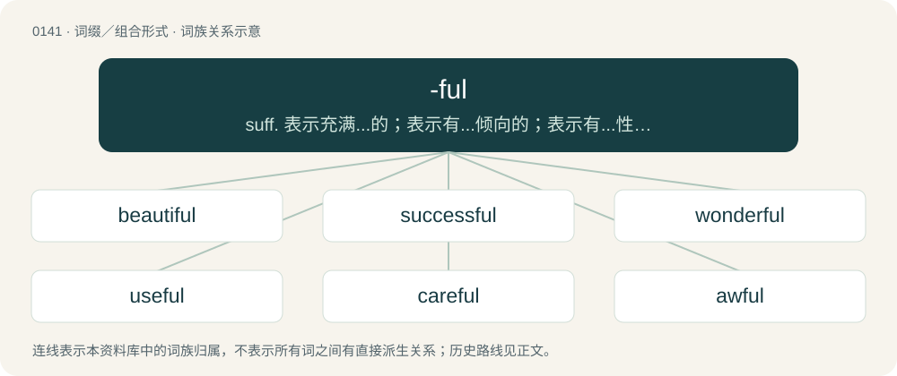

# 0148 · -ful — suff. 表示充满...的；表示有...倾向的；表示有...性质的；表示充满...的量

[总目录](../00_总目录_按常用程度.md)

**类型**：词缀／组合形式　｜　**来源语言**：见词源记录

## 核心含义与来源

- 核心含义：suff. 表示充满...的；表示有...倾向的；表示有...性质的；表示充满...的量
- 英文含义：Used to form adjectives from nouns, with the sense of being full of, tending to, or thoroughly possessing the quality expressed by the noun.
- 词形：-ful

**多个词源／构词路径**：同一拼写可能有不同来源；以下按词性和含义分别列出。

**来源记录 1**（后缀／后置成分；Used to form adjectives from nouns, with the sense of being full of, tending to, or thoroughly possessing the quality expressed by the noun.）

Inherited from Middle English -ful, -full, from Old English -ful, -full (“full of; -ful”), from Proto-Germanic \*-fullaz (“-ful”), from Proto-Germanic \*fullaz (“full”); see full. Cognate with Scots -fu, Saterland Frisian -ful (“-ful”), West Frisian -fol (“-ful”), Dutch -vol (“-ful”), German -voll (“-ful”), Swedish -full (“-ful”), Danish -fuld (“-ful”), Icelandic -fullur, -fyllur (“-ful”).

**来源记录 2**（后缀／后置成分；Used to form nouns from nouns meaning “as much as can be held by what is denoted by the noun”.）

Inherited from Middle English -ful, from Old English -ful, -full, from Proto-Germanic \*fullō, \*fullijô (“filling”).

## 词族图

## 单词速览（常用到不常用）

| 单词 | 音标 | 释义 |
|---|---|---|
| [beautiful](#w-1) | 英 /ˈbjuːtɪ.fəl/；美 /ˈbju.tɪ.fəl/ | a. 美丽的 |
| [successful](#w-2) | 英 /səkˈsɛs.fəl/ | a. 成功的, 一帆风顺的, 顺利的；\[经\] 成功的 |
| [wonderful](#w-3) | 英 /ˈwʌndəfl̩/；美 /ˈwʌndɚfl̩/ | a. 令人惊奇的, 奇妙的, 极好的 |
| [useful](#w-4) | 英 /ˈjuːsfəl/；美 /ˈjusfəl/ | a. 有用的, 有益的；\[机\] 有用的, 有效的 |
| [careful](#w-5) | 英 /ˈkɛːfl̩/；美 /ˈkɛɹfəl/ | a. 小心的, 谨慎的 |
| [awful](#w-6) | 英 /ˈɔːfʊl/；/ˈɔfəl/ | a. 可怕的, 庄严的, 虔敬的 |
| [helpful](#w-7) | /ˈhɛlp.fl̩/ | a. 有帮助的, 有益的, 有用的 |
| [grateful](#w-8) | 英 /ˈɡɹeɪtf(ʊ)l/；美 /ˈɡɹeɪtf(ə)l/ | a. 感谢的, 感激的, 令人快意的, 受欢迎的 |
| [painful](#w-9) | /ˈpeɪn.fl̩/ | a. 痛苦的, 困难的, 令人烦恼的；\[医\] 疼痛的 |
| [meaningful](#w-10) | 英 /ˈmiː.nɪŋ.fl̩/；美 /ˈmi.nɪŋ.fl̩/ | a. 意味深长的 |
| [handful](#w-11) | /ˈhæn(d)fʊl/ | n. 少数, 一把, 棘手事 |
| [faithful](#w-12) | /ˈfeɪθ.fl̩/ | a. 忠实的, 详确的, 可靠的；n. 信徒 |
| [harmful](#w-13) | 英 /ˈhɑːmfl̩/；美 /ˈhɑɹmfl̩/ | a. 有害的, 伤害的 |
| [thankful](#w-14) | /ˈθæŋkfəl/ | a. 感谢的, 感激的, 欣慰的 |
| [stressful](#w-15) | /ˈstɹɛsfəl/ | a. 着重, 强调, 重读, 使受应力 |
| [thoughtful](#w-16) | 英 /ˈθɔːtfəl/；/ˈfoːtfəl/ | a. 深思的, 体贴的 |
| [colorful](#w-17) | 英 /ˈkʌl.ə.fl̩/；美 /ˈkʌl.əɹ.fl̩/ | a. 华美的, 富有色彩的, 有趣的 |
| [hopeful](#w-18) | 英 /ˈhəʊpfl̩/；美 /ˈhoʊpfl̩/ | n. 有希望之人, 有前途之人；a. 有希望的, 怀抱希望的, 保持乐观的 |
| [delightful](#w-19) | /dəˈlaɪt.fl̩/ | a. 令人愉快的, 可爱的 |
| [respectful](#w-20) | /ɹɪˈspɛkt.fl̩/ | a. 表示尊敬的, 有礼貌的, 谦恭的 |
| [dreadful](#w-21) | /ˈdɹɛd.fl̩/ | a. 可怕的 |
| [lawful](#w-22) | 英 /ˈlɔːfl̩/；美 /ˈlɔfl̩/ | a. 法律许可的, 守法的, 合法的；\[经\] 合法的, 法定的 |
| [cheerful](#w-23) | 英 /ˈt͡ʃɪəfl̩/；美 /ˈt͡ʃɪɹfl̩/ | a. 快活的, 高兴的, 兴高采烈的 |
| [fearful](#w-24) | 英 /ˈfɪəfəl/；美 /ˈfɪɹfəl/ | a. 可怕的, 恐怕的, 担心的 |
| [youthful](#w-25) | 英 /ˈjuːθfəl/；美 /ˈjuθfəl/ | a. 年轻的, 青年的；\[法\] 青年的, 年轻的 |
| [shameful](#w-26) | /ˈʃeɪmfəl/ | a. 可耻的, 丢脸的, 不道德的, 淫猥的, 猥亵的, 不体面的 |
| [colourful](#w-27) | /ˈkʌləful/ | a. 颜色丰富的, 鲜艳的, 艳丽的, 多色的, 丰富多彩的, 吸引人的, 引人入胜的；\[计\] 有色的 |
| [playful](#w-28) | /ˈpleɪfl̩/ | a. 爱打趣的, 多趣的, 开玩笑的, 嬉戏的 |
| [doubtful](#w-29) | /ˈdaʊtfəl/ | a. 可疑的, 疑心的, 不明确的；\[法\] 怀疑的, 有疑问的, 未确的 |
| [hateful](#w-30) | /ˈheɪtfəl/ | a. 憎恨的, 可恨的, 可恶的 |
| [mindful](#w-31) | /ˈmaɪnd.fl̩/ | a. 深切注意的, 留神的, 留心的 |
| [truthful](#w-32) | /ˈtɹuːθ.f(ə)l/ | a. 说真话的, 诚实的, 真实的, 如实的；\[法\] 真实的, 说实话的, 诚实的 |
| [insightful](#w-33) | /ɪnˈsaɪt.f(ə)l/ | a. 有深刻见解的, 富有洞察力的 |
| [joyful](#w-34) | /ˈd͡ʒɔɪfl̩/ | a. 欢喜的, 高兴的, 令人高兴的 |
| [graceful](#w-35) | 英 /ˈɡɹeɪsfʊl/ | a. 优美的 |
| [rightful](#w-36) | /ˈɹaɪtfəl/ | a. 合法的, 正直的, 恰当的；\[法\] 正当的, 合法的, 依法有求权的 |
| [plentiful](#w-37) | /ˈplɛntɪfl̩/ | a. 许多的, 丰富的, 丰饶的 |
| [sinful](#w-38) | /ˈsɪnfl̩/ | a. 有罪的, 罪孽深重的；\[法\] 有罪, 充满罪恶的 |
| [disgraceful](#w-39) | /disˈgreisful/ | a. 可耻的, 不名誉的 |
| [wrongful](#w-40) | /ˈɹɒŋfəl/ | a. 不正当的, 不法的, 不讲道理的；\[法\] 错误的, 不正当的, 伤害的 |
| [fruitful](#w-41) | /ˈfɹuːtfl̩/ | a. 结果实的, 多实的, 产量多的 |
| [hurtful](#w-42) | 英 /ˈhɜːtfʊl/；美 /ˈhɜɹtfʊl/ | a. 造成损害的, 伤感情的, 伤害的 |
| [merciful](#w-43) | 英 /ˈmɜː.sɪ.fl̩/；美 /ˈmɝ.sɪ.fl̩/ | a. 仁慈的, 慈悲的 |
| [wasteful](#w-44) | /ˈweɪstfəl/ | a. 浪费的, 不经济的 |
| [forceful](#w-45) | 英 /ˈfɔːsfəl/；美 /ˈfoɹsfəl/ | a. 有力的, 强烈的, 有说服力的 |
| [pitiful](#w-46) | /ˈpɪt.ɪ.fl̩/ | a. 慈悲的, 可怜的, 令人同情的, 可鄙的 |
| [skillful](#w-47) | /ˈskɪl.fəl/ | a. 熟练的, 巧妙的；\[机\] 熟练的 |
| [soulful](#w-48) | /ˈsoʊlfəl/ | a. 充满精神的, 感情上的, 高尚的 |
| [wishful](#w-49) | 英 /ˈwɪʃfəl/ | a. 愿望的, 渴望的, 一厢情愿的 |
| [watchful](#w-50) | 英 /ˈwɒt͡ʃ.fəl/；美 /ˈwɔt͡ʃ.fəl/ | a. 注意的, 警戒的, 警醒的, (时间)醒着换过的 |
| [resourceful](#w-51) | /riˈsɒːsful/ | a. 资源丰富的, 策略的, 机智的；\[法\] 资源丰富的, 善于遂机应变的, 足智多谋的 |
| [purposeful](#w-52) | 英 /ˈpɜː.pəs.fəl/；美 /ˈpɝ.pəs.fəl/ | a. 有目的的；\[法\] 有意图的, 有目的的, 故意的 |
| [fateful](#w-53) | /ˈfeɪtfəl/ | a. 宿命的, 重大的, 决定性的 |
| [masterful](#w-54) | /ˈmɑːstəful/ | a. 傲慢的, 主人派头的, 熟练的 |
| [eventful](#w-55) | /iˈventful/ | a. 变故多的, 多事的, 重要的 |
| [mouthful](#w-56) | /ˈmaʊθfʊl/ | n. 一口, 满口 |
| [blissful](#w-57) | /ˈblisful/ | a. 充满喜悦的 |
| [tasteful](#w-58) | /ˈteɪstfəl/ | a. 有鉴赏力的, 趣味高雅的, 雅观的 |
| [vengeful](#w-59) | /ˈvɛnʒ.fəl/ | a. 复仇心重的, 报复的 |
| [distasteful](#w-60) | 英 /dɪsˈteɪstfəɫ/ | a. 味道差的, 使人不愉快的, 讨厌的 |
| [tearful](#w-61) | 英 /ˈtɪə(ɹ)fʊl/；美 /ˈtɪɹfʊl/ | a. 含泪的, 使人流泪的, 流泪的 |
| [deceitful](#w-62) | 英 /dɪˈsiːtfʊl/ | a. 欺诈的 |
| [fanciful](#w-63) | /ˈfænsɪfl̩/ | a. 奇怪的, 稀奇的, 想像的 |
| [resentful](#w-64) | /ɹɪˈzɛntfəl/ | a. 岔恨的, 易怨恨的, 不满的, 显然不满的 |
| [impactful](#w-65) | /ˈɪmpæktfəl/ | a. 有效的, 有力的 |
| [spiteful](#w-66) | /ˈspaɪtfʊl/ | a. 怀恨的, 怀有恶意的, 恶意的 |
| [artful](#w-67) | 美 /ˈɑːtf(ʊ)l/ | a. 巧妙的, 狡猾的 |
| [bountiful](#w-68) | 英 /ˈbaʊntɪfʌl/；/ˈbaʊntɪfəl/ | a. 慷慨的, 宽大的 |
| [forgetful](#w-69) | /fərˈɡɛtfəl/ | a. 健忘的, 易忘的 |
| [spoonful](#w-70) | /ˈspuːnfəl/ | n. 一匙；\[医\] 一匙, 匙 |
| [frightful](#w-71) | /ˈfɹaɪtfəl/ | a. 可怕的, 惊人的, 丑的, 非常的 |
| [healthful](#w-72) | /ˈhelθful/ | a. 有益健康的, 使人健康的, 卫生的；\[法\] 有益健康的, 健康的, 卫生的 |
| [wilful](#w-73) | /ˈwɪlfʊl/ | a. 任性的, 固执的, 故意的, 存心的；\[法\] 有意的, 故意的, 任性的 |
| [restful](#w-74) | /ˈɹɛs(t)fʊl/ | a. 给人休息的, 素雅的, 安静的 |
| [suspenseful](#w-75) | /səsˈpensful/ | a. 悬疑的, 令人紧张的 |
| [mournful](#w-76) | 英 /ˈmɔːnfəl/；美 /ˈmɔɹnfəl/ | a. 悲恸的, 悲哀的, 令人惋惜的 |
| [sorrowful](#w-77) | 英 /ˈsɒɹəʊfəl/；美 /ˈsɑɹoʊfəl/ | a. 悲伤的 |
| [woeful](#w-78) | /ˈwəʊfəl/ | a. 悲伤的, 悲哀的 |
| [flavorful](#w-79) | /ˈfleivəfjl/ | a. 充满...味道的, 可口的 |
| [lustful](#w-80) | /ˈlʌst.fəl/ | a. 贪欲的, 好色的 |
| [dutiful](#w-81) | /ˈdjuːtiful/ | a. 尽职的, 忠实的, 顺从的, 守本分的 |
| [distrustful](#w-82) | /disˈtrʌstful/ | a. 不信任的, 怀疑的, 可疑的 |
| [remorseful](#w-83) | /ɹɪˈmɔː(ɹ)sfʊl/ | a. 极为后悔的, 懊悔的 |
| [tactful](#w-84) | /ˈtæktfəl/ | a. 机智的, 老练的 |
| [fistful](#w-85) | 英 /ˈfɪstˌfʊl/ | n. 一把, 相当大的数量 |
| [regretful](#w-86) | /riˈgretful/ | a. 惋惜的, 遗憾的, 抱歉的 |
| [bashful](#w-87) | /ˈbæʃful/ | a. 害羞的 |
| [needful](#w-88) | /ˈniːdfl̩/ | a. 必要的, 需要的 |
| [boastful](#w-89) | /ˈbəʊstfʊl/ | a. 自夸的, 自负的, 喜夸耀的 |
| [worshipful](#w-90) | 英 /ˈwɜːʃɪpfl̩/；美 /ˈwɝʃɪpfl̩/ | a. 崇拜的, 尊敬的, 尊贵的 |
| [gainful](#w-91) | /ˈgeinful/ | a. 有利益的, 唯利是图的 |
| [neglectful](#w-92) | /niˈglektful/ | a. 不小心的, 疏忽的 |
| [prideful](#w-93) | 英 /ˈpɹʌɪdfəl/ | a. 自傲的 |
| [gleeful](#w-94) | /ˈɡliːfəl/ | a. 愉快的 |
| [disdainful](#w-95) | 英 /dɪsˈdeɪn.fəl/ | a. 轻蔑的, 倨傲的 |
| [earful](#w-96) | 英 /ˈɪəfəl/；美 /ˈɪɹfəl/ | n. 惊人(或重要)新闻的透露, (说话、闲话等的)大量, 过多, 斥责 |
| [prayerful](#w-97) | 英 /ˈpɹɛːfʊl/ | a. 常常祷告的, 虔诚的 |
| [scornful](#w-98) | 英 /ˈskɔːnfəl/；美 /ˈskɔɹnfəl/ | a. 轻蔑的 |
| [roomful](#w-99) | /ˈruːmful/ | n. 满房间, 满场的人 |
| [fitful](#w-100) | 英 /ˈfɪtf(ʊ)l/；美 /ˈfɪtf(ə)l/ | a. 断断续续的, 一阵阵的, 间歇的 |
| [tuneful](#w-101) | /ˈtjuːnful/ | a. 和谐的, 音调优美的 |
| [rueful](#w-102) | /ˈɹuːfl̩/ | a. 悲伤的, 后悔的, 可怜的 |
| [baleful](#w-103) | /ˈbeɪl.fəl/ | a. 有害的, 恶意的 |
| [characterful](#w-104) | /ˈkærəktəfjl/ | a. 表现性格的, 有特殊风格的 |
| [mistrustful](#w-105) | /.misˈtrʌstful/ | a. 不信任的, 深疑的 |
| [trustful](#w-106) | /ˈtrʌstful/ | a. 轻信的, 容易相信的 |
| [pocketful](#w-107) |  | n. 一口袋(的容量) |
| [houseful](#w-108) | /ˈhausful/ | n. 满屋 |

## 逐词详解

### 1. beautiful

**词性**：形容词　｜　**音标**：英 /ˈbjuːtɪ.fəl/；美 /ˈbju.tɪ.fəl/

**中文释义**：a. 美丽的

**英文义项**：Possessing beauty, impressing the eye; attractive. / Used emphatically or ironically, after the noun it qualifies.

**构词拆分**：beauty + -ful

**词源与演化**：

From Middle English bewteful, beautefull (“attractive to the eye, beautiful”), equivalent to beauty + -ful. In this sense, largely displaced Old English fæġer (whence fair).

**例句**：

> Anyone who has ever met her thought she was absolutely beautiful.

该用例对应义项：Possessing beauty, impressing the eye; attractive.

### 2. successful

**词性**：形容词　｜　**音标**：英 /səkˈsɛs.fəl/

**中文释义**：a. 成功的, 一帆风顺的, 顺利的；\[经\] 成功的

**英文义项**：Resulting in success; assuring or promoting success; accomplishing what was proposed; having the desired effect.

**构词拆分**：success + -ful

**词源与演化**：

From success + -ful.

**用法示例／搭配（非完整句）**：

> a successful use of medicine; a successful experiment; a successful enterprise

该用例对应义项：Resulting in success; assuring or promoting success; accomplishing what was proposed; having the desired effect.

### 3. wonderful

**词性**：形容词　｜　**音标**：英 /ˈwʌndəfl̩/；美 /ˈwʌndɚfl̩/

**中文释义**：a. 令人惊奇的, 奇妙的, 极好的

**英文义项**：Tending to excite wonder; surprising, extraordinary. / Surprisingly excellent; very good or admirable, extremely impressive.

**构词拆分**：wonder + -ful

**词源与演化**：

From Middle English wonderful, wondirful, from Old English wundorful (“wonderful”), from Proto-West Germanic \*wundrafull, equivalent to wonder + -ful. Cognate Dutch wondervol (“wonderful”), German wundervoll (“wonderful”). Compare Old English wuldorfull (“glorious”).

**例句**：

> What appears to be wonderful may turn out to be anything but.

该用例对应义项：Surprisingly excellent; very good or admirable, extremely impressive.

### 4. useful

**词性**：形容词　｜　**音标**：英 /ˈjuːsfəl/；美 /ˈjusfəl/

**中文释义**：a. 有用的, 有益的；\[机\] 有用的, 有效的

**英文义项**：Having a practical or beneficial use.

**构词拆分**：use + -ful

**词源与演化**：

From use + -ful.

**例句**：

> She found the information extremely useful.

该用例对应义项：Having a practical or beneficial use.

### 5. careful

**词性**：形容词　｜　**音标**：英 /ˈkɛːfl̩/；美 /ˈkɛɹfəl/

**中文释义**：a. 小心的, 谨慎的

**英文义项**：Taking care; attentive to potential danger, error or harm; cautious. / Conscientious and painstaking; meticulous.

**构词拆分**：care + -ful

**词源与演化**：

From Middle English careful, from Old English carful; equivalent to care + -ful.

**例句**：

> Be very careful (while) trekking through the jungle.

该用例对应义项：Taking care; attentive to potential danger, error or harm; cautious.

### 6. awful

**词性**：形容词　｜　**音标**：英 /ˈɔːfʊl/；/ˈɔfəl/

**中文释义**：a. 可怕的, 庄严的, 虔敬的

**英文义项**：Very bad. / Exceedingly great; usually applied intensively.

**构词拆分**：awe + -ful

**词源与演化**：

From Middle English agheful, awfull, auful, aȝefull, equivalent to awe + -ful. Compare Old English eġeful, eġefull (“terrifying; awful”). The “very bad” sense is a pejorative semantic shift from the original sense of “awe-inspiring”.

**例句**：

> We saw such an awful film last night that we left the theater before the end.

该用例对应义项：Very bad.

### 7. helpful

**词性**：形容词　｜　**音标**：/ˈhɛlp.fl̩/

**中文释义**：a. 有帮助的, 有益的, 有用的

**英文义项**：Furnishing help; gives aid; useful.

**构词拆分**：help + -ful

**词源与演化**：

From Middle English helpful; equivalent to help + -ful.

**用法示例／搭配（非完整句）**：

> a helpful person

该用例对应义项：Furnishing help; gives aid; useful.

### 8. grateful

**词性**：形容词　｜　**音标**：英 /ˈɡɹeɪtf(ʊ)l/；美 /ˈɡɹeɪtf(ə)l/

**中文释义**：a. 感谢的, 感激的, 令人快意的, 受欢迎的

**英文义项**：Of a person or their actions, feelings, etc.: expressing gratitude or appreciation; appreciative, thankful.

**构词拆分**：grate (“(obsolete) serving to gratify, agreeable, pleasing; grateful, thankful”) + -ful (suffix forming adjectives with the sense of tending to have or thoroughly having a quality)

**词源与演化**：

From grate (“(obsolete) serving to gratify, agreeable, pleasing; grateful, thankful”) + -ful (suffix forming adjectives with the sense of tending to have or thoroughly having a quality). Grate is a learned borrowing from Latin grātus (“agreeable, pleasing; beloved, dear; grateful, thankful”), ultimately from Proto-Indo-European \*gʷerH- (“to express approval, praise; to elevate”).

**例句**：

> I’m grateful that you helped me out.

该用例对应义项：Of a person or their actions, feelings, etc.: expressing gratitude or appreciation; appreciative, thankful.

### 9. painful

**词性**：形容词　｜　**音标**：/ˈpeɪn.fl̩/

**中文释义**：a. 痛苦的, 困难的, 令人烦恼的；\[医\] 疼痛的

**英文义项**：Causing pain or distress, either physical or mental. / Afflicted or suffering with pain (of a body part or, formerly, of a person).

**构词拆分**：pain + -ful

**词源与演化**：

From Middle English paynful, peinful, peynful, paynefull, peynefull, equivalent to pain + -ful. Compare Danish pinefuld (“painful”).

**例句**：

> His violin playing is painful.

该用例对应义项：Very bad, poor.

### 10. meaningful

**词性**：形容词　｜　**音标**：英 /ˈmiː.nɪŋ.fl̩/；美 /ˈmi.nɪŋ.fl̩/

**中文释义**：a. 意味深长的

**英文义项**：Having meaning, significant. / Full of implication; heavy with unstated meaning.

**构词拆分**：meaning + -ful

**词源与演化**：

From meaning + -ful.

**例句**：

> "So you enjoyed yourself, did you," she said, with a meaningful smile.

该用例对应义项：Full of implication; heavy with unstated meaning.

### 11. handful

**词性**：名词　｜　**音标**：/ˈhæn(d)fʊl/

**中文释义**：n. 少数, 一把, 棘手事

**英文义项**：The amount that a hand will grasp or contain. / A small number, usually approximately five.

**构词拆分**：hand + full (“fullness, plenty”)；hand + -ful

**词源与演化**：

From Middle English handful, hondful, from Old English handfull (“handful”), from Proto-Germanic \*handufullō, \*handufulliz (“handful”), from Proto-Germanic \*handuz (“hand”) + \*fullaz (“full”); equivalent to hand + full (“fullness, plenty”) or hand + -ful. Cognate with Saterland Frisian Hondful (“handful”), West Frisian hânfol (“handful”), Dutch handvol (“handful”), German Handvoll (“handful”), Danish håndfuld (“handful”), Swedish handfull (“handful”), Icelandic handfylli (“handful”).

**例句**：

> Those twins are a real handful to look after.

该用例对应义项：Something which can only be managed with difficulty.

### 12. faithful

**词性**：形容词　｜　**音标**：/ˈfeɪθ.fl̩/

**中文释义**：a. 忠实的, 详确的, 可靠的；n. 信徒

**英文义项**：Loyal; adhering firmly to person or cause. / Having faith.

**构词拆分**：faith + -ful

**词源与演化**：

From Middle English feithful, equivalent to faith + -ful.

**例句**：

> My dog is very faithful: he doesn't like to be petted by anybody else.

该用例对应义项：Loyal; adhering firmly to person or cause.

### 13. harmful

**词性**：形容词　｜　**音标**：英 /ˈhɑːmfl̩/；美 /ˈhɑɹmfl̩/

**中文释义**：a. 有害的, 伤害的

**英文义项**：Causing or likely to cause harm or damage; injurious.

**构词拆分**：harm + -ful

**词源与演化**：

From Middle English harmful, from Old English \*hearmful (suggested by hearmfullīċ (“harmful; hurtful”)), equivalent to harm + -ful. Cognate with German harmvoll, Danish harmfuld, Swedish harmfull.

**例句**：

> Wear a hat to protect your skin from harmful sunlight.

该用例对应义项：Causing or likely to cause harm or damage; injurious.

### 14. thankful

**词性**：形容词　｜　**音标**：/ˈθæŋkfəl/

**中文释义**：a. 感谢的, 感激的, 欣慰的

**英文义项**：Showing appreciation or gratitude.

**构词拆分**：thank + -ful

**词源与演化**：

From Middle English thankful, from Old English þancful, þancfull (“thoughtful, pleasing, agreeable, pleasant, thankful, grateful”), equivalent to thank + -ful. Compare Old High German undankfol (“unthankful, ungrateful”).

**例句**：

> I'm thankful that you helped me out today. How can I ever repay you?

该用例对应义项：Showing appreciation or gratitude.

### 15. stressful

**词性**：形容词　｜　**音标**：/ˈstɹɛsfəl/

**中文释义**：a. 着重, 强调, 重读, 使受应力

**英文义项**：Irritating; causing stress. / Mentally taxing.

**构词拆分**：stress + -ful

**词源与演化**：

From stress + -ful.

**例句**：

> The stressful days before a war.

该用例对应义项：extremely irritating to the nerves

### 16. thoughtful

**词性**：形容词　｜　**音标**：英 /ˈθɔːtfəl/；/ˈfoːtfəl/

**中文释义**：a. 深思的, 体贴的

**英文义项**：Demonstrating thought or careful consideration. / Demonstrating kindness or consideration for others.

**构词拆分**：thought + -ful

**词源与演化**：

From Middle English thoȝtful, thohtful, equivalent to thought + -ful. Compare Dutch gedachtenvol, Swedish tankfull.

**例句**：

> Preparing dinner is a thoughtful gesture for a new mother.

该用例对应义项：Demonstrating kindness or consideration for others.

### 17. colorful

**词性**：形容词　｜　**音标**：英 /ˈkʌl.ə.fl̩/；美 /ˈkʌl.əɹ.fl̩/

**中文释义**：a. 华美的, 富有色彩的, 有趣的

**英文义项**：Possessing prominent and varied colors. / Interesting, multifaceted, energetic, distinctive.

**构词拆分**：color + -ful

**词源与演化**：

From color + -ful.

**例句**：

> I love looking at everyone's colorful kimonos on Coming of Age Day.

### 18. hopeful

**词性**：形容词　｜　**音标**：英 /ˈhəʊpfl̩/；美 /ˈhoʊpfl̩/

**中文释义**：n. 有希望之人, 有前途之人；a. 有希望的, 怀抱希望的, 保持乐观的

**英文义项**：feeling hope / inspiring hope

**构词拆分**：hope + -ful

**词源与演化**：

From hope + -ful.

**例句**：

> It looks hopeful that my father will be able to walk again.

该用例对应义项：inspiring hope

### 19. delightful

**词性**：形容词　｜　**音标**：/dəˈlaɪt.fl̩/

**中文释义**：a. 令人愉快的, 可爱的

**英文义项**：Pleasant; pleasing, bringing enjoyment, satisfaction, or pleasure.

**构词拆分**：delight + -ful

**词源与演化**：

From Middle English deliteful, delitfull, equivalent to delight + -ful.

**例句**：

> The comedy was delightful.

该用例对应义项：greatly pleasing or entertaining

### 20. respectful

**词性**：形容词　｜　**音标**：/ɹɪˈspɛkt.fl̩/

**中文释义**：a. 表示尊敬的, 有礼貌的, 谦恭的

**英文义项**：Marked or characterized by respect

**构词拆分**：respect + -ful

**词源与演化**：

From respect + -ful.

**例句**：

> It is of great importance that you act in a respectful manner towards the duke and duchess.

该用例对应义项：Marked or characterized by respect

### 21. dreadful

**词性**：形容词　｜　**音标**：/ˈdɹɛd.fl̩/

**中文释义**：a. 可怕的

**英文义项**：Genuinely horrific, awful, or alarming; dangerous, risky. / Unpleasant, awful, very bad (also used as an intensifier).

**构词拆分**：By surface analysis, dread + -ful

**词源与演化**：

From Middle English dredful, dredfull, dredeful (also dreful). By surface analysis, dread + -ful.

**例句**：

> It is so dreadful that I don't want to think of it.

### 22. lawful

**词性**：形容词　｜　**音标**：英 /ˈlɔːfl̩/；美 /ˈlɔfl̩/

**中文释义**：a. 法律许可的, 守法的, 合法的；\[经\] 合法的, 法定的

**英文义项**：Conforming to, or recognised by the laws of society. / Operating according to some law or fundamental principle.

**构词拆分**：law + -ful

**词源与演化**：

From Middle English laweful, equivalent to law + -ful, conflated with Middle English leful, leeful, leveful (“according to law, lawful, pertaining to law”). See also leveful.

**例句**：

> Lawful money is always a land asset and can only be issued by an actual land jurisdiction government — not a corporation.

该用例对应义项：Conforming to, or recognised by the laws of society.

### 23. cheerful

**词性**：形容词　｜　**音标**：英 /ˈt͡ʃɪəfl̩/；美 /ˈt͡ʃɪɹfl̩/

**中文释义**：a. 快活的, 高兴的, 兴高采烈的

**英文义项**：Noticeably happy and optimistic. / Bright and pleasant.

**构词拆分**：cheer + -ful

**词源与演化**：

From Middle English chereful, cherful, equivalent to cheer + -ful.

**例句**：

> They enjoyed a cheerful room.

该用例对应义项：Bright and pleasant.

### 24. fearful

**词性**：形容词　｜　**音标**：英 /ˈfɪəfəl/；美 /ˈfɪɹfəl/

**中文释义**：a. 可怕的, 恐怕的, 担心的

**英文义项**：Frightening; causing fear. / Tending to fear; timid.

**构词拆分**：fear + -ful

**词源与演化**：

From Middle English ferful, fervol, equivalent to fear + -ful.

**用法示例／搭配（非完整句）**：

> a fearful boy

该用例对应义项：Tending to fear; timid.

### 25. youthful

**词性**：形容词　｜　**音标**：英 /ˈjuːθfəl/；美 /ˈjuθfəl/

**中文释义**：a. 年轻的, 青年的；\[法\] 青年的, 年轻的

**英文义项**：Young or seeming young. / Characteristic of young people.

**构词拆分**：youth + -ful

**词源与演化**：

From youth + -ful.

**用法示例／搭配（非完整句）**：

> a youthful butler

该用例对应义项：Young or seeming young.

### 26. shameful

**词性**：形容词　｜　**音标**：/ˈʃeɪmfəl/

**中文释义**：a. 可耻的, 丢脸的, 不道德的, 淫猥的, 猥亵的, 不体面的

**英文义项**：Causing or meriting shame or disgrace; disgraceful / Giving offense.

**构词拆分**：shame + -ful

**词源与演化**：

From Middle English schameful, schamfull, from Old English \*sċeamfull, sċeomfull, equivalent to shame + -ful. Cognate with Danish skamfuld (“shameful, shamefast, ashamed”).

**用法示例／搭配（非完整句）**：

> shameful publicity

该用例对应义项：Causing or meriting shame or disgrace; disgraceful

### 27. colourful

**词性**：形容词　｜　**音标**：/ˈkʌləful/

**中文释义**：a. 颜色丰富的, 鲜艳的, 艳丽的, 多色的, 丰富多彩的, 吸引人的, 引人入胜的；\[计\] 有色的

**英文义项**：British standard spelling of colorful.

**构词拆分**：colour + -ful

**词源与演化**：

From colour + -ful.

**例句**：

> This colourful dress will suit you, with your slim figure, very well.

### 28. playful

**词性**：形容词　｜　**音标**：/ˈpleɪfl̩/

**中文释义**：a. 爱打趣的, 多趣的, 开玩笑的, 嬉戏的

**英文义项**：Enjoying play; sportive; prone to playing frequently, in the manner of a child or young pet (viz. puppy or kitten). / Funny; humorous; jesty; frolicsome; frisky.

**构词拆分**：play + -ful

**词源与演化**：

From Middle English pleiful, equivalent to play + -ful.

**例句**：

> A brainteaser is a playful puzzle posed as a test of intelligence.

该用例对应义项：Fun; recreational; unserious.

### 29. doubtful

**词性**：形容词　｜　**音标**：/ˈdaʊtfəl/

**中文释义**：a. 可疑的, 疑心的, 不明确的；\[法\] 怀疑的, 有疑问的, 未确的

**英文义项**：Subject to, or causing doubt. / Experiencing or showing doubt, skeptical.

**构词拆分**：doubt + -ful

**词源与演化**：

From Middle English doutfull, douteful, equivalent to doubt + -ful.

**例句**：

> They were doubtful that the cord would hold.

该用例对应义项：fraught with uncertainty or doubt

### 30. hateful

**词性**：形容词　｜　**音标**：/ˈheɪtfəl/

**中文释义**：a. 憎恨的, 可恨的, 可恶的

**英文义项**：Evoking a feeling of hatred. / Dislikeable.

**构词拆分**：By surface analysis, hate + -ful

**词源与演化**：

From Middle English hateful. By surface analysis, hate + -ful.

**例句**：

> No vice is universally as hateful as ingratitude.

该用例对应义项：evoking or deserving hatred

### 31. mindful

**词性**：形容词　｜　**音标**：/ˈmaɪnd.fl̩/

**中文释义**：a. 深切注意的, 留神的, 留心的

**英文义项**：aware (of something); attentive, heedful. / Of or pertaining to mindfulness; sustaining meta-attention of the contents of one's own mind in the present moment.

**构词拆分**：mind + -ful

**词源与演化**：

From Middle English myndeful, myndefull, from Old English ġemyndful (“of good memory”), equivalent to mind + -ful.

**例句**：

> I think being mindful may help you to appreciate life more.

该用例对应义项：Of or pertaining to mindfulness; sustaining meta-attention of the contents of one's own mind in the present moment.

### 32. truthful

**词性**：形容词　｜　**音标**：/ˈtɹuːθ.f(ə)l/

**中文释义**：a. 说真话的, 诚实的, 真实的, 如实的；\[法\] 真实的, 说实话的, 诚实的

**英文义项**：Honest, and always telling the truth. / Accurately depicting what is real.

**构词拆分**：truth + -ful

**词源与演化**：

From truth + -ful. Piecewise doublet of trothful, from Middle English trouþeful.

**例句**：

> He drew a truthful portrait of the prince.

该用例对应义项：Accurately depicting what is real.

### 33. insightful

**词性**：形容词　｜　**音标**：/ɪnˈsaɪt.f(ə)l/

**中文释义**：a. 有深刻见解的, 富有洞察力的

**英文义项**：Possessing insight; percipient.

**构词拆分**：insight + -ful

**词源与演化**：

A recent formation from insight + -ful.

**例句**：

> I found Duncan's comments to be insightful and thought-provoking.

该用例对应义项：Possessing insight; percipient.

### 34. joyful

**词性**：形容词　｜　**音标**：/ˈd͡ʒɔɪfl̩/

**中文释义**：a. 欢喜的, 高兴的, 令人高兴的

**英文义项**：Feeling or causing joy.

**构词拆分**：joy + -ful

**词源与演化**：

From joy + -ful.

**例句**：

> The children were joyful on the first day of summer break.

该用例对应义项：Feeling or causing joy.

### 35. graceful

**词性**：形容词　｜　**音标**：英 /ˈɡɹeɪsfʊl/

**中文释义**：a. 优美的

**英文义项**：Having or showing grace in movement, shape, or proportion. / Magnanimous, lacking arrogance or complaint; gracious.

**构词拆分**：By surface analysis, grace + -ful

**词源与演化**：

From Middle English graceful. By surface analysis, grace + -ful.

**例句**：

> The athlete's graceful acceptance of the controversial second-place finish won the admiration of the spectators.

该用例对应义项：Magnanimous, lacking arrogance or complaint; gracious.

### 36. rightful

**词性**：形容词　｜　**音标**：/ˈɹaɪtfəl/

**中文释义**：a. 合法的, 正直的, 恰当的；\[法\] 正当的, 合法的, 依法有求权的

**英文义项**：By right; by law.

**构词拆分**：right + -ful

**词源与演化**：

From Middle English rightful, ryghtfull, riȝtful, from Old English \*rihtfull (suggested by derivative unrihtfull (“unrightful”)), equivalent to right + -ful.

**例句**：

> He was restored to his rightful position.

该用例对应义项：By right; by law.

### 37. plentiful

**词性**：形容词　｜　**音标**：/ˈplɛntɪfl̩/

**中文释义**：a. 许多的, 丰富的, 丰饶的

**英文义项**：Existing in large number or ample amount. / Yielding abundance; fruitful.

**构词拆分**：plenty + -ful

**词源与演化**：

From Middle English plentiful, plentyfull, plentefull, equivalent to plenty + -ful.

**例句**：

> Some years, the tree is a plentiful source of apples.

该用例对应义项：Yielding abundance; fruitful.

### 38. sinful

**词性**：形容词　｜　**音标**：/ˈsɪnfl̩/

**中文释义**：a. 有罪的, 罪孽深重的；\[法\] 有罪, 充满罪恶的

**英文义项**：Having sinned; guilty of sin. / Constituting a sin; morally or religiously wrong; wicked; evil.

**构词拆分**：sin + -ful

**词源与演化**：

From Middle English synful, senful, sunful, from Old English synful (“sinful, guilty, wicked, corrupt”), equivalent to sin + -ful. Compare Dutch zondevol (“sinful”), German sündevoll (“sinful”), Danish syndefuld (“sinful”), Swedish syndfull (“sinful”), Icelandic syndfullur (“sinful”).

**例句**：

> He said it was sinful to wear lipstick.

该用例对应义项：characterized by iniquity; wicked because it is believed to be a sin

### 39. disgraceful

**词性**：形容词　｜　**音标**：/disˈgreisful/

**中文释义**：a. 可耻的, 不名誉的

**英文义项**：Bringing or warranting disgrace; shameful. / Giving offense to moral sensibilities and injurious to reputation.

**构词拆分**：disgrace + -ful

**词源与演化**：

From disgrace + -ful.

**例句**：

> You abandoned us in the most disgraceful manner.

### 40. wrongful

**词性**：形容词　｜　**音标**：/ˈɹɒŋfəl/

**中文释义**：a. 不正当的, 不法的, 不讲道理的；\[法\] 错误的, 不正当的, 伤害的

**英文义项**：wrong or unjust / unlawful or illegal

**构词拆分**：wrong + -ful

**词源与演化**：

From Middle English wrongful, equivalent to wrong + -ful.

**例句**：

> AI facial recognition has led to a number of wrongful arrests.

### 41. fruitful

**词性**：形容词　｜　**音标**：/ˈfɹuːtfl̩/

**中文释义**：a. 结果实的, 多实的, 产量多的

**英文义项**：Favourable to the growth of fruit or useful vegetation; not barren. / Being productive in any sense; yielding benefits.

**构词拆分**：fruit + -ful

**词源与演化**：

From Middle English fruitefull, equivalent to fruit + -ful. Compare Dutch vruchtvol, German fruchtvoll, Swedish fruktfull.

**用法示例／搭配（非完整句）**：

> The extra work in the office turned out to be fruitful after all—I got promoted

该用例对应义项：Being productive in any sense; yielding benefits.

### 42. hurtful

**词性**：形容词　｜　**音标**：英 /ˈhɜːtfʊl/；美 /ˈhɜɹtfʊl/

**中文释义**：a. 造成损害的, 伤感情的, 伤害的

**英文义项**：Tending to impair or damage; injurious; occasioning loss or injury. / Tending to hurt someone's feelings; insulting; lacerating.

**构词拆分**：hurt + -ful

**词源与演化**：

From hurt + -ful.

**例句**：

> Her hurtful unconsidered words.

该用例对应义项：causing hurt

### 43. merciful

**词性**：形容词　｜　**音标**：英 /ˈmɜː.sɪ.fl̩/；美 /ˈmɝ.sɪ.fl̩/

**中文释义**：a. 仁慈的, 慈悲的

**英文义项**：Showing mercy.

**构词拆分**：mercy + -ful

**词源与演化**：

From Middle English merciful, mercyful, equivalent to mercy + -ful. Displaced native Old English mildheort.

**例句**：

> Sought merciful treatment for the captives.

该用例对应义项：showing or giving mercy

### 44. wasteful

**词性**：形容词　｜　**音标**：/ˈweɪstfəl/

**中文释义**：a. 浪费的, 不经济的

**英文义项**：Inclined to waste or squander money or resources.

**构词拆分**：waste + -ful

**词源与演化**：

From Middle English wastful; equivalent to waste + -ful.

**例句**：

> When wasteful war shall statues overturn.

该用例对应义项：laying waste

### 45. forceful

**词性**：形容词　｜　**音标**：英 /ˈfɔːsfəl/；美 /ˈfoɹsfəl/

**中文释义**：a. 有力的, 强烈的, 有说服力的

**英文义项**：Capable of either physical or coercive force; powerful.

**构词拆分**：force + -ful

**词源与演化**：

From force + -ful.

**例句**：

> His forceful personality often dominated discussions.

该用例对应义项：Capable of either physical or coercive force; powerful.

### 46. pitiful

**词性**：形容词　｜　**音标**：/ˈpɪt.ɪ.fl̩/

**中文释义**：a. 慈悲的, 可怜的, 令人同情的, 可鄙的

**英文义项**：So appalling or sad that one feels or should feel sorry for it; eliciting pity. / Eliciting contempt.

**构词拆分**：By surface analysis, pit(i) + -ful

**词源与演化**：

From Middle English pityful, piteful, piteeful. By surface analysis, pit(i) + -ful.

**例句**：

> A pitiful number of students bothered to turn up.

该用例对应义项：Of an amount or number: very small.

### 47. skillful

**词性**：形容词　｜　**音标**：/ˈskɪl.fəl/

**中文释义**：a. 熟练的, 巧妙的；\[机\] 熟练的

**英文义项**：Possessing skill; skilled. / Requiring skill.

**构词拆分**：skill + -ful

**词源与演化**：

From Middle English skilful, skylfull, scelvol, equivalent to skill + -ful.

**用法示例／搭配（非完整句）**：

> she's a skillful mechanical

该用例对应义项：Possessing skill; skilled.

### 48. soulful

**词性**：形容词　｜　**音标**：/ˈsoʊlfəl/

**中文释义**：a. 充满精神的, 感情上的, 高尚的

**英文义项**：Full of emotion and vigor. / Full of soul.

**构词拆分**：soul + -ful (adjective suffix)

**词源与演化**：

From soul + -ful (adjective suffix).

**例句**：

> These girls have soulful voices and, man, they're hot.

### 49. wishful

**词性**：形容词　｜　**音标**：英 /ˈwɪʃfəl/

**中文释义**：a. 愿望的, 渴望的, 一厢情愿的

**英文义项**：Expressing a wish or longing for something. / Aspiring, or seeking advancement.

**构词拆分**：wish + -ful

**词源与演化**：

From wish + -ful.

**例句**：

> Investors must distinguish between genuine value creation and wishful thinking.

### 50. watchful

**词性**：形容词　｜　**音标**：英 /ˈwɒt͡ʃ.fəl/；美 /ˈwɔt͡ʃ.fəl/

**中文释义**：a. 注意的, 警戒的, 警醒的, (时间)醒着换过的

**英文义项**：Fully observant, vigilant, or aware.

**构词拆分**：watch + -ful

**词源与演化**：

From Middle English waccheful, equivalent to watch + -ful. Compare West Frisian waaks (“watchful”), Dutch waaks, waakzaam (“watchful”), German wachsam (“watchful”), Swedish vaksam (“watchful”).

**例句**：

> The teacher kept a watchful eye on her pupils during the school trip.

该用例对应义项：Fully observant, vigilant, or aware.

### 51. resourceful

**词性**：形容词　｜　**音标**：/riˈsɒːsful/

**中文释义**：a. 资源丰富的, 策略的, 机智的；\[法\] 资源丰富的, 善于遂机应变的, 足智多谋的

**英文义项**：Capable or clever; able to put available resources to efficient or ingenious use; using materials at hand wisely or efficiently.

**构词拆分**：resource + -ful

**词源与演化**：

From resource + -ful.

**例句**：

> With a resourceful use of space and a fresh coat of paint, the room became a pleasant library with a comfortable seating area.

该用例对应义项：Capable or clever; able to put available resources to efficient or ingenious use; using materials at hand wisely or efficiently.

### 52. purposeful

**词性**：形容词　｜　**音标**：英 /ˈpɜː.pəs.fəl/；美 /ˈpɝ.pəs.fəl/

**中文释义**：a. 有目的的；\[法\] 有意图的, 有目的的, 故意的

**英文义项**：Having purpose: having intention or meaning; intentional. / Having a purpose in mind; resolute; determined, full of determination.

**构词拆分**：purpose + -ful

**词源与演化**：

From purpose + -ful.

**例句**：

> Led a happy purposeful life.

该用例对应义项：having meaning through having an aim

### 53. fateful

**词性**：形容词　｜　**音标**：/ˈfeɪtfəl/

**中文释义**：a. 宿命的, 重大的, 决定性的

**英文义项**：Momentous, significant, setting or sealing one’s fate. / Determined in advance by fate, fated.

**构词拆分**：fate + -ful

**词源与演化**：

From fate + -ful.

**例句**：

> It started with that fateful trip, history was never the same afterwards.

该用例对应义项：Momentous, significant, setting or sealing one’s fate.

### 54. masterful

**词性**：形容词　｜　**音标**：/ˈmɑːstəful/

**中文释义**：a. 傲慢的, 主人派头的, 熟练的

**英文义项**：Of or pertaining to the manner of a master of an art, technique, profession, or craft; masterly. / In the manner of a master; very skillful.

**构词拆分**：master + -ful

**词源与演化**：

From Middle English maysterful, maistrefull, equivalent to master + -ful.

**例句**：

> The masterful conducting ensured the orchestra gave of their best.

该用例对应义项：In the manner of a master; very skillful.

### 55. eventful

**词性**：形容词　｜　**音标**：/iˈventful/

**中文释义**：a. 变故多的, 多事的, 重要的

**英文义项**：Of or pertaining to high levels of activity; having many memorable events.

**构词拆分**：event + -ful

**词源与演化**：

From event + -ful.

**例句**：

> With the number of drunken revellers on the streets it could hardly fail to be an eventful night.

该用例对应义项：Of or pertaining to high levels of activity; having many memorable events.

### 56. mouthful

**词性**：名词　｜　**音标**：/ˈmaʊθfʊl/

**中文释义**：n. 一口, 满口

**英文义项**：The amount that will fit in a mouth. / Quite a bit.

**构词拆分**：mouth + -ful

**词源与演化**：

From Middle English mouthful, mouth-full, mouthe full, from Old English \*mūþfull, from Proto-West Germanic \*munþafull, equivalent to mouth + -ful. Compare Dutch mondvol (“mouthful”), German Mundvoll (“mouthful”), Danish mundfuld (“mouthful”), Swedish munfull (“mouthful”), Icelandic munnfylli (“mouthful”). Compare also West Frisian mûlfol (“mouthful”).

**例句**：

> He swallowed a mouthful of sea water when he fell in.

该用例对应义项：The amount that will fit in a mouth.

### 57. blissful

**词性**：形容词　｜　**音标**：/ˈblisful/

**中文释义**：a. 充满喜悦的

**英文义项**：Extremely happy; full of joy; experiencing, indicating, causing, or characterized by bliss.

**构词拆分**：bliss + -ful

**词源与演化**：

From Middle English blisful, bislvol, equivalent to bliss + -ful.

**例句**：

> Anything is blissful with you. Nothing is meaningful without you.

### 58. tasteful

**词性**：形容词　｜　**音标**：/ˈteɪstfəl/

**中文释义**：a. 有鉴赏力的, 趣味高雅的, 雅观的

**英文义项**：Having or exhibiting good taste; aesthetically pleasing or conforming to expectations or ideals of what is appropriate. / Having a high relish; savoury.

**构词拆分**：taste + -ful

**词源与演化**：

From taste + -ful.

**例句**：

> Her home was decorated with tasteful, classical furnishings.

该用例对应义项：Having or exhibiting good taste; aesthetically pleasing or conforming to expectations or ideals of what is appropriate.

### 59. vengeful

**词性**：形容词　｜　**音标**：/ˈvɛnʒ.fəl/

**中文释义**：a. 复仇心重的, 报复的

**英文义项**：Vindictive or wanting vengeance.

**构词拆分**：venge + -ful

**词源与演化**：

From venge + -ful.

**例句**：

> His chains now broken, the prisoner turned a vengeful eye toward his former captors.

该用例对应义项：Vindictive or wanting vengeance.

### 60. distasteful

**词性**：形容词　｜　**音标**：英 /dɪsˈteɪstfəɫ/

**中文释义**：a. 味道差的, 使人不愉快的, 讨厌的

**英文义项**：Having a bad or foul taste. / Unpleasant.

**构词拆分**：distaste + -ful；dis- + tasteful

**词源与演化**：

From distaste + -ful or dis- + tasteful.

**例句**：

> Scrubbing the floors was a distasteful duty to perform.

该用例对应义项：Unpleasant.

### 61. tearful

**词性**：形容词　｜　**音标**：英 /ˈtɪə(ɹ)fʊl/；美 /ˈtɪɹfʊl/

**中文释义**：a. 含泪的, 使人流泪的, 流泪的

**英文义项**：Accompanied by tears; crying, or about to cry. / Sorrowful.

**构词拆分**：tear + -ful

**词源与演化**：

From tear + -ful.

**例句**：

> Aaron got a little tearful until Laura came to reassure him.

该用例对应义项：Accompanied by tears; crying, or about to cry.

### 62. deceitful

**词性**：形容词　｜　**音标**：英 /dɪˈsiːtfʊl/

**中文释义**：a. 欺诈的

**英文义项**：Deliberately misleading or cheating. / Deceptive, two-faced.

**构词拆分**：deceit + -ful

**词源与演化**：

From deceit + -ful.

**例句**：

> All male human beings have been, are, and always will be deceitful.

### 63. fanciful

**词性**：形容词　｜　**音标**：/ˈfænsɪfl̩/

**中文释义**：a. 奇怪的, 稀奇的, 想像的

**英文义项**：Imaginative or fantastic; ignoring reality. / Unreal or imagined.

**构词拆分**：fancy + -ful

**词源与演化**：

From fancy + -ful.

**例句**：

> It was fanciful to suppose that all he had to do would be to stride into a top law firm and he would be hired on the spot.

该用例对应义项：Imaginative or fantastic; ignoring reality.

### 64. resentful

**词性**：形容词　｜　**音标**：/ɹɪˈzɛntfəl/

**中文释义**：a. 岔恨的, 易怨恨的, 不满的, 显然不满的

**英文义项**：Inclined to resent, who tends to harbor resentment, when wronged. / Harboring resentment, full of resentment, at a given moment.

**构词拆分**：resent + -ful

**词源与演化**：

From resent + -ful.

**例句**：

> Resentful at the way he was treated.

该用例对应义项：full of or marked by resentment or indignant ill will

### 65. impactful

**词性**：形容词　｜　**音标**：/ˈɪmpæktfəl/

**中文释义**：a. 有效的, 有力的

**英文义项**：Having impact.

**构词拆分**：impact + -ful

**词源与演化**：

From impact + -ful.

**例句**：

> There's nothing really impactful about this commercial, but I remember it well.

### 66. spiteful

**词性**：形容词　｜　**音标**：/ˈspaɪtfʊl/

**中文释义**：a. 怀恨的, 怀有恶意的, 恶意的

**英文义项**：Filled with, or showing, spite; having a desire to annoy or harm.

**构词拆分**：By surface analysis, spite + -ful

**词源与演化**：

From Middle English spytefulle. By surface analysis, spite + -ful.

**例句**：

> A truly spiteful child.

该用例对应义项：showing malicious ill will and a desire to hurt; motivated by spite

### 67. artful

**词性**：形容词　｜　**音标**：美 /ˈɑːtf(ʊ)l/

**中文释义**：a. 巧妙的, 狡猾的

**英文义项**：Characterized by, or performed with, cleverness or contrivance; clever, ingenious. / Not naturally produced; artificial; imitative.

**构词拆分**：art (“skill that is attained by study, practice, or observation”) + -ful (suffix forming adjectives from nouns, with the sense of being full of, tending to, or thoroughly possessing the quality expressed by the noun)

**词源与演化**：

From art (“skill that is attained by study, practice, or observation”) + -ful (suffix forming adjectives from nouns, with the sense of being full of, tending to, or thoroughly possessing the quality expressed by the noun).

**例句**：

> An artful choice of metaphors.

该用例对应义项：marked by skill in achieving a desired end especially with cunning or craft

### 68. bountiful

**词性**：形容词　｜　**音标**：英 /ˈbaʊntɪfʌl/；/ˈbaʊntɪfəl/

**中文释义**：a. 慷慨的, 宽大的

**英文义项**：Having a quantity or amount that is generous or plentiful; ample.

**构词拆分**：bounty + -ful

**词源与演化**：

From bounty + -ful.

**例句**：

> They enjoyed a wet summer and a bountiful harvest.

该用例对应义项：Having a quantity or amount that is generous or plentiful; ample.

### 69. forgetful

**词性**：形容词　｜　**音标**：/fərˈɡɛtfəl/

**中文释义**：a. 健忘的, 易忘的

**英文义项**：Unable to remember things well; liable to forget. / Dropping some of the input's structure or properties before producing an output.

**构词拆分**：forget + -ful

**词源与演化**：

From Middle English \*forgetful, \*forȝetful (suggested by derivative forgetfulnesse, forȝetfulnesse (“forgetfulness”)), equivalent to forget + -ful.

**用法示例／搭配（非完整句）**：

> a forgetful mapping; a forgetful functor

该用例对应义项：Dropping some of the input's structure or properties before producing an output.

### 70. spoonful

**词性**：名词　｜　**音标**：/ˈspuːnfəl/

**中文释义**：n. 一匙；\[医\] 一匙, 匙

**英文义项**：The amount that a spoon will hold, either level or heaped.

**构词拆分**：spoon + -ful

**词源与演化**：

From Middle English sponeful, sponefull, sponful, spone-ful, equivalent to spoon + -ful.

**例句**：

> A spoonful of honey is more attractive than a barrel of vinegar.

### 71. frightful

**词性**：形容词　｜　**音标**：/ˈfɹaɪtfəl/

**中文释义**：a. 可怕的, 惊人的, 丑的, 非常的

**英文义项**：Genuinely horrific, awful, or alarming. / Unpleasant, dreadful, awful (also used as an intensifier).

**构词拆分**：fright + -ful

**词源与演化**：

From Middle English frightful (“afraid”), from Old English forhtfull (“fainthearted, timorous”). Equivalent to fright + -ful.

**例句**：

> The high percentage of oxygen allows insects to grow to frightful sizes.

### 72. healthful

**词性**：形容词　｜　**音标**：/ˈhelθful/

**中文释义**：a. 有益健康的, 使人健康的, 卫生的；\[法\] 有益健康的, 健康的, 卫生的

**英文义项**：Beneficial to bodily health. / Conducive to moral or spiritual prosperity; salutary.

**构词拆分**：health + -ful

**词源与演化**：

From Middle English helthful, helþful, helþeful, equivalent to health + -ful.

**例句**：

> Dickens's relatively healthful exuberance.

该用例对应义项：conducive to good health of body or mind

### 73. wilful

**词性**：形容词　｜　**音标**：/ˈwɪlfʊl/

**中文释义**：a. 任性的, 固执的, 故意的, 存心的；\[法\] 有意的, 故意的, 任性的

**英文义项**：Intentional; deliberate. / Stubborn and determined.

**构词拆分**：will + -ful

**词源与演化**：

From Middle English wilful; equivalent to will + -ful.

**例句**：

> His wilful ignorance was more than she could stand.

### 74. restful

**词性**：形容词　｜　**音标**：/ˈɹɛs(t)fʊl/

**中文释义**：a. 给人休息的, 素雅的, 安静的

**英文义项**：peaceful; having a peaceful aspect / restorative; aiding rest

**构词拆分**：rest + -ful

**词源与演化**：

From Middle English restful, restfulle, equivalent to rest + -ful.

**例句**：

> After a hard day, Sue found the beauty of the park especially restful.

该用例对应义项：peaceful; having a peaceful aspect

### 75. suspenseful

**词性**：形容词　｜　**音标**：/səsˈpensful/

**中文释义**：a. 悬疑的, 令人紧张的

**英文义项**：Inducing suspense.

**构词拆分**：suspense + -ful

**词源与演化**：

From suspense + -ful.

**例句**：

> The television movie was so suspenseful that I leaped in the air and screamed when the doorbell rang.

该用例对应义项：Inducing suspense.

### 76. mournful

**词性**：形容词　｜　**音标**：英 /ˈmɔːnfəl/；美 /ˈmɔɹnfəl/

**中文释义**：a. 悲恸的, 悲哀的, 令人惋惜的

**英文义项**：Filled with grief or sadness; being in a state in which one mourns. / Fit to inspire mourning; tragic.

**构词拆分**：mourn + -ful

**词源与演化**：

From mourn + -ful.

**例句**：

> Stared with mournful eyes.

该用例对应义项：filled with or evoking sadness

### 77. sorrowful

**词性**：形容词　｜　**音标**：英 /ˈsɒɹəʊfəl/；美 /ˈsɑɹoʊfəl/

**中文释义**：a. 悲伤的

**英文义项**：exhibiting sorrow; dejected; distraught; sad. (of a person) / Producing sorrow; causing grief.

**构词拆分**：sorrow + -ful

**词源与演化**：

From Middle English sorweful, from Old English sorhful, sorgful (“full of care; anxious; sorrowful”), from Proto-Germanic \*surgafullaz (“full of care; anxious”), equivalent to sorrow + -ful. Cognate with Old High German sorgfol (“careful; anxious”), Norwegian sorgfull (“sorrowful”), Icelandic sorgfullur (“lamentable”).

**用法示例／搭配（非完整句）**：

> sorrowful accident

该用例对应义项：Producing sorrow; causing grief.

### 78. woeful

**词性**：形容词　｜　**音标**：/ˈwəʊfəl/

**中文释义**：a. 悲伤的, 悲哀的

**英文义项**：Full of woe; sorrowful; distressed with grief or calamity. / Bringing calamity, distress, or affliction.

**构词拆分**：woe + -ful

**词源与演化**：

From Middle English woful, waful, equivalent to woe + -ful. Compare Old English wālīċ (“woeful”), Old English tēonful (“woeful”).

**用法示例／搭配（非完整句）**：

> a woeful lack of restraint

该用例对应义项：Bringing calamity, distress, or affliction.

### 79. flavorful

**词性**：形容词　｜　**音标**：/ˈfleivəfjl/

**中文释义**：a. 充满...味道的, 可口的

**英文义项**：Full of flavor.

**构词拆分**：flavor + -ful

**词源与演化**：

From flavor + -ful.

**例句**：

> They discovered a new chemical that can make sweets more flavorful.

### 80. lustful

**词性**：形容词　｜　**音标**：/ˈlʌst.fəl/

**中文释义**：a. 贪欲的, 好色的

**英文义项**：Full of lust; driven by lust.

**构词拆分**：lust + -ful

**词源与演化**：

From Middle English lustful, from Old English lustfull (“desirous, wishful”); equivalent to lust + -ful. Cognate with Dutch lustvol (“lustful, lusty”), German lustvoll (“pleasurable”), Swedish lustfyllt (“pleasurable”), Swedish lustfyllda (“lustful”).

**例句**：

> Her sensuous grace roused his lustful nature.

该用例对应义项：characterized by lust

### 81. dutiful

**词性**：形容词　｜　**音标**：/ˈdjuːtiful/

**中文释义**：a. 尽职的, 忠实的, 顺从的, 守本分的

**英文义项**：Accepting of one's legal or moral obligations and willing to do them well, and without complaint. / Pertaining to one's duty; demonstrative of one's sense of duty.

**构词拆分**：duty + -ful

**词源与演化**：

From duty + -ful.

**例句**：

> Ralph was a dutiful child, and took the trash out without being told.

该用例对应义项：Accepting of one's legal or moral obligations and willing to do them well, and without complaint.

### 82. distrustful

**词性**：形容词　｜　**音标**：/disˈtrʌstful/

**中文释义**：a. 不信任的, 怀疑的, 可疑的

**英文义项**：Experiencing distrust, showing distrust, wary, sceptical, suspicious, doubtful. / Causing or giving rise to distrust.

**构词拆分**：distrust + -ful

**词源与演化**：

From distrust + -ful.

**例句**：

> A man of distrustful nature.

该用例对应义项：having or showing distrust

### 83. remorseful

**词性**：形容词　｜　**音标**：/ɹɪˈmɔː(ɹ)sfʊl/

**中文释义**：a. 极为后悔的, 懊悔的

**英文义项**：Feeling or filled with remorse. / Expressing or caused by remorse.

**构词拆分**：remorse + -ful

**词源与演化**：

From remorse + -ful.

**例句**：

> He was so remorseful that he voluntarily paid full restitution.

该用例对应义项：Feeling or filled with remorse.

### 84. tactful

**词性**：形容词　｜　**音标**：/ˈtæktfəl/

**中文释义**：a. 机智的, 老练的

**英文义项**：Possessing tact; able to deal with people in a sensitive manner.

**构词拆分**：tact + -ful

**词源与演化**：

From tact + -ful.

**例句**：

> A tactful way of correcting someone.

该用例对应义项：showing skill and sensitivity in dealing with people

### 85. fistful

**词性**：名词　｜　**音标**：英 /ˈfɪstˌfʊl/

**中文释义**：n. 一把, 相当大的数量

**英文义项**：The amount that can be held in a closed fist. / A small number of something.

**构词拆分**：fist (noun) + -ful

**词源与演化**：

From fist (noun) + -ful.

**例句**：

> They robbed a stage coach for a fistful of dollars.

### 86. regretful

**词性**：形容词　｜　**音标**：/riˈgretful/

**中文释义**：a. 惋惜的, 遗憾的, 抱歉的

**英文义项**：Full of feelings of regret, indulging in regrets. / Sorrowful about what has been lost or done.

**构词拆分**：regret + -ful

**词源与演化**：

From regret + -ful.

**用法示例／搭配（非完整句）**：

> feel sincerely regretful

该用例对应义项：Sorrowful about what has been lost or done.

### 87. bashful

**词性**：形容词　｜　**音标**：/ˈbæʃful/

**中文释义**：a. 害羞的

**英文义项**：Shy; not liking to be noticed; socially timid. / Indicating bashfulness.

**构词拆分**：abashed + -ful (“full of”)

**词源与演化**：

16th-century apheresis of abashed + -ful (“full of”).

**用法示例／搭配（非完整句）**：

> a bashful look

该用例对应义项：Indicating bashfulness.

### 88. needful

**词性**：形容词　｜　**音标**：/ˈniːdfl̩/

**中文释义**：a. 必要的, 需要的

**英文义项**：Needed; necessary; mandatory; requisite; indispensable.

**构词拆分**：need + -ful

**词源与演化**：

From Middle English needeful, nedeful, from Old English nēodful (“necessary; earnest; zealous”). Equivalent to need + -ful. Cognate with Dutch noodvol, German notvoll.

**例句**：

> Provided them with all things needful.

该用例对应义项：necessary for relief or supply

### 89. boastful

**词性**：形容词　｜　**音标**：/ˈbəʊstfʊl/

**中文释义**：a. 自夸的, 自负的, 喜夸耀的

**英文义项**：Tending to boast or brag.

**构词拆分**：boast + -ful

**词源与演化**：

From Middle English bostful, equivalent to boast + -ful.

**例句**：

> He wrote a boastful autobiography, recording all his great deeds.

该用例对应义项：Tending to boast or brag.

### 90. worshipful

**词性**：形容词　｜　**音标**：英 /ˈwɜːʃɪpfl̩/；美 /ˈwɝʃɪpfl̩/

**中文释义**：a. 崇拜的, 尊敬的, 尊贵的

**英文义项**：Tending to worship; showing reverence. / Used as respectful form of address or honorific title for a person or body of persons, now especially in the name of a livery company.

**构词拆分**：worship + -ful

**词源与演化**：

From Middle English worshipful; equivalent to worship + -ful.

### 91. gainful

**词性**：形容词　｜　**音标**：/ˈgeinful/

**中文释义**：a. 有利益的, 唯利是图的

**英文义项**：Contrary. / Disposed to taking advantage of.

**构词拆分**：gain (“against, contrary”) + -ful

**词源与演化**：

From gain (“against, contrary”) + -ful.

### 92. neglectful

**词性**：形容词　｜　**音标**：/niˈglektful/

**中文释义**：a. 不小心的, 疏忽的

**英文义项**：Tending to neglect; failing to take care of matters which require attention; forgetful.

**构词拆分**：neglect + -ful

**词源与演化**：

From neglect + -ful.

**例句**：

> Neglectful of his duties.

该用例对应义项：failing in what duty requires

### 93. prideful

**词性**：形容词　｜　**音标**：英 /ˈpɹʌɪdfəl/

**中文释义**：a. 自傲的

**英文义项**：Full of pride. / Taking pride in something.

**构词拆分**：pride + -ful

**词源与演化**：

From Middle English pridefulle, prydefull, equivalent to pride + -ful.

**例句**：

> Your friend shouldn't be so prideful!

### 94. gleeful

**词性**：形容词　｜　**音标**：/ˈɡliːfəl/

**中文释义**：a. 愉快的

**英文义项**：Exuberantly or triumphantly joyful.

**构词拆分**：glee + -ful

**词源与演化**：

From glee + -ful.

**例句**：

> Tom looked almost gleeful as he announced the news.

### 95. disdainful

**词性**：形容词　｜　**音标**：英 /dɪsˈdeɪn.fəl/

**中文释义**：a. 轻蔑的, 倨傲的

**英文义项**：Showing contempt or scorn; having a pronounced lack of concern for others viewed as unworthy.

**构词拆分**：disdain + -ful

**词源与演化**：

From disdain + -ful.

**例句**：

> She glimpsed at the people whom she had left behind, and smirked in the most disdainful manner towards them.

该用例对应义项：Showing contempt or scorn; having a pronounced lack of concern for others viewed as unworthy.

### 96. earful

**词性**：名词　｜　**音标**：英 /ˈɪəfəl/；美 /ˈɪɹfəl/

**中文释义**：n. 惊人(或重要)新闻的透露, (说话、闲话等的)大量, 过多, 斥责

**英文义项**：an angry reprimand, castigation or telling off / intimate gossip

**构词拆分**：ear + -ful

**词源与演化**：

From ear + -ful.

**用法示例／搭配（非完整句）**：

> give someone an earful

该用例对应义项：an angry reprimand, castigation or telling off

### 97. prayerful

**词性**：形容词　｜　**音标**：英 /ˈpɹɛːfʊl/

**中文释义**：a. 常常祷告的, 虔诚的

**英文义项**：That prays frequently; characterised by prayer, devout, reverent.

**构词拆分**：prayer + -ful

**词源与演化**：

From prayer + -ful.

### 98. scornful

**词性**：形容词　｜　**音标**：英 /ˈskɔːnfəl/；美 /ˈskɔɹnfəl/

**中文释义**：a. 轻蔑的

**英文义项**：Showing scorn or disrespect; contemptuous; scathing; withering.

**构词拆分**：scorn + -ful

**词源与演化**：

Inherited from Middle English scornful; equivalent to scorn + -ful.

**例句**：

> Why are you giving me such a scornful look?

### 99. roomful

**词性**：名词　｜　**音标**：/ˈruːmful/

**中文释义**：n. 满房间, 满场的人

**英文义项**：The amount that a room can hold, especially the number of people that can fit into a room. / The people in a room, considered as a group.

**构词拆分**：room + -ful

**词源与演化**：

From room + -ful.

### 100. fitful

**词性**：形容词　｜　**音标**：英 /ˈfɪtf(ʊ)l/；美 /ˈfɪtf(ə)l/

**中文释义**：a. 断断续续的, 一阵阵的, 间歇的

**英文义项**：Characterized by sudden bursts of activity with periods of inactivity in between; intermittent, irregular, unsteady.

**构词拆分**：fit (“convulsion, seizure; sudden burst of activity”) + -ful (suffix forming adjectives from nouns, with the sense of being full of, tending to, or thoroughly possessing the quality expressed by the noun)

**词源与演化**：

From fit (“convulsion, seizure; sudden burst of activity”) + -ful (suffix forming adjectives from nouns, with the sense of being full of, tending to, or thoroughly possessing the quality expressed by the noun).

**例句**：

> Troubled by her unfinished work, she fell into a fitful sleep.

该用例对应义项：Characterized by sudden bursts of activity with periods of inactivity in between; intermittent, irregular, unsteady.

### 101. tuneful

**词性**：形容词　｜　**音标**：/ˈtjuːnful/

**中文释义**：a. 和谐的, 音调优美的

**英文义项**：Having or producing a pleasing tune; melodic or melodious

**构词拆分**：tune + -ful

**词源与演化**：

From tune + -ful.

### 102. rueful

**词性**：形容词　｜　**音标**：/ˈɹuːfl̩/

**中文释义**：a. 悲伤的, 后悔的, 可怜的

**英文义项**：Causing, feeling, or expressing regret or sorrow, especially in a wry or humorous way. / Inspiring pity or compassion.

**构词拆分**：By surface analysis, rue + -ful

**词源与演化**：

From Middle English ruful, rewful. By surface analysis, rue + -ful.

**例句**：

> Tom wrote a rueful letter to Mary from prison.

### 103. baleful

**词性**：形容词　｜　**音标**：/ˈbeɪl.fəl/

**中文释义**：a. 有害的, 恶意的

**英文义项**：Portending evil; ominous.

**构词拆分**：By surface analysis, bale (“evil, woe”) + -ful

**词源与演化**：

From Middle English baleful, balful, baluful, from Old English bealuful, which was equivalent to bealu + -ful. By surface analysis, bale (“evil, woe”) + -ful. See bale for further etymology.

**例句**：

> For them the baleful effects of climate change aren’t vague or theoretical but already happening before their eyes.

### 104. characterful

**词性**：形容词　｜　**音标**：/ˈkærəktəfjl/

**中文释义**：a. 表现性格的, 有特殊风格的

**英文义项**：Full of character.

**构词拆分**：character + -ful

**词源与演化**：

From character + -ful.

### 105. mistrustful

**词性**：形容词　｜　**音标**：/.misˈtrʌstful/

**中文释义**：a. 不信任的, 深疑的

**英文义项**：Having mistrust, lacking trust (in someone or something). / Expressing or showing a lack of trust.

**构词拆分**：mistrust + -ful

**词源与演化**：

From mistrust + -ful.

**例句**：

> I'm not mistrustful; I'm simply cautious.

### 106. trustful

**词性**：形容词　｜　**音标**：/ˈtrʌstful/

**中文释义**：a. 轻信的, 容易相信的

**英文义项**：Trusting; willing to trust.

**构词拆分**：trust + -ful

**词源与演化**：

From Middle English trustful, trystefull, equivalent to trust + -ful.

**例句**：

> Great brown eye, true and trustful.

该用例对应义项：inclined to believe or confide readily; full of trust

### 107. pocketful

**词性**：名词

**中文释义**：n. 一口袋(的容量)

**英文义项**：The amount that a pocket would hold. / A small or moderate amount.

**构词拆分**：pocket + -ful

**词源与演化**：

From pocket + -ful.

**例句**：

> It will cost you only a pocketful of change.

### 108. houseful

**词性**：名词　｜　**音标**：/ˈhausful/

**中文释义**：n. 满屋

**英文义项**：as many as a house will hold

**构词拆分**：house + -ful

**词源与演化**：

From Middle English housful, equivalent to house + -ful.

**例句**：

> They entertained a houseful of guests.

该用例对应义项：as many as a house will accommodate
