# 0152 · -ary — 与……有关的；某类人、场所、事物等名词

[逐词精讲目录](../00_逐词精讲目录.md) · [总目录](../00_总目录_按常用程度.md)

## 核心词根与来源

最常见的动作是把名词变成相关形容词：预算的、预防的、唾液的。但这个词尾还在 boundary、library、dictionary 等名词历史里出现；因此不能见 -ary 就强判一定是形容词。

**-ARY：连接某个领域、用途或性质，不限于形容词**

budget 预算 → budgetary 预算的；precaution 预防 → precautionary 预防性的；bound 界限 → boundary 边界。认出关联，再看整词是性质还是事物。

- **界限、预算与相关事项**：bound · boundary · budget · budgetary
- **警示与事先预防**：caution · cautionary · precaution · precautionary
- **唾液的名词和形容词**：saliva · salivary
- **转移注意与优惠**：diversion · diversionary · concession · concessionary
- **组成要素与基础层面**：element · elementary
- **常见借入的形容词和名词**：primary · secondary · ordinary · temporary · literary · dictionary · library · secretary
- **element／elementary：基本成分与基础原理**：element · elements
- **boundary → boundaries：划出范围的界线**：bound · boundary · boundaries
- **salary → salaries：按期薪酬**：salary · salaries
- **budget、budgets 与 budgetary 对照**：budgets

## 词形与演化规律

多接拉丁 -arius、-aria、-arium 一类相关、所属的材料，部分经法语相应形式进入英语，后来也用于英语构词。budgetary 是英语 budget 与词尾组合，elementary、cautionary 等有拉丁借入历史；不同词不必共用一个先有现代英文短词的时间线。现代词干会变：saliva → salivary，不写 salivaary；-ary 常弱读，英美是否保留较完整的元音要看单词 IPA。

element 本身是拉丁借词，其更远来源未定；elementary 与其对应，复数 elements 有常见独立用法。

bound 边界这一名词加 ary；改 y 为 i 加 es，区别于 bind 过去形式等同形词。

经法语的独立名词借词，现代 y 改 i 加 es。

budget 经法语 bougette 小皮袋，远接拉丁 bulga 袋；财政文件装在袋中这一用法连到财务计划。复数 budgets 不是从 -ary 派生，此处与 budgetary 同族学习。

## 单词速览（按词族由简到繁）

同一基础词的相关扩展放在一起，先读基础形式，再读扩展；各组之间优先读常用的。具体词源关系见各词讲解。

| 单词 | 音标 | 核心意思 |
|---|---|---|
| [military](#w-1) | 英 /ˈmɪlɪtəri/；美 /ˈmɪləteri/ | 军事的；军用的；军队 |
| [secretary](#w-47) | 英 /ˈsekrətəri/；美 /ˈsekrəteri/ | 秘书；干事；书记；某些部门的部长 |
| [necessary](#w-48) | 英 /ˈnesəsəri/；美 /ˈnesəseri/ | 必要的；必需的 |
| [primary](#w-49) | 英 /ˈpraɪməri/；美 /ˈpraɪmeri/ | 首要的；主要的；初级的；最初的；初选 |
| [library](#w-50) | 英 /ˈlaɪbrəri/；美 /ˈlaɪbreri/ | 图书馆；藏书；资料库、程序库 |
| [budget](#w-51) | /ˈbʌdʒɪt/ | 预算；安排预算；价格低的、经济型的 |
| [budgets](#w-76) | 英、美 /ˈbʌdʒɪts/ | 预算；经费计划、限额〔复数〕；安排预算〔第三人称单数〕 |
| [budgetary](#w-22) | 英 /ˈbʌdʒɪtəri/；美 /ˈbʌdʒəteri/ | 预算的；有关预算安排的 |
| [element](#w-55) | /ˈelɪmənt/ | 要素；成分；化学元素；元件；自然力量〔复数〕 |
| [elements](#w-73) | /ˈelɪmənts/ | 要素、成分；元素；基本原理；自然力量、风雨〔特定用法〕 |
| [elementary](#w-58) | 英 /ˌelɪˈmentəri/；美 /ˌeləˈmentəri/ | 基础的；初步的；初等的、小学阶段的 |
| [anniversary](#w-52) | 英 /ˌænɪˈvɜːsəri/；美 /ˌænɪˈvɜːrsəri/ | 周年纪念日；周年 |
| [secondary](#w-2) | 英 /ˈsekəndəri/；美 /ˈsekənderi/ | 次要的；第二级的；中等教育的；间接、继发的 |
| [temporary](#w-53) | 英 /ˈtempərəri/；美 /ˈtempəreri/ | 暂时的；临时的 |
| [bound](#w-54) | /baʊnd/ | 跳跃、跃进；另有绑住、必定、前往、界限等不同来源的意思 |
| [boundary](#w-7) | /ˈbaʊndəri/，常也压缩为 /ˈbaʊndri/ | 边界；界线；限度 |
| [boundaries](#w-74) | /ˈbaʊndəriz/，也可压缩为 /ˈbaʊndriz/ | 边界、界线；限度〔复数〕 |
| [ordinary](#w-56) | 英 /ˈɔːdɪnəri/；美 /ˈɔːrdəneri/ | 普通的；通常的；常规的 |
| [salary](#w-57) | /ˈsæləri/ | 薪水；固定薪酬 |
| [salaries](#w-75) | /ˈsæləriz/ | 薪水、薪酬〔复数〕 |
| [documentary](#w-3) | 英 /ˌdɒkjuˈmentəri/；美 /ˌdɑːkjuˈmentəri/ | 纪录片；文献的；基于记录的 |
| [literary](#w-59) | 英 /ˈlɪtərəri/；美 /ˈlɪtəˌreri/ | 文学的；文坛的；带书面文学色彩的 |
| [legendary](#w-4) | /ˈledʒəndəri/；美 /ˈledʒənderi/ | 传说中的；传奇般著名的 |
| [parliamentary](#w-5) | 英 /ˌpɑːləˈmentəri/；美 /ˌpɑːrləˈmentəri/ | 议会的；符合议事规则的 |
| [revolutionary](#w-6) | 英 /ˌrevəˈluːʃənəri/；美 /ˌrevəˈluːʃəneri/ | 革命的；带来重大变革的；革命者 |
| [dictionary](#w-60) | 英 /ˈdɪkʃənəri/；美 /ˈdɪkʃəneri/ | 词典；字典 |
| [voluntary](#w-61) | 英 /ˈvɒləntri/；美 /ˈvɑːlənteri/ | 自愿的；非强制的；志愿服务的；随意肌相关的 |
| [caution](#w-62) | 英 /ˈkɔːʃən/；美 /ˈkɔːʃən/ | 谨慎；警告；告诫 |
| [cautionary](#w-72) | 英 /ˈkɔːʃənəri/；美 /ˈkɔːʃəneri/ | 警示性的；告诫的 |
| [precaution](#w-68) | /prɪˈkɔːʃən/ | 预防措施；事先防备 |
| [precautionary](#w-25) | 英 /prɪˈkɔːʃənəri/；美 /prɪˈkɔːʃəneri/ | 预防性的；出于事先防范的 |
| [missionary](#w-8) | 英 /ˈmɪʃənəri/；美 /ˈmɪʃəneri/ | 传教士；传教的；热衷传播某种信念的 |
| [evolutionary](#w-9) | 英 /ˌiːvəˈluːʃənəri/；美 /ˌevəˈluːʃəneri/ 等 | 演化的、进化的；逐步演进的 |
| [vocabulary](#w-63) | 英 /vəˈkæbjələri/；美 /voʊˈkæbjəleri/ | 词汇；词汇量；某领域的表达手段 |
| [imaginary](#w-10) | 英 /ɪˈmædʒɪnəri/；美 /ɪˈmædʒɪneri/ | 想象中的、虚构的；虚数的〔数学〕 |
| [solitary](#w-64) | 英 /ˈsɒlətri/；美 /ˈsɑːləteri/ | 独处的；孤单的；单独一个的 |
| [scenery](#w-11) | /ˈsiːnəri/ | 风景；舞台布景 |
| [honorary](#w-12) | 英 /ˈɒnərəri/；美 /ˈɑnəreri/ | 名誉的；为表彰而授予的 |
| [stationary](#w-65) | 英 /ˈsteɪʃənəri/；美 /ˈsteɪʃəneri/ | 静止的；固定不动的 |
| [concession](#w-66) | /kənˈseʃən/ | 让步；承认；优惠；特许经营权或摊点 |
| [concessionary](#w-43) | 英 /kənˈseʃənəri/；美 /kənˈseʃəneri/ | 优惠的；作为让步、优待给予的 |
| [complementary](#w-13) | 英 /ˌkɒmplɪˈmentəri/；美 /ˌkɑːmplɪˈmentəri/ | 互补的；相配的；互余的〔角〕 |
| [planetary](#w-14) | 英 /ˈplænɪtəri/；美 /ˈplænəteri/ | 行星的；全球的、整个地球尺度的 |
| [diversion](#w-67) | 英 /daɪˈvɜːʃən/、/daɪˈvɜːʒən/；美 /dɪˈvɜːrʒən/、/daɪˈvɜːrʒən/ | 改道；转移注意的事；消遣 |
| [diversionary](#w-36) | 英 /daɪˈvɜːʃənəri/；美 /dɪˈvɜːrʒəneri/ | 转移注意力的；起牵制、分散作用的 |
| [visionary](#w-15) | 英 /ˈvɪʒənəri/；美 /ˈvɪʒəneri/ | 有远见的；富于想象的；有远见的人 |
| [sanitary](#w-16) | 英 /ˈsænətri/；美 /ˈsænəteri/ | 卫生的；有利于卫生的；公共卫生相关的 |
| [supplementary](#w-17) | 英 /ˌsʌplɪˈmentəri/；美 /ˌsʌpləˈmentəri/ | 补充的；附加的；互补的〔两角和为180°〕 |
| [complimentary](#w-18) | 英 /ˌkɒmplɪˈmentəri/；美 /ˌkɑːmplɪˈmentəri/ | 赞美的；免费赠送的 |
| [saliva](#w-69) | /səˈlaɪvə/ | 唾液；口水 |
| [salivary](#w-31) | 英 /səˈlaɪvəri/；美 /ˈsæləveri/ | 唾液的；分泌唾液的 |
| [adversary](#w-70) | 英 /ˈædvəsəri/；美 /ˈædvərseri/ | 对手；敌手 |
| [discretionary](#w-19) | 英 /dɪˈskreʃənəri/；美 /dɪˈskreʃəneri/ | 可酌情决定的；非必需的 |
| [reactionary](#w-20) | 英 /riˈækʃənəri/；美 /riˈækʃəneri/ | 反动的、主张恢复旧秩序的；持这种立场的人 |
| [intermediary](#w-71) | 英 /ˌɪntəˈmiːdiəri/；美 /ˌɪntərˈmiːdieri/ | 中间人；中介；居间的 |
| [rudimentary](#w-21) | /ˌruːdɪˈmentri/ | 基础的；简陋的；初步发育的 |
| [sedimentary](#w-23) | /ˌsedɪˈmentəri/ | 沉积的；沉积形成的 |
| [unitary](#w-24) | 英 /ˈjuːnɪtəri/；美 /ˈjuːnəteri/ | 单一的；一体的；单一制的；酉的（数学） |
| [inflationary](#w-26) | 英 /ɪnˈfleɪʃənri/；美 /ɪnˈfleɪʃəneri/ | 通货膨胀的；推动物价上涨的 |
| [expeditionary](#w-27) | 英 /ˌekspəˈdɪʃənri/；美 /ˌekspəˈdɪʃəneri/ | 远征的；派往外地执行行动的 |
| [fragmentary](#w-28) | 英 /ˈfræɡməntri/；美 /ˈfræɡmənteri/ | 零碎不全的；片段式的 |
| [probationary](#w-29) | 英 /prəˈbeɪʃənəri/；美 /proʊˈbeɪʃəneri/ | 试用的；考察期的 |
| [exclusionary](#w-30) | 英 /ɪkˈskluːʒənri/；美 /ɪkˈskluːʒəneri/ | 排斥性的；把某些人、事物排除在外的 |
| [granary](#w-33) | 英 /ˈɡrænəri/；美 /ˈɡrænəri/，也读 /ˈɡreɪnəri/ | 粮仓；粮食主产区 |
| [deflationary](#w-35) | 英 /ˌdiːˈfleɪʃənri/；美 /ˌdiːˈfleɪʃəneri/ | 通缩的；具有压低物价作用的 |
| [expansionary](#w-38) | 英 /ɪkˈspænʃənəri/；美 /ɪkˈspænʃəneri/ | 促进扩张的；扩张性的〔常用于经济政策〕 |

## 逐词讲解

### 1. military — 军事的；军用的；军队

**音标**：英 /ˈmɪlɪtəri/；美 /ˈmɪləteri/

**先抓住这个画面**

想象一套为国防和作战组织起来的人员、设施与活动：制服、训练、基地等都可以用 military 描述。

**怎么拆**

来自拉丁 militaris“士兵的”，经法语 militaire 或直接借入英语；milit- 来自 miles 的词干，-ary 对应形容词结尾。不是英语 mile“英里”加后缀。

**怎么变成今天的意思**

**拉丁 miles，属格 militis**  
士兵；更早来源尚无定论

↓

**拉丁 militaris → 法语 militaire／直接借入英语**  
士兵的、军事的

↓

**中古英语 militari → military**  
军事的；后来 the military 指军队整体

a military hospital 是军队体系中的医院，不表示正在打仗。the military 作名词泛指军队整体，可能包括海陆空等军种，不只限于陆军。

**常见搭配与例句**

military service；a military base；join the military；military and civilian personnel。

> She grew up near a military base.

她在一座军事基地附近长大。

> He joined the military after finishing school.

他完成学业后参了军。

**别混淆**

army 通常指陆军；the military 范围更广。military 本身只是领域描述，militaristic 则常含崇尚军力的评价。

### 2. secretary — 秘书；干事；书记；某些部门的部长

**音标**：英 /ˈsekrətəri/；美 /ˈsekrəteri/

**先抓住这个画面**

secretary 的历史起点是能被托付私人、机密事务的人，后来成为负责文书、联系、组织工作的人或主管头衔。

**怎么拆**

来自中古拉丁 sēcrētārius，与 sēcrētum“秘密、私人事务”相关；不是今天做秘书的人都在替谁保守秘密。

**怎么变成今天的意思**

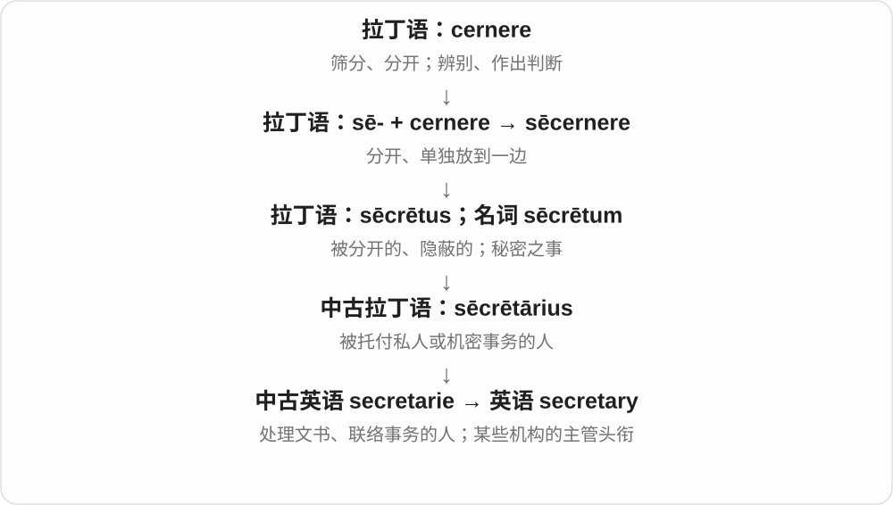

a club secretary 常负责协会记录与事务；a personal secretary 是私人秘书；Secretary of State 等是高级官职名称，不能一律翻译成办公室秘书。

**常见搭配与例句**

a personal secretary；the club secretary；the general secretary。

> Please send the agenda to the club secretary.

请把议程发给俱乐部秘书。

> The secretary arranged the appointments and prepared the letters.

秘书安排了预约并准备了信件。

**别混淆**

assistant 泛指协助工作的人；secretary 往往是具体行政岗位或制度化头衔，其职责须看机构。

### 3. necessary — 必要的；必需的

**音标**：英 /ˈnesəsəri/；美 /ˈnesəseri/

**先抓住这个画面**

要把这件事做成，这一项少不了；与只是有帮助、最好有，强度不同。

**怎么拆**

经法语接拉丁 necessarius、necesse 不可避免、需要。更远常解释为否定加退让、避开的相关形式，但不是现代英语 ne- + cess + ary 可逐段随意拼义。

**怎么变成今天的意思**

**拉丁 necesse、necessarius → 法语 necessaire → 英语 necessary**  
不可避免、所需；更深组合解释不完全确定

↓

**现代 necessary**  
少不了的条件 → 必要的、必需的

necessary equipment 必需设备，if necessary 必要时，It is necessary to... 有必要……。

**常见搭配与例句**

if necessary；necessary for；necessary to do；where necessary。

> Bring the necessary documents to the appointment.

赴约时带上必需文件。

> We can arrange another meeting if necessary.

必要时，我们可以再安排一次会议。

**别混淆**

necessary 必需，useful 有用；某工具有帮助，不代表少了它任务就完全做不了。

### 4. primary — 首要的；主要的；初级的；最初的；初选

**音标**：英 /ˈpraɪməri/；美 /ˈpraɪmeri/

**先抓住这个画面**

把事物按顺序、基础或重要性排开，排在第一层的就是 primary。

**怎么拆**

借入拉丁语 primarius“第一等级的、主要的”，来自 primus；不能只按现代 prime + -ary 理解实际历史。

**怎么变成今天的意思**

**拉丁语 primus**  
第一、最先；地位最高、最重要

↓

**拉丁语 primarius → 英语 primary**  
第一等级、主要的 → 首要、基础、初级的

primary concern 是首要关切；primary school 是初级教育学校；primary source 是直接来自所研究时期或对象的一手材料。美国政治里的 a primary 是候选人初选。

**常见搭配与例句**

a primary concern；primary education；a primary source；a presidential primary。

> Our primary concern is the safety of the passengers.

我们首要关心的是乘客安全。

> The historian relied on primary sources such as letters and diaries.

历史学家依靠信件和日记等一手资料。

> She voted in the party’s primary.

她在该党的初选中投了票。

**别混淆**

primary 往往与 secondary 相对；prime 更常说最重要、最优或最佳阶段，两者搭配并不完全相同。

### 5. library — 图书馆；藏书；资料库、程序库

**音标**：英 /ˈlaɪbrəri/；美 /ˈlaɪbreri/

**先抓住这个画面**

把很多可供查找和使用的东西，按一定方式收在一起。

**怎么拆**

来自拉丁 liber“书”这一族，经法语传入。不是 liberty“自由”加后缀，二者拉丁源词不同。

**怎么变成今天的意思**

**拉丁 liber，属格 libri**  
书；这个词也曾指树的内皮

↓

**拉丁 librarius → librarium／libraria**  
与书有关 → 书柜、藏书处等

↓

**法语 librarie／librairie → 中古英语 librarie**  
藏书或藏书的地方

↓

**英语 library**  
图书馆；供查找和使用的资料集合

library 最容易想到图书馆，但核心不一定是“一栋有书的楼”。a music library 可以是一批可调用的音乐，a software library 是程序可使用的一组功能。它们都保留了“收好一批资料或资源，供人取用”的组织方式。

**常见搭配与例句**

a public library；a library card；a digital library；a software library。

> I borrowed two books from the local library.

我从当地的图书馆借了两本书。

> The app uses a library of sounds recorded outdoors.

这个应用使用了一套在户外录制的声音素材库。

**别混淆**

library 是图书馆或资料集合；bookshop／bookstore 是书店。法语 librairie 常是书店，不能只凭相似拼写照搬。

### 6. budget — 预算；安排预算；价格低的、经济型的

**音标**：/ˈbʌdʒɪt/

**先抓住这个画面**

先看手里有多少钱，再安排每一笔花到哪儿，是 budget 的核心现代用法。作修饰语 a budget hotel，常说价格比较低的酒店。

**怎么拆**

经法语 bougette 小袋，上接拉丁 bulga 皮袋；财政预算义与装载、带着财政计划的袋子意象相联。它不是 bud 芽 + get 得到。

**怎么变成今天的意思**

**拉丁 bulga → 法语 bouge、bougette**  
皮袋、小袋

↓

**英语 budget 的旧袋子义 → 财务用法**  
由装载、带着财政计划等联系发展到预算

↓

**现代 budget、budgetary**  
预算、安排预算、经济型的；预算方面的

a travel budget 旅行预算；on a budget 预算有限地；budget for repairs 为维修安排预算；a budget hotel 经济型酒店。

**常见搭配与例句**

within budget；over budget；budget for。

> We finished the project within budget.

我们在预算内完成了项目。

> They budgeted for repairs before buying the house.

买房前，他们为维修预留了预算。

**别混淆**

budget 是计划、可支配安排，actual spending 是实际支出。做了预算不代表已经花出相应的钱。

### 7. budgets — 预算；经费计划、限额〔复数〕；安排预算〔第三人称单数〕

**音标**：英、美 /ˈbʌdʒɪts/

**先抓住这个画面**

先想好有多少可用的钱、各项打算花多少，是 budget；不同项目、家庭各有一份计划，就可以数成 budgets。

**怎么拆**

budget + -s → budgets，/t/ 后读 /s/。经古法语 bougette 小皮袋，远接拉丁 bulga 袋。财政计划装在袋里的历史用法，让袋名转到财务计划。

**怎么变成今天的意思**

**拉丁 bulga 袋 → 法语 bougette 小皮袋 → budget**  
英语较早是袋子的名称

↓

**装财政计划的袋子 → 财务计划 → budgets**  
现代也扩展到时间等资源的分配限额

project budgets 是项目预算；small budgets 是有限经费；budgets time carefully 是仔细安排时间。

**常见搭配与例句**

project budgets；small budgets；budgets time carefully。

> The team compared the budgets for the three projects.

团队比较了三个项目的预算。

> She budgets her time carefully before an exhibition.

展览前，她仔细安排自己的时间。

**别混淆**

budgets 是计划、限额，不必等于已经花出去的金额。budgetary 是预算方面的形容词；这里把同词族放在一起对照。

### 8. budgetary — 预算的；有关预算安排的

**音标**：英 /ˈbʌdʒɪtəri/；美 /ˈbʌdʒəteri/

**先抓住这个画面**

不是泛说钱，而是特别指预算安排、限制、程序这些方面。budgetary constraints 就是预算不允许你随意花。

**怎么拆**

budget + -ary；将预算这个名词转成用来修饰相关事项的形容词。

**怎么变成今天的意思**

**拉丁 bulga → 法语 bouge、bougette**  
皮袋、小袋

↓

**英语 budget 的旧袋子义 → 财务用法**  
由装载、带着财政计划等联系发展到预算

↓

**现代 budget、budgetary**  
预算、安排预算、经济型的；预算方面的

budgetary constraints 预算限制；budgetary planning 预算规划；budgetary control 预算控制。

**常见搭配与例句**

budgetary constraints；budgetary decisions。

> Budgetary constraints limited the size of the exhibition.

预算限制了展览规模。

> The council reviewed its budgetary priorities.

议会审查了预算安排的优先事项。

**别混淆**

budgetary 是预算方面，budget 作修饰语还可能是经济型、低价的；a budget hotel 不能随便换成 a budgetary hotel。

### 9. element — 要素；成分；化学元素；元件；自然力量〔复数〕

**音标**：/ˈelɪmənt/

**先抓住这个画面**

把一件事拆开，支撑它的一块块组成部分，可以叫 elements；化学里氧、铁是元素；设备里也能说某个功能元件。

**怎么拆**

经法语相应形式或直接接拉丁 elementum，历史有基本成分、原理、字母等义，更远来源未定。不要把现代 ele 与 ment 都硬拆成独立意义。

**怎么变成今天的意思**

**拉丁 elementum、复数 elementa**  
组成成分、基本原理、字母等旧义；更远词源未定

↓

**英语 element；拉丁 elementarius → elementary**  
要素、元素；基础、初步的

a key element 关键要素；an element of surprise 一点出其不意；a heating element 发热元件；the elements 可指风雨等自然力量。

**常见搭配与例句**

an essential element；an element of；in his element。

> Trust is an essential element of teamwork.

信任是团队合作的重要要素。

> She was in her element when discussing old maps.

谈起老地图，她如鱼得水。

**别混淆**

element 可以是基础成分；elementary 形容基础、初步。in your element 是处在擅长、自在的环境，不是人在化学元素里面。

### 10. elements — 要素、成分；元素；基本原理；自然力量、风雨〔特定用法〕

**音标**：/ˈelɪmənts/

**先抓住这个画面**

组成一个整体的基本部分，是 elements；把知识拆到最基本，也能说它的基本原理。天气里的风雨等自然力量，则是 the elements 的常见整体表达。

**怎么拆**

element + -s，/t/ 后读 /s/。element 经法语或直接接拉丁 elementum，早有基本成分、原理、字母等义，更远来源未定；这里不能按现代 ele + -ment 编造构词。

**怎么变成今天的意思**

**拉丁 elementum／elementa → 法语、英语 element**  
基本成分、原理等

↓

**element + -s → elements**  
多种要素、元素；基本原理、自然力量等

key elements 关键要素；chemical elements 化学元素；the elements of design 设计基础；exposed to the elements 暴露在风雨中。

**常见搭配与例句**

combine the elements；elements of a good story。

> The lesson explains the basic elements of a good story.

这节课解释了一个好故事的基本要素。

> The old roof no longer protected the room from the elements.

旧屋顶已经无法为房间遮风挡雨。

**别混淆**

化学的 elements 是元素；a story’s elements 是构成故事的要素；the elements 在遮蔽、风雨语境常说自然环境的侵袭。完整短语比单独背一个汉语义更有用。

### 11. elementary — 基础的；初步的；初等的、小学阶段的

**音标**：英 /ˌelɪˈmentəri/；美 /ˌeləˈmentəri/

**先抓住这个画面**

先学最基础的组成部分、规则，这种入门层面的内容叫 elementary；美式 elementary school 通常指小学。

**怎么拆**

经中古英语接拉丁 elementarius，与 elementum 基本成分、初步知识相联；现代可对应 element + -ary，但不是每个今天的用法都刚在英语里临时拼出。

**怎么变成今天的意思**

**拉丁 elementum、复数 elementa**  
组成成分、基本原理、字母等旧义；更远词源未定

↓

**英语 element；拉丁 elementarius → elementary**  
要素、元素；基础、初步的

elementary knowledge 基础知识；an elementary mistake 低级错误；elementary school 小学〔常见美式〕。

**常见搭配与例句**

elementary education；an elementary principle。

> The course begins with elementary principles.

课程从基本原理开始。

> She teaches at an elementary school.

她在一所小学教书。

**别混淆**

elementary 是基础、初等；elemental 常说基本、原始、自然力量等性质；都含 element 材料，常用搭配却不同。

### 12. anniversary — 周年纪念日；周年

**音标**：英 /ˌænɪˈvɜːsəri/；美 /ˌænɪˈvɜːrsəri/

**先抓住这个画面**

日历转完一圈，又回到当年那个日期；这就是“每年回来一次”的 anniversary。

**怎么拆**

拉丁语 annus“年” + versus“转回”，形成 anniversārius“每年返回的”；经中世纪拉丁语纪念日期的用法进入英语。

**怎么变成今天的意思**

可以纪念婚礼、成立、胜利，也能纪念灾难或去世，并不一定喜庆。通常隐含按年计算；第十周年用 tenth anniversary。

**常见搭配与例句**

a wedding anniversary；mark the anniversary；the anniversary of…。

> They celebrated their tenth wedding anniversary at home.

他们在家庆祝了结婚十周年。

> The town held a ceremony on the anniversary of the flood.

洪灾周年纪念日那天，镇上举行了纪念仪式。

**别混淆**

birthday 是出生纪念日；anniversary 可纪念任何特定事件。

### 13. secondary — 次要的；第二级的；中等教育的；间接、继发的

**音标**：英 /ˈsekəndəri/；美 /ˈsekənderi/

**先抓住这个画面**

先排一个主次或先后：跟在第一项后面、由第一项引起，或者处在教育的第二阶段；各场景的第二关系不同。

**怎么拆**

经中古英语接拉丁 secundārius，来自 secundus 第二 + 相应形容词后缀；现代可对应 second + -ary，不是 secretary 秘书。

**怎么变成今天的意思**

**拉丁 secundus → secundārius**  
第二、随后 → 第二位或第二等的

↓

**中古英语 secundarie → secondary**  
次要、第二级、继发等关系

a secondary concern 次要顾虑，secondary education 中等教育，a secondary source 二手资料、间接来源。具体分级与制度要看上下文。

**常见搭配与例句**

a secondary concern；secondary education；a secondary source；be secondary to。

> Cost is important, but it is secondary to safety.

费用很重要，但安全更优先。

> The textbook is a secondary source for the historical event.

这本教科书是研究该历史事件的二手资料。

**别混淆**

secondary 次要不等于毫无价值；secondary source 不是“错误来源”，而是相对于原始材料的后续解释、整理等。

### 14. temporary — 暂时的；临时的

**音标**：英 /ˈtempərəri/；美 /ˈtempəreri/

**先抓住这个画面**

给某件事画一个时间框：现在先这样，过了这段时间会结束或改变。

**怎么拆**

借拉丁 temporārius，接 tempus“时间”；tempor- + -ary 可以帮助识别，但英语并不是从 time 拼出来。

**怎么变成今天的意思**

**拉丁语 tempus，词干 tempor-**  
时间；时段

↓

**拉丁 temporārius → 英语 temporary**  
只持续一段时间的 → 暂时的

temporary job 是临时工作，temporary solution 是权宜办法。这个词强调持续时间有限，不自动表示质量差。

**常见搭配与例句**

temporary accommodation；a temporary measure；a temporary job。

> We found temporary accommodation near the station.

我们在车站附近找到了临时住处。

> The wooden bridge is only a temporary solution.

这座木桥只是临时解决办法。

**别混淆**

brief 强调短；temporary 强调不会永久保持，临时安排也可能持续数月。

### 15. bound — 跳跃、跃进；另有绑住、必定、前往、界限等不同来源的意思

**音标**：/baʊnd/

**先抓住这个画面**

这里先看身体有弹力地一跃；同样的拼写还装着几条完全不同的词源。

**怎么拆**

“跳跃”义经法语 bondir，常追溯到表示嗡鸣、回响的俗拉丁语重构形式 *bombitire。不要用这条路线解释所有 bound。

**怎么变成今天的意思**

**俗拉丁语 \*bombitire〔重构〕**  
嗡鸣、发声

↓

**古法语 bondir**  
发声、回响；跳起、弹回

↓

**英语 bound**  
跳跃；一跃

The dog bounded across the grass 是狗蹦跳着穿过草地。另几种常用 bound 要分开：bound by rules 来自 bind“约束”；bound for London 的“准备前往”来自古诺尔斯语 búinn；out of bounds 的“界限”来自法语及中世纪拉丁语另一族。be bound to 常说“肯定会”，也不能理解成跳过去。

**常见搭配与例句**

bound across the field；in one bound；be bound to；be bound for。

> The dog bounded up the steps to greet us.

那只狗蹦着上了台阶来迎接我们。

> She crossed the stream in one bound.

她一个跳跃就跨过了小溪。

> The train is bound for London.

这列火车开往伦敦。

**别混淆**

跳跃的过去式是 bounded；bind 的过去式和过去分词才是 bound。拼写相同不保证词源相同。

### 16. boundary — 边界；界线；限度

**音标**：/ˈbaʊndəri/，常也压缩为 /ˈbaʊndri/

**先抓住这个画面**

球出了场地边线，是越过 boundary；别人能介入你生活到什么程度，也可以有一条看不见的 boundary。

**怎么拆**

bound 边界、限度这一名词义 + -ary；不是 leap 那个跳跃动词的每种义，也不是 bind 绑的过去式 bound 直接推出全部含义。

**怎么变成今天的意思**

**bound 边界、限度**  
与法语界限材料相联的名词

↓

**bound + -ary → boundary**  
边界、划分范围的界线

a boundary between 两者的界线；set boundaries 设定界限；cross a boundary 越过边界。

**常见搭配与例句**

the boundary between；set clear boundaries。

> The river forms the boundary between the two regions.

河流构成了两个地区的边界。

> She set clear boundaries between work and personal time.

她给工作和私人时间划定了清楚界限。

**别混淆**

boundary 可说政治、物理、个人界限；border 常用于国界、地区边界或物体边缘，不能每次无条件互换。

### 17. boundaries — 边界、界线；限度〔复数〕

**音标**：/ˈbaʊndəriz/，也可压缩为 /ˈbaʊndriz/

**先抓住这个画面**

这一边归这里，那一边归那里，中间划出 boundaries。具体可以是地图界线，抽象可以是职责、知识、人与人之间可接受的范围。

**怎么拆**

boundary 末尾辅音字母加 y，改 y 为 i 加 -es。boundary 是 bound 边界、限度这一名词加 -ary；不把它与 bind 的过去式 bound 混成一路。

**怎么变成今天的意思**

**bound 边界、限度 + -ary → boundary**  
划出一个范围的界线

↓

**boundary → boundaries**  
多条界线；多个领域或行为的限度

set boundaries 设定界限；within the boundaries 在范围内；boundaries between roles 职责之间的边界。

**常见搭配与例句**

national boundaries 国界；push the boundaries 拓展既有边界。

> The map shows the boundaries of each district.

地图标出了各区的边界。

> The project crosses traditional boundaries between subjects.

这个项目跨越了学科之间的传统边界。

**别混淆**

boundaries 与 borders 可重叠；boundaries 特别适合讲范围和限度，border 也常说边缘地带。拼写复数是 ies，读音仍是 /iz/。

### 18. ordinary — 普通的；通常的；常规的

**音标**：英 /ˈɔːdɪnəri/；美 /ˈɔːrdəneri/

**先抓住这个画面**

一天照着熟悉的节奏过：没有特别事件，也没有超出常规的地方。这就是 ordinary。

**怎么拆**

来自拉丁 ōrdinārius“按通常安排的”，经法语及拉丁语借入。不是英语 order 随手换一个后缀才首次出现。

**怎么变成今天的意思**

**拉丁语：ōrdō；词干 ōrdin-**  
一行、一列；次序、等级、安排

↓

**拉丁语 ōrdinārius → 古法语 ordinarie**  
依照通常次序的；常规的

↓

**英语：ordinary**  
通常的、普通的；另有职务及纹章专义

an ordinary day 是平常的一天；ordinary people 是普通人，并不自动贬低人。out of the ordinary 则表示不同寻常。宗教、纹章中的 ordinary 还有专门名词义。

**常见搭配与例句**

ordinary life；ordinary people；nothing out of the ordinary。

> It seemed like an ordinary Tuesday.

那看起来只是一个普通的星期二。

> The display turns ordinary objects into works of art.

这个展览把普通物品变成了艺术作品。

**别混淆**

ordinary 是常见、平常；mediocre 评价质量平庸。普通的一顿饭也可以很好吃。

### 19. salary — 薪水；固定薪酬

**音标**：/ˈsæləri/

**先抓住这个画面**

按约定的周期拿到一笔工作报酬，而非每件工作临时结一次账。

**怎么拆**

拉丁 salarium 津贴、报酬，经法语 salaire、salarie 借入；salarium 与 sal 盐有关。

**怎么变成今天的意思**

**拉丁 sal，属格 salis**  
盐

↓

**拉丁 salarium → 古法语 salaire／盎格鲁法语 salarie**  
津贴、报酬

↓

**英语 salary**  
工作报酬 → 通常按期支付的固定薪酬

an annual salary 是年薪，monthly salary 是月薪。词源与盐有关，但从盐到薪酬的具体制度联系并不确定，不能把“罗马士兵直接拿盐当工资”当成已经证实的故事。现代使用直接记报酬即可。

**常见搭配与例句**

an annual salary；a starting salary；a salary increase；negotiate a salary。

> The job offers a fixed annual salary.

这份工作提供固定年薪。

> She asked whether the salary was negotiable.

她询问薪资是否可以协商。

**别混淆**

salary 通常突出约定的周期性薪酬；wages 常按小时、天或周计算，但实际用法有重叠，不能只按职业高低划分。

### 20. salaries — 薪水、薪酬〔复数〕

**音标**：/ˈsæləriz/

**先抓住这个画面**

按工作约定定期支付给一个人的报酬，是 salary。把几个人或几种岗位的薪水分别拿出来看，就用 salaries。

**怎么拆**

salary 经法语 salaire、salarie 接拉丁 salarium 津贴、报酬，与 sal 盐相关；具体古代支付安排不能仅凭词源定成拿盐发工资。现代 y 改 i 加 -es，尾 /riz/。

**怎么变成今天的意思**

**拉丁 sal、salarium → 法语 → salary**  
与盐相关的津贴、报酬 → 按期薪酬

↓

**salary 的 y 改 i + -es → salaries**  
不同人员、岗位的薪水

annual salaries 年薪；staff salaries 员工薪水；different salaries 不同薪酬。

**常见搭配与例句**

pay salaries 发薪；salaries for the roles 这些岗位的薪酬。

> The fictional company lists salaries for each role.

这家虚构公司列出了各岗位的薪酬。

> Staff salaries are included in the budget.

员工薪酬列入了预算。

**别混淆**

salaries 通常说固定、按期的工作报酬；income 范围更广，还能包括别的来源。这个词本身不规定一定按哪一天发放。

### 21. documentary — 纪录片；文献的；基于记录的

**音标**：英 /ˌdɒkjuˈmentəri/；美 /ˌdɑːkjuˈmentəri/

**先抓住这个画面**

把记录、材料和真实对象整理成能供人观看或查证的叙述。

**怎么拆**

形容词现代可拆 document + -ary，也有法语 documentaire 借入分析；电影纪实义受法语 film documentaire 影响，名词可视作 documentary film 的缩略。

**怎么变成今天的意思**

**拉丁 docēre；完成分词 doctus**  
教；使人知道；有学问的

↓

**拉丁 documentum → 法语及英语 document**  
示例、证明 → 记录材料

↓

**英语 document + -ary；相关法语 documentaire**  
与文献、记录有关的

↓

**法语 film documentaire 的影响；英语 documentary film → documentary**  
纪实影片 → 纪录片

a documentary 是纪录片；documentary evidence 是文书、文件等证据，不是“纪录片提供的证据”这唯一一种情况。纪录片以现实为对象，也仍有取材和剪辑角度。

**常见搭配与例句**

a documentary about；a nature documentary；documentary evidence。

> We watched a documentary about the restoration of a historic railway.

我们看了一部关于修复历史铁路的纪录片。

> The historian looked for documentary evidence of the agreement.

历史学家寻找能证明这项协议的文献证据。

**别混淆**

documentary 是影片类型或文献形容词；document 是一份材料。拍了 documentary，并不意味着每句话都免于核查。

### 22. literary — 文学的；文坛的；带书面文学色彩的

**音标**：英 /ˈlɪtərəri/；美 /ˈlɪtəˌreri/

**先抓住这个画面**

文字不只用来交代事情，还被当作作品来经营、欣赏和研究。

**怎么拆**

来自法语 littéraire，接拉丁 litterarius“与文字、文学有关的”；不是把英语 literature 简单截短再加 -ary 的历史。

**怎么变成今天的意思**

**拉丁 littera／litera**  
字母；复数也可指书信、文献和学问

↓

**拉丁 litterarius → 法语 littéraire**  
有关文字、文学的

↓

**英语 literary**  
文学方面的；带文学色彩的

a literary prize 是文学奖；a literary critic 是文学评论家；a literary expression 是平时聊天少说、作品里较常见的表达。它说的是与文学的关系或语言风格，不能直接翻成“会读写的”。

**常见搭配与例句**

literary fiction；a literary magazine；literary criticism；a literary style。

> The journal publishes literary essays and short stories.

这本期刊刊登文学随笔和短篇小说。

> That expression sounds literary rather than conversational.

那个表达带有文学色彩，日常聊天不太这样说。

**别混淆**

literary 关乎文学；literate 关乎读写能力或某领域素养；literal 关乎字面意思。三者的重点不同。

### 23. legendary — 传说中的；传奇般著名的

**音标**：/ˈledʒəndəri/；美 /ˈledʒənderi/

**先抓住这个画面**

legendary 可以说人物只存在于传说，也可以说真实人物的名声大到像传奇。

**怎么拆**

现代可分析为 legend + -ary；历史借自中世纪拉丁语 legendārius。

**怎么变成今天的意思**

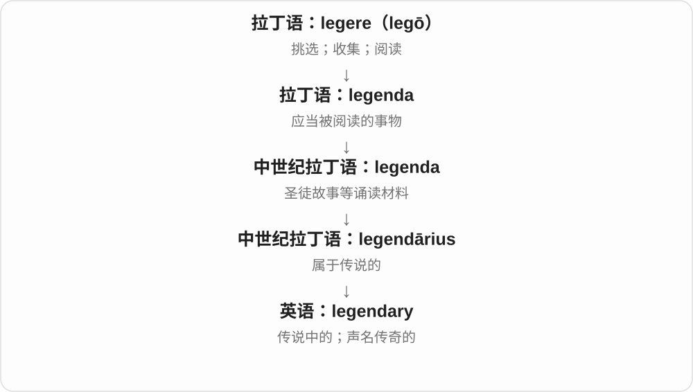

legendary creature 是传说生物；legendary musician 往往是真实且极有名的音乐家。

**常见搭配与例句**

a legendary hero；a legendary performer；legendary patience。

> The story follows a legendary king.

故事围绕一位传说中的国王展开。

> Her patience with beginners is legendary.

她对初学者的耐心出了名。

**别混淆**

legendary 不等于 imaginary：形容真人时多是称赞其声名。

### 24. parliamentary — 议会的；符合议事规则的

**音标**：英 /ˌpɑːləˈmentəri/；美 /ˌpɑːrləˈmentəri/

**先抓住这个画面**

给辩论、选举、委员会加一个标签：它属于议会或按相应议事程序进行。

**怎么拆**

parliament + -ary，形成关系形容词。重音转到 /men/ 附近，不能完全按基础词的重音照搬。

**怎么变成今天的意思**

**法语 parler 说话 + -ment → parlement**  
讨论、商谈、会议

↓

**盎格鲁法语 parlement 等 → 中古英语 parlement → parliament**  
议事集会 → 议会；拼写受中世纪拉丁语形式影响

↓

**parliament + -ary → parliamentary**  
与议会有关；按议事规则的

a parliamentary debate 议会辩论，a parliamentary committee 议会委员会，parliamentary procedure 议事程序。

**常见搭配与例句**

a parliamentary debate；a parliamentary committee；parliamentary procedure。

> The report was examined by a parliamentary committee.

报告由一个议会委员会审查。

> The chair explained the parliamentary procedure before the vote.

主持人在投票前解释了议事程序。

**别混淆**

parliamentary 议会相关，parliamentarian 人物或相关形容词；a parliamentary system 描写制度类型，不直接等于每一项具体政策。

### 25. revolutionary — 革命的；带来重大变革的；革命者

**音标**：英 /ˌrevəˈluːʃənəri/；美 /ˌrevəˈluːʃəneri/

**先抓住这个画面**

可以是参与政治革命的人、事，也可以是让旧做法彻底变样的新方法。revolutionary design 常在赞设计大幅突破，不必涉及推翻政府。

**怎么拆**

revolution + -ary，与法语 révolutionnaire 等相应形式相关；形容词又可用于人物名词。不同场景不能只按一种政治意义包办。

**怎么变成今天的意思**

**拉丁 re- + volvere → revolvere → revolūtiō**  
向回、再次 + 滚动 → 转回、循环

↓

**法语 revolucion、拉丁名词等 → 英语 revolution**  
转动、天体循环 → 局势巨变、革命

↓

**revolution + -ary → revolutionary**  
与革命有关、变革性的；再指革命者

a revolutionary movement 革命运动，a revolutionary idea 突破性想法，a revolutionary 革命者。

**常见搭配与例句**

a revolutionary idea；a revolutionary design；a revolutionary movement。

> The engineer proposed a revolutionary design.

工程师提出了一个突破性设计。

> The book follows the life of a young revolutionary.

书中讲述了一位年轻革命者的一生。

**别混淆**

revolutionary 不等于 reactionary 反动、主张恢复旧秩序的；日常宣传的变革性也不自动证明实际效果。

### 26. dictionary — 词典；字典

**音标**：英 /ˈdɪkʃənəri/；美 /ˈdɪkʃəneri/

**先抓住这个画面**

把说话用的词收在一起，方便查它们怎么读、什么意思、怎么用。这就是 dictionary 的直观功能。

**怎么拆**

来自中世纪拉丁语 dictiōnārium，基础是 dictiō“说话、词语”。现代可用 diction + -ary 联系记忆，但它不是从现代“措辞风格”临时拼出的书名。

**怎么变成今天的意思**

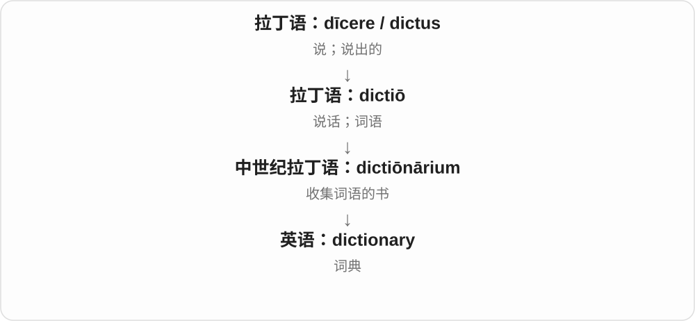

从“说出来的词”到集中收集词的工具。现代也有电子词典；编程中 dictionary 借用了“按键找到对应值”的查找感觉。

**常见搭配与例句**

look up a word in a dictionary；a bilingual dictionary；a learner’s dictionary。

> I looked up the word in a learner’s dictionary.

我在学习词典里查了这个词。

> A good dictionary shows how a word behaves in real sentences.

好的词典会展示一个词在实际句子中怎样使用。

**别混淆**

dictionary 常解释词的意思与用法；thesaurus 主要帮助找近义词等词语关系。

### 27. voluntary — 自愿的；非强制的；志愿服务的；随意肌相关的

**音标**：英 /ˈvɒləntri/；美 /ˈvɑːlənteri/

**先抓住这个画面**

开关由自己的意愿来按，而不是外界强迫你按。

**怎么拆**

经法语或直接接拉丁 voluntarius，来自 voluntas“意愿”；英语形容词的历史早于 volunteer 动词。

**怎么变成今天的意思**

**拉丁 velle／volo、volens**  
愿意；我愿意；愿意的

↓

**拉丁 voluntas → voluntarius**  
意愿 → 出于自己意愿的

↓

**法语 volontaire／拉丁 voluntarius → 英语 voluntary**  
自愿的、出于意志的

participation is voluntary 表示参加与否由本人选择，voluntary work 常指志愿工作。voluntary movement 则是受意志控制的动作，如主动抬手；这是同一个“自己能决定”向身体控制的延伸。

**常见搭配与例句**

voluntary participation；voluntary work；a voluntary contribution；voluntary movement。

> Attendance at the workshop is voluntary.

参加这个工作坊是自愿的。

> She does voluntary work at the local library.

她在当地的图书馆做志愿工作。

**别混淆**

voluntary 与 compulsory“强制的”相对；optional 也说可选，但 voluntary 更突出自愿。voluntary 不是 voluntary work 以外也都等于无薪。

### 28. caution — 谨慎；警告；告诫

**音标**：英 /ˈkɔːʃən/；美 /ˈkɔːʃən/

**先抓住这个画面**

先看清有没有风险，再小心做，这是 caution 作为态度；提醒别人别踩坑，则是 caution 作为警告、告诫。

**怎么拆**

经法语接拉丁 cautio，与 cavere 防备、留心相联。英语旧时有担保等义，现代常见小心、警告，不必靠字母 cau 硬拆。

**怎么变成今天的意思**

**拉丁 cavere → cautio → 法语 caution**  
防备、小心；担保等相关用法

↓

**英语 caution → cautious**  
小心、警告；谨慎的

with caution 谨慎地；exercise caution 小心行事；caution someone against doing 告诫某人不要做。

**常见搭配与例句**

with caution；a note of caution。

> The findings should be interpreted with caution.

应谨慎解读这些发现。

> She cautioned him against making a hasty decision.

她告诫他不要仓促决定。

**别混淆**

caution 是态度或提醒，danger 是危险本身；一块写 Caution 的牌子在提醒注意，不等于所有场合都已经有事故。

### 29. cautionary — 警示性的；告诫的

**音标**：英 /ˈkɔːʃənəri/；美 /ˈkɔːʃəneri/

**先抓住这个画面**

讲一个人怎样因为疏忽而吃亏，不只是讲故事，而是提醒你别犯同样错误，这就是 a cautionary tale。

**怎么拆**

借中世纪拉丁 cautionarius，与 caution 的提醒、防备材料相联；现代可对应 caution + -ary。

**怎么变成今天的意思**

**caution、中世纪拉丁 cautionarius 等**  
留心、防备、告诫的相关材料

↓

**英语 cautionary**  
起警示、劝诫作用的

a cautionary tale 警示故事；a cautionary note 提醒注意的话。

**常见搭配与例句**

a cautionary example；a cautionary tale。

> The failure became a cautionary tale for other companies.

这次失败成了其他公司的前车之鉴。

> She ended the talk with a cautionary note about overconfidence.

演讲最后，她提醒大家警惕过度自信。

**别混淆**

cautionary 是提醒你小心、吸取教训；precautionary 常说提前采取的预防措施。一则警示故事可能促成后续预防，但不是同一词义。

### 30. precaution — 预防措施；事先防备

**音标**：/prɪˈkɔːʃən/

**先抓住这个画面**

事情还没出问题，先备份、检查、安排一层保护，precaution 就是提前做的这份防备。

**怎么拆**

经法语接拉丁 praecautio，关联 prae- 事先 + cavere 防备；与 caution 同族，pre- 将重点放到风险发生以前。

**怎么变成今天的意思**

**拉丁 prae- + cavere → praecautio**  
事先防备、留心

↓

**法语 précaution → 英语 precaution**  
预防措施、小心防范

↓

**precaution + -ary → precautionary**  
预防性的、事先防备的

take precautions 采取预防措施；as a precaution 作为预防；a precaution against 防备……的措施。

**常见搭配与例句**

as a precaution；take precautions against。

> We made an extra backup as a precaution.

我们另外做了一份备份，以防万一。

> The organisers took precautions against bad weather.

组织者为坏天气采取了预防措施。

**别混淆**

precaution 是提前防备；repair 是出了损坏再修。做了预防不代表风险已发生，也不保证风险绝对归零。

### 31. precautionary — 预防性的；出于事先防范的

**音标**：英 /prɪˈkɔːʃənəri/；美 /prɪˈkɔːʃəneri/

**先抓住这个画面**

门还没坏，先检查；天气还未变坏，先调整安排。precautionary 说明这个做法是为了提前防范。

**怎么拆**

precaution + -ary；将预防措施的名词转成说明行为目的、性质的形容词。

**怎么变成今天的意思**

**拉丁 prae- + cavere → praecautio**  
事先防备、留心

↓

**法语 précaution → 英语 precaution**  
预防措施、小心防范

↓

**precaution + -ary → precautionary**  
预防性的、事先防备的

a precautionary measure 预防措施；a precautionary check 预防性检查。

**常见搭配与例句**

a precautionary step；precautionary action。

> The building was closed as a precautionary measure.

大楼作为预防措施而关闭。

> The team carried out a precautionary inspection.

团队进行了一次预防性检查。

**别混淆**

precautionary 强调事先防范；cautionary 常强调警示、给人教训，如 a cautionary tale。不是都译成小心就随意替换。

### 32. missionary — 传教士；传教的；热衷传播某种信念的

**音标**：英 /ˈmɪʃənəri/；美 /ˈmɪʃəneri/

**先抓住这个画面**

missionary 是带着传播宗教信仰的任务前往某处的人。借喻时，也能形容迫切想让别人接受某种想法的劲头。

**怎么拆**

mission + -ary，表示从事相关使命的人或与之有关的。

**怎么变成今天的意思**

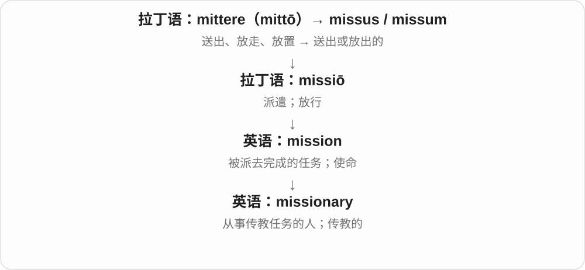

mission 曾有宗教派遣背景，这个派生词保留得最明显。不是所有出差或执行任务的人都叫 missionary。

**常见搭配与例句**

a Christian missionary；missionary work；missionary zeal。

> The archive contains letters written by a missionary.

档案馆保存了由一位传教士写下的信件。

> He promoted the new method with missionary zeal.

他以近乎传教般的热情推广这种新方法。

**别混淆**

mission 是任务；missionary 通常是特定宗教传播角色，而非任意任务执行者。

### 33. evolutionary — 演化的、进化的；逐步演进的

**音标**：英 /ˌiːvəˈluːʃənəri/；美 /ˌevəˈluːʃəneri/ 等

**先抓住这个画面**

把注意力放在一段变化历程、跨代演化过程上；evolutionary change 在产品讨论里也可说逐步改动。

**怎么拆**

evolution + -ary 形容词后缀，表示与演化相关。词尾不是 ordinary 普通这个词拆出来，生物和一般演进两类用法跟着名词走。

**怎么变成今天的意思**

**拉丁 ex- 向外 + volvere 滚 → ēvolvere**  
把卷起的东西展开，尤卷轴

↓

**拉丁 ēvolūtiō → 英语 evolution**  
展开 → 发展、变化

↓

**生物学词义专门化**  
种群可遗传特征跨世代发生变化等演化过程

↓

**evolution + -ary → evolutionary**  
与演化有关；逐步演进的

evolutionary biology 演化生物学，an evolutionary process 演化过程，evolutionary change 渐进式改变。

**常见搭配与例句**

evolutionary biology；an evolutionary process；evolutionary change。

> She studies evolutionary biology.

她研究演化生物学。

> The update is an evolutionary improvement rather than a complete redesign.

这次更新是逐步改进，并没有把设计全部重做。

**别混淆**

evolutionary 描述演化关联，不自动夸先进；evolutionary/revolutionary 在方案语境可对照渐进改变与根本变革。

### 34. vocabulary — 词汇；词汇量；某领域的表达手段

**音标**：英 /vəˈkæbjələri/；美 /voʊˈkæbjəleri/

**先抓住这个画面**

把一个人能理解或使用的词放进一只工具箱，整箱就是 vocabulary；专业领域也有自己的那一箱。

**怎么拆**

来自中世纪拉丁 vocabularium“词汇表”，基础是拉丁 vocabulum“称呼、词”，再接 vocare“称呼”。不能拆成 vocal 加一个所谓 -bulary。

**怎么变成今天的意思**

**拉丁 vocare**  
呼唤、叫来、称呼；与 vox“声音”同族

↓

**拉丁 vocabulum**  
称呼、名字、词

↓

**中世纪拉丁 vocabularium → 英语 vocabulary**  
词汇表 → 一个人、语言或领域的词汇总量

active vocabulary 是自己会用的词，passive vocabulary 是看见或听见能懂的词。艺术中的 visual vocabulary 可指反复使用的形状、色彩等表达手段。

**常见搭配与例句**

build one’s vocabulary；technical vocabulary；an active vocabulary。

> Reading widely helped her build a larger vocabulary.

广泛阅读帮助她扩大了词汇量。

> The course introduces the basic vocabulary of architecture.

这门课介绍建筑领域的基本词汇。

**别混淆**

vocabulary 是一组词或词汇储备；dictionary 是供查阅词义、读音等信息的词典。

### 35. imaginary — 想象中的、虚构的；虚数的〔数学〕

**音标**：英 /ɪˈmædʒɪnəri/；美 /ɪˈmædʒɪneri/

**先抓住这个画面**

故事里的朋友只存在于心中，没有一个对应的人站在身旁；imaginary 说的是事物存在于设想中。

**怎么拆**

英语来源有 imagine + -ary 的分析，也有晚期拉丁 imaginarius 的借入分析；两者都接拉丁 imago、imaginari。不能一概指定唯一的英语后缀造词路线。

**怎么变成今天的意思**

**拉丁 imago，属格 imaginis，宾格 imaginem**  
像、形象、相似的表示；imagin- 是词干

↓

**拉丁 imaginari → 晚期拉丁 imaginarius；另一分析接英语 imagine + -ary**  
与心象有关、想象中的；两种来源分析

↓

**中古英语 imaginarie → imaginary**  
想象中的、并非现实存在的

↓

**数学术语 imaginary**  
后来用作虚数相关术语，已具有严格定义

an imaginary line 是为了说明而设想的线，如地图上的纬线。数学的 imaginary unit i 满足 i² = -1；这里“虚”是沿用的名称，不等于计算规则虚假或无效。

**常见搭配与例句**

an imaginary friend；an imaginary line；the imaginary unit；a pure imaginary number。

> The child introduced us to her imaginary dragon.

孩子向我们介绍了她想象中的小龙。

> The imaginary unit i has the property that i squared equals minus one.

虚数单位 i 的性质是 i 的平方等于负一。

**别混淆**

imaginative 是有想象力、有新意的；imaginary 是想象出来的。an imaginative writer 写得有创意，an imaginary writer 是虚构人物。

### 36. solitary — 独处的；孤单的；单独一个的

**音标**：英 /ˈsɒlətri/；美 /ˈsɑːləteri/

**先抓住这个画面**

周围没有同伴，或一大片地方只看到孤零零的一个。

**怎么拆**

经法语或拉丁 solitarius 借入，远接 solus“独自”。不是英语 sole 加一个可以随意拆开的 -itary。

**怎么变成今天的意思**

**拉丁语 solus**  
独自、唯一；更早来源未定

↓

**拉丁语 solitarius**  
独处的

↓

**法语 solitaire / 拉丁语 → 中古英语 solitarie**  
孤独、独处

↓

**英语 solitary**  
独处的；单独一个的

a solitary walk 是独自散步；a solitary tree 是孤零零一棵树。solitary confinement 指单独监禁，也常简称 solitary。这个词只说状态，不自动说明喜欢独处还是感到痛苦。

**常见搭配与例句**

a solitary figure；a solitary life；solitary confinement。

> A solitary tree stood in the middle of the field.

田野中央孤零零地立着一棵树。

> She enjoys solitary walks along the coast.

她喜欢独自在海边散步。

**别混淆**

lonely 强调心里的寂寞；solitary 可以只是客观地独自一人。

### 37. scenery — 风景；舞台布景

**音标**：/ˈsiːnəri/

**先抓住这个画面**

scene 是一处场景，scenery 常把眼前的山水或舞台上的背景整体看成一片。

**怎么拆**

英语 scene 的派生词，早期有 scenary，后来形式重整为 scenery；经历舞台布景到自然景色的用法。

**怎么变成今天的意思**

**古希腊 skēnē**  
棚、帐篷；后来指戏剧中的舞台背景建筑

↓

**拉丁 scaena / scena → 法语 scène → 英语 scene**  
舞台、场景 → 一场戏；事情发生的现场

↓

**英语 scene → scenary / scenery**  
舞台场景 → 舞台布景；整体风景

通常是不可数名词：beautiful scenery，不说 a beautiful scenery。戏剧里还可指布置出环境的背景与景片。

**常见搭配与例句**

mountain scenery；enjoy the scenery；stage scenery。

> We stopped to enjoy the mountain scenery.

我们停下来欣赏山间风景。

> The crew changed the scenery between acts.

工作人员在两幕之间更换了舞台布景。

**别混淆**

a scene 可以数一个场景；scenery 通常整体说风景，需要计数时可换 a view 或一段景色的具体说法。

### 38. honorary — 名誉的；为表彰而授予的

**音标**：英 /ˈɒnərəri/；美 /ˈɑnəreri/

**先抓住这个画面**

给一个人挂上一枚表示敬意的身份牌，取得方式与通常的正式资格路径不同。

**怎么拆**

honor + -ary，与法语 honoraire、拉丁 honorarius 有联系；不是 honor 加表示“能够”的 -able。

**怎么变成今天的意思**

**拉丁 honos／honor**  
尊敬；荣誉；声望

↓

**拉丁 honorarius／法语 honoraire 与英语 honor + -ary**  
与荣誉有关；为表示敬意而设

↓

**英语 honorary**  
名誉性的、表彰性的

an honorary degree 是为表彰贡献授予的名誉学位，不是完成同一课程考核取得的学位；an honorary member 是名誉成员。具体职责随机构而异，不能一概理解成“什么都不用做”。

**常见搭配与例句**

an honorary degree；an honorary member；an honorary title。

> The university awarded her an honorary degree for her work in education.

大学因她在教育领域的贡献授予她名誉学位。

> He became an honorary member of the society.

他成为了该协会的名誉会员。

**别混淆**

honorary 说明称号的性质，honorable 评价人或行为值得尊敬。名誉身份本身不是品格证明。

### 39. stationary — 静止的；固定不动的

**音标**：英 /ˈsteɪʃənəri/；美 /ˈsteɪʃəneri/

**先抓住这个画面**

镜头在拍，车却没移动；东西待在原来的位置，这时可以说 stationary。

**怎么拆**

来自拉丁语 statiōnārius，与 statiō“岗位、驻地”有关，不是现代英语 station + arbitrary 的缩写。

**怎么变成今天的意思**

原来的岗位、驻地意象保留为“位置不变”。它可用于车辆、物体或统计模型，但不一定说内部完全没有活动。

**常见搭配与例句**

a stationary vehicle；remain stationary；a stationary bicycle。

> The train remained stationary for ten minutes.

火车原地停了十分钟。

> She exercises on a stationary bicycle at home.

她在家骑健身车锻炼。

**别混淆**

stationary 是静止的；stationery 是文具。a stationary bike 可以让人踩踏运动，但车本身不往前走。

### 40. concession — 让步；承认；优惠；特许经营权或摊点

**音标**：/kənˈseʃən/

**先抓住这个画面**

本来握在手里的东西，让出一点给别人。

**怎么拆**

借法语 concession，接拉丁 concessiō，来自 concēdere“让出、允许”；现代可以认出 concess- 与 -ion。

**怎么变成今天的意思**

**拉丁 cēdere；分词词干 cess-**  
走、离开；让步、让出

↓

**拉丁 con- + cēdere → concēdere**  
充分让出 → 允许、承认、让步

↓

**拉丁 concessiō → 中古法语 concession → 英语 concession**  
给予、允许、让步

谈判中的 concession 是退让；票价 concession 是给某类人的优惠。经营 concession 则是获准在某处营业的权利，继而也能指获准经营的摊点。

**常见搭配与例句**

make a concession；price concessions；a concession stand。

> Both sides made concessions to reach an agreement.

双方都作了让步以达成协议。

> The museum offers concessions for students.

博物馆为学生提供票价优惠。

> We bought popcorn at the concession stand.

我们在场内售卖亭买了爆米花。

**别混淆**

compromise 常是双方协调后达成的安排；concession 可以只是一方作出的一次退让。

### 41. concessionary — 优惠的；作为让步、优待给予的

**音标**：英 /kənˈseʃənəri/；美 /kənˈseʃəneri/

**先抓住这个画面**

给符合条件的人便宜票价、优惠安排，concessionary 突出这是一种让利、优待，不只是偶然卖得便宜。

**怎么拆**

concession + -ary；concession 从让步、给予等词族材料，发展出针对特定人的优惠。

**怎么变成今天的意思**

**concede、concession**  
让步、给予；优惠等用法

↓

**concession + -ary → concessionary**  
作为优惠、让步给予的

concessionary fares 优惠票价；concessionary travel 优惠乘车，常见于英式公共交通语境。

**常见搭配与例句**

concessionary rates；concessionary fares。

> The museum offers concessionary admission for students.

博物馆向学生提供优惠门票。

> The leaflet explains who qualifies for concessionary fares.

传单说明谁符合优惠票价条件。

**别混淆**

concessionary 是优惠性质；concessionaire 是获准经营者、特许经营商。末尾不同，不要把人和票价性质混在一起。

### 42. complementary — 互补的；相配的；互余的〔角〕

**音标**：英 /ˌkɒmplɪˈmentəri/；美 /ˌkɑːmplɪˈmentəri/

**先抓住这个画面**

各有长处，凑到一起正好：一个会设计，一个善于把东西做出来。

**怎么拆**

complement + -ary；形容双方能补足彼此。

**怎么变成今天的意思**

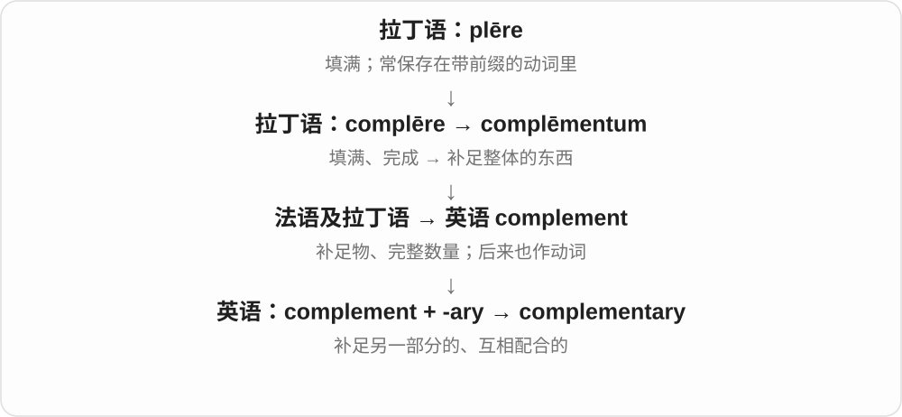

complementary skills 是互补技能，不必长得相像。几何中 complementary angles 两角之和为 90°，好像补成一个直角。

**常见搭配与例句**

complementary skills；complementary roles；complementary angles。

> The two researchers bring complementary skills to the project.

两位研究者为项目带来了互补的技能。

> A thirty-degree angle and a sixty-degree angle are complementary.

三十度角和六十度角互为余角。

**别混淆**

complimentary 可指称赞或免费赠送；complementary 强调互补。supplementary angles 合为 180°。

### 43. planetary — 行星的；全球的、整个地球尺度的

**音标**：英 /ˈplænɪtəri/；美 /ˈplænəteri/

**先抓住这个画面**

谈行星的形成、大气和系统时，用它把话题连到行星；谈地球问题时，也能把视野拉到整个星球。

**怎么拆**

通常按英语 planet + -ary 分析；也有拉丁 planetarius 的影响说，但这个拉丁形式的早期用法存在解释分歧，不把它定为唯一确证的形容词祖先。

**怎么变成今天的意思**

**希腊 planasthai → planetes（πλανήτης）**  
游走 → 游走者；相对背景恒星移动的天体

↓

**晚期拉丁 planeta → 古法语 planete；另有直接拉丁借入**  
游星、行星

↓

**早期英语 planete → planet**  
早期范围与今日不同 → 现代行星概念

↓

**英语 planet + -ary → planetary**  
与行星有关的；也用于地球整体尺度

planetary science 是行星科学；a planetary system 是行星及相关天体组成的系统。on a planetary scale 在地球议题中往往译在全球尺度上。

**常见搭配与例句**

planetary science；a planetary system；planetary atmospheres；on a planetary scale。

> Planetary scientists compare the atmospheres of Earth and Venus.

行星科学家比较地球与金星的大气。

> The report examines environmental change on a planetary scale.

报告从整个地球的尺度考察环境变化。

**别混淆**

planetary 通常只说相关或所属；interplanetary 明确说行星之间。planetary science 不是专研究星际航行的学科。

### 44. diversion — 改道；转移注意的事；消遣

**音标**：英 /daɪˈvɜːʃən/、/daɪˈvɜːʒən/；美 /dɪˈvɜːrʒən/、/daɪˈvɜːrʒən/

**先抓住这个画面**

主线暂时拐了个弯：公路封了走旁路，注意力被引走，忙碌之余找点乐子。

**怎么拆**

来自中世纪拉丁语 diversiō，根源是 dīvertere；与 divert 对应。

**怎么变成今天的意思**

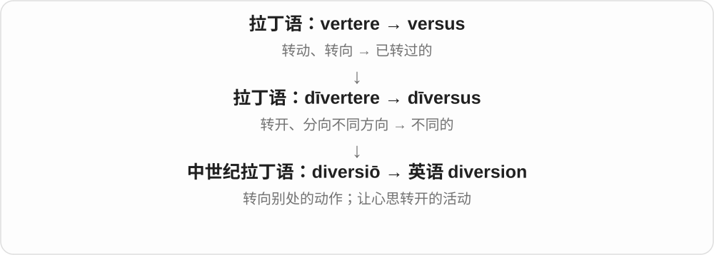

英式道路标志上的 diversion 是绕行路线。create a diversion 是制造动静，把别人的注意力引开。消遣义通常比较轻松。

**常见搭配与例句**

a traffic diversion；create a diversion；a pleasant diversion。

> We followed the diversion through two nearby villages.

我们沿绕行路线穿过了附近两个村庄。

> A short walk was a welcome diversion from paperwork.

暂时放下文书工作散个步，让人很放松。

**别混淆**

diversion 强调被导离原路线；detour 更直指绕路；distraction 更强调注意力被打断。

### 45. diversionary — 转移注意力的；起牵制、分散作用的

**音标**：英 /daɪˈvɜːʃənəri/；美 /dɪˈvɜːrʒəneri/

**先抓住这个画面**

正面的问题不好答，于是抛出另一个话题把大家目光引开，这种做法可以说 diversionary。

**怎么拆**

diversion + -ary；diversion 属 divert 转向、转移词族，形容词常强调分散注意、牵制的作用，而不泛指所有改道。

**怎么变成今天的意思**

**divert → diversion**  
把方向、注意力转到别处

↓

**diversion + -ary → diversionary**  
起转移注意、牵制作用的

a diversionary tactic 转移注意的手段；a diversionary move 牵制行动。

**常见搭配与例句**

diversionary tactics；a diversionary manoeuvre。

> She dismissed the accusation as a diversionary tactic.

她认为这项指责只是转移注意的手段。

> The debate got sidetracked by diversionary questions.

讨论被转移注意的问题带偏了。

**别混淆**

diversionary 常说转移、牵制策略；diverse 是多种多样。两者不要只凭 diver- 的外形混用。

### 46. visionary — 有远见的；富于想象的；有远见的人

**音标**：英 /ˈvɪʒənəri/；美 /ˈvɪʒəneri/

**先抓住这个画面**

visionary 是能在别人还没看见时，把一种未来图景想清楚的人；有时也暗示过于理想化。

**怎么拆**

vision + -ary，表示拥有或体现某种愿景。

**怎么变成今天的意思**

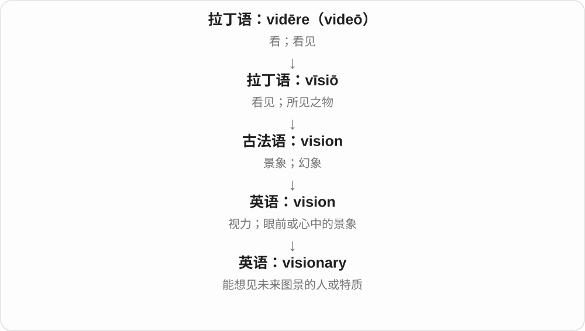

vision 从心中图景发展出愿景，visionary 则描述创造这种图景的能力或人物。褒贬取决于是否赞赏其构想。

**常见搭配与例句**

a visionary leader；a visionary idea；an architectural visionary。

> Her visionary plan transformed the old factory into a park.

她富有远见的计划把旧工厂改成了公园。

> Some dismissed him as a visionary with unrealistic dreams.

有些人把他看作满怀不切实际梦想的空想家。

**别混淆**

practical 强调能落实；visionary 强调有远景。一个方案可以兼具两者，也可能只有想象。

### 47. sanitary — 卫生的；有利于卫生的；公共卫生相关的

**音标**：英 /ˈsænətri/；美 /ˈsænəteri/

**先抓住这个画面**

把环境处理到不容易因污物、排泄物等影响健康的状态。

**怎么拆**

从法语 sanitaire 借入，接拉丁 sanitas“健康”；不是英语 sane 直接加 -ary。

**怎么变成今天的意思**

**拉丁 sanus**  
健康、健全；更早来源未定

↓

**拉丁 sanitas → 法语 sanitaire → 英语 sanitary**  
健康 → 公共卫生、卫生条件相关的

sanitary conditions 是卫生条件；sanitary facilities 常指厕所等卫生设施。sanitary products 在常见商品语境中可指经期卫生用品，不是泛指一切干净产品。

**常见搭配与例句**

sanitary conditions；sanitary facilities；sanitary products。

> The camp needs adequate sanitary facilities.

营地需要足够的卫生设施。

> Food must be prepared under sanitary conditions.

食物必须在卫生的条件下制作。

**别混淆**

clean 常说看得见的清洁；sanitary 更着眼于卫生与健康，不能只凭外表整齐判断。

### 48. supplementary — 补充的；附加的；互补的〔两角和为180°〕

**音标**：英 /ˌsʌplɪˈmentəri/；美 /ˌsʌpləˈmentəri/

**先抓住这个画面**

正文说完了，再给一张表或一段说明，把需要的内容补上。

**怎么拆**

supplement + -ary；与法语 supplémentaire 对应。

**怎么变成今天的意思**

supplementary information 是补充信息。几何中 supplementary angles 的和为 180°，补成平角；与和为 90° 的 complementary angles 分开记。

**常见搭配与例句**

supplementary information；supplementary questions；supplementary angles。

> Please attach any supplementary information to your application.

请在申请中附上其他补充信息。

> Angles of seventy and one hundred ten degrees are supplementary.

七十度角和一百一十度角互为补角。

**别混淆**

supplemental 与 supplementary 通常近义；数学角度术语固定用 supplementary。

### 49. complimentary — 赞美的；免费赠送的

**音标**：英 /ˌkɒmplɪˈmentəri/；美 /ˌkɑːmplɪˈmentəri/

**先抓住这个画面**

要么是送上一句好话，要么是送上一份礼遇；两种都保留了友好致意的感觉。

**怎么拆**

compliment〔名词〕 + -ary；“敬赠”这层礼节义连到“免费提供”。

**怎么变成今天的意思**

a complimentary remark 是赞美话；complimentary breakfast 是免费早餐。后者不是“称赞早餐”，也不是 complementary“互补的早餐”。

**常见搭配与例句**

complimentary about someone；complimentary tickets；complimentary breakfast。

> The reviewer was complimentary about the young actor’s performance.

评论者对这位年轻演员的表演赞赏有加。

> The hotel offers complimentary tea in the lobby.

酒店在大堂提供免费茶水。

**别混淆**

free 只说明不收费；complimentary 常带商家或主办方作为礼遇赠送的意味。

### 50. saliva — 唾液；口水

**音标**：/səˈlaɪvə/

**先抓住这个画面**

嘴里分泌的液体，可以较正式地说 saliva；日常 spit 也能说口水，但还可以是吐口水的动词。

**怎么拆**

借拉丁 saliva；英语早期有来自同源的其他形式，更远词源未定。不因为有 sal- 就直接断言等于 salt 盐。

**怎么变成今天的意思**

**拉丁 saliva → 英语 saliva**  
唾液；更远来源未定

↓

**saliva + -ary → salivary**  
唾液的；分泌唾液的

a saliva sample 唾液样本；produce saliva 分泌唾液。通常不可数。

**常见搭配与例句**

a saliva sample；saliva production。

> The laboratory collected a saliva sample.

实验室采集了一份唾液样本。

> The diagram shows how saliva enters the mouth.

示意图展示了唾液如何进入口腔。

**别混淆**

saliva 是物质名词，salivary 是形容词；用来修饰腺体时常说 salivary glands。

### 51. salivary — 唾液的；分泌唾液的

**音标**：英 /səˈlaɪvəri/；美 /ˈsæləveri/

**先抓住这个画面**

saliva 是唾液，salivary glands 是分泌唾液的腺体。形容词把相关结构和这份分泌物联系起来。

**怎么拆**

saliva 的末尾 a 在相应词干中不保留，再接 -ary → salivary；不是原样拼成 salivaary。

**怎么变成今天的意思**

**拉丁 saliva → 英语 saliva**  
唾液；更远来源未定

↓

**saliva + -ary → salivary**  
唾液的；分泌唾液的

salivary glands 唾液腺；salivary secretion 唾液分泌。

**常见搭配与例句**

salivary glands；salivary ducts。

> The textbook labels the major salivary glands.

教材标出了主要唾液腺。

> The study examined changes in salivary secretion.

研究考察了唾液分泌的变化。

**别混淆**

salivary 是唾液相关，salty 是咸的。不能因为开头像就把唾液腺叫咸腺。

### 52. adversary — 对手；敌手

**音标**：英 /ˈædvəsəri/；美 /ˈædvərseri/

**先抓住这个画面**

站在与你相对的一边、争取相反结果的人。可以很强硬，也可以是互相尊重的竞赛对手。

**怎么拆**

拉丁语 adversārius“处在对面的”，经法语 aversaire 等形式借入；现代形式可联系 adverse + -ary。

**怎么变成今天的意思**

语气较 opponent 正式，有时显得冲突更强，但并不必然表示私仇。a worthy adversary 是值得认真对待的强劲对手。

**常见搭配与例句**

a formidable adversary；a political adversary；face an adversary。

> She treated her adversary with respect throughout the debate.

整场辩论中，她都尊重对手。

> The champion finally met a formidable adversary.

这位冠军终于遇到了一个强劲的对手。

**别混淆**

enemy 常带敌对与伤害意味；adversary 可只是竞争或辩论中的对方。

### 53. discretionary — 可酌情决定的；非必需的

**音标**：英 /dɪˈskreʃənəri/；美 /dɪˈskreʃəneri/

**先抓住这个画面**

discretionary 像预算里留了一块可自己决定怎么花的钱，不是每一笔都被固定义务锁死。

**怎么拆**

discretion + -ary，表示属于自行判断、酌情决定范围的。

**怎么变成今天的意思**

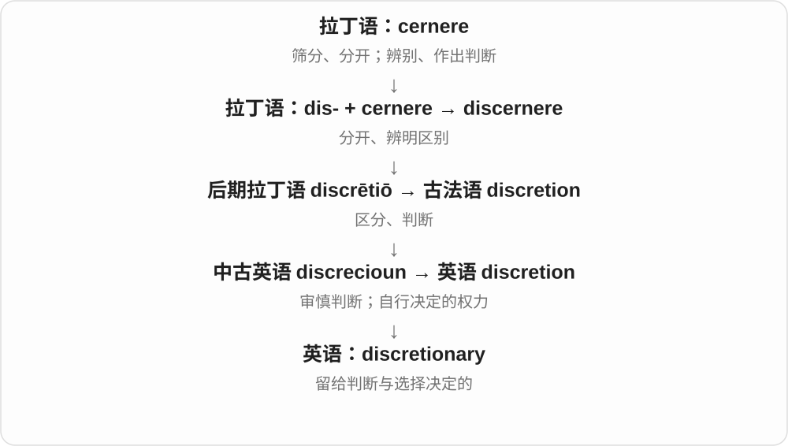

a discretionary bonus 是是否发放、发多少有酌情空间的奖金；discretionary spending 常指非必要开销，也可有特定预算制度含义。

**常见搭配与例句**

discretionary spending；a discretionary bonus；discretionary powers。

> The bonus is discretionary and is reviewed each year.

奖金是否发放由公司酌情决定，每年评议。

> We reduced discretionary spending to save for the move.

我们减少了非必要开支，为搬家存钱。

**别混淆**

mandatory 是必须执行；discretionary 表示存在选择、裁量空间，不等于可以无视一切规则。

### 54. reactionary — 反动的、主张恢复旧秩序的；持这种立场的人

**音标**：英 /riˈækʃənəri/；美 /riˈækʃəneri/

**先抓住这个画面**

不只是对事情有反应，而是反对某种社会、政治变化，想把秩序拉回较早状态；常带批评色彩。

**怎么拆**

借法语 réactionnaire，有法国革命后反对革命、恢复旧秩序等政治背景。现代可对应 reaction + -ary，但不是任何反应都能加后缀变成政治反动。

**怎么变成今天的意思**

**法语 réaction、拉丁相关反作用构词 → reaction**  
对动作、刺激的回应

↓

**法语 réactionnaire → reactionary**  
反对革命、变革等 → 主张恢复旧秩序的立场

reactionary views 反动、主张倒退的观点，a reactionary politician 反动政治人物，a reactionary 反动派。评价要结合作者立场与具体主张。

**常见搭配与例句**

reactionary views；reactionary politics；a reactionary。

> The historian examined reactionary movements after the revolution.

历史学者研究了革命后的反动运动。

> The reviewer criticized the novel’s reactionary view of social change.

评论者批评了小说对社会变革所持的倒退立场。

**别混淆**

reactionary 不等于 reactive 反应性的；conservative 保守与 reactionary 有范围重叠，但通常后者更强调恢复旧状态，不能无条件互换。

### 55. intermediary — 中间人；中介；居间的

**音标**：英 /ˌɪntəˈmiːdiəri/；美 /ˌɪntərˈmiːdieri/

**先抓住这个画面**

甲不直接找乙，而是通过丙传话或交易；丙就是 intermediary。

**怎么拆**

英语借自法语 intermédiaire；inter- 表示在……之间，medi- 是中间。不要把它解释成 immediate 加前缀。

**怎么变成今天的意思**

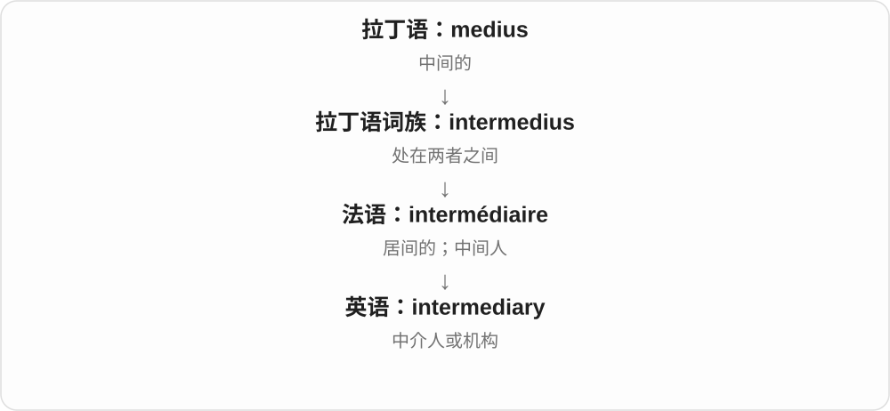

它可以是个人，也可以是帮两端接触的机构。强调所处位置，不保证其公平、不收费或没有自身利益。

**常见搭配与例句**

act as an intermediary；through an intermediary；a financial intermediary。

> We contacted the seller through an intermediary.

我们通过一位中间人联系了卖家。

> The agency acts as an intermediary between artists and clients.

这家机构在艺术家和客户之间起中介作用。

**别混淆**

intermediate 常形容中间阶段或水平；intermediary 常指承担居间角色的人、机构或事物。

### 56. rudimentary — 基础的；简陋的；初步发育的

**音标**：/ˌruːdɪˈmentri/

**先抓住这个画面**

刚搭起一个最基本的架子，还谈不上完整、成熟。

**怎么拆**

rudiment 基础、开端 + -ary；也可能受新拉丁 rudimentarius 影响，最终接拉丁 rudis 未经加工的。

**怎么变成今天的意思**

**拉丁 rudis**  
粗糙、未经加工或训练的

↓

**拉丁 rudimentum → 法语 rudiment → 英语 rudiment**  
最初尝试、开端 → 基础知识或未发育充分的部分

↓

**英语 rudiment + -ary；比较新拉丁 rudimentarius → rudimentary**  
开始阶段 → 只有基本部分、尚未充分发展的

a rudimentary knowledge 是初步知识；rudimentary equipment 是很简陋的设备。生物学里可说未充分发育或退化的结构，须看具体研究。

**常见搭配与例句**

rudimentary knowledge；rudimentary equipment；a rudimentary system。

> I have only a rudimentary knowledge of coding.

我只有一点编程基础知识。

> The shelter had a rudimentary system for collecting rainwater.

避难所有一套简易的雨水收集装置。

**别混淆**

basic 有时是完整而必要的基础；rudimentary 更容易暗示只有起步水平、功能有限。

### 57. sedimentary — 沉积的；沉积形成的

**音标**：/ˌsedɪˈmentəri/

**先抓住这个画面**

sedimentary 像把一层层落下的材料保存成层次，常用来形容由沉积物形成的岩层。

**怎么拆**

sediment + -ary，表示与沉积物或沉积形成过程有关。

**怎么变成今天的意思**

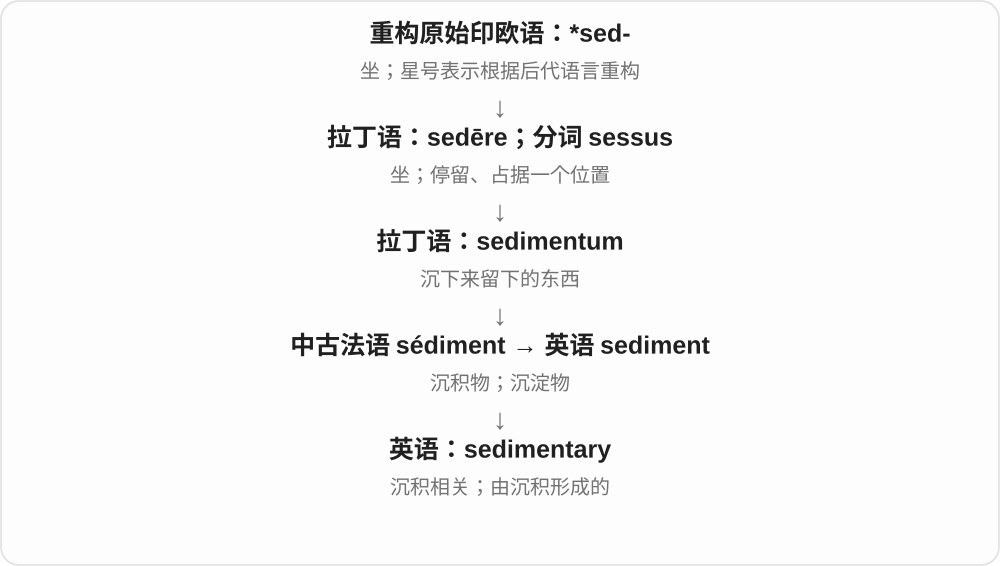

sedimentary rock 是沉积岩；sedimentary layers 是沉积层。沉积岩形成还可能涉及压实、胶结或化学、生物过程，不能只理解成泥巴晾干。

**常见搭配与例句**

sedimentary rock；sedimentary layers；a sedimentary basin。

> The cliff exposes several layers of sedimentary rock.

悬崖露出了几层沉积岩。

> The fossils were found in sedimentary deposits.

这些化石是在沉积层中发现的。

**别混淆**

sedentary 指久坐、定居；sedimentary 谈沉积物和地层，虽同族但不能互换。

### 58. unitary — 单一的；一体的；单一制的；酉的（数学）

**音标**：英 /ˈjuːnɪtəri/；美 /ˈjuːnəteri/

**先抓住这个画面**

unitary 像把一套制度看作一个整体，权力或结构围绕一个统一中心组织。

**怎么拆**

unit + -ary，表示与单一单位、整体有关。

**怎么变成今天的意思**

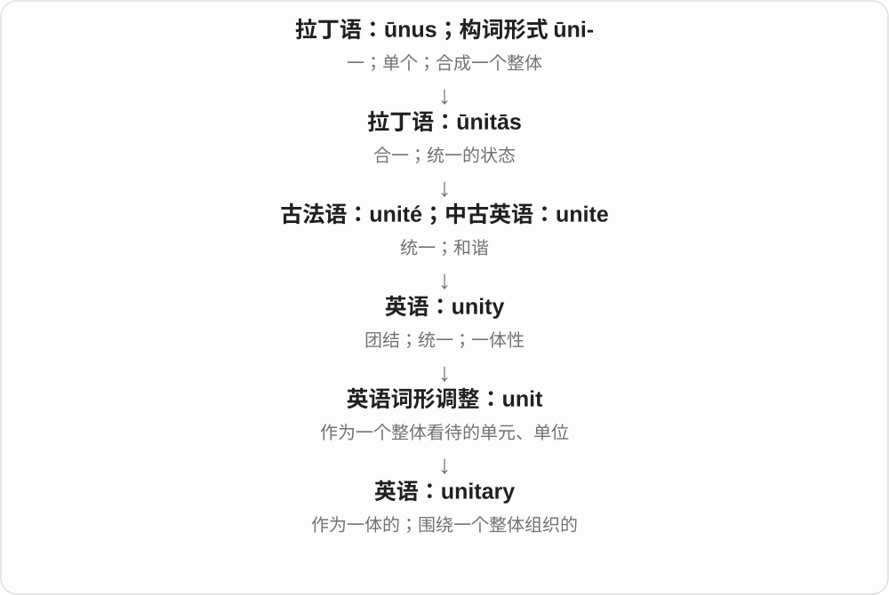

普通学术用法突出一体性。政治中的 unitary state 是单一制国家；数学中的 unitary matrix 是酉矩阵：共轭转置等于逆矩阵，其变换保持向量的长度。这个专义不能只凭“一个”猜出来。

**常见搭配与例句**

a unitary state；a unitary system；a unitary matrix。

> The book compares unitary and federal systems.

这本书比较了单一制与联邦制体系。

> The proposal replaces several separate bodies with one unitary authority.

提案用一个统一的管理机构替代几个独立机构。

> A unitary transformation preserves the length of the vector.

酉变换保持向量的长度不变。

**别混淆**

united 是各方联合；unitary 强调整体组织形式。政治里的 unitary 常与 federal 对照，不等于所有事务都由同一人处理。

### 59. inflationary — 通货膨胀的；推动物价上涨的

**音标**：英 /ɪnˈfleɪʃənri/；美 /ɪnˈfleɪʃəneri/

**先抓住这个画面**

用来描述通胀环境，或把整体价格往上推的压力。

**怎么拆**

英语 inflation + -ary，形成表示“相关性质”的形容词；这里的结尾不是 ordinary 中的独立单词。

**怎么变成今天的意思**

**拉丁 flare**  
吹气、吹起

↓

**拉丁 inflare → inflatio**  
吹胀 → 膨胀的过程

↓

**拉丁词直接或经古法语 inflation → 中古英语 inflation**  
早期说胀气、膨胀及自大

↓

**现代英语 inflation**  
充气；通货膨胀；其他领域的膨胀

↓

**英语 inflation + -ary → inflationary**  
与通胀有关的；具有推高物价作用的

inflationary pressure 好比有人在往物价这个气球里继续打气：成本、需求等因素可能推动价格上涨。inflationary expectations 则说人们预期未来物价会怎样变化。

**常见搭配与例句**

inflationary pressures；inflationary expectations；an inflationary spiral。

> Higher shipping costs added to inflationary pressures.

运输成本上涨加大了通胀压力。

> The survey asked households about their inflationary expectations.

这项调查询问了家庭对通胀的预期。

**别混淆**

inflation 是现象，inflationary 是相关性质。说一个冲击有 inflationary effect，强调它向上推价格，并不等于已经确定通胀最终会达到多少。

### 60. expeditionary — 远征的；派往外地执行行动的

**音标**：英 /ˌekspəˈdɪʃənri/；美 /ˌekspəˈdɪʃəneri/

**先抓住这个画面**

一支力量被组织起来，离开本地，到另一片地区执行任务；最常见是在军事历史与新闻中。

**怎么拆**

expedition + -ary，英语形容词。承接远征行动这一义，不是表示“办事很快”；那个意思通常用 expeditious。

**怎么变成今天的意思**

**拉丁 pes，属格 pedis，词干 ped-**  
脚、足；也能由支撑作用说物体的脚

↓

**拉丁 ex- 与 ped- 相关成分 → expedire**  
解除脚上的束缚；引申排除障碍、使就绪

↓

**拉丁 expeditio／expeditionem → 法语 expedicion／直接拉丁借入**  
准备出发、出征、执行行动

↓

**中古英语 expedicioun → expedition**  
有特定目的的远行；探险或考察队

↓

**英语 expedition + -ary → expeditionary**  
远征行动相关的

expeditionary force 是远征军；expeditionary unit 是派出的远征部队。广义也可形容探险任务相关事物，常用搭配仍集中在军事语境。

**常见搭配与例句**

an expeditionary force；an expeditionary unit；expeditionary operations。

> The museum displays letters written by members of an expeditionary force.

博物馆展出了远征军成员写下的信件。

> The book examines how expeditionary units were supplied far from home.

这本书研究了远征部队在远离本土时如何获得补给。

**别混淆**

expeditionary 指行动性质与派驻方式；expeditious 指办事迅速有效。两词外形相近，却不能互换。

### 61. fragmentary — 零碎不全的；片段式的

**音标**：英 /ˈfræɡməntri/；美 /ˈfræɡmənteri/

**先抓住这个画面**

手里只有几块拼图，拼不出整个故事。

**怎么拆**

fragment 加形容词后缀 -ary，指由片段组成，常带不完整的意思。

**怎么变成今天的意思**

**拉丁 frangere，分词 frāctus**  
打碎、折断；被打断的

↓

**拉丁 fragmentum → 法语或英语 fragment**  
破开后留下的一块；片段

↓

**英语 fragment + -ary → fragmentary**  
零碎、不完整的

fragmentary evidence 是证据只剩零星部分；fragmentary knowledge 是知道一些点，却不能形成全面认识。

**常见搭配与例句**

fragmentary evidence；fragmentary records；fragmentary knowledge。

> Only fragmentary records of the expedition survive.

这次探险只留下了零碎的记录。

> Our knowledge of the early settlement is still fragmentary.

我们对这处早期聚居地的了解仍不完整。

**别混淆**

brief 只是短；fragmentary 说明缺了部分或连接，短而完整的说明不必叫 fragmentary。

### 62. probationary — 试用的；考察期的

**音标**：英 /prəˈbeɪʃənəri/；美 /proʊˈbeɪʃəneri/

**先抓住这个画面**

这段安排还带着“先看看”的条件，表现要继续接受观察。

**怎么拆**

probation + -ary，表示与考察或试用有关。

**怎么变成今天的意思**

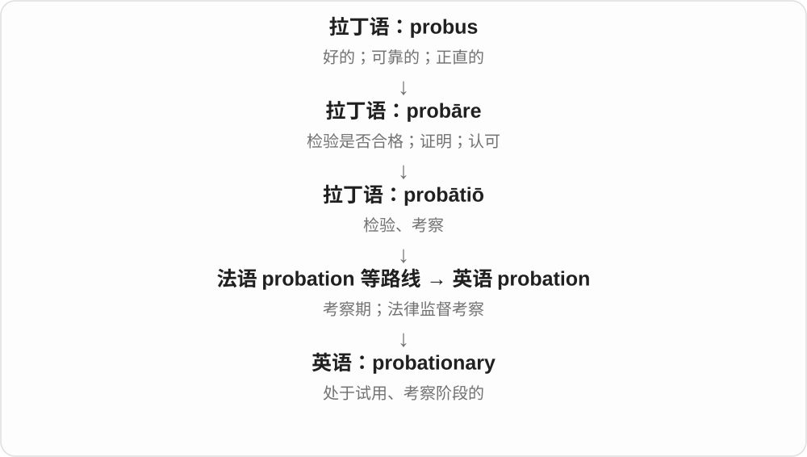

常用于 probationary period、probationary employee。是否以及怎样转为正式状态，由相关安排决定，词本身不包含固定期限。

**常见搭配与例句**

a probationary period；a probationary appointment。

> She completed her probationary period successfully.

她顺利完成了试用期。

> The offer was for a probationary appointment.

这份聘用安排带有试用考察条件。

**别混淆**

probationary 强调考察条件；temporary 只强调暂时，两者可能同时成立，也可能不同。

### 63. exclusionary — 排斥性的；把某些人、事物排除在外的

**音标**：英 /ɪkˈskluːʒənri/；美 /ɪkˈskluːʒəneri/

**先抓住这个画面**

规则表面开着门，条件却让某群人进不来，便可以说是 exclusionary。重点在产生排除的机制、性质。

**怎么拆**

exclusion + -ary → exclusionary；exclusion 追到拉丁 ex- 在外 + claudere 关闭的排除材料，不拆成现代 exclude 直接加 -ary。

**怎么变成今天的意思**

**拉丁 excludere、exclusio → exclusion**  
把……关在外面；排除

↓

**exclusion + -ary → exclusionary**  
具有排除作用、性质的

exclusionary rules 排除性规则；exclusionary practices 排斥性做法；正式语境常用于参与资格、群体边界等。专门法律词组另按所处体系理解。

**常见搭配与例句**

exclusionary practices；exclusionary rules；an exclusionary policy。

> The club changed rules that had been criticised as exclusionary.

俱乐部修改了被批评具有排斥性的规则。

> The study examines exclusionary practices in recruitment.

研究考察招聘中的排斥性做法。

**别混淆**

exclusion 是排除这个行为、结果，exclusionary 修饰造成排除的性质；exclusive 还可指独家、高档专属，不能处处替换。

### 64. granary — 粮仓；粮食主产区

**音标**：英 /ˈɡrænəri/；美 /ˈɡrænəri/，也读 /ˈɡreɪnəri/

**先抓住这个画面**

把收来的谷物存放起来的地方，也可比喻给大片地区供应粮食的区域。

**怎么拆**

借拉丁 grānārium“粮仓”，来自 grānum“谷物”加表示场所的成分。与经法语变化更大的 garner 是同源的不同借入形式。

**怎么变成今天的意思**

**拉丁 grānum**  
谷粒、种子、小颗粒

↓

**拉丁 grānārium**  
储存粮食的地方

↓

**拉丁 grānārium → 英语 granary**  
粮仓；粮食供应地

a village granary 是村里的粮仓；称一片平原为 a granary，是把其粮食生产作用比成巨大的仓库。

**常见搭配与例句**

an old granary；a grain-filled granary；the granary of a region。

> The old granary has been converted into a small museum.

旧粮仓已改成一座小博物馆。

> The fertile plain became the granary of the kingdom.

肥沃的平原成为王国的主要粮食产地。

**别混淆**

barn 可以存干草、设备或安置牲畜；granary 专门突出储存谷物。

### 65. deflationary — 通缩的；具有压低物价作用的

**音标**：英 /ˌdiːˈfleɪʃənri/；美 /ˌdiːˈfleɪʃəneri/

**先抓住这个画面**

描述让价格往下走的环境或力量。

**怎么拆**

英语 deflation + -ary。de- 的逆向关系已经包含在 deflate、deflation 中，形容词只把它转成一种性质。

**怎么变成今天的意思**

**拉丁 flare**  
吹气、吹起

↓

**拉丁 in- + flare → inflare → inflatus**  
向里面吹气 → 吹胀；分词形式

↓

**中古英语 inflaten → inflate**  
使膨胀；后来也指抬高、夸大

↓

**近代英语以 de- 替换 inflate 的 in- → deflate**  
放掉气、使缩小；后来也说打击自信

↓

**英语 deflate + -ion → deflation**  
放气；后来用于总体价格水平下降

↓

**英语 deflation + -ary → deflationary**  
通缩相关的；对价格形成向下压力的

deflationary pressure 是压低总体价格的压力。即使现实中还有别的力量推高价格，也可以单独说某一因素有 deflationary effect：这是谈作用方向，不一定在宣布经济已陷入通缩。

**常见搭配与例句**

deflationary pressures；a deflationary effect；a deflationary environment。

> Weak demand created deflationary pressures across the economy.

疲弱的需求给整个经济带来了通缩压力。

> The study examined the deflationary effect of lower import costs.

这项研究考察了进口成本下降对物价的下压作用。

**别混淆**

inflationary 往上推价格，deflationary 往下压价格。后者也不能仅凭某一件商品降价就套到整个经济。

### 66. expansionary — 促进扩张的；扩张性的〔常用于经济政策〕

**音标**：英 /ɪkˈspænʃənəri/；美 /ɪkˈspænʃəneri/

**先抓住这个画面**

一项政策的方向是把经济活动或总需求往上推，因此被称为 expansionary。

**怎么拆**

expansion + -ary，表示相关性质或作用。

**怎么变成今天的意思**

**拉丁 pandere / pandō**  
展开、伸开

↓

**拉丁 ex- + pandere → expandere**  
向外展开

↓

**法语相关形式与拉丁借入 → 英语 expand**  
扩展、扩大、展开

↓

**英语 expansion → expansionary**  
扩张 → 促进扩张的

常见 expansionary fiscal policy 与 expansionary monetary policy。它说明政策意图或方向，不保证每次都达到预期增长，也不是国际政治中的领土扩张。

**常见搭配与例句**

expansionary policy；an expansionary budget；expansionary measures。

> The textbook describes the budget as expansionary.

教材把这份预算描述为扩张性的。

> The lecture compared expansionary and contractionary monetary policies.

讲座比较了扩张性与紧缩性货币政策。

**别混淆**

expansionist 常谈政治扩张主义；expansionary 常谈使经济活动扩大的政策作用。

## 这一组要分清什么

cautionary 警示与 precautionary 预防分开；budgetary 是预算方面，不是所有 budget 低价义都适用；elementary 基础与 elemental 原始、基本的常用搭配有别；stationary 不动的与 stationery 文具需要分清。

## 串起来练习

The school took precautionary steps despite budgetary constraints.

学校尽管预算受限，仍采取了预防措施。
