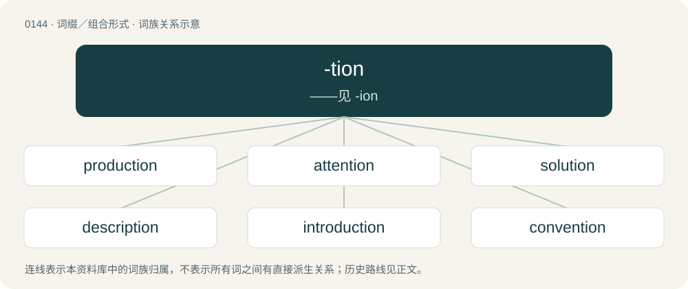

# 0152 · -tion — ——见 -ion

[总目录](../00_总目录_按常用程度.md)

**类型**：词缀／组合形式　｜　**来源语言**：见词源记录

## 核心含义与来源

- 核心含义：——见 -ion
- 英文含义：Used to form nouns meaning "the action of (a verb)" or "the result of (a verb)". Words ending in this suffix are almost always derived from a similar Latin word; a few (e.g. gumption) are not derived from Latin and are unrelated to any verb. More often, -ation is used.
- 词形：-tion

**来源记录 1**（后缀／后置成分；Used to form nouns meaning "the action of (a verb)" or "the result of (a verb)". Words ending in this suffix are almost always derived from a similar Latin word; a few (e.g. gumption) are not derived from Latin and are unrelated to any verb. More often, -ation is used.）

From rebracketed Middle English -cioun, rebracketed borrowing of Old French -tion, -cion, borrowed from the stem of Latin -tiō. The Middle English -cioun became -tion in Modern English under the influence of the Middle French -tion and original Latin spellings. Always -ate or t-final/te-final base + -ion.

## 词族图

## 单词速览（常用到不常用）

| 单词 | 音标 | 释义 |
|---|---|---|
| [production](#w-1) | 英 /pɹəˈdʌkʃn̩/；美 /pɹəˈdʌkʃən/ | n. 制造, 生产, 产物；\[医\] 产生, 生成 |
| [attention](#w-2) | /əˈtɛn.ʃn̩/ | n. 注意, 注意力；\[计\] 引起注意信号 |
| [solution](#w-3) | /səˈl(j)uːʃən/ | n. 解决, 解答, 溶液；\[化\] 溶液 |
| [description](#w-4) | /dɪˈskɹɪpʃən/ | n. 描述, 说明, 种类；\[经\] 说明书(物品), 品名种类, 货物名称 |
| [introduction](#w-5) | /ˌɪntɹəˈdʌkʃn̩/ | n. 介绍, 传入, 采用, 初步 |
| [convention](#w-6) | 英 /kənˈvɛn.ʃən/ | n. 大会, 协定, 惯例, 约定；\[计\] 约定 |
| [reduction](#w-7) | 英 /ɹɪˈdʌk.ʃən/ | n. 减少, 缩影, 变化；\[化\] 还原 |
| [consumption](#w-8) | /kənˈsʌmp.ʃən/ | n. 消费, 消费量, 痨病；\[化\] 消耗量; 耗量 |
| [intervention](#w-9) | 英 /ɪntəˈvɛnʃən/；美 /ɪntɚˈvɛnʃən/ | n. 插入, 介入, 调停；\[经\] 干预 |
| [reception](#w-10) | /ɹɪˈsɛp.ʃn̩/ | n. 接待, 接受, 招待会；\[医\] 接受, 感受 |
| [prescription](#w-11) | /pɹəˈskɹɪp.ʃən/ | n. 处方, 命令, 指定；\[医\] 处方, 药方 |
| [detention](#w-12) | /dɪˈtɛnʃn̩/ | n. 阻止, 监禁, 拘留；\[医\] 隔离, 拘留, 滞留, 停滞 |
| [junction](#w-13) | /ˈd͡ʒʌŋkʃən/ | n. 连接, 会合处, 交叉点；\[医\] 接\[合\]处, 接点.\[接\]界 |
| [conception](#w-14) | 英 /kənˈsɛpʃən/ | n. 观念, 概念；\[医\] 妊娠, 受孕; 概念 |
| [contention](#w-15) | /kənˈtɛnʃən/ | n. 争论, 争辩, 所持的论点；\[计\] 争用 |
| [induction](#w-16) | /ɪnˈdʌkʃən/ | n. 归纳法, 感应, 就职, 入门；\[计\] 归纳法 |
| [absorption](#w-17) | 英 /əbˈzɔːp.ʃn̩/；美 /æbˈsɔɹp.ʃn̩/ | n. 吸收, 专心, 全神贯注；\[化\] 吸收; 吸收作用 |
| [abolition](#w-18) | /ˌæb.əˈlɪʃ.ən/ | n. 废除, 废奴运动；\[医\] 禁止, 消失 |
| [deduction](#w-19) | 英 /dɪˈdʌkʃən/；美 /dɪˈdʌkʃən/ | n. 减除, 扣除, 减除额, 推论；\[医\] 演绎, 推论 |
| [abduction](#w-20) | 英 /əbˈdʌk.ʃn̩/；美 /æbˈdʌk.ʃn̩/ | n. 诱拐, 绑架, 外展；\[医\] 外展, 展 |
| [seduction](#w-21) | 英 /sɪˈdʌk.ʃn̩/；美 /sɪˈdʌk.ʃn̩/ | n. 教唆, 怂恿, 诱惑, 诱惑物, 诱饵；\[法\] 诱奸, 勾引, 引诱 |
| [subduction](#w-22) | 英 /səbˈdʌkʃən/ | \[医\] 下转, 眼球下转 |
| [convolution](#w-23) | 英 /kɒn.vəˈluːʃ(ə)n/；美 /kɑn.vəˈluːʃ(ə)n/ | n. 回旋, 卷绕, 盘旋；\[计\] 卷积 |

## 逐词详解

### 1. production

**词性**：名词　｜　**音标**：英 /pɹəˈdʌkʃn̩/；美 /pɹəˈdʌkʃən/

**中文释义**：n. 制造, 生产, 产物；\[医\] 产生, 生成

**英文义项**：The act of producing, making or creating something. / The act of bringing something forward, out, etc., for use or consideration.

**构词拆分**：produce + -tion

**词源与演化**：

From Middle English produccioun, from Old French production, from Latin prōductiō, prōductiōnem (“a lengthening, prolonging”). Equivalent to produce + -tion. See produce.

**例句**：

> If you get the chance, try and catch the new production of "Hamlet."

该用例对应义项：The presentation of a theatrical work.

### 2. attention

**词性**：名词　｜　**音标**：/əˈtɛn.ʃn̩/

**中文释义**：n. 注意, 注意力；\[计\] 引起注意信号

**英文义项**：Mental focus. / An action or remark expressing concern for or interest in someone or something, especially romantic interest.

**构词拆分**：attend + -tion

**词源与演化**：

From Middle English attencioun, borrowed from Latin attentio, attentionis, from attendere, past participle attentus (“to attend, give heed to”); see attend. Equivalent to attend + -tion.

**例句**：

> Please direct your attention to the following words.

该用例对应义项：Mental focus.

### 3. solution

**词性**：名词　｜　**音标**：/səˈl(j)uːʃən/

**中文释义**：n. 解决, 解答, 溶液；\[化\] 溶液

**英文义项**：A homogeneous mixture, which may be liquid, gas or solid, formed by dissolving one or more substances. / An act, plan or other means, used or proposed, to solve a problem.

**词源与演化**：

From Middle English solucioun, from Old French solucion (French solution), from Latin solūtiōnem, accusative singular of solūtiō, from the verb solvō. Compare solve, -tion.

**例句**：

> He used a solution of peroxide and water.

该用例对应义项：a homogeneous mixture of two or more substances; frequently (but not necessarily) a liquid solution

### 4. description

**词性**：名词　｜　**音标**：/dɪˈskɹɪpʃən/

**中文释义**：n. 描述, 说明, 种类；\[经\] 说明书(物品), 品名种类, 货物名称

**英文义项**：A sketch or account of anything in words; a portraiture or representation in language; an enumeration of the essential qualities of a thing or species. / The act of describing; a delineation by marks or signs.

**构词拆分**：describe + -tion

**词源与演化**：

From Middle English descripcioun, from Old French description and its etymon, Latin dēscrīptiō, noun of action of dēscrībō (“to describe”). Equivalent to describe + -tion.

**例句**：

> Her description of the village helped us find it.

她对那个村庄的描述帮助我们找到了它。

### 5. introduction

**词性**：名词　｜　**音标**：/ˌɪntɹəˈdʌkʃn̩/

**中文释义**：n. 介绍, 传入, 采用, 初步

**英文义项**：The act or process of introducing. / A means, such as a personal letter, of presenting one person to another.

**构词拆分**：introduce + -tion

**词源与演化**：

From Middle English introduccioun, introduccyon, borrowed from Old French introduction, itself a borrowing from Latin intrōdūctiōnem, accusative of Latin intrōdūctiō, from intrōdūcō. By surface analysis, intro- + Latin dūctiō or introduce + -tion.

**例句**：

> David was feeling groggy at his introduction to Sophie, and didn't remember her name.

该用例对应义项：A means, such as a personal letter, of presenting one person to another.

### 6. convention

**词性**：名词　｜　**音标**：英 /kənˈvɛn.ʃən/

**中文释义**：n. 大会, 协定, 惯例, 约定；\[计\] 约定

**英文义项**：A meeting or gathering. / A formal deliberative assembly of mandated delegates.

**构词拆分**：convene + -tion

**词源与演化**：

Recorded since about 1440, borrowed from Middle French convention, from Latin conventiō (“meeting, assembling; agreement, convention”), from conveniō (“come, gather or meet together, assemble”), from con- (“with, together”) + veniō (“come”). Equivalent to convene + -tion.

**例句**：

> Table seatings are generally determined by tacit convention, not binding formal protocol.

该用例对应义项：A practice or procedure widely observed in a group, especially to facilitate social interaction; a custom.

### 7. reduction

**词性**：名词　｜　**音标**：英 /ɹɪˈdʌk.ʃən/

**中文释义**：n. 减少, 缩影, 变化；\[化\] 还原

**英文义项**：The act, process, or result of reducing. / The amount or rate by which something is reduced, e.g. in price.

**构词拆分**：reduce + -tion

**词源与演化**：

From Middle English reduccion, a borrowing from Old French reducion, from Latin reductiō, reductiōnem. Equivalent to reduce + -tion.

**用法示例／搭配（非完整句）**：

> open reduction and internal fixation

该用例对应义项：A medical procedure to restore a fracture or dislocation to the correct alignment, usually with a closed approach but sometimes with an open approach (surgery).

### 8. consumption

**词性**：名词　｜　**音标**：/kənˈsʌmp.ʃən/

**中文释义**：n. 消费, 消费量, 痨病；\[化\] 消耗量; 耗量

**英文义项**：The act of eating, drinking or using. / The amount consumed.

**构词拆分**：consume + -tion

**词源与演化**：

From con- + Latin sūmptus + -ion, from Middle English consumpcioun, from Old French consumpcion, from Latin cōnsūmptiō, from cōnsūmō + -tiō, from con- (“with, together”) + sūmō (“take; consume”). Equivalent to consume + -tion.

**例句**：

> The consumption of snails as food is more common in France than in England.

该用例对应义项：The act of eating, drinking or using.

### 9. intervention

**词性**：名词　｜　**音标**：英 /ɪntəˈvɛnʃən/；美 /ɪntɚˈvɛnʃən/

**中文释义**：n. 插入, 介入, 调停；\[经\] 干预

**英文义项**：The action of intervening; interfering in some course of events. / A legal motion through which a person or entity who has not been named as a party to a case seeks to have the court order that they be made a party.

**构词拆分**：intervene + -tion

**词源与演化**：

From Middle French intervention, from Latin interventiō. Morphologically intervene + -tion.

**例句**：

> The purpose of intervention is to prevent unnecessary duplication of lawsuits.

该用例对应义项：(law) a proceeding that permits a person to enter into a lawsuit already in progress; admission of person not an original party to the suit so that person can protect some right or interest that is allegedly affected by the proceedings

### 10. reception

**词性**：名词　｜　**音标**：/ɹɪˈsɛp.ʃn̩/

**中文释义**：n. 接待, 接受, 招待会；\[医\] 接受, 感受

**英文义项**：The act of receiving. / The act or ability to receive radio or similar signals.

**构词拆分**：receive + -tion

**词源与演化**：

From Middle English recepcion, reception, from Middle French reception, from Latin receptiōn- (“the act of receiving; reception”), from recipiō (“receive”), from re- (“back”) + capiō (“to hold”). Equivalent to receive + -tion.

**例句**：

> Please leave the package at reception.

请把包裹放在接待处。

### 11. prescription

**词性**：名词　｜　**音标**：/pɹəˈskɹɪp.ʃən/

**中文释义**：n. 处方, 命令, 指定；\[医\] 处方, 药方

**英文义项**：A written order from an authorized medical practitioner for provision of a medicine or other treatment, such as (ophthalmology) the specific lenses needed for a pair of glasses. / The medicine or treatment provided by such an order.

**构词拆分**：prescribe + -tion

**词源与演化**：

Borrowed from Middle French, from Old French prescripcion, from Latin praescriptio (“preface; pretext; something written ahead of time”), from prae- (“pre-, before”) + scribere (“to write”) + -tio (“-tion, forming nouns”). Equivalent to prescribe + -tion.

**例句**：

> Early to bed and early to rise is a prescription for a long, healthy, and terrible life.

该用例对应义项：Any plan of treatment or handling; the treatment or handling thus provided.

### 12. detention

**词性**：名词　｜　**音标**：/dɪˈtɛnʃn̩/

**中文释义**：n. 阻止, 监禁, 拘留；\[医\] 隔离, 拘留, 滞留, 停滞

**英文义项**：The act of detaining or the state of being detained; hindrance. / Confinement of a prisoner awaiting trial.

**构词拆分**：detain + -tion

**词源与演化**：

Borrowed from Middle French détention, from Latin detentio, detentionem. Equivalent to detain + -tion.

**用法示例／搭配（非完整句）**：

> be stuck in detention

该用例对应义项：A punishment given to a student for a minor infraction, typically requiring the student to report to a designated room during recess or outside of school hours to work on homework or perform busywork.

### 13. junction

**词性**：名词　｜　**音标**：/ˈd͡ʒʌŋkʃən/

**中文释义**：n. 连接, 会合处, 交叉点；\[医\] 接\[合\]处, 接点.\[接\]界

**英文义项**：The act of joining, or the state of being joined. / A place where two things meet, especially where two roads meet.

**构词拆分**：join + -tion

**词源与演化**：

From Latin iūnctiō (“union, joining, uniting”), from iungō (“join, attach together”). Equivalent to join + -tion.

**例句**：

> Their collaboration formed a fruitful junction of ideas.

该用例对应义项：The act of joining, or the state of being joined.

### 14. conception

**词性**：名词　｜　**音标**：英 /kənˈsɛpʃən/

**中文释义**：n. 观念, 概念；\[医\] 妊娠, 受孕; 概念

**英文义项**：The act of conceiving. / The state of being conceived; the beginning.

**构词拆分**：conceive + -tion

**词源与演化**：

From Middle English concepcioun, borrowed from Old French conception, from Latin conceptiō (“a comprehending, a collection, composition, an expression, also a becoming pregnant”), from concipiō, past participle conceptus (“conceive”); see conceive. Equivalent to conceive + -tion.

**例句**：

> Their conception of success includes time for family.

在他们的观念中，成功也包括有时间陪伴家人。

### 15. contention

**词性**：名词　｜　**音标**：/kənˈtɛnʃən/

**中文释义**：n. 争论, 争辩, 所持的论点；\[计\] 争用

**英文义项**：Argument, contest, debate, strife, struggle. / A point maintained in an argument, or a line of argument taken in its support; the subject matter of discussion of strife; a position taken or contended for.

**构词拆分**：contend + -tion

**词源与演化**：

From Middle English contencion, borrowed from Old French contencion, from Latin contentio, contentionem, from contendō (past participle contentus); equivalent to contend + -tion (similar formation to attention).

**例句**：

> It is my contention that state lotteries are taxes on stupid people.

该用例对应义项：A point maintained in an argument, or a line of argument taken in its support; the subject matter of discussion of strife; a position taken or contended for.

### 16. induction

**词性**：名词　｜　**音标**：/ɪnˈdʌkʃən/

**中文释义**：n. 归纳法, 感应, 就职, 入门；\[计\] 归纳法

**英文义项**：An act of inducting. / A formal ceremony in which a person is appointed to an office or into military service.

**构词拆分**：induce + -tion

**词源与演化**：

Inherited from Middle English induction, from Old French induction, from Latin inductiō, from indūcō (“to lead”). By surface analysis, induct + -ion or induce + -tion.

**例句**：

> He was ordered to report for induction into the army.

该用例对应义项：a formal entry into an organization or position or office

### 17. absorption

**词性**：名词　｜　**音标**：英 /əbˈzɔːp.ʃn̩/；美 /æbˈsɔɹp.ʃn̩/

**中文释义**：n. 吸收, 专心, 全神贯注；\[化\] 吸收; 吸收作用

**英文义项**：The act or process of absorbing or of being absorbed as, / engulfing; swallowing up, as of bodies or land.

**构词拆分**：absorb + -tion

**词源与演化**：

First attested in 1597. From Latin absorptiō (“a sucking in”), from absorbeō (“absorb”). Morphologically absorb + -tion.

**例句**：

> His complete absorption in the novel made him lose track of time.

该用例对应义项：The act or process of absorbing or of being absorbed as,

### 18. abolition

**词性**：名词　｜　**音标**：/ˌæb.əˈlɪʃ.ən/

**中文释义**：n. 废除, 废奴运动；\[医\] 禁止, 消失

**英文义项**：The act of abolishing; an annulling; abrogation. / The state of being abolished.

**构词拆分**：abolish + -tion

**词源与演化**：

Borrowed from Middle French abolition, from Old French abolucion, a learned borrowing from Latin abolitiōnem. First attested in 1529. Equivalent to abolish + -tion.

**例句**：

> The campaign for the abolition of slavery changed the course of history.

该用例对应义项：The act of abolishing; an annulling; abrogation.

### 19. deduction

**词性**：名词　｜　**音标**：英 /dɪˈdʌkʃən/；美 /dɪˈdʌkʃən/

**中文释义**：n. 减除, 扣除, 减除额, 推论；\[医\] 演绎, 推论

**英文义项**：That which is deducted; that which is subtracted or removed. / A sum that can be removed in tax calculations, usually from the taxable amount; something that is written off.

**构词拆分**：deduct + -ion；deduce + -tion

**词源与演化**：

From Middle French déduction, from Latin deductio. Equivalent to deduct + -ion or deduce + -tion.

**例句**：

> Through his powers of deduction, he realized that the plan would never work.

该用例对应义项：The ability or skill to deduce or figure out; the power of reason

### 20. abduction

**词性**：名词　｜　**音标**：英 /əbˈdʌk.ʃn̩/；美 /æbˈdʌk.ʃn̩/

**中文释义**：n. 诱拐, 绑架, 外展；\[医\] 外展, 展

**英文义项**：A leading away; a carrying away. / The act of abducing or abducting; a drawing apart; the movement which separates a limb or other part from the axis, or middle line, of the body.

**构词拆分**：By surface analysis, abduct + -ion；abduce + -tion

**词源与演化**：

From Latin abductiō(n) (“a robbing; an abduction”), from abdūcō (“to take or lead away”), from ab (“away”) + dūcō (“to lead”). By surface analysis, abduct + -ion or abduce + -tion. \* (physiology): From French, from Latin abductus. \* Compare French abduction.

**用法示例／搭配（非完整句）**：

> the abduction of a child

该用例对应义项：The wrongful, and usually forcible, carrying off of a human being.

### 21. seduction

**词性**：名词　｜　**音标**：英 /sɪˈdʌk.ʃn̩/；美 /sɪˈdʌk.ʃn̩/

**中文释义**：n. 教唆, 怂恿, 诱惑, 诱惑物, 诱饵；\[法\] 诱奸, 勾引, 引诱

**英文义项**：The act of seducing. / The felony of, as a man, inducing a previously chaste unmarried female to engage in sexual intercourse on a promise of marriage.

**构词拆分**：seduce + -tion

**词源与演化**：

Borrowed from Middle French séduction, from Latin sēductiō, from sēdūcō. Equivalent to seduce + -tion.

**例句**：

> Seduction is the fine art of manipulating people based on physical attraction and desire. Step 1: Be attractive. Step 2: Don't be unattractive.

该用例对应义项：The act of seducing.

### 22. subduction

**词性**：名词　｜　**音标**：英 /səbˈdʌkʃən/

**中文释义**：\[医\] 下转, 眼球下转

**英文义项**：The action of being pushed or drawn beneath another object. / The process of one tectonic plate moving beneath another and sinking into the mantle at a convergent plate boundary.

**构词拆分**：subduct + -ion；subduce + -tion

**词源与演化**：

From Latin subductiō, from subdūcere (“to draw from under or below”). Equivalent to subduct + -ion or subduce + -tion.

**例句**：

> As subduction occurs below the continental shelf, earthquakes become more likely.

### 23. convolution

**词性**：名词　｜　**音标**：英 /kɒn.vəˈluːʃ(ə)n/；美 /kɑn.vəˈluːʃ(ə)n/

**中文释义**：n. 回旋, 卷绕, 盘旋；\[计\] 卷积

**英文义项**：A twist or fold. / Any of the folds on the surface of the brain.

**构词拆分**：convolute + -ion

**词源与演化**：

Borrowed from Latin convolutus (“to roll together”), past participle of convolvere, from con- + volvere (“to roll”), with the suffix -tion. Equivalent to convolute + -ion. The mathematical sense is a semantic calque from Faltung.
