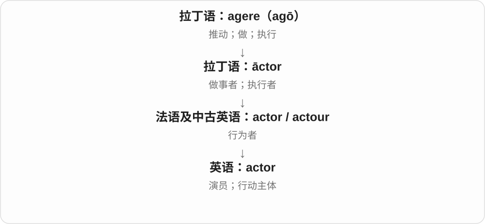
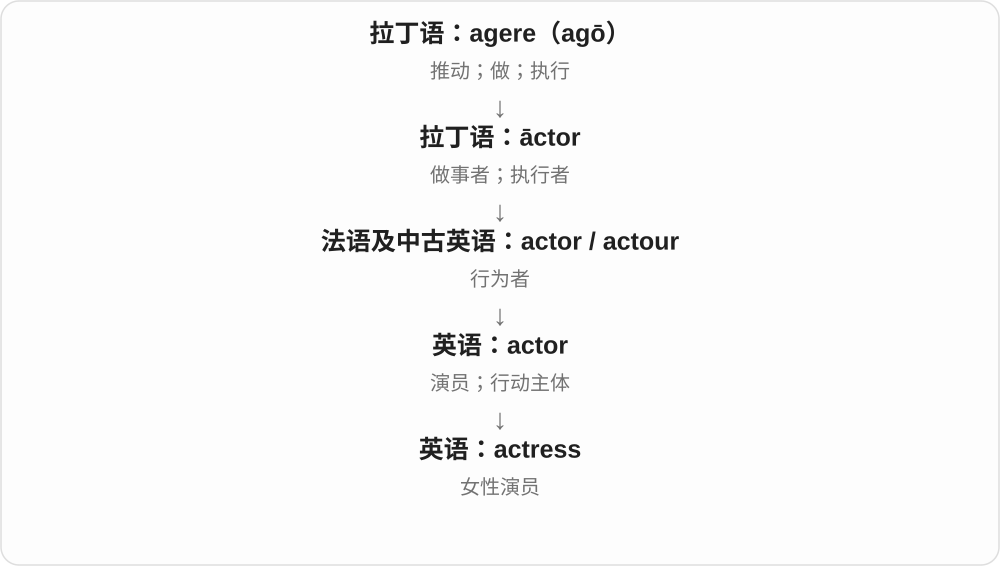
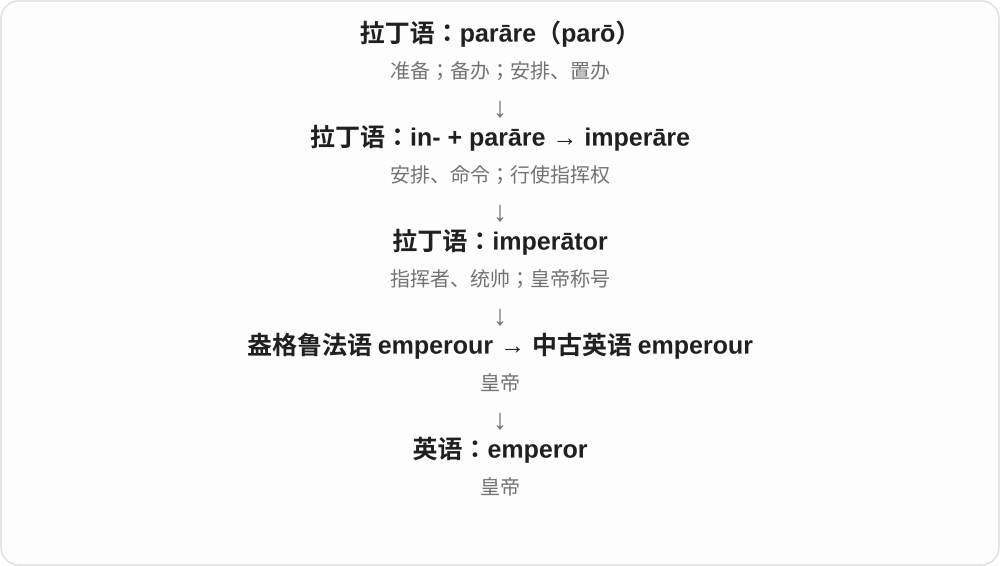
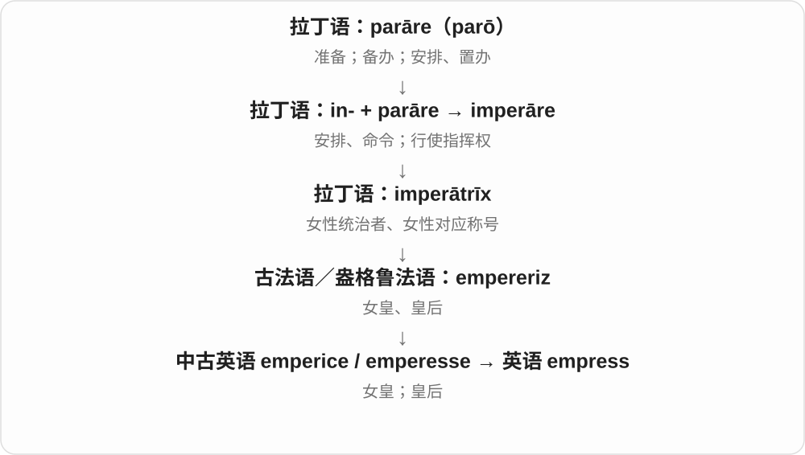
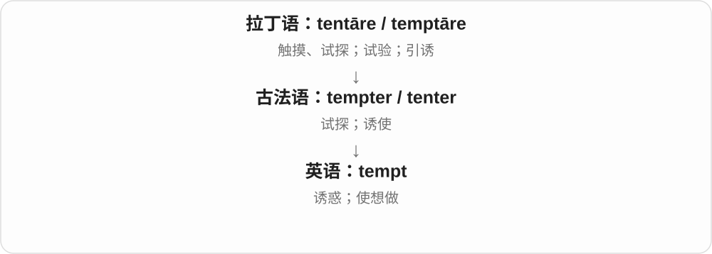

# 0157 · -ess — 女性人物；部分动物的雌性名称

[逐词精讲目录](../00_逐词精讲目录.md) · [总目录](../00_总目录_按常用程度.md)

## 核心词根与来源

-ess 经法语 -esse 等传入，接晚期拉丁 -issa，远接希腊 -issa 等女性名称材料。旧称呼仍值得读懂，但不是任何职业都必须造一个女性版。

**ESS：标明女性或雌性，现代是否常用要看整个词**

lion → lioness 是雄狮、雌狮的常见对应；stewardess 却带旧职业称呼色彩，今天常说 flight attendant。

- **职业及旧称呼**：actor · actress；waiter · waitress；steward · stewardess；seam · seamstress；song · songstress；shepherd · shepherdess
- **身份、头衔与宗教称谓**：count · countess；emperor · empress；baron · baroness；heir · heiress；priest · priestess；governess · deaconess · prioress · poetess
- **神话、文学人物与评价**：giant · giantess；god · goddess；tempt · temptress；seduce · seductress；enchantress · huntress
- **动物名称**：lion · lioness；tigress
- **giant → giants：巨人与领域里的巨头**：giant · giants
- **seam → seams：两片连接的线**：seam · seams
- **-ess 人物词尾后再加复数 -es**：actress · actresses
- **duc- 统领的称号 + 阴性词尾 → duchess**：duchess

## 词形与演化规律

giant + -ess → giantess；shepherd + -ess → shepherdess。seamstress 来自 seamster + -ess，temptress 来自 tempter + -ess，seductress 接 seductor 的词干；不要把尾部 stress 误认成压力词。

法语 geant 接拉丁 gigas、gigant-，再接希腊巨人名词；与 giantess 同族集中学习。

矿层义借带状材料，不是跟 seems 词源相同。

actress 的 -ess 是女性人物材料，actresses 最后 -es 才是复数，两个尾巴不能混为一层。

duchess 经古法语 duchesse、拉丁 ducissa 接 dux 公爵、领袖的称号，含历史阴性后缀材料。与 duke 对照，不能按现代拼写原样加 -ess，ch 的变化发生在借入史里。

## 单词速览（按词族由简到繁）

同一基础词的相关扩展放在一起，先读基础形式，再读扩展；各组之间优先读常用的。具体词源关系见各词讲解。

| 单词 | 音标 | 核心意思 |
|---|---|---|
| [god](#w-26) | 英 /ɡɒd/；美 /ɡɑːd/ | 神；神灵；上帝〔常大写 God〕 |
| [goddess](#w-2) | 英 /ˈɡɒdəs/；美 /ˈɡɑːdəs/ | 女神；被赞美女性〔比喻〕 |
| [song](#w-27) | 英 /sɒŋ/；美 /sɔːŋ/，亦 /sɑːŋ/ | 歌曲；歌唱；鸣唱声 |
| [songstress](#w-18) | 英 /ˈsɒŋstrəs/；美 /ˈsɔːŋstrəs/、/ˈsɑːŋstrəs/ | 女歌手〔较文学、宣传性称呼〕 |
| [count](#w-28) | /kaʊnt/ | 数；算入；重要；计数、总数；另源：伯爵 |
| [countess](#w-4) | /ˈkaʊntəs/ | 女伯爵；伯爵夫人 |
| [actor](#w-29) | 英 /ˈæktə/；美 /ˈæktər/ | 演员；行动主体 |
| [actress](#w-1) | /ˈæktrəs/ | 女演员 |
| [actresses](#w-44) | /ˈæktrəsɪz/ | 女演员〔复数〕 |
| [giant](#w-30) | /ˈdʒaɪənt/ | 巨人；巨大的；行业巨头、杰出人物 |
| [giants](#w-42) | /ˈdʒaɪənts/ | 巨人；巨头、杰出人物；巨型事物〔复数〕 |
| [giantess](#w-23) | /ˌdʒaɪənˈtes/，亦见 /ˈdʒaɪəntəs/ 等读法 | 女巨人〔神话、幻想故事〕 |
| [priest](#w-31) | /priːst/ | 神父；司祭；祭司 |
| [priestess](#w-8) | 英 /ˈpriːstes/；美 /ˈpriːstɪs/ | 女祭司；女性宗教仪式主持者 |
| [emperor](#w-32) | 英 /ˈempərə/；美 /ˈempərər/ | 皇帝 |
| [empress](#w-5) | /ˈemprəs/ | 女皇；皇后 |
| [lion](#w-33) | /ˈlaɪən/ | 狮子；名流；受瞩目的人物 |
| [lioness](#w-11) | /ˈlaɪənes/ | 母狮 |
| [shepherd](#w-34) | 英 /ˈʃepəd/；美 /ˈʃepərd/ | 牧羊人；引导、照看，使顺利通过 |
| [shepherdess](#w-19) | 英 /ˌʃepəˈdes/；美 /ˈʃepərdəs/ 等读法 | 牧羊女；女牧羊人 |
| [heir](#w-35) | 英 /eə/；美 /er/ | 继承人；后继者 |
| [heiress](#w-7) | 英 /ˈeərəs/，也读 /eəˈres/；美 /ˈerəs/ | 女继承人，尤指大笔财富的女继承人 |
| [baron](#w-36) | 英 /ˈbærən/；美 /ˈbærən/ | 男爵；有权势的行业巨头 |
| [baroness](#w-6) | /ˌbærəˈnes/，也读 /ˈbærənəs/ | 女男爵；男爵夫人 |
| [duchess](#w-45) | 英 /ˈdʌtʃəs/；美 /ˈdʌtʃəs/ | 女公爵；公爵夫人〔名词〕 |
| [waiter](#w-37) | 英 /ˈweɪtə/；美 /ˈweɪtər/ | 餐厅服务员〔传统常指男性，也可泛指〕 |
| [waitress](#w-3) | /ˈweɪtrəs/ | 女服务员 |
| [steward](#w-38) | 英 /ˈstjuːəd/；美 /ˈstuːərd/ | 管家、事务管理者；乘务员；会务人员；工会代表等 |
| [stewardess](#w-12) | 英 /ˌstjuːəˈdes/；美 /ˈstuːərdəs/ 等读法 | 女乘务员；〔旧称〕空姐、女服务人员 |
| [seam](#w-39) | /siːm/ | 缝；接缝；矿层 |
| [seams](#w-43) | /siːmz/ | 接缝、缝合处；矿层〔复数〕 |
| [seamstress](#w-10) | /ˈsiːmstrəs/，亦见 /ˈsiːmstrɪs/、/ˈsemstrɪs/ 等 | 女裁缝；以缝纫为业的女性 |
| [seduce](#w-40) | 英 /sɪˈdjuːs/；美 /sɪˈduːs/ | 引诱；诱惑；勾引 |
| [seductress](#w-21) | /sɪˈdʌktrəs/，亦见 /sɪˈdʌktres/ | 引诱人的女人；魅惑女性角色〔常含评价〕 |
| [tempt](#w-41) | /tempt/ | 诱惑；引得人想做 |
| [temptress](#w-17) | /ˈtemptrəs/，亦见 /ˈtemptres/ | 诱惑人的女人〔常见于文学、带评价〕 |
| [governess](#w-9) | 英 /ˈɡʌvənəs/；美 /ˈɡʌvərnəs/ | 家庭女教师〔尤指历史上的私人家庭教育角色〕 |
| [enchantress](#w-13) | 英 /ɪnˈtʃɑːntrəs/；美 /ɪnˈtʃæntrəs/ | 女巫；女施法者；迷人的女子〔文学〕 |
| [huntress](#w-14) | /ˈhʌntrɪs/ | 女猎人 |
| [tigress](#w-15) | /ˈtaɪɡrəs/，也读 /ˈtaɪɡrɪs/ | 雌虎 |
| [deaconess](#w-16) | 英 /ˌdiːkəˈnes/；美 /ˈdiːkənəs/ | 女执事 |
| [prioress](#w-22) | /ˈpraɪərəs/ | 女子修道院院长或副院长；与 prior 对应的修女职务 |
| [poetess](#w-25) | 英 /ˌpəʊɪˈtes/；美 /ˈpoʊɪˌtes/ | 女诗人〔旧称〕 |

## 逐词讲解

### 1. god — 神；神灵；上帝〔常大写 God〕

**音标**：英 /ɡɒd/；美 /ɡɑːd/

**先抓住这个画面**

神话、宗教里具有超越凡人力量的存在；说一个神，与把某一位神当专称，写法会不同。

**怎么拆**

接古英语 god、经中古英语延续，属日耳曼语继承词。不能仅凭拼写把 god 当作 good“好”的缩写。

**怎么变成今天的意思**

**古英语 god → 中古英语 god**  
神、神灵

↓

**英语 god / God**  
神；特定信仰中用作专称的上帝、神

a Greek god 指一位希腊神，God 在一神教语境常作专称；the gods 可指众神。也可夸张称极受崇拜的人，a guitar god 是吉他界大神。

**常见搭配与例句**

a god of；the gods；believe in God；a guitar god。

> The statue represents a god of the sea.

雕像表现的是一位海神。

> The novel imagines a world in which the gods live among humans.

小说设想了一个众神与人类共同生活的世界。

**别混淆**

god 神与 good 好不是今天可直接互换的词；goddess 明确女性神祇。不同信仰中的指称按上下文理解。

### 2. goddess — 女神；被赞美女性〔比喻〕

**音标**：英 /ˈɡɒdəs/；美 /ˈɡɑːdəs/

**先抓住这个画面**

神话里的女性神祇；赞人时也借女神形象表达仰慕。

**怎么拆**

god + -ess，中古英语有 goddesse；-ess 是传统女性称谓后缀，接时出现 dd。

**怎么变成今天的意思**

**古英语 god → 中古英语 god**  
神、神灵

↓

**英语 god / God**  
神；特定信仰中用作专称的上帝、神

↓

**god + -ess → goddess**  
女性神祇；比喻受赞美的女性

a goddess of wisdom 是智慧女神。称现实女性 goddess 可能是夸赞或亲昵称呼，不是普通职业称谓。

**常见搭配与例句**

a goddess of；a Greek goddess；a statue of a goddess。

> Athena is a Greek goddess associated with wisdom.

雅典娜是与智慧有关的希腊女神。

> The painting shows a goddess standing beside a river.

画中一位女神站在河边。

**别混淆**

goddess 是神话身份或夸张称呼；queen 是女王、王后等身份，也可比喻，但来路不同。

### 3. song — 歌曲；歌唱；鸣唱声

**音标**：英 /sɒŋ/；美 /sɔːŋ/，亦 /sɑːŋ/

**先抓住这个画面**

通常把旋律和可唱的词组织成一首作品；鸟儿唱出的声音也能说 song。

**怎么拆**

接古英语 sang，经中古英语 song 等延续，与 sing 唱歌是历史相关形式。不是现代英语任意把 sing 的 i 换成 o 都能造名词的规则。

**怎么变成今天的意思**

**古英语 sang → 中古英语 song、sang**  
歌唱、歌曲，与 sing 历史同族

↓

**英语 song**  
歌曲、歌唱声；某些固定比喻

sing a song 唱一首歌，write a song 写歌；bird song 鸟鸣。for a song 固定说花很便宜的价钱，不是用一首歌直接付款。

**常见搭配与例句**

sing a song；write a song；a love song；for a song。

> She sang a song she had written herself.

她唱了一首自己写的歌。

> We heard the song of a bird outside the window.

我们听见窗外鸟儿的鸣唱。

**别混淆**

song 通常是一首可唱作品，music 是音乐上位词；instrumental music 器乐不必称 song，但日常有时会把音乐曲目宽泛叫 song。

### 4. songstress — 女歌手〔较文学、宣传性称呼〕

**音标**：英 /ˈsɒŋstrəs/；美 /ˈsɔːŋstrəs/、/ˈsɑːŋstrəs/

**先抓住这个画面**

报刊写一位女歌手时，用 songstress 会比 singer 多一点旧式、赞美或舞台包装的味道。

**怎么拆**

songster 唱歌的人 + -ess，词形压缩为 songstress；songster 含 song 与 -ster 人物材料。不是 song + stress 强调歌曲压力。

**怎么变成今天的意思**

**song + -ster → songster**  
唱歌的人

↓

**songster + -ess → songstress**  
女性歌唱者名称

a celebrated songstress 著名女歌手；a jazz songstress 爵士女歌手。singer 是通常更中性的基本职业名。

**常见搭配与例句**

a local songstress；a celebrated songstress。

> The festival featured a celebrated jazz songstress.

音乐节邀请了一位著名爵士女歌手。

> The article called her the city’s favourite songstress.

文章称她为这座城市最受欢迎的女歌手。

**别混淆**

songstress 不意味着一定自己作曲；singer、songwriter、singer-songwriter 分别强调演唱、写歌或两者兼有，不能全按中文歌手混用。

### 5. count — 数；算入；重要；计数、总数；另源：伯爵

**音标**：/kaʊnt/

**先抓住这个画面**

用手指逐个点过去：一、二、三；后来也可以把一件事“算作重要”，所以 Every minute counts 是每一分钟都重要。

**怎么拆**

计数线来自拉丁 computare，经古法语 conter 动词与 conte 名词分别进入英语。伯爵线另经法语 conte／counte 接拉丁 comes“随从、同伴”，不是因为贵族会算账。

**怎么变成今天的意思**

**拉丁 putare**  
修剪、清理；计算、考虑、判断

↓

**拉丁 com- 一起 + putare → computare**  
合起来计算、盘算

↓

**古法语 conter〔动词〕；conte〔名词〕**  
计数、叙说；一次计算

↓

**中古英语 counten／count → 英语 count**  
数、算入；总数、一次计数

↓

**另源并行：拉丁 comes／comitem → 法语 conte／counte**  
随从、官员 → 伯爵头衔

↓

**英语 count〔爵位义〕**  
伯爵；与计数线分开

count someone in 是把某人算进去；count on someone 是依靠；名词 a count 可指一次点数或所得数量。伯爵的 count 只是同形，不能拿来解释本词根。

**常见搭配与例句**

count the votes；count on someone；count as；a word count。

> Please count the chairs before the guests arrive.

客人到达前请数一下椅子。

> You can count on me to finish the work.

你可以相信我会把工作完成。

> Every small improvement counts.

每一点小进步都很重要。

> The count welcomed the visitors to his estate.

伯爵在庄园里迎接了来访者。

**别混淆**

compute 可以复杂求值；count 最核心是一项项数。count“伯爵”与 counter“反对”各有另源，不靠拼写强拉一族。

### 6. countess — 女伯爵；伯爵夫人

**音标**：/ˈkaʊntəs/

**先抓住这个画面**

可能自己持有伯爵等级头衔，也可能是相应贵族的配偶称谓；具体看传统和人物。

**怎么拆**

借法语 contesse，接拉丁 comitissa，现代可对应贵族 count + -ess。与数数 count 的历史来源分开，不是会数数的女人。

**怎么变成今天的意思**

**拉丁 comes 随从、官员 → 法语 comte → 英语 count**  
官员头衔 → 伯爵；与数数 count 另源

↓

**拉丁 comitissa → 法语 contesse → countess**  
女伯爵、伯爵夫人的相应称谓

the countess 女伯爵、伯爵夫人，a title of countess 女伯爵头衔；头衔作姓名一部分常大写。

**常见搭配与例句**

the countess；a title of countess；the countess’s family。

> The countess attended the opening of the exhibition.

女伯爵出席了展览开幕式。

> The novel follows a countess living far from the royal court.

小说讲述一位远离王室宫廷生活的伯爵夫人。

**别混淆**

countess 是特定贵族称谓，不是 counter 柜台、计数器的女性形式；数数义不参与这条派生。

### 7. actor — 演员；行动主体

**音标**：英 /ˈæktə/；美 /ˈæktər/

**先抓住这个画面**

actor 最初就是做事的人；放到舞台上，就成了把角色演出来的人。

**怎么拆**

现代可认作 act + -or；历史借自法语及拉丁语 āctor，并非现代英语临时加后缀。

**怎么变成今天的意思**

现在最常见是演员，也能在政治、社会和技术讨论中指参与行动的人或组织。actor 可以不限定性别。

**常见搭配与例句**

a talented actor；a leading actor；a key political actor。

> The actor gave a quiet, convincing performance.

这位演员的表演克制而有说服力。

> Local groups became important actors in the negotiations.

当地团体成了谈判中的重要参与方。

**别混淆**

actress 明确指女演员；actor 在现代用法中可以泛指任何性别的演员。

### 8. actress — 女演员

**音标**：/ˈæktrəs/

**先抓住这个画面**

actress 是 actor 这一职业中特别标明女性的称呼。

**怎么拆**

actor 对应的阴性形式，-ess 表示女性；早期先指女性行为者，后来专用于舞台表演者。

**怎么变成今天的意思**

用于舞台、电影和电视表演。现代有些女性从业者偏好不标性别的 actor，按本人称呼与具体语境选用。

**常见搭配与例句**

a film actress；a leading actress；a supporting actress。

> She became a successful stage actress.

她成为了一名成功的舞台女演员。

> The actress spoke about preparing for the role.

这位女演员谈了自己如何准备这个角色。

**别混淆**

actress 是女性演员；acting 是表演活动或代理职务，不是同一个词性。

### 9. actresses — 女演员〔复数〕

**音标**：/ˈæktrəsɪz/

**先抓住这个画面**

actress 是女演员，几位一起表演就是 actresses。前一层说明人物名称，最后一层才说明不止一位。

**怎么拆**

actress + -es，/s/ 后读 /ɪz/；actress 是 actor 的对应女性形式，历史接 -ess，不把全段 -esses 当成一个词尾。

**怎么变成今天的意思**

**拉丁 actor 及法语、英语相关形式 → actor、actress**  
做事者、表演者；对应女性人物名

↓

**actress + -es → actresses**  
多位女演员

film actresses 电影女演员，stage actresses 舞台女演员；表演媒介可以放在前面。

**常见搭配与例句**

two actresses 两位女演员；leading actresses 女主演。

> Two actresses shared the leading role.

两位女演员轮流担任主角。

> The film brought together actresses from several countries.

影片汇集了几个国家的女演员。

**别混淆**

actors 也常不限定性别，actresses 明确说女演员；可以理解这个区别，再看人物、机构采用的称呼。

### 10. giant — 巨人；巨大的；行业巨头、杰出人物

**音标**：/ˈdʒaɪənt/

**先抓住这个画面**

童话里大得远超常人的角色，是 a giant；把这个体量转到公司、成就上，就有行业巨头、学界巨人的说法。

**怎么拆**

经古法语 geant 接拉丁 gigas、gigant-，再接希腊 gigas 巨人。不是 giant 比 giantess 短，就说明它与 ant 蚂蚁相反拼造。

**怎么变成今天的意思**

**希腊 gigas／gigant- → 拉丁、古法语相应词**  
神话巨人名称

↓

**英语 giant**  
巨人；巨大事物、顶尖人物；巨大的

a giant tree 一棵巨大的树；a technology giant 科技巨头；a giant of literature 文坛巨匠。名词和修饰语都常见。

**常见搭配与例句**

a giant leap；an industry giant。

> A giant tree stood in the middle of the garden.

花园中央长着一棵巨大的树。

> The small firm competes with several industry giants.

这家小公司与几家行业巨头竞争。

**别混淆**

giant 不只形容身高；giga- 科学前缀与同一古典巨人材料有关，但 billion 的具体数值不能据此赋给每个 giant。

### 11. giants — 巨人；巨头、杰出人物；巨型事物〔复数〕

**音标**：/ˈdʒaɪənts/

**先抓住这个画面**

童话里比常人高大得多的巨人，是 giants 的直接画面。把身高换成规模、影响力，就能说行业巨头或某个领域的大家。

**怎么拆**

giant + -s，/t/ 后读 /s/。giant 经古法语 geant 接拉丁 gigas、gigant-，再接希腊巨人名词 gigas。

**怎么变成今天的意思**

**希腊 gigas、拉丁 gigas → 古法语 geant → giant**  
神话巨人 → 非常高大、强大的存在

↓

**giant + -s → giants**  
多个巨人；比喻大企业、杰出人物等

industry giants 行业巨头；literary giants 文学巨匠；giants in a fairy tale 童话里的巨人。

**常见搭配与例句**

technology giants 科技巨头；gentle giants 温和的大个子、巨型动物等。

> The story takes place in a land of giants.

故事发生在一个巨人的国度。

> The exhibition celebrates several giants of modern design.

展览向几位现代设计大师致敬。

**别混淆**

giants 是人物、企业等的复数名词；giants of science 可以是科学大家。形容巨大的树时说 giant trees，giant 作前置修饰通常不加 s。

### 12. giantess — 女巨人〔神话、幻想故事〕

**音标**：/ˌdʒaɪənˈtes/，亦见 /ˈdʒaɪəntəs/ 等读法

**先抓住这个画面**

童话里的巨人明确写成女性，可以叫 giantess；词义落在故事角色，不是现实女性身高的常见中性称呼。

**怎么拆**

giant + -ess，中古英语已有相应女性巨人名称，也与法语对应形式有关。-ess 标明女性，不表示更小一号的巨人。

**怎么变成今天的意思**

**giant／法语相应词 + 女性材料**  
巨人的女性对应名称

↓

**giantess**  
神话、幻想中的女巨人

a giantess in a fairy tale 童话里的女巨人；the giantess’s castle 女巨人的城堡。giant 也可按现代语境不分性别，具体看作者。

**常见搭配与例句**

a friendly giantess；a mythical giantess。

> The fairy tale features a kind giantess who protects the village.

童话里有一位保护村庄的善良女巨人。

> The giantess lived in a castle above the clouds.

女巨人住在云层上方的城堡里。

**别混淆**

giantess 不是 giant 的复数；复数 giants 可以包括多个巨人，giantesses 则明确多个女巨人。

### 13. priest — 神父；司祭；祭司

**音标**：/priːst/

**先抓住这个画面**

在某种宗教制度中，被授权主持礼仪、履行宗教职务的人。

**怎么拆**

远源是希腊 presbyteros“较年长的人、长老”，经晚期拉丁 presbyter，早期借入日耳曼语并缩短，成为古英语 preost，后来是 priest。现代拼写看不出 presby-，不代表二者无关。

**怎么变成今天的意思**

**希腊 presbys → presbyteros**  
年长的 → 较年长的；名词用法指长者、长老

↓

**晚期拉丁 presbyter**  
教会长老；司祭

↓

**早期借入日耳曼语的缩短形式 → 古英语 preost**  
主持宗教职务的人

↓

**中古英语 prest / preest → priest**  
神父、司祭、祭司；亦受古法语 prestre 强化

在天主教语境常译神父，在其他传统可能译司祭或祭司。它是宗教职务名称，不等于“任何相信宗教的人”，也不必根据词源把任职者想成年老人。

**常见搭配与例句**

a parish priest；a Catholic priest；ordain a priest；a temple priest。

> The parish priest welcomed the visitors after the service.

礼拜结束后，堂区神父欢迎了来访者。

> The museum explains the duties of priests in the ancient temple.

博物馆介绍了古代神庙祭司的职责。

**别混淆**

minister、pastor、priest 的使用取决于宗教传统与职位，不能一律互换。monk 是修士或僧侣，也不一定担任 priest 的职务。

### 14. priestess — 女祭司；女性宗教仪式主持者

**音标**：英 /ˈpriːstes/；美 /ˈpriːstɪs/

**先抓住这个画面**

在宗教仪式中担任祭司角色的女性。

**怎么拆**

priest + -ess，以女性后缀构成；更早的英语还出现过 priestress。这里的 -ess 标示女性，不是地位较低或祭司助手。

**怎么变成今天的意思**

**希腊 presbys → presbyteros**  
年长的 → 较年长的；名词用法指长者、长老

↓

**晚期拉丁 presbyter**  
教会长老；司祭

↓

**早期借入日耳曼语的缩短形式 → 古英语 preost**  
主持宗教职务的人

↓

**中古英语 prest / preest → priest**  
神父、司祭、祭司；亦受古法语 prestre 强化

↓

**英语 priest + -ess → priestess**  
女性祭司；与更早的 priestress 形式相比较

常见于古代宗教、非基督教传统或神话故事。现代基督教中受任命的女性 priest 通常仍称 priest，不应看到女性就擅自换成 priestess。

**常见搭配与例句**

a temple priestess；a priestess of a goddess；a high priestess。

> The story follows a young priestess who serves at the temple.

故事讲述了一位在神庙任职的年轻女祭司。

> The inscription names the priestess who led the ceremony.

铭文记下了主持这场仪式的女祭司的名字。

**别混淆**

nun 是修女，通常与修道生活、誓愿有关；priestess 指祭司角色，两者不是男女配对的一套名称。

### 15. emperor — 皇帝

**音标**：英 /ˈempərə/；美 /ˈempərər/

**先抓住这个画面**

emperor 是帝国统治者的称号，词的早期根脉连着“发号施令的人”。

**怎么拆**

拉丁 imperāre“命令”→ imperātor“统帅”，经盎格鲁法语 emperour、中古英语 emperour 进入现代英语。

**怎么变成今天的意思**

不同历史制度中皇帝的实际权力并不相同。这个词首先是称号，不能凭称号推断所有具体制度。

**常见搭配与例句**

an emperor’s reign；the emperor’s court；a Roman emperor。

> The coin bears the portrait of an emperor.

硬币上铸着一位皇帝的肖像。

> The biography describes the emperor’s early years.

传记讲述了这位皇帝的早年经历。

**别混淆**

king 通常译国王；emperor 通常译皇帝，区别涉及历史称号与国家结构，不只是“更厉害的国王”。

### 16. empress — 女皇；皇后

**音标**：/ˈemprəs/

**先抓住这个画面**

empress 可以是亲自担任统治者的女性，也可以是皇帝的配偶；先看她在历史中的身份。

**怎么拆**

经古法语、盎格鲁法语 empereriz，来自拉丁 imperātrīx；现代可联系 emperor + -ess，但历史已有独立借入链。

**怎么变成今天的意思**

empress regnant 可明确说在位女皇；empress consort 明确说皇帝配偶。普通 empress 需要上下文帮助区分。

**常见搭配与例句**

an empress regnant；the empress’s portrait；an empress consort。

> The exhibition includes a portrait of the empress.

展览中有一幅这位女皇的肖像。

> The guide explains that she was an empress consort.

导览说明，她的身份是皇帝的配偶。

**别混淆**

queen 常译女王或王后；empress 对应帝国体系中的女性皇位或皇后称号。

### 17. lion — 狮子；名流；受瞩目的人物

**音标**：/ˈlaɪən/

**先抓住这个画面**

本来是动物中的狮子，借到人身上便是人群里特别有声望、引人瞩目的角色。

**怎么拆**

希腊 leon 进入拉丁语成为 leo／leon-，再经古法语 lion 形成现代英语 lion。古英语也有较早的相关借词，但现代常用词形主要走法语路线。

**怎么变成今天的意思**

**希腊 leon → 拉丁 leo／leon-**  
狮子；希腊词更远的来源未定

↓

**古法语 lion → 中古英语 lion → lion**  
现代英语主要沿法语这条路线

lion 可以泛指这种动物，和 lioness 对照时又常专指雄狮。a literary lion 是文学界名流；the lion’s share 是最大的一份。比喻义不自动表示这人凶猛。

**常见搭配与例句**

a pride of lions；a literary lion；the lion’s share。

> A lion rested in the shade while the cubs played nearby.

幼狮在附近玩耍时，一头狮子躺在阴凉处休息。

> The festival welcomed several literary lions and many first-time authors.

这次文学节迎来了几位文坛名流，也迎来了许多初次发表作品的作者。

**别混淆**

tiger 是老虎，并非另一个颜色的 lion；lionize 的现代用法从受瞩目的名流义出发。

### 18. lioness — 母狮

**音标**：/ˈlaɪənes/

**先抓住这个画面**

把狮子的性别明确说出来：一头雌性的狮子。

**怎么拆**

英语 lion + 表示雌性的 -ess。这个后缀在动物名称中区分性别，不表示小、弱或年轻。

**怎么变成今天的意思**

**希腊 leon → 拉丁 leo／leon-**  
狮子；希腊词更远的来源未定

↓

**古法语 lion → 中古英语 lion → lion**  
现代英语主要沿法语这条路线

↓

**英语 lion + -ess → lioness**  
雌性狮子的名称

lioness 常与 cubs 幼狮、pride 狮群一起出现。单纯说一头狮子时可以用 lion；观察、故事或自然纪录片需要强调雌性时才特别用 lioness。

**常见搭配与例句**

a lioness and her cubs；a hunting lioness；the lionesses in a pride。

> The lioness carried a cub away from the path.

母狮把一只幼狮叼离了小路。

> Two lionesses moved through the tall grass.

两头母狮从高草丛中穿过。

**别混淆**

cub 是年龄阶段，lioness 是性别名称；不是所有小狮子都叫 lioness。

### 19. shepherd — 牧羊人；引导、照看，使顺利通过

**音标**：英 /ˈʃepəd/；美 /ˈʃepərd/

**先抓住这个画面**

把羊群带过一道门、一路照看，后来也借来说带领一群人，或照看一个项目走完整个过程。

**怎么拆**

古英语 sċēap 羊 + hierde 牧人 → sċēaphierde，经中古英语形成 shepherd。后半是看护牲畜的人，不只把它理解成羊群 herd。现代 sheep 长元音在这个旧组合里缩短，ph 也不读 /f/。

**怎么变成今天的意思**

**古英语 sċēap/sċēp → 中古英语 schep → sheep**  
羊；更远来源不确定

↓

**sċēap + hierde → sċēaphierde → shepherd**  
羊 + 看护牲畜的人 → 牧羊人

↓

**shepherd 名词 → 动词和比喻**  
照看、带领人群或某事走完流程

a shepherd and his flock 牧羊人与羊群，shepherd visitors through a building 引导访客穿过建筑，shepherd a proposal through a process 照看提案走完流程。

**常见搭配与例句**

a shepherd and his flock；shepherd visitors through；shepherd a proposal。

> The shepherd led the flock back to the field.

牧羊人把羊群领回田里。

> She shepherded the visitors through the crowded hall.

她带着访客们穿过拥挤的大厅。

**别混淆**

shepherd 的 ph 是历史词界相接，不能套 photo 的 /f/；不是 /ˈʃiːfɜːd/。德牧 German shepherd 的名字另指一种犬。

### 20. shepherdess — 牧羊女；女牧羊人

**音标**：英 /ˌʃepəˈdes/；美 /ˈʃepərdəs/ 等读法

**先抓住这个画面**

草地上看护羊群的女性，在田园诗、绘画、童话里常被称为 shepherdess。

**怎么拆**

shepherd + -ess，中古英语已有相应女性人物形式。shepherd 原有 sheep 羊 + herd 看护者的组合历史，不是 she 她 + pherdess。

**怎么变成今天的意思**

**sheep + herd 的旧组合 → shepherd**  
羊群看护者

↓

**shepherd + -ess → shepherdess**  
女性牧羊人

a young shepherdess 年轻牧羊女；a painting of a shepherdess 牧羊女题材画作。现代 shepherd 也可按语境说任何性别的牧羊人。

**常见搭配与例句**

a shepherdess tending sheep；a pastoral shepherdess。

> The painting shows a shepherdess beside her flock.

画中是一位站在羊群旁的牧羊女。

> The story begins with a shepherdess searching for a lost lamb.

故事开始时，一位牧羊女正在找走失的小羊。

**别混淆**

shepherdess 指照看羊群的人；sheep 母羊通常说 ewe，不能把女性人物词尾用于区分羊的性别。

### 21. heir — 继承人；后继者

**音标**：英 /eə/；美 /er/

**先抓住这个画面**

上一代留下财产、身份或事业，轮到这个人接下去。

**怎么拆**

经盎格鲁法语 heir、古法语 oir 接拉丁 hērēs。h 不发音；不是英语 he“他”加一个后缀，所以不专指男性。

**怎么变成今天的意思**

**拉丁 hērēs，词干 hērēd-**  
继承者、承受遗产的人

↓

**古法语 oir；盎格鲁法语 heir / eir**  
继承者

↓

**中古英语 → 英语 heir**  
财产、头衔或传统的继承者

heir to a fortune 是财富继承人；heir to a tradition 也可以比喻某种思想或艺术传统的后继者。冠词用 an heir，按读音判断。

**常见搭配与例句**

heir to；the sole heir；an heir to the throne。

> She is the sole heir to the family estate.

她是家族财产的唯一继承人。

> The young writer is seen as an heir to that literary tradition.

这位年轻作家被视为那种文学传统的继承者。

**别混淆**

heir 可以不限性别；heiress 明确是女性，常用于继承大笔财富的语境。

### 22. heiress — 女继承人，尤指大笔财富的女继承人

**音标**：英 /ˈeərəs/，也读 /eəˈres/；美 /ˈerəs/

**先抓住这个画面**

她已经接到，或将接到一笔家族财富。

**怎么拆**

heir 加表示女性的 -ess；h 与 heir 一样不发音。两个英式重音形式均有记录。

**怎么变成今天的意思**

**拉丁 hērēs，词干 hērēd-**  
继承者、承受遗产的人

↓

**古法语 oir；盎格鲁法语 heir / eir**  
继承者

↓

**中古英语 → 英语 heir**  
财产、头衔或传统的继承者

↓

**英语 heir + -ess → heiress**  
女性继承人

小说和人物报道中常见 a wealthy heiress。这个词强调继承身份；不能因为某个女人富有，就断定她是 heiress。前面用 an。

**常见搭配与例句**

an heiress；heiress to a fortune；a wealthy heiress。

> The novel follows an heiress who leaves the family business.

小说讲述了一位离开家族企业的女继承人。

> She was the heiress to a considerable fortune.

她是相当大一笔财富的女继承人。

**别混淆**

heir 是性别不限的继承人；heiress 特别标明女性，日常不必一见女性继承者就强制改用它。

### 23. baron — 男爵；有权势的行业巨头

**音标**：英 /ˈbærən/；美 /ˈbærən/

**先抓住这个画面**

历史上是贵族头衔，现代报刊又把像领主般掌握某行业资源的人称作 baron。a media baron 就是传媒大亨。

**怎么拆**

经法语 baron 接中世纪拉丁 baro、词干 baron-，较早有男子、侍从等义；更远日耳曼等来源有争论。贵族称号后扩展行业权势人物。

**怎么变成今天的意思**

**中世纪拉丁 baro、baron- → 古法语 baron → 英语 baron**  
男子、侍从等旧称 → 封建领主、贵族头衔；更早来源有争论

↓

**baron + -ess、-y**  
女性头衔；领地、爵位

a medieval baron 中世纪男爵，a media baron 传媒大亨，an oil baron 石油巨头。

**常见搭配与例句**

a media baron；an oil baron。

> The castle once belonged to a baron.

城堡曾属于一位男爵。

> The newspaper was owned by a powerful media baron.

报纸由一位有权势的传媒大亨拥有。

**别混淆**

新闻里的 industry baron 不必真有爵位；历史爵位的地位、权利随时代地区不同。

### 24. baroness — 女男爵；男爵夫人

**音标**：/ˌbærəˈnes/，也读 /ˈbærənəs/

**先抓住这个画面**

她本人持有这个贵族头衔，可以是 baroness；作为男爵的妻子，也可能用这个称号。别只凭女性词尾就把她一律当夫人。

**怎么拆**

baron + -ess，承中古英语 baronesse 等形式，-ess 传统女性人物后缀。具体指独立持爵者还是配偶称号看身份。

**怎么变成今天的意思**

**中世纪拉丁 baro、baron- → 古法语 baron → 英语 baron**  
男子、侍从等旧称 → 封建领主、贵族头衔；更早来源有争论

↓

**baron + -ess → baroness**  
女性持爵者、男爵夫人的称号

the baroness’s estate 女男爵的庄园，a baroness in her own right 本人持爵的女男爵。

**常见搭配与例句**

a baroness in her own right；the baroness’s title。

> The baroness inherited the estate.

女男爵继承了庄园。

> The biography describes her as a baroness in her own right.

传记说明她是本人持爵的女男爵。

**别混淆**

baroness 可本人持有头衔，也可因婚姻获称；这个词并不统一规定所有国家的继承规则。

### 25. duchess — 女公爵；公爵夫人〔名词〕

**音标**：英 /ˈdʌtʃəs/；美 /ˈdʌtʃəs/

**先抓住这个画面**

duke 是公爵，duchess 是相应的女性头衔。可能是她本人拥有爵位，也可能是与公爵的婚姻关系带来的称号，具体看人物与历史。

**怎么拆**

经古法语 duchesse 接晚期或中世纪拉丁 ducissa，来自 dux、duc- 领袖、公爵与阴性词尾。与 duke、-ess 对照记忆，现代拼写中的 ch 不是把 duke 原样加后缀得到的。

**怎么变成今天的意思**

**拉丁 dux、ducis 领袖、公爵 → ducissa 女性称号**  
较远与 ducere 引领的词族相连

↓

**古法语 duchesse → 英语 duchess**  
借入过程中形成今天的 ch 拼写与 /tʃ/ 音

a duke and a duchess 是一位公爵和一位女公爵或公爵夫人；the Duchess of... 是某地女公爵、公爵夫人这一称号形式。

**常见搭配与例句**

the Duchess of...；a duke and a duchess；the duchess’s portrait。

> The duchess welcomed the visitors to the hall.

女公爵在大厅欢迎来访者。

> The portrait shows the duchess reading a letter.

肖像画中的公爵夫人正在读信。

**别混淆**

duchess 不能一概译成某位公爵的妻子，因为也可能是本人持有爵位。后缀 -ess 有女性称呼的历史作用，但今天许多职业名并不需要加它。

### 26. waiter — 餐厅服务员〔传统常指男性，也可泛指〕

**音标**：英 /ˈweɪtə/；美 /ˈweɪtər/

**先抓住这个画面**

不是只坐着等的人，而是留意餐桌需求、送餐接应的人。

**怎么拆**

现代对应 wait + -er；中古英语 waiter、wayter 有侍从、守望者义，后来餐桌服务成为主要用法。

**怎么变成今天的意思**

**盎格鲁诺曼语 waiter / waitier → 中古英语 waiten**  
看守、留意、等候

↓

**英语 wait**  
等候；也有侍候、服务用法

↓

**waiter / wayter〔中古英语〕**  
侍从、看守者

↓

**英语 waiter**  
餐桌服务员

call the waiter 请服务员过来，a waiter takes an order 服务员记点单。现代也常用 server 作不标性别的名称，地区、店铺习惯不同。

**常见搭配与例句**

a restaurant waiter；call the waiter；work as a waiter。

> The waiter brought us the menu.

服务员给我们拿来菜单。

> He worked as a waiter while studying.

他求学时做过餐厅服务员。

**别混淆**

waiter 主要职业义，不是每个正在 waiting 的人；waitress 是明确女性的传统对应称谓。

### 27. waitress — 女服务员

**音标**：/ˈweɪtrəs/

**先抓住这个画面**

传统称谓里，把餐桌服务员明确说成女性。

**怎么拆**

waiter + -ess，组合时词尾变化形成 waitress；不是 wait + stress“等待的压力”。

**怎么变成今天的意思**

**waiter**  
餐厅服务员

↓

**waiter + -ess → waitress**  
传统女性餐厅服务员称谓

a waitress takes an order 女服务员记点单。今天很多地方用 server 泛指员工，仍会遇到 waitress 这一称呼。

**常见搭配与例句**

work as a waitress；ask the waitress；a waitress at a cafe。

> The waitress recommended the soup of the day.

女服务员推荐了当日例汤。

> She worked as a waitress at a small cafe.

她曾在一家小咖啡馆做服务员。

**别混淆**

waitress 明示女性，waiter 传统偏男性、也可泛用；server 常能避免指定性别。不要把区别误认成服务级别高低。

### 28. steward — 管家、事务管理者；乘务员；会务人员；工会代表等

**音标**：英 /ˈstjuːəd/；美 /ˈstuːərd/

**先抓住这个画面**

受托把别人的东西、人员和安排照管好：家里管事务，船上管餐饮服务，活动中管秩序，资源管理中管长期使用。

**怎么拆**

接古英语 stiġweard，前半是房屋、厅堂或围所相关旧词，后半 weard 看守者。不能因现代 sty 常说猪圈，就断言 steward 最初只是养猪人。

**怎么变成今天的意思**

**古英语 weard / weardian → ward**  
看守、保护；相关名词与动词

↓

**stiġ 房屋、厅堂等 + weard → stiġweard → steward**  
掌管他人家务、事务的人

↓

**现代职责扩展**  
乘务、会务、工会及资源管理角色

a ship’s steward 船上乘务人员，an event steward 活动会务人员，a union steward 工会代表，a steward of resources 资源的受托管理者。

**常见搭配与例句**

a ship’s steward；an event steward；a union steward；a steward of resources。

> A steward showed us to our seats.

会务人员领我们到座位。

> The foundation acts as a steward of the historic building.

基金会负责妥善管理那座历史建筑。

**别混淆**

steward 不只航班男乘务员，flight attendant 是更广泛的现代航空称谓。steward 的重点是受托照管，不必是财产所有者。

### 29. stewardess — 女乘务员；〔旧称〕空姐、女服务人员

**音标**：英 /ˌstjuːəˈdes/；美 /ˈstuːərdəs/ 等读法

**先抓住这个画面**

旧书、旧电影里常用来称飞机上的女性乘务员；现代不限定性别的常见称呼是 flight attendant、cabin crew。

**怎么拆**

steward + -ess，职业名再加女性词尾。steward 更早是管理家务、庄园等事务的人，后来扩展到船上及交通服务，不能从 stew 炖菜猜这个职业。

**怎么变成今天的意思**

**steward**  
管理事务者；后来也指乘务、服务人员

↓

**steward + -ess → stewardess**  
女性乘务、服务人员

a ship’s stewardess 船上女乘务员；an airline stewardess 航空女乘务员，后者带较明显时代色彩。阅读旧文时理解原称呼即可。

**常见搭配与例句**

an airline stewardess；a ship’s stewardess。

> In the old film, a stewardess greeted the passengers.

旧电影里，一位女乘务员迎接乘客。

> The memoir describes her years working as a ship’s stewardess.

回忆录写了她在船上做女乘务员的那些年。

**别混淆**

stewardess 指女性，flight attendant 不限定性别，也更符合现代常见职业表达；不能把现代所有 cabin crew 都翻成空姐。

### 30. seam — 缝；接缝；矿层

**音标**：/siːm/

**先抓住这个画面**

两块布被缝到一起，留下相接的一道，就是 seam；两种材料的接合线，也可以这样看。

**怎么拆**

本族词，经中古英语 seme、seem 等承古英语 seam，核心与缝起来的东西有关。现代不是 see 看见 + m。

**怎么变成今天的意思**

**古英语 sēam → 中古英语 seme 等**  
缝、缝合处

↓

**英语 seam**  
接缝；地层中像一层带状材料的矿层

a side seam 侧缝；split at the seams 接缝处裂开；a coal seam 煤层。be bursting at the seams 可比喻挤得满满的。

**常见搭配与例句**

a side seam；a coal seam。

> The jacket tore along the seam.

夹克沿着接缝裂开了。

> The miners followed a narrow coal seam.

矿工沿着一条狭窄煤层开采。

**别混淆**

seam 是接缝、矿层；seem 看起来，在许多口音中同音，语法和词源不同。

### 31. seams — 接缝、缝合处；矿层〔复数〕

**音标**：/siːmz/

**先抓住这个画面**

两片材料缝到一起，会留下一条连接线，这些是 seams。地层里一条连续的矿物带，也像夹在材料间的一层，可叫 seam。

**怎么拆**

seam 继承古英语 sēam，经中古英语 seme 等延续，核心是缝合的东西、连接处。现代加 -s，/m/ 后读 /z/。

**怎么变成今天的意思**

**古英语 sēam → 中古英语 seme → seam**  
缝合处 → 接缝；带状矿层

↓

**seam + -s → seams**  
多处接缝、多条矿层

the seams of a jacket 夹克接缝；coal seams 煤层；coming apart at the seams 接缝散开、濒临崩溃。

**常见搭配与例句**

strong seams 牢固接缝；seams in the fabric 布料上的接缝。

> The jacket has strong, neat seams.

夹克的接缝牢固整齐。

> The diagram shows several coal seams underground.

示意图显示了地下几条煤层。

**别混淆**

seams 与 seems 同音，但 seems 是 seem 似乎的三单。seams 先抓两片连接处，矿层义是形状上的扩展。

### 32. seamstress — 女裁缝；以缝纫为业的女性

**音标**：/ˈsiːmstrəs/，亦见 /ˈsiːmstrɪs/、/ˈsemstrɪs/ 等

**先抓住这个画面**

用针线改衣服、缝衣服，缝线 seam 把两片布接住；seamstress 是传统上专指女性从业者的名称。

**怎么拆**

seamster + -ess，seamster 又接 seam + -ster。-ster 早期本有女性人物材料，但后来不再总被理解为女性，于是又加 -ess；不能把 stress 压力当这个词的后半部。

**怎么变成今天的意思**

**seam + -ster → seamster 的旧职业词**  
做缝纫的人

↓

**seamster + -ess → seamstress**  
明确女性的缝纫职业名称

a skilled seamstress 手艺熟练的女裁缝；work as a seamstress 做缝纫工作。具体做改衣、定制还是生产，要看工作场景。

**常见搭配与例句**

a professional seamstress；an experienced seamstress。

> The seamstress altered the jacket so it fitted properly.

女裁缝修改了夹克，让它穿起来合身。

> Her grandmother worked as a seamstress for many years.

她祖母做了多年缝纫工作。

**别混淆**

tailor 现在可不限定性别；seamstress 词义中通常明确女性。seamstress 不等于给人带来 stress 压力的人。

### 33. seduce — 引诱；诱惑；勾引

**音标**：英 /sɪˈdjuːs/；美 /sɪˈduːs/

**先抓住这个画面**

seduce 像用吸引人的东西把人从原来的打算上带开。可以是情欲上的引诱，也可以是低价、名气或美好承诺的诱惑。

**怎么拆**

拉丁语 sē-（分开、到一旁）+ dūcere（带领），形成 sēdūcere“引离、引入歧途”。

**怎么变成今天的意思**

今天不一定都有道德谴责，但常带“吸引力让人放松判断或改变打算”的感觉。普通的“吸引人”不总适合用这个词。

**常见搭配与例句**

be seduced by promises（被承诺诱惑）；seduce someone into doing…（诱使某人做……）。

> We were seduced by the promise of an easy solution.

我们被轻松解决问题的承诺诱惑了。

> The advertisement tries to seduce shoppers into spending more.

这则广告试图诱使顾客多花钱。

**别混淆**

attract 是广义吸引；seduce 更有诱惑、使人动心的意味，谈人际关系时常带性意味。

### 34. seductress — 引诱人的女人；魅惑女性角色〔常含评价〕

**音标**：/sɪˈdʌktrəs/，亦见 /sɪˈdʌktres/

**先抓住这个画面**

故事里的女性角色用魅力引人动摇、使人着迷，叙述者可能叫她 seductress；这个称呼带角色判断。

**怎么拆**

历史对应 seductor 引诱者 + -ess，接 seduce 的拉丁 seduct- 词干，含 se- 离开与 duc- 引导。不能把 modern seduce 的全部字母保留再写 seduceess。

**怎么变成今天的意思**

**拉丁 seducere／seduct- 人物词族**  
引离、引诱及相应人物名称

↓

**seductor + -ess → seductress**  
女性引诱者、魅惑角色

a mysterious seductress 神秘的魅惑女性；常见于小说、影评，带文学或刻板人物色彩。并非所有令人喜欢的人都叫 seductress。

**常见搭配与例句**

portrayed as a seductress；a fictional seductress。

> The film presents her as a clever seductress rather than a passive character.

影片把她写成聪明的魅惑者，而非被动角色。

> The essay examines the seductress figure in old legends.

文章研究旧传说里的魅惑女性形象。

**别混淆**

seductress 与 temptress 有重合，前者常更突出魅力诱引；两个都是带评价的人物称呼，不是通用中性职业名。

### 35. tempt — 诱惑；引得人想做

**音标**：/tempt/

**先抓住这个画面**

东西诱人到让你心里冒出“要不试试”，这就是 tempt。

**怎么拆**

经古法语 tempter / tenter，来自拉丁 temptāre / tentāre“试探、引诱”。

**怎么变成今天的意思**

tempt someone to do 是使人想做某事；be tempted to do 常只是“有点想”，未必真的做了。

**常见搭配与例句**

be tempted to buy；tempt someone with food；tempt fate。

> The smell of fresh bread tempted me to go inside.

新鲜面包的香味诱得我想进去。

> I was tempted to stay another day.

我当时有点想再待一天。

**别混淆**

persuade 强调说服；tempt 可以只靠美食、价格或机会产生吸引。

### 36. temptress — 诱惑人的女人〔常见于文学、带评价〕

**音标**：/ˈtemptrəs/，亦见 /ˈtemptres/

**先抓住这个画面**

故事把某个女性写成让别人偏离原来选择、屈从欲望的人，会用 temptress；这是叙述者给她的角色和评价。

**怎么拆**

tempter 诱惑者 + -ess，词尾组合压缩成 -tress。远接 tempt 试探、引诱词族，不是 actress 女演员前加 tem-。

**怎么变成今天的意思**

**tempt → tempter**  
诱惑 → 诱惑者

↓

**tempter + -ess → temptress**  
女性诱惑者的固定名称

a mysterious temptress 神秘的诱惑女性角色；常见于神话、小说、影评。词里有诱使别人动摇的评价，不是所有有魅力女性的中性称呼。

**常见搭配与例句**

a seductive temptress；portrayed as a temptress。

> The legend portrays her as a temptress who tests the hero’s resolve.

传说把她写成考验英雄意志的诱惑者。

> The critic questioned the novel’s use of the temptress stereotype.

评论者质疑小说使用了诱惑女性的刻板角色。

**别混淆**

temptress 强调诱惑角色；actress 说表演职业。两者末尾相似，不意味着演员天然就是诱惑者。

### 37. governess — 家庭女教师〔尤指历史上的私人家庭教育角色〕

**音标**：英 /ˈɡʌvənəs/；美 /ˈɡʌvərnəs/

**先抓住这个画面**

在许多历史小说里，governess 住进或受雇于一个家庭，负责孩子的学习教育。她不是该地区的女州长。

**怎么拆**

古法语 governeresse“女性治理者”进入中古英语为 governouresse、governeress 一类形式，再缩为 governess。后来“家庭女教师”义与 governor 曾有的家庭导师、教育看护者旧义相连。

**怎么变成今天的意思**

**拉丁 gubernator → 古法语 governeor／governeresse**  
治理者 → 男性、女性治理者的名词形式

↓

**中古英语 governouresse 等 → governess**  
缩短的女性称谓

↓

**英语后起的家庭教育义**  
在私人家庭中负责儿童教育的女性教师

历史上曾有女性统治者等更宽的意义，但现代最值得认识的是家庭女教师。她的主要角色是教育，不完全等于负责幼儿日常照料的 nanny；历史实际职责可以重叠。今天女性州长仍叫 governor。

**常见搭配与例句**

work as a governess；employ a governess；a governess to the children。多见历史、文学语境。

> The novel’s narrator takes a position as a governess in a country house.

小说叙述者到一座乡间大宅担任家庭女教师。

> The governess taught the children French and music.

家庭女教师教孩子们法语和音乐。

**别混淆**

governess 的常见现代义不是“女性 governor”。tutor 可指不同性别的私人教师，nanny 更侧重儿童日常照料。

### 38. enchantress — 女巫；女施法者；迷人的女子〔文学〕

**音标**：英 /ɪnˈtʃɑːntrəs/；美 /ɪnˈtʃæntrəs/

**先抓住这个画面**

传统故事中拥有魅惑或施法能力的女性。

**怎么拆**

经古法语 enchanteresse，进入中古英语 enchaunteresse；现代可与 enchanter + -ess 对照，-ess 标女性。

**怎么变成今天的意思**

**拉丁语 canere，词典形 cano**  
唱、吟诵

↓

**拉丁语 cantare**  
反复唱；后来成为普通的“唱”

↓

**拉丁语 incantare 一系 → 古法语 enchanteresse**  
施咒 → 女性施咒者

↓

**中古英语 enchaunteresse → enchantress**  
女施法者；迷人的女性

奇幻故事里可直指女巫；称现实女性为 enchantress 则很文学、夸张，可能带魅惑的意味，不是一般职业称呼。

**常见搭配与例句**

a mysterious enchantress；the enchantress’s palace；a legendary enchantress。

> The enchantress promised to restore the prince’s memory.

女巫答应恢复王子的记忆。

> The painting shows an enchantress surrounded by books and flowers.

画中是一位被书籍和花朵围绕的女施法者。

**别混淆**

witch 更普遍；enchantress 常突出施咒、魅惑或令人着迷的能力。

### 39. huntress — 女猎人

**音标**：/ˈhʌntrɪs/

**先抓住这个画面**

故事、神话里明确说一位女性猎人时，可能叫 huntress。现代普通表达里 hunter 本身也能指女性。

**怎么拆**

hunter + 女性后缀 -ess 的旧形式 hunteress，经缩减形成 huntress；不是单独有个现代 -ress 表示打猎。

**怎么变成今天的意思**

**古英语 huntian、hunta 等 → hunt、hunter**  
打猎；打猎者

↓

**中古英语 huntere → hunter**  
现代可按 hunt + -er 理解；扩到寻找某物的人

↓

**hunter + -ess → hunteress → huntress**  
标明女性的猎人称呼

a legendary huntress 传说中的女猎人，a skilled huntress 技艺高超的女猎人，the goddess as a huntress 作为女猎人的女神形象。

**常见搭配与例句**

a legendary huntress；a skilled huntress。

> The legend describes her as a fearless huntress.

传说把她描写为无畏的女猎人。

> A painting of the goddess as a huntress hangs in the gallery.

画廊挂着一幅把那位女神画成女猎人的作品。

**别混淆**

huntress 明示女性，hunter 无须一律限定男性；是否特别标性别取决于文本目的，不是不同狩猎技能等级。

### 40. tigress — 雌虎

**音标**：/ˈtaɪɡrəs/，也读 /ˈtaɪɡrɪs/

**先抓住这个画面**

需要把性别说清楚时，用 tigress 指雌虎。这里 -ess 承担雌性名称的作用。

**怎么拆**

来自法语 tigresse，现代对应 tiger + -ess。不是简单把 tiger 后面原样再加一段拼成 tigeress，而是已有固定词形。

**怎么变成今天的意思**

**古英语及法语路径 → 中古英语 tigre → tiger**  
英语虎的名称

↓

**法语 tigresse／英语 tiger + -ess**  
雌虎

a tigress and her cubs 雌虎和幼虎，a young tigress 一只年轻雌虎。

**常见搭配与例句**

a tigress and her cubs；a young tigress。

> The tigress rested while her cubs played nearby.

雌虎休息着，幼虎在旁边玩。

> The researchers recognized the tigress by her stripes.

研究人员通过条纹认出了那只雌虎。

**别混淆**

tiger 可泛指虎，tigress 专指雌虎。幼虎仍叫 cub，不因母亲是 tigress 就改后缀。

### 41. deaconess — 女执事

**音标**：英 /ˌdiːkəˈnes/；美 /ˈdiːkənəs/

**先抓住这个画面**

在使用这个称号的教会中，承担相关服务职责的女性。

**怎么拆**

中古英语 dekenesse 由当时的 deacon 词形接女性后缀 -ess，受后期拉丁 diaconissa 的形式影响。基础词更远接希腊 diákonos“服务者”。

**怎么变成今天的意思**

**希腊 diákonos**  
服务者；后用于教会职务，前段有 dia- 的分析

↓

**教会拉丁 diaconus → 古英语 diacon**  
教会执事

↓

**中古英语 deken + -esse → dekenesse**  
仿后期拉丁 diaconissa 的女性职务称呼

↓

**英语 deaconess**  
某些教会中的女执事

这是特定教会和历史背景下的职务称呼；并非所有教派都用，也不能推断所有女执事都必须称 deaconess，有些制度使用 deacon。

**常见搭配与例句**

serve as a deaconess；the work of a deaconess。

> She worked as a deaconess in a small congregation.

她在一个小教会担任女执事。

> The archive contains letters written by a nineteenth-century deaconess.

档案中保存着一位十九世纪女执事写的信。

**别混淆**

-ess 是女性称呼后缀，不表示职务自动低一级；职位关系需要看所属教会的制度。

### 42. prioress — 女子修道院院长或副院长；与 prior 对应的修女职务

**音标**：/ˈpraɪərəs/

**先抓住这个画面**

在女子修会中，对应 prior 的领导或副职称为 prioress；不是简单指年龄最大的修女。

**怎么拆**

中世纪拉丁 priōrissa 与古法语 prioresse 传入；现代可看出 prior + 女性称谓后缀 -ess。

**怎么变成今天的意思**

**古拉丁 pri；拉丁 prior**  
在前 → 较早的、居前的

↓

**中世纪拉丁 prior → priōrissa；古法语 prioresse**  
修会职务 → 相应的女性职务

↓

**中古英语 → prioress**  
女子修道院中的负责人或副职

可能是 priory 的负责人，也可能在 abbess 之下担任职务。具体层级取决于机构，不把它固定套成所有修道院的最高职位。

**常见搭配与例句**

the prioress of a convent；serve as prioress。

> The prioress met the new members of the community.

女修道院负责人会见了新加入团体的成员。

> The manuscript records a letter written by the prioress.

手稿收录了这位女修道院负责人写的一封信。

**别混淆**

abbess 与 prioress 是不同制度称谓；后者通常对应 prior，不是泛指所有修女。

### 43. poetess — 女诗人〔旧称〕

**音标**：英 /ˌpəʊɪˈtes/；美 /ˈpoʊɪˌtes/

**先抓住这个画面**

旧书会专门给女性诗人一个带性别的称呼；今天通常直接用 poet。

**怎么拆**

英语 poet + -ess，-ess 曾广泛用于表示女性的职业或身份名称。这是英语里的后缀派生，并不等于 poetry 的拉丁前身 poetria。

**怎么变成今天的意思**

**希腊 poieîn / poiéō**  
做；创造；创作

↓

**希腊 poiētḗs → 拉丁 poēta**  
创造者；诗人

↓

**古法语 poete → 中古英语 poete → 英语 poet**  
写诗的人

↓

**英语 poet + -ess → poetess**  
女性诗人的旧称

读老评论、人物传记时可能遇见。现代自称、介绍作者时一般使用 poet；了解 poetess 主要是为了读懂历史材料。

**常见搭配与例句**

a nineteenth-century poetess；the label poetess；described as a poetess。

> The old review described her as a gifted poetess.

那篇旧评论称她是一位有天赋的女诗人。

> The exhibition explains why many writers preferred “poet” to “poetess”.

展览解释了为什么许多作者更愿意被称为 poet，而不是 poetess。

**别混淆**

poet 可指任何性别；poetess 带旧时代的分类习惯，不是今天介绍女性诗人必须用的词。

## 这一组要分清什么

seamstress 不由 seam + stress；shepherdess 是女牧羊人，不是母羊；现代 actor、flight attendant 等可不限定性别；具体词是否常用、是否带评价要逐词看。

## 串起来练习

The actress played a shepherdess in a story about a friendly giantess.

那位女演员在一部善良女巨人的故事里扮演牧羊女。
