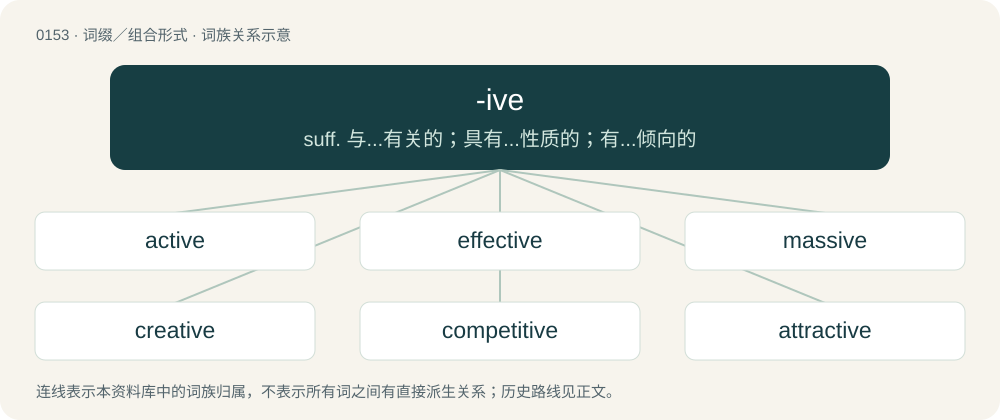

# 0161 · -ive — suff. 与...有关的；具有...性质的；有...倾向的

[总目录](../00_总目录_按常用程度.md)

**类型**：词缀／组合形式　｜　**来源语言**：见词源记录

## 核心含义与来源

- 核心含义：suff. 与...有关的；具有...性质的；有...倾向的
- 英文含义：An adjective suffix signifying relating or belonging to, of the nature of, tending to, or serving to; as: affirmative, active, conclusive, corrective, diminutive.
- 词形：-ive

**来源记录 1**（后缀／后置成分；An adjective suffix signifying relating or belonging to, of the nature of, tending to, or serving to; as: affirmative, active, conclusive, corrective, diminutive.）

From Middle English -yf, from Anglo-Norman -if from Latin -īvus. Until the fourteenth century, all Middle English loanwords from Anglo-Norman ended in -if (compare actif, natif, sensitif, pensif etc.). Under the influence of literary Neo-Latin, both languages introduced the form -ive. Those forms that have not been replaced were subsequently changed to end in -y (compare hasty, from hastif, jolly, from jolif etc.). Like the Latin suffix -iō (genitive -iōnis), the Latin suffix -ivus is appended to the perfect passive participle to form an adjective of action.

## 词族图

## 单词速览（常用到不常用）

| 单词 | 音标 | 释义 |
|---|---|---|
| [active](#w-1) | /ˈæk.tɪv/ | a. 活跃的, 起作用的, 积极的, 有效的, 主动的, 活性的, 现行的, 现役的；n. 主动语态, 积极分子 |
| [effective](#w-2) | /ɪˈfɛktɪv/ | a. 有效的, 有力的, 实际的；n. 有生力量 |
| [massive](#w-3) | 英 /ˈmæs.ɪv/ | a. 大而重的, 宽大的, 宏伟的；\[医\] 大块的, 整块的, 大量的 |
| [creative](#w-4) | /kɹiˈeɪtɪv/ | a. 有创造力的, 创作的, 产生的 |
| [competitive](#w-5) | 英 /kəmˈpɛt.ɪ.tɪv/；美 /kəmˈpɛt.ə.tɪv/ | a. 竞争的；\[经\] 竞争的 |
| [attractive](#w-6) | /əˈtɹæktɪv/ | a. 吸引人的, 有魅力的；\[法\] 有吸引力的, 有迷惑力的 |
| [impressive](#w-7) | /ɪmˈpɹɛsɪv/ | a. 给人深刻印象的, 威严的 |
| [administrative](#w-8) | 英 /ədˈmɪn.ɪ.stɹə.tɪv/；美 /ədˈmɪn.əˌstɹeɪ.tɪv/ | a. 管理的, 行政的；\[法\] 行政的, 管理的, 遗产管理的 |
| [defensive](#w-9) | 英 /dɪˈfɛn.sɪv/ | a. 防卫的, 防备用的, 自卫的；n. 守势, 防卫姿势, 防卫物 |
| [objective](#w-10) | 英 /ɒbˈd͡ʒɛk.tɪv/；美 /əbˈd͡ʒɛk.tɪv/ | n. 目的, 目标, 宗旨, 宾格, 实物；a. 客观的, 如实的, 无偏见的, 宾格的 |
| [aggressive](#w-11) | 美 /əˈɡɹɛs.ɪv/ | a. 侵略的, 挑畔的, 进取的；\[法\] 侵略的, 爱挑衅的, 行为过火的 |
| [legislative](#w-12) | 英 /ˈlɛd͡ʒ.ɪ.slə.tɪv/；美 /ˈlɛd͡ʒ.ɪˌsleɪ.tɪv/ | n. 立法机构；a. 立法的, 有立法权的 |
| [productive](#w-13) | /pɹəˈdʌk.tɪv/ | a. 能生产的, 有生产价值的, 多产的；\[医\] 产出性的, 产生性的 |
| [detective](#w-14) | /dɪˈtɛktɪv/ | n. 侦探；a. 侦探的 |
| [respective](#w-15) | 英 /ɹɪˈspɛktɪv/ | a. 分别的, 各自的 |
| [excessive](#w-16) | /ɪkˈsɛsɪv/ | a. 过度的, 过多的, 极端的；\[法\] 过度的, 过分的, 额外的 |
| [innovative](#w-17) | 英 /ɪnˈnɒ.və.tɪv/；美 /ˈɪn.əˌveɪtɪv/ | a. 革新的, 创新的, 富有革新精神的 |
| [intensive](#w-18) | 英 /ɪnˈtɛnsɪv/ | a. 加强的, 内涵的, 集中的；n. 加强器 |
| [supportive](#w-19) | 英 /səˈpɔːtɪv/；美 /səˈpɔɹtɪv/ | a. 支撑, 支承, 资助, 赞助, 支援, 经受, 忍受, 扶养, 证实, 鼓励, 维持, 伴奏 |
| [incentive](#w-20) | /ɪnˈsɛntɪv/ | n. 动机；a. 激励的 |
| [abusive](#w-21) | 英 /əˈbjuː.sɪv/；美 /əˈbju.sɪv/ | a. 恶言谩骂的, 被滥用的, 腐败的, 虐待的 |
| [decisive](#w-22) | 英 /dɪˈsaɪsɪv/ | a. 决定性的, 坚定的, 果断的 |
| [subjective](#w-23) | /səbˈd͡ʒɛktɪv/ | a. 主观的, 个人的；\[医\] 主观的, 自觉的 |
| [collaborative](#w-24) | /kəˈlæb.ə.ɹə.tɪv/ | a. 合作的, 协作的 |
| [investigative](#w-25) | /ɪnˈvɛstɪɡətɪv/ | a. 审查的, 调查的, 好研究的；\[法\] 调查的, 审查的, 受调查研究的 |
| [adaptive](#w-26) | 美 /əˈdæp.tɪv/ | a. 适应的, 能适应的 |
| [festive](#w-27) | /ˈfɛstɪv/ | a. 庆祝的, 喜庆的, 欢乐的 |
| [reflective](#w-28) | /ɹɪˈflɛktɪv/ | a. 反射的, 反映的, 沉思的 |
| [jolly](#w-29) | 英 /ˈd͡ʒɒli/；美 /ˈd͡ʒɑli/ | a. 愉快的, 高兴的, 宜人的；vt. 恭维, 使高兴, 取笑；vi. 开玩笑 |
| [cumulative](#w-30) | /ˈkjuːmjʊlətɪv/ | a. 累积的；\[医\] 蓄积的, 累积的 |
| [reactive](#w-31) | 英 /ɹiːˈæktɪv/；美 /ɹiˈæktɪv/ | a. 反动的, 反应的；\[医\] 反应的 |
| [restrictive](#w-32) | /ɹɪˈstɹɪktɪv/ | a. 限制的, 约束的, 限定的；n. 限制词 |
| [preventive](#w-33) | /pɹɪˈvɛntɪv/ | a. 预防的, 防止的；n. 防止物, 预防方法, 预防药 |
| [retrospective](#w-34) | 英 /ˌɹɛt.ɹə(ʊ)ˈspɛk.tɪv/；美 /ˌɹɛt.ɹəˈspɛk.tɪv/ | a. 回顾的, 怀旧的, 在后面的；n. 回顾展 |
| [disruptive](#w-35) | 英 /dɪsˈɹʌptɪv/；美 /dɪsˈɹʌptɪv/ | a. 分裂的, 破坏(性)的；\[计\] 击穿的, 中断的 |
| [oppressive](#w-36) | /əˈpɹɛs.ɪv/ | a. 压制性的, 压迫的, 沉重的 |
| [obsessive](#w-37) | /əbˈsɛs.ɪv/ | a. 着迷的 |
| [expansive](#w-38) | /ɪkˈspænsɪv/ | a. 扩张性的, 使扩大的, 广阔的；\[化\] 膨胀的; 可以膨胀的 |
| [predictive](#w-39) | /pɹɪˈdɪk.tɪv/ | a. 预言性的, 成为前兆的 |
| [intrusive](#w-40) | /ɪnˈtɹuːsɪv/ | a. 打扰的, 插入的；\[法\] 闯入的, 侵入的, 干涉的 |
| [elective](#w-41) | /ɪˈlɛktɪv/ | a. 选举的, 根据选举的, 选修的；n. 选修课程 |
| [cohesive](#w-42) | 英 /kəʊˈhiː.sɪv/；美 /koʊˈhi.sɪv/ | a. 黏合在一起的；\[医\] 内聚的 |
| [corrective](#w-43) | 英 /kəˈɹɛktɪv/ | a. 纠正的, 改正的, 矫正的；n. 改善法, 矫正物 |
| [secretive](#w-44) | /ˈsiːkɹɪtɪv/ | a. 秘密的, 偷偷摸摸的, 分泌的, 促进分泌的 |
| [immersive](#w-45) | /ɪˈmɜːɹ.sɪv/ | a. 拟真的 |
| [manipulative](#w-46) | 英 /məˈnɪp.jə.lə.tɪv/；美 /məˈnɪp.jə.leɪ.tɪv/ | a. 处理的, 巧妙处理的, 操纵的 |
| [appreciative](#w-47) | /əˈpɹi.ʃətɪv/ | a. 有欣赏力的, 感激的 |
| [conducive](#w-48) | 英 /kənˈdjuːsɪv/；美 /kənˈdusɪv/ | a. 有益于...的, 有助于...的, 助长的 |
| [seductive](#w-49) | 英 /sɪˈdʌktɪv/ | a. 诱惑的, 引人注意的, 有魅力的 |
| [adoptive](#w-50) | /əˈdɒptɪv/ | a. 有收养关系的, 采用的；\[法\] 收养的, 采用的 |
| [suggestive](#w-51) | /sə(ɡ)ˈd͡ʒɛs.tɪv/ | a. 提示性的, 影射的, 暗示的；\[医\] 暗示的 |
| [assertive](#w-52) | 美 /əˈsɝtɪv/ | a. 武断的, 过分自信的；\[法\] 断言的 |
| [repulsive](#w-53) | /ɹɪˈpʌlsɪv/ | a. 排斥的, 可恶的, 击退的 |
| [repressive](#w-54) | /riˈpresiv/ | a. 压抑的, 抑制的, 镇压的 |
| [oxidative](#w-55) | 美 /ˈɑk.səˌdeɪ.tɪv/ | a. 氧化的 |
| [conductive](#w-56) | /kənˈdʌktɪv/ | a. 传导性的, 有传导力的, 传导的；\[机\] 传导性的 |
| [dismissive](#w-57) | 英 /dɪsˈmɪsɪv/；美 /dəsˈmɪsɪv/ | a. 轻视的 |
| [instinctive](#w-58) | /ɪnˈstɪŋktɪv/ | a. 本能的, 天生的, 直觉的；\[医\] 本能的 |
| [illustrative](#w-59) | 英 /ɪˈlʌs.tɹə.tɪv/；美 /ɪˈlʌs.tɹə.tɪv/ | a. 说明的, 解说的, 作例证的 |
| [degenerative](#w-60) | 英 /dɪˈdʒɛn(ə)ɹətɪv/ | a. 退步的, 退化的, 变质的；\[医\] 变性的, 退化的, 变质的 |
| [coercive](#w-61) | /kəʊˈɜː(ɹ)sɪv/ | a. 强制的, 强压的, 强迫的；\[法\] 强制的, 强迫的, 强行的 |
| [instructive](#w-62) | /ɪnˈstɹʌktɪv/ | a. 有益的, 增进知识的 |
| [vindictive](#w-63) | 英 /vɪnˈdɪk.tɪv/ | a. 有报仇心的, 怀恨的, 惩罚的；\[法\] 报复的, 有报仇心的, 复仇的 |
| [obstructive](#w-64) | 英 /əbˈstɹʌk.tɪv/；美 /əbˈstɹʌk.tɪv/ | a. 引起阻塞的, 阻碍的, 妨碍的；n. 妨碍物 |
| [regressive](#w-65) | /riˈgresiv/ | a. 后退的, 退化的, 回归的；\[医\] 退化的, 退行的, 消退的, 回归的 |
| [integrative](#w-66) | 英 /ˈɪn.tɪ.ɡɹeɪ.tɪv/；美 /ˈɪn.təˌɡɹeɪ.tɪv/ | a. 综合的, 一体化的 |
| [recessive](#w-67) | /ɹɪˈsɛsɪv/ | a. 后退的, 逆行的, 隐性的；n. 隐性性状 |
| [recursive](#w-68) | /ɹɪˈkɜː(ɹ)sɪv/ | a. 循环的, 递归的；\[计\] 循环的; 递归的 |
| [combative](#w-69) | 英 /ˈkɒm.bə.tɪv/；美 /kəmˈbæ.tɪv/ | a. 好斗的, 好事的 |
| [refractive](#w-70) | /riˈfræktiv/ | a. 折射的, 有折射力的；\[医\] 折射的, 屈光的 |
| [reconstructive](#w-71) | /.riːkənˈstrʌktiv/ | a. 再建的, 改造的 |
| [reflexive](#w-72) | 英 /ɹɪˈflɛksɪv/ | a. 反射的, 折回的, 折转的, 内省的, 反省的, 反身的；n. 反身代词, 反身动词 |
| [presumptive](#w-73) | 英 /pɹɪˈzʌm(p)tɪv/；美 /pɹiˈzʌm(p)tɪv/ | a. 根据推定的, 假定的, 预期的；\[医\] 推定的, 预期的 |
| [preemptive](#w-74) | /pɹiːˈɛmp.tɪv/ | a. 先买的, 先买权的, 有先买权的；\[法\] 有优先购买权的, 优先购买的, 先发制人的 |
| [associative](#w-75) | 美 /əˈsoʊ.ʃi.ə.tɪv/ | a. 联合的, 结合的, 联想的, 引起联合的；\[计\] 相联的, 结合的, 关联的, 相关的, 联想的 |
| [reclusive](#w-76) | 英 /ɹɪˈkluːsɪv/ | a. 隐遁的, 隐居的 |
| [pejorative](#w-77) | 英 /pɪˈd͡ʒɒɹətɪv/；美 /pɪˈd͡ʒoɹətɪv/ | a. 贬损的, 轻蔑的；n. 轻蔑语, 贬义词 |
| [projective](#w-78) | /prəˈdʒektiv/ | a. 射影的, 投影的, 凸出的, 突出的, 投射的；\[计\] 投影的 |
| [dissociative](#w-79) | 美 /dɪˈsoʊ.ʃi.ə.tɪv/ | a. 分离的, 游离的 |
| [convective](#w-80) | /kənˈvɛk.tɪv/ | a. 传送性的, 对流的 |
| [congestive](#w-81) | /kənˈdʒestiv/ | a. 充血的, 引起拥塞的；\[医\] 充血的 |
| [constitutive](#w-82) | 美 /kənˈstɪt͡ʃuˌtɪv/ | a. 有设立权的, 有制定权的, 组成的, 基本的；n. 要素 |
| [deductive](#w-83) | 英 /dɪˈdʌktɪv/；美 /dɪˈdʌktɪv/ | a. 推论的, 演绎的；\[法\] 推定的, 推断的, 演绎的 |
| [ulcerative](#w-84) |  | a. (使)形成溃疡, (使)溃烂, (使)腐败；\[医\] 溃疡的, 溃疡性的 |
| [capacitive](#w-85) | /kəˈpæsitiv/ | \[电\] 电容的 |
| [demonstrative](#w-86) | 英 /dɪˈmɒn.stɹə.tɪv/；美 /dɪˈmɑn.stɹə.tɪv/ | a. 说明的, 指示的 |
| [resistive](#w-87) | /riˈzistiv/ | a. 抗...的, 电阻的 |
| [compressive](#w-88) | /kəmˈpɹɛsɪv/ | a. 有压缩力的；\[机\] 有压缩力, 压缩性的 |
| [percussive](#w-89) | 英 /pəˈkʌsɪv/；美 /pɚˈkʌsɪv/ | a. 敲击的, 有强大冲击力的, 令人震惊的, 叩诊的 |
| [assistive](#w-90) | /əˈsɪstɪv/ | a. 为残疾人设计的 |
| [extractive](#w-91) | /ɪksˈtɹæktɪv/ | a. 引得出的, 萃取的, 抽取的；n. 抽出物, 精, 熬汁 |
| [hypertensive](#w-92) | /.haipəˈtensiv/ | a. 高血压的；n. 高血压 |
| [suppressive](#w-93) | /səˈprɛ.sɪv/ | a. 镇压的, 抑制的 |
| [propulsive](#w-94) | /prəˈpʌlsiv/ | a. 推进的, 有推进力的；\[机\] 有推进力的, 推进的 |
| [transgressive](#w-95) | /tɹænzˈɡɹɛsɪv/ | \[法\] 犯罪的, 犯法的, 违法的 |
| [rehabilitative](#w-96) | /.riːhəˈbiliteitiv/ | a. 使复原的, 复职的 |
| [evaporative](#w-97) | /iˈvæpərətiv/ | a. 蒸发的 |
| [educative](#w-98) | /ˈedjukətiv/ | a. 教育的, 教育上的, 教育性的 |
| [derisive](#w-99) | 英 /dɪˈɹaɪ.sɪv/；美 /dɪˈraɪsɪv/ | a. 嘲笑的, 可笑的 |
| [interrogative](#w-100) | 英 /ˌɪn.təˈɹɒɡ.ə.tɪv/；美 /ˌɪn.təˈɹɑ.ɡə.tɪv/ | n. 疑问词, 问号；a. 疑惑的, 疑问的 |
| [sportive](#w-101) | 英 /ˈspɔː(ɹ)tɪv/；/ˈspoɹtɪv/ | a. 嬉戏着的, 戏谑的, 闹着玩的, 运动的 |
| [infective](#w-102) | /ɪnˈfɛktɪv/ | a. 有传染性的, 易传染的；\[医\] 传染性的, 感染性的 |
| [proliferative](#w-103) |  | a. 增殖, 多育, 繁殖, 增生, 激增, 扩散；\[医\] 增生的, 增殖的 |
| [evaluative](#w-104) | /ɪˈvæl.ju.ə.tɪv/ | a. 可估价的 |
| [dispersive](#w-105) | /dɪˈspɜː(ɹ)sɪv/ | a. 分散的 |
| [subtractive](#w-106) | /səbˈtræktiv/ | a. 减去的, 有负号的, 负的 |
| [alliterative](#w-107) | /əˈlitərətiv/ | a. 头韵的, 头韵体的 |
| [acquisitive](#w-108) | /əˈkwɪzətɪv/ | a. 渴望获得的, 贪婪的；\[法\] 取得的, 获得的, 贪得无厌的 |
| [concussive](#w-109) | /kənˈkʌsiv/ | a. 有冲击力的, 震荡性的 |
| [correlative](#w-110) | /kəˈrelətiv/ | a. 有相互关系的, 相关的；n. 相关物, 相关语, 关联词 |
| [accommodative](#w-111) | 美 /əˈkɒm.əˌdeɪt.ɪv/ | a. 予以方便的, 肯通融的；\[医\] 适应的; 调节的 |
| [adjunctive](#w-112) | /əˈdʒʌŋktiv/ | a. 附属的, 附加的 |
| [duplicative](#w-113) | 英 /djuːˈplɪkətɪv/；美 /d(j)uˈplɪkətɪv/ | 加倍的 |
| [contrastive](#w-114) | 英 /kənˈtɹɑː.stɪv/；美 /kənˈtɹæs.tɪv/ | a. 对比的 |
| [consumptive](#w-115) | /kənˈsʌmptɪv/ | a. 消费的, 浪费的, 消耗性的；n. 肺病患者 |
| [allusive](#w-116) | 英 /əˈluː.sɪv/；美 /əˈluː.sɪv/ | a. 暗指的, 引用典故的 |

## 逐词详解

### 1. active

**词性**：形容词　｜　**音标**：/ˈæk.tɪv/

**中文释义**：a. 活跃的, 起作用的, 积极的, 有效的, 主动的, 活性的, 现行的, 现役的；n. 主动语态, 积极分子

**英文义项**：Having the power or quality of acting; causing change; communicating action or motion; acting;—opposed to passive, that receives. / Quick in physical movement; of an agile and vigorous body; nimble.

**构词拆分**：By surface analysis, act + -ive

**词源与演化**：

From Middle English actyf, from Old French actif, from Latin āctīv(us), from agere (“to do, to act”), ultimately from Proto-Indo-European \*h₂éǵeti. By surface analysis, act + -ive.

**例句**：

> She remains active in the local community.

她仍然积极参与当地社区的活动。

### 2. effective

**词性**：形容词　｜　**音标**：/ɪˈfɛktɪv/

**中文释义**：a. 有效的, 有力的, 实际的；n. 有生力量

**英文义项**：Having the power to produce a required effect or effects. / Producing a decided or decisive effect.

**构词拆分**：effect + -ive

**词源与演化**：

From French effectif, from Latin effectīvus (“productive; effective”), from efficiō (“to make; to bring about”), equivalent to effect + -ive.

**例句**：

> How long does it take to make a bunch of civilians an effective military force?

该用例对应义项：Efficient, serviceable, or operative, available for useful work.

### 3. massive

**词性**：形容词　｜　**音标**：英 /ˈmæs.ɪv/

**中文释义**：a. 大而重的, 宽大的, 宏伟的；\[医\] 大块的, 整块的, 大量的

**英文义项**：Very large in size or extent. / Substantial in mass; bulky, heavy and solid.

**构词拆分**：mass + -ive

**词源与演化**：

From Middle English massif, from Middle French massif, equivalent to mass + -ive. The Irish sense is possibly derived from Irish mas (“fine, handsome”).

**例句**：

> Compared to its counterparts from World War II, the Abrams main battle tank is truly massive.

该用例对应义项：Very large in size or extent.

### 4. creative

**词性**：形容词　｜　**音标**：/kɹiˈeɪtɪv/

**中文释义**：a. 有创造力的, 创作的, 产生的

**英文义项**：Tending to create things, or having the ability to create; often, excellently, in a novel fashion, or any or all of these. / Original, expressive and imaginative.

**构词拆分**：create + -ive

**词源与演化**：

Borrowed from Late Latin creativus, from Latin creō. Equivalent to create + -ive. Displaced native Old English orþanclīċ.

**用法示例／搭配（非完整句）**：

> a creative new solution to an old problem

该用例对应义项：Original, expressive and imaginative.

### 5. competitive

**词性**：形容词　｜　**音标**：英 /kəmˈpɛt.ɪ.tɪv/；美 /kəmˈpɛt.ə.tɪv/

**中文释义**：a. 竞争的；\[经\] 竞争的

**英文义项**：Of or pertaining to competition. / Inclined to compete.

**词源与演化**：

From Latin competītus (past participle of competere) + -ive.

**用法示例／搭配（非完整句）**：

> competitive antagonist

该用例对应义项：Relating to the inhibition of the effects of a chemical substance by another substance competing with it for binding or bonding.

### 6. attractive

**词性**：形容词　｜　**音标**：/əˈtɹæktɪv/

**中文释义**：a. 吸引人的, 有魅力的；\[法\] 有吸引力的, 有迷惑力的

**英文义项**：Causing attraction; having the quality of attracting by inherent force. / Having the power of charming or alluring by agreeable qualities; enticing.

**构词拆分**：attract + -ive

**词源与演化**：

From Middle French attractif, from Late Latin attractīvus, equivalent to attract + -ive.

**例句**：

> He is an attractive fellow with a trim figure.

该用例对应义项：Pleasing or appealing to the senses, especially of a potential romantic partner.

### 7. impressive

**词性**：形容词　｜　**音标**：/ɪmˈpɹɛsɪv/

**中文释义**：a. 给人深刻印象的, 威严的

**英文义项**：Making, or tending to make, a positive impression; having power to impress. / Capable of being impressed.

**构词拆分**：impress + -ive

**词源与演化**：

From impress + -ive.

**用法示例／搭配（非完整句）**：

> an impressive speech

该用例对应义项：Making, or tending to make, a positive impression; having power to impress.

### 8. administrative

**词性**：形容词　｜　**音标**：英 /ədˈmɪn.ɪ.stɹə.tɪv/；美 /ədˈmɪn.əˌstɹeɪ.tɪv/

**中文释义**：a. 管理的, 行政的；\[法\] 行政的, 管理的, 遗产管理的

**英文义项**：Of or relating to administering or administration.

**构词拆分**：administrate + -ive

**词源与演化**：

From administrate + -ive.

**例句**：

> The reform simplified the administrative process of applying for benefits.

该用例对应义项：Of or relating to administering or administration.

### 9. defensive

**词性**：形容词　｜　**音标**：英 /dɪˈfɛn.sɪv/

**中文释义**：a. 防卫的, 防备用的, 自卫的；n. 守势, 防卫姿势, 防卫物

**英文义项**：Intended for defence; protective. / Intended to deter attack.

**构词拆分**：defense + -ive

**词源与演化**：

From Middle French défensif. Morphologically defense + -ive.

**例句**：

> The victim held up his hand to repel the attacker and received a defensive knife wound.

该用例对应义项：Pertaining to defense, as opposed to attack.

### 10. objective

**词性**：形容词　｜　**音标**：英 /ɒbˈd͡ʒɛk.tɪv/；美 /əbˈd͡ʒɛk.tɪv/

**中文释义**：n. 目的, 目标, 宗旨, 宾格, 实物；a. 客观的, 如实的, 无偏见的, 宾格的

**英文义项**：Of or relating to a material object, actual existence or reality. / Not influenced by the strong emotions or prejudices.

**构词拆分**：By surface analysis, object + -ive

**词源与演化**：

From Middle English obgectyf, from Middle French objectif and its etymon Medieval Latin obiectīvus. By surface analysis, object + -ive.

**例句**：

> The objective complement in "She makes us angry" is the adjective "angry".

该用例对应义项：Of, or relating to a noun or pronoun used as the object of a verb.

### 11. aggressive

**词性**：形容词　｜　**音标**：美 /əˈɡɹɛs.ɪv/

**中文释义**：a. 侵略的, 挑畔的, 进取的；\[法\] 侵略的, 爱挑衅的, 行为过火的

**英文义项**：Characterized by aggression; highly combative; prone to behave in a way that involves attacking (especially if unjustly) or arguing. / Tends to attack the player while unprovoked.

**构词拆分**：aggress + -ive

**词源与演化**：

From aggress + -ive. Compare with French agressif.

**例句**：

> Zombies are aggressive once you are near them.

该用例对应义项：Tends to attack the player while unprovoked.

### 12. legislative

**词性**：形容词　｜　**音标**：英 /ˈlɛd͡ʒ.ɪ.slə.tɪv/；美 /ˈlɛd͡ʒ.ɪˌsleɪ.tɪv/

**中文释义**：n. 立法机构；a. 立法的, 有立法权的

**英文义项**：Making, or having the power to make, a law or laws; lawmaking.

**构词拆分**：legislate + -ive

**词源与演化**：

From legislate + -ive.

**例句**：

> The legislative framework provides much opportunity for correction and amendment of poorly thought out bills.

该用例对应义项：Making, or having the power to make, a law or laws; lawmaking.

### 13. productive

**词性**：形容词　｜　**音标**：/pɹəˈdʌk.tɪv/

**中文释义**：a. 能生产的, 有生产价值的, 多产的；\[医\] 产出性的, 产生性的

**英文义项**：Capable of producing something, especially in abundance; fertile. / Yielding good or useful results; constructive.

**构词拆分**：product + -ive

**词源与演化**：

Borrowed from Late Latin productivus, equivalent to product + -ive.

**用法示例／搭配（非完整句）**：

> a productive set

该用例对应义项：A type of set of natural numbers, related to mathematical logic; a set S is productive if there exists a total recursive function f such that ∀x∈ℕ,~~W\_x⊆S⇒f(x)∈A⧵W\_x, where W\_x is a recursive function whose Gödel number is x.

### 14. detective

**词性**：名词　｜　**音标**：/dɪˈtɛktɪv/

**中文释义**：n. 侦探；a. 侦探的

**英文义项**：A police officer tasked with collecting evidence and information in order to solve a crime; an investigator. / A person employed to find information not otherwise available to the public.

**词源与演化**：

The adjective is from Classical Latin dētēct-, past participial stem of dētegō (“to detect”), + -ive. By surface analysis, detect + -ive. Noun sense 1 is an ellipsis of detective policeman, detective officer, or a similar construction. The later more general noun sense 2 was derived by extension. The verb is also from the noun. Noun sense 3 (“a work of detective fiction”) is a semantic loan from Dutch detective and Russian детекти́в (detektív), both from English.

**例句**：

> He worked as a detective with the agency for five years.

该用例对应义项：A police officer tasked with collecting evidence and information in order to solve a crime; an investigator.

### 15. respective

**词性**：形容词　｜　**音标**：英 /ɹɪˈspɛktɪv/

**中文释义**：a. 分别的, 各自的

**英文义项**：Relating to particular persons or things, each to each; particular; own. / Noticing with attention; careful; wary.

**构词拆分**：By surface analysis, respect + -ive

**词源与演化**：

Borrowed from Medieval Latin respectivus, from Latin respectus. By surface analysis, respect + -ive.

**例句**：

> They returned to their respective places of abode.

该用例对应义项：Relating to particular persons or things, each to each; particular; own.

### 16. excessive

**词性**：形容词　｜　**音标**：/ɪkˈsɛsɪv/

**中文释义**：a. 过度的, 过多的, 极端的；\[法\] 过度的, 过分的, 额外的

**英文义项**：Exceeding the usual bounds of something; too much (of amount); extravagant; immoderate.

**构词拆分**：excess + -ive

**词源与演化**：

From Middle English excessive, excessif, from Old French excessif, from Medieval Latin excessivus, equivalent to excess + -ive.

**例句**：

> The movie's excessive use of special effects distracted from the plot.

该用例对应义项：Exceeding the usual bounds of something; too much (of amount); extravagant; immoderate.

### 17. innovative

**词性**：形容词　｜　**音标**：英 /ɪnˈnɒ.və.tɪv/；美 /ˈɪn.əˌveɪtɪv/

**中文释义**：a. 革新的, 创新的, 富有革新精神的

**英文义项**：Characterized by the creation of new ideas or inventions. / Forward-looking; ahead of current thinking.

**构词拆分**：innovate + -ive

**词源与演化**：

From innovate + -ive.

**例句**：

> Is British industry innovative enough?

该用例对应义项：ahead of the times

### 18. intensive

**词性**：形容词　｜　**音标**：英 /ɪnˈtɛnsɪv/

**中文释义**：a. 加强的, 内涵的, 集中的；n. 加强器

**英文义项**：Done with intensity or to a great degree; thorough. / Being made more intense.

**构词拆分**：intense + -ive

**词源与演化**：

The adjective is derived from Late Middle English intensive (“fervent, great, intense”), borrowed from Old French intensif, intensive (modern French intensif) + Middle English -ive (suffix meaning ‘of the nature of, relating to’ forming adjectives), equivalent to intense + -ive. Intensif is from Medieval Latin intēnsīvus, from Latin intēnsus (“attentive; eager, intent; intensive”) + -īvus (suffix forming adjectives with the sense ‘doing; related to doing’); and intēnsus is the perfect passive participle of intendō (“to stretch out, strain”), from in- (prefix meaning ‘to, towards’) + tendō (“to extend, stretch, stretch out”) (ultimately from Proto-Indo-European \*tend- (“to extend, stretch”)). Doublet of intend. The noun is derived from the adjective.

**例句**：

> She was moved to the intensive-care unit of the hospital.

该用例对应义项：Chiefly in intensive care: of care or treatment: involving a great degree of life support, monitoring, and other forms of effort in order to manage life-threatening conditions.

### 19. supportive

**词性**：形容词　｜　**音标**：英 /səˈpɔːtɪv/；美 /səˈpɔɹtɪv/

**中文释义**：a. 支撑, 支承, 资助, 赞助, 支援, 经受, 忍受, 扶养, 证实, 鼓励, 维持, 伴奏

**英文义项**：Providing support.

**构词拆分**：support + -ive

**词源与演化**：

From support + -ive.

**例句**：

> I had a very supportive coach who helped me.

该用例对应义项：Providing support.

### 20. incentive

**词性**：名词　｜　**音标**：/ɪnˈsɛntɪv/

**中文释义**：n. 动机；a. 激励的

**英文义项**：Something that motivates, rouses, or encourages. / A bonus or reward, often monetary, to work harder.

**词源与演化**：

From Medieval Latin incentīvus (“that strikes up or sets the tune”), from incinō (“to strike up”), from in- (“in, on”) + canō (“to sing”) + -ive. The formation appears to have been influenced by incendō (“to set on fire”).

**例句**：

> Management offered the sales team a $500 incentive for each car sold.

该用例对应义项：A bonus or reward, often monetary, to work harder.

### 21. abusive

**词性**：形容词　｜　**音标**：英 /əˈbjuː.sɪv/；美 /əˈbju.sɪv/

**中文释义**：a. 恶言谩骂的, 被滥用的, 腐败的, 虐待的

**英文义项**：Prone to treat someone badly by coarse, insulting words or other maltreatment; vituperative; reproachful; scurrilous. / Being physically or emotionally injurious; characterized by repeated violence or other abuse.

**构词拆分**：abuse + -ive

**词源与演化**：

First attested in the 1530s. From French abusif, from Latin abūsīvus, from abusus + -ivus (“-ive”). Equivalent to abuse + -ive.

**例句**：

> All they could ever do was to shout abusive inanities at me.

该用例对应义项：Prone to treat someone badly by coarse, insulting words or other maltreatment; vituperative; reproachful; scurrilous.

### 22. decisive

**词性**：形容词　｜　**音标**：英 /dɪˈsaɪsɪv/

**中文释义**：a. 决定性的, 坚定的, 果断的

**英文义项**：Having the power or quality of deciding a question or controversy; putting an end to contest or controversy; final; conclusive. / Decided; definite; incontrovertible.

**构词拆分**：decide + -ive

**词源与演化**：

From Middle French décisif, equivalent to decide + -ive.

**用法示例／搭配（非完整句）**：

> a decisive person

该用例对应义项：Marked by promptness and decision, resolute; without hesitation.

### 23. subjective

**词性**：形容词　｜　**音标**：/səbˈd͡ʒɛktɪv/

**中文释义**：a. 主观的, 个人的；\[医\] 主观的, 自觉的

**英文义项**：Formed, as in opinions, based upon a person's feelings or intuition, rather than upon observation or purely logical reasoning; coming more from within the observer than from observations of the external environment. / Pertaining to subjects as opposed to objects (A subject is one who perceives or is aware; an object is the thing perceived or the thing that the subject is aware of.)

**构词拆分**：subject + -ive

**词源与演化**：

From Latin subiectīvus, equivalent to subject + -ive.

**例句**：

> Marilla was not given to subjective analysis of her thoughts and feelings.

### 24. collaborative

**词性**：形容词　｜　**音标**：/kəˈlæb.ə.ɹə.tɪv/

**中文释义**：a. 合作的, 协作的

**英文义项**：Of, relating to, or done by collaboration.

**构词拆分**：collaborate + -ive

**词源与演化**：

From collaborate + -ive.

**例句**：

> No need to thank me - it was a collaborative effort.

该用例对应义项：Of, relating to, or done by collaboration.

### 25. investigative

**词性**：形容词　｜　**音标**：/ɪnˈvɛstɪɡətɪv/

**中文释义**：a. 审查的, 调查的, 好研究的；\[法\] 调查的, 审查的, 受调查研究的

**英文义项**：Of or pertaining to investigation or an investigation. / Inquisitive; curious.

**构词拆分**：investigate + -ive

**词源与演化**：

From investigate + -ive.

**例句**：

> The president dismisses damning investigative journalism by calling it fake news.

### 26. adaptive

**词性**：形容词　｜　**音标**：美 /əˈdæp.tɪv/

**中文释义**：a. 适应的, 能适应的

**英文义项**：Of, pertaining to, characterized by or showing adaptation; making or made fit or suitable. / Capable of being adapted or of adapting; susceptible of or undergoing accordant change.

**构词拆分**：adapt + -ive

**词源与演化**：

From adapt + -ive.

**例句**：

> The National Highway Traffic Safety Administration says it issued a final rule allowing what’s called “adaptive driving beam headlights” on new vehicles. It will go into effect when published in the Federal Register in the next few days.

该用例对应义项：Of, pertaining to, characterized by or showing adaptation; making or made fit or suitable.

### 27. festive

**词性**：形容词　｜　**音标**：/ˈfɛstɪv/

**中文释义**：a. 庆祝的, 喜庆的, 欢乐的

**英文义项**：Having the atmosphere, decoration, or attitude of a festival, holiday, or celebration. / In the mood to celebrate.

**构词拆分**：feast + -ive

**词源与演化**：

From French festif, from Latin festivus (“pertaining to a feast, gay, lively, joyous”). Equivalent to feast + -ive.

**例句**：

> Please put the Christmas decorations away, I'm really not in a festive mood.

该用例对应义项：In the mood to celebrate.

### 28. reflective

**词性**：形容词　｜　**音标**：/ɹɪˈflɛktɪv/

**中文释义**：a. 反射的, 反映的, 沉思的

**英文义项**：That reflects, or redirects back to the source. / Pondering, especially thinking back on the past.

**构词拆分**：reflect + -ive

**词源与演化**：

From reflect + -ive.

**例句**：

> He always becomes reflective in preparation for the new year.

该用例对应义项：Pondering, especially thinking back on the past.

### 29. jolly

**词性**：形容词　｜　**音标**：英 /ˈd͡ʒɒli/；美 /ˈd͡ʒɑli/

**中文释义**：a. 愉快的, 高兴的, 宜人的；vt. 恭维, 使高兴, 取笑；vi. 开玩笑

**英文义项**：Full of merriment and high spirits; jovial; joyous; merry. / Splendid, excellent, pleasant.

**构词拆分**：yule + -ive

**词源与演化**：

From Middle English joli, jolif (“merry, cheerful”), from Old French joli, jolif (“merry, joyful”). For the loss of final -f in English, compare tardy, hasty, hussy, etc. It is uncertain whether the Old French word is from Old Norse jól ("a midwinter feast, Yule", hence "fest-ive"), in which case, equivalent to yule + -ive, compare Dutch jolig (“happy, festive, frolicsome, jolly”), West Frisian joelich, joalich (“merry, jolly”), Middle High German jœlich (“hooting, jubilant”). Alternatively, the Old French adjective has been conjectured to derive from a Vulgar Latin \*gaudivus (from Latin gaudeō, more at joy), in which case it would require Early Old French ⟨d⟩ /ð/ to irregularly become ⟨l⟩ in jolif rather than being dropped, which is the usual case (alternatively, /l/ may be a hiatus filler inserted into expected \*joïf). A possible parallel of ⟨d⟩ to ⟨l⟩ can be seen in the French name Valois, according to one hypothesis from Latin Vadensis, though this origin is itself uncertain and disputed.

**例句**：

> The jolly crowd at the reunion.

该用例对应义项：full of or showing high-spirited merriment

### 30. cumulative

**词性**：形容词　｜　**音标**：/ˈkjuːmjʊlətɪv/

**中文释义**：a. 累积的；\[医\] 蓄积的, 累积的

**英文义项**：Incorporating all current and previous data up to the present or at the time of measuring or collating. / That is formed by an accumulation of successive additions.

**构词拆分**：cumulate + -ive

**词源与演化**：

From cumulate + -ive. Compare also French cumulatif, Italian cumulativo and Spanish cumulativo.

**例句**：

> The state wants to bring in ten blood-spatter experts to testify. Your Honor, that is cumulative testimony.

该用例对应义项：(of evidence, witnesses, etc.) Intended to illustrate an argument that has already been demonstrated excessively.

### 31. reactive

**词性**：形容词　｜　**音标**：英 /ɹiːˈæktɪv/；美 /ɹiˈæktɪv/

**中文释义**：a. 反动的, 反应的；\[医\] 反应的

**英文义项**：That reacts or responds to a stimulus. / That readily takes part in reactions.

**构词拆分**：react + -ive

**词源与演化**：

From react + -ive.

**例句**：

> francium is the most reactive of the alkali metals.

该用例对应义项：That readily takes part in reactions.

### 32. restrictive

**词性**：形容词　｜　**音标**：/ɹɪˈstɹɪktɪv/

**中文释义**：a. 限制的, 约束的, 限定的；n. 限制词

**英文义项**：Confining, limiting, containing within defined bounds. / limiting free and easy bodily movement.

**构词拆分**：restrict + -ive

**词源与演化**：

From Middle French restrictif. Morphologically restrict + -ive.

**例句**：

> This kind of restrictive legislation is bound to hobble the economy.

### 33. preventive

**词性**：名词　｜　**音标**：/pɹɪˈvɛntɪv/

**中文释义**：a. 预防的, 防止的；n. 防止物, 预防方法, 预防药

**英文义项**：A thing that prevents, hinders, or acts as an obstacle to. / A thing that slows the development of an illness.

**构词拆分**：prevent + -ive

**词源与演化**：

Borrowed from New Latin praeventīvus. Equivalent to prevent + -ive.

**例句**：

> A good preventive against heart disease is a healthy lifestyle.

该用例对应义项：A thing that slows the development of an illness.

### 34. retrospective

**词性**：形容词　｜　**音标**：英 /ˌɹɛt.ɹə(ʊ)ˈspɛk.tɪv/；美 /ˌɹɛt.ɹəˈspɛk.tɪv/

**中文释义**：a. 回顾的, 怀旧的, 在后面的；n. 回顾展

**英文义项**：Of, relating to, or contemplating the past. / Looking backwards.

**构词拆分**：retrospect + -ive

**词源与演化**：

From retrospect + -ive. From Latin retrōspectus, perfect passive participle of retrōspiciō (“to look back at”).

**例句**：

> We'll start the meeting with a retrospective look at the past year.

### 35. disruptive

**词性**：形容词　｜　**音标**：英 /dɪsˈɹʌptɪv/；美 /dɪsˈɹʌptɪv/

**中文释义**：a. 分裂的, 破坏(性)的；\[计\] 击穿的, 中断的

**英文义项**：Causing disruption or unrest. / Causing major change, as in a market.

**构词拆分**：disrupt + -ive

**词源与演化**：

From disrupt + -ive. In the business sense popularized by Clayton Christensen and Joseph Bower, see 1995 citation.

**例句**：

> Children who exhibit disruptive behaviour may be expelled from school.

该用例对应义项：Causing disruption or unrest.

### 36. oppressive

**词性**：形容词　｜　**音标**：/əˈpɹɛs.ɪv/

**中文释义**：a. 压制性的, 压迫的, 沉重的

**英文义项**：Burdensome or difficult to bear. / Tyrannical or exercising unjust power.

**构词拆分**：oppress + -ive

**词源与演化**：

From oppress + -ive.

**例句**：

> The oppressive tax laws made it difficult to start a small company.

该用例对应义项：Burdensome or difficult to bear.

### 37. obsessive

**词性**：形容词　｜　**音标**：/əbˈsɛs.ɪv/

**中文释义**：a. 着迷的

**英文义项**：Prone to cause obsession. / Having one thought or pursuing one activity (an obsession) to the absolute or nearly absolute exclusion of all others.

**构词拆分**：obsess + -ive

**词源与演化**：

From obsess + -ive.

**例句**：

> A workaholic's obsessive zeal may lead to success or burnout.

该用例对应义项：Excessive, as results from obsession.

### 38. expansive

**词性**：形容词　｜　**音标**：/ɪkˈspænsɪv/

**中文释义**：a. 扩张性的, 使扩大的, 广阔的；\[化\] 膨胀的; 可以膨胀的

**英文义项**：Comprehensive in scope or extent. / Talkative and sociable.

**词源与演化**：

From Latin expāns-, past-participle stem of expandere (“to spread out”; see expand) + -ive.

**用法示例／搭配（非完整句）**：

> expansive research work

该用例对应义项：Comprehensive in scope or extent.

### 39. predictive

**词性**：形容词　｜　**音标**：/pɹɪˈdɪk.tɪv/

**中文释义**：a. 预言性的, 成为前兆的

**英文义项**：Useful in predicting. / Describing a predictor.

**构词拆分**：predict + -ive

**词源与演化**：

Borrowed from Latin praedictivus, from praedico. Equivalent to predict + -ive.

**例句**：

> The amount of rain in April is predictive of the number of mosquitoes in May.

该用例对应义项：Useful in predicting.

### 40. intrusive

**词性**：形容词　｜　**音标**：/ɪnˈtɹuːsɪv/

**中文释义**：a. 打扰的, 插入的；\[法\] 闯入的, 侵入的, 干涉的

**英文义项**：Tending to intrude; doing that which is not welcome; interrupting or disturbing; entering without permission or welcome. / Of rocks: forced, while in a plastic or molten state, into the cavities or between the cracks or layers of other rocks.

**词源与演化**：

Back-formation from intrusion, + -ive.

**例句**：

> Did it ever cross your mind that he might find all those questions you ask intrusive?

该用例对应义项：Tending to intrude; doing that which is not welcome; interrupting or disturbing; entering without permission or welcome.

### 41. elective

**词性**：形容词　｜　**音标**：/ɪˈlɛktɪv/

**中文释义**：a. 选举的, 根据选举的, 选修的；n. 选修课程

**英文义项**：Of, or pertaining to voting or elections; involving a choice between options. / Open to choice; freely chosen; (also, usually) unnecessary; minor.

**构词拆分**：elect + -ive

**词源与演化**：

From elect + -ive.

**例句**：

> After accounting for all of my required courses, there is hardly any room in my schedule for any elective ones.

该用例对应义项：Open to choice; freely chosen; (also, usually) unnecessary; minor.

### 42. cohesive

**词性**：形容词　｜　**音标**：英 /kəʊˈhiː.sɪv/；美 /koʊˈhi.sɪv/

**中文释义**：a. 黏合在一起的；\[医\] 内聚的

**英文义项**：Having cohesion.

**词源与演化**：

From Latin cohaesus, past participle of cohaereō, + -ive.

**用法示例／搭配（非完整句）**：

> a team welded into a cohesive unit

该用例对应义项：Having cohesion.

### 43. corrective

**词性**：形容词　｜　**音标**：英 /kəˈɹɛktɪv/

**中文释义**：a. 纠正的, 改正的, 矫正的；n. 改善法, 矫正物

**英文义项**：Of or pertaining to correction; serving to correct.

**构词拆分**：correct + -ive

**词源与演化**：

Borrowed from French correctif, equivalent to correct + -ive.

**例句**：

> As the currents were changing rapidly, the captain had to make many corrective course changes.

该用例对应义项：Of or pertaining to correction; serving to correct.

### 44. secretive

**词性**：形容词　｜　**音标**：/ˈsiːkɹɪtɪv/

**中文释义**：a. 秘密的, 偷偷摸摸的, 分泌的, 促进分泌的

**英文义项**：Having an inclination to secrecy.

**构词拆分**：secret + -ive

**词源与演化**：

From Middle English secretife, equivalent to secret + -ive.

**例句**：

> She's a secretive girl, not giving away much about her life.

该用例对应义项：Having an inclination to secrecy.

### 45. immersive

**词性**：形容词　｜　**音标**：/ɪˈmɜːɹ.sɪv/

**中文释义**：a. 拟真的

**英文义项**：Tending to immerse. / Giving the impression of immersion.

**构词拆分**：immerse + -ive

**词源与演化**：

From immerse + -ive.

**例句**：

> An immersive art installation in New York City has visitors captivated.

### 46. manipulative

**词性**：形容词　｜　**音标**：英 /məˈnɪp.jə.lə.tɪv/；美 /məˈnɪp.jə.leɪ.tɪv/

**中文释义**：a. 处理的, 巧妙处理的, 操纵的

**英文义项**：Using manipulation purposefully. / Tending to manipulate.

**构词拆分**：manipulate + -ive

**词源与演化**：

From manipulate + -ive.

**用法示例／搭配（非完整句）**：

> You manipulative bitch!

该用例对应义项：Reaching one's goals at the expense of other people by using them.

### 47. appreciative

**词性**：形容词　｜　**音标**：/əˈpɹi.ʃətɪv/

**中文释义**：a. 有欣赏力的, 感激的

**英文义项**：Showing appreciation or gratitude. / Capable of showing appreciation.

**构词拆分**：appreciate + -ive

**词源与演化**：

From appreciate + -ive.

**用法示例／搭配（非完整句）**：

> be appreciative of something

该用例对应义项：Showing appreciation or gratitude.

### 48. conducive

**词性**：形容词　｜　**音标**：英 /kənˈdjuːsɪv/；美 /kənˈdusɪv/

**中文释义**：a. 有益于...的, 有助于...的, 助长的

**英文义项**：Tending to contribute to, encourage, or bring about some result.

**构词拆分**：conduce + -ive

**词源与演化**：

From conduce + -ive, 1640s, from Latin condūcere, patterned after forms like conductive.

**例句**：

> A small, dark kitchen is not conducive to elaborate cooking.

该用例对应义项：Tending to contribute to, encourage, or bring about some result.

### 49. seductive

**词性**：形容词　｜　**音标**：英 /sɪˈdʌktɪv/

**中文释义**：a. 诱惑的, 引人注意的, 有魅力的

**英文义项**：Attractive, alluring, tempting.

**词源与演化**：

From Latin sēduct-, past-participle stem of sēdūcere, + -ive.

**例句**：

> Evil is said to be seductive, which is one reason why people do what they know they shouldn't.

该用例对应义项：Attractive, alluring, tempting.

### 50. adoptive

**词性**：形容词　｜　**音标**：/əˈdɒptɪv/

**中文释义**：a. 有收养关系的, 采用的；\[法\] 收养的, 采用的

**英文义项**：Related through adoption. / Pertaining to adoption.

**构词拆分**：adopt + -ive

**词源与演化**：

From adopt + -ive.

**例句**：

> My adoptive parents recently got to know my biological parents.

该用例对应义项：Related through adoption.

### 51. suggestive

**词性**：形容词　｜　**音标**：/sə(ɡ)ˈd͡ʒɛs.tɪv/

**中文释义**：a. 提示性的, 影射的, 暗示的；\[医\] 暗示的

**英文义项**：Tending to suggest or imply. / Suggesting romance, sex, etc.; risqué.

**构词拆分**：suggest + -ive

**词源与演化**：

From suggest + -ive.

**例句**：

> The painting is abstract, but the colors are suggestive of fruit or the Mediterranean.

该用例对应义项：Tending to suggest or imply.

### 52. assertive

**词性**：形容词　｜　**音标**：美 /əˈsɝtɪv/

**中文释义**：a. 武断的, 过分自信的；\[法\] 断言的

**英文义项**：Boldly self-assured; confident without being aggressive. / Pungent.

**构词拆分**：assert + -ive

**词源与演化**：

Borrowed from Medieval Latin assertīvus. Synchronically analyzable as assert + -ive.

**用法示例／搭配（非完整句）**：

> an assertive taste or odor

该用例对应义项：Pungent.

### 53. repulsive

**词性**：形容词　｜　**音标**：/ɹɪˈpʌlsɪv/

**中文释义**：a. 排斥的, 可恶的, 击退的

**英文义项**：Tending to rouse aversion or to repulse; disgusting. / Having the capacity to repel.

**构词拆分**：By surface analysis, repuls(e) + -ive

**词源与演化**：

Borrowed from Middle French repulsif, from Medieval Latin repulsivus, from Latin repulsus. By surface analysis, repuls(e) + -ive. Compare typologically Polish odpychający (&lt; pchnąć), Russian отта́лкивающий (ottálkivajuščij) (&lt; толкну́ть (tolknútʹ)).

**用法示例／搭配（非完整句）**：

> a repulsive smell

该用例对应义项：Tending to rouse aversion or to repulse; disgusting.

### 54. repressive

**词性**：形容词　｜　**音标**：/riˈpresiv/

**中文释义**：a. 压抑的, 抑制的, 镇压的

**英文义项**：Serving to repress or suppress; oppressive

**构词拆分**：repress + -ive

**词源与演化**：

From repress + -ive.

**例句**：

> Every dictatorship needs a strong repressive intelligence service.

### 55. oxidative

**词性**：形容词　｜　**音标**：美 /ˈɑk.səˌdeɪ.tɪv/

**中文释义**：a. 氧化的

**英文义项**：Of, relating to, or produced by oxidation.

**构词拆分**：oxide + -ative；oxidate + -ive

**词源与演化**：

From oxide + -ative or oxidate + -ive.

### 56. conductive

**词性**：形容词　｜　**音标**：/kənˈdʌktɪv/

**中文释义**：a. 传导性的, 有传导力的, 传导的；\[机\] 传导性的

**英文义项**：Able to conduct electrical current or heat. / Of, or relating to conductivity of a material.

**构词拆分**：conduct + -ive

**词源与演化**：

From conduct + -ive.

**例句**：

> Distilled water is very slightly electrically conductive.

该用例对应义项：Able to conduct electrical current or heat.

### 57. dismissive

**词性**：形容词　｜　**音标**：英 /dɪsˈmɪsɪv/；美 /dəsˈmɪsɪv/

**中文释义**：a. 轻视的

**英文义项**：Showing disregard, indicating rejection, serving to dismiss.

**构词拆分**：dismiss + -ive

**词源与演化**：

From dismiss + -ive.

**例句**：

> The firm is dismissive of the competitor's product.

该用例对应义项：showing indifference or disregard

### 58. instinctive

**词性**：形容词　｜　**音标**：/ɪnˈstɪŋktɪv/

**中文释义**：a. 本能的, 天生的, 直觉的；\[医\] 本能的

**英文义项**：Related to or prompted by instinct. / Driven by impulse, spontaneous and without thinking.

**构词拆分**：instinct + -ive

**词源与演化**：

From instinct + -ive.

**例句**：

> When approached by a stranger, Jared clenched his fists in an instinctive manner.

该用例对应义项：Driven by impulse, spontaneous and without thinking.

### 59. illustrative

**词性**：形容词　｜　**音标**：英 /ɪˈlʌs.tɹə.tɪv/；美 /ɪˈlʌs.tɹə.tɪv/

**中文释义**：a. 说明的, 解说的, 作例证的

**英文义项**：Demonstrative, exemplative, showing an example or demonstrating.

**构词拆分**：illustrate + -ive

**词源与演化**：

From illustrate + -ive.

**例句**：

> This latest incident is illustrative of his continued bad behavior.

该用例对应义项：Demonstrative, exemplative, showing an example or demonstrating.

### 60. degenerative

**词性**：形容词　｜　**音标**：英 /dɪˈdʒɛn(ə)ɹətɪv/

**中文释义**：a. 退步的, 退化的, 变质的；\[医\] 变性的, 退化的, 变质的

**英文义项**：Characterized by or causing degeneration.

**构词拆分**：degenerate + -ive

**词源与演化**：

From degenerate + -ive.

**例句**：

> Degenerative diseases of old age.

该用例对应义项：(of illness) marked by gradual deterioration of organs and cells along with loss of function

### 61. coercive

**词性**：形容词　｜　**音标**：/kəʊˈɜː(ɹ)sɪv/

**中文释义**：a. 强制的, 强压的, 强迫的；\[法\] 强制的, 强迫的, 强行的

**英文义项**：Displaying a tendency or intent to coerce. / Such that the ratio of \|F(x)\| to x approaches infinity as x approaches infinity.

**构词拆分**：coerce + -ive

**词源与演化**：

From coerce + -ive.

**例句**：

> Authority is directional instead of coercive.

该用例对应义项：serving or intended to coerce

### 62. instructive

**词性**：形容词　｜　**音标**：/ɪnˈstɹʌktɪv/

**中文释义**：a. 有益的, 增进知识的

**英文义项**：Conveying knowledge, information or instruction.

**构词拆分**：instruct + -ive

**词源与演化**：

From instruct + -ive.

**例句**：

> Well, that was an instructive lesson.

该用例对应义项：Conveying knowledge, information or instruction.

### 63. vindictive

**词性**：形容词　｜　**音标**：英 /vɪnˈdɪk.tɪv/

**中文释义**：a. 有报仇心的, 怀恨的, 惩罚的；\[法\] 报复的, 有报仇心的, 复仇的

**英文义项**：Having a tendency to seek revenge when wronged, vengeful.

**词源与演化**：

From Latin vindicta (“vengeance”) + -ive. Contrast Latin vindicātīvus.

**例句**：

> More vindictive than jealous love.

该用例对应义项：disposed to seek revenge or intended for revenge

### 64. obstructive

**词性**：形容词　｜　**音标**：英 /əbˈstɹʌk.tɪv/；美 /əbˈstɹʌk.tɪv/

**中文释义**：a. 引起阻塞的, 阻碍的, 妨碍的；n. 妨碍物

**英文义项**：Causing obstructions.

**构词拆分**：obstruct + -ive

**词源与演化**：

From obstruct + -ive.

**例句**：

> I wanted to see his report on me, but my manager was being obstructive.

该用例对应义项：Causing obstructions.

### 65. regressive

**词性**：形容词　｜　**音标**：/riˈgresiv/

**中文释义**：a. 后退的, 退化的, 回归的；\[医\] 退化的, 退行的, 消退的, 回归的

**英文义项**：That tends to return, revert or regress. / Whose rate decreases as the taxed amount increases.

**构词拆分**：regress + -ive

**词源与演化**：

Borrowed from Latin regressīvus, equivalent to regress + -ive.

**例句**：

> A tariff is a regressive tax on consumers.

### 66. integrative

**词性**：形容词　｜　**音标**：英 /ˈɪn.tɪ.ɡɹeɪ.tɪv/；美 /ˈɪn.təˌɡɹeɪ.tɪv/

**中文释义**：a. 综合的, 一体化的

**英文义项**：Tending toward or promoting integration.

**构词拆分**：integrate + -ive

**词源与演化**：

From integrate + -ive.

**用法示例／搭配（非完整句）**：

> an integrative approach

该用例对应义项：Tending toward or promoting integration.

### 67. recessive

**词性**：形容词　｜　**音标**：/ɹɪˈsɛsɪv/

**中文释义**：a. 后退的, 逆行的, 隐性的；n. 隐性性状

**英文义项**：Going back; receding. / Able to be masked by a dominant allele or trait.

**词源与演化**：

From Latin recēdō + -ive, or directly from New Latin recessīvus.

### 68. recursive

**词性**：形容词　｜　**音标**：/ɹɪˈkɜː(ɹ)sɪv/

**中文释义**：a. 循环的, 递归的；\[计\] 循环的; 递归的

**英文义项**：Drawing upon, invoking, or referring back to itself. / Having to do with an object (typically a function or formula) which is defined in terms of the object itself.

**构词拆分**：recurse + -ive

**词源与演化**：

Learned borrowing from New Latin recursīvus. Equivalent to recurse + -ive.

**用法示例／搭配（非完整句）**：

> the recursive nature of stories which borrow from each other

该用例对应义项：Drawing upon, invoking, or referring back to itself.

### 69. combative

**词性**：形容词　｜　**音标**：英 /ˈkɒm.bə.tɪv/；美 /kəmˈbæ.tɪv/

**中文释义**：a. 好斗的, 好事的

**英文义项**：Given to fighting; disposed to engage in combat; pugnacious.

**构词拆分**：combat + -ive

**词源与演化**：

From combat + -ive.

**例句**：

> Their combative conduct leads to many problems.

该用例对应义项：Given to fighting; disposed to engage in combat; pugnacious.

### 70. refractive

**词性**：形容词　｜　**音标**：/riˈfræktiv/

**中文释义**：a. 折射的, 有折射力的；\[医\] 折射的, 屈光的

**英文义项**：That refracts; causing or relating to refraction.

**构词拆分**：refract + -ive

**词源与演化**：

From refract + -ive.

**例句**：

> The refractive characteristics of the eye.

该用例对应义项：of or relating to or capable of refraction

### 71. reconstructive

**词性**：形容词　｜　**音标**：/.riːkənˈstrʌktiv/

**中文释义**：a. 再建的, 改造的

**英文义项**：Which reconstructs.

**构词拆分**：reconstruct + -ive

**词源与演化**：

From reconstruct + -ive.

**例句**：

> Boldi couldn't undergo reconstructive surgery until her grew up.

### 72. reflexive

**词性**：形容词　｜　**音标**：英 /ɹɪˈflɛksɪv/

**中文释义**：a. 反射的, 折回的, 折转的, 内省的, 反省的, 反身的；n. 反身代词, 反身动词

**英文义项**：Referring back to the subject, or having an object equal to the subject. / Of a relation R on a set S, such that xRx for all members x of S (that is, the relation holds between any element of the set and itself).

**构词拆分**：reflex + -ive

**词源与演化**：

From Medieval Latin reflexīvus, from Latin reflexus, equivalent to reflex + -ive.

**例句**：

> The electric shock elicited an automatic and reflexive response from him.

该用例对应义项：Of or resulting from a reflex.

### 73. presumptive

**词性**：形容词　｜　**音标**：英 /pɹɪˈzʌm(p)tɪv/；美 /pɹiˈzʌm(p)tɪv/

**中文释义**：a. 根据推定的, 假定的, 预期的；\[医\] 推定的, 预期的

**英文义项**：Based on presumption or conjecture; inferred, likely, presumed. / Often postpositive, as in heir presumptive: of an heir or heiress: presumed to be entitled to inherit unless someone with a superior entitlement is born.

**词源与演化**：

From pre- + Latin sūmptus + -ive, from Late Middle English presumptif, presumptijf (“based on presumption”), from Anglo-Norman presumptif and Middle French presumptif, présomptif (“based on presumption; of an heir or heiress: presumed to be entitled to inherit unless someone with a superior entitlement is born; presumptuous”) (modern French présomptif), and directly from their etymon Late Latin praesumptivus (“based on presumption; bold; insolent”), from Latin praesūmptus (“presumed”) + -īvus (suffix forming adjectives). Praesūmptus is the perfect passive participle of praesūmō (“to presume”), from prae- (prefix meaning ‘before; in front’) + sūmō (“to seize, take; to accept, presuppose; to undertake”) (ultimately from Proto-Indo-European \*h₁em- (“to distribute; to take”)).

**例句**：

> The Queen’s younger brother was the heir presumptive to the throne, until she gave birth to her first child.

该用例对应义项：Often postpositive, as in heir presumptive: of an heir or heiress: presumed to be entitled to inherit unless someone with a superior entitlement is born.

### 74. preemptive

**词性**：形容词　｜　**音标**：/pɹiːˈɛmp.tɪv/

**中文释义**：a. 先买的, 先买权的, 有先买权的；\[法\] 有优先购买权的, 优先购买的, 先发制人的

**英文义项**：Made so as to deter an anticipated unpleasant situation. / Intended to interfere with an opponent's bidding.

**构词拆分**：preempt + -ive

**词源与演化**：

From preempt + -ive.

**用法示例／搭配（非完整句）**：

> a preemptive attack on the enemy

该用例对应义项：Made so as to deter an anticipated unpleasant situation.

### 75. associative

**词性**：形容词　｜　**音标**：美 /əˈsoʊ.ʃi.ə.tɪv/

**中文释义**：a. 联合的, 结合的, 联想的, 引起联合的；\[计\] 相联的, 结合的, 关联的, 相关的, 联想的

**英文义项**：Pertaining to, resulting from, or characterised by association; capable of associating; tending to associate or unite. / Such that, for any operands a,b and c, (a\*b)\*c=a\*(b\*c); (of a ring, etc.) whose multiplication operation is associative.

**构词拆分**：associate + -ive

**词源与演化**：

From associate + -ive.

**例句**：

> Associative memories were once given considerable attention.

该用例对应义项：Addressable by a key more complex than an integer index.

### 76. reclusive

**词性**：形容词　｜　**音标**：英 /ɹɪˈkluːsɪv/

**中文释义**：a. 隐遁的, 隐居的

**英文义项**：Of, characterized by, or preferring privacy and isolation; secluded.

**构词拆分**：recluse + -ive

**词源与演化**：

From recluse + -ive.

**例句**：

> Sitting under the reclusive calm of a shade tree.

该用例对应义项：providing privacy or seclusion

### 77. pejorative

**词性**：形容词　｜　**音标**：英 /pɪˈd͡ʒɒɹətɪv/；美 /pɪˈd͡ʒoɹətɪv/

**中文释义**：a. 贬损的, 轻蔑的；n. 轻蔑语, 贬义词

**英文义项**：Disparaging, belittling or derogatory.

**词源与演化**：

From Late Latin peiōrātus (“worsened”, past participle of peiōrāre (“worsen”), from Latin peior (“worse”)) + -ive. Compare French péjoratif (“depreciative, disparaging”). By surface analysis, pejorate + -ive.

**例句**：

> Pejorative terms for gentiles in Yiddish include akum (star worshiper) and orl (uncircumcised).

### 78. projective

**词性**：形容词　｜　**音标**：/prəˈdʒektiv/

**中文释义**：a. 射影的, 投影的, 凸出的, 突出的, 投射的；\[计\] 投影的

**英文义项**：projecting outward / of, relating to, or caused by a projection

**构词拆分**：project + -ive

**词源与演化**：

Formed by the suffixation of prōiect- (the perfect passive participial stem of the Classical Latin prōiciō, whence the English verb project) with the English -ive, forming project + -ive; however, compare the post-Classical Latin prōiectīvus (“relating to purging”).

### 79. dissociative

**词性**：形容词　｜　**音标**：美 /dɪˈsoʊ.ʃi.ə.tɪv/

**中文释义**：a. 分离的, 游离的

**英文义项**：Removing or separating from some association. / Causing dissociation.

**构词拆分**：dissociate + -ive

**词源与演化**：

From dissociate + -ive.

**例句**：

> The dissociative techniques separated ammonium chloride into hydrochloric acid and ammonia.

该用例对应义项：Causing dissociation.

### 80. convective

**词性**：形容词　｜　**音标**：/kənˈvɛk.tɪv/

**中文释义**：a. 传送性的, 对流的

**英文义项**：Of, pertaining to, or employing convection; convectional

**构词拆分**：convect + -ive

**词源与演化**：

From convect + -ive.

### 81. congestive

**词性**：形容词　｜　**音标**：/kənˈdʒestiv/

**中文释义**：a. 充血的, 引起拥塞的；\[医\] 充血的

**英文义项**：Characterized by congestion

**构词拆分**：congest + -ive

**词源与演化**：

From congest + -ive.

**例句**：

> Tom died of congestive heart failure.

### 82. constitutive

**词性**：形容词　｜　**音标**：美 /kənˈstɪt͡ʃuˌtɪv/

**中文释义**：a. 有设立权的, 有制定权的, 组成的, 基本的；n. 要素

**英文义项**：Having the power or authority to constitute, establish or enact something. / Having the power or authority to appoint someone to office.

**构词拆分**：constitute + -ive

**词源与演化**：

From constitute + -ive.

### 83. deductive

**词性**：形容词　｜　**音标**：英 /dɪˈdʌktɪv/；美 /dɪˈdʌktɪv/

**中文释义**：a. 推论的, 演绎的；\[法\] 推定的, 推断的, 演绎的

**英文义项**：Of, pertaining to, or based on deduction (process of reasoning). / Based on inferences from general principles.

**构词拆分**：deduct + -ive

**词源与演化**：

From deduct + -ive.

**用法示例／搭配（非完整句）**：

> deductive system of semantics

该用例对应义项：Based on inferences from general principles.

### 84. ulcerative

**词性**：形容词

**中文释义**：a. (使)形成溃疡, (使)溃烂, (使)腐败；\[医\] 溃疡的, 溃疡性的

**英文义项**：Composed of, or causing ulcers

**构词拆分**：ulcerate + -ive

**词源与演化**：

From ulcerate + -ive.

**例句**：

> Inflammatory bowel diseases, such as Crohn’s disease and ulcerative colitis, are extremely painful and can lead to colorectal cancer.

### 85. capacitive

**词性**：形容词　｜　**音标**：/kəˈpæsitiv/

**中文释义**：\[电\] 电容的

**英文义项**：Of or pertaining to electrostatic capacitance.

**构词拆分**：capacity + -ive

**词源与演化**：

From capacity + -ive.

**例句**：

> Capacitive touchscreens are all glass and designed for use in ATMs and similar kiosk-type applications.

该用例对应义项：Of or pertaining to electrostatic capacitance.

### 86. demonstrative

**词性**：形容词　｜　**音标**：英 /dɪˈmɒn.stɹə.tɪv/；美 /dɪˈmɑn.stɹə.tɪv/

**中文释义**：a. 说明的, 指示的

**英文义项**：That serves to demonstrate, show or prove. / Given to open displays of emotion.

**构词拆分**：demonstrate + -ive

**词源与演化**：

From Middle English demonstratif, from Middle French démonstratif, from Latin dēmōnstrātīvus. Equivalent to demonstrate + -ive.

**用法示例／搭配（非完整句）**：

> demonstrative evidence

该用例对应义项：That serves to demonstrate, show or prove.

### 87. resistive

**词性**：形容词　｜　**音标**：/riˈzistiv/

**中文释义**：a. 抗...的, 电阻的

**英文义项**：Tending to resist something or someone; resistant. / Acting as a resistor; resisting the passage of electrical current.

**构词拆分**：resist + -ive

**词源与演化**：

From resist + -ive.

**例句**：

> He had a stubborn, resistive nature.

该用例对应义项：Tending to resist something or someone; resistant.

### 88. compressive

**词性**：形容词　｜　**音标**：/kəmˈpɹɛsɪv/

**中文释义**：a. 有压缩力的；\[机\] 有压缩力, 压缩性的

**英文义项**：That compresses

**构词拆分**：compress + -ive

**词源与演化**：

From compress + -ive.

### 89. percussive

**词性**：形容词　｜　**音标**：英 /pəˈkʌsɪv/；美 /pɚˈkʌsɪv/

**中文释义**：a. 敲击的, 有强大冲击力的, 令人震惊的, 叩诊的

**英文义项**：Characterized by percussion; caused by or related to the action of striking or pounding something. / Produced by striking organs together, for example, smacking the lips or gnashing the teeth.

**构词拆分**：percuss + -ive

**词源与演化**：

From percuss + -ive.

**例句**：

> He massaged her shoulders with a gentle percussive action.

该用例对应义项：Characterized by percussion; caused by or related to the action of striking or pounding something.

### 90. assistive

**词性**：形容词　｜　**音标**：/əˈsɪstɪv/

**中文释义**：a. 为残疾人设计的

**英文义项**：Providing or designed to provide assistance, especially to persons with a disability

**构词拆分**：assist + -ive

**词源与演化**：

From assist + -ive.

**例句**：

> Innovative assistive technologies like screen readers really don't get enough VC funding.

### 91. extractive

**词性**：形容词　｜　**音标**：/ɪksˈtɹæktɪv/

**中文释义**：a. 引得出的, 萃取的, 抽取的；n. 抽出物, 精, 熬汁

**英文义项**：That serves to extract something / That withdraws natural resources by extraction

**构词拆分**：extract + -ive

**词源与演化**：

From extract + -ive.

### 92. hypertensive

**词性**：形容词　｜　**音标**：/.haipəˈtensiv/

**中文释义**：a. 高血压的；n. 高血压

**英文义项**：Of, pertaining to, or causing hypertension.

**构词拆分**：hyper- + tensive；hypertension + -ive

**词源与演化**：

From hyper- + tensive or hypertension + -ive.

### 93. suppressive

**词性**：形容词　｜　**音标**：/səˈprɛ.sɪv/

**中文释义**：a. 镇压的, 抑制的

**英文义项**：That serves to suppress.

**构词拆分**：suppress + -ive

**词源与演化**：

From suppress + -ive.

**例句**：

> The government used suppressive measures to control the protest.

该用例对应义项：tending to suppress

### 94. propulsive

**词性**：形容词　｜　**音标**：/prəˈpʌlsiv/

**中文释义**：a. 推进的, 有推进力的；\[机\] 有推进力的, 推进的

**英文义项**：Of or pertaining to propulsion / Serving to propel

**词源与演化**：

Formed from Latin prōpulsus with the suffix -ive.

### 95. transgressive

**词性**：形容词　｜　**音标**：/tɹænzˈɡɹɛsɪv/

**中文释义**：\[法\] 犯罪的, 犯法的, 违法的

**英文义项**：Involving transgression; that passes beyond some acceptable limit; sinful. / Going beyond generally accepted boundaries; violating usual practice, subversive.

**构词拆分**：transgress + -ive

**词源与演化**：

From transgress + -ive.

### 96. rehabilitative

**词性**：形容词　｜　**音标**：/.riːhəˈbiliteitiv/

**中文释义**：a. 使复原的, 复职的

**英文义项**：Tending to rehabilitate. / For the purpose of rehabilitation.

**构词拆分**：rehabilitate + -ive

**词源与演化**：

From rehabilitate + -ive.

**例句**：

> From a penal to a rehabilitative philosophy.

该用例对应义项：designed to accomplish rehabilitation

### 97. evaporative

**词性**：形容词　｜　**音标**：/iˈvæpərətiv/

**中文释义**：a. 蒸发的

**英文义项**：Of, pertaining to, producing, or produced by evaporation.

**构词拆分**：evaporate + -ive

**词源与演化**：

From evaporate + -ive.

### 98. educative

**词性**：形容词　｜　**音标**：/ˈedjukətiv/

**中文释义**：a. 教育的, 教育上的, 教育性的

**英文义项**：Serving to educate; educational.

**构词拆分**：educate + -ive

**词源与演化**：

From educate + -ive.

### 99. derisive

**词性**：形容词　｜　**音标**：英 /dɪˈɹaɪ.sɪv/；美 /dɪˈraɪsɪv/

**中文释义**：a. 嘲笑的, 可笑的

**英文义项**：Expressing or characterized by derision; mocking; ridiculing. / Deserving or provoking derision or ridicule.

**词源与演化**：

From the participle stem of Latin dērīdeō (“to deride”) + -ive.

**例句**：

> The plot of the film was so derisive that the audience began to jeer.

该用例对应义项：Deserving or provoking derision or ridicule.

### 100. interrogative

**词性**：形容词　｜　**音标**：英 /ˌɪn.təˈɹɒɡ.ə.tɪv/；美 /ˌɪn.təˈɹɑ.ɡə.tɪv/

**中文释义**：n. 疑问词, 问号；a. 疑惑的, 疑问的

**英文义项**：Asking or denoting a question. / Pertaining to inquiry; questioning

**构词拆分**：interrogate + -ive

**词源与演化**：

From Late Latin interrogātīvus, equivalent to interrogate + -ive.

**例句**：

> He took on an interrogative tone of voice.

该用例对应义项：Pertaining to inquiry; questioning

### 101. sportive

**词性**：形容词　｜　**音标**：英 /ˈspɔː(ɹ)tɪv/；/ˈspoɹtɪv/

**中文释义**：a. 嬉戏着的, 戏谑的, 闹着玩的, 运动的

**英文义项**：Playful, coltish. / Interested in sport.

**构词拆分**：sport + -ive

**词源与演化**：

From sport + -ive.

**例句**：

> Jeunesse Sportive de Kabylie is one of Algeria's best soccer teams.

### 102. infective

**词性**：形容词　｜　**音标**：/ɪnˈfɛktɪv/

**中文释义**：a. 有传染性的, 易传染的；\[医\] 传染性的, 感染性的

**英文义项**：Able to cause infection; infectious

**构词拆分**：infect + -ive

**词源与演化**：

From infect + -ive.

**例句**：

> Viruses and other infective agents.

该用例对应义项：caused by infection or capable of causing infection

### 103. proliferative

**词性**：形容词

**中文释义**：a. 增殖, 多育, 繁殖, 增生, 激增, 扩散；\[医\] 增生的, 增殖的

**英文义项**：Of or pertaining to proliferation, especially of cells. / Proliferating; tending to proliferate.

**构词拆分**：proliferate + -ive

**词源与演化**：

From proliferate + -ive.

### 104. evaluative

**词性**：形容词　｜　**音标**：/ɪˈvæl.ju.ə.tɪv/

**中文释义**：a. 可估价的

**英文义项**：Relating to the assignment of value to a person, thing, or event. / Judgmental; tending to reduce a thing to a simple evaluation.

**构词拆分**：evaluate + -ive

**词源与演化**：

From evaluate + -ive.

### 105. dispersive

**词性**：形容词　｜　**音标**：/dɪˈspɜː(ɹ)sɪv/

**中文释义**：a. 分散的

**英文义项**：That becomes dispersed / That causes dispersion

**构词拆分**：disperse + -ive

**词源与演化**：

From disperse + -ive.

### 106. subtractive

**词性**：形容词　｜　**音标**：/səbˈtræktiv/

**中文释义**：a. 减去的, 有负号的, 负的

**英文义项**：Of or pertaining to subtraction. / Of a colour: from which some wavelengths have been removed.

**构词拆分**：subtract + -ive

**词源与演化**：

From subtract + -ive.

**例句**：

> Is that in the additive or subtractive color model?

### 107. alliterative

**词性**：形容词　｜　**音标**：/əˈlitərətiv/

**中文释义**：a. 头韵的, 头韵体的

**英文义项**：In the form or style of alliteration.

**构词拆分**：alliterate + -ive

**词源与演化**：

From alliterate + -ive.

**例句**：

> Old English literature was gnomic and alliterative.

### 108. acquisitive

**词性**：形容词　｜　**音标**：/əˈkwɪzətɪv/

**中文释义**：a. 渴望获得的, 贪婪的；\[法\] 取得的, 获得的, 贪得无厌的

**英文义项**：Acquired. / Able or disposed to make acquisitions; acquiring, greedy.

**构词拆分**：acquisite + -ive

**词源与演化**：

From an alteration of Latin acquisītus (“acquired, gained”), or possibly from acquisite + -ive.

**例句**：

> She has an acquisitive nature.

该用例对应义项：Able or disposed to make acquisitions; acquiring, greedy.

### 109. concussive

**词性**：形容词　｜　**音标**：/kənˈkʌsiv/

**中文释义**：a. 有冲击力的, 震荡性的

**英文义项**：Of, pertaining to, or causing concussion

**构词拆分**：concuss + -ive

**词源与演化**：

From concuss + -ive.

### 110. correlative

**词性**：形容词　｜　**音标**：/kəˈrelətiv/

**中文释义**：a. 有相互关系的, 相关的；n. 相关物, 相关语, 关联词

**英文义项**：Mutually related; corresponding.

**构词拆分**：correlate + -ive；cor- + relative

**词源与演化**：

From correlate + -ive or cor- + relative.

**例句**：

> How are rights and duties correlative?

### 111. accommodative

**词性**：形容词　｜　**音标**：美 /əˈkɒm.əˌdeɪt.ɪv/

**中文释义**：a. 予以方便的, 肯通融的；\[医\] 适应的; 调节的

**英文义项**：Supplying with or obliging; accommodating.

**构词拆分**：accommodate + -ive

**词源与演化**：

From accommodate + -ive.

### 112. adjunctive

**词性**：形容词　｜　**音标**：/əˈdʒʌŋktiv/

**中文释义**：a. 附属的, 附加的

**英文义项**：Forming an adjunct. / Forming a noun adjunct.

**构词拆分**：adjunct + -ive

**词源与演化**：

From adjunct + -ive.

**用法示例／搭配（非完整句）**：

> adjunctive therapy

该用例对应义项：Additional; neither basic nor primary.

### 113. duplicative

**词性**：形容词　｜　**音标**：英 /djuːˈplɪkətɪv/；美 /d(j)uˈplɪkətɪv/

**中文释义**：加倍的

**英文义项**：Of, related to, or being a duplicate.

**构词拆分**：duplicate + -ive

**词源与演化**：

From duplicate + -ive.

### 114. contrastive

**词性**：形容词　｜　**音标**：英 /kənˈtɹɑː.stɪv/；美 /kənˈtɹæs.tɪv/

**中文释义**：a. 对比的

**英文义项**：Contrasting: tending to contrast; being in contrast.

**构词拆分**：contrast + -ive

**词源与演化**：

From contrast + -ive.

**例句**：

> Contrasting (or contrastive) colors.

该用例对应义项：strikingly different; tending to contrast

### 115. consumptive

**词性**：形容词　｜　**音标**：/kənˈsʌmptɪv/

**中文释义**：a. 消费的, 浪费的, 消耗性的；n. 肺病患者

**英文义项**：Having a tendency to consume; dissipating; destructive; wasteful. / Of or relating to consumption.

**词源与演化**：

From con- + Latin sūmptus + -ive, from Middle English consumptive, from Latin cōnsūmptus, past participle of cōnsūmō.

**用法示例／搭配（非完整句）**：

> consumptive cough

该用例对应义项：Relating to pulmonary tuberculosis.

### 116. allusive

**词性**：形容词　｜　**音标**：英 /əˈluː.sɪv/；美 /əˈluː.sɪv/

**中文释义**：a. 暗指的, 引用典故的

**英文义项**：that contains or makes use of allusions (indirect references or hints)

**词源与演化**：

From Latin allūs-, past participle stem of allūdere (“to joke, jest”; see allude) + -ive. See also al-.

**例句**：

> Allusive speech is characterized by allusions.

该用例对应义项：characterized by indirect references
