# 0173 · ad-, a-, ac-, af-, ag-, al-, am-, an-, ap-, ar-, as-, at- — 朝向；靠近；加到

[逐词精讲目录](../00_逐词精讲目录.md) · [总目录](../00_总目录_按常用程度.md)

## 核心词根与来源

ad- 原本是拉丁语“朝、向”的介词。它放在动词前，常把动作引向目标；为了读起来顺口，d 会跟后面的音靠拢，出现 ac-/af-/ag-/al-/ap-/ar-/as-/at- 等形式。它不是万能密码：单看 a 或双写辅音，不能就认定有这个前缀。

**把动作引向一个目标**

把箭头朝着目标画：靠过去、加上去、贴住它。

- **靠近、达到合适状态**：adapt、adjust、approximate
- **贴住、加上**：adherent、adhesive、addition
- **向前行动**：ascend、aggression、assault
- **把话或态度指向人**：address、admonish、allude
- **ad- 的 ap- 形式：向一方呼求，再有吸引、请求**：appeal · appeals · appealed · appealing
- **address → addresses：朝向、目的地与处理**：address · addresses
- **avenge → avenged：为所受的伤害讨还**：avenge · avenged
- **address → addressed：对着人说、着手处理**：address · addresses · addressed
- **adapt → adapted：调整后变得合适**：adapt · adapted · adaptation
- **affect → affects：作用到某人、某物身上**：affect · affects
- **adjust → adjusted：移到相合、能用的位置**：adjust · adjusted · adjustment
- **admit → admits：让进入，也让事实进入承认范围**：admit · admits
- **accept → accepts：朝自己接过来**：accept · accepts
- **adapter、adaptor 的拼写对应及复数**：adapt · adapter · adapters · adaptor · adaptors
- **ad- 向、加上：additions 与 admitting**：additions · admitting
- **ad- 到 + iuxta 靠近 → adjusting**：adjusting

## 词形与演化规律

ad- 在不同拉丁组合里同化，例如 ad + gradī → aggredī，ad + rīdēre → arrīdēre。a- 的来源尤其多；ammunition 的 a- 来自法语冠词重新切分，不能混入。

appeal 名词、动词经法语相关形式借入；appealing 又由英语分词发展为有吸引力的形容词。

法语指向、使直词接通俗拉丁重构形式，名词动词后续发展。

古法语 a- 接拉丁 ad-，后半与 vengier、拉丁 vindicare 相连；avenge 与 revenge 是相关借词。

古法语 adrecier 接通俗拉丁重构形式；现代 addressed 是动词的过去、分词形式。

拉丁 ad 与 aptare 到 adaptare，英语过去式 t 后加 id。

影响义接 afficere、affectus，装出姿态义另经 affectare 等发展，同形但词史分支不同。

法语追到 iuxta 挨着的主流分析，与后来 iustus 合适、公正的拼写影响分开。

拉丁 admittere 的 ad 与 mittere，经法语与中古英语传入。

拉丁 ad 加 capere 的同化与分词词干，现代 t 后 s 读 s。

让接口、功能适配的装置，人物改编者也是 adapter 的相应作用物用法。

addition 远接拉丁 ad- + -dere 放，再经 additio、法语等进入英语，现代加 -s。admit 接 ad- + mittere 放行、发送，现代双写 t 加 -ing。

adjust 远接拉丁 adiuxtare 使靠近，历史中又受 just、iustus 的字形、意义影响。现代加 -ing 原词不改，说调整使合适。

## 单词速览（按词族由简到繁）

同一基础词的相关扩展放在一起，先读基础形式，再读扩展；各组之间优先读常用的。具体词源关系见各词讲解。

| 单词 | 音标 | 核心意思 |
|---|---|---|
| [attend](#w-9) | /əˈtend/ | 出席；照顾；留意；处理 |
| [attention](#w-1) | /əˈtenʃən/ | 注意力；关注；照顾 |
| [attending](#w-12) | /əˈtendɪŋ/ | 出席的；负责诊疗的高年资医师 |
| [attendee](#w-44) | /əˌtenˈdiː/ | 出席者；参会者 |
| [addition](#w-2) | 英、美 /əˈdɪʃən/ | 增加；添加物；加法 |
| [additions](#w-74) | 英、美 /əˈdɪʃənz/ | 新增内容；增添之物；扩建部分〔复数〕 |
| [address](#w-3) | 名词：英 /əˈdres/，也读 /ˈædres/；美 /ˈædres/、/əˈdres/；动词：英、美 /əˈdres/ | 地址；演说；向……讲话；处理、着手解决 |
| [addressed](#w-65) | /əˈdrest/ | 向……讲话；处理、回应了；写了地址〔过去式、过去分词〕 |
| [addresses](#w-62) | 英 /əˈdresɪz/；美名词 /ˈædresɪz/ 或 /əˈdresɪz/，动词 /əˈdresɪz/ | 地址、致辞〔复数〕；处理、探讨；向……讲话〔第三人称单数〕 |
| [addressable](#w-50) | 英、美 /əˈdresəbəl/ | 可寻址的；可处理的；可服务到的 |
| [addressee](#w-51) | 英、美 /ˌædreˈsiː/ | 收件人；话语的接收对象 |
| [accept](#w-4) | /əkˈsept/ | 接受；认可 |
| [accepted](#w-5) | 英、美 /əkˈseptɪd/ | 被接受的；公认的 |
| [acceptable](#w-13) | /əkˈseptəbəl/ | 可以接受的；达标的 |
| [acceptance](#w-16) | /əkˈseptəns/ | 接受；认可；接纳 |
| [accepts](#w-70) | /əkˈsepts/ | 接受、接纳、认可〔第三人称单数〕 |
| [appeal](#w-58) | /əˈpiːl/ | 呼吁、请求；上诉；吸引力；使感兴趣 |
| [appeals](#w-59) | /əˈpiːlz/ | 呼吁、请求、上诉〔复数〕；吸引、呼求〔第三人称单数〕 |
| [appealing](#w-60) | /əˈpiːlɪŋ/ | 有吸引力的、让人想要的；恳求的；正在呼吁、上诉 |
| [appealed](#w-61) | /əˈpiːld/ | 呼吁过；提出了上诉；曾吸引、引起兴趣；appeal 的过去式和过去分词 |
| [affect](#w-6) | 动词 /əˈfekt/；名词 /ˈæfekt/ | 影响；使感动；装出 |
| [affects](#w-67) | 常用动词 /əˈfekts/ | 影响、作用于；装出某种姿态〔第三人称单数〕 |
| [admit](#w-7) | /ədˈmɪt/ | 承认；准许进入；接纳 |
| [admits](#w-69) | /ədˈmɪts/ | 承认；准许进入、接纳〔第三人称单数〕 |
| [admitting](#w-75) | 英、美 /ədˈmɪtɪŋ/ | 承认；允许进入；接收入内〔分词、动名词〕 |
| [admissible](#w-40) | /ədˈmɪsəbəl/ | 可接纳的；可采纳的；符合准入条件的 |
| [admittance](#w-43) | /ədˈmɪtəns/ | 准许进入；进入权；导纳 |
| [accurate](#w-8) | /ˈækjərət/ | 准确的；精确无误的 |
| [accuracy](#w-14) | /ˈækjərəsi/ | 准确性；准确度 |
| [accurately](#w-20) | /ˈækjərətli/ | 准确地；如实地 |
| [inaccurate](#w-27) | /ɪnˈækjərət/ | 不准确的；与事实不符的 |
| [attract](#w-15) | /əˈtrækt/ | 吸引；引来 |
| [attractive](#w-10) | /əˈtræktɪv/ | 有吸引力的；好看的；诱人的 |
| [attraction](#w-17) | /əˈtrækʃən/ | 吸引力；吸引人的事物；景点 |
| [assault](#w-11) | 英 /əˈsɔːlt/；美 /əˈsɔːlt/、/əˈsɑːlt/ | 袭击；猛烈攻击；突袭 |
| [adapt](#w-21) | 英、美 /əˈdæpt/ | 适应；改造使适用；改编 |
| [adapted](#w-66) | /əˈdæptɪd/ | 适应、改编、改造了；适合的〔过去式、过去分词〕 |
| [adaptation](#w-19) | 英、美 /ˌædæpˈteɪʃən/ | 适应；改编；改编作品 |
| [adaptive](#w-29) | 英、美 /əˈdæptɪv/ | 能适应的；有适应作用的；会自动调节的 |
| [adapter](#w-30) | 英 /əˈdæptə/；美 /əˈdæptər/ | 适配器；转接头；改编者 |
| [adapters](#w-71) | 英 /əˈdæptəz/；美 /əˈdæptərz/ | 适配器、转接器；改编者等〔复数〕 |
| [adaptor](#w-72) | 英 /əˈdæptə/；美 /əˈdæptər/ | 适配器、转接器；adapter 的拼写变体 |
| [adaptors](#w-73) | 英 /əˈdæptəz/；美 /əˈdæptərz/ | 适配器、转接器〔复数，拼写变体〕 |
| [adaptable](#w-37) | 英、美 /əˈdæptəbəl/ | 适应力强的；可改作他用的 |
| [adaptability](#w-42) | 英、美 /əˌdæptəˈbɪləti/ | 适应能力；可调整性 |
| [adjust](#w-18) | 英、美 /əˈdʒʌst/ | 调整；适应 |
| [adjusted](#w-68) | /əˈdʒʌstɪd/ | 调整、调节了；适应了；调整后的〔过去式、过去分词〕 |
| [adjustment](#w-24) | 英、美 /əˈdʒʌstmənt/ | 调整；校正；适应过程 |
| [adjusting](#w-76) | 英 /əˈdʒʌstɪŋ/；美 /əˈdʒʌstɪŋ/ | 调整；适应〔分词、动名词〕 |
| [adjustable](#w-31) | 英、美 /əˈdʒʌstəbəl/ | 可调节的 |
| [adjuster](#w-46) | 英 /əˈdʒʌstə/；美 /əˈdʒʌstər/ | 调节装置；保险理算员 |
| [readjust](#w-48) | 英、美 /ˌriːəˈdʒʌst/ | 重新调整；重新适应 |
| [aggregate](#w-22) | 名词、形容词 /ˈæɡrɪɡət/；动词 /ˈæɡrɪɡeɪt/ | 合计；集合体；汇集；骨料 |
| [aggression](#w-23) | 英、美 /əˈɡreʃən/ | 攻击行为；敌意；侵略 |
| [advertisement](#w-25) | 英 /ədˈvɜːtɪsmənt/；美 /ˌædvərˈtaɪzmənt/ | 广告；公告；能起宣传作用的人或事 |
| [arrogant](#w-26) | 英、美 /ˈærəɡənt/ | 傲慢的；自大的 |
| [arrogantly](#w-49) | 英、美 /ˈærəɡəntli/ | 傲慢地；目中无人地 |
| [approximate](#w-28) | 英 /əˈprɒksɪmət/；美 /əˈprɑːksɪmət/；动词尾读 /meɪt/ | 大约的；近似的；接近、近似 |
| [adhesive](#w-32) | 英、美 /ədˈhiːsɪv/ | 有黏性的；黏合剂 |
| [adept](#w-33) | 形容词 /əˈdept/；名词 /ˈædept/ | 熟练的；内行、高手 |
| [ascend](#w-35) | 英、美 /əˈsend/ | 上升；登上 |
| [ascending](#w-34) | 英、美 /əˈsendɪŋ/ | 上升的；递增的 |
| [ascendant](#w-41) | 英、美 /əˈsendənt/ | 上升的；势头正盛的；上升星座 |
| [ascendancy](#w-39) | 英、美 /əˈsendənsi/ | 优势地位；支配地位 |
| [avenge](#w-63) | /əˈvendʒ/ | 为……报仇；报……之仇；雪耻 |
| [avenged](#w-64) | /əˈvendʒd/ | 报了……之仇；雪了耻〔过去式、过去分词〕 |
| [allege](#w-36) | 英、美 /əˈledʒ/ | 声称；指称〔尚未证实〕 |
| [assimilate](#w-38) | 英、美 /əˈsɪmɪleɪt/ | 吸收、消化；融入；使同化 |
| [allude](#w-45) | 英、美 /əˈluːd/；英亦 /əˈljuːd/ | 暗指；间接提到 |
| [adherent](#w-47) | 英 /ədˈhɪərənt/；美 /ədˈhɪrənt/ | 拥护者；黏附的 |
| [admonish](#w-52) | 英 /ədˈmɒnɪʃ/；美 /ədˈmɑːnɪʃ/ | 告诫；训诫；责备并提醒 |
| [admonishment](#w-53) | 英 /ədˈmɒnɪʃmənt/；美 /ədˈmɑːnɪʃmənt/ | 训诫；告诫 |
| [agglomerate](#w-54) | 英 名词、形容词 /əˈɡlɒmərət/，动词 /əˈɡlɒməreɪt/；美 名词、形容词 /əˈɡlɑːmərət/，动词 /əˈɡlɑːməreɪt/ | 结成团；团块；聚结的 |
| [annectent](#w-55) | /əˈnektənt/ | 起连接作用的；介于两类之间的 |
| [arreption](#w-56) | /əˈrepʃən/〔按构词读音〕 | 夺取；带走、移除〔旧用法〕 |
| [arride](#w-57) | 英、美 /əˈraɪd/ | 使高兴；对……发笑〔旧用法〕 |

## 逐词讲解

### 1. attend — 出席；照顾；留意；处理

**音标**：/əˈtend/

**先抓住这个画面**

attend 的共同画面是把人和注意力放到某件事上：到场参加，或专心照应。

**怎么拆**

ad-（朝向）+ tendere，经 attendere 和法语 atendre 传入。

**怎么变成今天的意思**

attend a meeting 直接接会议；attend to a problem 用 to 表示处理问题。这两个搭配不要混。

**常见搭配与例句**

attend school；attend a meeting；attend to a request。

> More than fifty people attended the meeting.

五十多人出席了会议。

> I need to attend to a few urgent emails.

我需要处理几封紧急邮件。

**别混淆**

attend 是到场；join 可是加入组织或一起做，join a club 不等于只参加一次活动。

### 2. attention — 注意力；关注；照顾

**音标**：/əˈtenʃən/

**先抓住这个画面**

attention 像把心里的镜头转向某个对象，让它进入清晰画面。

**怎么拆**

现代可联系 attend 与 -tion；历史来自拉丁语 attentiō，名词有独立借入链。

**怎么变成今天的意思**

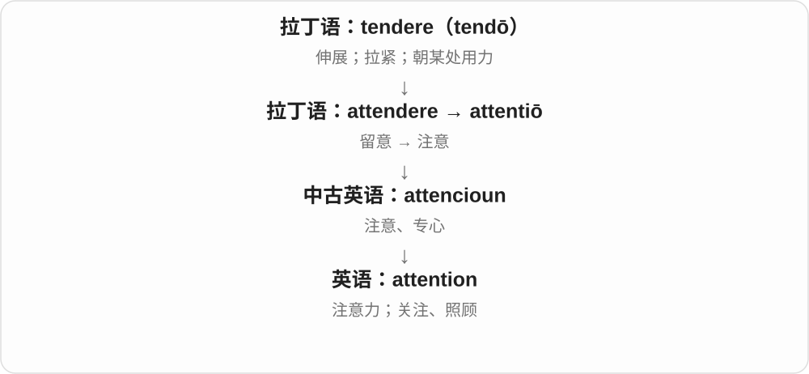

pay attention to 是把注意力放过去；need attention 可以是需要照料、处理，不只是想被看见。

**常见搭配与例句**

pay attention to；draw attention to；medical attention。

> Please pay attention to the last instruction.

请注意最后一条说明。

> The damaged roof needs immediate attention.

受损的屋顶需要马上处理。

**别混淆**

attention 是关注；intention 是打算。注意到一件事不等于打算做它。

### 3. attending — 出席的；负责诊疗的高年资医师

**音标**：/əˈtendɪŋ/

**先抓住这个画面**

普通 attending 是正在参加；医院里的 an attending 则是承担诊疗与监督责任的医生角色。

**怎么拆**

attend + -ing；医师名词由 attending physician 缩短而来。

**怎么变成今天的意思**

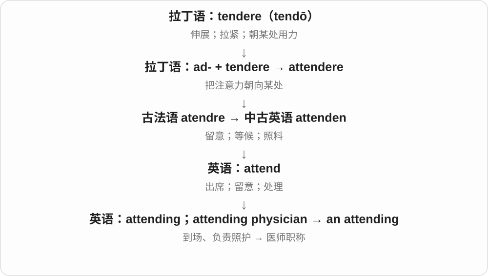

美国医疗语境尤常见，不能一律译作中国职称体系中的“主治医师”。

**常见搭配与例句**

students attending the course；an attending physician；the attending on duty。

> The students attending the workshop received a handbook.

参加工作坊的学生领到了一本手册。

> The resident discussed the case with the attending.

住院医师和负责的高年资医师讨论了病情。

**别混淆**

attendee 是活动参加者；an attending 在医院通常指医生，不是观众。

### 4. attendee — 出席者；参会者

**音标**：/əˌtenˈdiː/

**先抓住这个画面**

attendee 就是来到活动现场或线上会场的人；它记录“谁来参加了”。

**怎么拆**

attend + -ee。虽然 -ee 常指动作承受者，这里已经固定表示参加者。

**怎么变成今天的意思**

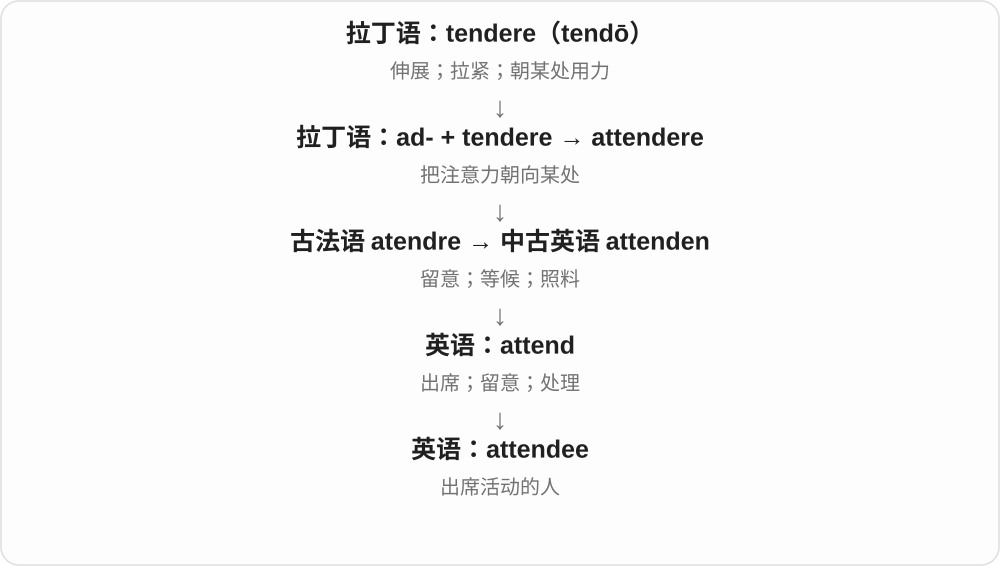

会议、培训、展览常用；attendees 不一定都是演讲者或正式会员。

**常见搭配与例句**

conference attendees；registered attendees；an attendee list。

> Every attendee received a name badge.

每位参会者都领到了一枚姓名牌。

> Online attendees can submit questions in the chat.

线上参会者可以在聊天区提交问题。

**别混淆**

attendee 是来参加的人；attendant 常是负责服务照料的人，也可作形容词。

### 5. addition — 增加；添加物；加法

**音标**：英、美 /əˈdɪʃən/

**先抓住这个画面**

在已有的一堆上，再放上一块。

**怎么拆**

经古法语 adition 借入拉丁 additiō；来自 addere。其历史组成是 ad- + -dere“放”，不是现代 add 后临时造出的唯一来源。

**怎么变成今天的意思**

**拉丁语：ad**  
朝向；靠近；加到

↓

**拉丁语：ad- + -dere → addere → additiō**  
放到一起 → 添加 → 添加行为

↓

**古法语 adition → 英语 addition**  
增加；新增的东西；加法

an addition to the team 是团队新增的人；in addition 是“另外还有”。算术加法只是“合起来”这个动作的一种精确用法。

**常见搭配与例句**

in addition；in addition to；an addition to…。

> The addition of a lamp made the room much warmer.

添上一盏灯后，房间显得温暖多了。

> In addition to rent, we pay for electricity.

除了房租，我们还要交电费。

**别混淆**

addition 可以是过程或新增的一项；total 是加完得到的总数。

### 6. additions — 新增内容；增添之物；扩建部分〔复数〕

**音标**：英、美 /əˈdɪʃənz/

**先抓住这个画面**

原来一份清单、一个建筑已经在那儿，后来又加进去的东西，就是 additions。

**怎么拆**

addition + -s → additions。addition 的 -ition 对应动作、结果名词材料；历史经法语接拉丁 additio，来自 ad- 向 + -dere 放的 addere 加上。

**怎么变成今天的意思**

**拉丁 ad- + -dere 放 → addere → additio**  
把东西放到原有整体上

↓

**法语 adition 等 → addition → additions**  
现代复数常数新添的内容、部分

new additions 是新添部分、成员；additions to the list 是清单新增项；later additions 是后来加上的东西。

**常见搭配与例句**

new additions；additions to the list；later additions to the building。

> The revised guide includes several useful additions.

修订后的指南增加了几项实用内容。

> The new books are welcome additions to the library.

这些新书为图书馆增添了受欢迎的馆藏。

**别混淆**

addition 是增添、加法，edition 是版本；new additions to an edition 是某一版里新增的内容，两者不能因音近而混写。

### 7. address — 地址；演说；向……讲话；处理、着手解决

**音标**：名词：英 /əˈdres/，也读 /ˈædres/；美 /ˈædres/、/əˈdres/；动词：英、美 /əˈdres/

**先抓住这个画面**

把人、信件或注意力明确指向一个对象：信寄到某处，话对某人说，精力对准某个问题。

**怎么拆**

古法语 adrecier，追到通俗拉丁语 *addirectiare〔ad- + *directiare〕，再到 directus；英语先借动词，名词随后发展，不是现代 add + dress。

**怎么变成今天的意思**

**拉丁语：regere**  
引导、使直；治理

↓

**拉丁语：dirigere → directus**  
引向一定方向、摆直 → 直的

↓

**通俗拉丁语 \*addirectiare → 古法语 adrecier**  
朝某处引导、摆正

↓

**英语：address〔先动词〕**  
引向、对……说；着手处理

↓

**英语：address〔名词〕**  
演说；寄达的地址

address a problem 是认真面对并处理问题，不保证已解决；address an audience 是向听众讲话。email address 和 postal address 都是在告诉别人信息往哪里送。

**常见搭配与例句**

address an issue；address the audience；a postal address。

> Please write your address at the top of the form.

请把地址写在表格上方。

> The report addresses the causes of the delay.

报告着重处理了延误的原因。

> She addressed the audience without notes.

她没有看稿，直接向听众作了演讲。

**别混淆**

solve 表示把问题解决掉；address 可能只是进入处理过程。

### 8. addressed — 向……讲话；处理、回应了；写了地址〔过去式、过去分词〕

**音标**：/əˈdrest/

**先抓住这个画面**

话对着一群人说，注意力对着一个问题去，信件对着一个收件地点发：addressed 保留了把东西引向目标的方向感。

**怎么拆**

address + -ed，末尾 /s/ 后读 /t/。动词重音在后。address 借古法语 adrecier，接通俗拉丁重构形式 *addirectiare 及使直、引导材料。

**怎么变成今天的意思**

**通俗拉丁 \*addirectiare → 古法语 adrecier → address**  
向目标引导 → 对人讲话、处理问题、写地址

↓

**address + -ed → addressed**  
上述动作已经发生；也可组成被动结构

addressed the audience 向听众讲话；addressed the problem 处理了问题；addressed to someone 写明寄给某人。

**常见搭配与例句**

an envelope addressed to me 一个写明寄给我的信封；questions addressed in the report 报告回应的问题。

> The report addressed the main concerns raised by residents.

报告回应了居民提出的主要关切。

> The letter was addressed to the previous owner.

这封信写明寄给前任主人。

**别混淆**

addressed a problem 意为着手回应、处理，不必保证已经彻底解决。信封里的 addressed to 则说明收件方向。

### 9. addresses — 地址、致辞〔复数〕；处理、探讨；向……讲话〔第三人称单数〕

**音标**：英 /əˈdresɪz/；美名词 /ˈædresɪz/ 或 /əˈdresɪz/，动词 /əˈdresɪz/

**先抓住这个画面**

把信件、话语或行动指向一个地方、一个对象，是 addresses 的共同线索。地址给投递方向，address a problem 则把注意和处理动作朝向问题。

**怎么拆**

address + -es，/s/ 后增加 /ɪz/。经古法语 adrecier 指向、使直，接重构通俗拉丁 *addirectiare，ad- 向 + *directiare 使直，较早 directus 直的；英语先有动词，名词后发展。

**怎么变成今天的意思**

**通俗拉丁重构形式 → 法语 → address**  
指向、使直 → 投递目的地；对人讲话、处理事情

↓

**address + -es → addresses**  
多个地址、致辞；单数主语处理或讲话

email addresses 电子邮件地址；addresses the audience 向听众讲话；addresses the problem 处理问题。

**常见搭配与例句**

home addresses 家庭住址；addresses two questions 探讨两个问题。

> The form asks for the addresses of all participants.

表格要求填写所有参加者的地址。

> The report addresses two important questions.

报告探讨两个重要问题。

**别混淆**

address a problem 表示正面处理、讨论这个问题，不保证它已完全解决。名词 address 在美式英语中常可前重音，动词通常后重音。

### 10. addressable — 可寻址的；可处理的；可服务到的

**音标**：英、美 /əˈdresəbəl/

**先抓住这个画面**

能准确找到它并对它做事；问题则是有办法着手处理。

**怎么拆**

address + -able，对应 address“定位、处理、面向”的不同义项。

**怎么变成今天的意思**

**拉丁语：ad**  
朝向；靠近；加到

↓

**通俗拉丁语 \*directiāre → \*addirectiāre**  
使直；引向

↓

**古法语 adrecier → 英语 address**  
指向、对着说；处理；写地址

↓

**英语 address + -able → addressable**  
能被定位、处理或覆盖的

计算机的 addressable memory 是可用地址访问的内存；addressable market 是产品能够服务的市场范围，不等于实际已经拿下的市场。

**常见搭配与例句**

addressable memory；an addressable problem；total addressable market。

> Each light in the strip is individually addressable.

灯带上的每一盏灯都可以单独寻址控制。

> Most of the complaints are addressable with clearer instructions.

大多数投诉反映的问题都能通过更清楚的说明来处理。

**别混淆**

available memory 说当前可用多少；addressable memory 说地址系统能够访问到多少。

### 11. addressee — 收件人；话语的接收对象

**音标**：英、美 /ˌædreˈsiː/

**先抓住这个画面**

地址栏或一句话所指向的那个人。

**怎么拆**

address + -ee，后缀标出接受行为的一方，重音落在末尾。

**怎么变成今天的意思**

**拉丁语：ad**  
朝向；靠近；加到

↓

**通俗拉丁语 \*directiāre → \*addirectiāre**  
使直；引向

↓

**古法语 adrecier → 英语 address**  
指向、对着说；处理；写地址

↓

**英语 address + -ee → addressee**  
收到信件或被话语指向的人

邮件里的 addressee 是指定收信人；语言学也用它表示说话对象，不限于纸质邮件。

**常见搭配与例句**

the intended addressee；name the addressee；addressor and addressee。

> The letter was returned because the addressee had moved.

信因收件人已经搬走而被退回。

> The speaker’s tone changes depending on the addressee.

说话者的语气会随交谈对象而变化。

**别混淆**

sender 发出信息；addressee 是信息被指定发给的人，未必实际收到。

### 12. accept — 接受；认可

**音标**：/əkˈsept/

**先抓住这个画面**

别人递来一个东西或说法，你不只是接到，还点头说“好，我收下”。礼物、工作机会、解释和现实都可以 accept。

**怎么拆**

历史上 ad-（朝向）+ capere（拿）形成 accipere，ad- 的辅音同化；accept 与其 accept- 分词词干相关。

**怎么变成今天的意思**

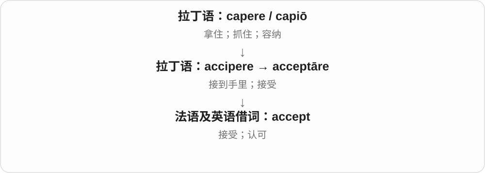

从“拿到身边”发展为“接纳”。接纳的不一定让人开心：accept a difficult truth 是承认一个难以接受的事实，不是喜欢它。

**常见搭配与例句**

accept an offer（接受提议）；accept responsibility（承担责任）；accept that…（承认……）。

> She accepted the job offer after a week of thought.

考虑一周后，她接受了那份工作。

> We need to accept that the first plan did not work.

我们需要承认，第一个方案没有奏效。

**别混淆**

accept 与 except 不同：accept 是接纳，except 是排除。发音接近，首字母和意思都要分清。

### 13. accepted — 被接受的；公认的

**音标**：英、美 /əkˈseptɪd/

**先抓住这个画面**

一个说法或做法，已经被大家收进“可以采用”的范围。

**怎么拆**

accept + -ed；accept 经法语追到拉丁 acceptāre、accipere，后者是 ad- + capere“拿”。

**怎么变成今天的意思**

**拉丁语：ad**  
朝向；靠近；加到

↓

**拉丁语 accipere → acceptāre**  
接到手里；收下

↓

**古法语 accepter → 英语 accept → accepted**  
接受 → 被接受；公认

an accepted explanation 是大家普遍认可的解释，不保证绝对正确。申请 accepted 则指获得接收。

**常见搭配与例句**

widely accepted；accepted practice；an accepted explanation。

> This is the most widely accepted explanation of the pattern.

这是对这一模式最广获认可的解释。

> Her proposal was accepted after a few small changes.

做了几处小修改后，她的提案获准了。

**别混淆**

acceptable 说能不能接受；accepted 说已经受到接受。

### 14. acceptable — 可以接受的；达标的

**音标**：/əkˈseptəbəl/

**先抓住这个画面**

想象给东西设一条最低标准：过了这条线，虽然未必出色，但能接受。这就是 acceptable。

**怎么拆**

现代分析是 accept + -able“可以被接受的”；英语词形也承接法语和晚期拉丁语 acceptābilis。

**怎么变成今天的意思**

它常用于质量、价格、行为和方案。acceptable 不自动等于 excellent：一个方案可以只是够用，但仍达到了你设定的条件。

**常见搭配与例句**

an acceptable solution；acceptable to someone；an acceptable standard。

> We need to find a solution that is acceptable to both sides.

我们需要找到双方都能接受的方案。

> The room was small, but the price was acceptable.

房间很小，但价格可以接受。

**别混淆**

acceptable 是能否接受；accepted 是已经被接受。一个尚无人采用的方案，也可能本身很合理、可接受。

### 15. acceptance — 接受；认可；接纳

**音标**：/əkˈseptəns/

**先抓住这个画面**

accept 是点头接受这个动作，acceptance 是点头之后形成的认可。一个新想法慢慢被大家接受，就是 gaining acceptance。

**怎么拆**

现代可拆 accept + -ance；-ance 把动作变成名词。不要因为结尾相同，就把它与 alliance 归成同一词根。

**怎么变成今天的意思**

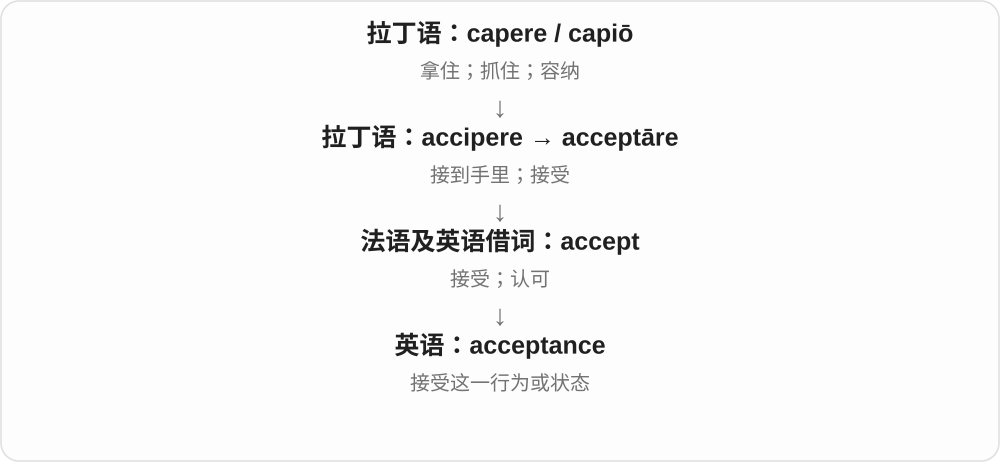

它可以指接受邀请，也可以指接纳某种差异、承认某个现实。重点是“原本可能拒绝，现在允许它进入自己的判断或关系”。

**常见搭配与例句**

gain acceptance（获得认可）；acceptance of…；an acceptance letter（录取或接受函）。

> The idea gradually gained acceptance among teachers.

这个想法逐渐获得了教师们的认可。

> Her family’s acceptance gave her confidence.

家人的接纳给了她信心。

**别混淆**

acceptance 不是 approval 的完全同义词：你可以接受某个现实，却并不赞成它。

### 16. accepts — 接受、接纳、认可〔第三人称单数〕

**音标**：/əkˈsepts/

**先抓住这个画面**

东西、建议或事实来到面前，自己让它进入、不再拒绝，就是 accepts。可以收下，也可以在心里承认它成立。

**怎么拆**

accept 接拉丁 accipere、acceptare，历史 ad- 朝向 + capere 拿，辅音同化，并有 accept- 分词词干。经法语及拉丁相关形式借入；现代加 -s，尾 /pts/。

**怎么变成今天的意思**

**拉丁 ad- + capere → accipere、acceptare → accept**  
向自己接过来 → 接受、认可

↓

**accept + -s → accepts**  
某主体收下、同意接纳或承认

accepts the offer 接受提议；accepts the facts 承认事实；accepts different views 接纳不同观点。

**常见搭配与例句**

accepts responsibility 承担责任；accepts visitors 接待访客。

> She accepts the invitation with pleasure.

她欣然接受邀请。

> The museum accepts donations of old photographs.

博物馆接受旧照片捐赠。

**别混淆**

accepts 不保证喜欢。accepts that a plan failed 可以是承认失败的事实，心里未必高兴。

### 17. appeal — 呼吁、请求；上诉；吸引力；使感兴趣

**音标**：/əˈpiːl/

**先抓住这个画面**

把希望得到回应的话朝对方送过去，是 appeal 的呼求画面；东西仿佛在招呼你，让你愿意靠近，就形成吸引力的用法。后一个画面帮助理解，实际意义变化有历史过程。

**怎么拆**

名词、动词经古法语 apel、apeler 等借入，接拉丁 appellāre 呼唤、对某人说、请求，较早关联 ad- 向与 pellere 推、驱动的词族，ad- 在 p 前呈 ap-。理解现代词义时先抓呼求这一中间层。

**怎么变成今天的意思**

**拉丁 appellāre → 法语 apel／apeler → 英语 appeal**  
呼唤、求助 → 请求、更高权威复核

↓

**英语 appeal 的后续发展**  
希望得到回应 → 引起兴趣、吸引力

appeal for help 呼吁援助；appeal against a decision 对决定提出上诉；appeal to young readers 吸引年轻读者；have broad appeal 有广泛吸引力。

**常见搭配与例句**

make an appeal；appeal to someone for support。

> The charity made an appeal for warm clothes.

这家慈善机构呼吁捐赠保暖衣物。

> The idea of a quiet weekend really appeals to me.

安静度过周末这个想法很吸引我。

**别混淆**

appeal to someone 看向谁呼求，或吸引谁；appeal for something 看请求什么。法律语境的 appeal 则说请求复核原有决定。

### 18. appeals — 呼吁、请求、上诉〔复数〕；吸引、呼求〔第三人称单数〕

**音标**：/əˈpiːlz/

**先抓住这个画面**

一声声请求、一次次上诉，是名词 appeals；某个事物让一个人愿意关注，也能说它 appeals to 那个人。

**怎么拆**

appeal + -s，/l/ 后读 /z/。词基经法语接拉丁 appellāre 呼唤、请求，英语后有吸引兴趣、获得回应的分支。

**怎么变成今天的意思**

**拉丁呼唤、请求词族 → 法语 → appeal**  
呼求、上诉；后来有吸引力

↓

**appeal + -s → appeals**  
多个请求、上诉；单数主语呼求或吸引

appeals for donations 募捐呼吁；hear appeals 审理上诉；appeals to families 吸引家庭客群；appeals to common sense 诉诸常识。

**常见搭配与例句**

repeated appeals；appeals to a wide audience。

> The simple design appeals to people of all ages.

这个简洁设计吸引各个年龄段的人。

> Their appeals for help received a quick response.

他们求助的呼吁很快得到了回应。

**别混淆**

appeals to emotion 常说诉诸情感，希望借情感获得回应；appeals to readers 常说吸引读者。同一结构需要结合主语与上下文理解。

### 19. appealing — 有吸引力的、让人想要的；恳求的；正在呼吁、上诉

**音标**：/əˈpiːlɪŋ/

**先抓住这个画面**

一种东西看起来让你想靠近、想拥有，就是 appealing；它还保留恳求、希望别人回应的用法。

**怎么拆**

appeal + -ing，既是动词形式，也形成分词形容词。appeal 的呼求、请求历史在前，appealing 后来又广用于使人感兴趣、令人喜欢的性质。

**怎么变成今天的意思**

**appeal 的呼求、请求义 → appealing 分词及形容词**  
正在请求；带恳求意味

↓

**appealing 的形容词分支扩展**  
让人愿意回应 → 有吸引力、令人喜欢

an appealing idea 吸引人的想法；an appealing smile 让人喜欢的笑容；an appealing look 恳求或惹人喜爱的神情；is appealing for help 正在呼吁援助。

**常见搭配与例句**

visually appealing；an appealing alternative。

> A free afternoon in the garden sounds very appealing.

在花园里悠闲地待一个下午，听起来很诱人。

> The group is appealing for volunteers to help with the repairs.

这个团体正在呼吁志愿者协助修缮。

**别混淆**

an appealing plan 形容计划吸引人；They are appealing for help 是进行中的求助。appealing 在物品、设计语境更常是有吸引力的，神情语境有时保留恳求意味。

### 20. appealed — 呼吁过；提出了上诉；曾吸引、引起兴趣；appeal 的过去式和过去分词

**音标**：/əˈpiːld/

**先抓住这个画面**

回头说曾向人求助、曾要求复核，或某个想法当时很合心意，就可以用 appealed。

**怎么拆**

appeal + -ed，/l/ 后词尾读 /d/，不增加音节。appeal 经法语承接拉丁呼唤、请求词族，现代规则变化为 appealed。

**怎么变成今天的意思**

**法语相关借词 → appeal**  
呼求、上诉；吸引兴趣

↓

**appeal + -ed → appealed**  
过去呼求、上诉；当时有吸引力

appealed for calm 呼吁保持冷静；appealed against the ruling 对裁决提出上诉；appealed to me 当时吸引我。

**常见搭配与例句**

has appealed；appealed directly to the audience。

> The organizers appealed for more volunteers.

组织者呼吁更多志愿者加入。

> The chance to work outdoors appealed to her.

能在户外工作的机会很吸引她。

**别混淆**

appealed for something 说明请求的内容；appealed to someone 可说向其求助，也可说对其有吸引力。上诉结构在不同英语地区可见 appeal a decision 或 appeal against a decision。

### 21. affect — 影响；使感动；装出

**音标**：动词 /əˈfekt/；名词 /ˈæfekt/

**先抓住这个画面**

风吹到水面，水面随之改变：affect 说的是外来的东西对对象起作用。它不一定把对象完全改变。

**怎么拆**

ad-（朝向）+ facere 形成 afficere。影响义联系 affectus“受作用形成的状态”；装出姿态义另经 affectare、法语 affecter 发展，不能混成一条直线。

**怎么变成今天的意思**

主图画的是影响这一支：外来作用改变对象或触动情绪。另一支 affectare 原有刻意追求、模仿的意思，经法语发展出装出姿态的用法。两支历史上有交织；名词 affect 则是心理学中的情感表现。

**常见搭配与例句**

affect the result；deeply affected；affect an accent。

> Lack of sleep can affect your concentration.

睡眠不足会影响注意力。

> She was deeply affected by his kindness.

他的善意使她深受感动。

**别混淆**

通常用 affect 作动词、effect 作名词；affect 的“装作”义更正式，也常带批评。

### 22. affects — 影响、作用于；装出某种姿态〔第三人称单数〕

**音标**：常用动词 /əˈfekts/

**先抓住这个画面**

一个变化碰到人或物身上，让原来的状态、选择有了变化，就是 affects 的影响义。

**怎么拆**

affect + -s，/t/ 后读 /s/。影响义接拉丁 ad- 与 facere 所成 afficere、affectus；装出姿态义另经 affectare、法语等发展。

**怎么变成今天的意思**

**拉丁 afficere、affectus 等 → 影响义 affect；另一姿态义有不同路线**  
作用到身上 → 影响；刻意表现另作分支

↓

**affect + -s → affects**  
某事影响某人、某物；也可说某人装出姿态

affects the result 影响结果；affects everyone 影响所有人；affects an accent 刻意装出一种口音。

**常见搭配与例句**

affects the colour 影响颜色；affects how we work 影响我们怎样工作。

> The lighting affects the colour of the picture.

光线影响画面的颜色。

> The new timetable affects everyone in the team.

新时间表影响团队中的每个人。

**别混淆**

affects 常用作影响的动词，effects 常是结果、影响的名词复数；effect 也可作较正式的实现、促成动词，但不是这里的普通影响义。

### 23. admit — 承认；准许进入；接纳

**音标**：/ədˈmɪt/

**先抓住这个画面**

admit 像打开一道门：可以让人进入场所，也可以把一个原先不想面对的事实“放进自己的承认范围”。

**怎么拆**

拉丁语 ad-（到）+ mittere（让去、送出）形成 admittere“准许进入”，经法语、中古英语发展。

**怎么变成今天的意思**

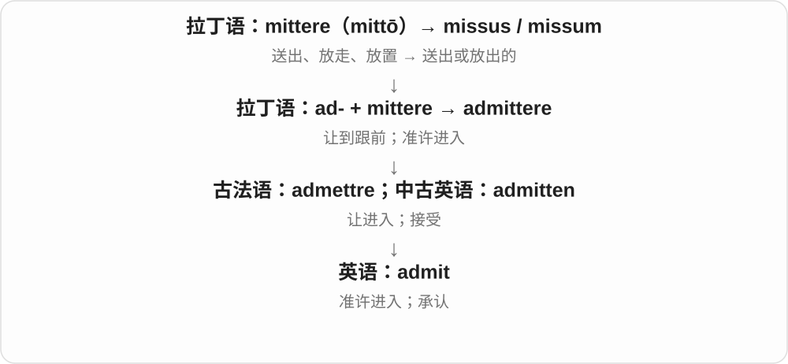

让人进门是具体接纳；承认事实是把它接纳为真。这个联系是帮助理解的画面，实际历史中两义逐步扩展。

**常见搭配与例句**

admit a mistake；admit that…；admit doing…；be admitted to… 。

> He admitted that he had misunderstood the instructions.

他承认自己误解了说明。

> The ticket admits one adult and one child.

这张票允许一位成人和一位儿童入场。

**别混淆**

admit doing 是承认做过；allow someone to do 是允许去做。不要把承认错误说成 admit to do。

### 24. admits — 承认；准许进入、接纳〔第三人称单数〕

**音标**：/ədˈmɪts/

**先抓住这个画面**

让人进门，是 admits；让一个事实进入自己愿意承认的范围，也可以这样理解承认义。

**怎么拆**

admit + -s，/t/ 后读 /s/，不双写 t。admit 经法语、中古英语接拉丁 admittere，ad- 到与 mittere 让去、送出形成准许进入。

**怎么变成今天的意思**

**拉丁 ad- + mittere → admittere → 法语、中古英语 → admit**  
让到跟前 → 接纳、准入；承认

↓

**admit + -s → admits**  
某人承认；某票据、场所准许进入

admits a mistake 承认错误；admits that... 承认……；admits two people 准许两人入场。

**常见搭配与例句**

admits doing 承认做过；admits someone to a place 准许某人进入。

> The ticket admits two people.

这张票可供两人入场。

> She admits that the plan needs more work.

她承认计划还需要打磨。

**别混淆**

admits doing、admits to doing 都可说承认做过，后一种 to 是介词。admits 是现在三单，admitted、admitting 才双写 t。

### 25. admitting — 承认；允许进入；接收入内〔分词、动名词〕

**音标**：英、美 /ədˈmɪtɪŋ/

**先抓住这个画面**

让人进门，是 admitting people；把一个原本不愿接受的事实认下来，也像让它进入自己承认的范围。

**怎么拆**

admit 双写末尾 t，加 -ing → admitting，末音节重读。拉丁 ad- 向 + mittere 放行、发送 → admittere 让进入、准许。

**怎么变成今天的意思**

**拉丁 ad- + mittere → admittere 让进、允许**  
入口、许可的词义材料

↓

**英语 admit 的承认事实、接收入内等义 → admitting**  
现代双写 t，加完整 -ing

admitting a mistake 是承认错误；admitting visitors 是让访客进入；admitting that... 是承认某种情况。

**常见搭配与例句**

admitting a mistake；admitting visitors；admitting that...。

> Admitting the mistake was the first step toward fixing it.

承认错误是纠正它的第一步。

> The museum is admitting visitors through the side entrance today.

博物馆今天让访客从侧门进入。

**别混淆**

admitting a mistake 后面是所承认的事；admitting someone 后面是准许进入的人。对象不同，意思也不同。

### 26. admissible — 可接纳的；可采纳的；符合准入条件的

**音标**：/ədˈmɪsəbəl/

**先抓住这个画面**

admissible 像一份材料到了门口，规则检查后允许它进入讨论或证据范围。

**怎么拆**

借自法语 admissible，与拉丁语 admittere 的 admiss- 词干相连；现代对应 admit + -ible 的可接受意义。

**怎么变成今天的意思**

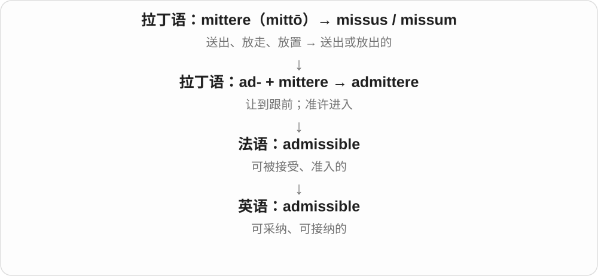

常用于证据、论点或方案是否符合规定。被允许纳入考虑，不等于已经证明内容真实或结论正确。

**常见搭配与例句**

admissible evidence；an admissible argument；admissible under the rules。

> The judge will decide whether the evidence is admissible.

法官将决定这份证据是否可以采纳。

> Only solutions satisfying all the constraints are admissible.

只有满足全部约束的解才符合准入条件。

**别混淆**

credible 是可信；admissible 是准许采纳。两者问的是不同问题。

### 27. admittance — 准许进入；进入权；导纳

**音标**：/ədˈmɪtəns/

**先抓住这个画面**

admittance 像门卫抬起栏杆让你进去，重点是能否进入；电路中借用“让电流通过”的画面形成导纳术语。

**怎么拆**

admit + -ance，是英语派生；电学意义是后来借用的专业用法。

**怎么变成今天的意思**

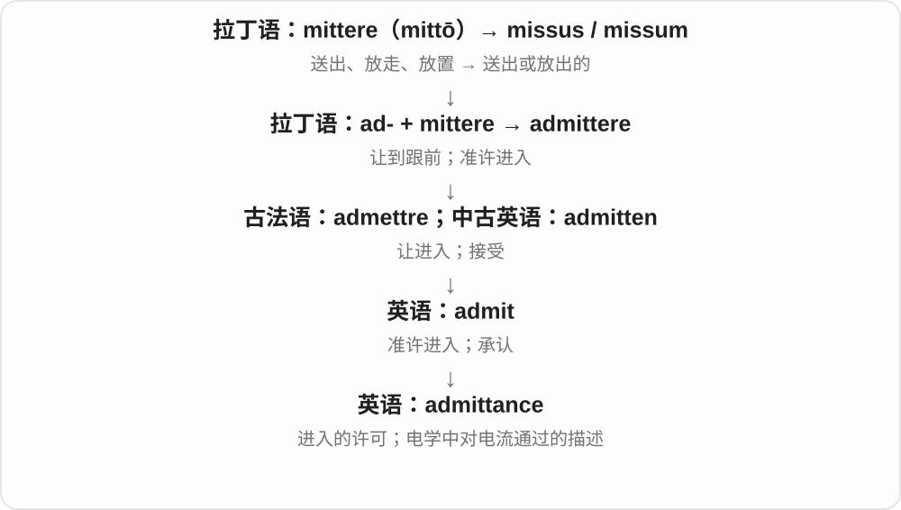

普通用法多见于门牌、正式说明。导纳与阻抗互为倒数，描述电路对交流电流的响应，不能只当成门票。

**常见搭配与例句**

no admittance；gain admittance to…；electrical admittance。

> The sign says no admittance without a pass.

牌子写着没有通行证不得进入。

> The engineer calculated the circuit’s admittance.

工程师计算了这个电路的导纳。

**别混淆**

admission 可讲承认或入场费；admittance 更专注进入本身。电学的 conductance“电导”只是导纳相关概念之一，不完全等同。

### 28. accurate — 准确的；精确无误的

**音标**：/ˈækjərət/

**先抓住这个画面**

地图画的位置、记录写的数字，和实际能对得上，就是 accurate。

**怎么拆**

来自拉丁语 accūrātus“认真处理好的”，ad- 在 c 前同化为 ac-，后接 cūrāre“照料、用心处理”。

**怎么变成今天的意思**

仔细做事容易做得正确，词义于是从认真细致转向结果准确。它评价的是与事实或目标符合，不是仅看小数点很多。

**常见搭配与例句**

accurate information；an accurate description；accurate measurements。

> The map gives an accurate picture of the coastline.

这张地图准确地描绘了海岸线。

> We need accurate figures before making a decision.

作决定前，我们需要准确的数字。

**别混淆**

precise 强调细致、精密或重复一致；accurate 强调对得准。测量数值很细，也可能整体偏离真实值。

### 29. accuracy — 准确性；准确度

**音标**：/ˈækjərəsi/

**先抓住这个画面**

不是问说得多漂亮，而是问结果与真实值、原文或目标差多少，这个质量叫 accuracy。

**怎么拆**

accurate + -cy；词尾调整后形成 accuracy。

**怎么变成今天的意思**

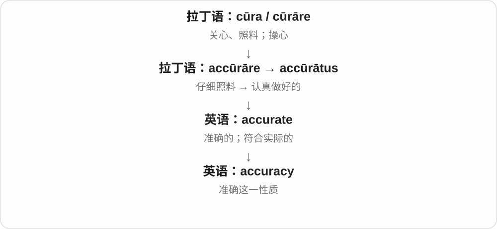

它把具体“准不准”变成可比较的指标。翻译、射击、记录、测量都能谈 accuracy，但衡量方式不同。

**常见搭配与例句**

check for accuracy；improve accuracy；the accuracy of a report。

> The editor checked the names for accuracy.

编辑核查了姓名是否准确。

> Practice improved the accuracy of her throws.

练习提高了她投掷的准确度。

**别混淆**

accuracy 不等于 detail“细节多”。内容很详细，仍可能处处不准。

### 30. accurately — 准确地；如实地

**音标**：/ˈækjərətli/

**先抓住这个画面**

把原来的内容传过去时不走样，或者把目标判断得很准，便是在做事时 accurately。

**怎么拆**

accurate + -ly。

**怎么变成今天的意思**

常描述记录、测量、预测、翻译等动作。它强调结果匹配，不只是态度认真。

**常见搭配与例句**

measure accurately；report accurately；predict accurately。

> Please record the temperature accurately.

请准确记录温度。

> The subtitle accurately conveys the speaker’s meaning.

字幕准确传达了说话者的意思。

**别混淆**

carefully 是认真小心地做；accurately 是做出来准确。认真能帮助准确，却不能保证准确。

### 31. inaccurate — 不准确的；与事实不符的

**音标**：/ɪnˈækjərət/

**先抓住这个画面**

说法看起来像那么回事，但对照原始资料发现位置、数字或细节对不上，就是 inaccurate。

**怎么拆**

in-（不）+ accurate（准确的）。

**怎么变成今天的意思**

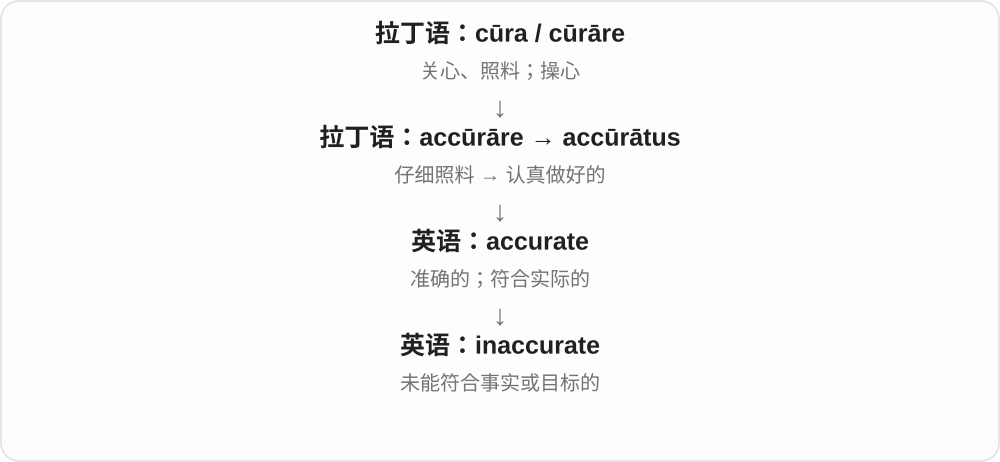

可以是部分出错，也可以整体偏差。它并不自动表示说话者故意欺骗。

**常见搭配与例句**

inaccurate information；an inaccurate estimate；factually inaccurate。

> The article contains an inaccurate date.

文章里有一个日期不准确。

> The old map is inaccurate in several places.

这张旧地图有几处画得不准确。

**别混淆**

false 常直接说内容不实；inaccurate 也可表示不够精确、局部有误，范围需看语境。

### 32. attract — 吸引；引来

**音标**：/əˈtrækt/

**先抓住这个画面**

attract 像有一股看不见的力，把目光、人或物拉向这里：磁铁吸铁，香味吸引顾客，异常举动引起注意。

**怎么拆**

ad-（朝向）+ trahere（拉）；ad- 遇到 t 同化成 at-，形成 attrahere。

**怎么变成今天的意思**

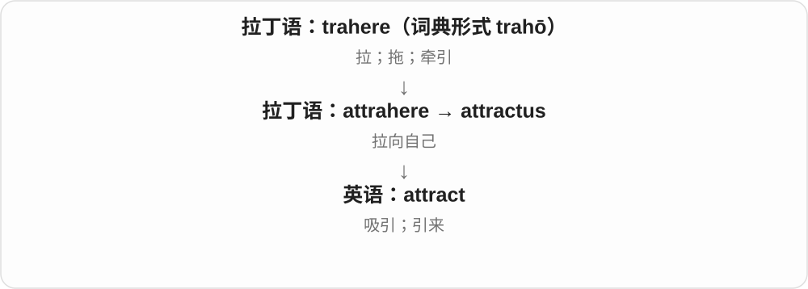

具体的拉力扩展到注意力、兴趣和好感。attract criticism 也成立，因为引来的不一定是好东西。

**常见搭配与例句**

attract attention；attract visitors；attract criticism；be attracted to… 。

> The bright display attracted a crowd.

明亮的陈列吸引了一群人。

> The proposal attracted criticism from several groups.

这项提案招来了几个团体的批评。

**别混淆**

attract 说产生吸引力；invite 是发出邀请。商店可以靠橱窗 attract customers，不必逐个邀请。

### 33. attractive — 有吸引力的；好看的；诱人的

**音标**：/əˈtræktɪv/

**先抓住这个画面**

attractive 让人愿意靠近、选择或多看一眼。人可以好看，价格可以划算，工作机会可以很值得考虑。

**怎么拆**

经法语 attractif，来自拉丁语 attractīvus；现代对照 attract + -ive。

**怎么变成今天的意思**

它把“吸引”变成对象的特点。attractive salary 通常是薪资条件不错，绝不是说数字长得漂亮。

**常见搭配与例句**

an attractive offer；an attractive price；look attractive；attractive to buyers。

> The apartment is attractive to people who work downtown.

这套公寓对在市中心工作的人很有吸引力。

> They offered her an attractive salary.

他们给她开出了诱人的薪资。

**别混淆**

beautiful 更直接评价美；attractive 的范围更广，能包括实惠、便利和机会。

### 34. attraction — 吸引力；吸引人的事物；景点

**音标**：/əˈtrækʃən/

**先抓住这个画面**

attraction 既可以是把人拉过去的力量，也可以是那个值得去看的东西。

**怎么拆**

经古法语 attraction，来自拉丁语 attractiō；现代可对照 attract + -ion。

**怎么变成今天的意思**

“它有吸引力”容易进一步变成“它就是一个吸引人的去处”，于是有 tourist attraction。人与人之间的 attraction 也不一定已经发展成爱情。

**常见搭配与例句**

a tourist attraction；the main attraction；physical attraction；an attraction to… 。

> The old castle is the town’s main attraction.

那座古堡是镇上最吸引游客的地方。

> She felt an immediate attraction to his sense of humor.

他的幽默感一下就吸引了她。

**别混淆**

attraction 可以指吸引本身；destination 只是目的地。不是所有旅行目的地都叫 tourist attraction。

### 35. assault — 袭击；猛烈攻击；突袭

**音标**：英 /əˈsɔːlt/；美 /əˈsɔːlt/、/əˈsɑːlt/

**先抓住这个画面**

朝目标猛扑过去；也能形容声音等强烈冲击感官。

**怎么拆**

历史上 ad- + salīre“跳”，ad- 在 s 前变成 as-。经古法语借入；现代不能拆成 ass + ault。

**怎么变成今天的意思**

**拉丁语：ad**  
朝向；靠近；加到

↓

**晚期拉丁语：assalīre**  
向人跳过去；袭击

↓

**古法语 assalir → assaut → 英语 assault**  
攻击 → 袭击；后来恢复词源相关的 l 拼写

可以是身体攻击、军事进攻，也可以比喻猛烈抨击。法律里的具体界定随司法辖区不同，不直接用“是否碰到人”判断。

**常见搭配与例句**

an assault on；a verbal assault；launch an assault。

> The troops launched an assault on the fortress at dawn.

部队在黎明时向要塞发动突袭。

> The flashing lights felt like an assault on my eyes.

闪烁的灯光晃得我的眼睛难受。

**别混淆**

attack 更宽泛；assault 常突出猛烈、直接的冲击。

### 36. adapt — 适应；改造使适用；改编

**音标**：英、美 /əˈdæpt/

**先抓住这个画面**

换了场地，就改改装备或做法，好继续发挥作用。

**怎么拆**

拉丁 ad- + aptāre“使合适”形成 adaptāre，借入英语；不是把 apt 当作英语词后才造出。

**怎么变成今天的意思**

**拉丁语：ad**  
朝向；靠近；加到

↓

**拉丁语：aptāre → adaptāre**  
使合适 → 调整到合适

↓

**中古英语 adapten → 英语 adapt**  
适应；改编

adapt to 后接要适应的环境；adapt something for 后接新用途或对象。改编也是让故事适合新媒介。

**常见搭配与例句**

adapt to change；adapt a tool for；adapt a novel for television。

> The team adapted quickly to working online.

团队很快适应了线上工作。

> We adapted the recipe for a smaller oven.

我们修改了配方，使它适合小一些的烤箱。

**别混淆**

adopt 是采用、收养；adapt 是为了合适而改变，字母顺序很容易看串。

### 37. adapted — 适应、改编、改造了；适合的〔过去式、过去分词〕

**音标**：/əˈdæptɪd/

**先抓住这个画面**

原来的样子和新需要不完全合，把它调整到能用、能相处，就是 adapted。人适应环境，故事也可改成另一种作品。

**怎么拆**

adapt + -ed，/t/ 后读 /ɪd/。adapt 接拉丁 ad- 与 aptare 使合适所成 adaptare，英语借入相关形式。

**怎么变成今天的意思**

**拉丁 adaptare → 英语 adapt**  
使合适 → 适应、调整、改编

↓

**adapt + -ed → adapted**  
已经适应、调整；分词可形容适合某用途

adapted to the climate 适应气候；adapted from a novel 根据小说改编；adapted for children 为儿童改编。

**常见搭配与例句**

well adapted to the conditions 很适应条件；adapted the design 调整了设计。

> The play was adapted from a short story.

这部戏由一个短篇故事改编而成。

> The plants are well adapted to dry conditions.

这些植物很适应干燥条件。

**别混淆**

adapted from 说明改编来源，adapted for 说明目标读者、用途。adopted 是采用、收养的形式，与 adapted 拼写、意思不同。

### 38. adaptation — 适应；改编；改编作品

**音标**：英、美 /ˌædæpˈteɪʃən/

**先抓住这个画面**

换了环境或表现形式，原来的东西也跟着换一种合适的样子。

**怎么拆**

经法语 adaptation，追到中世纪拉丁 adaptātiō；与 adapt 同族，但名词有自己的借入路线。

**怎么变成今天的意思**

**拉丁语：ad**  
朝向；靠近；加到

↓

**拉丁语：aptāre → adaptāre**  
使合适 → 调整到合适

↓

**中世纪拉丁 adaptātiō → 法语 adaptation → 英语 adaptation**  
使合适的过程；适应；改编作品

动物的 adaptation 是适合环境的特征或过程；a film adaptation 是把小说等搬上银幕后的作品。不是逐字复制。

**常见搭配与例句**

adaptation to；an adaptation of a novel；a film adaptation。

> Thick fur is an adaptation to cold conditions.

厚毛是适应寒冷环境的一种特征。

> The television adaptation moves the story to the present day.

这部电视改编作品把故事移到了当代。

**别混淆**

translation 主要换语言；adaptation 可以改情节、结构或媒介。

### 39. adaptive — 能适应的；有适应作用的；会自动调节的

**音标**：英、美 /əˈdæptɪv/

**先抓住这个画面**

条件一变，它也会跟着改变，而不是死守一个设置。

**怎么拆**

adapt + -ive，英语形容词派生。

**怎么变成今天的意思**

**拉丁语：ad**  
朝向；靠近；加到

↓

**拉丁语：aptāre → adaptāre**  
使合适 → 调整到合适

↓

**中古英语 adapten → 英语 adapt**  
适应；改编

↓

**英语：adapt + -ive → adaptive**  
能随条件改变的

adaptive learning 会根据学习者表现调整内容；生物学里的 adaptive trait 是有助于适应环境的特征。

**常见搭配与例句**

adaptive behaviour；adaptive learning；an adaptive system。

> The app uses adaptive exercises that become harder as you improve.

这个应用的练习会随你的进步自动增加难度。

> Changing feeding times can be an adaptive response to heat.

改变进食时间可以是一种适应高温的反应。

**别混淆**

adaptable 常说“有被调整或适应的能力”；adaptive 常说“正在以变化作出适应”。

### 40. adapter — 适配器；转接头；改编者

**音标**：英 /əˈdæptə/；美 /əˈdæptər/

**先抓住这个画面**

两端原本接不上，中间加一个东西，让它们能一起用。

**怎么拆**

adapt + -er；adaptor 也是常见拼法。后缀可以指做事的人，也可以指起作用的装置。

**怎么变成今天的意思**

**拉丁语：ad**  
朝向；靠近；加到

↓

**拉丁语：aptāre → adaptāre**  
使合适 → 调整到合适

↓

**中古英语 adapten → 英语 adapt**  
适应；改编

↓

**英语：adapt + -er → adapter**  
使东西适用的人或装置

电源适配器会把供电方式变合适；简单的插头转接头可能只改变接口形状，不一定改变电压。

**常见搭配与例句**

a power adapter；a plug adapter；a USB adapter。

> You need an adapter to connect this screen to the laptop.

你需要一个转接器才能把这个显示器接到笔记本上。

> Check the voltage before using the travel adapter.

使用旅行转接头前，先检查电压。

**别混淆**

adapter 负责适配；converter 常强调转换某种量或格式，两者实际用途可能重叠。

### 41. adapters — 适配器、转接器；改编者等〔复数〕

**音标**：英 /əˈdæptəz/；美 /əˈdæptərz/

**先抓住这个画面**

原来接不上、条件不合的两端，通过一个装置变得能配合，这类装置是 adapters。

**怎么拆**

adapt 使适合 + -er → adapter，再加复数 -s，尾 /z/。adapt 较远经法语等接拉丁 ad + aptare 使合适。

**怎么变成今天的意思**

**拉丁 ad + aptare → adapt；adapt + -er → adapter**  
使合适 → 起适配作用的装置、人员

↓

**adapter + -s → adapters**  
多个适配器、转接器或改编者

power adapters 电源适配器；travel adapters 旅行转接器。

**常见搭配与例句**

adapters for the cables 线缆转接器；adapters in the bag 包里的适配器。

> She packed two travel adapters.

她装好了两个旅行转接器。

> The box contained cables and adapters.

盒子里装着线缆和适配器。

**别混淆**

adaptor、adaptors 是常见对应拼写。器具让两端适配，文字作品的 adapter 则可指把内容改成另一形式的人。

### 42. adaptor — 适配器、转接器；adapter 的拼写变体

**音标**：英 /əˈdæptə/；美 /əˈdæptər/

**先抓住这个画面**

一个小装置让接口、供电等条件能配合，是 adaptor。先抓 adapt 让它适合，再认这个作用物名称。

**怎么拆**

adaptor 为 adapter 的常见拼写对应，现代同样关联 adapt 使适配与作用物词尾。较远接拉丁 ad + aptare。

**怎么变成今天的意思**

**拉丁使合适材料 → adapt**  
使条件、形式合适

↓

**adapter、adaptor 的对应拼写**  
起适配作用的器具或相应人员名

a power adaptor 电源适配器；a travel adaptor 旅行转接器。

**常见搭配与例句**

a cable adaptor 线缆转接器；an adaptor in the box 盒里的适配器。

> She kept a travel adaptor in the bag.

她在包里放着一个旅行转接器。

> The cable needed an adaptor.

那根线缆需要一个转接器。

**别混淆**

末尾 er、or 的常见拼写差别本身不规定两种不同功能。实际具体适配什么，要看 power、cable 等限定。

### 43. adaptors — 适配器、转接器〔复数，拼写变体〕

**音标**：英 /əˈdæptəz/；美 /əˈdæptərz/

**先抓住这个画面**

多件让设备、接口条件配合起来的装置，可以叫 adaptors。它和 adapters 是对应拼写。

**怎么拆**

adaptor 作为完整作用物名词加 -s，尾 /z/。adapt 的适配意义保留在这个词族里，or 与 er 的拼写不改变此处基本理解。

**怎么变成今天的意思**

**adapt → adapter、adaptor**  
使适合 → 起适配作用的装置

↓

**adaptor + -s → adaptors**  
多个适配器、转接器

travel adaptors 旅行转接器；power adaptors 电源适配器。

**常见搭配与例句**

spare adaptors 备用转接器；adaptors for different sockets 对应不同插口的转接器。

> The box held several spare adaptors.

盒子里放着几个备用转接器。

> The shop displayed travel adaptors.

店里陈列着旅行转接器。

**别混淆**

认识两种拼写后，阅读中可直接连到相同功能。选择具体装置的条件要由实物说明给出，词尾差别本身不提供规格。

### 44. adaptable — 适应力强的；可改作他用的

**音标**：英、美 /əˈdæptəbəl/

**先抓住这个画面**

换了环境也能找到活法，换了用途也能改得过来。

**怎么拆**

adapt + -able，表示有适应或被改用的可能。

**怎么变成今天的意思**

**拉丁语：ad**  
朝向；靠近；加到

↓

**拉丁语：aptāre → adaptāre**  
使合适 → 调整到合适

↓

**中古英语 adapten → 英语 adapt**  
适应；改编

↓

**英语：adapt + -able → adaptable**  
能适应的；可改装的

人 adaptable 是不容易被变化难住；设备 adaptable to 是能被改成适合某种需要。

**常见搭配与例句**

highly adaptable；adaptable to；an adaptable design。

> Children can be remarkably adaptable in a new school.

孩子在新学校里有时会表现出很强的适应力。

> The shelving is adaptable to rooms of different sizes.

这种搁架可以调整来适应不同大小的房间。

**别混淆**

flexible 强调有弹性、能变通；adaptable 更突出变过之后能适合新条件。

### 45. adaptability — 适应能力；可调整性

**音标**：英、美 /əˌdæptəˈbɪləti/

**先抓住这个画面**

生活换了一套题，你还能换种方法把题做下去。

**怎么拆**

adaptable + -ity，词尾 -able 变成 -ability，重音移到 /bɪl/。

**怎么变成今天的意思**

**拉丁语：ad**  
朝向；靠近；加到

↓

**拉丁语：aptāre → adaptāre**  
使合适 → 调整到合适

↓

**中古英语 adapten → 英语 adapt**  
适应；改编

↓

**英语 adaptable → adaptability**  
能够适应 → 适应能力

评价人、组织或设计面对变化的能力，尤其在条件不固定时。不是说什么都接受、没有原则。

**常见搭配与例句**

show adaptability；adaptability to；flexibility and adaptability。

> The job requires patience and adaptability.

这份工作需要耐心和适应能力。

> The design’s adaptability allowed us to reuse it in three buildings.

这一设计便于调整，因此我们把它用在了三栋建筑中。

**别混淆**

adaptation 是具体的适应过程或结果；adaptability 是做到这件事的能力。

### 46. adjust — 调整；适应

**音标**：英、美 /əˈdʒʌst/

**先抓住这个画面**

眼前的东西还没对准，你拧一拧、挪一挪，让它刚刚合适。

**怎么拆**

历史路线有分歧。主要分析经法语追到 ad- + iuxta“挨着”；后来拼写受 iustus“合适、公正”影响。把它简单当现代 ad + just 会漏掉这段变化。

**怎么变成今天的意思**

**拉丁语：ad**  
朝向；靠近；加到

↓

**晚期拉丁语：adiuxtāre〔一种主要分析〕**  
使靠近；iuxta 是“紧挨着”

↓

**古法语 ajoster / ajuster；后来的 adjuster**  
调整；拼写又受拉丁 iustus“合适、公正”影响

↓

**中古英语 adjust 的早期形式；近代再借法语 → adjust**  
把位置、尺寸或做法调合适

adjust the seat 是调座椅；adjust to a new schedule 是让生活节奏适应新安排。既能调外物，也能调自己。

**常见搭配与例句**

adjust something；adjust to；adjust for differences。

> Adjust the mirror before you start driving.

开车前先把后视镜调好。

> It took me a week to adjust to the new schedule.

我用了一周才适应新作息。

**别混淆**

adapt 常涉及较大的改变以适应环境；adjust 常侧重校准、微调，但范围也可很大。

### 47. adjusted — 调整、调节了；适应了；调整后的〔过去式、过去分词〕

**音标**：/əˈdʒʌstɪd/

**先抓住这个画面**

原来的位置、数值或做法不太合，挪一挪、改一点，让它更相配、更能用，就是 adjusted。

**怎么拆**

adjust + -ed，/t/ 后读 /ɪd/。主要词源分析经法语到 ad- 与拉丁 iuxta 挨着，后来拼写受 iustus 合适、公正影响；不只按现代 ad 加 just 解释。

**怎么变成今天的意思**

**法语调整词的 iuxta 等背景；后有 iustus 词形影响 → adjust**  
使挨近、相合 → 调整、调节

↓

**adjust + -ed → adjusted**  
位置、安排已调节；或人已适应新情况

adjusted the seat 调了座椅；adjusted to the change 适应了变化；adjusted figures 调整后的数字。

**常见搭配与例句**

carefully adjusted 仔细调节的；adjusted the schedule 调整日程。

> She adjusted the chair to a comfortable height.

她把椅子调到舒服的高度。

> The team quickly adjusted to the new schedule.

团队很快适应了新日程。

**别混淆**

adjusted something 是调整对象；adjusted to something 是自己适应情况。两种结构主语承担的角色不同。

### 48. adjustment — 调整；校正；适应过程

**音标**：英、美 /əˈdʒʌstmənt/

**先抓住这个画面**

拧动的那一下，或慢慢把生活调顺的那段过程。

**怎么拆**

有法语 ajustement 借入与英语 adjust + -ment 两种分析；两路都属于 adjust 这一族。

**怎么变成今天的意思**

**拉丁语：ad**  
朝向；靠近；加到

↓

**晚期拉丁语：adiuxtāre〔一种主要分析〕**  
使靠近；iuxta 是“紧挨着”

↓

**古法语 ajoster / ajuster；后来的 adjuster**  
调整；拼写又受拉丁 iustus“合适、公正”影响

↓

**法语 ajustement；或英语 adjust + -ment**  
调整行为、调整量

↓

**英语：adjustment**  
校正；适应过程

a small adjustment 是一处小修改；an adjustment period 是逐渐适应的阶段。通常不用它暗示彻底重做。

**常见搭配与例句**

make an adjustment；an adjustment to；a period of adjustment。

> A small adjustment to the angle solved the problem.

稍微调了一下角度，问题就解决了。

> Moving abroad involves a period of adjustment.

搬到国外需要经历一段适应期。

**别混淆**

change 是泛指变化；adjustment 强调为适合条件而调节。

### 49. adjusting — 调整；适应〔分词、动名词〕

**音标**：英 /əˈdʒʌstɪŋ/；美 /əˈdʒʌstɪŋ/

**先抓住这个画面**

位置、力度、做法还不太合适，稍稍挪动、改变，让它配得上眼前需要，是 adjusting。人来到新环境，也可以慢慢调整自己去适应。

**怎么拆**

adjust + 完整 -ing → adjusting，原词不改。经法语 ajuster、ajoster，远接拉丁 ad- 到 + iuxta 靠近 → adiuxtare 使靠近；历史拼写、意义又受 just 公正等词影响。

**怎么变成今天的意思**

**拉丁使靠近、接合 → 法语调整、校准 → adjust**  
让东西靠拢、配合的关系发展成调整

↓

**adjust + -ing → adjusting**  
现代可以直接调整物品，也可以 adjust to 适应环境

adjusting the light 是调整灯光；adjusting the schedule 是调整日程；adjusting to a new school 是适应新学校。

**常见搭配与例句**

adjusting the light；adjusting the schedule；adjusting to。

> She is adjusting the lamp so the page is easier to read.

她正在调整台灯，让书页更容易看清。

> The children are still adjusting to their new school.

孩子们还在适应新学校。

**别混淆**

adjusting something 是调整某物，adjusting to something 是适应某事。一个人在新环境里 adjusting，通常是在逐步找到合适的做法。

### 50. adjustable — 可调节的

**音标**：英、美 /əˈdʒʌstəbəl/

**先抓住这个画面**

它留了一个旋钮、滑轨或设置，让你按需要改。

**怎么拆**

adjust + -able，表示能够被调整。

**怎么变成今天的意思**

**拉丁语：ad**  
朝向；靠近；加到

↓

**晚期拉丁语：adiuxtāre〔一种主要分析〕**  
使靠近；iuxta 是“紧挨着”

↓

**古法语 ajoster / ajuster；后来的 adjuster**  
调整；拼写又受拉丁 iustus“合适、公正”影响

↓

**中古英语 adjust 的早期形式；近代再借法语 → adjust**  
把位置、尺寸或做法调合适

↓

**英语：adjust + -able → adjustable**  
可以调节的

adjustable height 是高度可调；这个词只说明能调，不说明调节是自动进行的。

**常见搭配与例句**

adjustable straps；an adjustable chair；adjustable settings。

> The backpack has adjustable shoulder straps.

这个背包的肩带可以调节。

> We bought a desk with adjustable height.

我们买了一张高度可调的书桌。

**别混淆**

adaptive 常能根据条件自己变化；adjustable 也可能完全需要手动。

### 51. adjuster — 调节装置；保险理算员

**音标**：英 /əˈdʒʌstə/；美 /əˈdʒʌstər/

**先抓住这个画面**

可以指把设置调合适的部件，也可以指核定保险损失和赔付的人。

**怎么拆**

adjust + -er；保险义承接 adjust a claim“核定索赔”的专门用法。

**怎么变成今天的意思**

**拉丁语：ad**  
朝向；靠近；加到

↓

**晚期拉丁语：adiuxtāre〔一种主要分析〕**  
使靠近；iuxta 是“紧挨着”

↓

**古法语 ajoster / ajuster；后来的 adjuster**  
调整；拼写又受拉丁 iustus“合适、公正”影响

↓

**中古英语 adjust 的早期形式；近代再借法语 → adjust**  
把位置、尺寸或做法调合适

↓

**英语：adjust + -er → adjuster**  
执行调整的人或装置；核定保险索赔的人

看到 loss adjuster / claims adjuster，要想到查清损失和索赔情况；看到 belt adjuster，则是调节带子长度的扣件。

**常见搭配与例句**

a claims adjuster；a loss adjuster；a height adjuster。

> The adjuster inspected the water damage in our kitchen.

保险理算员检查了我们厨房的水损情况。

> Turn the height adjuster until the table is level.

旋转高度调节器，直到桌面水平。

**别混淆**

an insurance agent 销售或办理保险；an adjuster 主要处理、评估索赔。

### 52. readjust — 重新调整；重新适应

**音标**：英、美 /ˌriːəˈdʒʌst/

**先抓住这个画面**

原来调好的位置又不合适了，就再调一次。

**怎么拆**

re-“再” + adjust，是英语内部派生。

**怎么变成今天的意思**

**拉丁语：ad**  
朝向；靠近；加到

↓

**晚期拉丁语：adiuxtāre〔一种主要分析〕**  
使靠近；iuxta 是“紧挨着”

↓

**古法语 ajoster / ajuster；后来的 adjuster**  
调整；拼写又受拉丁 iustus“合适、公正”影响

↓

**中古英语 adjust 的早期形式；近代再借法语 → adjust**  
把位置、尺寸或做法调合适

↓

**英语 re- + adjust → readjust**  
再次校准、适应

可能是再拉一下背带，也可能是旅行、离职等变化之后重新找到生活节奏。

**常见搭配与例句**

readjust the settings；readjust to life；readjust expectations。

> He readjusted the straps after adding another bag.

又加了一只包后，他重新调整了绑带。

> I needed time to readjust to life at home.

我需要时间重新适应家里的生活。

**别混淆**

adjust 不说明是否做过；readjust 明确多了一次再调整。

### 53. aggregate — 合计；集合体；汇集；骨料

**音标**：名词、形容词 /ˈæɡrɪɡət/；动词 /ˈæɡrɪɡeɪt/

**先抓住这个画面**

零散的小份放在一起，形成一堆或一个总量。

**怎么拆**

拉丁 ad- + gregāre“聚成群”→ aggregāre，词尾分别承接其分词、名词化及英语动词用法。grex 是“群”。

**怎么变成今天的意思**

**拉丁语：ad**  
朝向；靠近；加到

↓

**拉丁语：grex → gregāre → aggregāre → aggregātus**  
群 → 聚集 → 聚到一起

↓

**中古英语 aggregat / aggregaten；新拉丁 aggregātum 支线**  
集合体、汇总；构成现代 aggregate 的不同词性

aggregate demand 是一个经济体的总需求；aggregate data 是合起来看；混凝土里的 aggregate 指砂石等骨料。动词尾音要读 /eɪt/。

**常见搭配与例句**

in aggregate；aggregate demand；aggregate data。

> The results look better in aggregate than they do for each region.

合起来看，结果比逐个地区看更好。

> The dashboard aggregates sales from all our shops.

这个看板汇总了所有门店的销售数据。

**别混淆**

average 是平均值；aggregate 是合在一起的总量或集合，不能互换。

### 54. aggression — 攻击行为；敌意；侵略

**音标**：英、美 /əˈɡreʃən/

**先抓住这个画面**

脚步带着敌意逼向对方，想压住或伤害对方。

**怎么拆**

拉丁 ad- + gradī“迈步”→ aggredī；名词 aggressiō 经法语借入。gress 是这一动词的词干变化。

**怎么变成今天的意思**

**拉丁语：ad**  
朝向；靠近；加到

↓

**拉丁语：gradī → aggredī → aggressiō**  
迈步 → 接近、进攻 → 攻击

↓

**法语 aggression → 英语 aggression**  
攻击行为；敌意；侵略

可以指国家的侵略，也可以指争吵、威胁等敌对行为。运动中的强烈进取有时也这样说，但语气要看语境。

**常见搭配与例句**

an act of aggression；verbal aggression；show aggression。

> The discussion ended when his frustration turned into aggression.

他的沮丧转成攻击性之后，讨论便结束了。

> The report condemned the invasion as an act of aggression.

报告谴责这次入侵是侵略行为。

**别混淆**

assertiveness 是坚定表达立场；aggression 往往多了逼迫或伤害别人的意味。

### 55. advertisement — 广告；公告；能起宣传作用的人或事

**音标**：英 /ədˈvɜːtɪsmənt/；美 /ˌædvərˈtaɪzmənt/

**先抓住这个画面**

把“请注意这件事”做成一条可看到、听到的信息，就是一则 advertisement。

**怎么拆**

经法语 avertissement / advertissement“提示、通知”借入；现代能看成 advertise + -ment，但并非只有英语内部造词这一路线。

**怎么变成今天的意思**

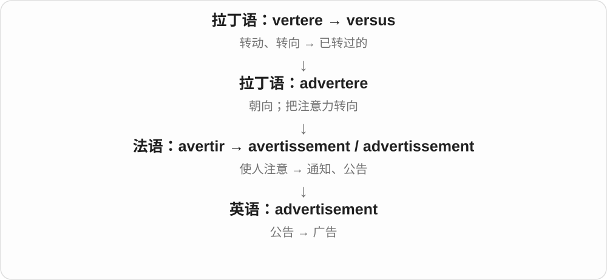

通常可数：an advertisement。英美常用读法的重音和词中元音差别明显。口语常缩短成 ad，英式也常用 advert。

**常见搭配与例句**

place an advertisement；a television advertisement；an advertisement for…。

> I saw an advertisement for the course at the library.

我在图书馆看到这门课程的广告。

> Her excellent work is a good advertisement for the training programme.

她出色的工作表现为这项培训计划做了很好的宣传。

**别混淆**

advertisement 是一则具体广告；advertising 是广告活动、行业或广告总称。

### 56. arrogant — 傲慢的；自大的

**音标**：英、美 /ˈærəɡənt/

**先抓住这个画面**

好像好位置、发言权和正确答案天然都该属于自己。

**怎么拆**

拉丁 ad- + rogāre“请求、要求”→ arrogāre“据为己有”；其分词经法语进入英语。不是 angry 的加强版。

**怎么变成今天的意思**

**拉丁语：ad**  
朝向；靠近；加到

↓

**拉丁语：rogāre → arrogāre → arrogāns**  
请求 → 把权利据为己有 → 自大的

↓

**古法语 arrogant → 中古英语 arrogaunt → arrogant**  
自以为高人一等的

arrogant 的重点是把自己抬得很高，同时轻视别人；一个人说话很自信，并不一定 arrogant。

**常见搭配与例句**

an arrogant attitude；sound arrogant；arrogant about…。

> His arrogant reply made the junior staff reluctant to speak.

他傲慢的回答让年轻员工不愿再发言。

> She was confident without being arrogant.

她很自信，却不傲慢。

**别混淆**

confident 是相信自己的能力；arrogant 带有高人一等、不把别人放眼里的贬义。

### 57. arrogantly — 傲慢地；目中无人地

**音标**：英、美 /ˈærəɡəntli/

**先抓住这个画面**

说话或做事的样子像在告诉别人：“我当然比你懂。”

**怎么拆**

arrogant + -ly，描述态度或行动方式。

**怎么变成今天的意思**

**拉丁语：ad**  
朝向；靠近；加到

↓

**拉丁语：rogāre → arrogāre → arrogāns**  
请求 → 把权利据为己有 → 自大的

↓

**古法语 arrogant → 中古英语 arrogaunt → arrogant**  
自以为高人一等的

↓

**英语 arrogant + -ly → arrogantly**  
以傲慢态度行事

常与 dismiss、assume、declare 等搭配，指出轻视他人的姿态。不是音量大就一定 arrogantly。

**常见搭配与例句**

arrogantly dismiss；arrogantly assume；speak arrogantly。

> He arrogantly dismissed every suggestion from the newcomers.

他傲慢地否定了新人提出的每一条建议。

> She spoke arrogantly, as if nobody else understood the issue.

她说话很傲慢，好像别人都不懂这个问题。

**别混淆**

confidently 是有把握地；arrogantly 含不尊重别人的评价。

### 58. approximate — 大约的；近似的；接近、近似

**音标**：英 /əˈprɒksɪmət/；美 /əˈprɑːksɪmət/；动词尾读 /meɪt/

**先抓住这个画面**

已经靠得很近，但还没有精确压在那个点上。

**怎么拆**

拉丁 ad- + proximāre“靠近”→ approximāre；proximus 是“最近”。英语形容词承接分词形式，动词另发展；表面没有可独立拆出的现代 proximate 动作。

**怎么变成今天的意思**

**拉丁语：ad**  
朝向；靠近；加到

↓

**拉丁语：proximus → proximāre → approximāre**  
最近 → 靠近 → 使接近

↓

**拉丁 approximātus → 中古英语 approximat；英语 approximate**  
近似的；使接近

an approximate cost 是粗略费用；动词 approximate a circle 是形状接近圆。形容词最后弱读，动词读 /eɪt/。

**常见搭配与例句**

an approximate figure；approximate to；closely approximate。

> Can you give me an approximate arrival time?

你能给我一个大致到达时间吗？

> With enough sides, a regular polygon closely approximates a circle.

边数足够多时，正多边形就很接近一个圆。

**别混淆**

exact 给精确值；approximate 允许小幅偏差。

### 59. adhesive — 有黏性的；黏合剂

**音标**：英、美 /ədˈhiːsɪv/

**先抓住这个画面**

贴上以后抓住表面，让两样东西不轻易分开。

**怎么拆**

法语 adhésif，追到中世纪拉丁 adhaesīvus；来自 ad- + haerēre“黏着”。haes- 与 haer- 是拉丁动词的不同词干。

**怎么变成今天的意思**

**拉丁语：ad**  
朝向；靠近；加到

↓

**拉丁语：haerēre → adhaerēre；分词词干 adhaes-**  
黏住；附着

↓

**中世纪拉丁 adhaesīvus → 法语 adhésif → adhesive**  
能黏附的；黏合剂

adhesive tape 是带黏性的胶带；an adhesive 是用来黏合的材料。强调黏住的作用，不限于瓶装胶水。

**常见搭配与例句**

adhesive tape；apply adhesive；a strong adhesive。

> Press the adhesive label firmly onto the box.

把不干胶标签用力贴牢在盒子上。

> This adhesive works best on clean, dry surfaces.

这种黏合剂在清洁、干燥的表面上效果最好。

**别混淆**

sticky 描写摸起来黏；adhesive 更常说明材料具有黏合功能。

### 60. adept — 熟练的；内行、高手

**音标**：形容词 /əˈdept/；名词 /ˈædept/

**先抓住这个画面**

已经摸到门道，做起来很顺手的人。

**怎么拆**

拉丁 ad- + apiscī“达到、取得”→ adipiscī；其分词 adeptus 经法语 adepte 借入。旧时与掌握炼金术秘密的人相关，后来泛指内行。

**怎么变成今天的意思**

**拉丁语：ad**  
朝向；靠近；加到

↓

**拉丁语 adipiscī → adeptus**  
取得、达到 → 已取得的

↓

**法语 adepte → 英语 adept**  
掌握门道的人；熟练的

be adept at doing 是擅长做某事。名词较书面，重音通常移到前面。

**常见搭配与例句**

adept at；adept in；an adept。

> She is adept at turning vague ideas into clear plans.

她善于把模糊的想法变成清晰的计划。

> An adept can spot the flaw in seconds.

内行几秒钟就能看出这个缺陷。

**别混淆**

expert 强调专家水平；adept 常突出做事熟练、应付自如。

### 61. ascend — 上升；登上

**音标**：英、美 /əˈsend/

**先抓住这个画面**

一步步朝更高的位置移动。

**怎么拆**

拉丁 ad- + scandere“爬”，在组合中形成 ascendere；经古法语借入。

**怎么变成今天的意思**

**拉丁语：ad**  
朝向；靠近；加到

↓

**拉丁语：scandere → ascendere**  
攀登 → 向上爬

↓

**古法语 ascendre → 中古英语 ascenden → ascend**  
上升；登上

可以登楼梯、升到高空，也可以书面地说 ascend the throne“登上王位”。日常爬楼一般用 go up。

**常见搭配与例句**

ascend the stairs；ascend to；ascend the throne。

> The path ascends steeply beyond the bridge.

过桥之后，小路陡然向上。

> Warm air ascends through the opening in the roof.

暖空气通过屋顶的开口上升。

**别混淆**

rise 强调上升；ascend 常更正式，也能直接接被攀登的东西。

### 62. ascending — 上升的；递增的

**音标**：英、美 /əˈsendɪŋ/

**先抓住这个画面**

沿楼梯往上走；排数字时，则从小往大走。

**怎么拆**

ascend + -ing，分词用作形容词。

**怎么变成今天的意思**

**拉丁语：ad**  
朝向；靠近；加到

↓

**拉丁语：scandere → ascendere**  
攀登 → 向上爬

↓

**古法语 ascendre → 中古英语 ascenden → ascend**  
上升；登上

↓

**英语：ascend → ascending**  
正在上升；按增大方向排列

ascending order 常指数字从小到大；音阶 ascending 是音高逐步升高。方向比速度更重要。

**常见搭配与例句**

in ascending order；an ascending scale；ascending stairs。

> Arrange the prices in ascending order.

把价格从低到高排列。

> We heard an ascending series of notes from the piano.

我们听到钢琴奏出一串逐渐升高的音。

**别混淆**

descending 的方向相反；ascending 不等于 accelerating“越来越快”。

### 63. ascendant — 上升的；势头正盛的；上升星座

**音标**：英、美 /əˈsendənt/

**先抓住这个画面**

正沿着上坡走，影响力还在增加。

**怎么拆**

形容词经古法语 ascendant 借入拉丁 ascendēns；不能把历史完全改写成英语 ascend + -ant。

**怎么变成今天的意思**

**拉丁语：ad**  
朝向；靠近；加到

↓

**拉丁语：scandere → ascendere**  
攀登 → 向上爬

↓

**拉丁 ascendēns → 古法语 ascendant → 英语 ascendant**  
正在上升的；另有占星学名词用法

in the ascendant 常指势力正盛。占星学的 the ascendant 指出生时东方地平线上升起的黄道位置或相应星座，是特定术语。

**常见搭配与例句**

in the ascendant；an ascendant power；the ascendant。

> A younger generation of designers was now in the ascendant.

较年轻的一代设计师这时正崭露头角、势头强劲。

> The book describes the company as an ascendant force in the industry.

这本书把该公司描述为行业中迅速崛起的力量。

**别混淆**

ascending 常指实际运动或排列；ascendant 更常指势力增长或占星用法。

### 64. ascendancy — 优势地位；支配地位

**音标**：英、美 /əˈsendənsi/

**先抓住这个画面**

一路向上之后，站到了能影响别人走向的位置。

**怎么拆**

来自 ascend + -ancy，或按 ascendant + -cy 分析；是英语名词派生。

**怎么变成今天的意思**

**拉丁语：ad**  
朝向；靠近；加到

↓

**拉丁语：scandere → ascendere**  
攀登 → 向上爬

↓

**古法语 ascendre → 中古英语 ascenden → ascend**  
上升；登上

↓

**英语 ascend / ascendant → ascendancy**  
上升势头 → 优势、支配地位

不是一次普通的上升，而是在某个领域占据上风。in the ascendancy 强调正走强、越来越有影响。

**常见搭配与例句**

gain ascendancy；ascendancy over；in the ascendancy。

> The new party gained ascendancy in local politics.

新政党在地方政治中取得了优势地位。

> Digital photography was soon in the ascendancy.

数字摄影很快占据了上风。

**别混淆**

dominance 强调支配状态；ascendancy 常让人想到力量上升后取得的优势。

### 65. avenge — 为……报仇；报……之仇；雪耻

**音标**：/əˈvendʒ/

**先抓住这个画面**

把一件没有讨回来的伤害记在账上，后来替受害者讨还：这是 avenge 的画面。宾语通常告诉你替谁报仇，或要报哪一笔仇。

**怎么拆**

经盎格鲁法语 avenger、古法语 avengier 等借入：a- 朝向，接拉丁 ad-；vengier 报仇接拉丁 vindicare。a- 在这里有实际历史来源。

**怎么变成今天的意思**

**拉丁 ad- 与 vindicare 相关材料 → 古法语 avengier**  
朝着所受的伤害去讨还

↓

**法语 → 英语 avenge**  
为人报仇、报某种伤害之仇；后来也用于比赛雪耻

avenge a victim 为受害者报仇；avenge a wrong 报所受不公之仇；avenge a defeat 一雪败绩。

**常见搭配与例句**

avenge a friend 为朋友报仇；avenge the loss 把那次失利赢回来。较常出现在故事、历史叙述和体育报道。

> In the story, the hero returns to avenge his brother.

故事里，主人公回来为兄弟报仇。

> They hoped to avenge their defeat in the previous final.

他们希望一雪上次决赛失利之耻。

**别混淆**

avenge someone 可以表示为这个人报仇；若要表达报复这个人，常用 take revenge on someone。两句的对象关系不同。

### 66. avenged — 报了……之仇；雪了耻〔过去式、过去分词〕

**音标**：/əˈvendʒd/

**先抓住这个画面**

先前受了伤害或输了一场，这次讨还、赢回来了：avenged 把 avenge 放到已经发生或已经完成的叙述里。

**怎么拆**

avenge 去 e + -ed → avenged；拼写时先去 e，再加完整 -ed。末尾 /dʒ/ 是浊音，因此过去式结尾读 /d/，合成 /dʒd/，不另加一个 /ɪ/ 音节。

**怎么变成今天的意思**

**古法语 avengier → 英语 avenge**  
为人报仇、雪耻

↓

**avenge 去 e + -ed → avenged**  
报仇、雪耻发生了；也可作过去分词

avenged the defeat 雪了败绩之耻；has avenged 已经报了仇；the defeat was avenged 那次失利之耻得以洗雪。

**常见搭配与例句**

They avenged their earlier loss. 他们把上次输掉的比赛赢回来了。

> The team avenged last season’s defeat in the opening match.

这支队伍在揭幕战中，一雪上赛季失利之耻。

> By the final chapter, the hero has avenged his friend.

到最后一章时，主人公已经为朋友报了仇。

**别混淆**

avenged 是 avenge 的形式；不是 revenge 的过去式，后者是 revenged。先看句中是为谁、为哪件事讨还。

### 67. allege — 声称；指称〔尚未证实〕

**音标**：英、美 /əˈledʒ/

**先抓住这个画面**

把一个说法摆到人们面前，但真实性还等着核实。

**怎么拆**

来源有合流：意义接法语 alleguer、拉丁 allēgāre〔ad- + lēgāre“派遣、提出”〕；形式又可能受盎格鲁法语 aleger、古法语 eslegier“开脱”影响，后者另出 ex- + lītigāre。不能只按现代 al + lege 猜。

**怎么变成今天的意思**

**拉丁语：ad**  
朝向；靠近；加到

↓

**拉丁语 allēgāre → 古法语 alleguer**  
派去；提出理由或证据

↓

**另一路：拉丁 ex- + lītigāre → 古法语 eslegier / 盎格鲁法语 aleger**  
开脱；与上一支在形式、意义上合流

↓

**中古英语 aleggen → 英语 allege**  
提出未经证实的声称

常用于新闻、调查和争议叙述；allege that 把责任放在提出说法的人那里，不把声称直接写成事实。

**常见搭配与例句**

allege that；it is alleged that；allege misconduct。

> Several workers allege that their wages were withheld.

几名工人声称自己的工资遭到扣留。

> The article alleges misconduct but presents no supporting documents.

这篇文章指称存在不当行为，却没有提供佐证文件。

**别混淆**

prove 是证实；allege 只是提出声称，不能从用词推断真假。

### 68. assimilate — 吸收、消化；融入；使同化

**音标**：英、美 /əˈsɪmɪleɪt/

**先抓住这个画面**

新东西进来后，慢慢成为原有体系的一部分。

**怎么拆**

拉丁 ad- + simulāre“使相似”→ assimilāre 的相关形式，借入英语；simil- 指相似。不是简单的“收下”。

**怎么变成今天的意思**

**拉丁语：ad**  
朝向；靠近；加到

↓

**拉丁语 similis → simulāre → assimilāre / assimulāre**  
相似 → 使相似 → 使成为相近的一部分

↓

**晚期拉丁 assimilātus → 中古英语 assimilaten → assimilate**  
吸收；同化

assimilate information 是把资料消化成自己的理解；人融入群体也能这样说，但涉及文化时可能强调改变原有特征，不能一概当成轻松交朋友。

**常见搭配与例句**

assimilate information；assimilate into；be assimilated into。

> I need a little time to assimilate all this information.

我需要一点时间消化这些信息。

> The new terms were gradually assimilated into everyday speech.

这些新术语逐渐进入日常语言，成为其中的一部分。

**别混淆**

absorb 强调吸进去；assimilate 更强调吸收后纳入自身体系。

### 69. allude — 暗指；间接提到

**音标**：英、美 /əˈluːd/；英亦 /əˈljuːd/

**先抓住这个画面**

不把名字直说出来，只往那个方向轻轻点一下。

**怎么拆**

拉丁 ad- + lūdere“玩”→ allūdere，经法语 alluder 借入；历史有“玩着触及、影射”的意思，不应把今天的暗指一律解释成开玩笑。

**怎么变成今天的意思**

**拉丁语：ad**  
朝向；靠近；加到

↓

**拉丁 lūdere → allūdere**  
玩 → 向着玩、暗示

↓

**法语 alluder → 英语 allude**  
间接提及

allude to 后面放影射的内容。作者可以靠一个名字、场景或半句话，让读者联想到另一件事。

**常见搭配与例句**

allude to an event；allude to a poem。

> She alluded to the disagreement without naming anyone.

她暗指了那次分歧，但没有点任何人的名。

> The title alludes to a line from an old poem.

这个标题暗用了某首古诗中的一句话。

**别混淆**

mention 直接提到；allude to 间接指向。elude 是躲开，别看错。

### 70. adherent — 拥护者；黏附的

**音标**：英 /ədˈhɪərənt/；美 /ədˈhɪrənt/

**先抓住这个画面**

物体贴在表面上；人则在立场上“贴着”某种主张。

**怎么拆**

古法语 adherent 借入拉丁 adhaerēns，来自 ad- + haerēre“黏住”。

**怎么变成今天的意思**

**拉丁语：ad**  
朝向；靠近；加到

↓

**拉丁 adhaerēre → adhaerēns**  
黏附 → 黏附着的

↓

**古法语 adherent → 英语 adherent**  
追随者；附着的

a firm adherent of a theory 是坚定信奉某理论的人。形容词常见于技术描写，表示附着在表面。

**常见搭配与例句**

an adherent of；adherent to；firm adherents。

> The theory still has a small number of adherents.

这个理论仍有少数拥护者。

> The coating forms a thin, adherent layer on the metal.

这种涂层在金属表面形成一层薄而牢固附着的膜。

**别混淆**

supporter 可以临时支持某事；adherent 往往指持续认同某套主张或信仰的人。

### 71. admonish — 告诫；训诫；责备并提醒

**音标**：英 /ədˈmɒnɪʃ/；美 /ədˈmɑːnɪʃ/

**先抓住这个画面**

看到别人走偏了，郑重叫住他：“别再这样了。”

**怎么拆**

拉丁 ad- + monēre“提醒”，经法语和中古英语传入；中古英语词尾改成 -ish。不能把它拆成现代 admon + ish 来解释本义。

**怎么变成今天的意思**

**拉丁语：ad**  
朝向；靠近；加到

↓

**拉丁语：monēre → admonēre**  
提醒、告诫

↓

**通俗拉丁语重构 \*admonestāre → 古法语 amonester**  
郑重告诫

↓

**中古英语 amonesten / amonisshen → admonish**  
后来的 -ish 形式取代较早词尾

可以因错误而责备，也可以认真劝人避免错误；比 casually remind“顺口提醒”严肃。

**常见搭配与例句**

admonish someone for；admonish someone to do；admonish someone not to do。

> The teacher admonished the class for interrupting the speaker.

老师责备全班打断了发言者。

> She admonished us not to leave the gate open.

她郑重告诫我们不要让大门敞着。

**别混淆**

scold 侧重训斥；admonish 常同时包含警告或规劝。

### 72. admonishment — 训诫；告诫

**音标**：英 /ədˈmɒnɪʃmənt/；美 /ədˈmɑːnɪʃmənt/

**先抓住这个画面**

一句带分量的提醒，让人停下来意识到自己的做法有问题。

**怎么拆**

admonish + -ment，英语名词派生。

**怎么变成今天的意思**

**拉丁语：ad**  
朝向；靠近；加到

↓

**拉丁语：monēre → admonēre**  
提醒、告诫

↓

**通俗拉丁语重构 \*admonestāre → 古法语 amonester**  
郑重告诫

↓

**中古英语 amonesten / amonisshen → admonish**  
后来的 -ish 形式取代较早词尾

↓

**英语 admonish + -ment → admonishment**  
告诫行为；训诫的话

常指一次严肃的责备或警告，也可以不可数地描述训诫行为。它不自动意味着罚款或其他惩罚。

**常见搭配与例句**

a stern admonishment；receive an admonishment；a note of admonishment。

> He accepted the admonishment without arguing.

他接受了训诫，没有争辩。

> There was a note of admonishment in her reply.

她的回答中带着一丝告诫的意味。

**别混淆**

punishment 是施加处罚；admonishment 可以只有口头提醒和责备。

### 73. agglomerate — 结成团；团块；聚结的

**音标**：英 名词、形容词 /əˈɡlɒmərət/，动词 /əˈɡlɒməreɪt/；美 名词、形容词 /əˈɡlɑːmərət/，动词 /əˈɡlɑːməreɪt/

**先抓住这个画面**

小颗粒黏在一起，从散沙变成一团。

**怎么拆**

拉丁 ad- + glomerāre“团成球”→ agglomerāre，来自 glomus“球团”；英语承接其分词及动词形式。

**怎么变成今天的意思**

**拉丁语：ad**  
朝向；靠近；加到

↓

**拉丁 glomus → glomerāre → agglomerāre → agglomerātus**  
球团 → 团聚 → 聚结的

↓

**英语 agglomerate**  
聚成团；聚结块

常用来描述颗粒、工业材料或一团组合物；地质学也有火山粗碎屑岩的专门名词用法。动词尾读 /eɪt/。

**常见搭配与例句**

particles agglomerate；an agglomerate of；agglomerated powder。

> The fine particles agglomerate when exposed to moisture.

细颗粒受潮后会结成团。

> Under the microscope, the powder appeared as irregular agglomerates.

显微镜下，这些粉末呈现为不规则的团块。

**别混淆**

aggregate 可以只是汇总在一起；agglomerate 更突出团结、黏成块的形态。

### 74. annectent — 起连接作用的；介于两类之间的

**音标**：/əˈnektənt/

**先抓住这个画面**

annectent 像一座桥，连接原本分开的两类。它是罕见的书面词，旧生物分类描述中更容易见到。

**怎么拆**

来自拉丁语 annectere 的现在分词 annectēns，词干 annectent-；前面的 an- 是 ad- 在 n 前的同化。

**怎么变成今天的意思**

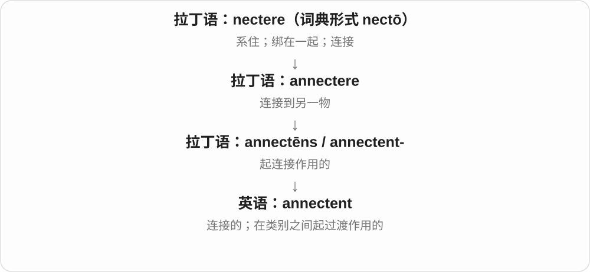

用于分类时，它描写一组生物具有连接两类的某些特征。这个用法本身不证明该组就是另一组的直接祖先。

**常见搭配与例句**

an annectent group；an annectent form；an annectent species。

> The old classification placed the animal in an annectent group.

旧分类法把这种动物归入一个具有过渡联系的类群。

> The author described the form as annectent between two familiar groups.

作者把这种形态描述为连接两个已知类群的过渡形式。

**别混淆**

日常表达用 connecting 或 linking 更自然。annectent 的生物分类用法有明显历史和专业色彩。

### 75. arreption — 夺取；带走、移除〔旧用法〕

**音标**：/əˈrepʃən/〔按构词读音〕

**先抓住这个画面**

某样东西被突然抓走，重点在“从原处拿走”这一下。

**怎么拆**

拉丁 arreptiō，来自 arripere 的分词 arreptus；arripere 是 ad- + rapere“猛抓”。

**怎么变成今天的意思**

**拉丁语：ad**  
朝向；靠近；加到

↓

**拉丁 rapere → arripere → arreptus / arreptiō**  
猛抓 → 抓走 → 夺取行为

↓

**英语 arreption**  
夺取、带走；罕见旧用法

主要在旧词典或古文本中遇到。现代写作通常用 seizure、removal 或 taking away；不建议为了显得高级而主动使用。

**常见搭配与例句**

arreption of；旧词阅读中辨认即可。

> The old account describes the arreption of the sacred vessel.

这篇旧记述描述了圣器被夺走的经过。

> In this passage, arreption refers to the removal of the object.

在这段文字里，arreption 指把那件物品带走。

**别混淆**

rapture 等也涉及 rapere 的词族；arreption 不是现代 reception“接待”的变体。

### 76. arride — 使高兴；对……发笑〔旧用法〕

**音标**：英、美 /əˈraɪd/

**先抓住这个画面**

某事让人露出笑意，所以也能说它讨人喜欢。

**怎么拆**

直接借入拉丁 arrīdēre：ad- + rīdēre“笑”，d 在 r 前同化。

**怎么变成今天的意思**

**拉丁语：ad**  
朝向；靠近；加到

↓

**拉丁 rīdēre → arrīdēre**  
笑 → 朝着笑；使人喜欢

↓

**英语 arride**  
对……笑；使愉快，现属旧用法

现代罕见，读旧文学时可理解为 please 或 smile at。不要与 ride“骑”相连。

**常见搭配与例句**

arride someone；主要用于旧文体。

> The prospect of a quiet life did not arride him.

平静生活的前景并不使他欣喜。

> Her cheerful account arrided the weary travellers.

她兴高采烈的讲述使疲惫的旅人们开心起来。

**别混淆**

please 是普通的使人满意；arride 带鲜明的旧书面色彩。

## 这一组要分清什么

这是历史前缀家族，后半个词决定主要动作：向着“爬”会向上，向着“黏”会附着，向着“警告”会告诫。不要把同一个“朝向”机械译成每个单词的中文释义。

## 串起来练习

先读 adapt / adjust 的区别，再看 adhesive / adherent 如何从黏附进入材料与立场两种领域。最后用 allege 练习区分“提出声称”和“证明事实”。
