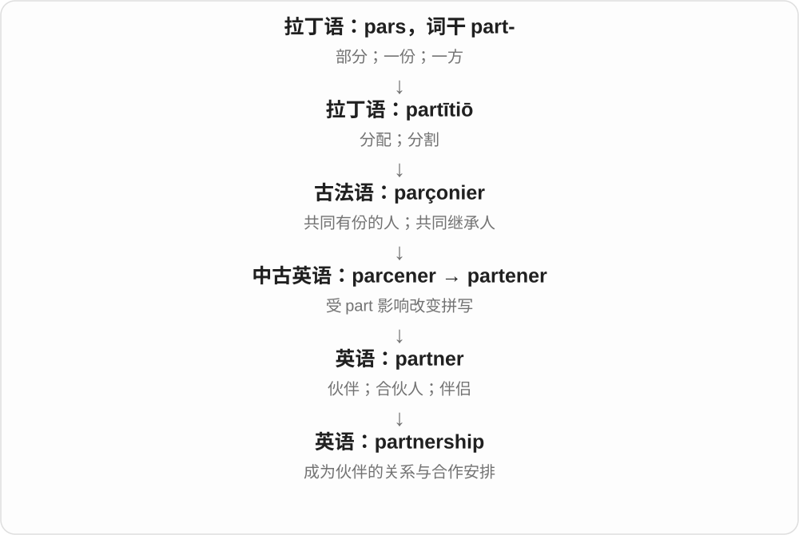
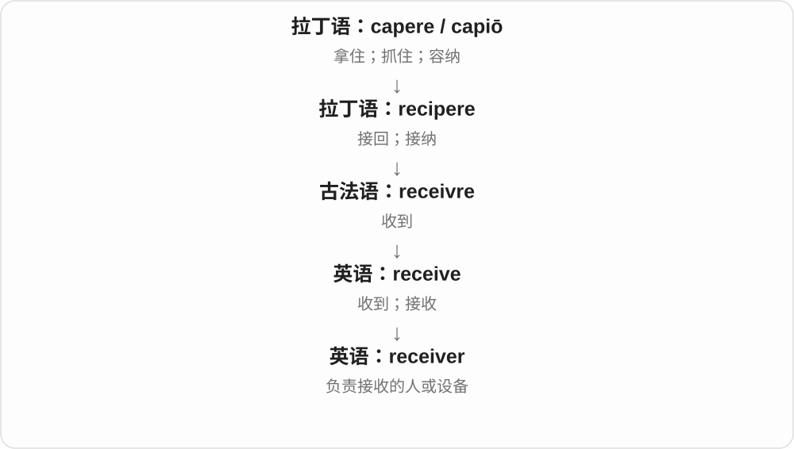
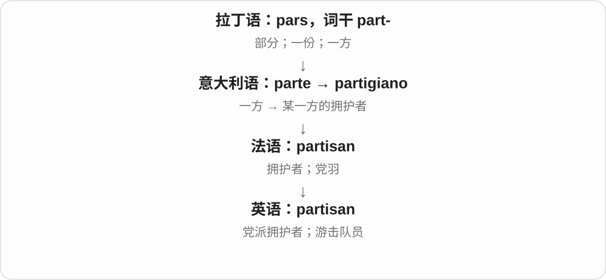
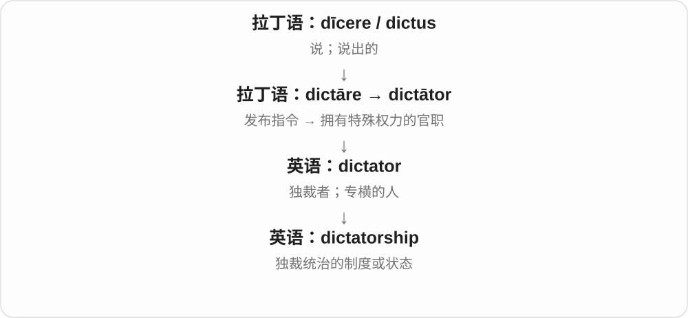
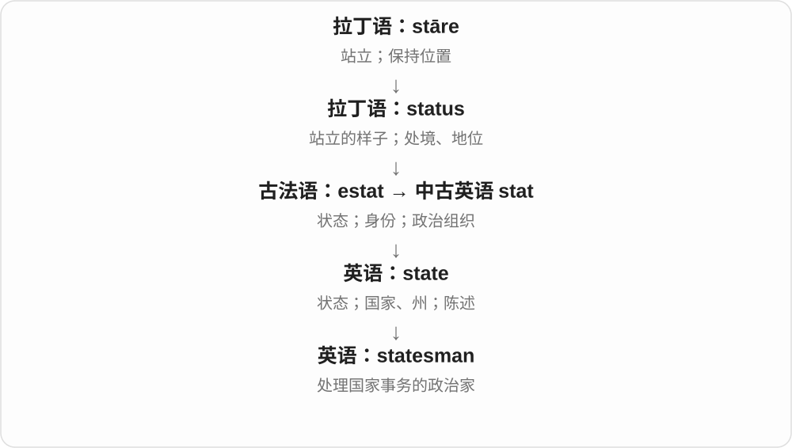
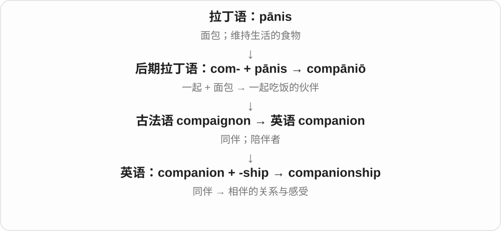
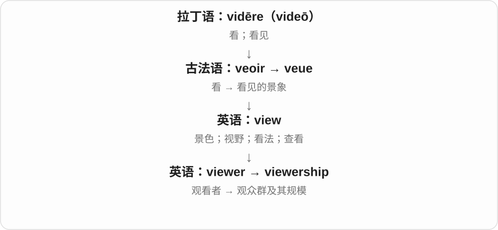
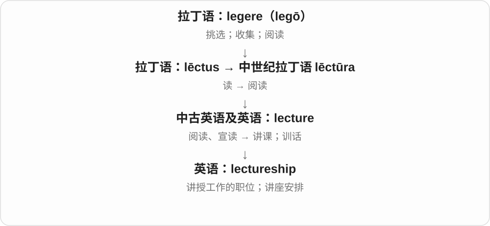

# 0177 · -ship — 身份、职责、关系、状态、技能；也可指相关群体

[逐词精讲目录](../00_逐词精讲目录.md) · [总目录](../00_总目录_按常用程度.md)

## 核心词根与来源

这个词尾不是船。最直观的是从人转向他所处的关系、担的职责、会的本领：professor 是教授，professorship 是职位；showman 是会表演的人，showmanship 是呈现给观众的技巧。membership、ridership 等还可能说整体成员或乘客量。

**-SHIP：把人所处的位置、关系或本领拿出来谈**

friend 朋友 → friendship 友谊；apprentice 学徒 → apprenticeship 学徒训练；craftsman 工匠 → craftsmanship 手艺。先看基础词，再判断具体是哪一面。

- **训练身份与岗位**：apprentice · apprenticeship · trainee · traineeship · clerk · clerkship
- **职责、职位与照管**：premier · premiership · professor · professorship · guardian · guardianship · trustee · trusteeship · judge · judgeship · steward · stewardship
- **制作、销售与呈现技巧**：craftsman · craftsmanship · workman · workmanship · salesman · salesmanship · showman · showmanship
- **射击、骑马与航海本领**：marksman · marksmanship · horseman · horsemanship · seaman · seamanship
- **政治立场、公共事务和接管状态**：partisan · partisanship · statesman · statesmanship · receiver · receivership
- **个人转为群体、数量视角**：rider · ridership · member · membership
- **partner + -ship → partnership → partnerships**：partnerships

## 词形与演化规律

来自古英语 -scipe、-scip，中古英语 -schipe 等日耳曼语材料，历史与形成、创造的词族相关；与 ship 船的独立词源不同。现代常直接接名词，形成角色、关系、技能等名词。-manship 常可进一步看见 man + -ship，但也有类推使用；并不要求今天使用这类技能的人必须是男性。worship 历史与值得、尊重的材料相联，landscape 的 -scape 则经荷兰语有关形式进入，不把字面相似当成现代直接加 ship。

-ship 在此表关系、状态；partner 是合作方，partnership 是合作关系、合作安排，再加 -s。商业等专门语境的具体形式按上下文看。

## 单词速览（按词族由简到繁）

同一基础词的相关扩展放在一起，先读基础形式，再读扩展；各组之间优先读常用的。具体词源关系见各词讲解。

| 单词 | 音标 | 核心意思 |
|---|---|---|
| [member](#w-76) | 英 /ˈmembə/；美 /ˈmembər/ | 成员；会员；组成部分；较正式的肢体义 |
| [membership](#w-5) | 英 /ˈmembəʃɪp/；美 /ˈmembərʃɪp/ | 成员身份；会籍；全体会员 |
| [relationship](#w-1) | /rɪˈleɪʃənʃɪp/ | 关系；相处关系；恋爱关系；联系 |
| [judge](#w-77) | /dʒʌdʒ/ | 法官；评委；判断；评价；审判 |
| [judgeship](#w-58) | /ˈdʒʌdʒʃɪp/ | 法官职位、任期 |
| [professor](#w-78) | 英 /prəˈfesə/；美 /prəˈfesər/ | 教授；大学教师〔依地区和语境〕 |
| [professorship](#w-40) | 英 /prəˈfesəʃɪp/；美 /prəˈfesərʃɪp/ | 教授职位、教授席位 |
| [leadership](#w-2) | 英 /ˈliːdəʃɪp/；美 /ˈliːdərʃɪp/ | 领导能力；领导、带领；领导层 |
| [premier](#w-79) | 英 /ˈpremiə/，亦 /ˈpremjə/；美 /prɪˈmɪr/ | 首要的；一流的；总理、首相或部分地区政府首脑 |
| [premiership](#w-18) | 英 /ˈpremiəʃɪp/；美 /prɪˈmɪrʃɪp/ | 总理职务、任期；某些体育顶级联赛或其冠军 |
| [championship](#w-3) | /ˈtʃæmpiənʃɪp/ | 冠军头衔；锦标赛 |
| [partnership](#w-4) | 英 /ˈpɑːtnəʃɪp/；美 /ˈpɑːrtnərʃɪp/ | 合作关系；合伙关系 |
| [partnerships](#w-97) | 英 /ˈpɑːtnəʃɪps/；美 /ˈpɑːrtnɚʃɪps/ | 合作关系；合作安排；合伙关系〔复数〕 |
| [ownership](#w-6) | 英 /ˈəʊnəʃɪp/；美 /ˈoʊnərʃɪp/ | 所有权；拥有状态；对事情负责、主动承担 |
| [homeownership](#w-41) | 英 /ˈhəʊməʊnəʃɪp/；美 /ˈhoʊmoʊnərʃɪp/ | 住房所有权；拥有自有住房的状态 |
| [friendship](#w-7) | /ˈfrendʃɪp/ | 友谊；朋友关系 |
| [worship](#w-9) | 英 /ˈwɜːʃɪp/；美 /ˈwɜːrʃɪp/ | 敬拜；崇敬；过度崇拜 |
| [guardian](#w-80) | 英 /ˈɡɑːdiən/；美 /ˈɡɑːrdiən/ | 监护人；守护者 |
| [guardianship](#w-34) | 英 /ˈɡɑːdiənʃɪp/；美 /ˈɡɑːrdiənʃɪp/ | 监护；监护身份、职责 |
| [scholarship](#w-10) | 英 /ˈskɒləʃɪp/；美 /ˈskɑːlərʃɪp/ | 奖学金；学问、学术研究及成果 |
| [citizenship](#w-11) | /ˈsɪtɪzənʃɪp/ | 公民身份；公民资格；公民责任与参与 |
| [receiver](#w-81) | 英 /rɪˈsiːvə/；美 /rɪˈsiːvər/ | 接收者；接收器；听筒 |
| [receivership](#w-39) | 英 /rɪˈsiːvəʃɪp/；美 /rɪˈsiːvərʃɪp/ | 接管状态；由接管人管理 |
| [rider](#w-82) | 英 /ˈraɪdə/；美 /ˈraɪdər/ | 骑手；乘客；附加条款、附件 |
| [ridership](#w-43) | 英 /ˈraɪdəʃɪp/；美 /ˈraɪdərʃɪp/ | 乘客群体；客运量、乘车人次 |
| [clerk](#w-83) | 英 /klɑːk/；美 /klɜːrk/ | 文书、办事员；店员；做文书工作 |
| [clerkship](#w-56) | 英 /ˈklɑːkʃɪp/；美 /ˈklɜːrkʃɪp/ | 文书、助理等职位或任期；临床实习阶段〔医学教育〕 |
| [township](#w-12) | /ˈtaʊnʃɪp/ | 镇区、乡镇等行政区域；南非历史中的特定居住区 |
| [fellowship](#w-13) | 英 /ˈfeləʊʃɪp/；美 /ˈfeloʊʃɪp/ | 伙伴情谊、团契；研究员身份、研究资助等 |
| [censorship](#w-14) | 英 /ˈsensəʃɪp/；美 /ˈsensərʃɪp/ | 审查删禁；审查制度 |
| [partisan](#w-84) | 英 /ˌpɑːtɪˈzæn/；美 /ˈpɑːrtəzən/ | 党派性的；坚定拥护者；游击队员 |
| [partisanship](#w-36) | 英 /ˌpɑːtɪˈzænʃɪp/；美 /ˌpɑːrtɪˈzænʃɪp/ | 党派立场；偏袒己方、党派偏见 |
| [sponsorship](#w-15) | 英 /ˈspɒnsəʃɪp/；美 /ˈspɑːnsərʃɪp/ | 赞助；担保关系；赞助资金或支持 |
| [apprentice](#w-85) | /əˈprentɪs/ | 学徒；使当学徒 |
| [apprenticeship](#w-21) | /əˈprentɪsʃɪp/ | 学徒期；学徒训练、学徒岗位 |
| [trustee](#w-86) | /trʌˈstiː/ | 受托人；基金会、机构等的理事 |
| [trusteeship](#w-63) | /trʌˈstiːʃɪp/ | 受托人职责、职位；托管 |
| [dictatorship](#w-16) | 英 /dɪkˈteɪtəʃɪp/；美 /ˈdɪkteɪtərʃɪp/ | 独裁统治；独裁政权 |
| [salesman](#w-87) | /ˈseɪlzmən/ | 男销售员；推销员 |
| [salesmanship](#w-65) | /ˈseɪlzmənʃɪp/ | 销售技巧；推销本领 |
| [internship](#w-17) | 英 /ˈɪntɜːnʃɪp/；美 /ˈɪntɜːrnʃɪp/ | 实习、实习岗位或实习期 |
| [entrepreneurship](#w-19) | 英 /ˌɒntrəprəˈnɜːʃɪp/；美 /ˌɑːntrəprəˈnɜːrʃɪp/ | 创业活动、创业精神与能力 |
| [hardship](#w-20) | 英 /ˈhɑːdʃɪp/；美 /ˈhɑːrdʃɪp/ | 艰难困苦；困境 |
| [statesman](#w-88) | /ˈsteɪtsmən/ | 政治家；善于处理国家事务的人 |
| [statesmanship](#w-62) | /ˈsteɪtsmənʃɪp/ | 政治家才能；治国、处理公共事务的能力 |
| [steward](#w-89) | 英 /ˈstjuːəd/；美 /ˈstuːərd/ | 管家、事务管理者；乘务员；会务人员；工会代表等 |
| [stewardship](#w-24) | 英 /ˈstjuːədʃɪp/；美 /ˈstuːərdʃɪp/ | 受托管理；尽责照管 |
| [trainee](#w-90) | /ˌtreɪˈniː/ | 受训者；见习人员 |
| [traineeship](#w-71) | /ˌtreɪˈniːʃɪp/ | 培训岗位；受训期、培训安排 |
| [dealership](#w-22) | 英 /ˈdiːləʃɪp/；美 /ˈdiːlərʃɪp/ | 经销业务；经销商店、公司；经销资格 |
| [craftsman](#w-91) | 英 /ˈkrɑːftsmən/；美 /ˈkræftsmən/ | 熟练工匠、手艺人；技艺高超的创作者 |
| [craftsmanship](#w-31) | 英 /ˈkrɑːftsmənʃɪp/；美 /ˈkræftsmənʃɪp/ | 手艺；精湛工艺；制作技艺 |
| [seaman](#w-92) | /ˈsiːmən/ | 海员；水手；特定海军军衔 |
| [seamanship](#w-57) | /ˈsiːmənʃɪp/ | 航海技能；船舶操纵、管理本领 |
| [companionship](#w-25) | /kəmˈpænjənʃɪp/ | 陪伴；相伴的情谊 |
| [courtship](#w-26) | 英 /ˈkɔːtʃɪp/；美 /ˈkɔːrtʃɪp/ | 求爱；恋爱交往期；求偶；争取支持 |
| [authorship](#w-27) | 英 /ˈɔːθəʃɪp/；美 /ˈɔːθərʃɪp/ | 作者身份；创作归属；著述 |
| [kinship](#w-28) | /ˈkɪnʃɪp/ | 亲属关系；亲近、认同感 |
| [viewership](#w-29) | 英 /ˈvjuːəʃɪp/；美 /ˈvjuːərʃɪp/ | 观众群；观众人数 |
| [readership](#w-30) | 英 /ˈriːdəʃɪp/；美 /ˈriːdərʃɪp/ | 读者群、读者人数；Reader 职位〔特定学术语境〕 |
| [workman](#w-94) | 英 /ˈwɜːkmən/；美 /ˈwɜːrkmən/ | 工人；工匠〔传统称呼〕 |
| [workmanship](#w-32) | 英 /ˈwɜːkmənʃɪp/；美 /ˈwɜːrkmənʃɪp/ | 做工；制作质量 |
| [horseman](#w-93) | 英 /ˈhɔːsmən/；美 /ˈhɔːrsmən/ | 骑手；善骑马的人 |
| [horsemanship](#w-52) | 英 /ˈhɔːsmənʃɪp/；美 /ˈhɔːrsmənʃɪp/ | 骑术；驾驭、照管马的技能 |
| [chairmanship](#w-33) | 英 /ˈtʃeəmənʃɪp/；美 /ˈtʃermənʃɪp/ | 主席职务；主持职责；任职期 |
| [governorship](#w-35) | 英 /ˈɡʌvənəʃɪp/；美 /ˈɡʌvərnərʃɪp/ | 州长、总督等的职务或任期 |
| [marksman](#w-95) | 英 /ˈmɑːksmən/；美 /ˈmɑːrksmən/ | 神枪手；射击准确的人 |
| [marksmanship](#w-44) | 英 /ˈmɑːksmənʃɪp/；美 /ˈmɑːrksmənʃɪp/ | 射击技术；射术 |
| [mentorship](#w-37) | 英 /ˈmentɔːʃɪp/；美 /ˈmentɔːrʃɪp/ | 导师指导；导师关系、导师制 |
| [showman](#w-96) | 英 /ˈʃəʊmən/；美 /ˈʃoʊmən/ | 演出经营者；善于吸引观众的人 |
| [showmanship](#w-46) | 英 /ˈʃəʊmənʃɪp/；美 /ˈʃoʊmənʃɪp/ | 表演技巧；吸引观众的本领 |
| [kingship](#w-38) | /ˈkɪŋʃɪp/ | 王位；君王身份、权力或制度 |
| [musicianship](#w-45) | /mjuˈzɪʃənʃɪp/ | 音乐素养；音乐技艺、表现能力 |
| [editorship](#w-49) | 英 /ˈedɪtəʃɪp/；美 /ˈedɪtərʃɪp/ | 编辑职务、主编任期 |
| [directorship](#w-51) | 英 /dəˈrektəʃɪp/；美 /dəˈrektərʃɪp/ | 董事、主管职务；担任该职的期间 |
| [bipartisanship](#w-55) | 英 /ˌbaɪˈpɑːtɪzænʃɪp/；美 /ˌbaɪˈpɑːrtəznʃɪp/ | 两党合作；跨党派合作精神 |
| [comradeship](#w-60) | 英 /ˈkɒmreɪdʃɪp/；美 /ˈkɑːmrædʃɪp/ | 伙伴情谊；战友情 |
| [lectureship](#w-66) | 英 /ˈlektʃəʃɪp/；美 /ˈlektʃərʃɪp/ | 讲师职位；讲座安排 |
| [gamesmanship](#w-68) | /ˈɡeɪmzmənʃɪp/ | 争胜手腕；利用规则边缘的竞技技巧 |
| [ambassadorship](#w-72) | 英 /æmˈbæsədəʃɪp/；美 /æmˈbæsədərʃɪp/ | 大使职务、任期 |

## 逐词讲解

### 1. member — 成员；会员；组成部分；较正式的肢体义

**音标**：英 /ˈmembə/；美 /ˈmembər/

**先抓住这个画面**

手臂是身体的一部分，一个人也可以是团队这个整体的一部分；成员义由这个部分关系理解。

**怎么拆**

经法语接拉丁 membrum 肢体、身体部分。团体成员的比喻把组织当作一个整体；现代不必真的与身体相连。

**怎么变成今天的意思**

**拉丁 membrum → 法语 membre → 中古英语 membre**  
肢体、身体的一部分

↓

**现代 member**  
整体中的一部分 → 团体成员、会员等

a team member 团队成员，a family member 家庭成员；a member of a club 俱乐部会员。技术里也可指集合等的元素、成员。

**常见搭配与例句**

a member of；a team member；a family member；a staff member。

> She is a member of the local choir.

她是当地合唱团成员。

> Every team member contributed an idea.

每位团队成员都贡献了一个想法。

**别混淆**

member 人或组成部分，membership 身份、成员群体或会籍；a club member 一位会员，不说 a club membership 指这个人。

### 2. membership — 成员身份；会籍；全体会员

**音标**：英 /ˈmembəʃɪp/；美 /ˈmembərʃɪp/

**先抓住这个画面**

不是指某一个人，而是他有没有加入、入会资格有效多久，或这个组织共有多少会员。

**怎么拆**

member + -ship 身份、状态后缀；还可集合指会员群体。ship 在这里不是船。

**怎么变成今天的意思**

**拉丁 membrum → 法语 membre → 中古英语 membre**  
肢体、身体的一部分

↓

**现代 member**  
整体中的一部分 → 团体成员、会员等

↓

**member + -ship → membership**  
成员 → 会籍、成员身份；全体成员

renew a membership 续会籍，membership fees 会费；the club’s membership increased 俱乐部会员人数增加，the membership voted 会员群体投票。

**常见搭配与例句**

renew membership；a gym membership；membership fees；apply for membership。

> My gym membership expires next month.

我的健身房会籍下个月到期。

> The club’s membership has grown steadily.

俱乐部会员人数稳步增加。

**别混淆**

membership 可以指会籍，也可指全体成员；membership fee 才明确是费用，不把每个 membership 都直接译成会费。

### 3. relationship — 关系；相处关系；恋爱关系；联系

**音标**：/rɪˈleɪʃənʃɪp/

**先抓住这个画面**

不只是两点之间的一根线，还可以说人们怎样长期相处、维持联系。

**怎么拆**

relation + -ship，形成关系、相处状态名词。ship 是抽象状态、关系后缀，不是关系之船这一真实词源。

**怎么变成今天的意思**

**拉丁 referre → relātus、relātiō → 法语 relacion → 英语 relation**  
带回、报告、联系相关对象等历史词族

↓

**现代 relation 词族**  
事物联系；亲属、关系及其性质

↓

**relation + -ship → relationship**  
联系、关系 → 具体相处关系、关联状态

a relationship with someone 与某人的关系，a close relationship 密切关系；be in a relationship 在恋爱中，但 relationship 不都指情侣关系。

**常见搭配与例句**

a relationship with；a close relationship；build a relationship；the relationship between。

> She has a good relationship with her neighbours.

她和邻居关系很好。

> The study looks at the relationship between exercise and sleep.

研究考察运动与睡眠之间的联系。

**别混淆**

relationship 可人际，也可事物联系；a relation 可是亲戚本人，a relationship 通常不是一位亲戚。

### 4. judge — 法官；评委；判断；评价；审判

**音标**：/dʒʌdʒ/

**先抓住这个画面**

先看材料、表现或证据，再说“我认为怎样”：做这件事可以叫 judge，负责评判的人也可以叫 a judge。

**怎么拆**

名词经古法语 juge 来自拉丁 iudex“法官”；动词经古法语 jugier／盎格鲁法语 juger 来自拉丁 iudicare“判断”。两条路线并行，不是英语动词出现后才造出所有名词用法。

**怎么变成今天的意思**

**拉丁 ius 法、权利 + dicere 说的词根 → iudex，属格 iudicis**  
作出法律判定的人；法官

↓

**名词：拉丁 iudex → 古法语 juge → 中古英语 juge**  
法官；后来也用于竞赛评委

↓

**动词：拉丁 iudicare → 古法语 jugier／juger → 中古英语 jugen**  
作判断、评定、审断

↓

**英语 judge 名词与动词**  
作判断的人；判断、评价、审判

a judge in a cooking contest 是烹饪比赛评委；judge the distance 是判断距离；Don’t judge me 常是在说别急着责备或给我贴标签。不是一见 judge 就涉及法院。

**常见搭配与例句**

judge by appearances；judge whether；judge something to be；a competition judge。

> It is hard to judge the distance in the fog.

雾里很难判断距离。

> Each judge tasted the dishes without seeing the cooks.

每位评委都在看不到厨师的情况下品尝菜肴。

> Try to understand what happened before you judge her.

先试着弄清发生了什么，再评价她。

**别混淆**

estimate 常估算数量或大小；judge 更广，包括评价、认定和裁决。a jury 是一组陪审员，a judge 通常指法官，不要因字母相近而混同职务。

### 5. judgeship — 法官职位、任期

**音标**：/ˈdʒʌdʒʃɪp/

**先抓住这个画面**

judge 可以是法官，judgeship 是这份职位。谈任命、空缺、任期，而不是在讨论某次判断对不对。

**怎么拆**

judge + -ship。这里把法官〔这里用职位义〕相关的身份、职责、技能或整体状态作为名词来谈；具体落点看用法。

**怎么变成今天的意思**

**judge**  
法官〔这里用职位义〕

↓

**judgeship**  
法官职位、任期

保留 judge 后再加 -ship；不是 judgment 判断、判决的另一种随意拼法。

**常见搭配与例句**

a vacant judgeship；an appointment to a judgeship。

> She was appointed to a judgeship.

她获任法官职位。

> The article discusses the vacant judgeship.

文章讨论了那个空缺的法官职位。

**别混淆**

judgeship 是职务，judgment 是判断、裁决；一个讲位置，一个讲作出的判断。

### 6. professor — 教授；大学教师〔依地区和语境〕

**音标**：英 /prəˈfesə/；美 /prəˈfesər/

**先抓住这个画面**

原来是公开表明自己掌握某门知识、并把它教授给别人的人。

**怎么拆**

拉丁 professor 从 profitērī 一系形成，经过法语或直接借入英语；现代可看 profess + -or，但不是单从英语动词新造。

**怎么变成今天的意思**

**拉丁 fatērī**  
承认、表明；与 fārī“说”相关

↓

**拉丁 pro- + fatērī → profitērī，分词 professus**  
公开说出、宣称

↓

**拉丁 professor → 法语 professeur／拉丁直接路线**  
声称具备专门知识并授课的人

↓

**中古英语 professour → 英语 professor**  
大学教师或教授职称

不同教育制度里称呼范围不同：有的语境指明确的高级职称，有的尤其美式语境可泛称大学授课教师。不能把每个 school teacher 都称为 professor。

**常见搭配与例句**

a professor of history；Professor Chen；an assistant professor；a full professor。

> The professor asked us to defend our interpretation with evidence.

教授要求我们用证据支持自己的解读。

> Professor Chen teaches a course on the history of science.

陈教授教授一门科学史课程。

**别混淆**

teacher 是广义教师；professor 通常属于高等教育，并可能是一项正式学术职称。

### 7. professorship — 教授职位、教授席位

**音标**：英 /prəˈfesəʃɪp/；美 /prəˈfesərʃɪp/

**先抓住这个画面**

professor 是人，professorship 是这份教授职位；一个人可以申请、获得、担任这个职位。

**怎么拆**

professor + -ship。这里把教授相关的身份、职责、技能或整体状态作为名词来谈；具体落点看用法。

**怎么变成今天的意思**

**professor**  
教授

↓

**professorship**  
教授职位、教授席位

a professorship in physics 是物理学教授职位；an endowed professorship 是受捐资支持的教授席位。

**常见搭配与例句**

hold a professorship；a professorship in。

> She accepted a professorship in physics.

她接受了一个物理学教授职位。

> He held the professorship for twelve years.

他担任这个教授职位十二年。

**别混淆**

professorship 是职位；profession 是职业、专业，不能因为都有 profess 就把所有职业叫教授职位。

### 8. leadership — 领导能力；领导、带领；领导层

**音标**：英 /ˈliːdəʃɪp/；美 /ˈliːdərʃɪp/

**先抓住这个画面**

把一个人怎样带队、谁在掌舵，作为整体来谈。

**怎么拆**

leader + -ship，后缀表示身份、职能、品质等。这里是领导的能力、行为、地位，也能集合地指领导层。

**怎么变成今天的意思**

**古英语 lǣdan → 中古英语 leden**  
带领、使人走向某处

↓

**英语 lead /liːd/**  
带路、引导；领先；导致

↓

**leader + -ship → leadership**  
领导者 → 领导能力、领导行为及领导层

show leadership 展现带领能力，under her leadership 在她带领下；the party leadership 可以指该党的领导层。

**常见搭配与例句**

leadership skills；under the leadership of；take a leadership role；a change in leadership。

> He showed leadership by helping the group agree on a plan.

他帮助小组达成计划，展现了领导能力。

> The project expanded under her leadership.

项目在她带领下扩大了。

**别混淆**

-ship 在这里是抽象名词后缀，不是船；leadership 也不只等于一个正式头衔，可以在没有职位时展现。

### 9. premier — 首要的；一流的；总理、首相或部分地区政府首脑

**音标**：英 /ˈpremiə/，亦 /ˈpremjə/；美 /prɪˈmɪr/

**先抓住这个画面**

在同类中站在最前面；用于政府时，指处在领导位置的人。

**怎么拆**

来自法语 premier“第一、首要”，追至拉丁语 primarius，与 primary 同源但经不同借入路线形成。

**怎么变成今天的意思**

**拉丁语 primus**  
第一、最先；地位最高、最重要

↓

**拉丁语 primarius → 法语 premier → 英语 premier**  
第一、首要 → 居首的；政府首脑称谓

a premier institution 是顶尖机构；a premier 可以是某国总理或加拿大省、澳大利亚州等政府的首脑。具体中文职衔随制度而变，不宜统一译成总统。

**常见搭配与例句**

a premier institution；a provincial premier；the country’s premier。

> The city is home to one of the country’s premier research institutes.

这座城市拥有全国一流研究机构之一。

> The provincial premier announced a new transport plan.

省政府首脑公布了一项新的交通计划。

**别混淆**

premier 常说首要或政府首脑；premiere 常说首演。末尾那个 e 对常用意义很关键。

### 10. premiership — 总理职务、任期；某些体育顶级联赛或其冠军

**音标**：英 /ˈpremiəʃɪp/；美 /prɪˈmɪrʃɪp/

**先抓住这个画面**

premier 是担任总理的人，premiership 是这份职位或任期。体育里还可用来命名某些顶级联赛、冠军，具体是哪一项要看上下文。

**怎么拆**

premier + -ship。这里把总理、首要的相关的身份、职责、技能或整体状态作为名词来谈；具体落点看用法。

**怎么变成今天的意思**

**premier**  
总理、首要的

↓

**premiership**  
总理职务、任期；某些体育顶级联赛或其冠军

during her premiership 是她任总理期间；不能只看 ship 就想到船。体育名称不要一律翻成某个固定国家的联赛。

**常见搭配与例句**

during someone’s premiership；win a premiership。

> The policy was introduced during her premiership.

这项政策在她任总理期间推出。

> The club celebrated its first premiership.

俱乐部庆祝拿到首个联赛冠军。

**别混淆**

premiership 是职务、任期或体育相关名称；premiere 是首演、首映，多一个末尾 e，重音也常不同。

### 11. championship — 冠军头衔；锦标赛

**音标**：/ˈtʃæmpiənʃɪp/

**先抓住这个画面**

既可说“拥有冠军这个位置”，也可说“大家来争这个位置的比赛”。

**怎么拆**

英语 champion + -ship；-ship 表身份、状态，不是船。先有冠军身份义，后来赛事义也很常见。

**怎么变成今天的意思**

**拉丁 campus**  
开阔田地、平地；操练或战斗的场地

↓

**后期拉丁 campio / campionem → 古法语 champion**  
战斗者、代表别人出战的人

↓

**英语 champion**  
捍卫者；比赛冠军；动词指积极支持

↓

**英语 champion + -ship → championship**  
冠军身份 → 决定冠军归属的比赛

win the championship 可能指赢得冠军；compete in the championships 指参加锦标赛。赛事名字常用复数 championships，不必理解成多个独立冠军身份。

**常见搭配与例句**

a world championship；win a championship；the championship final。

> The club won its first league championship.

这家俱乐部赢得了首个联赛冠军。

> Teams from twelve countries entered the championship.

来自十二个国家的队伍参加了这项锦标赛。

**别混淆**

champion 是冠军本人或队伍；championship 是头衔或争夺它的赛事。

### 12. partnership — 合作关系；合伙关系

**音标**：英 /ˈpɑːtnəʃɪp/；美 /ˈpɑːrtnərʃɪp/

**先抓住这个画面**

partner 是一起承担的人；partnership 是把这些人连接起来、让合作持续运转的关系。

**怎么拆**

partner + -ship，-ship 表示身份、状态或关系。

**怎么变成今天的意思**

它可以指正式商业合伙，也可以泛指学校、团队等之间的合作。是否构成某种法律组织，要看上下文，单凭这个词不能决定。

**常见搭配与例句**

form a partnership；work in partnership with；a long partnership。

> The school formed a partnership with a local museum.

学校与当地一家博物馆建立了合作关系。

> Their partnership has lasted more than ten years.

他们的合作关系已经持续十多年。

**别混淆**

partnership 是合作关系；participation 是参与行为。参加一次活动，并不一定建立长期 partnership。

### 13. partnerships — 合作关系；合作安排；合伙关系〔复数〕

**音标**：英 /ˈpɑːtnəʃɪps/；美 /ˈpɑːrtnɚʃɪps/

**先抓住这个画面**

不只是认识对方，而是一起做事、各出一份力，形成了 partnerships。可以是机构合作，也可以是两个人的长期搭档关系。

**怎么拆**

partner + -ship 关系、状态 → partnership，再加 -s。partner 较早有分得一份、共享的词义；-ship 在这里不表示船。

**怎么变成今天的意思**

**partner 合作方、分享者 + -ship → partnership**  
把合作状态、关系名词化

↓

**partnership + -s → partnerships**  
现代可数多项合作关系、安排

build partnerships 是建立合作关系；partnerships between schools 是学校之间的合作；long partnerships 是长期合作关系。

**常见搭配与例句**

build partnerships；partnerships between schools；successful partnerships。

> The museum builds partnerships with local schools.

博物馆与当地学校建立合作关系。

> Good partnerships depend on clear communication.

良好的合作关系依赖清楚的沟通。

**别混淆**

partners 是参与合作的各方，partnerships 是他们之间的关系、安排。具体商业合伙形式不能只由普通词义推定。

### 14. ownership — 所有权；拥有状态；对事情负责、主动承担

**音标**：英 /ˈəʊnəʃɪp/；美 /ˈoʊnərʃɪp/

**先抓住这个画面**

owner 是那个人，ownership 是东西归他的这种关系；工作里也借来讲把事情接住、负责到底。

**怎么拆**

owner + -ship，-ship 表身份、状态或关系，这里与船 ship 无关。责任义是对控制、承担的引申，不表示员工私自占有项目。

**怎么变成今天的意思**

**古英语 āgnere → 中古英语 ouner → owner**  
拥有者

↓

**现代 own 与 owner 相互对应**  
own 拥有；owner 拥有者，旧词形成关系比表面拆分复杂

↓

**owner + -ship → ownership**  
拥有关系；引申承担责任、掌控事情

transfer ownership 转移所有权，public ownership 公有，take ownership of a problem 主动负责处理问题。

**常见搭配与例句**

transfer ownership；in private ownership；take ownership of。

> Ownership of the building changed last year.

这栋楼去年换了所有者。

> She took ownership of the problem and kept the team informed.

她主动接手处理问题，并持续向团队说明进展。

**别混淆**

ownership 拥有关系，possession 可只说实际占有、持有；take ownership 在团队里也常是负责，不一定取得财产权。

### 15. homeownership — 住房所有权；拥有自有住房的状态

**音标**：英 /ˈhəʊməʊnəʃɪp/；美 /ˈhoʊmoʊnərʃɪp/

**先抓住这个画面**

从一个房主转成一种状态：人有没有自己拥有的住宅。

**怎么拆**

homeowner + -ship，或 home + ownership 的对应分析；-ship 在此表身份、状态，不是船。

**怎么变成今天的意思**

**英语 homeowner；-ship**  
组合时并列的两种材料

↓

**homeowner + -ship → homeownership**  
拥有住宅这一状态、关系

homeownership rate 是住房自有率等统计表达，具体统计口径需看来源。costs of homeownership 包括维持住宅的多类成本，不只购房价。

**常见搭配与例句**

homeownership rates；the costs of homeownership；access to homeownership。

> The report examines changes in homeownership.

报告考察住房自有状况的变化。

> They compared the costs of renting with those of homeownership.

他们比较了租房与自有住房的成本。

**别混淆**

homeownership 是所有关系，homelessness 是缺稳定住所的处境；没有自有产权不自动等于无家可归。

### 16. friendship — 友谊；朋友关系

**音标**：/ˈfrendʃɪp/

**先抓住这个画面**

不只指某位朋友，而是两人之间持续的信任、相伴关系。

**怎么拆**

friend + -ship，接古英语 frēondsċiepe 等；-ship 表关系、状态，和 ship“船”不是这里的同一用法。

**怎么变成今天的意思**

**古英语 frēond / frīond → 中古英语 frend 等**  
朋友；更早形式与爱、亲爱的人有关

↓

**古英语 frēondsċiepe → 中古英语 frendshipe → friendship**  
朋友关系、友谊

a lasting friendship 是长久友谊，form a friendship 是建立朋友关系。泛说友谊可不可数，某一段友谊可数。

**常见搭配与例句**

a close friendship；a lasting friendship；form a friendship。

> Their friendship lasted for more than forty years.

他们的友谊持续了四十多年。

> Shared interests helped a friendship develop.

共同兴趣帮助一段友谊慢慢发展。

**别混淆**

friend 是人，friendship 是关系；friendliness 是友善态度，并不保证已经形成亲密友谊。

### 17. worship — 敬拜；崇敬；过度崇拜

**音标**：英 /ˈwɜːʃɪp/；美 /ˈwɜːrʃɪp/

**先抓住这个画面**

把对象放在很高的位置，以敬意、仪式或近乎仰望的态度对待；既可宗教，也可比喻追星等。

**怎么拆**

古英语 weorðsċipe，由 weorþ 有价值、尊贵 + -scipe 状态、身份形成，较早为尊荣、敬意，宗教敬拜义也很早已有。现代 th 不再保留原拼写，ship 是后缀，不是船。

**怎么变成今天的意思**

**古英语 weorþ + -scipe → weorðsċipe**  
尊贵、有价值 → 尊荣、敬意

↓

**中古英语 worshippe → worship**  
敬意、宗教敬拜；动词崇拜

a place of worship 宗教礼拜场所，worship a deity 敬拜神祇；worship a celebrity 可批评或夸张说过度崇拜名人。

**常见搭配与例句**

a place of worship；religious worship；hero worship；worship someone。

> The building is still used as a place of worship.

这座建筑仍用作宗教礼拜场所。

> The novel shows how fans can come to worship a celebrity.

小说描写粉丝如何逐渐把名人奉若神明。

**别混淆**

worship 崇拜，warship 军舰；worship 中的 -ship 是抽象名词后缀，warship 的 ship 才是船。

### 18. guardian — 监护人；守护者

**音标**：英 /ˈɡɑːdiən/；美 /ˈɡɑːrdiən/

**先抓住这个画面**

不只是临时看一扇门，而是承担照看、保护某人或某种事物的责任。

**怎么拆**

经中古英语 gardein 等接法语 guardein，与 guarder 看守同族；现代可对照 guard + -ian，但有独立法语人物词路径。与 warden 也有历史同族关系。

**怎么变成今天的意思**

**日耳曼语看守词族 → 法语 guarder、garde → 英语 guard**  
看守、保护；与本族 ward 是不同传入路径的同族词

↓

**法语 guardein → 中古英语 gardein 等 → guardian**  
看护、保护的人；监护人、守护者

a parent or guardian 家长或监护人，a legal guardian 法定监护人，a guardian of tradition 传统守护者。具体法律身份依适用制度确定，词本身不授予身份。

**常见搭配与例句**

a parent or guardian；a legal guardian；a guardian of tradition。

> The form must be signed by a parent or guardian.

表格须由家长或监护人签字。

> She saw herself as a guardian of the town’s history.

她把自己看作小镇历史的守护者。

**别混淆**

guardian 长期照护角色，bodyguard 保镖更偏人身安全；guard 单次看守人物、装置等更广。

### 19. guardianship — 监护；监护身份、职责

**音标**：英 /ˈɡɑːdiənʃɪp/；美 /ˈɡɑːrdiənʃɪp/

**先抓住这个画面**

guardian 是承担照顾、保护职责的人，guardianship 是这份监护关系和责任。法律语境尤其不能只理解成偶尔帮忙看一下。

**怎么拆**

guardian + -ship。这里把监护人、保护者相关的身份、职责、技能或整体状态作为名词来谈；具体落点看用法。

**怎么变成今天的意思**

**guardian**  
监护人、保护者

↓

**guardianship**  
监护；监护身份、职责

under someone’s guardianship 在某人的监护下；legal guardianship 法律上的监护。不同地方的具体制度不靠词尾就能推定。

**常见搭配与例句**

legal guardianship；under the guardianship of。

> The document identifies the person responsible for guardianship.

文件说明了谁承担监护职责。

> The child was placed under her aunt’s guardianship.

孩子被交由姨妈监护。

**别混淆**

guardianship 是监护关系、职责；friendship 是友谊。感情亲近与具有监护身份不是一回事。

### 20. scholarship — 奖学金；学问、学术研究及成果

**音标**：英 /ˈskɒləʃɪp/；美 /ˈskɑːlərʃɪp/

**先抓住这个画面**

学生说拿到一份 scholarship，通常是学习资助；书评夸 the scholarship，可能是在夸考证、研究有分量，和钱无关。

**怎么拆**

scholar + -ship，-ship 表性质、活动、成就或身份等，不是船。学术性质、研究和资助学习的制度用法后来共存。

**怎么变成今天的意思**

**scholar 学者、学习者 + -ship**  
学者的学问、研究活动与成果

↓

**资助学习的专门用法**  
奖学金、助学资助

win a scholarship 获得奖学金，a full scholarship 全额奖学金，historical scholarship 历史研究，sound scholarship 扎实学问。

**常见搭配与例句**

win a scholarship；a full scholarship；historical scholarship；sound scholarship。

> She won a scholarship to study engineering.

她获得奖学金去学工程。

> The book is admired for its careful scholarship.

这本书因研究严谨而受到赞赏。

**别混淆**

scholarship 不一律可数：a scholarship 常是一项资助，scholarship 学问常不可数。good scholarship 也不等于奖学金金额高。

### 21. citizenship — 公民身份；公民资格；公民责任与参与

**音标**：/ˈsɪtɪzənʃɪp/

**先抓住这个画面**

成为共同体成员，不只是一个称号，也涉及权利、责任和参与。

**怎么拆**

citizen + -ship；这里 -ship 表身份、状态或关系，与船 ship 的独立名词义无关。

**怎么变成今天的意思**

**拉丁 cīvis**  
公民；共同生活在一个城邦中的人

↓

**拉丁 cīvitās → 古法语 cité**  
公民共同体 → 城市

↓

**古法语 citeien；盎格鲁法语 citesein／citezein**  
城镇中的居民

↓

**中古英语 citisein → 英语 citizen**  
城镇居民 → 国家公民

↓

**英语 citizen + -ship → citizenship**  
公民的身份及相应责任、参与

apply for citizenship 是申请公民身份；citizenship education 是学习公共责任、权利和社会参与。第二种用法更关注如何做共同体成员，不只是办理证件。

**常见搭配与例句**

apply for citizenship；acquire citizenship；dual citizenship；citizenship education。

> He applied for citizenship after living there for many years.

在那里生活多年后，他申请了公民身份。

> The school links citizenship education with community projects.

学校把公民教育与社区项目结合起来。

**别混淆**

nationality 常指法律国籍，也可能涉及民族身份；citizenship 重点在公民身份及其权利义务，具体语境里不能总作完全同义。

### 22. receiver — 接收者；接收器；听筒

**音标**：英 /rɪˈsiːvə/；美 /rɪˈsiːvər/

**先抓住这个画面**

东西从一端发出，另一端负责接住，那一端就是 receiver。它可以是人，也可以是一台设备。

**怎么拆**

现代可拆 receive + -er“接收的人或物”；英语也继承了早期法语的相应名词形式。

**怎么变成今天的意思**

-er 不只造职业名，也能造工具名。收音机接收器接无线电信号，电话听筒让你接收声音；某些体育项目里也用它指接球者。

**常见搭配与例句**

a radio receiver；the sender and receiver；pick up the receiver。

> The receiver converts the signal into sound.

接收器把信号转换成声音。

> She picked up the receiver and dialed the number.

她拿起听筒，拨了那个号码。

**别混淆**

receiver 常涉及设备或信息传递角色；recipient 更常指礼物、邮件、帮助或奖项的获得者。

### 23. receivership — 接管状态；由接管人管理

**音标**：英 /rɪˈsiːvəʃɪp/；美 /rɪˈsiːvərʃɪp/

**先抓住这个画面**

公司陷入财务困境，由指定的 receiver 接手管理，处于这种状态就叫 in receivership。这里不是收到了一个包裹。

**怎么拆**

receiver + -ship。这里把接管人〔这里用专业义〕相关的身份、职责、技能或整体状态作为名词来谈；具体落点看用法。

**怎么变成今天的意思**

**receiver**  
接管人〔这里用专业义〕

↓

**receivership**  
接管状态；由接管人管理

词中 receiver 用的是接管人义，-ship 把这种管理身份、状态名词化；常见搭配是 go into receivership。

**常见搭配与例句**

in receivership；go into receivership。

> The company went into receivership after months of financial trouble.

经历数月财务困难后，公司进入接管状态。

> The factory continued operating while it was in receivership.

工厂在接管期间继续运营。

**别混淆**

receiver 在不同场景还能指接收器、收件人；receivership 的常见商业法律义不能照搬这些日常义。

### 24. rider — 骑手；乘客；附加条款、附件

**音标**：英 /ˈraɪdə/；美 /ˈraɪdər/

**先抓住这个画面**

先是骑在马或车上的人；条款义可想成附在主文件上的补充部分，跟着正文走。

**怎么拆**

古英语 rīdere 已有骑乘者义，现代可对应 ride + -er。附加条款义后来出现，不是把合同内容真的拿去骑马。

**怎么变成今天的意思**

**古英语 rīdan → 中古英语 riden**  
骑乘、乘坐着移动

↓

**英语 ride**  
骑马、骑车、乘车；一段乘坐经历

↓

**古英语 rīdere → rider**  
骑乘者 → 乘客；另发展出文件附加条款义

a bicycle rider 骑车者，bus riders 公交乘客，美式常用。a rider to an agreement 协议附加条款；演出合同中的 rider 可列场地、设备等额外要求。

**常见搭配与例句**

a skilled rider；bus riders；a rider to an agreement。

> The rider slowed down as she approached the bend.

骑手接近弯道时放慢了速度。

> The band sent the venue a rider listing its equipment needs.

乐队给场地方发了列明设备需求的合同附件。

**别混淆**

rider 不限骑马的人；driver 明确是驾驶者。附加条款义属于文件用法，具体效力由文本及适用规则决定。

### 25. ridership — 乘客群体；客运量、乘车人次

**音标**：英 /ˈraɪdəʃɪp/；美 /ˈraɪdərʃɪp/

**先抓住这个画面**

从一个 rider 乘客，换到整条线路有多少人坐、哪些人在坐，交通报告里常用 ridership。

**怎么拆**

rider + -ship。这里把乘车的人〔这里用交通义〕相关的身份、职责、技能或整体状态作为名词来谈；具体落点看用法。

**怎么变成今天的意思**

**rider**  
乘车的人〔这里用交通义〕

↓

**ridership**  
乘客群体；客运量、乘车人次

常指公共交通的乘客或乘坐总量；具体统计是人次、人数还是某时段平均值，要看报告口径。

**常见搭配与例句**

bus ridership；increase ridership。

> Bus ridership increased after fares were reduced.

降价后，公交客运量增加了。

> The agency published monthly ridership figures.

机构公布了每月的乘车统计。

**别混淆**

ridership 不自动等于独立人数：同一个人往返多次可能贡献多人次。别光凭中文乘客量就替数据定口径。

### 26. clerk — 文书、办事员；店员；做文书工作

**音标**：英 /klɑːk/；美 /klɜːrk/

**先抓住这个画面**

办理登记、整理文件、在柜台处理事务的人可以叫 clerk；美式还常说商店店员。工作的具体范围靠前面的修饰词决定。

**怎么拆**

经古英语 clerc 接晚期拉丁 clericus，历史与教士、识字者相联，再走向记录、文书工作。不是 clear 清楚去掉尾部变出来的。

**怎么变成今天的意思**

**希腊 klerikos → 晚期拉丁 clericus**  
教士、教会人员；也与有学识者相关

↓

**古英语 clerc → 现代 clerk**  
由识字、记录工作的联系发展出文书、职员等义

a hotel clerk 酒店前台职员；a court clerk 法院书记员、文书人员；a store clerk 店员〔常见美式〕。

**常见搭配与例句**

a desk clerk；a store clerk。

> The clerk checked our reservation.

前台职员核对了我们的预订。

> She worked as a store clerk during the summer.

暑假里她做过商店店员。

**别混淆**

clerk 的典型英式 /klɑːk/ 与美式 /klɜːrk/ 差异较大；clarify 澄清是另一个词，不能只凭辅音像就混起来。

### 27. clerkship — 文书、助理等职位或任期；临床实习阶段〔医学教育〕

**音标**：英 /ˈklɑːkʃɪp/；美 /ˈklɜːrkʃɪp/

**先抓住这个画面**

clerkship 可以是担任某种 clerk 的职位、时期；法律里常见法官助理岗位，医学教育里则可说临床实习阶段。

**怎么拆**

clerk + -ship。这里把文书、职员等〔具体角色随专业变化〕相关的身份、职责、技能或整体状态作为名词来谈；具体落点看用法。

**怎么变成今天的意思**

**clerk**  
文书、职员等〔具体角色随专业变化〕

↓

**clerkship**  
文书、助理等职位或任期；临床实习阶段〔医学教育〕

不要只看 clerk 店员就把 medical clerkship 译成商店工作。这个词随专业保留不同角色与培训用法。

**常见搭配与例句**

a judicial clerkship；a clinical clerkship。

> She applied for a judicial clerkship.

她申请了一个法官助理岗位。

> Students discussed their experiences during the clinical clerkship.

学生们讨论了临床实习阶段的经历。

**别混淆**

clerkship 的具体岗位、训练安排要看专业和地区；internship 泛指实习，两词不能在所有制度里无差别替换。

### 28. township — 镇区、乡镇等行政区域；南非历史中的特定居住区

**音标**：/ˈtaʊnʃɪp/

**先抓住这个画面**

把一片地方组织成一个行政或社区单位；但这个名称在不同国家承载不同历史。

**怎么拆**

town + -ship，旧后缀也能表示群体、区域等。现代不同地区把 township 用于不同形式的地区名称，不是镇上停着的一艘船。

**怎么变成今天的意思**

**古英语 tūn → 中古英语 toun**  
围起来的地方、庄园、聚落等

↓

**英语 town**  
城镇；城区；当地居民整体

↓

**town + -ship → township**  
城镇区域、社区单位；地区制度中形成特定用法

an administrative township 行政镇区；南非语境中常涉及种族隔离历史所形成的城外居住区。不能只按一个国家的译名套所有材料。

**常见搭配与例句**

a rural township；township residents；a township boundary。

> The map shows the boundary of the township.

地图显示这个镇区的边界。

> The documentary explores daily life in a South African township.

纪录片考察南非一处具有特定历史背景的城外居住区的日常生活。

**别混淆**

township 的准确行政层级依国家、地区；不是所有地方都等于中文同一级的乡或镇。

### 29. fellowship — 伙伴情谊、团契；研究员身份、研究资助等

**音标**：英 /ˈfeləʊʃɪp/；美 /ˈfeloʊʃɪp/

**先抓住这个画面**

先是伙伴之间一起生活、互相支持的关系；学术机构给某人一个成员位置和支持，也可叫 fellowship。

**怎么拆**

fellow + -ship，来自中古英语相关形式，也可能受北欧对应词影响。-ship 表关系、身份等，不是船。

**怎么变成今天的意思**

**古诺尔斯语 félagi → 古英语 fēolaga → fellow**  
共同出资、共享财物的伙伴；fé 财物 + lag 安置、共同安排

↓

**英语 fellow**  
伙伴、同类；某人；学术成员等身份

↓

**中古英语 felawshipe、felowschipe → fellowship**  
伙伴关系、团体；学术成员身份及资助

a sense of fellowship 伙伴情谊，a research fellowship 研究员职位、研究资助，win a fellowship 获研究资助或相应资格。

**常见搭配与例句**

a sense of fellowship；a research fellowship；win a fellowship。

> The journey created a strong sense of fellowship.

旅途让大家产生了深厚伙伴情谊。

> She received a fellowship to study old manuscripts.

她获得了一项研究古手稿的资助。

**别混淆**

fellowship 情谊、身份或资助，scholarship 奖学金、学问等有不同范围；机构具体授什么依项目说明。

### 30. censorship — 审查删禁；审查制度

**音标**：英 /ˈsensəʃɪp/；美 /ˈsensərʃɪp/

**先抓住这个画面**

把某个审查员的行为放大成一种做法或制度，控制哪些内容能被看见。

**怎么拆**

censor + -ship；-ship 最初在这里表示职位，后来扩展为相应的审查活动。

**怎么变成今天的意思**

**拉丁 censere**  
评估；判断

↓

**censor + -ship → censorship**  
审查官的职务

↓

**现代 censorship**  
内容审查、删禁行为或制度

press censorship 是新闻审查；oppose censorship 是反对审查删禁。它可以说一次行为，也可以说长期制度；不是所有对文章的整理、校对都叫 censorship。

**常见搭配与例句**

press censorship；state censorship；strict censorship；oppose censorship。

> The exhibition explores the history of press censorship.

展览探讨了新闻审查的历史。

> The writers criticized the new rules as a form of censorship.

作家们批评这些新规定是一种审查限制。

**别混淆**

-ship 在这里是表示身份、职务、活动的后缀，不是航行的船。censorship 也不是 censor 的复数。

### 31. partisan — 党派性的；坚定拥护者；游击队员

**音标**：英 /ˌpɑːtɪˈzæn/；美 /ˈpɑːrtəzən/

**先抓住这个画面**

当一群人分成几方，partisan 是明确站在某一边、替这一边说话或行动的人。

**怎么拆**

经法语 partisan 来自意大利语 partigiano，基础 parte 是“一方、部分”。并非 part + 一个现代英语后缀 isan。

**怎么变成今天的意思**

形容观点或争论时，常指党派立场很明显。游击队员义来自武装群体的用法；不是每个 partisan 都在进行武装行动。

**常见搭配与例句**

partisan politics；a partisan argument；partisan fighters。

> The debate became increasingly partisan.

这场辩论越来越被党派立场主导。

> Local partisans operated in the mountains during the war.

战争期间，当地游击队员在山里活动。

**别混淆**

supporter 只是支持者；partisan 更突出选边，形容分析时常暗含不够公正。bipartisan 则是两党合作。

### 32. partisanship — 党派立场；偏袒己方、党派偏见

**音标**：英 /ˌpɑːtɪˈzænʃɪp/；美 /ˌpɑːrtɪˈzænʃɪp/

**先抓住这个画面**

先问是不是自己这一边，再决定支持还是反对，partisanship 常在说这种鲜明的站队、偏袒。

**怎么拆**

partisan + -ship。这里把坚定支持某一方、党派的人相关的身份、职责、技能或整体状态作为名词来谈；具体落点看用法。

**怎么变成今天的意思**

**partisan**  
坚定支持某一方、党派的人

↓

**partisanship**  
党派立场；偏袒己方、党派偏见

政治中可指党派忠诚，也常批评党派偏见压过对事情本身的判断。

**常见搭配与例句**

political partisanship；put aside partisanship。

> The debate was dominated by bitter partisanship.

辩论被尖锐的党派对立主导了。

> She asked the committee to put partisanship aside.

她请委员会暂且放下党派立场。

**别混淆**

partisanship 是党派、阵营取向；participation 是参与。看起来有相似字母，含义和词族不同。

### 33. sponsorship — 赞助；担保关系；赞助资金或支持

**音标**：英 /ˈspɒnsəʃɪp/；美 /ˈspɑːnsərʃɪp/

**先抓住这个画面**

把“谁为项目撑腰、提供资源”看成一项正式支持关系。

**怎么拆**

sponsor + -ship，英语名词；-ship 表示身份、关系或状态，不是船。

**怎么变成今天的意思**

**拉丁语 spondere，分词 sponsus**  
郑重承诺、作担保

↓

**拉丁 sponsor；后期拉丁的洗礼担保义**  
担保者；为受洗者作保证的人

↓

**英语 sponsor**  
担保人；赞助者；支持者

↓

**英语 sponsor + -ship → sponsorship**  
赞助者的身份、支持行为或资源

corporate sponsorship 是企业赞助；seek sponsorship 是寻找支持方。移民、教育等语境也可能是担保安排，不能默认只是广告费。

**常见搭配与例句**

corporate sponsorship；a sponsorship agreement。

> The festival depends on sponsorship from local companies.

这个节庆活动依靠本地企业赞助。

> The team is seeking sponsorship for its next expedition.

团队正在为下一次考察寻找赞助。

**别混淆**

sponsor 是支持者，sponsorship 是这种支持关系或提供的资源。

### 34. apprentice — 学徒；使当学徒

**音标**：/əˈprentɪs/

**先抓住这个画面**

不是只坐着听理论，而是跟着有经验的人学一门手艺、一种工作，边做边学，这个人叫 apprentice。

**怎么拆**

经法语学习者的相应形式进入英语，上接拉丁 apprehendere 抓住、掌握。先有学徒名词，英语又用作使当学徒的动词。

**怎么变成今天的意思**

**拉丁 apprehendere → 法语 aprendre**  
抓住；在头脑中掌握、学习

↓

**法语 aprentiz 等 → 英语 apprentice**  
学习某门手艺、行业工作的人

an apprentice electrician 电工学徒；be apprenticed to someone 跟某人当学徒。

**常见搭配与例句**

an apprentice carpenter；be apprenticed to。

> She began work as an apprentice electrician.

她从电工学徒做起。

> He was apprenticed to a local carpenter.

他跟当地一位木匠当学徒。

**别混淆**

apprentice 常有具体行业、师傅和实践训练；student 泛指学生，intern 常指实习生，不能仅凭都是新人就当成相同制度。

### 35. apprenticeship — 学徒期；学徒训练、学徒岗位

**音标**：/əˈprentɪsʃɪp/

**先抓住这个画面**

apprentice 是学徒本人，apprenticeship 是跟着学、边做边练的那段训练安排或时期。

**怎么拆**

apprentice + -ship。这里把学习行业技能的学徒相关的身份、职责、技能或整体状态作为名词来谈；具体落点看用法。

**怎么变成今天的意思**

**拉丁 apprehendere → 法语 aprendre**  
抓住；在头脑中掌握、学习

↓

**法语 aprentiz 等 → 英语 apprentice**  
学习某门手艺、行业工作的人

↓

**apprentice + -ship → apprenticeship**  
学徒身份、时期、训练安排

serve an apprenticeship 是当一段时间学徒；complete an apprenticeship 是完成学徒训练。

**常见搭配与例句**

an apprenticeship in carpentry；complete an apprenticeship。

> She completed a three-year apprenticeship.

她完成了三年的学徒训练。

> The workshop offers apprenticeships in furniture making.

这家工坊提供家具制作的学徒岗位。

**别混淆**

apprenticeship 不是 scholarship 奖学金；一个说训练、身份，一个常说资助或学术研究。

### 36. trustee — 受托人；基金会、机构等的理事

**音标**：/trʌˈstiː/

**先抓住这个画面**

别人把某项管理责任交过来，由这个人按职责替相关对象照管；不是泛指一个值得信任的朋友。

**怎么拆**

trust + -ee，表示接受托付、承担相应角色的人。这里的 -ee 形成正式角色名词，现代也用于慈善、教育等机构理事。

**怎么变成今天的意思**

**日耳曼语信心、支持词族 → 中古英语 trust、trost**  
信赖、保护；英语具体传承或北欧借入关系有争论

↓

**现代 trust**  
相信可靠 → 委托责任；另有信托、托拉斯等专门用法

↓

**trust + -ee → trustee**  
接受托付的人 → 受托人、理事

a board of trustees 理事会，a museum trustee 博物馆理事，a trustee of a fund 基金受托人；具体权限看机构和法律安排。

**常见搭配与例句**

a board of trustees；a charity trustee；a museum trustee。

> She was appointed a trustee of the museum.

她被任命为博物馆理事。

> The board of trustees approved the new education programme.

理事会批准了新的教育项目。

**别混淆**

trustee 是身份职责，trustworthy 是可靠这个评价；不能说一个人诚实就自动获得 trustee 身份。

### 37. trusteeship — 受托人职责、职位；托管

**音标**：/trʌˈstiːʃɪp/

**先抓住这个画面**

东西、事务交给 trustee 受托管理，trusteeship 是这份职务、责任或托管安排；重点是替他人、为指定目的管理。

**怎么拆**

trustee + -ship。这里把受托管理财产、机构事务等的人相关的身份、职责、技能或整体状态作为名词来谈；具体落点看用法。

**怎么变成今天的意思**

**trustee**  
受托管理财产、机构事务等的人

↓

**trusteeship**  
受托人职责、职位；托管

trustee + -ship；trustee 自身与 trust 信托、信任相联。具体权利义务要看制度，词尾本身只帮助认出身份、职责。

**常见搭配与例句**

accept a trusteeship；under trusteeship。

> She accepted a trusteeship at the museum.

她接受了博物馆受托管理人的职务。

> The report reviews the responsibilities of trusteeship.

报告梳理了受托管理的职责。

**别混淆**

trustworthiness 是值得信赖的品质；trusteeship 是受托人的职责、职位。人很可靠不自动说明已经被正式委任。

### 38. dictatorship — 独裁统治；独裁政权

**音标**：英 /dɪkˈteɪtəʃɪp/；美 /ˈdɪkteɪtərʃɪp/

**先抓住这个画面**

dictator 是掌权的人，dictatorship 则把镜头拉远，指这种统治方式、政权或统治时期。

**怎么拆**

dictator + -ship。这里 -ship 表示身份、制度或状态，与船 ship 没有关系。

**怎么变成今天的意思**

从个人的职权走向整个政治安排。它可以与 democracy 对比，也可以说 live under a dictatorship，描述生活所处的统治环境。

**常见搭配与例句**

a military dictatorship；under a dictatorship；the fall of a dictatorship。

> The novel is set during a military dictatorship.

小说以军事独裁统治时期为背景。

> The lecture compared several forms of dictatorship.

这场讲座比较了几种独裁统治形式。

**别混淆**

dictator 是人，dictatorship 是统治形态。一个人很专横，不必因此把他所在的一切组织都按政治制度称为 dictatorship。

### 39. salesman — 男销售员；推销员

**音标**：/ˈseɪlzmən/

**先抓住这个画面**

负责把产品介绍给客户、促成销售的人。salesman 通常指男性；不强调性别时可以用 salesperson。

**怎么拆**

sales 销售 + man 人、男人 → salesman；中间 s 属 sales 这一材料，不另造一个 sale-sm 词根。

**怎么变成今天的意思**

**sales + man**  
从事销售的人

↓

**salesman → salesmanship**  
销售员；相关销售技巧

a car salesman 汽车销售员；a travelling salesman 旅行推销员。复数 salesmen，读 /ˈseɪlzmən/，常与单数弱读听起来相同。

**常见搭配与例句**

a car salesman；an experienced salesman。

> The salesman explained the differences between the two models.

销售员解释了两款型号的区别。

> He worked as a car salesman for several years.

他做过几年汽车销售员。

**别混淆**

salesman 说人，salesmanship 说本领；salesperson 是不强调性别的常用对应，不是销售技巧。

### 40. salesmanship — 销售技巧；推销本领

**音标**：/ˈseɪlzmənʃɪp/

**先抓住这个画面**

懂产品还不够，还要知道怎样说明价值、听懂需求，让顾客愿意买，这份本领叫 salesmanship。

**怎么拆**

salesman + -ship。这里把销售员相关的身份、职责、技能或整体状态作为名词来谈；具体落点看用法。

**怎么变成今天的意思**

**salesman**  
销售员

↓

**salesmanship**  
销售技巧；推销本领

常用来谈销售能力，也可比喻把一个想法推介给别人的本领；不只指职业头衔。

**常见搭配与例句**

good salesmanship；a display of salesmanship。

> Good salesmanship begins with listening to customers.

好的销售技巧从倾听顾客开始。

> The presentation showed more salesmanship than technical depth.

这次展示的推销技巧比技术深度更突出。

**别混淆**

salesmanship 是销售技巧，sales 是销售活动或销售额；成交多寡还受产品、价格等影响，不能把两者当同一个量。

### 41. internship — 实习、实习岗位或实习期

**音标**：英 /ˈɪntɜːnʃɪp/；美 /ˈɪntɜːrnʃɪp/

**先抓住这个画面**

一段跟着实际工作学习的安排，可以说这段经历，也可以说你申请的那个实习机会。

**怎么拆**

intern 实习生 + -ship，后缀命名身份、经历、职位等，不是船。接实习生分支而非拘禁动词。

**怎么变成今天的意思**

**法语 interne、interner → intern 的不同英语用法**  
内部、住院受训医师；限制在内部、拘禁

↓

**intern〔实习生〕+ -ship → internship**  
实习身份、经历、岗位或期间

apply for an internship 申请实习，a paid internship 带薪实习，complete an internship 完成实习，an internship at a museum 博物馆实习。

**常见搭配与例句**

apply for an internship；a paid internship；complete an internship。

> She applied for an internship at a museum.

她申请了博物馆的实习岗位。

> The internship gave him practical experience.

这段实习让他积累了实际经验。

**别混淆**

intern 人，internship 安排或经历；internment 拘禁，internship 不含把人关起来的意思。

### 42. entrepreneurship — 创业活动、创业精神与能力

**音标**：英 /ˌɒntrəprəˈnɜːʃɪp/；美 /ˌɑːntrəprəˈnɜːrʃɪp/

**先抓住这个画面**

entrepreneur 是创业的人，entrepreneurship 把创办经营、寻找机会、承担不确定性的活动和精神合起来说。

**怎么拆**

entrepreneur + -ship，形成身份、实践及相应品质的抽象名词。这里不是一艘船。

**怎么变成今天的意思**

**古法语 entreprendre 承担、着手**  
entre- + prendre 拿取；词整体已有承担事业义

↓

**entrepreneur 承担、经营者 → 英语**  
历史借入、再借入，发展为创业经营者

↓

**英语后缀扩展**  
entrepreneurship 创业活动、精神；entrepreneurial 创业相关性质

encourage entrepreneurship 鼓励创业，a course in entrepreneurship 创业课程，entrepreneurship education 创业教育。

**常见搭配与例句**

encourage entrepreneurship；entrepreneurship education。

> The college offers a course in entrepreneurship.

学院开设创业课程。

> The programme encourages entrepreneurship in rural communities.

这个项目鼓励乡村社区开展创业活动。

**别混淆**

entrepreneurship 不作一个创业者的人物名词；学创业课程也不自动保证一定创业成功。

### 43. hardship — 艰难困苦；困境

**音标**：英 /ˈhɑːdʃɪp/；美 /ˈhɑːrdʃɪp/

**先抓住这个画面**

生活像持续顶着阻力前行，钱、住处或基本条件都不容易。

**怎么拆**

hard + -ship，接中古英语 hardshipe；-ship 表状态、境况，不是 ship“船”，所以不是艰难的一艘船。

**怎么变成今天的意思**

**古英语 heard → 中古英语 hard**  
坚硬、强固；难以克服

↓

**英语 hard**  
硬；困难；有力、努力地

↓

**hard + -ship → hardship**  
难以应对的生活境况

financial hardship 是经济困境，endure hardship 是忍受困苦；hardships 复数可说多种艰难遭遇。通常比一道难题更涉及实际负担。

**常见搭配与例句**

financial hardship；endure hardship；cause hardship。

> The family faced financial hardship after the factory closed.

工厂关闭后，一家人面临经济困境。

> The memoir describes years of hardship and determination.

回忆录描写了多年困苦和坚持。

**别混淆**

difficulty 很宽，可是一个问题难做；hardship 常是实质生活困难、磨难。拼写后半不说明有没有航海背景。

### 44. statesman — 政治家；善于处理国家事务的人

**音标**：/ˈsteɪtsmən/

**先抓住这个画面**

statesman 通常不只是“从政的人”，还带有眼光、经验和处理公共事务能力受到认可的意味。

**怎么拆**

state + 连接的 -s- + man，词形受到法语 homme d’État“国家事务之人”的影响。

**怎么变成今天的意思**

国家事务把 state 与从事者连接起来。现代评价一个人是否称得上 statesman，往往包含敬意；也可用 stateswoman 或更中性的表达。

**常见搭配与例句**

an elder statesman；an experienced statesman；a respected statesman。

> He was remembered as a statesman who sought compromise.

人们记得他是一位寻求妥协的政治家。

> The retired leader became an elder statesman in the party.

这位退休领导人成了党内德高望重的政治元老。

**别混淆**

politician 是职业或角色描述；statesman 通常带正面评价，但并不保证此人实际表现一定好。

### 45. statesmanship — 政治家才能；治国、处理公共事务的能力

**音标**：/ˈsteɪtsmənʃɪp/

**先抓住这个画面**

不只赢下一次争论，还能把长远利益、不同群体与困难选择放在一起处理好，称赞这种政治才能时常用 statesmanship。

**怎么拆**

statesman + -ship。这里把政治家相关的身份、职责、技能或整体状态作为名词来谈；具体落点看用法。

**怎么变成今天的意思**

**statesman**  
政治家

↓

**statesmanship**  
政治家才能；治国、处理公共事务的能力

statesman 加 -ship，说相关才能、行为；state 在这里是国家、政治事务，不是动词陈述。

**常见搭配与例句**

a display of statesmanship；an act of statesmanship。

> The agreement was praised as an act of statesmanship.

这份协议被称赞为政治家远见的体现。

> The crisis demanded patience and statesmanship.

危机需要耐心和处理公共事务的智慧。

**别混淆**

statesmanship 通常带政治判断力、领导才能的赞许；politics 是政治活动本身，不保证做得高明。

### 46. steward — 管家、事务管理者；乘务员；会务人员；工会代表等

**音标**：英 /ˈstjuːəd/；美 /ˈstuːərd/

**先抓住这个画面**

受托把别人的东西、人员和安排照管好：家里管事务，船上管餐饮服务，活动中管秩序，资源管理中管长期使用。

**怎么拆**

接古英语 stiġweard，前半是房屋、厅堂或围所相关旧词，后半 weard 看守者。不能因现代 sty 常说猪圈，就断言 steward 最初只是养猪人。

**怎么变成今天的意思**

**古英语 weard / weardian → ward**  
看守、保护；相关名词与动词

↓

**stiġ 房屋、厅堂等 + weard → stiġweard → steward**  
掌管他人家务、事务的人

↓

**现代职责扩展**  
乘务、会务、工会及资源管理角色

a ship’s steward 船上乘务人员，an event steward 活动会务人员，a union steward 工会代表，a steward of resources 资源的受托管理者。

**常见搭配与例句**

a ship’s steward；an event steward；a union steward；a steward of resources。

> A steward showed us to our seats.

会务人员领我们到座位。

> The foundation acts as a steward of the historic building.

基金会负责妥善管理那座历史建筑。

**别混淆**

steward 不只航班男乘务员，flight attendant 是更广泛的现代航空称谓。steward 的重点是受托照管，不必是财产所有者。

### 47. stewardship — 受托管理；尽责照管

**音标**：英 /ˈstjuːədʃɪp/；美 /ˈstuːərdʃɪp/

**先抓住这个画面**

资源交到你手上，不是让你随意耗尽，而是托你照管好、传下去；stewardship 常带着这种负责保管的意味。

**怎么拆**

steward + -ship。这里把替他人管理、照管的人相关的身份、职责、技能或整体状态作为名词来谈；具体落点看用法。

**怎么变成今天的意思**

**古英语 stigweard 等 → steward**  
管理家务、庄园等事务的人

↓

**steward + -ship → stewardship**  
管理照管的职责、做法

可以说机构、土地、自然资源的管理，重点常是受托与照管责任；不一定拥有这些东西。

**常见搭配与例句**

environmental stewardship；under someone’s stewardship。

> The garden flourished under her stewardship.

在她的照管下，花园生机勃勃。

> The programme promotes responsible environmental stewardship.

这个项目倡导负责任地照管环境。

**别混淆**

ownership 是所有权；stewardship 是管理照管的责任。管理得好的人不必就是所有者。

### 48. trainee — 受训者；见习人员

**音标**：/ˌtreɪˈniː/

**先抓住这个画面**

正在学岗位技能的人，身份仍处于培训、见习阶段。

**怎么拆**

train + -ee，后缀表示接受训练的一方。-ee 在这里与 trainer 的 -er 形成执行方、接受方的对照。

**怎么变成今天的意思**

**拉丁 trahere 拉 → 法语 traîner、train → 英语 train**  
拉出、延伸；一串随行之物

↓

**现代 train**  
火车；引导、培养 → 训练与培训

↓

**train + -ee → trainee**  
接受培训的人

a trainee teacher 见习教师，a management trainee 管理培训生；a trainee 不意味着永久初学者。

**常见搭配与例句**

a trainee teacher；a trainee nurse；a management trainee。

> Each trainee works with an experienced colleague.

每位受训者都与一位有经验的同事一起工作。

> She joined the company as a management trainee.

她以管理培训生身份加入公司。

**别混淆**

trainee 受训身份，intern 实习身份；制度安排可能重叠，但不是所有 trainee 都是学生实习。

### 49. traineeship — 培训岗位；受训期、培训安排

**音标**：/ˌtreɪˈniːʃɪp/

**先抓住这个画面**

trainee 是受训的人，traineeship 是提供训练的岗位、项目或那段受训期。

**怎么拆**

trainee + -ship。这里把正在接受岗位等训练的人相关的身份、职责、技能或整体状态作为名词来谈；具体落点看用法。

**怎么变成今天的意思**

**trainee**  
正在接受岗位等训练的人

↓

**traineeship**  
培训岗位；受训期、培训安排

trainee + -ship；trainee 中的 -ee 在这里指接受训练的人。不同项目的期限、是否带薪不靠这个词就能判断。

**常见搭配与例句**

a traineeship in finance；complete a traineeship。

> She secured a traineeship in digital design.

她获得了一个数字设计培训岗位。

> The traineeship includes practical work and classroom sessions.

这个培训项目包括实践工作和课堂学习。

**别混淆**

traineeship 泛说受训安排；apprenticeship 常有具体行业技能的学徒模式。实际项目名称仍按机构使用来理解。

### 50. dealership — 经销业务；经销商店、公司；经销资格

**音标**：英 /ˈdiːləʃɪp/；美 /ˈdiːlərʃɪp/

**先抓住这个画面**

从做经销的人，转到他的业务、经营场所或被授予的经销身份。

**怎么拆**

dealer + -ship，后缀表示业务、身份等；并不是 dealer 加船这个名词。

**怎么变成今天的意思**

**古英语 dǣl；相关动词 dǣlan → 中古英语 del、delen**  
一份；分开、分配

↓

**英语 deal**  
分发；经营、往来；交易、待遇；大量这一固定短语用法

↓

**dealer + -ship → dealership**  
经销商 → 经销业务、机构或资格

a car dealership 汽车经销商店，open a dealership 开设经销店；a dealership agreement 是经销协议。到底说机构还是资格，要看句子。

**常见搭配与例句**

a car dealership；run a dealership；a dealership agreement。

> She manages a small motorcycle dealership.

她管理一家小型摩托车经销店。

> The company awarded him a dealership for the region.

公司授予他在该地区的经销资格。

**别混淆**

dealer 可以是商人或公司，dealership 更明确指经销业务、门店或资格；它不直接等于汽车制造厂。

### 51. craftsman — 熟练工匠、手艺人；技艺高超的创作者

**音标**：英 /ˈkrɑːftsmən/；美 /ˈkræftsmən/

**先抓住这个画面**

不是随便动过手的人，而是掌握一门手艺、能把东西做得讲究的人；也可夸写作等工作有工匠般技法。

**怎么拆**

craft 技艺 + 连接成分 -s- + man 人，历史联系 craft 的所有格形式。这里的 s 不是做手艺这个动词的第三人称。

**怎么变成今天的意思**

**古英语 -es 等所有格形式 → 中古英语 -s/-es**  
某物的、与某物有关的关系

↓

**在复合词中固化为连接成分 -s-**  
前后两部分连成一个名称；较新词也可类推形成

↓

**craft + -s- + man → craftsman**  
从事一门技艺、擅长手艺的人

a skilled craftsman 熟练工匠，a master craftsman 大师级手艺人，a literary craftsman 文字技法娴熟的作者；复数 craftsmen。

**常见搭配与例句**

a skilled craftsman；a master craftsman；craftsmen at work。

> A skilled craftsman repaired the old wooden chair.

一位熟练工匠修好了那把旧木椅。

> The novelist is a careful craftsman of dialogue.

这位小说家写对白很讲究技巧。

**别混淆**

craftsman 强调手艺、技巧，crafty 则常说狡猾，不能只见 craft 就以为是同样评价。泛指人也可用 craftsperson、artisan。

### 52. craftsmanship — 手艺；精湛工艺；制作技艺

**音标**：英 /ˈkrɑːftsmənʃɪp/；美 /ˈkræftsmənʃɪp/

**先抓住这个画面**

桌子的接缝严丝合缝，雕花细致，细节能看出制作者的功夫；这份工艺水平就是 craftsmanship。

**怎么拆**

craftsman + -ship。这里把工匠、有手艺的人相关的身份、职责、技能或整体状态作为名词来谈；具体落点看用法。

**怎么变成今天的意思**

**craftsman**  
工匠、有手艺的人

↓

**craftsmanship**  
手艺；精湛工艺；制作技艺

常赞物品制作的技能、精细程度，也可比喻文章、电影等创作的娴熟技巧。

**常见搭配与例句**

fine craftsmanship；traditional craftsmanship。

> The cabinet shows exceptional craftsmanship.

这个柜子体现了非凡的制作工艺。

> The film combines strong storytelling with visual craftsmanship.

影片既会讲故事，视觉制作也很见功夫。

**别混淆**

craftsmanship 常强调技艺和精细制作；craft 指手艺、工艺门类，也可说小型制作活动，不能每次直接互换。

### 53. seaman — 海员；水手；特定海军军衔

**音标**：/ˈsiːmən/

**先抓住这个画面**

在船上从事航海工作的人；某些海军体系也把它用作具体等级称谓。

**怎么拆**

sea + man，古英语已有 sǣmann。复数 seamen，不能因为后面是 man 就把海上任何男子都算职业海员。

**怎么变成今天的意思**

**古英语 sǣ → 中古英语 see → sea**  
海；日耳曼古老水域词，更远来历有争论

↓

**现代 sea 词族**  
海域、海水 → 岸边、航行、海洋生物等复合词

↓

**sea + man → seaman**  
从事海上工作的人 → 海员

an experienced seaman 有经验的海员，an able seaman 熟练水手、特定等级称呼。

**常见搭配与例句**

an experienced seaman；a merchant seaman；an able seaman。

> The experienced seaman noticed the change in the weather.

有经验的海员注意到了天气变化。

> He worked as a merchant seaman for many years.

他从事商船海员工作多年。

**别混淆**

seaman 人，seam 接缝、semen 精液是同音或近音的别词；具体语境与拼写很重要。

### 54. seamanship — 航海技能；船舶操纵、管理本领

**音标**：/ˈsiːmənʃɪp/

**先抓住这个画面**

懂海上情况、会配合操船，不只是人在船上，而是能把船与航行事务应付好，这份本领叫 seamanship。

**怎么拆**

seaman + -ship。这里把海员相关的身份、职责、技能或整体状态作为名词来谈；具体落点看用法。

**怎么变成今天的意思**

**seaman**  
海员

↓

**seamanship**  
航海技能；船舶操纵、管理本领

sea + man 构成 seaman，再加 -ship 说相关技能；这里的 ship 是技能词尾，不能因为整词谈航海就只译成海员的船。

**常见搭配与例句**

good seamanship；practical seamanship。

> The voyage tested the crew’s seamanship.

这次航行考验了船员的航海技能。

> The training combines navigation with practical seamanship.

训练把导航与实用航海技能结合起来。

**别混淆**

seamanship 说航海本领，a seaman 说人；词尾 -ship 与独立词 ship 船在这里不是同一个构词来源。

### 55. companionship — 陪伴；相伴的情谊

**音标**：/kəmˈpænjənʃɪp/

**先抓住这个画面**

不是点出“谁陪你”，而是说身边有人一起生活、聊天、做事的那种连接。

**怎么拆**

companion + -ship，-ship 在这里构成关系或状态的名词。

**怎么变成今天的意思**

常用不可数形式。seek companionship 是想找个人相伴，未必专指恋爱，也不必一直说话。

**常见搭配与例句**

provide companionship；a need for companionship；companionship and support。

> The neighbours offered her practical help and companionship.

邻居们给她实际的帮助，也常陪着她。

> He enjoys the companionship of his dog on evening walks.

他很享受傍晚散步时有狗相伴。

**别混淆**

companion 指人；companionship 指人与人或人与动物相伴的关系。

### 56. courtship — 求爱；恋爱交往期；求偶；争取支持

**音标**：英 /ˈkɔːtʃɪp/；美 /ˈkɔːrtʃɪp/

**先抓住这个画面**

通过接近、展示和照顾，让对方愿意建立关系。

**怎么拆**

court“争取好感、追求” + -ship“状态、活动”，不是 court“法院”加船 ship。

**怎么变成今天的意思**

**拉丁 cohors，词干 cohort-；后期缩约为 cors / cort-**  
围起来的地方；聚集在其中的队伍，hort- 与 hortus“园地”相关

↓

**古法语 cort / curt**  
庭院；宫廷、君主及其随从

↓

**中古英语 court → 英语 court**  
宫廷、法庭、院落、球场；争取好感

↓

**英语 court + -ship → courtship**  
求好感 → 恋爱追求、动物求偶、争取支持

人的 courtship 常带传统或正式色彩；鸟类 courtship display 是求偶展示。企业对合作方的长期争取也可如此比喻。

**常见搭配与例句**

a long courtship；courtship behaviour；a courtship display。

> They married after a long courtship.

他们经过长期恋爱后结了婚。

> The bird performs an elaborate courtship dance.

这种鸟会表演复杂的求偶舞。

**别混淆**

dating 是现代约会的常用说法；courtship 更突出建立关系或求偶的过程。

### 57. authorship — 作者身份；创作归属；著述

**音标**：英 /ˈɔːθəʃɪp/；美 /ˈɔːθərʃɪp/

**先抓住这个画面**

这份文字到底是谁写的，谁应被认作作者。

**怎么拆**

author + -ship，把作者身份、著作活动或归属作为名词来谈。

**怎么变成今天的意思**

**拉丁 augēre；分词 auctus**  
使增加、成长；已经增长的

↓

**拉丁 auctor → 古法语 autor／盎格鲁法语 autour → 中古英语 auctour**  
促成者、创始者 → 作者

↓

**现代英语 author**  
作者；某事的发起者；撰写

↓

**英语 author + -ship → authorship**  
作者身份、创作归属和写作活动

disputed authorship 是作者归属有争议；joint authorship 是共同作者身份。它讨论的是创作归属，不等于作品现在归谁所有。

**常见搭配与例句**

the authorship of；joint authorship；disputed authorship。

> The letter’s authorship remains disputed.

这封信的作者归属仍有争议。

> The article credits both researchers with joint authorship.

文章把两位研究者都列为共同作者。

**别混淆**

ownership 是所有权；authorship 是谁创作了作品，作品被出售后作者身份仍可不变。

### 58. kinship — 亲属关系；亲近、认同感

**音标**：/ˈkɪnʃɪp/

**先抓住这个画面**

不只说这些人是谁，而是说他们之间的亲属纽带；遇到志趣相通的人，也能有亲近认同。

**怎么拆**

kin 亲属 + -ship 关系、状态后缀。实际亲属关系可涉及血缘、婚姻、收养等，学科、文化具体界定不同；比喻则取感到像一家人。

**怎么变成今天的意思**

**古英语 cynn → 中古英语 kyn → kin**  
种类、亲族、血统等历史用法

↓

**现代 kin 词族**  
亲属；由亲近、同类关系形成的类似、投契等

↓

**kin + -ship → kinship**  
亲属 → 亲属关系；亲近认同感

kinship ties 亲属纽带，a sense of kinship 一种亲近感，kinship with someone 与某人的认同、亲近。

**常见搭配与例句**

kinship ties；a sense of kinship；kinship with；kinship relations。

> The story explores the strength of kinship ties.

故事探讨了亲属纽带的力量。

> She felt an immediate sense of kinship with the other musicians.

她立刻对其他音乐人产生了一种亲近认同感。

**别混淆**

kinship 亲属关系，kingship 君王身份、制度；只有一个 g 的差别，却不是同一个后缀词的两种拼写。

### 59. viewership — 观众群；观众人数

**音标**：英 /ˈvjuːəʃɪp/；美 /ˈvjuːərʃɪp/

**先抓住这个画面**

viewership 像把所有看这个节目的人放到一起，既可以谈这群人，也可以谈他们有多少。

**怎么拆**

viewer + -ship，形成表示群体或总体情况的名词。

**怎么变成今天的意思**

媒体常用它比较节目受欢迎程度。具体数据是人数、家庭数还是某段时间的观看规模，要看统计口径。

**常见搭配与例句**

television viewership；a rise in viewership；attract a large viewership。

> The programme’s viewership grew during its second season.

这个节目第二季的观众规模扩大了。

> The channel hopes to attract a younger viewership.

这个频道希望吸引更年轻的观众群。

**别混淆**

views 是播放或查看次数；viewership 关注观众群和规模，不能随便把次数当人数。

### 60. readership — 读者群、读者人数；Reader 职位〔特定学术语境〕

**音标**：英 /ˈriːdəʃɪp/；美 /ˈriːdərʃɪp/

**先抓住这个画面**

reader 是一个读者，readership 常把一本刊物、一个网站的读者作为一群来看；large readership 就是读的人多。

**怎么拆**

reader + -ship，-ship 在此形成群体、状态等名词，不是轮船。另有 reader 的特定职位名对应的职务用法，须看机构语境。

**怎么变成今天的意思**

**read → reader**  
阅读者、读者；也有特定职位名称

↓

**reader + -ship → readership**  
读者整体、人数；相应职位

a wide readership 广泛读者群，a growing readership 不断扩大的读者群，the readership of a magazine 一本杂志的读者群。

**常见搭配与例句**

a wide readership；a growing readership；magazine readership。

> The magazine has a loyal readership.

这本杂志拥有忠实的读者群。

> The website aims to reach a younger readership.

这个网站希望吸引更年轻的读者群。

**别混淆**

readership 不是阅读技能、读了多少页；reading 阅读活动、readability 可读性和读者群不同。

### 61. workman — 工人；工匠〔传统称呼〕

**音标**：英 /ˈwɜːkmən/；美 /ˈwɜːrkmən/

**先抓住这个画面**

穿着工作服，带工具来安装、维修、建造的人。

**怎么拆**

work + man，接古英语 weorcmann 及中古英语 werkman。历史上 man 指人或男性的材料参与，现代具体称呼宜看岗位与语境。

**怎么变成今天的意思**

**古英语 weorc；wyrcan → 中古英语 work／werken**  
工作、做出的事物；做、制作

↓

**古英语 weorcmann → 英语 workman**  
从事劳动，尤其手工、施工工作的人

常见于施工、维修叙述；worker 更宽泛、也更中性。workmen 是复数，不用 workmans。

**常见搭配与例句**

a skilled workman；a workman’s tools；workmen on the roof。

> A workman came to repair the window.

一位工人来修窗户。

> The workmen left their tools beside the gate.

工人们把工具放在大门旁。

**别混淆**

workman 通常强调手工或体力技术劳动；office worker 不常直接换成 office workman。

### 62. workmanship — 做工；制作质量

**音标**：英 /ˈwɜːkmənʃɪp/；美 /ˈwɜːrkmənʃɪp/

**先抓住这个画面**

看看缝线齐不齐、瓷砖铺得平不平，评价的就是 workmanship：这件成品到底做得怎么样。

**怎么拆**

workman + -ship。这里把做实际制作、施工等工作的人相关的身份、职责、技能或整体状态作为名词来谈；具体落点看用法。

**怎么变成今天的意思**

**workman**  
做实际制作、施工等工作的人

↓

**workmanship**  
做工；制作质量

常用来评价具体制作、施工质量，good、poor、shoddy 等可直接说明好坏。

**常见搭配与例句**

poor workmanship；the quality of workmanship。

> Poor workmanship caused the frame to come apart.

做工差，框架散开了。

> The price reflects the quality of the workmanship.

这个价格体现了做工的质量。

**别混淆**

workmanship 可中性评价做工好坏；craftsmanship 常更容易突出精湛技艺，但两者也有重合。

### 63. horseman — 骑手；善骑马的人

**音标**：英 /ˈhɔːsmən/；美 /ˈhɔːrsmən/

**先抓住这个画面**

看一个人在马背上能否稳稳控制坐骑，这里关注的是骑乘。

**怎么拆**

horse（马）+ man（人），英语早期已有相应组合。man 在词尾常弱读，不按每次都完整重读 /mæn/。

**怎么变成今天的意思**

**英语 horse；man**  
并列组合的两部分

↓

**horse + man → horseman**  
骑马的人、善骑者

a skilled horseman 是熟练骑手；历史叙事也用来描写骑马出现的人，不自动意味着军人。

**常见搭配与例句**

a skilled horseman；an experienced horseman；a lone horseman。

> He became an accomplished horseman at a young age.

他年纪很轻就成为熟练的骑手。

> A lone horseman appeared on the hill.

山上出现了一名独行骑手。

**别混淆**

horseman 侧重骑马，cavalryman 是骑兵身份，cattleman 从事养牛。会骑马不等于这两个职业之一。

### 64. horsemanship — 骑术；驾驭、照管马的技能

**音标**：英 /ˈhɔːsmənʃɪp/；美 /ˈhɔːrsmənʃɪp/

**先抓住这个画面**

不只是坐在马背上，而是懂怎样与马配合、驾驭它，谈这份技术就会用 horsemanship。

**怎么拆**

horseman + -ship。这里把骑马、熟悉马的人相关的身份、职责、技能或整体状态作为名词来谈；具体落点看用法。

**怎么变成今天的意思**

**horseman**  
骑马、熟悉马的人

↓

**horsemanship**  
骑术；驾驭、照管马的技能

常见于骑马教学、马术活动；用 -ship 把相关人的本领作为名词。

**常见搭配与例句**

good horsemanship；horsemanship skills。

> The course teaches basic horsemanship.

课程教授基本骑术。

> Her calm horsemanship impressed the instructor.

她沉稳的驭马技巧让教练印象深刻。

**别混淆**

horsemanship 是技能，horseback riding 是骑马这项活动；参加活动不自动等于已经具备高超技术。

### 65. chairmanship — 主席职务；主持职责；任职期

**音标**：英 /ˈtʃeəmənʃɪp/；美 /ˈtʃermənʃɪp/

**先抓住这个画面**

从“主持的那个人”转向“他或她承担的职位和那段任期”。

**怎么拆**

chairman + -ship；-ship 表身份、职务或任职状态，不是“船”。

**怎么变成今天的意思**

**希腊 hédra**  
座位、底座；几何立体的面

↓

**希腊 katá + hédra → kathédra → 拉丁 cathedra**  
向下 + 座位 → 椅子、席位

↓

**古法语 chaiere → 中古英语 chayere → 英语 chair**  
椅子 → 权威席位 → 主持人、主席等职务

↓

**英语 chairman + -ship → chairmanship**  
主席、主持人 → 该职务、职责及任期

under her chairmanship 是在她主持期间；take over the chairmanship 是接任主席。即使词干含 man，chairmanship 也能用于女性任职者。

**常见搭配与例句**

under someone’s chairmanship；the chairmanship of；take over the chairmanship；a rotating chairmanship。

> The committee became more active under her chairmanship.

在她担任主席期间，委员会变得更活跃。

> He will take over the chairmanship next month.

他下个月将接任主席。

**别混淆**

chairman／chairwoman 说任职的人；chairmanship 说职务或任职状态。leadership 的范围更广，不限定主席席位。

### 66. governorship — 州长、总督等的职务或任期

**音标**：英 /ˈɡʌvənəʃɪp/；美 /ˈɡʌvərnərʃɪp/

**先抓住这个画面**

不说某位州长这个人，而说他担任的那份职位，或他在位的那段时间。具体 governor 是州长还是总督，看地区、历史。

**怎么拆**

governor + -ship，-ship 命名职务、身份、任期，不是政府的船。

**怎么变成今天的意思**

**拉丁 gubernāre 等经法语 → govern、governor**  
引导、管理 → 统治、管理者

↓

**governor + -ship/-ate**  
职务、任期或管辖地区等

↓

**governor + -ship → governorship**  
担任 governor 的职务、时期

seek the governorship 争取州长等职位，during her governorship 在她任内，win the governorship 赢得州长等职位。

**常见搭配与例句**

seek the governorship；during her governorship；win the governorship。

> The biography focuses on her governorship.

传记重点讲她担任州长的时期。

> He decided to seek the governorship.

他决定争取州长职位。

**别混淆**

governor 人，governorship 职位任期；government 政府组织，不是一个 governor 的个人任期同义词。

### 67. marksman — 神枪手；射击准确的人

**音标**：英 /ˈmɑːksmən/；美 /ˈmɑːrksmən/

**先抓住这个画面**

别人只说开了枪，这个词强调射手能准确命中目标。

**怎么拆**

mark（目标、靶标）+ 连接的 -s- + man；不是拿着考试分数 mark 的人。这里按射击目标命名。

**怎么变成今天的意思**

**英语 mark；man**  
靶标、目标；人

↓

**mark + -s- + man → marksman**  
射击准确的人

可用于体育、军事、历史等叙述；具体是否某种正式资格要看机构，普通用法先理解擅长准确射击。

**常见搭配与例句**

a skilled marksman；an expert marksman；a trained marksman。

> He was known as a skilled marksman.

他以射击准确闻名。

> The competition attracted marksmen from several countries.

比赛吸引了几个国家的射击好手。

**别混淆**

marksman 强调射击准确，gunman 只说明持枪或使用枪的人，不自动赞许技术。

### 68. marksmanship — 射击技术；射术

**音标**：英 /ˈmɑːksmənʃɪp/；美 /ˈmɑːrksmənʃɪp/

**先抓住这个画面**

marksman 是善射的人，marksmanship 是这份射击技术，常在体育比赛或训练评价里出现。

**怎么拆**

marksman + -ship。这里把善于射击的人相关的身份、职责、技能或整体状态作为名词来谈；具体落点看用法。

**怎么变成今天的意思**

**marksman**  
善于射击的人

↓

**marksmanship**  
射击技术；射术

mark 在这个词族里联系目标、标记，man 在旧构词里表示人，-ship 把它转成技能名词。

**常见搭配与例句**

excellent marksmanship；a test of marksmanship。

> The competition tested accuracy and marksmanship.

比赛考验准确性和射击技术。

> The coach praised her consistent marksmanship.

教练赞扬她稳定的射术。

**别混淆**

marksmanship 是射击能力，不是 craftsmanship 一般工艺；都谈技能，但对象不同。

### 69. mentorship — 导师指导；导师关系、导师制

**音标**：英 /ˈmentɔːʃɪp/；美 /ˈmentɔːrʃɪp/

**先抓住这个画面**

mentor 是那位引路人，mentorship 是他提供的指导和双方形成的关系。-ship 在这里像 friendship 一样谈关系、状态，不是船。

**怎么拆**

mentor + -ship → mentorship；后缀形成角色、关系、状态相关名词，后来也用于有组织的指导项目。

**怎么变成今天的意思**

**希腊故事人物 Mentōr → 法语 mentor → 英语 mentor**  
可信赖、能提供指点的人，专名逐步成为通名

↓

**mentor + -ship → mentorship**  
导师角色、指导关系及相关安排

under someone’s mentorship 在某人指导下；a mentorship programme 导师指导项目；peer mentorship 同伴指导。

**常见搭配与例句**

under someone’s mentorship；a mentorship programme。

> She developed her research skills under his mentorship.

她在他的指导下提高了研究能力。

> The organisation offers a mentorship programme for new staff.

机构为新员工提供导师指导项目。

**别混淆**

mentorship 不是简单等于一次培训课；它常涉及指导关系与持续支持，具体安排依项目而定。

### 70. showman — 演出经营者；善于吸引观众的人

**音标**：英 /ˈʃəʊmən/；美 /ˈʃoʊmən/

**先抓住这个画面**

知道怎样摆出场面、抓住注意力，让观众愿意看下去。

**怎么拆**

show（演出）+ man（人这一称呼材料），历史上可说展演经营者，后来也说善表演、造声势者。

**怎么变成今天的意思**

**英语 show；man**  
并列的构词材料

↓

**show + man → showman**  
经营展演或懂得吸引观众的人

a born showman 是天生会掌控观众的人，可用于演员、主持或公众人物。是否真诚、有实质内容不能仅由会做场面判断。

**常见搭配与例句**

a natural showman；a great showman；a travelling showman。

> The singer is a natural showman.

这位歌手天生善于调动观众。

> A travelling showman brought the attraction to the village.

一位巡回展演经营者把这个节目带到村子。

**别混淆**

showman 关注展示和带动观众的能力，showrunner 是电视创作制作的负责角色，不是另一种写法。

### 71. showmanship — 表演技巧；吸引观众的本领

**音标**：英 /ˈʃəʊmənʃɪp/；美 /ˈʃoʊmənʃɪp/

**先抓住这个画面**

不仅会做，还知道怎样让观众愿意看、看得兴奋，这份带动气氛、呈现效果的本领叫 showmanship。

**怎么拆**

showman + -ship。这里把善于向观众展示、表演的人相关的身份、职责、技能或整体状态作为名词来谈；具体落点看用法。

**怎么变成今天的意思**

**showman**  
善于向观众展示、表演的人

↓

**showmanship**  
表演技巧；吸引观众的本领

可以赞舞台魅力，也可以批评只顾场面、缺乏内容；褒贬取决于它和什么对照。

**常见搭配与例句**

a flair for showmanship；a display of showmanship。

> The concert combined musicianship with dazzling showmanship.

音乐会把音乐功底和夺目的表演技巧结合起来。

> The launch had plenty of showmanship but little substance.

这场发布会场面十足，实质内容却很少。

**别混淆**

showmanship 是呈现、吸引观众的能力；technical skill 是技术能力。有人两样都强，也有人只有场面。

### 72. kingship — 王位；君王身份、权力或制度

**音标**：/ˈkɪŋʃɪp/

**先抓住这个画面**

讨论的重点是当国王这个角色以及相关权力，而不是一块土地。

**怎么拆**

king + -ship 抽象身份、状态后缀。这里 ship 与 friendship、worship 的后缀同类，不是载国王的船。

**怎么变成今天的意思**

**古英语 cyning 等 → 中古英语 king**  
君王，与 kin 亲族词族有历史关联，具体最初命名关系有争论

↓

**英语 king**  
国王；君王棋子、纸牌；比喻领军者、顶尖者

↓

**king + -ship → kingship**  
君王 → 君王身份、权力、制度

the nature of kingship 君权、王位制度的性质，claims to kingship 对王位的主张；历史学文本常见。

**常见搭配与例句**

the nature of kingship；a claim to kingship；medieval kingship。

> The historian studies ideas of kingship in medieval Europe.

历史学家研究中世纪欧洲的君王观念。

> The play explores the responsibilities of kingship.

这部戏探讨了身为君王的责任。

**别混淆**

kingship 君王角色制度，kingdom 王国，kinship 亲属关系。kingship 里的 g 不能随便漏掉。

### 73. musicianship — 音乐素养；音乐技艺、表现能力

**音标**：/mjuˈzɪʃənʃɪp/

**先抓住这个画面**

不只弹对音，还能把节奏、音色、表达合成好听的音乐，这些能力合起来就是 musicianship。

**怎么拆**

musician + -ship，-ship 在这里指能力、素质，不是船。

**怎么变成今天的意思**

**musician**  
从事音乐的人

↓

**musician + -ship → musicianship**  
音乐人的技艺、素养

excellent musicianship 夸音乐技艺与理解，develop musicianship 是培养综合音乐能力。不同教学体系具体训练项目会有差别。

**常见搭配与例句**

excellent musicianship；develop musicianship；technical skill and musicianship。

> The performance showed remarkable musicianship.

这场表演展现了出色的音乐素养。

> Playing with others helped her develop her musicianship.

与别人合奏帮助她提高了音乐表现能力。

**别混淆**

musicianship 能力、素养，musician 人；炫技可以体现部分技巧，但不自动代表完整音乐表达好。

### 74. editorship — 编辑职务、主编任期

**音标**：英 /ˈedɪtəʃɪp/；美 /ˈedɪtərʃɪp/

**先抓住这个画面**

不说是哪位编辑，而说担任这个职位的身份、任期；under her editorship 就是在她主编期间。

**怎么拆**

editor + -ship，后缀命名职位、身份、期间等抽象概念，不是运稿件的船。

**怎么变成今天的意思**

**拉丁 ēdere〔给出、发布〕→ ēditor → 英语 editor**  
发布、把作品推出去的人

↓

**editor + -ship → editorship**  
编辑职务；任职时期

the editorship of a journal 期刊主编职务，under her editorship 在她主编期间，take over the editorship 接任主编。

**常见搭配与例句**

the editorship of；under her editorship；take over the editorship。

> She took over the editorship of the journal last year.

她去年接任该期刊主编。

> The magazine gained readers under his editorship.

他主编期间，杂志读者增加了。

**别混淆**

editor 人或工具，editorship 职务、任期；editing 编辑过程，不能把 under her editorship 一律译成在她每次修改文字下面。

### 75. directorship — 董事、主管职务；担任该职的期间

**音标**：英 /dəˈrektəʃɪp/；美 /dəˈrektərʃɪp/

**先抓住这个画面**

谈的是这个职位、这份任职，不是泛指指导别人这个动作。

**怎么拆**

director + -ship，后缀表示身份、职务、任期；-ship 不是船。

**怎么变成今天的意思**

**拉丁 dirigere、directus → 英语 direct、director**  
指引、使朝某方向 → 指导、管理的人

↓

**现代 director 派生**  
管理机构；担任董事、主管的职务与任期

↓

**director + -ship → directorship**  
主管身份 → 董事、主管职务及任期

hold a directorship 担任董事，resign a directorship 辞去董事职务，under her directorship 在她主管期间。

**常见搭配与例句**

hold a directorship；accept a directorship；under her directorship。

> She accepted a directorship at the company.

她接受了这家公司的董事职务。

> The museum expanded under his directorship.

博物馆在他担任主管期间扩大了规模。

**别混淆**

directorship 职务，direction 方向、指导；directorate 则是管理机构，不是同一个名词换尾巴。

### 76. bipartisanship — 两党合作；跨党派合作精神

**音标**：英 /ˌbaɪˈpɑːtɪzænʃɪp/；美 /ˌbaɪˈpɑːrtəznʃɪp/

**先抓住这个画面**

把一份具体的“两党支持方案”放大成一种做事方式：两党愿意谈、愿意共同承担某项决定。

**怎么拆**

英语 bipartisan + -ship；-ship 把形容词所表达的合作状态变成名词，不是“船”的意思。

**怎么变成今天的意思**

**拉丁 bi-；bis；bini**  
两、双；两次；两个一组

↓

**英语 bi- + partisan → bipartisan**  
两党参与或支持的

↓

**现代政治用法**  
跨越两个政党立场的合作、支持

↓

**英语 bipartisan + -ship → bipartisanship**  
两党共同参与、合作的状态或精神

a call for bipartisanship 是呼吁跨越党派合作；a rare moment of bipartisanship 指双方难得达成共识的时刻。它描述合作关系，不等于两党所有政策完全一致。

**常见搭配与例句**

a spirit of bipartisanship；a call for bipartisanship；a rare display of bipartisanship。

> The joint announcement was a rare display of bipartisanship.

这份联合声明体现了难得的两党合作。

> The debate included repeated calls for bipartisanship on the issue.

辩论中，人们多次呼吁两党在这个问题上合作。

**别混淆**

bipartisan 修饰某项方案或团体；bipartisanship 是合作本身。compromise 是妥协，不限于两党之间。

### 77. comradeship — 伙伴情谊；战友情

**音标**：英 /ˈkɒmreɪdʃɪp/；美 /ˈkɑːmrædʃɪp/

**先抓住这个画面**

一起扛过事情的人之间，有一种“我们是同一队”的亲近感。

**怎么拆**

英语 comrade + -ship，把伙伴身份形成的关系和感情说成名词。

**怎么变成今天的意思**

**古希腊语 kamara → 拉丁语 camera**  
有拱顶的空间、房间；更早来源未定

↓

**西班牙语 camarada／意大利语 camerata → 法语 camarade**  
同屋的一群人、伙伴

↓

**英语早期 camarade 等 → comrade**  
亲密伙伴、战友；后用于政治称呼

↓

**英语 comrade + -ship → comradeship**  
伙伴 → 伙伴间的情谊

常说 shared hardship 建立了 comradeship；重点是共同经历带来的信任和支持。它可以出现在军队、队伍、工作团队中，不必是浪漫关系。

**常见搭配与例句**

a sense of comradeship；a bond of comradeship。

> The long journey created a strong sense of comradeship.

漫长旅途让大家建立了深厚的伙伴情谊。

> She missed the comradeship of the old team.

她怀念老团队成员之间的情谊。

**别混淆**

companionship 侧重有人相伴；comradeship 更常突出共同经历、并肩行动。

### 78. lectureship — 讲师职位；讲座安排

**音标**：英 /ˈlektʃəʃɪp/；美 /ˈlektʃərʃɪp/

**先抓住这个画面**

lectureship 常像一所大学里以讲授课程为职责的岗位；某些名称也指安排的一系列讲座。

**怎么拆**

lecture + -ship，-ship 表示职位、身份或相关安排。

**怎么变成今天的意思**

是否是长期职位、具体级别如何，要看学校制度。

**常见搭配与例句**

a lectureship in history；apply for a lectureship；an annual lectureship。

> She accepted a lectureship in philosophy.

她接受了一个哲学讲师职位。

> The foundation established an annual lectureship.

基金会设立了一项年度讲座安排。

**别混淆**

lecture 是一场讲授；lecturer 是人；lectureship 常是职位。

### 79. gamesmanship — 争胜手腕；利用规则边缘的竞技技巧

**音标**：/ˈɡeɪmzmənʃɪp/

**先抓住这个画面**

不只是技术更好，还会拖节奏、施心理压力，让对手不舒服而自己得利。

**怎么拆**

可分析 game + -s- + -manship，或 gamesman + -ship；后缀群指某种技巧、做派。整词已有专门的竞赛手腕含义，不等于任何游戏本领。

**怎么变成今天的意思**

**英语 game；-manship 等人物技艺构词形式**  
比赛；特定技巧、做派

↓

**gamesmanship**  
争取优势的规则边缘手段

常含不够光明磊落的评价，可能没有直接违反明文规则；也用于谈判、政治等竞争。具体是否违规要看实际规则和行为。

**常见搭配与例句**

political gamesmanship；an act of gamesmanship；tactical gamesmanship。

> The delay was widely seen as a piece of gamesmanship.

大家普遍把这次拖延看作争取优势的手腕。

> She preferred honest negotiation to political gamesmanship.

相比政治角力的手段，她更喜欢坦诚协商。

**别混淆**

sportsmanship 是体育精神，gamesmanship 偏争胜手腕；一个强调公平态度，一个常暗含钻规则或心理战。

### 80. ambassadorship — 大使职务、任期

**音标**：英 /æmˈbæsədəʃɪp/；美 /æmˈbæsədərʃɪp/

**先抓住这个画面**

把担任大使这份职位、任职经历当成一个整体，就是 ambassadorship。不是说一艘载着大使的船。

**怎么拆**

ambassador + -ship，-ship 在这里表身份、职位、任职状态，与 friendship 等后缀同类，和独立名词 ship 船不同。

**怎么变成今天的意思**

**较早欧洲形式中与任务、差事、服务相关的成分**  
受派遣、执行使命的人

↓

**古法语、盎格鲁诺曼语 ambassadeur 等 → 英语 ambassador**  
正式使节、大使；后来也可说形象代表

↓

**ambassador + -ship → ambassadorship**  
大使这一职位及任职经历

an ambassadorship to a country 驻某国大使职务，during her ambassadorship 在她担任大使期间。

**常见搭配与例句**

an ambassadorship；during her ambassadorship。

> He accepted an ambassadorship after years in public service.

多年从事公共服务后，他接受了大使职务。

> The memoir describes her ambassadorship in detail.

回忆录详细讲述了她担任大使的经历。

**别混淆**

ambassador 是人，ambassadorial 是相关性质，ambassadorship 是职位、任职经历；不要只因都能译出大使就互换。

## 这一组要分清什么

ownership 是所有权，stewardship 是照管责任；workmanship 评价做工，craftsmanship 常突出技艺；ridership 的统计口径要读报告；scholarship 的奖学金、学术研究等义不能全用身份代替。

## 串起来练习

Her apprenticeship developed the craftsmanship that later became the workshop’s strength.

学徒训练磨炼了她的手艺，后来成了工坊的优势。
