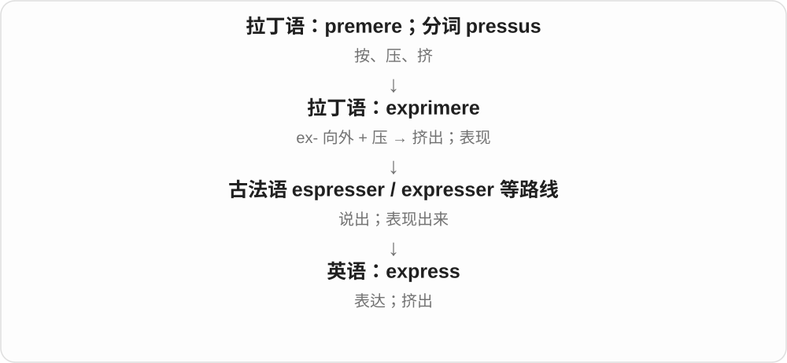
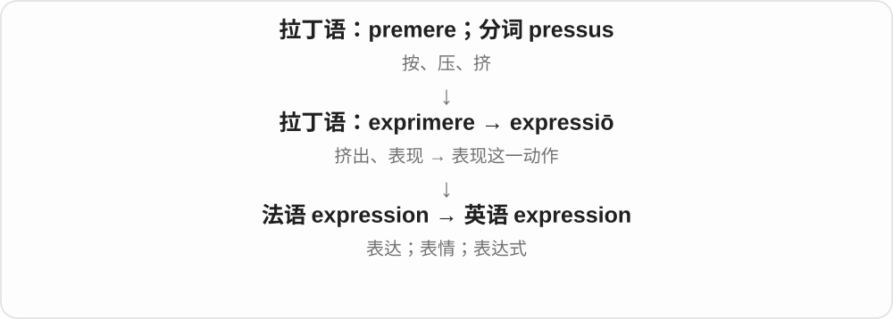
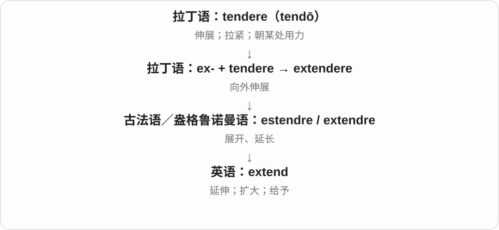
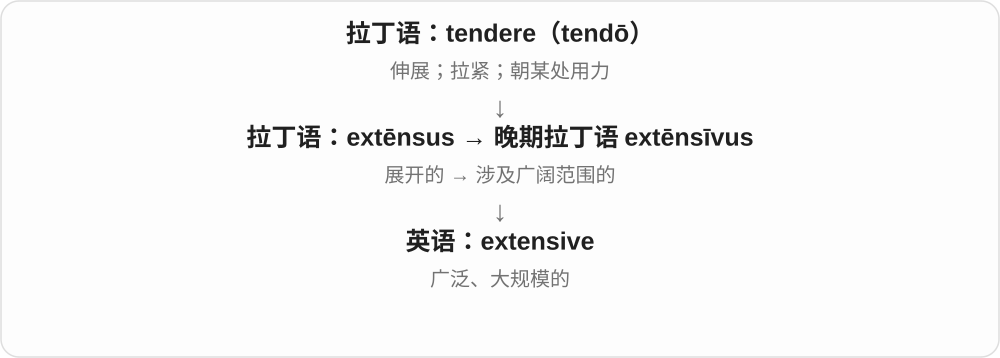
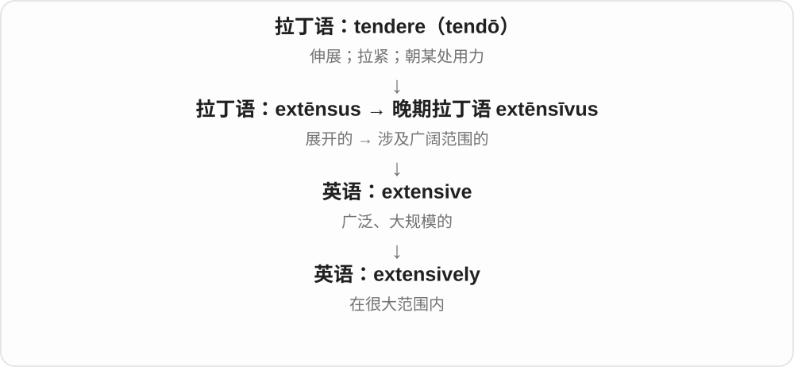
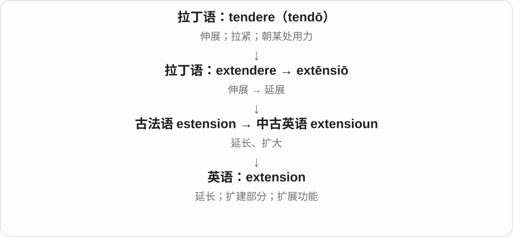
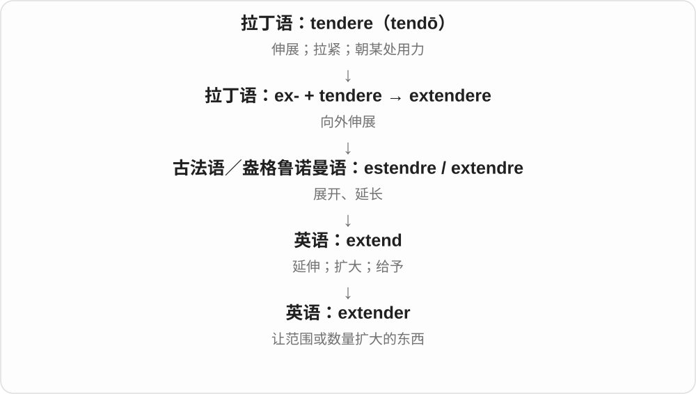
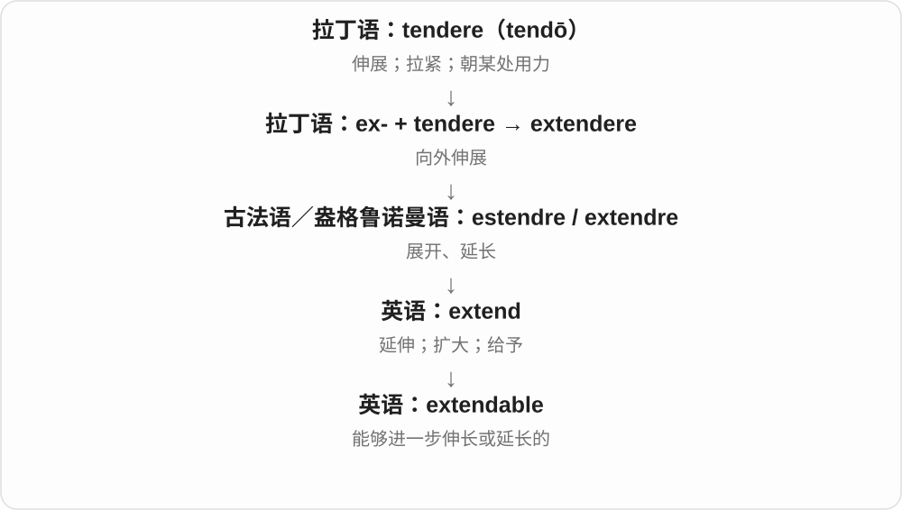
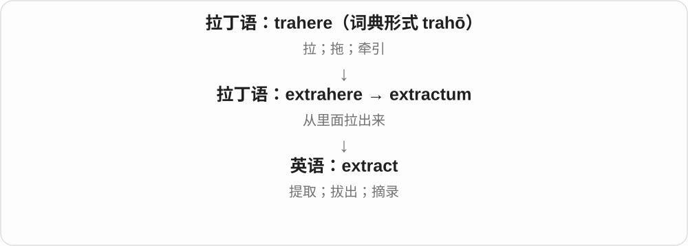
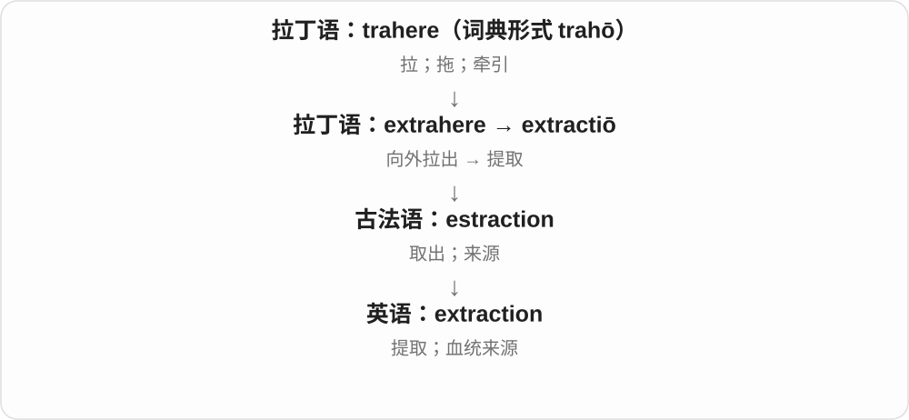

# 0183 · ex-, e-, ef- — 出去；从里面向外；也有完成、加强的作用

[逐词精讲目录](../00_逐词精讲目录.md) · [总目录](../00_总目录_按常用程度.md)

## 核心词根与来源

拉丁 ex 本来表示从、出，进入复合词后常保留向外的方向。不同词的后半部分决定具体动作：走出去、呼出去、推出去，不能只靠一个“外”字猜完整词义。有些词又形成加强或完成义，要顺着真实用法理解。

**先抓住一道边界：原来在里面，现在朝外走、推、伸或显现。**

exit 是人走出去；exhale 是气呼出去；extrude 是材料挤出去。

- **走出与呼出**：exit, exhale, exhalation
- **推出与挤压成形**：extrude, extruder, extrusion, extruded
- **把某物排在外面**：exclude, exclusion, exclusive, exclusively
- **向外伸展与扩大**：extend, extender, extendable, extension, extensive, extensively
- **显现并存在**：exist, existence, coexist
- **取出、运出、展露**：extract, extraction, export, expose, exposure
- **把意思说出来、讲清楚**：express, expression, explain, explanation

## 词形与演化规律

常见 ex-；在一些拉丁复合词中有 e-、ef- 等形式。这里收录有来源依据的词，不把所有以 ex 开头的单词都当作同样的现代拼接。

## 单词速览（按词族由简到繁）

同一基础词的相关扩展放在一起，先读基础形式，再读扩展；各组之间优先读常用的。具体词源关系见各词讲解。

| 单词 | 音标 | 核心意思 |
|---|---|---|
| [explain](#w-1) | 英、美 /ɪkˈspleɪn/ | 解释；说明清楚 |
| [explanation](#w-9) | 英、美 /ˌekspləˈneɪʃən/ | 解释；说明；原因说明 |
| [exist](#w-2) | /ɪɡˈzɪst/ | 存在；生存 |
| [existence](#w-5) | /ɪɡˈzɪstəns/ | 存在；生存；生活状态 |
| [coexist](#w-22) | 英 /ˌkəʊɪɡˈzɪst/；美 /ˌkoʊɪɡˈzɪst/ | 共存；同时存在 |
| [express](#w-3) | 英 /ɪkˈspres/；美 /ɪkˈspres/ | 表达；挤出；明确的；特快的 |
| [expression](#w-6) | 英 /ɪkˈspreʃən/；美 /ɪkˈspreʃən/ | 表达；说法；表情；表达式；基因表达 |
| [exclude](#w-19) | /ɪkˈskluːd/ | 排除；不包括；不让参加 |
| [exclusive](#w-4) | /ɪkˈskluːsɪv/ | 独有的；专用的；排他的；高档且限制进入的；独家报道 |
| [exclusively](#w-13) | /ɪkˈskluːsɪvli/ | 仅仅；专门；独家地 |
| [exclusion](#w-20) | /ɪkˈskluːʒən/ | 排除；排斥；不包括的项目 |
| [extend](#w-12) | /ɪkˈstend/ | 伸展；延长；扩大；给予 |
| [extensive](#w-7) | /ɪkˈstensɪv/ | 广泛的；大规模的 |
| [extensively](#w-17) | /ɪkˈstensɪvli/ | 广泛地；大范围地 |
| [extension](#w-8) | /ɪkˈstenʃən/ | 延长；扩建部分；扩展功能；分机 |
| [extender](#w-24) | 英 /ɪkˈstendə/；美 /ɪkˈstendər/ | 延长装置；扩展器；增量材料 |
| [extendable](#w-26) | /ɪkˈstendəbəl/ | 能够延长、展开的 |
| [expose](#w-16) | 英 /ɪkˈspəʊz/；美 /ɪkˈspoʊz/ | 使暴露；揭露；让接触 |
| [exposure](#w-10) | 英 /ɪkˈspəʊʒə/；美 /ɪkˈspoʊʒər/ | 暴露；接触；曝光；公众关注 |
| [exit](#w-11) | /ˈeksɪt/，也读 /ˈeɡzɪt/ | 出口；离开、退出；退场 |
| [export](#w-14) | 动词 英 /ɪkˈspɔːt/、美 /ɪkˈspɔːrt/；名词 英 /ˈekspɔːt/、美 /ˈekspɔːrt/ | 出口；导出；出口商品 |
| [extract](#w-15) | 动词 /ɪkˈstrækt/；名词 /ˈekstrækt/ | 提取；拔出；摘录；提取物 |
| [extraction](#w-18) | /ɪkˈstrækʃən/ | 提取；取出；出身 |
| [exhale](#w-21) | /eksˈheɪl/ | 呼气；呼出；散发〔较少见〕 |
| [exhalation](#w-27) | /ˌekshəˈleɪʃən/ | 呼气；呼出的气；散发出的气体或气味 |
| [extrusion](#w-23) | /ɪkˈstruːʒən/ | 挤出；挤压成形；挤出制品 |
| [extrude](#w-29) | /ɪkˈstruːd/ | 挤出；挤压成形 |
| [extruded](#w-25) | /ɪkˈstruːdɪd/ | 挤出的；挤压成形的；extrude 的过去式与过去分词 |
| [extruder](#w-28) | 英 /ɪkˈstruːdə/；美 /ɪkˈstruːdər/ | 挤出机；挤出机构 |

## 逐词讲解

### 1. explain — 解释；说明清楚

**音标**：英、美 /ɪkˈspleɪn/

**先抓住这个画面**

像把折起来的地图摊平，让别人看清事情怎样连在一起。

**怎么拆**

拉丁语 ex-“展开、向外” + planare“使平”形成 explanare，既能指铺平，也能指讲清；经法语和拉丁语进入英语。

**怎么变成今天的意思**

**拉丁语：planus；planum**  
平坦的；平面、平地

↓

**拉丁语：ex- + planare → explanare**  
铺平、展开 → 讲清楚

↓

**法语及拉丁语 → 英语 explain**  
使人明白；解释

explain something to someone，给人解释某事；通常不说 explain someone something。

**常见搭配与例句**

explain why；explain how；explain the problem to…。

> Could you explain the rule to me?

你能给我解释一下这条规则吗？

> The diagram explains how the pump works.

这张示意图说明了泵怎样工作。

**别混淆**

describe 说它是什么样；explain 更常说为什么、怎么回事或如何运作。

### 2. explanation — 解释；说明；原因说明

**音标**：英、美 /ˌekspləˈneɪʃən/

**先抓住这个画面**

把听者原先看不懂的地方讲通，让“为什么”有一个能理解的答案。

**怎么拆**

借自拉丁语 explanatio，来自 explanare 的名词支线；英语 explain 与 explanation 是相关借词，不是只在现代 explain 后直接接字母。

**怎么变成今天的意思**

**拉丁语：planus；planum**  
平坦的；平面、平地

↓

**拉丁语：ex- + planare → explanare**  
铺平、展开 → 讲清楚

↓

**拉丁语：explanatio → 英语 explanation**  
讲清楚；解释、说明

an explanation for something 可以是原因说明；an explanation of something 可以是讲解内容。

**常见搭配与例句**

give an explanation；a plausible explanation。

> Her explanation made the problem much easier to understand.

她的解释让这个问题容易理解多了。

> There may be another explanation for the missing data.

数据缺失可能还有别的原因。

**别混淆**

excuse 常用于替行为开脱；explanation 可以只说明原因，不表示免除责任。

### 3. exist — 存在；生存

**音标**：/ɪɡˈzɪst/

**先抓住这个画面**

不是只在设想里，而是真的有、真的在。

**怎么拆**

拉丁 ex- “向外” + sistere“站定”组成 exsistere；经法语等借入英语，画面从“出现”变成“存在”。

**怎么变成今天的意思**

**拉丁 sistere〔与 stāre“站”相关〕**  
使站住、放置；站定、停住

↓

**拉丁 ex- + sistere → exsistere / existere**  
站出来、出现 → 存在

↓

**法语 exister／拉丁 existere → 英语 exist**  
存在；实际有这样的人或事物

A solution exists 只说有解，还没说明解是什么。exist on a small income 则把“存在”放到生活里，表示靠有限收入维持。这个动词不需要 be 帮它组成被动。

**常见搭配与例句**

exist in nature；exist on little money；There exists…。

> No written record of the meeting exists.

这次会议没有留下任何书面记录。

> The family existed on a very small income for several months.

这一家靠很少的收入维持了几个月。

**别混淆**

live 可以强调生活怎样展开；exist 有时只强调还在维持，未必过得充实。

### 4. existence — 存在；生存；生活状态

**音标**：/ɪɡˈzɪstəns/

**先抓住这个画面**

把“有这么回事”单独拿出来谈，也能说一个人怎样维持生活。

**怎么拆**

后期拉丁 existentia 经古法语进入中古英语；现代可看成 exist + -ence，但不是必须经英语 exist 才产生的名词。

**怎么变成今天的意思**

**拉丁 sistere〔与 stāre“站”相关〕**  
使站住、放置；站定、停住

↓

**拉丁 ex- + sistere → exsistere / existere**  
站出来、出现 → 存在

↓

**后期拉丁 existentia → 古法语 existence → 中古英语 existence**  
存在这一状态；独立名词路线

prove the existence of something 是证明某物确实存在。lead a quiet existence 说过着安静的生活；这里不必带“仅仅苟活”的负面意味，要看修饰语。

**常见搭配与例句**

come into existence；the existence of life；lead a peaceful existence。

> The map confirms the existence of an earlier road.

地图证实这里以前有过一条道路。

> They led a quiet existence in a small coastal town.

他们在一座海边小镇过着安静的生活。

**别混淆**

existence 说有没有、怎样存在；experience 说经历了什么，两个近形词不要混。

### 5. coexist — 共存；同时存在

**音标**：英 /ˌkəʊɪɡˈzɪst/；美 /ˌkoʊɪɡˈzɪst/

**先抓住这个画面**

两个事物都站在这里，一个的存在没有把另一个完全挤掉。

**怎么拆**

英语 co- “共同” + exist；不是把每个现代 co- 词都当成古拉丁完整借词。

**怎么变成今天的意思**

**拉丁 sistere〔与 stāre“站”相关〕**  
使站住、放置；站定、停住

↓

**拉丁 ex- + sistere → exsistere / existere**  
站出来、出现 → 存在

↓

**法语 exister／拉丁 existere → 英语 exist**  
存在；实际有这样的人或事物

↓

**英语 co- + exist → coexist**  
在同一时期、地方或系统中共同存在

两种动物可在一片森林 coexist，两种看似矛盾的感情也可同时存在。共存不保证完全和平或彼此喜欢；peacefully coexist 才明确加上和平这一层。

**常见搭配与例句**

coexist with something；coexist peacefully；two systems coexist。

> Older and newer buildings coexist along the same street.

同一条街上，新旧建筑并存。

> Relief and sadness can coexist after a major change.

经历重大变化后，释然和难过可以同时存在。

**别混淆**

cooperate 是一起做事；coexist 只要求共同存在，不必协作。

### 6. express — 表达；挤出；明确的；特快的

**音标**：英 /ɪkˈspres/；美 /ɪkˈspres/

**先抓住这个画面**

把里面的东西带到外面：把汁液挤出来，也把想法、情绪表现出来。

**怎么拆**

动词经法语等路线来自拉丁语 exprimere，ex- 向外 + premere。形容词来自其分词 expressus，经法语 expres。

**怎么变成今天的意思**

express an opinion 是表达意见。express permission 是明确许可；express delivery 的快递义经过“专门、直接运送”发展，不能简单解释成“挤得快”。

**常见搭配与例句**

express concern；express yourself；express permission；an express train。

> She found it difficult to express her feelings in words.

她发现很难用语言表达自己的感受。

> We took an express train to the airport.

我们乘特快列车去了机场。

**别混淆**

express 不保证情绪激烈：平静地说一句感谢，也是在 express thanks。

### 7. expression — 表达；说法；表情；表达式；基因表达

**音标**：英 /ɪkˈspreʃən/；美 /ɪkˈspreʃən/

**先抓住这个画面**

心里的内容找到了一个外面的样子：一句话、一张脸上的神情，或一串表示关系的符号。

**怎么拆**

经法语 expression 来自拉丁语 expressiō，与 exprimere 同族；不是只有英语 express 加 -ion 这一层历史。

**怎么变成今天的意思**

an expression of gratitude 是表达感谢；a puzzled expression 是疑惑的表情；数学 expression 可为 2x + 3，不一定含等号。生物学里指基因信息被用于产生 RNA 或蛋白质等产物的过程。

**常见搭配与例句**

facial expression；freedom of expression；a mathematical expression。

> Her expression changed when she heard the news.

她听到消息时，表情变了。

> The expression “a piece of cake” means that something is easy.

“a piece of cake”这个说法表示某件事很容易。

**别混淆**

expression 是表现出来的样子；impression 是它在别人心中留下的感觉。

### 8. exclude — 排除；不包括；不让参加

**音标**：/ɪkˈskluːd/

**先抓住这个画面**

把某人或某个可能性留在所定范围之外。

**怎么拆**

拉丁 ex-“向外” + claudere，形成 exclūdere，再借入英语。

**怎么变成今天的意思**

**拉丁 claudere；分词 clausus**  
关上、围住、使结束；复合词常变为 -cludere / -clusus

↓

**拉丁 ex- + claudere → exclūdere → 英语 exclude**  
关在外面 → 排除、不让进入

exclude someone from a meeting 是不让某人参会；exclude tax 是不把税算进去；exclude a possibility 是排除一种可能。对象既可以是人，也可以是费用或解释。

**常见搭配与例句**

exclude somebody from；exclude the possibility of；exclude taxes。

> The quoted fee excludes travel expenses.

报价不包括差旅费。

> The evidence does not exclude the possibility of an error.

这些证据并未排除出错的可能。

**别混淆**

include 算在内，exclude 留在外；ignore 是不理会，未必正式从范围中剔除。

### 9. exclusive — 独有的；专用的；排他的；高档且限制进入的；独家报道

**音标**：/ɪkˈskluːsɪv/

**先抓住这个画面**

门只给某些人或某一方打开，其他人被挡在外面。

**怎么拆**

来自拉丁 exclūdere 的形容词派生 exclūsīvus；现代可联系 exclude，但不是简单把英语词尾换掉就解释全部历史。

**怎么变成今天的意思**

**拉丁 claudere；分词 clausus**  
关上、围住、使结束；复合词常变为 -cludere / -clusus

↓

**拉丁 exclūdere → 中世纪拉丁 exclūsīvus → 英语 exclusive**  
排除 → 限于特定对象、独有的

exclusive rights 是独家权利；exclusive to members 是会员专享；an exclusive 可以是独家新闻。exclusive of tax 则是税未算进去，不能误读为“税款独享”。

**常见搭配与例句**

exclusive access；exclusive to；mutually exclusive；exclusive of。

> This area is for the exclusive use of residents.

这个区域仅供住户使用。

> The newspaper published an exclusive interview with the explorer.

报纸刊登了对这位探险家的独家采访。

> The quoted price is exclusive of tax.

报价不含税。

**别混淆**

expensive 只是贵；exclusive 还强调限制对象、排他或独有。mutually exclusive 指不能同时成立。

### 10. exclusively — 仅仅；专门；独家地

**音标**：/ɪkˈskluːsɪvli/

**先抓住这个画面**

范围就到这里，其他对象或渠道不算在内。

**怎么拆**

中古英语已有对应形式；结构上是 exclusive + -ly。

**怎么变成今天的意思**

**拉丁 claudere；分词 clausus**  
关上、围住、使结束；复合词常变为 -cludere / -clusus

↓

**拉丁 exclūsīvus → 中古英语 exclusive / exclusyvely**  
排他的 → 仅限某对象地

↓

**现代英语 exclusively**  
只、专门、独家地

sold exclusively online 是只在线上销售；work exclusively on one project 是全部精力只用于一个项目。重点在限制范围，不是笼统地强调做得很专业。

**常见搭配与例句**

exclusively for；exclusively on；available exclusively through。

> The course is designed exclusively for beginners.

这门课程专为初学者设计。

> The album was released exclusively through the artist’s website.

这张专辑只通过艺术家的网站发行。

**别混淆**

especially 是尤其，可以还有其他对象；exclusively 是只限指定范围。

### 11. exclusion — 排除；排斥；不包括的项目

**音标**：/ɪkˈskluːʒən/

**先抓住这个画面**

把谁留在外面，或者明确哪些事项不算。

**怎么拆**

拉丁 exclūsiō 经法语及拉丁借入中古英语，接 exclūdere；现代可联系 exclude 理解。

**怎么变成今天的意思**

**拉丁 claudere；分词 clausus**  
关上、围住、使结束；复合词常变为 -cludere / -clusus

↓

**拉丁 exclūdere → exclūsiō → 法语／中古英语 exclusion**  
关在外面 → 排除、不给参与

↓

**现代英语 exclusion**  
排斥的行为；合同、范围等不包含的项目

social exclusion 是被排除在社会参与之外；a policy exclusion 是保单不保的项目，具体范围由文本决定。to the exclusion of 表示只顾一个，其他都被挤开。

**常见搭配与例句**

exclusion from；the exclusion of；to the exclusion of；an exclusion clause。

> The study explains the exclusion of incomplete responses.

研究说明了为何排除不完整答卷。

> He focused on one project to the exclusion of all others.

他只顾一个项目，把其他项目全搁下了。

**别混淆**

exception 是从一般规则中提出的例外；exclusion 是明确不纳入的对象或事项，二者不必重合。

### 12. extend — 伸展；延长；扩大；给予

**音标**：/ɪkˈstend/

**先抓住这个画面**

extend 是让原来的边界往外走：伸出手，拉长时间，把服务送到更远。

**怎么拆**

ex-（向外）+ tendere，经拉丁 extendere、法语 estendre 等形式。

**怎么变成今天的意思**

也可把抽象东西“送出去”：extend an invitation 是发出邀请，不是把邀请函拉长。

**常见搭配与例句**

extend a deadline；extend a hand；extend an invitation。

> We need to extend the deadline by a week.

我们需要把截止日期延后一周。

> The hotel extended a warm welcome to the guests.

酒店向宾客表示热烈欢迎。

**别混淆**

expand 常强调整体变大；extend 更容易突出长度、范围或期限向外延伸。

### 13. extensive — 广泛的；大规模的

**音标**：/ɪkˈstensɪv/

**先抓住这个画面**

extensive 像把地图摊开，覆盖的地方很多：研究范围广，损坏面积大。

**怎么拆**

来自晚期拉丁语 extēnsīvus；现代可联系 extend 的 extēns- 词干与 -ive。

**怎么变成今天的意思**

强调覆盖范围或数量，不自动说明每个细节研究得多深。

**常见搭配与例句**

extensive research；extensive damage；an extensive network。

> The storm caused extensive damage.

暴风雨造成了大范围破坏。

> She has extensive experience in teaching adults.

她有丰富的成人教学经验。

**别混淆**

extensive 看范围广；intensive 看投入密、强度大。

### 14. extensively — 广泛地；大范围地

**音标**：/ɪkˈstensɪvli/

**先抓住这个画面**

extensively 说事情铺得很开：游历很多地方，采访许多人，修改很多部分。

**怎么拆**

extensive + -ly。

**怎么变成今天的意思**

travel extensively 不一定每处住很久，但去的地方通常多。

**常见搭配与例句**

travel extensively；write extensively about；extensively revised。

> She has travelled extensively in Asia.

她游历过亚洲许多地方。

> The report was extensively revised before publication.

报告在发表前作了大幅修改。

**别混淆**

extensively 看范围；intensively 看密度或投入强度。

### 15. extension — 延长；扩建部分；扩展功能；分机

**音标**：/ɪkˈstenʃən/

**先抓住这个画面**

extension 像给原来的一段接上新的一段：时间往后延，房屋多出一间，软件多出功能。

**怎么拆**

现代对应 extend + -sion；来自拉丁语 extēnsiō，经古法语借入。

**怎么变成今天的意思**

申请 deadline extension 是延长时限；browser extension 是浏览器扩展；extension 204 可能是电话分机号。

**常见搭配与例句**

an extension of time；a house extension；a browser extension。

> The teacher granted a two-day extension.

老师把期限延长了两天。

> This browser extension blocks unwanted pop-ups.

这个浏览器扩展会拦截不需要的弹窗。

**别混淆**

extension 常在原有东西上延长；replacement 是换掉原来的东西。

### 16. extender — 延长装置；扩展器；增量材料

**音标**：英 /ɪkˈstendə/；美 /ɪkˈstendər/

**先抓住这个画面**

extender 是帮原来东西伸得更远、用得更多的配件或材料。

**怎么拆**

extend + -er。

**怎么变成今天的意思**

a range extender 扩大覆盖或续航范围；食品、涂料中的 extender 可以是增加体积或延展用量的材料。

**常见搭配与例句**

a range extender；a belt extender；a signal extender。

> A belt extender made the strap long enough.

一个腰带延长扣让带子足够长了。

> We installed a wireless range extender upstairs.

我们在楼上安装了无线信号扩展器。

**别混淆**

extension 常是延长的结果或新增部分；extender 更突出起延长作用的物件。

### 17. extendable — 能够延长、展开的

**音标**：/ɪkˈstendəbəl/

**先抓住这个画面**

extendable 像一张平时收着、来客时还能拉长的桌子。

**怎么拆**

extend + -able；也有 extendible 拼法。

**怎么变成今天的意思**

可说物件长度，也可说合同、期限能否续长。

**常见搭配与例句**

an extendable table；an extendable handle；an extendable contract。

> The table has an extendable top.

这张桌子的桌面可以拉长。

> The permit is extendable for another month.

这份许可可以再延长一个月。

**别混淆**

extendable 与 extensible 有重叠；前者日常物件和期限更常见，后者常见于技术设计。

### 18. expose — 使暴露；揭露；让接触

**音标**：英 /ɪkˈspəʊz/；美 /ɪkˈspoʊz/

**先抓住这个画面**

把盖子掀开，让原本受保护或被藏住的东西显露出来。

**怎么拆**

经法语 exposer 借入；对应拉丁 ex-“出去” + pōnere 的 expōnere，但词形受 poser〔源于 pausāre〕替换影响。

**怎么变成今天的意思**

**晚期拉丁 pausāre → 古法语 poser**  
使停下、使安放 → 放置

↓

**拉丁 pōnere 及其复合词的影响**  
相似词形和“放置”意义交汇；不是单纯直系音变

↓

**古法语 exposer → 中古英语 exposen → 英语 expose**  
对应拉丁 expōnere“放到外面、展示”的意义

可以把皮肤暴露在阳光下，把谎言揭穿，也可以让学生接触新思想。不是每次 expose 都有羞耻或危险意味。

**常见搭配与例句**

expose something to；expose a lie；be exposed to。

> Removing the panel exposed the wires underneath.

取下盖板后，下面的电线露了出来。

> The course exposes students to different ways of thinking.

这门课程让学生接触不同的思考方式。

**别混淆**

reveal 偏揭示信息；expose 还突出失去遮蔽、直接接触外界。

### 19. exposure — 暴露；接触；曝光；公众关注

**音标**：英 /ɪkˈspəʊʒə/；美 /ɪkˈspoʊʒər/

**先抓住这个画面**

遮挡拿开了，人或物开始直接接触外界。

**怎么拆**

expose + -ure，在英语中形成名词。expose 的法语路线兼有 pausāre 与 pōnere 的影响。

**怎么变成今天的意思**

**晚期拉丁 pausāre → 古法语 poser**  
使停下、使安放 → 放置

↓

**拉丁 pōnere 及其复合词的影响**  
相似词形和“放置”意义交汇；不是单纯直系音变

↓

**古法语 exposer → 中古英语 exposen → 英语 expose**  
对应拉丁 expōnere“放到外面、展示”的意义

↓

**英语 expose + -ure → exposure**  
被暴露、接触外界的过程或状态

sun exposure 是接触阳光；media exposure 是进入公众视野；摄影 exposure 是感光材料或传感器接收光线的过程和程度。

**常见搭配与例句**

exposure to；media exposure；a long exposure。

> The fabric faded after prolonged exposure to sunlight.

长时间日晒后，布料褪色了。

> A long exposure turned the moving lights into bright trails.

长曝光把移动的灯光拍成了明亮的轨迹。

**别混淆**

experience 常是亲自做事积累的经验；exposure to 可能只是接触、见识过。

### 20. exit — 出口；离开、退出；退场

**音标**：/ˈeksɪt/，也读 /ˈeɡzɪt/

**先抓住这个画面**

在里面的人走到外面去：走的那条路叫出口，离开的动作也可以叫 exit。

**怎么拆**

拉丁 ex- 向外 + ire 走 → exire。舞台提示 exit 直接借其“他／她离场”的动词形式；普通名词另接拉丁 exitus“离去”。现代英语动词再由名词发展，不是 ex + 英语 it。

**怎么变成今天的意思**

**拉丁 ex- + ire → exire**  
向外走、离开

↓

**拉丁 exit“他／她离去”与名词 exitus“离去”两条借入路线**  
前者进入舞台提示，后者进入普通名词

↓

**英语 exit：提示、名词；后由名词发展普通动词**  
退场；出口、离开；退出

门上的 EXIT 告诉你从哪里出去；make a quick exit 是赶紧离开；exit an app 是退出应用。空间里的“出去”也能扩展到离开比赛、职位或某个系统。

**常见搭配与例句**

an emergency exit；take the next exit；make an exit；exit the application。

> The nearest exit is behind the reception desk.

最近的出口在接待台后面。

> Save your work before you exit the application.

退出应用前先保存你的工作。

> The team’s early exit from the tournament surprised its supporters.

球队早早出局，令支持者们感到意外。

**别混淆**

entrance 是入口，exit 是出口。leave 是更宽泛的离开；exit 常突出从某处、某系统或某活动中退出。

### 21. export — 出口；导出；出口商品

**音标**：动词 英 /ɪkˈspɔːt/、美 /ɪkˈspɔːrt/；名词 英 /ˈekspɔːt/、美 /ˈekspɔːrt/

**先抓住这个画面**

export 是把东西向外带：把本国商品卖到国外，或把软件里的数据另存到外部文件。

**怎么拆**

拉丁语 ex-（向外）+ portāre（运送），形成 exportāre。

**怎么变成今天的意思**

贸易中“向外”通常以国家或地区为边界；软件中则以某个应用或文件格式为边界。

**常见搭配与例句**

export goods（出口商品）；export to…（向……出口）；export a file（导出文件）；agricultural exports（农产品出口）。

> The company exports furniture to several countries.

这家公司向几个国家出口家具。

> You can export the chart as an image.

你可以把图表导出成图片。

**别混淆**

export 向外，import 向内。名词通常重音在前，动词通常在后。

### 22. extract — 提取；拔出；摘录；提取物

**音标**：动词 /ɪkˈstrækt/；名词 /ˈekstrækt/

**先抓住这个画面**

extract 是从里面把目标拿出来：从牙床拔牙，从植物提取物质，从长文摘出一段。

**怎么拆**

ex-（向外）+ trahere（拉）形成 extrahere，相关形式 extractum 进入英语。

**怎么变成今天的意思**

动作未必真要用力拉；现代数据处理中，extract 也能说把需要的数据取出来。名词可以指取出的物质或文章片段。

**常见搭配与例句**

extract data from…；extract a tooth；vanilla extract；an extract from a novel。

> The program extracts dates from the documents.

这个程序从文档中提取日期。

> We read an extract from her latest novel.

我们读了她最新小说中的一个片段。

**别混淆**

extract 常强调从更大整体中取出某部分；remove 只说移走。名词重音在前，动词在后。

### 23. extraction — 提取；取出；出身

**音标**：/ɪkˈstrækʃən/

**先抓住这个画面**

extraction 把“从某个来源取出来”变成一个过程：提取数据、开采资源、拔出牙齿。

**怎么拆**

经古法语 estraction，来自中世纪拉丁语 extractiō；现代可对照 extract + -ion。

**怎么变成今天的意思**

它通常谈取出过程；较正式的 of Irish extraction 则谈祖先来自哪里，是“来源”这一支，不是在说把谁从土地里拔出来。

**常见搭配与例句**

data extraction；oil extraction；tooth extraction；of mixed extraction。

> The team automated the extraction of names from the records.

团队把从记录中提取姓名的工作自动化了。

> Her grandparents were of Italian extraction.

她的祖父母具有意大利血统。

**别混淆**

extract 可以是得到的提取物；extraction 通常是提取过程。两者一个常看结果，一个常看动作。

### 24. exhale — 呼气；呼出；散发〔较少见〕

**音标**：/eksˈheɪl/

**先抓住这个画面**

刚吸进去的那口气向外放出来，就是 exhale；读到松一口气的场景时，很容易把动作想出来。

**怎么拆**

经古法语 exhaler 或直接接拉丁 exhalare：ex- 向外 + halare 呼吸。较早英语也说蒸气、气味向外散发；不是 ex + hale“健康的”。

**怎么变成今天的意思**

**拉丁 ex- 向外 + halare 呼吸**  
让气息向外散出

↓

**拉丁 exhalare → 古法语 exhaler／直接拉丁借入 → 英语 exhale**  
散发蒸气、气味；呼出气息

日常重点是呼气，与 inhale“吸气”相对。可以单用 She exhaled，也可接呼出的东西，如 exhale smoke。文学中可借呼气描写紧张解除。

**常见搭配与例句**

exhale slowly；exhale deeply；exhale a long breath；inhale and exhale。

> When the result appeared, she exhaled in relief.

结果出来时，她松了一口气。

> The recording captures the sound of the runner inhaling and exhaling.

录音捕捉到了跑步者吸气和呼气的声音。

**别混淆**

breathe 是呼吸的总称；inhale 与 exhale 分别取吸入和呼出这两个方向。sigh 是叹气，常带情绪，不是每次呼气都叫 sigh。

### 25. exhalation — 呼气；呼出的气；散发出的气体或气味

**音标**：/ˌekshəˈleɪʃən/

**先抓住这个画面**

把“往外呼一口气”当作一次动作或一股呼出的气息来谈，焦点落在这一步。

**怎么拆**

拉丁 exhalare → 名词 exhalatio／exhalation- → 英语 exhalation。现代可与 exhale、-ation 对照，但它有独立的拉丁名词借入历史，并非必须从英语动词新造。

**怎么变成今天的意思**

**拉丁 ex- + halare → exhalare**  
向外呼出、散发

↓

**拉丁名词 exhalatio／exhalation- → 英语 exhalation**  
呼出、散发这一动作；呼出的气息

a long exhalation 是长长呼出的一口气；inhalation and exhalation 是吸气与呼气。旧式或文学场景中也可能指地面、植物等散出的气体或气味。

**常见搭配与例句**

a slow exhalation；a long exhalation；inhalation and exhalation。

> A long exhalation broke the silence.

一声长长的呼气打破了寂静。

> The animation shows inhalation followed by exhalation.

动画展示了先吸气、再呼气的过程。

**别混淆**

exhale 是做这个动作的动词；exhalation 把动作当成名词来讨论。expiration 在医学中也可指呼气，但一般阅读还常指到期。

### 26. extrusion — 挤出；挤压成形；挤出制品

**音标**：/ɪkˈstruːʒən/

**先抓住这个画面**

可以说“把材料挤成形”这件事，也可以说通过这个过程做出来的一根型材。

**怎么拆**

现代与 extrude 对应，但名词有独立历史：拉丁 extrudere 的分词词干 extrus- → 中世纪拉丁 extrusio／extrusion- → 英语。英语名词记录早于现代动词，不能只画成 extrude 加 -ion。

**怎么变成今天的意思**

**拉丁 ex- + trudere → extrudere；分词词干 extrus-**  
向外推出

↓

**中世纪拉丁 extrusio／extrusion- → 英语 extrusion**  
挤出这一动作

↓

**英语工艺与制品用法**  
挤压成形过程；由此制成的型材等

aluminium extrusion 可以指铝材挤压工艺；an aluminium extrusion 则可以是一根挤压制成的铝型材。一个说怎么做，一个说做出的东西。

**常见搭配与例句**

the extrusion process；plastic extrusion；an aluminium extrusion。

> Extrusion gives the material a consistent cross-sectional shape.

挤压成形使材料获得一致的截面形状。

> The frame is assembled from aluminium extrusions.

框架由铝挤压型材组装而成。

**别混淆**

extruder 是机器，extrude 是动词，extrusion 是过程或产物。三者意义相连，但并非都按现代英语后缀顺序才出现。

### 27. extrude — 挤出；挤压成形

**音标**：/ɪkˈstruːd/

**先抓住这个画面**

把一团材料推过一个开口，它出来时就带着开口限定的形状；像软泥挤过小孔后变成长条。

**怎么拆**

借拉丁 extrudere，ex- 向外 + trudere 推。这里的 trude 不是独立英语词。现代工艺义是在“向外推出”的基础上形成的。

**怎么变成今天的意思**

**拉丁 ex- 向外 + trudere 推**  
把东西向外推

↓

**拉丁 extrudere → 英语 extrude**  
推出、挤出；后来用于挤压成形

工业上可以把材料挤过模口，得到管、条或其他截面形状。extrude 强调推出、挤出的过程，不是把一大块材料从外面雕掉一部分。

**常见搭配与例句**

extrude plastic；extrude aluminium；extrude material through a die。

> The machine extrudes the soft clay into long strips.

机器把软泥挤压成长条。

> The factory extrudes aluminium through shaped dies.

工厂把铝材挤过特定形状的模口，使它成形。

**别混淆**

mould 泛指用模具成形；extrude 具体强调材料通过开口被挤出。extract 则是从某处取出或提取，不一定施加挤压力。

### 28. extruded — 挤出的；挤压成形的；extrude 的过去式与过去分词

**音标**：/ɪkˈstruːdɪd/

**先抓住这个画面**

看到这个词，通常是在说明材料已经经过怎样的加工，而不是在给它另起一种材料名称。

**怎么拆**

extrude + -ed；词末已有 e，只加 d。原词以 /d/ 结尾，所以这一词尾读 /ɪd/。

**怎么变成今天的意思**

**拉丁 ex- 向外 + trudere 推**  
把东西向外推

↓

**拉丁 extrudere → 英语 extrude**  
推出、挤出；后来用于挤压成形

↓

**英语 extrude → extruded**  
挤出了；被挤压成形的

extruded aluminium 是经过挤压加工的铝材；extruded plastic profiles 是挤出的塑料型材。材料是什么与怎么加工是两件事，这个词说明后者。

**常见搭配与例句**

extruded aluminium；extruded profiles；extruded plastic。

> The shelf has an extruded aluminium frame.

这个置物架采用挤压成形的铝框架。

> The machine extruded the material into a hollow tube.

机器把材料挤压成了一根空心管。

**别混淆**

cast 说明浇铸成形，extruded 说明挤压成形。两种形容词都在交代工艺，不能只按外观互换。

### 29. extruder — 挤出机；挤出机构

**音标**：英 /ɪkˈstruːdə/；美 /ɪkˈstruːdər/

**先抓住这个画面**

负责把材料不断往外推的那台机器或那套机构，而不是被挤出来的成品。

**怎么拆**

extrude 去末尾不发音的 e + -er，英语器械名称；-er 在这里表示做这个动作的装置。

**怎么变成今天的意思**

**拉丁 ex- 向外 + trudere 推**  
把东西向外推

↓

**拉丁 extrudere → 英语 extrude**  
推出、挤出；后来用于挤压成形

↓

**英语 extrude + -er → extruder**  
执行挤出过程的机器或机构

塑料生产线有 extruder；一些三维打印机也用这个词称送料、挤出的机构。具体构造依设备而异，不能一律把 extruder 当成最末端那个小喷嘴。

**常见搭配与例句**

a plastic extruder；the extruder motor；an extruder on a 3D printer。

> The factory installed a new extruder for plastic tubing.

工厂安装了一台新的塑料管挤出机。

> The diagram shows how the extruder feeds filament towards the hotend.

示意图说明挤出机构如何把丝材送向热端。

**别混淆**

nozzle 是出口处的喷嘴，extruder 是负责推送、挤出材料的装置或总成；extrusion 是过程或制品。

## 这一组要分清什么

ex- 常给方向，后半部分给动作。exit 的 it 不是英语代词，exhale 的 hale 也不是“健康”；extrusion 的名词路线还早于英语 extrude。explain 等抽象词不能都硬想成真实物体被搬出屋子。

## 串起来练习

The visitor exits, the runner exhales, and the machine extrudes plastic. 人走出去，气呼出去，塑料被挤出去：同一个方向，三个完全不同的动作。
