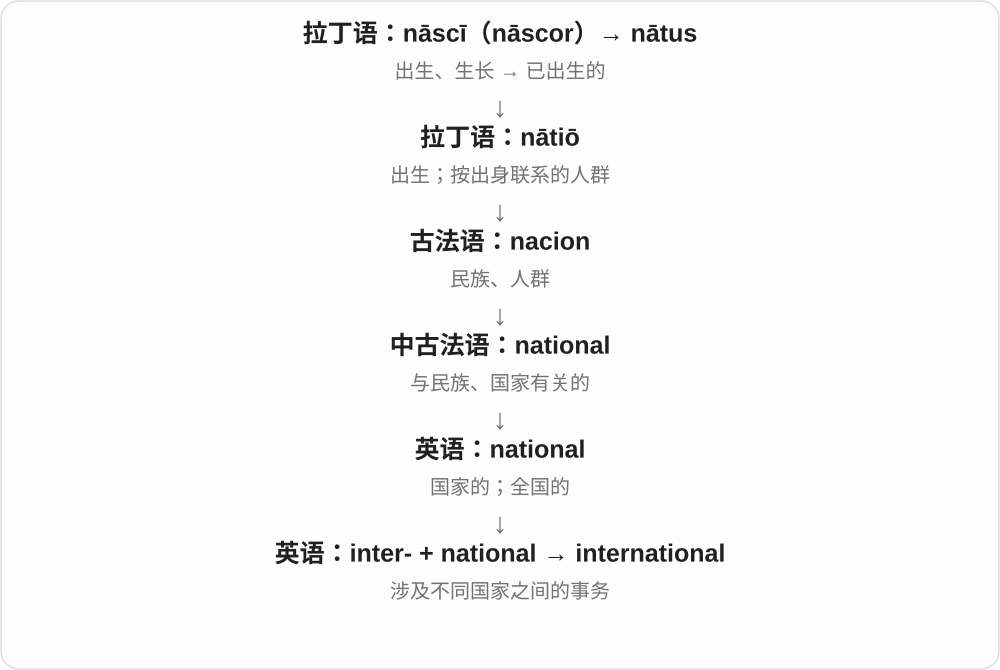
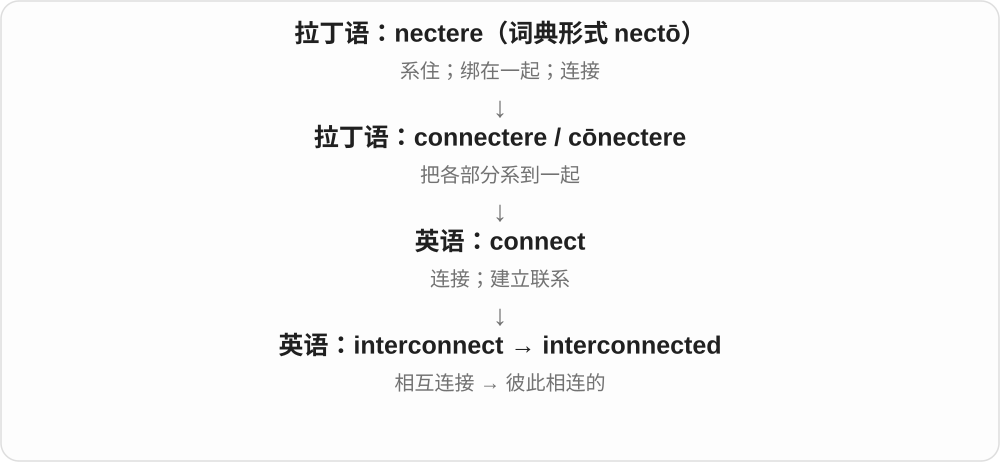
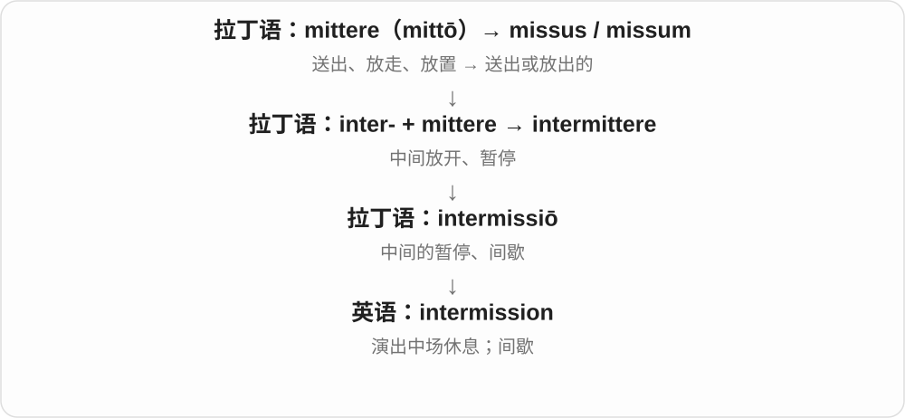
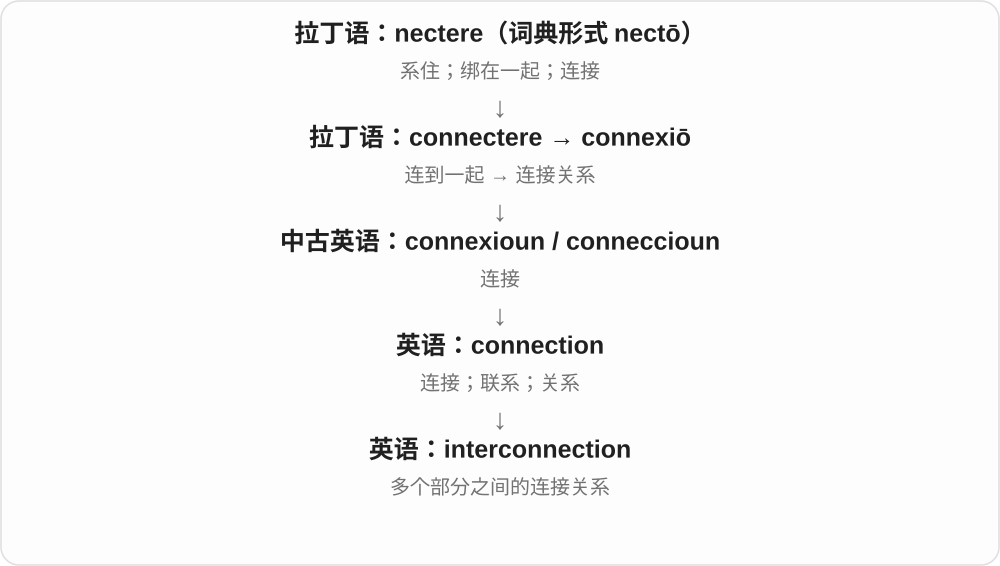
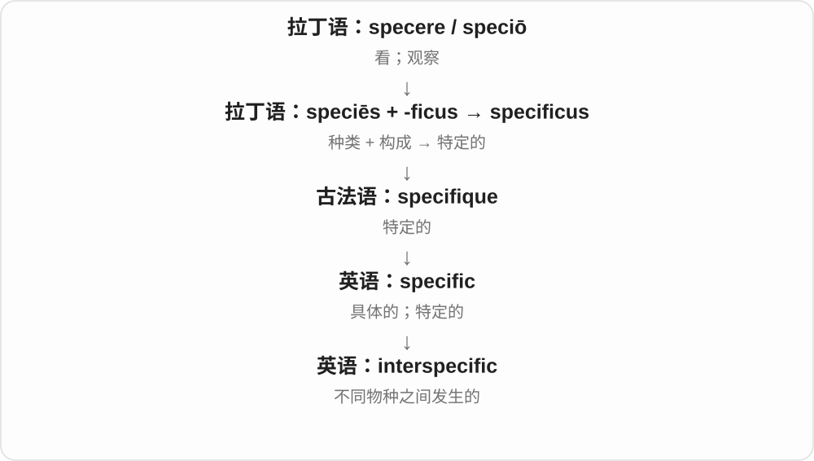

# 0193 · inter- — 之间；彼此；跨越边界

[逐词精讲目录](../00_逐词精讲目录.md) · [总目录](../00_总目录_按常用程度.md)

## 核心词根与来源

拉丁语 inter 本来就是“在……之间、在……当中”。进入英语后，inter- 很能造新词：intercity 连接城市，interpersonal 连接人与人，interdependent 表示相互依赖。也有 intersection、interrogation 这样的早期拉丁借词，不能把每个词都说成现代英语当场拼出来的。

**在两边或多方之间接上线，让人、物、地点或过程发生联系。**

想象两个圈，中间连一条线：可以是城市之间的铁路，也可以是细胞之间的消息。

- **关系与交流**：interpersonal, interfaith, intercultural, interrelationship
- **互相作用和依赖**：interactive, interplay, interrelated, interdependent
- **空间和地区之间**：intercity, interregional, interplanetary, interstellar
- **科学中的位置**：intercellular, intermolecular, intercostal, intervertebral
- **跨边界协作**：interdisciplinary, interagency, interoperable
- **交叉与相互缠绕**：intersect, intersection, intertwine, interlock

## 词形与演化规律

inter- 多保留原样；在元音前，英式读音也可能出现连接的 r。重点辨清 inter-“彼此之间”和 intra-“同一个内部”。interloper 的 -loper 有独立历史，不是随意切成 loop；internet 联系 internetwork 的缩略。

## 单词速览（常用到不常用）

| 单词 | 音标 | 核心意思 |
|---|---|---|
| [international](#w-1) | 英 /ˌɪntəˈnæʃənəl/；美 /ˌɪntərˈnæʃənəl/ | 国际的；国家之间的 |
| [internet](#w-2) | 英 /ˈɪntənet/；美 /ˈɪntərnet/ | 互联网 |
| [interview](#w-3) | 英 /ˈɪntəvjuː/；美 /ˈɪntərvjuː/ | 面试；采访；访谈 |
| [interface](#w-4) | /ˈɪntəfeɪs/ | 界面；交接处；连接互动 |
| [interactive](#w-5) | 英 /ˌɪntəˈræktɪv/；美 /ˌɪntərˈæktɪv/ | 互动的；交互式的 |
| [interact](#w-6) | 英 /ˌɪntəˈrækt/；美 /ˌɪntərˈækt/ | 互动；相互作用 |
| [interstate](#w-7) | 英 /ˌɪntəˈsteɪt/；美 /ˈɪntərˌsteɪt/ | 州际的；州际公路 |
| [intersection](#w-8) | 英 /ˌɪntəˈsekʃən/；美 /ˌɪntərˈsekʃən/ | 交叉路口；交点；交集 |
| [interrogation](#w-9) | 英 /ɪnˌterəˈɡeɪʃən/；美 /ɪnˌterəˈɡeɪʃən/ | 审问；盘问 |
| [interdisciplinary](#w-10) | 英 /ˌɪntədɪsəˈplɪnəri/；美 /ˌɪntərˈdɪsəplɪneri/ | 跨学科的 |
| [interpersonal](#w-11) | 英 /ˌɪntəˈpɜːsənəl/；美 /ˌɪntərˈpɜːrsənəl/ | 人与人之间的；人际的 |
| [interracial](#w-12) | 英 /ˌɪntəˈreɪʃəl/；美 /ˌɪntərˈreɪʃəl/ | 不同种族之间的 |
| [interstellar](#w-13) | 英 /ˌɪntəˈstelə/；美 /ˌɪntərˈstelər/ | 恒星之间的；星际的 |
| [interconnected](#w-14) | 英 /ˌɪntəkəˈnektɪd/；美 /ˌɪntərkəˈnektɪd/ | 相互关联的；彼此相连的 |
| [intersect](#w-15) | 英 /ˌɪntəˈsekt/；美 /ˌɪntərˈsekt/ | 相交；交叉；与……重叠 |
| [intercontinental](#w-16) | 英 /ˌɪntəkɒntɪˈnentəl/；美 /ˌɪntərkɑːntɪˈnentəl/ | 洲际的；跨洲之间的 |
| [interplay](#w-17) | 英 /ˈɪntəpleɪ/；美 /ˈɪntərpleɪ/ | 相互作用；相互影响 |
| [intergovernmental](#w-18) | 英 /ˌɪntəˌɡʌvənˈmentəl/；美 /ˌɪntərˌɡʌvərnˈmentəl/ | 政府间的 |
| [intermission](#w-19) | 英 /ˌɪntəˈmɪʃən/；美 /ˌɪntərˈmɪʃən/ | 中场休息；间歇 |
| [interoperability](#w-20) | 英 /ˌɪntərˌɒpərəˈbɪləti/；美 /ˌɪntərˌɑːpərəˈbɪləti/ | 互操作性；系统之间配合工作的能力 |
| [interfaith](#w-21) | 英 /ˈɪntəfeɪθ/；美 /ˈɪntərfeɪθ/ | 不同宗教信仰之间的 |
| [intercultural](#w-22) | 英 /ˌɪntəˈkʌltʃərəl/；美 /ˌɪntərˈkʌltʃərəl/ | 不同文化之间的；跨文化的 |
| [intergalactic](#w-23) | 英 /ˌɪntəɡəˈlæktɪk/；美 /ˌɪntərɡəˈlæktɪk/ | 星系之间的 |
| [interconnection](#w-24) | 英 /ˌɪntəkəˈnekʃən/；美 /ˌɪntərkəˈnekʃən/ | 互联；相互联系；互连通道 |
| [interplanetary](#w-25) | 英 /ˌɪntəˈplænɪtəri/；美 /ˌɪntərˈplænəteri/ | 行星之间的 |
| [intergenerational](#w-26) | 英 /ˌɪntəˌdʒenəˈreɪʃənəl/；美 /ˌɪntərˌdʒenəˈreɪʃənəl/ | 代际的；不同世代之间的 |
| [interagency](#w-27) | 英 /ˌɪntərˈeɪdʒənsi/；美 /ˌɪntərˈeɪdʒənsi/ | 机构间的；部门协同的 |
| [interconnect](#w-28) | 英 /ˌɪntəkəˈnekt/；美 /ˌɪntərkəˈnekt/ | 互相连接；使相互联系 |
| [interrelated](#w-29) | 英 /ˌɪntərɪˈleɪtɪd/；美 /ˌɪntərɪˈleɪtɪd/ | 相互关联的 |
| [interdependence](#w-30) | 英 /ˌɪntədɪˈpendəns/；美 /ˌɪntərdɪˈpendəns/ | 相互依赖 |
| [interleukin](#w-31) | 英 /ˌɪntəˈluːkɪn/；美 /ˌɪntərˈluːkɪn/ | 白细胞介素 |
| [intercity](#w-32) | 英 /ˌɪntəˈsɪti/；美 /ˌɪntərˈsɪti/ | 城际的；城市之间的 |
| [intercollegiate](#w-33) | /ˌɪntəkəˈliːdʒiət/；美 /ˌɪntərkəˈliːdʒiət/ | 学院之间的；大学校际的 |
| [interdependent](#w-34) | 英 /ˌɪntədɪˈpendənt/；美 /ˌɪntərdɪˈpendənt/ | 相互依赖的 |
| [interlock](#w-35) | 动词：英 /ˌɪntəˈlɒk/，美 /ˌɪntərˈlɑːk/；名词常读：英 /ˈɪntəlɒk/，美 /ˈɪntərlɑːk/ | 互相扣住；联锁装置 |
| [intermodal](#w-36) | 英 /ˌɪntəˈməʊdəl/；美 /ˌɪntərˈmoʊdəl/ | 不同运输方式衔接的；联运的 |
| [interbank](#w-37) | 英 /ˌɪntəˈbæŋk/；美 /ˌɪntərˈbæŋk/ | 银行间的 |
| [intermarriage](#w-38) | 英 /ˌɪntəˈmærɪdʒ/；美 /ˌɪntərˈmærɪdʒ/ | 不同群体之间的通婚；某一群体内部的婚配 |
| [intersectional](#w-39) | 英 /ˌɪntəˈsekʃənəl/；美 /ˌɪntərˈsekʃənəl/ | 交叉的；关注多种社会身份交织的 |
| [interwar](#w-40) | 英 /ˌɪntəˈwɔː/；美 /ˌɪntərˈwɔːr/ | 两次战争之间的；两次世界大战之间的 |
| [interurban](#w-41) | 英 /ˌɪntərˈɜːbən/；美 /ˌɪntərˈɜːrbən/ | 城市之间的；城际的 |
| [intertidal](#w-42) | 英 /ˌɪntəˈtaɪdəl/；美 /ˌɪntərˈtaɪdəl/ | 潮间带的 |
| [intermountain](#w-43) | 英 /ˌɪntəˈmaʊntɪn/；美 /ˌɪntərˈmaʊntən/ | 山间的；山脉之间的 |
| [intergroup](#w-44) | 英 /ˌɪntəˈɡruːp/；美 /ˌɪntərˈɡruːp/ | 群体之间的 |
| [interloper](#w-45) | 英 /ˌɪntəˈləʊpə/；美 /ˌɪntərˈloʊpər/ | 不受欢迎的闯入者；擅自介入的人 |
| [interoperable](#w-46) | 英 /ˌɪntərˈɒpərəbl/；美 /ˌɪntərˈɑːpərəbl/ | 能够互操作的；可协同工作的 |
| [intertwine](#w-47) | 英 /ˌɪntəˈtwaɪn/；美 /ˌɪntərˈtwaɪn/ | 缠绕在一起；紧密交织 |
| [intermedia](#w-48) | 参考读法 /ˌɪntəˈmiːdiə/〔按 inter- + media 构词〕 | 跨媒介艺术；媒介之间的融合形式 |
| [intermolecular](#w-49) | 英 /ˌɪntəməˈlekjʊlə/；美 /ˌɪntərməˈlekjələr/ | 分子之间的 |
| [interspecies](#w-50) | 英 /ˌɪntəˈspiːʃiːz/；美 /ˌɪntərˈspiːʃiːz/ | 物种之间的；种间的 |
| [intercooler](#w-51) | 英 /ˌɪntəˈkuːlə/；美 /ˌɪntərˈkuːlər/ | 中间冷却器；中冷器 |
| [intercostal](#w-52) | 英 /ˌɪntəˈkɒstəl/；美 /ˌɪntərˈkɔːstəl/ | 肋骨之间的；肋间的 |
| [interscholastic](#w-53) | 英 /ˌɪntəskəˈlæstɪk/；美 /ˌɪntərskəˈlæstɪk/ | 校际的〔尤指中小学之间〕 |
| [interdepartmental](#w-54) | 英 /ˌɪntəˌdiːpɑːtˈmentəl/；美 /ˌɪntərˌdiːpɑːrtˈmentəl/ | 部门之间的；系际的 |
| [interdimensional](#w-55) | 参考读法 /ˌɪntədɪˈmenʃənəl/〔按 inter- + dimensional 构词〕 | 维度之间的；跨维度的 |
| [intercellular](#w-56) | 英 /ˌɪntəˈseljʊlə/；美 /ˌɪntərˈseljələr/ | 细胞之间的 |
| [intervertebral](#w-57) | 英 /ˌɪntəˈvɜːtəbrəl/；美 /ˌɪntərˈvɜːrtəbrəl/ | 椎骨之间的；椎间的 |
| [interglacial](#w-58) | 英 /ˌɪntəˈɡleɪʃəl/；美 /ˌɪntərˈɡleɪʃəl/ | 间冰期的；间冰期 |
| [intermingle](#w-59) | 英 /ˌɪntəˈmɪŋɡl/；美 /ˌɪntərˈmɪŋɡl/ | 混在一起；交融 |
| [interreligious](#w-60) | 英 /ˌɪntərɪˈlɪdʒəs/；美 /ˌɪntərɪˈlɪdʒəs/ | 宗教之间的 |
| [interspecific](#w-61) | 英 /ˌɪntəspəˈsɪfɪk/；美 /ˌɪntərspəˈsɪfɪk/ | 种间的；不同物种之间的 |
| [interdenominational](#w-62) | 英 /ˌɪntədɪˌnɒmɪˈneɪʃənəl/；美 /ˌɪntərdɪˌnɑːmɪˈneɪʃənəl/ | 不同教派之间的；跨教派的 |
| [interregional](#w-63) | 英 /ˌɪntəˈriːdʒənəl/；美 /ˌɪntərˈriːdʒənəl/ | 地区之间的；跨区域的 |
| [interrelationship](#w-64) | 英 /ˌɪntərɪˈleɪʃənʃɪp/；美 /ˌɪntərɪˈleɪʃənʃɪp/ | 相互关系；相互联系 |
| [interlibrary](#w-65) | 英 /ˌɪntəˈlaɪbrəri/；美 /ˌɪntərˈlaɪbreri/ | 图书馆之间的；馆际的 |
| [interprovincial](#w-66) | 英 /ˌɪntəprəˈvɪnʃəl/；美 /ˌɪntərprəˈvɪnʃəl/ | 省际的；省与省之间的 |

## 逐词讲解

### 1. international — 国际的；国家之间的

**音标**：英 /ˌɪntəˈnæʃənəl/；美 /ˌɪntərˈnæʃənəl/

**先抓住这个画面**

international 像把几张国家地图放在桌上，讨论它们之间怎样往来、合作或比赛。

**怎么拆**

inter-（在……之间）+ national（国家的）。

**怎么变成今天的意思**

这个构词把国家作为相互联系的单位。国际比赛可以由许多国家参加，也不必包括全世界所有国家。

**常见搭配与例句**

international cooperation；an international flight；an international conference。

> Scientists met at an international conference.

科学家们在一次国际会议上见面。

> The airport handles domestic and international flights.

这座机场运营国内和国际航班。

**别混淆**

global 强调整个世界；international 只需跨越国家之间的关系。

### 2. internet — 互联网

**音标**：英 /ˈɪntənet/；美 /ˈɪntərnet/

**先抓住这个画面**

不是一张孤立的网，而是许多网络接起来，消息可以跨网传送。

**怎么拆**

来自 internetwork 的缩略，inter-“网络之间” + network“网络”；现代也能看出 inter- + net。

**怎么变成今天的意思**

**拉丁语 inter → 英语 inter-**  
在……之间；彼此

↓

**英语构词：inter- + network → internetwork → internet**  
互相连接的网络；互联网

日常 the internet 指全球互联网；Wi-Fi 是连接网络的一种方式，连上 Wi-Fi 不保证一定能上互联网。

**常见搭配与例句**

on the internet；internet access；an internet connection。

> The village finally has reliable internet access.

这个村庄终于能稳定上网了。

> I found the instructions on the internet.

我在网上找到了操作说明。

**别混淆**

web 是借助互联网访问的网页体系；互联网还承载邮件等其他服务。

### 3. interview — 面试；采访；访谈

**音标**：英 /ˈɪntəvjuː/；美 /ˈɪntərvjuː/

**先抓住这个画面**

interview 是一方有准备地提问，另一方回答，让彼此或读者更了解这个人或这件事。

**怎么拆**

来自法语 entreveue“会面”，含“相互”与“看”。现代可以对应 inter- + view。

**怎么变成今天的意思**

相见发展成有明确目的的问答会面，求职时是面试，新闻工作中是采访。它也可远程进行。

**常见搭配与例句**

a job interview；interview a witness；an interview with an author。

> I have a job interview on Friday.

我星期五有一场求职面试。

> The journalist interviewed three local residents.

记者采访了三位当地居民。

**别混淆**

conversation 是一般交谈；interview 通常有较明确的提问者、回答者和主题。

### 4. interface — 界面；交接处；连接互动

**音标**：/ˈɪntəfeɪs/

**先抓住这个画面**

两个系统像两间相邻房间，interface 是它们交换东西的那道门。屏幕界面是你与软件交流的入口。

**怎么拆**

inter-（在……之间）+ face（面），英语合成。

**怎么变成今天的意思**

由两种物质的接触面，扩展到人机界面和系统之间的连接规则。作动词时指与另一部分接通或配合。

**常见搭配与例句**

user interface；interface with a system；the interface between…。

> The new interface makes the settings easier to find.

新界面让设置更容易找。

> This device can interface with older equipment.

这台设备能与旧设备连接使用。

**别混淆**

surface 是单个对象的表面；interface 强调两方在这里接触。

### 5. interactive — 互动的；交互式的

**音标**：英 /ˌɪntəˈræktɪv/；美 /ˌɪntərˈæktɪv/

**先抓住这个画面**

你点一下、回答一句，对方就有回应；不是只坐着接收内容。

**怎么拆**

inter- + active，在英语中组成“相互起作用”的形容词；与 interact 配套。

**怎么变成今天的意思**

**拉丁语 inter → 英语 inter-**  
在……之间；彼此

↓

**英语构词：inter- + active → interactive**  
彼此作用；能回应用户操作的

互动课堂需要学生参与；交互式地图能根据点击、拖动改变显示内容。

**常见搭配与例句**

an interactive lesson；an interactive map。

> The museum has an interactive map of the ancient city.

博物馆有一张可以操作的古城地图。

> She made the lesson more interactive by asking students to solve a puzzle.

她让学生解一道谜题，使课堂增加了互动。

**别混淆**

active 可以只是积极活动；interactive 强调双方来回影响。

### 6. interact — 互动；相互作用

**音标**：英 /ˌɪntəˈrækt/；美 /ˌɪntərˈækt/

**先抓住这个画面**

interact 像两个人你一句我一句，或者两个部件彼此影响工作状态。

**怎么拆**

inter-（彼此之间）+ act。

**怎么变成今天的意思**

既用于人与人的来往，也用于系统、材料或因素的相互作用。不是所有互动都是说话。

**常见搭配与例句**

interact with users；interact socially；interacting factors。

> The exhibition lets visitors interact with the displays.

展览允许观众与展品互动。

> These two factors interact in complex ways.

这两个因素以复杂的方式相互影响。

**别混淆**

react 可以只有一方回应刺激；interact 强调双方或多方之间发生关系。

### 7. interstate — 州际的；州际公路

**音标**：英 /ˌɪntəˈsteɪt/；美 /ˈɪntərˌsteɪt/

**先抓住这个画面**

路线跨过州界，把不同州连起来，就是 interstate；在美国，an interstate 常直接指州际公路。

**怎么拆**

inter-（在……之间）+ state（州）。公路名词义由 interstate highway 省略而来。

**怎么变成今天的意思**

这里 state 取“州”的意思，不是“状态”。同一个前缀也可用于国家之间，但日常 interstate 多见于联邦国家的州际事务。

**常见搭配与例句**

interstate travel；interstate commerce；take the interstate。

> The bus company runs interstate services.

这家公交公司经营跨州线路。

> We left the interstate and took a quieter road.

我们驶离州际公路，换了一条更安静的道路。

**别混淆**

interstate 是跨州；intrastate 是州内。international 才明确说国际之间。

### 8. intersection — 交叉路口；交点；交集

**音标**：英 /ˌɪntəˈsekʃən/；美 /ˌɪntərˈsekʃən/

**先抓住这个画面**

两条路线碰到一起的地方；放到集合里，就是两边共同拥有的部分。

**怎么拆**

经法语 intersection 或直接借自拉丁语 intersectio，来自 intersecare“相交、切过”；不是一定由英语 intersect 加 -ion 造出。

**怎么变成今天的意思**

**拉丁语：inter- + secare → intersecare**  
在其间切过、相交

↓

**拉丁语 intersectio；法语 intersection**  
相交

↓

**英语：intersection**  
交叉处；共同部分

at the intersection of A and B 可以是街口，也可说两个学科相遇之处。

**常见搭配与例句**

a busy intersection；the intersection of two sets。

> Turn left at the next intersection.

在下一个路口左转。

> The intersection of the two sets contains three elements.

这两个集合的交集有三个元素。

**别混淆**

union 合并两边所有成员；intersection 只取双方都有的成员。

### 9. interrogation — 审问；盘问

**音标**：英 /ɪnˌterəˈɡeɪʃən/；美 /ɪnˌterəˈɡeɪʃən/

**先抓住这个画面**

问题一个接一个地追过来，问话者想把事实、口供或矛盾问清楚。

**怎么拆**

拉丁语 inter- + rogare“问”形成 interrogare，再有 interrogatio，经古法语进入英语。这里 inter- 加强反复问讯，不能机械译成“在两个问题之间”。

**怎么变成今天的意思**

**拉丁语：inter- + rogare → interrogare**  
追问、盘问

↓

**拉丁语 interrogatio → 古法语 interrogacion**  
讯问

↓

**英语：interrogation**  
审问；密集追问

通常比 questioning 更严肃、有压力；也可夸张地说家人对你的行踪盘根问底。

**常见搭配与例句**

under interrogation；a lengthy interrogation。

> The witness asked for a lawyer before the interrogation began.

讯问开始前，证人要求有律师在场。

> Dinner turned into an interrogation about my new job.

晚饭变成了对我新工作的一连串盘问。

**别混淆**

interview 可以是友好的采访或面试；interrogation 通常由问话者掌握主动。

### 10. interdisciplinary — 跨学科的

**音标**：英 /ˌɪntədɪsəˈplɪnəri/；美 /ˌɪntərˈdɪsəplɪneri/

**先抓住这个画面**

几个学科不再各做各的，而是把方法接起来解决同一个问题。

**怎么拆**

inter- + disciplinary“学科的”；discipline 在这里是研究领域，不是纪律处罚。

**怎么变成今天的意思**

**拉丁语 inter → 英语 inter-**  
在……之间；彼此

↓

**英语构词：inter- + disciplinary → interdisciplinary**  
跨越学科边界、结合方法的

研究气候与城市可以同时使用地理、经济和工程方法，形成跨学科研究。

**常见搭配与例句**

interdisciplinary research；an interdisciplinary team。

> The project brings together an interdisciplinary team of historians and engineers.

这个项目把历史学家和工程师组成一支跨学科团队。

> Her research takes an interdisciplinary approach to urban transport.

她采用跨学科方法研究城市交通。

**别混淆**

multidisciplinary 常突出多学科并列参与；interdisciplinary 更突出彼此结合，实际用法会重叠。

### 11. interpersonal — 人与人之间的；人际的

**音标**：英 /ˌɪntəˈpɜːsənəl/；美 /ˌɪntərˈpɜːrsənəl/

**先抓住这个画面**

事情发生在你和别人之间：怎么说话、怎么合作、怎么化解不愉快。

**怎么拆**

inter- + personal，从一个人的层面转到人与人的关系。

**怎么变成今天的意思**

**拉丁语 inter → 英语 inter-**  
在……之间；彼此

↓

**英语构词：inter- + personal → interpersonal**  
人与人之间的

interpersonal skills 包括倾听、表达和处理关系，不只是能说会道。

**常见搭配与例句**

interpersonal skills；interpersonal conflict。

> The job requires strong interpersonal skills.

这份工作需要良好的人际沟通能力。

> The workshop helps students manage interpersonal conflict.

这个工作坊帮助学生处理人际冲突。

**别混淆**

intrapersonal 关注一个人内部的心理过程；interpersonal 关注人与人之间。

### 12. interracial — 不同种族之间的

**音标**：英 /ˌɪntəˈreɪʃəl/；美 /ˌɪntərˈreɪʃəl/

**先抓住这个画面**

描述来自不同种族背景的人之间的关系、交流或婚姻。

**怎么拆**

inter- + racial“种族的”；指群体之间，不是给人划定天生固定的性格。

**怎么变成今天的意思**

**拉丁语 inter → 英语 inter-**  
在……之间；彼此

↓

**英语构词：inter- + racial → interracial**  
不同种族群体之间的

常见 interracial marriage、interracial friendship，重点在双方背景不同。

**常见搭配与例句**

an interracial couple；interracial relations。

> The novel follows an interracial friendship over several decades.

小说描写了一段延续数十年的跨种族友谊。

> The exhibition explores the history of interracial marriage.

展览探讨了跨种族婚姻的历史。

**别混淆**

multiracial 可说一个社会包含多个种族背景；interracial 强调他们之间的关系。

### 13. interstellar — 恒星之间的；星际的

**音标**：英 /ˌɪntəˈstelə/；美 /ˌɪntərˈstelər/

**先抓住这个画面**

把视线拉到太阳和其他恒星之间，那一大片空间就是它关注的地方。

**怎么拆**

inter- + stellar“恒星的”，stellar 追到拉丁语 stella“星”。

**怎么变成今天的意思**

**拉丁语 inter → 英语 inter-**  
在……之间；彼此

↓

**英语构词：inter- + stellar → interstellar**  
恒星之间的

interstellar space 不是所有外太空的随意总称；它特别指恒星之间的空间。

**常见搭配与例句**

interstellar space；interstellar gas；interstellar travel。

> The cloud contains cold interstellar gas.

那片云含有寒冷的星际气体。

> The story imagines a future of interstellar travel.

故事想象了人类能够星际旅行的未来。

**别混淆**

interplanetary 是行星之间；interstellar 是恒星之间，尺度不同。

### 14. interconnected — 相互关联的；彼此相连的

**音标**：英 /ˌɪntəkəˈnektɪd/；美 /ˌɪntərkəˈnektɪd/

**先抓住这个画面**

interconnected 像拉动网的一角，其他地方也跟着动：问题、行业或系统彼此有关联。

**怎么拆**

inter- + connected，也可视为 interconnect 的过去分词形容词。

**怎么变成今天的意思**

它描述网已经形成的状态。有联系不一定等于互相依赖到缺一不可，具体影响强弱还要看情况。

**常见搭配与例句**

interconnected systems；interconnected problems；closely interconnected；an interconnected world。

> Housing, transport, and employment are deeply interconnected.

住房、交通和就业之间有很深的联系。

> The building contains several interconnected courtyards.

这座建筑包含几个彼此相通的庭院。

**别混淆**

interconnected 强调存在连接；interdependent 更强调相互依赖。系统可以联网，但仍能独立工作。

### 15. intersect — 相交；交叉；与……重叠

**音标**：英 /ˌɪntəˈsekt/；美 /ˌɪntərˈsekt/

**先抓住这个画面**

两条线走到同一点；两个人的兴趣也能在某处碰到一起。

**怎么拆**

借自拉丁语 intersecare，inter-“在……之间” + secare“切”；英语形式联系其分词词干 intersect-。

**怎么变成今天的意思**

**拉丁语：inter- + secare → intersecare**  
在其间切过、相交

↓

**拉丁语 intersect- → 英语 intersect**  
交叉、相交

可以说 A intersects B，也可以说 A and B intersect。抽象用法谈兴趣、经验或问题的交会。

**常见搭配与例句**

intersect at a point；intersect with。

> The two paths intersect beside the pond.

两条小路在池塘旁交叉。

> Her interest in music intersects with her research on memory.

她对音乐的兴趣与她的记忆研究有所交会。

**别混淆**

overlap 强调共有一片范围；intersect 可以只在一个点相交。

### 16. intercontinental — 洲际的；跨洲之间的

**音标**：英 /ˌɪntəkɒntɪˈnentəl/；美 /ˌɪntərkɑːntɪˈnentəl/

**先抓住这个画面**

intercontinental 像航线把一个洲和另一个洲连起来，重点是大陆之间的往来。

**怎么拆**

inter-（在……之间）+ continental。

**怎么变成今天的意思**

常形容航班、交通、贸易等。不是只在一个大陆内部横穿很长距离。

**常见搭配与例句**

an intercontinental flight；intercontinental travel；intercontinental trade。

> The airport added a new intercontinental route.

机场新开了一条洲际航线。

> Intercontinental travel requires careful planning across time zones.

跨洲旅行需要仔细规划跨时区的安排。

**别混淆**

transcontinental 通常横穿一个大陆；intercontinental 通常连接不同大陆。

### 17. interplay — 相互作用；相互影响

**音标**：英 /ˈɪntəpleɪ/；美 /ˈɪntərpleɪ/

**先抓住这个画面**

像两个人接球，你的变化影响我，我的反应又改变你。

**怎么拆**

inter- + play；这里 play 是活动、作用的展开，不一定是在玩游戏。

**怎么变成今天的意思**

**拉丁语 inter → 英语 inter-**  
在……之间；彼此

↓

**英语构词：inter- + play → interplay**  
多个因素之间来回作用

常用 the interplay between A and B，解释结果是几个因素共同作用的。

**常见搭配与例句**

the interplay between light and shadow；a complex interplay。

> The painting depends on the interplay of light and shadow.

这幅画依靠光与影的相互作用营造效果。

> The outcome reflects an interplay between chance and careful planning.

结果体现了偶然因素与周密规划的共同作用。

**别混淆**

interaction 泛指互动；interplay 常突出多个作用相互穿插形成整体效果。

### 18. intergovernmental — 政府间的

**音标**：英 /ˌɪntəˌɡʌvənˈmentəl/；美 /ˌɪntərˌɡʌvərnˈmentəl/

**先抓住这个画面**

参与者是不同政府，大家在同一张桌子上协调共同事务。

**怎么拆**

inter- + governmental“政府的”，在英语中构成。

**怎么变成今天的意思**

**拉丁语 inter → 英语 inter-**  
在……之间；彼此

↓

**英语构词：inter- + governmental → intergovernmental**  
不同政府之间的

既可指不同国家政府，也可指一国内不同层级政府之间，取决于上下文。

**常见搭配与例句**

intergovernmental cooperation；an intergovernmental agreement。

> The countries signed an intergovernmental agreement on rail transport.

这些国家签署了一份政府间铁路运输协议。

> Flood planning requires intergovernmental cooperation.

防洪规划需要政府之间合作。

**别混淆**

international 涉及不同国家；intergovernmental 更具体地说明参与方是政府。

### 19. intermission — 中场休息；间歇

**音标**：英 /ˌɪntəˈmɪʃən/；美 /ˌɪntərˈmɪʃən/

**先抓住这个画面**

intermission 像演出中间幕布暂时落下，观众去伸伸腿，过一会儿演出还会继续。

**怎么拆**

来自拉丁语 intermissiō，与 intermittere“暂停、中断”同族；不是 inter + 英语 mission“任务之间”。

**怎么变成今天的意思**

最常见于剧场、演出等安排好的暂停。它不是整场结束，后面还有内容。

**常见搭配与例句**

during the intermission；a short intermission；without intermission。

> We bought drinks during the intermission.

我们在中场休息时买了饮料。

> The concert continued after a fifteen-minute intermission.

中场休息十五分钟后，音乐会继续进行。

**别混淆**

interval 在英式英语中也常指中场休息；intermission 更明确突出节目之间的暂停。

### 20. interoperability — 互操作性；系统之间配合工作的能力

**音标**：英 /ˌɪntərˌɒpərəˈbɪləti/；美 /ˌɪntərˌɑːpərəˈbɪləti/

**先抓住这个画面**

两套东西来自不同地方，却能读懂对方的数据并接着工作。

**怎么拆**

interoperable 的名词形式，-able 对应 -ability；也可按 inter- + operability 理解。

**怎么变成今天的意思**

**拉丁语 inter → 英语 inter-**  
在……之间；彼此

↓

**英语构词：interoperable + -ity → interoperability**  
不同系统能够配合工作的性质

不仅要能传文件，还要能正确理解和使用收到的信息。

**常见搭配与例句**

ensure interoperability；interoperability between systems。

> The common format improves interoperability between the two systems.

通用格式改善了两套系统之间的互操作性。

> The team tested interoperability with devices from several manufacturers.

团队测试了与多家厂商设备协同工作的能力。

**别混淆**

compatibility 可只说不冲突或格式能打开；interoperability 强调实际协同工作。

### 21. interfaith — 不同宗教信仰之间的

**音标**：英 /ˈɪntəfeɪθ/；美 /ˈɪntərfeɪθ/

**先抓住这个画面**

不同信仰的人带着各自的传统坐下来交谈或共同做事。

**怎么拆**

inter- + faith“信仰”。

**怎么变成今天的意思**

**拉丁语 inter → 英语 inter-**  
在……之间；彼此

↓

**英语构词：inter- + faith → interfaith**  
不同信仰之间的

interfaith dialogue 是不同宗教群体之间的对话，并不要求他们合成一种宗教。

**常见搭配与例句**

interfaith dialogue；an interfaith event。

> The centre hosts an annual interfaith dinner.

这个中心每年举办一次跨宗教聚餐。

> The volunteers formed an interfaith group to help new arrivals.

志愿者组成了一个跨宗教团体，帮助新来的人。

**别混淆**

interdenominational 通常是同一宗教内不同教派之间；interfaith 范围往往更广。

### 22. intercultural — 不同文化之间的；跨文化的

**音标**：英 /ˌɪntəˈkʌltʃərəl/；美 /ˌɪntərˈkʌltʃərəl/

**先抓住这个画面**

你习惯的一种表达，到了另一种文化里可能被听成别的意思，需要彼此理解。

**怎么拆**

inter- + cultural“文化的”。

**怎么变成今天的意思**

**拉丁语 inter → 英语 inter-**  
在……之间；彼此

↓

**英语构词：inter- + cultural → intercultural**  
不同文化之间交流、接触的

常用于沟通、教育和交流经历，关注文化相遇后发生什么。

**常见搭配与例句**

intercultural communication；intercultural understanding。

> The course develops students’ intercultural communication skills.

这门课培养学生的跨文化沟通能力。

> The exchange programme encouraged intercultural friendships.

这个交流项目促进了不同文化背景学生之间的友谊。

**别混淆**

multicultural 强调多种文化共存；intercultural 更强调它们之间的接触。

### 23. intergalactic — 星系之间的

**音标**：英 /ˌɪntəɡəˈlæktɪk/；美 /ˌɪntərɡəˈlæktɪk/

**先抓住这个画面**

整个银河系都只是其中一座“岛”；这个词把目光放到这些岛之间。

**怎么拆**

inter- + galactic“星系的”，galactic 与 galaxy 同族，远源联系希腊语“乳”。

**怎么变成今天的意思**

**拉丁语 inter → 英语 inter-**  
在……之间；彼此

↓

**英语构词：inter- + galactic → intergalactic**  
星系之间的

天文学说星系间气体；科幻也常用它形容跨星系的航行或故事。

**常见搭配与例句**

intergalactic space；intergalactic gas。

> The study examines gas in intergalactic space.

这项研究考察星系间空间中的气体。

> The novel describes an intergalactic trading network.

小说描写了一个跨星系的贸易网络。

**别混淆**

interstellar 是恒星之间；intergalactic 是星系之间。

### 24. interconnection — 互联；相互联系；互连通道

**音标**：英 /ˌɪntəkəˈnekʃən/；美 /ˌɪntərkəˈnekʃən/

**先抓住这个画面**

interconnection 把网络里的连接关系本身拿出来看：哪些部分相通，通过什么路径影响彼此。

**怎么拆**

inter- + connection，是“各部分之间的连接”。

**怎么变成今天的意思**

可指互联过程，也可指具体的连接路径。复数 interconnections 常用于讨论一组彼此交织的关系。

**常见搭配与例句**

the interconnection of…；interconnections between…；network interconnection。

> The diagram shows the interconnections between the power systems.

图示展示了各供电系统之间的互联关系。

> The course explores the interconnection of language and culture.

这门课程探讨语言与文化的相互联系。

**别混淆**

connection 可以只谈一条关联；interconnection 常把它放在多个部分组成的系统里看。并不要求每个点都直接接到所有其他点。

### 25. interplanetary — 行星之间的

**音标**：英 /ˌɪntəˈplænɪtəri/；美 /ˌɪntərˈplænəteri/

**先抓住这个画面**

从地球去另一颗行星，要穿过行星之间的空间。

**怎么拆**

inter- + planetary“行星的”。

**怎么变成今天的意思**

**拉丁语 inter → 英语 inter-**  
在……之间；彼此

↓

**英语构词：inter- + planetary → interplanetary**  
行星之间的

常说 interplanetary travel、interplanetary dust，不等于跨越不同恒星系统。

**常见搭配与例句**

interplanetary space；an interplanetary mission。

> The probe began its interplanetary journey in July.

探测器在七月开始了行星际旅程。

> Tiny particles of interplanetary dust enter the atmosphere.

微小的行星际尘埃颗粒进入大气层。

**别混淆**

planetary 属于某颗行星或行星整体；interplanetary 强调行星之间。

### 26. intergenerational — 代际的；不同世代之间的

**音标**：英 /ˌɪntəˌdʒenəˈreɪʃənəl/；美 /ˌɪntərˌdʒenəˈreɪʃənəl/

**先抓住这个画面**

祖辈、父辈和孩子不是分开看的三组人，经验、资源和影响在他们之间传递。

**怎么拆**

inter- + generation + -al，也可看作 inter- + generational。

**怎么变成今天的意思**

**拉丁语 inter → 英语 inter-**  
在……之间；彼此

↓

**英语构词：inter- + generational → intergenerational**  
不同世代之间的

可谈代际交流，也可谈财富、知识或问题跨代传递。

**常见搭配与例句**

intergenerational dialogue；intergenerational inequality。

> The library runs an intergenerational storytelling project.

图书馆开展了一个让不同年龄世代一起讲故事的项目。

> The report examines intergenerational differences in wealth.

报告考察了不同世代之间的财富差距。

**别混淆**

intragenerational 是同一代人内部；intergenerational 是不同代之间。

### 27. interagency — 机构间的；部门协同的

**音标**：英 /ˌɪntərˈeɪdʒənsi/；美 /ˌɪntərˈeɪdʒənsi/

**先抓住这个画面**

一件事需要几家机构一起处理，不能只在各自办公室里各管一段。

**怎么拆**

inter- + agency；英式读音中，后接元音的 agency 前可以听到连接的 /r/。

**怎么变成今天的意思**

**拉丁语 inter → 英语 inter-**  
在……之间；彼此

↓

**英语构词：inter- + agency → interagency**  
多个机构之间的

常见于应急、执法、公共服务等机构协调的语境。

**常见搭配与例句**

interagency cooperation；an interagency task force。

> An interagency team coordinated the rescue effort.

一个跨机构团队协调了救援工作。

> The review identified gaps in interagency communication.

审查发现了机构间沟通的漏洞。

**别混淆**

agency 是一个机构；interagency 说明工作跨越机构边界。

### 28. interconnect — 互相连接；使相互联系

**音标**：英 /ˌɪntəkəˈnekt/；美 /ˌɪntərkəˈnekt/

**先抓住这个画面**

interconnect 像把几个原本独立的点接成网络，让它们之间能来回传递或相互影响。

**怎么拆**

inter-（彼此之间）+ connect。

**怎么变成今天的意思**

与 connect 相比，inter- 把注意力放到多个部分之间的关系上。道路、设备、产业和问题都可以互相连接。

**常见搭配与例句**

interconnect systems；interconnect with…；interconnecting roads；interconnect several networks。

> The new bridge interconnects the two road networks.

新桥把两套道路网络连接起来。

> These systems must interconnect without losing data.

这些系统必须能够互联，同时避免数据丢失。

**别混淆**

interconnect 不一定是把多个东西融成一个；各部分可以仍然独立，只是多了相互通行的路径。

### 29. interrelated — 相互关联的

**音标**：英 /ˌɪntərɪˈleɪtɪd/；美 /ˌɪntərɪˈleɪtɪd/

**先抓住这个画面**

拉动其中一根线，其他线也会受影响；几个问题不是各自独立的。

**怎么拆**

inter- + related“有关联的”。

**怎么变成今天的意思**

**拉丁语 inter → 英语 inter-**  
在……之间；彼此

↓

**英语构词：inter- + related → interrelated**  
彼此有联系的

常用来提醒读者把问题合在一起看，但“有关联”本身不证明谁导致谁。

**常见搭配与例句**

closely interrelated；interrelated factors。

> Housing, transport and employment are closely interrelated.

住房、交通和就业密切相关。

> The report considers three interrelated questions.

报告考虑了三个相互关联的问题。

**别混淆**

interdependent 更进一步，说明彼此有依赖；interrelated 只需有联系。

### 30. interdependence — 相互依赖

**音标**：英 /ˌɪntədɪˈpendəns/；美 /ˌɪntərdɪˈpendəns/

**先抓住这个画面**

我需要你提供原料，你需要我的产品；任何一边都不能完全撇开另一边。

**怎么拆**

inter- + dependence，在英语中构成相互依赖的名词。

**怎么变成今天的意思**

**拉丁语 inter → 英语 inter-**  
在……之间；彼此

↓

**英语构词：inter- + dependence → interdependence**  
双方或多方彼此依赖

可用于经济、生态和社会关系；依赖程度可以不相等。

**常见搭配与例句**

economic interdependence；the interdependence of species。

> Trade increased the economic interdependence of the two countries.

贸易加深了两国经济上的相互依赖。

> The lesson explores the interdependence of plants and pollinators.

这节课探讨植物与传粉者之间的相互依赖。

**别混淆**

dependence 可以是单方面；interdependence 强调依赖关系来回发生。

### 31. interleukin — 白细胞介素

**音标**：英 /ˌɪntəˈluːkɪn/；美 /ˌɪntərˈluːkɪn/

**先抓住这个画面**

把它想成细胞之间传递的一类化学消息，帮助协调免疫活动。

**怎么拆**

inter-“之间” + leuk-“白”，联系 leukocyte“白细胞”，加蛋白质名称中使用的 -in；名称反映早期对白细胞间信号的理解。

**怎么变成今天的意思**

**拉丁语 inter → 英语 inter-**  
在……之间；彼此

↓

**英语构词：inter- + leuk- + -in → interleukin**  
以白细胞间通信命名的一类细胞因子

常缩写为 IL 并跟编号。后来发现来源和作用不限于白细胞；不能把每种 interleukin 都理解为同一种效果。

**常见搭配与例句**

interleukin levels；interleukin signalling。

> The researchers measured interleukin levels in the samples.

研究人员测量了样本中的白细胞介素水平。

> Different interleukins can have different effects on immune cells.

不同白细胞介素对免疫细胞可以产生不同作用。

**别混淆**

cytokine 是更大的细胞信号蛋白类别；interleukin 是其中的一类名称。

### 32. intercity — 城际的；城市之间的

**音标**：英 /ˌɪntəˈsɪti/；美 /ˌɪntərˈsɪti/

**先抓住这个画面**

车从这座城市开到另一座城市，而不是只在市内兜转。

**怎么拆**

inter- + city。

**怎么变成今天的意思**

**拉丁语 inter → 英语 inter-**  
在……之间；彼此

↓

**英语构词：inter- + city → intercity**  
连接不同城市的

最常见于交通名称，intercity train 是城际列车。

**常见搭配与例句**

an intercity bus；intercity rail services。

> We took an intercity bus to the coast.

我们乘城际巴士去了海边。

> The new line will improve intercity rail connections.

新线路将改善城际铁路连接。

**别混淆**

urban transport 可以是市内交通；intercity transport 连接不同城市。

### 33. intercollegiate — 学院之间的；大学校际的

**音标**：/ˌɪntəkəˈliːdʒiət/；美 /ˌɪntərkəˈliːdʒiət/

**先抓住这个画面**

intercollegiate 像两所学院派队比赛或共同办活动，边界跨在不同院校之间。

**怎么拆**

inter-（之间）+ collegiate。

**怎么变成今天的意思**

常修饰体育、辩论和合作。并不表示活动覆盖全国所有大学。

**常见搭配与例句**

intercollegiate sports；an intercollegiate debate；intercollegiate cooperation。

> She entered an intercollegiate debate competition.

她参加了校际辩论赛。

> The library supports an intercollegiate research project.

图书馆支持一个院校间合作研究项目。

**别混淆**

intracollegiate 是一所学院内部；intercollegiate 是不同学院之间。

### 34. interdependent — 相互依赖的

**音标**：英 /ˌɪntədɪˈpendənt/；美 /ˌɪntərdɪˈpendənt/

**先抓住这个画面**

几个环节互相撑着，一个环节出问题，另一个也很难正常运转。

**怎么拆**

inter- + dependent“依赖的”。

**怎么变成今天的意思**

**拉丁语 inter → 英语 inter-**  
在……之间；彼此

↓

**英语构词：inter- + dependent → interdependent**  
彼此依赖、互相影响的

常见 closely interdependent；不要求双方贡献完全相同。

**常见搭配与例句**

interdependent systems；mutually interdependent。

> The farms and the local market are interdependent.

这些农场与本地市场相互依赖。

> The two processes are closely interdependent.

这两个过程紧密相依。

**别混淆**

independent 是独立；interdependent 是互相依赖，别因拼写相近而看反。

### 35. interlock — 互相扣住；联锁装置

**音标**：动词：英 /ˌɪntəˈlɒk/，美 /ˌɪntərˈlɑːk/；名词常读：英 /ˈɪntəlɒk/，美 /ˈɪntərlɑːk/

**先抓住这个画面**

像两排拉链齿咬合：你扣住我，我也扣住你。

**怎么拆**

inter- + lock；英语动词表示互锁，名词也可指联锁机构。

**怎么变成今天的意思**

**拉丁语 inter → 英语 inter-**  
在……之间；彼此

↓

**英语构词：inter- + lock → interlock**  
相互锁合；让装置按条件联动

机器的 safety interlock 可在门没关好时阻止启动；这是条件相互约束。

**常见搭配与例句**

interlocking pieces；a safety interlock。

> The wooden pieces interlock without glue.

这些木件不用胶水就能相互扣合。

> A safety interlock prevents the machine from running with the cover open.

安全联锁装置防止机器在盖子打开时运转。

**别混淆**

lock 可以只是单独锁住；interlock 强调部件相互咬合或动作互相制约。

### 36. intermodal — 不同运输方式衔接的；联运的

**音标**：英 /ˌɪntəˈməʊdəl/；美 /ˌɪntərˈmoʊdəl/

**先抓住这个画面**

同一批货先坐船，再转火车和卡车，各种运输方式接力。

**怎么拆**

inter- + modal，mode 在此是运输方式。

**怎么变成今天的意思**

**拉丁语 inter → 英语 inter-**  
在……之间；彼此

↓

**英语构词：inter- + modal → intermodal**  
不同运输方式之间衔接的

常讲集装箱在船、铁路和公路之间转运，货物本身不必每次重新装卸。

**常见搭配与例句**

intermodal transport；an intermodal terminal。

> The port is connected to an intermodal rail terminal.

港口与一个铁路联运站相连。

> Intermodal transport can combine ships, trains and trucks.

联运可以把船舶、火车和卡车结合起来。

**别混淆**

international 指跨国；intermodal 指跨运输方式，国内也能进行联运。

### 37. interbank — 银行间的

**音标**：英 /ˌɪntəˈbæŋk/；美 /ˌɪntərˈbæŋk/

**先抓住这个画面**

交易两端都是银行：银行也会向另一家银行借钱或结算款项。

**怎么拆**

inter- + bank；这里 bank 是银行，不是河岸。

**怎么变成今天的意思**

**拉丁语 inter → 英语 inter-**  
在……之间；彼此

↓

**英语构词：inter- + bank → interbank**  
银行与银行之间的

常见 interbank lending、interbank market；不同于银行对普通客户的业务。

**常见搭配与例句**

interbank payments；the interbank market。

> The report describes changes in interbank lending.

报告描述了银行间借贷的变化。

> The new system processes interbank payments more quickly.

新系统能够更快处理银行间付款。

**别混淆**

retail banking 面向个人等客户；interbank 活动发生在银行之间。

### 38. intermarriage — 不同群体之间的通婚；某一群体内部的婚配

**音标**：英 /ˌɪntəˈmærɪdʒ/；美 /ˌɪntərˈmærɪdʒ/

**先抓住这个画面**

重点在婚姻跨过了哪条群体界线，或发生在怎样的一群人之内。

**怎么拆**

inter- + marriage；inter- 可表示群体之间，也可表示群体成员之间，因此具体范围要看上下文。

**怎么变成今天的意思**

**拉丁语 inter → 英语 inter-**  
在……之间；彼此

↓

**英语构词：inter- + marriage → intermarriage**  
群体之间或成员之间的婚配

现代常讲不同宗教、族群间的通婚；历史文献也可能说王族或某封闭群体内部通婚。

**常见搭配与例句**

intermarriage between communities；royal intermarriage。

> Intermarriage strengthened ties between the two communities.

通婚加强了这两个社群之间的联系。

> The historian studies intermarriage among European royal families.

这位历史学家研究欧洲王室之间的通婚。

**别混淆**

marriage 只说婚姻；intermarriage 额外关注婚姻涉及的群体关系。

### 39. intersectional — 交叉的；关注多种社会身份交织的

**音标**：英 /ˌɪntəˈsekʃənəl/；美 /ˌɪntərˈsekʃənəl/

**先抓住这个画面**

一个人同时拥有多种身份，这些身份的影响会交叉，不能总是拆开分别计算。

**怎么拆**

intersection + -al；社会分析中的专门用法来自身份与不平等相互交织的“交叉处”比喻。

**怎么变成今天的意思**

**拉丁语 intersectio → 法语及英语 intersection**  
相交；交叉处

↓

**英语：intersection + -al → intersectional**  
交叉的；关注多种身份关系交织的

例如同时研究性别与阶层怎样影响一种经历。它不是简单把几个标签列在一起。

**常见搭配与例句**

an intersectional approach；intersectional analysis。

> The study takes an intersectional approach to workplace inequality.

这项研究从多种身份交织的角度考察职场不平等。

> An intersectional analysis considers how gender and class interact.

交叉性分析考虑性别与阶层怎样相互影响。

**别混淆**

interdisciplinary 连接研究学科；intersectional 在这里关注影响经历的多种社会身份。

### 40. interwar — 两次战争之间的；两次世界大战之间的

**音标**：英 /ˌɪntəˈwɔː/；美 /ˌɪntərˈwɔːr/

**先抓住这个画面**

历史时间轴上，两场战争中间隔着的一段日子。

**怎么拆**

inter- + war；现代历史文章常特指第一次与第二次世界大战之间。

**怎么变成今天的意思**

**拉丁语 inter → 英语 inter-**  
在……之间；彼此

↓

**英语构词：inter- + war → interwar**  
两次战争之间的

the interwar years 通常指 1918 至 1939 年这段时期；若谈别的战争，要靠上下文确定。

**常见搭配与例句**

the interwar period；interwar Europe。

> The book examines architecture in interwar Europe.

这本书研究两次世界大战之间欧洲的建筑。

> Her family moved abroad during the interwar years.

她家在两次世界大战之间移居海外。

**别混淆**

wartime 是战争期间；interwar 是两场战争之间。

### 41. interurban — 城市之间的；城际的

**音标**：英 /ˌɪntərˈɜːbən/；美 /ˌɪntərˈɜːrbən/

**先抓住这个画面**

把两座城市接起来的一条线，常用于交通设施的描述。

**怎么拆**

inter- + urban“城市的”。

**怎么变成今天的意思**

**拉丁语 inter → 英语 inter-**  
在……之间；彼此

↓

**英语构词：inter- + urban → interurban**  
连接城市之间的

在北美交通史里，名词 an interurban 也可指城际电车或其线路。

**常见搭配与例句**

interurban transport；an interurban railway。

> The old interurban railway connected several small towns.

旧城际铁路连接了几个小镇。

> The plan aims to improve interurban transport.

这项规划旨在改善城市之间的交通。

**别混淆**

intercity 是今天更常见的城际交通说法；interurban 在规划和交通史中也常出现。

### 42. intertidal — 潮间带的

**音标**：英 /ˌɪntəˈtaɪdəl/；美 /ˌɪntərˈtaɪdəl/

**先抓住这个画面**

退潮时露出来，涨潮时又被海水盖住的那一带海岸。

**怎么拆**

inter- + tidal“潮汐的”；这里“之间”是高潮线与低潮线之间。

**怎么变成今天的意思**

**拉丁语 inter → 英语 inter-**  
在……之间；彼此

↓

**英语构词：inter- + tidal → intertidal**  
高潮线和低潮线之间的

生活在潮间带的生物要面对时干时湿的环境；不是任何海边地点都属于潮间带。

**常见搭配与例句**

the intertidal zone；intertidal organisms。

> Crabs hide beneath rocks in the intertidal zone.

螃蟹躲在潮间带的岩石下面。

> The students surveyed intertidal plants at low tide.

学生们在退潮时调查了潮间带植物。

**别混淆**

subtidal 通常在低潮线以下；intertidal 会随潮水涨落交替露出和淹没。

### 43. intermountain — 山间的；山脉之间的

**音标**：英 /ˌɪntəˈmaʊntɪn/；美 /ˌɪntərˈmaʊntən/

**先抓住这个画面**

两边是山或山脉，中间夹着盆地、谷地或高原。

**怎么拆**

inter- + mountain；位置在山之间，不是说山本身内部。

**怎么变成今天的意思**

**拉丁语 inter → 英语 inter-**  
在……之间；彼此

↓

**英语构词：inter- + mountain → intermountain**  
位于山或山脉之间的

可描述盆地、区域和路线。大写的 Intermountain West 是美国西部一个地理区域名称。

**常见搭配与例句**

an intermountain basin；an intermountain valley。

> The river crosses a dry intermountain basin.

河流穿过一片干燥的山间盆地。

> Several villages lie in the intermountain valley.

几个村庄坐落在这条山间谷地里。

**别混淆**

mountainous 说一个地方多山；intermountain 强调它处在山脉之间。

### 44. intergroup — 群体之间的

**音标**：英 /ˌɪntəˈɡruːp/；美 /ˌɪntərˈɡruːp/

**先抓住这个画面**

把人按群体来看，关注不同群体如何合作、竞争或理解对方。

**怎么拆**

inter- + group。

**怎么变成今天的意思**

**拉丁语 inter → 英语 inter-**  
在……之间；彼此

↓

**英语构词：inter- + group → intergroup**  
两个或多个群体之间的

社会心理学常谈 intergroup contact 或 conflict；群体可以是班级、团队或社群。

**常见搭配与例句**

intergroup relations；intergroup cooperation。

> The activity encouraged intergroup cooperation.

这项活动鼓励不同小组之间合作。

> The researchers studied whether repeated contact reduced intergroup tension.

研究人员考察了反复接触是否减少群体间的紧张关系。

**别混淆**

intragroup 是同一群体内部；intergroup 是群体与群体之间。

### 45. interloper — 不受欢迎的闯入者；擅自介入的人

**音标**：英 /ˌɪntəˈləʊpə/；美 /ˌɪntərˈloʊpər/

**先抓住这个画面**

一圈人正在办自己的事，突然有人插进来，让人觉得“你怎么也来了”。

**怎么拆**

早期拼写 enterloper，通常分析为 inter- + 与 landloper“游荡者”有关的 -loper；后半成分的具体传入途径有分歧。最早指侵犯特许贸易利益的未经许可商人。

**怎么变成今天的意思**

**英语：inter-；-loper〔联系游荡、奔走者〕**  
插入其间；游荡者〔成分来源有不同解释〕

↓

**早期英语：enterloper / interloper**  
侵犯特许贸易范围的商人

↓

**英语：interloper**  
泛指不受欢迎的介入者

说话者觉得此人不属于这里，是这个词的重要语气；不表示法律上一定构成闯入。

**常见搭配与例句**

feel like an interloper；an unwelcome interloper。

> At the family gathering, I felt like an interloper.

在那次家庭聚会上，我觉得自己像个不该出现的外人。

> The established firms regarded the newcomer as an interloper.

那些老牌公司把新来者看作擅自闯入的竞争者。

**别混淆**

visitor 只是来访者；interloper 带有越界或不受欢迎的评价。

### 46. interoperable — 能够互操作的；可协同工作的

**音标**：英 /ˌɪntərˈɒpərəbl/；美 /ˌɪntərˈɑːpərəbl/

**先抓住这个画面**

两台设备说得通同一种“语言”，接在一起就能交换并使用信息。

**怎么拆**

可分析为 inter- + operable，或 interoperate + -able；指系统能够彼此配合运行。

**怎么变成今天的意思**

**拉丁语 inter → 英语 inter-**  
在……之间；彼此

↓

**英语构词：inter- + operable → interoperable**  
可以彼此配合工作的

常说 interoperable with another system，重点在真实的交换和配合能力。

**常见搭配与例句**

interoperable systems；interoperable with…。

> The software is interoperable with the hospital’s existing system.

这款软件能与医院现有系统协同工作。

> The project aims to make emergency radios interoperable.

这个项目旨在让应急无线电设备能够互通。

**别混淆**

operational 说一个系统已经能工作；interoperable 说它能和别的系统配合。

### 47. intertwine — 缠绕在一起；紧密交织

**音标**：英 /ˌɪntəˈtwaɪn/；美 /ˌɪntərˈtwaɪn/

**先抓住这个画面**

两根藤蔓一圈圈绕在一起，想分开时很难只动其中一根。

**怎么拆**

inter- + twine“缠绕”。

**怎么变成今天的意思**

**拉丁语 inter → 英语 inter-**  
在……之间；彼此

↓

**英语构词：inter- + twine → intertwine**  
相互缠绕、交织

可说树枝、手指，也可说两个人的命运、历史与经济交织。

**常见搭配与例句**

intertwine with；closely intertwined。

> The vines intertwine around the fence.

藤蔓沿着篱笆相互缠绕。

> Their personal stories intertwine with the history of the town.

他们的个人故事与小镇历史交织在一起。

**别混淆**

intersect 可以只交会一下；intertwine 常表示持续纠缠在一起。

### 48. intermedia — 跨媒介艺术；媒介之间的融合形式

**音标**：参考读法 /ˌɪntəˈmiːdiə/〔按 inter- + media 构词〕

**先抓住这个画面**

作品在音乐、诗歌、表演等边界之间生长，很难只放进一个传统门类。

**怎么拆**

inter- + media“媒介”；艺术用法由 Dick Higgins 在二十世纪六十年代推广。这里与 intermedium 的复数同形，需要按语境分开。

**怎么变成今天的意思**

**拉丁语 inter → 英语 inter-**  
在……之间；彼此

↓

**英语构词：inter- + media → intermedia**  
在既有艺术媒介之间形成的作品或实践

重点是媒介边界被打通；不只是把一段视频、一张图片并排放在一起。

**常见搭配与例句**

intermedia art；an intermedia performance。

> The exhibition explores intermedia through sound, movement and text.

展览通过声音、动作与文字探索跨媒介艺术。

> She describes her practice as intermedia rather than painting alone.

她把自己的创作称为跨媒介实践，而不只是绘画。

**别混淆**

multimedia 常说同时使用多种媒介；intermedia 更突出媒介之间的融合。

### 49. intermolecular — 分子之间的

**音标**：英 /ˌɪntəməˈlekjʊlə/；美 /ˌɪntərməˈlekjələr/

**先抓住这个画面**

不是把一个分子拆开看，而是看这个分子怎样拉住、推开旁边的分子。

**怎么拆**

inter- + molecular“分子的”。

**怎么变成今天的意思**

**拉丁语 inter → 英语 inter-**  
在……之间；彼此

↓

**英语构词：inter- + molecular → intermolecular**  
不同分子之间的

分子间作用力会影响沸点、凝聚等性质；与一个分子内部连接原子的键相区别。

**常见搭配与例句**

intermolecular forces；intermolecular attraction。

> Intermolecular forces help explain why the liquid has a high boiling point.

分子间作用力有助于解释这种液体为什么沸点较高。

> The model includes intermolecular interactions.

这个模型考虑了分子间相互作用。

**别混淆**

intramolecular 发生在单个分子内部；intermolecular 发生在分子之间。

### 50. interspecies — 物种之间的；种间的

**音标**：英 /ˌɪntəˈspiːʃiːz/；美 /ˌɪntərˈspiːʃiːz/

**先抓住这个画面**

interspecies 把线连在不同物种之间，比如花与授粉昆虫的相互作用。

**怎么拆**

inter-（在……之间）+ species。

**怎么变成今天的意思**

它只说明关系两端属于不同物种，不限定这关系是合作、竞争还是其他形式。

**常见搭配与例句**

interspecies communication；interspecies interactions；interspecies competition。

> The study examines interspecies communication.

这项研究考察不同物种之间的交流。

> The habitat supports many interspecies interactions.

这个栖息地存在许多种间相互作用。

**别混淆**

intraspecies 是同一物种内部，interspecies 是不同物种之间。

### 51. intercooler — 中间冷却器；中冷器

**音标**：英 /ˌɪntəˈkuːlə/；美 /ˌɪntərˈkuːlər/

**先抓住这个画面**

气体被压缩后变热，经过这个装置先降温，再继续后面的工作。

**怎么拆**

inter- + cooler，名称来自在压缩级之间冷却；汽车中也沿用来指增压后的进气冷却装置。

**怎么变成今天的意思**

**拉丁语 inter → 英语 inter-**  
在……之间；彼此

↓

**英语构词：inter- + cooler → intercooler**  
位于过程之间的气体冷却装置

常见于涡轮增压发动机；冷却的是增压空气，不是把整台发动机都叫中冷器。

**常见搭配与例句**

a turbocharger intercooler；an air-to-air intercooler。

> The intercooler lowers the temperature of the compressed air.

中冷器降低压缩空气的温度。

> The mechanic checked the hose leading to the intercooler.

修理工检查了通向中冷器的软管。

**别混淆**

radiator 通常指发动机冷却液的散热器；intercooler 主要处理被压缩的进气。

### 52. intercostal — 肋骨之间的；肋间的

**音标**：英 /ˌɪntəˈkɒstəl/；美 /ˌɪntərˈkɔːstəl/

**先抓住这个画面**

把胸廓想成一排弯曲的栏杆，这个词指相邻肋骨之间的位置。

**怎么拆**

inter- + costal；costal 来自拉丁语 costa“肋骨”，不是 cost“费用”。

**怎么变成今天的意思**

**拉丁语 inter → 英语 inter-**  
在……之间；彼此

↓

**英语构词：inter- + costal → intercostal**  
肋骨之间的

常见 intercostal muscles、intercostal space，是解剖位置用语。

**常见搭配与例句**

intercostal muscles；an intercostal space。

> The diagram shows the intercostal muscles between the ribs.

图中展示了肋骨之间的肋间肌。

> The instructor pointed to an intercostal space on the model.

老师指着模型上的一处肋间隙。

**别混淆**

costal 是肋骨相关；intercostal 进一步说清位置在肋骨之间。

### 53. interscholastic — 校际的〔尤指中小学之间〕

**音标**：英 /ˌɪntəskəˈlæstɪk/；美 /ˌɪntərskəˈlæstɪk/

**先抓住这个画面**

这场比赛不是同班同学分队，而是不同学校派队参加。

**怎么拆**

inter- + scholastic“学校的”；不是指哲学中的经院学派。

**怎么变成今天的意思**

**拉丁语 inter → 英语 inter-**  
在……之间；彼此

↓

**英语构词：inter- + scholastic → interscholastic**  
不同学校之间的

在美国常用于中小学体育或辩论比赛；大学之间常用 intercollegiate。

**常见搭配与例句**

interscholastic sport；an interscholastic debate。

> The school won an interscholastic debating competition.

这所学校赢得了一场校际辩论赛。

> She helps organise interscholastic sports events.

她帮助组织校际体育活动。

**别混淆**

intramural 通常在同一学校内部；interscholastic 跨学校。

### 54. interdepartmental — 部门之间的；系际的

**音标**：英 /ˌɪntəˌdiːpɑːtˈmentəl/；美 /ˌɪntərˌdiːpɑːrtˈmentəl/

**先抓住这个画面**

销售、财务和技术部门一起解决一件事，工作跨过了各自的门。

**怎么拆**

inter- + departmental；也能拆成 inter- + department + -al。

**怎么变成今天的意思**

**拉丁语 inter → 英语 inter-**  
在……之间；彼此

↓

**英语构词：inter- + departmental → interdepartmental**  
部门或院系之间的

既可用于公司部门，也可用于大学院系或政府部门。

**常见搭配与例句**

an interdepartmental meeting；interdepartmental cooperation。

> An interdepartmental meeting was held to resolve the delay.

为解决延误问题，召开了一次跨部门会议。

> The university offers an interdepartmental course on climate change.

这所大学开设了一门跨院系的气候变化课程。

**别混淆**

departmental 只说明属于部门；interdepartmental 强调多个部门参与。

### 55. interdimensional — 维度之间的；跨维度的

**音标**：参考读法 /ˌɪntədɪˈmenʃənəl/〔按 inter- + dimensional 构词〕

**先抓住这个画面**

科幻故事里，门的另一边不是另一间房，而是另一个维度或世界。

**怎么拆**

inter- + dimensional“维度的”。

**怎么变成今天的意思**

**拉丁语 inter → 英语 inter-**  
在……之间；彼此

↓

**英语构词：inter- + dimensional → interdimensional**  
不同维度之间的

科幻中常把 dimension 当作另一个世界；数学里的维度概念并不等于这种世界。

**常见搭配与例句**

interdimensional travel；an interdimensional portal。

> The game begins with an interdimensional portal opening in the city.

游戏以城市中出现一道跨维度传送门开始。

> The novel treats interdimensional travel as an everyday activity.

小说把跨维度旅行写成一件日常活动。

**别混淆**

interplanetary 是行星之间；interdimensional 的科幻用法跨越故事设定的不同维度。

### 56. intercellular — 细胞之间的

**音标**：英 /ˌɪntəˈseljʊlə/；美 /ˌɪntərˈseljələr/

**先抓住这个画面**

把细胞想成一间间小房间，这个词关注房间之间的空隙和来往消息。

**怎么拆**

inter- + cellular“细胞的”。

**怎么变成今天的意思**

**拉丁语 inter → 英语 inter-**  
在……之间；彼此

↓

**英语构词：inter- + cellular → intercellular**  
细胞与细胞之间的

可描述细胞间液体、连接或信号传递，不等于细胞内部。

**常见搭配与例句**

intercellular communication；intercellular spaces。

> The study focuses on intercellular communication in the tissue.

研究聚焦于这块组织中的细胞间通信。

> The image reveals small intercellular spaces.

图像显示出细小的细胞间隙。

**别混淆**

intracellular 是细胞内；intercellular 是细胞间，前缀差别改变位置。

### 57. intervertebral — 椎骨之间的；椎间的

**音标**：英 /ˌɪntəˈvɜːtəbrəl/；美 /ˌɪntərˈvɜːrtəbrəl/

**先抓住这个画面**

脊柱是一节节椎骨叠起来的；这个词把目光放到相邻椎骨之间。

**怎么拆**

inter- + vertebral“椎骨的”，vertebra 是椎骨。

**怎么变成今天的意思**

**拉丁语 inter → 英语 inter-**  
在……之间；彼此

↓

**英语构词：inter- + vertebral → intervertebral**  
相邻椎骨之间的

intervertebral disc 指椎间盘，是最容易遇见的搭配。这里说明解剖位置，不自动表示有病。

**常见搭配与例句**

an intervertebral disc；intervertebral spaces。

> The model shows an intervertebral disc between two vertebrae.

模型展示了两块椎骨之间的椎间盘。

> The diagram labels the intervertebral spaces.

图中标出了椎间隙。

**别混淆**

vertebral 只说椎骨相关；intervertebral 明确说在椎骨之间。

### 58. interglacial — 间冰期的；间冰期

**音标**：英 /ˌɪntəˈɡleɪʃəl/；美 /ˌɪntərˈɡleɪʃəl/

**先抓住这个画面**

两段大范围冰川扩张的寒冷时期之间，夹着一段相对温暖的时期。

**怎么拆**

inter- + glacial“冰川的”；从冰期之间的位置命名。

**怎么变成今天的意思**

**拉丁语 inter → 英语 inter-**  
在……之间；彼此

↓

**英语构词：inter- + glacial → interglacial**  
两次冰期之间的较暖阶段

可作形容词，也可直接作名词 an interglacial；并不是指冰川之间的一条空间缝隙。

**常见搭配与例句**

an interglacial period；the last interglacial。

> The deposits formed during an interglacial period.

这些沉积物形成于一个间冰期。

> The lecture compared two past interglacials.

讲座比较了过去的两个间冰期。

**别混淆**

glacial 是冰川或冰期相关；interglacial 强调两段冰期之间。

### 59. intermingle — 混在一起；交融

**音标**：英 /ˌɪntəˈmɪŋɡl/；美 /ˌɪntərˈmɪŋɡl/

**先抓住这个画面**

不同颜色的小石子倒进同一个盒子，彼此穿插，却不一定融成一种东西。

**怎么拆**

inter- + mingle“混合、交往”。

**怎么变成今天的意思**

**拉丁语 inter → 英语 inter-**  
在……之间；彼此

↓

**英语构词：inter- + mingle → intermingle**  
彼此混杂、交融

可以说人群、声音、气味和不同传统混在一起。

**常见搭配与例句**

intermingle with；intermingled voices。

> The smell of coffee intermingled with the scent of fresh bread.

咖啡的气味与新鲜面包的香气混在一起。

> Visitors and residents intermingled in the square.

游客与居民在广场上混在一起。

**别混淆**

intertwine 像线一样缠绕；intermingle 更像不同成分散落、混杂在一起。

### 60. interreligious — 宗教之间的

**音标**：英 /ˌɪntərɪˈlɪdʒəs/；美 /ˌɪntərɪˈlɪdʒəs/

**先抓住这个画面**

不同宗教传统彼此接触、对话，或出现需要协调的关系。

**怎么拆**

inter- + religious“宗教的”。

**怎么变成今天的意思**

**拉丁语 inter → 英语 inter-**  
在……之间；彼此

↓

**英语构词：inter- + religious → interreligious**  
不同宗教之间的

常见 interreligious dialogue。这个词只说明关系跨宗教，不保证关系一定和谐。

**常见搭配与例句**

interreligious dialogue；interreligious relations。

> The university hosted a conference on interreligious dialogue.

大学举办了一次宗教间对话会议。

> The book examines interreligious relations in the city.

这本书考察了该城不同宗教之间的关系。

**别混淆**

interfaith 与它常可换用；interreligious 更容易强调宗教传统和组织层面的关系。

### 61. interspecific — 种间的；不同物种之间的

**音标**：英 /ˌɪntəspəˈsɪfɪk/；美 /ˌɪntərspəˈsɪfɪk/

**先抓住这个画面**

interspecific 像两支来自不同物种的队伍争同一份资源，或以别的方式发生联系。

**怎么拆**

inter-（之间）+ specific；这里 specific 保留 species“物种”的技术义。

**怎么变成今天的意思**

与 interspecies 意义接近，常见于生态、生物学术语。不要把 specific 只翻成“具体的”。

**常见搭配与例句**

interspecific competition；interspecific differences；interspecific hybrids。

> The ecologist studied interspecific competition for food.

生态学家研究了不同物种之间的食物竞争。

> The paper compares interspecific differences in behaviour.

论文比较了物种之间的行为差异。

**别混淆**

intraspecific 是种内的；interspecific 是种间的。

### 62. interdenominational — 不同教派之间的；跨教派的

**音标**：英 /ˌɪntədɪˌnɒmɪˈneɪʃənəl/；美 /ˌɪntərdɪˌnɑːmɪˈneɪʃənəl/

**先抓住这个画面**

几个教派仍保留自己的身份，但一起办活动、礼拜或开展服务。

**怎么拆**

inter- + denominational；denomination 在这里是宗教教派，不是钞票面额。

**怎么变成今天的意思**

**拉丁语 inter → 英语 inter-**  
在……之间；彼此

↓

**英语构词：inter- + denominational → interdenominational**  
不同教派之间的

英语常用于基督教不同教派之间的合作。

**常见搭配与例句**

an interdenominational service；interdenominational cooperation。

> Several churches organised an interdenominational service.

几所教会共同组织了一场跨教派礼拜。

> The charity began as an interdenominational project.

这家慈善机构起初是一个跨教派合作项目。

**别混淆**

nondenominational 通常是不归属特定教派；interdenominational 是连接多个教派。

### 63. interregional — 地区之间的；跨区域的

**音标**：英 /ˌɪntəˈriːdʒənəl/；美 /ˌɪntərˈriːdʒənəl/

**先抓住这个画面**

把地图上的几片区域连接起来，看商品、人员或合作怎样来往。

**怎么拆**

inter- + regional“地区的”。

**怎么变成今天的意思**

**拉丁语 inter → 英语 inter-**  
在……之间；彼此

↓

**英语构词：inter- + regional → interregional**  
不同区域之间的

常用于经济、迁移和运输分析；区域可以在一国内，也可以跨国家。

**常见搭配与例句**

interregional trade；interregional migration。

> The railway encouraged interregional trade.

铁路促进了地区之间的贸易。

> The study tracks changes in interregional migration.

研究追踪了跨区域人口迁移的变化。

**别混淆**

regional 只说区域层面；interregional 说明涉及不同区域之间的联系。

### 64. interrelationship — 相互关系；相互联系

**音标**：英 /ˌɪntərɪˈleɪʃənʃɪp/；美 /ˌɪntərɪˈleɪʃənʃɪp/

**先抓住这个画面**

不只问两个东西各是什么，还要问它们怎样连在一起、怎样影响彼此。

**怎么拆**

inter- + relationship。

**怎么变成今天的意思**

**拉丁语 inter → 英语 inter-**  
在……之间；彼此

↓

**英语构词：inter- + relationship → interrelationship**  
事物之间相互关联的关系

常用于较正式的分析：the interrelationship between A and B。

**常见搭配与例句**

a complex interrelationship；the interrelationship of factors。

> The diagram shows the interrelationship between sleep and stress.

图示展示了睡眠与压力之间的相互关系。

> We need to understand the interrelationships among these variables.

我们需要理解这些变量之间的相互联系。

**别混淆**

relationship 可以是单纯关系；interrelationship 更强调一组事物之间相互牵连。

### 65. interlibrary — 图书馆之间的；馆际的

**音标**：英 /ˌɪntəˈlaɪbrəri/；美 /ˌɪntərˈlaɪbreri/

**先抓住这个画面**

你所在的图书馆没有这本书，就向另一家馆借来。

**怎么拆**

inter- + library。

**怎么变成今天的意思**

**拉丁语 inter → 英语 inter-**  
在……之间；彼此

↓

**英语构词：inter- + library → interlibrary**  
不同图书馆之间的

最常见 interlibrary loan“馆际互借”，通常由图书馆之间办理。

**常见搭配与例句**

an interlibrary loan；interlibrary cooperation。

> I obtained the book through an interlibrary loan.

我通过馆际互借拿到了这本书。

> The university expanded its interlibrary borrowing service.

大学扩大了馆际借阅服务。

**别混淆**

library loan 可以只是本馆借书；interlibrary loan 涉及不同图书馆。

### 66. interprovincial — 省际的；省与省之间的

**音标**：英 /ˌɪntəprəˈvɪnʃəl/；美 /ˌɪntərprəˈvɪnʃəl/

**先抓住这个画面**

路线、贸易或人员流动跨过了一个省与另一个省的界线。

**怎么拆**

inter- + provincial“省的”；这里不是 provincial“眼界狭窄”的评价义。

**怎么变成今天的意思**

**拉丁语 inter → 英语 inter-**  
在……之间；彼此

↓

**英语构词：inter- + provincial → interprovincial**  
不同省之间的

用于设有省级区划的国家，常见省际交通和贸易。

**常见搭配与例句**

interprovincial trade；an interprovincial bus route。

> The agreement reduced barriers to interprovincial trade.

这份协议减少了省际贸易壁垒。

> The company operates an interprovincial bus service.

这家公司经营省际巴士服务。

**别混淆**

international 跨国；interprovincial 跨省，仍可能都在同一国内。

## 这一组要分清什么

inter- 不总是“国际”：interdepartmental 可以发生在同一公司，intercellular 可以发生在同一身体。interstellar、interplanetary、intergalactic 分别是恒星、行星、星系之间。interrogation 的 inter- 作用较强，不能硬翻成“之间问”。

## 串起来练习

想象一次跨校活动：先做 interscholastic 活动的联络，再安排 intercity 交通；大家需要 interpersonal skills，来自不同文化的人进行 intercultural communication。读长词时先认出边界两端是什么，再理解 inter- 把它们怎样连接。
