# 0194 · -or — 做某事的人；具有相应功能的装置、部件

[逐词精讲目录](../00_逐词精讲目录.md) · [总目录](../00_总目录_按常用程度.md)

## 核心词根与来源

actor 是人，elevator 是设备；同一个人员、工具名词尾，在不同领域会给不同对象命名。fabricator 既可制造部件，也可捏造证据，要随 fabricate 的义项区分；protractor 则已成为量角器这一固定工具名，不能只译成向前拉的人。

**-OR：谁在做，或什么装置在起作用**

imitate 模仿 → imitator 模仿者；actuate 使动作 → actuator 执行器；iterate 逐次进行 → iterator 迭代器。先抓动作，再看是人还是工具。

- **地产与作保证的角色**：real · realty · realtor · guarantee · guarantor
- **发动机和驱动部件**：carburetor · carburettor · actuate · actuator
- **模仿、冒充与渗透的人**：imitate · imitator · impersonate · impersonator · infiltrate · infiltrator
- **积累、照明和纠正的功能**：accumulate · accumulator · illuminate · illuminator · correct · corrector
- **制造和清算**：fabricate · fabricator · liquidate · liquidator
- **逐次访问数据**：iterate · iterator
- **具体工具的固定名称**：defibrillator · detonator · protractor
- **guarantee → guaranteed：担保、作保证**：guarantee · guaranteed
- **investigator → investigators：施事名词的复数**：investigator · investigators
- **projector 的器具名及复数**：projector · projectors
- **radiator → radiators：向外放热的装置**：radiator · radiators
- **guarantee、guarantor 对照中的 guarantees**：guarantees

## 词形与演化规律

常接拉丁、法语人员名词材料，如 -tor、-sor、-ator 等，英语又按动词继续构词。现代常见 -ate 去 e 加 -or：imitate → imitator、illuminate → illuminator；correct + -or → corrector；guarantee 使用 guarant- 词干 → guarantor。并非每个词都能把 -or 删除后得到完整英语动词，也不能认为所有结尾 or 都是做事的人：color、horror 等有另外的借入、词尾历史。-er 与 -or 的选择由单词形成和惯例决定，不随意互换。

法语担保词族，与 warranty 相关；ee 不是人物尾的简单套用。

or 是表执行者的构词材料，s 才是复数。

-or 在这里可命名执行投射的设备，不要求指人物。

-or 命名散发、散热的设备，房间供暖与汽车冷却里的用途分别按系统理解。

guarantees 是 guarantee 的复数、第三人称，此处与 guarantor 对照，不是 -or 的派生词。guarantee 的 -ee 形可能受法律词尾影响，不能机械解释成总是受保证的一方。

## 单词速览（按词族由简到繁）

同一基础词的相关扩展放在一起，先读基础形式，再读扩展；各组之间优先读常用的。具体词源关系见各词讲解。

| 单词 | 音标 | 核心意思 |
|---|---|---|
| [real](#w-132) | /ˈrɪəl/ | 真实的；实际的；真正的 |
| [realty](#w-136) | /ˈrɪəlti/ | 房地产、不动产〔尤美式、行业用语〕 |
| [realtor](#w-38) | 英 /ˈrɪəltə/；美 /ˈriːəltər/ | 房地产经纪业人员；REALTOR® 正式指相关协会会员 |
| [correct](#w-133) | 英、美 /kəˈrekt/ | 正确的；纠正 |
| [corrector](#w-94) | 英 /kəˈrektə/；美 /kəˈrektər/ | 纠正者；校正器、校正用品 |
| [actor](#w-1) | 英 /ˈæktə/；美 /ˈæktər/ | 演员；行动主体 |
| [reactor](#w-15) | 英 /riˈæktə/；美 /riˈæktər/ | 反应器；反应堆 |
| [senator](#w-2) | 英 /ˈsenətə/；美 /ˈsenətər/ | 参议员；古罗马元老院成员 |
| [guarantee](#w-134) | /ˌɡærənˈtiː/ | 保证；担保；保修、保证承诺 |
| [guaranteed](#w-147) | /ˌɡærənˈtiːd/ | 保证了、担保了；有保证的〔过去式、过去分词〕 |
| [guarantees](#w-151) | 英 /ˌɡærənˈtiːz/；美 /ˌɡerənˈtiːz/ | 保证；保修承诺〔复数〕；保证、确保〔第三人称〕 |
| [guarantor](#w-67) | 英 /ˌɡærənˈtɔː/；美 /ˌɡærənˈtɔːr/ | 担保人；保证者 |
| [operator](#w-3) | 英 /ˈɒpəreɪtə/；美 /ˈɑːpəreɪtər/ | 操作员；运营商；算符；精于办事的人 |
| [inspector](#w-4) | 英 /ɪnˈspektə/；美 /ɪnˈspektər/ | 检查员；督察 |
| [chancellor](#w-5) | 英 /ˈtʃɑːnsələ/；美 /ˈtʃænsələr/ | 某些国家的总理；英国财政大臣；某些大学的校长或名誉校长等 |
| [instructor](#w-6) | 英 /ɪnˈstrʌktə/；美 /ɪnˈstrʌktər/ | 教练；指导员；讲师 |
| [advisor](#w-7) | 英 /ədˈvaɪzə/；美 /ədˈvaɪzər/ | 顾问；指导者 |
| [survivor](#w-8) | 英 /səˈvaɪvə/；美 /sərˈvaɪvər/ | 幸存者；经历重大困境后活下来的人；仍存留的事物 |
| [investor](#w-9) | 英 /ɪnˈvestə/；美 /ɪnˈvestər/ | 投资者；投资机构 |
| [elevator](#w-10) | 美 /ˈeləveɪtər/；英 /ˈelɪveɪtə/ | 电梯；升降装置；飞机升降舵 |
| [generator](#w-11) | 英 /ˈdʒenəreɪtə/；美 /ˈdʒenəreɪtər/ | 发电机；发生器；生成工具 |
| [coordinator](#w-12) | 英 /kəʊˈɔːdɪneɪtə/；美 /koʊˈɔːrdəneɪtər/ | 协调员；统筹者 |
| [investigator](#w-14) | 英 /ɪnˈvestɪɡeɪtə/；美 /ɪnˈvestɪɡeɪtər/ | 调查员；研究者 |
| [investigators](#w-148) | 英 /ɪnˈvestɪɡeɪtəz/；美 /ɪnˈvestɪɡeɪtərz/ | 调查人员、调查者；研究人员〔复数〕 |
| [processor](#w-13) | 英 /ˈprəʊsesə/；美 /ˈprɑːsesər/ | 处理器；加工设备、企业；处理某事者 |
| [narrator](#w-16) | 英 /nəˈreɪtə/；美 /ˈnæreɪtər/，也读 /nəˈreɪtər/ | 叙述者；旁白者 |
| [sailor](#w-17) | 英 /ˈseɪlə/；美 /ˈseɪlər/ | 水手、船员；帆船运动者 |
| [contributor](#w-18) | 英 /kənˈtrɪbjətə/；美 /kənˈtrɪbjətər/ | 贡献者；捐助者；撰稿人；促成因素 |
| [detector](#w-19) | 英 /dɪˈtektə/；美 /dɪˈtektər/ | 探测器；检测器；发现者 |
| [solicitor](#w-20) | 英 /səˈlɪsɪtə/；美 /səˈlɪsɪtər/ | 事务律师；代办法律事务者；招揽者〔部分语境〕 |
| [translator](#w-21) | 英 /trænzˈleɪtə/；美 /trænzˈleɪtər/，亦见前重音 /ˈtrænzleɪtər/ | 翻译者、译者；翻译工具、转换程序 |
| [distributor](#w-22) | 英 /dɪˈstrɪbjətə/；美 /dɪˈstrɪbjətər/ | 经销商；分销商；分配装置 |
| [regulator](#w-23) | 英 /ˈreɡjəleɪtə/；美 /ˈreɡjəleɪtər/ | 调节器；监管者或监管机构 |
| [simulator](#w-24) | 英 /ˈsɪmjəleɪtə/；美 /ˈsɪmjəleɪtər/ | 模拟器；模拟设备；假装者〔较旧〕 |
| [calculator](#w-25) | 英 /ˈkælkjʊleɪtə/；美 /ˈkælkjəleɪtər/ | 计算器；原来也指计算的人 |
| [spectator](#w-26) | 英 /spekˈteɪtə/；美 /ˈspekteɪtər/ | 观众；旁观者 |
| [accumulate](#w-135) | /əˈkjuːmjəleɪt/ | 积累、积聚；累积 |
| [accumulator](#w-77) | 英 /əˈkjuːmjəleɪtə/；美 /əˈkjuːmjəleɪtər/ | 累加器；蓄积装置；蓄电池〔部分用法〕 |
| [connector](#w-27) | 英 /kəˈnektə/；美 /kəˈnektər/ | 连接器；接头；起连接作用的东西 |
| [illustrator](#w-28) | 英 /ˈɪləstreɪtə/；美 /ˈɪləstreɪtər/ | 插画师、绘制插图的人 |
| [accelerator](#w-29) | 英 /əkˈseləreɪtə/；美 /əkˈseləreɪtər/ | 加速踏板；加速器；促进发展的事物 |
| [projector](#w-30) | 英 /prəˈdʒektə/；美 /prəˈdʒektər/ | 投影机；提出计划的人〔旧义〕 |
| [projectors](#w-149) | 英 /prəˈdʒektəz/；美 /prəˈdʒektərz/ | 投影仪、放映机等投射设备〔复数〕 |
| [compressor](#w-31) | 英 /kəmˈpresə/；美 /kəmˈpresər/ | 压缩机；压缩工具；音频压缩器 |
| [inhibitor](#w-32) | 英 /ɪnˈhɪbɪtə/；美 /ɪnˈhɪbɪtər/ | 抑制剂；起抑制作用的事物 |
| [radiator](#w-33) | 英 /ˈreɪdieɪtə/；美 /ˈreɪdieɪtər/ | 暖气片；散热器 |
| [radiators](#w-150) | 英 /ˈreɪdieɪtəz/；美 /ˈreɪdieɪtərz/ | 暖气片、散热器〔复数〕 |
| [sculptor](#w-34) | 英 /ˈskʌlptə/；美 /ˈskʌlptər/ | 雕塑家；雕刻者 |
| [proprietor](#w-35) | 英 /prəˈpraɪətə/；美 /prəˈpraɪətər/ | 业主；店主；所有者 |
| [illuminate](#w-137) | /ɪˈluːmɪneɪt/ | 照亮；阐明；为手稿加彩饰 |
| [illuminator](#w-96) | 英 /ɪˈluːmɪneɪtə/；美 /ɪˈluːmɪneɪtər/ | 照明装置；彩饰手稿的人；提亮用品 |
| [imitate](#w-138) | /ˈɪmɪteɪt/ | 模仿；仿制 |
| [imitator](#w-115) | 英 /ˈɪmɪteɪtə/；美 /ˈɪmɪteɪtər/ | 模仿者；仿效者 |
| [conveyor](#w-36) | 英 /kənˈveɪə/；美 /kənˈveɪər/ | 传送装置、输送机；传递者 |
| [terminator](#w-37) | 英 /ˈtɜːmɪneɪtə/；美 /ˈtɝːmɪneɪtər/ | 终结者；终止符、终接器；天体明暗分界线 |
| [infiltrate](#w-139) | /ˈɪnfɪltreɪt/ | 渗入、渗透；潜入 |
| [infiltrator](#w-116) | 英 /ˈɪnfɪltreɪtə/；美 /ˈɪnfɪltreɪtər/ | 渗透者；潜入者 |
| [capacitor](#w-40) | 英 /kəˈpæsɪtə/；美 /kəˈpæsɪtər/ | 电容器 |
| [selector](#w-41) | 英 /sɪˈlektə/；美 /sɪˈlektər/ | 选择器；选拔者；选定对象的表达式 |
| [incubator](#w-42) | 英 /ˈɪŋkjubeɪtə/；美 /ˈɪŋkjubeɪtər/ | 孵化器、培养箱；婴儿保育箱；创业孵化机构 |
| [negotiator](#w-43) | 英 /nɪˈɡəʊʃieɪtə/；美 /nɪˈɡoʊʃieɪtər/ | 谈判者、协商代表 |
| [predictor](#w-44) | 英 /prɪˈdɪktə/；美 /prɪˈdɪktər/ | 预测因素；预测者 |
| [debtor](#w-45) | 英 /ˈdetə/；美 /ˈdetər/ | 债务人；欠钱的一方 |
| [innovator](#w-47) | 英 /ˈɪnəveɪtə/；美 /ˈɪnəveɪtər/ | 创新者；引入新做法的人 |
| [resistor](#w-48) | 英 /rɪˈzɪstə/；美 /rɪˈzɪstər/ | 电阻器；抵抗者〔较少见〕 |
| [reflector](#w-49) | 英 /rɪˈflektə/；美 /rɪˈflektər/ | 反射器；反光板；反射式望远镜 |
| [detonate](#w-140) | /ˈdetəneɪt/ | 爆炸；引爆；发生爆轰 |
| [detonator](#w-85) | 英 /ˈdetəneɪtə/；美 /ˈdetəneɪtər/ | 雷管；起爆器 |
| [ventilator](#w-50) | 英 /ˈventɪleɪtə/；美 /ˈventɪleɪtər/ | 通风装置、通风口；呼吸机 |
| [communicator](#w-51) | 英 /kəˈmjuːnɪkeɪtə/；美 /kəˈmjuːnɪkeɪtər/ | 沟通者、善于传达的人；通信设备〔按语境〕 |
| [elector](#w-52) | 英 /ɪˈlektə/；美 /ɪˈlektər/ | 选民；选举人；选帝侯 |
| [oscillator](#w-53) | 英 /ˈɒsɪleɪtə/；美 /ˈɑːsɪleɪtər/ | 振荡器；振子 |
| [decorator](#w-54) | 英 /ˈdekəreɪtə/；美 /ˈdekəreɪtər/ | 装饰人员；室内装饰师；油漆装修工 |
| [suppressor](#w-55) | 英 /səˈpresə/；美 /səˈpresər/ | 抑制器；抑制因素 |
| [animator](#w-56) | 英 /ˈænɪmeɪtə/；美 /ˈænəmeɪtər/ | 动画师；使事物活跃的人或力量 |
| [demonstrator](#w-57) | 英 /ˈdemənstreɪtə/；美 /ˈdemənstreɪtər/ | 示威者；演示人员；展示样机 |
| [facilitator](#w-58) | /fəˈsɪlɪteɪtə/ | 引导者；促成者 |
| [motivator](#w-59) | 英 /ˈməʊtɪveɪtə/；美 /ˈmoʊtɪveɪtər/ | 激励者；动力来源 |
| [fabricate](#w-141) | /ˈfæbrɪkeɪt/ | 制造、装配；捏造、编造 |
| [fabricator](#w-105) | 英 /ˈfæbrɪkeɪtə/；美 /ˈfæbrɪkeɪtər/ | 制造、加工者；捏造者 |
| [originator](#w-60) | 英 /əˈrɪdʒɪneɪtə/；美 /əˈrɪdʒɪneɪtər/ | 发起人；创始者；最初提出者 |
| [injector](#w-61) | 英 /ɪnˈdʒektə/；美 /ɪnˈdʒektər/ | 注射器具；喷油器；注入装置 |
| [interceptor](#w-62) | 英 /ˌɪntəˈseptə/；美 /ˌɪntərˈseptər/ | 拦截者；拦截装置；截击机 |
| [manipulator](#w-63) | 英 /məˈnɪpjʊleɪtə/；美 /məˈnɪpjəleɪtər/ | 操纵者；机械操作臂；操作装置 |
| [alternator](#w-64) | 英 /ˈɔːltəneɪtə/；美 /ˈɔːltərneɪtər/ | 交流发电机 |
| [carburetor](#w-65) | 美 /ˈkɑːrbəreɪtər/；英式变体常 /ˌkɑːbəˈretə/ | 化油器〔常见美式拼写〕 |
| [liquidate](#w-142) | /ˈlɪkwɪdeɪt/ | 变现；清算；结清；〔历史等语境〕消灭、杀害 |
| [liquidator](#w-89) | 英 /ˈlɪkwɪdeɪtə/；美 /ˈlɪkwɪdeɪtər/ | 清算人；负责清理、处置业务资产的人 |
| [activator](#w-68) | 英 /ˈæktɪveɪtə/；美 /ˈæktɪveɪtər/ | 激活物、活化剂；起激活作用的人或装置 |
| [actuate](#w-146) | 英 /ˈæktʃueɪt/；也读 /ˈæktjueɪt/ | 使动作、驱动；促使行动〔正式〕 |
| [actuator](#w-69) | 英 /ˈæktʃueɪtə/；美 /ˈæktʃueɪtər/ | 执行器；驱动装置 |
| [aggregator](#w-70) | 英 /ˈæɡrɪɡeɪtə/；美 /ˈæɡrɪɡeɪtər/ | 汇总者；聚合平台；信息聚合工具 |
| [estimator](#w-71) | 英 /ˈestɪmeɪtə/；美 /ˈestɪmeɪtər/ | 估算员；估算工具；统计估计量 |
| [impersonate](#w-143) | 英 /ɪmˈpɜːsəneɪt/；美 /ɪmˈpɜːrsəneɪt/ | 冒充；模仿某人 |
| [impersonator](#w-75) | 英 /ɪmˈpɜːsəneɪtə/；美 /ɪmˈpɜːrsəneɪtər/ | 模仿名人的演员；冒充他人者 |
| [incinerator](#w-72) | 英 /ɪnˈsɪnəreɪtə/；美 /ɪnˈsɪnəreɪtər/ | 焚烧炉；焚化设备 |
| [insulator](#w-73) | 英 /ˈɪnsjuleɪtə/；美 /ˈɪnsəleɪtər/ | 绝缘体；隔热材料；绝缘器件 |
| [oppressor](#w-74) | 英 /əˈpresə/；美 /əˈpresər/ | 压迫者 |
| [excavator](#w-78) | 英 /ˈekskəveɪtə/；美 /ˈekskəveɪtər/ | 挖掘机；发掘者 |
| [respirator](#w-79) | 英 /ˈrespəreɪtə/；美 /ˈrespəreɪtər/ | 呼吸防护器；呼吸器；辅助呼吸设备〔部分语境〕 |
| [defibrillator](#w-80) | 英 /diːˈfɪbrɪleɪtə/；美 /diːˈfɪbrɪleɪtər/ | 除颤器 |
| [prospector](#w-82) | 英 /prəˈspektə/；美 /ˈprɑːspektər/ | 勘探者；探矿者 |
| [agitator](#w-83) | 英 /ˈædʒɪteɪtə/；美 /ˈædʒɪteɪtər/ | 鼓动者；搅拌装置 |
| [applicator](#w-84) | 英 /ˈæplɪkeɪtə/；美 /ˈæplɪkeɪtər/ | 涂敷器；施用装置 |
| [integrator](#w-86) | 英 /ˈɪntɪɡreɪtə/；美 /ˈɪntəɡreɪtər/ | 集成商；整合者；积分器 |
| [objector](#w-87) | 英 /əbˈdʒektə/；美 /əbˈdʒektər/ | 反对者；提出异议的人 |
| [deflector](#w-88) | 英 /dɪˈflektə/；美 /dɪˈflektər/ | 导流板；偏转装置；使路线改变的部件 |
| [iterate](#w-144) | /ˈɪtəreɪt/ | 迭代；反复执行；反复修改 |
| [iterator](#w-122) | 英 /ˈɪtəreɪtə/；美 /ˈɪtəreɪtər/ | 迭代器〔编程〕 |
| [evaporator](#w-90) | 英 /ɪˈvæpəreɪtə/；美 /ɪˈvæpəreɪtər/ | 蒸发器 |
| [adjudicator](#w-91) | 英 /əˈdʒuːdɪkeɪtə/；美 /əˈdʒuːdɪkeɪtər/ | 裁决者；评审员；裁判员 |
| [ejector](#w-92) | 英 /ɪˈdʒektə/；美 /ɪˈdʒektər/ | 推出器；弹出装置；喷射器 |
| [eliminator](#w-95) | 英 /ɪˈlɪmɪneɪtə/；美 /ɪˈlɪmɪneɪtər/ | 消除器、消除剂；淘汰选拔赛；执行消除者 |
| [stressor](#w-97) | 英 /ˈstresə/；美 /ˈstresər/ | 压力源、引起压力的因素 |
| [convenor](#w-98) | 英 /kənˈviːnə/；美 /kənˈviːnər/ | 召集人；组织者（convener 的另一拼法） |
| [licensor](#w-99) | 英 /ˈlaɪsənsə/；美 /ˈlaɪsənsər/ | 许可方、授权方 |
| [pollinator](#w-101) | 英 /ˈpɒləneɪtə/；美 /ˈpɑːləneɪtər/ | 传粉者；传粉动物 |
| [replicator](#w-102) | 英 /ˈreplɪkeɪtə/；美 /ˈreplɪkeɪtər/ | 复制装置；复制者；能复制自身的信息单位 |
| [cultivator](#w-106) | 英 /ˈkʌltɪveɪtə/；美 /ˈkʌltɪveɪtər/ | 耕作者；栽培者；中耕机、松土工具 |
| [franchisor](#w-107) | 英 /ˈfræntʃaɪzə/；美 /ˌfræntʃaɪˈzɔːr/ | 特许经营授权方、品牌授权商 |
| [compensator](#w-108) | 英 /ˈkɒmpenseɪtə/；美 /ˈkɑːmpenseɪtər/ | 补偿者；补偿器、起平衡或校正作用的装置 |
| [inheritor](#w-110) | 英 /ɪnˈherɪtə/；美 /ɪnˈherɪtər/ | 继承者；传统的承传者 |
| [differentiator](#w-114) | 英 /ˌdɪfəˈrenʃieɪtə/；美 /ˌdɪfəˈrenʃieɪtər/ | 区别因素、差异化特点；区分者、工具 |
| [authenticator](#w-117) | 英 /ɔːˈθentɪkeɪtə/；美 /ɔːˈθentɪkeɪtər/，也读 /ɑːˈθentɪkeɪtər/ | 鉴定者；身份验证器；用于认证的工具或凭据 |
| [carburettor](#w-145) | 英 /ˌkɑːbəˈretə/；美 /ˈkɑːrbəreɪtər/ | 化油器〔常见英式拼写〕 |
| [depositor](#w-120) | 英 /dɪˈpɒzɪtə/；美 /dɪˈpɑːzɪtər/ | 存款人；交存者 |
| [orchestrator](#w-121) | 英 /ˈɔːkɪstreɪtə/；美 /ˈɔːrkɪstreɪtər/ | 配器师；统筹者 |
| [procrastinator](#w-126) | 英 /prəʊˈkræstɪneɪtə/；美 /proʊˈkræstəneɪtər/ | 爱拖延的人 |
| [bettor](#w-127) | 英 /ˈbetə/；美 /ˈbetər/ | 下注者、打赌者 |
| [isolator](#w-128) | 英 /ˈaɪsəleɪtə/；美 /ˈaɪsəleɪtər/ | 隔离器、隔离装置 |
| [protractor](#w-129) | 英 /prəˈtræktə/；美 /prəˈtræktər/ | 量角器 |

## 逐词讲解

### 1. real — 真实的；实际的；真正的

**音标**：/ˈrɪəl/

**先抓住这个画面**

屏幕上是一座画出来的房子，眼前这座能走进去的，才是 a real house。

**怎么拆**

借古法语 reel，源于晚期拉丁 reālis“实际的”，再接拉丁 rēs“事物”。real 里的 re- 不是表示“再次”的现代前缀。

**怎么变成今天的意思**

**拉丁 rēs → 晚期拉丁 reālis**  
事物 → 实际的

↓

**古法语 reel → 英语 real**  
真实的、实际存在的

real 可以排除假冒，也可以强调实际影响：a real problem 是需要认真处理的问题。real estate 是房地产的固定说法；real income 则常说扣除价格变化影响后的实际收入。

**常见搭配与例句**

real life；a real problem；the real reason；real estate。

> Is this a real diamond?

这是真钻石吗？

> The real problem is that nobody knows who is responsible.

真正的问题是没人知道谁负责。

**别混淆**

real 强调确实存在或名副其实；true 更常判断说法是否符合事实。a real story 需看语境，a true story 明确说故事确有其事。

### 2. realty — 房地产、不动产〔尤美式、行业用语〕

**音标**：/ˈrɪəlti/

**先抓住这个画面**

不是说东西真实，而是在谈土地、房产这一类不动产；公司名字、行业介绍里经常能看到 Realty。

**怎么拆**

借法语 realité 的财产、地产相关旧义，与 reality 现实是同族的不同借入、意义发展。不能因为今天 real 是真实就把 realty 翻成真实性。

**怎么变成今天的意思**

**法语 realité 的财产、地产义 → 英语 realty**  
财产、地产；与 reality 同族

↓

**realty 的材料与 -or 类推 → realtor**  
房地产行业人员的命名；REALTOR® 有会员标识专义

commercial realty 商业房地产；realty services 房地产服务；a realty company 房地产公司。

**常见搭配与例句**

commercial realty；a realty company。

> The firm specialises in commercial realty.

这家公司专做商业房地产。

> She works for a local realty company.

她在当地一家房地产公司工作。

**别混淆**

realty 是地产，reality 是现实；两词都有 real 的历史材料，却不在现代随便互换。

### 3. realtor — 房地产经纪业人员；REALTOR® 正式指相关协会会员

**音标**：英 /ˈrɪəltə/；美 /ˈriːəltər/

**先抓住这个画面**

在美国地产语境里很常见。正式的 REALTOR® 是美国全国房地产经纪人协会的会员标识，不能把所有地产经纪人都默认算进这个身份。

**怎么拆**

二十世纪初以 real estate、realty 的材料，类推 -or、-tor 人员名词而造；不是 real + 一个常用 tor 词根。

**怎么变成今天的意思**

**法语 realité 的财产、地产义 → 英语 realty**  
财产、地产；与 reality 同族

↓

**realty 的材料与 -or 类推 → realtor**  
房地产行业人员的命名；REALTOR® 有会员标识专义

a REALTOR® 房地产经纪人协会会员；work with a REALTOR® 与这样的地产专业人士合作。日常小写泛称用法与正式标识范围分清。

**常见搭配与例句**

a REALTOR®；REALTOR® membership。

> The brochure identifies her as a REALTOR®.

宣传册注明她是 REALTOR® 会员。

> Not every real-estate agent is a REALTOR®.

不是每位房地产经纪人都是 REALTOR® 会员。

**别混淆**

real-estate agent 是一般地产经纪人称呼；REALTOR® 还强调协会会员身份。这里解释词义范围，不由后缀推定执照、合同权利等。

### 4. correct — 正确的；纠正

**音标**：英、美 /kəˈrekt/

**先抓住这个画面**

像把歪掉的一行字扶正：动词是把错处改过来，形容词是已经对得上事实或标准。

**怎么拆**

拉丁语 com-〔这里可能加强语气〕 + regere → corrigere，分词是 correctus。英语动词较早借入；形容词还经过法语 correct，不能只画成形容词变动词。

**怎么变成今天的意思**

**拉丁语：regere**  
引导、使直；治理

↓

**拉丁语：corrigere**  
纠正、使正

↓

**拉丁语：correctus**  
已经纠正的；corrigere 的分词形式

↓

**拉丁语及法语 → 英语 correct**  
动词：纠正；形容词：正确的，借入路线有别

correct an error 是改错；the correct answer 是答案对。correct someone 也可以是纠正对方说的话，不一定在责罚人。

**常见搭配与例句**

correct a mistake；the correct address；correct someone politely。

> Please correct the date before sending the letter.

寄信前请把日期改正确。

> Your calculation is correct, but the unit is missing.

你的计算是对的，但漏了单位。

**别混淆**

right 更口语且义项很多；correct 常突出与事实、规则或标准相符。

### 5. corrector — 纠正者；校正器、校正用品

**音标**：英 /kəˈrektə/；美 /kəˈrektər/

**先抓住这个画面**

把原来偏掉、写错的部分改正，做这个动作的人或用品可以叫 corrector；具体是文本、颜色还是光学，要看修饰词。

**怎么拆**

现代对应 correct 加 -or → corrector；词尾在这里形成做相关事情的人、装置或部件名称。

**怎么变成今天的意思**

**中古英语 corrector 等；对应 correct**  
纠正、校正相关的人、用途

↓

**现代 corrector**  
不同领域的校正工具、用品或人员

不是所有 corrector 都是一个职业，现代常见于产品、功能名：colour corrector 是色彩校正用品、工具。

**常见搭配与例句**

a colour corrector；an error corrector。

> The software includes an automatic error corrector.

软件包含自动纠错功能。

> She used a colour corrector before applying foundation.

她涂粉底前用了肤色校正用品。

**别混淆**

corrector 校正器、纠正者，correction 校正、修正结果；correct 本身还能是正确的形容词。

### 6. actor — 演员；行动主体

**音标**：英 /ˈæktə/；美 /ˈæktər/

**先抓住这个画面**

actor 最初就是做事的人；放到舞台上，就成了把角色演出来的人。

**怎么拆**

现代可认作 act + -or；历史借自法语及拉丁语 āctor，并非现代英语临时加后缀。

**怎么变成今天的意思**

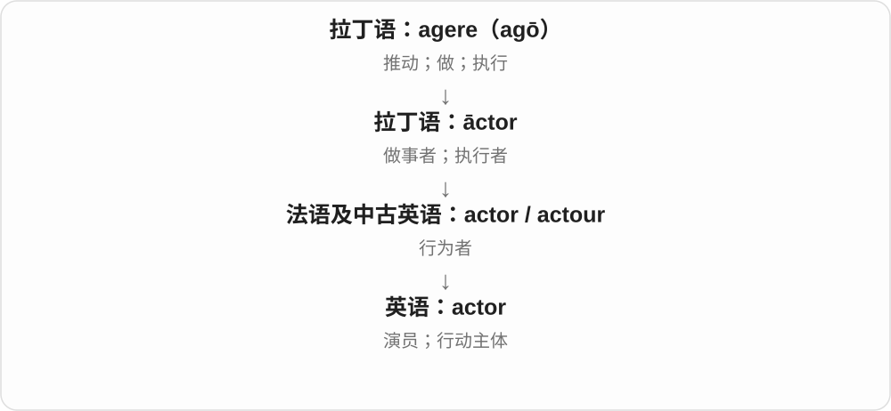

现在最常见是演员，也能在政治、社会和技术讨论中指参与行动的人或组织。actor 可以不限定性别。

**常见搭配与例句**

a talented actor；a leading actor；a key political actor。

> The actor gave a quiet, convincing performance.

这位演员的表演克制而有说服力。

> Local groups became important actors in the negotiations.

当地团体成了谈判中的重要参与方。

**别混淆**

actress 明确指女演员；actor 在现代用法中可以泛指任何性别的演员。

### 7. reactor — 反应器；反应堆

**音标**：英 /riˈæktə/；美 /riˈæktər/

**先抓住这个画面**

reactor 像为某种反应准备好的专用工作空间，控制它在哪里、怎样发生。

**怎么拆**

react + -or，表示承载反应的装置。

**怎么变成今天的意思**

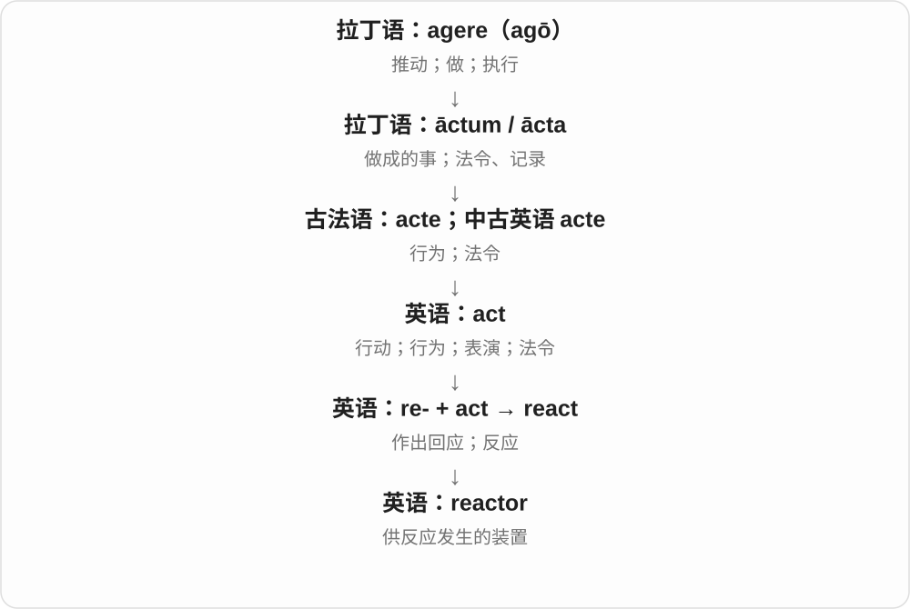

化工里可以是反应容器，核能里通常指核反应堆。看到 reactor 不能自动认定一定是核设施。

**常见搭配与例句**

a chemical reactor；a nuclear reactor；a reactor vessel。

> The chemical reactor was designed for continuous operation.

这台化学反应器设计为连续运行。

> The model shows the main parts of a nuclear reactor.

模型展示了核反应堆的主要部分。

**别混淆**

reactant 是被消耗并参与反应的物质；reactor 是反应发生的装置。

### 8. senator — 参议员；古罗马元老院成员

**音标**：英 /ˈsenətə/；美 /ˈsenətər/

**先抓住这个画面**

不是泛指“有资历的人”，而是某个 senate 里的成员；从古代长者议事的背景，变成一种明确的议员身份。

**怎么拆**

来自古法语 senator、拉丁 senator，远接 senex。现代可与 senate 对照着记，但拉丁语已有这个人物名词，不能把实际历史画成英语 senate + -or。

**怎么变成今天的意思**

**拉丁 senex，属格 senis**  
年老的；老人

↓

**拉丁 senator → 古法语 senator**  
元老院成员

↓

**中古英语 senatour → 英语 senator**  
元老院议员；参议员

a senator represents 或 serves，强调担任这个职位。读美国等国家新闻常译参议员，读古罗马史则依背景译元老或元老院成员。

**常见搭配与例句**

a senator from；elect a senator；serve as a senator；a former senator。

> The senator asked for a clearer explanation of the proposal.

这位参议员要求对提案作更清楚的解释。

> The historian described the influence of several Roman senators.

历史学家介绍了几位古罗马元老院成员的影响。

**别混淆**

senior 说明相对年长、资深或级别高；senator 是具体职位，一位年轻人也可能是 senator。

### 9. guarantee — 保证；担保；保修、保证承诺

**音标**：/ˌɡærənˈtiː/

**先抓住这个画面**

不是说大概会，而是明确承诺结果、质量或承担相应责任，可以说 guarantee；作名词就是这份保证。

**怎么拆**

借法语 guarantie 等担保材料，与 guaranty、warranty 有历史联系；末尾不是表示小、人的 -ee 后缀就能解释全词。

**怎么变成今天的意思**

**法语 guarantie、guarantir 等，远接日耳曼语相关材料**  
保护、担保、作保证

↓

**英语 guarantee、guarantor**  
保证；担保人、保证者

guarantee that 保证某事；a guarantee of quality 质量保证；under guarantee 在保修期内；no guarantee of success 不保证成功。

**常见搭配与例句**

guarantee that；no guarantee of；under guarantee。

> The new method does not guarantee success.

新方法不保证一定成功。

> The printer is still under guarantee.

打印机仍在保修期内。

**别混淆**

guarantee 常是明确保证，不等于 prediction 预测。具体承诺覆盖什么，仍看它实际说了什么。

### 10. guaranteed — 保证了、担保了；有保证的〔过去式、过去分词〕

**音标**：/ˌɡærənˈtiːd/

**先抓住这个画面**

有人正式站出来说这件事会兑现、会负责，是 guaranteed。可以保证座位、提供某项服务，或为产品承担约定责任。

**怎么拆**

guarantee 去 e + -ed → guaranteed，保留 ee，末尾读 /d/。guarantee 接法语 guarantie 等担保词族，与 guaranty、warranty 有历史关系；英语动词及过去形式后发展。

**怎么变成今天的意思**

**法语担保词族 → guarantee**  
作保证、承担责任的安排

↓

**guarantee 去 e + -ed → guaranteed**  
过去作保证；被承诺能获得或实现

a guaranteed seat 保证有的座位；guaranteed delivery 有承诺的送达；guaranteed to work 被保证能奏效。

**常见搭配与例句**

guaranteed a place 保证给一个名额；guaranteed by the organiser 由主办方担保。

> Booking early guaranteed us seats on the train.

提前订票确保我们坐火车时有座位。

> The organiser guaranteed that everyone would receive the materials.

主办方保证每个人都能收到材料。

**别混淆**

guaranteed 说明存在保证或作出承诺，具体保证什么、由谁负责，要看完整说法。The organiser guaranteed... 中是主办方在作保证。

### 11. guarantees — 保证；保修承诺〔复数〕；保证、确保〔第三人称〕

**音标**：英 /ˌɡærənˈtiːz/；美 /ˌɡerənˈtiːz/

**先抓住这个画面**

有人对结果或责任作出明确承诺，就是 guarantees；它可以是一份份保证，也可以是某人作保证的动作。

**怎么拆**

guarantee + -s → guarantees，保留 ee，/iː/ 后读 /z/。词史经法语 garant 等保护、担保材料，形式后来有改变；不是总能把 -ee 直接译成被保证者。

**怎么变成今天的意思**

**法语 garant 保护者、保证等 → 较早英语相应形式**  
远接日耳曼保护、守护的材料

↓

**guarantee 的担保、保证名词及动词 → guarantees**  
现代复数与第三人称同形，末尾重读 /tiːz/

written guarantees 是书面保证；guarantees that... 是保证某事；guarantees success 是保证成功。实际句子还可能说不能保证。

**常见搭配与例句**

written guarantees；guarantees that...；no guarantees。

> The shop provides written guarantees with its repairs.

这家店为维修服务提供书面保证。

> Careful planning never guarantees a perfect result.

周密计划也从不能保证结果完美。

**别混淆**

guarantees 表承诺、确保；不应仅因见到这个词就判断任何具体承诺都必然能兑现，句子本身也可能是否定或转述。

### 12. guarantor — 担保人；保证者

**音标**：英 /ˌɡærənˈtɔː/；美 /ˌɡærənˈtɔːr/

**先抓住这个画面**

guarantee 是保证，guarantor 是站出来承担保证职责的人或机构。谈协议、租约等时要看具体为哪件事作保。

**怎么拆**

guarantee 的 guarant- 词干材料 + -or，末段 ee 不保留；不是完整 guarantee 再原样加 or。

**怎么变成今天的意思**

**法语 guarantie、guarantir 等，远接日耳曼语相关材料**  
保护、担保、作保证

↓

**英语 guarantee、guarantor**  
保证；担保人、保证者

act as guarantor 担任保证者；a guarantor for someone 为某人作保的担保人。

**常见搭配与例句**

act as a guarantor；a guarantor of。

> The document names her as the guarantor.

文件列明她为担保人。

> The organisation agreed to act as guarantor of the arrangement.

组织同意担任该安排的保证者。

**别混淆**

guarantor 是作保证的一方；borrower 是借款人。两种角色不同，不能因为都在一份文件里就混为同一人。

### 13. operator — 操作员；运营商；算符；精于办事的人

**音标**：英 /ˈɒpəreɪtə/；美 /ˈɑːpəreɪtər/

**先抓住这个画面**

掌握控制或执行规则，让一套东西运行起来的那一方。

**怎么拆**

借自拉丁 operātor“工作者”，接 operārī；现代可看成 operate + -or，但历史上名词有自己的借入路线。

**怎么变成今天的意思**

**拉丁 opus〔属格 operis〕／opera**  
工作、劳动；做成的作品

↓

**拉丁 operārī → operātor**  
做事 → 做事的人

↓

**英语 operator**  
操作设备或经营服务的人、机构；后来用于数学和计算机

电话 operator 原来替用户接线；bus operator 可以是运营公交的公司。程序中的 + 是一种 operator，指定对两边的数做什么。a smooth operator 则形容很会办事、周旋的人，可能略带警惕。

**常见搭配与例句**

a machine operator；a tour operator；a network operator；a mathematical operator。

> The crane operator waited for a signal before lifting the load.

起重机操作员等到信号后才吊起重物。

> The tour operator arranged transport between the two islands.

旅游运营商安排了两座岛之间的交通。

**别混淆**

operation 是做的事或运行过程；operator 是执行者，也可以是规定运算的符号或映射。

### 14. inspector — 检查员；督察

**音标**：英 /ɪnˈspektə/；美 /ɪnˈspektər/

**先抓住这个画面**

inspector 是拿着标准去现场看细节的人：哪里合格，哪里需要修改，都要逐项检查。

**怎么拆**

借自拉丁语 īnspector，来自 īnspicere“检查”。inspect + -or 是便于理解的对应，不代表最初在英语中造词。

**怎么变成今天的意思**

从察看的人发展成正式职位名称。警务中的 inspector 也可能是职级，具体职责随地区而变。

**常见搭配与例句**

a building inspector；a safety inspector；a police inspector。

> The inspector checked the emergency exits.

检查员检查了紧急出口。

> A building inspector visited the site yesterday.

建筑检查员昨天到现场检查。

**别混淆**

inspector 负责检查；spectator 只是观看者。两者都“看”，但任务不同。

### 15. chancellor — 某些国家的总理；英国财政大臣；某些大学的校长或名誉校长等

**音标**：英 /ˈtʃɑːnsələ/；美 /ˈtʃænsələr/

**先抓住这个画面**

历史画面是站在法院栏杆旁处理出入和文书的官员；职位逐渐重要起来，名称后来用于多种高级职务。

**怎么拆**

晚期拉丁 cancellarius 联系 cancelli“栅格、栏杆”，经古法语 chancelier、盎格鲁法语进入英语。现代不能理解为在教堂 chancel 里工作的人加 -or。

**怎么变成今天的意思**

**拉丁 cancelli → 晚期拉丁 cancellarius**  
栏杆 → 法庭栏杆旁的门吏、文书官

↓

**古法语 chancelier／盎格鲁法语 → 中古英语 chancellor**  
高级行政、文书职务

↓

**现代不同制度中的 chancellor**  
总理、财政大臣或大学职务等

德国或奥地利新闻中的 Chancellor 通常译为总理；英国财政语境中的 Chancellor 常是 Chancellor of the Exchequer。大学里的 chancellor 则要看当地制度，可能是行政领导，也可能主要承担礼仪性职责。

**常见搭配与例句**

the German chancellor；the Chancellor of the Exchequer；a university chancellor。

> The chancellor addressed parliament before the vote.

总理在表决前向议会发表讲话。

> The university’s chancellor presented the honorary degrees.

这所大学的校长颁授了荣誉学位。

**别混淆**

它不是世界各地完全相同的官职，也不能一概译成校长。counsellor“顾问”或“咨询师”拼写和词源都不同。

### 16. instructor — 教练；指导员；讲师

**音标**：英 /ɪnˈstrʌktə/；美 /ɪnˈstrʌktər/

**先抓住这个画面**

instructor 通常是站在旁边示范、纠正，带你把某种技能练会的人。

**怎么拆**

来自拉丁 instructor“安排者、教导者”，与 instruere 同源；现代可分析成 instruct + -or，但历史上有独立的拉丁名词。

**怎么变成今天的意思**

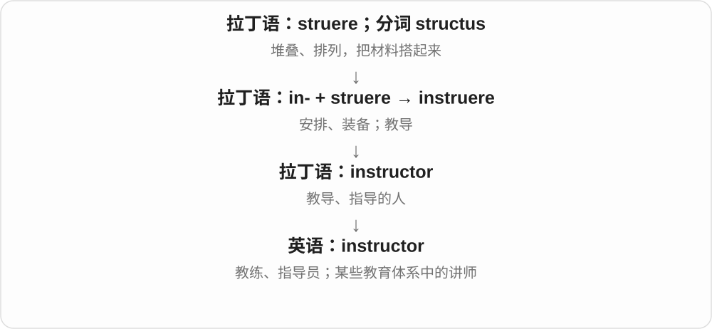

driving instructor、ski instructor 都很常见。大学中的 Instructor 也可是一种具体职称，其等级和职责取决于学校制度。

**常见搭配与例句**

a driving instructor；a fitness instructor；a course instructor。

> My driving instructor taught me how to park on a hill.

我的驾驶教练教我如何在坡道上停车。

> Ask the course instructor before changing your project topic.

更改项目题目前，先问问课程老师。

**别混淆**

teacher 是最广泛的教师称呼；instructor 常突出具体技能或课程的指导。professor 不能自动与它互换。

### 17. advisor — 顾问；指导者

**音标**：英 /ədˈvaɪzə/；美 /ədˈvaɪzər/

**先抓住这个画面**

advisor 是可以帮你看清选项、给出专业意见的人，而不是替你活出全部决定的人。

**怎么拆**

advise + -or；与 adviser 是同一词的不同常用拼写。

**怎么变成今天的意思**

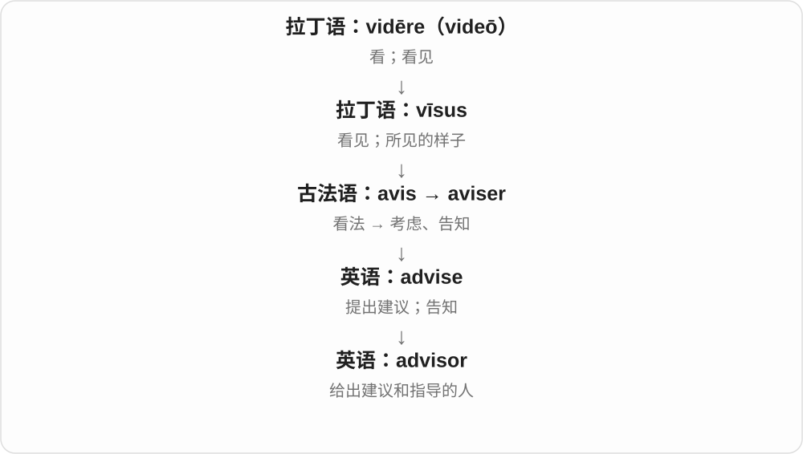

常见于职业或机构职位名称。学业 advisor 会帮助选课或规划学习，具体职责依场景而定。

**常见搭配与例句**

an academic advisor；a financial advisor；ask an advisor。

> My academic advisor helped me choose my classes.

我的学业顾问帮我选了课程。

> She works as an advisor to the museum.

她担任博物馆顾问。

**别混淆**

advisor 与 adviser 通常没有稳定的意义区别，采用机构或文本统一的拼写即可。

### 18. survivor — 幸存者；经历重大困境后活下来的人；仍存留的事物

**音标**：英 /səˈvaɪvə/；美 /sərˈvaɪvər/

**先抓住这个画面**

把“仍然活着、仍然存在”落到具体个体上，突出他或它经过了某种考验。

**怎么拆**

英语 survive + 拉丁式表人词尾 -or。早期法律用法指比别人活得久的人，后来扩展到灾难幸存者等。

**怎么变成今天的意思**

**拉丁 super**  
在上方、超过、越过

↓

**后期拉丁 super- + vivere → supervivere**  
超过某时点而活着；比别人活得久

↓

**古法语／盎格鲁法语 survivre → 英语 survive**  
继续活着、幸存；继续存在

↓

**英语 survive + -or → survivor**  
继续活着的人；留下来的个体

a survivor of the earthquake 是地震幸存者。a cancer survivor 是经历癌症而生存的人，并不单凭这个称呼就能判断其治疗是否结束。也可说建筑是历史时期的 survivor。

**常见搭配与例句**

a survivor of；the sole survivor；a survivor of hardship。

> The rescuers spoke to three survivors of the flood.

救援人员与三名洪灾幸存者交谈。

> This cottage is a rare survivor from the medieval village.

这间小屋是那座中世纪村庄罕见的遗存。

**别混淆**

victim 强调遭受伤害，survivor 强调经历之后的生存；具体称呼应符合本人选择和上下文。

### 19. investor — 投资者；投资机构

**音标**：英 /ɪnˈvestə/；美 /ɪnˈvestər/

**先抓住这个画面**

拿出资金参与项目或持有资产，希望得到回报的一方。

**怎么拆**

invest + -or；施事名词可以指个人，也可以指机构。

**怎么变成今天的意思**

**拉丁 vestis / vestire**  
衣服／给……穿衣

↓

**拉丁 in- + vestire → investire；法语／拉丁语 → 英语 invest**  
给人披上衣服、职服 → 赋予职位、权力

↓

**金融义的同源支线：意大利 investire 的特殊用法，很可能影响英语 invest**  
给资本一种新形式 → 投入资金以求收益；后来也投入时间、精力

↓

**英语 invest + -or → investor**  
投资 → 提供投资资金的一方

an individual investor 是个人投资者；an institutional investor 是机构投资者。投入多少、怎么参与、持有多久，需要另外说明。

**常见搭配与例句**

attract investors；an institutional investor；a private investor。

> The founders presented their plan to potential investors.

创办人向潜在投资者介绍了计划。

> The report explains the project’s risks to investors.

报告向投资者说明了项目风险。

**别混淆**

donor 提供捐助，通常不索取投资回报；investor 则带投资目的。shareholder 是股东，只涵盖持有股份的情况。

### 20. elevator — 电梯；升降装置；飞机升降舵

**音标**：美 /ˈeləveɪtər/；英 /ˈelɪveɪtə/

**先抓住这个画面**

最初的画面是把东西提起来的东西，后来落到不同领域的具体装置上。

**怎么拆**

接拉丁 elevator“抬举者”与 elevare；现代可联系 elevate + -or，但英语早期还用于抬举肌肉，不能只从楼内电梯倒推历史。

**怎么变成今天的意思**

**拉丁 levis → levare**  
轻 → 抬起、使负担减轻

↓

**拉丁 elevare → elevator**  
抬起 → 抬举者

↓

**英语 elevator 的早期解剖用法及机械用法**  
抬举肌肉；把物体升高的装置

↓

**现代常见 elevator**  
楼内升降机；另用于飞机俯仰操纵面等

美国英语里楼内的电梯叫 elevator，英国英语通常说 lift。飞机 elevator 调节机头上仰、下俯，名称保留“升降”的画面，但它不是舱内运人的小房间。grain elevator 又可指谷物提升装置及相关储运设施。

**常见搭配与例句**

take the elevator；a freight elevator；the aircraft elevator。

> We took the elevator to the eighth floor.

我们乘电梯上了八楼。

> The pilot checked the elevator before the training flight.

飞行员在训练飞行前检查了升降舵。

**别混淆**

escalator 是自动扶梯；elevator 常是沿井道升降的轿厢。飞机升降舵控制俯仰，不是只允许飞机向上。

### 21. generator — 发电机；发生器；生成工具

**音标**：英 /ˈdʒenəreɪtə/；美 /ˈdʒenəreɪtər/

**先抓住这个画面**

把某种过程的产出源头当作一个装置或角色来命名。

**怎么拆**

借拉丁 generātor“生育者、生产者”；现代可以联系 generate + -or，但英语并非只有现场加后缀这一种历史。

**怎么变成今天的意思**

**拉丁 gignere、genitus；同族 genus、gener-**  
生出、产生；种类、出身

↓

**拉丁 generāre → generātor → 英语 generator**  
产生 → 生产者、产生装置

↓

**英语技术用法**  
发电机；信号、数据等生成工具

最常见的是发电机，把机械能转成电能；也有 signal generator“信号发生器”、password generator“密码生成器”。它们都提供某种输出，不是凭空造出能量。

**常见搭配与例句**

an electric generator；a backup generator；a random number generator。

> The hospital has a backup generator for power cuts.

医院备有发电机，以应对停电。

> The software includes a random number generator.

软件包含一个随机数生成器。

**别混淆**

motor 常把电能等转为机械运动；electric generator 则把机械能转为电能，方向不同。

### 22. coordinator — 协调员；统筹者

**音标**：英 /kəʊˈɔːdɪneɪtə/；美 /koʊˈɔːrdəneɪtər/

**先抓住这个画面**

大家各忙各的时，有个人负责把时间、信息和任务接在一起，这个人就是 coordinator。

**怎么拆**

coordinate + -or，表示承担协调职责的人。

**怎么变成今天的意思**

**拉丁语：ōrdō；词干 ōrdin-**  
一行、一列；次序、等级、安排

↓

**拉丁语：ōrdināre；分词 ōrdinātus**  
使有次序；安排、任命

↓

**中世纪拉丁语：coōrdināre → coōrdinātus**  
共同安排 → 处于同一等级的

↓

**英语：coordinate**  
同级的；协调；由形容词发展出坐标名词

↓

**英语：coordinate + -or → coordinator**  
协调 → 负责协调的人

event coordinator、project coordinator 很常见。职位重点是统筹安排，不一定是团队里职位最高的人。

**常见搭配与例句**

a project coordinator；a volunteer coordinator；the course coordinator。

> The coordinator sent everyone the updated schedule.

协调员给大家发了更新后的日程。

> Ask the volunteer coordinator where help is needed.

问问志愿者协调员哪里需要帮忙。

**别混淆**

manager 常包括管理责任；coordinator 突出协调，但实际职位权限要看机构。

### 23. investigator — 调查员；研究者

**音标**：英 /ɪnˈvestɪɡeɪtə/；美 /ɪnˈvestɪɡeɪtər/

**先抓住这个画面**

负责沿着线索往下查的人。

**怎么拆**

来自拉丁 investigator，接 investigare；现代可用 investigate + -or 理解职业或角色。

**怎么变成今天的意思**

**拉丁 vestigium**  
脚印、足迹、留下的痕迹

↓

**拉丁 vestigare → in- + vestigare → investigare**  
沿足迹追踪 → 深入查找、调查

↓

**拉丁 investigator → 英语 investigator**  
追踪、查问的人 → 调查员、研究者

an investigator 可以调查事故，也可以负责科研项目。principal investigator 在研究项目中常指主要负责人，不是“最高级的侦探”。

**常见搭配与例句**

an accident investigator；a private investigator；principal investigator。

> The investigator compared the two witnesses’ accounts.

调查员对比了两名证人的叙述。

> She is the principal investigator on the research project.

她是这个研究项目的主要负责人。

**别混淆**

detective 常指侦探或刑事调查人员；investigator 的范围更大，科研调查者也可用。

### 24. investigators — 调查人员、调查者；研究人员〔复数〕

**音标**：英 /ɪnˈvestɪɡeɪtəz/；美 /ɪnˈvestɪɡeɪtərz/

**先抓住这个画面**

顺着线索查，努力弄清到底发生了什么的人，是 investigators。可以查案件、事故，也可以研究科学问题。

**怎么拆**

investigator 借拉丁 investigator，接 investigare 深入追查，较早 vestigium 足迹；现代可对应 investigate 去 e 加完整 -or。复数在整个 investigator 后加 -s，尾 /z/。

**怎么变成今天的意思**

**拉丁 vestigium、investigare → investigator → 英语借词**  
足迹、沿迹追查 → 调查者

↓

**investigator + -s → investigators**  
多位调查者、研究者

accident investigators 事故调查人员；independent investigators 独立调查者；research investigators 研究人员。

**常见搭配与例句**

a team of investigators 调查团队；investigators examining the evidence 正在查看证据的调查人员。

> The investigators compared the two accounts carefully.

调查人员仔细比较了两种说法。

> Several investigators took part in the research project.

几位研究人员参加了这个研究项目。

**别混淆**

investigators 不自动等于警察。看要查的是哪一类问题，也不表示他们已经查明结论。

### 25. processor — 处理器；加工设备、企业；处理某事者

**音标**：英 /ˈprəʊsesə/；美 /ˈprɑːsesər/

**先抓住这个画面**

把东西送进去，按规则变成结果的那个人、设备或机构；电脑里处理指令的芯片是常见一例。

**怎么拆**

process + -or，-or 形成执行作用的人、物名称。电脑处理器、食品加工机、加工企业等取不同对象，不是所有 processor 都是 CPU。

**怎么变成今天的意思**

**拉丁 prōcēdere → prōcessus → 法语 proces → 英语 process**  
向前推进 → 行进、进程、过程

↓

**英语 process 的动词和派生词**  
按程序处理；处理过的；执行处理的设备、人或机构

↓

**process + -or → processor**  
处理 → 执行处理的人、设备、机构

a computer processor 计算机处理器，a food processor 食品加工机，a payment processor 支付处理服务商；word processor 文字处理软件或设备。

**常见搭配与例句**

a computer processor；a food processor；a payment processor；a word processor。

> The laptop has a more powerful processor.

这台笔记本电脑有一个更强的处理器。

> She chopped the vegetables in a food processor.

她用食品加工机切碎了蔬菜。

**别混淆**

processor 是执行处理的设备或主体，process 是过程或处理动作；processing 是处理活动，三者句法对象不同。

### 26. narrator — 叙述者；旁白者

**音标**：英 /nəˈreɪtə/；美 /ˈnæreɪtər/，也读 /nəˈreɪtər/

**先抓住这个画面**

你读故事时仿佛听到的那个声音，就是故事的叙述者。

**怎么拆**

来自拉丁 narrator，接 narrare 讲述与施事词尾；现代可对应 narrate + -or，但不是必须先有英语 narrate。

**怎么变成今天的意思**

**拉丁 gnarus → narrare**  
知道、熟悉 → 把事情讲给人知道

↓

**拉丁 narrator → 英语 narrator**  
讲述的人 → 叙述者、旁白者

小说里的 narrator 可能是其中一个角色，也可能站在故事外面讲。作者创造了叙述者，两者不必是同一个人。unreliable narrator 是叙述不完全可信的角色，读者要从细节发现他的误解、偏见或隐瞒。

**常见搭配与例句**

the narrator of the story；an unreliable narrator；a first-person narrator；a documentary narrator。

> The narrator remembers the village very differently from the other characters.

叙述者对村庄的记忆与其他人物很不一样。

> The documentary’s narrator explains what the animals are doing.

纪录片的旁白者解释了动物正在做什么。

**别混淆**

author 是创作作品的人；narrator 是作品里承担讲述的声音。主角也未必就是 narrator。

### 27. sailor — 水手、船员；帆船运动者

**音标**：英 /ˈseɪlə/；美 /ˈseɪlər/

**先抓住这个画面**

以航海为工作，或熟练操帆作为活动的人；今天也可在没有帆的船上当 sailor。

**怎么拆**

早期写 sailer，来自 sail + -er，后来 -or 拼法固定下来，常解释受 tailor 等词形影响。现代可认 sail + -or，但不是因此就把整个词说成拉丁借入。

**怎么变成今天的意思**

**古英语 seġl / seġlan → sail**  
帆、靠帆航行；名词动词各有旧形式

↓

**英语航行、滑行扩展**  
航海活动、船员、帆的位置；帆般背鳍的鱼名

↓

**sail + -er → sailer → sailor**  
航行的人，拼写后来固定为 -or

an experienced sailor 老练水手，a merchant sailor 商船船员，a keen sailor 帆船运动爱好者；sailor suit 水手服。

**常见搭配与例句**

an experienced sailor；a merchant sailor；a keen sailor。

> The sailors prepared the ship for departure.

船员们为出航做准备。

> She is an experienced sailor who enjoys weekend races.

她是一位经验丰富的帆船运动者，喜欢周末比赛。

**别混淆**

sailor 不等于 captain 船长，职业等级由语境决定；good sailor 也可能说适应乘船、不易晕船的人，不只技术好。

### 28. contributor — 贡献者；捐助者；撰稿人；促成因素

**音标**：英 /kənˈtrɪbjətə/；美 /kənˈtrɪbjətər/

**先抓住这个画面**

不是独自做成全部，而是为整体添了其中一份的人或因素。

**怎么拆**

盎格鲁法语 contributour 接拉丁 contribut- 词干和表人的词尾，进入中古英语。现代虽能认出 contribute + -or，名词有自己的法语借入路线。

**怎么变成今天的意思**

**拉丁 con- + tribuere → contribuere，分词 contributus**  
共同 + 分给、付出 → 汇集、贡献

↓

**盎格鲁法语 contributour → 中古英语 contributour**  
缴纳一份税款或费用的人

↓

**英语 contributor**  
贡献者、捐助者、撰稿人；也指促成因素

a contributor to a magazine 是给杂志写稿的人，未必是正式雇员。a contributor to a problem 是问题的成因之一，名词也不保证褒义。

**常见搭配与例句**

a regular contributor；a major contributor to…。

> She is a regular contributor to the local magazine.

她经常给当地杂志撰稿。

> Late deliveries were a major contributor to the project’s problems.

交货延迟是项目出现问题的一大原因。

**别混淆**

author 强调写成作品；contributor 强调为共同刊物、项目或结果提供一部分。

### 29. detector — 探测器；检测器；发现者

**音标**：英 /dɪˈtektə/；美 /dɪˈtektər/

**先抓住这个画面**

专门对某一种迹象作出反应，告诉人们它存在的东西。

**怎么拆**

有拉丁 dētēctor 借入分析；现代可按 detect + -or 理解，意思是执行检测的人或装置。

**怎么变成今天的意思**

**拉丁 tegere / tectus**  
盖住；tectus 是分词词干

↓

**拉丁 dē- + tegere → dētegere / dētectus**  
去掉遮盖、揭露

↓

**拉丁 dētēctor → 英语 detector**  
揭露者、发现者；后用于检测装置

smoke detector 检测烟，metal detector 检测金属。很多 detector 会触发警报，但“能检测”与“会报警”不是完全相同的功能。

**常见搭配与例句**

a smoke detector；a metal detector；a radiation detector。

> The smoke detector sounded when the toast burned.

面包烤焦时，烟雾探测器响了。

> A metal detector located the lost key under the sand.

金属探测器找到了沙子下面丢失的钥匙。

**别混淆**

detective 是侦探；detector 多指装置。sensor 强调感知输入，detector 强调判断目标信号存在。

### 30. solicitor — 事务律师；代办法律事务者；招揽者〔部分语境〕

**音标**：英 /səˈlɪsɪtə/；美 /səˈlɪsɪtər/

**先抓住这个画面**

从替人操心、奔走办事的人，发展成处理法律事务的职业名称。

**怎么拆**

法语 soliciteur / soliciteor，接 soliciter；不是只在现代英语 solicit 后加 -or 的历史。

**怎么变成今天的意思**

**拉丁 sollus“整个” + citus“被唤起的” → sollicitus**  
整个心神被搅动 → 焦虑、挂心

↓

**拉丁 sollicitāre → 法语 soliciteur → 英语 solicitor**  
为事务奔走、请求的人 → 特定律师职业

在英格兰和威尔士，solicitor 为客户提供多种法律服务；符合相应权限也可出庭，不能简单说成“永不上法庭的律师”。美国部分语境也可能是政府法律官员或推销招揽者。

**常见搭配与例句**

consult a solicitor；a firm of solicitors。

> She asked a solicitor to review the contract.

她请一位律师审查合同。

> The solicitor explained the options available to the client.

律师向客户解释了可选的处理方式。

**别混淆**

barrister 与 solicitor 的职责有传统分工也有重叠；lawyer 是更宽泛的律师称呼。

### 31. translator — 翻译者、译者；翻译工具、转换程序

**音标**：英 /trænzˈleɪtə/；美 /trænzˈleɪtər/，亦见前重音 /ˈtrænzleɪtər/

**先抓住这个画面**

负责把意思搬过来的人，或执行这种转换的工具；书封上的译者和网页里的自动翻译器都可能用它。

**怎么拆**

经法语、拉丁 trānslātor 等人物名词借入，接 trānslāt- + -or 执行者材料。现代可对照 translate + -or，但不写成唯一英语现场构词史。

**怎么变成今天的意思**

**拉丁 trāns-；ferre 与其不规则分词 lātus**  
跨过；携带，与被带过去的形式

↓

**拉丁 trānslātus、trānslātiō、trānslātor 等**  
带过；转移过程；执行者，形成同族的平行词

↓

**trānslātor、法语相关形式 → translator**  
执行翻译、转换的人或工具

a literary translator 文学译者，a freelance translator 自由职业译者，an online translator 在线翻译工具。

**常见搭配与例句**

a literary translator；a freelance translator；an online translator。

> The translator checked every reference in the poem.

译者核查了诗里的每处典故。

> The online translator struggled with the idiom.

在线翻译工具没能很好处理那个习语。

**别混淆**

translator 主体，translation 过程或结果；职业区分常用 translator 说笔译者、interpreter 说口译者，具体工作范围依语境。

### 32. distributor — 经销商；分销商；分配装置

**音标**：英 /dɪˈstrɪbjətə/；美 /dɪˈstrɪbjətər/

**先抓住这个画面**

负责把产品从上游分到下游各处的角色，或者执行分配功能的装置。

**怎么拆**

distribute + -or；动作名词化为执行者。

**怎么变成今天的意思**

**拉丁 tribuere**  
分派、给予、支付；传统词源常联系 tribus“群体、部族”

↓

**拉丁 dis- + tribuere → distribuere / distribūtus**  
分开给予 → 分配

↓

**英语 distribute**  
分发、配送、分布

↓

**英语 distribute + -or → distributor**  
分发 → 负责分发的人、公司或装置

商业中 distributor 通常从生产方取得货物再供应给其他商家，具体商业角色依合同而定。传统发动机里也有分电器这个义项，因为它分配点火电流。

**常见搭配与例句**

a regional distributor；an authorised distributor；a film distributor。

> The manufacturer appointed a regional distributor.

制造商指定了一家地区分销商。

> A film distributor arranged the movie’s release in several countries.

电影发行商安排了这部影片在几个国家上映。

**别混淆**

manufacturer 制造产品；distributor 组织分销；retailer 通常直接零售给消费者，同一公司也可能兼任几种角色。

### 33. regulator — 调节器；监管者或监管机构

**音标**：英 /ˈreɡjəleɪtə/；美 /ˈreɡjəleɪtər/

**先抓住这个画面**

系统跑得太快、压力太高，或行业越了线，都需要有人或装置把它拉回范围内。

**怎么拆**

regulate + -or，去末尾 e；表示执行调节的东西或人。

**怎么变成今天的意思**

**拉丁语：regere**  
引导、使直；治理

↓

**拉丁语：regula**  
直尺、直条；准则

↓

**后期拉丁语：regulare → regulatus**  
按准则调节、管理

↓

**英语：regulate**  
调节；监管

↓

**英语：regulate + -or → regulator**  
调节装置；监管主体

a pressure regulator 是调压器；the financial regulator 是金融监管机构。它可以是机器，也可以是负责订规则、监督落实的机构。

**常见搭配与例句**

a voltage regulator；a pressure regulator；an industry regulator。

> The regulator keeps the gas pressure within a safe range.

调压器把气体压力维持在安全范围内。

> The regulator asked the company for more information.

监管机构要求公司提供更多信息。

**别混淆**

controller 更宽泛；regulator 常突出维持标准值或执行规章。

### 34. simulator — 模拟器；模拟设备；假装者〔较旧〕

**音标**：英 /ˈsɪmjəleɪtə/；美 /ˈsɪmjəleɪtər/

**先抓住这个画面**

把真实环境的关键反应做出来，让人能够在替代环境里练习或测试。

**怎么拆**

有拉丁 simulātor“模仿者”的借入分析，也可按 simulate + -or 理解；设备义由执行模拟的人或物扩展而来。

**怎么变成今天的意思**

**拉丁 similis**  
相像、同类；与 simul“一起、同时”同族

↓

**拉丁 simulāre → simulātor → 英语 simulator**  
模仿、假装 → 模仿者

↓

**英语设备用法**  
用来模拟环境或系统的设备、程序

驾驶模拟器可以再现仪表和路况；它不必把每个细节都复制。游戏里的 simulator 也强调模拟体验，逼真程度仍取决于设计。

**常见搭配与例句**

a flight simulator；a driving simulator；train on a simulator。

> The trainee practised an emergency landing in a flight simulator.

学员在飞行模拟器中练习紧急降落。

> The simulator lets engineers test the control system without using the real machine.

模拟器让工程师无需使用真机就能测试控制系统。

**别混淆**

simulation 是模拟活动或场景；simulator 是执行模拟的设备、软件或系统。

### 35. calculator — 计算器；原来也指计算的人

**音标**：英 /ˈkælkjʊleɪtə/；美 /ˈkælkjəleɪtər/

**先抓住这个画面**

把原来由人拿筹码、拿纸笔完成的算数工作，交给一个工具。

**怎么拆**

历史借自拉丁 calculator 计算者；现代可对应 calculate + -or。它在英语里先能指人，后来用于计算装置。

**怎么变成今天的意思**

**拉丁 calx，词干 calc-**  
石灰、石灰石

↓

**拉丁 calculus → calculare**  
小石子、计数筹码 → 计算

↓

**拉丁 calculator → 英语 calculator**  
计算的人 → 机械、电子计算器

日常 a calculator 大多是计算器。a mortgage calculator、a calorie calculator 还可以是网页中的一个计算工具，不必有实体按键。词尾 -or 原本能指做事的人，这里又扩展到做事的设备。

**常见搭配与例句**

use a calculator；a pocket calculator；a scientific calculator；an online calculator。

> You may use a calculator for this part of the test.

考试的这一部分可以使用计算器。

> The website has a calculator for estimating delivery costs.

网站上有一个估算配送费用的计算工具。

**别混淆**

calculator 主要解决计算任务；computer 是计算机，能力和含义范围更广，不能处处互换。

### 36. spectator — 观众；旁观者

**音标**：英 /spekˈteɪtə/；美 /ˈspekteɪtər/

**先抓住这个画面**

spectator 站在场边看事情发生，尤其常见于体育比赛：参与观看，但不下场比赛。

**怎么拆**

借自拉丁语 spectātor，来自 spectāre“观看”加表示人的后缀；不是英语 spectator 从 speculation 来。

**怎么变成今天的意思**

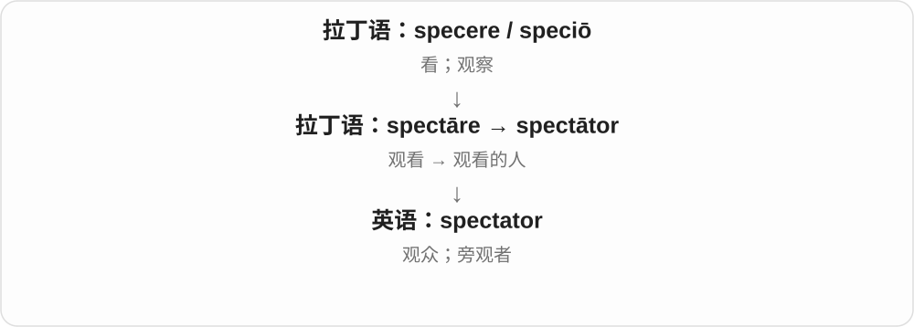

这个词突出看现场活动的人。比喻为 spectator，也可表示对事情只有观看、没有参与。

**常见搭配与例句**

a crowd of spectators；spectator sport；remain a spectator。

> Thousands of spectators watched the race.

数千名观众观看了比赛。

> She refused to remain a spectator in the debate.

她不愿在辩论中一直当旁观者。

**别混淆**

audience 常是节目或表达的受众；spectators 常是观看比赛、事件的人，两者有重叠。

### 37. accumulate — 积累、积聚；累积

**音标**：/əˈkjuːmjəleɪt/

**先抓住这个画面**

今天一点、明天一点，最后堆成一大堆，是 accumulate。可以是经验、灰尘、邮件，也可以是问题。

**怎么拆**

借拉丁 accumulatus，来自 ad- 向上、到一起的材料与 cumulare 堆积，关联 cumulus 一堆；ad- 在 c 前同化为 ac-。

**怎么变成今天的意思**

**拉丁 ad- + cumulare → accumulare、accumulatus**  
往堆里添 → 积聚

↓

**英语 accumulate**  
一点点增加；主动积累或自行堆积

accumulate experience 积累经验；dust accumulates 灰尘积聚；accumulate over time 随时间累积。

**常见搭配与例句**

accumulate experience；accumulate over time。

> Dust accumulated on the unused shelves.

闲置书架上积起了灰尘。

> She accumulated valuable experience over the years.

这些年她积累了宝贵经验。

**别混淆**

accumulate 强调渐渐累起来，collect 还可说一次收集；积起的也可能是不想要的垃圾、债务。

### 38. accumulator — 累加器；蓄积装置；蓄电池〔部分用法〕

**音标**：英 /əˈkjuːmjəleɪtə/；美 /əˈkjuːmjəleɪtər/

**先抓住这个画面**

数字不断往同一个总数里加，是程序里的 accumulator；某些装置把电能、压力等蓄起来，也沿着积存这个画面命名。

**怎么拆**

现代对应 accumulate 去 e 加 -or → accumulator；词尾在这里形成做相关事情的人、装置或部件名称。

**怎么变成今天的意思**

**拉丁 accumulare、accumulator 等**  
堆积、积攒；做相关事的人

↓

**英语 accumulator**  
累加器、不同领域的蓄积装置

不同领域有不同具体设备；看程序、汽车或液压文档时，先判断积起来的是什么。

**常见搭配与例句**

an accumulator variable；a hydraulic accumulator。

> The loop adds each value to an accumulator.

循环把每个值加入累加器。

> The diagram shows a hydraulic accumulator in the system.

示意图展示了系统中的液压蓄能器。

**别混淆**

accumulator 常突出累计、储存；generator 是发生器、发电机等。积存和产生不是同一个过程。

### 39. connector — 连接器；接头；起连接作用的东西

**音标**：英 /kəˈnektə/；美 /kəˈnektər/

**先抓住这个画面**

connector 像电缆末端的接头：靠它，两边才真正接得上。

**怎么拆**

connect + -or；-or 在这里常指执行连接作用的器件，也可以说起连接作用的人或成分。

**怎么变成今天的意思**

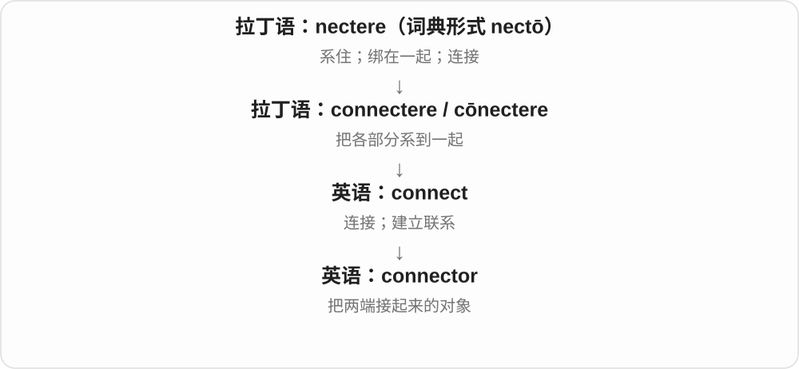

connection 是连接关系，connector 是让连接发生的具体东西。语言、网络等领域也可以借用这个角色。

**常见搭配与例句**

a cable connector；a power connector；a loose connector；a sentence connector。

> A loose connector caused the screen to flicker.

一个松动的接头导致屏幕闪烁。

> Check that the connector fits before plugging it in.

插入前先确认接头是否匹配。

**别混淆**

connector 不一定是整根 cable“电缆”。电缆末端的接口部件才常叫 connector。

### 40. illustrator — 插画师、绘制插图的人

**音标**：英 /ˈɪləstreɪtə/；美 /ˈɪləstreɪtər/

**先抓住这个画面**

illustrate a book 是给书配图，illustrator 就是画这些图的人。人物、场景、解释图都可能是工作内容，不必只画一种风格。

**怎么拆**

现代可拆 illustrate 去 e + -or；历史也有晚期拉丁语 illustrator 照亮、启发者的对应形式。英语从使人明白者发展到绘制插图者。

**怎么变成今天的意思**

**拉丁语 illustrare 照亮、使清楚 → illustratus、illustratio 等**  
光照与使人明白的比喻

↓

**英语 illustration 等 → illustrate，也有拉丁分词形式影响**  
举例说明、配图说明；+ -or、-ive

↓

**illustrate + -or／拉丁对应形式 → illustrator**  
启发、说明者 → 画插图的人

a children’s book illustrator 童书插画师；a freelance illustrator 自由职业插画师。

**常见搭配与例句**

a book illustrator；a freelance illustrator。

> The illustrator gave each character a distinctive shape.

插画师给每个角色设计了鲜明的外形。

> The author and illustrator worked closely together.

作者与插画师密切合作。

**别混淆**

illustrator 按配图工作命名，artist 范围更广；大写 Illustrator 也可能是软件专名，要看大小写和场景。

### 41. accelerator — 加速踏板；加速器；促进发展的事物

**音标**：英 /əkˈseləreɪtə/；美 /əkˈseləreɪtər/

**先抓住这个画面**

让某件事更快推进的装置或力量：开车时是脚下的踏板，其他场景可能是设备或帮助计划。

**怎么拆**

来自拉丁 accelerator 使事情加快者，基于 accelerare。-or 表执行某动作的人或物，不必只指人；汽车踏板是后来发展出的用途。

**怎么变成今天的意思**

**拉丁 celer → celerare**  
迅速的 → 使加快

↓

**拉丁 accelerare → accelerator**  
加快 → 使之加快的人或物

↓

**英语 accelerator**  
加速装置；汽车加速踏板等

press the accelerator 指踩加速踏板；particle accelerator 是粒子加速器。startup accelerator 则比喻帮助初创企业加快发展的项目，不能按“发动机零件”硬译。

**常见搭配与例句**

press the accelerator；take your foot off the accelerator；a particle accelerator。

> She took her foot off the accelerator as traffic slowed.

车流变慢时，她松开了加速踏板。

> The young company joined a business accelerator.

这家年轻公司加入了一个企业加速成长项目。

**别混淆**

accelerator 是让速度或进程改变的装置，不是 speedometer 速度表。后者显示速度，不负责给车加速。

### 42. projector — 投影机；提出计划的人〔旧义〕

**音标**：英 /prəˈdʒektə/；美 /prəˈdʒektər/

**先抓住这个画面**

把影像从设备里“送”到屏幕上，设备自己只是光路的起点。

**怎么拆**

主要可按 project + -or 理解，早期人称义也与拉丁语 projector 有联系；现代机器义由投射动作形成。

**怎么变成今天的意思**

**拉丁语：iacere；分词 iactus**  
投掷、抛出

↓

**拉丁语：pro- + iacere → proicere / proiect-**  
向前投、伸出

↓

**英语：project / 拉丁语相关人称形式 → projector**  
早期提出方案者；后来投射影像的机器

现代最常见是投影机。a projector screen 是投影幕，不是机器本身。

**常见搭配与例句**

a digital projector；a slide projector。

> Connect the laptop to the projector.

把笔记本电脑连接到投影机。

> The old slide projector still works.

那台旧幻灯机仍然能用。

**别混淆**

projection 是投影或投射结果；projector 是执行投影的设备。

### 43. projectors — 投影仪、放映机等投射设备〔复数〕

**音标**：英 /prəˈdʒektəz/；美 /prəˈdʒektərz/

**先抓住这个画面**

把小小的图像用光投到远处的大幕上，设备叫 projector；几台就是 projectors。

**怎么拆**

projector + -s。现代对应 project + -or，执行投射的设备名称；更远接拉丁向前投的词族。

**怎么变成今天的意思**

**拉丁 pro- 向前 + iacere 投 → proicere、proiectus 等**  
把东西向前投出、伸出

↓

**英语 project、projection 等词族**  
投射光与声音；计划、预测；突出部分等

↓

**projector + -s → projectors**  
多台投影、放映设备

digital projectors 是数码投影仪，film projectors 是胶片放映机；不同设备保留相同投射画面。

**常见搭配与例句**

two projectors 两台投影仪；ceiling-mounted projectors 顶部安装的投影仪。

> The hall has two digital projectors.

大厅里有两台数码投影仪。

> The projectors cast images onto opposite walls.

投影仪把影像投到相对的两面墙上。

**别混淆**

projectors 是发出投影的设备，screens 是承接影像的幕或屏；发出与接收的角色分开。

### 44. compressor — 压缩机；压缩工具；音频压缩器

**音标**：英 /kəmˈpresə/；美 /kəmˈpresər/

**先抓住这个画面**

负责把东西“压紧”的那台设备或那个程序。

**怎么拆**

compress + -or，也与近代拉丁语 compressor 形式相联系；-or 表执行者。

**怎么变成今天的意思**

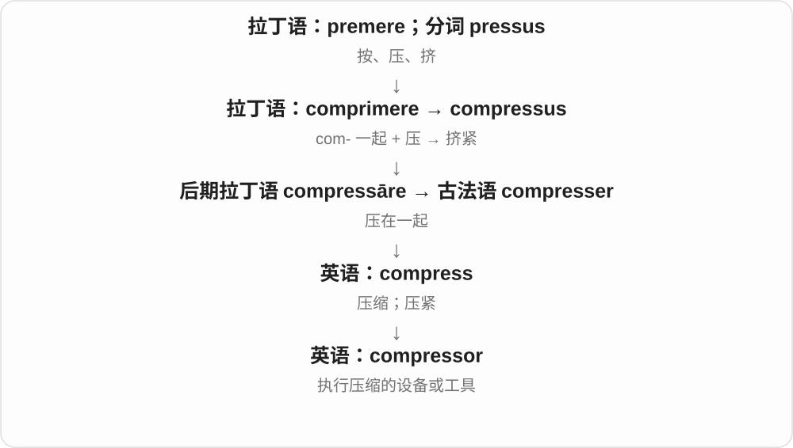

air compressor 压缩空气；音频 compressor 缩小声音强弱之间的动态范围；文件压缩器减少数据占用。

**常见搭配与例句**

an air compressor；an audio compressor；a file compressor。

> The workshop uses an air compressor to power several tools.

车间用空气压缩机为几种工具提供动力。

> The engineer used a compressor to control the recording’s dynamic range.

录音师用压缩器控制录音的动态范围。

**别混淆**

三种 compressor 的对象不同：空气、声音动态、数据表示。音频压缩器不必让文件更小。

### 45. inhibitor — 抑制剂；起抑制作用的事物

**音标**：英 /ɪnˈhɪbɪtə/；美 /ɪnˈhɪbɪtər/

**先抓住这个画面**

有些东西专门让某个过程慢下来或弱下去，像给反应装上一道刹车，它就是 inhibitor。

**怎么拆**

inhibit + -or，表示执行抑制作用的物质或因素。

**怎么变成今天的意思**

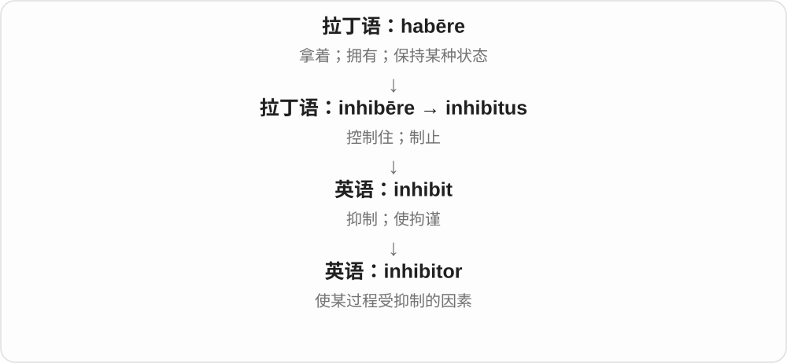

实验里可以是抑制酶反应的物质；工程里可以是减少腐蚀的添加剂。这里的 -or 不一定指人。

**常见搭配与例句**

an enzyme inhibitor；a corrosion inhibitor；an inhibitor of growth。

> The test compared the reaction with and without the inhibitor.

测试比较了加入和不加入抑制剂时的反应。

> A corrosion inhibitor was added to the cooling system.

冷却系统中加入了缓蚀剂。

**别混淆**

inhibitor 是起作用的东西；inhibition 是产生的抑制作用。activator 则使相关过程更容易启动或增强。

### 46. radiator — 暖气片；散热器

**音标**：英 /ˈreɪdieɪtə/；美 /ˈreɪdieɪtər/

**先抓住这个画面**

把热量向外传出去的装置：房间里借它取暖，汽车里借它带走发动机的热。

**怎么拆**

英语 radiate + -or“做这件事的装置”，采用拉丁式词尾。先泛指散发热等的东西，后来用于供暖设备和发动机冷却设备。

**怎么变成今天的意思**

**拉丁 radius**  
棒、辐条、光线；更早来源未定

↓

**拉丁 radiare → radiatus**  
发出光线、照耀 → 分词形式

↓

**英语 radiate**  
散发；从中心向外伸展

↓

**英语 radiate + -or → radiator**  
散发热的装置 → 暖气片、发动机散热器

两个常见意思看似相反：一个让房间变暖，一个让发动机降温。其实都在把热从装置内部交给外界，只是你关心的是哪一边的温度。

**常见搭配与例句**

a central heating radiator；a car radiator；a radiator valve；a leaking radiator。

> The radiator under the window keeps the bedroom warm.

窗下的暖气片让卧室保持温暖。

> The mechanic found a leak in the car’s radiator.

修车师傅发现汽车散热器有一处泄漏。

**别混淆**

heater 泛指加热器；radiator 聚焦散热部件。名称来自 radiate，不代表实际设备只能通过热辐射这一种机制传热。

### 47. radiators — 暖气片、散热器〔复数〕

**音标**：英 /ˈreɪdieɪtəz/；美 /ˈreɪdieɪtərz/

**先抓住这个画面**

房间里的暖气片把热送到室内，汽车散热器把多余热散出去。两种方向的系统任务不同，但设备都在向外放热。

**怎么拆**

radiator + -s。英语 radiate + -or 命名散发、散热的装置，复数再加 -s；不是把 radio 收音机直接加一个字母。

**怎么变成今天的意思**

**拉丁 radius**  
辐条、光线；从中心向外的形象

↓

**拉丁 radiare → radiatus → 英语 radiate**  
发出光线 → 散发、放射、向外伸展

↓

**radiate + -or → radiator → radiators**  
散发、散热装置；多个装置

central-heating radiators 是供暖暖气片，car radiators 是汽车散热器；用途要看所在系统。

**常见搭配与例句**

warm radiators 发热暖气片；replace radiators 更换散热器、暖气片。

> The radiators warmed the rooms throughout the house.

暖气片把全屋各个房间都暖了起来。

> The workshop repairs old car radiators.

修理间维修旧汽车散热器。

**别混淆**

heaters 泛说取暖设备，radiators 可在供暖和冷却系统里工作；共同点是让热向外传。

### 48. sculptor — 雕塑家；雕刻者

**音标**：英 /ˈskʌlptə/；美 /ˈskʌlptər/

**先抓住这个画面**

把立体材料做成作品的人。

**怎么拆**

借拉丁 sculptor“雕刻者”，由 sculpt- + 表人的 -or 构成。现代可按 sculpt + -or 记，但英语 sculptor 出现早于 sculpt，真正历史并非英语动词加后缀。

**怎么变成今天的意思**

**拉丁语 sculpere；分词词干 sculpt-**  
雕刻、刻出形状

↓

**拉丁语 sculptor → 英语 sculptor**  
雕刻、塑造作品的人

sculptor 的材料不只石头：泥、木、金属甚至回收零件都可以。职业名称也不限定性别；说 a sculptor，重点是这个人以立体形式创作。

**常见搭配与例句**

a sculptor working in bronze；a stone sculptor；commission a sculptor。

> The sculptor made a small clay model before casting the final piece.

这位雕塑家先做了一个小泥模，再铸造最终作品。

> A local sculptor designed the memorial in the town square.

镇广场上的纪念雕塑由一位当地雕塑家设计。

**别混淆**

sculptor 指创作者，sculpture 指作品或艺术门类。不要把结尾 -or 和 -ure 当成可互换的拼写。

### 49. proprietor — 业主；店主；所有者

**音标**：英 /prəˈpraɪətə/；美 /prəˈpraɪətər/

**先抓住这个画面**

看见一家小店，问真正拥有这门生意的人是谁，问的就是它的 proprietor，不只是今天值班的人。

**怎么拆**

很可能由较早的名词 proprietary“所有者”改造成 -or 结尾。不要把后来的 proprietor 倒放成 proprietary 的祖先；这项改造来源本身保留“很可能”。

**怎么变成今天的意思**

**拉丁 proprius**  
某人或某物自己的、特有的；适合的

↓

**拉丁 proprietas**  
特有性质；所有权、财产

↓

**后期／中世纪拉丁 proprietarius；法语 proprietaire**  
属于所有者的；所有者

↓

**英语 proprietary〔形容词及旧名词〕**  
专有的、所有权的；旧称所有者

↓

**英语 proprietary〔名词〕→ proprietor〔很可能为改造形式〕**  
所有者、经营业主

常见于小商店、旅馆、报刊等的所有者。历史文本也可说拥有特许殖民地权利的人；现代常用意思仍是拥有并经营某事业的人。

**常见搭配与例句**

the proprietor of a café；a sole proprietor。

> The café’s proprietor greeted every customer by name.

咖啡馆老板叫着名字迎接每一位顾客。

> Ask the proprietor before using the room for an event.

用这间屋子办活动之前，先问问业主。

**别混淆**

manager 是管理者，可受雇管理别人的生意；proprietor 强调所有者身份。

### 50. illuminate — 照亮；阐明；为手稿加彩饰

**音标**：/ɪˈluːmɪneɪt/

**先抓住这个画面**

把光打到暗处：既可以真看清房间，也可以看懂原先不清楚的问题。

**怎么拆**

接拉丁 illuminare 的分词 illuminatus，也有从英语 illumination 反构的解释；il- 是“朝向、在上”的 in- 同化，不是否定。

**怎么变成今天的意思**

**拉丁 in- + luminare → illuminare**  
把光照上去；in- 在 l 前同化为 il-

↓

**拉丁 illuminatus 借入，或英语 illumination 反构 → illuminate**  
照亮、阐明；来源解释有两说

lamps illuminate the path 是灯把路照亮；an example illuminates an idea 是例子让观点变清楚。illuminated manuscripts 还指有彩饰、金银装饰的手稿，不是带电子背光的书。

**常见搭配与例句**

illuminate a room；illuminate a problem；an illuminated manuscript。

> Small lamps illuminated the path through the garden.

小灯照亮了穿过花园的小路。

> Her example helped illuminate the difference between the two approaches.

她的例子帮助说明了这两种方法的区别。

**别混淆**

light up 很日常；illuminate 更正式，也特别适合把复杂问题讲清楚。

### 51. illuminator — 照明装置；彩饰手稿的人；提亮用品

**音标**：英 /ɪˈluːmɪneɪtə/；美 /ɪˈluːmɪneɪtər/

**先抓住这个画面**

灯把对象照亮，是 illuminator 的设备义；中世纪给手稿做彩绘、装饰的人也可这样叫。现代化妆品里还可说提亮用品。

**怎么拆**

现代对应 illuminate 去 e 加 -or → illuminator；词尾在这里形成做相关事情的人、装置或部件名称。

**怎么变成今天的意思**

**illuminate**  
照亮；阐明；彩饰手稿

↓

**illuminator**  
照明装置；彩饰手稿的人；提亮用品

同一 illuminate 词族在照明、手稿装饰、美妆里各有固定用法，不能把每个人员名都只译成开灯的人。

**常见搭配与例句**

an infrared illuminator；a manuscript illuminator。

> The camera uses an infrared illuminator in low light.

相机在弱光下使用红外照明装置。

> The manuscript was decorated by a skilled illuminator.

这份手稿由一位熟练的彩饰师装饰。

**别混淆**

illuminator 是装置、人或用品，illumination 是照明、启发、彩饰等过程或结果，按场景分义。

### 52. imitate — 模仿；仿制

**音标**：/ˈɪmɪteɪt/

**先抓住这个画面**

听别人怎么说、看别人怎么做，再把那个样子做出来，是 imitate。可以是练习学习，也可以是逗趣或仿造风格。

**怎么拆**

借拉丁 imitatus，来自 imitari 模仿、摹写；-ate 对应分词词干。开头 im- 在这里不是不的现代否定前缀。

**怎么变成今天的意思**

**拉丁 imitari → imitatus**  
摹仿、依样做

↓

**英语 imitate**  
模仿行为、声音、样式

imitate a voice 模仿声音；imitate someone’s style 模仿风格；imitate a material 仿制材料的外观。

**常见搭配与例句**

imitate a voice；imitate a style。

> The bird can imitate human speech.

这只鸟会模仿人说话。

> The design imitates the appearance of wood.

这个设计仿出了木材的外观。

**别混淆**

imitate 常说照着特征学样，repeat 可以只是重复同样一句话；重复自己未必是在模仿别人。

### 53. imitator — 模仿者；仿效者

**音标**：英 /ˈɪmɪteɪtə/；美 /ˈɪmɪteɪtər/

**先抓住这个画面**

学别人的风格、产品、做法，是 imitator；可以是学习，也可以是在批评缺少自己的东西。

**怎么拆**

现代对应 imitate 去 e 加 -or → imitator；词尾在这里形成做相关事情的人、装置或部件名称。

**怎么变成今天的意思**

**拉丁 imitator、法语 imitateur 等**  
模仿者的相应词形

↓

**英语 imitator；对应 imitate + -or**  
模仿、仿效的人

人物、品牌、创作者都可能被叫 imitator。判断好坏要看模仿目的、程度，词本身不自动等于犯法。

**常见搭配与例句**

an imitator of someone；a cheap imitator。

> The successful design attracted many imitators.

成功的设计引来了许多模仿者。

> She began as an imitator but later developed her own style.

她起初模仿别人，后来形成了自己的风格。

**别混淆**

imitator 泛指仿效者，impersonator 常具体扮成某个人；模仿画风的人不必扮成画家本人。

### 54. conveyor — 传送装置、输送机；传递者

**音标**：英 /kənˈveɪə/；美 /kənˈveɪər/

**先抓住这个画面**

convey 是运送，conveyor 是承担运送的东西或人。工厂里连续把箱子带过去的装置，是最常见的实体画面。

**怎么拆**

convey + -or → conveyor，执行者、装置名；也见 conveyer 拼写。常用机械义不等于后缀只能指人。

**怎么变成今天的意思**

**拉丁语 via 路相关材料 → 古法语 conveier → 中古英语 conveien → convey**  
伴送、运送，沿路带到目的地

↓

**convey + -or → conveyor**  
运送者、传送装置

a conveyor belt 传送带；a belt conveyor 带式输送机；a conveyor system 输送系统。

**常见搭配与例句**

a conveyor belt；a conveyor system。

> The parcels moved along the conveyor belt.

包裹沿传送带移动。

> The factory installed a new conveyor system.

工厂安装了一套新的输送系统。

**别混淆**

conveyor 是整类输送装置，belt 说其中带式部分或类型；并不是每一种 conveyor 都用皮带。

### 55. terminator — 终结者；终止符、终接器；天体明暗分界线

**音标**：英 /ˈtɜːmɪneɪtə/；美 /ˈtɝːmɪneɪtər/

**先抓住这个画面**

让事情停在这里，或标出到这里为止的边界，都能用 terminator。电影里的终结者只是这个旧词的一种著名用途。

**怎么拆**

一部分承后期拉丁 terminator 划界、终结者，一部分可按 terminate 去 e 加 -or 理解。天文学沿边界义，计算机等沿终止、标记末尾义。

**怎么变成今天的意思**

**拉丁 terminus 边界、尽头 → terminare**  
划定边界；使结束

↓

**拉丁 terminator／英语 terminate + -or → terminator**  
终结者；划分、标明终点或边界的东西

a line terminator 行终止符，the lunar terminator 月球明暗分界线；技术设备中也可表示终接器。

**常见搭配与例句**

a line terminator；the lunar terminator。

> The parser expects a line terminator after each record.

解析器要求每条记录后有行终止符。

> The telescope revealed craters near the lunar terminator.

望远镜显出了月球明暗分界线附近的陨石坑。

**别混淆**

terminator 可以是人、器具、符号或边界，不能只凭电影名就理解成机器人。

### 56. infiltrate — 渗入、渗透；潜入

**音标**：/ˈɪnfɪltreɪt/

**先抓住这个画面**

水没有整块推开土壤，而是沿细小空隙慢慢进来；这种进入方式是 infiltrate。用在人群、组织上时，常带隐蔽进入的意思。

**怎么拆**

接中世纪拉丁 infiltratus、infiltrare，in- 向内与 filtrare 过滤材料相连。核心是穿过间隙进入，不等于把东西从里面滤出去。

**怎么变成今天的意思**

**中世纪拉丁 in- 向内 + filtrare 过滤 → infiltrare**  
穿过孔隙向内渗入

↓

**相应分词、名词 → infiltrate、infiltration**  
渗透进入；液体或其他事物的渗入过程

water infiltrates the soil 水渗入土壤；infiltrate an organisation 潜入组织；可及物，也可说 infiltrate into。

**常见搭配与例句**

infiltrate the soil；infiltrate into。

> Rainwater infiltrates the soil through small pores.

雨水通过细小孔隙渗入土壤。

> In the novel, a spy infiltrates the organisation.

小说中，一名间谍潜入了那个组织。

**别混淆**

filter 可说滤去杂质，infiltrate 重进入内部；液体渗入并不含有人蓄意潜伏的动机。

### 57. infiltrator — 渗透者；潜入者

**音标**：英 /ˈɪnfɪltreɪtə/；美 /ˈɪnfɪltreɪtər/

**先抓住这个画面**

不是公开从大门报名加入，而是隐瞒身份、目的进入某组织，故事、报道里这样的人可叫 infiltrator。

**怎么拆**

现代对应 infiltrate 去 e 加 -or → infiltrator；词尾在这里形成做相关事情的人、装置或部件名称。

**怎么变成今天的意思**

**infiltrate**  
逐渐渗入；秘密潜入

↓

**infiltrator**  
渗透者；潜入者

infiltrate 的渗入、潜入义转成人员名；语境常涉及秘密进入，但也有不同领域的专门用法。

**常见搭配与例句**

an infiltrator in the group；identify an infiltrator。

> The novel follows an infiltrator inside a criminal organisation.

小说追踪一个潜入犯罪组织的人的经历。

> The group suspected that one member was an infiltrator.

这个团体怀疑一名成员是渗透者。

**别混淆**

infiltrator 说秘密渗入者，intruder 更广说未经许可闯入者；闯进来未必一直隐藏身份。

### 58. capacitor — 电容器

**音标**：英 /kəˈpæsɪtə/；美 /kəˈpæsɪtər/

**先抓住这个画面**

电路里能把正负电荷分开储存、在电场中存能量的器件。可以借能暂存的“小容器”联想，但它不是一只装满电流的水桶。

**怎么拆**

从 capacity 容量词族的 capacit- + -or 构成器件名，名字强调储电能力。与 capacitance 同族，不表示 capacitor 是一个会装东西的人。

**怎么变成今天的意思**

**拉丁 capax〔词干 capac-〕、capācitās → 法语 capacité → capacity**  
能容纳 → 容量、能力

↓

**现代 capacit- 技术词干**  
接器件、性质后缀，命名储电能力和器件

↓

**capacit- + -or → capacitor**  
具有储电能力的器件

a capacitor in a circuit 电路中的电容器，a capacitor’s value 电容器标称电容量，a variable capacitor 可变电容器。

**常见搭配与例句**

a capacitor；a variable capacitor；a capacitor in a circuit。

> The diagram shows a capacitor beside the resistor.

图中电阻旁边画着一个电容器。

> The technician identified the capacitor on the board.

技术人员认出了电路板上的电容器。

**别混淆**

capacitor 是器件，capacitance 是电容量；电池和电容器都可与储能有关，但机制不等同。

### 59. selector — 选择器；选拔者；选定对象的表达式

**音标**：英 /sɪˈlektə/；美 /sɪˈlektər/

**先抓住这个画面**

selector 是执行“选哪个”这一环的人或工具：拨钮选频道，教练组挑选队员。

**怎么拆**

select + -or。

**怎么变成今天的意思**

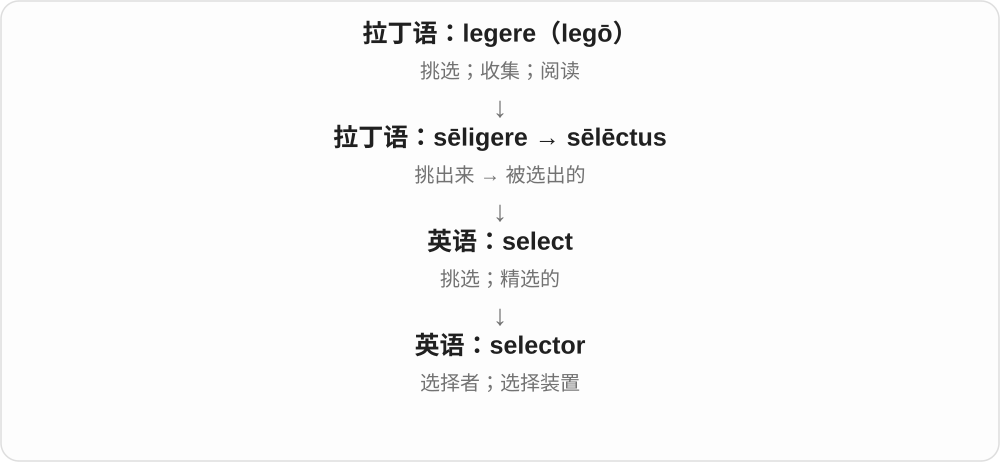

软件里的 selector 可能是一段用来匹配对象的表达式；具体规则由所用语言或系统定义。

**常见搭配与例句**

a channel selector；a team selector；a CSS selector。

> Turn the selector to the required setting.

把选择旋钮转到所需挡位。

> The selector matches all links in the menu.

这条选择器匹配菜单里的所有链接。

**别混淆**

selector 负责选择；selectee 是被选中的人。

### 60. incubator — 孵化器、培养箱；婴儿保育箱；创业孵化机构

**音标**：英 /ˈɪŋkjubeɪtə/；美 /ˈɪŋkjubeɪtər/

**先抓住这个画面**

把需要照料的新生命或新事业放进一个更适合发展的环境。设备提供温度等条件，创业机构则提供空间、指导和资源。

**怎么拆**

现代设备名词通常分析为英语 incubate + -or。晚期拉丁也有 incubator“躺在某处的人”，但不能把现代机器的具体含义直接塞进那个拉丁词里。

**怎么变成今天的意思**

**拉丁 incubatus → 英语 incubate**  
孵育、培养

↓

**英语 incubate + -or → incubator**  
承担孵育、维持条件功能的设备

↓

**比喻性 business incubator**  
帮助新创企业发展的机构或场所

孵蛋设备、实验室培养箱与婴儿保育箱都叫 incubator，具体设计用途不同，不能混用。business incubator 把早期企业比作尚需支持的幼小生命，常提供办公空间、服务或指导；并不是说里面的每家企业都会成功。

**常见搭配与例句**

an incubator for eggs；a neonatal incubator；a business incubator；an incubator for new ideas。

> The eggs were kept in an incubator until they hatched.

这些蛋在孵化器里待到破壳。

> The premature baby was cared for in an incubator.

这名早产儿在保育箱中接受照护。

> The university’s incubator offers young companies workspace and advice.

大学的创业孵化机构为初创企业提供办公空间和建议。

**别混淆**

incubation 是发展过程，incubator 是支持它的设备或机构。婴儿 incubator 的基本作用之一是维持合适环境，不是“让孩子从蛋里孵出来”。

### 61. negotiator — 谈判者、协商代表

**音标**：英 /nɪˈɡəʊʃieɪtə/；美 /nɪˈɡoʊʃieɪtər/

**先抓住这个画面**

坐到谈判桌前代表一方沟通条件的人是 negotiator，也能说善于协商的普通人。身份在做协商，不一定是居中调解。

**怎么拆**

借拉丁 negotiator 商人等人物名称，现代对应 negotiate 去末尾 e 加 -or；人物后缀与动词、过程名词连着认。

**怎么变成今天的意思**

**拉丁 neg- 不 + otium 闲暇 → negotium**  
没有闲暇 → 工作、事务、生意

↓

**negotiari、negotiatio 等**  
做生意、商谈及其过程

↓

**拉丁 negotiator → negotiator**  
做生意者的旧人物名 → 谈判者

a skilled negotiator 善于谈判的人，the chief negotiator 首席谈判代表，negotiators from both sides 双方代表。

**常见搭配与例句**

a skilled negotiator；the chief negotiator。

> The negotiators met again the next morning.

谈判代表第二天早上再次会面。

> She is a patient and effective negotiator.

她是一位有耐心、善于推动协商的人。

**别混淆**

negotiator 可以代表其中一方；mediator 常强调居中帮助双方，角色可能不同。

### 62. predictor — 预测因素；预测者

**音标**：英 /prɪˈdɪktə/；美 /prɪˈdɪktər/

**先抓住这个画面**

看到一个信号，你就更容易猜到后面的结果。那个帮助预测的信号，可以叫 predictor。

**怎么拆**

predict + -or。-or 既能指做预测的人，也能指在预测中起作用的因素或工具。

**怎么变成今天的意思**

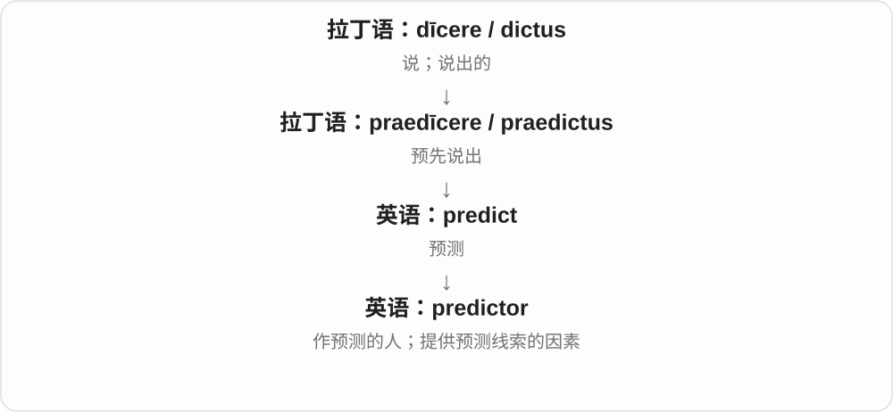

研究文章里，predictor 常是一个变量。它与后来的结果相关，所以有预测价值；这不自动证明它是造成结果的原因。

**常见搭配与例句**

a predictor of…；a strong predictor；a poor predictor；a predictor variable。

> Past demand is often a useful predictor of future sales.

过去的需求往往是预测未来销量的有用因素。

> Price alone is a poor predictor of quality.

单凭价格并不能很好地预测质量。

**别混淆**

predictor 与 cause 不同。带伞人数能预测下雨情况，不意味着带伞的人制造了雨。

### 63. debtor — 债务人；欠钱的一方

**音标**：英 /ˈdetə/；美 /ˈdetər/

**先抓住这个画面**

同一笔借贷里，拿了钱、负有偿还义务的那一方是 debtor。

**怎么拆**

经古法语 detor / detour 来自拉丁语 dēbitor“欠债者”。与 debt 一样，b 在后来拼写中恢复，却不发音。

**怎么变成今天的意思**

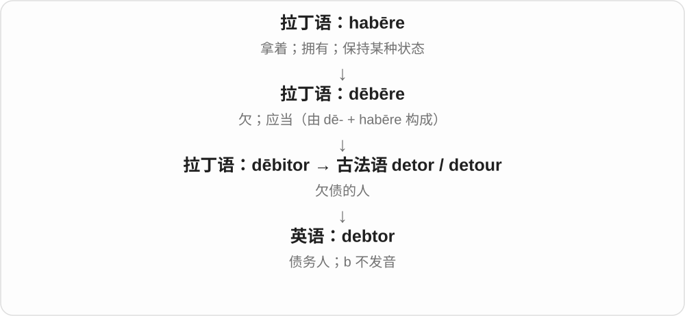

它指出债务关系中的角色，可以是个人，也可以是公司或政府。角色由谁欠谁来决定，不是由谁更富有决定。

**常见搭配与例句**

a debtor and a creditor；a debtor company；the debtor’s obligations。

> The debtor agreed to repay the amount in installments.

债务人同意分期偿还这笔款项。

> The letter lists both the debtor and the creditor.

信中列出了债务人和债权人。

**别混淆**

debtor 欠别人钱；creditor 有权收回钱。borrower 专指借款者，debtor 还可因未付款项等形成。

### 64. innovator — 创新者；引入新做法的人

**音标**：英 /ˈɪnəveɪtə/；美 /ˈɪnəveɪtər/

**先抓住这个画面**

一个人让大家开始用不同的方式做事，可能是工具、流程或观念上的改变，他就可以是 innovator。

**怎么拆**

后期拉丁 innovātor，来自 innovāre；现代能分析为 innovate 与 -or，但历史上有拉丁施事名词来源。

**怎么变成今天的意思**

**拉丁 novus**  
新的

↓

**拉丁 innovāre → 后期拉丁 innovātor**  
革新 → 引入变化的人

↓

**英语 innovator**  
创新者

这个词可说艺术、商业、教育等领域的人，不仅限于技术发明家。创新也可能来自团队，不一定归功于一个孤立天才。

**常见搭配与例句**

an innovator in；a leading innovator；design innovators。

> She became an innovator in accessible design.

她成了无障碍设计领域的创新者。

> The exhibition celebrates several innovators in film editing.

展览向几位电影剪辑领域的创新者致敬。

**别混淆**

inventor 更突出发明；innovator 更广，可以是把已有东西组合成新做法的人。

### 65. resistor — 电阻器；抵抗者〔较少见〕

**音标**：英 /rɪˈzɪstə/；美 /rɪˈzɪstər/

**先抓住这个画面**

在电路里专门安排一个“限制通过”的部件。

**怎么拆**

英语 resist + -or；-or 表承担作用的人或物，电学中固定为电阻器。

**怎么变成今天的意思**

**拉丁 sistere〔与 stāre“站”相关〕**  
使站住、放置；站定、停住

↓

**拉丁 re- + sistere → resistere**  
站住抵挡、顶回去

↓

**古／中古法语 resistre、resister 及拉丁来源 → 英语 resist**  
抵抗、经受；后来也指起保护作用的覆盖层

↓

**英语 resist + -or → resistor**  
抵抗者；后来专指提供电阻的电路元件

常见电阻器用来限流、分压等，并把一部分电能转成热。它不必把电流完全挡住；完全切断通路反而像开路，不能当作电阻器的普通工作说明。

**常见搭配与例句**

a fixed resistor；a variable resistor；connect a resistor in series。

> A resistor limits the current through the indicator light.

电阻器限制流过指示灯的电流。

> The diagram shows two resistors connected in series.

图上画着两个串联的电阻器。

**别混淆**

resistance 是电阻值或抵抗作用；resistor 是元件，r 后的 -or 不等于数值单位。

### 66. reflector — 反射器；反光板；反射式望远镜

**音标**：英 /rɪˈflektə/；美 /rɪˈflektər/

**先抓住这个画面**

接住照来的光，再把光送到需要的方向。

**怎么拆**

reflect + -or；这里 -or 指承担该作用的物件。

**怎么变成今天的意思**

**拉丁 flectere；分词 flexus**  
弯曲、使转向

↓

**拉丁 re- + flectere → reflectere**  
向后 + 弯转 → 折回

↓

**古法语 reflecter → 英语 reflect**  
反射；映出；回想、反思

↓

**英语 reflect + -or → reflector**  
反射 → 反射光等的装置

自行车上的 reflector 借汽车灯的光让自己显眼；摄影师的 reflector 把现有光线补到脸上。它通常不自己发光。天文学中 reflector 也可简称反射式望远镜，因为主要集光元件是镜面。

**常见搭配与例句**

a bicycle reflector；a silver reflector；a telescope reflector。

> The photographer placed a reflector beside the model.

摄影师把反光板放在模特旁边。

> The bicycle has a red reflector at the back.

自行车后方装有一个红色反光片。

**别混淆**

reflector 反射已有的光；light source 产生光。一个装置里可以同时有两者。

### 67. detonate — 爆炸；引爆；发生爆轰

**音标**：/ˈdetəneɪt/

**先抓住这个画面**

某个爆炸装置发生爆炸，可说 detonate；技术里爆轰有特定传播方式，日常读者先抓住猛烈爆发的核心。

**怎么拆**

经法语或直接接拉丁 detonatus、detonare，关联 de- 与 tonare 雷鸣；旧的雷鸣、巨响画面发展出爆炸义。

**怎么变成今天的意思**

**拉丁 detonare → 法语等相关形式**  
雷鸣、发出巨大声响

↓

**英语 detonate**  
爆炸；使发生爆炸

a device detonates 装置爆炸；detonate unexpectedly 意外爆炸；可及物，也可不及物。

**常见搭配与例句**

a device detonates；detonate unexpectedly。

> The explosives detonated unexpectedly.

爆炸物意外爆炸了。

> The film shows an old mine detonating.

影片中出现了一枚旧地雷爆炸的场景。

**别混淆**

detonate 比普通 burst 爆裂更常关联爆炸装置、爆轰；气球破了通常只说 burst。

### 68. detonator — 雷管；起爆器

**音标**：英 /ˈdetəneɪtə/；美 /ˈdetəneɪtər/

**先抓住这个画面**

在较大的爆炸系统里，用来启动爆炸的那个装置叫 detonator。它说的是起爆部件，不是所有爆炸物的统称。

**怎么拆**

现代对应 detonate 去 e 加 -or → detonator；词尾在这里形成做相关事情的人、装置或部件名称。

**怎么变成今天的意思**

**detonate**  
爆炸、引爆

↓

**detonator**  
雷管；起爆器

detonate 是引爆、爆炸，-or 在这里形成执行起爆作用的装置名。

**常见搭配与例句**

a detonator；a faulty detonator。

> The report identified a fault in the detonator.

报告指出起爆器存在故障。

> The museum display labels the detonator separately from the casing.

博物馆展板把起爆器与外壳分别标出。

**别混淆**

detonator 是起爆部件，detonation 是爆炸、爆轰过程；装置和事件分开。

### 69. ventilator — 通风装置、通风口；呼吸机

**音标**：英 /ˈventɪleɪtə/；美 /ˈventɪleɪtər/

**先抓住这个画面**

它是“负责让空气进出”的装置：装在建筑里帮助换气，医疗场景里则帮助患者呼吸。

**怎么拆**

现代英语按 ventilate + -or 构成表示施动者、工具的名词，-or 这里可以指设备。拉丁语也有 ventilator“扬谷者”，但现代通风设备和呼吸机义不能直接当成古罗马的机器名称。

**怎么变成今天的意思**

**拉丁 ventus → ventulus**  
风 → 微风、小风

↓

**拉丁 ventilare → ventilatus**  
扇动、扬到空中、扬谷去糠；相应分词

↓

**中古英语 ventilaten → ventilate**  
使散开，后来发展为使空气流通、给肺通气

↓

**英语 ventilate → ventilator**  
使通气 → 使空气流动的设备或装置

↓

**后来的医疗设备义**  
辅助或承担肺通气的呼吸机

a ventilator on the roof 可能是屋顶换气装置；a patient on a ventilator 通常说患者使用呼吸机。医疗设备帮助空气进出肺，并不只是一个装着氧气的瓶子。

**常见搭配与例句**

a roof ventilator；a mechanical ventilator；be on a ventilator；ventilator support。

> A roof ventilator draws warm air out of the attic.

屋顶通风装置把阁楼里的暖空气抽出去。

> The patient remained on a ventilator overnight.

这名患者整夜都在使用呼吸机。

**别混淆**

fan 是风扇，可用于通风系统；ventilator 按通气用途命名。oxygen cylinder 是储氧瓶，和负责推动气体进出肺的呼吸机不是同一个东西。

### 70. communicator — 沟通者、善于传达的人；通信设备〔按语境〕

**音标**：英 /kəˈmjuːnɪkeɪtə/；美 /kəˈmjuːnɪkeɪtər/

**先抓住这个画面**

不仅自己懂，还能把意思送进别人脑子里的人，常被夸为 a good communicator；科幻里也可以是通信小设备。

**怎么拆**

communicate + -or，并有拉丁语 commūnicātor 等人物词作背景。词尾 -or 表参与、执行传达者，不限定职业。

**怎么变成今天的意思**

**拉丁语 commūnis → commūnicāre、commūnicāt-**  
共同的 → 使共享、告知、传递

↓

**借入英语 communicate**  
沟通、传达；使相通等

↓

**communicate + -or → communicator；参照拉丁语人物词**  
传达、沟通的人；也可命名设备

an effective communicator 善于沟通的人，a skilled communicator 很会传达的人，a handheld communicator 手持通信设备。

**常见搭配与例句**

a good communicator；an effective communicator；a handheld communicator。

> A good teacher needs to be an effective communicator.

好老师需要善于把意思讲明白。

> The explorer spoke into a small communicator.

探险者对着一个小通信器说话。

**别混淆**

communicator 人或器具，communication 沟通过程、消息；a good communicator 不必话最多，能让人明白才是重点。

### 71. elector — 选民；选举人；选帝侯

**音标**：英 /ɪˈlektə/；美 /ɪˈlektər/

**先抓住这个画面**

elector 是拥有正式选择权的人；某些制度中，他专门代表一层程序投票选人。

**怎么拆**

来自晚期拉丁语 ēlēctor，联系 ēligere；现代可对应 elect + -or。

**怎么变成今天的意思**

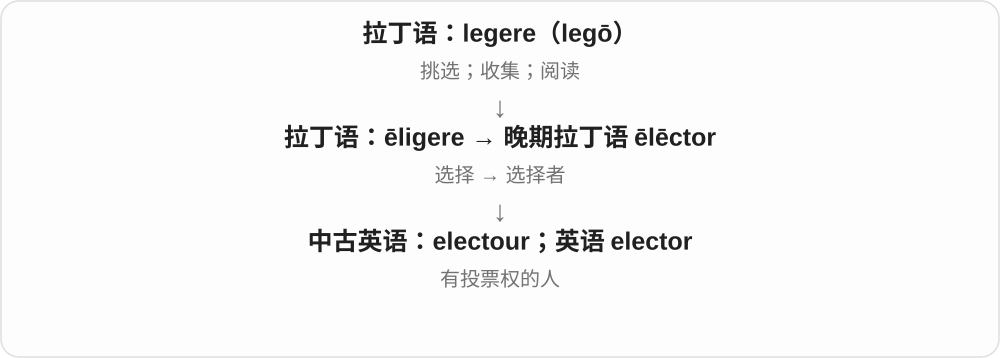

普通可指合资格选民；美国总统选举语境有专门的选举人角色；历史中也指选帝侯。

**常见搭配与例句**

registered electors；presidential electors；a prince elector。

> Each registered elector received a notice.

每位登记选民都收到了一份通知。

> The chapter explains the role of the electors.

这一章解释了选举人的角色。

**别混淆**

elector 是投票或有权投票者；electee 是被选中的人。

### 72. oscillator — 振荡器；振子

**音标**：英 /ˈɒsɪleɪtə/；美 /ˈɑːsɪleɪtər/

**先抓住这个画面**

能够产生重复变化的系统或装置，像持续给出有节奏变化的源头。

**怎么拆**

英语 oscillate + -or，采用拉丁式施事词尾。它可以说物理系统，也常指电子装置，不一定有肉眼可见的部件在左右摆。

**怎么变成今天的意思**

**拉丁 oscillum 摆动物 → oscillare 摆动**  
常联系悬挂随风摇动的小面具、os 嘴或脸；这种联系是通常解释，不作无争议事实

↓

**英语 oscillation 反构／拉丁 oscillatus 借入 → oscillate**  
词典保留两种直接来源解释；都接拉丁摆动词族

↓

**英语 oscillate + -or → oscillator**  
产生振荡的系统或装置

电子 oscillator 可以提供反复变化的信号；合成器里它能作为音色生成的基础。名字关注输出的反复变化，不只是外壳是否抖动。

**常见搭配与例句**

an electronic oscillator；a crystal oscillator；a harmonic oscillator。

> The circuit uses an oscillator to generate a timing signal.

这个电路用振荡器产生定时信号。

> The synthesizer combines the output of two oscillators.

合成器把两个振荡器的输出组合起来。

**别混淆**

oscilloscope 是观察、显示信号的示波器，oscillator 是产生振荡的源。两者在实验台上可能一起用，但职责不同。

### 73. decorator — 装饰人员；室内装饰师；油漆装修工

**音标**：英 /ˈdekəreɪtə/；美 /ˈdekəreɪtər/

**先抓住这个画面**

工作是让空间或物品看起来更好：有人负责配色布置，有人刷墙、贴墙纸，也有人专门装饰蛋糕。

**怎么拆**

英语 decorate + -or，采用拉丁型施事后缀，表示做装饰工作的人。现代可自然看出动词与职业名词的对应。

**怎么变成今天的意思**

**拉丁 decus，词干 decor-**  
美、荣誉、使事物增色的装饰

↓

**拉丁 decorare；分词 decoratus**  
装点、美化、使获得荣誉

↓

**中古英语 decorat／后来动词 decorate**  
被装饰的 → 装饰；又用于授予勋章

↓

**英语 decorate + -or → decorator**  
从事装饰、美化工作的人

interior decorator 偏室内配色、家具和摆设；英式 painter and decorator 常指刷漆、贴墙纸的装修人员。具体工作范围要结合修饰语。

**常见搭配与例句**

an interior decorator；a painter and decorator；a cake decorator。

> The decorator suggested a lighter colour for the hallway.

装修人员建议把走廊刷成浅一点的颜色。

> A skilled cake decorator made the flowers from icing.

一位熟练的蛋糕装饰师用糖霜做出了那些花。

**别混淆**

designer 范围很广，decorator 更侧重装饰；建筑结构设计不能仅凭 decorator 一词推定。

### 74. suppressor — 抑制器；抑制因素

**音标**：英 /səˈpresə/；美 /səˈpresər/

**先抓住这个画面**

某个装置或因素专门把不希望出现的活动压低，它就是 suppressor。

**怎么拆**

suppress + -or，表示执行抑制作用的人、装置或因素。

**怎么变成今天的意思**

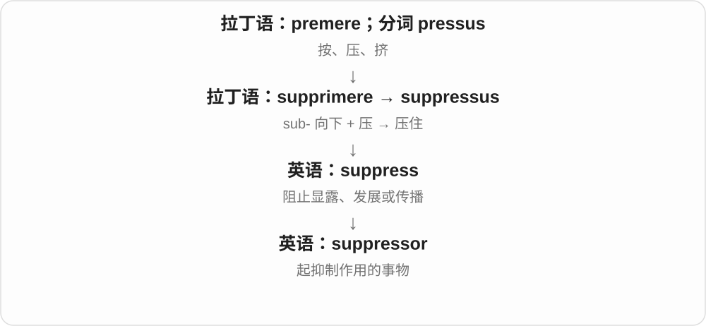

可见于 surge suppressor 浪涌抑制器、tumor suppressor 肿瘤抑制相关因素等搭配。具体抑制什么，要看前面的限定词。

**常见搭配与例句**

a surge suppressor；a noise suppressor；a tumor suppressor gene。

> The equipment includes a surge suppressor.

设备配有浪涌抑制器。

> The diagram shows where the noise suppressor sits in the circuit.

图示标出了噪声抑制器在电路中的位置。

**别混淆**

suppressor 常指装置或因素；suppressant 更常指起抑制作用的物质，二者在个别领域会重叠。

### 75. animator — 动画师；使事物活跃的人或力量

**音标**：英 /ˈænɪmeɪtə/；美 /ˈænəmeɪtər/

**先抓住这个画面**

让角色动起来的人是动画师；更早、更宽的意思是给人或事物带来活力者。

**怎么拆**

拉丁 animātor“赋予活力者”借入英语；现代可按 animate 与表示执行者的 -or 对应记忆。

**怎么变成今天的意思**

**拉丁 anima；相关 animus**  
呼吸、生命、灵魂；心意、精神

↓

**拉丁 animāre → animātor → 英语 animator**  
赋予生命、活力 → 使活跃者

↓

**现代影视用法**  
让画面角色运动的动画师

今天最常见于动画行业。动画师可能设计动作、表情与时间节奏，并不只负责把角色画得漂亮。

**常见搭配与例句**

a character animator；work as an animator；a team of animators。

> The animator adjusted the timing of the character’s smile.

动画师调整了角色露出微笑的时机和节奏。

> She worked as an animator on several short films.

她参与过几部短片，担任动画师。

**别混淆**

illustrator 主要创作插画；animator 的核心工作涉及运动与时间，虽有技能交集，职业并不相同。

### 76. demonstrator — 示威者；演示人员；展示样机

**音标**：英 /ˈdemənstreɪtə/；美 /ˈdemənstreɪtər/

**先抓住这个画面**

把立场或操作展示出来的人；卖车、卖设备时也可指用来展示的样品。

**怎么拆**

demonstrate + -or，形成施事名词；较早指讲解、证明者，后来有示威参与者等义。

**怎么变成今天的意思**

**拉丁语 monere → monstrum**  
提醒、警告 → 被视为征兆的异常现象

↓

**拉丁语 monstrare**  
把东西显示、指给人看

↓

**拉丁语 de- + monstrare → demonstrare**  
加强显示 → 指明、证明

↓

**拉丁语 demonstratus → 英语 demonstrate**  
指明的分词形式 → 展示、证明；后来也指公开示威

↓

**英语 demonstrate + -or → demonstrator**  
展示、证明的人 → 示威者；展示用样机

a laboratory demonstrator 可带实验课；demonstrators in the square 是广场上的示威者；a demonstrator vehicle 是供展示或试用的车辆。

**常见搭配与例句**

a laboratory demonstrator；peaceful demonstrators；a demonstrator vehicle。

> The demonstrator showed us how to use the microscope.

实验指导员向我们演示了显微镜的用法。

> The demonstrators carried signs through the square.

示威者举着标牌走过广场。

**别混淆**

instructor 强调教学角色；demonstrator 强调操作展示。新闻里看见复数 demonstrators，常先考虑示威者。

### 77. facilitator — 引导者；促成者

**音标**：/fəˈsɪlɪteɪtə/

**先抓住这个画面**

会议里有个人不抢着定答案，而是帮助大家听清彼此、推进决定，他常是 facilitator。

**怎么拆**

facilitate + -or，-or 指执行这种作用的人。

**怎么变成今天的意思**

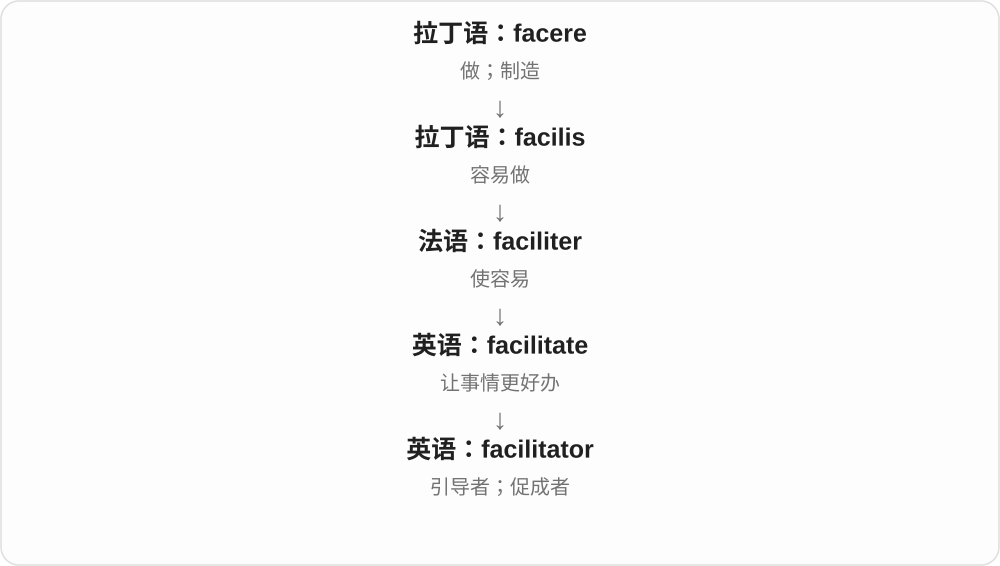

让事情好办的动作落到角色上；也可指帮助合作、交易或学习顺利进行的人。具体权限由场景决定。

**常见搭配与例句**

a workshop facilitator；an independent facilitator。

> The facilitator invited quieter participants to speak.

引导者邀请较沉默的参与者发言。

> We hired a facilitator for the planning workshop.

我们为规划研讨会请了一位引导者。

**别混淆**

leader 可以决定方向；facilitator 通常更强调帮助过程，不一定拥有最终决定权。

### 78. motivator — 激励者；动力来源

**音标**：英 /ˈməʊtɪveɪtə/；美 /ˈmoʊtɪveɪtər/

**先抓住这个画面**

motivator 是让人愿意动起来的那股力量，可能是一位教练，也可能是好奇心或明确目标。

**怎么拆**

motivate + -or，表示给予动力的人或因素。

**怎么变成今天的意思**

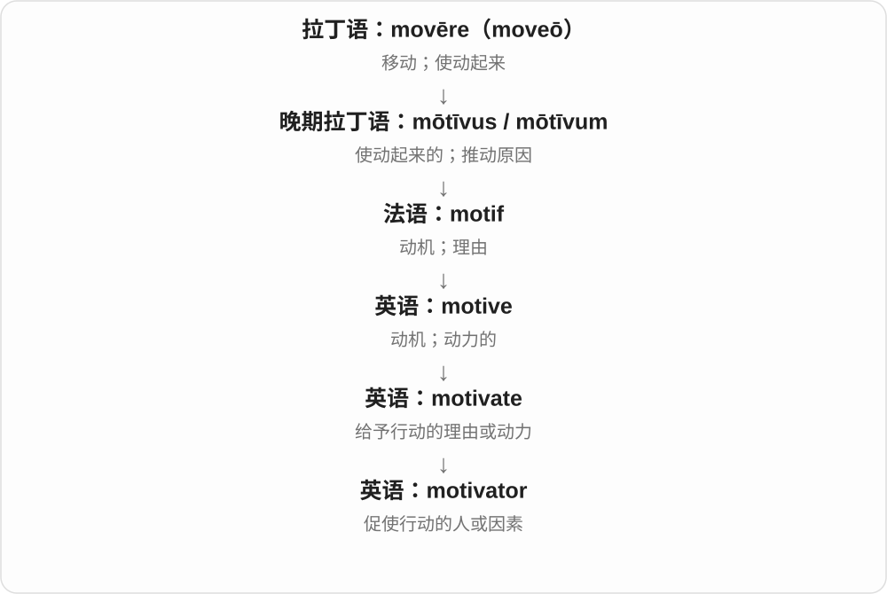

名词不只指人。Money is a motivator 表示钱是动力因素，不是在拟人化钱。

**常见搭配与例句**

a strong motivator；a natural motivator；a key motivator。

> Curiosity is a powerful motivator.

好奇心是强大的动力。

> The coach is an effective motivator.

这位教练很会激励人。

**别混淆**

motivation 是动力或积极性；motivator 是产生这种动力的来源。

### 79. fabricate — 制造、装配；捏造、编造

**音标**：/ˈfæbrɪkeɪt/

**先抓住这个画面**

在工坊里把零件做出来，是 fabricate；把根本没发生的证据做出来，也是 fabricate。一个做实物，一个造假话。

**怎么拆**

接拉丁 fabricatus，来自 fabricari 制作，关联 fabrica 工坊、制作与 faber 工匠；现代有 -ate 动词形。不是 fabric 布料这一义能解释全部。

**怎么变成今天的意思**

**拉丁 faber 工匠 → fabrica 工坊、制作 → fabricari**  
动手制造、建造

↓

**fabricatus、fabricatio → fabricate、fabrication**  
制造；后来也说把虚假的故事编造出来

fabricate metal parts 制造金属零件；fabricate evidence 伪造证据；fabricate a story 编造故事。宾语会决定是制造还是造假。

**常见搭配与例句**

fabricate components；fabricate evidence；fabricate a story。

> The workshop fabricates metal frames.

这间工坊制造金属框架。

> He admitted that he had fabricated the story.

他承认那个故事是他编造的。

**别混淆**

fabricate components 通常是中性制造，不是在指责工厂撒谎；fabricate an excuse 才常有编造、不真实的评价。

### 80. fabricator — 制造、加工者；捏造者

**音标**：英 /ˈfæbrɪkeɪtə/；美 /ˈfæbrɪkeɪtər/

**先抓住这个画面**

把金属部件加工成形，可以是 fabricator；把不存在的证据编出来，也是 fabricator 的另一义。要看做出来的是实体还是假故事。

**怎么拆**

现代对应 fabricate 去 e 加 -or → fabricator；词尾在这里形成做相关事情的人、装置或部件名称。

**怎么变成今天的意思**

**fabricate**  
制造、加工；捏造、编造

↓

**fabricator**  
制造、加工者；捏造者

metal fabricator 常是金属加工厂商、工人；a fabricator of lies 则是编造谎言的人。

**常见搭配与例句**

a metal fabricator；a fabricator of evidence。

> The project hired a local metal fabricator.

项目聘用了一家当地金属加工厂商。

> The witness was exposed as a fabricator of evidence.

证人被揭露捏造了证据。

**别混淆**

fabricator 不只骗人者，也不只造布的人；fabricate 的制造义与捏造义都能形成对应人员名。

### 81. originator — 发起人；创始者；最初提出者

**音标**：英 /əˈrɪdʒɪneɪtə/；美 /əˈrɪdʒɪneɪtər/

**先抓住这个画面**

追到这条思路的开头，发现是这个人或机构先发出的。

**怎么拆**

originate + -or，表示发起某事的人或机构。

**怎么变成今天的意思**

**拉丁 orīrī；分词 ortus**  
升起、出现、出生

↓

**拉丁 orīgō / orīgin-**  
出现之处 → 开始、来源

↓

**中世纪拉丁 orīginātus／英语 origination**  
词典分别提出分词借入、从名词逆构两种路线

↓

**英语 originate**  
起源于；创造、发起

↓

**英语 originate + -or → originator**  
使某事开始的人或机构

the originator of an idea 是最早提出想法的人；不一定是后续负责推广、经营或完成它的人。通信等领域也可指发起一条消息的端点。

**常见搭配与例句**

the originator of；identify the originator；message originator。

> The article credits her as the originator of the method.

文章把她列为这一方法的首创者。

> The system records the originator of each message.

系统记录每条消息的发起方。

**别混淆**

founder 常强调建立组织；originator 也可针对一句主张、一项方法或一条消息。

### 82. injector — 注射器具；喷油器；注入装置

**音标**：英 /ɪnˈdʒektə/；美 /ɪnˈdʒektər/

**先抓住这个画面**

负责把液体或其他物质送进一个空间的装置。

**怎么拆**

inject + -or，表示执行注入动作的装置或人。

**怎么变成今天的意思**

**拉丁语：iacere；分词 iactus**  
投掷、抛出

↓

**拉丁语：in- + iacere → inicere / iniect-**  
投入、注入

↓

**英语：inject + -or → injector**  
把物质注入的装置

发动机中的 fuel injector 是喷油器；医疗里的 injector 指注入器具，未必就是手动针筒。

**常见搭配与例句**

a fuel injector；an automatic injector。

> The mechanic replaced a faulty fuel injector.

修理工换掉了一个有故障的喷油器。

> The laboratory uses an automatic injector to deliver the sample.

实验室使用自动进样装置送入样本。

**别混淆**

injection 是动作或一次注射；injector 是实施注入的装置。

### 83. interceptor — 拦截者；拦截装置；截击机

**音标**：英 /ˌɪntəˈseptə/；美 /ˌɪntərˈseptər/

**先抓住这个画面**

intercept 是中途拦下，interceptor 就是专门干这件事的人或装置。

**怎么拆**

intercept + -or；-or 指执行动作的一方。它可以是飞机、技术装置，也可以是程序里处理请求的组件。

**怎么变成今天的意思**

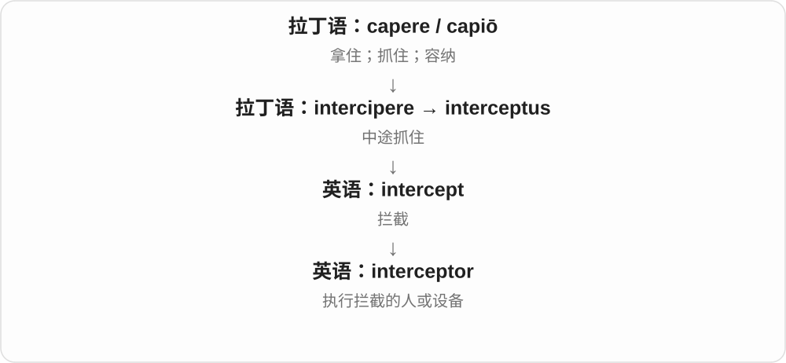

古老的“抓住”在新领域里继续派生。软件 interceptor 常在请求到达目标之前介入，恰好保留“中途接住”的画面。

**常见搭配与例句**

an interceptor aircraft；a request interceptor；install an interceptor。

> The interceptor aircraft approached the unidentified plane.

截击机接近了那架身份不明的飞机。

> The interceptor checks each request before passing it on.

拦截器会检查每个请求，再把它传递下去。

**别混淆**

interceptor 指执行拦截的角色；interception 指拦截行为本身。

### 84. manipulator — 操纵者；机械操作臂；操作装置

**音标**：英 /məˈnɪpjʊleɪtə/；美 /məˈnɪpjəleɪtər/

**先抓住这个画面**

manipulator 可以是暗中摆布人的人，也可以是替人抓取、移动物体的机械“手”。

**怎么拆**

manipulate 去 e 加 -or，表示执行操作的人或装置。

**怎么变成今天的意思**

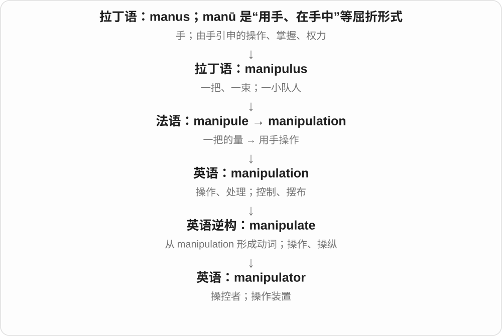

人物评价里常是贬义；robotic manipulator 是机械学中性名称，不能译成阴谋家。

**常见搭配与例句**

a skilled manipulator；a robotic manipulator；a remote manipulator。

> The robotic manipulator moved the sample into the chamber.

机械操作臂把样品移进了舱室。

> The novel gradually reveals him as a skilled manipulator.

小说逐渐揭示出他是个善于操控他人的人。

**别混淆**

operator 常指操作设备的人；manipulator 既可能是人，也可能是实际执行抓取动作的机械装置。

### 85. alternator — 交流发电机

**音标**：英 /ˈɔːltəneɪtə/；美 /ˈɔːltərneɪtər/

**先抓住这个画面**

电流的方向来回变化，像 A、B 轮流出现。产生这种交流电的发电机，就叫 alternator。

**怎么拆**

alternate（交替）+ -or（执行动作的设备或角色）。这里与 alternating current“交流电”联系记最直接。

**怎么变成今天的意思**

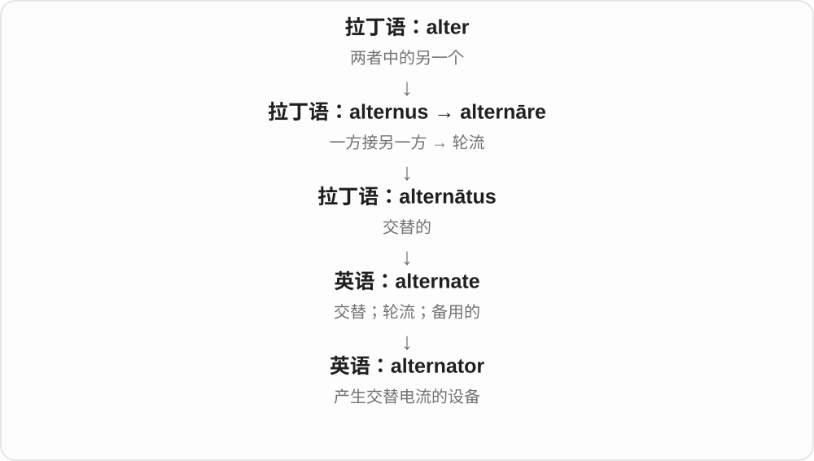

名字先说明它产生的电流类型。汽车里的 alternator 产生交流电后通常会经整流供电和充电，所以不能只凭名字说汽车电池直接接交流电。

**常见搭配与例句**

a car alternator；replace the alternator；alternator output。

> The mechanic replaced the faulty alternator.

修车师傅更换了有故障的交流发电机。

> The alternator supplies power while the engine is running.

发动机运转时，发电机提供电力。

**别混淆**

generator 是发电机的总称；alternator 特指产生交流电的类型。motor 则把电能转换为机械运动。

### 86. carburetor — 化油器〔常见美式拼写〕

**音标**：美 /ˈkɑːrbəreɪtər/；英式变体常 /ˌkɑːbəˈretə/

**先抓住这个画面**

汽油机的一种部件，把燃油与空气调成能供发动机使用的混合物，这就是 carburetor。它的工作不是单纯存油。

**怎么拆**

旧动词 carburet 的含碳、烃类混合材料 + -or，后来固定为化油器名称；开头不按现代 car 汽车加一串尾字母解释。

**怎么变成今天的意思**

**旧动词 carburet**  
使带有碳、烃类材料等旧化学用法

↓

**carburet + -or → carburetor、carburettor**  
相关装置；发动机中混合燃油与空气的化油器

an engine carburetor 发动机化油器；a carburetor adjustment 化油器调整。

**常见搭配与例句**

a carburetor；the engine’s carburetor。

> The mechanic inspected the old engine’s carburetor.

机械师检查了旧发动机的化油器。

> The diagram shows how the carburetor mixes fuel and air.

示意图展示化油器如何混合燃油与空气。

**别混淆**

carburetor 是混合、供给相关部件，fuel tank 是油箱；不是所有发动机今天都使用化油器。

### 87. liquidate — 变现；清算；结清；〔历史等语境〕消灭、杀害

**音标**：/ˈlɪkwɪdeɪt/

**先抓住这个画面**

把账目和资产逐项处理清楚：该卖的换成钱，该结的债结掉。

**怎么拆**

借后期拉丁或中世纪拉丁 liquidatus，接 liquidare“使液化、使清楚”。英语早期重在把账目理清，后来有结清债务、出售资产等义；“杀害”义可能受俄语相应词影响。

**怎么变成今天的意思**

**拉丁 liquēre**  
呈液态；流动；清澈

↓

**拉丁 liquidus → 后期拉丁 liquidare / liquidatus**  
使液化；使清楚、澄清

↓

**英语 liquidate**  
早期清理账目，后来结清、变现、清算

liquidate assets 是出售资产换取现金；liquidate a company 是对公司进行清算、结束经营。不同宾语决定你是在说卖资产，还是结束公司；历史政治文本中的 liquidate opponents 是暴力的“消灭”。

**常见搭配与例句**

liquidate assets；liquidate stock holdings；liquidate a company；liquidate a debt。

> The firm liquidated part of its inventory to raise cash.

公司卖掉了部分库存来筹集现金。

> The owners decided to liquidate the company after closing its last store.

关闭最后一家门店后，所有者决定清算公司。

**别混淆**

liquefy 才是把物质变成液体的常用动词；liquidate 在现代日常报道里多属财务或清除语境。

### 88. liquidator — 清算人；负责清理、处置业务资产的人

**音标**：英 /ˈlɪkwɪdeɪtə/；美 /ˈlɪkwɪdeɪtər/

**先抓住这个画面**

公司进入清算，需要有人负责整理、处置资产、处理相关事务，这种角色叫 liquidator。不是把东西变成水的人。

**怎么拆**

现代对应 liquidate 去 e 加 -or → liquidator；词尾在这里形成做相关事情的人、装置或部件名称。

**怎么变成今天的意思**

**liquidate**  
清算、变卖资产、了结等

↓

**liquidator**  
清算人；负责清理、处置业务资产的人

liquidate 有金融、商业中的清算义，-or 将该职责落到承担的人；具体职权由相应制度、委任决定。

**常见搭配与例句**

appoint a liquidator；the company’s liquidator。

> The company appointed a liquidator.

公司指定了一名清算人。

> The liquidator prepared a report on the remaining assets.

清算人编写了剩余资产报告。

**别混淆**

liquidator 是清算职责人员，receiver 是接管人；两者在一些制度里可有联系，但不凭相似中文就认为职权完全相同。

### 89. activator — 激活物、活化剂；起激活作用的人或装置

**音标**：英 /ˈæktɪveɪtə/；美 /ˈæktɪveɪtər/

**先抓住这个画面**

原本没有充分起作用的系统，被某个东西带动起来；这个起激活作用的东西就是 activator。具体是什么，要由所在领域来定。

**怎么拆**

activate 去末尾 e 加 -or，形成执行或促成动作的名词；底层 active 表处于活动、起作用的状态。

**怎么变成今天的意思**

**拉丁 actīvus → active**  
能行动、起作用的

↓

**active → activate**  
使进入活动、有效状态

↓

**activate + -or → activator**  
促使某物起作用的人、物质或装置

a chemical activator 化学活化剂，an enzyme activator 酶激活剂。名称说明它促成激活，具体作用机理需看上下文。

**常见搭配与例句**

an enzyme activator；add an activator。

> The researchers compared two different activators.

研究人员比较了两种不同的活化剂。

> The reaction began after an activator was added.

加入活化剂后，反应开始了。

**别混淆**

activator 说起激活作用的东西，activation 说激活过程；它与 catalyst 催化剂有联系，但两种名称不能在所有领域直接互换。

### 90. actuate — 使动作、驱动；促使行动〔正式〕

**音标**：英 /ˈæktʃueɪt/；也读 /ˈæktjueɪt/

**先抓住这个画面**

传感器给出信号，某个机构真的动起来，actuate 就是让它动作。较正式地说人被某种动机促动，也能用这个词。

**怎么拆**

借中世纪拉丁 actuatus 等，接 actus 行动材料；-ate 外形有借入历史，不只是拿现代 act 后面随意接 uate。

**怎么变成今天的意思**

**拉丁 actus → 中世纪拉丁 actuare、actuatus 等**  
行动；使付诸行动、使运转的材料

↓

**英语 actuate → actuator**  
驱动、使动作；执行器、驱动装置

actuate a valve 驱动阀门；actuated by pressure 由压力使之动作；actuated by curiosity 受好奇心促使，较正式。

**常见搭配与例句**

actuate a mechanism；be actuated by。

> The signal actuates a small motor.

信号驱动一个小电机。

> The valve is actuated by changes in pressure.

阀门由压力变化驱动。

**别混淆**

actuate 使部件实际动作，activate 更广可说启用、激活系统；启用功能未必马上出现机械运动。

### 91. actuator — 执行器；驱动装置

**音标**：英 /ˈæktʃueɪtə/；美 /ˈæktʃueɪtər/

**先抓住这个画面**

控制系统发出命令，还需要一个部件把命令变成实际运动；做这一步的装置常叫 actuator。

**怎么拆**

现代对应 actuate 去 e 加 -or → actuator；词尾在这里形成做相关事情的人、装置或部件名称。

**怎么变成今天的意思**

**拉丁 actus → 中世纪拉丁 actuare、actuatus 等**  
行动；使付诸行动、使运转的材料

↓

**英语 actuate → actuator**  
驱动、使动作；执行器、驱动装置

电动、气动、液压等执行器有不同工作方式，共同点是按控制、输入产生相应动作。

**常见搭配与例句**

a valve actuator；an electric actuator。

> The actuator opens and closes the valve.

执行器控制阀门开闭。

> The robot uses small actuators to move its fingers.

机器人用小型执行器活动手指。

**别混淆**

sensor 感知情况，actuator 执行动作；一个负责看见变化，一个负责让部件动起来，角色不同。

### 92. aggregator — 汇总者；聚合平台；信息聚合工具

**音标**：英 /ˈæɡrɪɡeɪtə/；美 /ˈæɡrɪɡeɪtər/

**先抓住这个画面**

不一定亲自生产内容，而是把不同来源的东西收集到同一处，方便你一起查看。

**怎么拆**

英语 aggregate + -or，表示执行汇集的人或工具。这个名词早于互联网，新闻、价格和订阅聚合平台是后来新场景。

**怎么变成今天的意思**

**拉丁 grex，词干 greg-**  
一群，尤指一群动物

↓

**拉丁 ad- + gregare → aggregare；分词 aggregatus**  
使加入群体、聚到一起

↓

**英语 aggregate**  
汇集；总计；集合体

↓

**英语 aggregate + -or → aggregator**  
汇集者、编集者

↓

**互联网等现代用法**  
汇集多来源信息的网站或软件

a news aggregator 把不同媒体的新闻集中展示；a price aggregator 汇集不同卖家的价格。聚合本身不保证信息已经核实，也不自动表示平台拥有原内容。

**常见搭配与例句**

a news aggregator；a price aggregator；a content aggregator；a feed aggregator。

> The news aggregator links to articles from several newspapers.

这款新闻聚合工具链接了多家报纸的文章。

> We used a price aggregator to compare offers from different shops.

我们用价格聚合平台比较了不同商店的报价。

**别混淆**

publisher 负责出版、发布内容；aggregator 突出汇集不同来源。一个平台可能兼有两种角色。

### 93. estimator — 估算员；估算工具；统计估计量

**音标**：英 /ˈestɪmeɪtə/；美 /ˈestɪmeɪtər/

**先抓住这个画面**

可以是拿图纸估费用的人，也可以是一套从数据推出参数的规则；后者不是那个最终算出的单个数字。

**怎么拆**

接拉丁 aestimātor 等人物名词，也可按 estimate + -or 理解，去掉末尾 e。统计义把估算角色交给由样本构成的规则或统计量。

**怎么变成今天的意思**

**拉丁 aestimāre / aestimātus**  
估价、判断价值及其相应形式

↓

**aestimātor → estimator；对应 estimate + -or**  
作估算的人

↓

**工具、统计用法**  
作估算的工具、规则或统计量

a cost estimator 造价估算员或工具，an online estimator 在线估算器，an unbiased estimator 无偏估计量。

**常见搭配与例句**

a cost estimator；an online estimator；an unbiased estimator。

> The cost estimator reviewed the drawings before preparing a quote.

造价估算员先审阅图纸，再准备报价。

> This estimator uses the sample mean to estimate the population mean.

这个估计量用样本均值估计总体均值。

**别混淆**

统计里 estimator 指用来估参数的统计量或规则，estimate 通常指给定样本后得到的具体估计值。不是所有 -or 都只能是人。

### 94. impersonate — 冒充；模仿某人

**音标**：英 /ɪmˈpɜːsəneɪt/；美 /ɪmˈpɜːrsəneɪt/

**先抓住这个画面**

把自己演成另一位，可能是舞台模仿，也可能企图让别人认错身份。

**怎么拆**

im- 是 in- 在 p 前的相应形式，加 person 与动词后缀 -ate。现代整词是以另一身份出现，不能把 im- 当“不”而解释成“不是一个人”。

**怎么变成今天的意思**

**拉丁 persōna → 古法语 persone 等**  
戏剧面具、角色；后来的人、个体等义

↓

**中古英语 persoun → 英语 person**  
一个人、个体

↓

**im- + person + -ate → impersonate**  
以另一人的身份、样貌行事

a comedian impersonates a singer 是喜剧演员模仿歌手；impersonate an official 是冒充官员。是否搞笑还是欺骗，由场景决定。

**常见搭配与例句**

impersonate a celebrity；impersonate an official；be good at impersonating。

> The comedian can impersonate several famous singers.

这位喜剧演员能模仿几位著名歌手。

> The warning described callers impersonating bank staff.

提醒中提到了冒充银行员工的来电者。

**别混淆**

imitate 可以模仿声音、习惯、作品等，impersonate 更集中到扮成某个人或其身份；不只重复一个动作。

### 95. impersonator — 模仿名人的演员；冒充他人者

**音标**：英 /ɪmˈpɜːsəneɪtə/；美 /ɪmˈpɜːrsəneɪtər/

**先抓住这个画面**

在舞台上把某位歌手的声音、动作学得很像，是 impersonator；若冒充真实身份骗人，也可用这个词，场景决定性质。

**怎么拆**

现代对应 impersonate 去 e 加 -or → impersonator；词尾在这里形成做相关事情的人、装置或部件名称。

**怎么变成今天的意思**

**impersonate**  
扮成、模仿或冒充另一个人

↓

**impersonator**  
模仿名人的演员；冒充他人者

an Elvis impersonator 是猫王模仿演员，不自动等于身份诈骗者；这里重在扮成某个特定的人。

**常见搭配与例句**

a celebrity impersonator；a voice impersonator。

> The show featured a talented Elvis impersonator.

节目中有一位很有才的猫王模仿演员。

> The platform removed the impersonator’s account.

平台移除了冒充他人者的账号。

**别混淆**

imitator 更广指模仿者；impersonator 常是模仿、扮成特定人物，尤其声音、外貌、动作或身份。

### 96. incinerator — 焚烧炉；焚化设备

**音标**：英 /ɪnˈsɪnəreɪtə/；美 /ɪnˈsɪnəreɪtər/

**先抓住这个画面**

执行焚烧任务的设备，把废弃物送进燃烧空间加以处理。-or 在这里指做这件事的装置。

**怎么拆**

英语由 incinerate“焚烧”加表示执行者或装置的 -or 形成，去掉词尾 e，构成 incinerator。上游仍接中世纪拉丁 incinerare 及拉丁 cinis、ciner-“灰”。

**怎么变成今天的意思**

**拉丁 in-；cinis〔词干 ciner-〕**  
使进入某种状态；灰烬

↓

**中世纪拉丁 incinerare → incineratus**  
烧成灰 → 已被烧成灰的

↓

**英语 incinerate + -or → incinerator**  
把焚烧动作命名为执行它的设备

a waste incinerator 关注设备本身，incineration 关注处理过程。现代设施可能配有烟气处理、热能回收等系统，但不能仅凭 incinerator 一词认定所有附属系统都存在。

**常见搭配与例句**

a waste incinerator；operate an incinerator；an incinerator plant；emissions from an incinerator。

> The old incinerator was taken out of service.

旧焚烧炉已经停用。

> The engineer inspected the incinerator’s exhaust system.

工程师检查了焚烧炉的排气系统。

**别混淆**

furnace 是更广的工业炉或加热炉，incinerator 主要用来焚烧、毁弃材料。-or 不一定表示人，这里最常指机器。

### 97. insulator — 绝缘体；隔热材料；绝缘器件

**音标**：英 /ˈɪnsjuleɪtə/；美 /ˈɪnsəleɪtər/

**先抓住这个画面**

在该让传递停下来或慢下来的地方，承担阻挡作用的材料或部件。

**怎么拆**

insulate + -or，英语形成作用者、器件或材料名。这里的 -or 不表示必须是一个人。

**怎么变成今天的意思**

**拉丁 insula 岛**  
再早的来源未定；不硬拆为 in 加某个英语词

↓

**拉丁 insulatus 像岛一样分隔，或 insula + 英语 -ate → insulate**  
英语早期使成为岛，后来用于隔热、绝缘等；具体构形有两种常见分析

↓

**英语 insulate + -or → insulator**  
发挥隔热、绝缘等作用的材料或装置

an electrical insulator 是电绝缘体；a good thermal insulator 是良好的隔热材料。说某物是 insulator 时，要注意它针对的是哪一种传递。

**常见搭配与例句**

an electrical insulator；a thermal insulator；ceramic insulators。

> Rubber can act as an electrical insulator.

橡胶可以起电绝缘体的作用。

> The cables are supported by ceramic insulators.

电缆由陶瓷绝缘子支撑。

**别混淆**

conductor 让传递较容易发生；insulator 让它困难。电绝缘好不必自动等于隔热也同样好。

### 98. oppressor — 压迫者

**音标**：英 /əˈpresə/；美 /əˈpresər/

**先抓住这个画面**

不是承受重量的人，而是把不公正的力量长期压在别人身上的一方。

**怎么拆**

来自拉丁语 oppressor，也可经法语相关形式；现代与 oppress + -or 对应。

**怎么变成今天的意思**

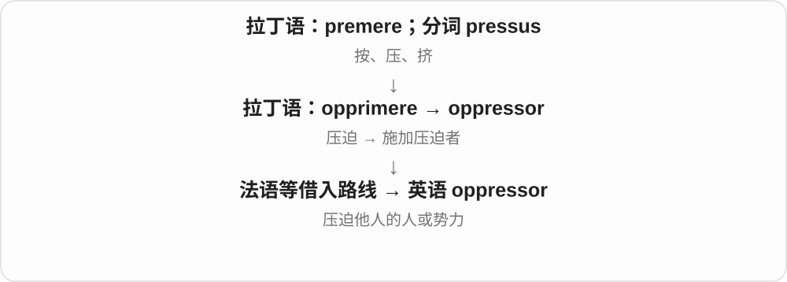

可指个人、集团或被拟人化的制度力量，是带强烈负面评价的称呼。

**常见搭配与例句**

resist an oppressor；victims and oppressors。

> The story follows a village that stands up to its oppressor.

故事讲述一个村庄奋起反抗压迫者的经历。

> The speaker distinguished the oppressors from the people they controlled.

演讲者把压迫者与被其控制的民众区分开。

**别混淆**

oppressor 是施压的一方；the oppressed 是受压迫者，注意方向。

### 99. excavator — 挖掘机；发掘者

**音标**：英 /ˈekskəveɪtə/；美 /ˈekskəveɪtər/

**先抓住这个画面**

工地上伸出长臂、用铲斗把土挖起来的机器。

**怎么拆**

excavate + -or，可表示执行动作的人或机器。

**怎么变成今天的意思**

**拉丁 cavus**  
空的、凹的

↓

**拉丁 excavare → 英语 excavate**  
挖空 → 挖掘

↓

**excavate + -or → excavator**  
执行挖掘的人或机器

现代工地语境中，excavator 通常是挖掘机；考古叙述中 the excavators of the tomb 也可以指发掘墓葬的人。-or 不能机械限定为职业人物。

**常见搭配与例句**

an excavator operator；a tracked excavator；the excavators of the site。

> An excavator removed the soil beside the road.

一台挖掘机挖走了路旁的土。

> The excavators carefully recorded where each object was found.

发掘人员仔细记录了每件物品的出土位置。

**别混淆**

excavator 的典型动作是挖取土方；bulldozer 的典型动作是用推土铲推土。两种工程机械不要混译。

### 100. respirator — 呼吸防护器；呼吸器；辅助呼吸设备〔部分语境〕

**音标**：英 /ˈrespəreɪtə/；美 /ˈrespəreɪtər/

**先抓住这个画面**

有的装置保护吸进来的空气，有的用来辅助呼吸；要先看具体说的是哪一种。

**怎么拆**

由 respire“呼吸”的相关词干形成器具名，远接拉丁 respirare。早期包括保护口鼻的装置，后有不同技术用法。

**怎么变成今天的意思**

**拉丁语 spirare**  
吹气、呼吸；更远词源未定

↓

**拉丁语 respirare → 英语 respire**  
呼吸

↓

**英语 respirator**  
由呼吸动作命名帮助或保护呼吸的器具

职业防护中的 respirator 可以过滤空气，也可从独立来源供气。医院文字有时用它指辅助呼吸设备，但现代 ventilator 更明确地指机械通气设备；普通口罩也不自动等同于呼吸防护器。

**常见搭配与例句**

a filtering respirator；a supplied-air respirator；wear a respirator。

> The training compared several types of respirator.

培训比较了几种呼吸防护器。

> Workers wore respirators selected for the task.

工人佩戴了根据该项工作选择的呼吸防护器。

**别混淆**

respirator 的防护义与 ventilator 的通气义需区分；前者不是所有情况下都主动替人送气。

### 101. defibrillator — 除颤器

**音标**：英 /diːˈfɪbrɪleɪtə/；美 /diːˈfɪbrɪleɪtər/

**先抓住这个画面**

心脏有些危险的异常节律需要电击来纠正，施行这种电治疗的装置叫 defibrillator。公共场所常见的 AED 属自动体外除颤器这一类。

**怎么拆**

现代对应 defibrillate 去 e 加 -or → defibrillator；词尾在这里形成做相关事情的人、装置或部件名称。

**怎么变成今天的意思**

**de- + fibrillation 等 → defibrillate**  
去除、纠正心脏纤维颤动的相关命名

↓

**defibrillate + -or → defibrillator**  
除颤装置

命名指向除颤作用；设备形式、适用节律不同，不能把词义缩成对任何停止跳动都能电醒。

**常见搭配与例句**

an automated external defibrillator；an implantable defibrillator。

> The airport installed a defibrillator near the main entrance.

机场在主入口附近安装了一台除颤器。

> The training introduced the purpose of an automated external defibrillator.

培训介绍了自动体外除颤器的用途。

**别混淆**

defibrillator 纠正某些危险心律；pacemaker 起搏器主要通过电脉冲帮助调节心率。某些设备可兼有功能，名称侧重不同。

### 102. prospector — 勘探者；探矿者

**音标**：英 /prəˈspektə/；美 /ˈprɑːspektər/

**先抓住这个画面**

prospector 像带着工具走进山地，寻找地面下哪里可能有值得开采的矿产。

**怎么拆**

prospect 的勘探动词义 + -or，表示做这件事的人。

**怎么变成今天的意思**

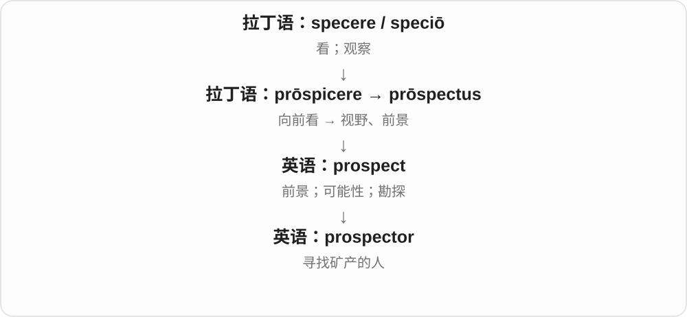

先观察一个地区的可能性，再去探查资源；它不表示已经找到矿，更不一定拥有矿场。

**常见搭配与例句**

a gold prospector；mineral prospectors；a prospector’s camp。

> The prospector found traces of gold in the stream.

探矿者在溪流中发现了金的痕迹。

> The museum displays tools used by early prospectors.

博物馆展示了早期探矿者使用的工具。

**别混淆**

miner 通常参与采矿；prospector 重点是找矿。

### 103. agitator — 鼓动者；搅拌装置

**音标**：英 /ˈædʒɪteɪtə/；美 /ˈædʒɪteɪtər/

**先抓住这个画面**

agitator 是把平静状态搅起来的人或装置：一边推动人群行动，一边搅动容器里的物料。

**怎么拆**

agitate + -or；拉丁语也有相关的 agitātor“驱赶者”。

**怎么变成今天的意思**

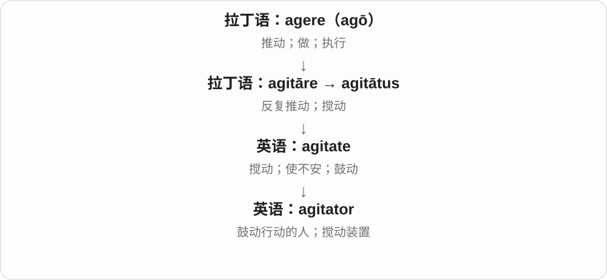

称人 agitator 往往带说话者的评价，可能赞其推动改革，也可能贬其煽动事端；机械用法通常中性。

**常见搭配与例句**

a political agitator；an agitator blade；a tank agitator。

> The newspaper portrayed him as a political agitator.

报纸把他描写成一名政治鼓动者。

> The tank has an agitator to keep the mixture uniform.

罐内装有搅拌器，以保持混合物均匀。

**别混淆**

agitator 不一定是 violent person；这个词说鼓动作用，并不自动断言暴力。

### 104. applicator — 涂敷器；施用装置

**音标**：英 /ˈæplɪkeɪtə/；美 /ˈæplɪkeɪtər/

**先抓住这个画面**

帮你把液体、粉末或其他材料准确送到目标表面的工具。

**怎么拆**

由拉丁语 applicare 的词干 applicat- 加施事后缀 -or 构成；不宜误拆为 application + or。

**怎么变成今天的意思**

**拉丁语 plicare**  
折叠、使相接；与编织、弯曲一组词有更早联系

↓

**拉丁语 ad- + plicare → applicare**  
使贴到一起、连接；把力量用于某事

↓

**applicat- + -or → 英语 applicator**  
执行施用动作的人或器具；现代多指器具

刷头、滴涂头、滚轮都可做 applicator，具体长什么样由被涂材料决定。

**常见搭配与例句**

a foam applicator；an applicator tip；apply with an applicator。

> Use the small applicator to reach the narrow corners.

用小涂敷器处理狭窄的角落。

> The bottle comes with a sponge applicator.

瓶子配有一个海绵涂头。

**别混淆**

application 是施用这个动作；applicator 是帮助完成动作的工具。

### 105. integrator — 集成商；整合者；积分器

**音标**：英 /ˈɪntɪɡreɪtə/；美 /ˈɪntəɡreɪtər/

**先抓住这个画面**

负责把零散部分接起来的人、公司或装置。

**怎么拆**

integrate + -or，词尾 e 去掉；-or 可以指人，也可以指设备。

**怎么变成今天的意思**

**拉丁 integer**  
完整、未受损；历史上与否定 in- 和 tangere 触碰的词根有关

↓

**拉丁 integrare → integratus → 英语 integrate**  
使完整 → 完整的；英语后来用作整合的动词

↓

**英语 integrate + -or → integrator**  
整合、求积分 → 整合者、积分器

a systems integrator 把不同供应商的设备或软件接成系统；电子学中的 integrator 则按时间累积输入信号。具体工作不同，都围绕整合或积分。

**常见搭配与例句**

a systems integrator；an electronic integrator；work with an integrator。

> The company hired a systems integrator to connect its factory software.

公司请了一家系统集成商来打通工厂软件。

> The circuit uses an integrator to accumulate the input signal over time.

这个电路用积分器对输入信号随时间进行累积。

**别混淆**

manufacturer 制造产品；integrator 把各产品或系统接起来。实际公司可能兼做两种工作。

### 106. objector — 反对者；提出异议的人

**音标**：英 /əbˈdʒektə/；美 /əbˈdʒektər/

**先抓住这个画面**

别人准备照方案行动，有人站出来说“我有不同意见”。

**怎么拆**

与英语 object“反对” + -or 相连，也有拉丁语 obiector 的历史背景。

**怎么变成今天的意思**

**拉丁语：iacere；分词 iactus**  
投掷、抛出

↓

**拉丁语：ob- + iacere → obicere / obiect-**  
放在面前；提出反对

↓

**拉丁语 obiector；英语 object + -or**  
提出反对的人

↓

**英语：objector**  
反对者

a conscientious objector 特指因良心、道德或信仰理由拒绝服兵役等的人，不能只译成认真提意见的人。

**常见搭配与例句**

an objector to the proposal；a conscientious objector。

> Objectors to the proposal spoke at the public meeting.

反对这项提案的人在公开会议上发了言。

> He applied for recognition as a conscientious objector.

他申请获得因良心理由拒服兵役者的认定。

**别混淆**

opponent 可以是在竞争中对抗的人；objector 强调对某件事提出异议。

### 107. deflector — 导流板；偏转装置；使路线改变的部件

**音标**：英 /dɪˈflektə/；美 /dɪˈflektər/

**先抓住这个画面**

给冲来的风、水或粒子加一个引导，让它们换方向走。

**怎么拆**

deflect + -or，指完成偏转作用的物件。

**怎么变成今天的意思**

**拉丁 flectere；分词 flexus**  
弯曲、使转向

↓

**拉丁 de- + flectere → deflectere**  
离开、偏开 + 弯转 → 转离原方向

↓

**英语 deflect**  
使偏转；转移问题、批评

↓

**英语 deflect + -or → deflector**  
使偏转 → 偏转、导流装置

a wind deflector 把气流导向别处；a heat deflector 改变热流或辐射传递的方向，具体结构因设备而异。科幻中的 deflector shield 则是故事设定里的防护屏障，不能据名字当成现实已有的同款装置。

**常见搭配与例句**

a wind deflector；a heat deflector；a deflector plate。

> The car has a small wind deflector above the window.

车窗上方装着一个小导风板。

> A deflector directs the air away from the operator.

导流装置把气流引向远离操作者的方向。

**别混淆**

deflector 重点是改方向；reflector 重点是反射，两种作用可能在特定装置上重合。

### 108. iterate — 迭代；反复执行；反复修改

**音标**：/ˈɪtəreɪt/

**先抓住这个画面**

把步骤再做一轮，再根据结果进入下一轮。

**怎么拆**

与拉丁 iteratus 再做过的有关；也有从英语 iteration 回推成动词的分析。两种解释都不能倒写成 iteration 必然晚于 iterate。

**怎么变成今天的意思**

**拉丁 iterum → iterare**  
再次 → 再做、重复

↓

**拉丁 iteratus，或英语 iteration 的回推**  
重复过的；重复这一过程

↓

**英语 iterate**  
再执行、逐轮处理或修改

产品团队说 iterate on a design，常是在试用结果上继续修改；程序说 iterate over a list，是逐项处理列表。后者不等于每次都把列表改进了。核心只是按步骤继续下一轮，具体是计算、遍历还是调整，要看后面的对象。

**常见搭配与例句**

iterate on a design；iterate over a list；iterate until a condition is met。

> We will test the prototype and iterate on the design.

我们会测试原型，再继续修改设计。

> The program iterates over the rows and checks for empty cells.

程序逐行遍历，检查是否有空单元格。

**别混淆**

iterate 常在技术和工作流程里说反复处理；reiterate 更常说重申观点。想说再强调一次，一般用 reiterate my point。

### 109. iterator — 迭代器〔编程〕

**音标**：英 /ˈɪtəreɪtə/；美 /ˈɪtəreɪtər/

**先抓住这个画面**

把一串数据想成排队的人；程序按约定一次取下一个，提供这种逐项访问方式的对象常叫 iterator。

**怎么拆**

现代对应 iterate 去 e 加 -or → iterator；词尾在这里形成做相关事情的人、装置或部件名称。

**怎么变成今天的意思**

**iterate**  
重复、逐次进行

↓

**iterator**  
迭代器〔编程〕

不同语言接口不同。在 Python 中，迭代器能用 next 取下一个值；耗尽后按协议表示结束。它不是每次都把所有数据先装进列表。

**常见搭配与例句**

an iterator over a sequence；advance an iterator。

> The function returns an iterator over the rows.

函数返回一个逐行访问的迭代器。

> The iterator is exhausted after the last item.

取完最后一项后，迭代器就耗尽了。

**别混淆**

iterator 是按协议逐项提供值的对象；iterable 是能从中取得迭代器的对象。Python 中二者有关但不是同一个概念。

### 110. evaporator — 蒸发器

**音标**：英 /ɪˈvæpəreɪtə/；美 /ɪˈvæpəreɪtər/

**先抓住这个画面**

让某种液体在这里变成蒸气的设备或部件。

**怎么拆**

英语 evaporate + -or，去掉词末 e；-or 在这里表示装置，不是指一个靠“蒸发”工作的人。

**怎么变成今天的意思**

**拉丁 vapor / vaporem**  
热气、蒸气

↓

**拉丁 ex- + vapor → evaporare；分词 evaporatus**  
使蒸气散出；蒸发

↓

**英语 evaporate**  
蒸发；比喻逐渐消失

↓

**英语 evaporate + -or → evaporator**  
用于蒸发的设备或部件

工业蒸发器可蒸去溶液中的水，使溶液变浓。冰箱、空调中的 evaporator 则让制冷剂吸热并气化，从而带走周围热量。它叫什么，取决于里面发生的过程，不代表外表一定有热蒸气冒出来。

**常见搭配与例句**

an evaporator coil；a vacuum evaporator；the evaporator in a cooling system。

> The evaporator removes water from the juice to make a concentrate.

蒸发器除去果汁中的水，制成浓缩液。

> The technician inspected the evaporator coil inside the cooling unit.

技术人员检查了制冷机组内的蒸发器盘管。

**别混淆**

condenser 让蒸气凝结，evaporator 让液体气化；它们在制冷系统中承担相反的相变过程。

### 111. adjudicator — 裁决者；评审员；裁判员

**音标**：英 /əˈdʒuːdɪkeɪtə/；美 /əˈdʒuːdɪkeɪtər/

**先抓住这个画面**

不是站在双方中的任何一边，而是被安排来听、看、比较并给出结果的人。

**怎么拆**

adjudicate 去末尾 e + -or，英语按拉丁形式构成的施事名词；这里 -or 表示执行评审或裁决的人。

**怎么变成今天的意思**

**拉丁 ius 法、权利 + dicere 说的词根 → iudex，属格 iudicis**  
作出法律判定的人；法官

↓

**拉丁 ad- + iudicare → adiudicare；分词 adiudicatus**  
判给；作出裁决

↓

**拉丁分词 adiudicatus；或英语 adjudication 的逆构**  
英语动词来源有两种分析

↓

**英语 adjudicate**  
正式评审或裁决

↓

**英语 adjudicate + -or → adjudicator**  
作正式裁定、评审的人

竞赛中的 adjudicator 可能给分并写评语；争议中的 adjudicator 则审查材料并作出决定。这个称呼不自动代表他是法院法官。

**常见搭配与例句**

an independent adjudicator；a festival adjudicator；the adjudicator’s decision。

> The adjudicator explained why the ensemble received the highest score.

评委解释了这个合奏组为何获得最高分。

> Both sides submitted their documents to the independent adjudicator.

双方都向独立裁决者提交了文件。

**别混淆**

mediator 侧重调解双方，adjudicator 侧重裁断或评定；judge 更常见，适用范围也很广。

### 112. ejector — 推出器；弹出装置；喷射器

**音标**：英 /ɪˈdʒektə/；美 /ɪˈdʒektər/

**先抓住这个画面**

机器里有个部件，专门把里面的东西顶出来或带出去。

**怎么拆**

eject + -or，表示执行向外排出动作的装置。

**怎么变成今天的意思**

**拉丁语：iacere；分词 iactus**  
投掷、抛出

↓

**拉丁语：ex- / e- + iacere → eicere / eiect-**  
向外抛出

↓

**英语：eject + -or → ejector**  
负责弹出、排出物体的装置

模具的 ejector pin 会把成型零件顶出；流体设备的 ejector 则可利用流体射流带走其他流体。

**常见搭配与例句**

an ejector pin；an ejector mechanism。

> An ejector pin pushes the finished part out of the mould.

顶针把成型零件从模具里推出。

> The ejector failed to release the cartridge.

弹出装置未能退出卡匣。

**别混淆**

injector 把东西送进去；ejector 把东西排出去。

### 113. eliminator — 消除器、消除剂；淘汰选拔赛；执行消除者

**音标**：英 /ɪˈlɪmɪneɪtə/；美 /ɪˈlɪmɪneɪtər/

**先抓住这个画面**

把不需要的东西去掉的装置，可以叫 eliminator；体育里的 eliminator 则可能是一场决定谁能晋级的比赛。

**怎么拆**

eliminate + -or，去末尾 e 后形成执行者、器具等名词。与 -er 类似，-or 不保证一定是人。

**怎么变成今天的意思**

**拉丁 ē- 向外 + līmen 门槛 → ēlīmināre**  
把人赶出门，逐出

↓

**拉丁 ēlīmināt- → 英语 eliminate**  
移除、排除；淘汰等领域用法

↓

**eliminate + -or → eliminator**  
执行消除的东西、人物；决定淘汰晋级的赛事

an odour eliminator 除味产品，a title eliminator 决定冠军挑战资格的选拔赛。产品名里的词说明声称的功能，不代替具体效果证据。

**常见搭配与例句**

an odour eliminator；a title eliminator。

> The catalogue lists an odour eliminator for household use.

目录列出了一款家用除味产品。

> The boxer won the title eliminator.

这名拳手赢了冠军挑战资格选拔赛。

**别混淆**

eliminator 是器具、产品或赛事等名称；elimination 是过程。不是给 elimination 随意省掉几个字母。

### 114. stressor — 压力源、引起压力的因素

**音标**：英 /ˈstresə/；美 /ˈstresər/

**先抓住这个画面**

stress 是承受到的压力，stressor 是把压力带来的那个因素：噪声、赶时间、环境变化，都可能在具体研究中被这样分析。

**怎么拆**

stress + -or，形成产生影响的因素名词。这里 -or 不一定是一个有意施压的人，也可能环境条件。

**怎么变成今天的意思**

**stress 的压力、紧张等用法**  
物理受力、心理压力及强调、重音等分别看语境

↓

**stress + -or → stressor**  
引起压力反应、负荷的因素

a major stressor 主要压力源，environmental stressors 环境压力因素，identify stressors 识别压力来源。

**常见搭配与例句**

a major stressor；environmental stressors；identify stressors。

> The survey listed noise as a common workplace stressor.

调查把噪声列为常见工作场所压力源。

> The experiment compared plants exposed to different environmental stressors.

实验比较了受到不同环境压力因素影响的植物。

**别混淆**

stressor 压力源、stress 压力、stressful 造成压力的性质；同一个因素对不同对象、条件的影响可能不同。

### 115. convenor — 召集人；组织者（convener 的另一拼法）

**音标**：英 /kənˈviːnə/；美 /kənˈviːnər/

**先抓住这个画面**

看见会议通知上写 convenor，指的也是把参会者组织到一起的人。

**怎么拆**

convene + -or，与 convener 形成并存的拼写形式；读音和基本意义相同。

**怎么变成今天的意思**

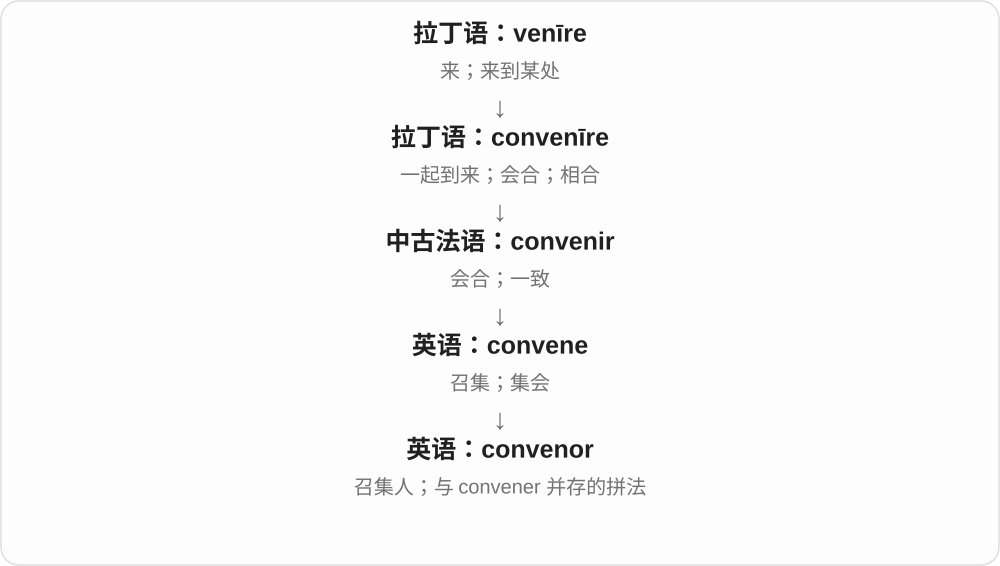

不同组织或地区会固定采用其中一种拼法。它不是比 convener 更高一级的职务，也不能仅凭词尾判断职责不同。

**常见搭配与例句**

conference convenor；the convenor of the committee。

> Please send your questions to the conference convenor.

请把问题发给会议召集人。

> The committee’s convenor welcomed the new members.

委员会召集人欢迎了新成员。

**别混淆**

convenor 与 convener 通常是拼写选择；coordinator 更宽泛地说协调事务的人，不一定负责召集会议。

### 116. licensor — 许可方、授权方

**音标**：英 /ˈlaɪsənsə/；美 /ˈlaɪsənsər/

**先抓住这个画面**

把使用许可交出去的那一边；比如作品权利方允许别人按条件使用，自己是 licensor。

**怎么拆**

license + -or 的施事名词形式，词末 e 不保留；与 licensee 接受方配成角色对。

**怎么变成今天的意思**

**拉丁 licēre → licentia**  
被允许 → 许可、自由

↓

**法语 licence/licencier → 英语 license 名词、动词**  
许可、许可证；授予使用或经营许可

↓

**license + -or → licensor**  
授出许可的人或机构

the licensor’s approval 许可方批准，a software licensor 软件授权方，licensor and licensee 许可方与被许可方。

**常见搭配与例句**

the licensor’s approval；licensor and licensee。

> The licensor retained ownership of the original design.

许可方保留了原设计的所有权。

> The licensee must obtain the licensor’s approval for that use.

被许可方必须就该用途取得许可方批准。

**别混淆**

licensor 授权，不必亲自制造每件产品；licensee 接受授权，也不必是个人消费者。先看关系，不靠公司大小猜。

### 117. pollinator — 传粉者；传粉动物

**音标**：英 /ˈpɒləneɪtə/；美 /ˈpɑːləneɪtər/

**先抓住这个画面**

像小小的搬运工，把花粉从一个地方带到另一个地方。

**怎么拆**

英语 pollinate 去掉词尾 e，加表示执行者的 -or，形成 pollinator。

**怎么变成今天的意思**

**英语 pollinate**  
帮助授粉

↓

**英语 pollinator**  
承担传粉作用的生物或传粉者

科普里的 pollinators 通常指蜜蜂、蝴蝶、飞蛾、鸟、蝙蝠等传粉动物。不同植物依赖的伙伴不同，不是所有开花植物都靠同一类动物。风能传粉，但讲保护 pollinators 时通常不是在说保护风。

**常见搭配与例句**

protect pollinators；native pollinators；pollinator habitat；important pollinators。

> The garden provides food and shelter for pollinators.

这个花园为传粉动物提供食物和栖身之处。

> Some bats are important pollinators of night-blooming plants.

有些蝙蝠是夜间开花植物的重要传粉动物。

**别混淆**

pollinator 是传粉的执行者，pollination 是过程，pollen 是被搬运的颗粒。把三者放进同一个动作里就容易记住。

### 118. replicator — 复制装置；复制者；能复制自身的信息单位

**音标**：英 /ˈreplɪkeɪtə/；美 /ˈreplɪkeɪtər/

**先抓住这个画面**

把复制这件事做出来的东西：可以是设备，也可以是某种能使自身信息延续的单位。

**怎么拆**

replicate + -or，以 replicat- 接后缀；是英语施事名词。

**怎么变成今天的意思**

**拉丁语 plicare**  
折叠、使相接；与编织、弯曲一组词有更早联系

↓

**拉丁语 re- + plicare → replicare**  
折回；重复、回答

↓

**拉丁语 replicatus → 英语 replicate**  
折回、重复 → 复制；重复验证

↓

**英语 replicat- + -or → replicator**  
实行复制或能自我复制的东西

技术语境常指复制装置；进化论讨论中的 replicator 强调信息能通过复制延续，并不一定是完整生物。科幻里的物质复制机是另一具体想象。

**常见搭配与例句**

a molecular replicator；a data replicator；a self-replicating system。

> The technician tested the disc replicator before production.

技术员在生产前测试了光盘复制设备。

> The model treats the sequence as a replicator.

这个模型把该序列视为一个复制单位。

**别混淆**

replica 是复制出的成品；replicator 是复制的执行者或被讨论的自我复制单位。

### 119. cultivator — 耕作者；栽培者；中耕机、松土工具

**音标**：英 /ˈkʌltɪveɪtə/；美 /ˈkʌltɪveɪtər/

**先抓住这个画面**

可以是照料土地的人，也可以是替人松土除草的工具。

**怎么拆**

cultivate + -or，部分用法也受法语 cultivateur 影响。

**怎么变成今天的意思**

**拉丁 colere；分词 cultus**  
耕作、照料；居住；尊敬、崇奉

↓

**晚期拉丁 cultīvus → 中世纪拉丁 cultivāre / cultivātus**  
已耕种的 → 耕种、栽培

↓

**英语 cultivate**  
栽培；培养能力、兴趣与关系

↓

**英语 cultivate + -or → cultivator**  
耕作者；用于耕作的工具或机器

a rice cultivator 可以是种稻的人；a hand cultivator 是手持松土工具。读到机械语境时，不要一见 -or 就默认是人。

**常见搭配与例句**

a hand cultivator；a mechanical cultivator；cultivators of rice。

> She used a hand cultivator to loosen the soil.

她用手持中耕工具松土。

> The project supports small cultivators in the valley.

项目支持山谷里的小规模种植者。

**别混淆**

farmer 通常指从事农业的人；cultivator 还可以是机器，或比喻培养人才与能力的人。

### 120. franchisor — 特许经营授权方、品牌授权商

**音标**：英 /ˈfræntʃaɪzə/；美 /ˌfræntʃaɪˈzɔːr/

**先抓住这个画面**

把品牌、经营方式等许可给加盟方使用的一方，是 franchisor。抓住授权往外给的方向。

**怎么拆**

franchise 授权经营 + -or，标示执行这一行为的一方。英美重音、词尾存在不同读法。

**怎么变成今天的意思**

**古法语 franc 自由 → franchise 自由、豁免**  
获准免于某种限制，或享有特定权利

↓

**英语 franchise 的权利、许可支线**  
选举权；特许经营权、相应企业；体育联盟中的队伍

↓

**franchise + -or → franchisor**  
授出特许经营许可的一方

the franchisor’s brand 授权方的品牌，support from the franchisor 授权方提供的支持。角色名称本身不规定所有合同细节。

**常见搭配与例句**

a franchisor and its franchisees；the franchisor’s brand。

> The franchisor supplied signs for the new shop.

授权方给新店提供了招牌。

> The franchisees met with the franchisor to discuss training.

加盟方与授权方会面，讨论培训。

**别混淆**

franchisor 授权，franchisee 获授权；franchise 是许可、相应企业等。先辨角色再看句子。

### 121. compensator — 补偿者；补偿器、起平衡或校正作用的装置

**音标**：英 /ˈkɒmpenseɪtə/；美 /ˈkɑːmpenseɪtər/

**先抓住这个画面**

某个变化把平衡推偏，装置往另一方向作相应调整；这类承担补偿作用的东西可叫 compensator。

**怎么拆**

compensate 去末尾 e + -or。-or 可以是提供补偿的一方，也可以是为变化、偏差作校正的设备。

**怎么变成今天的意思**

**拉丁 com- + pensāre → compensāre**  
放在一起称量 → 抵平、弥补

↓

**英语 compensate / compensation**  
补偿动作与补偿、薪酬等名词各有借入史

↓

**compensate + -or → compensator**  
提供补偿者；抵消偏差的装置

a pressure compensator 压力补偿器，a motion compensator 运动补偿器，a compensator in a control system 控制系统中的补偿器。

**常见搭配与例句**

a pressure compensator；a motion compensator；a control compensator。

> The system uses a compensator to correct for small changes.

系统用补偿器校正细小变化。

> The diagram shows a pressure compensator beside the main unit.

图中在主装置旁标出了压力补偿器。

**别混淆**

compensator 不只赔钱的人，也不是 compensation 补偿这件事本身。技术上补偿哪种量，要看设备说明。

### 122. inheritor — 继承者；传统的承传者

**音标**：英 /ɪnˈherɪtə/；美 /ɪnˈherɪtər/

**先抓住这个画面**

把前人留下的财产、作品或思想接过来的人。

**怎么拆**

中古英语已有 enheriter、enheritour。现代可以按 inherit + -or“执行者”理解，前史接法语继承动词。

**怎么变成今天的意思**

**拉丁 hērēs，词干 hērēd-**  
继承者、承受遗产的人

↓

**后期拉丁 inhērēditāre → 古法语 enheriter**  
使成为继承人

↓

**中古英语 enheriten；派生 enheriter / enheritour → 英语 inheritor**  
继承者

常用 inheritor of，既可以说财产，也常说文化、思想、责任。比 heir 更容易突出已经承接、延续某种东西的角色，但两词有很大重叠。

**常见搭配与例句**

the inheritor of；inheritors of a tradition；the sole inheritor。

> He became the inheritor of a large collection of manuscripts.

他成了一大批手稿的继承者。

> The musicians see themselves as inheritors of a rich folk tradition.

这些音乐家把自己看作丰富民间音乐传统的传承者。

**别混淆**

heir to 常见于继承资格或未来继承；inheritor of 常说所承接的东西，并非绝对的法律分工。

### 123. differentiator — 区别因素、差异化特点；区分者、工具

**音标**：英 /ˌdɪfəˈrenʃieɪtə/；美 /ˌdɪfəˈrenʃieɪtər/

**先抓住这个画面**

同类产品看起来都差不多，有一项特点让它显得不一样，那项特点就是 a differentiator。它不必是人，服务、设计、能力都可承担区分作用。

**怎么拆**

differentiate 去末尾 e + -or，使用 differentiat- 词干，形成使有区别、实施区分的事物、执行者名。专门技术里也有相应工具含义。

**怎么变成今天的意思**

**differentiate 区分、使差异化 → differentiator**  
使对象显出区别的因素、人或工具

↓

**differentiate 的 differentiat- 词干 + -or**  
现代常用来讲竞争中的区别特点

a key differentiator 关键差异化特点；a major differentiator 主要区别因素。

**常见搭配与例句**

a key differentiator；a major differentiator。

> Reliable service became the company’s key differentiator.

可靠服务成了这家公司的关键差异化特点。

> The review identified design as the main differentiator.

评测认为设计是主要区别因素。

**别混淆**

difference 是差别本身，differentiator 常是造成、体现区别的那个特点或因素。

### 124. authenticator — 鉴定者；身份验证器；用于认证的工具或凭据

**音标**：英 /ɔːˈθentɪkeɪtə/；美 /ɔːˈθentɪkeɪtər/，也读 /ɑːˈθentɪkeɪtər/

**先抓住这个画面**

它提供验证所需的证据或能力：可以是鉴定物件的人，也可以是帮助用户证明账号归属的装置或应用。

**怎么拆**

authenticate 去末尾 e + -or，英语施事名词；后来技术语境把执行或支持身份核验的工具也称为 authenticator。

**怎么变成今天的意思**

**希腊 autos**  
自己；自身；同一

↓

**希腊 authentes → authentikos → 拉丁 authenticus**  
主事者 → 本原、可信的

↓

**中世纪拉丁 authenticare，分词 authenticatus → 英语 authenticate**  
证实真实性；鉴定

↓

**英语 authenticate + -or → authenticator**  
鉴定者；用于身份核验的工具、凭据或装置

an authenticator app 常指协助登录验证的应用；安全技术中的 authenticator 还可以包括用户控制的密钥或设备。并不是所有语境都只指那串短验证码。

**常见搭配与例句**

an authenticator app；a hardware authenticator；an art authenticator。

> The museum consulted an experienced art authenticator.

博物馆咨询了一位经验丰富的艺术品鉴定专家。

> The account can be verified with an authenticator app.

这个账号可以借助身份验证器应用进行验证。

**别混淆**

authentication 是验证过程，authenticator 是参与验证的人或工具；code 常是工具生成的一次输出，不一定就是工具本身。

### 125. carburettor — 化油器〔常见英式拼写〕

**音标**：英 /ˌkɑːbəˈretə/；美 /ˈkɑːrbəreɪtər/

**先抓住这个画面**

和 carburetor 是同一种发动机部件；这里双写 t 属拼写变体，不表示另一套工作原理。

**怎么拆**

carburet 与 -or 的相应形式，英式常写 carburettor，美式常写 carburetor；词义相同，发音有常见地区差异。

**怎么变成今天的意思**

**旧动词 carburet**  
使带有碳、烃类材料等旧化学用法

↓

**carburet + -or → carburetor、carburettor**  
相关装置；发动机中混合燃油与空气的化油器

an engine carburettor 发动机化油器；发动机维修手册、老车介绍里常见。

**常见搭配与例句**

a carburettor；carburettor maintenance。

> The manual includes a drawing of the carburettor.

手册收有化油器示意图。

> The museum displays an early engine with its original carburettor.

博物馆展出一台保留原化油器的早期发动机。

**别混淆**

carburettor 与 carburetor 是拼写变体，不等于一个只用于汽车、一个只用于摩托车。

### 126. depositor — 存款人；交存者

**音标**：英 /dɪˈpɒzɪtə/；美 /dɪˈpɑːzɪtər/

**先抓住这个画面**

把钱或其他东西交过去存放的人。

**怎么拆**

deposit + -or，在英语中形成施事名词。

**怎么变成今天的意思**

**拉丁语 pōnere；过去分词 positus**  
放、安置；已经放好的

↓

**拉丁 dē- + pōnere → dēpōnere；depositus / depositum**  
放下、放到一边；存放的东西

↓

**英语 deposit〔动词与名词借入〕**  
交存、存款；留下的沉积物

↓

**英语 deposit + -or → depositor**  
存入、交存的人

最常见是银行的存款人；也可指把资料、物件交给档案馆等机构保管的人。

**常见搭配与例句**

a bank depositor；small depositors；depositor records。

> The bank contacted each depositor affected by the error.

银行联系了每一位受错误影响的存款人。

> The archive recorded the depositor’s name beside the collection.

档案馆在藏品旁记录了交存者的姓名。

**别混淆**

depository 是接收存放的机构或场所；depositor 是交存的一方。

### 127. orchestrator — 配器师；统筹者

**音标**：英 /ˈɔːkɪstreɪtə/；美 /ˈɔːrkɪstreɪtər/

**先抓住这个画面**

负责把不同部分安排成完整结果的人。

**怎么拆**

英语 orchestrate 去词尾 e，再加表示执行者的 -or。它继承动词的音乐义与协调安排义，不能因为有 orchestra 就直接译为乐队指挥。

**怎么变成今天的意思**

**希腊语 orchestra → 拉丁语 orchestra**  
剧场中的表演区域

↓

**法语 orchestre → orchestration**  
乐队 → 为乐队安排各声部

↓

**英语 orchestration**  
配器、管弦乐编配

↓

**英语 orchestrate**  
有从 orchestration 逆构的分析；另有 orchestra 派生说

↓

**英语 orchestrate + -or → orchestrator**  
配器者；统筹安排的人

作曲家写出主要音乐后，orchestrator 可以把它安排到具体乐器和声部。比喻语境中，the orchestrator of a campaign 是推动、统筹各环节的人，通常不只是负责其中一个小任务的参与者。

**常见搭配与例句**

a film orchestrator；the orchestrator of a campaign；an experienced orchestrator。

> The orchestrator assigned the melody to the woodwinds.

配器师把旋律分配给了木管乐器。

> She was the main orchestrator of the fundraising campaign.

她是这次募款活动的主要统筹者。

**别混淆**

composer 作曲，orchestrator 配器，conductor 指挥演奏；一个人能兼任多种工作，但三个词指出的职责不同。

### 128. procrastinator — 爱拖延的人

**音标**：英 /prəʊˈkræstɪneɪtə/；美 /proʊˈkræstəneɪtər/

**先抓住这个画面**

不是任务自己被挪走，而是那个人总说“等一会儿再做”。

**怎么拆**

procrastinate + -or，构成人的名词；英语用拉丁式的施事者词尾形成。

**怎么变成今天的意思**

**拉丁 pro- + crastinus（来自 cras）**  
向前 + 属于明天的（明天）

↓

**拉丁 procrastinare**  
把事往明天推

↓

**英语 procrastinate + -or → procrastinator**  
拖延 → 常拖延的人

可以自嘲 I am a terrible procrastinator，也可以客观描述习惯。称呼别人时语气可能带批评，不必把一次延迟就上升成这个人的固定性格。

**常见搭配与例句**

a habitual procrastinator；a chronic procrastinator；a terrible procrastinator。

> I am a procrastinator when it comes to sorting old papers.

一说到整理旧文件，我就爱拖。

> Even a habitual procrastinator can finish a small task today.

即使是经常拖延的人，今天也可以先完成一件小任务。

**别混淆**

procrastinator 不是 slow worker 的简单同义词：工作做得慢，与迟迟不肯开始或推进，是两回事。

### 129. bettor — 下注者、打赌者

**音标**：英 /ˈbetə/；美 /ˈbetər/

**先抓住这个画面**

bet 是押一个结果，bettor 是参与押注的人。人名词不替这个人保证能猜中。

**怎么拆**

bet + -or，双写 t；常用尤其美式，英语也有 better 这个人物变体，但 better 更常是好或好的比较形式等。

**怎么变成今天的意思**

**16世纪英语 bet**  
赌注、打赌；来自当时俚语，具体来源未定

↓

**英语 bet 与口语扩展**  
下注、押某结果；确信、猜测；You bet 等回应

↓

**bet + -or → bettor**  
下注、打赌的人

a bettor 一位下注者，sports bettors 体育下注者，a group of bettors 一群下注者。

**常见搭配与例句**

a bettor；sports bettors；a group of bettors。

> The report interviewed several bettors about their habits.

报告采访了几位下注者，了解他们的习惯。

> Every bettor made a different prediction.

每位下注者作了不同预测。

**别混淆**

bettor 下注的人，不等于 winner 赢家；单词只标参与行为，不说明结果、能力。

### 130. isolator — 隔离器、隔离装置

**音标**：英 /ˈaɪsəleɪtə/；美 /ˈaɪsəleɪtər/

**先抓住这个画面**

把一个部分和外界隔开，让它不直接受周围影响；承担这种隔离功能的装置就可以叫 isolator。

**怎么拆**

isolate 去末尾 e 加 -or，形成装置名。isolate 的历史通向拉丁岛的名称，核心画面是像岛一样与周围分开。

**怎么变成今天的意思**

**拉丁 īnsula 岛 → 意大利 isolato、法语 isolé**  
像成为一座岛一样被隔开

↓

**英语 isolated → isolate**  
由已隔开的状态逆构出隔开动作

↓

**isolate + -or → isolator**  
实现隔离的装置

electrical isolator 电气隔离装置；实验环境中的 isolator 可将内部样品、操作区域与外部环境隔开。不同设备的具体结构、功能由领域决定。

**常见搭配与例句**

an electrical isolator；a sealed isolator。

> The samples were kept inside a sealed isolator.

样品放在密封隔离装置内。

> The engineer marked the isolator on the drawing.

工程师在图纸上标出了隔离器。

**别混淆**

isolator 是装置，isolation 是隔离状态或过程；不能只因都译隔离，就把两个名词互换。

### 131. protractor — 量角器

**音标**：英 /prəˈtræktə/；美 /prəˈtræktər/

**先抓住这个画面**

把中心对准角的顶点，看另一条边对应多少度，课堂里用来量角的工具叫 protractor。词里有拉、画出的历史材料，不是拖拉机。

**怎么拆**

接拉丁 protrahere 向前拉、引出及 protract- 变化词干，-or 作人员、工具名。英语早期另有延长某事的人等义，常用工具义后来固定到量角器。

**怎么变成今天的意思**

**拉丁 pro- + trahere → protract-**  
向前拉、引出、延长

↓

**protractor 的测绘用法**  
测量、画出角度的工具

a protractor and a ruler 量角器和直尺；measure an angle with a protractor 用量角器量角。

**常见搭配与例句**

use a protractor；a semicircular protractor。

> Use a protractor to measure the angle.

用量角器测这个角。

> She packed a ruler and a protractor in her pencil case.

她把直尺和量角器放进铅笔盒。

**别混淆**

protractor 是量角器，tractor 是拖拉机、牵引设备；同有拉的历史词干，现代指的工具不同。

## 这一组要分清什么

REALTOR® 正式指协会会员，不是所有地产代理人；carburetor／carburettor 是英美拼写变体；fabricator 可制造也可捏造；iterator 与 iterable 在 Python 中有关但不同；protractor 量角器与 tractor 拖拉机分开。

## 串起来练习

The designer, fabricator and inspector each checked a different part of the project.

设计者、加工者和检查员分别核查了项目的不同部分。
