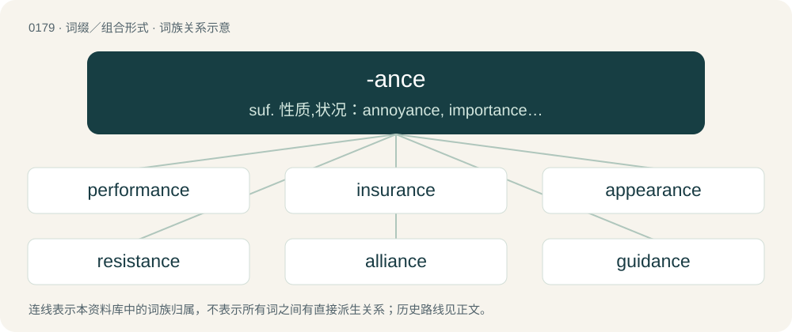

# 0196 · -ance — suf. 性质,状况：annoyance, importance; 表示程度,总量：conductance; 行动,行为,过程：performance, utterance

[总目录](../00_总目录_按常用程度.md)

**类型**：词缀／组合形式　｜　**来源语言**：见词源记录

## 核心含义与来源

- 核心含义：suf. 性质,状况：annoyance, importance; 表示程度,总量：conductance; 行动,行为,过程：performance, utterance
- 英文含义：Added to an adjective or verb to form a noun indicating a state or condition, such as result or capacity, associated with the verb.
- 词形：-ance

**来源记录 1**（后缀／后置成分；Added to an adjective or verb to form a noun indicating a state or condition, such as result or capacity, associated with the verb.）

From Middle English -aunce, -ance, from Anglo-Norman -aunce and continental Old French -ance, from Latin -ant-, -ent- + -ia, from stem of Latin -āns, -ēns.

## 词族图

## 单词速览（常用到不常用）

| 单词 | 音标 | 释义 |
|---|---|---|
| [performance](#w-1) | 英 /pəˈfɔː.mən(t)s/；美 /pɚˈfɔɹ.mən(t)s/ | n. 施行, 工作情况, 成绩, 行为, 表现, 演出；\[电\] 绩效, 性能 |
| [insurance](#w-2) | 美 /ɪnˈʃʊɹ.əns/；/ɪnˈʃɔː.ɹəns/ | n. 保险, 保险业, 保险费；\[医\] 保险 |
| [appearance](#w-3) | 英 /əˈpɪə.ɹəns/；美 /əˈpiɹ.əns/ | n. 出现, 露面, 外观, 外表, 出版；\[计\] 外观, 版面 |
| [resistance](#w-4) | /ɹɪˈzɪstəns/ | n. 抵抗力, 反抗, 耐力, 阻力, 电阻；\[化\] 抵抗; 抗性; 阻力; 抗药性; 电阻 |
| [alliance](#w-5) | 英 /əˈlaɪ.əns/ | n. 联盟, 联合；\[法\] 同盟, 联盟, 联姻 |
| [guidance](#w-6) | /ˈɡaɪdəns/ | n. 指导, 领导；\[医\] 导 |
| [compliance](#w-7) | 英 /kəmˈplaɪ.əns/ | n. 遵从, 顺从, 屈从；\[化\] 柔顺; 顺应 |
| [acceptance](#w-8) | 英 /əkˈsɛp.təns/ | n. 接受, 接纳, 承认, 同意, 赞同, 容忍, 相信；\[经\] 承兑, 认付, (工程)验收 |
| [accordance](#w-9) | 英 /əˈkɔː.dəns/；美 /əˈkoɹ.dəns/ | n. 一致, 和谐 |
| [governance](#w-10) | 英 /ˈɡʌvənəns/；美 /ˈɡʌvəɹnəns/ | n. 统治, 统辖, 管理；\[法\] 统治, 管理, 支配 |
| [clearance](#w-11) | 英 /ˈklɪə̯.ɹəns/；美 /ˈklɪɚ.əns/ | n. 清除, 间隙；\[化\] 间隙; 空隙 |
| [abundance](#w-12) | 英 /əˈbʌn.dn̩s/；美 /əˈbʌn.dn̩s/ | n. 丰富, 充足, 大量；\[经\] 丰富, 充裕 |
| [allowance](#w-13) | 美 /əˈlaʊɪns/；/əˈlaʊəns/ | n. 津贴, 零用钱, 限额, 折扣, 允许；vt. 定量供应 |
| [dominance](#w-14) | 英 /ˈdɒmɪnəns/；美 /ˈdɑmɪnəns/ | n. 优势, 显性, 统治, 控制, 支配；\[计\] 控制, 扰势 |
| [assurance](#w-15) | 美 /əˈʃʊɹəns/；/əˈʃɔːɹəns/ | n. 保证, 把握, 信心, 保险；\[经\] 保证, 担保, 保险 |
| [reliance](#w-16) | /ɹɪˈlaɪ.əns/ | n. 信任, 信赖, 受信赖的人(或事)；\[法\] 信任, 信赖, 信心 |
| [inheritance](#w-17) | /ɪnˈhɛɹɪtəns/ | n. 遗传, 遗产；\[医\] 遗传 |
| [relevance](#w-18) | /ˈɹɛl.ɪ.vən(t)s/ | n. 中肯；关联；相关性 |
| [disappearance](#w-19) | 英 /dɪsəˈpɪəɹəns/ | n. 看不见, 失踪, 消失 |
| [endurance](#w-20) | 英 /ɪnˈdjʊəɹəns/；美 /ɪnˈdʊɹəns/ | n. 忍耐, 忍耐力, 耐性；\[机\] 持九性 |
| [vengeance](#w-21) | /ˈvɛnˌd͡ʒəns/ | n. 复仇, 报仇；\[法\] 报仇, 复仇 |
| [remembrance](#w-22) | 英 /ɹɪˈmɛm.bɹəns/ | n. 回想, 记忆, 纪念品, 记忆力, 问候, 致意 |
| [resemblance](#w-23) | 英 /ɹɪˈzɛmbləns/；美 /ɹəˈzɛmbləns/ | n. 相似处, 类似, 肖像 |
| [acquaintance](#w-24) | 英 /əˈkweɪntəns/；美 /ʌˈkweɪn.təns/ | n. 认识, 相识者 |
| [avoidance](#w-25) | /əˈvɔɪdəns/ | n. 避免, 避开, 逃避；\[经\] 回避, 废止, 宣告无效 |
| [variance](#w-26) | 英 /ˈvɛə.ɹi.əns/；美 /ˈvæɹ.i.əns/ | n. 不一致, 变化, 变异, 分歧, 不和；\[化\] 方差; 变种 |
| [reluctance](#w-27) | /ɹɪˈlʌktəns/ | n. 不情愿, 勉强；\[电\] 磁阻 |
| [brilliance](#w-28) | /ˈbɹɪljən(t)s/ | n. 卓越, 光辉；\[电\] 辉度 |
| [appliance](#w-29) | /əˈplaɪ.əns/ | n. 器械, 用具, 应用；\[医\] 矫正器; 器 |
| [issuance](#w-30) | 美 /ˈɪʃ(j)uəns/ | n. 发行, 发布；\[经\] 发行, 发给 |
| [annoyance](#w-31) | /əˈnɔɪ.əns/ | n. 烦恼, 打扰, 可厌之事；\[法\] 使人烦恼的事物, 麻烦事, 讨厌物 |
| [severance](#w-32) | 英 /ˈsɛv.ɹəns/；美 /ˈsɛv.ɚ.əns/ | n. 切断, 分离, 断绝；\[经\] 解雇 |
| [grievance](#w-33) | /ˈɡɹiː.vəns/ | n. 委屈, 冤情, 苦况；\[经\] 不满(对雇用条件的) |
| [impedance](#w-34) | /imˈpiːdəns/ | n. 阻抗；\[计\] 阻抗, 电抗 |
| [temperance](#w-35) | /ˈtɛmpəɹəns/ | n. 节欲, 戒酒, 禁酒, 节制；\[医\] 节制(饮食等), 戒酒 |
| [observance](#w-36) | 英 /əbˈzɜːvəns/；美 /əbˈzɝvəns/ | n. 观察, 遵守, 仪式, 风俗习惯；\[法\] 遵守, 奉行, 惯例 |
| [deliverance](#w-37) | 英 /dɪˈlɪvɹəns/ | n. 解脱, 解救, 释放, 判决；\[法\] 交保, 判决, 正式意见 |
| [radiance](#w-38) | /ˈɹeɪdi.əns/ | n. 光辉, 发光, 容光焕发；\[电\] 闪光 |
| [hindrance](#w-39) | /ˈhɪndɹəns/ | n. 妨害, 障碍, 阻碍物 |
| [sustenance](#w-40) | /ˈsʌs.tə.nəns/ | n. 生活资料, 生计, 食物, 支持；\[法\] 营养物, 维持, 支持 |
| [capacitance](#w-41) | /kəˈpæsitəns/ | n. 电容；\[化\] 电容 |
| [admittance](#w-42) | /ədˈmɪt.n̩s/ | n. 进入, 进入权, 准许进入；\[化\] 导纳 |
| [conveyance](#w-43) | /kənˈveɪəns/ | n. 运输, 运输工具, 财产转让；\[经\] 运输工具, 转让证书, 财产的转让 |
| [utterance](#w-44) | /ˈʌtəɹəns/ | n. 发声, 言辞, 表达, 说话的方式, 死；\[医\] 发言, 言语, 语调 |
| [preponderance](#w-45) | 英 /pɹɪˈpɒndəɹəns/；美 /pɹəˈpɑndəɹəns/ | n. 优势, 多数；\[医\] 优势 |
| [reappearance](#w-46) | /.riːəˈpiərəns/ | n. 再现 |
| [remittance](#w-47) | /ɹɪˈmɪtəns/ | n. 汇款；\[经\] 汇款, 寄款, 支付(金额) |
| [furtherance](#w-48) | 英 /ˈfɜːðəɹəns/；美 /ˈfɝðɚəns/ | n. 助成, 促进, 援助的方法, 提供援助者 |
| [predominance](#w-49) | /pɹəˈdɒmɪnəns/ | n. 主导地位, 优势 |
| [conductance](#w-50) | /kənˈdʌktəns/ | n. 电导, 电导率, 传导力；\[化\] 电导 |
| [forbearance](#w-51) | 英 /fəˈbɛːɹ(ə)n(t)s/；美 /fəɹˈbɛɹən(t)s/ | n. 节制, 自制, 忍耐；\[法\] 债务偿还期的延展, 忍耐, 宽容 |
| [reflectance](#w-52) | /riˈflektəns/ | n. 反射比；\[电\] 反射本领 |
| [inductance](#w-53) | /inˈdʌktəns/ | n. 电感, 感应系数；\[化\] 电感 |
| [absorbance](#w-54) | 美 /əbˈsɔɹ.bn̩s/ | n. 吸光率；\[化\] 吸光度; 吸收度 |
| [comeuppance](#w-55) | /kʌmˈʌpəns/ | n. 应得的惩罚 |
| [contrivance](#w-56) | /kənˈtɹaɪ.vəns/ | n. 发明, 发明的才能, 想出的办法, 发明物；\[化\] 设计方案 |
| [cognizance](#w-57) | 英 /ˈkɒɡnɪzəns/；美 /ˈkɑɡnɪzəns/ | n. 认识, 察知, 审理 |
| [irradiance](#w-58) | /ɪˈɹeɪ.di.əns/ | n. 光辉, 灿烂, 启示, 辐照度；\[计\] 辐照度 |
| [pursuance](#w-59) | /pə(ɹ)ˈsjuːəns/ | n. 追赶, 实行, 从事；\[法\] 追求, 追赶, 追踪 |
| [reactance](#w-60) | /riˈæktəns/ | n. 电抗；\[化\] 电抗 |
| [flamboyance](#w-61) | /flæmˈbɒiəns/ | n. 华丽, 火焰 |

## 逐词详解

### 1. performance

**词性**：名词　｜　**音标**：英 /pəˈfɔː.mən(t)s/；美 /pɚˈfɔɹ.mən(t)s/

**中文释义**：n. 施行, 工作情况, 成绩, 行为, 表现, 演出；\[电\] 绩效, 性能

**英文义项**：The act of performing; carrying into execution or action; execution; achievement; accomplishment; representation by action. / That which is performed or accomplished; a thing done or carried through; an achievement; a deed; an act; a feat; especially, an action of an elaborate or public character.

**构词拆分**：perform + -ance

**词源与演化**：

From Middle English parfourmaunce; equivalent to perform + -ance.

**例句**：

> Better performance means more work accomplished in shorter time and/or using fewer resources.

该用例对应义项：The amount of useful work accomplished estimated in terms of time needed, resources used, etc.

### 2. insurance

**词性**：名词　｜　**音标**：美 /ɪnˈʃʊɹ.əns/；/ɪnˈʃɔː.ɹəns/

**中文释义**：n. 保险, 保险业, 保险费；\[医\] 保险

**英文义项**：A means of indemnity against a future occurrence of an uncertain event. / The business of providing insurance.

**构词拆分**：By surface analysis, insure + -ance

**词源与演化**：

From the older form ensurance, see also assurance. By surface analysis, insure + -ance.

**例句**：

> The sky was clear, but I took my umbrella for insurance.

该用例对应义项：Any attempt to forestall an unfavorable event.

### 3. appearance

**词性**：名词　｜　**音标**：英 /əˈpɪə.ɹəns/；美 /əˈpiɹ.əns/

**中文释义**：n. 出现, 露面, 外观, 外表, 出版；\[计\] 外观, 版面

**英文义项**：The act of appearing or coming into sight; the act of becoming visible to the eye. / A thing seen; a phenomenon; an apparition.

**构词拆分**：appear + -ance

**词源与演化**：

Borrowed from Middle French apparence, from Latin apparentia, from appareo. Morphologically appear + -ance. Doublet of apparence and apparency. Displaced native Old English hīew (“the way something looks or seems”) and ætīewednes (“act of appearing or coming into view”).

**例句**：

> The patient had a small bowel obstruction and there was no appearance until after the obstruction resolved.

该用例对应义项：Chiefly used by nurses: the act of defecation by a patient.

### 4. resistance

**词性**：名词　｜　**音标**：/ɹɪˈzɪstəns/

**中文释义**：n. 抵抗力, 反抗, 耐力, 阻力, 电阻；\[化\] 抵抗; 抗性; 阻力; 抗药性; 电阻

**英文义项**：The act of resisting, or the capacity to resist. / A force that tends to oppose motion.

**构词拆分**：resist + -ance

**词源与演化**：

From earlier resistence, from Middle English resistence, from Old French resistence, from Latin resistentia. Morphologically resist + -ance.

**用法示例／搭配（非完整句）**：

> widespread resistance to the new urban development plans

该用例对应义项：The act of resisting, or the capacity to resist.

### 5. alliance

**词性**：名词　｜　**音标**：英 /əˈlaɪ.əns/

**中文释义**：n. 联盟, 联合；\[法\] 同盟, 联盟, 联姻

**英文义项**：The state of being allied. / The act of allying or uniting.

**构词拆分**：ally + -ance

**词源与演化**：

From Middle English alliaunce, from Old French aliance (French alliance). Equivalent to ally + -ance. Compare with Doric Greek ἁλία (halía, “assembly”). See also al-.

**用法示例／搭配（非完整句）**：

> an alliance between church and state, or welded by two countries

该用例对应义项：A union or connection of interests between families, states, parties, etc., especially between families by marriage and states by compact, treaty, or league.

### 6. guidance

**词性**：名词　｜　**音标**：/ˈɡaɪdəns/

**中文释义**：n. 指导, 领导；\[医\] 导

**英文义项**：The act or process of guiding. / Advice or counselling on some topic.

**构词拆分**：guide + -ance

**词源与演化**：

From guide + -ance. Displaced native Old English lādtēowdōm.

**用法示例／搭配（非完整句）**：

> divine guidance

该用例对应义项：Advice or counselling on some topic.

### 7. compliance

**词性**：名词　｜　**音标**：英 /kəmˈplaɪ.əns/

**中文释义**：n. 遵从, 顺从, 屈从；\[化\] 柔顺; 顺应

**英文义项**：An act of complying. / The state of being compliant.

**构词拆分**：comply + -ance

**词源与演化**：

From comply + -ance.

**例句**：

> The software ensures compliance with data protection laws.

该用例对应义项：The state of being compliant.

### 8. acceptance

**词性**：名词　｜　**音标**：英 /əkˈsɛp.təns/

**中文释义**：n. 接受, 接纳, 承认, 同意, 赞同, 容忍, 相信；\[经\] 承兑, 认付, (工程)验收

**英文义项**：The act of accepting; the receiving of something offered, with acquiescence, approbation, or satisfaction; especially, favourable reception; approval. / An instance of that act.

**构词拆分**：accept + -ance

**例句**：

> the acceptance of a gift, office, doctrine, etc.

该用例对应义项：The act of accepting; the receiving of something offered, with acquiescence, approbation, or satisfaction; especially, favourable reception; approval.

### 9. accordance

**词性**：名词　｜　**音标**：英 /əˈkɔː.dəns/；美 /əˈkoɹ.dəns/

**中文释义**：n. 一致, 和谐

**英文义项**：Agreement; harmony; conformity; compliance. / The act of granting something.

**构词拆分**：accord + -ance

**词源与演化**：

\* (compliance): First attested around 1300. \* (agreement): First attested in the early 14th century. \* accord + -ance \* From Middle English accordaunce, from Old French acordance (“agreeing, reconciliation, harmony”).

**例句**：

> The accordance to Canada of rights of access.

该用例对应义项：the act of granting rights

### 10. governance

**词性**：名词　｜　**音标**：英 /ˈɡʌvənəns/；美 /ˈɡʌvəɹnəns/

**中文释义**：n. 统治, 统辖, 管理；\[法\] 统治, 管理, 支配

**英文义项**：The process, or the power, of governing; government or administration. / The specific system by which a political system is ruled.

**构词拆分**：govern + -ance

**词源与演化**：

From Middle English governaunce, from Old French gouvernance, governance, equivalent to govern + -ance.

**例句**：

> The governance of an association is responsible to its members.

该用例对应义项：the persons (or committees or departments etc.) who make up a body for the purpose of administering something

### 11. clearance

**词性**：名词　｜　**音标**：英 /ˈklɪə̯.ɹəns/；美 /ˈklɪɚ.əns/

**中文释义**：n. 清除, 间隙；\[化\] 间隙; 空隙

**英文义项**：The act of clearing or something (such as a space) cleared. / The distance between two moving objects, especially between parts of a machine

**构词拆分**：clear + -ance

**词源与演化**：

From clear + -ance.

**例句**：

> He got clearance to travel to America, even though he had previous links to terrorists.

该用例对应义项：A permission for a vehicle to proceed, or for a person to travel.

### 12. abundance

**词性**：名词　｜　**音标**：英 /əˈbʌn.dn̩s/；美 /əˈbʌn.dn̩s/

**中文释义**：n. 丰富, 充足, 大量；\[经\] 丰富, 充裕

**英文义项**：A large quantity; many. / An overflowing fullness or ample sufficiency; profusion; copious supply; superfluity; plentifulness.

**构词拆分**：abound + -ance

**词源与演化**：

From Middle English abundaunce, habaundance, from Old French habundance, abondance, from Latin abundantia (“fullness, plenty”), from abundō (“to overflow”). Equivalent to abound + -ance. Displaced Old English geniht (“abundance, plenty”).

**例句**：

> Due to the abundance of art material, the class made a giant collage.

该用例对应义项：A large quantity; many.

### 13. allowance

**词性**：名词　｜　**音标**：美 /əˈlaʊɪns/；/əˈlaʊəns/

**中文释义**：n. 津贴, 零用钱, 限额, 折扣, 允许；vt. 定量供应

**英文义项**：Permission; granting, conceding, or admitting. / Acknowledgment.

**构词拆分**：allow + -ance

**词源与演化**：

From Middle English allouance, from Old French alouance. Morphologically allow + -ance.

**例句**：

> Being a volunteer is unpaid, but we get accommodation and a living allowance of 100 euros a week.

该用例对应义项：An amount, portion, or share that is allotted or granted; a sum granted as a reimbursement, a bounty, or as appropriate for any purpose.

### 14. dominance

**词性**：名词　｜　**音标**：英 /ˈdɒmɪnəns/；美 /ˈdɑmɪnəns/

**中文释义**：n. 优势, 显性, 统治, 控制, 支配；\[计\] 控制, 扰势

**英文义项**：The state of being dominant; of prime importance; supremacy. / Being in a position of power, authority or ascendancy over others.

**构词拆分**：dominant + -ance

**词源与演化**：

From dominant + -ance.

**例句**：

> Her apparent dominance of her husband was really her attempt to make him pay attention to her.

该用例对应义项：the state that exists when one person or group has power over another

### 15. assurance

**词性**：名词　｜　**音标**：美 /əˈʃʊɹəns/；/əˈʃɔːɹəns/

**中文释义**：n. 保证, 把握, 信心, 保险；\[经\] 保证, 担保, 保险

**英文义项**：The act of assuring; a declaration intended to inspire full confidence; something designed to give confidence to someone. / The state of being assured; total confidence or trust; a lack of doubt; certainty; guarantee.

**构词拆分**：assure + -ance

**词源与演化**：

From Middle English assuraunce, from Old French asseürance, from asseürer; as if assure + -ance.

**例句**：

> His assurance is intolerable.

该用例对应义项：Excessive boldness; impudence; audacity

### 16. reliance

**词性**：名词　｜　**音标**：/ɹɪˈlaɪ.əns/

**中文释义**：n. 信任, 信赖, 受信赖的人(或事)；\[法\] 信任, 信赖, 信心

**英文义项**：The act of relying (on or in someone or something); trust. / The condition of being reliant or dependent.

**构词拆分**：rely + -ance

**词源与演化**：

From rely + -ance.

**例句**：

> The industry is working to phase out its reliance on fossil fuels.

该用例对应义项：The condition of being reliant or dependent.

### 17. inheritance

**词性**：名词　｜　**音标**：/ɪnˈhɛɹɪtəns/

**中文释义**：n. 遗传, 遗产；\[医\] 遗传

**英文义项**：The passing of title to an estate upon death. / That which a person is entitled to inherit, by law or testament, such as the part of an estate (i.e., a portion).

**构词拆分**：By surface analysis, inherit + -ance

**词源与演化**：

Inherited from Middle English enheritaunce, inheritaunce, borrowed from Anglo-Norman, Old French enheritaunce, from enheriter. By surface analysis, inherit + -ance.

**例句**：

> The Indo-European languages share various similarities as a result of their inheritance from a common ancestor.

该用例对应义项：The act or mechanism of inheriting; the state of having inherited.

### 18. relevance

**词性**：名词　｜　**音标**：/ˈɹɛl.ɪ.vən(t)s/

**中文释义**：n. 中肯；关联；相关性

**英文义项**：The property or state of being relevant or pertinent.

**构词拆分**：relevant + -ance

**词源与演化**：

From relevant + -ance.

**例句**：

> In her speech, she emphasized the issues that had direct relevance to practice.

### 19. disappearance

**词性**：名词　｜　**音标**：英 /dɪsəˈpɪəɹəns/

**中文释义**：n. 看不见, 失踪, 消失

**英文义项**：The action of disappearing or vanishing. / Passing out of sight.

**构词拆分**：disappear + -ance

**词源与演化**：

From disappear + -ance.

**例句**：

> The prosecuting attorney was concerned about the potential disappearance of witnesses.

该用例对应义项：Leaving secretly of without explanation

### 20. endurance

**词性**：名词　｜　**音标**：英 /ɪnˈdjʊəɹəns/；美 /ɪnˈdʊɹəns/

**中文释义**：n. 忍耐, 忍耐力, 耐性；\[机\] 持九性

**英文义项**：The measure of a person's stamina or persistence. / An ability to endure hardship.

**构词拆分**：endure + -ance

**词源与演化**：

First attested in the late 15th century. From Middle French endurance, from Old French endurance. Morphologically endure + -ance.

**例句**：

> He has great endurance: he ran a marathon and then cycled home.

该用例对应义项：The measure of a person's stamina or persistence.

### 21. vengeance

**词性**：名词　｜　**音标**：/ˈvɛnˌd͡ʒəns/

**中文释义**：n. 复仇, 报仇；\[法\] 报仇, 复仇

**英文义项**：Revenge taken for an insult, injury, or other wrong. / Desire for revenge.

**构词拆分**：venge + -ance

**词源与演化**：

From Anglo-Norman vengeaunce, from Old French vengeance, venjance, from vengier (“to avenge”). Analysable as venge + -ance.

**例句**：

> Vengeance is mine; I will repay, saith the Lord.

该用例对应义项：the act of taking revenge (harming someone in retaliation for something harmful that they have done) especially in the next life

### 22. remembrance

**词性**：名词　｜　**音标**：英 /ɹɪˈmɛm.bɹəns/

**中文释义**：n. 回想, 记忆, 纪念品, 记忆力, 问候, 致意

**英文义项**：The act of remembering; a holding in mind, or bringing to mind; recollection. / The state of being remembered, or held in mind; memory, recollection.

**构词拆分**：remember + -ance

**词源与演化**：

From Middle English remembraunce, from Old French remembrance, from remembrer (“to remember”), from Late Latin rememorārī (“to call to mind, to remember”). Equivalent to remember + -ance.

**例句**：

> Remembrance Sunday in the UK takes place on the Sunday nearest 11 November.

### 23. resemblance

**词性**：名词　｜　**音标**：英 /ɹɪˈzɛmbləns/；美 /ɹəˈzɛmbləns/

**中文释义**：n. 相似处, 类似, 肖像

**英文义项**：The quality or state of resembling. / That which resembles, or is similar; a representation; a likeness.

**构词拆分**：resemble + -ance

**词源与演化**：

From Anglo-Norman resemblance, from Old French (compare French ressemblance). Morphologically resemble + -ance.

**例句**：

> Mars is all the more interesting for its close resemblance to our Earth.

### 24. acquaintance

**词性**：名词　｜　**音标**：英 /əˈkweɪntəns/；美 /ʌˈkweɪn.təns/

**中文释义**：n. 认识, 相识者

**英文义项**：A state of being acquainted with a person; originally indicating friendship, intimacy, but now suggesting a slight knowledge less deep than that of friendship; acquaintanceship. / A person or persons with whom one is acquainted.

**构词拆分**：acquaint + -ance

**词源与演化**：

From Middle English aqueyntaunce, from Anglo-Norman aquaintaunce, aqueintance, Old French acointance (“friendship, familiarity”), from Old French acointier (“to acquaint”). Compare French accointance. Morphologically acquaint + -ance.

**例句**：

> I know of the man; but have no acquaintance with him.

该用例对应义项：A state of being acquainted with a person; originally indicating friendship, intimacy, but now suggesting a slight knowledge less deep than that of friendship; acquaintanceship.

### 25. avoidance

**词性**：名词　｜　**音标**：/əˈvɔɪdəns/

**中文释义**：n. 避免, 避开, 逃避；\[经\] 回避, 废止, 宣告无效

**英文义项**：The act of avoiding or shunning; keeping clear of.

**构词拆分**：avoid + -ance

**词源与演化**：

From Middle English avoidaunce, from avoid + -ance.

**例句**：

> Will the media really continue to gloss over corporate tax avoidance?

### 26. variance

**词性**：名词　｜　**音标**：英 /ˈvɛə.ɹi.əns/；美 /ˈvæɹ.i.əns/

**中文释义**：n. 不一致, 变化, 变异, 分歧, 不和；\[化\] 方差; 变种

**英文义项**：The act of varying or the state of being variable. / A difference between what is expected and what is observed; deviation.

**构词拆分**：vary + -ance

**词源与演化**：

From Middle English variance, variaunce, equivalent to vary + -ance, from Old French variance or directly from Anglo-Latin variaunce, veriaunce, wariaunce; all from Latin variantia.

**例句**：

> Depending on the variance of the type constructor, the subtyping relation of the simple types may be either preserved, reversed, or ignored for the respective complex types.

该用例对应义项：Covariance and contravariance generally.

### 27. reluctance

**词性**：名词　｜　**音标**：/ɹɪˈlʌktəns/

**中文释义**：n. 不情愿, 勉强；\[电\] 磁阻

**英文义项**：Unwillingness to do something. / Hesitancy in taking some action.

**构词拆分**：reluct + -ance

**词源与演化**：

From reluct + -ance. From Latin relū̆ctor (“to struggle against, oppose, resist”) + -ance, from re- (“back”) + luctor (“to struggle”).

**例句**：

> Our new dog shows reluctance to go on walks, preferring to be indoors.

该用例对应义项：Unwillingness to do something.

### 28. brilliance

**词性**：名词　｜　**音标**：/ˈbɹɪljən(t)s/

**中文释义**：n. 卓越, 光辉；\[电\] 辉度

**英文义项**：The quality of being exceptionally effulgent (giving off light). / The quality of having extraordinary mental capacity.

**构词拆分**：brilliant + -ance

**词源与演化**：

From brilliant + -ance. Compare French brillance.

**例句**：

> What brilliance it took from Harry Kane to control the cross and place the ball into the top corner.

该用例对应义项：Magnificence; resplendence.

### 29. appliance

**词性**：名词　｜　**音标**：/əˈplaɪ.əns/

**中文释义**：n. 器械, 用具, 应用；\[医\] 矫正器; 器

**英文义项**：An implement, an instrument or apparatus designed (or at least used) as a means to a specific end, especially / A non-manual apparatus or device, powered electrically or by another small motor, used in homes to perform domestic functions (household appliance) and/or in offices.

**构词拆分**：apply + -ance

**词源与演化**：

Recorded since the 1560s. From the English apply + -ance.

**例句**：

> Many house fires are caused by faulty appliances, such as refrigerators, washing machines and dryers.

该用例对应义项：A non-manual apparatus or device, powered electrically or by another small motor, used in homes to perform domestic functions (household appliance) and/or in offices.

### 30. issuance

**词性**：名词　｜　**音标**：美 /ˈɪʃ(j)uəns/

**中文释义**：n. 发行, 发布；\[经\] 发行, 发给

**英文义项**：The act of issuing, or giving out. / Something issued.

**构词拆分**：issue + -ance

**词源与演化**：

From issue + -ance.

**用法示例／搭配（非完整句）**：

> the issuance of an order

该用例对应义项：The act of issuing, or giving out.

### 31. annoyance

**词性**：名词　｜　**音标**：/əˈnɔɪ.əns/

**中文释义**：n. 烦恼, 打扰, 可厌之事；\[法\] 使人烦恼的事物, 麻烦事, 讨厌物

**英文义项**：That which annoys. / An act or instance of annoying.

**构词拆分**：annoy + -ance

**词源与演化**：

Inherited from Middle English anoyaunce (rare form of noyaunce), from Old French anuiance, anoiance, from the verb anuier (“to cause problems”), equivalent to annoy + -ance. Compare French ennui.

**例句**：

> Having to wait 45 minutes for the bus is a real annoyance, but it's the only way to get to work.

该用例对应义项：That which annoys.

### 32. severance

**词性**：名词　｜　**音标**：英 /ˈsɛv.ɹəns/；美 /ˈsɛv.ɚ.əns/

**中文释义**：n. 切断, 分离, 断绝；\[经\] 解雇

**英文义项**：The act of severing or the state of being severed. / A separation.

**构词拆分**：sever + -ance

**词源与演化**：

From sever + -ance, from Middle English severaunce, from Anglo-Norman, Old French sevrance, from sevrer.

**例句**：

> It's just not right to fire Tom without giving him severance pay.

### 33. grievance

**词性**：名词　｜　**音标**：/ˈɡɹiː.vəns/

**中文释义**：n. 委屈, 冤情, 苦况；\[经\] 不满(对雇用条件的)

**英文义项**：Something which causes grief. / A wrong or hardship suffered, which is the grounds of a complaint.

**构词拆分**：grieve + -ance

**词源与演化**：

From Old French grievance, from the verb grever (“to irritate; to bother; to annoy”) + -ance, equivalent to grieve + -ance.

**例句**：

> If you want the problem fixed, you'll have to file a grievance with the city.

该用例对应义项：A formal complaint, especially in the context of a unionized workplace.

### 34. impedance

**词性**：名词　｜　**音标**：/imˈpiːdəns/

**中文释义**：n. 阻抗；\[计\] 阻抗, 电抗

**英文义项**：The act of impeding; that which impedes; a hindrance. / A measure of the opposition to the flow of an alternating current in a circuit; the aggregation of its resistance, and inductive and capacitive reactances; the ratio of voltage to current treated as complex quantities.

**构词拆分**：impede + -ance

**词源与演化**：

From impede + -ance. In sense 2 and sense 3 it was coined by English mathematician and physicist Oliver Heaviside in 1886.

### 35. temperance

**词性**：名词　｜　**音标**：/ˈtɛmpəɹəns/

**中文释义**：n. 节欲, 戒酒, 禁酒, 节制；\[医\] 节制(饮食等), 戒酒

**英文义项**：Habitual moderation in regard to the indulgence of the natural appetites and passions; restrained or moderate indulgence. / Moderation, and sometimes abstinence, in respect to using intoxicating liquors.

**构词拆分**：temper + -ance

**词源与演化**：

From Anglo-Norman temperance, from Latin temperantia (“moderation, sobriety, discretion, self-control”), from temperans, present participle of temperare (“to moderate”). See temper. English equivalent temper + -ance.

**用法示例／搭配（非完整句）**：

> temperance in the indulgence of joy

该用例对应义项：Habitual moderation in regard to the indulgence of the natural appetites and passions; restrained or moderate indulgence.

### 36. observance

**词性**：名词　｜　**音标**：英 /əbˈzɜːvəns/；美 /əbˈzɝvəns/

**中文释义**：n. 观察, 遵守, 仪式, 风俗习惯；\[法\] 遵守, 奉行, 惯例

**英文义项**：The practice of complying with a law, custom, command or rule. / The custom of celebrating a holiday or similar occasion.

**构词拆分**：observe + -ance

**词源与演化**：

From Old French observance, from Latin observantia. Equivalent of observe + -ance.

**例句**：

> It is a custom more honored in the breach than the observance.

### 37. deliverance

**词性**：名词　｜　**音标**：英 /dɪˈlɪvɹəns/

**中文释义**：n. 解脱, 解救, 释放, 判决；\[法\] 交保, 判决, 正式意见

**英文义项**：The act of setting free or extricating from danger, imprisonment, bondage, evil, etc. / The act of delivering or conveying something.

**构词拆分**：deliver + -ance

**词源与演化**：

From Old French deliverance (French délivrance), equivalent to deliver + -ance.

**例句**：

> Work is the deliverance of mankind.

该用例对应义项：recovery or preservation from loss or danger

### 38. radiance

**词性**：名词　｜　**音标**：/ˈɹeɪdi.əns/

**中文释义**：n. 光辉, 发光, 容光焕发；\[电\] 闪光

**英文义项**：The quality or state of being radiant; shining, bright or splendid. / The flux of radiation emitted per unit solid angle in a given direction by a unit area of a source.

**构词拆分**：radiant + -ance

**词源与演化**：

From radiant + -ance.

**例句**：

> The radiance that emanates from Marika's face reflects the rich tapestry of her mixed heritage.

### 39. hindrance

**词性**：名词　｜　**音标**：/ˈhɪndɹəns/

**中文释义**：n. 妨害, 障碍, 阻碍物

**英文义项**：Something which hinders: something that holds back or causes problems with something else. / The state or act of hindering something.

**构词拆分**：hinder + -ance

**词源与演化**：

From Middle English hinderance, hinderaunce, hindraunce, hynderaunce, hynderawnce, hynderawns, hyndrance; equivalent to hinder + -ance.

**例句**：

> High-heeled shoes may be fashionable, but they can also be a hindrance to walking.

该用例对应义项：Something which hinders: something that holds back or causes problems with something else.

### 40. sustenance

**词性**：名词　｜　**音标**：/ˈsʌs.tə.nəns/

**中文释义**：n. 生活资料, 生计, 食物, 支持；\[法\] 营养物, 维持, 支持

**英文义项**：Something that provides support or nourishment.

**构词拆分**：sustain + -ance

**词源与演化**：

From Middle English sustenaunce, from Old French sustenance, from sustenir with the suffix -ance, from Vulgar Latin \*sustenire, from Latin sustinere. Compare also Late Latin sustinentia. Equivalent to sustain + -ance.

**例句**：

> Tom kept two or three cows for the sustenance of his family.

### 41. capacitance

**词性**：名词　｜　**音标**：/kəˈpæsitəns/

**中文释义**：n. 电容；\[化\] 电容

**英文义项**：The property of an electric circuit or its element that permits it to store charge, defined as the ratio of stored charge to potential over that element or circuit (Q/V); SI unit: farad (F). / An element of an electrical circuit exhibiting capacitance.

**构词拆分**：capacity + -ance

**词源与演化**：

From capacity + -ance.

**例句**：

> How does one calculate the capacitance of a capacitor?

### 42. admittance

**词性**：名词　｜　**音标**：/ədˈmɪt.n̩s/

**中文释义**：n. 进入, 进入权, 准许进入；\[化\] 导纳

**英文义项**：The act of admitting. / Permission to enter, the power or right of entrance.

**构词拆分**：admit + -ance

**词源与演化**：

From admit + -ance. Sense 5 was coined by electrical engineer, mathematician and physicist Oliver Heaviside in 1887.

**例句**：

> We gained admittance to the meeting.

### 43. conveyance

**词性**：名词　｜　**音标**：/kənˈveɪəns/

**中文释义**：n. 运输, 运输工具, 财产转让；\[经\] 运输工具, 转让证书, 财产的转让

**英文义项**：An act or instance of conveying. / A means of transporting, especially a vehicle.

**构词拆分**：convey + -ance

**词源与演化**：

From Middle English conveiance, conveyaunce, equivalent to convey + -ance.

**例句**：

> For the conveyance of a holiday home, the estate agent gets a commission of 8% of the cost of rent.

### 44. utterance

**词性**：名词　｜　**音标**：/ˈʌtəɹəns/

**中文释义**：n. 发声, 言辞, 表达, 说话的方式, 死；\[医\] 发言, 言语, 语调

**英文义项**：An act of, or the process of, uttering. / An instance of that act or process: especially, something spoken (e.g., syllables, words, phrases); (especially linguistics) any such thing either spoken or written.

**构词拆分**：utter + -ance

**词源与演化**：

From Middle English utteraunce, outeraunce; equivalent to utter + -ance.

**例句**：

> He has a good utterance.

该用例对应义项：A manner of speaking.

### 45. preponderance

**词性**：名词　｜　**音标**：英 /pɹɪˈpɒndəɹəns/；美 /pɹəˈpɑndəɹəns/

**中文释义**：n. 优势, 多数；\[医\] 优势

**英文义项**：Superiority in amount or number; the bulk or majority; also, a large amount or number; an abundance, a profusion. / Superiority of influence, power, a quality, etc.; an outweighing, predominance, pre-eminence.

**构词拆分**：preponderant + -ance

**词源与演化**：

From preponderant + -ance.

**例句**：

> The preponderance of good over evil.

该用例对应义项：superiority in power or influence

### 46. reappearance

**词性**：名词　｜　**音标**：/.riːəˈpiərəns/

**中文释义**：n. 再现

**英文义项**：The act of appearing again following absence.

**构词拆分**：re- + appearance；reappear + -ance

**词源与演化**：

From re- + appearance or reappear + -ance.

**例句**：

> His reappearance as Hamlet has been long awaited.

该用例对应义项：the act of someone appearing again

### 47. remittance

**词性**：名词　｜　**音标**：/ɹɪˈmɪtəns/

**中文释义**：n. 汇款；\[经\] 汇款, 寄款, 支付(金额)

**英文义项**：The act of sending money to someone. / Money which is sent to someone, typically to someone in another country.

**构词拆分**：remit + -ance

**词源与演化**：

From remit + -ance.

**用法示例／搭配（非完整句）**：

> remittance advice

该用例对应义项：The act of sending money to someone.

### 48. furtherance

**词性**：名词　｜　**音标**：英 /ˈfɜːðəɹəns/；美 /ˈfɝðɚəns/

**中文释义**：n. 助成, 促进, 援助的方法, 提供援助者

**英文义项**：The act of furthering or helping forward; assistance towards something desired.

**构词拆分**：further + -ance

**词源与演化**：

From further + -ance.

### 49. predominance

**词性**：名词　｜　**音标**：/pɹəˈdɒmɪnəns/

**中文释义**：n. 主导地位, 优势

**英文义项**：The condition or state of being predominant; ascendancy, domination, preeminence, preponderance.

**构词拆分**：predominant + -ance

**词源与演化**：

From predominant + -ance. By surface analysis, pre- + dominance.

**例句**：

> Hebden Bridge used to be known as 'Trouser Town', a nickname acquired because of the predominance of factories which made trousers in the town.

### 50. conductance

**词性**：名词　｜　**音标**：/kənˈdʌktəns/

**中文释义**：n. 电导, 电导率, 传导力；\[化\] 电导

**英文义项**：A measure of the ability of a body to conduct electricity; the reciprocal of its resistance.

**构词拆分**：conduct + -ance

**词源与演化**：

From conduct + -ance. Coined by electrical engineer, mathematician and physicist Oliver Heaviside in 1885.

### 51. forbearance

**词性**：名词　｜　**音标**：英 /fəˈbɛːɹ(ə)n(t)s/；美 /fəɹˈbɛɹən(t)s/

**中文释义**：n. 节制, 自制, 忍耐；\[法\] 债务偿还期的延展, 忍耐, 宽容

**英文义项**：The action of forbearing (“abstaining or refraining from doing something”); (countable) an instance of this. / The action of refraining from enforcing something which is due (such as a debt or obligation) or a right which one has; (countable) an instance of this.

**构词拆分**：forbear + -ance

**词源与演化**：

From forbear (“to keep away from, avoid”) + -ance (suffix forming nouns indicating conditions or states).

**例句**：

> His forbearance to reply was alarming.

该用例对应义项：a delay in enforcing rights or claims or privileges; refraining from acting

### 52. reflectance

**词性**：名词　｜　**音标**：/riˈflektəns/

**中文释义**：n. 反射比；\[电\] 反射本领

**英文义项**：The ratio of the flux reflected to that incident on a surface.

**构词拆分**：reflect + -ance

**词源与演化**：

From reflect + -ance.

**例句**：

> Satellite instruments measure light emitted or reflected back to space at different wavelengths and create spectral reflectance curves.

### 53. inductance

**词性**：名词　｜　**音标**：/inˈdʌktəns/

**中文释义**：n. 电感, 感应系数；\[化\] 电感

**英文义项**：The property of an electric circuit by which a voltage is induced in it by a changing magnetic field. / The quantity of the resulting electromagnetic flux divided by the current that produces it, measured in henries (SI symbol: H.)

**构词拆分**：induct + -ance

**词源与演化**：

From induct + -ance.

**例句**：

> What is the inductance of that power supply's main inductor?

该用例对应义项：The quantity of the resulting electromagnetic flux divided by the current that produces it, measured in henries (SI symbol: H.)

### 54. absorbance

**词性**：名词　｜　**音标**：美 /əbˈsɔɹ.bn̩s/

**中文释义**：n. 吸光率；\[化\] 吸光度; 吸收度

**英文义项**：A logarithmic measure of the amount of light that is absorbed when passing through a substance; the capacity of a substance to absorb light of a given wavelength; optical density.

**构词拆分**：absorb + -ance

**词源与演化**：

From absorb + -ance.

**例句**：

> In fact, the absorption enhancement that we see is in the range of 20 to 50 times the single-pass absorbance.

### 55. comeuppance

**词性**：名词　｜　**音标**：/kʌmˈʌpəns/

**中文释义**：n. 应得的惩罚

**英文义项**：Retribution or outcome that is justly deserved.

**构词拆分**：come up + -ance

**词源与演化**：

From come up (“to appear before a judge”) + -ance.

**例句**：

> Assholes getting their just comeuppance, you love to see it.

### 56. contrivance

**词性**：名词　｜　**音标**：/kənˈtɹaɪ.vəns/

**中文释义**：n. 发明, 发明的才能, 想出的办法, 发明物；\[化\] 设计方案

**英文义项**：A (mechanical) device to perform a certain task. / A means, such as an elaborate plan or strategy, to accomplish a certain objective.

**构词拆分**：contrive + -ance

**词源与演化**：

From contrive + -ance.

**例句**：

> His testimony was just a contrivance to throw us off the track.

该用例对应义项：an elaborate or deceitful scheme contrived to deceive or evade

### 57. cognizance

**词性**：名词　｜　**音标**：英 /ˈkɒɡnɪzəns/；美 /ˈkɑɡnɪzəns/

**中文释义**：n. 认识, 察知, 审理

**英文义项**：An emblem, badge or device, used as a distinguishing mark by the body of retainers of a royal or noble house. / Notice or awareness.

**构词拆分**：By surface analysis, cogniz(e) (a back-formation) + -ance

**词源与演化**：

From Middle English conysaunce, from Old French conysance (“recognition," later, "knowledge”), from Old French conoissance (“acquaintance, recognition; knowledge, wisdom”), from conoistre (“to know”), from Latin cognōscō (“know”), from con- (“with”) + gnōscō (“know”). By surface analysis, cogniz(e) (a back-formation) + -ance.

### 58. irradiance

**词性**：名词　｜　**音标**：/ɪˈɹeɪ.di.əns/

**中文释义**：n. 光辉, 灿烂, 启示, 辐照度；\[计\] 辐照度

**英文义项**：The act of irradiating; emission of rays of light. / That which irradiates or is irradiated; lustre; splendour; brilliancy.

**构词拆分**：irradiant + -ance

**词源与演化**：

From irradiant + -ance.

### 59. pursuance

**词性**：名词　｜　**音标**：/pə(ɹ)ˈsjuːəns/

**中文释义**：n. 追赶, 实行, 从事；\[法\] 追求, 追赶, 追踪

**英文义项**：A search for something; a pursuit or quest. / A completion or putting into effect of something already begun; a prosecution.

**构词拆分**：pursue + -ance

**词源与演化**：

From pursue + -ance.

**例句**：

> Life is more than the pursuance of fame.

该用例对应义项：a search for an alternative that meets cognitive criteria

### 60. reactance

**词性**：名词　｜　**音标**：/riˈæktəns/

**中文释义**：n. 电抗；\[化\] 电抗

**英文义项**：The opposition to the change in flow of current in an alternating current circuit, due to inductance and capacitance; the imaginary part of the impedance. Symbol: X. / A similar effect in magnetism.

**构词拆分**：react + -ance

**词源与演化**：

From react + -ance.

### 61. flamboyance

**词性**：名词　｜　**音标**：/flæmˈbɒiəns/

**中文释义**：n. 华丽, 火焰

**英文义项**：The condition of being flamboyant. / A group of flamingos.

**构词拆分**：flamboyant + -ance

**词源与演化**：

From flamboyant + -ance.

**例句**：

> The Sisters of Perpetual Indulgence, a community organization founded in San Francisco, California, battle complacency with flamboyance and humor.
