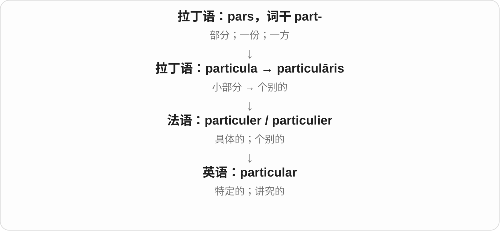
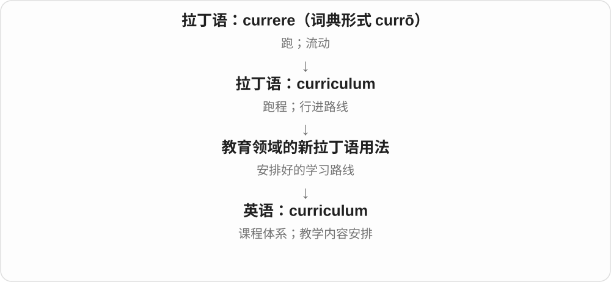
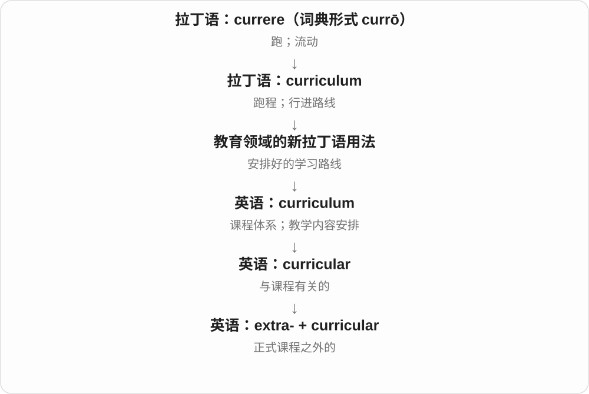

# 0197 · -ar — 属于、关于；具有某种形态或性质〔常见形容词词尾〕

[逐词精讲目录](../00_逐词精讲目录.md) · [总目录](../00_总目录_按常用程度.md)

## 核心词根与来源

这个形容词 -ar 上接拉丁 -aris，与 -alis 的历史异化有关：前面已有 l 时，后面的 l 有时改作 r，避免太相似的声音相挨。这个历史倾向帮助认 molecular、stellar 等词，但不是现代英语里遇到任何 l 都必须改尾的拼写规则。

**AR：从一个对象，转到与它有关或像它的形容词**

molecule 分子 → molecular 分子的；muscle 肌肉 → muscular 肌肉的；tube 管 → tubular 管状的。先把前面的实物看见，形容词就有落点。

- **先看基础事物**：line · linear；molecule · molecular；muscle · muscular；module · modular
- **形状、颗粒与课程**：plane · planar；grain · granular；tube · tubular；curriculum · curricular
- **身体及发音常见材料**：gland · glandular；jugular；alveolar
- **标题、头衔与名义：title 到 titular**：title · titular
- **line → lining：完整 ing 的拼写**：line · lining

## 词形与演化规律

molecule／molecular、muscle／muscular、module／modular、curriculum／curricular 可成组认；tubular 还含拉丁 tubulus 小管词干，glandular 承 glandula 腺体材料。liar、beggar 等末尾也写 ar，却不能放进同一拉丁形容词后缀里硬讲。

titular 经法语、拉丁语形容词借入，与 title 同接 titulus；现代可用 titul- + -ar 认识，不按英语 title 原样接尾拼写。

内衬名词来自加衬动作，不等于把一条线放进去。

## 单词速览（按词族由简到繁）

同一基础词的相关扩展放在一起，先读基础形式，再读扩展；各组之间优先读常用的。具体词源关系见各词讲解。

| 单词 | 音标 | 核心意思 |
|---|---|---|
| [line](#w-31) | 英、美 /laɪn/ | 线；一行；队列；路线；沿线排；加衬里 |
| [linear](#w-2) | 英 /ˈlɪniə/；美 /ˈlɪniər/ | 线状的；直线的；线性的；按顺序推进的 |
| [lining](#w-43) | /ˈlaɪnɪŋ/ | 内衬、衬里、内层；加衬、沿边排列〔现在分词、动名词〕 |
| [title](#w-41) | /ˈtaɪtəl/ | 标题、书名；头衔、称号；冠军；所有权等 |
| [titular](#w-42) | 英 /ˈtɪtjʊlə/；美 /ˈtɪtʃələr/ | 名义上的、空有头衔的；与标题同名的 |
| [particular](#w-1) | 英 /pəˈtɪkjələ/；美 /pərˈtɪkjələr/ | 特定的；特别的；讲究的 |
| [plane](#w-32) | 英、美 /pleɪn/ | 飞机；平面；刨子；刨平；悬铃木 |
| [planar](#w-10) | 英 /ˈpleɪnə/；美 /ˈpleɪnər/ | 平面的；共处一个平面内的 |
| [muscle](#w-33) | /ˈmʌsəl/ | 肌肉；力量；用力推动或挤入 |
| [muscular](#w-6) | 英 /ˈmʌskjələ/；美 /ˈmʌskjələr/ | 肌肉的；肌肉发达的；强有力的 |
| [tube](#w-34) | 英 /tjuːb/；美 /tuːb/ | 管子、管状物；软管包装；伦敦地铁〔the Tube〕 |
| [grain](#w-35) | /ɡreɪn/ | 谷物；一粒；纹理；少许 |
| [curriculum](#w-36) | 英 /kəˈrɪkjʊləm/；美 /kəˈrɪkjələm/ | 课程体系；教学内容安排 |
| [curricular](#w-11) | 英 /kəˈrɪkjələ/；美 /kəˈrɪkjələr/ | 课程的；课程设置相关的 |
| [extracurricular](#w-40) | 英 /ˌekstrəkəˈrɪkjʊlə/；美 /ˌekstrəkəˈrɪkjələr/ | 课外的；课程安排之外的 |
| [molecule](#w-38) | 英 /ˈmɒlɪkjuːl/；美 /ˈmɑːlɪkjuːl/ | 分子；极微小的一点 |
| [molecular](#w-3) | 英 /məˈlekjʊlə/；美 /məˈlekjələr/ | 分子的；涉及分子层面的 |
| [module](#w-37) | 英 /ˈmɒdjuːl/；美 /ˈmɑːdʒuːl/ | 模块；课程单元；组件；模〔代数〕 |
| [modular](#w-7) | 英 /ˈmɒdjələ/；美 /ˈmɑːdʒələr/ | 模块化的；模的、模数的〔数学〕 |
| [gland](#w-39) | /ɡlænd/ | 腺；腺体 |
| [tubular](#w-8) | 英 /ˈtjuːbjələ/〔亦 /ˈtʃuːbjələ/〕；美 /ˈtuːbjələr/ | 管状的；管子的 |
| [granular](#w-12) | 英 /ˈɡrænjələ/；美 /ˈɡrænjələr/ | 颗粒状的；细分的、细致的 |
| [molar](#w-13) | 英 /ˈməʊlə/；美 /ˈmoʊlər/ | 臼齿；臼齿的；另源：摩尔的 |
| [alveolar](#w-16) | 英 /ælˈviːələ/；美 /ælˈviːələr/ | 齿龈的〔语音学〕；牙槽、肺泡等小腔相关的 |
| [jugular](#w-17) | 英 /ˈdʒʌɡjələ/；美 /ˈdʒʌɡjələr/ | 颈部的〔尤指静脉〕；颈静脉 |
| [glandular](#w-19) | 英 /ˈɡlændjələ/；美 /ˈɡlændʒələr/ | 腺的；腺体相关的 |

## 逐词讲解

### 1. line — 线；一行；队列；路线；沿线排；加衬里

**音标**：英、美 /laɪn/

**先抓住这个画面**

一根拉长的绳，可以变成纸上的痕迹，也可以变成一排人。

**怎么拆**

现代词融合古英语 līne 与法语 ligne；法语路线明确接拉丁 līnea“麻线”。“加衬里”另接古英语 līn“亚麻布”，不是把一条细线放进衣服。

**怎么变成今天的意思**

**拉丁 līnum → līneus → līnea**  
亚麻 → 亚麻制的 → 麻线、绳、线条

↓

**古法语 ligne 与古英语 līne 在中古英语中合流**  
绳索、行列、线条；古英语形式还保留日耳曼语言的传承

↓

**英语 line**  
线、行、队列、路线；沿线排列

↓

**独立动词路线：古英语 līn〔亚麻布〕 → 英语 line**  
用布覆盖里面 → 给……加衬里

draw a line 是画线，stand in line 是排队，train line 是铁路线路。line a box 则是给盒子里面铺一层东西。

**常见搭配与例句**

a straight line；in line；a line of text；line a tray with…。

> Draw a line between the two points.

在这两个点之间画一条线。

> We waited in line outside the museum.

我们在博物馆外排队等候。

> Line the tray with baking paper.

在烤盘里铺上烘焙纸。

**别混淆**

row 常是一横排；line 可指队列、连续痕迹或联系路线。衬里义要另按布料画面理解。

### 2. linear — 线状的；直线的；线性的；按顺序推进的

**音标**：英 /ˈlɪniə/；美 /ˈlɪniər/

**先抓住这个画面**

最直观是沿一条线走；数学里还要求变化按特定规则相加、缩放。

**怎么拆**

借拉丁 līneāris；现代可联系 line + -ar，但读 /lɪn/，不是照 line 的 /laɪn/ 原样读。

**怎么变成今天的意思**

**拉丁 līnum → līneus → līnea**  
亚麻 → 亚麻制的 → 麻线、绳、线条

↓

**拉丁 līneāris → 英语 linear**  
线的、线状的 → 直线的、线性的

linear story 按先后发展；linear growth 常说等量增加。严格线性映射还要求保持加法和数乘，不能只见一条斜线就忽略常数项。

**常见搭配与例句**

a linear relationship；linear growth；a linear narrative。

> The story follows a linear sequence from childhood to adulthood.

故事按顺序从童年讲到成年。

> The map f(x) = 2x is linear.

映射 f(x) = 2x 是线性的。

**别混淆**

lineal 常谈直系传承；linear 更常谈形状、顺序和数学关系。

### 3. lining — 内衬、衬里、内层；加衬、沿边排列〔现在分词、动名词〕

**音标**：/ˈlaɪnɪŋ/

**先抓住这个画面**

衣服里面贴着身体的那一层布，是 lining。lining a box 是给盒子里铺一层；lining the road 则可能说东西沿道路排开。

**怎么拆**

衬里动词 line 接古英语 lin 亚麻布；线条、排列的 line 有古英语 line 与法语 ligne 等合流材料，最终也与亚麻、线有关。现代 line 去 e 加完整 -ing；加衬动作转衬里名词。

**怎么变成今天的意思**

**古英语 lin 亚麻布 → line 加衬 → lining**  
用布覆盖里面 → 衬里的材料、内层

↓

**另支 line 排列；line 去 e + -ing → lining**  
沿线排列；或正在给东西加衬

a silk lining 丝绸内衬；the lining of a coat 外套衬里；trees lining the road 沿路排列的树。

**常见搭配与例句**

lining a drawer 给抽屉铺衬；a silver lining 困境里的一线好处〔比喻〕。

> The coat has a soft cotton lining.

这件外套有柔软的棉质内衬。

> Tall trees were lining both sides of the road.

道路两旁排列着高树。

**别混淆**

lining 最常见名词是里面的一层，不是普通线条。silver lining 借乌云边亮光说困境中的好处，要整体理解。

### 4. title — 标题、书名；头衔、称号；冠军；所有权等

**音标**：/ˈtaɪtəl/

**先抓住这个画面**

像给书、人或资格挂上一个名称标签：书的名字、人的职衔、赢下的冠军称号，都可以叫 title。某些场景也说拥有某物的权利。

**怎么拆**

接拉丁语 titulus 铭文、标签、标题、称号，经法语 title 与较早英语 titul 等路径延续，更远来源未定。由标识名称扩展到身份、资格与权利。

**怎么变成今天的意思**

**拉丁语 titulus → 法语、英语相关形式**  
铭文、标签、标题与称号

↓

**现代 title 的主要分支**  
书名；职衔、称号；冠军、所有权等

the title of a book 书名；a job title 职位名称；win the title 赢得冠军；title to property 对财产的所有权。也能作动词给……命名。

**常见搭配与例句**

a title page；the world title。

> What is the title of the book?

这本书叫什么名字？

> She won the national title last year.

她去年获得了全国冠军。

**别混淆**

title 是名称或称号，topic 是主题。书的 title 可以很短，主题却是书讨论的内容；体育 title 通常是冠军名号。

### 5. titular — 名义上的、空有头衔的；与标题同名的

**音标**：英 /ˈtɪtjʊlə/；美 /ˈtɪtʃələr/

**先抓住这个画面**

人挂着某个头衔，却未必掌实权，是 titular head；人物名字就是作品名字，则可说 titular character。

**怎么拆**

经法语 titulaire、拉丁语 titularis 等接 titulus 标题、头衔。词干 titul- 与 -ar 关系形容词材料相连，保留名号与题名两面。

**怎么变成今天的意思**

**titulus → titularis、titulaire 等**  
与标题、头衔有关的

↓

**英语 titular 的常用分支**  
名义上的；与作品标题同名的

the titular head 名义上的首脑；the titular character 与作品同名的角色；the titular role 同名角色。

**常见搭配与例句**

a titular leader；a titular hero。

> He was the titular head, but others made the decisions.

他是名义上的负责人，决定却由别人作出。

> She plays the titular character in the film “Anna”.

她在电影《安娜》中饰演与片名同名的主角。

**别混淆**

titular 不总是空有名号的贬义。the titular character 只说明角色名与标题相同，不能据此说角色无实权。

### 6. particular — 特定的；特别的；讲究的

**音标**：英 /pəˈtɪkjələ/；美 /pərˈtɪkjələr/

**先抓住这个画面**

从一堆东西里用手指点出“就这个”，这是 particular 的核心画面。一个人只接受自己选中的细节，就显得很讲究。

**怎么拆**

来自拉丁语 particulāris，再经法语进入英语；particula 是“小部分”。不是英语 particle 先变成形容词才传遍欧洲。

**怎么变成今天的意思**

从一般整体转向某一个具体部分，得到“特定的”。be particular about 把注意力放在很细的要求上，因此可表示挑剔或讲究。

**常见搭配与例句**

a particular problem；in particular；be particular about food。

> Is there a particular reason you chose this seat?

你选这个座位有什么具体原因吗？

> She is particular about the quality of her coffee.

她对咖啡的品质很讲究。

**别混淆**

particular 常强调具体选定的对象；special 更常强调不同寻常、受特殊对待。a particular day 未必是特别重要的一天。

### 7. plane — 飞机；平面；刨子；刨平；悬铃木

**音标**：英、美 /pleɪn/

**先抓住这个画面**

平面是一张理想的平纸；刨子把木头弄平。飞机和树木的名称则要各看自己的来路。

**怎么拆**

平面义来自拉丁语 planum；刨子义经法语追到 plana“刨平工具”。飞机义缩略自 aeroplane，其 -plane 有平面、翼面背景。悬铃木义另经拉丁语 platanus，来自希腊语 platanos，不能直接接成 planum 后代。

**怎么变成今天的意思**

**拉丁语：planum；后期拉丁语 plana**  
平面；刨平工具〔相关分支〕

↓

**英语：plane**  
平面；经法语借入的刨子义

↓

**另一路：aeroplane → plane；platanos → platanus → 法语 plane**  
飞机名称缩略；悬铃木是另一路树名

in a plane 是处在一个平面内；by plane 是乘飞机。plane the wood 是把木材刨平。树名通常说 plane tree。

**常见搭配与例句**

a horizontal plane；travel by plane；a carpenter’s plane。

> The points lie in the same plane.

这些点位于同一个平面内。

> We travelled to the island by plane.

我们乘飞机去了那座岛。

> He used a plane to smooth the edge of the board.

他用刨子把木板边缘刨平。

**别混淆**

plain 常说简单、明显或平原；plane 的常见义是飞机和平面，同音但不能混写。

### 8. planar — 平面的；共处一个平面内的

**音标**：英 /ˈpleɪnə/；美 /ˈpleɪnər/

**先抓住这个画面**

把结构铺在一张平纸上，而不是向上下各个方向伸出去。

**怎么拆**

联系后期拉丁语 planarius“平面的”，来自 planus；现代也可按 plane + -ar 理解。

**怎么变成今天的意思**

**拉丁语：planus；planum**  
平坦的；平面、平地

↓

**后期拉丁语 planarius → 英语 planar**  
平面的、位于平面内的

几何里是平面相关；化学里 planar molecule 说原子排列在一个平面内。图论的 planar graph 有自己的可平面绘制含义。

**常见搭配与例句**

a planar surface；a planar molecule。

> The model assumes a planar surface.

这个模型假定表面是平面。

> The atoms form a planar arrangement.

这些原子呈平面排列。

**别混淆**

flat 是普通说法；planar 是几何、科学中更精确的术语。

### 9. muscle — 肌肉；力量；用力推动或挤入

**音标**：/ˈmʌsəl/

**先抓住这个画面**

身体里能收缩、让动作发生的组织，也可借指办事的实力。

**怎么拆**

借自拉丁 musculus，原为 mūs“鼠”的小称“小鼠”，后来用来称肌肉。某些肌肉鼓起、移动像小鼠，是传统命名解释；希腊也有类似比喻，但英语这个词走拉丁路线。

**怎么变成今天的意思**

**拉丁 mūs → musculus**  
鼠 → 小鼠；借某些肌肉鼓起、活动的外形称肌肉

↓

**中古英语及现代英语 muscle**  
身体肌肉

↓

**英语力量义与动词 muscle**  
由肌肉引申为实力、强行推动

把手臂弯起来，肌肉会鼓起，能直观理解“小鼠”这个旧比喻。日常的 muscle 不只用于健身：financial muscle 是财力，muscle a heavy door open 是靠力气把门推开。

**常见搭配与例句**

build muscle；a leg muscle；financial muscle；muscle something open；muscle in。

> She felt a muscle tighten in her shoulder.

她感到肩部一块肌肉绷紧了。

> The company has the financial muscle to fund the project.

这家公司有财力为项目提供资金。

> He muscled the heavy door open.

他用力推开了那扇沉重的门。

**别混淆**

muscle 指组织或实力；strength 泛指力量。muscle 和 mussel“贻贝”同音，拼写和意义不同。

### 10. muscular — 肌肉的；肌肉发达的；强有力的

**音标**：英 /ˈmʌskjələ/；美 /ˈmʌskjələr/

**先抓住这个画面**

既能只说“与肌肉有关”，也能说“肌肉很结实”。

**怎么拆**

以拉丁 musculus 的 muscul- 词干接形容词成分 -ar；现代和 muscle 对照记忆即可，不把 muscle 的全部拼写原样加 -ar。

**怎么变成今天的意思**

**拉丁 mūs → musculus**  
鼠 → 小鼠；借某些肌肉鼓起、活动的外形称肌肉

↓

**拉丁词干 muscul- ＋ -ar → 英语 muscular**  
先指肌肉相关，后扩展到肌肉发达、强有力

muscular tissue 是肌肉组织，重点只是组织类别；a muscular athlete 才是在说运动员肌肉发达。写作中 muscular prose 还能形容文字有力量，来自结实有力的身体印象。

**常见搭配与例句**

muscular tissue；muscular strength；a muscular build；muscular prose。

> The diagram shows the muscular wall of the stomach.

图示展示了胃的肌肉壁。

> The climber had a lean, muscular build.

那位攀登者体形精瘦，肌肉结实。

**别混淆**

muscular 不总是“健壮的”：muscular pain 是肌肉痛，不能译成“强壮的疼痛”。

### 11. tube — 管子、管状物；软管包装；伦敦地铁〔the Tube〕

**音标**：英 /tjuːb/；美 /tuːb/

**先抓住这个画面**

一根中间空、能让东西通过或装进东西的长圆管；牙膏挤压包装和地铁隧道都借这种形状得名。

**怎么拆**

借法语 tube，接拉丁 tubus 管。伦敦 the Tube 源于管状隧道的称呼，不是所有城市地铁都惯叫同一个专名。

**怎么变成今天的意思**

**拉丁 tubus → 法语 tube → 英语 tube**  
空心圆管，联系 tuba 号管等词

↓

**英语具体形状和命名**  
软管包装、地铁隧道、器材等

a metal tube 金属管，a tube of toothpaste 一管牙膏，a test tube 试管，take the Tube 坐伦敦地铁。英式 tube 也常发 /tʃuːb/。

**常见搭配与例句**

a metal tube；a tube of toothpaste；a test tube；the Tube。

> The liquid flows through a narrow tube.

液体流过一根细管。

> I bought a tube of toothpaste.

我买了一管牙膏。

**别混淆**

tube 常强调管形、管状容器，pipe 常突出输送管路，二者有交叠。YouTube 是专名，不能据此把每个视频都叫一个 tube。

### 12. grain — 谷物；一粒；纹理；少许

**音标**：/ɡreɪn/

**先抓住这个画面**

先想一粒谷子：它能指一粒，也能集合起来指粮食，再延伸为细小颗粒和纹理。

**怎么拆**

经古法语 grain / grein、中古英语 greyn 接拉丁 grānum“谷粒、种子”。木纹义是从材料表面的细部结构发展而来。

**怎么变成今天的意思**

**拉丁 grānum**  
谷粒、种子、小颗粒

↓

**古法语 grain / grein → 中古英语 greyn → 英语 grain**  
谷物、细粒；表面纹理

a grain of rice 是一粒米；grain production 是粮食生产。wood grain 是木纹；a grain of truth 则说只有一点点真实成分。

**常见搭配与例句**

a grain of sand；whole grain；wood grain；a grain of truth；against the grain。

> A grain of sand was caught under the lens.

一粒沙子卡在镜片下面。

> The region produces a large amount of grain.

这个地区出产大量粮食。

> The polish brings out the natural grain of the wood.

抛光让木材的天然纹理显现出来。

**别混淆**

grain 既可数“一粒”，也可作不可数的谷物总称；grain 不只指 rice。against the grain 从逆着纹理延伸为违背习惯或本性。

### 13. curriculum — 课程体系；教学内容安排

**音标**：英 /kəˈrɪkjʊləm/；美 /kəˈrɪkjələm/

**先抓住这个画面**

把学生将走过的学习路线画成一张图：学什么、怎样衔接，组成了 curriculum。

**怎么拆**

拉丁语 curriculum 原指跑程、行进路线，来自 currere；教育领域把它用于安排好的学习进程。

**怎么变成今天的意思**

它通常比单独一门 course 范围更大，可指学校或专业整体的教学内容。复数可用 curricula，也可用 curriculums。

**常见搭配与例句**

the school curriculum；curriculum design；part of the curriculum。

> The school added environmental studies to its curriculum.

学校把环境研究加入课程体系。

> Teachers helped design the new curriculum.

教师们参与设计了新的课程安排。

**别混淆**

curriculum 是总体学习安排；syllabus 常是某门课的教学大纲。实际用法有重叠，仍要看所指范围。

### 14. curricular — 课程的；课程设置相关的

**音标**：英 /kəˈrɪkjələ/；美 /kəˈrɪkjələr/

**先抓住这个画面**

学校开哪些课、课程如何安排，属于 curriculum；讨论这些安排、目标和变动，就用 curricular。

**怎么拆**

curriculum 的词干 curricul- + -ar；curriculum 本借拉丁语路程、跑道、进程等义，接 currere 跑。课程像要走完的一段学习路程，是帮助理解的对应。

**怎么变成今天的意思**

**拉丁 curriculum → 英语 curriculum**  
路程、进程 → 课程设置

↓

**curricul- + -ar → curricular**  
课程相关的

curricular changes 课程调整；curricular requirements 课程要求；extracurricular 课外的，还在外面加 extra-。

**常见搭配与例句**

curricular reform；curricular requirements。

> The school announced several curricular changes.

学校宣布了几项课程调整。

> The project meets the department’s curricular requirements.

这个项目符合院系的课程要求。

**别混淆**

curricular 课程内相关的，extracurricular 通常指课外活动；不能把所有校园里发生的活动都算 curricular。

### 15. extracurricular — 课外的；课程安排之外的

**音标**：英 /ˌekstrəkəˈrɪkjʊlə/；美 /ˌekstrəkəˈrɪkjələr/

**先抓住这个画面**

正式课表是一条规定路线，extra- 把你带到这条路线之外：社团、运动队等活动可以在这里。

**怎么拆**

extra-（在……之外）+ curricular（课程的），curricular 来自 curriculum。

**怎么变成今天的意思**

它说的是不属于正式课程安排，不只是地点在教室外。校内举行的社团活动也可以 extracurricular。

**常见搭配与例句**

extracurricular activities；an extracurricular club；extracurricular interests。

> The school offers music and sport as extracurricular activities.

学校提供音乐和体育等课外活动。

> She balanced her studies with several extracurricular interests.

她兼顾学习和几项课外兴趣。

**别混淆**

homework 虽在课后做，通常仍是课程要求，不因此自动成为 extracurricular。

### 16. molecule — 分子；极微小的一点

**音标**：英 /ˈmɒlɪkjuːl/；美 /ˈmɑːlɪkjuːl/

**先抓住这个画面**

原子像小零件，若干原子通过化学键结合成一个单元，就能构成分子。水分子由两个氢原子和一个氧原子组成，是最熟悉的例子。

**怎么拆**

借法语 molécule，接现代拉丁 molecula，它是拉丁 mōlēs 一团、质量的指小形式。词尾 -cule 保留指小构词的历史，现代科学义后来逐步明确。

**怎么变成今天的意思**

**拉丁 mōlēs 一团、质量 → 现代拉丁 molecula**  
通过指小构词，称很小的物质单元

↓

**法语 molécule → molecule**  
微小单元名称逐渐具有现代分子含义

a water molecule 一个水分子，the shape of a molecule 分子的形状；molecule 在较少见的修辞中也可泛说极微小的一点。

**常见搭配与例句**

a water molecule；the shape of a molecule。

> A water molecule contains two hydrogen atoms and one oxygen atom.

一个水分子包含两个氢原子和一个氧原子。

> The model shows the shape of the molecule.

模型展示了这个分子的形状。

**别混淆**

atom 原子与 molecule 分子不是同一级名称；分子可以包含同种或不同种原子，氧气 O₂ 也有分子。

### 17. molecular — 分子的；涉及分子层面的

**音标**：英 /məˈlekjʊlə/；美 /məˈlekjələr/

**先抓住这个画面**

不是看一整杯水，而是放大到分子怎样排列、怎样作用；这种观察层面就 molecular。

**怎么拆**

现代对应 molecule 去末尾 e 加 -ar，形成形容词；历史也可能通过法语 moléculaire、现代拉丁 molecularis 的相应形式进入。

**怎么变成今天的意思**

**拉丁 mōlēs 一团、质量 → 现代拉丁 molecula**  
通过指小构词，称很小的物质单元

↓

**法语 molécule → molecule**  
微小单元名称逐渐具有现代分子含义

↓

**molecule → molecular**  
与分子有关的性质、层面

molecular structure 分子结构，molecular biology 分子生物学，at the molecular level 在分子层面。

**常见搭配与例句**

molecular structure；at the molecular level。

> The researchers studied the material’s molecular structure.

研究人员考察了这种材料的分子结构。

> The change can be explained at the molecular level.

这种变化能从分子层面得到解释。

**别混淆**

molecular 是形容词，molecule 是单元名称；intermolecular 分子之间、intramolecular 一个分子内部，前缀区分作用位置。

### 18. module — 模块；课程单元；组件；模〔代数〕

**音标**：英 /ˈmɒdjuːl/；美 /ˈmɑːdʒuːl/

**先抓住这个画面**

像积木中的一块：边界清楚，可以和别的块拼成更大的系统。

**怎么拆**

法语 module 来自拉丁语 modulus，modus 的小称，原指小尺度、度量单位。英语的各类单元义由此展开；并非 model 的缩写。

**怎么变成今天的意思**

**拉丁语：modus**  
尺度、分寸；方式

↓

**拉丁语：modulus**  
小尺度；度量单位、标准

↓

**法语 module → 英语 module**  
单位尺寸 → 可组合的单元；数学中的模

a memory module 是内存模块；a course module 是课程的一部分。代数中的 module 是对向量空间概念的一种推广，不是可拆的小硬件。

**常见搭配与例句**

a training module；a software module。

> Students complete six modules during the first year.

学生在第一年完成六个课程单元。

> The damaged module can be replaced without rebuilding the whole system.

损坏模块可以单独更换，无须重建整个系统。

**别混淆**

component 是一般组成部分；module 常强调相对独立、接口明确或可组合。

### 19. modular — 模块化的；模的、模数的〔数学〕

**音标**：英 /ˈmɒdjələ/；美 /ˈmɑːdʒələr/

**先抓住这个画面**

把整体做成一块块可以组合的单元，要改哪里就替换或重排那一块。

**怎么拆**

现代可看作 module + -ar；历史还有法语 modulaire、近代拉丁语 modularis 的借入分析，源于 modulus。模块化装配义比早期数学用法更晚。

**怎么变成今天的意思**

**拉丁语：modus**  
尺度、分寸；方式

↓

**拉丁语：modulus**  
小尺度；度量单位、标准

↓

**近代拉丁语 modularis／法语 modulaire**  
与模数、单位尺度有关的

↓

**英语：modular**  
模的；后来也指由可组合单元构成的

modular furniture 可以重新组合；modular software 把职责分到不同单元。数学里的 modular arithmetic 是模运算，不能解释成家具拼装。

**常见搭配与例句**

a modular system；modular furniture；modular arithmetic。

> The modular shelves can be rearranged as the collection grows.

随着藏品增多，模块化书架可以重新组合。

> The lesson introduces modular arithmetic using a clock.

这一课用钟表介绍模运算。

**别混淆**

flexible 只说灵活；modular 说明这种灵活性常来自明确划分的单元。

### 20. gland — 腺；腺体

**音标**：/ɡlænd/

**先抓住这个画面**

把它想成身体里的一个小分泌工厂：制造、释放汗液、唾液、激素等特定物质；不同腺体做的产品不同。

**怎么拆**

借法语 glande、古法语 glandre，接拉丁 glandula，小橡子式的指小形式，后用于喉部腺体等。名称里的形象与小结状外形相关，不是说腺体里长着橡子。

**怎么变成今天的意思**

**拉丁 glans → glandula**  
橡子 → 指小形式及腺体名称

↓

**法语 glande → 英语 gland**  
腺、腺体

a sweat gland 汗腺；salivary glands 唾液腺；the thyroid gland 甲状腺。这里用工厂打比方，具体器官结构并非都长一样。

**常见搭配与例句**

a sweat gland；salivary glands。

> The diagram labels the salivary glands.

图上标出了唾液腺。

> Students learned how sweat glands function.

学生们学习了汗腺怎样发挥作用。

**别混淆**

gland 腺体与 glad 高兴的只差一个 n，却不是同词；日常所说 swollen glands 有时还涉及淋巴结等用法，专业对象要看上下文。

### 21. tubular — 管状的；管子的

**音标**：英 /ˈtjuːbjələ/〔亦 /ˈtʃuːbjələ/〕；美 /ˈtuːbjələr/

**先抓住这个画面**

一根中间空、外面围成一圈的管子是 tube；某个结构长得像这种管，就是 tubular。

**怎么拆**

拉丁 tubulus 小管的词干 + -ar，也可对照英语 tubule 小管。现代与 tube 属同族，但不能漏掉中间 -ul-，硬写成完整 tube + ar。

**怎么变成今天的意思**

**拉丁 tubus → 指小形式 tubulus**  
管 → 小管

↓

**tubul- + -ar → tubular**  
管的、管状的

a tubular frame 管状构件组成的框架；tubular steel 钢管材料。旧式冲浪、青年俚语还可用来夸酷，但普通学习先抓形状义。

**常见搭配与例句**

a tubular structure；a tubular frame。

> The chair has a tubular steel frame.

椅子有一个钢管框架。

> The plant produces long tubular flowers.

这种植物开细长的管状花。

**别混淆**

tubular 强调形状、管状结构，hollow 只说中空；中空盒子不一定是 tubular。

### 22. granular — 颗粒状的；细分的、细致的

**音标**：英 /ˈɡrænjələ/；美 /ˈɡrænjələr/

**先抓住这个画面**

把整体拆成一粒粒的小单位，观察得更细。

**怎么拆**

以拉丁 grānulum“小颗粒”的词干加 -ar 形成；现代可与 granule 配对记，不必认定先有英语 granule 再造所有相关词。

**怎么变成今天的意思**

**拉丁 grānum**  
谷粒、种子、小颗粒

↓

**后期拉丁 grānulum**  
一小粒，grānum 的指小形式

↓

**英语采用 granulum 词干 + -ar → granular**  
颗粒状的；细分到小单位的

granular material 指颗粒材料；granular data 指按更小单位记录的数据。比如把全国总销量细分到每家店每天，就是更 granular。

**常见搭配与例句**

granular material；granular data；a granular analysis；granular control。

> The report provides granular data for each store and each day.

报告提供了细分到每家门店、每天的数据。

> The soil contains a layer of coarse granular material.

土壤中有一层粗颗粒材料。

**别混淆**

detailed 泛指有很多细节；granular 强调分解到小单位。说更细时最好明确细到人、天、门店还是单笔交易。

### 23. molar — 臼齿；臼齿的；另源：摩尔的

**音标**：英 /ˈməʊlə/；美 /ˈmoʊlər/

**先抓住这个画面**

嘴后面的牙像小磨盘，把食物压碎、磨开。

**怎么拆**

牙齿义来自拉丁 mola 磨石、molaris dens 磨碎食物的牙。化学 molar 则与 mole 摩尔、-ar 相接，更远联系拉丁 moles 物体的量，不应从臼齿义推出。

**怎么变成今天的意思**

**牙齿线：拉丁 mola → molaris dens → 英语 molar**  
像磨石一样工作的后牙

↓

**另源化学线：德语 Mol → 英语 mole + -ar → molar**  
采用摩尔这个计量单位；不是牙齿义的延伸

a molar 是一颗臼齿；molar teeth 则用作形容词。化学里的 molar mass 是每摩尔物质的质量，通常译“摩尔质量”。两种读法一样，但在句中看 tooth、mass 等搭配就能分开。

**常见搭配与例句**

a back molar；molar teeth；molar mass；molar volume。

> The dentist showed me a photograph of the cracked molar.

牙医给我看了那颗裂开的臼齿的照片。

> The table gives the molar mass of each substance in grams per mole.

表格以克每摩尔列出每种物质的摩尔质量。

**别混淆**

incisors 像前排切刀，molars 像后排磨盘。molar mass 不表示粉末磨得多细，也不是磨牙的质量。

### 24. alveolar — 齿龈的〔语音学〕；牙槽、肺泡等小腔相关的

**音标**：英 /ælˈviːələ/；美 /ælˈviːələr/

**先抓住这个画面**

学发音时，舌尖靠近上门牙后面的齿龈隆起处发出的音可叫 alveolar；身体结构里这个词还可说牙槽、肺泡相关。

**怎么拆**

alveolus 小腔、槽的材料 + -ar；alveolus 是拉丁 alveus 槽、容器等的指小形式。不同学科沿小腔、槽的形象使用，不能每次都只译肺泡的。

**怎么变成今天的意思**

**拉丁 alveus → alveolus**  
槽、容器 → 小腔、槽

↓

**alveol- + -ar → alveolar**  
牙槽、肺泡等相关；语音学齿龈的

alveolar consonants 齿龈辅音；the alveolar ridge 上门牙后面的齿龈隆起；alveolar tissue 则须按具体生物学语境看。

**常见搭配与例句**

an alveolar consonant；the alveolar ridge。

> English /t/ is commonly described as an alveolar consonant.

英语 /t/ 通常被描述为齿龈辅音。

> The teacher asked us to locate the alveolar ridge.

老师让我们找一下上门牙后面的齿龈隆起。

**别混淆**

alveolar 在语音学里不是说声音从肺泡那一处构音；语言学、牙科和肺部结构语境指向不同位置。

### 25. jugular — 颈部的〔尤指静脉〕；颈静脉

**音标**：英 /ˈdʒʌɡjələ/；美 /ˈdʒʌɡjələr/

**先抓住这个画面**

核心位置在脖子、喉部；最常见 jugular vein 是颈静脉。比喻 go for the jugular 则像直冲对手要害。

**怎么拆**

借拉丁 jugularis，来自 jugulum 喉、颈、锁骨附近 + -aris。更早同族可连到 iugum 轭，但现代不能拆成 jug 水壶 + ular。

**怎么变成今天的意思**

**拉丁 jugulum + -aris → jugularis**  
颈喉部位 + 相关的

↓

**英语 jugular；jugular vein 缩短名词**  
颈部相关；颈静脉

the jugular vein 颈静脉；go for the jugular 直攻要害，常用于激烈争论、竞争的比喻。不要只看动词 go 就想成真的去伤人。

**常见搭配与例句**

a jugular vein；go for the jugular。

> The diagram shows the jugular vein in the neck.

图中显示了颈部的颈静脉。

> In the debate, she went for the jugular with one sharp question.

辩论中，她用一个尖锐问题直击要害。

**别混淆**

jugular 常见名词义是静脉，不等于颈动脉 carotid artery；比喻中抓的是要害感，不是解剖名词可互换。

### 26. glandular — 腺的；腺体相关的

**音标**：英 /ˈɡlændjələ/；美 /ˈɡlændʒələr/

**先抓住这个画面**

gland 是分泌工厂，glandular 把镜头移到与这些工厂有关的组织、结构、活动。

**怎么拆**

经法语 glandulaire 接拉丁 glandula 等腺体材料；英语可看 gland 与较长 glandul- 词干 + -ar 的对应。不是 gland 末尾直接接一个独立 ular 就解释完所有历史。

**怎么变成今天的意思**

**拉丁 glandula → 法语 glandulaire**  
腺体材料及相应形容词

↓

**英语 gland／glandular**  
腺／腺相关的

glandular tissue 腺组织；glandular secretion 腺分泌物或分泌活动。形容词只交代关系，不自动指患病。

**常见搭配与例句**

glandular tissue；a glandular structure。

> The sample contained glandular tissue.

样本中含有腺组织。

> The textbook describes several glandular structures.

教材描述了几种腺体结构。

**别混淆**

glandular 说腺体相关，hormonal 说激素相关；有的腺分泌汗、唾液等，不能把所有 glandular 都等同于 hormonal。

## 这一组要分清什么

tubular 管状不等于所有 hollow 中空；curricular 课程相关／extracurricular 课外；glandular 腺体相关不等于所有 hormonal 激素相关；alveolar 在语音、牙科、肺部语境要分别看。

## 串起来练习

The lesson moves from a linear diagram to a molecular model.

这节课从线形示意图讲到分子模型。
