# 0200 · -ate — 动作、相关性质、身份职务及化学名称等不同用法

[逐词精讲目录](../00_逐词精讲目录.md) · [总目录](../00_总目录_按常用程度.md)

## 核心词根与来源

动词常让事发生：accumulate 积起来，lubricate 使滑顺。形容词在描述状态：adequate 达到要求，affectionate 带爱意。名词可以指职位、群体、被断言的内容；化学里又有命名规则。先问这词在句里做什么。

**-ATE：先看词性，再看它接的是哪条历史**

indicate 指出、adequate 够用、magistrate 司法职位、sulfate 硫酸盐；相同字尾不替这些词完成具体解释。

- **指出、达到要求与承受**：indicate · adequate · tolerate
- **职位、群体与荣誉**：clergy · magistrate · syndicate · laureate
- **层次、情感与节制**：intricate · affectionate · degenerate · temperate
- **积累、思考与模仿**：accumulate · contemplate · imitate · meditate · postulate · predicate
- **回应、条件与发动**：reciprocate · stipulate · instigate · incriminate
- **消散、破坏与失去能力**：dissipate · detonate · devastate · exterminate · suffocate · incapacitate
- **供水、顺滑、整理与恢复活力**：irrigate · lubricate · collate · invigorate
- **感知、愤怒、生活与身后安排**：hallucinate · infuriate · celibate · cremate
- **解说、插值与化学命名**：commentate · interpolate · sulfate
- **caliph 与 caliphate：职位、统治和领地**：caliph · caliphate
- **fabrica 的借词对照：材料与制造**：fabric · fabricate
- **tolerate／tolerant／tolerance：承受与容许**：tolerate · tolerant · tolerance
- **indicate → indicated：把线索指向某事**：indicate · indicated
- **indicate → indicates：把线索指给人看**：indicate · indicates · indication
- **indicate → indicating：用迹象、动作或资料指出**：indicate · indicating
- **initiate → initiated：发起、使入门**：initiate · initiated
- **infuriate → infuriated、infuriating：惹怒与让人恼火**：infuriate · infuriated · infuriating
- **indicate、indicator → indicators：指出、显示的东西**：indicate · indicator · indicators
- **fabric → fabrics：制作、结构到布料种类**：fabric · fabrics
- **orchestrate 的动词变化**：orchestrate · orchestrates · orchestrated · orchestrating
- **-ate 借词动词的常用变化及 irritation 另路借入**：congratulate · congratulates · congratulated · congratulating · irritate · irritates · irritated · irritating · irritation · irritations · frustrate · frustrates
- **agitate 的完整 -ed、-ing 与同族名词**：agitate · agitates · agitated · agitating · agitation
- **infuriate：使人进入怒火**：infuriate · infuriates · infuriated · infuriating · infuriatingly
- **accumulate：一点点累成一堆**：accumulate · accumulates · accumulated · accumulating
- **devastate → devastating：毁坏的进行与沉重打击**：devastating
- **vigor 精力 + in-、-ate → invigorate**：vigor · vigour · invigorate · invigorating

## 词形与演化规律

大量形式来自拉丁 -atus、-atum 等分词、名词材料，经法语或直接借入英语；后来英语也类推造词。动词末尾常 /eɪt/，形容词、部分名词常弱读 /ət/；但 magistrate 这样的名词仍读 /eɪt/。predicate、syndicate、postulate、degenerate 要随词性分读。commentate 则由 commentator 逆构，clergy 从法语一路改变词形，不能要求所有词都在现代英语里先有一个短基础词再接尾。

caliph 是经欧洲语言借入的阿拉伯 khalifa 继承者称号；-ate 在 caliphate 中形成职位、统治体系或领地名词，不把它当普通英语过去式 ate。

fabric 与 fabricate 共享拉丁 fabrica 作坊、制作、结构等材料，英语分别借入发展；不能把 fabric 的现代布料义当成所有 fabricate 都只制造布。

几词分别接拉丁 tolerare、tolerans、tolerantia 等材料；现代形式能相互对照，历史上并非英语先有 tolerate 再现场换尾。

拉丁 indicatus 词干与 indication 逆构均有分析，现代不机械按 in 加现代单词拆。

indicate 有从 indication 逆构或借拉丁 indicatus 的分析；三单加 s。

indicate 有 indication 逆构或拉丁词干借入分析，ing 去末尾 e。

拉丁 initiatus 借入与部分意义从 initiation 逆构两种分析保留，过去尾 id。

中世纪拉丁 infuriatus、infuriare 的材料，也有经意大利词形的路线，ed 表被激怒，ing 可形容令人恼怒。

indicator 借晚期拉丁施事名词，现代可对应 indicate 去 e 加完整 or；不是只看英语现场派生。

拉丁 fabrica 的工艺、作品、结构材料经法语借入；布料义后起。

现代可将 orchestra 与 -ate 联系，实际词史另有从 orchestration 逆构等分析；-ed、-ing 接在已固定的动词后。

irritation 名词经法语、拉丁整词借入，在英语的记录早于 irritate；现代词形对应不能替代实际借入顺序。

动词去 e 后接完整词尾，agitation 的 -ation 关系帮助认词，但不替代名词自身借入历史。

接中世纪拉丁 infuriare、infuriatus，亦有意大利语中介分析，内层为 in furia 在怒火中；in- 不是否定。

accumulate 接拉丁 accumulatus、accumulare，内层 ad- 与 cumulare 堆起、cumulus 堆；ad- 在 c 前同化为 ac-。现代去 e 加词尾，不把 acc- 当独立无来源词根。

远接拉丁 de- 加强 + vastare 使荒芜，英语动词可能还受 devastation 的逆构影响。devastate 去 e 加完整 -ing，既可分词形容词，也可用于进行时。

vigor、vigour 为同词常见美式、英式拼写，经法语接拉丁 vigor、vigere 有活力。in- 使进入状态配 -ate 动词材料形成 invigorate，去 e 加完整 -ing → invigorating。

## 单词速览（按词族由简到繁）

同一基础词的相关扩展放在一起，先读基础形式，再读扩展；各组之间优先读常用的。具体词源关系见各词讲解。

| 单词 | 音标 | 核心意思 |
|---|---|---|
| [private](#w-1) | 英、美 /ˈpraɪvət/，也读 /ˈpraɪvɪt/ | 私人的；不公开的；私营的；列兵 |
| [separate](#w-2) | 形容词 /ˈsepərət/；动词 /ˈsepəreɪt/ | 分开的；单独的；把……分开 |
| [appreciate](#w-3) | /əˈpriːʃieɪt/ | 欣赏；感谢；充分理解；增值 |
| [appropriate](#w-4) | 形容词：英 /əˈprəʊpriət/，美 /əˈproʊpriət/；动词词尾读 /eɪt/ | 合适、得体的；拨给；挪用、占为己有 |
| [corporate](#w-5) | 形容词：英 /ˈkɔːpərət/；美 /ˈkɔːrpərət/ | 公司的；团体的；共同的 |
| [mediate](#w-117) | 动词 /ˈmiːdieɪt/；形容词 /ˈmiːdiət/ | 调解；居中传递；间接的 |
| [immediate](#w-6) | /ɪˈmiːdiət/ | 立即的；直接的；紧邻的 |
| [intermediate](#w-27) | 形容词 /ˌɪntəˈmiːdiət/；美 /ˌɪntərˈmiːdiət/ | 中间的；中级的；中间阶段 |
| [graduate](#w-7) | 名词、形容词 /ˈɡrædʒuət/；动词 /ˈɡrædʒueɪt/ | 毕业生；研究生的〔美〕；毕业；晋级；标刻度 |
| [operate](#w-8) | 英 /ˈɒpəreɪt/；美 /ˈɑːpəreɪt/ | 操作；运转；经营；动手术 |
| [cooperate](#w-44) | 英 /kəʊˈɒpəreɪt/；美 /koʊˈɑːpəreɪt/ | 合作；配合 |
| [celebrate](#w-9) | 英 /ˈselɪbreɪt/；美 /ˈseləbreɪt/ | 庆祝、纪念；赞颂 |
| [participate](#w-10) | 英 /pɑːˈtɪsɪpeɪt/；美 /pɑːrˈtɪsəpeɪt/ | 参与；参加 |
| [associate](#w-11) | 动词：英 /əˈsəʊsieɪt/、美 /əˈsoʊsieɪt/；名词、形容词词尾 /ət/；/si/ 也常读 /ʃi/ | 联系；联想；交往；伙伴；副职的 |
| [indicate](#w-12) | /ˈɪndɪkeɪt/ | 指出、表明；指示、示意 |
| [indicated](#w-316) | /ˈɪndɪkeɪtɪd/ | 指出了、表明了；示意了〔过去式、过去分词〕 |
| [indicates](#w-317) | /ˈɪndɪkeɪts/ | 表明、显示；指示、指出〔第三人称单数〕 |
| [indicating](#w-319) | /ˈɪndɪkeɪtɪŋ/ | 表明、显示、指示〔现在分词、动名词〕 |
| [indication](#w-318) | /ˌɪndɪˈkeɪʃən/ | 迹象、表明；指示 |
| [indicator](#w-323) | 英 /ˈɪndɪkeɪtə/；美 /ˈɪndɪkeɪtər/ | 指示器、指示灯；迹象、指标；转向灯〔依语境〕 |
| [indicators](#w-324) | 英 /ˈɪndɪkeɪtəz/；美 /ˈɪndɪkeɪtərz/ | 指示器、指示灯；指标、迹象〔复数〕 |
| [desperate](#w-13) | 英 /ˈdespərət/；美 /ˈdespərət/ | 绝望而急切的；拼命的；极想要的；严重的 |
| [investigate](#w-14) | /ɪnˈvestɪɡeɪt/ | 调查；查明；研究 |
| [estimate](#w-15) | 名词 /ˈestɪmət/；动词 /ˈestɪmeɪt/ | 估计、估算；估计值、预估费用 |
| [moderate](#w-16) | 形容词、名词：英 /ˈmɒdərət/，美 /ˈmɑːdərət/；动词：英 /ˈmɒdəreɪt/，美 /ˈmɑːdəreɪt/ | 适度的；温和的；使缓和；主持、管理讨论 |
| [generate](#w-17) | /ˈdʒenəreɪt/ | 产生；引发；生成 |
| [degenerate](#w-92) | 动词 /dɪˈdʒenəreɪt/；形容词、名词 /dɪˈdʒenərət/ | 退化、恶化；退化的；堕落者〔贬义名词〕 |
| [legitimate](#w-18) | 形容词 /lɪˈdʒɪtɪmət/；动词 /lɪˈdʒɪtɪmeɪt/ | 正当的；合法的；真实可信的；使获得正当性 |
| [advocate](#w-19) | 名词 /ˈædvəkət/；动词 /ˈædvəkeɪt/ | 支持者；辩护者；提倡、支持 |
| [communicate](#w-20) | /kəˈmjuːnɪkeɪt/ | 沟通、交流；传达；相通〔房间等〕 |
| [demonstrate](#w-21) | /ˈdemənstreɪt/ | 演示；证明；表现出；参加示威 |
| [eliminate](#w-22) | /ɪˈlɪmɪneɪt/ | 消除、排除；淘汰 |
| [passionate](#w-23) | /ˈpæʃənət/ | 热情的；感情强烈的；热衷于……的 |
| [dispassionate](#w-209) | /dɪsˈpæʃənət/ | 冷静客观的；不受感情左右的 |
| [fabric](#w-313) | /ˈfæbrɪk/ | 布、织物；结构、组织体系 |
| [fabrics](#w-325) | /ˈfæbrɪks/ | 布料、织物〔多种或多块〕；结构〔复数，视语境〕 |
| [fabricate](#w-147) | /ˈfæbrɪkeɪt/ | 制造、装配；捏造、编造 |
| [concentrate](#w-24) | 英 /ˈkɒnsəntreɪt/；美 /ˈkɑːnsəntreɪt/ | 集中注意力；聚集；浓缩；浓缩物 |
| [intimate](#w-25) | 形容词、名词 /ˈɪntɪmət/；动词 /ˈɪntɪmeɪt/ | 亲密、私人的；深入熟悉的；密友；透露、暗示 |
| [tolerate](#w-41) | 英 /ˈtɒləreɪt/；美 /ˈtɑːləreɪt/ | 容忍；耐受、经得住 |
| [tolerance](#w-314) | 英 /ˈtɒlərəns/；美 /ˈtɑːlərəns/ | 宽容、容忍；耐受力；允许偏差、公差 |
| [tolerant](#w-315) | 英 /ˈtɒlərənt/；美 /ˈtɑːlərənt/ | 宽容的、能容忍的；耐受……的 |
| [adequate](#w-26) | 英、美 /ˈæd.ə.kwət/，也记作 /ˈæd.ɪ.kwət/；重音在首音节 | 足够的；能满足需要的；尚可的 |
| [accommodate](#w-28) | 英 /əˈkɒmədeɪt/；美 /əˈkɑːmədeɪt/ | 容纳；提供住宿；照顾需要；适应 |
| [delicate](#w-29) | /ˈdelɪkət/ | 精致、细微的；易损的；棘手、需谨慎处理的 |
| [affiliate](#w-30) | 动词 /əˈfɪlieɪt/；名词 /əˈfɪliət/ | 使隶属；加入；关联机构；合作成员 |
| [facilitate](#w-31) | /fəˈsɪlɪteɪt/ | 促进；使更容易 |
| [negotiate](#w-32) | 英 /nɪˈɡəʊʃieɪt/；美 /nɪˈɡoʊʃieɪt/ | 谈判、协商；协商达成；设法通过 |
| [initiate](#w-50) | 动词 /ɪˈnɪʃieɪt/；名词 /ɪˈnɪʃiət/ | 发起、启动；使入门；新加入者〔名词，较正式〕 |
| [initiated](#w-320) | /ɪˈnɪʃieɪtɪd/ | 发起了、开始了；使入门、介绍进入〔过去式、过去分词〕 |
| [fortunate](#w-33) | 英 /ˈfɔːtʃənət/；美 /ˈfɔːrtʃənət/ | 幸运的、有幸的；带来好结果的 |
| [mandate](#w-34) | /ˈmændeɪt/ | 正式命令；授权、委托；要求、授权 |
| [aggregate](#w-35) | 名词、形容词 /ˈæɡrɪɡət/；动词 /ˈæɡrɪɡeɪt/ | 合计；集合体；汇集；骨料 |
| [locate](#w-36) | 英 /ləʊˈkeɪt/；美 /ˈloʊkeɪt/，也 /loʊˈkeɪt/ | 找到位置；把……设在 |
| [translate](#w-37) | 英 /trænzˈleɪt/、/trɑːnzˈleɪt/；美 /trænzˈleɪt/ | 翻译；转化为、体现为；平移〔数学〕 |
| [affection](#w-310) | /əˈfekʃən/ | 喜爱、爱意；温柔的感情 |
| [affectionate](#w-91) | /əˈfekʃənət/ | 亲昵的；充满爱意的 |
| [educate](#w-38) | 英 /ˈedʒʊkeɪt/；美 /ˈedʒəkeɪt/ | 教育；培养；使了解 |
| [calculate](#w-39) | 英 /ˈkælkjʊleɪt/；美 /ˈkælkjəleɪt/ | 计算；估算、盘算 |
| [dominate](#w-40) | 英 /ˈdɒmɪneɪt/；美 /ˈdɑːməneɪt/ | 支配；占据主要地位；俯临、在景观中最突出 |
| [devastate](#w-196) | /ˈdevəsteɪt/ | 严重摧毁；使悲痛欲绝、深受打击 |
| [devastating](#w-347) | 英 /ˈdevəsteɪtɪŋ/；美 /ˈdɛvəsteɪtɪŋ/ | 破坏性极大的；令人痛苦、沉重打击的；正在摧毁〔分词形式〕 |
| [coordinate](#w-42) | 动词：英 /kəʊˈɔːdɪneɪt/，美 /koʊˈɔːrdəneɪt/；名词、形容词末尾读 /nət/ | 协调；坐标；同级的、相互配合的 |
| [deliberate](#w-43) | 形容词 /dɪˈlɪbərət/；动词 /dɪˈlɪbəreɪt/ | 故意的；慎重、从容的；仔细考虑、商议 |
| [hesitate](#w-45) | 英 /ˈhezɪteɪt/；美 /ˈhezɪteɪt/ | 犹豫；迟疑；有所顾虑 |
| [compensate](#w-46) | 英 /ˈkɒmpenseɪt/；美 /ˈkɑːmpenseɪt/ | 补偿；弥补；抵消不足 |
| [activate](#w-47) | /ˈæktɪveɪt/ | 激活；启动；使起作用 |
| [violate](#w-48) | /ˈvaɪəleɪt/ | 违反；侵犯；亵渎 |
| [clergy](#w-49) | 英 /ˈklɜːdʒi/；美 /ˈklɜːrdʒi/ | 神职人员〔集合〕 |
| [anticipate](#w-51) | 英 /ænˈtɪsɪpeɪt/；美 /ænˈtɪsəpeɪt/ | 预料；预先应对；期待 |
| [integrate](#w-52) | 英 /ˈɪntɪɡreɪt/；美 /ˈɪntəɡreɪt/ | 整合；融入；使取消隔离；求积分 |
| [magistrate](#w-53) | /ˈmædʒɪstreɪt/ | 地方司法官；治安法官等 |
| [confederate](#w-54) | 名词、形容词 /kənˈfedərət/；动词 /kənˈfedəreɪt/ | 同伙、盟友；结盟的；使结盟；南方邦联的〔大写〕 |
| [accumulate](#w-75) | /əˈkjuːmjəleɪt/ | 积累、积聚；累积 |
| [accumulated](#w-344) | /əˈkjuːmjəleɪtɪd/ | 逐渐积累、积聚了；积存的 |
| [accumulating](#w-345) | /əˈkjuːmjəleɪtɪŋ/ | 正在积累、积聚；不断增加的 |
| [accumulates](#w-346) | /əˈkjuːmjəleɪts/ | 逐渐积聚、积累〔第三人称单数〕 |
| [legate](#w-211) | 英、美 /ˈleɡət/ | 使节；特使；教皇使节 |
| [delegate](#w-55) | 名词 /ˈdelɪɡət/；动词 /ˈdelɪɡeɪt/ | 代表；委派；授权 |
| [navigate](#w-56) | /ˈnævɪɡeɪt/ | 导航；驾驶航行；找到前进办法 |
| [stimulate](#w-57) | 英 /ˈstɪmjʊleɪt/；美 /ˈstɪmjəleɪt/ | 刺激；激发；促进 |
| [accelerate](#w-58) | /əkˈseləreɪt/ | 加速；使更快；促进进程 |
| [terminate](#w-59) | 动词：英 /ˈtɜːmɪneɪt/；美 /ˈtɜːrmɪneɪt/ | 终止；结束；到达终点 |
| [approximate](#w-60) | 英 /əˈprɒksɪmət/；美 /əˈprɑːksɪmət/；动词尾读 /meɪt/ | 大约的；近似的；接近、近似 |
| [electorate](#w-61) | /ɪˈlektərət/ | 全体选民；选民群体 |
| [differentiate](#w-62) | /ˌdɪfəˈrenʃieɪt/ | 区分；使有差别；分化；求导 |
| [irritate](#w-121) | /ˈɪrɪteɪt/ | 使烦躁、惹恼；刺激〔皮肤等〕 |
| [irritating](#w-329) | /ˈɪrɪteɪtɪŋ/ | 令人烦躁、刺激性的；正在刺激、惹烦 |
| [irritated](#w-330) | /ˈɪrɪteɪtɪd/ | 烦躁、不耐烦的；受刺激不适的；刺激了 |
| [irritation](#w-331) | /ˌɪrɪˈteɪʃən/ | 恼怒、烦躁；刺激、不适；烦心事 |
| [irritations](#w-337) | /ˌɪrɪˈteɪʃənz/ | 烦心事、引起不快的小事〔复数〕；多次刺激、不适 |
| [irritates](#w-334) | /ˈɪrɪteɪts/ | 使烦躁；刺激、使不适〔第三人称单数〕 |
| [motivate](#w-63) | 英 /ˈməʊtɪveɪt/；美 /ˈmoʊtɪveɪt/ | 激励；使有动力；成为……的动机 |
| [congratulate](#w-64) | /kənˈɡrætʃəleɪt/，美式亦 /kənˈɡrædʒəleɪt/ | 祝贺；向某人道喜 |
| [congratulated](#w-332) | /kənˈɡrætʃəleɪtɪd/，美式也 /kənˈɡrædʒəleɪtɪd/ | 祝贺了；受到祝贺的 |
| [congratulating](#w-333) | /kənˈɡrætʃəleɪtɪŋ/，美式也 /kənˈɡrædʒəleɪtɪŋ/ | 正在祝贺、道喜 |
| [congratulates](#w-335) | /kənˈɡrætʃəleɪts/，美式也 /kənˈɡrædʒəleɪts/ | 祝贺、向……道喜〔第三人称单数〕 |
| [dictate](#w-65) | 动词英 /dɪkˈteɪt/、美也读 /ˈdɪkteɪt/；名词 /ˈdɪkteɪt/ | 口述；命令；决定 |
| [rotate](#w-66) | 英 /rəʊˈteɪt/；美 /ˈroʊteɪt/ | 旋转；使转动；轮换 |
| [intricate](#w-67) | /ˈɪntrɪkət/ | 错综复杂的；精细繁复的 |
| [penetrate](#w-68) | /ˈpenɪtreɪt/ | 穿透、渗入；深入理解；进入某领域 |
| [mitigate](#w-69) | /ˈmɪtɪɡeɪt/ | 减轻；缓和；降低坏影响 |
| [evacuate](#w-70) | /ɪˈvækjueɪt/ | 疏散；撤离；排空 |
| [dedicate](#w-71) | 动词：英、美 /ˈdedɪkeɪt/ | 奉献；把作品献给；为专门用途拨出 |
| [discriminate](#w-72) | /dɪˈskrɪmɪneɪt/ | 辨别、区分；歧视、不公平区别对待 |
| [syndicate](#w-73) | 名词 /ˈsɪndɪkət/；动词 /ˈsɪndɪkeɪt/ | 联合团体、财团；联合供稿、分发 |
| [commemorate](#w-74) | /kəˈmeməreɪt/ | 纪念；使人记住某人或事件 |
| [innate](#w-76) | /ɪˈneɪt/ | 与生俱来的；内在的 |
| [speculate](#w-77) | 英 /ˈspekjʊleɪt/；美 /ˈspekjəleɪt/ | 推测；猜想；投机 |
| [simulate](#w-78) | /ˈsɪmjəleɪt/；旧形容词 /ˈsɪmjələt/ | 模拟；模仿；假装；伪装的〔旧形容词〕 |
| [migrate](#w-79) | /maɪˈɡreɪt/，亦 /ˈmaɪɡreɪt/ | 迁移；迁徙；转移数据、系统 |
| [cultivate](#w-80) | /ˈkʌltɪveɪt/ | 耕种；栽培；培养；结交 |
| [phosphate](#w-81) | 英 /ˈfɒsfeɪt/；美 /ˈfɑːsfeɪt/ | 磷酸盐；磷酸根；磷酸酯〔依语境〕 |
| [contemplate](#w-82) | 英 /ˈkɒntəmpleɪt/；美 /ˈkɑːntəmpleɪt/ | 沉思、仔细考虑；凝视；考虑做 |
| [directorate](#w-83) | 英 /dəˈrektərət/；美 /dəˈrektərət/ | 管理局；处、司等主管机构；董事会 |
| [emulate](#w-84) | /ˈemjuleɪt/ | 努力效仿；争取赶上；模拟实现 |
| [validate](#w-85) | 英、美 /ˈvælɪdeɪt/ | 确认有效；验证；使生效；认可感受 |
| [invalidate](#w-133) | 英、美 /ɪnˈvælɪdeɪt/ | 使无效；推翻、否定效力 |
| [elevate](#w-86) | /ˈeləveɪt/ | 抬高；提升；使升高 |
| [designate](#w-87) | 动词 /ˈdezɪɡneɪt/；形容词 /ˈdezɪɡnət/ | 指定；命名；任命；已任命待就职的 |
| [originate](#w-89) | /əˈrɪdʒɪneɪt/ | 起源于；发起；创造 |
| [literate](#w-99) | /ˈlɪtərət/ | 会读写的；有文化修养的；具备某方面基本素养的 |
| [illiterate](#w-88) | /ɪˈlɪtərət/ | 不会读写的；缺乏某方面基本知识的 |
| [decorate](#w-90) | 英、美 /ˈdekəreɪt/ | 装饰；装修、粉刷；授予勋章 |
| [agitate](#w-191) | /ˈædʒɪteɪt/ | 搅动；使不安；鼓动争取 |
| [agitated](#w-338) | /ˈædʒɪteɪtɪd/ | 焦躁、激动不安的；搅动、鼓动了 |
| [agitation](#w-339) | /ˌædʒɪˈteɪʃən/ | 激动不安；搅动；鼓动、倡议活动 |
| [agitating](#w-340) | /ˈædʒɪteɪtɪŋ/ | 正在搅动；使不安；鼓动、争取改变 |
| [agitates](#w-341) | /ˈædʒɪteɪts/ | 搅动；使不安；鼓动、倡议〔第三人称单数〕 |
| [temperate](#w-93) | /ˈtempərət/ | 温和的；温带的；有节制的 |
| [allocate](#w-94) | 英 /ˈæləkeɪt/；美 /ˈæləkeɪt/ | 分配；拨出；划定供使用 |
| [intimidate](#w-95) | /ɪnˈtɪmɪdeɪt/ | 恐吓；使畏缩；让人感到压力 |
| [illuminate](#w-96) | /ɪˈluːmɪneɪt/ | 照亮；阐明；为手稿加彩饰 |
| [eradicate](#w-97) | /ɪˈrædɪkeɪt/ | 根除；彻底消灭 |
| [imitate](#w-98) | /ˈɪmɪteɪt/ | 模仿；仿制 |
| [orchestrate](#w-188) | 英 /ˈɔːkɪstreɪt/；美 /ˈɔːrkɪstreɪt/ | 为管弦乐配器；精心统筹、安排 |
| [orchestrated](#w-326) | 英 /ˈɔːkɪstreɪtɪd/；美 /ˈɔːrkɪstreɪtɪd/ | 配了器、组织安排了；精心策划的 |
| [orchestrating](#w-327) | 英 /ˈɔːkɪstreɪtɪŋ/；美 /ˈɔːrkɪstreɪtɪŋ/ | 正在配器、组织多个环节 |
| [orchestrates](#w-328) | 英 /ˈɔːkɪstreɪts/；美 /ˈɔːrkɪstreɪts/ | 配器、精心组织〔第三人称单数〕 |
| [complicate](#w-100) | 英 /ˈkɒmplɪkeɪt/；美 /ˈkɑːmplɪkeɪt/ | 使复杂；使更难处理 |
| [disparate](#w-101) | /ˈdɪspərət/ | 差异很大的；来源、性质很不一样的 |
| [meditate](#w-102) | /ˈmedɪteɪt/ | 冥想；沉思、思量 |
| [formulate](#w-103) | 英 /ˈfɔːmjəleɪt/；美 /ˈfɔːrmjəleɪt/ | 拟定；明确表达；配制 |
| [carbonate](#w-104) | 名词英 /ˈkɑːbənət/、美 /ˈkɑːrbənət/；动词英 /ˈkɑːbəneɪt/、美 /ˈkɑːrbəneɪt/ | 碳酸盐；给饮料充入二氧化碳 |
| [laureate](#w-105) | 英 /ˈlɒriət/；美 /ˈlɔːriət/ | 获殊荣者；桂冠诗人〔搭配〕 |
| [caliph](#w-312) | /ˈkeɪlɪf/，也有 /ˈkælɪf/ 等读法 | 哈里发〔历史上穆斯林社群首领的称号〕 |
| [caliphate](#w-311) | /ˈkeɪlɪfeɪt/，也有 /ˈkælɪfeɪt/ 等读法 | 哈里发国、哈里发统治体系；哈里发职位 |
| [assassinate](#w-107) | /əˈsæsɪneɪt/ | 暗杀、刺杀〔尤指重要人物〕 |
| [exaggerate](#w-108) | /ɪɡˈzædʒəreɪt/ | 夸大；夸张；使特征显得更明显 |
| [sulfate](#w-109) | /ˈsʌlfeɪt/ | 硫酸盐；硫酸根相关化合物 |
| [circulate](#w-111) | 英 /ˈsɜːkjəleɪt/；美 /ˈsɜːrkjəleɪt/ | 循环流动；传播；传阅；在人群中走动 |
| [desolate](#w-112) | 形容词 /ˈdesələt/；动词 /ˈdesəleɪt/ | 荒凉的；悲凉的；使荒废、使悲痛 |
| [acetate](#w-113) | 英美 /ˈæsɪteɪt/ | 乙酸盐；乙酸酯；醋酸纤维材料 |
| [deteriorate](#w-114) | 英 /dɪˈtɪəriəreɪt/；美 /dɪˈtɪriəreɪt/ | 恶化；变差；退化 |
| [animate](#w-115) | 动词 /ˈænɪmeɪt/；形容词 /ˈænɪmət/ | 使活跃；使有生气；制作动画；有生命的 |
| [inanimate](#w-132) | /ɪnˈænɪmət/ | 无生命的；没有生气的 |
| [innovate](#w-116) | /ˈɪnəveɪt/ | 创新；革新；引入新方法 |
| [penultimate](#w-118) | /pɪˈnʌltɪmət/ | 倒数第二的 |
| [propagate](#w-119) | 英 /ˈprɒpəɡeɪt/；美 /ˈprɑːpəɡeɪt/ | 繁殖；传播；传递、扩散 |
| [humiliate](#w-120) | /hjuːˈmɪlieɪt/ | 羞辱；使丢脸 |
| [deviate](#w-122) | 动词 /ˈdiːvieɪt/；较少见的名词、形容词 /ˈdiːviət/ | 偏离；离开原定路线或标准 |
| [assimilate](#w-123) | 英、美 /əˈsɪmɪleɪt/ | 吸收、消化；融入；使同化 |
| [renovate](#w-124) | /ˈrenəveɪt/ | 翻新；整修；使恢复活力 |
| [consummate](#w-125) | 形容词：英 /ˈkɒnsəmət/、美 /ˈkɑːnsəmət/；动词：英 /ˈkɒnsəmeɪt/、美 /ˈkɑːnsəmeɪt/ | 技艺精湛的；十足的；完成；圆房 |
| [proportionate](#w-127) | 英 /prəˈpɔːʃənət/；美 /prəˈpɔːrʃənət/ | 相称的；程度适当的；按比例的 |
| [alienate](#w-128) | /ˈeɪliəneɪt/ | 使疏远；使失去认同 |
| [curate](#w-129) | 动词 /kjʊˈreɪt/；名词 /ˈkjʊərət/ | 策划展览；精选整理；助理牧师 |
| [disseminate](#w-130) | /dɪˈsemɪneɪt/ | 传播；散布；使广泛流传 |
| [vigor](#w-348) | 英 /ˈvɪɡə/；美 /ˈvɪɡɚ/ | 活力；精力；有力、旺盛的劲头〔常见美式拼写〕 |
| [vigour](#w-349) | 英 /ˈvɪɡə/；美 /ˈvɪɡɚ/ | 活力；精力；旺盛的劲头〔常见英式拼写〕 |
| [invigorate](#w-247) | 英 /ɪnˈvɪɡəreɪt/；美 /ɪnˈvɪɡəreɪt/ | 使振奋、使精力充沛；使活跃 |
| [invigorating](#w-350) | 英 /ɪnˈvɪɡəreɪtɪŋ/；美 /ɪnˈvɪɡəreɪtɪŋ/ | 使人振奋的；使恢复精神的；正在激发活力 |
| [infuriate](#w-232) | 英 /ɪnˈfjʊərieɪt/；美 /ɪnˈfjʊrieɪt/ | 使大怒、激怒 |
| [infuriating](#w-321) | 英 /ɪnˈfjʊərieɪtɪŋ/；美 /ɪnˈfjʊrieɪtɪŋ/ | 令人极恼火的、使人发怒〔形容词、现在分词〕 |
| [infuriated](#w-322) | 英 /ɪnˈfjʊərieɪtɪd/；美 /ɪnˈfjʊrieɪtɪd/ | 被激怒的、十分恼火的；激怒了〔过去式、过去分词〕 |
| [infuriates](#w-342) | /ɪnˈfjʊərieɪts/ | 使大怒、火冒三丈〔第三人称单数〕 |
| [infuriatingly](#w-343) | /ɪnˈfjʊərieɪtɪŋli/ | 令人恼怒、火大地 |
| [evaporate](#w-131) | 英、美 /ɪˈvæpəreɪt/ | 蒸发；使蒸发；逐渐消失 |
| [fluctuate](#w-134) | /ˈflʌktʃueɪt/ | 波动；起伏不定 |
| [frustrate](#w-135) | /frʌˈstreɪt/〔亦有 /ˈfrʌstreɪt/〕 | 使受挫、懊恼；阻挠、挫败 |
| [frustrates](#w-336) | /frʌˈstreɪts/，亦 /ˈfrʌstreɪts/ | 使受挫、让人因受阻而烦恼；阻挠〔第三人称单数〕 |
| [incarnate](#w-136) | 形容词：英 /ɪnˈkɑːnət/，美 /ɪnˈkɑːrnət/；动词：英 /ˈɪnkɑːneɪt/，美 /ˈɪnkɑːrneɪt/ | 形容词：具体化的、化身的；动词：使具体体现 |
| [detonate](#w-137) | /ˈdetəneɪt/ | 爆炸；引爆；发生爆轰 |
| [vertebrate](#w-138) | 英 /ˈvɜːtɪbrət/；美 /ˈvɜːrtəbrət/ | 脊椎动物；有脊柱的 |
| [dissipate](#w-139) | /ˈdɪsɪpeɪt/ | 消散；使散去；挥霍、耗散 |
| [confiscate](#w-140) | 英 /ˈkɒnfɪskeɪt/；美 /ˈkɑːnfɪskeɪt/ | 没收；因违规等收走 |
| [corroborate](#w-141) | 英 /kəˈrɒbəreɪt/；美 /kəˈrɑːbəreɪt/ | 佐证；进一步证实 |
| [exacerbate](#w-142) | 英 /ɪɡˈzæsəbeɪt/；美 /ɪɡˈzæsərbeɪt/ | 加剧；使恶化 |
| [exterminate](#w-143) | 英 /ɪkˈstɜːmɪneɪt/；美 /ɪkˈstɜːrmɪneɪt/ | 彻底消灭、灭绝 |
| [interrogate](#w-144) | 英、美 /ɪnˈterəɡeɪt/ | 审问；盘问；深入查询 |
| [protectorate](#w-145) | 英 /prəˈtektərət/；美 /prəˈtektərət/ | 保护国；保护关系；护国公统治时期 |
| [annihilate](#w-148) | /əˈnaɪəleɪt/ | 彻底摧毁；大败；使湮灭 |
| [suffocate](#w-151) | /ˈsʌfəkeɪt/ | 窒息；使无法呼吸；使感到压抑 |
| [predicate](#w-152) | 名词 /ˈpredɪkət/；动词 /ˈpredɪkeɪt/ | 谓语；谓词；以……为依据〔动词搭配〕 |
| [implicate](#w-153) | 英、美 /ˈɪmplɪkeɪt/ | 牵涉；表明某人或某因素与坏事有关 |
| [commensurate](#w-154) | /kəˈmensərət/ | 相称的；与……成比例的 |
| [contaminate](#w-155) | /kənˈtæmɪneɪt/ | 污染；使混入杂质或受到不良影响 |
| [insulate](#w-156) | 英 /ˈɪnsjuleɪt/；美 /ˈɪnsəleɪt/ | 隔热；使绝缘；隔音；使免受影响 |
| [urinate](#w-157) | 英 /ˈjʊərɪneɪt/；美 /ˈjʊrɪneɪt/ | 排尿、小便 |
| [aggravate](#w-158) | /ˈæɡrəveɪt/ | 使恶化；加重；使恼火 |
| [liquidate](#w-159) | /ˈlɪkwɪdeɪt/ | 变现；清算；结清；〔历史等语境〕消灭、杀害 |
| [calibrate](#w-160) | /ˈkælɪbreɪt/ | 校准；校定；细致调整〔引申〕 |
| [inspectorate](#w-161) | 英 /ɪnˈspektərət/；美 /ɪnˈspektərət/ | 检查机构；监察部门 |
| [irate](#w-162) | /aɪˈreɪt/；美亦 /ˈaɪreɪt/ | 大怒的；怒气冲冲的 |
| [precipitate](#w-163) | 动 /prɪˈsɪpɪteɪt/；形、名 /prɪˈsɪpɪtət/，名词也读 /prɪˈsɪpɪteɪt/ | 突然引发；使析出；沉淀物；仓促的 |
| [reciprocate](#w-164) | /rɪˈsɪprəkeɪt/ | 回报、回应；往复运动 |
| [placate](#w-165) | 英 /pləˈkeɪt/；美 /ˈpleɪkeɪt/，也读 /pleɪˈkeɪt/ | 安抚；平息不满 |
| [stipulate](#w-166) | /ˈstɪpjəleɪt/ | 明确规定、订明〔条件〕 |
| [accentuate](#w-167) | /əkˈsentʃueɪt/ | 使更明显；强调；加重音 |
| [condensate](#w-168) | 英 /ˈkɒndənseɪt/；美 /ˈkɑːndənˌseɪt/ | 冷凝液；冷凝产物 |
| [instigate](#w-169) | /ˈɪnstɪɡeɪt/ | 促成、引发；煽动 |
| [sedate](#w-170) | /sɪˈdeɪt/ | 平静安稳的；从容的；用药使镇静 |
| [impersonate](#w-172) | 英 /ɪmˈpɜːsəneɪt/；美 /ɪmˈpɜːrsəneɪt/ | 冒充；模仿某人 |
| [culminate](#w-173) | 英、美 /ˈkʌlmɪneɪt/；重音在首音节，动词末尾 -ate 读 /eɪt/ | 达到高潮或顶点；最终发展为、以……告终 |
| [modulate](#w-174) | 英 /ˈmɒdjʊleɪt/；美 /ˈmɑːdʒəleɪt/ | 调节；转调；调制 |
| [celibate](#w-175) | /ˈselɪbət/ | 禁欲的；守独身的；禁欲、独身者 |
| [obstinate](#w-176) | 英 /ˈɒbstɪnət/；美 /ˈɑːbstənət/ | 固执的；顽固的；难以去除的 |
| [vaccinate](#w-177) | 英、美 /ˈvæksɪneɪt/ | 给……接种疫苗 |
| [authenticate](#w-178) | 英 /ɔːˈθentɪkeɪt/；美 /ɔːˈθentɪkeɪt/，也读 /ɑːˈθentɪkeɪt/ | 鉴定真实性；验证身份或来源 |
| [lactate](#w-179) | 动词：英 /lækˈteɪt/，美 /ˈlækteɪt/；名词 /ˈlækteɪt/ | 动词：分泌乳汁；名词：乳酸盐、乳酸根，生理语境常简称乳酸 |
| [procrastinate](#w-180) | 英 /prəʊˈkræstɪneɪt/；美 /proʊˈkræstəneɪt/ | 拖延；迟迟不做 |
| [elucidate](#w-181) | 英美 /ɪˈluːsɪdeɪt/ | 阐明；讲清楚；揭示原理或关系 |
| [hibernate](#w-182) | 英 /ˈhaɪbəneɪt/；美 /ˈhaɪbərneɪt/ | 冬眠；进入休眠；蛰居 |
| [prostrate](#w-183) | 形容词英 /ˈprɒstreɪt/，美 /ˈprɑːstreɪt/；动词英亦 /prɒˈstreɪt/ | 俯卧的；伏地的；极度虚弱的；使俯伏 |
| [rejuvenate](#w-184) | /rɪˈdʒuːvəneɪt/ | 使恢复活力；使显得年轻；使焕然一新 |
| [abdicate](#w-186) | /ˈæbdɪkeɪt/ | 退位；放弃〔权力或职责〕 |
| [excavate](#w-187) | /ˈekskəveɪt/ | 挖掘；发掘；挖空 |
| [officiate](#w-192) | /əˈfɪ.ʃi.eɪt/ | 主持仪式；担任裁判 |
| [germinate](#w-193) | 英 /ˈdʒɜːmɪneɪt/；美 /ˈdʒɜːrmɪneɪt/ | 发芽；萌发；使发芽 |
| [mutate](#w-194) | 英 /mjuːˈteɪt/；美亦 /ˈmjuːteɪt/ | 发生突变；改变形态 |
| [permeate](#w-195) | 英 /ˈpɜːmieɪt/；美 /ˈpɝmieɪt/ | 渗入；渗透；弥漫 |
| [deflate](#w-197) | 英 /dɪˈfleɪt/，亦 /diːˈfleɪt/；美 /dɪˈfleɪt/ | 放气；瘪下去；使泄气；削弱自信 |
| [postulate](#w-198) | 动词：英 /ˈpɒstjəleɪt/、美 /ˈpɑːstʃəleɪt/；名词末尾 /lət/ | 假定、提出假设；公设、基本假定 |
| [denigrate](#w-199) | /ˈdenɪɡreɪt/ | 贬低；诋毁 |
| [insinuate](#w-200) | /ɪnˈsɪnjueɪt/ | 含沙射影地暗示；逐步混入、获得位置 |
| [marinate](#w-201) | 英 /ˈmærɪneɪt/；美 /ˈmærəneɪt/ | 腌制；浸在腌料中 |
| [incriminate](#w-202) | /ɪnˈkrɪmɪneɪt/ | 使显得涉罪；牵连入罪 |
| [irrigate](#w-203) | /ˈɪrɪɡeɪt/ | 灌溉；冲洗〔专业用法〕 |
| [obligate](#w-205) | 动词 /ˈɑːblɪɡeɪt/；形容词 /ˈɑːblɪɡət/ | 使负有义务；专性的 |
| [delineate](#w-206) | 英、美 /dɪˈlɪnieɪt/ | 勾勒；划定；明确描述 |
| [ejaculate](#w-207) | 动词：英 /ɪˈdʒækjʊleɪt/；美 /ɪˈdʒækjəleɪt/；名词：英 /ɪˈdʒækjʊlɪt/ | 射精；突然说出〔旧〕；射出的精液 |
| [captivate](#w-210) | /ˈkæptɪveɪt/ | 迷住；使入迷 |
| [levitate](#w-212) | /ˈlevɪteɪt/ | 悬浮；使悬浮 |
| [encapsulate](#w-213) | /ɪnˈkæpsjuleɪt/；美也常读 /ɪnˈkæpsəleɪt/ | 封装；包入；精炼概括 |
| [fascinate](#w-214) | /ˈfæsɪneɪt/ | 使着迷；强烈吸引 |
| [capitulate](#w-216) | 英 /kəˈpɪtjʊleɪt/；美 /kəˈpɪtʃəleɪt/ | 投降；屈服；让步 |
| [decimate](#w-217) | 英 /ˈdesɪmeɪt/；美 /ˈdesəmeɪt/ | 使大量减少；严重摧毁、重创 |
| [impregnate](#w-218) | /ɪmˈpreɡneɪt/，也读 /ˈɪmpreɡneɪt/ | 使怀孕；使充满；浸渍 |
| [medicate](#w-219) | /ˈmedɪkeɪt/ | 给……用药；用药治疗 |
| [depreciate](#w-221) | /dɪˈpriːʃieɪt/ | 贬值；使价值降低；计提折旧；贬低〔较旧〕 |
| [dissociate](#w-222) | 英 /dɪˈsəʊsieɪt/；美 /dɪˈsoʊsieɪt/；/si/ 也常读 /ʃi/ | 使脱离联系；分离；解离 |
| [incubate](#w-223) | /ˈɪŋkjubeɪt/ | 孵化、孵育；培养；酝酿、培育 |
| [litigate](#w-226) | /ˈlɪtɪɡeɪt/ | 进行诉讼；通过诉讼争论、解决 |
| [lubricate](#w-227) | /ˈluːbrɪkeɪt/ | 润滑；使顺畅〔比喻〕 |
| [pollinate](#w-228) | 英 /ˈpɒləneɪt/；美 /ˈpɑːləneɪt/ | 给植物授粉 |
| [collate](#w-229) | /kəˈleɪt/ | 汇集整理；比对校勘；按份顺序排列 |
| [consecrate](#w-230) | 英 /ˈkɒnsɪkreɪt/；美 /ˈkɑːnsɪkreɪt/ | 祝圣；奉为神圣；郑重献身于 |
| [oscillate](#w-231) | 英 /ˈɒsɪleɪt/；美 /ˈɑːsɪleɪt/ | 摆动；振荡；在两端之间摇摆 |
| [enumerate](#w-234) | 英 /ɪˈnjuːməreɪt/；美 /ɪˈnuːməreɪt/ | 逐一列举；枚举；逐项计数 |
| [hallucinate](#w-237) | /həˈluːsɪneɪt/ | 产生幻觉；感知到并不存在的事物 |
| [incapacitate](#w-238) | /ˌɪnkəˈpæsɪteɪt/ | 使失去行动、工作等能力 |
| [punctuate](#w-242) | 英、美 /ˈpʌŋktʃueɪt/ | 给……加标点；不时打断、穿插；强调 |
| [fixate](#w-248) | 英 /fɪkˈseɪt/；美 /ˈfɪkseɪt/ | 过分关注；执着于；把视线固定在 |
| [inoculate](#w-256) | 英 /ɪˈnɒkjuleɪt/；美 /ɪˈnɑːkjuleɪt/ | 接种；使获得抵抗力 |
| [indoctrinate](#w-258) | 英 /ɪnˈdɒktrɪneɪt/；美 /ɪnˈdɑːktrəneɪt/ | 向……灌输思想；使不加质疑地接受观念 |
| [abbreviate](#w-261) | /əˈbriːvieɪt/ | 缩写；缩短 |
| [commentate](#w-262) | 英 /ˈkɒmənteɪt/；美 /ˈkɑːmənteɪt/ | 作实况解说、现场评论 |
| [emancipate](#w-263) | 英 /ɪˈmænsɪpeɪt/；美 /ɪˈmænsəpeɪt/ | 解放；使摆脱控制或束缚 |
| [incarcerate](#w-265) | 英 /ɪnˈkɑːsəreɪt/；美 /ɪnˈkɑːrsəreɪt/ | 监禁；关押 |
| [copulate](#w-272) | 动词：英 /ˈkɒpjəleɪt/；美 /ˈkɑːpjəleɪt/；旧形容词词尾读 /lət/ | 交配；性交〔正式、生物学用语〕；连接的〔旧形容词〕 |
| [ruminate](#w-277) | /ˈruːmɪneɪt/ | 反复思量；反刍 |
| [ovulate](#w-280) | 英 /ˈɒvjuleɪt/；美 /ˈɑːvjuleɪt/ | 排卵 |
| [percolate](#w-282) | 英 /ˈpɜːkəleɪt/；美 /ˈpɜːrkəleɪt/ | 渗过、滤过；逐渐传开或形成；用渗滤法煮咖啡 |
| [cremate](#w-287) | 英 /krəˈmeɪt/；美 /ˈkriːmeɪt/ | 火化 |
| [domesticate](#w-291) | 动词 /dəˈmestɪkeɪt/；名词 /dəˈmestɪkət/ | 驯化；使适应家居生活；驯化动植物〔名词〕 |
| [inundate](#w-298) | /ˈɪnʌndeɪt/ | 淹没；使应接不暇 |
| [perforate](#w-304) | 英 /ˈpɜːfəreɪt/；美 /ˈpɜːrfəreɪt/ | 打孔；穿透，使形成孔洞 |
| [interpolate](#w-309) | 英 /ɪnˈtɜːpəleɪt/；美 /ɪnˈtɜːrpəleɪt/ | 插入〔文字等〕；插值、内插 |

## 逐词讲解

### 1. private — 私人的；不公开的；私营的；列兵

**音标**：英、美 /ˈpraɪvət/，也读 /ˈpraɪvɪt/

**先抓住这个画面**

从大家共同的一部分里分出来，属于某个人或某个小范围。

**怎么拆**

来自拉丁语 privatus，基于 privare、privus“分开的、个人的”；不是英语 priv 加 -ate 才造出的新词。列兵义由 private soldier 缩短而来。

**怎么变成今天的意思**

**拉丁语 privus → privare / privatus**  
单独的、个人的 → 分开、剥去；与公共部分分开的

↓

**拉丁语 privatus → 英语 private**  
属于个人的、非公共的；私下的

↓

**英语 private soldier → 名词 private**  
普通士兵 → 列兵

private life 是私生活；private property 是私人财产；private conversation 是不公开的谈话。private company 还要按商业语境区分私营与非上市等含义。

**常见搭配与例句**

in private；a private room；private property。

> Could we discuss the matter in private?

我们可以私下谈这件事吗？

> The path crosses private land.

这条小路穿过私人土地。

> He entered the army as a private.

他入伍时是一名列兵。

**别混淆**

personal 说与个人有关；private 常强调不对公众开放或不属于公共部门。

### 2. separate — 分开的；单独的；把……分开

**音标**：形容词 /ˈsepərət/；动词 /ˈsepəreɪt/

**先抓住这个画面**

separate 像把混在一起的两堆东西放到两边；作形容词则说它们已经各占一个位置。

**怎么拆**

拉丁 sē-（分开）+ parāre（安排）→ sēparāre，分词 sēparātus 进入中古英语形成相应形容词和动词。

**怎么变成今天的意思**

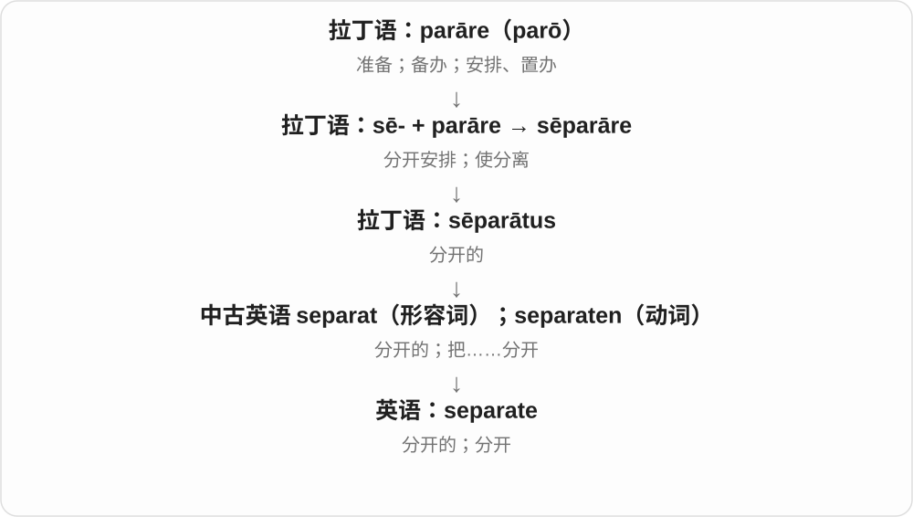

形容词末尾弱读 /ət/，动词末尾 /eɪt/。separate rooms 是不同房间；separate A from B 是把两者分开。

**常见搭配与例句**

a separate room；separate from；separate fact from opinion。

> We booked two separate rooms.

我们订了两个单独的房间。

> Please separate the clean towels from the used ones.

请把干净毛巾与用过的分开。

**别混淆**

different 说性质不同；separate 说分开、独立，两个 separate rooms 完全可以布置一样。

### 3. appreciate — 欣赏；感谢；充分理解；增值

**音标**：/əˈpriːʃieɪt/

**先抓住这个画面**

看清某件事有多少价值或分量，然后懂得珍惜、感激，或承认它的重要。

**怎么拆**

借晚期拉丁 appretiātus：ad-“朝向” + pretium“价值”；英语意义从估值扩展到欣赏、理解和价值上涨。

**怎么变成今天的意思**

**拉丁 pretium**  
价格、价值、报酬

↓

**晚期拉丁 ad- + pretium → appretiāre / appretiātus**  
给出价格、估量价值

↓

**英语 appreciate**  
看出价值、欣赏、感谢；充分理解；增值

I appreciate your help 是感谢帮助；appreciate the difficulty 是真正理解难处，不是在夸困难好。资产 appreciate 则是不及物的增值义。请求时常说 I would appreciate it if...，不说 appreciate you to do。

**常见搭配与例句**

appreciate your help；appreciate that；appreciate the difficulty；appreciate in value。

> I appreciate the time you spent helping me.

我很感谢你花时间帮助我。

> We did not fully appreciate how difficult the task would be.

我们当时没有充分认识到任务会有多难。

> The painting appreciated in value over the years.

这些年，这幅画的价值上涨了。

**别混淆**

appraise 是评估，未必赞扬；appreciate 的常见人际用法则带理解或感激。

### 4. appropriate — 合适、得体的；拨给；挪用、占为己有

**音标**：形容词：英 /əˈprəʊpriət/，美 /əˈproʊpriət/；动词词尾读 /eɪt/

**先抓住这个画面**

形容词说“它正适合这个用途”；动词则把东西划到某个人或用途名下，所以既能是正式拨款，也能是擅自占用。

**怎么拆**

后期拉丁 ad- + propriare“使归自己”形成 appropriare，分词 appropriatus。中古英语 appropriat 作形容词，appropriaten 作动词；两个词性共同接这条分词历史。

**怎么变成今天的意思**

**拉丁 proprius**  
某人或某物自己的、特有的；适合的

↓

**后期拉丁 ad- + propriare → appropriare / appropriatus**  
划归自己；指定给某用途

↓

**中古英语 appropriat / appropriaten → appropriate**  
形容词：特定用途的、合适的；动词：划拨、占用

appropriate for an occasion 说适合场合；appropriate funds for a project 是拨给项目资金。动词若说擅自拿别人东西，常带批评；不能因为形容词褒义就把动词也一律理解成好事。

**常见搭配与例句**

appropriate for / to；appropriate funds；appropriate someone else’s ideas。

> Please choose clothing appropriate for the weather.

请根据天气选择合适的衣服。

> The council appropriated funds for repairs to the bridge.

议会拨出了用于修桥的资金。

> He appropriated her idea without giving her credit.

他把她的想法据为己有，却没有说明是她提出的。

**别混淆**

suitable 与形容词 appropriate 接近；动词 appropriate 则不能译成“使合适”来覆盖常见的拨款和占用义。

### 5. corporate — 公司的；团体的；共同的

**音标**：形容词：英 /ˈkɔːpərət/；美 /ˈkɔːrpərət/

**先抓住这个画面**

许多人被看成一个整体，这个整体能够共同决策、承担责任，也形成自己的形象。

**怎么拆**

接拉丁 corporatus“结合成一个身体的”。常见形容词词尾读 /ət/；古旧动词 corporate“合成一体”则读 /eɪt/，不要套到 corporate office 上。

**怎么变成今天的意思**

**拉丁语 corpus，属格 corporis**  
身体；由此提取 corpor- 词干

↓

**拉丁语 corporare → corporatus → 英语 corporate**  
使成为一个身体、合为一体 → 团体的、公司的

corporate culture 是公司文化；corporate identity 是公司整体形象。它常与商业公司有关，但历史上的核心是“组成一个团体”，并不专指规模巨大或逐利的机构。

**常见搭配与例句**

corporate culture；corporate responsibility；a corporate office。

> The merger brought two different corporate cultures together.

合并让两种不同的公司文化碰到了一起。

> The report sets out the organization’s corporate responsibilities.

报告列出了该组织作为一个整体的责任。

**别混淆**

corporate 说公司或集体；corporeal 说有物质身体。corporate body 可以是法人团体，不能望文生义成肉身。

### 6. mediate — 调解；居中传递；间接的

**音标**：动词 /ˈmiːdieɪt/；形容词 /ˈmiːdiət/

**先抓住这个画面**

两边谈不拢，你站到中间，帮助他们听懂对方、找到能接受的方案。

**怎么拆**

来自拉丁语 mediāre 的相关形式 mediātus，与 medius“中间”相连。英语先有相关形容词，后来有动词。

**怎么变成今天的意思**

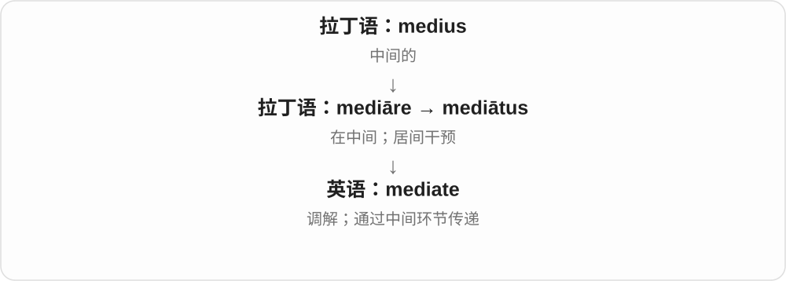

调解义把“在中间”变成沟通角色；更宽的学术用法表示作用经过一个中间环节传递。它不自动表示替双方作出强制裁决。

**常见搭配与例句**

mediate a dispute；mediate between two sides；be mediated by。

> A teacher offered to mediate between the two students.

一位老师提出帮助这两名学生调解矛盾。

> The talks were mediated by an independent organization.

会谈由一个独立组织居中协调。

**别混淆**

mediate 是帮助双方达成安排；arbitrate 通常涉及由仲裁者作决定。词尾动词 -ate 读 /eɪt/。

### 7. immediate — 立即的；直接的；紧邻的

**音标**：/ɪˈmiːdiət/

**先抓住这个画面**

中间没有再隔一层：时间上不等，关系上不绕别人，空间上就在旁边。

**怎么拆**

否定前缀 in- 在 m 前变成 im-，与“居中、间接”有关的 mediātus 组成 immediātus，再经法语传入。

**怎么变成今天的意思**

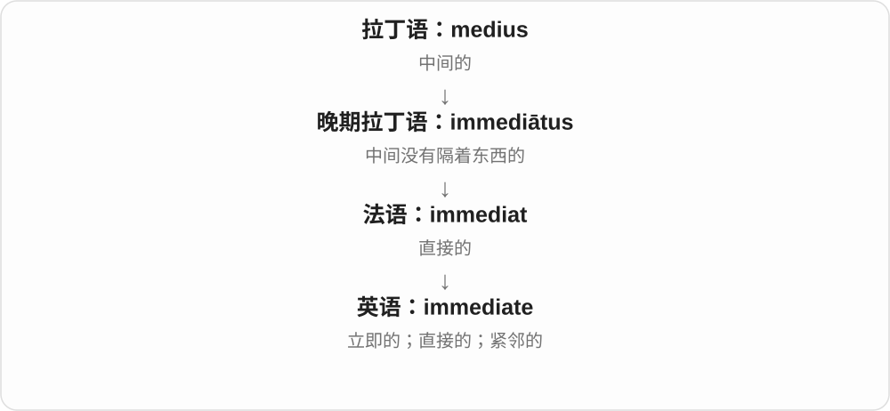

没有时间间隔就是 immediate action；没有中间级别是 immediate supervisor；没有别的地带隔开是 immediate surroundings。

**常见搭配与例句**

immediate action；an immediate response；the immediate family；the immediate area。

> The problem requires immediate attention.

这个问题需要马上处理。

> Please report the issue to your immediate supervisor.

请把问题报告给你的直属主管。

**别混淆**

immediate 不只表示快。immediate family 指最亲近的家庭成员，具体范围随语境变化，不是“立即出现的家人”。

### 8. intermediate — 中间的；中级的；中间阶段

**音标**：形容词 /ˌɪntəˈmiːdiət/；美 /ˌɪntərˈmiːdiət/

**先抓住这个画面**

从起点走到终点，中途还有一站；从初学到熟练，中间还有一个水平，这就是 intermediate。

**怎么拆**

来自中世纪拉丁语 intermediātus，与 inter-（之间）和 medius（中间）相关。

**怎么变成今天的意思**

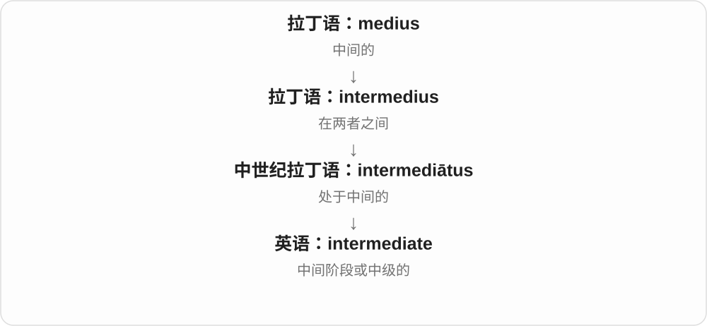

它不要求正好位于百分之五十处，只说明尚未到达两端。intermediate course 通常适合已有基础、还没到高级的学习者。

**常见搭配与例句**

an intermediate level；an intermediate stage；intermediate results。

> This course is designed for intermediate learners.

这门课是为中级学习者设计的。

> The team tested the product at each intermediate stage.

团队在每个中间阶段都测试了产品。

**别混淆**

intermediate 是阶段位置；mediocre 是质量评价。中级学习者不等于平庸学习者。

### 9. graduate — 毕业生；研究生的〔美〕；毕业；晋级；标刻度

**音标**：名词、形容词 /ˈɡrædʒuət/；动词 /ˈɡrædʒueɪt/

**先抓住这个画面**

学习走完一个阶段，获得对应的资格台阶。

**怎么拆**

借中古拉丁 graduātus“获授学位的”；英语动词在中古英语阶段形成。现代 -ate 的读音随词性变化。

**怎么变成今天的意思**

**拉丁 gradus；gradī / gradior**  
一步、台阶、等级；走、迈步

↓

**中古拉丁 graduāre → graduātus → 中古英语 graduat**  
授予学位 → 已获学位的

↓

**中古英语 graduat；由此形成动词 graduaten → 英语 graduate**  
毕业生；毕业、授予学位、分刻度

graduate from school 是毕业；graduate to harder tasks 是进到更难的任务。量筒 graduated 的刻度义保留“分成一格格”。

**常见搭配与例句**

a university graduate；graduate from；graduate studies。

> She will graduate from university in June.

她将在六月大学毕业。

> The company hired three recent graduates.

公司雇用了三名应届毕业生。

**别混淆**

degree 是取得的资格；graduate 可以是取得资格的人或完成学业的动作。

### 10. operate — 操作；运转；经营；动手术

**音标**：英 /ˈɒpəreɪt/；美 /ˈɑːpəreɪt/

**先抓住这个画面**

让机器、业务或一套工作真正动起来；也可以是它自己在运作。

**怎么拆**

来源有拉丁 operātus 分词词干借入，以及从较早的 operation 逆构两说；远接 operārī“做事”。

**怎么变成今天的意思**

**拉丁 opus〔属格 operis〕／opera**  
工作、劳动；做成的作品

↓

**拉丁 operārī，分词词干 operāt-**  
做事、起作用

↓

**英语 operate**  
有拉丁分词借入及从 operation 逆构两种分析

operate a machine 是人操作机器；the machine operates quietly 是机器运行得安静。医疗用法一般说 operate on a patient，不直接用 operate a patient。公司 operate in several cities，则是业务在这些城市开展。

**常见搭配与例句**

operate machinery；operate in a market；operate on a patient；operate smoothly。

> Only trained staff may operate this lift.

只有受过培训的员工可以操作这台升降机。

> The company operates in six countries.

这家公司在六个国家开展业务。

> The surgeon will operate on her shoulder tomorrow.

外科医生明天将为她做肩部手术。

**别混淆**

run 很口语，可广泛说机器运行或经营；operate 更常见于设备、制度、业务和专业程序。

### 11. cooperate — 合作；配合

**音标**：英 /kəʊˈɒpəreɪt/；美 /koʊˈɑːpəreɪt/

**先抓住这个画面**

你做的和我做的能够相互接上，而不是各自抵消。

**怎么拆**

后期拉丁 cooperārī 的分词 cooperātus 进入英语；co- 表示共同，现代也可看作 co- + operate。

**怎么变成今天的意思**

**拉丁 opus〔属格 operis〕／opera**  
工作、劳动；做成的作品

↓

**后期拉丁 co- + operārī → cooperārī**  
一同工作

↓

**后期拉丁 cooperātus → 英语 cooperate**  
一起做事、相互配合

cooperate with someone 是与谁合作；cooperate on a project 是在什么事上合作。一个人愿意提供信息也可以叫 cooperate，不必参与整项工程。口语里还会说天气或机器不配合。

**常见搭配与例句**

cooperate with colleagues；cooperate on a project；cooperate fully。

> The two laboratories agreed to cooperate on the study.

两家实验室同意合作开展这项研究。

> The witness cooperated with the investigators and answered their questions.

证人配合调查人员，回答了他们的问题。

**别混淆**

comply 更偏遵守要求；cooperate 可以是平等协作，也可以是配合调查，不必总有命令关系。

### 12. celebrate — 庆祝、纪念；赞颂

**音标**：英 /ˈselɪbreɪt/；美 /ˈseləbreɪt/

**先抓住这个画面**

觉得这件事值得专门拿出来重视，大家聚起来、做些特别的事；也可用作品赞美某种文化、成就，不一定摆蛋糕开派对。

**怎么拆**

经中古英语接拉丁 celebrāre、celebrātus，和 celeber 人多、著名等词相连；聚集、公开纪念、赞颂的旧背景后来进入现代庆祝。

**怎么变成今天的意思**

**拉丁 celeber → celebrāre、celebrātus → celebrate**  
人多、著名等 → 聚集纪念、赞颂、庆祝

↓

**不同拉丁、法语形式接入英语**  
celebration 活动名；celebrant 仪式人物名；不全是英语现加后缀

celebrate a birthday 庆祝生日，celebrate an achievement 庆祝成就，celebrate local culture 赞美、展示当地文化。

**常见搭配与例句**

celebrate a birthday；celebrate an achievement；celebrate local culture。

> We celebrated her birthday with a small dinner.

我们吃了顿小型聚餐，庆祝她生日。

> The festival celebrates local music and food.

节庆展示并赞颂当地音乐与美食。

**别混淆**

celebrate 常直接接庆祝对象，不加 for；congratulate someone on something 祝贺某人是另一个句型。

### 13. participate — 参与；参加

**音标**：英 /pɑːˈtɪsɪpeɪt/；美 /pɑːrˈtɪsəpeɪt/

**先抓住这个画面**

一件事正在进行，你把自己的一份行动放进去，不只是站在旁边看。

**怎么拆**

拉丁语 pars“一份”与 capere“拿取”的相关成分构成 particeps“有份参与的人”，再有 participāre。英语借入相关形式。

**怎么变成今天的意思**

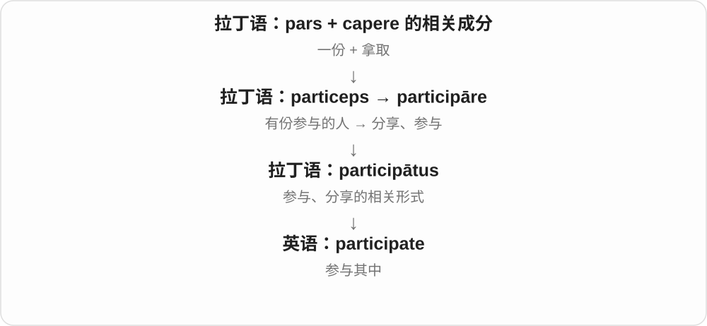

“拿到自己的一份”发展成共同参与或分享。现代 participate in 不要求你主办活动，只要求你实际加入其中。

**常见搭配与例句**

participate in a discussion；participate actively；participate fully。

> Every student is encouraged to participate in the discussion.

我们鼓励每位学生参与讨论。

> She participated in the race for the first time.

她第一次参加了这场比赛。

**别混淆**

attend 只说明到场；participate 强调有参与行为。你可以 attend a meeting，却一直不 participate in the discussion。

### 14. associate — 联系；联想；交往；伙伴；副职的

**音标**：动词：英 /əˈsəʊsieɪt/、美 /əˈsoʊsieɪt/；名词、形容词词尾 /ət/；/si/ 也常读 /ʃi/

**先抓住这个画面**

把两个原本分开的东西放进同一关系里：人结成伙伴，脑中把一种气味与一段记忆连起来。

**怎么拆**

拉丁语 ad- 向 + sociāre 联合，d 同化成 s，形成 associāre；分词 associātus 进入英语后发展出不同词性。

**怎么变成今天的意思**

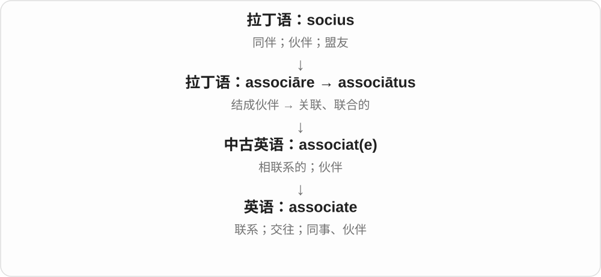

associate A with B 是把 A 与 B 联系；an associate 是同事或合作伙伴。associate professor 等职位名称有各自制度含义。动词词尾读 /eɪt/，名词和形容词读 /ət/。

**常见搭配与例句**

associate A with B；associate with someone；a business associate。

> I associate this smell with my grandmother’s kitchen.

这个气味让我想起祖母的厨房。

> She introduced me to a business associate.

她把我介绍给一位生意伙伴。

**别混淆**

associate 不一定亲密到朋友程度，也不表示相关的两件事存在因果关系。

### 15. indicate — 指出、表明；指示、示意

**音标**：/ˈɪndɪkeɪt/

**先抓住这个画面**

箭头指向出口，数据指向某个可能的结论，都在 indicate。它把注意力带到某个方向，不保证证据已经足以证明一切。

**怎么拆**

有从较早的 indication 逆构，或借拉丁 indicatus 分词词干的分析，共同接 indicare 指出；较早含 in- 与 dicare 指明、宣告，与 index 等同族。

**怎么变成今天的意思**

**拉丁 indicare → indicatus**  
指出、表明

↓

**indication 逆构／拉丁词干借入 → indicate**  
通过指向、信号或资料把事情显出来

indicate that 表明……；indicate a direction 指示方向；indicate where 指出哪里；英式驾驶语境还可说打转向灯。

**常见搭配与例句**

indicate that；indicate a direction。

> The arrow indicates the entrance.

箭头指示入口。

> The results indicate that the method is useful.

结果表明这种方法有用。

**别混淆**

indicate 常提供迹象或指向，prove 强调证明；初步数据 indicate 一个趋势，不等于已经排除其他解释。

### 16. indicated — 指出了、表明了；示意了〔过去式、过去分词〕

**音标**：/ˈɪndɪkeɪtɪd/

**先抓住这个画面**

一个箭头、数值、动作或说法，把注意力指向某件事，就是 indicated。它常提供判断线索，线索强弱还要看证据本身。

**怎么拆**

indicate + -d，/t/ 后读 /ɪd/。indicate 有从 indication 逆构，或借拉丁 indicātus 分词词干的分析，共同接 indicāre 指出，含 in- 与 dicāre 指明、宣告。

**怎么变成今天的意思**

**indication 逆构／拉丁 indicātus → indicate**  
指出、显示；让人据以推断

↓

**indicate 去 e + -ed → indicated**  
过去表明、指出；给出方向信号

indicated that... 表明……；indicated the way 指出道路；indicated a change 显示有变化。

**常见搭配与例句**

as indicated above 如上所示；indicated by an arrow 用箭头标出。

> The arrow indicated the path to the beach.

箭头指示了通往海滩的小路。

> The results indicated that the new method saved time.

结果表明，新方法节省了时间。

**别混淆**

indicated 常是指出或提供迹象，和证明的力度不同。英式驾驶中 indicated 也可说打了转向灯，依动作场景理解。

### 17. indicates — 表明、显示；指示、指出〔第三人称单数〕

**音标**：/ˈɪndɪkeɪts/

**先抓住这个画面**

一条线索、一根箭头把注意力指到某个结论或方向，是 indicates。它常是在给迹象，不一定已经把全部事实证明完。

**怎么拆**

indicate + -s，/t/ 后读 /s/。indicate 有从 indication 逆构或借拉丁 indicatus 词干的分析，较早都接 indicare 指出及 in-、dicare 材料。

**怎么变成今天的意思**

**拉丁 indicare、indicatus；indication 等 → indicate**  
指出、指明；英语构形与借入有不同分析

↓

**indicate + -s → indicates**  
某物显示、表明、指示

indicates that 表明……；indicates a change 显示变化；an arrow indicates the direction 箭头指方向。

**常见搭配与例句**

evidence indicates 证据显示；the label indicates 标签注明。

> The arrow indicates the way to the exit.

箭头指向出口的方向。

> The survey indicates that more people are cycling to work.

调查显示，骑车上班的人更多了。

**别混淆**

indicates 常给出迹象或提示；proves 明确说证明。说 evidence indicates 时，还要看迹象强弱和具体论证。

### 18. indicating — 表明、显示、指示〔现在分词、动名词〕

**音标**：/ˈɪndɪkeɪtɪŋ/

**先抓住这个画面**

一个箭头把方向指出来，一组数字把趋势显出来，都在 indicating。它不一定靠人开口说，也可以靠迹象给出信息。

**怎么拆**

indicate 连拉丁 indicare 指出，有借 indicatus 词干或由较早 indication 逆构的分析。现代去结尾 e，加完整 -ing；词干 /eɪt/ 保留。

**怎么变成今天的意思**

**拉丁 indicare、indicatus；较早 indication → indicate**  
指出、指明；两种近源分析

↓

**indicate 去 e + -ing → indicating**  
正在指示；通过迹象显示

indicating the direction 指示方向；a sign indicating the exit 指示出口的标志；indicating a change 显示变化。

**常见搭配与例句**

data indicating a trend 显示某趋势的数据；an arrow indicating where to go 指示往哪走的箭头。

> The map has an arrow indicating the entrance.

地图上有个箭头指示入口。

> The figures are indicating a gradual change.

这些数字显示出一种逐渐的变化。

**别混淆**

indicating 常是提供线索或信息；是否足以确定结论，还要看证据本身。不要把所有 indicates 都直接升级为 proves 已证明。

### 19. indication — 迹象、表明；指示

**音标**：/ˌɪndɪˈkeɪʃən/

**先抓住这个画面**

一件事没有把全部真相说完，却像手指一样指向某个可能，这样的线索就是 an indication。

**怎么拆**

现代可与 indicate + -ion 配套理解；真实历史接法语 indication 或拉丁 indicatio、indicationem，英语名词记录早于常用动词 indicate，不能只说英语先有动词再造名词。

**怎么变成今天的意思**

**拉丁 indicare → indicatio、indicationem → 法语或直接借入英语**  
指出、指明 → 指示行为、迹象

↓

**英语 indication；与后来的 indicate 配套**  
事情存在或可能发生的一条线索

an indication of something 某事的迹象；an indication that 表明某事的迹象；give an indication of 大致表明。

**常见搭配与例句**

a clear indication 明确迹象；no indication of change 没有变化的迹象。

> The long queue was an indication of the café’s popularity.

长队表明这家咖啡馆很受欢迎。

> There was no indication that the meeting would be delayed.

没有迹象表明会议会推迟。

**别混淆**

indication 给出线索，不一定是完整证明。indicate 是表明这个动作；indicator 则常是提供线索的指标、指示物。

### 20. indicator — 指示器、指示灯；迹象、指标；转向灯〔依语境〕

**音标**：英 /ˈɪndɪkeɪtə/；美 /ˈɪndɪkeɪtər/

**先抓住这个画面**

能把原来不容易直接看出的状态指给你看的东西，是 indicator。可以是仪表上的灯，也可以是帮助判断情况的一项迹象。

**怎么拆**

借晚期拉丁 indicator 指出者，连 indicare 指出、显示。现代可对照 indicate 去 e 加完整 -or 来认形，但名词有独立借入记录，不只英语临时造词。

**怎么变成今天的意思**

**拉丁 indicare → 晚期拉丁 indicator → 英语 indicator**  
指出、显示 → 能显示状态的人或物

↓

**现代实物与抽象使用**  
指示装置、转向灯；反映情况的迹象、指标

an indicator light 指示灯；an indicator of progress 进展的指标；a direction indicator 转向指示灯。

**常见搭配与例句**

a useful indicator 有用的迹象；a clear indicator 明显指标。

> A clear explanation is one indicator of understanding.

解释清楚是理解了内容的一项迹象。

> The device has a small indicator light.

装置上有一盏小指示灯。

**别混淆**

indicator 显示或提示某种状态，不自动等于完整原因。看到一个指标，还要知道它反映的是哪一方面、有没有别的解释。

### 21. indicators — 指示器、指示灯；指标、迹象〔复数〕

**音标**：英 /ˈɪndɪkeɪtəz/；美 /ˈɪndɪkeɪtərz/

**先抓住这个画面**

想了解一个复杂状况，分别看几项可观察的信号，这些是 indicators。机器上几盏显示不同状态的灯，也可以这样说。

**怎么拆**

indicator 接晚期拉丁指出者名词，连 indicare。现代整个 indicator 后加 -s，英音元音、美音 /r/ 后读 /z/；-or 表执行指示作用，s 才是复数。

**怎么变成今天的意思**

**拉丁 indicare、indicator → 英语 indicator**  
指出者 → 指示装置或状态信号

↓

**indicator + -s → indicators**  
多个指示器、指标或迹象

indicators of progress 进展指标；several indicators 几项指标；status indicators 状态指示灯。

**常见搭配与例句**

compare the indicators 比较指标；indicators on the panel 面板上的指示器。

> The report compares several indicators of progress.

报告比较了几项进展指标。

> The panel has three small indicators.

面板上有三个小指示器。

**别混淆**

indicators 可以提供互相补充的信号，不必每项都在说同一件事。它们与 indications 都能说迹象，但 indicators 常突出用来显示、衡量状态的具体项目或装置。

### 22. desperate — 绝望而急切的；拼命的；极想要的；严重的

**音标**：英 /ˈdespərət/；美 /ˈdespərət/

**先抓住这个画面**

被逼到没什么选择，急得非做点什么不可；也可夸张地说非常想要。

**怎么拆**

借自拉丁 desperatus，desperare“失去希望”的分词；-ate 在这个形容词中通常读弱音 /ət/，不是动词式的 /eɪt/。

**怎么变成今天的意思**

**拉丁 spes → sperare**  
希望 → 抱有希望

↓

**拉丁 de- + sperare → desperare**  
失去希望

↓

**拉丁 desperatus → 英语 desperate**  
失去希望 → 急切、不顾后果；后来也表示很想要

a desperate attempt 是急切甚至孤注一掷的尝试；desperate for a drink 可能只是渴得很，未必真陷入绝望。a desperate situation 则是非常严重的处境。共同画面是余地很小、需求很强，语气强弱由情境决定。

**常见搭配与例句**

desperate for help；desperate to leave；a desperate attempt；a desperate situation。

> They made a desperate attempt to save the old theatre.

他们竭尽全力试图保住那座老剧院。

> After the long walk, I was desperate for a drink of water.

走了很长一段路后，我特别想喝点水。

**别混淆**

despairing 偏重感到没希望，desperate 更容易突出急切行动或迫切需要。它们有重叠，却不总能互换。

### 23. investigate — 调查；查明；研究

**音标**：/ɪnˈvestɪɡeɪt/

**先抓住这个画面**

像沿着地上的脚印往前走：顺着线索，弄清到底发生了什么。

**怎么拆**

拉丁 in-“进入” + vestigare“追踪足迹”；英语可能由 investigation 逆构，也可能接拉丁 investigatus。

**怎么变成今天的意思**

**拉丁 vestigium**  
脚印、足迹、留下的痕迹

↓

**拉丁 vestigare → in- + vestigare → investigare**  
沿足迹追踪 → 深入查找、调查

↓

**英语 investigate**  
可能由 investigation 逆构，也可能直接接拉丁分词 investigatus

investigate a noise 可以只是去查看楼下为什么有声音；investigate a complaint 是核查投诉。它不只属于警察，研究人员、工程师和普通人都能 investigate。

**常见搭配与例句**

investigate a cause；investigate a complaint；investigate whether。

> The engineer investigated why the machine kept stopping.

工程师调查了机器为什么总是停机。

> We went downstairs to investigate the noise.

我们下楼去看看声音是怎么回事。

**别混淆**

look into 较口语；investigate 常突出认真查证。invest 是投资，不能把 investigate 拆成 invest + 一个词尾。

### 24. estimate — 估计、估算；估计值、预估费用

**音标**：名词 /ˈestɪmət/；动词 /ˈestɪmeɪt/

**先抓住这个画面**

没有把每一项都量到最精确，先根据已有资料算个合理范围；不是闭眼瞎猜，而是承认仍有不确定性。

**怎么拆**

接拉丁 aestimāre 估价、评价及 aestimātus 等形式；名词与动词的进入路径、用法有发展。今天名词末尾弱读 /mət/，动词读 /meɪt/。

**怎么变成今天的意思**

**拉丁 aestimāre / aestimātus**  
估价、判断价值及其相应形式

↓

**英语 estimate；法语 estimacion → estimation**  
估算、评估；过程、结果、评价

estimate the cost 估算费用，an estimate of the number 人数估计，a rough estimate 粗估，at an estimated cost of 预计费用为。装修报价里的 estimate 常是预计费用。

**常见搭配与例句**

estimate the cost；a rough estimate；an estimate of；get an estimate。

> We estimate that the repairs will take two weeks.

我们估计维修需要两周。

> The builder gave us a rough estimate of the cost.

建筑工给我们粗略估了一下费用。

**别混淆**

estimate 通常有依据但不保证精确；guess 可更偏猜。estimate 也不必总说大约，可明确给区间、假设和估算依据。

### 25. moderate — 适度的；温和的；使缓和；主持、管理讨论

**音标**：形容词、名词：英 /ˈmɒdərət/，美 /ˈmɑːdərət/；动词：英 /ˈmɒdəreɪt/，美 /ˈmɑːdəreɪt/

**先抓住这个画面**

把强度拉回合适范围，既不过头，也不是完全没有。

**怎么拆**

来自拉丁语 moderatus，moderari“调节”的分词。形容词、动词均与拉丁形式相关，名词“温和派”由英语形容词转用。

**怎么变成今天的意思**

**拉丁语：moderari**  
调节、使合度；与 modus 属于尺度这一词族

↓

**拉丁语：moderatus**  
有分寸的、受调节的

↓

**英语：moderate〔形容词／动词〕**  
适度的；使缓和、调节

↓

**英语：a moderate**  
持较温和立场的人

moderate heat 是中等热度；moderate a debate 是主持讨论、控制节奏。形容词结尾轻读 /rət/，动词结尾读 /reɪt/。

**常见搭配与例句**

a moderate increase；moderate a discussion。

> The forecast predicts moderate winds.

天气预报预计会有中等强度的风。

> She moderated the discussion and invited quieter members to speak.

她主持讨论，并邀请较少发言的成员开口。

**别混淆**

mild 偏不强烈；moderate 常隐含程度、立场或行为在可接受范围内。

### 26. generate — 产生；引发；生成

**音标**：/ˈdʒenəreɪt/

**先抓住这个画面**

让原先没有的东西出现：电、收入、讨论或一份报告。

**怎么拆**

有拉丁 generātus 词干借入分析，也有从较早的英语 generation 逆构的分析；现代可看成 gener- + -ate。

**怎么变成今天的意思**

**拉丁 gignere、genitus；同族 genus、gener-**  
生出、产生；种类、出身

↓

**拉丁 generāre / generātus；英语已有 generation**  
生出、产生；名词先借入

↓

**英语 generate**  
借拉丁分词词干，或由 generation 逆构：产生

generate electricity 说发电；generate interest 说引起兴趣；generate a report 说生成报告。重点是有了产出，不保证产出一定有价值或完全原创。

**常见搭配与例句**

generate electricity；generate income；generate interest；generate a report。

> The panels generate electricity during daylight hours.

这些面板在白天发电。

> The announcement generated a lot of discussion.

这则公告引发了大量讨论。

**别混淆**

create 常突出创造；generate 更常突出某个过程或系统带来的产出。

### 27. degenerate — 退化、恶化；退化的；堕落者〔贬义名词〕

**音标**：动词 /dɪˈdʒenəreɪt/；形容词、名词 /dɪˈdʒenərət/

**先抓住这个画面**

讨论本来有秩序，后来变成相互指责，就是 degenerate into。物体、组织或关系也能从原有状态走向较差状态。

**怎么拆**

接拉丁 degeneratus、degenerare，de- 离开、向下等与 genus 种类、出身的材料。动词末尾 /eɪt/，形容词、名词弱读，专门学科的退化另有定义。

**怎么变成今天的意思**

**拉丁 de- + gener- 等 → degenerare、degeneratus**  
偏离原有类别、品质；变差

↓

**英语 degenerate**  
退化、恶化；评价或学科中的相应性质

degenerate into a quarrel 变成争吵；degenerate tissue 退变组织；a degenerate 作称人名词带强烈贬义。

**常见搭配与例句**

degenerate into；degenerate tissue。

> The discussion degenerated into a quarrel.

讨论变成了争吵。

> The textbook describes a degenerate case of the equation.

教材描述了这个方程的一种退化情形。

**别混淆**

degenerate 的专业退化义不必是道德谴责；把人骂作 a degenerate 则是在评价人，两种用法不能混。

### 28. legitimate — 正当的；合法的；真实可信的；使获得正当性

**音标**：形容词 /lɪˈdʒɪtɪmət/；动词 /lɪˈdʒɪtɪmeɪt/

**先抓住这个画面**

你提出一个要求，别人问“凭什么”；如果它有正当依据、合乎认可的规则，就可以说 legitimate。

**怎么拆**

接中世纪拉丁 legitimatus，来自 legitimare“使合法”、legitimus“合法的”。英语形容词与动词都有拉丁分词背景；动词也可视为英语形容词转用。

**怎么变成今天的意思**

**拉丁语 lex，属格 legis**  
法律、规则

↓

**拉丁语 legitimus**  
符合法律的

↓

**中世纪拉丁 legitimare → legitimatus；亦经古法语 legitimer 的分词**  
使合法 → 合法的

↓

**英语 legitimate〔形容词；后来也作动词〕**  
正当的、真实的；使具有合法或正当地位

a legitimate concern 是有道理的担心，不必涉及法庭。旧文献还用它说婚生身份；那是旧制度的分类，并不是人的价值高低。

**常见搭配与例句**

a legitimate concern；a legitimate reason；legitimate authority。

> Residents raised legitimate concerns about the noise.

居民对噪声提出了有根据的担忧。

> The ceremony helped legitimate the new ruler’s authority.

这场仪式帮助新统治者的权威获得认可。

**别混淆**

legal 直接关乎法律；legitimate 也可评价理由、权威和做法是否有正当依据。

### 29. advocate — 支持者；辩护者；提倡、支持

**音标**：名词 /ˈædvəkət/；动词 /ˈædvəkeɪt/

**先抓住这个画面**

有人遇到困难，叫来一位能替他讲话的人；从“被叫来帮忙的人”，就能理解为人辩护、为主张发声。

**怎么拆**

名词经古法语 avocat 接拉丁 advocatus，它是 advocare 的过去分词名词化。英语动词可分析为名词转用，也有直接接拉丁分词的分析。

**怎么变成今天的意思**

**拉丁 vocare**  
呼唤、叫来、称呼；与 vox“声音”同族

↓

**拉丁 ad- 向、到 + vocare → advocare**  
叫到身边来，召来帮助

↓

**拉丁 advocatus → 古法语 avocat → 英语 advocate 名词**  
被叫来援助的人 → 辩护者、支持者

↓

**英语 advocate 动词：名词转用，或直接联系拉丁分词**  
公开支持、提倡

an advocate for children 替儿童权益发声；advocate change 提倡改变，advocate doing something 主张某种做法。名词和动词的结尾读音不同；法律职业义还要看所在制度。

**常见搭配与例句**

an advocate for reform；advocate change；advocate reducing waste。

> She became an advocate for students who needed extra support.

她成了需要额外支持的学生的代言人。

> The report advocates reducing unnecessary paperwork.

报告主张减少不必要的文书工作。

**别混淆**

support 可以是安静支持或实际帮忙；advocate 通常更强调站出来表达理由、推动主张。

### 30. communicate — 沟通、交流；传达；相通〔房间等〕

**音标**：/kəˈmjuːnɪkeɪt/

**先抓住这个画面**

把原来只有自己知道的内容送给别人，让它成为双方能共享的信息。也可以不用说话，靠表情、图像传达。

**怎么拆**

借拉丁语 commūnicāt- 词干形成英语动词，背后是 commūnis 共同的。-ate 是英语动词词形材料；不要把 communicate 拆成英语 common 加一个不存在的独立词。

**怎么变成今天的意思**

**拉丁语 commūnis → commūnicāre、commūnicāt-**  
共同的 → 使共享、告知、传递

↓

**借入英语 communicate**  
沟通、传达；使相通等

communicate with someone 与某人交流，communicate an idea to someone 向某人传达想法；rooms communicate 房间相通，较书面。

**常见搭配与例句**

communicate with；communicate ideas；communicate clearly；communicate through。

> We communicate mainly by email.

我们主要通过电子邮件交流。

> The drawing communicates the idea more clearly than words.

这幅图比文字更清楚地传达了这个想法。

**别混淆**

communicate 不只开口讲话，say 偏说出内容；communicate with 人与 communicate something to 人宾语位置不同。

### 31. demonstrate — 演示；证明；表现出；参加示威

**音标**：/ˈdemənstreɪt/

**先抓住这个画面**

把原本只在嘴上说的内容摆到别人眼前，让人看见怎么做、为什么对或你支持什么。

**怎么拆**

借自拉丁 demonstratus，接 demonstrare：de- 在这里通常加强语气，monstrare 是显示，不是把怪物去掉。

**怎么变成今天的意思**

**拉丁语 monere → monstrum**  
提醒、警告 → 被视为征兆的异常现象

↓

**拉丁语 monstrare**  
把东西显示、指给人看

↓

**拉丁语 de- + monstrare → demonstrare**  
加强显示 → 指明、证明

↓

**拉丁语 demonstratus → 英语 demonstrate**  
指明的分词形式 → 展示、证明；后来也指公开示威

demonstrate a technique 是示范技术；demonstrate that 是证明某事；demonstrate patience 是表现耐心。demonstrate against a decision 则是公开示威反对决定。

**常见搭配与例句**

demonstrate how；demonstrate that；demonstrate a skill；demonstrate against。

> The instructor demonstrated how to adjust the seat.

教练演示了怎样调节座位。

> The results demonstrate that the method can work.

结果表明这种方法可以奏效。

> Residents demonstrated against the closure of the park.

居民举行示威，反对关闭公园。

**别混淆**

show 很广；demonstrate 更常有清楚展示方法、证据或态度的意味。demonstration 这个名词在英语中更早。

### 32. eliminate — 消除、排除；淘汰

**音标**：/ɪˈlɪmɪneɪt/

**先抓住这个画面**

原来像把东西请出门外：不再留在这里。今天可以把错误消掉，把一个可能性排除，或让选手退出下一轮。

**怎么拆**

拉丁 ēlīmināre 逐出门外，ē- 是 ex- 向外的变体，līmen 是门槛；英语词形联系其 ēlīmināt- 词干。不是 e + limit 限制 + nate。

**怎么变成今天的意思**

**拉丁 ē- 向外 + līmen 门槛 → ēlīmināre**  
把人赶出门，逐出

↓

**拉丁 ēlīmināt- → 英语 eliminate**  
移除、排除；淘汰等领域用法

eliminate errors 消除错误，eliminate a possibility 排除可能性，be eliminated from the competition 被淘汰。另在暴力语境里可能委婉说杀害，不能把普通排错也这样理解。

**常见搭配与例句**

eliminate errors；eliminate a possibility；be eliminated from。

> The new checklist helped eliminate common errors.

新检查清单帮助消除了常见错误。

> The team was eliminated in the first round.

球队第一轮就被淘汰了。

**别混淆**

reduce 降低数量、程度，eliminate 通常说消除、移出相应范围。比赛中被 eliminate 是失去继续争夺资格，不是从此不能再运动。

### 33. passionate — 热情的；感情强烈的；热衷于……的

**音标**：/ˈpæʃənət/

**先抓住这个画面**

这件事触动你很深，谈起来或做起来就有明显的投入。

**怎么拆**

借中世纪拉丁 passiōnātus，经中古英语 passionat 形成；现代可联系 passion + -ate，但历史形容词并非单纯英语新造。

**怎么变成今天的意思**

**拉丁 patī／patior；完成分词 passus**  
承受、经历、忍受

↓

**中世纪拉丁 passiōnātus → 中古英语 passionat**  
受强烈情感影响的

↓

**英语 passionate**  
热情的；感情强烈的

be passionate about something 常说热爱某事业或活动；a passionate kiss 则是强烈的爱情表达。passionate argument 可以是激烈而投入的论说，并不一定指争吵。

**常见搭配与例句**

be passionate about；a passionate advocate；a passionate speech。

> She is passionate about making science accessible to children.

她热衷于让孩子们也能理解科学。

> He gave a passionate speech in support of the library.

他发表了一番充满热忱的演讲，支持图书馆。

**别混淆**

enthusiastic 常强调积极兴奋；passionate 更容易强调持续而强烈的感情。形容词词尾读 /ət/，不是 /eɪt/。

### 34. dispassionate — 冷静客观的；不受感情左右的

**音标**：/dɪsˈpæʃənət/

**先抓住这个画面**

先把自己的激动放到一边，再按事实仔细衡量。

**怎么拆**

dis- 表示除去、脱离，接 passionate；并不是“讨厌有激情的人”。

**怎么变成今天的意思**

**拉丁 patī／patior；完成分词 passus**  
承受、经历、忍受

↓

**中世纪拉丁 passiōnātus → 中古英语 passionat**  
受强烈情感影响的

↓

**英语 passionate**  
热情的；感情强烈的

↓

**英语 dis- + passionate → dispassionate**  
不让强烈感情支配判断

a dispassionate assessment 强调冷静衡量，不因喜欢或讨厌某一方就改变标准。它可以带赞许，但不意味着对人的困难完全不关心。

**常见搭配与例句**

a dispassionate analysis；a dispassionate observer；a dispassionate assessment。

> We need a dispassionate assessment of the costs and benefits.

我们需要冷静评估成本和收益。

> She gave a dispassionate account of a conflict in which she had been involved.

她冷静客观地讲述了自己曾参与的一场冲突。

**别混淆**

impassive 常描述脸上看不出情绪；dispassionate 更关注判断过程不被情绪带偏。

### 35. fabric — 布、织物；结构、组织体系

**音标**：/ˈfæbrɪk/

**先抓住这个画面**

做衣服要看这块 fabric 软不软、厚不厚；一座社会由许多关系交织起来，也可以谈 the fabric of society 这个整体结构。

**怎么拆**

经法语 fabrique 接拉丁 fabrica 作坊、工艺、制作物、结构，来自 faber 工匠。英语较早有建筑、结构义，后来布料义常用；与 fabricate 同族，源头并非只指织布。

**怎么变成今天的意思**

**拉丁 faber → fabrica → 法语 fabrique**  
工匠 → 工艺、制作物、结构

↓

**英语 fabric**  
结构；后来常指布料、织物；保留抽象结构义

cotton fabric 棉织物；a soft fabric 柔软布料；fabric samples 布样；the social fabric 社会组织结构；the fabric of a building 建筑结构。

**常见搭配与例句**

a piece of fabric；the fabric of everyday life。

> She chose a light fabric for the summer curtains.

她给夏季窗帘选了轻薄布料。

> Local clubs are part of the social fabric of the town.

当地社团是小镇社会结构的一部分。

**别混淆**

fabric 日常多说织物材料，cloth 也常说布；the fabric of society 中则是抽象的关系、组织结构。fabricate 可以制造物品，也可编造说法，不局限于处理布料。

### 36. fabrics — 布料、织物〔多种或多块〕；结构〔复数，视语境〕

**音标**：/ˈfæbrɪks/

**先抓住这个画面**

挑窗帘时摆在面前的几种布料，是 fabrics。它更早的词义范围却是人做成的东西、结构，再发展到织成的布。

**怎么拆**

fabric 经法语 fabrique 接拉丁 fabrica 作坊、手艺、作品、结构，来自 faber 工匠。英语的布料义后起；现代加 -s，/k/ 后读 /s/。

**怎么变成今天的意思**

**拉丁 faber → fabrica → 法语、英语 fabric**  
工匠 → 制作、作品、结构

↓

**fabric 的布料义；fabric + -s → fabrics**  
织物；多种或多块布料

cotton fabrics 棉织物；different fabrics 不同布料；soft fabrics 柔软面料。

**常见搭配与例句**

compare fabrics 比较面料；fabrics for curtains 做窗帘的布。

> She compared the fabrics before choosing the curtains.

她比较了布料后才选窗帘。

> The shop sells cotton and linen fabrics.

店里卖棉织物和亚麻织物。

**别混淆**

fabric 可用不可数形式说材料；fabrics 常比较种类、样品。the fabric of society 指社会各部分连成的结构，通常用单数。

### 37. fabricate — 制造、装配；捏造、编造

**音标**：/ˈfæbrɪkeɪt/

**先抓住这个画面**

在工坊里把零件做出来，是 fabricate；把根本没发生的证据做出来，也是 fabricate。一个做实物，一个造假话。

**怎么拆**

接拉丁 fabricatus，来自 fabricari 制作，关联 fabrica 工坊、制作与 faber 工匠；现代有 -ate 动词形。不是 fabric 布料这一义能解释全部。

**怎么变成今天的意思**

**拉丁 faber 工匠 → fabrica 工坊、制作 → fabricari**  
动手制造、建造

↓

**fabricatus、fabricatio → fabricate、fabrication**  
制造；后来也说把虚假的故事编造出来

fabricate metal parts 制造金属零件；fabricate evidence 伪造证据；fabricate a story 编造故事。宾语会决定是制造还是造假。

**常见搭配与例句**

fabricate components；fabricate evidence；fabricate a story。

> The workshop fabricates metal frames.

这间工坊制造金属框架。

> He admitted that he had fabricated the story.

他承认那个故事是他编造的。

**别混淆**

fabricate components 通常是中性制造，不是在指责工厂撒谎；fabricate an excuse 才常有编造、不真实的评价。

### 38. concentrate — 集中注意力；聚集；浓缩；浓缩物

**音标**：英 /ˈkɒnsəntreɪt/；美 /ˈkɑːnsəntreɪt/

**先抓住这个画面**

把原来散在各处的东西，收拢到较小的范围。

**怎么拆**

con-“共同” + centr-“中心” + -ate 是现代拆法；历史与意大利语 concentrare 等罗曼语形式、早期英语 concenter 有关，也有新拉丁 concentrāre 路线的分析。

**怎么变成今天的意思**

**希腊 kéntron → 拉丁 centrum**  
尖点、刺；圆规固定的一点 → 圆心、中心

↓

**罗曼语 concentrare 等；新拉丁 concentrāre；英语早期 concenter**  
聚到一个共同中心

↓

**英语 concentrate**  
聚集、浓缩 → 集中精神；浓缩物

注意力不再四处跑是 concentrate on；果汁去掉部分水、成分变密也叫 concentrate。名词 concentrate 仍读 /eɪt/，不像 graduate 那样换成 /ət/。

**常见搭配与例句**

concentrate on；concentrate resources；juice concentrate。

> I cannot concentrate with the television on.

电视开着，我无法集中注意力。

> The factory makes juice concentrate by removing some of the water.

工厂通过去掉部分水来制作浓缩果汁。

**别混淆**

focus 常突出对准某一点；concentrate 更容易联系“收拢、提高密度”。

### 39. intimate — 亲密、私人的；深入熟悉的；密友；透露、暗示

**音标**：形容词、名词 /ˈɪntɪmət/；动词 /ˈɪntɪmeɪt/

**先抓住这个画面**

外人看不到的内层，被亲近的人知道、共享，所以 intimate 可说亲密关系、私人细节、深入了解。动词则是把某事让对方知道，常带含蓄透露。

**怎么拆**

联系拉丁 intimus 最里面，再经 intimāre、intimātus 等相关形式进入英语。形容词亲密与动词使知道各自发展；动词也有从 intimation 逆构的分析。

**怎么变成今天的意思**

**拉丁 intimus**  
最里面、最深处，来自在内的最高级形式

↓

**intimāre、intimātus → intimate**  
使知道、让深入了解；亲近、私人的性质；动词透露、暗示

an intimate friend 密友，intimate details 私人细节，intimate knowledge 深入了解，an intimate concert 亲近感强的小型音乐会，intimate that ... 含蓄透露……。

**常见搭配与例句**

an intimate friend；intimate details；intimate that。

> She has an intimate knowledge of the old city.

她对老城区非常熟悉。

> He intimated that he might leave the company.

他含蓄透露自己可能离开公司。

**别混淆**

intimate 不只涉及性关系，也能说友情、私人空间、详细知识。形容词尾 /ət/，动词尾 /eɪt/。

### 40. tolerate — 容忍；耐受、经得住

**音标**：英 /ˈtɒləreɪt/；美 /ˈtɑːləreɪt/

**先抓住这个画面**

你不喜欢那阵噪声，却暂时承受；材料遇到某种温度还能正常工作，也是在 tolerate。共同核心是承受而未被迫中断。

**怎么拆**

借拉丁 toleratus，来自 tolerare 承受、忍耐；-ate 接相应分词词干进入英语动词。不是把 tolerant 原样加 ate。

**怎么变成今天的意思**

**拉丁 tolerare → toleratus**  
承受、忍耐

↓

**英语 tolerate**  
允许不喜欢的情况存在；承受某种作用

tolerate noise 容忍噪声；tolerate doing 忍受某事；tolerate high temperatures 耐高温。

**常见搭配与例句**

tolerate noise；tolerate doing。

> I can tolerate the noise for a short time.

我能短时间忍受这种噪声。

> The material tolerates high temperatures.

这种材料耐高温。

**别混淆**

tolerate 不等于 approve 赞成；愿意容许某观点存在，仍可能坚决不同意它。

### 41. tolerance — 宽容、容忍；耐受力；允许偏差、公差

**音标**：英 /ˈtɒlərəns/；美 /ˈtɑːlərəns/

**先抓住这个画面**

能容得下多少、承受多少，是 tolerance 的共同线索。人可容许不同意见，材料可承受条件变化，零件尺寸也可允许一点点误差。

**怎么拆**

经法语 tolerance 和拉丁 tolerantia 承受、忍耐，接 tolerare。与 tolerant 的 -ant／-ance 有形式对应，但名词有自己的借入历史；后来发展出工程中允许偏差的用法。

**怎么变成今天的意思**

**拉丁 tolerare、tolerantia → 法语、英语 tolerance**  
承受、忍耐 → 宽容、耐受

↓

**容许范围的技术分支**  
尺寸等可接受的变化量、允许偏差

tolerance of different beliefs 对不同信仰的宽容；a low tolerance for noise 很受不了噪声；within tolerance 在允许偏差内；manufacturing tolerances 制造公差。

**常见搭配与例句**

show tolerance；a tolerance of one millimetre。

> She has very little tolerance for unnecessary noise.

她很受不了不必要的噪声。

> The parts must fit within the specified tolerance.

这些零件的配合必须在规定公差范围内。

**别混淆**

工程里的 tolerance 是允许偏差的范围，不等于已经测到的实际错误。a low tolerance for waiting 是不耐等的描述，不必机械译成宽容度。

### 42. tolerant — 宽容的、能容忍的；耐受……的

**音标**：英 /ˈtɒlərənt/；美 /ˈtɑːlərənt/

**先抓住这个画面**

别人有不同习惯或意见，你不一定赞同，但能容许它存在。换成植物、材料时，就是某种条件来了，它还能承受。

**怎么拆**

经法语 tolérant 及拉丁 tolerans、tolerant-，是 tolerare 承受、容忍的现在分词材料。现代可与 tolerate、tolerance 对照，历史不只是英语动词现场换成 -ant。

**怎么变成今天的意思**

**拉丁 tolerare → tolerans、tolerant-**  
承受、容忍 → 能承受、容忍的

↓

**法语、英语 tolerant**  
宽容；对某条件有耐受能力

tolerant of different views 容得下不同观点；a tolerant attitude 宽容的态度；tolerant of dry conditions 耐干旱条件的。

**常见搭配与例句**

be tolerant of mistakes；more tolerant toward others。

> A good discussion needs people who are tolerant of different views.

好的讨论需要能包容不同观点的人。

> These plants are tolerant of dry conditions.

这些植物能耐受干燥环境。

**别混淆**

tolerant 常说容得下差异，不一定是赞成。植物 tolerant of heat 能耐热，也不等于温度越高长得越好。

### 43. adequate — 足够的；能满足需要的；尚可的

**音标**：英、美 /ˈæd.ə.kwət/，也记作 /ˈæd.ɪ.kwət/；重音在首音节

**先抓住这个画面**

想象一条“需要达到的线”：现有的水、时间或能力达到了这条线，就可以说 adequate。判断的是能否满足具体需要，不是越多越好，也不是夸它特别出色。

**怎么拆**

词源上连接拉丁 ad-（向、到）+ aequus（相等）；aequāre 是“使相等”，adaequāre 是“使相等、使相称”，其过去分词 adaequātus 进入英语成为 adequate。可借 ad- + equ- + -ate 记忆，但它有完整的拉丁借词历史，不是现代英语给 equate 随意加 ad。这里的 equ- 与 equal、equation 同源；词尾 -ate 在这个形容词中弱读 /ət/，不是动词 equate 的 /eɪt/。

**怎么变成今天的意思**

**拉丁 aequus → aequāre**  
相等 → 使相等

↓

**拉丁 ad- + aequāre → adaequāre → adaequātus**  
使相等、使相称 → 已达到相当水平

↓

**英语 adequate**  
与所需标准相当 → 足够、合用、能胜任

读到 adequate rainfall 时，把降雨量与农业或作物的需要比较：它指“足够的降雨”，不要求降雨很丰富。lack adequate rainfall 是“缺少足够的降雨”。adequate 同时可评价数量与质量：adequate food 是食物够用，an adequate explanation 是解释足以说明问题。评价表现为 merely adequate，往往是“只是尚可”，并不等于优秀。

**常见搭配与例句**

adequate rainfall 足够的降雨；adequate resources 足够的资源；adequate for our needs 足以满足我们的需要；adequate to meet demand 足以满足需求；barely adequate 勉强够用。

> The crops need adequate rainfall during the growing season.

作物在生长季需要足够的降雨。

> The room is small, but it is adequate for our needs.

房间虽小，但足以满足我们的需要。

> The report provides adequate evidence to support the conclusion.

这份报告提供了足以支持该结论的证据。

**别混淆**

adequate 和 sufficient 都可表示足够，前者常强调对某个用途是否合格、合用；appropriate 强调是否合适，不保证数量足够；ample 强调充裕。inadequate = in-（否定）+ adequate，意为不足或不合格；adequately 是副词，adequacy 是“充足程度、适用性”。adequate 本身没有 -ly 或 -acy，那些后缀属于它的派生形式。

### 44. accommodate — 容纳；提供住宿；照顾需要；适应

**音标**：英 /əˈkɒmədeɪt/；美 /əˈkɑːmədeɪt/

**先抓住这个画面**

腾出空间，或者调整安排，让一个人、一个要求能放得进去。

**怎么拆**

拉丁语 ad- + commodare → accommodare，借其分词 accommodatus。commodus 的“合适、便利”远接 modus“尺度”。

**怎么变成今天的意思**

**拉丁语：modus**  
尺度、分寸；方式

↓

**拉丁语：commodus**  
合适的、便利的〔com- + modus〕

↓

**拉丁语：commodare → accommodare**  
使合适 → 使适合某种需要〔ad- 同化为 ac-〕

↓

**拉丁语 accommodatus → 英语 accommodate**  
使适合；为人提供所需条件

a room accommodates six 容得下六人；accommodate a request 是设法满足要求；accommodate yourself to change 是使自己适应变化。

**常见搭配与例句**

accommodate guests；accommodate different needs。

> The hall can accommodate two hundred people.

大厅可容纳两百人。

> We changed the schedule to accommodate her arrival time.

我们调整了日程，以配合她的到达时间。

**别混淆**

contain 只说里面装有什么；accommodate 往往多一层空间或安排适合需要。

### 45. delicate — 精致、细微的；易损的；棘手、需谨慎处理的

**音标**：/ˈdelɪkət/

**先抓住这个画面**

薄玻璃要轻拿，细香味要细品，关系问题要小心措辞；delicate 把精细和需要轻手处理连在一起。

**怎么拆**

经中古英语 delicat 接拉丁 delicatus 令人愉快、精细、柔软等，联系享受、引人愉快的词族；后来突出易损、需技巧处理。

**怎么变成今天的意思**

**拉丁 delicatus**  
令人愉快、精细、柔软等，联系 deliciae 乐趣、享受

↓

**中古英语 delicat → delicate**  
精细、柔弱；容易损伤、需小心处理

delicate glassware 易碎精细玻璃器皿，a delicate flavour 细腻清淡的味道，a delicate question 需要谨慎处理的问题。

**常见搭配与例句**

a delicate flavour；a delicate question。

> Handle the delicate glass bowl with care.

这只玻璃碗精细易损，要小心拿。

> They discussed a delicate family matter.

他们讨论了一件敏感的家庭事务。

**别混淆**

delicate 不全是物理脆弱：问题 delicate 可以是敏感、处理不好容易冒犯；词尾 -ate 这里弱读 /ət/。

### 46. affiliate — 使隶属；加入；关联机构；合作成员

**音标**：动词 /əˈfɪlieɪt/；名词 /əˈfɪliət/

**先抓住这个画面**

像把一个单位接进更大的组织网络；作名词时，就是网络里与主体有联系的那一方。

**怎么拆**

动词借中世纪拉丁 affiliat-，接 affiliare 收为子：ad- 向着 + filius 儿子。英语名词后来由动词及相关形容词用法形成；不是 fil- 线。

**怎么变成今天的意思**

**拉丁 filius 儿子；filia 女儿**  
这一族涉及子女或被接纳的关系，与 filum 线不同

↓

**拉丁 ad- 向着 + filius → affiliare 收为子**  
ad- 在 f 前同化成 af-

↓

**中世纪拉丁 affiliat- 已被收为子 → 英语 affiliate 动词**  
转为把组织或个人纳入关联关系

↓

**英语 affiliate 动词 → 相关形容词、名词 affiliate**  
纳入关系 → 有关联的机构或成员；名词尾音弱化

affiliate with a group 是与团体建立联系；a local affiliate 是当地关联机构。affiliate marketing 中的 affiliate 可以是推广合作方，不一定是对方的子公司或雇员。

**常见搭配与例句**

affiliate with an organisation；a local affiliate；an affiliate of a larger group。

> The small club decided to affiliate with a national association.

这个小俱乐部决定加入一个全国性协会。

> A local affiliate broadcast the interview that evening.

一家地方加盟台在当晚播出了那场采访。

**别混淆**

subsidiary 通常强调控制或所有权关系；affiliate 更宽，具体联系要看上下文。动词末尾 /eɪt/，名词 /ət/，重音都在第二音节。

### 47. facilitate — 促进；使更容易

**音标**：/fəˈsɪlɪteɪt/

**先抓住这个画面**

两个人隔着一道沟，你搭一块木板，让他们容易走过去：facilitate 就是替事情扫清障碍。

**怎么拆**

facilis“容易做”一支，经法语 faciliter 传入；现代可把 -ate 看作动词形式。

**怎么变成今天的意思**

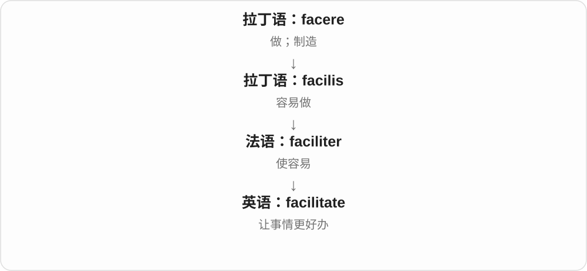

核心是使过程顺畅，不保证替别人把事情全做完。主持讨论时，facilitate 是帮助大家交流与推进。

**常见搭配与例句**

facilitate communication；facilitate learning；facilitate a discussion。

> Clear signs facilitate movement through the building.

清楚的标识让人在楼内更容易通行。

> She facilitated the discussion without choosing sides.

她帮助推进讨论，没有偏向任何一方。

**别混淆**

enable 强调让原本不能做的事成为可能；facilitate 更强调让它好做一些。

### 48. negotiate — 谈判、协商；协商达成；设法通过

**音标**：英 /nɪˈɡəʊʃieɪt/；美 /nɪˈɡoʊʃieɪt/

**先抓住这个画面**

不是只聊天，而是你提条件、我作调整，想找到双方能接受的办法。走过狭窄拐角，也可说 negotiate：设法把这一关过好。

**怎么拆**

上接拉丁做生意的 negotiari 一族，negotium 字面联系不闲着、事务；英语可能由 negotiation 逆构，也可能直接接拉丁相应形式。

**怎么变成今天的意思**

**拉丁 neg- 不 + otium 闲暇 → negotium**  
没有闲暇 → 工作、事务、生意

↓

**negotiari、negotiatio 等**  
做生意、商谈及其过程

↓

**英语 negotiation、negotiate**  
协商达成条件；negotiate 也可说设法通过障碍

negotiate with someone 与某人协商，negotiate over terms 商谈条件，negotiate a deal 谈成交易，negotiate a bend 设法转过弯道。

**常见搭配与例句**

negotiate with；negotiate a deal；negotiate a bend。

> They negotiated for hours before reaching an agreement.

他们协商了几个小时才达成协议。

> The driver carefully negotiated the narrow bend.

司机小心地转过狭窄弯道。

**别混淆**

negotiate 本身不保证最后达成协议；negotiate a deal 的结构则常把结果放进宾语。通过障碍义不是一定得与道路说话。

### 49. initiate — 发起、启动；使入门；新加入者〔名词，较正式〕

**音标**：动词 /ɪˈnɪʃieɪt/；名词 /ɪˈnɪʃiət/

**先抓住这个画面**

一个项目原先没动，你把它启动；一个新人还不了解某领域，你领他入门，这两种带进开始都能用 initiate。

**怎么拆**

接拉丁 initiatus，来自 initiare 开始、引入，与 initium 开始相连，更早有进入的材料。-ate 在常用动词读 /eɪt/，名词新加入者末尾弱读。

**怎么变成今天的意思**

**拉丁 in- 进入 + ire 去 → initium 开始 → initiare**  
进入某个过程；开始、引入

↓

**initiatus、initiatio → initiate、initiation**  
发起、引导入门；开始或入门过程

initiate a project 启动项目；initiate talks 发起谈判；initiate someone into something 引导某人入门。名词 an initiate 指新入门的人，较正式。

**常见搭配与例句**

initiate talks；initiate a process；initiate someone into。

> The council initiated a review of the plan.

委员会启动了对计划的审查。

> Her tutor initiated her into the basics of the subject.

导师带她学习这门学科的基础。

**别混淆**

initiate 强调让事情开始，implement 是把计划付诸执行；启动讨论不等于方案已落实。

### 50. initiated — 发起了、开始了；使入门、介绍进入〔过去式、过去分词〕

**音标**：/ɪˈnɪʃieɪtɪd/

**先抓住这个画面**

一个过程由某人先启动，是 initiated；把新人带入某种活动或知识，也能用 initiated，说让他迈进门。

**怎么拆**

initiate 接拉丁 initiatus、initiare，较早 initium 开始连 in- 进入与 ire 去；部分意义也有由 initiation 逆构分析。现代去 e 加完整 -ed，/t/ 后读 /ɪd/。

**怎么变成今天的意思**

**拉丁 initium、initiare、initiatus；较早 initiation → initiate**  
进入、开始 → 发起或引导入门；保留借入、逆构分析

↓

**initiate 去 e + -ed → initiated**  
已经发起；被引进入门

initiated a discussion 发起讨论；initiated the project 启动项目；initiated into a tradition 被引入某个传统。

**常见搭配与例句**

a student-initiated activity 学生发起的活动；initiated a change 发起变革。

> The students initiated a discussion about the library.

学生们发起了关于图书馆的讨论。

> She was initiated into the craft by her grandfather.

她由祖父引导入门，学起了这门手艺。

**别混淆**

initiated 强调开头由谁启动，completed 强调最后做完。initiated a project 不保证项目此后已经完成。

### 51. fortunate — 幸运的、有幸的；带来好结果的

**音标**：英 /ˈfɔːtʃənət/；美 /ˈfɔːrtʃənət/

**先抓住这个画面**

事情恰好朝有利方向发展，自己受了好运照顾；be fortunate to do 就是有幸做成、遇到某事。

**怎么拆**

接拉丁 fortūnātus 幸运、兴旺的，来自 fortūna。现代可对应 fortune + -ate，但 -ate 此处是形容词末尾，读弱化 /ət/，不按动词 /eɪt/。

**怎么变成今天的意思**

**拉丁 fortūna → 法语 fortune → 英语 fortune**  
机遇、命运、运气；后来有财产财富义

↓

**拉丁 fortūnātus → fortunate**  
受好运眷顾、幸运的

be fortunate to do 有幸做，fortunate enough to 足够幸运得以，a fortunate coincidence 幸运巧合，fortunate in having 有幸拥有。

**常见搭配与例句**

be fortunate to do；fortunate enough to；a fortunate coincidence。

> We were fortunate to find a room at short notice.

我们很幸运，临时还能找到房间。

> A fortunate coincidence brought them together again.

一个幸运的巧合让他们再次相遇。

**别混淆**

fortunate lucky 大量场合相近，fortunate 稍正式；wealthy 是富有，不等于所有幸运的人。

### 52. mandate — 正式命令；授权、委托；要求、授权

**音标**：/ˈmændeɪt/

**先抓住这个画面**

mandate 像把一份正式任务交到你手里：既可能是必须做的命令，也可能是允许你代表别人行动的授权。

**怎么拆**

来自拉丁 mandātum，联系 mandāre“委托、命令”；传统分析把更早构成联系到 manus“手”及交付、放置的成分。不是 man + date。

**怎么变成今天的意思**

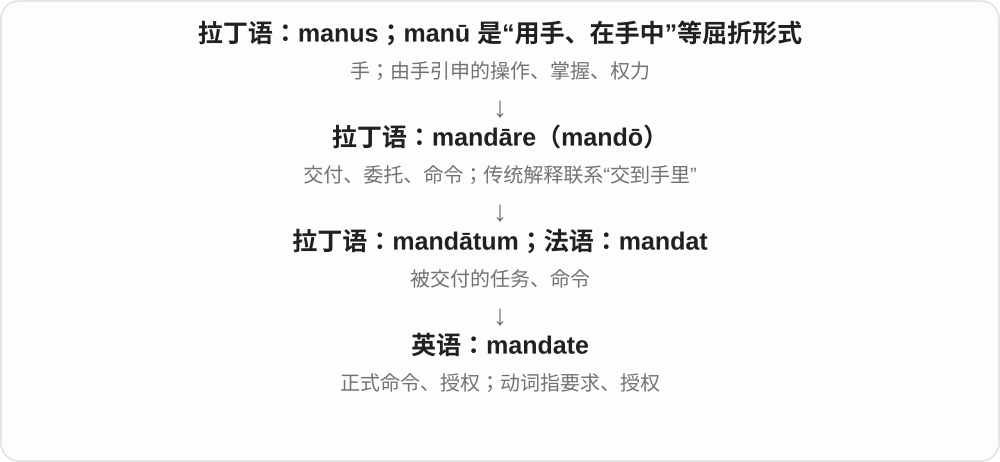

a mandate to negotiate 是谈判授权；a government mandate 是正式要求；选举里的 mandate 指被视为由选民赋予的政治授权。

**常见搭配与例句**

a clear mandate；a mandate to do；mandate training；within its mandate。

> The committee has a mandate to review the process.

委员会获授权审查这一流程。

> The new policy mandates annual safety training.

新政策要求每年接受安全培训。

**别混淆**

permission 是获准做；mandate 往往连带正式职责、权力或要求。具体是命令还是授权，要看上下文。

### 53. aggregate — 合计；集合体；汇集；骨料

**音标**：名词、形容词 /ˈæɡrɪɡət/；动词 /ˈæɡrɪɡeɪt/

**先抓住这个画面**

零散的小份放在一起，形成一堆或一个总量。

**怎么拆**

拉丁 ad- + gregāre“聚成群”→ aggregāre，词尾分别承接其分词、名词化及英语动词用法。grex 是“群”。

**怎么变成今天的意思**

**拉丁语：ad**  
朝向；靠近；加到

↓

**拉丁语：grex → gregāre → aggregāre → aggregātus**  
群 → 聚集 → 聚到一起

↓

**中古英语 aggregat / aggregaten；新拉丁 aggregātum 支线**  
集合体、汇总；构成现代 aggregate 的不同词性

aggregate demand 是一个经济体的总需求；aggregate data 是合起来看；混凝土里的 aggregate 指砂石等骨料。动词尾音要读 /eɪt/。

**常见搭配与例句**

in aggregate；aggregate demand；aggregate data。

> The results look better in aggregate than they do for each region.

合起来看，结果比逐个地区看更好。

> The dashboard aggregates sales from all our shops.

这个看板汇总了所有门店的销售数据。

**别混淆**

average 是平均值；aggregate 是合在一起的总量或集合，不能互换。

### 54. locate — 找到位置；把……设在

**音标**：英 /ləʊˈkeɪt/；美 /ˈloʊkeɪt/，也 /loʊˈkeɪt/

**先抓住这个画面**

可以给东西找个地方放下，也可以反过来查清它被放在哪里。

**怎么拆**

来自拉丁语 locatus，locare“放置”的分词。原有安置方向，后来发展为确定位置；不是 local 截去 l。

**怎么变成今天的意思**

**拉丁语 locus**  
地方、位置

↓

**拉丁语 locare**  
放置、安置；也指出租

↓

**拉丁语 locatus → 英语 locate**  
已放置的 → 安置；查明位置

locate a leak 是找出漏点；be located near the station 是位于车站附近。后者不一定描述一次“找到了”的动作。

**常见搭配与例句**

locate the source；be located in…。

> The engineers located the source of the noise.

工程师找出了噪声来源的位置。

> The library is located beside the river.

图书馆位于河边。

**别混淆**

find 范围更广；locate 明确强调找到位置或安排位置。

### 55. translate — 翻译；转化为、体现为；平移〔数学〕

**音标**：英 /trænzˈleɪt/、/trɑːnzˈleɪt/；美 /trænzˈleɪt/

**先抓住这个画面**

意思像一件东西，从一种语言搬到另一种语言；想法变行动、投入变结果，也能借“搬到另一个形式”来理解。

**怎么拆**

经法语 translater 或拉丁 trānslātus 借入，后者是 transferre 搬运过去的分词。trans- 跨过 + lāt- 被带，-ate 为英语动词形态；late 不是迟到。

**怎么变成今天的意思**

**拉丁 trāns-；ferre 与其不规则分词 lātus**  
跨过；携带，与被带过去的形式

↓

**拉丁 trānslātus、trānslātiō、trānslātor 等**  
带过；转移过程；执行者，形成同族的平行词

↓

**法语、英语相应借入**  
translate、translation、translator；从运过去到跨语言传意思

translate into English 译成英语，translate from Chinese 从中文译出，translate ideas into action 把想法变成行动，translate a shape 平移图形。

**常见搭配与例句**

translate from…into…；translate into action；translate well。

> She translated the letter into English.

她把信译成了英语。

> More funding did not automatically translate into better results.

更多资金并没有自动转化成更好的结果。

**别混淆**

translate 转成另一语言或形式，transfer 广说转移；两词拉丁词族相连，不是现代英语 transfer 先拼改成 translate。

### 56. affection — 喜爱、爱意；温柔的感情

**音标**：/əˈfekʃən/

**先抓住这个画面**

看到熟悉的人或宠物，心里自然柔软起来，愿意亲近、照顾，这种温暖的喜欢是 affection。

**怎么拆**

经法语接拉丁 affectio 状态、心情，关联 afficere 影响、使处于某状态；后来偏向温暖的感情。现代与 affect 同族，不把每个 affect 的义项原样搬入。

**怎么变成今天的意思**

**拉丁 afficere → affectio**  
使受到影响 → 状态、感受

↓

**法语、英语 affection**  
情感 → 常见的爱意、喜爱

affection for someone 对某人的喜爱；show affection 表达爱意；with affection 带着感情。常不含恋爱关系。

**常见搭配与例句**

show affection；affection for；with affection。

> She has great affection for her old teacher.

她对以前的老师怀有深厚感情。

> The dog showed its affection by staying close to him.

狗一直贴在他身边，表达亲近。

**别混淆**

affection 是温暖的喜欢，affectation 是装腔作势；拼写近，意思差很远。affection 也不只用于情侣。

### 57. affectionate — 亲昵的；充满爱意的

**音标**：/əˈfekʃənət/

**先抓住这个画面**

拥抱、目光、说话方式让你感到对方温柔地喜欢你，是 affectionate。它能用于家人、朋友或宠物，不只恋爱关系。

**怎么拆**

affection 爱意 + -ate 形成性质词，表示带有这种感情；常用形容词末尾弱读 /ət/，不按少用动词形式读 /eɪt/。

**怎么变成今天的意思**

**affection 温暖的感情 + -ate**  
带有、表现出爱意的性质

↓

**现代 affectionate**  
亲昵、温柔地表达喜爱

an affectionate hug 亲昵拥抱；an affectionate smile 带爱意的微笑；be affectionate towards 对……亲昵。

**常见搭配与例句**

an affectionate hug；an affectionate smile。

> The dog is friendly and affectionate.

这只狗友好又亲人。

> She gave him an affectionate hug.

她亲昵地抱了抱他。

**别混淆**

affectionate 是温柔亲近，affected 可是做作的；相近的词族、拼写不保证现在评价相同。

### 58. educate — 教育；培养；使了解

**音标**：英 /ˈedʒʊkeɪt/；美 /ˈedʒəkeɪt/

**先抓住这个画面**

educate 像长期带着一个人认识世界、学会判断和做事。它也可指让公众了解某个原本不熟悉的问题。

**怎么拆**

直接来自拉丁语 ēducāre“养育、培养、训练”及其分词 ēducātus；ēducāre 与 ēdūcere“带出、养育”有关。

**怎么变成今天的意思**

这确实属于“带领”词族，但“教育本义就是引出内心潜能”是一种现代解释，不能当作已经证实的古代定义。先记真实的养育、训练路线。

**常见搭配与例句**

educate children（教育孩子）；educate the public about…（使公众了解……）；educate oneself（自学）。

> The program educates children about local wildlife.

这个项目让孩子们了解当地野生动物。

> She used the library to educate herself.

她利用图书馆自学。

**别混淆**

teach 可教一项具体知识或技能；educate 常指更广的培养和知识发展。

### 59. calculate — 计算；估算、盘算

**音标**：英 /ˈkælkjʊleɪt/；美 /ˈkælkjəleɪt/

**先抓住这个画面**

桌上摆小石子，移来移去，把数量算清楚。

**怎么拆**

来自拉丁 calculare 的分词词干 calculat-；更早 calculus 是小石子、计数筹码。不要按现代拼写拆成 cal + cute。

**怎么变成今天的意思**

**拉丁 calx，词干 calc-**  
石灰、石灰石

↓

**拉丁 calculus → calculare**  
小石子、计数筹码 → 计算

↓

**拉丁 calculatus → 英语 calculate**  
经过计算的 → 计算、估算

最初的画面是用小石子帮助计数。今天 calculate a total 是算总数，calculate the risks 是估量风险。数字可以精确相加，人的行为只能估计，所以这个词既能用于数学，也能用于做决定前的盘算。

**常见搭配与例句**

calculate the cost；calculate how much；calculate a percentage；calculate the risk。

> We calculated the total cost before booking the trip.

预订旅行前，我们算了总费用。

> The app calculates how much time you need to reach the station.

这个应用会估算你到车站需要多久。

**别混淆**

calculate 通常按信息或规则推算；guess 可以只是猜。estimate 强调估计值，未必精确。

### 60. dominate — 支配；占据主要地位；俯临、在景观中最突出

**音标**：英 /ˈdɒmɪneɪt/；美 /ˈdɑːməneɪt/

**先抓住这个画面**

它占去了决定事情走向的份量，其他人或事只能围着它转；高塔也可以在视野里压过所有低矮建筑。

**怎么拆**

接拉丁 dominatus 分词词干；另一分析是从已经存在的英语 domination 逆构。两条分析都比“dominant 去掉 nt”可靠。

**怎么变成今天的意思**

**拉丁 domus → dominus／domina**  
家、房屋 → 男主人／女主人，主人、掌权者

↓

**拉丁 dominari → dominatus；另一路英语 domination**  
统治的分词材料；已有的支配名词

↓

**英语 dominate**  
可解释为拉丁分词词干构词，或从 domination 逆构

dominate a conversation 是占去大部分发言空间；dominate a market 是有很大控制力；dominate the skyline 是体量、高度特别突出。它不总含欺压，比赛中完全占优也可用。

**常见搭配与例句**

dominate the discussion；dominate an industry；dominate the skyline。

> One speaker should not dominate the whole discussion.

不该让一位发言者占据整个讨论。

> A tall clock tower dominates the town’s skyline.

一座高钟楼在小镇天际线上格外突出。

**别混淆**

control 偏能操纵、管理；dominate 偏在竞争或整体中压过其他部分。domineer 带专横意味。

### 61. devastate — 严重摧毁；使悲痛欲绝、深受打击

**音标**：/ˈdevəsteɪt/

**先抓住这个画面**

一场风暴把原来完整的地方破坏得面目全非，是 devastate；坏消息把人的内心击垮，也借这种毁坏的强度。

**怎么拆**

借拉丁 devastatus，来自 devastare 彻底破坏，de- 加强与 vastare 使荒废的材料相连，后者关联 vastus 空旷、荒废。

**怎么变成今天的意思**

**拉丁 de- + vastare → devastare**  
使荒废、彻底破坏

↓

**英语 devastate**  
大规模摧毁；情绪上使人遭重创

devastate an area 严重破坏地区；be devastated by news 因消息深受打击；a devastating effect 毁灭性影响。

**常见搭配与例句**

devastate an area；be devastated by。

> The storm devastated the coastal town.

风暴重创了沿海小镇。

> She was devastated by the news.

消息让她悲痛欲绝。

**别混淆**

devastate 的强度通常远超过 inconvenience 造成不便；日常也会夸张使用，仍要听出情绪力度。

### 62. devastating — 破坏性极大的；令人痛苦、沉重打击的；正在摧毁〔分词形式〕

**音标**：英 /ˈdevəsteɪtɪŋ/；美 /ˈdɛvəsteɪtɪŋ/

**先抓住这个画面**

风暴把地方毁得很厉害，是 devastating damage；消息让人心里仿佛一下被击垮，也能叫 devastating news。一个是现实破坏，一个是情绪打击的比喻。

**怎么拆**

devastate 去末尾 e，加完整 -ing → devastating。远接拉丁 de- 加强 + vastare 使荒芜，英语动词还可能受 devastation 逆构影响；-ing 形式可作形容词或进行时。

**怎么变成今天的意思**

**拉丁 de- + vastare → devastare、devastation 等材料**  
使彻底荒芜、毁坏的图景

↓

**英语 devastate + -ing → devastating**  
去 e 加 -ing：造成严重破坏的、正在摧毁

devastating damage 是极严重破坏；devastating news 是令人痛苦的消息；was devastating the area 是当时正在摧毁那片地区。

**常见搭配与例句**

devastating damage；devastating news；was devastating the area。

> The storm caused devastating damage to the town.

风暴给小镇造成了极严重的破坏。

> The news was devastating for the family.

这个消息给那家人带来了沉重打击。

**别混淆**

devastating 描述造成巨大打击的事物；devastated 常描述受到重创的人或事物。谁造成、谁承受，角度不同。

### 63. coordinate — 协调；坐标；同级的、相互配合的

**音标**：动词：英 /kəʊˈɔːdɪneɪt/，美 /koʊˈɔːrdəneɪt/；名词、形容词末尾读 /nət/

**先抓住这个画面**

几个人不能各按自己的钟表做事，把时间和分工对齐，才能一起完成任务。坐标则是几项数值配合，把位置说清。

**怎么拆**

联系中世纪拉丁 coōrdināre / coōrdinātus，co- 共同 + ōrdināre 安排。形容词和动词有借入历史，坐标名词后来由形容词发展。

**怎么变成今天的意思**

**拉丁语：ōrdō；词干 ōrdin-**  
一行、一列；次序、等级、安排

↓

**拉丁语：ōrdināre；分词 ōrdinātus**  
使有次序；安排、任命

↓

**中世纪拉丁语：coōrdināre → coōrdinātus**  
共同安排 → 处于同一等级的

↓

**英语：coordinate**  
同级的；协调；由形容词发展出坐标名词

coordinate a project 是协调项目；coordinates 如(3,5)用共同的参考框架定位。coordinate clauses 在语法里指地位并列的分句，不是主从关系。

**常见搭配与例句**

coordinate with；coordinate activities；map coordinates。

> We need to coordinate the deliveries with the kitchen team.

我们需要和厨房团队协调送货安排。

> Enter the coordinates to locate the point on the map.

输入坐标，在地图上确定这个点的位置。

**别混淆**

coordinate 动词词尾读 /eɪt/；坐标名词通常读弱化的 /ət/。不要把 coordinate 与 subordinate 的并列、从属关系混淆。

### 64. deliberate — 故意的；慎重、从容的；仔细考虑、商议

**音标**：形容词 /dɪˈlɪbərət/；动词 /dɪˈlɪbəreɪt/

**先抓住这个画面**

把利弊放到脑中的天平上称一称，是 deliberate 动词。想过再做，也就发展出深思熟虑、故意的形容词；动作不仓促，又可说从容、缓慢。

**怎么拆**

来自拉丁 dēlīberātus、dēlīberāre，联系 dē- 加强与 lībrāre 称量等词源分析，词形中还可能有邻近拉丁词影响。核心是充分权衡，不是简单去掉自由。

**怎么变成今天的意思**

**拉丁 libra 天平、lībrāre 称量相关词**  
称量、使平衡

↓

**dēlīberāre → dēlīberātus → deliberate**  
充分权衡 → 深思熟虑、故意；仔细考虑

a deliberate choice 深思熟虑的选择，a deliberate lie 故意的谎言，deliberate movements 从容动作，deliberate on the options 仔细考虑选项。

**常见搭配与例句**

a deliberate choice；deliberate movements；deliberate on。

> The omission was deliberate, not an accident.

遗漏是故意的，并非意外。

> The committee deliberated on the proposal for two hours.

委员会就提案仔细讨论了两小时。

**别混淆**

形容词尾 /ət/，动词尾 /eɪt/。故意不一定等于恶意，deliberate choice 可以中性；动作缓慢也不是反应迟钝的同义判断。

### 65. hesitate — 犹豫；迟疑；有所顾虑

**音标**：英 /ˈhezɪteɪt/；美 /ˈhezɪteɪt/

**先抓住这个画面**

动作或话到了嘴边，却卡住一下，没有立刻继续。

**怎么拆**

借拉丁 haesitātus，接 haesitāre“卡住、迟疑”，与 haerēre“黏住”相连。心理上的犹豫像行动被暂时黏在原地。

**怎么变成今天的意思**

**拉丁 haerēre，相关词干 haes-**  
黏住、贴住、停在原处

↓

**拉丁 haesitāre**  
卡住、停顿；说话迟疑、犹豫

↓

**拉丁 haesitātus → 英语 hesitate**  
停顿、迟疑、不立即行动

hesitate to ask 是不好意思或不确定要不要问；Don’t hesitate to contact us 是礼貌说有需要就联系我们。并非每次停顿都一定叫犹豫。

**常见搭配与例句**

hesitate to do；hesitate before doing；don’t hesitate to ask。

> She hesitated before answering the question.

她犹豫了一下才回答问题。

> Please do not hesitate to ask if you need clarification.

如果需要进一步说明，请尽管提问。

**别混淆**

pause 可以只是正常停一下；hesitate 通常带不确定、顾虑或难以决定。

### 66. compensate — 补偿；弥补；抵消不足

**音标**：英 /ˈkɒmpenseɪt/；美 /ˈkɑːmpenseɪt/

**先抓住这个画面**

天平一边少了，就在另一边补一些东西，让损失、缺点或付出得到一定平衡。

**怎么拆**

借拉丁 compensare 的分词词干 compensat-；com-“一起”+ pensare“称量、权衡”。现代可见 -ate 动词形式，实际来源是已有拉丁动词，不是英语先有 compensation 再随意拆出。

**怎么变成今天的意思**

**拉丁 pendere → pensare**  
称量 → 反复称量、权衡

↓

**拉丁 com- + pensare → compensare；分词 compensatus**  
放在一起称 → 抵平、补足

↓

**拉丁 compensatus／compensat- → 英语 compensate**  
抵平、弥补；后来也常说向人支付补偿

compensate for a weakness 是弥补弱点；compensate someone for a loss 是补偿某人的损失。补偿不保证让损失完全消失，也不一定只能用钱。

**常见搭配与例句**

compensate for；compensate someone for；fully compensate；compensate with。

> The large windows compensate for the room’s small size.

大窗户弥补了房间面积小的不足。

> The company offered to compensate customers for the delay.

公司提出对顾客因延误受到的影响给予补偿。

**别混淆**

refund 是退还已付款项，compensate 更宽，可以为损失、额外付出或不便作补偿。make up for 是较日常的相近表达。

### 67. activate — 激活；启动；使起作用

**音标**：/ˈæktɪveɪt/

**先抓住这个画面**

东西已经在那里，现在让它从待着、未启用变成能工作。

**怎么拆**

active 的词干 activ- + 动词后缀 -ate，表示使变得活跃、起作用。不是再往 act 后随意加一个 vate 词根。

**怎么变成今天的意思**

**拉丁语 agere → āctus、āctīvus → 法语 actif**  
做、行动 → 行动、积极活动的

↓

**英语 active 及其后续构词**  
活跃、起作用；使启动；相应方式、人物与活动

↓

**active + -ate → activate**  
活跃、起作用 → 使启动、使起作用

activate a device 启动设备，activate an account 激活账号。具体方式与条件看对象，单词本身只说明从未启用转到起作用。

**常见搭配与例句**

activate a device；activate a feature；activate an account。

> Pressing the button activates the recorder.

按下按钮会启动录音机。

> She received an email asking her to activate the new account.

她收到一封要求激活新账号的邮件。

**别混淆**

activate 让功能起作用，create 创建出东西；账号可能先被创建，之后才激活。

### 68. violate — 违反；侵犯；亵渎

**音标**：/ˈvaɪəleɪt/

**先抓住这个画面**

规则或权利像一条应当守住的边界，行为越过去、破坏它，就是 violate。重心不是一般不同意，而是侵害了应受尊重的约束。

**怎么拆**

接拉丁 violatus，来自 violare 侵害、冒犯，关联 vis 力量的材料；-ate 对应动词形式。不是 violin 小提琴的派生。

**怎么变成今天的意思**

**拉丁 vis 力量等材料 → violare**  
强行侵害、冒犯、破坏

↓

**violare、violatio → 英语 violate、violation**  
侵犯或违反；相应行为、事件

violate a rule 违规；violate an agreement 违反协议；violate privacy 侵犯隐私；violate rights 侵犯权利。

**常见搭配与例句**

violate a rule；violate privacy；violate an agreement。

> The new policy may violate the agreement.

新政策可能违反这份协议。

> Sharing the private messages would violate her privacy.

分享那些私人消息会侵犯她的隐私。

**别混淆**

violate 是违反、侵犯；disagree 是持不同意见。你可不同意规则，却仍遵守它。

### 69. clergy — 神职人员〔集合〕

**音标**：英 /ˈklɜːdʒi/；美 /ˈklɜːrdʒi/

**先抓住这个画面**

不是单指某一位牧师，而是把从事宗教职务的人作为一群来称呼，叫 the clergy。具体哪些职位算在内，随宗教传统、文本而异。

**怎么拆**

经中古英语 clergie、法语 clergie 接晚期拉丁 clericatus，关联 clericus 神职者与职位、群体材料。它没有保留现代字面 -ate，但历史确有相关名词尾。

**怎么变成今天的意思**

**晚期拉丁 clericus → clericatus → 法语 clergie**  
神职身份、群体；法语也有学识、学者相关义

↓

**中古英语 clergie → clergy**  
现代常集指神职人员

the clergy 神职人员；members of the clergy 神职人员成员；clergy and laity 神职人员与普通信众。

**常见搭配与例句**

the clergy；members of the clergy。

> Members of the clergy attended the meeting.

一些神职人员参加了会议。

> The book examines relations between the clergy and local residents.

书中考察神职人员与当地居民的关系。

**别混淆**

clergy 是集合称呼，单说一位可说 a member of the clergy；clerk 现代常是职员，不能把两者的现义混同。

### 70. anticipate — 预料；预先应对；期待

**音标**：英 /ænˈtɪsɪpeɪt/；美 /ænˈtɪsəpeɪt/

**先抓住这个画面**

事情还没到，你已经想到它，甚至先做好准备。

**怎么拆**

拉丁 anti-“在前” + capere“拿取”形成 anticipare。英语可分析为借拉丁分词 anticipatus，也有从更早的 anticipation 逆构出动词的说法；不能认定英语一定先有动词再加 -ion。

**怎么变成今天的意思**

**拉丁语 ante；古形式 anti-**  
在前面、在……之前

↓

**拉丁语 anticipare → anticipatus**  
anti- 在前 + capere 拿取：事先取得、抢先做

↓

**两种来源分析 → 英语 anticipate**  
借拉丁分词，或由英语更早的 anticipation 逆构

anticipate a problem 可以只是预见问题，也常暗示提前安排；anticipate seeing someone 则可以是期待相见。核心是“心里先走到下一步”，不是反对某事。

**常见搭配与例句**

anticipate a problem；anticipate that...；anticipate doing something。

> We anticipated heavy traffic and left an hour early.

我们预料路上会堵车，提前一小时出发了。

> I hadn’t anticipated spending the whole afternoon on the repair.

我没想到这次维修会花掉整个下午。

**别混淆**

expect 常是预计；anticipate 容易多出预先考虑或应对这一层，不过现代也能直接表示期待。常说 anticipate doing，不用 anticipate to do。

### 71. integrate — 整合；融入；使取消隔离；求积分

**音标**：英 /ˈɪntɪɡreɪt/；美 /ˈɪntəɡreɪt/

**先抓住这个画面**

把原来分开的部分接好，让它们在一个整体里运作。

**怎么拆**

来自拉丁 integratus，接 integrare 使完整、integer 完整；不是 in- 进入 + 一个英语 tegrate。

**怎么变成今天的意思**

**拉丁 integer**  
完整、未受损；历史上与否定 in- 和 tangere 触碰的词根有关

↓

**拉丁 integrare → integratus → 英语 integrate**  
使完整 → 完整的；英语后来用作整合的动词

integrate the payment system 是接通支付系统；integrate into a community 是融入社区。数学里 integrate a function 是对函数积分；社会史中也可指取消学校等场所的种族隔离。

**常见搭配与例句**

integrate A into B；integrate with；integrate a function。

> The team integrated the booking tool into its website.

团队把预订工具整合进了网站。

> The programme helps newcomers integrate into the local community.

这个项目帮助新来的人融入当地社区。

> We learned to integrate simple polynomial functions.

我们学习了对简单多项式函数求积分。

**别混淆**

combine 可以只是放到一起；integrate 更强调各部分能在整体中配合。融入社会也不必等于抹去个人文化。

### 72. magistrate — 地方司法官；治安法官等

**音标**：/ˈmædʒɪstreɪt/

**先抓住这个画面**

这个词称一种有地方司法、行政等职能的官员，现代常见于处理一定范围案件的司法职位。职责要随国家和制度理解。

**怎么拆**

接拉丁 magistratus 官职、官员，来自 magister 掌管者、长官等与 -atus 职位材料；不是现代 magic 魔法加后缀。

**怎么变成今天的意思**

**拉丁 magister → magistratus**  
掌管者 → 官职、执掌官职者

↓

**中古英语 magistrat → magistrate**  
司法、行政职务的称呼；现代职责依制度

appear before a magistrate 到治安法官等面前出庭；a local magistrate 地方司法官；magistrates’ court 为特定法院名称。

**常见搭配与例句**

a local magistrate；appear before a magistrate。

> The case was brought before a magistrate.

案件被提交到一位地方司法官面前。

> The report describes the duties of local magistrates.

报告介绍当地司法官的职责。

**别混淆**

magistrate 与 judge 有职能交集，但不是全球所有司法制度里完全一样的职位；读具体机构介绍时保留这个区别。

### 73. confederate — 同伙、盟友；结盟的；使结盟；南方邦联的〔大写〕

**音标**：名词、形容词 /kənˈfedərət/；动词 /kənˈfedəreɪt/

**先抓住这个画面**

几个人或团体约好站在同一边，一起行动。

**怎么拆**

后期拉丁 confoederātus“共同结盟的”借入，后来有相关名词和动词用法；现代可以看出 con- + federate，但并非现代英语才首次拼成。

**怎么变成今天的意思**

**拉丁 foedus；属格 foederis**  
盟约、条约、联盟

↓

**拉丁 con- + foederāre → 后期拉丁 confoederāre／confoederātus**  
共同结盟；已结盟的

↓

**中古英语 confederat(e) → 英语 confederate〔形容词、名词〕**  
结盟的 → 结盟者、同伙

↓

**英语 confederate〔动词，另借拉丁分词形式〕**  
共同组成联盟

名词常用于秘密计划中的同伙，也可指实验中配合研究者表演的人。大写 Confederate 在美国内战语境通常涉及南方邦联。形容词、名词尾音 /ət/，动词尾音 /eɪt/。

**常见搭配与例句**

a confederate in a plot；confederate states；confederate with；Confederate forces〔历史〕。

> The thief’s confederate waited outside with the car.

窃贼的同伙开着车等在外面。

> The neighbouring states agreed to confederate for their common defence.

邻国同意结盟，共同防御。

**别混淆**

ally 通常较中性；confederate 作普通人称名词常有秘密合作、同谋色彩，但不表示每次都是犯罪。

### 74. accumulate — 积累、积聚；累积

**音标**：/əˈkjuːmjəleɪt/

**先抓住这个画面**

今天一点、明天一点，最后堆成一大堆，是 accumulate。可以是经验、灰尘、邮件，也可以是问题。

**怎么拆**

借拉丁 accumulatus，来自 ad- 向上、到一起的材料与 cumulare 堆积，关联 cumulus 一堆；ad- 在 c 前同化为 ac-。

**怎么变成今天的意思**

**拉丁 ad- + cumulare → accumulare、accumulatus**  
往堆里添 → 积聚

↓

**英语 accumulate**  
一点点增加；主动积累或自行堆积

accumulate experience 积累经验；dust accumulates 灰尘积聚；accumulate over time 随时间累积。

**常见搭配与例句**

accumulate experience；accumulate over time。

> Dust accumulated on the unused shelves.

闲置书架上积起了灰尘。

> She accumulated valuable experience over the years.

这些年她积累了宝贵经验。

**别混淆**

accumulate 强调渐渐累起来，collect 还可说一次收集；积起的也可能是不想要的垃圾、债务。

### 75. accumulated — 逐渐积累、积聚了；积存的

**音标**：/əˈkjuːmjəleɪtɪd/

**先抓住这个画面**

平时每次省一点，后来攒出一笔钱，是 accumulated savings；灰尘、工作任务也能越积越多。它不要求这些东西受人欢迎。

**怎么拆**

accumulate 去 e 加完整 -ed，/t/ 后读 /ɪd/。可作过去式、过去分词，也可形容已经积起来的一批东西。

**怎么变成今天的意思**

**拉丁 ad- + cumulare 堆起 → accumulare、accumulatus**  
ad- 在 c 前同化，cumulus 为堆

↓

**英语 accumulate → 现代词尾**  
逐步增加、累积，既可主动积累也可自行堆起来

↓

**accumulate + -ed → accumulated**  
过去逐渐增加，或已积存下来的性质

accumulated knowledge 积累的知识；accumulated dust 积灰。

**常见搭配与例句**

accumulated over the years 多年积累；accumulated savings 积蓄。

> We cleared away the dust that had accumulated over the winter.

我们清掉了整个冬天积下的灰尘。

> She used her accumulated savings to buy the equipment.

她用积蓄买了那套设备。

**别混淆**

accumulated 表逐步累加，inherited 表继承而来；一笔钱可以两种来源都有，词各自说明不同过程。

### 76. accumulating — 正在积累、积聚；不断增加的

**音标**：/əˈkjuːmjəleɪtɪŋ/

**先抓住这个画面**

不是一下出现一大堆，而是每天添一点，积得越来越多，就是 accumulating。它既能写人主动积累，也能写物体自然堆起。

**怎么拆**

accumulate 去 e 加 -ing；内层拉丁 cumulus 堆的画面帮助理解，现代动作形式说明累加过程。

**怎么变成今天的意思**

**拉丁 ad- + cumulare 堆起 → accumulare、accumulatus**  
ad- 在 c 前同化，cumulus 为堆

↓

**英语 accumulate → 现代词尾**  
逐步增加、累积，既可主动积累也可自行堆起来

↓

**accumulate + -ing → accumulating**  
一点点聚多的过程或性质

accumulating evidence 不断增加的证据；accumulating knowledge 积累知识。

**常见搭配与例句**

snow accumulating outside 外面不断积雪；accumulating experience。

> Snow was accumulating on the roof.

屋顶上的雪越积越多。

> The course focuses on using knowledge, not merely accumulating facts.

课程注重运用知识，而不只是积攒事实。

**别混淆**

accumulating 通常突出不断增加，gathering 还可说把原本分散的东西一次聚到一起；时间、过程感不同。

### 77. accumulates — 逐渐积聚、积累〔第三人称单数〕

**音标**：/əˈkjuːmjəleɪts/

**先抓住这个画面**

灰尘没人管，天天添一点，最后盖满桌面，是 accumulates；知识、经验也能随着时间慢慢加起来。

**怎么拆**

accumulate + -s，/t/ 后读 /s/；上接拉丁 ad- 与 cumulare 堆起，ad- 在 c 前同化，英语词尾这一层另按现代规则。

**怎么变成今天的意思**

**拉丁 ad- + cumulare 堆起 → accumulare、accumulatus**  
ad- 在 c 前同化，cumulus 为堆

↓

**英语 accumulate → 现代词尾**  
逐步增加、累积，既可主动积累也可自行堆起来

↓

**accumulate + -s → accumulates**  
它逐渐增加成一堆、更多数量

dust accumulates 灰尘积聚；knowledge accumulates 知识积累。

**常见搭配与例句**

accumulates over time 随时间积起来；accumulates on the surface。

> Dust accumulates quickly on the shelves.

架子上很快就会积灰。

> Experience accumulates over years of practice.

经验随着多年实践慢慢积累。

**别混淆**

accumulates 可以是灰尘自己越积越多，amasses 常更像某主体主动聚起大量东西；主语、动作关系不同。

### 78. legate — 使节；特使；教皇使节

**音标**：英、美 /ˈleɡət/

**先抓住这个画面**

带着上级正式授权，替那位权威到另一处办事、传达意志的人。

**怎么拆**

来自古法语 legat 或直接来自拉丁语 lēgātus；这是 lēgāre“委派”的分词用作名词。英语早期尤其指教皇授权的代表。

**怎么变成今天的意思**

**拉丁语 lēgāre**  
委派、交付；也可指通过遗嘱留下

↓

**拉丁语 lēgātus → 古法语 legat／直接借入 → 英语 legate**  
受正式委派的人 → 使节、教皇使节

a papal legate 是教皇使节。历史语境中也可指其他权威派出的代表；现代普通会议代表通常用 delegate，而不是把每个人都叫 legate。

**常见搭配与例句**

a papal legate；send a legate；the legate’s authority。

> The pope sent a legate to attend the council.

教皇派了一位使节参加会议。

> The legate carried written instructions from the ruler.

使节带来了统治者的书面指示。

**别混淆**

legate 是受派遣的使节；legatee 是接受遗赠的人，两者虽然同族，角色完全不同。

### 79. delegate — 代表；委派；授权

**音标**：名词 /ˈdelɪɡət/；动词 /ˈdelɪɡeɪt/

**先抓住这个画面**

你不亲自处理每件事，而是让另一个人带着任务或权限去做。

**怎么拆**

拉丁语 dēlēgāre“派作代表”及其分词 dēlēgātus，经法语或直接借入英语。名词和动词有共同拉丁来源，不必把所有历史都画成英语名词再变动词。

**怎么变成今天的意思**

**拉丁语 lēgāre**  
委派、交付；也可指通过遗嘱留下

↓

**拉丁语 de- + lēgāre → dēlēgāre → dēlēgātus**  
派出去、授予代表权限 → 被委派的

↓

**古法语 delegat／拉丁语 dēlēgātus → 英语 delegate；动词亦取拉丁分词词干**  
代表、受委派的人；委派任务和权力

a delegate 是代表别人出席或办事的人；delegate a task to someone 是把任务交给他。授权通常仍需要明确目标和权限范围，不等于不管结果。

**常见搭配与例句**

a conference delegate；delegate responsibility；delegate work to someone。

> Each local group sent a delegate to the conference.

每个地方小组都派了一名代表参加会议。

> She delegated routine decisions to the team leaders.

她把日常决策交给了各组负责人。

**别混淆**

名词末尾通常弱读 /ɡət/，动词读 /ɡeɪt/；relegate 则常是把人事放到较低地位。

### 80. navigate — 导航；驾驶航行；找到前进办法

**音标**：/ˈnævɪɡeɪt/

**先抓住这个画面**

navigate 像在陌生水域边判断位置、边选择路线，后来也用来形容应对复杂局面。

**怎么拆**

来自拉丁语 nāvigāre 一族：nāvis“船”+ -igāre。传统词源把后半连到 agere，后缀更早来源也有不同分析。

**怎么变成今天的意思**

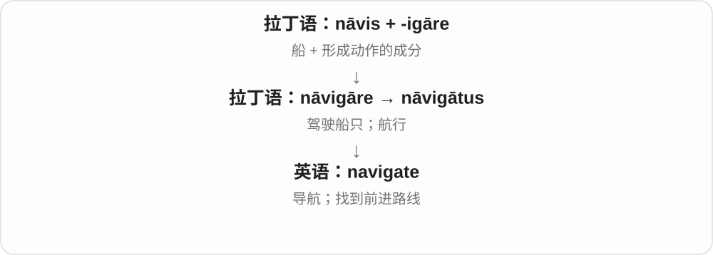

现代可在城市中找路、在菜单中找功能，也可 navigate a difficult situation“摸清情况并应对”。英语动词也可能受早先 navigation 的逆构影响。

**常见搭配与例句**

navigate through traffic；navigate a website；navigate a difficult situation。

> We used a paper map to navigate the old town.

我们用纸地图在老城区找路。

> She helped the team navigate a difficult transition.

她帮助团队应对了一次艰难的转型。

**别混淆**

navigate 强调一路判断如何走；travel 只强调旅行或移动，不一定涉及找路。

### 81. stimulate — 刺激；激发；促进

**音标**：英 /ˈstɪmjʊleɪt/；美 /ˈstɪmjəleɪt/

**先抓住这个画面**

给原本不够活跃的东西一点推动，让兴趣、思考或活动开始加强。

**怎么拆**

从拉丁 stimulare 催动、刺激的分词 stimulatus 借来；远处的画面是用尖棒轻刺、催促前进。

**怎么变成今天的意思**

**拉丁 stimulus 尖棒、赶牲口的刺棒**  
由戳一下催动，引申为促使行动

↓

**拉丁 stimulare → 分词 stimulatus → 英语 stimulate**  
催动、激发，使活动增强

stimulate interest 是激起兴趣，stimulate growth 是促进增长，stimulate a nerve 是刺激神经。它不一定使人感到兴奋，也不保证结果都是好的。

**常见搭配与例句**

stimulate interest；stimulate discussion；stimulate growth；stimulate the economy。

> The unusual opening question stimulated a lively discussion.

那个不寻常的开场问题激起了一场热烈讨论。

> The new grants are intended to stimulate research in the field.

这些新拨款旨在促进这一领域的研究。

**别混淆**

encourage 常强调鼓励或有利条件；stimulate 更像施加一个能引起反应、增加活动的刺激。

### 82. accelerate — 加速；使更快；促进进程

**音标**：/əkˈseləreɪt/

**先抓住这个画面**

刚才一分钟做一点，现在一分钟能多做一些；前进或变化的节奏加快了。

**怎么拆**

拉丁 ad- 向、加强 + celerare 加快，d 在 c 前同化，形成 accelerare；英语基于分词形式 acceleratus 借入。

**怎么变成今天的意思**

**拉丁 celer → celerare**  
迅速的 → 使加快

↓

**拉丁 ad- + celerare → accelerare、acceleratus**  
使加快

↓

**英语 accelerate**  
加速；使过程更快

The car accelerated 是车速上升；accelerate a project 是加快项目进度。它既可不带宾语，说明事情自己加速，也可带宾语，说明谁使它加速。

**常见搭配与例句**

accelerate growth；accelerate the process；accelerate rapidly。

> The train accelerated as it left the station.

火车离站后加快了速度。

> The new tool helped accelerate the editing process.

新工具帮助加快了编辑流程。

**别混淆**

日常 accelerate 常是变快；物理学更广，速度方向变化也算有加速度。不要把科学定义全部压成“车跑得更快”。

### 83. terminate — 终止；结束；到达终点

**音标**：动词：英 /ˈtɜːmɪneɪt/；美 /ˈtɜːrmɪneɪt/

**先抓住这个画面**

把一条仍在继续的线截在这里：服务到此结束，列车也可以到站终止运行。

**怎么拆**

来自拉丁 terminātus，与 termināre“设限、结束”相接；经中古英语的动词形式传下。

**怎么变成今天的意思**

**拉丁语 terminus**  
边界；界标；尽头

↓

**拉丁 termināre → terminātus；中古英语 terminaten**  
设置终点、使结束 → 英语动词

↓

**英语 terminate**  
终止；结束于

比 end 正式。既能及物说 terminate a process，也能不及物说某路线 terminates at 某处。

**常见搭配与例句**

terminate a contract；terminate a process；terminate at。

> The railway line terminates at the harbour.

这条铁路的终点在港口。

> The system terminated the process after an error occurred.

错误发生后，系统终止了那个进程。

**别混淆**

pause 是暂时停下，之后可能接着做；terminate 把当前过程结束掉。

### 84. approximate — 大约的；近似的；接近、近似

**音标**：英 /əˈprɒksɪmət/；美 /əˈprɑːksɪmət/；动词尾读 /meɪt/

**先抓住这个画面**

已经靠得很近，但还没有精确压在那个点上。

**怎么拆**

拉丁 ad- + proximāre“靠近”→ approximāre；proximus 是“最近”。英语形容词承接分词形式，动词另发展；表面没有可独立拆出的现代 proximate 动作。

**怎么变成今天的意思**

**拉丁语：ad**  
朝向；靠近；加到

↓

**拉丁语：proximus → proximāre → approximāre**  
最近 → 靠近 → 使接近

↓

**拉丁 approximātus → 中古英语 approximat；英语 approximate**  
近似的；使接近

an approximate cost 是粗略费用；动词 approximate a circle 是形状接近圆。形容词最后弱读，动词读 /eɪt/。

**常见搭配与例句**

an approximate figure；approximate to；closely approximate。

> Can you give me an approximate arrival time?

你能给我一个大致到达时间吗？

> With enough sides, a regular polygon closely approximates a circle.

边数足够多时，正多边形就很接近一个圆。

**别混淆**

exact 给精确值；approximate 允许小幅偏差。

### 85. electorate — 全体选民；选民群体

**音标**：/ɪˈlektərət/

**先抓住这个画面**

electorate 把某个地区有投票资格的人合起来看成一个群体。

**怎么拆**

elector（选民、选举人）+ -ate（群体或领域）。

**怎么变成今天的意思**

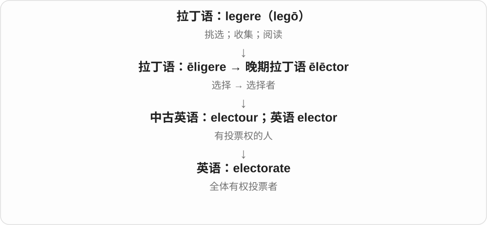

通常包括有资格却没有实际投票的人。历史文献也可指选帝侯的领地或职位。

**常见搭配与例句**

appeal to the electorate；an informed electorate；the local electorate。

> The proposal divided the electorate.

这项提议使选民意见分裂。

> Candidates must explain their plans to the electorate.

候选人必须向选民解释自己的计划。

**别混淆**

elector 是一个有投票权的人；electorate 是整个选民群体。

### 86. differentiate — 区分；使有差别；分化；求导

**音标**：/ˌdɪfəˈrenʃieɪt/

**先抓住这个画面**

原来像一团混在一起的东西，经过观察或发展，开始看出各自不同。可以是你分辨差别，也可以是对象自己分化。

**怎么拆**

来自后来的拉丁语 differentiātus，出自 differentiare，根为 differentia“差别”。不是从现代 different 随意加字母。

**怎么变成今天的意思**

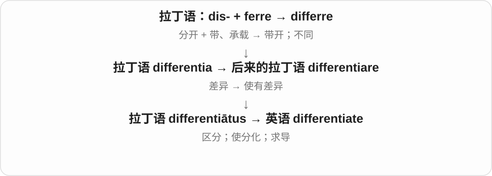

differentiate A from B 是把A和B区分；细胞 differentiate 是逐渐形成专门功能；数学里 differentiate a function 是求导。三种语境要分别学。

**常见搭配与例句**

differentiate between；differentiate from；differentiate with respect to x。

> The labels help customers differentiate the two products.

标签帮助顾客区分这两种产品。

> Differentiate x squared with respect to x to obtain 2x.

对x的平方关于x求导，得到2x。

**别混淆**

differ 是本来不同；differentiate 是辨别、造成这种差别，或专门的求导操作。

### 87. irritate — 使烦躁、惹恼；刺激〔皮肤等〕

**音标**：/ˈɪrɪteɪt/

**先抓住这个画面**

滴水声反复响，让你越来越烦，是 irritate；某种材料让皮肤发痒、发红，也是 irritate。共同点是引起不舒服的反应。

**怎么拆**

借拉丁 irritatus，来自 irritare 激起、刺激；现代有 -ate 动词形式，不从英语 ir- 不加一个现代 rit 构词。

**怎么变成今天的意思**

**拉丁 irritare 激起、刺激 → irritatus、irritabilis**  
刺激某物；容易被刺激的性质

↓

**英语 irritate、irritable、irritability**  
使烦躁、刺激；易怒；易激惹程度

irritate someone 惹恼某人；irritate the skin 刺激皮肤；irritating 令人烦、刺激性的。

**常见搭配与例句**

irritate someone；irritate the skin。

> The constant noise irritated her.

持续的噪声让她烦躁。

> The rough fabric irritated his skin.

粗糙的布料刺激了他的皮肤。

**别混淆**

irritate 可说心理烦躁或身体刺激；frustrate 常说受阻后的挫败，二者可能同场出现但不等义。

### 88. irritating — 令人烦躁、刺激性的；正在刺激、惹烦

**音标**：/ˈɪrɪteɪtɪŋ/

**先抓住这个画面**

那个噪声、动作总让人烦，是 irritating；烦躁的人则是 irritated。先看谁在引起反应，谁在受影响。

**怎么拆**

irritate 去末尾 e，加完整 -ing。分词可以讲正在刺激的动作，也能形容有这种影响的事物。

**怎么变成今天的意思**

**拉丁 irritare → irritatus → 英语 irritate**  
激起、刺激、使烦恼；整词借入

↓

**现代 irritate 的常见分支**  
使人烦躁；使身体部位受刺激、不适

↓

**irritate + -ing → irritating〔去 e〕**  
正在惹烦；能引起烦躁、刺激的性质

an irritating noise 是令人烦躁的声音，irritating dust 是会造成刺激的灰尘。

**常见搭配与例句**

an irritating habit 烦人的习惯；find it irritating 觉得它烦人。

> The clock made an irritating clicking sound.

时钟发出烦人的咔嗒声。

> I found the repeated interruptions irritating.

我觉得反复被打断很烦。

**别混淆**

annoying 与心理烦躁的 irritating 很接近，irritating 还常进入皮肤、眼睛等身体刺激语境。

### 89. irritated — 烦躁、不耐烦的；受刺激不适的；刺激了

**音标**：/ˈɪrɪteɪtɪd/

**先抓住这个画面**

人被反复打断后心里烦，皮肤被刺激后不舒服，都可以是 irritated。它常描写受到影响的一方。

**怎么拆**

irritate 去末尾 e，加完整 -ed，/t/ 后读 /ɪd/。过去分词再作形容词，描述被刺激、惹烦后的状态。

**怎么变成今天的意思**

**拉丁 irritare → irritatus → 英语 irritate**  
激起、刺激、使烦恼；整词借入

↓

**现代 irritate 的常见分支**  
使人烦躁；使身体部位受刺激、不适

↓

**irritate + -ed → irritated〔去 e〕**  
过去刺激、惹烦；受到刺激后的状态

irritated by the noise 是被噪声惹烦，irritated skin 是受刺激不适的皮肤。

**常见搭配与例句**

sound irritated 听着不耐烦；irritated by interruptions 被打断得烦躁。

> She sounded irritated by the repeated questions.

反复的问题让她听起来有些不耐烦。

> His skin felt irritated after contact with the rough fabric.

接触粗糙布料后，他的皮肤感觉不适。

**别混淆**

irritated 是受刺激、感到烦的，irritating 是造成烦恼、刺激的；对象角色不同。

### 90. irritation — 恼怒、烦躁；刺激、不适；烦心事

**音标**：/ˌɪrɪˈteɪʃən/

**先抓住这个画面**

心理上像小东西反复戳着，让人烦；身体上则是皮肤、眼睛等受刺激的不适。irritation 把这种反应拿来当名词谈。

**怎么拆**

名词经法语 irritacion 或直接拉丁 irritatio 借入。现代能对应 irritate 去 e + -ion，但名词的英语记录更早，不能说它必由现代英语动词新造。

**怎么变成今天的意思**

**拉丁 irritare → irritatio；古法语 irritacion 等**  
刺激、激起及相应活动名词

↓

**中古英语 irritation 的借入 → 现代用途**  
早有身体刺激义，后来常说恼怒；英语记录早于 irritate 这一动词形式

with irritation 是带着烦躁，skin irritation 是皮肤刺激不适；a minor irritation 还可指一件小烦心事。

**常见搭配与例句**

show irritation 露出不耐烦；a source of irritation 烦恼来源。

> He could not hide his irritation at the delay.

他掩饰不住对耽误的不耐烦。

> The dust caused irritation in his eyes.

灰尘让他的眼睛受到刺激。

**别混淆**

irritant 是引起反应的人、物，irritation 是产生的刺激、不快，或具体烦心事；原因和反应分开。

### 91. irritations — 烦心事、引起不快的小事〔复数〕；多次刺激、不适

**音标**：/ˌɪrɪˈteɪʃənz/

**先抓住这个画面**

车晚点、门吱响、消息反复打断，一件件让人烦的小事，可以数作 irritations。

**怎么拆**

irritation + -s，末尾 /n/ 后读 /z/。在可数用途里数烦心事、刺激事件；基础名词本有法语、拉丁借入路线。

**怎么变成今天的意思**

**拉丁 irritare → irritatio；古法语 irritacion 等**  
刺激、激起及相应活动名词

↓

**中古英语 irritation 的借入 → 现代用途**  
早有身体刺激义，后来常说恼怒；英语记录早于 irritate 这一动词形式

↓

**irritation + -s → irritations**  
一件件烦心事、刺激事件

daily irritations 是日常小烦恼；minor irritations 是小麻烦，常与重大问题区别开。

**常见搭配与例句**

little irritations 小烦心事；a series of irritations 一连串不快。

> We laughed about the day’s small irritations.

我们笑着聊起这一天的小烦心事。

> The delays were among several irritations during the trip.

延误是旅途中几件烦心事之一。

**别混淆**

抽象感受的 irritation 常不可数；irritations 更容易把让人不快的事分成一件件数。

### 92. irritates — 使烦躁；刺激、使不适〔第三人称单数〕

**音标**：/ˈɪrɪteɪts/

**先抓住这个画面**

像有东西反复碰到敏感处：在心里是惹烦，在皮肤、眼睛等部位是刺激。irritates 关注引起这个反应的东西。

**怎么拆**

irritate + -s，保留末尾 e，/t/ 后读 /s/。基础词借拉丁 irritatus、irritare，不把开头 ir- 一律当现代否定前缀。

**怎么变成今天的意思**

**拉丁 irritare → irritatus → 英语 irritate**  
激起、刺激、使烦恼；整词借入

↓

**现代 irritate 的常见分支**  
使人烦躁；使身体部位受刺激、不适

↓

**irritate + -s → irritates**  
它使人烦躁、使某部位受刺激

irritates me 是惹我烦，irritates the eyes 是刺激眼睛；心理与身体反应分开选中文。

**常见搭配与例句**

irritates the skin 刺激皮肤；really irritates me 真让我烦。

> That repetitive sound irritates me.

那种反复的声音让我烦躁。

> The dust irritates her eyes.

灰尘刺激她的眼睛。

**别混淆**

irritates 关注刺激、不快反应，frustrates 常额外带目标受阻、做不成的烦；不是所有烦都一样。

### 93. motivate — 激励；使有动力；成为……的动机

**音标**：英 /ˈməʊtɪveɪt/；美 /ˈmoʊtɪveɪt/

**先抓住这个画面**

motivate 是给行动添一股推力，让人觉得值得做、愿意做。

**怎么拆**

motive + -ate，构成动词。

**怎么变成今天的意思**

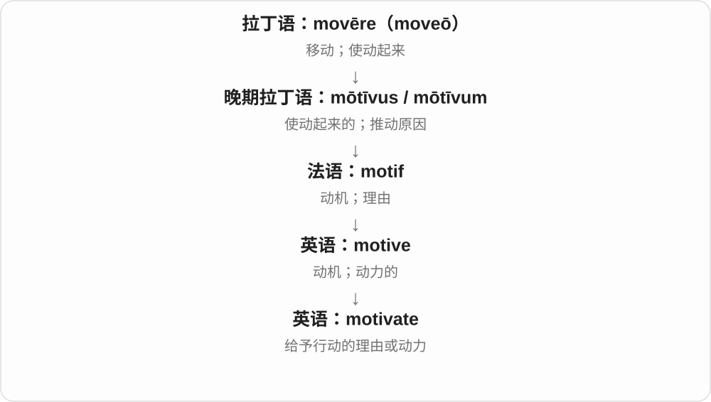

奖励、兴趣、责任感都可能激励人。be motivated by 则直接说明行动背后的原因。

**常见搭配与例句**

motivate someone to do；be motivated by；motivate a team。

> The teacher motivated us to ask more questions.

老师鼓励我们多提问题。

> Her decision was motivated by curiosity.

她作出这个决定是出于好奇心。

**别混淆**

force 是强迫；motivate 重点是形成行动动力，不一定施加压力。

### 94. congratulate — 祝贺；向某人道喜

**音标**：/kənˈɡrætʃəleɪt/，美式亦 /kənˈɡrædʒəleɪt/

**先抓住这个画面**

好事发生在你身上，我也替你高兴，并把这份喜悦说给你听。

**怎么拆**

拉丁 con- 一起 + gratulari 祝贺，其完成分词 congratulatus 被英语借作动词。不要把“同喜”理解为感谢对方给了自己东西。

**怎么变成今天的意思**

**拉丁 gratus**  
令人喜欢、受欢迎；也指心怀感谢

↓

**拉丁 gratulari**  
表达喜悦、祝贺

↓

**拉丁 con- + gratulari → congratulari**  
一起为喜事高兴、祝贺

↓

**拉丁分词 congratulatus → 英语 congratulate**  
把祝贺表达出来

congratulate someone on something / on doing something。祝贺升职、完成任务、喜事都可以；congratulate oneself 有时带自鸣得意的意味。

**常见搭配与例句**

congratulate her on her success；congratulate the team。

> We congratulated her on finishing the marathon.

我们祝贺她跑完了马拉松。

> The coach congratulated the team on its first victory.

教练祝贺球队取得了首场胜利。

**别混淆**

thank 感谢对方给你的帮助；congratulate 为对方的成就或喜事道喜。

### 95. congratulated — 祝贺了；受到祝贺的

**音标**：/kənˈɡrætʃəleɪtɪd/，美式也 /kənˈɡrædʒəleɪtɪd/

**先抓住这个画面**

刚才已经向对方说了“祝贺”，用 congratulated；被大家道喜，也可说 was congratulated。

**怎么拆**

congratulate 去末尾 e，加完整 -ed；/t/ 后读 /ɪd/。已有祝贺动词再作过去、过去分词变化。

**怎么变成今天的意思**

**拉丁 gratus、gratulari → con- + gratulari → congratulari**  
喜悦、表达喜悦 → 一同为喜事高兴

↓

**拉丁分词 congratulatus → 英语 congratulate**  
表达祝贺；现代在整个动词上加词尾

↓

**congratulate + -ed → congratulated〔去 e〕**  
过去道喜；受到道喜

congratulated her on the result 是为结果向她道喜；on 后说祝贺的事，不能只留人的名字就以为是感谢。

**常见搭配与例句**

warmly congratulated 热情祝贺的；congratulated the team 祝贺了团队。

> We congratulated her on passing the exam.

我们祝贺她通过考试。

> The whole team was congratulated after the performance.

演出后整个团队都受到了祝贺。

**别混淆**

congratulated on winning 是为获胜祝贺，thanked for helping 是因帮忙感谢；常见介词搭配一起记。

### 96. congratulating — 正在祝贺、道喜

**音标**：/kənˈɡrætʃəleɪtɪŋ/，美式也 /kənˈɡrædʒəleɪtɪŋ/

**先抓住这个画面**

知道别人取得好结果，正把同喜表达给他，就是 congratulating。也能说自己对自己表示满意。

**怎么拆**

congratulate 去末尾 e，加完整 -ing。con- 一起、gratulari 喜悦的历史材料，已经固定在基础动词里。

**怎么变成今天的意思**

**拉丁 gratus、gratulari → con- + gratulari → congratulari**  
喜悦、表达喜悦 → 一同为喜事高兴

↓

**拉丁分词 congratulatus → 英语 congratulate**  
表达祝贺；现代在整个动词上加词尾

↓

**congratulate + -ing → congratulating〔去 e〕**  
祝贺的进行、活动

congratulating her on the result 是为结果向她道喜；congratulating yourself 常说对自己满意，有时暗含得意。

**常见搭配与例句**

congratulating the winner 祝贺获胜者；congratulating themselves 自我庆贺。

> Everyone was congratulating her on the good news.

大家都在为好消息向她道喜。

> They were still congratulating themselves when the next task arrived.

下一项任务到来时，他们还在自我庆贺。

**别混淆**

congratulating 是道喜动作，congratulations 常是名词祝贺、直接说的祝贺话；词性和句式不同。

### 97. congratulates — 祝贺、向……道喜〔第三人称单数〕

**音标**：/kənˈɡrætʃəleɪts/，美式也 /kənˈɡrædʒəleɪts/

**先抓住这个画面**

别人做成一件好事，你把“我也替你高兴”说出来，就是 congratulates 的基本画面。

**怎么拆**

congratulate + -s，保留末尾 e，/t/ 后读 /s/。拉丁 con- 一起与 gratulari 表达喜悦组合，分词形式借入英语。

**怎么变成今天的意思**

**拉丁 gratus、gratulari → con- + gratulari → congratulari**  
喜悦、表达喜悦 → 一同为喜事高兴

↓

**拉丁分词 congratulatus → 英语 congratulate**  
表达祝贺；现代在整个动词上加词尾

↓

**congratulate + -s → congratulates**  
他、她向某人道喜

congratulates someone on something 是为某件喜事祝贺某人，on 后可接成功、毕业等。

**常见搭配与例句**

congratulates the winner 祝贺获胜者；congratulates her on graduating 祝贺她毕业。

> She congratulates every student who finishes the course.

每位完成课程的学生都会得到她的祝贺。

> He congratulates her on the successful performance.

他祝贺她演出成功。

**别混淆**

thank 是感谢对方做了某事，congratulate 是为对方的喜事道喜；谢意与同喜分开。

### 98. dictate — 口述；命令；决定

**音标**：动词英 /dɪkˈteɪt/、美也读 /ˈdɪkteɪt/；名词 /ˈdɪkteɪt/

**先抓住这个画面**

一人说，另一人照着写，是口述；一人说，别人必须照着做，是命令。局势让你只能这样选，又可以说局势 dictates 你的选择。

**怎么拆**

来自拉丁语 dictāre，属于 dīcere“说”的反复动作形式。英语动词和名词分别承接相关拉丁词形。

**怎么变成今天的意思**

共同点是给出需要照着执行的内容。命令者可以是人，也可以比喻为预算、时间、环境；the dictates of conscience 则是良心的要求。

**常见搭配与例句**

dictate a letter；dictate terms；dictate what happens；the dictates of conscience。

> She dictated the message while I typed.

她口述消息，我打字。

> Our budget will dictate the size of the project.

我们的预算将决定项目规模。

**别混淆**

suggest 给建议，dictate 常让对方没有多少选择。口述义却可以完全不带专横态度。

### 99. rotate — 旋转；使转动；轮换

**音标**：英 /rəʊˈteɪt/；美 /ˈroʊteɪt/

**先抓住这个画面**

rotate 像让物体围着一根看得见或看不见的轴转；让几个人轮流做同一任务，也能借这个画面理解。

**怎么拆**

借自拉丁 rotātus，来自 rotāre“转动”，后者由 rota“轮子”形成。

**怎么变成今天的意思**

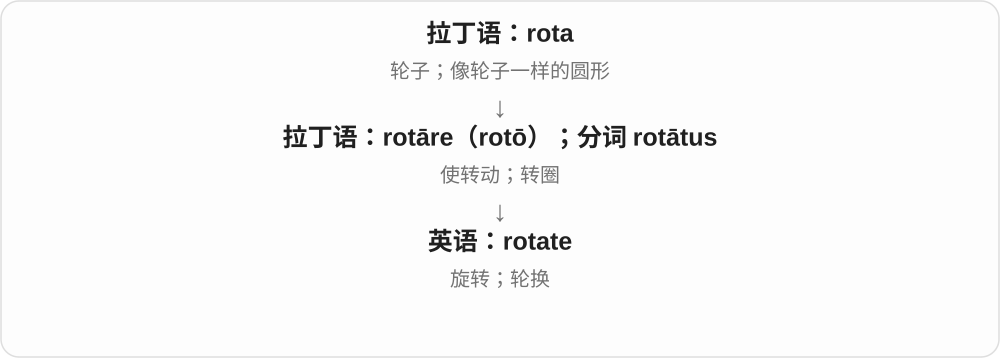

物体自己转和让物体转都能用。rotate duties 强调依次互换职责，不是永远让同一个人承担。

**常见搭配与例句**

rotate clockwise；rotate the image；rotate responsibilities。

> Rotate the image ninety degrees clockwise.

把图像顺时针旋转九十度。

> We rotate the responsibility for taking notes.

我们轮流负责记录。

**别混淆**

spin 常突出快速旋转；rotate 不要求速度快，也常用于精确角度或轮换安排。

### 100. intricate — 错综复杂的；精细繁复的

**音标**：/ˈɪntrɪkət/

**先抓住这个画面**

线条、零件或关系层层交织，细节很多，得凑近才看得清，是 intricate。它常既能说难，也能夸精巧。

**怎么拆**

接拉丁 intricatus 缠在一起的，来自 intricare；与 in- 和 tricae 障碍、纠缠等材料相关。这里 -ate 是性质形，不读动词式 /eɪt/。

**怎么变成今天的意思**

**拉丁 intricare → intricatus**  
使纠缠、缠在一起

↓

**英语 intricate**  
细节交织、结构繁复

an intricate pattern 繁复花纹；an intricate mechanism 精密复杂的机构；intricate details 精细复杂的细节。

**常见搭配与例句**

an intricate pattern；an intricate mechanism。

> The cloth has an intricate pattern.

布上有繁复精细的花纹。

> The clock contains an intricate mechanism.

钟里装着一套精密复杂的机构。

**别混淆**

intricate 更让人看到细部交织，complicated 可以泛说难处理；intricate lace 可能在夸花边精致。

### 101. penetrate — 穿透、渗入；深入理解；进入某领域

**音标**：/ˈpenɪtreɪt/

**先抓住这个画面**

光穿过厚雾，水渗进土里，都是 penetrate：越过表层、阻碍，进入里面。思想上则是看穿表面，理解到内里。

**怎么拆**

借拉丁语 penetrare 的分词词干 penetrat-，上接与内部、在其中有关的 penes 等材料。现代物理穿入与深入理解、进入领域的比喻相连。

**怎么变成今天的意思**

**拉丁语 penetrare 进入内部、穿入 → penetratus → penetrate**  
上游 penes 等与内部联系

↓

**penetratio → 法语、英语 penetration；现代对应 penetrate + -ion**  
穿透、渗入的过程与程度，也用于理解、市场覆盖等

penetrate the fog 穿透雾；penetrate the soil 渗入土壤；penetrate a market 打入市场；penetrate a mystery 看透谜团。

**常见搭配与例句**

penetrate the fog；penetrate deeply。

> Sunlight could barely penetrate the thick fog.

阳光几乎穿不透浓雾。

> The water slowly penetrated the dry soil.

水慢慢渗进干土。

**别混淆**

enter 只需进入，penetrate 常多出穿过阻碍、深入内部的感觉；并不保证穿过去后毫无减弱。

### 102. mitigate — 减轻；缓和；降低坏影响

**音标**：/ˈmɪtɪɡeɪt/

**先抓住这个画面**

mitigate 像在一次冲击前加上缓冲垫：冲击可能仍在，但伤害减轻了。

**怎么拆**

来自拉丁语 mītigāre、mītigātus：mītis“温和、柔软”+ -igāre“使成为”。传统分析把后半与 agere 联系起来，但其更早构词解释并非只有一种。

**怎么变成今天的意思**

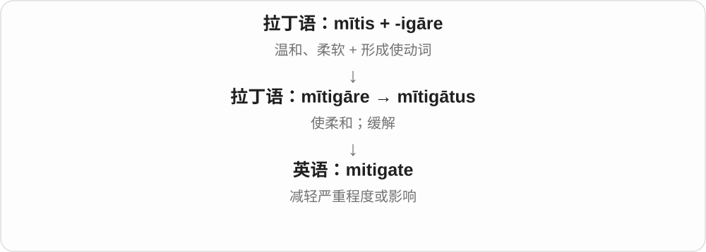

常减轻风险、损失或负面影响，不表示彻底消灭问题。最稳妥的搭配是直接接宾语：mitigate the damage。

**常见搭配与例句**

mitigate risk；mitigate the effects；mitigating factors。

> Extra training can help mitigate the risk of errors.

额外培训有助于降低出错风险。

> The new drainage system mitigated the effects of the storm.

新的排水系统减轻了暴雨的影响。

**别混淆**

mitigate 减轻坏影响；eliminate 消除；militate against 表示对某事不利，不要混用。

### 103. evacuate — 疏散；撤离；排空

**音标**：/ɪˈvækjueɪt/

**先抓住这个画面**

把里面的人或东西转移出去，让原来的地方空下来。

**怎么拆**

拉丁 e-〔ex-，向外〕+ vacuus“空的”组成 evacuare；英语动词与其分词形式有关。

**怎么变成今天的意思**

**拉丁语 vacare／vacuus**  
空着、闲着／空的

↓

**拉丁 e-〔ex-〕+ vacuus → evacuare**  
使空出来、排出去

↓

**英语 evacuate**  
撤离、疏散；使空间腾空

evacuate the building 是撤离或疏散楼里的人；evacuate residents 是把居民转移出去。两个宾语都可以成立：有时说腾空哪里，有时说转移谁。新闻中的用法通常与危险有关，但本义“排空”也保留在技术语境里。

**常见搭配与例句**

evacuate a building；evacuate residents；evacuate to safety。

> Staff evacuated the building when the alarm sounded.

警报响起后，工作人员撤离了大楼。

> Rescuers evacuated the residents before the river flooded.

河水泛滥前，救援人员转移了居民。

**别混淆**

evacuate 是撤离，escape 是逃脱；有组织的疏散不一定是仓皇逃跑。vacate 可只是正常腾房。

### 104. dedicate — 奉献；把作品献给；为专门用途拨出

**音标**：动词：英、美 /ˈdedɪkeɪt/

**先抓住这个画面**

把时间、力量或作品明确交给某个人或目标，不再只是随便用用。

**怎么拆**

经中古英语 dedicat / dedicaten，来自拉丁语 dedicatus、dedicare“郑重宣布、奉献”，含 de- 与 dicare“宣告”。先有宗教奉献义，再扩展。

**怎么变成今天的意思**

**拉丁语 de-**  
离开、向下；也可加强动作或表示解除

↓

**拉丁语 dicare → dedicare / dedicatus**  
郑重宣布、专门奉献

↓

**中古英语 dedicat / dedicaten → 英语 dedicate**  
奉献；题献作品；专门用于

dedicate time to studying 后接名词或 -ing；dedicate a book to someone 是把书题献给某人。旧形容词 dedicate 较少见，可另读 /ˈdedɪkɪt/。

**常见搭配与例句**

dedicate one’s life to；dedicate a song to；dedicate resources to。

> She dedicated an hour each morning to learning English.

她每天早上专门拿出一小时学英语。

> The author dedicated the book to his grandmother.

作者把这本书题献给了祖母。

**别混淆**

donate 常指捐赠具体财物；dedicate 还包括长期投入和象征性的题献。

### 105. discriminate — 辨别、区分；歧视、不公平区别对待

**音标**：/dɪˈskrɪmɪneɪt/

**先抓住这个画面**

辨出声音差别，是区分；因为一个人属于某群体就对他不利，是歧视。区别本身不总坏，怎样用区别才决定评价。

**怎么拆**

借拉丁 discrīminātus，接 discrīmināre 分辨，联系 discrīmen 区别与 discernere 分开。不是现代英语 crime 犯罪简单加 dis- 和词尾。

**怎么变成今天的意思**

**拉丁 discernere → discrīmen / discrīmināre**  
分开、辨别 → 区别、作区分

↓

**拉丁相应形式 → 英语 discriminate/discrimination**  
辨别；按群体特征作不利区别对待

↓

**性质与否定形式**  
discriminatory 歧视性的；indiscriminate 不加分辨的

discriminate between sounds 区分声音，discriminate against someone 歧视某人，discriminate on the basis of age 按年龄区别对待。

**常见搭配与例句**

discriminate between；discriminate against；discriminate on the basis of。

> The test asks listeners to discriminate between similar sounds.

测试要求听者区分相近声音。

> The policy should not discriminate against older applicants.

规定不应歧视年长申请者。

**别混淆**

discriminate between 可中性说辨别能力；against 常标不利对待。只见中文歧视就会漏掉实验、感知里的区分义。

### 106. syndicate — 联合团体、财团；联合供稿、分发

**音标**：名词 /ˈsɪndɪkət/；动词 /ˈsɪndɪkeɪt/

**先抓住这个画面**

几方为了同一项业务、资金或目标联合起来，可以是 a syndicate。内容 syndicate 给多家媒体，则是统一提供、分发。

**怎么拆**

借法语 syndicat，接中世纪拉丁 syndicatus，关联 syndicus 代表及职位、群体尾；更早希腊词有共同辩护者材料。动词从名词发展，末尾读 /eɪt/。

**怎么变成今天的意思**

**希腊 syndikos → 拉丁 syndicus → syndicat**  
代表、共同事务及组织的命名

↓

**英语 syndicate 名词 → 动词**  
联合团体；组织联合、内容多方分发

a business syndicate 商业联合体；a crime syndicate 犯罪集团；syndicate a column 向多家媒体供同一专栏。

**常见搭配与例句**

a business syndicate；syndicate a column。

> A syndicate of investors funded the project.

一个投资者联合体资助了项目。

> The newspaper syndicates her column internationally.

报社向国际多家媒体提供她的专栏。

**别混淆**

syndicate 不必是犯罪组织；crime syndicate 由 crime 限定。内容分发的动词义也不能只按财团名词译。

### 107. commemorate — 纪念；使人记住某人或事件

**音标**：/kəˈmeməreɪt/

**先抓住这个画面**

用活动、物品或记录，把某件重要的事从“已经过去”变成“仍值得大家记住”。

**怎么拆**

来自拉丁 commemoratus，commemorare 的分词；com- 在此常解释为加强，memorare 是使人记起。不是一定要许多人“共同背诵”。

**怎么变成今天的意思**

**拉丁 memor**  
记着的；放在心上的

↓

**拉丁 memorare → commemorare，分词 commemoratus**  
使人想起；com- 在此常解释为加强

↓

**拉丁分词词干 → 英语 commemorate**  
通过活动、记录或物品使人记住

commemorate an anniversary 是纪念周年；一块牌匾也能 commemorate 某个事件。被纪念的事情可以喜庆，也可以悲痛，因此不等于 celebrate 的庆祝。

**常见搭配与例句**

commemorate an event；commemorate the anniversary；a plaque commemorating；commemorate those who。

> The exhibition commemorates the opening of the city’s first public library.

这场展览纪念本市第一座公共图书馆的开放。

> A plaque on the wall commemorates those who helped rebuild the village.

墙上的一块牌匾纪念了帮助重建村庄的人们。

**别混淆**

celebrate 常有庆祝、赞颂意味；commemorate 强调让记忆保留下来，可以是庄重悼念。记住一个密码通常不用这个词。

### 108. innate — 与生俱来的；内在的

**音标**：/ɪˈneɪt/

**先抓住这个画面**

innate 像出生时就随身带来的基础配置，用来强调某种倾向不是后来刻意学会的。

**怎么拆**

拉丁语 in-（在里面）+ nāscī 形成 innātus；这里 in- 不是否定。

**怎么变成今天的意思**

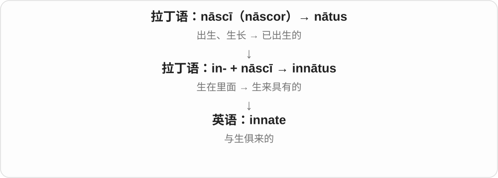

生在里面发展为天生具有。说某能力 innate 是一种判断，现实中的能力仍可能受到学习和环境影响。

**常见搭配与例句**

an innate ability；innate curiosity；an innate sense of… 。

> Children often show an innate curiosity about their surroundings.

孩子们常表现出对周围环境的天然好奇。

> She seems to have an innate sense of rhythm.

她似乎天生就很有节奏感。

**别混淆**

innate 强调先天；acquired 强调后天获得。不要把明显练习过的全部能力都自动归为天赋。

### 109. speculate — 推测；猜想；投机

**音标**：英 /ˈspekjʊleɪt/；美 /ˈspekjəleɪt/

**先抓住这个画面**

speculate 是看到一些线索后，先在脑中试着补全未知部分；尚未知道，就先设想。

**怎么拆**

来自拉丁语 speculārī“观察、察看”的分词词干 speculāt-；更早连着瞭望处 specula。

**怎么变成今天的意思**

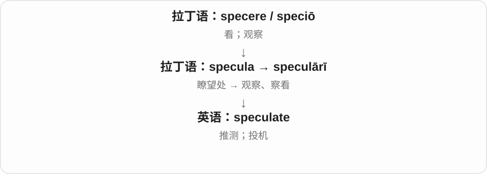

从仔细观察走向思考、推想。金融语境的投机，则是凭对未来价格的判断承担风险。

**常见搭配与例句**

speculate about；speculate that；speculate in land。

> We can only speculate about why the meeting was cancelled.

我们只能猜测会议为什么取消。

> The novel follows a man who speculates in land.

这部小说写了一个从事土地投机的人。

**别混淆**

推测时用 speculate，确认时用 confirm。不能因说得有条理就把前者当成后者。

### 110. simulate — 模拟；模仿；假装；伪装的〔旧形容词〕

**音标**：/ˈsɪmjəleɪt/；旧形容词 /ˈsɪmjələt/

**先抓住这个画面**

不直接使用原来的东西，而是做出与它相似的样子或反应。

**怎么拆**

拉丁 simulāre“使相像、模仿”的分词 simulātus 可解释英语借词；也有从更早的 simulation 逆构动词的分析。

**怎么变成今天的意思**

**拉丁 similis**  
相像、同类；与 simul“一起、同时”同族

↓

**拉丁 simulāre / simulātus**  
做出相似外观、模仿、假装

↓

**英语 simulate**  
借拉丁分词，或由较早的 simulation 逆构；模拟、假装

simulate rainfall 是模拟降雨；simulate interest 是装出有兴趣。前者可以是公开的科学试验，后者可能在掩饰真实感受，所以不能一看到 simulate 就翻成欺骗。

**常见搭配与例句**

simulate conditions；simulate a process；simulate interest。

> The chamber can simulate hot, humid weather.

这个试验舱能模拟炎热潮湿的天气。

> He tried to simulate enthusiasm, but his flat voice gave him away.

他试着装出热情，平淡的声音却暴露了真实态度。

**别混淆**

stimulate 是刺激、促进，多一个 t；simulate 是模拟。resemble 是本来就像，simulate 通常是做出相似效果。

### 111. migrate — 迁移；迁徙；转移数据、系统

**音标**：/maɪˈɡreɪt/，亦 /ˈmaɪɡreɪt/

**先抓住这个画面**

把原来生活、停留或运行的地方换到另一处。

**怎么拆**

借自拉丁 migratus，接 migrare“从一处搬到另一处”；现代英语的 -ate 是承接古典词形，不是从 migrant 简单去尾。

**怎么变成今天的意思**

**拉丁语 migrare**  
从一处迁到另一处

↓

**拉丁语 migratus → 英语 migrate**  
迁移过的形式 → 迁移、迁徙；现代也用于数据系统

鸟类 migrate 是迁徙，人可以为了工作迁居；软件也可 migrate to a new platform。技术用法还可直接接宾语：migrate the data，把数据迁过去。

**常见搭配与例句**

migrate south；migrate from…to…；migrate data；migrate to a new platform。

> These birds migrate south in autumn.

这些鸟秋天向南迁徙。

> The team plans to migrate the data to a new server.

团队计划把数据迁移到新服务器。

**别混淆**

emigrate 看迁出，immigrate 看迁入；migrate 更概括，也适用于动物、数据等，不限定国界。

### 112. cultivate — 耕种；栽培；培养；结交

**音标**：/ˈkʌltɪveɪt/

**先抓住这个画面**

像照料一株苗那样，给时间、给条件，让它长出来。

**怎么拆**

借中世纪拉丁 cultivātus，接 cultivāre；后者来自 cultīvus“已耕作的”，再接 colere 的分词 cultus。

**怎么变成今天的意思**

**拉丁 colere；分词 cultus**  
耕作、照料；居住；尊敬、崇奉

↓

**晚期拉丁 cultīvus → 中世纪拉丁 cultivāre / cultivātus**  
已耕种的 → 耕种、栽培

↓

**英语 cultivate**  
栽培；培养能力、兴趣与关系

可以 cultivate tomatoes，也可以 cultivate confidence。cultivate a friendship 是用心经营友谊；cultivate an influential person 有主动结交、争取关系的意味。

**常见搭配与例句**

cultivate the land；cultivate an interest；cultivate relationships。

> They cultivate vegetables on a small plot behind the house.

他们在房后的一小块地上种菜。

> Reading widely can help cultivate curiosity.

广泛阅读有助于培养好奇心。

**别混淆**

grow 可以自然生长；cultivate 更突出有人照料、训练和经营。

### 113. phosphate — 磷酸盐；磷酸根；磷酸酯〔依语境〕

**音标**：英 /ˈfɒsfeɪt/；美 /ˈfɑːsfeɪt/

**先抓住这个画面**

把磷酸这一类结构放进盐、矿物或生物分子里时，常会遇到 phosphate。

**怎么拆**

来自法语 phosphate，由 phosphore“磷” + 化学名词尾 -ate 形成；不是 photo + 某个看不懂的尾巴。

**怎么变成今天的意思**

**希腊语 phōs，属格 phōtos**  
光；phot- 来自它的变化词干

↓

**希腊语 phōsphoros → 拉丁语 phosphorus**  
phōs 光 + phoros 携带者 → 带来光的、启明星

↓

**英语 phosphorus**  
早期指发光物；后来用于元素磷

↓

**法语 phosphore + -ate → phosphate**  
磷 + 化学名称词尾 → 磷酸盐等

↓

**英语 phosphate**  
磷酸盐、磷酸根或磷酸酯相关用法

肥料中的 phosphate 常说磷酸盐；生物化学的 phosphate group 指磷酸基团。要靠上下文判断是在谈盐、离子还是分子上的基团。

**常见搭配与例句**

phosphate fertilizer；a phosphate group；phosphate ions。

> The laboratory measured phosphate levels in the water.

实验室测量了水中的磷酸盐含量。

> The enzyme transfers a phosphate group to the protein.

这种酶把一个磷酸基团转移到蛋白质上。

**别混淆**

phosphorus 指元素；phosphate 指与磷酸结构相关的一类化合物、离子或基团。

### 114. contemplate — 沉思、仔细考虑；凝视；考虑做

**音标**：英 /ˈkɒntəmpleɪt/；美 /ˈkɑːntəmpleɪt/

**先抓住这个画面**

把视线或注意力停在一件事上，不急着跳开，认真看、认真想，是 contemplate。也能说在盘算某个未来选择。

**怎么拆**

借拉丁 contemplatus，来自 contemplari 细看、审思；更早联系 com- 与 templum 划定观察的区域，不是英语 template 模板直接加尾。

**怎么变成今天的意思**

**拉丁 com- + templum 等 → contemplari**  
划定观察区域 → 注视、思量

↓

**英语 contemplate**  
专注审视；认真考虑某事、某种选择

contemplate a question 沉思问题；contemplate doing 考虑做；contemplate the scene 凝视景象。

**常见搭配与例句**

contemplate doing；contemplate a question。

> She is contemplating a change of career.

她在认真考虑转行。

> We sat quietly and contemplated the view.

我们静静坐着，凝望景色。

**别混淆**

contemplate 比随便 think of 更有停下来认真思量的意味；contemplate moving 是考虑搬家，未必已经决定。

### 115. directorate — 管理局；处、司等主管机构；董事会

**音标**：英 /dəˈrektərət/；美 /dəˈrektərət/

**先抓住这个画面**

不是一名主管，而是承担某方面管理职能的部门，或由董事组成的管理机构。

**怎么拆**

director + -ate，形成机构、群体等名词。各机构正式中文译名可能是局、司、处，不能只靠后缀确定行政级别。

**怎么变成今天的意思**

**拉丁 dirigere、directus → 英语 direct、director**  
指引、使朝某方向 → 指导、管理的人

↓

**现代 director 派生**  
管理机构；担任董事、主管的职务与任期

↓

**director + -ate → directorate**  
管理者群体或其机构

the finance directorate 财务主管部门，a government directorate 政府主管机构；先看该组织自己的名称和层级。

**常见搭配与例句**

a finance directorate；a government directorate；the directorate’s staff。

> The finance directorate reviewed the budget.

财务主管部门审核了预算。

> The directorate published its annual report.

管理机构发布了年度报告。

**别混淆**

director 人，directorate 机构群体；directory 名录是另一个词，不要只按前半字母猜。

### 116. emulate — 努力效仿；争取赶上；模拟实现

**音标**：/ˈemjuleɪt/

**先抓住这个画面**

把别人做得好的地方当目标，让自己也能做到。

**怎么拆**

拉丁 aemulari 竞争、努力赶上，其分词 aemulatus 连接英语 emulate；也有从较早英语 emulation 反构的分析。现代不能按 emu 鸸鹋加 late 来拆。

**怎么变成今天的意思**

**拉丁 aemulus 竞争者 → aemulari 争先、努力赶上**  
看到别人做得好，希望自己也达到或超过

↓

**拉丁 aemulatus → 英语 emulate；或较早 emulation 的反构**  
努力做到同样好；后也用于技术模拟

emulate someone’s success 通常含向榜样看齐，不只是照抄动作。计算机语境中 emulate a system 则说重现某系统的行为，使另一环境能承担它的工作。

**常见搭配与例句**

emulate someone’s example；emulate a success；emulate a processor。

> Young designers often try to emulate her attention to detail.

年轻设计师常努力学习她对细节的重视。

> The software can emulate the behaviour of an older computer.

这款软件能模拟一台较老计算机的运行行为。

**别混淆**

imitate 可以只是复制外表或声音；emulate 常多一层达到相似表现的目标。技术术语的具体边界要结合系统来理解。

### 117. validate — 确认有效；验证；使生效；认可感受

**音标**：英、美 /ˈvælɪdeɪt/

**先抓住这个画面**

拿到证据或完成手续，让“这个站得住、这个可以用”得到确认。对感受说 validate，则是承认它值得被理解。

**怎么拆**

来自中世纪拉丁语 validāre 的分词 validātus；现代能看成 valid + -ate。

**怎么变成今天的意思**

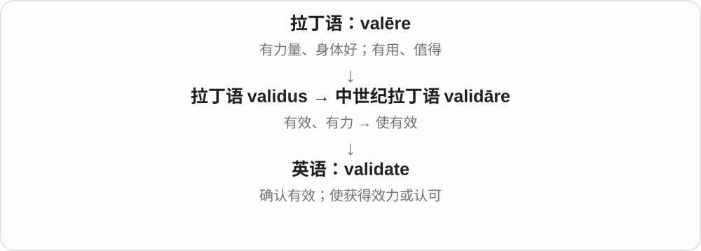

validate a ticket 可以指让车票开始生效；validate a model 是检验模型是否适合预定用途。validate someone’s feelings 是承认其感受，并不等于同意其每个判断。

**常见搭配与例句**

validate a ticket；validate a method；validate someone’s feelings。

> Please validate your ticket before boarding.

上车前请完成车票生效手续。

> The team used new data to validate the model.

团队用新数据验证模型。

> Listening carefully can help validate a friend’s feelings.

认真倾听能让朋友感到自己的感受被理解和认可。

**别混淆**

verify 常偏向核实某项信息；validate 常偏向确认有效、适用或可接受，技术领域会有更具体的约定。

### 118. invalidate — 使无效；推翻、否定效力

**音标**：英、美 /ɪnˈvælɪdeɪt/

**先抓住这个画面**

原先看起来能成立，某个错误、新证据或违规让它失去了成立的条件。

**怎么拆**

现代可拆 invalid + -ate，也可联系 in- + validate；历史词典还记录法语 invalider 的借入路线。

**怎么变成今天的意思**

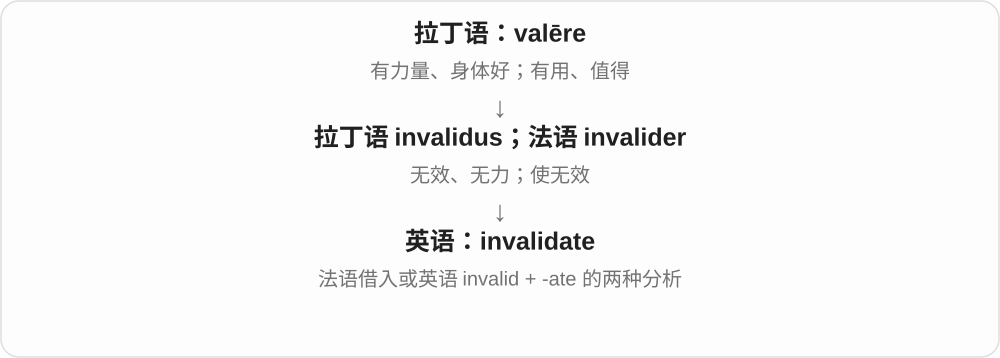

invalidate a ticket 是使票无效；invalidate a conclusion 是破坏结论所需的依据。它通常带使役动作，不只是描述当前状态。

**常见搭配与例句**

invalidate a result；invalidate a claim；invalidate an agreement。

> The missing control group may invalidate the conclusion.

缺少对照组可能使这个结论无法成立。

> Any alteration to the ticket will invalidate it.

对票据作任何改动都会使其失效。

**别混淆**

invalid 是无效的状态；invalidate 是导致或认定它无效的动作。

### 119. elevate — 抬高；提升；使升高

**音标**：/ˈeləveɪt/

**先抓住这个画面**

把东西从原来的位置往上托，也可以把地位或水平往上提。

**怎么拆**

拉丁 e- 是 ex- 的形式，加 levare“抬起”；英语借用 elevatus 的词干。

**怎么变成今天的意思**

**拉丁 levis → levare**  
轻 → 抬起、使负担减轻

↓

**拉丁 ex- + levare → elevare，分词 elevatus**  
向外、向上抬起

↓

**英语 elevate**  
抬高；提升地位或程度

elevate a platform 是把平台升高；elevate someone to a position 是把某人提升到某个职位；elevate a discussion 是让讨论有更高的质量。具体或抽象的“向上”都能成立。

**常见搭配与例句**

elevate to；elevate above；elevate standards。

> The mechanism elevates the platform slowly.

这个装置把平台缓缓升高。

> Her careful questions elevated the quality of the discussion.

她细致的问题提升了讨论的质量。

**别混淆**

raise 更日常；elevate 较正式，常让人想到位置、地位、水平的提升，不等于所有语境都能互换。

### 120. designate — 指定；命名；任命；已任命待就职的

**音标**：动词 /ˈdezɪɡneɪt/；形容词 /ˈdezɪɡnət/

**先抓住这个画面**

designate 像在地图或名单上圈出一个：“这个地点作出口，这个人负责，这个名称就这样定。”

**怎么拆**

形容词借自拉丁分词 dēsignātus；动词更晚，可能由形容词转用、designation 逆构或拉丁分词形成，不是直接由现代 design 随便加 -ate。

**怎么变成今天的意思**

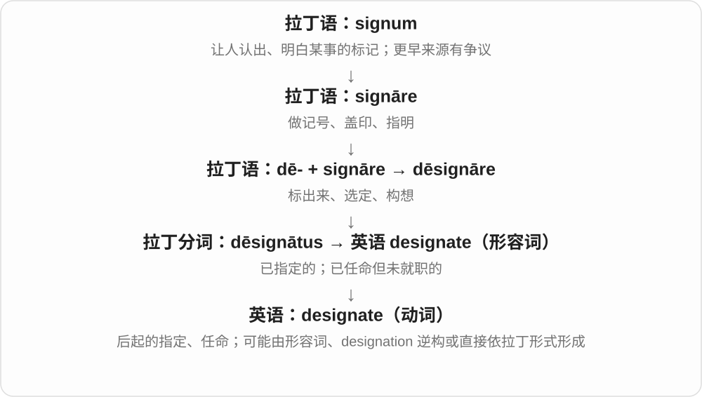

designate someone as leader 是指定为负责人；designate an area for parking 是划作停车区。形容词放在职位后，如 director designate，表示尚未就职。

**常见搭配与例句**

designate as；designate for；designate someone to do；director designate。

> They designated the east gate as the main entrance.

他们指定东门为主入口。

> The director designate will take office in June.

这位候任主任将在六月就职。

**别混淆**

design 是规划怎样做；designate 是指出、指定哪一个。二者同源，但今天不能互换。

### 121. originate — 起源于；发起；创造

**音标**：/əˈrɪdʒɪneɪt/

**先抓住这个画面**

一个想法或事物从这里第一次冒出来。

**怎么拆**

现代可按 origin + -ate 理解；词源有中世纪拉丁 orīginātus 借入说，也有从英语 origination 逆构的分析。

**怎么变成今天的意思**

**拉丁 orīrī；分词 ortus**  
升起、出现、出生

↓

**拉丁 orīgō / orīgin-**  
出现之处 → 开始、来源

↓

**中世纪拉丁 orīginātus／英语 origination**  
词典分别提出分词借入、从名词逆构两种路线

↓

**英语 originate**  
起源于；创造、发起

originate in / from 说源头在哪里；originate an idea 则说某人首先提出它。前一种用法不及物，后一种直接带被创出的东西。

**常见搭配与例句**

originate in；originate from；originate a proposal。

> The idea originated in a conversation between two friends.

这个想法最早来自两个朋友的一次交谈。

> She originated the design and developed the first model.

她提出了这个设计，并做出了第一个模型。

**别混淆**

come from 更日常；originate 强调最初来源，而不是途中经过哪里。

### 122. literate — 会读写的；有文化修养的；具备某方面基本素养的

**音标**：/ˈlɪtərət/

**先抓住这个画面**

眼前的字不再只是符号：你能读懂，也能用它们把自己的意思写出来。

**怎么拆**

拉丁 litteratus“受过文字教育的”，经中古英语进入现代英语；词尾 -ate 在这个形容词里读 /ət/。

**怎么变成今天的意思**

**拉丁 littera／litera**  
字母；复数也可指书信、文献和学问

↓

**拉丁 litteratus → 英语 literate**  
受过文字教育的 → 会读写的、有相应素养的

最基本的 literate 是会阅读和书写。computer literate 则把画面扩展成“看得懂、用得来计算机”；financially literate 指能理解相关基本信息。要看前面的限定词，不能把所有 literate 都译成“文学的”。

**常见搭配与例句**

be literate；computer literate；scientifically literate。

> The course helps adults become literate in their first language.

这门课程帮助成年人学会用母语读写。

> The job requires staff to be computer literate.

这项工作要求员工具备基本的计算机使用能力。

**别混淆**

literate 是能力或素养；literary 是文学相关；literal 是照字面。会读写不等于必须精通文学研究。

### 123. illiterate — 不会读写的；缺乏某方面基本知识的

**音标**：/ɪˈlɪtərət/

**先抓住这个画面**

面对文字，缺少把它读懂或写出来的能力；加上领域名后，也可说对那一行不熟。

**怎么拆**

拉丁否定前缀 in- 在 l 前变为 il-，与 litteratus 构成 illitteratus；英语借入为 illiterate。

**怎么变成今天的意思**

**拉丁 littera／litera**  
字母；复数也可指书信、文献和学问

↓

**拉丁 in- + litteratus → illitteratus**  
没有受过文字教育的；in- 在 l 前同化为 il-

↓

**英语 illiterate**  
不会读写的；对某领域缺乏基本知识的

illiterate 最常说读写能力不足，computer illiterate 则说不懂电脑。它还可能批评文字不合规范，语气往往不客气。描述具体困难时，说 someone cannot read 比把整个人贴成“文盲”通常更清楚，也不会把读写能力误当成智力。

**常见搭配与例句**

illiterate adults；remain illiterate；computer illiterate。

> He was illiterate until he joined an adult reading class.

直到参加成人识字班之前，他一直不会读写。

> I used to be computer illiterate, but I can now manage the website.

我以前不懂电脑，现在已经能管理这个网站了。

**别混淆**

illiterate 不等于 unintelligent。阅读能力也有程度差别，不是所有困难都能压成“会”或“不会”两格。

### 124. decorate — 装饰；装修、粉刷；授予勋章

**音标**：英、美 /ˈdekəreɪt/

**先抓住这个画面**

给原来的东西添上颜色、图案或摆设，让它更好看；把勋章授给一个人，也是给他增添公开的荣誉。

**怎么拆**

接拉丁 decoratus，来自 decorare“装点、使增色”，远接 decus／decor-“美、荣誉、装饰”。英语较早有分词形容词 decorat，后来发展为常用动词。

**怎么变成今天的意思**

**拉丁 decus，词干 decor-**  
美、荣誉、使事物增色的装饰

↓

**拉丁 decorare；分词 decoratus**  
装点、美化、使获得荣誉

↓

**中古英语 decorat／后来动词 decorate**  
被装饰的 → 装饰；又用于授予勋章

decorate a cake 是装饰蛋糕；decorate a room 可以是布置房间，英式语境还常包括粉刷、贴墙纸。decorate someone for bravery 是因勇敢表现给某人授勋。

**常见搭配与例句**

decorate with flowers；decorate a cake；decorate a room；decorate someone for bravery。

> We decorated the room with paper flowers.

我们用纸花装饰了房间。

> She decorated the cake with fresh berries.

她用新鲜浆果装饰了蛋糕。

**别混淆**

decorate 主要改变外观和布置；renovate 范围更宽，可包括修缮、更新设施。de- 在这个词里不能单独当作“去掉”。

### 125. agitate — 搅动；使不安；鼓动争取

**音标**：/ˈædʒɪteɪt/

**先抓住这个画面**

agitate 像不断摇动一杯水：液体被搅起来，人的情绪也可以被搅得不安，社会议题也可以被不断推动。

**怎么拆**

来自拉丁语 agitāre，是 agere 的反复动作形式，经 agitātus 进入英语。

**怎么变成今天的意思**

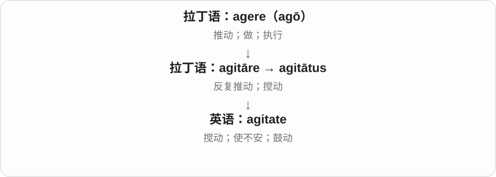

字面上可摇动液体；心理上使人烦乱；政治上 agitate for 是积极推动某项改变。三者都带“让它持续动起来”的画面。

**常见搭配与例句**

agitate the mixture；agitate for reform；be agitated by noise。

> Gently agitate the mixture before observing it.

观察前轻轻摇动混合物。

> Residents began to agitate for better public transport.

居民开始积极争取更好的公共交通。

**别混淆**

agitating a mixture 是搅动；agitating a person 是使其不安；对象决定具体意思。

### 126. agitated — 焦躁、激动不安的；搅动、鼓动了

**音标**：/ˈædʒɪteɪtɪd/

**先抓住这个画面**

心里像被不停拨动，坐不稳、说话急，可以说 agitated。它常突出安定不下来，而不是开心兴奋。

**怎么拆**

agitate 去 e，加完整 -ed；/t/ 后读 /ɪd/。反复搅动的动词分词，用来形容受到扰动、心神不宁。

**怎么变成今天的意思**

**拉丁 agere → 反复动作形式 agitare → agitatus**  
推动、做 → 反复搅动、使活动

↓

**英语 agitate；法语、拉丁 agitation 相应名词另路借入**  
搅动；使激动、不安；为改变而倡议

↓

**agitate + -ed → agitated〔去 e〕**  
过去搅动 → 激动不安的

became agitated 是变得焦躁，agitated by the noise 是被声音弄得不安；物理语境也可说混合物被搅动。

**常见搭配与例句**

an agitated voice 焦急不安的声音；increasingly agitated 越来越焦躁的。

> He became agitated when he could not find the address.

找不到地址时，他变得焦躁起来。

> She spoke in an agitated voice.

她说话的声音带着焦急不安。

**别混淆**

agitated 常说激动不安的状态，agitating 是引起扰动的动作形式；excited 常可带期待、兴奋的好心情。

### 127. agitation — 激动不安；搅动；鼓动、倡议活动

**音标**：/ˌædʒɪˈteɪʃən/

**先抓住这个画面**

水被搅起来不静了，人心里被扰动而不安，或群体被推动着争取改变，这些活动、状态都可叫 agitation。

**怎么拆**

经法语 agitation 或直接借拉丁 agitatio；现代对应 agitate 去 e 与 -ion，但名词有独立借入路线，不只按现代英语现场派生解释。

**怎么变成今天的意思**

**拉丁 agere → 反复动作形式 agitare → agitatus**  
推动、做 → 反复搅动、使活动

↓

**英语 agitate；法语、拉丁 agitation 相应名词另路借入**  
搅动；使激动、不安；为改变而倡议

↓

**法语、拉丁名词 → 英语 agitation**  
搅动、不安、鼓动的活动或状态

in agitation 是激动不安地；agitation for change 是争取改变的鼓动、倡议；gentle agitation 是轻轻搅动。

**常见搭配与例句**

a state of agitation 激动不安的状态；political agitation 政治鼓动活动。

> She paced the room in agitation.

她焦躁不安地在房间里来回走。

> Gentle agitation helped the ingredients mix evenly.

轻轻搅动有助于让材料混合均匀。

**别混淆**

agitation 是活动、状态名词，agitated 是受扰动、焦躁的形容词；人 can be agitated，处于 a state of agitation。

### 128. agitating — 正在搅动；使不安；鼓动、争取改变

**音标**：/ˈædʒɪteɪtɪŋ/

**先抓住这个画面**

正在把东西搅起来、把情绪拨乱，或推动大家争取改变，都是 agitating 可能出现的场景。

**怎么拆**

agitate 去 e，加完整 -ing。现代词尾标明进行、活动；原来的拉丁反复动作材料已经在 agitate 里。

**怎么变成今天的意思**

**拉丁 agere → 反复动作形式 agitare → agitatus**  
推动、做 → 反复搅动、使活动

↓

**英语 agitate；法语、拉丁 agitation 相应名词另路借入**  
搅动；使激动、不安；为改变而倡议

↓

**agitate + -ing → agitating〔去 e〕**  
搅动、扰动、倡议的过程

agitating the mixture 是搅动混合物；agitating for reform 是积极争取改革。

**常见搭配与例句**

agitating for change 鼓动、争取改变；agitating the liquid 搅动液体。

> The device works by agitating the mixture.

这个装置通过搅动混合物起作用。

> They had been agitating for changes to the timetable.

他们一直在积极争取调整时间表。

**别混淆**

agitating for 后面是努力争取的改变；agitated about 常说明让人焦躁的事，介词和词形一起提示场景。

### 129. agitates — 搅动；使不安；鼓动、倡议〔第三人称单数〕

**音标**：/ˈædʒɪteɪts/

**先抓住这个画面**

让原本静着的东西动起来，就是 agitates 的共同画面：液体被搅动，人被弄得不安，群体被推动着要求改变。

**怎么拆**

agitate + -s，保留 e，/t/ 后读 /s/。拉丁 agitare 是 agere 推动的反复动作形式，不是现代英语 ag 加 itate。

**怎么变成今天的意思**

**拉丁 agere → 反复动作形式 agitare → agitatus**  
推动、做 → 反复搅动、使活动

↓

**英语 agitate；法语、拉丁 agitation 相应名词另路借入**  
搅动；使激动、不安；为改变而倡议

↓

**agitate + -s → agitates**  
它搅动、使不安；他、她倡议

agitates the liquid 是搅动液体；agitates for change 是积极鼓动、争取改变。

**常见搭配与例句**

agitates the mixture 搅动混合物；agitates for better conditions 争取更好的条件。

> The machine agitates the liquid continuously.

机器持续搅动液体。

> She agitates for better conditions in the workplace.

她积极争取改善工作条件。

**别混淆**

agitate 既可说物理搅动，也可说情绪或群体活动；excite 更常突出激发兴奋，agitate 常带不安、扰动。

### 130. temperate — 温和的；温带的；有节制的

**音标**：/ˈtempərət/

**先抓住这个画面**

温度不过分冷或热，言语不过火，生活不过量，都能用 temperate。核心是调和到不过度的程度。

**怎么拆**

借拉丁 temperatus，来自 temperare 调和、节制；与 temper 的旧词族相关。这里常用形容词末尾 /ət/，不按动词读。

**怎么变成今天的意思**

**拉丁 temperare → temperatus**  
混合、调节 → 适中、有节制

↓

**英语 temperate**  
气候温和；行为、语气节制

a temperate climate 温带、温和气候；temperate language 克制的措辞；temperate habits 有节制的生活习惯。

**常见搭配与例句**

a temperate climate；temperate language。

> The region has a temperate climate.

这个地区属温带气候。

> She gave a temperate response to the criticism.

她对批评作出了克制的回应。

**别混淆**

temperate 气候所属温带，不保证全年每天暖和；temporary 则是暂时的，不能看开头相似就混译。

### 131. allocate — 分配；拨出；划定供使用

**音标**：英 /ˈæləkeɪt/；美 /ˈæləkeɪt/

**先抓住这个画面**

把有限的时间、钱或空间分成几份，给每一份安排明确去处。

**怎么拆**

来自拉丁语 allocatus，ad- + locare → allocare 的分词，d 在 l 前同化为 l。现代可联系 al- + locate，实际不是用英语 locate 临时拼出的词。

**怎么变成今天的意思**

**拉丁语 locus**  
地方、位置

↓

**拉丁语 locare**  
放置、安置；也指出租

↓

**拉丁语 ad- + locare → allocare / allocatus**  
安排到某处；拨给

↓

**英语 allocate**  
分配、拨出资源

allocate funds to schools 是把款项拨给学校；allocate memory 是让程序获得一块可用内存。常有计划、额度和用途。

**常见搭配与例句**

allocate money to；allocate time for。

> The project allocates two weeks for testing.

项目为测试分配了两周时间。

> The council allocated funds to repair the bridge.

议会拨出资金修桥。

**别混淆**

distribute 偏把东西分送出去；allocate 可以先在计划或账上分配使用权。

### 132. intimidate — 恐吓；使畏缩；让人感到压力

**音标**：/ɪnˈtɪmɪdeɪt/

**先抓住这个画面**

让对方心里发怵，觉得自己不敢说、不敢做或应付不了。

**怎么拆**

由中世纪拉丁 intimidare 的分词 intimidatus 借入，包含 in- 与 timidus 胆怯。这里的 in- 不是不，而是使人进入胆怯状态的构词部分。

**怎么变成今天的意思**

**拉丁 timidus → 中世纪拉丁 intimidare、intimidatus**  
胆怯 → 使害怕

↓

**英语 intimidate**  
恐吓；使人感到压力、不敢行动

有人故意威胁你闭嘴，是 intimidate you。一个人资历很强、气场很大，也可能 intimidate you，让你不敢搭话，但他未必有意吓你。这个词的共同点是削弱你的信心，让你缩回去。

**常见搭配与例句**

intimidate somebody；intimidate somebody into doing something；be intimidated by something。

> They tried to intimidate him into withdrawing his complaint.

他们试图恐吓他，让他撤回投诉。

> Do not let the size of the manual intimidate you; start with the first chapter.

别被这本手册的厚度吓住，先从第一章开始。

**别混淆**

threaten 常明确提出威胁；intimidate 也可以没有威胁话语，仅凭态度、地位或难度就让人发怵。不是让人不胆怯。

### 133. illuminate — 照亮；阐明；为手稿加彩饰

**音标**：/ɪˈluːmɪneɪt/

**先抓住这个画面**

把光打到暗处：既可以真看清房间，也可以看懂原先不清楚的问题。

**怎么拆**

接拉丁 illuminare 的分词 illuminatus，也有从英语 illumination 反构的解释；il- 是“朝向、在上”的 in- 同化，不是否定。

**怎么变成今天的意思**

**拉丁 in- + luminare → illuminare**  
把光照上去；in- 在 l 前同化为 il-

↓

**拉丁 illuminatus 借入，或英语 illumination 反构 → illuminate**  
照亮、阐明；来源解释有两说

lamps illuminate the path 是灯把路照亮；an example illuminates an idea 是例子让观点变清楚。illuminated manuscripts 还指有彩饰、金银装饰的手稿，不是带电子背光的书。

**常见搭配与例句**

illuminate a room；illuminate a problem；an illuminated manuscript。

> Small lamps illuminated the path through the garden.

小灯照亮了穿过花园的小路。

> Her example helped illuminate the difference between the two approaches.

她的例子帮助说明了这两种方法的区别。

**别混淆**

light up 很日常；illuminate 更正式，也特别适合把复杂问题讲清楚。

### 134. eradicate — 根除；彻底消灭

**音标**：/ɪˈrædɪkeɪt/

**先抓住这个画面**

不只是把表面压下去，而是连继续长出来的根也去掉。

**怎么拆**

e- 是 ex- 向外的形式，接 radix 根形成拉丁 eradicare；英语接其分词 eradicatus 一线。

**怎么变成今天的意思**

**拉丁 radix，属格 radicis**  
植物的根；引申为根源、基础

↓

**拉丁 e-〔ex-〕+ radix → eradicare**  
从根部拔出 → 根除

↓

**拉丁 eradicatus → 中古英语 eradicaten → eradicate**  
连根拔起 → 彻底消除

eradicate weeds 是彻底除去杂草；eradicate poverty 表达消除贫困的目标。语气很强，通常指希望完全去除的有害问题。

**常见搭配与例句**

eradicate poverty；eradicate a disease；eradicate weeds；eradicate corruption。

> The project aims to eradicate invasive weeds from the reserve.

项目旨在彻底清除保护区内的入侵杂草。

> The report calls for sustained efforts to eradicate extreme poverty.

报告呼吁持续努力，消除极端贫困。

**别混淆**

reduce 是减少，control 是控制；eradicate 追求彻底去除。在疾病报告中，根除还有严格的公共卫生含义。

### 135. imitate — 模仿；仿制

**音标**：/ˈɪmɪteɪt/

**先抓住这个画面**

听别人怎么说、看别人怎么做，再把那个样子做出来，是 imitate。可以是练习学习，也可以是逗趣或仿造风格。

**怎么拆**

借拉丁 imitatus，来自 imitari 模仿、摹写；-ate 对应分词词干。开头 im- 在这里不是不的现代否定前缀。

**怎么变成今天的意思**

**拉丁 imitari → imitatus**  
摹仿、依样做

↓

**英语 imitate**  
模仿行为、声音、样式

imitate a voice 模仿声音；imitate someone’s style 模仿风格；imitate a material 仿制材料的外观。

**常见搭配与例句**

imitate a voice；imitate a style。

> The bird can imitate human speech.

这只鸟会模仿人说话。

> The design imitates the appearance of wood.

这个设计仿出了木材的外观。

**别混淆**

imitate 常说照着特征学样，repeat 可以只是重复同样一句话；重复自己未必是在模仿别人。

### 136. orchestrate — 为管弦乐配器；精心统筹、安排

**音标**：英 /ˈɔːkɪstreɪt/；美 /ˈɔːrkɪstreɪt/

**先抓住这个画面**

像给不同乐器安排声部一样，让多个人或多件事按计划配合。

**怎么拆**

现代可按 orchestra 与动词后缀 -ate 联系。词源分析有从较早借入的 orchestration 逆构出动词的说法，也有由 orchestra 派生、受法语 orchestrer 启发的说法；不能把名词、动词的先后写成唯一的规则后缀路线。

**怎么变成今天的意思**

**希腊语 orchestra → 拉丁语 orchestra**  
剧场中的表演区域

↓

**法语 orchestre → orchestration**  
乐队 → 为乐队安排各声部

↓

**英语 orchestration**  
配器、管弦乐编配

↓

**英语 orchestrate**  
有从 orchestration 逆构的分析；另有 orchestra 派生说

音乐里 orchestrate a piece 是决定哪些乐器演奏哪些部分。转到工作中，orchestrate a launch 是把宣传、活动、人员等环节安排起来；谈阴谋或舆论时也可带幕后操纵的意味，褒贬取决于对象。

**常见搭配与例句**

orchestrate a piece of music；orchestrate a campaign；orchestrate a successful launch。

> She orchestrated the piano piece for a small ensemble.

她把这首钢琴曲编配给一支小型器乐合奏团。

> The team orchestrated a product launch across three cities.

团队统筹了在三个城市开展的产品发布活动。

**别混淆**

conduct an orchestra 是现场指挥乐队，orchestrate music 是配器、编配。一般统筹时 organize 更宽泛，orchestrate 强调多个部分被有意协调。

### 137. orchestrated — 配了器、组织安排了；精心策划的

**音标**：英 /ˈɔːkɪstreɪtɪd/；美 /ˈɔːrkɪstreɪtɪd/

**先抓住这个画面**

看似许多人同时配合，背后有人安排过顺序、分工，就可以说 was orchestrated；语气好坏要看所组织的事。

**怎么拆**

orchestrate 去词末 e，加完整 -ed；/t/ 后另成 /ɪd/ 音节。

**怎么变成今天的意思**

**法语 orchestre → orchestration → 英语相应名词**  
为乐队编排各声部

↓

**英语 orchestrate；有逆构等分析**  
安排乐队声部，进而组织多个环节；不是只能按动词先于名词排列

↓

**orchestrate + -ed → orchestrated〔去 e〕**  
过去配器、组织；安排后的状态

an orchestrated campaign 强调有组织、有协调，不一定自发；orchestrated for strings 说编配给弦乐。

**常见搭配与例句**

carefully orchestrated 精心安排的；orchestrated the performance 组织了演出。

> She orchestrated the piece for strings and piano.

她把曲子编配给弦乐与钢琴。

> The surprise was carefully orchestrated by his friends.

这次惊喜由他的朋友们精心安排。

**别混淆**

orchestrated 可以赞安排出色，也能揭示背后策划；词本身不保证褒贬。

### 138. orchestrating — 正在配器、组织多个环节

**音标**：英 /ˈɔːkɪstreɪtɪŋ/；美 /ˈɔːrkɪstreɪtɪŋ/

**先抓住这个画面**

这个声部什么时候入、那个人什么时候上场，都在协调之中：orchestrating 把注意力放在正在组织配合的工作。

**怎么拆**

orchestrate 去不发音 e，加完整 -ing；保留 /eɪt/，不是转成 orchestration 的 /eɪʃən/。

**怎么变成今天的意思**

**法语 orchestre → orchestration → 英语相应名词**  
为乐队编排各声部

↓

**英语 orchestrate；有逆构等分析**  
安排乐队声部，进而组织多个环节；不是只能按动词先于名词排列

↓

**orchestrate + -ing → orchestrating〔去 e〕**  
正在编排声部、组织诸环节

orchestrating a response 常说组织各方共同作出回应；音乐和一般组织工作共用协调画面。

**常见搭配与例句**

orchestrating a performance 组织演出；orchestrating the score 为乐谱配器。

> He is orchestrating the score for a larger ensemble.

他正把乐谱编配给更大的乐组。

> The volunteers are orchestrating the entire festival.

志愿者们正在组织整个节庆活动。

**别混淆**

arranging 范围更广，orchestrating 在音乐中突出管弦乐等编配，在比喻中突出多方环节的协调。

### 139. orchestrates — 配器、精心组织〔第三人称单数〕

**音标**：英 /ˈɔːkɪstreɪts/；美 /ˈɔːrkɪstreɪts/

**先抓住这个画面**

让不同乐器各自在合适的时候进入，合成一个整体；再把这幅画面用于组织活动，也能说 orchestrates。

**怎么拆**

orchestrate + -s，/t/ 后读 /s/。英语 orchestrate 有由较早名词 orchestration 逆构等分析，不能仅凭现代对应关系倒写先后。

**怎么变成今天的意思**

**法语 orchestre → orchestration → 英语相应名词**  
为乐队编排各声部

↓

**英语 orchestrate；有逆构等分析**  
安排乐队声部，进而组织多个环节；不是只能按动词先于名词排列

↓

**orchestrate + -s → orchestrates**  
他、她安排各声部或组织诸环节

orchestrates a piece 说配器，orchestrates an event 说组织安排；都突出不同部分一起工作。

**常见搭配与例句**

orchestrates the music 为音乐配器；orchestrates the launch 组织发布活动。

> She orchestrates the songs for a small ensemble.

她把歌曲编配给一个小乐组。

> He orchestrates the whole event from backstage.

他在后台组织整场活动。

**别混淆**

compose 常说创作音乐本身，orchestrate 常说把音乐分配、编排给乐队的不同乐器。

### 140. complicate — 使复杂；使更难处理

**音标**：英 /ˈkɒmplɪkeɪt/；美 /ˈkɑːmplɪkeɪt/

**先抓住这个画面**

把本来较直的一条线，添上更多交叉和缠绕。

**怎么拆**

来自拉丁语 complicatus，过去分词基于 complicare；com- 一起，plicare 折叠。旧形容词 complicate 可读 /ˈkɒmplɪkət/，现代主要用动词。

**怎么变成今天的意思**

**拉丁语 plicare**  
折叠、使相接；与编织、弯曲一组词有更早联系

↓

**拉丁语 com- + plicare → complicare**  
折在一起、缠在一起

↓

**拉丁语 complicatus → 英语 complicate**  
缠在一起的 → 使复杂

主语可以是新规定、额外问题或某个人的决定。complicate matters 是“把事情弄复杂”，不一定含故意捣乱。

**常见搭配与例句**

complicate matters；complicate the process；further complicate。

> The new requirement complicates the application process.

新要求让申请流程更复杂了。

> Let us not complicate matters with unnecessary changes.

我们别用不必要的改动把事情弄复杂了。

**别混淆**

confuse 使人或信息混乱；complicate 使事情本身包含更多难处理的环节。

### 141. disparate — 差异很大的；来源、性质很不一样的

**音标**：/ˈdɪspərət/

**先抓住这个画面**

disparate 像把一堆原本属于不同抽屉的东西放到桌上：彼此差别很大，缺少明显共同点。

**怎么拆**

来自拉丁 disparātus“分开的”，上接 dis- + parāre；语义还受 dispar“不等、不同”影响，后者属于 par“相等”一支。

**怎么变成今天的意思**

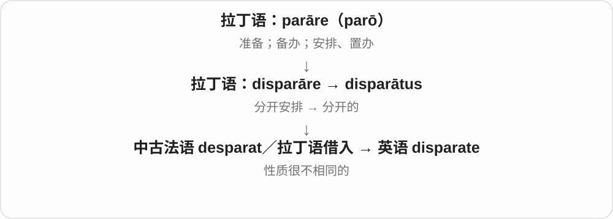

常形容材料、观点、群体或经历跨度很大。它主要说性质差异，不只是数字上的高低差。

**常见搭配与例句**

disparate sources；disparate groups；bring disparate ideas together。

> The report combines data from disparate sources.

报告汇集了来自差异很大来源的数据。

> The course connects several disparate fields.

课程把几个很不相同的领域联系起来。

**别混淆**

disparate 是不同类别、性质相差很远；desperate 是绝望或拼命的。disparity 的直接来源则是“不等”支线。

### 142. meditate — 冥想；沉思、思量

**音标**：/ˈmedɪteɪt/

**先抓住这个画面**

主动把注意力安放下来，是常见的冥想场景；较书面的 meditate on 则是围绕一个问题持续思量。

**怎么拆**

有从较早的英语名词 meditation 逆构，或接拉丁 meditatus 借入的分析；两路都连到 meditari 思考、练习、考虑。

**怎么变成今天的意思**

**拉丁 meditari、meditatio → 法语、英语 meditation**  
思量、练习 → 沉思、冥想的名词

↓

**英语 meditate 的两路分析**  
从较早 meditation 逆构，或借拉丁 meditatus

meditate every morning 每天早晨冥想；meditate on a question 沉思问题；meditate for ten minutes 冥想十分钟。

**常见搭配与例句**

meditate on；meditate for。

> She likes to meditate before breakfast.

她喜欢早餐前冥想。

> He found a quiet place to meditate on the poem.

他找了个安静地方沉思这首诗。

**别混淆**

meditate 是冥想、沉思，mediate 是调解；两者很容易漏看一个 t，却不是同一动作。

### 143. formulate — 拟定；明确表达；配制

**音标**：英 /ˈfɔːmjəleɪt/；美 /ˈfɔːrmjəleɪt/

**先抓住这个画面**

脑子里散着几个想法，现在把它们组织成说得清、能执行的一套方案。

**怎么拆**

formula + -ate，由规则、配方向形成规则或配方的动作发展。

**怎么变成今天的意思**

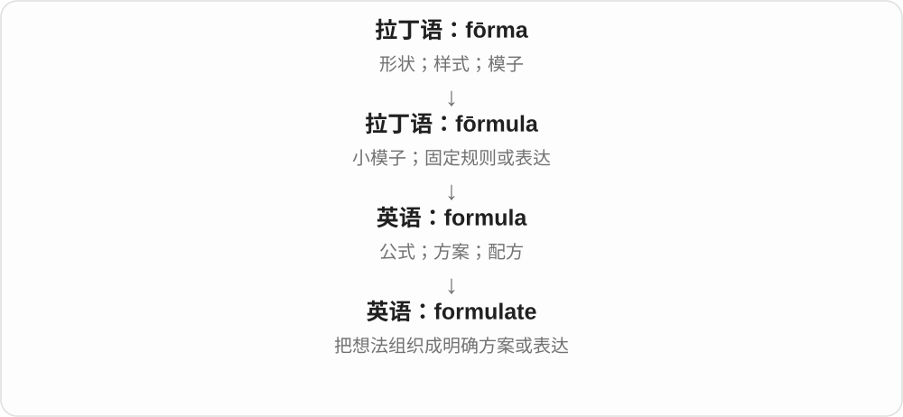

可以制定计划，也可以把问题措辞得准确；配方语境则是决定各成分怎样组合。

**常见搭配与例句**

formulate a plan；formulate a question；formulate a policy。

> We need time to formulate a clear response.

我们需要时间拟定一个清楚的答复。

> The team formulated a new recipe for the product.

团队为产品设计了新配方。

**别混淆**

formulate 不表示方案已经实施；implement 才是把方案执行下去。

### 144. carbonate — 碳酸盐；给饮料充入二氧化碳

**音标**：名词英 /ˈkɑːbənət/、美 /ˈkɑːrbənət/；动词英 /ˈkɑːbəneɪt/、美 /ˈkɑːrbəneɪt/

**先抓住这个画面**

在化学课上，它是一类盐；在饮料厂里，它是让饮料有气泡的动作。

**怎么拆**

名词经法语 carbonate，carbon + 表盐类的 -ate；动词可看作 carbon + 动词后缀 -ate。同一拼写要分词性。

**怎么变成今天的意思**

**拉丁 carbo，词干 carbon-**  
木炭、煤

↓

**法语 carbone → 英语 carbon**  
借旧有的炭名命名化学元素碳

↓

**法语 carbonate → 英语 carbonate；英语动词 carbonate**  
碳酸盐；使液体溶入二氧化碳

碳酸根 CO₃²⁻ 可以和不同的正离子搭配，形成不同碳酸盐，例如 calcium carbonate 碳酸钙。动词 carbonate water 则是把二氧化碳溶入水，让水有气。不要把饮料里的“碳酸”想成向杯子里倒了一把碳酸盐。

**常见搭配与例句**

calcium carbonate；sodium carbonate；carbonate water；carbonated drinks。

> Chalk consists mainly of calcium carbonate.

白垩主要由碳酸钙构成。

> The machine can carbonate a bottle of water in seconds.

这台机器几秒钟就能给一瓶水充入二氧化碳。

**别混淆**

名词末尾常弱读 /nət/，动词读 /neɪt/。bicarbonate 是碳酸氢盐，化学组成与 carbonate 不同。

### 145. laureate — 获殊荣者；桂冠诗人〔搭配〕

**音标**：英 /ˈlɒriət/；美 /ˈlɔːriət/

**先抓住这个画面**

古代把月桂冠戴在获荣誉者头上，这个受荣誉加冠的画面，走到了今天的获奖者 laureate。

**怎么拆**

借拉丁 laureatus 戴月桂冠的，来自 laurea 月桂冠、laurus 月桂与表示具有的 -atus。常用名词末尾弱读，不能按普通动词 /eɪt/。

**怎么变成今天的意思**

**拉丁 laurus、laurea → laureatus**  
月桂、月桂冠 → 戴冠获荣誉的

↓

**英语 laureate**  
获殊荣者；特定荣誉职位的称呼

a Nobel laureate 诺贝尔奖得主；a poet laureate 桂冠诗人；具体桂冠诗人职位与任命随传统不同。

**常见搭配与例句**

a Nobel laureate；a poet laureate。

> The lecture was given by a Nobel laureate.

讲座由一位诺贝尔奖得主主讲。

> The poet laureate read a new poem at the ceremony.

桂冠诗人在仪式上朗读了一首新诗。

**别混淆**

laureate 常用于有名望的奖项、荣誉，并非所有日常比赛获胜者都习惯称 laureate；winner 范围更广。

### 146. caliph — 哈里发〔历史上穆斯林社群首领的称号〕

**音标**：/ˈkeɪlɪf/，也有 /ˈkælɪf/ 等读法

**先抓住这个画面**

称号背后的关键词是继承者：继承先知去世后社群领导职责的人。具体权力、承认范围和继承争议要放到各个时期看。

**怎么拆**

经古法语 caliphe、中世纪拉丁 califa 等借入，上接阿拉伯 khalifa 继承者，来自 khalafa 接续、继承。ph 在英语里常读 /f/。

**怎么变成今天的意思**

**阿拉伯 khalifa**  
继承者；用于社群领导者的历史称号

↓

**拉丁、法语等形式 → 英语 caliph**  
英语中的哈里发称号

the title of caliph 哈里发称号；an Abbasid caliph 阿拔斯王朝的一位哈里发；the reign of a caliph 某位哈里发的统治时期。

**常见搭配与例句**

caliph → caliphate；the office of caliph。

> The chapter explains how a new caliph was chosen.

这一章解释了新哈里发如何被选出。

> The museum displayed coins issued during the caliph’s reign.

博物馆展出那位哈里发统治时期发行的钱币。

**别混淆**

caliph 是特定历史、宗教政治称号；不能泛指所有穆斯林国家的现代国家元首，也不等同于 imam 的所有用法。

### 147. caliphate — 哈里发国、哈里发统治体系；哈里发职位

**音标**：/ˈkeɪlɪfeɪt/，也有 /ˈkælɪfeɪt/ 等读法

**先抓住这个画面**

caliph 是领袖称号；caliphate 把视线拉到这个职位、围绕它的统治体系或所辖领地。究竟指哪一层，由上下文决定。

**怎么拆**

caliph + 名词后缀 -ate，形成统治领地、职位等名词。caliph 自阿拉伯继承者称号经欧洲语言借入；-ate 是英语接入的后缀材料。

**怎么变成今天的意思**

**阿拉伯继承者称号 → caliph**  
哈里发这一历史称号

↓

**caliph + -ate → caliphate**  
职位、统治或所辖领地

the Abbasid Caliphate 阿拔斯哈里发国；the history of the caliphate 哈里发制度或国家的历史；the end of a caliphate 某一哈里发统治体系的结束。

**常见搭配与例句**

the territory of a caliphate；different caliphates。

> The map shows the extent of the Abbasid Caliphate.

地图显示阿拔斯哈里发国的疆域范围。

> The course compares several historical caliphates.

这门课比较了历史上的几个哈里发国。

**别混淆**

caliph 指称号持有者，caliphate 指职位、制度或领地。一个后缀把人名词转成相应政治单位，但各时期具体结构不能只按词尾猜。

### 148. assassinate — 暗杀、刺杀〔尤指重要人物〕

**音标**：/əˈsæsɪneɪt/

**先抓住这个画面**

这个动词常见于历史、政治叙述：某人因为身份或立场而遭到有意刺杀。它比一般 kill 杀死的范围窄。

**怎么拆**

由 assassin 与 -ate 对应，受法语 assassiner、中世纪拉丁 assassinare 等影响。assassin 的远源关联历史团体称谓；不能把传说中的用药故事当成可靠构词依据。

**怎么变成今天的意思**

**中世纪地中海语言中的历史团体名称 → assassin**  
群体称谓扩展为刺客；有关用药的传说不能当作已证事实

↓

**assassiner、assassinare 等 → assassinate、assassination**  
刺杀重要人物；这类事件的名词

an assassinated leader 遭刺杀的领导人；attempt to assassinate 企图刺杀；在历史叙述中关注事件与动机。

**常见搭配与例句**

assassinate a leader；an attempt to assassinate。

> The documentary examines why the leader was assassinated.

纪录片考察那位领导人为何遭到刺杀。

> In the novel, a failed attempt to assassinate the king changes the plot.

小说里，一次刺杀国王未遂的事件改变了情节走向。

**别混淆**

kill 泛指杀死，assassinate 常指有针对性的刺杀。不要因为词尾相近，就把 assassination 的历史记录硬排在英语动词之后。

### 149. exaggerate — 夸大；夸张；使特征显得更明显

**音标**：/ɪɡˈzædʒəreɪt/

**先抓住这个画面**

本来只有这么高，讲述时却不断往上堆；数量、困难、功劳都被说得比实际更大。

**怎么拆**

拉丁 ad- + gerere → aggerere 搬来，形成 agger 堆、aggerare 堆起；再接有加强意味的 ex- 成 exaggerare，经分词 exaggeratus 进入英语。

**怎么变成今天的意思**

**拉丁 gerere，分词 gestus**  
携带、承担；做、进行

↓

**拉丁 ad- 向 + gerere → aggerere → agger → aggerare**  
搬来 → 一堆 → 堆起来

↓

**拉丁 ex-〔此处可能加强〕+ aggerare → exaggerare**  
堆高、放大；夸张

↓

**拉丁分词 exaggeratus → 英语 exaggerate**  
夸大、夸张

可以是故意吹大，也可以是不自觉地估计过头。绘画、表演中的 exaggerate a feature 则可能是有意强化特征，不一定是在欺骗。

**常见搭配与例句**

exaggerate the problem；exaggerate one’s achievements；greatly exaggerate；exaggerate a feature。

> Do not exaggerate the size of the problem.

不要夸大问题的规模。

> The cartoon exaggerates the character’s long nose.

漫画夸张地画出了这个角色的长鼻子。

**别混淆**

lie 可以完全编造；exaggerate 通常把某个已有事实、特征放大，但严重夸大也会造成误导。

### 150. sulfate — 硫酸盐；硫酸根相关化合物

**音标**：/ˈsʌlfeɪt/

**先抓住这个画面**

copper sulfate 是硫酸铜；sulfate 让你认出它属于硫酸、硫酸根相关的化学命名。这里 -ate 是命名尾，不是在说做一个动作。

**怎么拆**

经法语 sulfate 接新拉丁 sulphatum，关联 sulfur、sulphur 硫的材料与化学 -ate。传统英式常写 sulphate，现代化学命名也广用 sulfate。

**怎么变成今天的意思**

**sulfur、sulphur 的命名材料 + -ate**  
化学命名中的硫酸盐相关名称

↓

**法语 sulfate → 英语 sulfate／sulphate**  
硫酸盐；相关化合物名称

copper sulfate 硫酸铜；sodium sulfate 硫酸钠；sulfate ions 硫酸根离子。成分、化合物与离子要按上下文区别。

**常见搭配与例句**

copper sulfate；sodium sulfate；sulfate ions。

> The label lists sodium sulfate as an ingredient.

标签把硫酸钠列为一种成分。

> The experiment uses a solution of copper sulfate.

实验使用硫酸铜溶液。

**别混淆**

sulfate 硫酸盐与 sulfite 亚硫酸盐、sulfide 硫化物不同；结尾在化学命名里有实际区分，不能看见 sulf- 就当同一种东西。

### 151. circulate — 循环流动；传播；传阅；在人群中走动

**音标**：英 /ˈsɜːkjəleɪt/；美 /ˈsɜːrkjəleɪt/

**先抓住这个画面**

东西不一直停在一处，而是在系统或人群中不断转到别处。

**怎么拆**

接拉丁 circulatus、circulare，来自 circulus“小圈”；英语早期有循环处理物质的技术义，后扩展到血液、消息和人际流动。

**怎么变成今天的意思**

**拉丁语 circus**  
圆环、环形场地；与希腊语 kirkos 的具体关系有不同分析

↓

**拉丁语 circulus〔指小形式〕**  
小圈、圆环

↓

**拉丁语 circulare / circulatus**  
使成圆、循环处理

↓

**英语 circulate**  
早期循环处理物质 → 流动、传播、在人群间走动

blood circulates 是血液循环；circulate a document 是分发传阅文件；rumours circulate 是传言四处传播。聚会上 circulate 还可说走到不同人群中交谈。

**常见搭配与例句**

circulate freely；circulate a document；rumours circulate；circulate among guests。

> The fan helps air circulate through the room.

风扇帮助空气在房间里流动。

> Please circulate the revised agenda before the meeting.

请在会议前把修订后的议程发给大家传阅。

> She circulated among the guests, introducing people to one another.

她在人群中走动，为宾客们相互介绍。

**别混淆**

rotate 是绕轴转动；circulate 更强调在各处或各人之间流动，不要求每个对象画出几何圆。

### 152. desolate — 荒凉的；悲凉的；使荒废、使悲痛

**音标**：形容词 /ˈdesələt/；动词 /ˈdesəleɪt/

**先抓住这个画面**

像人和生气都被抽走了：地方空荡荡，人的心里也空荡荡。

**怎么拆**

拉丁 de- 在此加强程度，接 solare“使孤单”，形成 desolare、分词 desolatus；不是把孤独取消掉。

**怎么变成今天的意思**

**拉丁语 solus**  
独自、唯一；更早来源未定

↓

**拉丁语 de- + solare → desolare → desolatus**  
完全使孤单、遗弃 → 被荒弃的

↓

**英语 desolate〔形容词〕；相关动词随后出现**  
荒凉的、悲凉的；使荒废

a desolate landscape 是荒凉景色；feel desolate 是感到极度凄凉。作动词时读 /eɪt/，说灾难使地方荒废或使人悲痛，较正式。

**常见搭配与例句**

a desolate landscape；feel desolate；desolate a region。

> The road crossed a desolate stretch of moorland.

公路穿过一片荒凉的旷野。

> She felt desolate after the last guest had left.

最后一位客人离开后，她感到一阵凄凉。

> Years of drought desolated the valley.

多年的干旱使山谷变得荒芜。

**别混淆**

isolated 只是隔离、偏远；desolate 常带荒弃、失去生气或悲伤的感觉。

### 153. acetate — 乙酸盐；乙酸酯；醋酸纤维材料

**音标**：英美 /ˈæsɪteɪt/

**先抓住这个画面**

名字虽来自醋，后来既指化合物，也指由相关化合物制成的材料。

**怎么拆**

借自法语 acétate，以 acétique“乙酸的”的词干加化学词尾 -ate 构成，远源拉丁 acetum“醋”。材料义常缩自 cellulose acetate、acetate silk 等名称，不能把 -ate 一律当作动词尾。

**怎么变成今天的意思**

**拉丁 acere → acetum**  
变酸 → 醋

↓

**近代法语 acétique → acétate → 英语 acetate**  
化学命名：乙酸的盐或酯

↓

**cellulose acetate 等材料名称缩短 → acetate**  
醋酸纤维素及相关纤维、薄片等材料

化学瓶上 sodium acetate 是乙酸钠；衣服标签上的 acetate 常指醋酸纤维。旧投影教学里 an acetate 还可指透明投影片。先看场景，才能知道说的是哪一种物质或制品。

**常见搭配与例句**

sodium acetate；ethyl acetate；cellulose acetate；acetate fabric。

> The chemist prepared a solution of sodium acetate.

化学师配制了一份乙酸钠溶液。

> The jacket has an acetate lining.

这件夹克带有醋酸纤维内衬。

**别混淆**

acetate 是一类盐、酯或相关材料的名称，acetic acid 是酸本身。两者同源，不等于同一物质。

### 154. deteriorate — 恶化；变差；退化

**音标**：英 /dɪˈtɪəriəreɪt/；美 /dɪˈtɪriəreɪt/

**先抓住这个画面**

原来还能用的房屋越来越破，原来稳定的关系越来越紧张，这种向更坏方向走就是 deteriorate。常看一段时间的变化。

**怎么拆**

借晚期拉丁 deterioratus，来自 deteriorare，基础是 deterior 更差。不要只看到 de- 就编造一个现代 terior 好的基础词。

**怎么变成今天的意思**

**拉丁 deterior 更差 → 晚期拉丁 deteriorare**  
变得更糟、使变坏

↓

**相应过去分词与名词 → deteriorate、deterioration**  
状况恶化；恶化过程

conditions deteriorate 情况恶化；relations deteriorate 关系恶化；deteriorate rapidly 快速变差。常见不及物用法，不需再加 be。

**常见搭配与例句**

deteriorate rapidly；deteriorating conditions。

> The condition of the road has deteriorated.

道路状况已经变差了。

> Relations between the two teams deteriorated after the dispute.

争议发生后，两个团队的关系恶化了。

**别混淆**

deteriorate 比 worsen 更正式，常描述状况、品质持续变差；不同于单次打破的 break。

### 155. animate — 使活跃；使有生气；制作动画；有生命的

**音标**：动词 /ˈænɪmeɪt/；形容词 /ˈænɪmət/

**先抓住这个画面**

给原本沉静的东西注入活力：谈话热起来，角色动起来，或故事里的木偶像活了一样。

**怎么拆**

拉丁 animātus 是 animāre 的分词；英语先有相关形容词，后有动词用法。

**怎么变成今天的意思**

**拉丁 anima；相关 animus**  
呼吸、生命、灵魂；心意、精神

↓

**拉丁 animāre → animātus → 英语 animate**  
赋予生命、鼓起精神 → 有生命的；使活跃

animate a character 是让角色形成动画；animate a discussion 是让讨论活跃。形容词 animate objects 指有生命的事物，词尾读 /mət/，与动词不同。

**常见搭配与例句**

animate a character；animate a discussion；animate and inanimate objects。

> The software lets you animate a simple character.

这款软件可以让你给简单角色制作动画。

> Her questions animated the discussion.

她的问题让讨论活跃起来。

> The lesson distinguishes animate beings from inanimate objects.

这一课区分有生命的存在与无生命的物体。

**别混淆**

animated 是被激活、充满活力或动画形式的；animate 作形容词时常是“有生命的”。两者不是随时可互换。

### 156. inanimate — 无生命的；没有生气的

**音标**：/ɪnˈænɪmət/

**先抓住这个画面**

在“有生命”前加否定，把石头、椅子这类物体与有生命的存在区分开来。

**怎么拆**

后期拉丁 inanimātus，in- 不 + animātus；形容词进入中古英语。

**怎么变成今天的意思**

**拉丁 anima；相关 animus**  
呼吸、生命、灵魂；心意、精神

↓

**后期拉丁 in- + animātus → inanimātus**  
没有生命、没有活力的

↓

**中古英语 → inanimate〔形容词〕**  
无生命的；缺乏生气的

日常最常见 inanimate objects。语言学中的有生、无生类别还取决于具体语言，不能直接用生物学分类覆盖所有语法现象。另有极罕见旧动词 inanimate，in- 表“赋入”而读 /ɪnˈænɪmeɪt/，意思反而是赋予生命。

**常见搭配与例句**

inanimate objects；animate and inanimate nouns。

> The story gives voices to inanimate objects.

故事让无生命的物体开口说话。

> A stone is an inanimate object even when it is rolling downhill.

石头即使正沿山坡滚动，也仍是无生命的物体。

**别混淆**

dead 常说曾经活过而现已死亡；inanimate 通常强调不是有生命的主体。a moving toy 也仍是 an inanimate object。

### 157. innovate — 创新；革新；引入新方法

**音标**：/ˈɪnəveɪt/

**先抓住这个画面**

不只是想一个漂亮点子，而是试着让原有做法换成新的运转方式。

**怎么拆**

借拉丁 innovātus，接 innovāre“更新、改变”；in- 与 novāre 组合。

**怎么变成今天的意思**

**拉丁 novus**  
新的

↓

**拉丁 in- + novāre → innovāre / innovātus**  
使更新、引入变化

↓

**英语 innovate**  
革新；引入新方法

常作不及物动词，如 innovate in education、continue to innovate；也可有及物用法。日常表达中不必为了显得正式而把任何小修改都叫 innovate。

**常见搭配与例句**

innovate in；innovate to solve problems；the ability to innovate。

> Small teams can innovate quickly when they can test ideas freely.

小团队能自由试验想法时，创新速度可以很快。

> The organisation needs to innovate in how it delivers services.

该组织需要在提供服务的方式上革新。

**别混淆**

renovate 多把已有东西修整更新；innovate 多引入新想法、方法，两者都含“新”但动作不同。

### 158. penultimate — 倒数第二的

**音标**：/pɪˈnʌltɪmət/

**先抓住这个画面**

已经快走到末尾，但后面还剩最后一个。

**怎么拆**

远接拉丁 paene“几乎” + ultimus“最后”。近源可解释为英语 penultima“倒数第二音节”按形容词模式改形，也有直接接拉丁 paenultimus 的分析。

**怎么变成今天的意思**

**拉丁语 paene + ultimus → paenultimus**  
几乎 + 最后 → 倒数第二

↓

**拉丁语 paenultima〔syllaba〕→ 英语 penultima；相关形容词材料**  
倒数第二音节

↓

**英语 penultimate**  
倒数第二的

the penultimate chapter 是倒数第二章；不是比 ultimate“更厉害”的级别。倒数第三是 antepenultimate，而最后一个才是 ultimate / last。

**常见搭配与例句**

the penultimate day；the penultimate episode；the penultimate syllable。

> The answer appears in the penultimate paragraph.

答案出现在倒数第二段。

> We reached the coast on the penultimate day of the trip.

我们在旅程倒数第二天到达了海岸。

**别混淆**

penultimate 只说顺序是倒数第二，不表示最棒或终极中的终极。

### 159. propagate — 繁殖；传播；传递、扩散

**音标**：英 /ˈprɒpəɡeɪt/；美 /ˈprɑːpəɡeɪt/

**先抓住这个画面**

让原来一点上的东西，在更多地方继续出现。

**怎么拆**

借拉丁 prōpāgātus；其动词 prōpāgāre 来自表示压条、枝条或后代的 prōpāgō，与 prō-“向前”及“固定、栽植”的 pag- 有关。

**怎么变成今天的意思**

**拉丁 pangere**  
固定、钉牢；复合动词中可变为 -pingere，分词有 -pactus

↓

**拉丁 prōpāgō〔名词〕 → prōpāgāre**  
压条、枝条、后代 → 用压条繁殖、扩展；prō- 表向前

↓

**拉丁 prōpāgātus → 英语 propagate**  
繁殖；传播、传开

把一株植物繁殖成许多株，与让一句传言被更多人听见，都能用 propagate。信号自己向前传也用不及物形式，如 waves propagate。语气偏书面或技术，并不只表示刻意宣传。

**常见搭配与例句**

propagate plants from cuttings；propagate a belief；waves propagate through。

> She propagates mint from cuttings.

她用插枝繁殖薄荷。

> A small error can propagate through the entire calculation.

一个小错误可能贯穿整个计算过程，逐步传递下去。

**别混淆**

spread 更日常；propagate 常突出不断传开或繁衍。它不等于 plant：栽一棵已有的树不一定涉及繁殖。

### 160. humiliate — 羞辱；使丢脸

**音标**：/hjuːˈmɪlieɪt/

**先抓住这个画面**

让一个人觉得自己被贬低、被当成笑话，尤其是在别人面前。

**怎么拆**

可追溯晚期拉丁 humiliatus，也有从已存在的英语 humiliation 逆构之说；两说都接 humilis 低微的。

**怎么变成今天的意思**

**拉丁 humus 地面 → humilis**  
在低处、地位低 → 谦卑的

↓

**晚期拉丁 humiliare → humiliatus；或英语 humiliation 逆构 → humiliate**  
使低下、使蒙羞；英语名词比动词更早见

humiliate someone in public 是公开羞辱某人；be humiliated by a comment 是被一句话弄得很难堪。重点是对人的尊严造成伤害。

**常见搭配与例句**

humiliate somebody；be publicly humiliated；humiliate someone in front of others。

> The coach corrected the mistake without humiliating the player.

教练纠正了错误，没有羞辱球员。

> She felt that the joke was intended to humiliate her.

她觉得那个笑话是故意拿来羞辱她的。

**别混淆**

criticize 可以是针对问题提出意见；humiliate 强调让人受辱。严格纠错不必靠羞辱。

### 161. deviate — 偏离；离开原定路线或标准

**音标**：动词 /ˈdiːvieɪt/；较少见的名词、形容词 /ˈdiːviət/

**先抓住这个画面**

本来沿一条线走，后来朝旁边拐了出去。

**怎么拆**

借晚期拉丁 dēviātus，来自 dēviāre“离开道路”；de- 表离开，via 表道路，现代词尾对应 -ate。

**怎么变成今天的意思**

**拉丁 via**  
道路、路径

↓

**晚期拉丁 dē viā → dēviāre**  
离开道路 → 偏离

↓

**晚期拉丁 dēviātus → 英语 deviate**  
偏离的 → 偏离、改变原路线

常接 from：deviate from the route / plan / norm。偏离不自动等于做错；避开积雪而改变路线也可以是合理选择。名词指人的旧用法常带贬意，日常学习优先掌握动词。

**常见搭配与例句**

deviate from a plan；deviate slightly；never deviate from the procedure。

> We had to deviate from the marked path to avoid the fallen tree.

我们不得不偏离标出的路径，绕开倒下的树。

> The result deviates only slightly from the predicted value.

结果与预测值只有轻微偏差。

**别混淆**

deviate 描述离开原定方向；devious 常评价绕弯或不坦率，不能见到同根就互换。

### 162. assimilate — 吸收、消化；融入；使同化

**音标**：英、美 /əˈsɪmɪleɪt/

**先抓住这个画面**

新东西进来后，慢慢成为原有体系的一部分。

**怎么拆**

拉丁 ad- + simulāre“使相似”→ assimilāre 的相关形式，借入英语；simil- 指相似。不是简单的“收下”。

**怎么变成今天的意思**

**拉丁语：ad**  
朝向；靠近；加到

↓

**拉丁语 similis → simulāre → assimilāre / assimulāre**  
相似 → 使相似 → 使成为相近的一部分

↓

**晚期拉丁 assimilātus → 中古英语 assimilaten → assimilate**  
吸收；同化

assimilate information 是把资料消化成自己的理解；人融入群体也能这样说，但涉及文化时可能强调改变原有特征，不能一概当成轻松交朋友。

**常见搭配与例句**

assimilate information；assimilate into；be assimilated into。

> I need a little time to assimilate all this information.

我需要一点时间消化这些信息。

> The new terms were gradually assimilated into everyday speech.

这些新术语逐渐进入日常语言，成为其中的一部分。

**别混淆**

absorb 强调吸进去；assimilate 更强调吸收后纳入自身体系。

### 163. renovate — 翻新；整修；使恢复活力

**音标**：/ˈrenəveɪt/

**先抓住这个画面**

旧房子不必推倒，把坏的修好、过时的更新，让它重新可用，就是 re- 的“再”加 nov- 的“新”。

**怎么拆**

拉丁 renovātus 曾以形容词形式进入中古英语，后来作英语动词；接 re- + novāre。

**怎么变成今天的意思**

**拉丁 novus**  
新的

↓

**拉丁 re- + novāre → renovāre / renovātus**  
使重新变新

↓

**中古英语 renovate〔形容词〕→ 英语动词 renovate**  
更新过的 → 翻新、修复

常说 renovate a house、renovate a kitchen。现代用途集中在建筑设施更新，也能较正式地比喻使某事恢复活力。

**常见搭配与例句**

renovate a building；renovate the kitchen；a renovated apartment。

> They renovated the old house before moving in.

他们先翻新了旧房子，再搬进去住。

> The school plans to renovate its science laboratories.

学校计划整修科学实验室。

**别混淆**

decorate 主要装饰；renovate 可以涉及功能与结构整修，不只是换颜色。

### 164. consummate — 技艺精湛的；十足的；完成；圆房

**音标**：形容词：英 /ˈkɒnsəmət/、美 /ˈkɑːnsəmət/；动词：英 /ˈkɒnsəmeɪt/、美 /ˈkɑːnsəmeɪt/

**先抓住这个画面**

形容人做得成熟到位，或说事情终于走到完成的那一步。

**怎么拆**

来自拉丁 consummatus，接 con- + summa → consummare；形容词与动词都沿这条借词线发展，词尾分别为 /ət/ 与 /eɪt/。

**怎么变成今天的意思**

**拉丁 summus → summa**  
最高的 → 顶端、总体、总额、要点

↓

**拉丁 con- + summa → consummare → consummatus**  
把全部合起来、完成 → 完成的、圆满的

↓

**英语 consummate〔形容词、动词〕**  
圆满、成熟 → 技艺精湛；使完成

a consummate professional 是非常老练、专业的人；consummate a deal 是正式完成交易。consummate a marriage 是特定表达，指以性关系使婚姻得到实际完成，常见于历史或法律文字。

**常见搭配与例句**

a consummate professional；consummate skill；consummate a deal。

> She handled the difficult interview like a consummate professional.

她以老练专业的方式处理了那场困难的采访。

> The two companies finally consummated the deal.

两家公司终于完成了交易。

**别混淆**

consume 是消耗、吃喝，接拉丁 consumere；consummate 是完成，接 consummare，不能因为拼写接近就合成同一个词。

### 165. proportionate — 相称的；程度适当的；按比例的

**音标**：英 /prəˈpɔːʃənət/；美 /prəˈpɔːrʃənət/

**先抓住这个画面**

大问题用大办法，小问题别用过头的办法，大小或程度配得上。

**怎么拆**

借自中世纪拉丁 proportionatus，接 proportionare；这里教常用形容词，词尾读 /ət/。

**怎么变成今天的意思**

**拉丁 portio，属格 portionis**  
份额、部分

↓

**拉丁 proportio → 中世纪拉丁 proportionare → proportionatus**  
比例 → 按比例安排 → 配合相称的

↓

**英语 proportionate〔形容词〕**  
大小、程度相称的

a proportionate response 是与事情严重程度相称的回应；costs proportionate to income 指费用与收入相称。它常用于判断分量是否合适，不一定是在做严格数学计算。

**常见搭配与例句**

proportionate to something；a proportionate response；a proportionate share。

> The response should be proportionate to the seriousness of the problem.

回应的力度应当与问题的严重程度相称。

> Each partner received a proportionate share of the proceeds.

每位合伙人都按比例分到了收益。

**别混淆**

proportional 更常用于明确的比例关系；proportionate 常强调适度、相称，但实际用法有重叠。

### 166. alienate — 使疏远；使失去认同

**音标**：/ˈeɪliəneɪt/

**先抓住这个画面**

你原本觉得“我们是一伙的”，对方的做法却让你觉得“我在这里像个外人”。造成这种疏离，就是 alienate。

**怎么拆**

历史上来自 aliēnāre / aliēnātus“使成为别人的、使疏远”。用 alien + -ate“使成为外人”很好记，但它不只是现代英语临时拼出来的词。

**怎么变成今天的意思**

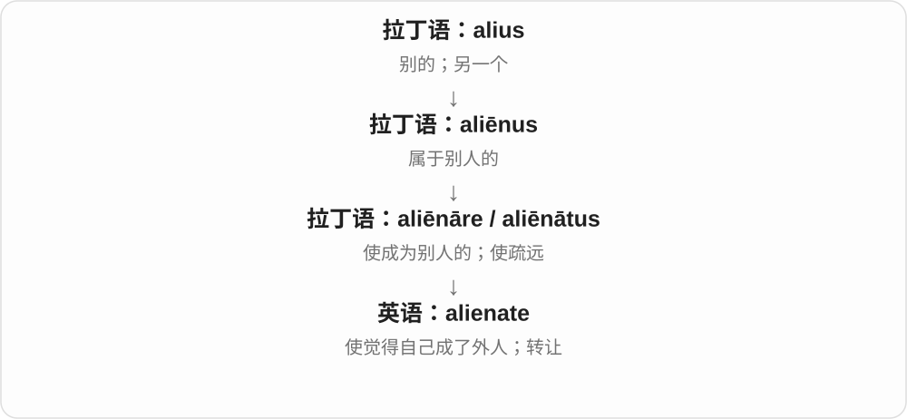

“使属于别人”在财产上是转让，在关系上则是使人不再亲近、认同或支持。因此一个决定可以 alienate friends，也可以 alienate voters。

**常见搭配与例句**

alienate someone；alienate someone from…；alienate voters。

> His constant criticism began to alienate his friends.

他不停地批评别人，开始让朋友们疏远他。

> The decision may alienate customers who value privacy.

这个决定可能失去重视隐私的顾客的支持。

**别混淆**

annoy 是让人生气或烦；alienate 更进一步，可能损害联系和支持。isolate 偏把人隔开，不一定涉及内心的归属感。

### 167. curate — 策划展览；精选整理；助理牧师

**音标**：动词 /kjʊˈreɪt/；名词 /ˈkjʊərət/

**先抓住这个画面**

动词 curate 像为观众认真挑出一组东西，再安排观看顺序。名词 a curate 则是教会中负责照顾教区事务的牧师职位。

**怎么拆**

动词是从 curator 逆构出来的；名词独立借自教会拉丁语 cūrātus。两种词性不能画成一条从牧师到策展的直线。

**怎么变成今天的意思**

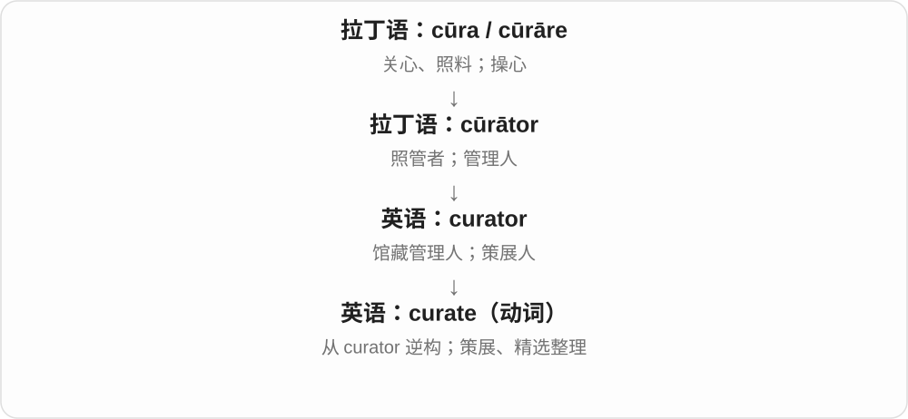

动词保留照管、挑选的责任感。名词在英国教会语境常指助理牧师，重音也不同；不是策展人的另一个常规称呼。

**常见搭配与例句**

curate an exhibition；curate a collection；a parish curate。

> She curated an exhibition of local photography.

她策划了一场本地摄影展。

> The young curate helped organize the parish event.

这位年轻助理牧师协助组织了教区活动。

**别混淆**

curate 不只是 collect“收集”：它往往还包括筛选和组织。名词 curate 与 curator 的职业意义不同。

### 168. disseminate — 传播；散布；使广泛流传

**音标**：/dɪˈsemɪneɪt/

**先抓住这个画面**

把一份知识或消息送到许多人的手中，让它不只留在原来的小圈子里。

**怎么拆**

来自拉丁 disseminatus，disseminare 的分词；dis- 向各处 + seminare 播种。这里 dis- 不是把播种取消。

**怎么变成今天的意思**

**拉丁语 semen，属格 seminis**  
种子；与 serere“播种”同属更早的播种词族

↓

**拉丁语 seminare；dis- + seminare → disseminare**  
播种 → 向四处撒播

↓

**拉丁 disseminatus → 英语 disseminate**  
已撒播的 → 广泛传播

常用于研究成果、消息、观点和知识，语气比 spread 正式。传播本身不保证内容真实，disseminate false information 也说得通。

**常见搭配与例句**

disseminate information；disseminate research。

> The team used workshops to disseminate practical knowledge.

团队通过工作坊传播实用知识。

> The website was designed to disseminate reliable information.

这个网站旨在传播可靠信息。

**别混淆**

distribute 常强调把具体东西分送出去；disseminate 常强调消息或思想广泛到达。

### 169. vigor — 活力；精力；有力、旺盛的劲头〔常见美式拼写〕

**音标**：英 /ˈvɪɡə/；美 /ˈvɪɡɚ/

**先抓住这个画面**

做事有劲、精神饱满，像一直有力量往前推，这种活力叫 vigor。也可以说一段论证、一次讨论很有力，不只限于身体力气。

**怎么拆**

vigor 经法语 vigor、vigour 接拉丁 vigor 活跃、力量，来自 vigere 旺盛、有活力。这里 -or 是性质名词材料；常见英式拼写 vigour。

**怎么变成今天的意思**

**拉丁 vigere 活跃、旺盛 → vigor 活力 → 法语、英语**  
从身体活力，也用于语言、思考、植物生长等方面

↓

**英语 vigor、vigour**  
同一个词的常见美式、英式拼写分布

with vigor 是有力地；renewed vigor 是重新恢复的活力；intellectual vigor 是思想活力。

**常见搭配与例句**

with vigor；renewed vigor；intellectual vigor。

> She returned to the project with renewed vigor.

她带着恢复的活力重新投入项目。

> The debate was conducted with vigor and humour.

辩论进行得有力而又幽默。

**别混淆**

vigor 是力量、活跃的劲头，vigorous 是充满这种劲头的形容词。它与 vigour 同义，不能按有没有 u 分成不同强度。

### 170. vigour — 活力；精力；旺盛的劲头〔常见英式拼写〕

**音标**：英 /ˈvɪɡə/；美 /ˈvɪɡɚ/

**先抓住这个画面**

一个人做事充满精神，或一棵植物长得很旺，可以谈它的 vigour。词的重点是有力量、有生气，而不只是忙得停不下来。

**怎么拆**

经法语 vigour 等接拉丁 vigor 活力、vigere 旺盛。-our 是这类名词的历史拼写形式；美式通常写 vigor，读音、基本意思相同。

**怎么变成今天的意思**

**拉丁 vigere 旺盛 → vigor → 法语 vigour → 英语**  
英语很早已有力量、活力名词

↓

**vigour 与 vigor 的现代拼写分布**  
不因为拼写不同就另造一套词义或来历

full of vigour 是充满活力；with renewed vigour 是带着恢复的劲头；the vigour of the argument 是论证的有力程度。

**常见搭配与例句**

full of vigour；with renewed vigour；the vigour of。

> The young plants grew with remarkable vigour.

幼苗长得格外旺盛。

> He defended his idea with vigour.

他有力地捍卫了自己的想法。

**别混淆**

vigour 是名词，vigorous 是形容词；invigorate 是使恢复精神。看清这几种词性，就能把同一股活力放进不同句型。

### 171. invigorate — 使振奋、使精力充沛；使活跃

**音标**：英 /ɪnˈvɪɡəreɪt/；美 /ɪnˈvɪɡəreɪt/

**先抓住这个画面**

本来疲惫、沉闷，经过休息、新主意或一阵清新空气，像重新有了劲，是 invigorate。也能形容给一个行业、讨论注入活力。

**怎么拆**

借新拉丁 invigoratus、invigorare，关联 in- 使进入与 vigor 活力、力量，再接相应动词形式。

**怎么变成今天的意思**

**新拉丁 in- + vigor 等 → invigorare**  
使充满活力

↓

**英语 invigorate**  
使人振奋；使过程、群体重新活跃

invigorate a discussion 激活讨论；feel invigorated 感到振奋；an invigorating walk 令人精神一振的散步。

**常见搭配与例句**

feel invigorated；an invigorating walk。

> The cool air invigorated us.

凉爽的空气让我们精神一振。

> The new ideas invigorated the discussion.

新想法让讨论活跃起来。

**别混淆**

invigorate 偏增加精力、活跃度，irritate 偏刺激、惹烦；同样强烈的体验也可能带来不同感受。

### 172. invigorating — 使人振奋的；使恢复精神的；正在激发活力

**音标**：英 /ɪnˈvɪɡəreɪtɪŋ/；美 /ɪnˈvɪɡəreɪtɪŋ/

**先抓住这个画面**

原来有点疲、没精神，现在像被重新点亮，这种让人振作的体验可以叫 invigorating。清爽的空气、活跃的讨论，都可以带来这种感觉。

**怎么拆**

in- 使进入某状态 + vigor 精力 + -ate 动词材料 → invigorate；去末尾 e，加完整 -ing → invigorating。不是把 in- 当成否定来理解。

**怎么变成今天的意思**

**vigor 活力 + in-、-ate → invigorate 使充满活力**  
现代英语用已有名词形成使动意义的动词

↓

**invigorate + -ing → invigorating**  
现代常作形容词，描述带来振奋效果的事物

an invigorating walk 是令人精神一振的散步；an invigorating discussion 是让人振奋的讨论；invigorating the team 是给团队带来活力。

**常见搭配与例句**

an invigorating walk；an invigorating discussion；invigorating the team。

> The cool morning air felt invigorating.

清晨凉爽的空气让人精神一振。

> We had an invigorating discussion about the new project.

我们围绕新项目展开了让人振奋的讨论。

**别混淆**

invigorating 描述带来振奋效果的事物；invigorated 描述已经感到振奋的人或状态。The talk was invigorating 与 I felt invigorated 可以搭配理解。

### 173. infuriate — 使大怒、激怒

**音标**：英 /ɪnˈfjʊərieɪt/；美 /ɪnˈfjʊrieɪt/

**先抓住这个画面**

不是有点烦，而是某句话、某种待遇把怒火一下点得很大，叫 infuriate。

**怎么拆**

接中世纪拉丁 infuriatus、infuriare，使进入 fury 怒火的材料，源于拉丁 furia 狂怒等；-ate 形成动词。

**怎么变成今天的意思**

**拉丁 furia 等 → infuriare、infuriatus**  
使进入强烈愤怒状态

↓

**英语 infuriate**  
使人震怒、火冒三丈

infuriate someone 激怒某人；be infuriated by 因……大怒；an infuriating delay 令人恼火的拖延。

**常见搭配与例句**

be infuriated by；an infuriating delay。

> The unfair decision infuriated the team.

不公的决定激怒了全队。

> She was infuriated by his refusal to listen.

他拒绝听取意见，让她大怒。

**别混淆**

infuriate 比 irritate 惹烦通常强得多；不是每种小小不快都需要用震怒级词。

### 174. infuriating — 令人极恼火的、使人发怒〔形容词、现在分词〕

**音标**：英 /ɪnˈfjʊərieɪtɪŋ/；美 /ɪnˈfjʊrieɪtɪŋ/

**先抓住这个画面**

一件事反复不顺，又让人觉得不该这样，实在惹火，就是 infuriating。它把焦点放在引起愤怒的事上。

**怎么拆**

infuriate 连拉丁 furia 狂怒及中世纪使人发怒动词材料，也有意大利近源。现代去末尾 e，加完整 -ing，分词可固定作令人恼火的形容词。

**怎么变成今天的意思**

**拉丁怒火材料 → infuriate**  
使人进入强烈愤怒

↓

**infuriate 去 e + -ing → infuriating**  
正在激怒；能使人恼火的

an infuriating delay 恼人的延误；find it infuriating 觉得它令人气愤；an infuriating mistake 让人恼火的错误。

**常见搭配与例句**

deeply infuriating 极令人恼火的；an infuriating habit 让人受不了的习惯。

> The constant delays were infuriating.

不断延误令人十分恼火。

> She has an infuriating habit of interrupting.

她有个老爱打断人的恼人习惯。

**别混淆**

The delay is infuriating 说延误惹人生气；I am infuriated 说我被激怒。和 interesting、interested 一样，不能只背一个中文就忽略方向。

### 175. infuriated — 被激怒的、十分恼火的；激怒了〔过去式、过去分词〕

**音标**：英 /ɪnˈfjʊərieɪtɪd/；美 /ɪnˈfjʊrieɪtɪd/

**先抓住这个画面**

原本还算平静，被某件事惹得怒火上来，是 infuriated。它可以说人的状态，也可以说某件事已经把人激怒。

**怎么拆**

infuriate 接中世纪拉丁 infuriatus、infuriare 使发怒，也有经意大利 infuriato 的近源分析，连拉丁 in furia 在怒火中。现代去 e 加完整 -ed，/t/ 后读 /ɪd/。

**怎么变成今天的意思**

**拉丁 furia、in furia → 中世纪 infuriare、infuriatus；意大利相关形式**  
怒火之中 → 使人狂怒

↓

**infuriate 去 e + -ed → infuriated**  
已经激怒；感到极度愤怒的

infuriated by the delay 因延误十分恼火；infuriated him 激怒了他；an infuriated customer 盛怒的顾客。

**常见搭配与例句**

absolutely infuriated 气极了；infuriated at the remark 因那句话气愤。

> The repeated delays infuriated her.

反复延误让她十分恼火。

> He was infuriated by the careless remark.

那句轻率的话激怒了他。

**别混淆**

infuriated 通常说受到刺激后的怒气；infuriating 常说那个让人恼火的因素。人被激怒和事情惹人怒，方向分清。

### 176. infuriates — 使大怒、火冒三丈〔第三人称单数〕

**音标**：/ɪnˈfjʊərieɪts/

**先抓住这个画面**

已经不是轻轻皱眉，而是被不公、轻慢等直接点起怒火，叫 infuriates me。

**怎么拆**

infuriate + -s，/t/ 后读 /s/；内层来自拉丁 in furia 在怒火中一类材料，经中世纪拉丁、可能的意大利语中介进入英语。

**怎么变成今天的意思**

**拉丁 in furia 在怒火中 → 中世纪拉丁 infuriare、infuriatus**  
使狂怒；亦有意大利语 infuriato 中介分析

↓

**英语 infuriate → infuriating、infuriatingly**  
使火冒三丈；再形容令人恼火的性质与程度

↓

**infuriate + -s → infuriates**  
它使人愤怒、怒火上来

infuriates me 让我火大；infuriates the fans 激怒球迷。

**常见搭配与例句**

what infuriates her；absolutely infuriates。

> It infuriates me when people take credit for someone else’s work.

有人把别人的成果据为己有，这让我非常愤怒。

> The unfair decision infuriates the supporters.

这个不公的决定激怒了支持者。

**别混淆**

infuriates 是使人愤怒，infuriated 是已经愤怒的人，infuriating 是令人愤怒的事；先分作用方向，再记中文。

### 177. infuriatingly — 令人恼怒、火大地

**音标**：/ɪnˈfjʊərieɪtɪŋli/

**先抓住这个画面**

别人偏不把关键点说清，含糊到让你火大，可以叫 infuriatingly vague。它把描述中的强烈不满点出来。

**怎么拆**

infuriating + -ly；内层 infuriate 去 e 加 -ing，外层修饰令人愤怒的程度或方式。

**怎么变成今天的意思**

**拉丁 in furia 在怒火中 → 中世纪拉丁 infuriare、infuriatus**  
使狂怒；亦有意大利语 infuriato 中介分析

↓

**英语 infuriate → infuriating、infuriatingly**  
使火冒三丈；再形容令人恼火的性质与程度

↓

**infuriate → infuriating → infuriatingly**  
使大怒 → 令人愤怒的 → 令人火大地

infuriatingly slow 慢得令人火大；infuriatingly vague 含糊得令人恼怒。

**常见搭配与例句**

infuriatingly calm；infuriatingly elusive。

> He remained infuriatingly calm throughout the argument.

争论中他始终镇定得让人火大。

> The answer was infuriatingly vague.

这个答案含糊得令人恼怒。

**别混淆**

infuriatingly calm 可以说对方过分镇定，反而让自己更生气；不是说对方正平静地发怒。

### 178. evaporate — 蒸发；使蒸发；逐渐消失

**音标**：英、美 /ɪˈvæpəreɪt/

**先抓住这个画面**

水迹慢慢变干：水没有凭空消灭，而是散到空气中。

**怎么拆**

接拉丁 evaporare 的分词 evaporatus；e- 对应 ex-“出”，vapor 是蒸气。现代能看出 e-、vapor、-ate，但整词的历史基础在拉丁语。

**怎么变成今天的意思**

**拉丁 vapor / vaporem**  
热气、蒸气

↓

**拉丁 ex- + vapor → evaporare；分词 evaporatus**  
使蒸气散出；蒸发

↓

**英语 evaporate**  
蒸发；比喻逐渐消失

湿衣服晾干、地上的水迹变淡，都可以用 evaporate，不必等液体沸腾。比喻 hope evaporated，则是希望像水迹一样渐渐不见。也可作及物动词，表示让液体蒸发掉。

**常见搭配与例句**

water evaporates；evaporate the solvent；hope evaporates；confidence evaporates。

> The puddle evaporated during the afternoon.

这摊水在下午逐渐蒸发干了。

> Her doubts evaporated when she saw the test results.

看到测试结果后，她的疑虑消散了。

**别混淆**

melt 是固体变液体，evaporate 是液体转成蒸气。vanish 只说消失，不告诉你它去了哪里。

### 179. fluctuate — 波动；起伏不定

**音标**：/ˈflʌktʃueɪt/

**先抓住这个画面**

水面有时升有时降，价格、温度和情绪也会这样上下变化。

**怎么拆**

拉丁 fluctus 波浪 → fluctuāre / fluctuātus，借入英语。

**怎么变成今天的意思**

**拉丁 fluere；分词 fluēns、fluxus；相关 fluvius**  
流动；流动的；河流

↓

**拉丁 fluctus → fluctuāre / fluctuātus**  
波浪 → 起伏、摇摆

↓

**英语 fluctuate**  
波动；变化不定

通常不及物：prices fluctuate。可以在两个值之间波动，也可围绕某个水平变化；并不要求每次起伏都有同样周期。

**常见搭配与例句**

fluctuate between；fluctuate around；fluctuate widely。

> Temperatures fluctuate widely in the desert.

沙漠里的温度变化很大。

> Demand fluctuates throughout the year.

需求在一年中不断波动。

**别混淆**

increase 是增加；fluctuate 是来回变化，可能一段时间总体上涨，也可能总体下跌。

### 180. frustrate — 使受挫、懊恼；阻挠、挫败

**音标**：/frʌˈstreɪt/〔亦有 /ˈfrʌstreɪt/〕

**先抓住这个画面**

想往前走，却反复被卡住，这种使努力落空的力量会 frustrate 人；它也可直接挫败计划。

**怎么拆**

接拉丁 frustratus 等分词材料，联系 frustra 徒然、无效。不是把 fruit 水果变化成某种心情词。

**怎么变成今天的意思**

**拉丁 frustra 徒然 → frustrari、frustratus 等 → frustrate**  
使落空、挫败

↓

**英语 frustrate**  
阻挠目标；让人因进展受阻而烦恼

frustrate someone 让某人受挫；frustrate an attempt 挫败一次尝试；frustrate plans 阻挠计划。

**常见搭配与例句**

frustrate someone；frustrate an attempt。

> The repeated errors frustrated everyone on the team.

反复出错让团队里的每个人都很懊恼。

> Bad weather frustrated their plans for an outdoor concert.

坏天气使他们的户外音乐会计划受挫。

**别混淆**

frustrate 比普通 annoy 更常含目标受阻、想做却做不成的成分；具体人也可能感到生气。

### 181. frustrates — 使受挫、让人因受阻而烦恼；阻挠〔第三人称单数〕

**音标**：/frʌˈstreɪts/，亦 /ˈfrʌstreɪts/

**先抓住这个画面**

想做好一件事，却总被挡住，觉得努力白费，这种受阻的烦最能帮助理解 frustrates。它也能直接说阻挠计划。

**怎么拆**

frustrate + -s，保留末尾 e，/t/ 后读 /s/。基础词接拉丁 frustrari、frustratus，与 frustra 徒然、无效相连。

**怎么变成今天的意思**

**拉丁 frustra → frustrari、frustratus → 英语 frustrate**  
徒然 → 使计划落空、目标受阻

↓

**frustrate + -s → frustrates**  
它使人受挫、阻碍某事

frustrates me 是让我因做不成而烦；frustrates attempts 是直接阻挠一番尝试。

**常见搭配与例句**

frustrates the plan 阻挠计划；frustrates users 让使用者感到受挫。

> The lack of clear instructions frustrates me.

说明不清让我做得很受挫。

> The locked gate frustrates every attempt to reach the garden.

锁住的大门让每次进入花园的尝试都落空。

**别混淆**

annoys 可由小噪声惹烦，frustrates 常带目标、进展被挡住的感觉；先问想做的事哪里做不成。

### 182. incarnate — 形容词：具体化的、化身的；动词：使具体体现

**音标**：形容词：英 /ɪnˈkɑːnət/，美 /ɪnˈkɑːrnət/；动词：英 /ˈɪnkɑːneɪt/，美 /ˈɪnkɑːrneɪt/

**先抓住这个画面**

把一个抽象品质想成一个活生生的人：不只是“很勇敢”，而是“勇敢本身站在眼前”。

**怎么拆**

形容词借自晚期拉丁 incarnatus“已成为肉身的”，是 incarnare 的分词。英语动词另可分析为拉丁分词借入，或由较早的 incarnation 逆构；不要把两种词性强排成唯一的先后派生。

**怎么变成今天的意思**

**晚期拉丁 incarnare → incarnatus**  
使有肉身 → 已成为肉身的

↓

**形容词借入 → 英语 incarnate**  
具有具体身体、成为化身的

↓

**英语动词 incarnate 的两种分析**  
借拉丁分词，或从 incarnation 逆构：使具体体现

courage incarnate 常放在品质名词后，像在说“活生生的勇气”。动词 incarnate an ideal 则是用某个人物或做法把理想具体表现出来，语气正式。形容词结尾读 /ət/，动词结尾读 /eɪt/，这里还常有重音差别。

**常见搭配与例句**

evil／courage incarnate；incarnate an ideal；a quality incarnated in a character。

> On stage, she seemed confidence incarnate.

在舞台上，她仿佛就是自信的化身。

> The hero incarnates the community’s hope for a fairer future.

这个主人公体现了整个群体对更公平未来的希望。

**别混淆**

embody 是更常用的“体现”；incarnate 更容易让人想到一个抽象东西有了人形，文学或宗教色彩较强。

### 183. detonate — 爆炸；引爆；发生爆轰

**音标**：/ˈdetəneɪt/

**先抓住这个画面**

某个爆炸装置发生爆炸，可说 detonate；技术里爆轰有特定传播方式，日常读者先抓住猛烈爆发的核心。

**怎么拆**

经法语或直接接拉丁 detonatus、detonare，关联 de- 与 tonare 雷鸣；旧的雷鸣、巨响画面发展出爆炸义。

**怎么变成今天的意思**

**拉丁 detonare → 法语等相关形式**  
雷鸣、发出巨大声响

↓

**英语 detonate**  
爆炸；使发生爆炸

a device detonates 装置爆炸；detonate unexpectedly 意外爆炸；可及物，也可不及物。

**常见搭配与例句**

a device detonates；detonate unexpectedly。

> The explosives detonated unexpectedly.

爆炸物意外爆炸了。

> The film shows an old mine detonating.

影片中出现了一枚旧地雷爆炸的场景。

**别混淆**

detonate 比普通 burst 爆裂更常关联爆炸装置、爆轰；气球破了通常只说 burst。

### 184. vertebrate — 脊椎动物；有脊柱的

**音标**：英 /ˈvɜːtɪbrət/；美 /ˈvɜːrtəbrət/

**先抓住这个画面**

用有没有脊柱这一身体结构，把动物划出一个大类；鱼、鸟和人都属于这一大类。

**怎么拆**

与拉丁语 vertebrātus“有节的”、法语 vertébré 及动物分类名称 Vertebrata 相连；现代可认 vertebr- + -ate，但词尾常弱读 /ət/。

**怎么变成今天的意思**

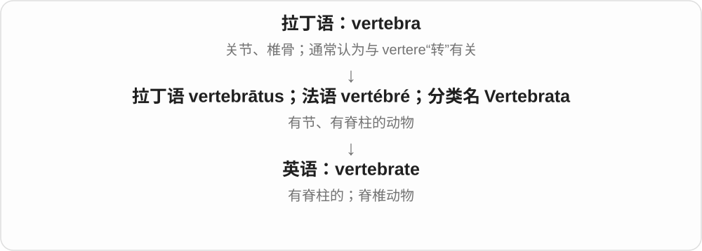

可以作形容词 vertebrate animals，也可作名词 a vertebrate。它按身体结构分类，不是按体形大小或聪明程度分类。

**常见搭配与例句**

vertebrate species；vertebrate anatomy；a small vertebrate。

> A frog is a vertebrate, just as a bird is.

青蛙和鸟一样，都是脊椎动物。

> The course introduces vertebrate anatomy.

这门课介绍脊椎动物解剖学。

**别混淆**

vertebra 是一块椎骨；vertebrate 是具有这类脊柱结构的动物。

### 185. dissipate — 消散；使散去；挥霍、耗散

**音标**：/ˈdɪsɪpeɪt/

**先抓住这个画面**

雾慢慢散开、怒气慢慢退去，是 dissipate。能量、钱财被分散耗掉，也沿着从集中到散失的画面走。

**怎么拆**

借拉丁 dissipatus，来自 dissipare 分散、挥霍；dis- 分开与旧抛散材料相连。不是 disappoint 失望的省写。

**怎么变成今天的意思**

**拉丁 dis- + 抛散材料 → dissipare**  
把聚在一起的东西散开

↓

**英语 dissipate**  
散去、耗散；挥霍

fog dissipates 雾消散；dissipate heat 散热；tension dissipates 紧张消退；dissipate savings 挥霍积蓄。

**常见搭配与例句**

dissipate heat；tension dissipates。

> The fog began to dissipate after sunrise.

日出后雾开始消散。

> The system is designed to dissipate heat.

这套系统用于散热。

**别混淆**

dissipate 重散开、渐失，disappear 只说不见；一个东西被完整搬走而消失，不一定是耗散。

### 186. confiscate — 没收；因违规等收走

**音标**：英 /ˈkɒnfɪskeɪt/；美 /ˈkɑːnfɪskeɪt/

**先抓住这个画面**

不是借来一会儿，而是凭职权或规则把东西收走，常叫 confiscate。学校收走违规使用的手机，也会用这个词。

**怎么拆**

借拉丁 confiscatus，来自 confiscare 收归公共钱库，关联 fiscus 钱库；旧入库的意思发展为有权收缴。

**怎么变成今天的意思**

**拉丁 fiscus 钱库 → confiscare、confiscatus**  
把财物收归公库

↓

**英语 confiscate**  
凭职权没收；按规则收走物品

confiscate goods 没收货物；confiscate a phone 收走手机；be confiscated 被没收、收缴。

**常见搭配与例句**

confiscate goods；confiscate a phone。

> Customs officers confiscated the goods.

海关人员没收了货物。

> The teacher confiscated the phone during the exam.

考试时老师收走了手机。

**别混淆**

confiscate 与 steal 偷窃的角度不同：前者突出行使权力、规则，是否合规仍由具体事实决定。

### 187. corroborate — 佐证；进一步证实

**音标**：英 /kəˈrɒbəreɪt/；美 /kəˈrɑːbəreɪt/

**先抓住这个画面**

已经有一个说法，再拿另一份材料来把它撑稳。

**怎么拆**

拉丁 com- 在 r 前同化成 cor-，加 roborare“加强”，形成 corroborare；英语借其分词词干。词首 cor- 不是“心”，整词也不是 collaborate“合作”。

**怎么变成今天的意思**

**拉丁语 robur、robus；词干 robor-**  
橡木、硬木；力量、坚固

↓

**拉丁语 roborare；com- + roborare → corroborare**  
使强壮；进一步加强

↓

**拉丁语 corroboratus → 英语 corroborate**  
加强；后来常指用证据支持、证实

一个人说他八点到场，门禁记录也显示八点，这份记录就 corroborates his account。它让已有说法更可信，强调证据之间相互支持，不是单纯把同一句话再说一遍。

**常见搭配与例句**

corroborate an account；corroborate a finding；be corroborated by records；corroborating evidence。

> The camera footage corroborated her account of the delivery.

监控录像佐证了她对送货过程的描述。

> A second experiment corroborated the initial finding.

第二次实验进一步证实了最初的发现。

**别混淆**

confirm 用法更广，可以确认预约；corroborate 常用于支持某种陈述或发现。collaborate 是人一起做事，corroborate 是材料或证言支持说法。

### 188. exacerbate — 加剧；使恶化

**音标**：英 /ɪɡˈzæsəbeɪt/；美 /ɪɡˈzæsərbeɪt/

**先抓住这个画面**

问题已经存在，再往上添一把火。

**怎么拆**

ex- 在拉丁 exacerbare 中常作加强，acerbus 是苦涩、严酷。英语动词可能由较早的 exacerbation 反构，也可能直接接拉丁 exacerbatus，不能把名词一律画成动词的后代。

**怎么变成今天的意思**

**拉丁 acerbus 苦涩、严酷**  
与 acer 尖锐同属相关词族，不把整个词当作现代英语拼装

↓

**拉丁 ex- 加强 + acerbare → exacerbare**  
使更苦、更激烈、激怒

↓

**英语 exacerbation 反构／拉丁 exacerbatus 借入 → exacerbate**  
英语动词比名词晚；词典保留两种直接来源分析

exacerbate a shortage 是让短缺更严重，不是首次制造短缺。对象通常是问题、紧张、冲突或症状，语气比 make worse 正式。

**常见搭配与例句**

exacerbate a problem；exacerbate tensions；exacerbate a shortage。

> The delay exacerbated an already serious shortage.

延误让原本已经严重的短缺雪上加霜。

> Public accusations only exacerbated the tension between them.

公开指责只让他们之间的紧张关系更加严重。

**别混淆**

exasperate 多说把人惹烦；exacerbate 多说把坏情况加重。两个词相似，但常见对象不同。

### 189. exterminate — 彻底消灭、灭绝

**音标**：英 /ɪkˈstɜːmɪneɪt/；美 /ɪkˈstɜːrmɪneɪt/

**先抓住这个画面**

不是只赶走眼前一只，而是试图把某类有害对象彻底清除，这是 exterminate 的强度。常见于害虫等话题，也能出现在暴力历史叙述中。

**怎么拆**

借拉丁 exterminatus，来自 exterminare，旧意为逐出边界，ex- 出 + termen 边界；后来发展为彻底毁灭。

**怎么变成今天的意思**

**拉丁 ex + termen 等 → exterminare**  
把对象逐出边界

↓

**英语 exterminate 的后续发展**  
驱逐 → 彻底消灭

exterminate pests 消灭害虫；attempt to exterminate 试图彻底消灭；不能只按 terminate 结束来轻描淡写。

**常见搭配与例句**

exterminate pests；attempt to exterminate。

> The article describes attempts to exterminate rats in the port.

文章描述了港口灭鼠的尝试。

> Efforts to exterminate the insects failed.

消灭这些昆虫的努力失败了。

**别混淆**

exterminate 比 remove 移走强得多，常含毁灭生命、消灭种群；谈普通删文件通常用 delete 或 remove。

### 190. interrogate — 审问；盘问；深入查询

**音标**：英、美 /ɪnˈterəɡeɪt/

**先抓住这个画面**

问题一个接一个地追下去，要把信息问出来。

**怎么拆**

拉丁 inter- + rogare → interrogare。英语来源有两种分析：借拉丁分词 interrogatus，或从更早的英语 interrogation 反构；两种路线都回到拉丁“询问”。

**怎么变成今天的意思**

**拉丁 rogare**  
询问、请求；也指提出法案、提名

↓

**拉丁 inter- + rogare → interrogare**  
询问、盘问

↓

**两种来源分析**  
拉丁分词 interrogatus 借入；或从已借入英语的 interrogation 反构

↓

**英语 interrogate**  
审问；深入追问或查询

对人用时，往往带正式、持续甚至咄咄逼人的感觉。对资料、假设或数据库用时，则是深入追问、检索：不接受表面答案，继续查它到底说明什么。

**常见搭配与例句**

interrogate a suspect；interrogate somebody about something；interrogate the data。

> The detective interrogated the suspect about the missing documents.

侦探就丢失的文件审问了嫌疑人。

> The researchers interrogated the data to find where the estimates had gone wrong.

研究人员深入检查数据，寻找估算出错的地方。

**别混淆**

ask 很普通；interrogate 明显更强。日常向朋友问个时间，用 interrogate 会像在开玩笑说自己被审讯。

### 191. protectorate — 保护国；保护关系；护国公统治时期

**音标**：英 /prəˈtektərət/；美 /prəˈtektərət/

**先抓住这个画面**

名义上受保护，实际在对外事务等方面受到另一强国控制的政治关系。

**怎么拆**

英语 protector + -ate，后缀表示职权、制度或受其治理的范围。

**怎么变成今天的意思**

**拉丁 tegere / tectus**  
盖住；tectus 是分词词干

↓

**拉丁 prō- + tegere → prōtegere / prōtectus**  
在前面遮护、保护

↓

**拉丁 prōtēctor → 盎格鲁法语 protectour → 中古英语 protectour**  
遮护他人的人

↓

**现代英语 protector**  
保护者；保护装置

↓

**英语 protector + -ate → protectorate**  
保护者职权或统治 → 保护国及相关制度

历史上的 protectorate 不只是友善帮助：当地可能保留内部机构，但外交、防务等受外部国家支配。大写 The Protectorate 还特指英国克伦威尔父子任护国公的时期。

**常见搭配与例句**

a British protectorate；declare a protectorate；the Protectorate。

> The map marks the territory as a former protectorate.

地图把这片领土标为昔日的保护国。

> The lecture compared local government before and during the Protectorate.

讲座比较了护国公统治前及统治期间的地方治理。

**别混淆**

colony 通常涉及更直接的殖民统治；protectorate 常保留名义上的本地统治，实际安排随历史情境而变。

### 192. annihilate — 彻底摧毁；大败；使湮灭

**音标**：/əˈnaɪəleɪt/

**先抓住这个画面**

不是稍微弄坏，而是仿佛把原来的东西直接变成零。

**怎么拆**

来自中世纪拉丁 annihilare 的分词词干 annihilat-；ad- 向、使成为 + nihil 无，前缀末尾 d 在 n 前同化为 n。

**怎么变成今天的意思**

**拉丁 nihil；缩写形式 nil**  
没有任何东西；零

↓

**中世纪拉丁 ad- + nihil → annihilare**  
使归于无；彻底毁掉

↓

**拉丁分词词干 annihilat- → 英语 annihilate**  
彻底摧毁；引申为压倒性击败

这个词语气很重。说球队被 annihilated，通常是夸张地说被打得毫无还手之力，并不是球队真的消失。物理学中它还有粒子与反粒子湮灭的专门用法；那也不等于能量凭空消失。

**常见搭配与例句**

annihilate an opponent；be annihilated by；particles annihilate。

> The defending champions annihilated their opponents in the final.

卫冕冠军在决赛中大胜对手。

> The impact annihilated the fragile model in an instant.

撞击瞬间把那个脆弱的模型彻底毁掉了。

**别混淆**

destroy 可以指一般的毁坏；annihilate 更突出彻底、近乎不留原状。比赛报道里的 annihilate 往往带夸张语气。

### 193. suffocate — 窒息；使无法呼吸；使感到压抑

**音标**：/ˈsʌfəkeɪt/

**先抓住这个画面**

空气进不来、无法正常呼吸，是 suffocate 的身体核心；规则、关系让人觉得喘不过气，也能比喻 suffocate。

**怎么拆**

接拉丁 suffocatus、suffocare，旧材料有 sub- 与 fauces 喉咙、狭窄入口的组合；现代不从英语 fox 狐狸解释。

**怎么变成今天的意思**

**拉丁 sub- + fauces 等 → suffocare**  
使喉部受阻、使无法呼吸

↓

**英语 suffocate**  
窒息；比喻压抑得喘不过气

fear that someone will suffocate 担心某人窒息；feel suffocated by rules 感到被规则压得喘不过气；可及物、不及物。

**常见搭配与例句**

suffocate in smoke；feel suffocated by。

> Smoke filled the room, and he feared he would suffocate.

烟灌满房间，他担心自己会窒息。

> She felt suffocated by the rigid rules.

僵硬的规则让她感到压抑。

**别混淆**

比喻 suffocate 不一定真缺氧；a suffocating atmosphere 也常是压抑气氛。choke 更常聚焦喉咙受阻等具体情况。

### 194. predicate — 谓语；谓词；以……为依据〔动词搭配〕

**音标**：名词 /ˈpredɪkət/；动词 /ˈpredɪkeɪt/

**先抓住这个画面**

一句话先说是谁、是什么，再说关于它的情况，后面作说明的部分是语法 predicate。逻辑里则把能断言的性质、关系形式化；动词常见于 predicated on。

**怎么拆**

名词接拉丁 praedicatum 被说出的东西，动词接 praedicare 宣告、断言，prae- 在前与 dicare 宣告材料相关。名词末尾 /ət/，动词 /eɪt/。

**怎么变成今天的意思**

**拉丁 praedicare → praedicatum**  
宣告、断言 → 关于对象说出的内容

↓

**英语 predicate 的语法、逻辑与动词用法**  
谓语、谓词；把某事建立在条件之上

the subject and predicate 主语和谓语；a logical predicate 逻辑谓词；be predicated on 以……为前提、依据。

**常见搭配与例句**

subject and predicate；be predicated on。

> In “The birds sing”, “sing” is the predicate.

在 The birds sing 中，sing 是谓语。

> Our plan is predicated on accurate data.

我们的计划以准确数据为基础。

**别混淆**

语法 predicate 不一定只包含一个动词，还可包括相关成分；动词 predicated on 则不在给句子划主谓。

### 195. implicate — 牵涉；表明某人或某因素与坏事有关

**音标**：英、美 /ˈɪmplɪkeɪt/

**先抓住这个画面**

把一个人或一个因素拉进事件的关系网里：线索指向它，说它可能参与或起了作用。

**怎么拆**

借自拉丁语 implicatus，来自 implicare“卷入、缠住”；与 imply 是不同借入路线，不是给现代 imply 添后缀。

**怎么变成今天的意思**

**拉丁语 plicare**  
折叠、使相接；与编织、弯曲一组词有更早联系

↓

**拉丁语 in- + plicare → implicare**  
卷进去、牵连在内

↓

**拉丁语 implicatus → 英语 implicate**  
卷入其中的 → 使牵连、指向责任

证据 can implicate a suspect；研究也可 implicate a mechanism，意思是提示某机制参与其中。这个词本身不等于已经判罪或彻底证明因果。

**常见搭配与例句**

implicate someone in；evidence implicates；be implicated in。

> The messages appeared to implicate a second employee.

这些消息似乎牵涉到另一名员工。

> Several pathways have been implicated in the response.

已有证据提示几条通路参与了这一反应。

**别混淆**

imply 暗示一层意思；implicate 把人或因素牵连到某事。

### 196. commensurate — 相称的；与……成比例的

**音标**：/kəˈmensərət/

**先抓住这个画面**

把两边放到同一把尺子上：付出这么多，回报应该配得上。

**怎么拆**

借自晚期拉丁 commēnsūrātus；com-“共同” + mēnsūrāre“测量”。

**怎么变成今天的意思**

**拉丁 com- + mēnsūra / mēnsūrāre**  
放在一起量、按共同尺度衡量

↓

**晚期拉丁 commēnsūrātus → 英语 commensurate**  
按共同尺度衡量 → 相应、相称的

pay commensurate with experience 是薪资与经验相称，不是两个数字必须相等。它关注大小、程度是否匹配，常用于工资、责任、投入和回报。

**常见搭配与例句**

commensurate with experience；commensurate with the risk。

> The salary should be commensurate with the responsibilities.

薪资应该与承担的职责相称。

> The benefits were not commensurate with the effort required.

所得收益与需要付出的努力不相称。

**别混淆**

commensurable 更强调能否用共同标准或共同单位来量；commensurate 常强调比例合不合适。

### 197. contaminate — 污染；使混入杂质或受到不良影响

**音标**：/kənˈtæmɪneɪt/

**先抓住这个画面**

本来不该混进来的东西进来了，结果不再干净、纯粹或可靠。

**怎么拆**

借拉丁 contaminatus，接 contaminare；更早的 contamen 指接触、沾染，与 tangere 的词系相连。不是英语 con + 一个独立的 taminate。

**怎么变成今天的意思**

**拉丁 tangere；完成分词 tactus**  
碰、触及、达到

↓

**拉丁 contamen → contaminare → contaminatus**  
接触、沾染 → 使混入而败坏

↓

**中古英语 contaminaten → contaminate**  
污染、使受杂质或不当影响

contaminate a sample 是让样本混入杂质；contaminate evidence 可以说证据受外来信息或不当操作影响。关键是“不该有的东西混入”，不只限于肉眼能看见的脏污。

**常见搭配与例句**

contaminate water；contaminate a sample；be contaminated with／by；contaminate the results。

> Dust from the bench contaminated the sample.

台面上的灰尘混入了样本。

> The interviewer avoided comments that might contaminate the witness’s account.

采访者避免发表可能影响证人叙述的评论。

**别混淆**

pollute 常谈环境污染；contaminate 还常用于样本、食品、证据等，哪怕混入量很小也可能影响用途。

### 198. insulate — 隔热；使绝缘；隔音；使免受影响

**音标**：英 /ˈɪnsjuleɪt/；美 /ˈɪnsəleɪt/

**先抓住这个画面**

在里面和外面之间加一道不容易通过的屏障，让热、电、噪声或外部冲击难以穿过。

**怎么拆**

接拉丁 insula 岛及 insulatus 像岛一样分隔，也可按拉丁 insula + 英语 -ate 分析。早期有使成为岛的用法，后来形成今天的物理屏障和保护义。

**怎么变成今天的意思**

**拉丁 insula 岛**  
再早的来源未定；不硬拆为 in 加某个英语词

↓

**拉丁 insulatus 像岛一样分隔，或 insula + 英语 -ate → insulate**  
英语早期使成为岛，后来用于隔热、绝缘等；具体构形有两种常见分析

insulate a roof 是给屋顶做隔热；insulate wires 是使电线绝缘。insulate somebody from criticism 则是使某人接触不到批评，好像外围多了一层保护。

**常见搭配与例句**

insulate a building；insulate something against noise；insulate somebody from pressure。

> The new material helps insulate the room against outside noise.

新材料帮助隔绝室外噪声。

> His wealth insulated him from many everyday worries.

财富让他免于许多日常烦恼。

**别混淆**

isolate 强调分开；insulate 强调阻隔传递或影响。保温层减少热传递，并不是自己发热。

### 199. urinate — 排尿、小便

**音标**：英 /ˈjʊərɪneɪt/；美 /ˈjʊrɪneɪt/

**先抓住这个画面**

把膀胱里的尿液排出体外。

**怎么拆**

有中世纪拉丁 urinare 的分词词干 urinat- 借入分析，也有从更早英语 urination 逆构的解释。现代可认作 urin- + -ate，历史却不一定先动词后名词。

**怎么变成今天的意思**

**拉丁 urina**  
尿；与希腊 ouron 通常认为有更早同源关系

↓

**中世纪拉丁 urinare；urinatus / urinat-**  
排尿；排尿动作的动词、分词形式

↓

**并列分析：拉丁分词词干借入，或英语 urination 逆构 → urinate**  
现代动词“排尿”

need to urinate 是需要小便，语气中性而较正式。在医疗问诊里很自然；日常和熟人说话通常会用 pee 或 go to the bathroom 等表达。

**常见搭配与例句**

need to urinate；urinate frequently；difficulty urinating；urinate normally。

> The doctor asked whether she needed to urinate more often than usual.

医生问她是否比平时更常需要小便。

> The dog stopped to urinate beside a tree.

狗停在一棵树旁小便。

**别混淆**

urinate 是动作，urine 是液体。不要把 He passed urine 理解成“他通过了一场尿液考试”。

### 200. aggravate — 使恶化；加重；使恼火

**音标**：/ˈæɡrəveɪt/

**先抓住这个画面**

原本已经有负担，再往上加一块，让情况更难受。

**怎么拆**

拉丁 ad- 同化为 ag-，加 gravare“使沉重”，经 aggravatus 借入英语；不是 ag- + 英语 grave“坟墓”。

**怎么变成今天的意思**

**拉丁语 gravis**  
重的；分量大、难承受、严肃的

↓

**拉丁语 ad- + gravare → aggravare**  
加上负担 → 使更严重、使痛苦

↓

**拉丁语 aggravatus → 英语 aggravate**  
使负担更重 → 使恶化；使恼火

aggravate a problem 是让问题更严重；aggravate someone 在口语中也可表示惹烦。这个使恼火义有长期使用历史，不必误判成新近用错。

**常见搭配与例句**

aggravate a problem；aggravate tensions；aggravate somebody。

> The delay only aggravated the shortage of supplies.

延期只让物资短缺更严重了。

> The constant interruptions were starting to aggravate her.

不断被打断开始让她恼火。

**别混淆**

exacerbate 更正式，主要说恶化问题；aggravate 还能直接说某人被惹得烦。

### 201. liquidate — 变现；清算；结清；〔历史等语境〕消灭、杀害

**音标**：/ˈlɪkwɪdeɪt/

**先抓住这个画面**

把账目和资产逐项处理清楚：该卖的换成钱，该结的债结掉。

**怎么拆**

借后期拉丁或中世纪拉丁 liquidatus，接 liquidare“使液化、使清楚”。英语早期重在把账目理清，后来有结清债务、出售资产等义；“杀害”义可能受俄语相应词影响。

**怎么变成今天的意思**

**拉丁 liquēre**  
呈液态；流动；清澈

↓

**拉丁 liquidus → 后期拉丁 liquidare / liquidatus**  
使液化；使清楚、澄清

↓

**英语 liquidate**  
早期清理账目，后来结清、变现、清算

liquidate assets 是出售资产换取现金；liquidate a company 是对公司进行清算、结束经营。不同宾语决定你是在说卖资产，还是结束公司；历史政治文本中的 liquidate opponents 是暴力的“消灭”。

**常见搭配与例句**

liquidate assets；liquidate stock holdings；liquidate a company；liquidate a debt。

> The firm liquidated part of its inventory to raise cash.

公司卖掉了部分库存来筹集现金。

> The owners decided to liquidate the company after closing its last store.

关闭最后一家门店后，所有者决定清算公司。

**别混淆**

liquefy 才是把物质变成液体的常用动词；liquidate 在现代日常报道里多属财务或清除语境。

### 202. calibrate — 校准；校定；细致调整〔引申〕

**音标**：/ˈkælɪbreɪt/

**先抓住这个画面**

拿已知的标准来和仪器读数对照，弄清它显示的数与实际量值怎样对应，是 calibrate 的核心。再往日常引申，就是把反应调到合适尺度。

**怎么拆**

calibre 口径、尺寸等 + -ate → calibrate；现代用于测量设备，也可比喻细调言语、反应。不要把计量上的校准一概说成拧旋钮改数值。

**怎么变成今天的意思**

**calibre、caliber 口径、尺寸材料 + -ate → calibrate**  
按标准检查尺度与读数的对应

↓

**calibrate + -ion → calibration**  
建立仪器示值与参考量值的关系；校准过程

calibrate an instrument 校准仪器；calibrate a response 审慎调整回应的力度。计量上建立对应关系，与随后是否调整设备是不同操作。

**常见搭配与例句**

calibrate an instrument；calibrate a response。

> The laboratory calibrates its instruments regularly.

实验室定期校准仪器。

> She carefully calibrated her response to the criticism.

她仔细拿捏了回应批评的分寸。

**别混淆**

calibrate 常参照标准建立关系，adjust 是调整；校准发现偏差后可以再调整，但两词不总是同一步。

### 203. inspectorate — 检查机构；监察部门

**音标**：英 /ɪnˈspektərət/；美 /ɪnˈspektərət/

**先抓住这个画面**

inspectorate 像把分散的检查员组织成一个部门，负责一整片领域的监督检查。

**怎么拆**

inspector + -ate；这里的 -ate 表示职位、机构或人员整体。

**怎么变成今天的意思**

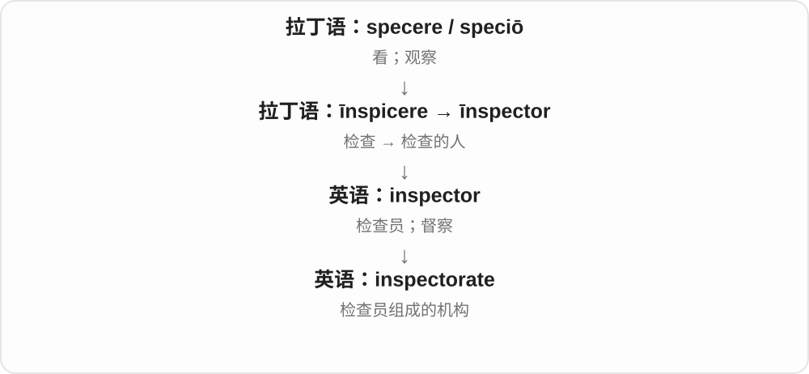

不是一次检查，也不是某一个检查员；常见于教育、劳动或安全监督部门名称。

**常见搭配与例句**

a school inspectorate；the inspectorate’s report；an independent inspectorate。

> The inspectorate published its annual report.

检查机构发布了年度报告。

> The school received a visit from the inspectorate.

学校接受了督查部门的访问检查。

**别混淆**

inspector 是人，inspection 是检查行为，inspectorate 是机构或部门。

### 204. irate — 大怒的；怒气冲冲的

**音标**：/aɪˈreɪt/；美亦 /ˈaɪreɪt/

**先抓住这个画面**

人正在气头上，话里或行动里都带着怒气。

**怎么拆**

独立借拉丁 iratus“发怒的”，它是 irasci“发怒”的分词形式。现代可以把它与 ire 配成一组，但历史上不是英语 ire 临时加 -ate 造出的。

**怎么变成今天的意思**

**拉丁 ira**  
愤怒、怒火

↓

**拉丁 irasci**  
变得愤怒、发怒

↓

**拉丁 iratus → 英语 irate**  
发怒的 → 怒气冲冲的

An irate caller 是一个打来电话、正在生气的人。这个词描写当时的状态，并不能单凭这一次生气，就说这个人一贯脾气很坏。

**常见搭配与例句**

an irate customer/passenger/caller；irate about/over something。

> An irate passenger demanded to know why the flight had been cancelled.

一名怒气冲冲的乘客要求解释航班为什么取消。

> She sent an irate email after being charged twice for the same order.

同一订单被扣了两次钱后，她发了一封愤怒的邮件。

**别混淆**

irate 是已经发怒；irascible 是容易发怒的性情。一个平时温和的人，也可能因为被重复收费而变得 irate。

### 205. precipitate — 突然引发；使析出；沉淀物；仓促的

**音标**：动 /prɪˈsɪpɪteɪt/；形、名 /prɪˈsɪpɪtət/，名词也读 /prɪˈsɪpɪteɪt/

**先抓住这个画面**

从“头朝前猛冲、向下掉”抓住三幅画面：事态被猛推一步、溶液里出现固体、人没想好就冲去做。

**怎么拆**

远接 prae- 在前 + -ceps 头。英语形容词接拉丁 praecipitatus；动词有拉丁借入、从 precipitation 逆构两种分析；化学名词也有新拉丁 praecipitatum 或英语逆构分析，不能按一条简单先后链硬排。

**怎么变成今天的意思**

**拉丁语：caput；属格 capitis**  
头；首领；顶端、主要部分

↓

**拉丁语：prae- + -ceps → praeceps；词干 praecipit-**  
头在前 → 头朝下、陡直、急冲

↓

**拉丁 praecipitare → praecipitatus；名词 praecipitatio**  
使头朝下坠落；被猛推的；坠落、急促

↓

**英语多条形成分析：拉丁分词借入；precipitation 逆构**  
形容词接拉丁分词；动词有借入或逆构分析；化学名词另联系新拉丁 praecipitatum

↓

**英语：precipitate**  
突然促成；使析出／沉淀物／仓促的

precipitate a crisis 是突然促成危机；a precipitate 是从溶液中分离出的固体；a precipitate decision 是没想充分便作的决定。化学中“析出”重在出现固相，不只是原有灰尘沉到底。

**常见搭配与例句**

precipitate a change；precipitate out of solution；a white precipitate；precipitate action。

> The unexpected resignation precipitated a leadership crisis.

这次意外辞职突然引发了领导危机。

> A white precipitate formed when the two solutions were mixed.

两种溶液混合后，生成了白色沉淀。

> The committee regretted its precipitate decision.

委员会后悔作出了仓促决定。

**别混淆**

precipitant 是促使沉淀产生的物质；precipitate 是生成的沉淀物。形容词常说行动仓促，precipitous 更常说坡很陡或数值骤降，二者也有重叠。

### 206. reciprocate — 回报、回应；往复运动

**音标**：/rɪˈsɪprəkeɪt/

**先抓住这个画面**

别人帮你，你也回以帮助；别人微笑，你也微笑回应，叫 reciprocate。机械里来回往复的运动，还保留了更直接的旧画面。

**怎么拆**

接拉丁 reciprocatus，来自 reciprocare 来回运动，与 reciprocus 往返、相互的材料相连。不是 recipe 食谱的派生。

**怎么变成今天的意思**

**拉丁 reciprocus → reciprocare、reciprocatus**  
来回、相互 → 往复动作

↓

**英语 reciprocate**  
回以相应感情、行动；机械往复

reciprocate kindness 回报好意；reciprocate someone’s feelings 回应感情；reciprocating motion 往复运动。

**常见搭配与例句**

reciprocate kindness；reciprocate feelings。

> I hope to reciprocate your kindness one day.

我希望有一天能回报你的好意。

> She smiled, and he reciprocated.

她微笑，他也微笑回应。

**别混淆**

reciprocate 常是对先前行动作相应回应；retaliate 特别针对伤害作报复，不是所有回应都带敌意。

### 207. placate — 安抚；平息不满

**音标**：英 /pləˈkeɪt/；美 /ˈpleɪkeɪt/，也读 /pleɪˈkeɪt/

**先抓住这个画面**

对方正不高兴，你做点解释、让步或补偿，让情绪缓下来。

**怎么拆**

来自拉丁语 plācātus“被安抚的”，也有从较早英语 placation 逆构的分析；最终都联系 plācāre“安抚”。

**怎么变成今天的意思**

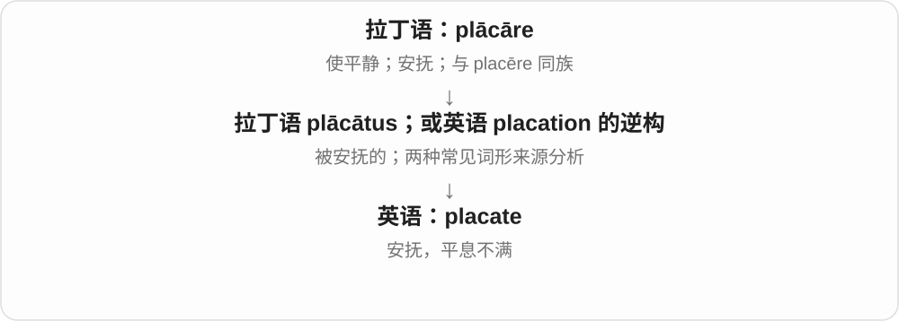

常接 angry customers、critics、opponents。它强调先平息不满，不一定代表问题已经真正解决。

**常见搭配与例句**

placate angry customers；an attempt to placate。

> The airline offered vouchers to placate the delayed passengers.

航空公司提供代金券，安抚航班延误的乘客。

> A brief apology did little to placate the neighbours.

一句简短道歉没能让邻居们消气。

**别混淆**

please 是让人满意；placate 通常预设对方有愤怒或不满，需要把情绪压下来。

### 208. stipulate — 明确规定、订明〔条件〕

**音标**：/ˈstɪpjəleɪt/

**先抓住这个画面**

不是随口建议，而是把要求写清楚、说清楚：“要做这件事，就得满足这个条件。”这种订明是 stipulate。

**怎么拆**

借拉丁 stipulatus，来自 stipulari 要求正式承诺、规定条件；英语 -ate 对应这里的拉丁分词词干。

**怎么变成今天的意思**

**拉丁 stipulari → stipulatus**  
要求正式承诺、订明条件

↓

**英语 stipulate**  
明确规定、要求某项条件

stipulate that 规定……；stipulate a condition 订明条件；as stipulated 按规定。

**常见搭配与例句**

stipulate that；as stipulated。

> The agreement stipulates that payment must arrive within thirty days.

协议规定付款必须在三十天内到账。

> The rules stipulate a minimum age of eighteen.

规则订明最低年龄为十八岁。

**别混淆**

stipulate 重明确订明要求，suggest 是建议；写进条款的必要条件，语气比一个可选想法强。

### 209. accentuate — 使更明显；强调；加重音

**音标**：/əkˈsentʃueɪt/

**先抓住这个画面**

像把聚光灯移到某个特点上，让它更容易被看见、听见。

**怎么拆**

借自中世纪拉丁 accentuatus，接 accentuare“加重音”；现代能与 accent 对照，历史不是英语 accent 随意加 -uate。

**怎么变成今天的意思**

**拉丁语 canere，词典形 cano**  
唱、吟诵

↓

**拉丁语 accentus → 中世纪拉丁语 accentuare**  
语调、重音 → 加重音

↓

**中世纪拉丁语 accentuatus → 英语 accentuate**  
加重音 → 强调、突出特点

lighting can accentuate wrinkles 是光线让皱纹更显眼；accentuate the differences 是让差别更突出。它可能突出优点，也可能把问题放大。

**常见搭配与例句**

accentuate a feature；accentuate the difference；accentuate the positive。

> The narrow windows accentuate the height of the room.

狭长的窗户让房间显得更高。

> The comparison accentuated the differences between the two plans.

这个比较凸显了两项方案的差别。

**别混淆**

emphasize 常通过语言、重视程度强调；accentuate 也常说颜色、形状、光线使特点显露。

### 210. condensate — 冷凝液；冷凝产物

**音标**：英 /ˈkɒndənseɪt/；美 /ˈkɑːndənˌseɪt/

**先抓住这个画面**

冷凝是“变”的过程，condensate 是变完后收集到的那一份东西，例如蒸气冷凝后得到的水。

**怎么拆**

本页主要学现代名词，可分析为 condense + 名词后缀 -ate，也有从 condensation 回构的解释。更早同形动词、形容词来自拉丁 condensatus；不要把几种词性当成同一时代一次借入。

**怎么变成今天的意思**

**拉丁 densus**  
密、厚、挤在一起的；更早来源未定

↓

**拉丁 densare；com- + densare → condensare**  
使变密、压紧；前缀常解释为加强

↓

**法语 condenser／直接拉丁借入 → 英语 condense**  
使更紧凑；冷凝；压缩内容

↓

**英语 condense + 名词 -ate；或从 condensation 回构**  
对冷凝所得物的命名

↓

**英语 condensate〔名词〕**  
冷凝产物，常为液体

steam condensate 是蒸气冷凝所得的水；condensate drain 是排出冷凝水的管道。科学中也有更专门的凝聚态名称，本页先掌握普通产物义。

**常见搭配与例句**

steam condensate；collect condensate；a condensate drain。

> The tank collects condensate from the cooling system.

这个水箱收集冷却系统产生的冷凝液。

> The technician labelled the sample as steam condensate.

技术人员把样品标记为蒸气冷凝水。

**别混淆**

condensation 偏过程，condensate 偏产物；日常说窗上的水珠一般用 condensation 就够了。

### 211. instigate — 促成、引发；煽动

**音标**：/ˈɪnstɪɡeɪt/

**先抓住这个画面**

原本还没动起来的事，被某个人、某个因素推了一把，于是开始了，是 instigate。它常用于调查、改革，也可用于冲突。

**怎么拆**

借拉丁 instigatus，来自 instigare 激起、催动；现代保留 -ate 动词形式，把激起行动的材料带进英语。

**怎么变成今天的意思**

**拉丁 instigare → instigatus**  
催促、激起行动

↓

**英语 instigate**  
促成过程开始；煽动他人行动

instigate an investigation 促成调查；instigate change 推动改变；instigate violence 煽动暴力。

**常见搭配与例句**

instigate an investigation；instigate change。

> The complaint instigated an investigation.

投诉促成了一项调查。

> She helped instigate changes in the organisation.

她帮助推动了机构改革。

**别混淆**

instigate 常让人看到是谁把事情发动起来，participate 只是参与；发起者不必亲自做每一步。

### 212. sedate — 平静安稳的；从容的；用药使镇静

**音标**：/sɪˈdeɪt/

**先抓住这个画面**

sedate 的共同画面是让躁动落下来：作形容词可以说生活节奏安稳，作动词通常说用药使人或动物镇静。

**怎么拆**

形容词借拉丁 sēdātus，来自 sēdāre“使安静”；动词的旧义联系该拉丁词干，现代用药义也有从 sedation 逆构的分析。

**怎么变成今天的意思**

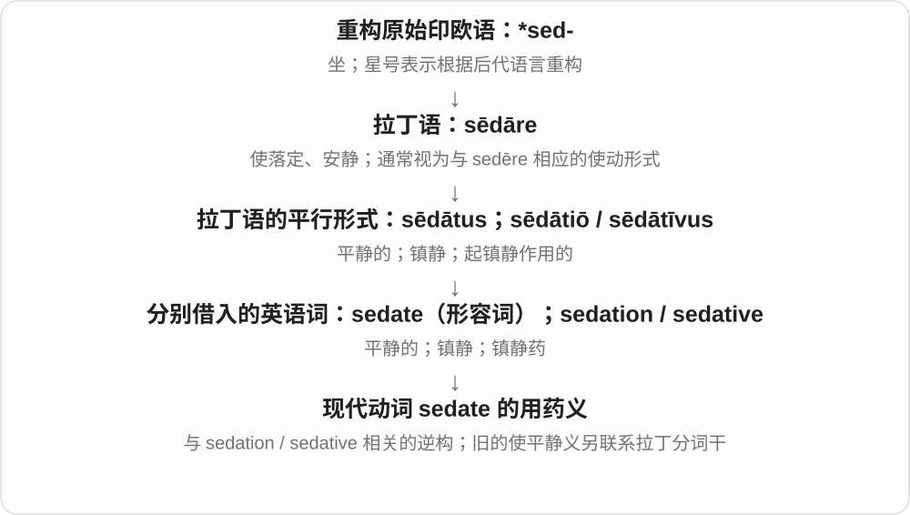

at a sedate pace 是不慌不忙地；sedate a patient 是使患者镇静。普通慢节奏不涉及用药，两种用法要看词性。

**常见搭配与例句**

a sedate lifestyle；at a sedate pace；sedate a patient。

> We cycled through the village at a sedate pace.

我们不慌不忙地骑车穿过村庄。

> The veterinary team sedated the animal before the examination.

兽医团队在检查前给动物用了镇静药。

**别混淆**

slow 只说慢；sedate 作形容词还带平静、从容。sedative 才是镇静药物或镇静的。

### 213. impersonate — 冒充；模仿某人

**音标**：英 /ɪmˈpɜːsəneɪt/；美 /ɪmˈpɜːrsəneɪt/

**先抓住这个画面**

把自己演成另一位，可能是舞台模仿，也可能企图让别人认错身份。

**怎么拆**

im- 是 in- 在 p 前的相应形式，加 person 与动词后缀 -ate。现代整词是以另一身份出现，不能把 im- 当“不”而解释成“不是一个人”。

**怎么变成今天的意思**

**拉丁 persōna → 古法语 persone 等**  
戏剧面具、角色；后来的人、个体等义

↓

**中古英语 persoun → 英语 person**  
一个人、个体

↓

**im- + person + -ate → impersonate**  
以另一人的身份、样貌行事

a comedian impersonates a singer 是喜剧演员模仿歌手；impersonate an official 是冒充官员。是否搞笑还是欺骗，由场景决定。

**常见搭配与例句**

impersonate a celebrity；impersonate an official；be good at impersonating。

> The comedian can impersonate several famous singers.

这位喜剧演员能模仿几位著名歌手。

> The warning described callers impersonating bank staff.

提醒中提到了冒充银行员工的来电者。

**别混淆**

imitate 可以模仿声音、习惯、作品等，impersonate 更集中到扮成某个人或其身份；不只重复一个动作。

### 214. culminate — 达到高潮或顶点；最终发展为、以……告终

**音标**：英、美 /ˈkʌlmɪneɪt/；重音在首音节，动词末尾 -ate 读 /eɪt/

**先抓住这个画面**

像沿着山坡一路向上走，前面的每一步把你带到最后的山顶。culminate 让人把一段积累、变化或冲突，与它最终达到的关键结果联系起来；这个“高点”不一定是令人高兴的成功。

**怎么拆**

记忆时看 culmin-（顶点）+ -ate（动词词尾）。culmin- 来自拉丁 culmen“顶点、山峰”的词干：属格是 culminis，因此词干中出现 -min-。英语词经晚期拉丁 culminare、其过去分词 culminatus 而来，有完整借词历史；不能拆成 cull + min，也不能把 -min- 解释成 minimum 的“小”。

**怎么变成今天的意思**

**拉丁 culmen（属格 culminis），词干 culmin-**  
顶点、山峰、屋顶

↓

**晚期拉丁 culminare → culminatus / culminat-**  
使到顶、冠于顶部；升至高处

↓

**17 世纪英语 culminate 的天文学用法**  
天体到达中天；与到达高点的画面相连

↓

**英语引申用法：culminate in / with**  
一段发展到达高潮，最终形成某个结果或以某事件收尾

常见句型是“过程或一连串事件 + culminate in + 结果”：主语可用 years of work、a dispute、a series of changes。in 后接名词、名词短语或动名词，不接 to do。culminate with 常把焦点放在最后举行的活动或压轴环节。新闻、历史叙述中，culminated in a crisis 应理解为“最终酿成危机”，不能机械译成“成功达到危机”。

**常见搭配与例句**

culminate in a decision 最终形成一项决定；culminate in success 最终取得成功；culminate in conflict 最终演变为冲突；culminate with a concert 以音乐会达到高潮或收尾。过去式 culminated；现在分词 culminating；名词 culmination 表示顶点、高潮或最终成果。

> Months of rehearsal culminated in a successful performance.

数月排练终于汇成一场成功的演出。

> The dispute culminated in the director’s resignation.

争议最终以主管辞职告终。

> The week-long festival will culminate with an outdoor concert.

为期一周的艺术节将以一场户外音乐会作为压轴。

**别混淆**

end 只说明结束；result in 强调产生结果；culminate in 还突出前面一段发展汇聚到终点或高点。peak 强调达到最高水平，之后可能回落；culminate 更常带出使整个过程收束的事件。常用学习句型是不及物的 X culminates in Y，不要漏掉 in 写成 X culminates Y。它与 accumulate“积累”拼写接近，但词源和意思不能混为一谈。

### 215. modulate — 调节；转调；调制

**音标**：英 /ˈmɒdjʊleɪt/；美 /ˈmɑːdʒəleɪt/

**先抓住这个画面**

有控制地改变某种起伏，让声音、旋律或信号按需要变化。

**怎么拆**

来自拉丁语 modulari“调音、按节拍调节”的分词 modulatus，远接 modulus。不是现代英语 module“组件”直接做成动词的历史。

**怎么变成今天的意思**

**拉丁语：modus**  
尺度、分寸；方式

↓

**拉丁语：modulus**  
小尺度；度量单位、标准

↓

**拉丁语：modulari → modulatus**  
按节拍调节、调音 → 已调节的

↓

**英语：modulate**  
调节声音或信号等

modulate your voice 是调节音量或音调；音乐里是转调；通信里通过改变载波某个参数携带信息。

**常见搭配与例句**

modulate a signal；modulate the voice；modulate to another key。

> She modulated her voice so that the final words sounded gentler.

她调整了语气，让最后几个字听起来更柔和。

> The transmitter modulates a carrier wave with the audio signal.

发射器用音频信号对载波进行调制。

**别混淆**

adjust 可指任何调整；modulate 常强调对强度、音调或信号变化的控制。

### 216. celibate — 禁欲的；守独身的；禁欲、独身者

**音标**：/ˈselɪbət/

**先抓住这个画面**

有的人选择不发生性关系，有的人还因宗教承诺保持独身，这类生活可叫 celibate。要看文本是在强调禁欲、未婚，还是两者。

**怎么拆**

关联拉丁 caelebs 未婚、独身的与 celibacy 等名词材料。现代形容词的形成有从相关名词类推等解释，不只是套一个英语动词尾。

**怎么变成今天的意思**

**拉丁 caelebs 与相关名词材料**  
未婚、独身的

↓

**英语 celibate 形容词、名词**  
守独身、性禁欲的；过这种生活的人

remain celibate 保持禁欲、独身；a celibate life 禁欲生活；a celibate priest 守独身的神职者。

**常见搭配与例句**

remain celibate；a celibate life。

> The monk remained celibate throughout his life.

那位僧人终身保持独身禁欲。

> She chose to live a celibate life.

她选择过禁欲生活。

**别混淆**

celibate 说生活方式、行为或承诺，single 只说未婚、无伴侣等状态；也不同于 asexual 无性恋这一性取向称呼。

### 217. obstinate — 固执的；顽固的；难以去除的

**音标**：英 /ˈɒbstɪnət/；美 /ˈɑːbstənət/

**先抓住这个画面**

脚像钉在原地一样，别人劝、事实变，仍旧不肯挪动立场。

**怎么拆**

拉丁 obstinātus，接 obstināre“坚定意志、不肯改变”；其中后半与 stāre“站”相关。

**怎么变成今天的意思**

**拉丁 ob / ob-**  
朝向；在前面；对着；有时加强后面动作

↓

**拉丁 obstināre → obstinātus**  
把意志定住 → 不肯改变；与 stāre“站”相关

↓

**中古英语 obstinat → obstinate**  
固执的、顽固的

常含批评，认为这种坚持缺少弹性。也可修饰 cough、stain 等难以消退的东西，这时不是说它们有思想，而是借“怎么也不肯走”的画面。

**常见搭配与例句**

an obstinate refusal；an obstinate child；an obstinate stain。

> He remained obstinate despite the new evidence.

尽管出现了新证据，他还是固执己见。

> The cleaner finally removed the obstinate stain.

清洁剂终于去掉了那块顽固污渍。

**别混淆**

determined 常称赞有决心；obstinate 往往批评不听劝。是否合理是两词常见的语气差别。

### 218. vaccinate — 给……接种疫苗

**音标**：英、美 /ˈvæksɪneɪt/

**先抓住这个画面**

动词把焦点放到“给谁接种”这个行动上。

**怎么拆**

常解释为从 vaccination 逆构：把看似名词词尾的部分换成动词形式。现代也容易按 vaccine + -ate 认识构词，但不应把它写成先于 vaccination 的确定英语祖先。

**怎么变成今天的意思**

**早期 vaccination**  
疫苗接种这一行为名词

↓

**逆构 vaccinate**  
形成对应动词

↓

**现代 vaccinate somebody／an animal**  
给人或动物接种疫苗

常用 vaccinate somebody against a disease：somebody 是接受接种的人，against 后面是针对的疾病。患者自己说 I was vaccinated，则是把接受者放到主语位置。

**常见搭配与例句**

vaccinate children；vaccinate animals；vaccinate somebody against a disease；be vaccinated。

> The clinic was set up to vaccinate people in the area.

设立这家诊所是为了给当地居民接种疫苗。

> The veterinary team travelled to the farm to vaccinate the cattle.

兽医团队前往农场给牛群接种疫苗。

**别混淆**

vaccinate 说接种这个行动，不等于证明某个人已获得百分之百保护。inject 只说注射动作，并非所有注射都是接种。

### 219. authenticate — 鉴定真实性；验证身份或来源

**音标**：英 /ɔːˈθentɪkeɪt/；美 /ɔːˈθentɪkeɪt/，也读 /ɑːˈθentɪkeɪt/

**先抓住这个画面**

有人声称“这是某画家的真迹”或“这个账号是我的”，authenticate 就是查证这个说法是否成立。

**怎么拆**

现代可对应 authentic + -ate；实际借中世纪拉丁 authenticare 的分词 authenticatus。先有“证实可信、真实”的动作，后来进入账号、设备等验证场景。

**怎么变成今天的意思**

**希腊 autos**  
自己；自身；同一

↓

**希腊 authentes → authentikos → 拉丁 authenticus**  
主事者 → 本原、可信的

↓

**中世纪拉丁 authenticare，分词 authenticatus → 英语 authenticate**  
证实真实性；鉴定

authenticate a painting 是鉴定画作真伪；authenticate a user 是核验用户身份。核验身份成功，不意味着该用户就拥有全部操作权限。

**常见搭配与例句**

authenticate a document；authenticate a user；authenticate a request。

> The gallery hired a specialist to authenticate the painting.

画廊请了一位专家鉴定这幅画。

> The service must authenticate the user before showing private files.

服务展示私人文件前，必须先验证用户身份。

**别混淆**

authorize 是授权能做什么，authenticate 是核验是谁或来源是否可信；两者在登录流程里常相邻，却不是同一个动作。

### 220. lactate — 动词：分泌乳汁；名词：乳酸盐、乳酸根，生理语境常简称乳酸

**音标**：动词：英 /lækˈteɪt/，美 /ˈlækteɪt/；名词 /ˈlækteɪt/

**先抓住这个画面**

同一个拼写走了两条路：一条是身体产奶的动作，一条是化学中的乳酸相关物质。

**怎么拆**

动词通常视为从较早的 lactation 回推形成，远源为拉丁 lactare。化学名词另借自法语 lactate，以 lactic 的词干加表示盐或酯的 -ate 构成，英语记录反而更早。

**怎么变成今天的意思**

**拉丁 lac，属格 lactis**  
乳、奶

↓

**两条支线：lactation → 动词 lactate；法语化学名 lactate → 英语名词**  
分泌乳汁；乳酸相关化合物

↓

**现代英语 lactate**  
读句子时先分清动作与物质名

a mammal lactates 是哺乳动物分泌乳汁；blood lactate 则是血液中的乳酸相关检测指标。严格化学语境里 lactate 可指乳酸根或乳酸盐、酯，不能把所有用法都翻成“泌乳”。

**常见搭配与例句**

lactate after giving birth；blood lactate levels；sodium lactate。

> Female mammals typically lactate after giving birth.

雌性哺乳动物通常在产仔后分泌乳汁。

> The study compared cows that lactate with cows that do not.

这项研究比较了泌乳奶牛与非泌乳奶牛。

> The laboratory measured lactate in the blood sample.

实验室检测了血样中的乳酸水平。

> Sodium lactate appears in the ingredient list.

配料表中列有乳酸钠。

**别混淆**

lactate 的名词不是动词的“动作名词”。泌乳过程叫 lactation；检测报告里的 lactate 属于化学支线。

### 221. procrastinate — 拖延；迟迟不做

**音标**：英 /prəʊˈkræstɪneɪt/；美 /proʊˈkræstəneɪt/

**先抓住这个画面**

今天能开始，却把任务推到“明天”；明天来了，又想再推一天。

**怎么拆**

核心来自拉丁 pro- 向前 + crastinus 明天的。英语动词可解释为从 procrastination 逆构，或取拉丁 procrastinatus 分词形式；不是把 pro- 翻成赞成就完事。

**怎么变成今天的意思**

**拉丁 pro- + crastinus（来自 cras）**  
向前 + 属于明天的（明天）

↓

**拉丁 procrastinare**  
把事往明天推

↓

**英语 procrastinate**  
经拉丁形式或由先有名词逆构 → 拖延

常不接宾语：Stop procrastinating.；也可说 procrastinate on a task。它往往含有本该做却拖着的意思，不只是因为列车晚点等外界原因造成延迟。

**常见搭配与例句**

stop procrastinating；procrastinate on；tend to procrastinate。

> I tend to procrastinate when I do not know where to start.

不知道从哪里开始时，我就容易拖延。

> Stop procrastinating and write the first sentence.

别再拖了，先写出第一句话。

**别混淆**

postpone 可以是合理地重新安排日期；procrastinate 更容易表示不愿面对或一直迟迟不动手。但一个词不能直接诊断拖延原因。

### 222. elucidate — 阐明；讲清楚；揭示原理或关系

**音标**：英美 /ɪˈluːsɪdeɪt/

**先抓住这个画面**

像把一束光照到原本看不清的地方，让隐藏的步骤、关系或原因显出来。

**怎么拆**

接后期拉丁 elucidatus，来自 elucidare“使明亮、使清楚”，由 ex-／e- 与 lucidus 构成；也可能经过法语 élucider。不是英语先有 lucid 再简单拼 e- 和 -ate。

**怎么变成今天的意思**

**拉丁 lux／lucis，lucere**  
光；发光、照亮

↓

**后期拉丁 ex- + lucidus → elucidare／elucidatus**  
使之明亮、使之清楚；相应分词形式

↓

**英语 elucidate**  
接拉丁分词形式，也可能经过法语 élucider；讲清楚、阐明

可以 elucidate a point“讲清一个要点”，也可以 elucidate a mechanism“弄清某个机制”。后者未必只靠讲话，实验、证据和分析也能让事情变清楚。

**常见搭配与例句**

elucidate a point；elucidate the relationship between two things；elucidate how something works。

> The diagram helps elucidate the relationship between the two processes.

这张示意图有助于阐明两个过程之间的关系。

> Further research may elucidate why the effect disappears at higher temperatures.

进一步研究或许能揭示这种效应为什么在较高温度下消失。

**别混淆**

explain 最通用；elucidate 更书面，常带“原来不清楚，现在被说明或研究清楚”的意味。不要与 elude“躲开、难以把握”按近似拼写混记。

### 223. hibernate — 冬眠；进入休眠；蛰居

**音标**：英 /ˈhaɪbəneɪt/；美 /ˈhaɪbərneɪt/

**先抓住这个画面**

把活动和能量消耗压低，暂时待着，等适合活动的时候再出来。

**怎么拆**

关联拉丁 hibernare 过冬及分词 hibernatus。词典也有从更早的英语 hibernation 反构出动词的分析，两条解释都指向过冬。

**怎么变成今天的意思**

**拉丁 hibernus → hibernare、hibernatus**  
冬季的 → 过冬

↓

**英语 hibernate**  
冬眠、休眠；可能由更早的 hibernation 反构形成

动物 hibernate 时会明显降低代谢，不只是睡得久。人开玩笑说 I want to hibernate，可以是想躲在家里少活动。电脑的 Hibernate 则借这个画面表示休眠，暂停活动、保存状态，之后还能恢复。

**常见搭配与例句**

animals hibernate；hibernate through the winter；hibernate the computer。

> Some bats hibernate in caves during the colder months.

有些蝙蝠会在较冷的月份到洞穴里冬眠。

> After a busy month, I wanted to hibernate at home for the weekend.

忙了一个月后，我只想周末窝在家里，像冬眠一样歇一歇。

**别混淆**

sleep 是睡觉，hibernate 是休眠、冬眠。电脑里的 Sleep 和 Hibernate 也是不同模式，不要只因中文都带眠就视为同一个功能。

### 224. prostrate — 俯卧的；伏地的；极度虚弱的；使俯伏

**音标**：形容词英 /ˈprɒstreɪt/，美 /ˈprɑːstreɪt/；动词英亦 /prɒˈstreɪt/

**先抓住这个画面**

从站着变成整个人伏在地上；身体或精神受打击时，也像一下子撑不住了。

**怎么拆**

拉丁语 pro-“向前” + sternere“铺下”形成 prosternere，过去分词 prostratus 经形容词借入英语，英语又形成动词。

**怎么变成今天的意思**

**拉丁语 sternere**  
铺开、铺下

↓

**拉丁语 pro- + sternere → prosternere → prostratus**  
向前铺倒、使俯伏 → 俯伏的

↓

**中古英语 prostrate → 英语形容词 prostrate；再作动词**  
伏地的、无力的；使倒下、使俯伏

lie prostrate 可说俯伏；prostrate oneself before someone 是向人伏地行礼。be prostrate with grief 则说悲痛得无力，并不要求真的趴在地上。

**常见搭配与例句**

lie prostrate；prostrate oneself；prostrate with exhaustion。

> He lay prostrate on the floor after the exhausting exercise.

做完那场耗力的训练后，他俯卧在地板上。

> The pilgrims prostrated themselves before the shrine.

朝圣者在圣龛前伏地行礼。

**别混淆**

prostrate 有两个 r；prostate“前列腺”少一个 r，是另一个词。supine 通常是仰卧，与俯卧姿势不同。

### 225. rejuvenate — 使恢复活力；使显得年轻；使焕然一新

**音标**：/rɪˈdʒuːvəneɪt/

**先抓住这个画面**

像把疲惫、老化的状态往回拨一点，让人或事物重新有精神。

**怎么拆**

近代英语用 re-“重新” + 拉丁 juvenis 的 juven-“年轻” + -ate 造词。这里是借古语成分创造英语词，不是整个词在古拉丁语中已原样存在。

**怎么变成今天的意思**

**拉丁 iuvenis / juvenis**  
年轻的；年轻人

↓

**近代英语 re- + juven- + -ate → rejuvenate**  
重新赋予年轻的状态或活力

假期可以 rejuvenate someone，新的项目也可 rejuvenate a business。它经常是活力与面貌的比喻，不是在保证生理年龄真的倒退。

**常见搭配与例句**

rejuvenate a team；rejuvenate a business；feel rejuvenated。

> A quiet weekend in the countryside rejuvenated her.

乡间一个宁静的周末让她恢复了精神。

> The new director hopes to rejuvenate the theatre’s programme.

新任总监希望让剧院的节目重新焕发活力。

**别混淆**

revitalize 强调重新有活力；rejuvenate 多了恢复年轻、新鲜感的画面，两者很多时候都能使用。

### 226. abdicate — 退位；放弃〔权力或职责〕

**音标**：/ˈæbdɪkeɪt/

**先抓住这个画面**

正式把原来属于自己的地位放下；比喻时，也可以批评一个人把本来应承担的职责丢开。

**怎么拆**

借拉丁 abdicatus，abdicare 的过去分词；由 ab-“离开、放弃”与 dicare“宣告”组成，原有宣告不再承认、放弃职务等义。不是由英语 dictate 加 ab- 拼成。

**怎么变成今天的意思**

**拉丁 ab，构词中也有 abs-、a- 等形式**  
离开、从……分离、去掉

↓

**拉丁 ab- + dicare → abdicare，分词 abdicatus**  
宣告 → 宣告放弃、拒绝承认

↓

**拉丁分词 abdicatus → 英语 abdicate**  
正式放弃、拒绝承认

↓

**英语 abdicate 的常见用法**  
君主退位；放弃或推卸职责

abdicate the throne 是退位，也可单说 the king abdicated。abdicate responsibility 则通常是批评不再承担责任，语气比普通 delegate“授权”更强。

**常见搭配与例句**

abdicate the throne；abdicate in favour of；abdicate responsibility；abdicate a duty。

> In the play, the ageing king decides to abdicate.

剧中，年老的国王决定退位。

> Managers cannot abdicate responsibility for the team’s decisions.

管理者不能推卸对团队决策应负的责任。

**别混淆**

resign 可说辞去一般职位；abdicate 尤其用于君主退位。把任务合理交给别人不一定是在 abdicate responsibility。

### 227. excavate — 挖掘；发掘；挖空

**音标**：/ˈekskəveɪt/

**先抓住这个画面**

把泥土一层层取走，让下面的空间或东西露出来。

**怎么拆**

拉丁 ex- 向外 + cavare 挖空 → excavare，其分词 excavatus 借入英语。

**怎么变成今天的意思**

**拉丁 cavus**  
空的、凹的

↓

**拉丁 ex- + cavare → excavare、excavatus**  
向外挖空 → 挖掘

↓

**英语 excavate**  
挖土；考古发掘

excavate a site 是发掘遗址，excavate a trench 是挖沟。对象可以是被挖开的地方，也可以是从土里发掘出的东西；考古语境通常暗含有计划、有记录的发掘。

**常见搭配与例句**

excavate a site；excavate a trench；excavate the foundations；excavate remains。

> Archaeologists excavated the site over several summers.

考古学家利用几个夏天发掘了这处遗址。

> Workers excavated a trench for the new pipes.

工人挖了一条沟，用来铺设新管道。

**别混淆**

dig 是更日常的“挖”；excavate 较正式，常见于工程和考古。

### 228. officiate — 主持仪式；担任裁判

**音标**：/əˈfɪ.ʃi.eɪt/

**先抓住这个画面**

婚礼需要有资格的人主持，比赛需要裁判依规则执掌现场：这类正式履行职务的动作是 officiate。

**怎么拆**

来自 officium“职务”一支，经中世纪拉丁语 officiare 等形式；现代可联系 office + -ate。

**怎么变成今天的意思**

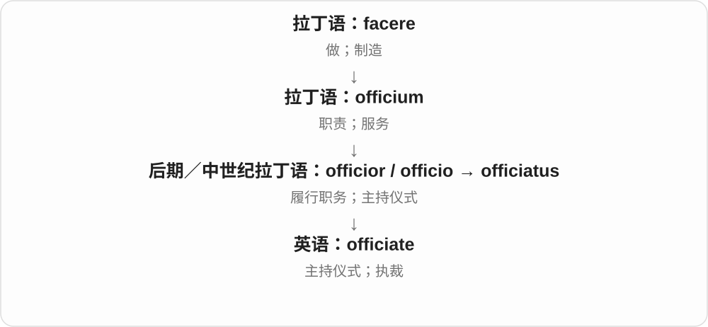

office 的职责义保留在动词中，不是“在办公室办公”。它常用于仪式、宗教活动与体育比赛。

**常见搭配与例句**

officiate at a wedding；officiate a match；officiate as referee。

> A family friend will officiate at the wedding.

一位家庭朋友将主持婚礼。

> She has officiated at international matches.

她曾在国际比赛中执裁。

**别混淆**

host 可是普通活动主持或招待；officiate 通常带正式职权或仪式职责。

### 229. germinate — 发芽；萌发；使发芽

**音标**：英 /ˈdʒɜːmɪneɪt/；美 /ˈdʒɜːrmɪneɪt/

**先抓住这个画面**

一粒种子开始动起来，长出最初的新生命。

**怎么拆**

与拉丁 germinare“发芽”、分词 germinatus 有关；也有从较早的英语 germination 逆构出 germinate 的分析。现代可以辨认 germin- + -ate，但 germination 并非一定比它晚。

**怎么变成今天的意思**

**拉丁 germen，词干 germin-**  
芽、萌芽；新生命的起点

↓

**拉丁 germinare / germinatus；英语已有 germination**  
发芽及其名词先成为构词依据

↓

**英语 germinate：拉丁分词基础／germination 逆构分析**  
发芽；比喻想法开始形成

Seeds germinate 是种子发芽；an idea germinates 是想法开始成形。后者像脑子里冒出一棵小芽，强调起步，不是已经完成整个计划。

**常见搭配与例句**

seeds germinate；germinate seeds；an idea begins to germinate；germinate in someone’s mind。

> The seeds began to germinate after several days.

几天后，种子开始发芽。

> The idea for the novel germinated during a long train journey.

这部小说的构思在一次漫长的火车旅途中萌生。

**别混淆**

grow 是广义生长，germinate 特别强调种子开始发育，或事物刚刚萌生的阶段。

### 230. mutate — 发生突变；改变形态

**音标**：英 /mjuːˈteɪt/；美亦 /ˈmjuːteɪt/

**先抓住这个画面**

mutate 是原来那套内容变了，生物学里常指遗传信息的改变，比喻中也可说想法变了样。

**怎么拆**

英语从 mutation 逆构出 mutate，底层仍是拉丁语 mūtāre；不是所有 -ation 名词都必定晚于动词。

**怎么变成今天的意思**

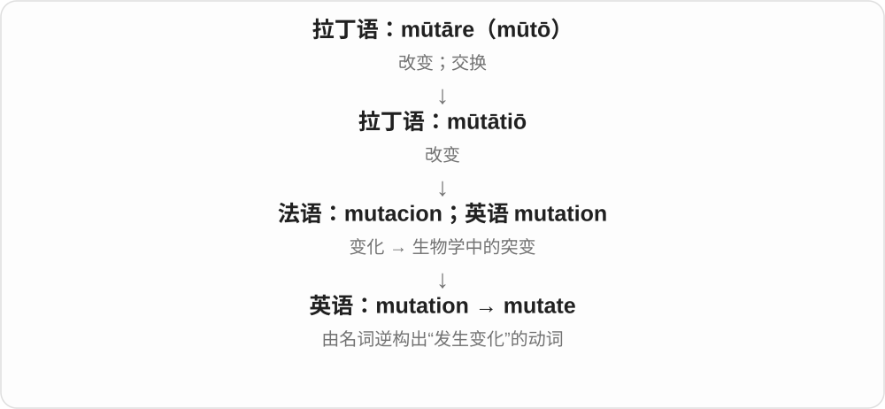

突变不一定朝某个有用目标发生；一般比喻义则强调变化后与原样不同。

**常见搭配与例句**

a gene mutates；mutate into；mutate over time。

> The researchers observed how the sequence mutated.

研究人员观察了这段序列怎样发生变化。

> The simple idea mutated into a much larger project.

这个简单想法逐渐变成了一个大得多的项目。

**别混淆**

mutate 说发生改变；adapt 说适应，不可把每次突变都说成有目的的适应。

### 231. permeate — 渗入；渗透；弥漫

**音标**：英 /ˈpɜːmieɪt/；美 /ˈpɝmieɪt/

**先抓住这个画面**

像水进入海绵，慢慢穿过内部细小的空间。

**怎么拆**

来自拉丁 permeatus，permeare 的分词；per- 穿过 + meare 走、通过。

**怎么变成今天的意思**

**拉丁 per**  
穿过；遍及；彻底

↓

**拉丁 per- + meare → permeare**  
穿过去、通行

↓

**拉丁 permeatus → 英语 permeate**  
通过、渗透

水可以 permeate the soil，气味可以 permeate the room，某种观念也可以 permeate an organization。后两者不必真有液体，是把影响进入各处比成渗透。

**常见搭配与例句**

permeate something；permeate through something；be permeated with something。

> Water slowly permeated the dry soil.

水慢慢渗进干燥的土壤。

> A sense of uncertainty permeated the whole organization.

整个组织都弥漫着不确定感。

**别混淆**

permeate 让人想到进入内部并扩散；cover 可能只是覆盖表面。两个词的空间画面不同。

### 232. deflate — 放气；瘪下去；使泄气；削弱自信

**音标**：英 /dɪˈfleɪt/，亦 /diːˈfleɪt/；美 /dɪˈfleɪt/

**先抓住这个画面**

把鼓起来的东西放瘪，也可以把人的得意或期待打掉。

**怎么拆**

19 世纪英语仿照 inflate，把 in- 换成表示逆向、减弱的 de-。拉丁虽有 deflare“吹走”，现代英语这个常用词主要按与 inflate 对造来解释。

**怎么变成今天的意思**

**拉丁 flare**  
吹气、吹起

↓

**拉丁 in- + flare → inflare → inflatus**  
向里面吹气 → 吹胀；分词形式

↓

**中古英语 inflaten → inflate**  
使膨胀；后来也指抬高、夸大

↓

**近代英语以 de- 替换 inflate 的 in- → deflate**  
放掉气、使缩小；后来也说打击自信

气球 deflates，是气跑了、形状瘪了；a comment deflated him，是一句话让他刚才那股兴奋劲没了。后者说心理落差，不是在说他身体漏气。

**常见搭配与例句**

deflate a tyre；a balloon deflates；deflate someone’s confidence；feel deflated。

> Deflate the air mattress before putting it back in the bag.

把气垫床放气后再装回袋子。

> The dismissive reply deflated her enthusiasm for the project.

那句不屑的回复打击了她对项目的热情。

**别混淆**

deflate 关注从膨胀到缩小、从得意到泄气。discourage 更泛指让人不愿或不敢继续，不一定先有“鼓起来”的高兴劲。

### 233. postulate — 假定、提出假设；公设、基本假定

**音标**：动词：英 /ˈpɒstjəleɪt/、美 /ˈpɑːstʃəleɪt/；名词末尾 /lət/

**先抓住这个画面**

为了建立一个模型，先把某项条件作为出发点，这是 postulate 的动词用法；被采用的那条出发假定，就是 a postulate。

**怎么拆**

动词接拉丁 postulare 要求、主张的分词材料，名词接 postulatum 所要求、所设定的东西；现代动词 /eɪt/，名词 /ət/。

**怎么变成今天的意思**

**拉丁 postulare → postulatus、postulatum**  
要求、主张 → 被要求或设定的内容

↓

**英语 postulate 动词、名词**  
先假定以展开推理；相应公设、假设

postulate that 假定……；postulate a mechanism 提出假设机制；a basic postulate 基本公设。

**常见搭配与例句**

postulate that；a basic postulate。

> The model postulates a constant rate.

模型假定速率恒定。

> The proof starts from a basic postulate.

证明从一条基本公设出发。

**别混淆**

postulate 是把某项作为推理起点，prove 是证明；模型采用一个假定，不代表它已经被独立证实。

### 234. denigrate — 贬低；诋毁

**音标**：/ˈdenɪɡreɪt/

**先抓住这个画面**

把别人的努力或名声往低处说，让它看起来不值一提。

**怎么拆**

拉丁 de- 在这里加强语气，接 nigrare 使黑，形成 denigrare；其分词 denigratus 接英语 denigrate。不是去掉黑色，古拉丁语已能用来指诋毁。

**怎么变成今天的意思**

**拉丁 niger／nigr- 黑 → nigrare 使变黑**  
以颜色变暗比喻名誉受损

↓

**拉丁 de- 加强 + nigrare → denigrare**  
彻底弄黑；贬损名誉

↓

**拉丁 denigratus → 英语 denigrate**  
早有变暗的形容词；动词很早就指贬损名誉

denigrate someone’s work 不是指出一处具体错误，而是把工作说得很差、很不值钱。这个动词通常暗示评价不公；“抹黑”是理解其历史比喻的好画面。

**常见搭配与例句**

denigrate an achievement；denigrate someone’s abilities；denigrate an opponent。

> The manager denigrated months of careful work as a pointless exercise.

经理把几个月的细致工作贬得像一场毫无意义的折腾。

> We can disagree with the proposal without denigrating the people behind it.

我们可以不同意提案，而不贬低提出它的人。

**别混淆**

criticize 可以是有根据的批评，denigrate 更强调贬损、轻视。degrade 的用法更广，也能说材料或环境退化。

### 235. insinuate — 含沙射影地暗示；逐步混入、获得位置

**音标**：/ɪnˈsɪnjueɪt/

**先抓住这个画面**

不把话正面说出来，而是绕个弯，让一个让人不舒服的意思钻进对方脑中。

**怎么拆**

拉丁 in- 进入 + sinuare 弯曲，形成 insinuare 曲折进入；分词 insinuatus 进入英语。古词的进入画面能帮助理解，但英语的身体动作义并不一定早于暗示义。

**怎么变成今天的意思**

**拉丁 sinus 弯、褶、湾、凹处**  
像布料弯成一个能容纳东西的褶；远源未定

↓

**拉丁 in- 进入 + sinuare 弯曲 → insinuare**  
曲折地进入、慢慢钻入

↓

**拉丁分词 insinuatus → 英语 insinuate**  
婉转暗示；设法慢慢挤入某种位置

insinuate that someone cheated 通常是暗示对方做了坏事，又不明说承担指责。insinuate yourself into a group 则说慢慢混进一个圈子，常带有算计、讨好的感觉。

**常见搭配与例句**

insinuate that…；What are you insinuating?；insinuate yourself into someone’s confidence。

> Are you insinuating that I changed the figures?

你是在暗示我改了数字吗？

> He gradually insinuated himself into the director’s inner circle.

他逐渐混进了主管的核心圈子。

**别混淆**

hint 可以中性甚至友善，insinuate 常带负面含义；suggest 的范围更广，不一定拐弯抹角。

### 236. marinate — 腌制；浸在腌料中

**音标**：英 /ˈmærɪneɪt/；美 /ˈmærəneɪt/

**先抓住这个画面**

给味道一点时间，让调料慢慢进入食材。

**怎么拆**

英语调整了法语 mariner 或意大利语 marinare 的词形；二者与海水、盐水的命名相关。不是现代英语先有 marinade，再简单把 -ade 换成 -ate。

**怎么变成今天的意思**

**拉丁 mare → marīnus**  
海 → 海的、与海有关的

↓

**法语 mariner 或意大利语 marinare**  
用盐水或调味液腌制

↓

**英语 marinate**  
把食材浸在腌料里；食材在腌料中入味

可以说 marinate the chicken，食材作宾语；也可以说 leave it to marinate，食材自己浸着入味。口语里 let an idea marinate 还比喻先让想法沉淀一下。

**常见搭配与例句**

marinate in；leave to marinate；marinated vegetables。

> She marinated the mushrooms in olive oil and herbs.

她用橄榄油和香草腌蘑菇。

> Let the idea marinate before we make a decision.

先让这个想法沉淀一下，我们再决定。

**别混淆**

marinade 常指腌料，marinate 常指腌制动作。注意主重音：marinade 在末尾，marinate 在开头。

### 237. incriminate — 使显得涉罪；牵连入罪

**音标**：/ɪnˈkrɪmɪneɪt/

**先抓住这个画面**

原来不清楚某人是否参与，某份记录、证词却把嫌疑指向他，这类证据会 incriminate him。重点是把人牵入罪责线索。

**怎么拆**

借拉丁 incriminatus，来自 incriminare 指控，in- 与 crimen 指控、罪名的材料，加上相应动词形式。

**怎么变成今天的意思**

**拉丁 in- + crimen 等 → incriminare**  
把罪名、指控指向某人

↓

**英语 incriminate**  
证据、陈述等使某人显得涉罪

incriminate someone 使某人涉罪；incriminating evidence 牵连犯罪的证据；incriminate oneself 让自己的陈述显得有罪。

**常见搭配与例句**

incriminating evidence；incriminate someone。

> The documents could incriminate several officials.

这些文件可能牵连几名官员涉罪。

> The article explains how the evidence incriminated the suspect.

文章解释了证据如何把嫌疑指向那名嫌疑人。

**别混淆**

incriminate 可以增加嫌疑，convict 是定罪；证据指向某人，与法院最终认定是不同阶段。

### 238. irrigate — 灌溉；冲洗〔专业用法〕

**音标**：/ˈɪrɪɡeɪt/

**先抓住这个画面**

雨水不够，就把水引到田地，让作物所在的土壤得到水分，是 irrigate。核心是把水引向需要的地方。

**怎么拆**

借拉丁 irrigatus，来自 irrigare 引水、浇灌，in- 向内与 rigare 浇水相连；前缀在 r 前同化为 ir-。

**怎么变成今天的意思**

**拉丁 in- + rigare → irrigare、irrigatus**  
引水进入、浇灌

↓

**英语 irrigate**  
灌溉土地；专业领域引申冲洗

irrigate fields 灌溉农田；irrigated land 灌溉土地；a system to irrigate crops 作物灌溉系统。

**常见搭配与例句**

irrigate fields；irrigated land。

> The river is used to irrigate the fields.

河水被用于灌溉农田。

> Farmers irrigate the crops during dry periods.

农民在干旱时段灌溉作物。

**别混淆**

irrigate 常指有安排地向土地供水，water 可是给一盆花浇水的普通动作；灌溉强调土地、作物供水。

### 239. obligate — 使负有义务；专性的

**音标**：动词 /ˈɑːblɪɡeɪt/；形容词 /ˈɑːblɪɡət/

**先抓住这个画面**

动词 obligate 比 oblige 更常出现在正式责任和承诺的语境中。生物学中的形容词 obligate 则指必须依靠某种条件或生活方式的，如 obligate parasite“专性寄生物”。

**怎么拆**

来自拉丁语 obligātus，保留了 -gat- 词形。动词末尾 -ate 通常读 /eɪt/，形容词常读弱化的 /ət/ 或 /ɪt/。

**怎么变成今天的意思**

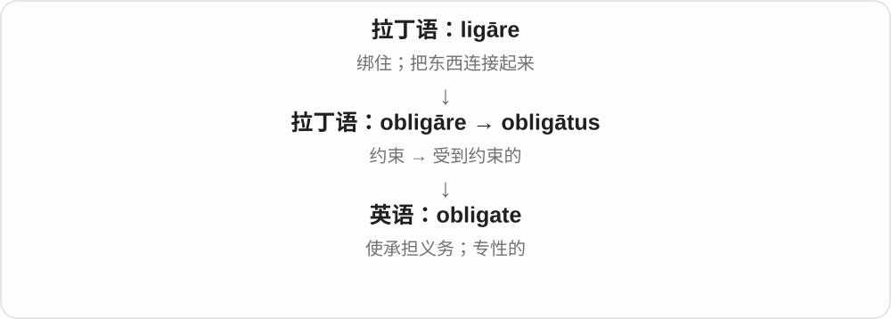

oblige 经法语变化后形成一种英语词形，obligate 则较直接地借用拉丁语的分词词干。它们因此同源却不同形。专业形容词把“受约束”用于生活条件上的必需性。

**常见搭配与例句**

obligate someone to do…；be legally obligated；an obligate parasite。

> The agreement obligates both parties to keep the records confidential.

协议要求双方对这些记录保密。

> The article describes a fungus that is an obligate parasite.

这篇文章描述了一种专性寄生真菌。

**别混淆**

oblige 的“帮忙”义较日常，obligate 通常突出使承担责任。生物学中的 obligate 与 facultative“兼性的、可选择的”相对。

### 240. delineate — 勾勒；划定；明确描述

**音标**：英、美 /dɪˈlɪnieɪt/

**先抓住这个画面**

先用线画出边界，再把各部分说清楚。

**怎么拆**

借拉丁 dēlīneātus，来自 dēlīneāre；de- 在这里加强，līnea 是线，不是“把线去掉”。

**怎么变成今天的意思**

**拉丁 līnum → līneus → līnea**  
亚麻 → 亚麻制的 → 麻线、绳、线条

↓

**拉丁 dē- + līneāre → dēlīneāre → dēlīneātus**  
完整画出线条、勾勒

↓

**英语 delineate**  
画出轮廓；明确描述或划定

可以划地理边界，也可以说明工作职责、人物性格等抽象轮廓。

**常见搭配与例句**

delineate a boundary；delineate responsibilities；clearly delineate。

> The map delineates the boundaries of the protected area.

地图划出了保护区的边界。

> The agreement delineates each partner’s responsibilities.

协议明确划定了各合作方的职责。

**别混淆**

describe 泛指描述；delineate 常强调清楚勾出结构、范围或差别。

### 241. ejaculate — 射精；突然说出〔旧〕；射出的精液

**音标**：动词：英 /ɪˈdʒækjʊleɪt/；美 /ɪˈdʒækjəleɪt/；名词：英 /ɪˈdʒækjʊlɪt/

**先抓住这个画面**

从里面突然射出；用于说话时，是一句话一下子冲出口。

**怎么拆**

借自拉丁语 eiaculari / eiaculatus，e-“向外” + iaculari“投射”，后者来自 iaculum“标枪”。名词义在英语中另有发展。

**怎么变成今天的意思**

**拉丁语：iacere；分词 iactus**  
投掷、抛出

↓

**拉丁语：iaculum → iaculari**  
投掷的标枪 → 投掷、射出

↓

**拉丁语：e- + iaculari → eiaculari / eiaculatus**  
向外射出

↓

**英语：ejaculate**  
射出；突然发声；后来也作名词

现代动词最常用于生理描述。旧文学中的 ejaculate a word 是脱口而出；名词和动词的末尾读音不同。

**常见搭配与例句**

ejaculate semen；ejaculate a reply〔旧〕。

> The study measured the volume of each ejaculate.

研究测量了每份射出精液的体积。

> “Impossible!” he ejaculated, in the language of the old story.

按那篇旧故事的说法，他脱口而出：“不可能！”

**别混淆**

exclaim 是现代常用的惊呼；ejaculate 的说话义已经显得古旧。

### 242. captivate — 迷住；使入迷

**音标**：/ˈkæptɪveɪt/

**先抓住这个画面**

没有真的绑住你，却把你的注意力牢牢抓住，让你舍不得移开。这就是 captivate。

**怎么拆**

来自 captīvus“被俘的”这一词族，晚期拉丁语 captīvāre、captīvātus 与英语 captivate 相连。可用 captive + -ate 辅助记忆。

**怎么变成今天的意思**

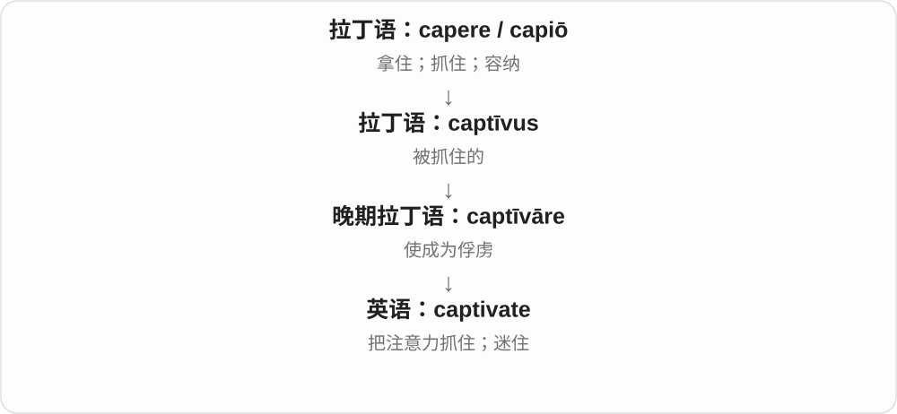

词义从把人控制住转成把人的兴趣吸引住。它常用于音乐、故事、风景或个人魅力，通常带欣赏的语气。

**常见搭配与例句**

captivate an audience；be captivated by…；a captivating story。

> The storyteller captivated the children with her voice.

讲故事的人用她的声音让孩子们听得入迷。

> We were captivated by the view from the mountain.

山上的景色让我们着迷。

**别混淆**

capture attention 可以只是成功引起注意；captivate 往往表示吸引得更深，让人持续投入。

### 243. levitate — 悬浮；使悬浮

**音标**：/ˈlevɪteɪt/

**先抓住这个画面**

物体离开地面，在空中停住，看上去像摆脱了向下的重量。

**怎么拆**

接拉丁 levis／levitas“轻、轻盈”，近代构词与 gravitate 相对；不可硬拆成现代 levy + tate。

**怎么变成今天的意思**

**拉丁 levis → levitas**  
轻 → 轻盈、轻率

↓

**近代拉丁、英语中的 levitate 一类构词**  
与重力下落相对的升起、悬浮表达

↓

**英语 levitate**  
悬在空中；使物体悬浮

磁力可以使物体 levitate；魔术表演也可能营造悬浮效果。看到这个词本身，不能就认定发生了超自然现象；需要看文本说的是装置、表演还是声称的能力。

**常见搭配与例句**

levitate above；make something levitate。

> The small magnet appeared to levitate above the base.

那块小磁体看起来悬浮在底座上方。

> The magician made a paper ring seem to levitate.

魔术师让一个纸环看起来悬浮了起来。

**别混淆**

float 可表示浮在水面、空气中等；levitate 常突出离开支撑面而悬在空中。

### 244. encapsulate — 封装；包入；精炼概括

**音标**：/ɪnˈkæpsjuleɪt/；美也常读 /ɪnˈkæpsəleɪt/

**先抓住这个画面**

把东西包进一个小单元；借到表达上，就是用一句话或一个画面装下最核心的意思。

**怎么拆**

en- 放入 + capsule 小容器 + -ate 动词后缀；英语形成动词。字面包入义在前，概括、集中体现等比喻义后来发展。

**怎么变成今天的意思**

**拉丁 capsa 盒、箱**  
装东西的容器；各支借入英语的时间和路线不同

↓

**拉丁 capsula 小盒 → 法语 capsule → 英语 capsule**  
小容器、囊；后来用于药物胶囊、太空舱等

↓

**英语 en- + capsule + -ate → encapsulate**  
封装在小壳里；后来扩展为简练呈现核心

encapsulate the problem 是简练地体现问题核心；encapsulate something in one sentence 是用一句话概括。计算机中则可说把数据与操作封装在一起，并控制外部如何访问。

**常见搭配与例句**

encapsulate the essence of；encapsulate something in a sentence；encapsulate data。

> That photograph encapsulates the joy of the celebration.

那张照片集中体现了庆祝活动的欢乐。

> The class encapsulates the data and exposes a small public interface.

这个类封装了数据，并提供一个小型公开接口。

**别混淆**

summarize 通常是压缩叙述；encapsulate 还可说某个场景本身集中体现了某种精神或问题。封装不等于加密。

### 245. fascinate — 使着迷；强烈吸引

**音标**：/ˈfæsɪneɪt/

**先抓住这个画面**

你本来只想看一眼，结果越看越想知道，注意力像被吸住了：这个东西 fascinates you。

**怎么拆**

借拉丁 fascinatus，来自 fascinare 施魔法、蛊惑。现代用法多转为吸引注意与兴趣，不是在说真有魔法。

**怎么变成今天的意思**

**拉丁 fascinare 施魔法、蛊惑 → fascinatus、fascinatio**  
像被控制注意力一样无法移开目光

↓

**英语 fascinate、fascination**  
使深深着迷；强烈兴趣与吸引力

something fascinates someone 某物使某人着迷；be fascinated by 对……着迷。事物作主语、感兴趣的人作宾语很常见。

**常见搭配与例句**

fascinate someone；be fascinated by。

> The night sky has always fascinated me.

夜空一直让我着迷。

> The children were fascinated by the tiny machine.

孩子们被那台小机器深深吸引。

**别混淆**

fascinating 说令人着迷，fascinated 说人感到着迷；I am fascinating 是说我本人很吸引人。

### 246. capitulate — 投降；屈服；让步

**音标**：英 /kəˈpɪtjʊleɪt/；美 /kəˈpɪtʃəleɪt/

**先抓住这个画面**

原来还在抵抗，最后接受对方条件、放弃抵抗，就是 capitulate。它的词源画面是把条件一条条列出来。

**怎么拆**

由中世纪拉丁 capitulatus 借入，来自 capitulare“按纲目列条、议定条件”，根在 capitulum。不能简单讲成“低下头”，那只是现代助记。

**怎么变成今天的意思**

**拉丁语：caput；属格 capitis**  
头；首领；顶端、主要部分

↓

**拉丁语：capitulum**  
小头；文章纲目、章节

↓

**中世纪拉丁 capitulare → capitulatus**  
列条目、谈条件 → 已议定条件

↓

**英语：capitulate**  
订立条件 → 在条件下投降；后来泛指屈服

capitulate to pressure 是向压力屈服；通常不接“投降的东西”作直接宾语。

**常见搭配与例句**

capitulate to；refuse to capitulate；finally capitulate。

> The company refused to capitulate to the demands.

公司拒绝向这些要求让步。

> After a long siege, the defenders capitulated.

经过长期围困，守军投降了。

**别混淆**

compromise 是双方调整；capitulate 常暗示一方放弃原来的抵抗。

### 247. decimate — 使大量减少；严重摧毁、重创

**音标**：英 /ˈdesɪmeɪt/；美 /ˈdesəmeɪt/

**先抓住这个画面**

原来与每十个抽走一个有关，今天常用来形容一场打击让数量大减。

**怎么拆**

拉丁 decimus 第十 → decimare 取十分之一、每十个惩处一个 → 分词词干 decimat- 借入英语。

**怎么变成今天的意思**

**拉丁 decem → decimus／decima**  
十 → 第十、十分之一

↓

**拉丁 decimare／decimatus → 英语 decimate**  
取十分之一等古义 → 大量削减、严重破坏

拉丁历史背景包括什一税和军队中的十抽一处罚。但英语新闻里的 disease decimated the population 通常说疾病使人口大量减少，不是在给出精确的10%统计。词源说明旧画面，现代用法还要看长期形成的意义。

**常见搭配与例句**

decimate a population；decimate crops；an industry decimated by crisis。

> The drought decimated the region’s crops.

干旱使该地区的庄稼损失惨重。

> The crisis decimated the town’s small businesses.

这场危机重创了镇上的小企业。

**别混淆**

decimate 通常强调严重损失；reduce 只是减少。它也不自动保证100%全灭，精确比例应直接写数字。

### 248. impregnate — 使怀孕；使充满；浸渍

**音标**：/ɪmˈpreɡneɪt/，也读 /ˈɪmpreɡneɪt/

**先抓住这个画面**

impregnate 的两个画面是使生命在体内孕育，以及让某种物质深入材料内部，填满细小空隙。

**怎么拆**

借自晚期或中古拉丁语 impraegnātus，来自 im-（在内）+ praegnare 词族；这里 im- 不是“不”。

**怎么变成今天的意思**

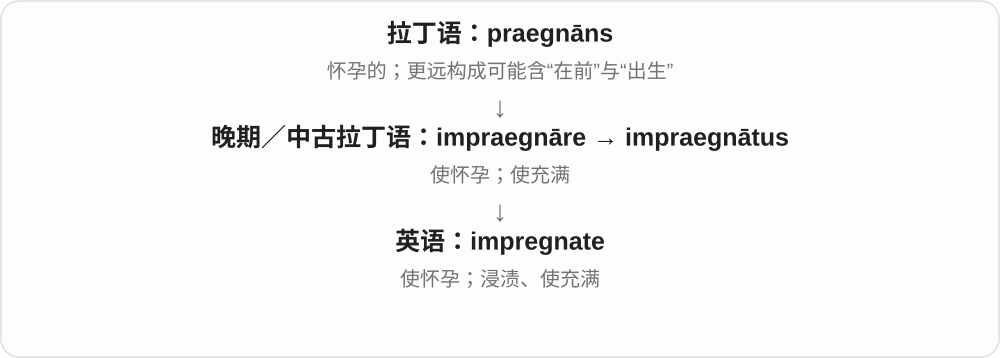

生育意义与使内部充满的用法并行。材料处理中 impregnate with resin 是让树脂渗入，不是只在表面抹一下。

**常见搭配与例句**

impregnate fabric with resin；impregnate a material with…；用于使雌性动物受孕。

> The manufacturer impregnates the fabric with resin.

制造商用树脂浸渍织物。

> The breeding records show that the male impregnated two females.

繁育记录显示，这只雄性使两只雌性受孕。

**别混淆**

impregnate 可讲浸透；coat 常只讲表面涂覆。其常用动词尾读 /eɪt/。

### 249. medicate — 给……用药；用药治疗

**音标**：/ˈmedɪkeɪt/

**先抓住这个画面**

把药物作为处理病情的一部分，是 medicate。它强调用药这个动作，不保证用了就已经治好。

**怎么拆**

接拉丁 medicare、medicari 等医治材料，与 medic- 医药及 -ate 动词形对应；不是现代 medicine 原样加 ate。

**怎么变成今天的意思**

**拉丁 mederi 治疗 → medicus、medicari 等**  
医治、医者及用药治疗的材料

↓

**法语、英语相应形式 → medicate、medication**  
用药治疗；药物或用药过程

medicate a patient 给病人用药；be medicated 被给予药物；medicated 作修饰语可说含药成分的，如 medicated shampoo 药用洗发水。

**常见搭配与例句**

medicate a patient；be medicated；medicated shampoo。

> The vet medicated the injured animal.

兽医给受伤的动物用了药。

> The article discusses when doctors choose to medicate.

文章讨论医生何时会选择用药治疗。

**别混淆**

medicate 聚焦药物处理，treat 治疗范围更广；cure 才强调治愈，三者不能当作同一结果。

### 250. depreciate — 贬值；使价值降低；计提折旧；贬低〔较旧〕

**音标**：/dɪˈpriːʃieɪt/

**先抓住这个画面**

把价值往下拉，或随着时间看见它逐渐降低。

**怎么拆**

借拉丁 dēpretiātus，接 dē-“向下” + pretium；中古英语已有低估、贬低义。

**怎么变成今天的意思**

**拉丁 pretium**  
价格、价值、报酬

↓

**拉丁 dē- + pretium → dēpretiāre / dēpretiātus**  
降低价值、低估

↓

**中古英语及现代英语 depreciate**  
贬低价值；贬值；计提折旧

A car depreciates 说车价值下降。会计中 depreciate equipment 是按规则把设备成本分配到使用期间，不要求每年账面减少额都等于市场价格下降额。

**常见搭配与例句**

depreciate in value；depreciate equipment；depreciate over time。

> The vehicle depreciated considerably during its first few years.

这辆车在最初几年里贬值不少。

> The company depreciates the equipment over its expected useful life.

公司在设备的预计使用年限内计提折旧。

**别混淆**

appreciate 的价格义是增值；depreciate 是相反方向。deprecate“反对、不建议使用”是另一个词，不能混拼。

### 251. dissociate — 使脱离联系；分离；解离

**音标**：英 /dɪˈsəʊsieɪt/；美 /dɪˈsoʊsieɪt/；/si/ 也常读 /ʃi/

**先抓住这个画面**

原来绑在一起的关系被解开：可以是人与某个观点划清界限，也可以是物质分成较小部分。

**怎么拆**

拉丁语 dis- 分开 + sociāre 联合，形成 dissociāre；英语由相应拉丁词干形成 dissociate。

**怎么变成今天的意思**

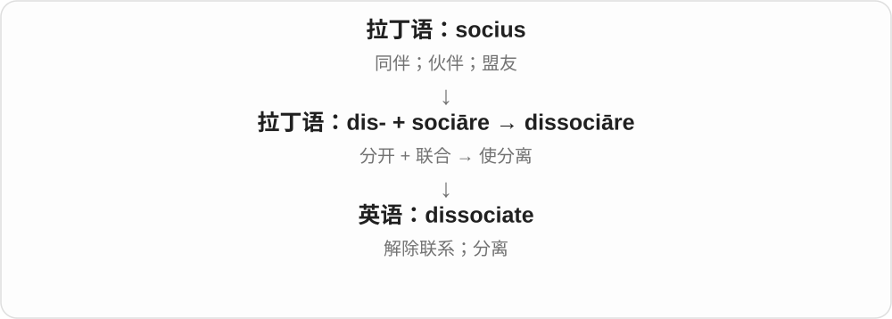

dissociate oneself from 是声明自己不支持或不涉及某事；化学语境说解离。心理学语境另有体验连接中断的专门含义，不是普通“不想社交”。

**常见搭配与例句**

dissociate A from B；dissociate oneself from；dissociate into ions。

> She dissociated herself from the group’s statement.

她声明自己不赞同该团体的声明。

> The compound dissociates into ions in water.

这种化合物在水中解离成离子。

**别混淆**

dissociate 是把联系分开；dislike 只是讨厌。可以不喜欢一个观点却仍被别人联系到它。

### 252. incubate — 孵化、孵育；培养；酝酿、培育

**音标**：/ˈɪŋkjubeɪt/

**先抓住这个画面**

最初想一只鸟伏在蛋上，让里面的生命慢慢发育。后来不一定有鸟，只要提供适合发展的条件，也可以说 incubate。

**怎么拆**

拉丁 in-“在上面” + cubare“躺、伏着” → incubare“伏在上面、孵蛋”；英语动词接其分词词干 incubat-。这里的 in- 不是否定。

**怎么变成今天的意思**

**拉丁 in- + cubare → incubare**  
伏在上面；孵蛋

↓

**拉丁分词 incubatus → 英语 incubate**  
孵育、促成发展

↓

**英语的培养与比喻用法**  
维持适合发展的条件；酝酿想法

鸟 incubates eggs，是保持适当条件让胚胎发展；实验室里 incubate cells 则是培养细胞。说一个机构 incubates ideas，是在给想法成长的空间，不表示立刻产出成品。医学中也可说某人 is incubating an infection，表示感染在症状出现前的阶段发展。

**常见搭配与例句**

incubate eggs；incubate cells；incubate an idea；be incubating an infection。

> The bird returned to the nest to incubate its eggs.

那只鸟回到巢中孵蛋。

> The workshop gave the team time to incubate new ideas.

工作坊给了团队酝酿新想法的时间。

**别混淆**

hatch 强调破壳孵出这个结果，incubate 强调此前的孵育过程；intubate 是另一个医学动词，不能因为拼写近就读成孵育。

### 253. litigate — 进行诉讼；通过诉讼争论、解决

**音标**：/ˈlɪtɪɡeɪt/

**先抓住这个画面**

双方把争议带进法律程序，由法院来处理，就是 litigate。它说选择怎样争，不说谁最后会赢。

**怎么拆**

借拉丁 litigatus，接 litigare 争讼；前部 lit- 与 lis 诉讼有关，后部接行动的动词材料，不按英语 lit 点亮来拆。

**怎么变成今天的意思**

**拉丁 lis、lit- 诉讼 + agere 行动的相关材料 → litigare**  
把争议带入法律程序争讼

↓

**拉丁 litigatus、litigatio → litigate、litigation**  
进行诉讼；诉讼过程

litigate a dispute 就争议诉讼；litigate against someone 与某人打官司；选择和解时常与 settle 对照。

**常见搭配与例句**

litigate a dispute；litigate against；choose to litigate。

> The parties chose to settle rather than litigate.

双方选择和解，没有继续打官司。

> The dispute was litigated for several years.

这场争议经历了数年的诉讼。

**别混淆**

litigate 是进行法律争讼，不等于普通争吵 argue，也不等于已经判决或执行判决。

### 254. lubricate — 润滑；使顺畅〔比喻〕

**音标**：/ˈluːbrɪkeɪt/

**先抓住这个画面**

零件相互摩擦、转得发涩，加上能减少摩擦的物质，让动作顺起来，就是 lubricate。谈合作也能借顺滑作比喻。

**怎么拆**

借拉丁 lubricatus，来自 lubricare 使滑，基础 lubricus 滑的；-ate 对应动词形式。

**怎么变成今天的意思**

**拉丁 lubricus 滑的 → lubricare、lubricatus**  
使表面容易滑动

↓

**英语 lubricate**  
润滑机器；比喻使过程更顺畅

lubricate moving parts 润滑活动部件；lubricate a mechanism 润滑机构；well lubricated 润滑良好。

**常见搭配与例句**

lubricate moving parts；lubricate a mechanism。

> Oil lubricates the moving parts.

油润滑活动部件。

> The technician checked whether the mechanism was properly lubricated.

技术员检查机构是否得到适当润滑。

**别混淆**

lubricate 是减少摩擦的处理，clean 是清洁；部件干净不自动表示润滑充分。

### 255. pollinate — 给植物授粉

**音标**：英 /ˈpɒləneɪt/；美 /ˈpɑːləneɪt/

**先抓住这个画面**

把花粉送到能接收它的位置，好让后面的繁殖过程有机会发生。

**怎么拆**

英语可分析为 pollin- 花粉 + -ate 动词结尾；历史上也可能是从先出现的 pollination 反构。两种说明都不要求现代名词必须由现代动词先造出来。

**怎么变成今天的意思**

**拉丁 pollen、pollin-**  
花粉所用的词干

↓

**英语 pollinate**  
从 pollination 反构或直接据 pollin- 构词；给植物授粉

蜜蜂访问花朵时，身上携带的花粉可能落到柱头上，这就是帮助 pollinate flowers。风也能授粉，所以这个动作不只属于蜜蜂。授粉是花粉的转移，不等于受精已经完成。

**常见搭配与例句**

pollinate flowers；pollinate crops；be pollinated by wind。

> Bees help pollinate many flowering plants.

蜜蜂帮助许多开花植物授粉。

> Wind pollinates the corn in this field.

风为这片田里的玉米授粉。

**别混淆**

pollinate 说传递花粉；fertilize 在这个生物语境里说受精，是后续不同的环节。给土壤施肥也叫 fertilize，又是另一个意思。

### 256. collate — 汇集整理；比对校勘；按份顺序排列

**音标**：/kəˈleɪt/

**先抓住这个画面**

把各处材料收拢、核对、排好，叫 collate；打印十份三页文件时，把每份都排成 1、2、3，也是在 collate。

**怎么拆**

接拉丁 collatus，是 conferre 带到一起、比较的分词形式；con- 一起与 ferre 带的词族，英语借入了不同词干。

**怎么变成今天的意思**

**拉丁 conferre → collatus**  
带到一起；比较

↓

**英语 collate**  
汇集比对；把纸页逐份排齐

collate data 汇集整理数据；collate two texts 比对两种文本；collate printed copies 把打印页按份排好。

**常见搭配与例句**

collate data；collate two texts。

> The team collated data from several reports.

团队汇集整理了几份报告的数据。

> The printer can collate the pages automatically.

打印机能自动按份排列纸页。

**别混淆**

collate 不只 collect 收集，还常包含核对、整理或排顺序；打印时逐份排与同页堆在一起也不同。

### 257. consecrate — 祝圣；奉为神圣；郑重献身于

**音标**：英 /ˈkɒnsɪkreɪt/；美 /ˈkɑːnsɪkreɪt/

**先抓住这个画面**

把某个地方或事物正式从日常用途里划出来，献作宗教用途；也可比喻郑重地把自己交给一项事业。

**怎么拆**

拉丁 con- 加 sacrare“使神圣”，形成 consecrare；内部 sac- 变成 secr-。其过去分词 consecratus 进入中古英语，发展为动词 consecrate。不是 con + secret“秘密”。

**怎么变成今天的意思**

**拉丁 con- + sacrare → consecrare**  
郑重奉为神圣、奉献

↓

**拉丁 consecratus → 中古英语 consecrate／consecraten**  
分词形式进入英语并形成动词

↓

**英语 consecrate**  
祝圣；郑重献身、奉献

consecrate a church 是举行仪式，把建筑正式奉为宗教用途。consecrate one’s life to a cause 则非常郑重地表达献身，比普通的 spend time on 更强。

**常见搭配与例句**

consecrate a church／altar；consecrate something to someone；consecrate one’s life to a cause。

> The bishop came to consecrate the new chapel.

主教前来为新礼拜堂举行祝圣仪式。

> The biography describes a life consecrated to the care of others.

这部传记描写了奉献于照料他人的一生。

**别混淆**

consecrate 强调使之具有神圣地位或郑重奉献；desecrate 是亵渎、冒犯这类地位；decorate 是装饰，词源不同。

### 258. oscillate — 摆动；振荡；在两端之间摇摆

**音标**：英 /ˈɒsɪleɪt/；美 /ˈɑːsɪleɪt/

**先抓住这个画面**

往一边走，又回向另一边，重复这个来回过程。

**怎么拆**

一说从较早的英语 oscillation 反构，一说借拉丁 oscillatus，来自 oscillare。两种直接来源解释并存，底层都涉及摆动。

**怎么变成今天的意思**

**拉丁 oscillum 摆动物 → oscillare 摆动**  
常联系悬挂随风摇动的小面具、os 嘴或脸；这种联系是通常解释，不作无争议事实

↓

**英语 oscillation 反构／拉丁 oscillatus 借入 → oscillate**  
词典保留两种直接来源解释；都接拉丁摆动词族

a fan oscillates 是风扇头左右摇摆，不是只说叶片旋转。oscillate between two opinions 是想法来回变，未必已经作出决定。

**常见搭配与例句**

oscillate between；oscillate around an equilibrium；an oscillating fan。

> The fan oscillated slowly from side to side.

风扇头缓慢地左右摇摆。

> He oscillated between accepting the offer and staying in his current job.

他在接受提议与留在现职之间反复犹豫。

**别混淆**

rotate 常说转圈，oscillate 强调来回。vacillate 特别说犹豫不决，oscillate 还广泛用于机械和物理变化。

### 259. enumerate — 逐一列举；枚举；逐项计数

**音标**：英 /ɪˈnjuːməreɪt/；美 /ɪˈnuːməreɪt/

**先抓住这个画面**

不是笼统说有很多，而是一项一项点出来。

**怎么拆**

来自或仿照拉丁 ēnumerātus，接 ēnumerāre：ex-“出、充分” + numerāre“数”。开头的 e- 不是电子设备的 e。

**怎么变成今天的意思**

**拉丁 numerus**  
数；数量

↓

**拉丁 numerāre；加 ex- → ēnumerāre，分词 ēnumerātus**  
数 → 一项项数出、列出

↓

**英语 enumerate**  
逐一列举、枚举

enumerate the reasons 就是把理由逐条列出，偏正式；计算机里 enumerate items 则常说依次取得或列出元素。

**常见搭配与例句**

enumerate the reasons；enumerate the steps；enumerate all possibilities。

> The report enumerates the main risks of the project.

报告逐一列出了项目的主要风险。

> The program can enumerate all files in the folder.

程序可以列出文件夹中的所有文件。

**别混淆**

count 可以只得出总数；enumerate 更突出逐项点出或列出。

### 260. hallucinate — 产生幻觉；感知到并不存在的事物

**音标**：/həˈluːsɪneɪt/

**先抓住这个画面**

体验像是真的听见、看见，却没有相应外界来源，这是 hallucinate 的感知画面。它与主动编一个想象故事不同。

**怎么拆**

借拉丁 hallucinatus、alucinatus，来自 alucinari 走神、做梦等材料；现代聚焦幻觉，专业定义比普通想象更具体。

**怎么变成今天的意思**

**拉丁 alucinari、hallucinari 等**  
做梦、走神、误感等旧材料

↓

**英语 hallucinate**  
产生没有对应外部刺激的知觉体验

hallucinate a voice 幻听到声音；begin to hallucinate 开始产生幻觉；AI 语境里也借来形容生成不实内容。

**常见搭配与例句**

begin to hallucinate；hallucinate a voice。

> In the novel, the exhausted traveller begins to hallucinate.

小说里，疲惫的旅人开始产生幻觉。

> She described hallucinating during a high fever.

她描述了高烧时产生幻觉的经历。

**别混淆**

imagine 是想象，通常不必把想象当外界真实知觉；hallucinate 则有感知仿佛真实发生的核心。

### 261. incapacitate — 使失去行动、工作等能力

**音标**：/ˌɪnkəˈpæsɪteɪt/

**先抓住这个画面**

原本能走、能工作，一场伤病让人暂时或长期做不了，就是 incapacitate。关键是能力受限到不能完成相应活动。

**怎么拆**

incapacity 无能力的词干 + -ate 形成动词，相关 in- 不与 capacity 能力材料；表示使进入不能胜任的状态。

**怎么变成今天的意思**

**capacity → incapacity**  
能力 → 缺少、失去能力的状态

↓

**incapacity 的词干 + -ate → incapacitate**  
使人不能行动、工作或履行某职能

be incapacitated by injury 因伤失去行动能力；temporarily incapacitate 暂时使失去能力；incapacitate someone for work 使不能工作。

**常见搭配与例句**

be incapacitated by；temporarily incapacitate。

> The injury incapacitated him for several weeks.

伤势使他几周都无法正常行动。

> The illness left her temporarily incapacitated.

疾病让她暂时失去正常活动能力。

**别混淆**

incapacitate 不必永久，temporarily 可明确暂时；也不等于只是轻微 inconvenience 不便。

### 262. punctuate — 给……加标点；不时打断、穿插；强调

**音标**：英、美 /ˈpʌŋktʃueɪt/

**先抓住这个画面**

长长一段文字里加上逗号、句号，让它有停顿；长长一段活动里，掌声或笑声也像这样插进来。

**怎么拆**

早期形式可追到中世纪拉丁语 punctuatus；现代“加标点”义还有从较早名词 punctuation 反构的解释。不能把所有用法都说成现代英语 punct- + -uate。

**怎么变成今天的意思**

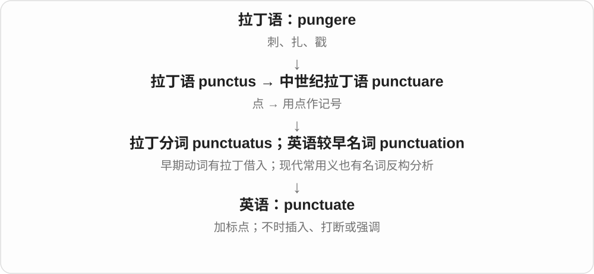

punctuate a sentence 是加标点；a speech punctuated by laughter 是讲话不时被笑声打断。动作也可以像感叹号一样强调一句话。

**常见搭配与例句**

punctuate a sentence；be punctuated by；punctuate a remark with…。

> Punctuate the sentence so that its meaning is clear.

给这句话加上标点，使意思清楚。

> Bird calls punctuated the silence of the garden.

鸟鸣不时打破花园里的宁静。

**别混淆**

interrupt 可以是一次突然中断；punctuate 常像一串话里反复出现的小停顿或强调点。

### 263. fixate — 过分关注；执着于；把视线固定在

**音标**：英 /fɪkˈseɪt/；美 /ˈfɪkseɪt/

**先抓住这个画面**

目光或心思一直钉在一个点上，很难挪开。

**怎么拆**

fix + -ate 或接拉丁 fixus 构词；心理意义可能也从更早的 fixation 反构，不把名词都排在动词之后。

**怎么变成今天的意思**

**拉丁语 figere → 分词 fixus**  
插入、钉住、使固定 → 固定的

↓

**可能经古法语 \*fixer → 中古英语 fixen → fix**  
固定、把目光停住；后来指安排、修理；\* 为重建形式

↓

**英语 fix + -ate → fixate**  
使固定、注视；心理义也可能受 fixation 反构影响

日常常用 fixate on：不要一直纠结小错误。视觉研究中的 fixate a target 则可以仅指注视目标，没有负面情绪。英美常见重音位置不同。

**常见搭配与例句**

fixate on a mistake；fixate on the past；fixate a visual target。

> Try not to fixate on the one question you answered badly.

尽量不要一直纠结那一道没答好的题。

> Participants were asked to fixate a dot at the centre of the screen.

研究要求参与者注视屏幕中央的一个点。

**别混淆**

concentrate 强调集中注意力；fixate 在普通话语里常带过度、难以放下的意思。

### 264. inoculate — 接种；使获得抵抗力

**音标**：英 /ɪˈnɒkjuleɪt/；美 /ɪˈnɑːkjuleɪt/

**先抓住这个画面**

历史上是把芽接入植物；后来把接入少量材料的画面用于接种，也能比喻先让人形成抵抗力。

**怎么拆**

拉丁 in- 入 + oculus 芽眼 → inoculare 嫁接，借过去分词词干 inoculat- 进入英语。医学义的发展还受到名词 inoculation 的影响，不能只画现代动词先产生所有名词义。

**怎么变成今天的意思**

**拉丁 oculus 眼；也指芽眼**  
形状或功能相像的东西也可借眼命名

↓

**拉丁 in- 入 + oculus 芽 → inoculare 嫁接芽**  
这里最初是把芽接入植物，并不是把东西送进眼睛

↓

**拉丁 inoculat- → 英语 inoculate 的嫁接义**  
植入植物的芽

↓

**受 inoculation 医学义影响 → inoculate 接种**  
后来又有使抵御某种影响的比喻

inoculate somebody against a disease 是为某人接种以预防疾病。比喻说 inoculate readers against misinformation，就是先教他们识别套路，让假消息更难影响他们。

**常见搭配与例句**

inoculate against a disease；inoculate people against misinformation。

> The records show that the children were inoculated against smallpox.

记录显示，这些孩子接种过预防天花的疫苗。

> The course aims to inoculate readers against misleading claims.

这门课旨在让读者对误导性说法更有抵抗力。

**别混淆**

vaccinate 日常更直接说疫苗接种；inoculate 在历史与实验语境范围更宽。开头 in- 是进入，不是否定；这里也没有向眼睛注射的意思。

### 265. indoctrinate — 向……灌输思想；使不加质疑地接受观念

**音标**：英 /ɪnˈdɒktrɪneɪt/；美 /ɪnˈdɑːktrəneɪt/

**先抓住这个画面**

持续给出同一套答案，让人习惯接受而不是检查理由。

**怎么拆**

英语 in- + doctrine + -ate，可能仿法语 endoctriner，或扩展更早的 indoctrine。它外形像拉丁借词，但不能据此虚构一个确定的古拉丁祖词。

**怎么变成今天的意思**

**拉丁 docēre；完成分词 doctus**  
教；使人知道；有学问的

↓

**拉丁 doctrīna → 古法语 doctrine**  
教导、学问、一套教义

↓

**中古英语及英语 doctrine**  
系统传授或认可的原则、教义

↓

**英语 in- + doctrine + -ate → indoctrinate**  
向人灌输一套观念；早期也泛指教导

indoctrinate someone into an ideology 或 indoctrinate someone with beliefs，强调使对方接受一套观念。现代语气通常批评缺乏质疑空间；旧文里有时只是教导义。

**常见搭配与例句**

indoctrinate someone into；indoctrinate someone with；be indoctrinated from childhood。

> The regime used compulsory lessons to indoctrinate the recruits.

该政权利用强制课程向新成员灌输思想。

> She argues that schools should teach students to question rather than indoctrinate them.

她认为学校应教学生提出质疑，而不是向他们灌输思想。

**别混淆**

teach 可以鼓励学生检验证据；indoctrinate 通常强调让人接受既定信念，较少容许独立怀疑。

### 266. abbreviate — 缩写；缩短

**音标**：/əˈbriːvieɪt/

**先抓住这个画面**

把一个较长的名称或表达压成更短的形式。

**怎么拆**

来自拉丁 abbreviare“缩短”的相关形式；ab- 常分析为 ad- 在 b 前的同化，不宜简单记成“拿走一个词根”。

**怎么变成今天的意思**

**拉丁 brevis → abbreviare**  
短 → 使变短

↓

**拉丁 abbreviatus → 英语 abbreviate**  
缩短、缩写；具体英语形成亦有逆构分析

abbreviate a name 是把名字写短；abbreviate as 后面放缩写结果。用缩写通常为了节省空间或避免反复写长词，但读者必须知道它代表什么，否则短了也不清楚。

**常见搭配与例句**

abbreviate X as Y；be abbreviated to；abbreviate a title。

> The company name is abbreviated as NTS.

公司名称缩写为 NTS。

> Please do not abbreviate your name on this form.

请不要在这张表格上缩写你的姓名。

**别混淆**

abbreviate 常用于词或名称的缩写；abridge 常用于文章、书等较大内容的删节。

### 267. commentate — 作实况解说、现场评论

**音标**：英 /ˈkɒmənteɪt/；美 /ˈkɑːmənteɪt/

**先抓住这个画面**

比赛在进行，解说员跟着进程讲发生了什么、为何关键，就是 commentate。通常不是赛后随便留一句评论。

**怎么拆**

由 commentator 解说员去掉末尾 -or 逆构，形成 commentate；现代看起来与 comment + -ate 对应，历史上较长的词反而先提供形成材料。

**怎么变成今天的意思**

**commentator 解说员 → commentate**  
去尾逆构成相应动词

↓

**现代 commentate**  
为体育等事件作现场、实况评论

commentate on a match 解说比赛；commentate for a broadcaster 为广播机构作解说；live commentating 现场解说。

**常见搭配与例句**

commentate on；commentate for。

> She will commentate on the final for radio.

她将为电台解说决赛。

> He has commentated on several major tournaments.

他解说过几场大型锦标赛。

**别混淆**

commentate 常是持续报道事件的解说工作，comment 是发表评论；观众发一条留言，通常只说 comment。

### 268. emancipate — 解放；使摆脱控制或束缚

**音标**：英 /ɪˈmænsɪpeɪt/；美 /ɪˈmænsəpeɪt/

**先抓住这个画面**

emancipate 的历史画面是把一个人从别人的支配权下放出来，今天也可说摆脱社会观念或制度的束缚。

**怎么拆**

e- / ex-（向外）+ 拉丁 mancipāre“转交支配权”，后者远连 manus“手”与 capere“取得”；英语借其分词词干。

**怎么变成今天的意思**

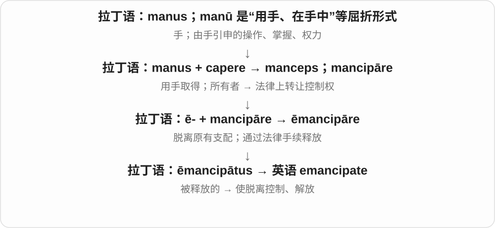

历史上涉及古罗马家长权和奴役制度，现代常见 emancipate someone from something。它比普通的 let go 更正式、更强调独立地位。

**常见搭配与例句**

emancipate enslaved people；emancipate someone from；emancipate oneself。

> The movement sought to emancipate workers from oppressive conditions.

这场运动希望让工人摆脱压迫性的处境。

> She tried to emancipate herself from other people’s expectations.

她努力摆脱别人对她的期待所带来的束缚。

**别混淆**

liberate 适用范围较宽；emancipate 常突出摆脱法律、社会或思想上的支配。

### 269. incarcerate — 监禁；关押

**音标**：英 /ɪnˈkɑːsəreɪt/；美 /ɪnˈkɑːrsəreɪt/

**先抓住这个画面**

把人关进一个不能自由离开的地方，通常说的是监狱。

**怎么拆**

中世纪拉丁 in-“进入”+ carcer“监狱”形成 incarcerare，分词是 incarceratus。英语动词可追到这一分词；另有从英语 incarceration 逆构的分析。in- 在此不是否定。

**怎么变成今天的意思**

**拉丁 in- + carcer → 中世纪拉丁 incarcerare**  
进入 + 监狱 → 监禁

↓

**拉丁分词 incarceratus，或英语 incarceration 的逆构**  
英语动词来源的两种分析

↓

**英语 incarcerate**  
监禁、关押

新闻和研究常写 be incarcerated，表示被关押；这个词比 put in prison 正式。它关注自由受到拘禁，不单凭这个词就说明司法程序具体到了哪一步。

**常见搭配与例句**

incarcerate someone；be incarcerated in a prison；be incarcerated for an offence。

> The report examines why the state incarcerates so many people.

报告研究了该地区为什么关押如此多的人。

> He was incarcerated for several years before his release.

他被关押了几年后才获释。

**别混淆**

arrest 是逮捕这一动作；incarcerate 强调关押。它也比普通的 confine“限制在某处”更容易让人想到监禁。

### 270. copulate — 交配；性交〔正式、生物学用语〕；连接的〔旧形容词〕

**音标**：动词：英 /ˈkɒpjəleɪt/；美 /ˈkɑːpjəleɪt/；旧形容词词尾读 /lət/

**先抓住这个画面**

生物学中用一个客观、正式的词，说个体发生交配这一行为。

**怎么拆**

来自拉丁语 copulatus，copulare“连接”的过去分词。早期英语也泛指连接，后来动词主要专用于性结合；旧形容词与动词末尾读音不同。

**怎么变成今天的意思**

**拉丁语 copula**  
连接、纽带；通常联系 co- 一起与更早的连接词干

↓

**拉丁语 copulare → copulatus**  
纽带 → 使连接 → 已结合的

↓

**英语 copulate**  
早期连接、结合 → 动词常用义为交配

观察动物行为时常用 copulate，不带口语或调情意味。交配行为不等于一定已经受精；这些是不同阶段。旧形容词“连接的”今天很少用。

**常见搭配与例句**

copulate with；animals copulate；a copulating pair。

> The researchers recorded when the insects began to copulate.

研究人员记录了昆虫开始交配的时间。

> The pair copulated after a brief courtship display.

这对动物在短暂的求偶展示后进行了交配。

**别混淆**

mate 在繁殖语境中更常见；copulate 更明确指交配行为，语气较科学。

### 271. ruminate — 反复思量；反刍

**音标**：/ˈruːmɪneɪt/

**先抓住这个画面**

牛把吃下去的草再嚼一遍，人把脑中的一件事再想一遍。

**怎么拆**

接拉丁 ruminare／ruminari 的分词形式 ruminatus；拉丁语本来就同时有反刍和思量义。英语借入时就承接了这两层意思。

**怎么变成今天的意思**

**拉丁 rumen／rumin- 喉部、食道**  
更远来源未定

↓

**拉丁 ruminare／ruminari 反刍，也指反复思量**  
食物再嚼一遍；想法再过一遍

↓

**拉丁 ruminatus → 英语 ruminate**  
反复思量；动物反刍

ruminate on a remark 是把一句话翻来覆去地想；语气可以平静深思，也可以是放不下。动物用法则是真把已吞下的食物返到口中再嚼。

**常见搭配与例句**

ruminate on a question；ruminate over the past；cattle ruminate。

> She ruminated on his final remark throughout the train journey.

整段火车旅程中，她都在反复琢磨他最后那句话。

> The cattle rested in the shade and ruminated after feeding.

牛群吃过食物后，在阴凉处休息并反刍。

**别混淆**

reflect 可以是一次有目的的回顾；ruminate 更突出反复停留在同一件事上，但它不总等于焦虑。

### 272. ovulate — 排卵

**音标**：英 /ˈɒvjuleɪt/；美 /ˈɑːvjuleɪt/

**先抓住这个画面**

用动词说卵巢释放卵这一动作。

**怎么拆**

常见历史分析是从较早的 ovulation 逆构出 ovulate；也有 ovulum“小卵” + -ate 的构词分析。两条都接拉丁 ovum，不能断言先有英语动词再有名词。

**怎么变成今天的意思**

**拉丁语 ovum**  
卵、蛋

↓

**后期学术拉丁 ovulum**  
小卵，ovum 的小称形式

↓

**19 世纪英语 ovulation → ovulate**  
一说由名词逆构为动词；另说 ovulum + -ate

↓

**现代英语 ovulate**  
排卵

Some animals ovulate seasonally 说某些动物在特定季节排卵。这个动词通常不及物：说 ovulate，不必把 egg 再当宾语硬接上。它不表示已经受精，也不表示已经怀孕。

**常见搭配与例句**

ovulate regularly；ovulate seasonally；when an animal ovulates。

> Some animals ovulate only during a particular breeding season.

有些动物只在特定繁殖季节排卵。

> The researcher recorded whether each animal had ovulated.

研究人员记录了每只动物是否已经排卵。

**别混淆**

ovulate 是动作，ovulation 是过程名词；ovulate 重读开头，ovulation 的主重音在 -lation。

### 273. percolate — 渗过、滤过；逐渐传开或形成；用渗滤法煮咖啡

**音标**：英 /ˈpɜːkəleɪt/；美 /ˈpɜːrkəleɪt/

**先抓住这个画面**

水不是一下冲过去，而是穿过土壤、石块间的小空隙；想法和消息也能这样一点点进入人群或脑海。

**怎么拆**

拉丁 per-“穿过” + colare“滤”，形成 percolare，分词 percolatus。英语可能直接采用这一分词词干，也可能从较早的英语 percolation 逆构；两种分析都有依据。

**怎么变成今天的意思**

**拉丁 per- + colare → percolare／percolatus**  
穿过滤层、滤过

↓

**英语借入分词词干／由 percolation 逆构**  
两种来源分析，不把较早名词强说成动词后代

↓

**英语 percolate**  
渗透；想法、信息逐渐传开；咖啡渗滤

物理画面是“经过许多小通道”。比喻用法保留缓慢、逐步的感觉：消息从一个团队传到另一个团队，或一个主意在心里慢慢成形。未必真的有液体，也不等于突然宣布。

**常见搭配与例句**

water percolates through soil；news percolates through an organization；let an idea percolate。

> Rainwater slowly percolated through the soil.

雨水慢慢渗过土壤。

> The idea percolated through the team over several weeks.

这个想法花了几个星期才逐渐在团队中传开。

**别混淆**

spread 是一般的传播；percolate 更像经过层层空隙逐渐传开。词中没有额外的 y 音，读 /kə/，不是 /kjə/。

### 274. cremate — 火化

**音标**：英 /krəˈmeɪt/；美 /ˈkriːmeɪt/

**先抓住这个画面**

作为丧葬安排，把逝者遗体以焚烧方式处理，叫 cremate。现代常用在被动句，平静叙述一种身后安排。

**怎么拆**

借拉丁 crematus，来自 cremare 烧成灰；现代常见火化遗体的专门用法，英美常用重音、元音有差别。

**怎么变成今天的意思**

**拉丁 cremare → crematus**  
焚烧、烧成灰

↓

**英语 cremate**  
在丧葬语境中火化遗体

be cremated 被火化；choose to be cremated 选择身后火化；cremation 是相应名词。

**常见搭配与例句**

be cremated；choose to be cremated。

> He asked to be cremated after his death.

他提出去世后采用火化。

> The family confirmed that the body had been cremated.

家属确认遗体已火化。

**别混淆**

cremate 是较专门的火化，burn 是燃烧、烧毁的广义动词；平常烧掉一张纸不必用 cremate。

### 275. domesticate — 驯化；使适应家居生活；驯化动植物〔名词〕

**音标**：动词 /dəˈmestɪkeɪt/；名词 /dəˈmestɪkət/

**先抓住这个画面**

把原本野生的动植物逐渐纳入人类栽培、饲养的生活体系。

**怎么拆**

接中世纪拉丁 domesticatus，来自 domesticare；也可能经法语 domestiquer。现代可与 domestic + -ate 对照，但历史是借入古典派生形式。

**怎么变成今天的意思**

**拉丁语 domus**  
家、房屋、家庭

↓

**拉丁语 domesticus → 中世纪拉丁语 domesticare / domesticatus**  
家里的 → 驯养、使适应家庭使用

↓

**英语 domesticate〔也可能经法语 domestiquer〕**  
驯化；使适应家庭生活

常说 domesticate animals 或 plants。严格谈驯化时，通常涉及群体跨代变化，不是把一只野兽训练得听话就算完成。用于人则常是轻松说法，指习惯家庭生活。

**常见搭配与例句**

domesticate a species；domesticate plants；become domesticated。

> Humans domesticated many plants long before modern farming machinery existed.

现代农业机械出现很久之前，人类就已驯化了许多植物。

> The article asks how wolves came to be domesticated.

文章探讨狼是怎样逐渐被驯化的。

**别混淆**

tame 可以指让某一只动物不怕人、听话；domesticate 通常谈更长期的饲养、培育与适应。

### 276. inundate — 淹没；使应接不暇

**音标**：/ˈɪnʌndeɪt/

**先抓住这个画面**

水、邮件或请求一下涌来，多到眼前被覆盖，来不及处理。

**怎么拆**

接拉丁 inundare / inundatus；也有从较早英语 inundation 反构的解释，不能把词源路线只画成英语动词先于名词。

**怎么变成今天的意思**

**拉丁 unda → undare**  
波浪 → 起浪、涌流

↓

**拉丁 in- + undare → inundare**  
涌上来、漫过 → 淹没

↓

**两种解释：拉丁 inundatus 借入；或英语 inundation 反构 → inundate**  
被水漫过 → 淹没；大量事务涌来

be inundated with emails 是邮件多得应接不暇；floodwater inundates a town 则是真正淹水。with 后面通常说明涌来的东西。

**常见搭配与例句**

inundate with；be inundated with requests；inundate low ground。

> The office was inundated with requests after the announcement.

公告发出后，办公室收到了大量请求，应接不暇。

> Floodwater inundated the fields beside the river.

洪水淹没了河边的田地。

**别混淆**

flood 既可真实也可比喻，较日常；inundate 常强调覆盖面积或数量造成的压力。

### 277. perforate — 打孔；穿透，使形成孔洞

**音标**：英 /ˈpɜːfəreɪt/；美 /ˈpɜːrfəreɪt/

**先抓住这个画面**

把一张纸打出一排小孔，方便沿线撕开，就是 perforate the paper。重点是表面被打穿，而不只是留下凹痕。

**怎么拆**

per- 接拉丁 per“穿过”，for- 接 forare“钻、刺”。英语早期有表示“被穿透的”的形容词形式，接拉丁 perforatus；动词也有从较早名词 perforation 逆构的分析。不能只按现代动词→名词解释整个词族的出现顺序。

**怎么变成今天的意思**

**拉丁 per；forare**  
穿过；钻、刺出孔

↓

**拉丁 perforare → perforatus**  
穿透、打孔 → 已被穿透的

↓

**中古英语相关形容词；perforation 名词**  
“被穿透的”与“孔、打孔”已出现

↓

**英语动词 perforate**  
由拉丁分词词干发展，或从较早名词逆构：把东西打穿

它可以说一次穿孔，也可以说成排打孔；对象可以是纸、金属等材料。医学文字里也可能用它说组织被穿破，不过这个动词本身并不说明孔是故意加工的，还是意外造成的。

**常见搭配与例句**

perforate paper；perforate a metal sheet；a machine that perforates tickets。

> The machine perforates the paper before the sheets are folded.

机器先给纸打孔，再把纸张折起来。

> The manufacturer perforates the panels to let air pass through.

制造商在板材上打孔，让空气能够通过。

**别混淆**

pierce 强调刺穿，puncture 常说刺出一个孔；perforate 尤其适合谈穿孔、打孔，也常用于一排或一组孔。它不等于把东西彻底切成两半。

### 278. interpolate — 插入〔文字等〕；插值、内插

**音标**：英 /ɪnˈtɜːpəleɪt/；美 /ɪnˈtɜːrpəleɪt/

**先抓住这个画面**

两段话之间添进一句，是 interpolate；已有几个数据点，在它们之间估计一个中间值，也是在插入一个有依据的中间量。

**怎么拆**

借拉丁 interpolatus，来自 interpolare 修整、改动，inter- 之间的材料；现代展开为文本插入及数学插值，不把整个词硬拆成英语 pole 柱子。

**怎么变成今天的意思**

**拉丁 interpolare → interpolatus**  
修整、改动已有内容

↓

**英语 interpolate**  
在中间插入；从已知数据估计中间值

interpolate a passage 插入一段文字；interpolate between data points 在数据点之间插值；a linearly interpolated value 线性插值所得值。

**常见搭配与例句**

interpolate between；interpolate a passage。

> The software interpolates between the measured points.

软件在测得的数据点之间进行插值。

> A later editor interpolated a short passage into the text.

后来的编辑在文中插入了一小段。

**别混淆**

interpolate 通常估计已知范围之间的值，extrapolate 向已知范围外推；二者需要面对的假设、范围不同。

## 这一组要分清什么

tolerate 能容忍不等于赞同；contemplate doing 是认真考虑做；meditate 冥想与 mediate 调解分开；predicate 等分词性读音；sulfate 的 -ate 属化学命名，不能解作使成为。

## 串起来练习

The results indicate that the team has accumulated adequate data to contemplate the next step.

结果表明，团队已积累足够数据，可以认真考虑下一步。
