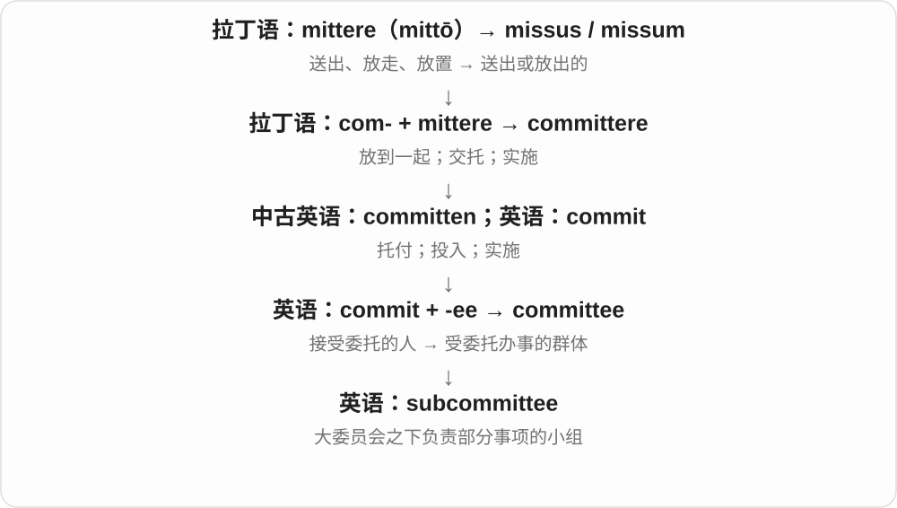
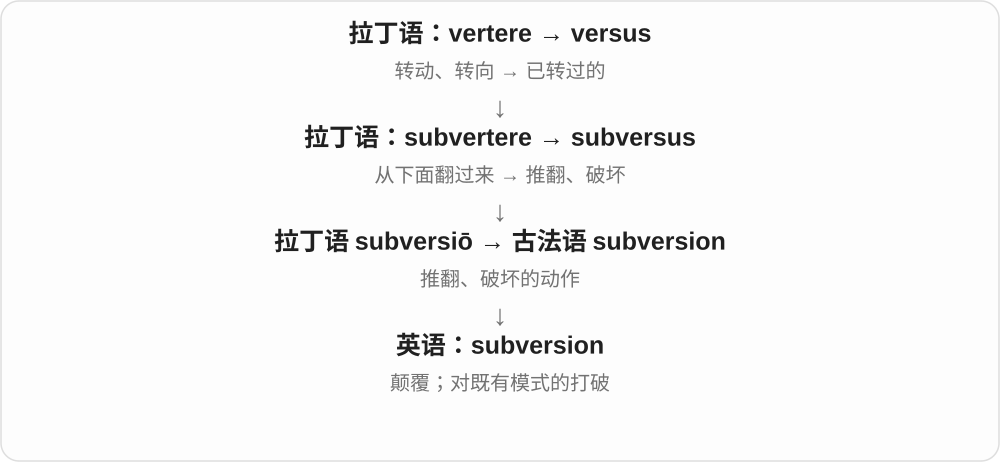
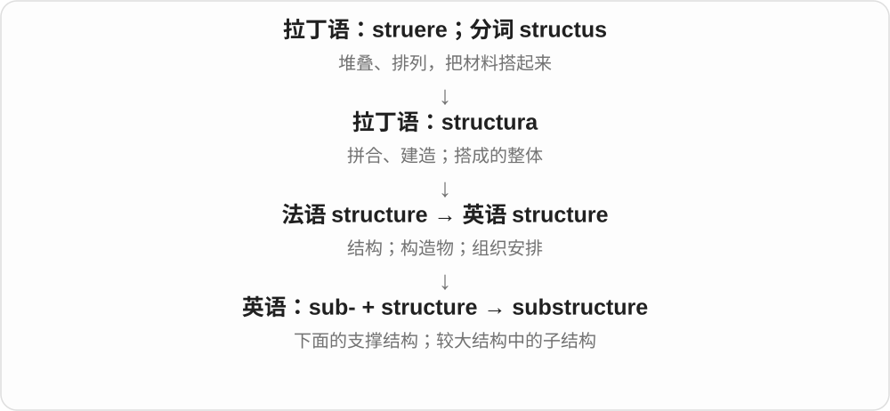
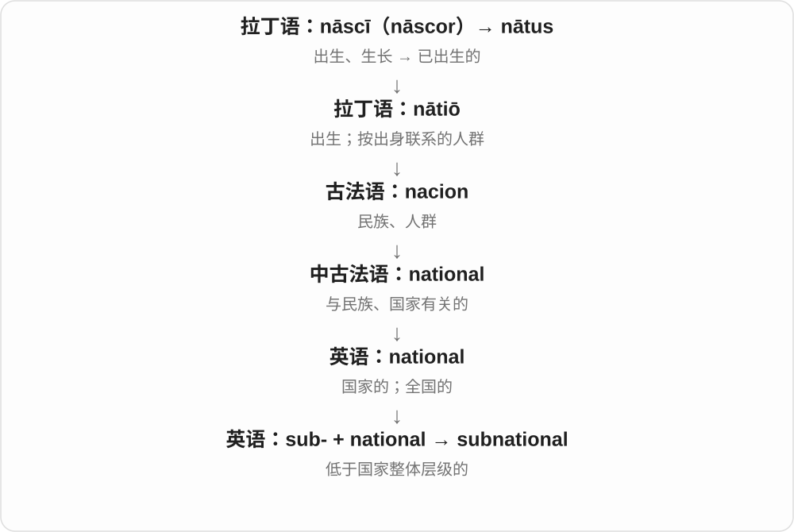

# 0201 · sub-, su-, suf-, sug-, sup-, sus- — 在下面；下一级；低于；接近

[逐词精讲目录](../00_逐词精讲目录.md) · [总目录](../00_总目录_按常用程度.md)

## 核心词根与来源

拉丁语 sub 既能表示在下面，也能表示从下向上、靠近。英语把 sub- 变成很活跃的构词前缀，可以接拉丁借词，也可以接 way、sea 等英语本族词。旧拉丁借词里的写法会变化，现代新构词却多保留清楚的 sub-。

**先找一个参照物：在它下方、属于它的下一层，或者还没达到它的标准。**

海面下是 submarine，集合里面的小集合是 subset，标准线下是 substandard；三种“下面”并不一样。

- **实际位置在下面**：subway, submarine, subsea, subsoil, subglacial
- **整体内部的下一层**：subset, subgroup, subunit, subcategory, subdomain
- **低于标准或阈值**：substandard, subpar, suboptimal, subliminal, subclinical
- **邻近某个地带**：suburban, subtropical, subarctic, subalpine
- **合同与管理层级**：subcontract, subcontractor, sublet, sublease
- **原本隐藏在表层下面**：subconscious, subtext
- **历史同化形式**：suggest, suggestion, suffix, support

## 词形与演化规律

sub- 在历史拉丁组合中可同化为 sug-、suf-、sup- 等：suggest 的 sug- 后接 gerere，suffix 的 suf- 后接 figere，support 的 sup- 后接 portare。sus- 等形式同样须按具体词史判断，不能看到相同字母就认作同根。suburban 的 sub- 是靠近城，subacute 是未充分达到某种程度。

## 单词速览（按词族由简到繁）

同一基础词的相关扩展放在一起，先读基础形式，再读扩展；各组之间优先读常用的。具体词源关系见各词讲解。

| 单词 | 音标 | 核心意思 |
|---|---|---|
| [support](#w-1) | 英 /səˈpɔːt/；美 /səˈpɔːrt/ | 支撑；支持；帮助维持 |
| [suggest](#w-2) | 英 /səˈdʒest/；美 /səɡˈdʒest/，也读 /səˈdʒest/ | 建议；暗示、表明 |
| [suggestion](#w-3) | 英 /səˈdʒestʃən/；美 /səɡˈdʒestʃən/ | 建议；暗示；一点迹象 |
| [suggestive](#w-14) | 英 /səˈdʒestɪv/；美 /səɡˈdʒestɪv/ | 使人联想到的；暗示的；有性暗示的 |
| [submission](#w-4) | /səbˈmɪʃən/ | 提交；提交的材料；服从 |
| [subway](#w-5) | 英、美 /ˈsʌbweɪ/ | 地铁〔美式〕；地下人行通道〔英式〕 |
| [suburban](#w-6) | 英 /səˈbɜːbən/；美 /səˈbɜːrbən/ | 郊区的；具有郊区生活特点的 |
| [submarine](#w-7) | 英、美 /ˌsʌbməˈriːn/ | 潜艇；海底的、水下的 |
| [submariner](#w-50) | 英 /sʌbˈmærɪnə/；美 /ˌsʌbməˈriːnər/，也读 /sʌbˈmærɪnər/ | 潜艇艇员 |
| [subdivision](#w-8) | /ˌsʌbdɪˈvɪʒən/ | 细分；分支；分出来的部分；住宅分区 |
| [subset](#w-9) | 英、美 /ˈsʌbset/ | 子集；某一群中的一部分 |
| [subcommittee](#w-10) | /ˈsʌbkəmɪti/ | 小组委员会；下设委员会 |
| [subconscious](#w-11) | 英 /ˌsʌbˈkɒnʃəs/；美 /ˌsʌbˈkɑːnʃəs/ | 潜意识的；潜意识 |
| [subsection](#w-12) | 英、美 /ˈsʌbsekʃən/ | 小节；分款 |
| [subtitle](#w-13) | 英、美 /ˈsʌbtaɪtl/ | 副标题；字幕；给……加字幕 |
| [subgroup](#w-15) | 英、美 /ˈsʌbɡruːp/ | 子组；小组；子群〔数学〕 |
| [subunit](#w-16) | 英 /sʌbˈjuːnɪt/；美 /ˈsʌbˌjuːnɪt/ | 亚单位；子单元 |
| [suffix](#w-17) | 名词 /ˈsʌfɪks/；动词 /səˈfɪks/，也读 /ˈsʌfɪks/ | 后缀；在末尾添加 |
| [subversion](#w-18) | 英 /səbˈvɜːʃən/；美 /səbˈvɜːrʒən/ | 颠覆；破坏既有权威或惯例 |
| [subclass](#w-19) | 英 /ˈsʌbklɑːs/；美 /ˈsʌbklæs/ | 子类；亚纲；创建子类 |
| [subculture](#w-20) | 英 /ˈsʌbkʌltʃə/；美 /ˈsʌbkʌltʃər/ | 亚文化；传代培养〔生物学〕 |
| [substandard](#w-21) | 英 /ˌsʌbˈstændəd/；美 /ˌsʌbˈstændərd/ | 不达标的；低于应有水平的 |
| [subspecies](#w-22) | /ˈsʌbspiːʃiːz/ | 亚种 |
| [subcontinent](#w-23) | 英 /ˌsʌbˈkɒntɪnənt/；美 /ˌsʌbˈkɑːntɪnənt/ | 次大陆 |
| [substation](#w-24) | /ˈsʌbsteɪʃən/ | 变电站；分站 |
| [subtropical](#w-25) | 英 /ˌsʌbˈtrɒpɪkl/；美 /ˌsʌbˈtrɑːpɪkl/ | 亚热带的 |
| [subspace](#w-26) | 英、美 /ˈsʌbspeɪs/ | 子空间；亚空间〔科幻〕 |
| [subsurface](#w-27) | /ˌsʌbˈsɜːfɪs/ | 地表下的；表层以下 |
| [subliminal](#w-28) | 英、美 /ˌsʌbˈlɪmɪnəl/ | 阈下的；不被清楚意识到的 |
| [subtext](#w-29) | 英、美 /ˈsʌbtekst/ | 潜台词；言外之意 |
| [subtype](#w-30) | 英、美 /ˈsʌbtaɪp/ | 亚型；子类型 |
| [subprime](#w-31) | 英、美 /ˈsʌbpraɪm/ | 次级信用的；面向信用风险较高借款人的 |
| [subcontract](#w-52) | 动词 /ˌsʌbkənˈtrækt/；名词英 /ˌsʌbˈkɒntrækt/，美 /ˌsʌbˈkɑːntrækt/ | 分包；分包合同 |
| [subcontractor](#w-32) | 英 /ˌsʌbkənˈtræktə/；美 /ˌsʌbkənˈtræktər/ | 分包商；分包承包人 |
| [subplot](#w-33) | 英 /ˈsʌbplɒt/；美 /ˈsʌbplɑːt/ | 次要情节；副线；小试验地块 |
| [subpar](#w-34) | 英 /ˌsʌbˈpɑː/；美 /ˌsʌbˈpɑːr/ | 低于一般水平的；低于标准杆的〔高尔夫〕 |
| [submerge](#w-35) | 英 /səbˈmɜːdʒ/；美 /səbˈmɜːrdʒ/ | 浸没；潜入水中；使湮没 |
| [subfamily](#w-36) | 英 /ˈsʌbˌfæməli/；美 /ˈsʌbˌfæməli/ | 亚科；一个大族中的次级分组 |
| [subatomic](#w-37) | 英 /ˌsʌbəˈtɒmɪk/；美 /ˌsʌbəˈtɑːmɪk/ | 亚原子的；比原子更小尺度的 |
| [subreddit](#w-38) | 英、美 /ˈsʌbredɪt/ | Reddit 内的主题社区 |
| [subroutine](#w-39) | 英、美 /ˈsʌbruːtiːn/ | 子程序 |
| [subsonic](#w-40) | 英 /ˌsʌbˈsɒnɪk/；美 /ˌsʌbˈsɑːnɪk/ | 亚音速的 |
| [suboptimal](#w-41) | 英 /ˌsʌbˈɒptɪməl/；美 /ˌsʌbˈɑːptɪməl/ | 并非最优的；未达理想水平的 |
| [subsea](#w-42) | 英、美 /ˈsʌbsiː/ | 海面以下的；海底的 |
| [submachine](#w-43) | 按构词读音 /ˌsʌbməˈʃiːn/ | 子机器；冲锋枪的〔常在短语中〕 |
| [subwoofer](#w-44) | 英 /ˈsʌbwʊfə/；美 /ˈsʌbwʊfər/ | 超低音音箱；低音炮 |
| [sublet](#w-45) | 英、美 /ˌsʌbˈlet/ | 转租；转租的房屋或安排 |
| [subgenre](#w-46) | 英 /ˈsʌbʒɒnrə/；美 /ˈsʌbʒɑːnrə/ | 子类型；细分体裁 |
| [subnet](#w-47) | 英、美 /ˈsʌbnet/ | 子网 |
| [subhuman](#w-48) | 英、美 /ˌsʌbˈhjuːmən/ | 非人的、恶劣到不适合人的；低于人类的〔贬损用法〕 |
| [subcategory](#w-49) | 英 /ˈsʌbkætəɡəri/；美 /ˈsʌbkætəɡɔːri/ | 子类别 |
| [subzero](#w-51) | 英 /ˌsʌbˈzɪərəʊ/；美 /ˌsʌbˈzɪroʊ/ | 零下的 |
| [subcompact](#w-53) | 英 /ˌsʌbˈkɒmpækt/；美 /ˌsʌbˈkɑːmpækt/ | 超小型的；小于紧凑级的汽车 |
| [subdural](#w-54) | 英 /ˌsʌbˈdjʊərəl/；美 /ˌsʌbˈdʊrəl/ | 硬膜下的 |
| [subtotal](#w-55) | 英 /ˈsʌbtəʊtl/；美 /ˈsʌbtoʊtl/ | 小计；部分总和；作小计 |
| [subchapter](#w-56) | 英 /ˈsʌbtʃæptə/；美 /ˈsʌbtʃæptər/ | 子章；章下面的分节 |
| [subdivide](#w-57) | /ˌsʌbdɪˈvaɪd/ | 再细分；分成更小部分 |
| [suborbital](#w-58) | 英 /ˌsʌbˈɔːbɪtl/；美 /ˌsʌbˈɔːrbɪtl/ | 亚轨道的；眶下的〔解剖〕 |
| [subregion](#w-59) | 英 /sʌbˈriːdʒən/；美 /ˈsʌbˌriːdʒən/ | 次区域；区域中的一部分 |
| [substructure](#w-60) | 英 /ˈsʌbstrʌktʃə/；美 /ˈsʌbstrʌktʃər/ | 下部结构；基础部分；子结构 |
| [sublingual](#w-61) | 英、美 /ˌsʌbˈlɪŋɡwəl/ | 舌下的 |
| [subsoil](#w-62) | 英、美 /ˈsʌbsɔɪl/ | 底土；表土下面的土层 |
| [subcellular](#w-63) | 英 /ˌsʌbˈseljələ/；美 /ˌsʌbˈseljələr/ | 亚细胞的；细胞内部层次的 |
| [subarachnoid](#w-64) | 英、美 /ˌsʌbəˈræknɔɪd/ | 蛛网膜下的 |
| [subscript](#w-65) | /ˈsʌbskrɪpt/ | 下标；下标字符 |
| [subparagraph](#w-66) | 英 /ˌsʌbˈpærəɡrɑːf/；美 /ˌsʌbˈpærəɡræf/ | 分段；段下分项 |
| [subfield](#w-67) | 英、美 /ˈsʌbfiːld/ | 子领域；分字段；子域〔数学〕 |
| [subclinical](#w-68) | 英、美 /ˌsʌbˈklɪnɪkl/ | 亚临床的；尚无明显临床表现的 |
| [subarctic](#w-69) | 英 /ˌsʌbˈɑːktɪk/；美 /ˌsʌbˈɑːrktɪk/ | 亚北极的；近北极地区的 |
| [submarginal](#w-70) | 英 /ˌsʌbˈmɑːdʒɪnəl/；美 /ˌsʌbˈmɑːrdʒɪnəl/ | 近边缘的；低于最低要求的 |
| [subalpine](#w-71) | 英、美 /ˌsʌbˈælpaɪn/ | 亚高山的；高山带下缘的 |
| [sublease](#w-72) | 名词 /ˈsʌbliːs/；动词 /ˌsʌbˈliːs/ | 转租合同；转租 |
| [subluxation](#w-73) | 英、美 /ˌsʌblʌkˈseɪʃən/ | 半脱位；部分脱位 |
| [subnational](#w-74) | /ˌsʌbˈnæʃənəl/ | 国家以下层级的；地方层面的 |
| [subacute](#w-75) | 英、美 /ˌsʌbəˈkjuːt/ | 亚急性的；略尖而不锐的〔形态〕 |
| [subdomain](#w-76) | 英、美 /ˈsʌbdəˌmeɪn/ | 子域；子域名 |
| [subcortical](#w-77) | 英 /ˌsʌbˈkɔːtɪkl/；美 /ˌsʌbˈkɔːrtɪkl/ | 皮质下的 |
| [suborder](#w-78) | 英 /ˈsʌbˌɔːdə/；美 /ˈsʌbˌɔːrdər/ | 亚目；目的下级分类 |
| [subpart](#w-79) | 英 /ˈsʌbpɑːt/；美 /ˈsʌbpɑːrt/ | 子部分；部分之下的分项 |
| [subpopulation](#w-80) | 英 /ˌsʌbpɒpjəˈleɪʃən/；美 /ˌsʌbpɑːpjəˈleɪʃən/ | 亚群；子总体 |
| [subcarrier](#w-81) | 英 /ˈsʌbkæriə/；美 /ˈsʌbkæriər/ | 副载波；子载波 |
| [subdistrict](#w-82) | 英、美 /ˈsʌbdɪstrɪkt/ | 分区；次级行政区 |
| [subglacial](#w-83) | 英、美 /ˌsʌbˈɡleɪʃəl/ | 冰川下的；冰盖下的 |

## 逐词讲解

### 1. support — 支撑；支持；帮助维持

**音标**：英 /səˈpɔːt/；美 /səˈpɔːrt/

**先抓住这个画面**

support 像从下面托住一件东西，让它不倒、不掉下来。可以托住屋顶，也可以用钱、鼓励或证据托住一个人、一件事。

**怎么拆**

拉丁语 sub-（下面）+ portāre（承担），形成 supportāre；b 在 p 前同化为 p。

**怎么变成今天的意思**

从物理支撑扩展到生活帮助、立场支持和论证支持。support a claim 是用证据使说法站得住；support a family 是承担家庭生活需要。

**常见搭配与例句**

support a family（养家）；support a proposal（支持提案）；support a claim（为说法提供依据）；emotional support（情感支持）。

> These columns support the roof.

这些柱子支撑着屋顶。

> The evidence does not support his explanation.

这些证据不能支持他的解释。

**别混淆**

support 可以持续托住对方；help 泛指提供帮助。支持一项主张也不必等于同意提出者的一切观点。

### 2. suggest — 建议；暗示、表明

**音标**：英 /səˈdʒest/；美 /səɡˈdʒest/，也读 /səˈdʒest/

**先抓住这个画面**

把一个想法轻轻放到对方面前，让人考虑；证据也可以把人引向某个判断。

**怎么拆**

来自拉丁语 suggerere 的分词 suggestus。sub- 在 g 前变为 sug-；gerere 是带来，不是英语 guess。

**怎么变成今天的意思**

**拉丁语：sub + gerere → suggerere**  
从下送上、提供 → 把想法提到面前

↓

**拉丁语 suggestus → 英语 suggest**  
提出一个想法；使人想到某种可能

建议用 suggest doing 或 suggest that…，通常不说 suggest somebody to do。The evidence suggests… 表示证据支持这种推断，还没有说已经证明。

**常见搭配与例句**

suggest a solution；suggest taking a break；suggest that…。

> I suggest leaving before the traffic gets heavy.

我建议在车流变大前出发。

> The footprints suggest that someone entered through the garden.

这些脚印表明，有人可能是从花园进来的。

**别混淆**

advise someone to do 可直接接人和不定式；suggest 更像把方案摆出来。

### 3. suggestion — 建议；暗示；一点迹象

**音标**：英 /səˈdʒestʃən/；美 /səɡˈdʒestʃən/

**先抓住这个画面**

别人递来一个可考虑的办法，或者一个细节让你隐约想到别的事。

**怎么拆**

拉丁语 suggestio，经古法语及盎格鲁法语 suggestioun 进入中古英语。英语名词早于 suggest 动词，不能画成现代动词加后缀才诞生。

**怎么变成今天的意思**

**拉丁语：sub + gerere → suggerere**  
从下送上、提供 → 把想法提到面前

↓

**拉丁语：suggestio**  
提出、提示这一行为

↓

**古法语／盎格鲁法语 suggestioun → 英语 suggestion**  
建议；让人联想到某事的迹象

a useful suggestion 是一条建议；a suggestion of a smile 是嘴角一点笑意。后者说量很少，不是笑容给你出主意。

**常见搭配与例句**

make a suggestion；at someone’s suggestion；a suggestion of…。

> Your suggestion saved us a lot of time.

你的建议替我们省了不少时间。

> There was a suggestion of amusement in her voice.

她的声音里隐约带着一点笑意。

**别混淆**

advice 通常不可数；suggestion 可以一条条数：two suggestions。

### 4. suggestive — 使人联想到的；暗示的；有性暗示的

**音标**：英 /səˈdʒestɪv/；美 /səɡˈdʒestɪv/

**先抓住这个画面**

没有把话说透，却给你一根线，让你自己顺着想到某种意思。

**怎么拆**

suggest + -ive，在英语中形成；根部仍追到拉丁语 suggerere“提出、提供”。

**怎么变成今天的意思**

**拉丁语：sub + gerere → suggerere**  
从下送上、提供 → 把想法提到面前

↓

**拉丁语 suggestus → 英语 suggest**  
提出；使人联想到

↓

**英语：suggest + -ive → suggestive**  
能引起某种联想的

suggestive of rain 可以说某种迹象使人想到要下雨；a suggestive joke 通常指带性暗示的笑话。不是所有 suggestive 都有色情含义。

**常见搭配与例句**

suggestive of；a suggestive comment。

> The pattern is suggestive of a common source.

这种分布模式暗示它们可能有共同来源。

> The editor removed a suggestive joke from the children’s edition.

编辑从儿童版里删去了一则带性暗示的笑话。

**别混淆**

conclusive 能作定论；suggestive 只指向某个解释，还留着不确定空间。

### 5. submission — 提交；提交的材料；服从

**音标**：/səbˈmɪʃən/

**先抓住这个画面**

submission 可以是送到评委桌上的一份作品，也可以是把自己的行动交给别人支配的服从状态。

**怎么拆**

来自古法语 soubmission、拉丁语 submissio，与 submit 同族；不是通常意义的 sub + mission“小任务”。

**怎么变成今天的意思**

提交行为可以变成提交物这个可数名词：three submissions 是三份投稿或申请。服从义通常谈权力关系。

**常见搭配与例句**

a submission deadline；review submissions；submission to… 。

> The journal received more than fifty submissions.

这本期刊收到了五十多份投稿。

> They demanded complete submission to the leader.

他们要求完全服从领导者。

**别混淆**

submission 作提交物时并不表示作者低人一等；服从义才突出接受控制。极少见“小任务”同形构词应另看语境。

### 6. subway — 地铁〔美式〕；地下人行通道〔英式〕

**音标**：英、美 /ˈsʌbweɪ/

**先抓住这个画面**

从地面下面穿过去的一条路；美国常让列车跑，英国这个词常让行人走。

**怎么拆**

英语 sub- + way“道路”，先有地下通路义，再发展出地下铁路义。

**怎么变成今天的意思**

**拉丁语：sub**  
在下面；从下向上；靠近

↓

**英语前缀：sub-**  
下方；下一级；低于某个标准

↓

**英语：sub- + way → subway**  
地下通路；地下铁路系统

在纽约 take the subway 是乘地铁；英国街上的 pedestrian subway 是地下人行通道。现代地铁线路也可能有地面或高架区段。

**常见搭配与例句**

take the subway；a subway station；a pedestrian subway。

> We took the subway to the museum.

我们乘地铁去了博物馆。

> A pedestrian subway connects the two sides of the road.

一条地下人行通道连接道路两侧。

**别混淆**

英国常用 underground 或当地系统名称称地铁；tunnel 只是隧道，不指定用途。

### 7. suburban — 郊区的；具有郊区生活特点的

**音标**：英 /səˈbɜːbən/；美 /səˈbɜːrbən/

**先抓住这个画面**

出了密集的市中心，还在城市生活圈里：住宅、通勤和邻里生活常是这个词的背景。

**怎么拆**

拉丁语 suburbanus：sub- 在这里是靠近 + urbs“城” + -anus。现代可联想 sub- + urban，历史上却是整词借入。

**怎么变成今天的意思**

**拉丁语：sub + urbs → suburbanus**  
城旁、近郊的

↓

**英语：suburban**  
郊区的；郊区生活方式的

suburban neighbourhood 可以很安静，也可能很拥挤；这个词只先交代城市边缘的位置或生活环境。

**常见搭配与例句**

a suburban house；suburban commuters。

> They moved from a city flat to a suburban house.

他们从市区公寓搬到了郊区住宅。

> The station serves thousands of suburban commuters.

这座车站为数千名郊区通勤者提供服务。

**别混淆**

rural 指乡村；suburban 仍与城市紧密相连，不能一律译成农村。

### 8. submarine — 潜艇；海底的、水下的

**音标**：英、美 /ˌsʌbməˈriːn/

**先抓住这个画面**

先想“在海面下面”，再想一艘可以整艘潜进去航行的船。

**怎么拆**

英语 sub- + marine“海的”先构成形容词；submarine boat / vessel 后来缩成名词 submarine。

**怎么变成今天的意思**

**拉丁语 marinus；拉丁前缀 sub-**  
海的；在下面〔并列成分〕

↓

**英语：sub- + marine → submarine**  
海面以下的；后来指潜艇

a submarine cable 是海底电缆，并不是潜艇上的电缆。名词也可指长条三明治，来自形状像潜艇的比喻，常简称 sub。

**常见搭配与例句**

a submarine cable；a research submarine。

> The submarine disappeared beneath the waves.

潜艇消失在海浪下面。

> The islands are connected by a submarine cable.

这些岛屿由一条海底电缆连接。

**别混淆**

submersible 常指可下潜的装置或小型潜水器；submarine 更常是能够水下航行的潜艇。

### 9. submariner — 潜艇艇员

**音标**：英 /sʌbˈmærɪnə/；美 /ˌsʌbməˈriːnər/，也读 /sʌbˈmærɪnər/

**先抓住这个画面**

工作、吃饭、睡觉都可能在水下的狭长船体里进行，这种艇上的工作人员就是 submariner。

**怎么拆**

以 submarine 的词干加 -er，表示从事潜艇工作的人；有不同重音读法，不宜照 mariner 的读法只保留一种。

**怎么变成今天的意思**

**拉丁语 sub；marinus → 英语 submarine**  
下面；海的 → 水下的

↓

**英语：submarine + -er → submariner**  
在潜艇上服役、工作的人

指艇员身份，不是所有潜水的人。diver 可以离开船在水里作业，submariner 通常在艇内工作。

**常见搭配与例句**

an experienced submariner；a former submariner。

> The retired submariner described life in a confined space.

这位退休潜艇艇员描述了狭小空间中的生活。

> The crew included several experienced submariners.

艇员中有几位经验丰富的潜艇人员。

**别混淆**

sailor 是更广的海员；submariner 特别指潜艇艇员。

### 10. subdivision — 细分；分支；分出来的部分；住宅分区

**音标**：/ˌsʌbdɪˈvɪʒən/

**先抓住这个画面**

大抽屉里再放小格子：细分这个动作和这些小格子，都可以叫 subdivision。

**怎么拆**

sub- + division；也与后期拉丁 subdivisio 的细分名词相应。它不必由现代英语 subdivide 换词尾才出现。

**怎么变成今天的意思**

美式语境里 a subdivision 常指一片划分成住宅地块的区域。读房产广告时，这个词不是在说一道除法题。

**常见搭配与例句**

a subdivision of a category；residential subdivisions。

> Each subdivision of the report has its own heading.

报告的每个分节都有自己的标题。

> They live in a quiet subdivision outside the city.

他们住在城外一个安静的住宅区。

**别混淆**

division 是一层划分；subdivision 强调下一级。住宅区义来自土地分块这一具体用法。

### 11. subset — 子集；某一群中的一部分

**音标**：英、美 /ˈsʌbset/

**先抓住这个画面**

大篮子里挑出一组东西，每件都属于原来的篮子，这组就是它的 subset。

**怎么拆**

sub-“下一级” + set“集合”，英语构词。

**怎么变成今天的意思**

**拉丁语：sub**  
在下面；从下向上；靠近

↓

**英语前缀：sub-**  
下方；下一级；低于某个标准

↓

**英语：sub- + set → subset**  
集合内选出的子集

数学上 A 的每个元素都在 B 中，A 就是 B 的子集；它可以等于 B。严格小于全体的情况要说 proper subset。

**常见搭配与例句**

a subset of the data；a proper subset。

> We tested the method on a small subset of the data.

我们用这批数据中的一个小子集测试了方法。

> Every set is a subset of itself.

每个集合都是它自身的子集。

**别混淆**

sample 是为研究抽出的样本；subset 只说明包含关系，不保证具有代表性。

### 12. subcommittee — 小组委员会；下设委员会

**音标**：/ˈsʌbkəmɪti/

**先抓住这个画面**

subcommittee 像大委员会把一个具体问题交给内部小组深入处理，例如预算、招募或安全。

**怎么拆**

sub-（下属、分支）+ committee。

**怎么变成今天的意思**

它是组织分工，不表示成员能力更低；任务范围通常比上级委员会窄。

**常见搭配与例句**

a finance subcommittee；appoint a subcommittee；report to the full committee。

> A subcommittee will examine the budget in detail.

一个下设委员会将详细审查预算。

> She presented the subcommittee’s findings to the full committee.

她向全体委员会汇报了小组委员会的调查结果。

**别混淆**

committee 是委员会；subcommittee 特别说明它隶属于更大的委员会，不只是人少。

### 13. subconscious — 潜意识的；潜意识

**音标**：英 /ˌsʌbˈkɒnʃəs/；美 /ˌsʌbˈkɑːnʃəs/

**先抓住这个画面**

脑子在后台产生的感受或倾向，你没有清楚地把它说成一个念头，却可能受它影响。

**怎么拆**

sub-“意识水平之下” + conscious“有意识的”，在英语中构成；不是脑里实际更低的一层房间。

**怎么变成今天的意思**

**拉丁语：sub**  
在下面；从下向上；靠近

↓

**英语前缀：sub-**  
下方；下一级；低于某个标准

↓

**英语：sub- + conscious → subconscious**  
没有进入清楚自觉的心理活动

a subconscious fear 是自己未充分察觉的恐惧。作名词常说 the subconscious；这里是心理描述，不是昏迷状态。

**常见搭配与例句**

a subconscious association；the subconscious mind。

> The smell brought back a subconscious association with childhood.

那股气味唤起了她潜意识中与童年有关的联想。

> He suspected that a subconscious fear was influencing his choice.

他怀疑一种自己未察觉的恐惧正在影响选择。

**别混淆**

unconscious 可指失去意识，也可指未察觉的心理过程；两词在心理语境有重叠，须看作者用法。

### 14. subsection — 小节；分款

**音标**：英、美 /ˈsʌbsekʃən/

**先抓住这个画面**

一本书已分成几节，再把其中一节拆成小块，每块就是 subsection。

**怎么拆**

sub- + section；section 远源是拉丁语 sectio“切开、部分”，这里在英语中再分一层。

**怎么变成今天的意思**

**拉丁语：sub**  
在下面；从下向上；靠近

↓

**英语前缀：sub-**  
下方；下一级；低于某个标准

↓

**英语：section → sub- + section**  
章节或条款 → 内部的小节

论文中可按主题分小节；法律文件中常用来定位某一条下面的分款，编号体系由文件自己规定。

**常见搭配与例句**

subsection 2；a subsection on methods。

> The next subsection explains the sampling method.

下一小节解释抽样方法。

> Please refer to subsection 3 of the agreement.

请参阅协议的第三分款。

**别混淆**

section 是上一级；paragraph 是段落，小节可以包含很多段。

### 15. subtitle — 副标题；字幕；给……加字幕

**音标**：英、美 /ˈsʌbtaɪtl/

**先抓住这个画面**

大标题下面补一行说明；画面下面也可以补上人物说话的文字。

**怎么拆**

sub- + title“标题”，英语构词。副标题义与影视字幕义从附加文字这一用途展开，动词表示添加这些文字。

**怎么变成今天的意思**

**拉丁语：sub**  
在下面；从下向上；靠近

↓

**英语前缀：sub-**  
下方；下一级；低于某个标准

↓

**英语：sub- + title → subtitle**  
附在主标题下的标题；影片中的文字说明

↓

**英语：subtitle〔动词〕**  
给影片添加字幕

a book’s subtitle 是书名的副标题；watch with subtitles 是开字幕看。字幕可为原语言，也可为翻译，不一定都出现在画面底边。

**常见搭配与例句**

English subtitles；add subtitles；the title and subtitle。

> The subtitle explains what the book is really about.

副标题说明了这本书具体讲什么。

> We watched the film with English subtitles.

我们看这部电影时开了英文字幕。

**别混淆**

caption 还可指图片说明或包含音效信息的字幕；subtitle 常突出对白文字。

### 16. subgroup — 子组；小组；子群〔数学〕

**音标**：英、美 /ˈsʌbɡruːp/

**先抓住这个画面**

大组里面再圈一个小组；数学里这个小组还必须能按原来的运算规则自己运转。

**怎么拆**

sub- + group，英语构词，数学专义沿用 group 的群概念。

**怎么变成今天的意思**

**拉丁语：sub**  
在下面；从下向上；靠近

↓

**英语前缀：sub-**  
下方；下一级；低于某个标准

↓

**英语：sub- + group → subgroup**  
群体中的分组；具有群结构的子群

普通 subgroup 可以按年龄或兴趣划分。数学上的子群必须在原运算下仍是群，不是随便挑几个元素就行。

**常见搭配与例句**

an age subgroup；a subgroup of participants。

> The researchers compared results across age subgroups.

研究者比较了不同年龄子组的结果。

> The even integers form a subgroup of the integers under addition.

在加法运算下，偶整数构成整数群的一个子群。

**别混淆**

subset 只要求元素属于原集合；subgroup 还要求特定的运算结构。

### 17. subunit — 亚单位；子单元

**音标**：英 /sʌbˈjuːnɪt/；美 /ˈsʌbˌjuːnɪt/

**先抓住这个画面**

一台大装置由几个能辨认的小块拼起来，每个小块就是一个 subunit。

**怎么拆**

sub- + unit“单元”，在英语中构词；sub- 表示组成整体的下一级。

**怎么变成今天的意思**

**拉丁语：sub**  
在下面；从下向上；靠近

↓

**英语前缀：sub-**  
下方；下一级；低于某个标准

↓

**英语：sub- + unit → subunit**  
更大单元里的组成单位

可以说组织内的分单位，也可说蛋白质复合体的亚基。它是否能够独立工作，由具体对象决定。

**常见搭配与例句**

a protein subunit；a functional subunit。

> The complex contains four protein subunits.

这个复合体含有四个蛋白质亚基。

> Each subunit reports to the central office.

每个下属单位都向总部汇报。

**别混淆**

component 强调组成部分；subunit 更容易暗示其中一个可识别的单位。

### 18. suffix — 后缀；在末尾添加

**音标**：名词 /ˈsʌfɪks/；动词 /səˈfɪks/，也读 /ˈsʌfɪks/

**先抓住这个画面**

把一个小构词零件接到词尾，可能改变词性或补充语法信息。

**怎么拆**

拉丁语 sub- + figere“固定” → suffigere，分词 suffixus。名词经近代拉丁语 suffixum 借入；早期动词也有直接借分词的路线。

**怎么变成今天的意思**

**拉丁语：sub + figere → suffigere / suffixus**  
固定在下方；固定上的

↓

**近代拉丁语 suffixum → 英语 suffix〔名词〕**  
接在词尾的构词成分

↓

**英语语法用法：suffix〔动词〕**  
在词尾添加〔另有较早的一般动词借入〕

kind 加 -ness 成 kindness，-ness 就是后缀。过去式 -ed 也常称 suffix；不要求添加后一定变成完全不同的词。

**常见搭配与例句**

add a suffix；the suffix -ness。

> The suffix -less means “without” in words such as hopeless.

在 hopeless 这类词里，后缀 -less 表示“没有”。

> The system suffixes each filename with a number.

系统在每个文件名末尾加上一个数字。

**别混淆**

prefix 放在词前；suffix 放在词后；一个词最后几个字母不一定真是后缀。

### 19. subversion — 颠覆；破坏既有权威或惯例

**音标**：英 /səbˈvɜːʃən/；美 /səbˈvɜːrʒən/

**先抓住这个画面**

把“从根底下动摇它”整个过程叫作 subversion；可以涉及政治，也可以涉及艺术形式。

**怎么拆**

拉丁语 subversiō 经古法语 subversion 借入。颠覆义不是 sub-“次级” + version“版本”；“子版本”是另一个后来可用的组合义。

**怎么变成今天的意思**

普通文章里通常谈颠覆活动或观念挑战。软件 Subversion 是专名，不要据此倒推普通词的历史。

**常见搭配与例句**

political subversion；the subversion of conventions；accusations of subversion。

> The film is praised for its subversion of familiar stereotypes.

这部电影因打破熟悉的刻板印象而受到称赞。

> The historian examines accusations of subversion during the crisis.

历史学家考察了危机期间的颠覆活动指控。

**别混淆**

subversion 侧重使根基失效；criticism 只是批评，二者不能自动画等号。

### 20. subclass — 子类；亚纲；创建子类

**音标**：英 /ˈsʌbklɑːs/；美 /ˈsʌbklæs/

**先抓住这个画面**

先有一个大分类，再在它下面分出更小的一组。

**怎么拆**

sub-“在下面、次一级” + class。

**怎么变成今天的意思**

生物分类中可指纲下面的亚纲；程序设计中指继承某个类的子类。两种场景都保留“下一级分类”的关系，但各自规则不同。

**常见搭配与例句**

a subclass of；create a subclass；subclass a base class。

> The program uses a subclass to handle image files.

程序用一个子类处理图像文件。

> The researcher divided the broad class into two subclasses.

研究者把这个大类分成了两个子类。

**别混淆**

subset 只说明集合包含；subclass 常有类别、分类等级或继承关系。

### 21. subculture — 亚文化；传代培养〔生物学〕

**音标**：英 /ˈsʌbkʌltʃə/；美 /ˈsʌbkʌltʃər/

**先抓住这个画面**

大社会中，一群人有自己的音乐、衣着和暗号；也可指从原培养物中取一部分再培养。

**怎么拆**

sub- + culture。culture 的社会文化义和生物培养义各自形成支线，后者不是把青年文化放进培养皿。

**怎么变成今天的意思**

**拉丁语：sub**  
在下面；从下向上；靠近

↓

**英语前缀：sub-**  
下方；下一级；低于某个标准

↓

**英语：sub- + culture〔文化／培养两义〕**  
整体内的文化群体；从原培养物转接培养

文化中的 sub- 指群体层级，不表示这些人的文化低劣。实验室里 subculture 可作名词或动词，意为移到新培养基继续生长。

**常见搭配与例句**

a youth subculture；subculture the cells。

> The exhibition explores the music of a local youth subculture.

展览介绍了当地一种青年亚文化的音乐。

> The laboratory subcultured the cells in fresh medium.

实验室把这些细胞转接到新鲜培养基中继续培养。

**别混淆**

counterculture 突出反抗主流；subculture 可以只与主流不同，并不一定反对它。

### 22. substandard — 不达标的；低于应有水平的

**音标**：英 /ˌsʌbˈstændəd/；美 /ˌsʌbˈstændərd/

**先抓住这个画面**

有一条最低合格线，交来的东西却落在线下面。

**怎么拆**

sub-“低于” + standard“标准”，英语构词。

**怎么变成今天的意思**

**拉丁语：sub**  
在下面；从下向上；靠近

↓

**英语前缀：sub-**  
下方；下一级；低于某个标准

↓

**英语：sub- + standard → substandard**  
低于规定或通常标准

substandard housing 常指居住条件未达到应有要求；不只是房子旧，也不是豪华程度不足。

**常见搭配与例句**

substandard work；substandard materials。

> The inspector rejected the substandard materials.

检查员拒收了不合格材料。

> The report documented substandard conditions in the building.

报告记录了楼内不达标的环境条件。

**别混淆**

ordinary 是普通但可能合格；substandard 明确说未达到该有的水平。

### 23. subspecies — 亚种

**音标**：/ˈsʌbspiːʃiːz/

**先抓住这个画面**

subspecies 像在“物种”这一层抽屉里，再分出有稳定差异的小格子。

**怎么拆**

sub-（在下一级）+ species（物种）。

**怎么变成今天的意思**

它是分类术语，不是指地位低劣的生物。不同群体何时认定为亚种，需要具体研究。

**常见搭配与例句**

a distinct subspecies；two subspecies；subspecies classification。

> The island population is classified as a subspecies.

岛上的这个种群被归为一个亚种。

> The book compares the markings of two subspecies.

这本书比较了两个亚种的斑纹。

**别混淆**

subspecies 比 species 低一级；不是所有地方性差异都自动构成亚种。

### 24. subcontinent — 次大陆

**音标**：英 /ˌsʌbˈkɒntɪnənt/；美 /ˌsʌbˈkɑːntɪnənt/

**先抓住这个画面**

一块属于更大大陆、但又大到能单独辨认的陆地区域。

**怎么拆**

sub- + continent“大陆”，英语构词；这里表示大洲内部显著的大区域。

**怎么变成今天的意思**

**拉丁语：sub**  
在下面；从下向上；靠近

↓

**英语前缀：sub-**  
下方；下一级；低于某个标准

↓

**英语：sub- + continent → subcontinent**  
大陆内部具有独立地理特点的大区域

the Indian subcontinent 是常见搭配。地理和文化语境下范围可能稍有差别，并不是一项给所有大陆统一切块的固定算法。

**常见搭配与例句**

the Indian subcontinent；the subcontinent’s climate。

> The book traces the history of trade across the subcontinent.

这本书梳理了整个次大陆的贸易史。

> Several major rivers flow through the Indian subcontinent.

几条大河流经印度次大陆。

**别混淆**

peninsula 强调三面临水的半岛形状；subcontinent 强调大陆内部的大区域。

### 25. substation — 变电站；分站

**音标**：/ˈsʌbsteɪʃən/

**先抓住这个画面**

主网络下面分布着一些处理电力或提供服务的节点，它们是 substation；现代最常让人想到变电站。

**怎么拆**

sub-（次级、分支）+ station（台站）。

**怎么变成今天的意思**

前缀表明它属于更大网络，并不表示一定建在地下。电力语境中的设施用于电压转换、开关控制等。

**常见搭配与例句**

an electrical substation；a distribution substation；a police substation。

> The new substation will serve the growing neighborhood.

新的变电站将为不断扩大的社区供电服务。

> A small police substation opened near the market.

市场附近设立了一个小型警务分站。

**别混淆**

power station 通常是发电站；substation 通常处理和分配电力，不以发电为主要职能。

### 26. subtropical — 亚热带的

**音标**：英 /ˌsʌbˈtrɒpɪkl/；美 /ˌsʌbˈtrɑːpɪkl/

**先抓住这个画面**

靠着热带的地带，整体仍温暖，但季节和冷暖变化不完全像赤道附近。

**怎么拆**

sub-“接近、位于边缘” + tropical“热带的”，英语构词。

**怎么变成今天的意思**

**拉丁语：sub**  
在下面；从下向上；靠近

↓

**英语前缀：sub-**  
下方；下一级；低于某个标准

↓

**英语：sub- + tropical → subtropical**  
热带外围的、亚热带的

既可说地区也可说气候和植物。亚热带并不等于天天湿热；不同位置可能干旱或湿润。

**常见搭配与例句**

a subtropical climate；subtropical plants。

> The island has a humid subtropical climate.

这座岛属于湿润的亚热带气候。

> Several subtropical plants survive in the sheltered garden.

几种亚热带植物能在这个避风花园中生长。

**别混淆**

tropical 是热带；subtropical 是相邻纬度带，sub- 并非温度简单打折。

### 27. subspace — 子空间；亚空间〔科幻〕

**音标**：英、美 /ˈsʌbspeɪs/

**先抓住这个画面**

从一个大空间中取出一部分，但在数学里，这一部分还得保留相应的空间结构。

**怎么拆**

sub- + space。数学中的“内部空间”与科幻中另设的特殊空间是不同用法。

**怎么变成今天的意思**

**拉丁语：sub**  
在下面；从下向上；靠近

↓

**英语前缀：sub-**  
下方；下一级；低于某个标准

↓

**英语：sub- + space → subspace**  
空间中的子结构；科幻中的另种空间

线性代数的子空间必须含零向量，并对加法和数乘封闭。科幻作品中的 subspace 则按作品设定理解，不是已证实的旅行通道。

**常见搭配与例句**

a vector subspace；a subspace of dimension two。

> The vectors span a two-dimensional subspace.

这些向量张成一个二维子空间。

> The fictional ship sends messages through subspace.

这艘虚构飞船通过亚空间发送信息。

**别混淆**

subset 只讲集合包含；subspace 还保留相应学科要求的结构。

### 28. subsurface — 地表下的；表层以下

**音标**：/ˌsʌbˈsɜːfɪs/

**先抓住这个画面**

把地面掀开一层，下面的土、岩石和水都属于 subsurface 范围。

**怎么拆**

sub-（在下面）+ surface，英语构词。

**怎么变成今天的意思**

surface 定出外层位置，sub- 把视线移到其下；可以谈地表，也可谈其他材料的表层下面。

**常见搭配与例句**

subsurface water；subsurface layers；subsurface damage。

> The survey examined subsurface rock layers.

勘测检查了地表下的岩层。

> The surface looked intact, but subsurface damage remained.

表面看似完好，但表层以下仍有损伤。

**别混淆**

underground 常说地下位置；subsurface 更突出相对于某一表层的位置。

### 29. subliminal — 阈下的；不被清楚意识到的

**音标**：英、美 /ˌsʌbˈlɪmɪnəl/

**先抓住这个画面**

信号到了，却没跨过“我明确看见或听见了”的门槛。

**怎么拆**

sub-“低于” + liminal，后者追到拉丁语 limen“门槛”。十九世纪心理学用语，常解释为仿译德语“意识门槛以下”，也有从德语 subliminal 借入的分析。

**怎么变成今天的意思**

**拉丁语 sub；limen / liminalis**  
下面；门槛／门槛的〔构词成分〕

↓

**德语心理学“门槛以下”概念 → 英语 subliminal**  
未达到清楚意识到的阈值

常见 subliminal message。这个词说明刺激与意识阈值的关系，不意味着它必然能控制人的选择；是否产生影响要看实验条件。

**常见搭配与例句**

subliminal perception；a subliminal stimulus。

> The experiment used a brief subliminal visual cue.

实验使用了一个短暂的阈下视觉提示。

> The study tested whether subliminal messages changed the participants’ choices.

这项研究检验了阈下信息是否改变参与者的选择。

**别混淆**

subtle 是细微、不显眼，仍可能被清楚注意到；subliminal 特别涉及意识阈值。

### 30. subtext — 潜台词；言外之意

**音标**：英、美 /ˈsʌbtekst/

**先抓住这个画面**

字面说“你回来得真早”，语气却让人听出“你迟到了”；下面藏着另一层意思。

**怎么拆**

sub-“表层之下” + text“文本”，英语构词。

**怎么变成今天的意思**

**拉丁语：sub**  
在下面；从下向上；靠近

↓

**英语前缀：sub-**  
下方；下一级；低于某个标准

↓

**英语：sub- + text → subtext**  
藏在表面话语下面的意思

常分析对话、电影、小说和政治表达。subtext 可以是人物没明说的情绪，不必都是作者藏的密码。

**常见搭配与例句**

the subtext of a conversation；a political subtext。

> The polite conversation had a clear subtext of rivalry.

这段客气的对话暗含着明显的竞争意味。

> The actor conveyed the scene’s subtext with a brief pause.

演员用短暂停顿传达了这场戏的潜台词。

**别混淆**

subtitle 是看得见的副标题或字幕；subtext 是需要结合语境理解的意思。

### 31. subtype — 亚型；子类型

**音标**：英、美 /ˈsʌbtaɪp/

**先抓住这个画面**

先归到一个大类型，再按更细的特点分出一种。

**怎么拆**

sub- + type“类型”，英语构词。

**怎么变成今天的意思**

**拉丁语：sub**  
在下面；从下向上；靠近

↓

**英语前缀：sub-**  
下方；下一级；低于某个标准

↓

**英语：sub- + type → subtype**  
某类型内部更细的分类

可以用于疾病、语言或程序设计。医学亚型按某种特征划分；编程中的子类型有具体兼容规则，不能只靠名字相似认定。

**常见搭配与例句**

a rare subtype；a subtype of…。

> The study focused on one subtype of the disease.

研究聚焦于这种疾病的一个亚型。

> The documentation explains how each subtype differs from the base type.

文档说明了每个子类型与基础类型的差别。

**别混淆**

subgroup 是群体中的分组；subtype 强调分类标准下的类型。

### 32. subprime — 次级信用的；面向信用风险较高借款人的

**音标**：英、美 /ˈsʌbpraɪm/

**先抓住这个画面**

贷款人把借款者按信用条件分档，这一档未达到最优信用档的要求。

**怎么拆**

sub-“低于” + prime“最优等级的”，在金融英语中组合。

**怎么变成今天的意思**

**拉丁语：sub**  
在下面；从下向上；靠近

↓

**英语前缀：sub-**  
下方；下一级；低于某个标准

↓

**英语：sub- + prime → subprime**  
低于最优信用等级的

常见 subprime mortgage“次级住房抵押贷款”。次级主要讲借款人的信用风险和贷款分类，不是房屋楼层低，也不能只按利率数字判断。

**常见搭配与例句**

subprime lending；a subprime borrower。

> The report compares prime and subprime mortgage lending.

报告比较了优级和次级住房抵押贷款业务。

> The bank reduced its exposure to subprime loans.

银行减少了对次级贷款的风险敞口。

**别混淆**

prime 指较优信用条件；subprime 并不等于所有借款人必定违约。

### 33. subcontract — 分包；分包合同

**音标**：动词 /ˌsʌbkənˈtrækt/；名词英 /ˌsʌbˈkɒntrækt/，美 /ˌsʌbˈkɑːntrækt/

**先抓住这个画面**

整份工作先接下来，再把其中一部分交给另一家按合同完成。

**怎么拆**

sub- + contract；contract 的合同义提供名词基础，英语中也形成“再发包”的动作义。

**怎么变成今天的意思**

**拉丁语：sub**  
在下面；从下向上；靠近

↓

**英语前缀：sub-**  
下方；下一级；低于某个标准

↓

**英语：sub- + contract → subcontract**  
合同之下另订分包合同；把工作分包出去

subcontract the painting work 是把油漆工作分包出去；a subcontract 是相应合同。动词重音放在 -tract，名词常突出 contract 的前半。

**常见搭配与例句**

subcontract work to；award a subcontract。

> They subcontracted the electrical work to a specialist firm.

他们把电气工程分包给了一家专业公司。

> The subcontract sets a deadline for the repairs.

分包合同规定了维修截止日期。

**别混淆**

outsource 强调由外部来做；subcontract 特别强调原承包工作又分出下一层。

### 34. subcontractor — 分包商；分包承包人

**音标**：英 /ˌsʌbkənˈtræktə/；美 /ˌsʌbkənˈtræktər/

**先抓住这个画面**

客户把整项工程交给总承包方，总承包方再请另一家完成其中一部分。

**怎么拆**

sub- + contractor“承包方”，英语构词；也可从 subcontract + -or 理解。

**怎么变成今天的意思**

**拉丁语：sub**  
在下面；从下向上；靠近

↓

**英语前缀：sub-**  
下方；下一级；低于某个标准

↓

**英语：contractor → sub- + contractor**  
承包方 → 承接下一层分包任务的一方

例如总承包商安排电工公司负责布线，电工公司就是 subcontractor。它不因此变成总承包方的正式员工。

**常见搭配与例句**

hire a subcontractor；an electrical subcontractor。

> The main contractor hired a local roofing subcontractor.

总承包商聘请了当地一家屋面分包商。

> Each subcontractor must coordinate its schedule with the site manager.

每家分包商都须与现场经理协调工期。

**别混淆**

supplier 供应货物或服务，范围更广；subcontractor 特别强调合同工作被再分出去。

### 35. subplot — 次要情节；副线；小试验地块

**音标**：英 /ˈsʌbplɒt/；美 /ˈsʌbplɑːt/

**先抓住这个画面**

主故事向前走，旁边还有一条配角的故事线；试验田也能在大地块内再分小块。

**怎么拆**

sub- + plot。plot 的情节义和土地小块义在英语中各自参与构词。

**怎么变成今天的意思**

**拉丁语：sub**  
在下面；从下向上；靠近

↓

**英语前缀：sub-**  
下方；下一级；低于某个标准

↓

**英语：sub- + plot〔情节／地块〕**  
主线旁的副线；地块中的小地块

subplot 可以帮助主角成长，也可以暂时独立。农业试验中的 subplot 则真是划出的土地，不是研究里的“隐藏剧情”。

**常见搭配与例句**

a romantic subplot；experimental subplots。

> A comic subplot gives the serious story moments of relief.

一条喜剧副线给这个严肃故事带来了片刻轻松。

> Each plot was divided into four subplots.

每块试验地又划分为四个小地块。

**别混淆**

main plot 是主线；subplot 次要并不等于可有可无。

### 36. subpar — 低于一般水平的；低于标准杆的〔高尔夫〕

**音标**：英 /ˌsʌbˈpɑː/；美 /ˌsʌbˈpɑːr/

**先抓住这个画面**

成绩落在那条“该有水平”的线下；但高尔夫的杆数越少越好，评价会反过来。

**怎么拆**

sub- + par“正常标准；标准杆数”，英语构词。

**怎么变成今天的意思**

**拉丁语：sub**  
在下面；从下向上；靠近

↓

**英语前缀：sub-**  
下方；下一级；低于某个标准

↓

**英语：sub- + par → subpar**  
低于标准；低于标准杆数

a subpar performance 通常是不太好的表现；a subpar round 在高尔夫中却可能是好成绩。看 par 衡量的是质量还是杆数。

**常见搭配与例句**

subpar service；a subpar performance。

> The team apologised for its subpar performance.

球队为表现不佳道了歉。

> Despite the rain, she finished with a subpar round.

尽管下雨，她这一轮仍打出了低于标准杆的成绩。

**别混淆**

substandard 较像不达某项标准；subpar 常是低于期待或平常水平的评价。

### 37. submerge — 浸没；潜入水中；使湮没

**音标**：英 /səbˈmɜːdʒ/；美 /səbˈmɜːrdʒ/

**先抓住这个画面**

水面越过物体，把它盖在下面；也可以比喻一个声音或个人需要被别的事压过去。

**怎么拆**

借自拉丁语 submergere：sub“下面” + mergere“浸入”。现代虽看似 sub + merge，却不是把两个东西再“合并一下”。

**怎么变成今天的意思**

**拉丁语：sub + mergere → submergere**  
向下浸入、淹没

↓

**英语：submerge**  
置于水面下；比喻使某事退到不显眼处

可及物：submerge the object，也可不及物：the vessel submerged。被动 submerged land 是被水覆盖的土地。

**常见搭配与例句**

submerge in water；be completely submerged。

> The flood submerged the lower part of the bridge.

洪水淹没了桥的下半部分。

> The small vessel submerged slowly.

这艘小船缓缓潜入水下。

**别混淆**

immerse 强调放入液体或投入活动；submerge 更鲜明地强调到表面以下。

### 38. subfamily — 亚科；一个大族中的次级分组

**音标**：英 /ˈsʌbˌfæməli/；美 /ˈsʌbˌfæməli/

**先抓住这个画面**

先圈出一个大家族，再在内部把联系更近的成员圈成较小的一组。

**怎么拆**

sub- 在下、次一级 + family 族、科。

**怎么变成今天的意思**

生物分类中低于科、高于属；语言分类等语境也可用来表示一个大族内的分支。不是某个家庭社会地位低。

**常见搭配与例句**

a subfamily of insects；classify into subfamilies。

> The chart divides the family into three subfamilies.

图表把这一科分成三个亚科。

> These insects belong to the same subfamily.

这些昆虫属于同一个亚科。

**别混淆**

subfamily 的 sub- 表分类层级更细；superfamily 则比 family 更宽。

### 39. subatomic — 亚原子的；比原子更小尺度的

**音标**：英 /ˌsʌbəˈtɒmɪk/；美 /ˌsʌbəˈtɑːmɪk/

**先抓住这个画面**

把镜头从整个原子继续放大，去看电子、质子以及更小的组成层次。

**怎么拆**

sub-“更小尺度” + atomic“原子的”，英语科学构词。

**怎么变成今天的意思**

**拉丁语：sub**  
在下面；从下向上；靠近

↓

**英语前缀：sub-**  
下方；下一级；低于某个标准

↓

**英语：sub- + atomic → subatomic**  
在原子以下尺度的

subatomic particles 包括电子、质子等，也讨论它们的性质和相互作用。不能把所有亚原子粒子都说成没有内部结构。

**常见搭配与例句**

subatomic particles；subatomic physics。

> The detector records the paths of subatomic particles.

探测器记录亚原子粒子的运动轨迹。

> The chapter introduces forces at the subatomic scale.

这一章介绍亚原子尺度上的作用力。

**别混淆**

atomic 关注原子层面；subatomic 把讨论尺度进一步缩小。

### 40. subreddit — Reddit 内的主题社区

**音标**：英、美 /ˈsʌbredɪt/

**先抓住这个画面**

整个网站像一座大论坛，某个兴趣小组有自己的帖子区、规则和管理员。

**怎么拆**

sub-“下一级” + 网站名 Reddit，现代英语平台用语。Reddit 本身是 read it 的谐音命名。

**怎么变成今天的意思**

**拉丁语：sub**  
在下面；从下向上；靠近

↓

**英语前缀：sub-**  
下方；下一级；低于某个标准

↓

**网站名 Reddit；英语 sub-**  
平台名称；内部的分区

↓

**英语：subreddit**  
平台中的主题社区

a gardening subreddit 是园艺主题社区。它通常有独立的社区规则；不是每一个帖子都叫 subreddit。

**常见搭配与例句**

join a subreddit；post in a subreddit。

> She found a useful gardening subreddit.

她找到了一个很实用的园艺主题社区。

> Read the subreddit’s rules before posting.

发帖前先读一下这个社区的规则。

**别混淆**

thread 是一串帖子或讨论；subreddit 是容纳许多讨论的社区。

### 41. subroutine — 子程序

**音标**：英、美 /ˈsʌbruːtiːn/

**先抓住这个画面**

把重复要做的一小段工作装成工具盒，主程序需要时叫它来做。

**怎么拆**

sub- + routine“固定程序、例行过程”，英语计算机用语。

**怎么变成今天的意思**

**拉丁语：sub**  
在下面；从下向上；靠近

↓

**英语前缀：sub-**  
下方；下一级；低于某个标准

↓

**英语：sub- + routine → subroutine**  
供较大程序调用的一个程序单元

例如把读取一行数据写成子程序，多处可以调用。具体语言可能称 function 或 procedure，返回值及调用规则各不相同。

**常见搭配与例句**

call a subroutine；a reusable subroutine。

> The program calls a subroutine to check each date.

程序调用一个子程序检查每个日期。

> We moved the repeated calculations into a separate subroutine.

我们把重复计算放进了一个独立子程序。

**别混淆**

整个 program 负责完整任务；subroutine 通常承担其中一个可调用步骤。

### 42. subsonic — 亚音速的

**音标**：英 /ˌsʌbˈsɒnɪk/；美 /ˌsʌbˈsɑːnɪk/

**先抓住这个画面**

物体跑得很快，但还没有追上所在介质里的声音速度。

**怎么拆**

sub-“低于” + sonic“声音的”，现代英语科学构词；sonic 由拉丁 sonus“声音”的词干接 -ic 组成。

**怎么变成今天的意思**

**拉丁语：sub**  
在下面；从下向上；靠近

↓

**英语前缀：sub-**  
下方；下一级；低于某个标准

↓

**英语：sub- + sonic → subsonic**  
低于当地声速的

在空气动力学中通常用马赫数小于 1 表示。声速会随介质和条件变化，不能当成任何地点都完全相同的固定速度。

**常见搭配与例句**

subsonic flight；a subsonic aircraft。

> The aircraft remained at subsonic speed.

飞机始终保持亚音速飞行。

> The experiment compared subsonic and supersonic airflow.

实验比较了亚音速和超音速气流。

**别混淆**

supersonic 是超音速；subsonic 不表示声音太小听不到。

### 43. suboptimal — 并非最优的；未达理想水平的

**音标**：英 /ˌsʌbˈɒptɪməl/；美 /ˌsʌbˈɑːptɪməl/

**先抓住这个画面**

事情能做，但明明还有更合适的办法；现在得到的没有达到最好。

**怎么拆**

sub-“低于” + optimal“最佳的”，英语构词。

**怎么变成今天的意思**

**拉丁语：sub**  
在下面；从下向上；靠近

↓

**英语前缀：sub-**  
下方；下一级；低于某个标准

↓

**英语：sub- + optimal → suboptimal**  
未达到最优状态的

suboptimal solution 可以仍然可用，甚至相当不错，只是未达最优。正式语境也常用它委婉说条件不理想。

**常见搭配与例句**

a suboptimal outcome；suboptimal conditions。

> The route was workable but suboptimal.

这条路线能走通，但并非最优选择。

> Poor lighting created suboptimal conditions for photography.

光线不足让拍摄条件不太理想。

**别混淆**

failed 是失败；suboptimal 是还不够好，不能直接等同。

### 44. subsea — 海面以下的；海底的

**音标**：英、美 /ˈsʌbsiː/

**先抓住这个画面**

把设备放到海面下面，常直接放到海床上工作。

**怎么拆**

sub- + sea，是拉丁来源前缀与英语本族词 sea 的组合。

**怎么变成今天的意思**

**拉丁语：sub**  
在下面；从下向上；靠近

↓

**英语前缀：sub-**  
下方；下一级；低于某个标准

↓

**英语：sub- + sea → subsea**  
海面以下，常指海床位置

工程中常见 subsea cable、subsea equipment；不是只指潜艇，也不是海边的设备。

**常见搭配与例句**

subsea pipelines；subsea operations。

> The company inspected the subsea cable.

公司检查了那条海底电缆。

> A remotely operated vehicle photographed the subsea equipment.

遥控潜水器拍摄了水下设备。

**别混淆**

offshore 指离岸，设施可以在海面上；subsea 明确在海面下面。

### 45. submachine — 子机器；冲锋枪的〔常在短语中〕

**音标**：按构词读音 /ˌsʌbməˈʃiːn/

**先抓住这个画面**

一台大机器里面，有一块还能够作为小机器来描述；这个词也常是 submachine gun 短语的一部分。

**怎么拆**

子机器义是 sub- + machine；武器形容词用法联系 submachine gun“冲锋枪”的省略，并不表示埋在地底的枪。

**怎么变成今天的意思**

**拉丁语：sub**  
在下面；从下向上；靠近

↓

**英语前缀：sub-**  
下方；下一级；低于某个标准

↓

**英语：sub- + machine；submachine gun**  
较大机器中的子机器；武器名称〔不同用法〕

↓

**英语：submachine**  
子机器；与冲锋枪有关的

独立名词是较专门的系统术语。普通文本更容易遇到完整短语 submachine gun；不宜把所有 machine 前面的 sub- 都解释为地下。

**常见搭配与例句**

a submachine of a larger system；a submachine gun。

> The model treats each controller as a separate submachine.

模型把每个控制器看作独立的子机器。

> The museum label identifies the object as a submachine gun.

博物馆标签把这件展品标为冲锋枪。

**别混淆**

subroutine 是程序中可调用的一段工作；submachine 把一个组成部分视作本身有机器结构的单元。

### 46. subwoofer — 超低音音箱；低音炮

**音标**：英 /ˈsʌbwʊfə/；美 /ˈsʌbwʊfər/

**先抓住这个画面**

音乐最下面那层沉沉的低频，交给专门的大喇叭单元来重放。

**怎么拆**

sub-“更低的频率” + woofer“低音扬声器”；woofer 的命名模仿狗低沉的 woof 声。

**怎么变成今天的意思**

**拉丁语：sub**  
在下面；从下向上；靠近

↓

**英语前缀：sub-**  
下方；下一级；低于某个标准

↓

**英语：woofer → sub- + woofer**  
低音扬声器 → 负责更低频段的扬声器

用于家庭影院或音响系统。sub- 指声频更低，不是音箱必须放到地板下面；声音也不一定更大。

**常见搭配与例句**

an active subwoofer；adjust the subwoofer level。

> The subwoofer made the film’s thunder sound deeper.

低音炮让电影里的雷声更低沉。

> We turned down the subwoofer so it would not disturb the neighbours.

我们调低了低音炮的音量，以免打扰邻居。

**别混淆**

woofer 负责低音；subwoofer 专门延伸更低频段，具体分频范围由系统设计决定。

### 47. sublet — 转租；转租的房屋或安排

**音标**：英、美 /ˌsʌbˈlet/

**先抓住这个画面**

房子是你向别人租的，你再把它租给第三个人。

**怎么拆**

sub- + let“出租”；英语 let 这个义项不同于 let me go 里的“允许”。过去式和过去分词仍是 sublet。

**怎么变成今天的意思**

**拉丁语：sub**  
在下面；从下向上；靠近

↓

**英语前缀：sub-**  
下方；下一级；低于某个标准

↓

**英语：sub- + let → sublet**  
在原租赁关系下再出租

sublet a room to someone 是把房间转租给某人；名词 a summer sublet 可指暑期转租房源。能否转租取决于具体约定。

**常见搭配与例句**

sublet to someone；a short-term sublet。

> She sublet her room while studying abroad.

出国学习期间，她把自己的房间转租了。

> We found a summer sublet near the station.

我们在车站附近找到了一处暑期转租房。

**别混淆**

rent 可以是最初的租入或租出；sublet 特别说明存在前一层租赁。

### 48. subgenre — 子类型；细分体裁

**音标**：英 /ˈsʌbʒɒnrə/；美 /ˈsʌbʒɑːnrə/

**先抓住这个画面**

先把作品放进“科幻”这个大抽屉，再给“太空歌剧”等小类型各开一个格子。

**怎么拆**

sub- + genre“类型、体裁”，在英语中组合；genre 是法语借词。

**怎么变成今天的意思**

**拉丁前缀 sub-；法语 genre → 英语 genre**  
下一级；体裁、类型〔并列来源〕

↓

**英语：sub- + genre → subgenre**  
大体裁内部的细分类别

常用于音乐、电影和文学分类。划分会重叠，作品不一定只能落进一个 subgenre。

**常见搭配与例句**

a subgenre of jazz；a popular subgenre。

> The novel belongs to a subgenre of historical fantasy.

这部小说属于历史奇幻的一个细分类型。

> The festival introduced several unfamiliar musical subgenres.

音乐节介绍了几种不太为人熟悉的音乐子类型。

**别混淆**

genre 是相对的大类，subgenre 是其中的分支；两者层级取决于分类方案。

### 49. subnet — 子网

**音标**：英、美 /ˈsʌbnet/

**先抓住这个画面**

把一个大网络的地址范围划成几片，设备属于其中某一片。

**怎么拆**

sub- + net，亦可视为 subnetwork 的缩略。net 在这里是 network 的网义。

**怎么变成今天的意思**

**拉丁语：sub**  
在下面；从下向上；靠近

↓

**英语前缀：sub-**  
下方；下一级；低于某个标准

↓

**英语：subnetwork / sub- + net → subnet**  
网络内部划出的子网络

IP 网络中常结合地址前缀或子网掩码来判断地址所属范围。不同子网间通常需要路由，物理位置近不保证在同一子网。

**常见搭配与例句**

a subnet mask；the same subnet。

> Both printers are on the same subnet.

两台打印机处于同一子网。

> The administrator created a separate subnet for laboratory devices.

管理员为实验室设备创建了一个独立子网。

**别混淆**

Wi-Fi 是无线连接方式；subnet 是网络地址和路由层面的划分。

### 50. subhuman — 非人的、恶劣到不适合人的；低于人类的〔贬损用法〕

**音标**：英、美 /ˌsʌbˈhjuːmən/

**先抓住这个画面**

描述条件时，是连人应有的基本生活都不能保障；用于人身上则是在贬低其人的地位。

**怎么拆**

sub-“低于” + human“人的”，英语构词。历史用法中的等级判断不能当成客观的人类分类。

**怎么变成今天的意思**

**拉丁语：sub**  
在下面；从下向上；靠近

↓

**英语前缀：sub-**  
下方；下一级；低于某个标准

↓

**英语：sub- + human → subhuman**  
被说成低于人的标准；不适合人生活的

subhuman living conditions 是极恶劣的生活条件。把某群人称为 subhuman 是去人化的侮辱，阅读历史或宣传文本时要识别这种语气。

**常见搭配与例句**

subhuman conditions；subhuman treatment。

> The report described subhuman conditions in the overcrowded camp.

报告形容这个过度拥挤的营地生活条件极其恶劣。

> The historian examines propaganda that portrayed opponents as subhuman.

历史学家研究了把对手贬为非人的宣传。

**别混淆**

inhumane 强调行为残忍、不人道；subhuman 用于条件时强调低于人应有的生活标准。

### 51. subcategory — 子类别

**音标**：英 /ˈsʌbkætəɡəri/；美 /ˈsʌbkætəɡɔːri/

**先抓住这个画面**

先点开“家居用品”，里面再分“照明”“厨具”，每个就是一个子类别。

**怎么拆**

sub- + category“类别”，英语构词。

**怎么变成今天的意思**

**拉丁语：sub**  
在下面；从下向上；靠近

↓

**英语前缀：sub-**  
下方；下一级；低于某个标准

↓

**英语：sub- + category → subcategory**  
一个类别内进一步划出的类别

常见于菜单、商品目录和研究编码。一个子类别包含多少对象并不固定，关键是它处在上一级类别内部。

**常见搭配与例句**

create a subcategory；a subcategory of…。

> Choose a subcategory from the menu.

请从菜单中选择一个子类别。

> The archive places personal letters in a separate subcategory.

档案馆把私人信件放在独立的子类别中。

**别混淆**

subtype 常分类某种事物的类型；subcategory 更广，也可纯粹是目录整理用的分组。

### 52. subzero — 零下的

**音标**：英 /ˌsʌbˈzɪərəʊ/；美 /ˌsʌbˈzɪroʊ/

**先抓住这个画面**

温度计上的数字越过零，继续往下面走。

**怎么拆**

sub-“低于” + zero“零”，英语构词。

**怎么变成今天的意思**

**拉丁语：sub**  
在下面；从下向上；靠近

↓

**英语前缀：sub-**  
下方；下一级；低于某个标准

↓

**英语：sub- + zero → subzero**  
低于零刻度的

常说 subzero temperatures。摄氏零下与华氏零下不是同一温度范围，技术或国际语境应说清单位。

**常见搭配与例句**

subzero weather；subzero temperatures。

> The equipment was tested in subzero temperatures.

设备在零下温度中接受了测试。

> They wore insulated boots in the subzero weather.

零下天气里，他们穿了保暖靴。

**别混淆**

freezing 以冰点为参照；subzero 以所用温标的零为参照。

### 53. subcompact — 超小型的；小于紧凑级的汽车

**音标**：英 /ˌsʌbˈkɒmpækt/；美 /ˌsʌbˈkɑːmpækt/

**先抓住这个画面**

汽车已经有 compact 小型这一档，subcompact 又比这一档更小。

**怎么拆**

sub-“较小一级” + compact“紧凑型的”，现代英语车辆分类词。

**怎么变成今天的意思**

**拉丁语：sub**  
在下面；从下向上；靠近

↓

**英语前缀：sub-**  
下方；下一级；低于某个标准

↓

**英语：sub- + compact → subcompact**  
比紧凑型更小的；这一档车辆

常见于北美汽车分类，也可形容更小型的其他产品。不同分类体系边界会不同，不靠词根推算固定长度。

**常见搭配与例句**

a subcompact car；a small subcompact。

> A subcompact was easier to park on the narrow street.

在那条窄街上，小型车更容易停车。

> The review compares two subcompact cars.

这篇评测比较了两款超小型汽车。

**别混淆**

compact 强调紧凑；subcompact 在相应产品体系中再小一档。

### 54. subdural — 硬膜下的

**音标**：英 /ˌsʌbˈdjʊərəl/；美 /ˌsʌbˈdʊrəl/

**先抓住这个画面**

保护脑和脊髓的膜有不同层次，这个词把位置指到硬膜的内侧。

**怎么拆**

sub- + dural“硬膜的”；dural 联系解剖学拉丁语 dura mater“硬的母膜”。

**怎么变成今天的意思**

**拉丁语：sub**  
在下面；从下向上；靠近

↓

**英语前缀：sub-**  
下方；下一级；低于某个标准

↓

**解剖学词 dural；英语 sub- + dural**  
硬膜的 → 位于硬膜下方的

subdural hematoma 是硬膜下血肿，词的前半先说明所在层次；并不是“脑下面”这么笼统的位置。

**常见搭配与例句**

a subdural hematoma；the subdural space。

> The diagram distinguishes subdural from epidural bleeding.

图示区分了硬膜下与硬膜外出血。

> The report described a small subdural collection.

报告描述了一小片硬膜下积聚物。

**别混淆**

subarachnoid 位于蛛网膜下；两者隔着不同的膜层。

### 55. subtotal — 小计；部分总和；作小计

**音标**：英 /ˈsʌbtəʊtl/；美 /ˈsʌbtoʊtl/

**先抓住这个画面**

先把这一栏或这一组加起来，还没把全部项目算完。

**怎么拆**

sub- + total“总计”，英语构词；也可作动词表示算出部分合计。

**怎么变成今天的意思**

**拉丁语：sub**  
在下面；从下向上；靠近

↓

**英语前缀：sub-**  
下方；下一级；低于某个标准

↓

**英语：sub- + total → subtotal**  
一部分项目的合计

账单小计常在税费、运费等调整之前，但究竟包括什么要看项目标签。不要把 subtotal 一概当作最终应付款。

**常见搭配与例句**

calculate the subtotal；a subtotal of…。

> The subtotal excludes delivery charges.

小计不包含运费。

> The spreadsheet shows a subtotal for each department.

电子表格显示了每个部门的小计。

**别混淆**

total 是相应范围的总计；subtotal 仍属于更大合计中的一部分。

### 56. subchapter — 子章；章下面的分节

**音标**：英 /ˈsʌbtʃæptə/；美 /ˈsʌbtʃæptər/

**先抓住这个画面**

大抽屉是 chapter，里面进一步分出的格子是 subchapter。

**怎么拆**

sub- 下一级 + chapter；英语复合词。

**怎么变成今天的意思**

**拉丁语：caput；属格 capitis**  
头；首领；顶端、主要部分

↓

**拉丁语：capitulum**  
小头；文章纲目、章节

↓

**古法语 chapitre → 中古英语 chapitre**  
一篇文字的章节；教会集会

↓

**英语：chapter**  
章；人生阶段；组织分会、教会团体

↓

**英语：sub- + chapter → subchapter**  
章节 → 下一级章节单元

常见于长篇技术文件、法规和书籍；具体层级以该文件目录为准。

**常见搭配与例句**

a subchapter on；the following subchapter。

> This subchapter covers the installation process.

这一子章介绍安装过程。

> The author added a subchapter on testing.

作者增加了一个关于测试的分节。

**别混淆**

subchapter 是层级较低的一节；subtitle 是副标题，不等于正文分节。

### 57. subdivide — 再细分；分成更小部分

**音标**：/ˌsʌbdɪˈvaɪd/

**先抓住这个画面**

先把全班分成几个组，再把每组分成两人小队。第二层的分，就是 subdivide。

**怎么拆**

sub- 在下一级 + divide 分开；英语中可直接这样分析，也有对应的后期拉丁 subdividere 形式。

**怎么变成今天的意思**

常用于房间、地块、类别和任务。重点不是一定先做过一次 divide，而是把一个较大单位划成更小的下级单位。

**常见搭配与例句**

subdivide into categories；subdivide a plot；subdivide a room。

> The chapter is subdivided into four sections.

这一章细分为四节。

> We subdivided each group into pairs.

我们把每组再分成两人一队。

**别混淆**

divide 是一般的分；subdivide 常突出更细、更下一层。

### 58. suborbital — 亚轨道的；眶下的〔解剖〕

**音标**：英 /ˌsʌbˈɔːbɪtl/；美 /ˌsʌbˈɔːrbɪtl/

**先抓住这个画面**

航天里，飞上去了却没有进入持续绕行的轨道；解剖里，则定位在眼眶下方。

**怎么拆**

sub- + orbital。orbit 的天体轨道义和眼眶义分别参与构词，不能把两义硬连成一次历史转变。

**怎么变成今天的意思**

**拉丁语：sub**  
在下面；从下向上；靠近

↓

**英语前缀：sub-**  
下方；下一级；低于某个标准

↓

**英语：orbital〔轨道的／眼眶的〕 + sub-**  
未达到轨道飞行条件；眼眶下面〔两支〕

suborbital flight 可以到达很高的位置，甚至越过常用的太空边界，但仍会返回而非进入轨道。不是一律“高度低于卫星”。

**常见搭配与例句**

a suborbital flight；the suborbital region。

> The vehicle completed a short suborbital flight.

飞行器完成了一次短程亚轨道飞行。

> The anatomy diagram labels the suborbital region.

解剖图标出了眶下区域。

**别混淆**

orbital flight 进入环绕轨道；suborbital 关键在轨迹和速度等条件，并非只看高度。

### 59. subregion — 次区域；区域中的一部分

**音标**：英 /sʌbˈriːdʒən/；美 /ˈsʌbˌriːdʒən/

**先抓住这个画面**

先圈出一个大区域，再在里面划出一个较小区域，方便进一步比较。

**怎么拆**

sub-“下一级、内部的小部分” + region；不是位置一定在地图下方。

**怎么变成今天的意思**

**拉丁语：regere**  
引导、使直；治理

↓

**拉丁语：regio / region-**  
方向、界线；地区

↓

**法语及拉丁语 → 英语 region**  
一片地区；某个范围

↓

**英语：sub- + region → subregion**  
一个区域中的次级区域

常见于地理、生态或统计分类。相对层级很重要：某处相对于更大区域是 subregion，自己内部仍可能再分小区。

**常见搭配与例句**

divide into subregions；a coastal subregion。

> The survey divides the valley into three subregions.

调查把山谷分成三个次区域。

> Rainfall differs sharply between the two subregions.

这两个次区域的降雨量差别很大。

**别混淆**

district 可能是正式行政区；subregion 只是相对于某个大区域的分区，不保证有政府边界。

### 60. substructure — 下部结构；基础部分；子结构

**音标**：英 /ˈsʌbstrʌktʃə/；美 /ˈsʌbstrʌktʃər/

**先抓住这个画面**

substructure 像桥面下面的墩台：平时不一定显眼，却在下面承托。

**怎么拆**

sub- 在下面、下一级 + structure。

**怎么变成今天的意思**

工程里常指支撑上部结构的下部部分；抽象或技术语境也可指一个大结构内部的较小结构。

**常见搭配与例句**

the bridge substructure；a concrete substructure；a substructure within a larger system。

> Engineers inspected the bridge’s substructure.

工程师检查了桥梁的下部结构。

> The model contains several repeating substructures.

模型包含几个反复出现的子结构。

**别混淆**

foundation 常指地基、基础；substructure 可包括更广的下部支撑，具体范围依专业语境而定。

### 61. sublingual — 舌下的

**音标**：英、美 /ˌsʌbˈlɪŋɡwəl/

**先抓住这个画面**

把位置指到舌头下面：那里有组织、腺体，也是一种给药位置。

**怎么拆**

借自新拉丁语 sublingualis：sub- + lingualis“舌的”。现代可拆 sub- + lingual，但不只是英语中新拼。

**怎么变成今天的意思**

**拉丁语 sub；lingua / lingualis**  
下面；舌／舌的

↓

**新拉丁语 sublingualis → 英语 sublingual**  
位于舌下的

sublingual gland 是舌下腺；sublingual tablet 是设计为在舌下使用的药片。词义解释的是部位，不是所有药都适合这种用法。

**常见搭配与例句**

the sublingual gland；a sublingual tablet。

> The illustration shows the sublingual glands.

插图显示了舌下腺。

> The label identifies this as a sublingual tablet.

标签注明这是一种舌下含片。

**别混淆**

oral 只说口部或经口，范围更大；sublingual 明确是舌下。

### 62. subsoil — 底土；表土下面的土层

**音标**：英、美 /ˈsʌbsɔɪl/

**先抓住这个画面**

挖开表面较疏松、富含有机物的一层，下面还有自己的颜色、质地和结构。

**怎么拆**

sub- + soil“土壤”，英语构词。

**怎么变成今天的意思**

**拉丁语：sub**  
在下面；从下向上；靠近

↓

**英语前缀：sub-**  
下方；下一级；低于某个标准

↓

**英语：sub- + soil → subsoil**  
表土下的土层

植物根系也可能深入底土；它不等于没有生命的石头。土壤剖面里的具体深度会随地点变化。

**常见搭配与例句**

clay subsoil；a layer of subsoil。

> The trench exposed a layer of red subsoil.

沟槽露出了一层红色底土。

> Deep roots reached moisture stored in the subsoil.

深根吸取了储存在底土中的水分。

**别混淆**

topsoil 是表层土；bedrock 是基岩，subsoil 仍是土层。

### 63. subcellular — 亚细胞的；细胞内部层次的

**音标**：英 /ˌsʌbˈseljələ/；美 /ˌsʌbˈseljələr/

**先抓住这个画面**

不再把细胞当作一个小点，而是放大看其中的细胞核、线粒体等结构。

**怎么拆**

sub- + cellular“细胞的”，英语生物学构词。

**怎么变成今天的意思**

**拉丁语：sub**  
在下面；从下向上；靠近

↓

**英语前缀：sub-**  
下方；下一级；低于某个标准

↓

**英语：sub- + cellular → subcellular**  
细胞以下的结构层次

subcellular location 问的是某种分子在细胞哪个部位；不是细胞本身躺在哪个身体位置。

**常见搭配与例句**

subcellular structures；subcellular localization。

> The microscope revealed several subcellular structures.

显微镜显示了几种亚细胞结构。

> The study examined the protein’s subcellular location.

研究考察了这种蛋白质在细胞内的具体位置。

**别混淆**

intracellular 突出在细胞内；subcellular 突出细胞内部的更小结构或尺度。

### 64. subarachnoid — 蛛网膜下的

**音标**：英、美 /ˌsʌbəˈræknɔɪd/

**先抓住这个画面**

沿脑膜一层层往里看，来到蛛网膜下面、软膜外面的区域。

**怎么拆**

sub- + arachnoid“蛛网膜的”；arachnoid 远源是希腊语“像蛛网的”，因膜的外观而命名。

**怎么变成今天的意思**

**拉丁语：sub**  
在下面；从下向上；靠近

↓

**英语前缀：sub-**  
下方；下一级；低于某个标准

↓

**医学英语 arachnoid；sub- + arachnoid**  
蛛网膜 → 位于其下方的

subarachnoid space 是含脑脊液的蛛网膜下腔。词中的“蛛网”是解剖命名，并不指感染了蜘蛛或寄生虫。

**常见搭配与例句**

the subarachnoid space；subarachnoid hemorrhage。

> Cerebrospinal fluid occupies the subarachnoid space.

脑脊液存在于蛛网膜下腔中。

> The diagram separates subarachnoid bleeding from subdural bleeding.

图示把蛛网膜下出血与硬膜下出血区分开来。

**别混淆**

subdural 是硬膜下；subarachnoid 更具体指另一层膜下方，位置不能互换。

### 65. subscript — 下标；下标字符

**音标**：/ˈsʌbskrɪpt/

**先抓住这个画面**

subscript 就是写在主文字右下方、位置更低的小字符。H₂O 中的 ₂，是最直观的例子。

**怎么拆**

sub-（下面）+ script（写成的字符），是可以直接看见的构词关系。

**怎么变成今天的意思**

数学和化学常用下标区分变量、表示数量。编程里 subscript 也可指索引，属于从符号用途发展出来的技术义。

**常见搭配与例句**

a subscript number（下标数字）；write as a subscript（写成下标）；an array subscript（数组索引）。

> The two in H₂O is a subscript.

H₂O 中的数字二是下标。

> Use a subscript to distinguish the two variables.

用下标区分这两个变量。

**别混淆**

subscript 在下方；superscript 在上方，如 x² 中的 ²。subscribe 虽也含“写在下面”，现代主要是订阅。

### 66. subparagraph — 分段；段下分项

**音标**：英 /ˌsʌbˈpærəɡrɑːf/；美 /ˌsʌbˈpærəɡræf/

**先抓住这个画面**

一个条文或编号段落里面，再用字母或数字分出更细的小项。

**怎么拆**

sub- + paragraph“段落”，英语构词。

**怎么变成今天的意思**

**拉丁语：sub**  
在下面；从下向上；靠近

↓

**英语前缀：sub-**  
下方；下一级；低于某个标准

↓

**英语：sub- + paragraph → subparagraph**  
段落内部再划出的分项

常用于合同、法规或技术规格，像 paragraph 4 的 subparagraph (b)。具体中文译成款、项还是分段，要跟文件层级一致。

**常见搭配与例句**

subparagraph (a)；the following subparagraph。

> The exception is explained in subparagraph (b).

例外情况在分项（b）中说明。

> The editor moved the final condition into a new subparagraph.

编辑把最后一个条件移到新的分段中。

**别混淆**

subsection 通常在节或条款下面分层；subparagraph 在段或编号段内部，不能只凭英文名固定法律层级。

### 67. subfield — 子领域；分字段；子域〔数学〕

**音标**：英、美 /ˈsʌbfiːld/

**先抓住这个画面**

大研究领域里专门研究一个小方向；数据库或数学里也能在整体中识别一个较小单位。

**怎么拆**

sub- + field；field 的学科领域、数据栏位和代数域等意思分别参与组合。

**怎么变成今天的意思**

**拉丁语：sub**  
在下面；从下向上；靠近

↓

**英语前缀：sub-**  
下方；下一级；低于某个标准

↓

**英语：sub- + field → subfield**  
领域、字段或代数域内部的子单位

linguistics has many subfields 是语言学有很多分支。代数中的 subfield 还必须满足域的运算要求，不是任意元素子集。

**常见搭配与例句**

a subfield of linguistics；a record subfield。

> She works in a rapidly developing subfield of linguistics.

她研究语言学中一个迅速发展的分支。

> The rational numbers form a subfield of the real numbers.

有理数构成实数的一个子域。

**别混淆**

specialty 强调个人或职业专长；subfield 强调某领域内部的分类关系。

### 68. subclinical — 亚临床的；尚无明显临床表现的

**音标**：英、美 /ˌsʌbˈklɪnɪkl/

**先抓住这个画面**

变化已经存在，却还没明显到能从通常症状和体征看出来。

**怎么拆**

sub-“未达到明显程度” + clinical“临床的”，现代医学构词。

**怎么变成今天的意思**

**拉丁语：sub**  
在下面；从下向上；靠近

↓

**英语前缀：sub-**  
下方；下一级；低于某个标准

↓

**英语：sub- + clinical → subclinical**  
低于通常可明显识别的临床水平

有些亚临床状态仍可通过特定化验或检查发现。它不是“完全没有变化”，也不能只凭这个词判断以后是否会发展。

**常见搭配与例句**

subclinical disease；a subclinical infection。

> The study looked for signs of subclinical disease.

研究寻找了亚临床疾病的迹象。

> The test detected changes that were still subclinical.

检查发现了尚未出现明显临床表现的变化。

**别混淆**

asymptomatic 强调没有症状；subclinical 还涉及是否形成明显可识别的临床状态，用法有重叠。

### 69. subarctic — 亚北极的；近北极地区的

**音标**：英 /ˌsʌbˈɑːktɪk/；美 /ˌsʌbˈɑːrktɪk/

**先抓住这个画面**

靠近北极区域，冬季很长很冷，但还与更北的极地环境有所区别。

**怎么拆**

sub-“接近、外围” + Arctic“北极的”，英语构词。

**怎么变成今天的意思**

**拉丁语：sub**  
在下面；从下向上；靠近

↓

**英语前缀：sub-**  
下方；下一级；低于某个标准

↓

**英语：sub- + Arctic → subarctic**  
北极外围、近北极的

可形容气候、森林和动物分布。这里的 sub- 不表示在北极地下，而是地理带上的相邻关系。

**常见搭配与例句**

a subarctic climate；subarctic forests。

> The animals are adapted to a subarctic climate.

这些动物适应亚北极气候。

> The journey crossed a wide belt of subarctic forest.

旅程穿过了一大片亚北极森林带。

**别混淆**

antarctic 是南极的，ant- 表示与北极相对；subarctic 仍在北半球。

### 70. submarginal — 近边缘的；低于最低要求的

**音标**：英 /ˌsʌbˈmɑːdʒɪnəl/；美 /ˌsʌbˈmɑːrdʒɪnəl/

**先抓住这个画面**

一条线可以是物体的边缘，也可以是够不够用的底线：这个词沿两种“边界”使用。

**怎么拆**

sub- + marginal“边缘的”。sub- 可表示靠近边缘，也可表示低于临界要求。

**怎么变成今天的意思**

**拉丁语：sub**  
在下面；从下向上；靠近

↓

**英语前缀：sub-**  
下方；下一级；低于某个标准

↓

**英语：sub- + marginal → submarginal**  
边缘附近；低于必要界限

昆虫翅上的 submarginal spots 靠近翅缘；submarginal land 在经济语境可指产出不足以合算耕作的土地。

**常见搭配与例句**

submarginal spots；submarginal farmland。

> A row of submarginal spots runs along the butterfly’s wing.

蝴蝶翅膀靠近边缘的位置有一排斑点。

> The report questioned the cost of farming submarginal land.

报告质疑了耕作低效土地的成本。

**别混淆**

marginal 可表示勉强够用；submarginal 更进一步，已经低于相应底线。

### 71. subalpine — 亚高山的；高山带下缘的

**音标**：英、美 /ˌsʌbˈælpaɪn/

**先抓住这个画面**

往山上走，快到树木难以生长的高山带之前，还有一圈较低的生态带。

**怎么拆**

sub- + alpine“高山的”，alpine 最初联系 Alps“阿尔卑斯山”，后来泛指高山环境。

**怎么变成今天的意思**

**拉丁语：sub**  
在下面；从下向上；靠近

↓

**英语前缀：sub-**  
下方；下一级；低于某个标准

↓

**英语：alpine → sub- + alpine**  
高山的 → 高山带下方或邻近的

subalpine forest 常在林线附近或以下。高度因纬度和气候变化，不是世界各地统一的某一海拔。

**常见搭配与例句**

subalpine vegetation；a subalpine forest。

> The trail climbs through a subalpine forest.

小径向上穿过一片亚高山森林。

> Researchers recorded changes in subalpine vegetation.

研究者记录了亚高山植被的变化。

**别混淆**

subarctic 按地理纬度讨论近北极环境；subalpine 讨论山地的垂直分带。

### 72. sublease — 转租合同；转租

**音标**：名词 /ˈsʌbliːs/；动词 /ˌsʌbˈliːs/

**先抓住这个画面**

你不是房主，却依据原租约把租来的地方再租出去，于是又出现一层租约。

**怎么拆**

sub- + lease“租约、出租”，英语名词和动词用法相联系。

**怎么变成今天的意思**

**拉丁语：sub**  
在下面；从下向上；靠近

↓

**英语前缀：sub-**  
下方；下一级；低于某个标准

↓

**英语：sub- + lease → sublease**  
原租约之下的再出租安排

a sublease 关注合同或安排本身；to sublease an office 是转租办公室。是否允许、责任如何分配，要看具体租约。

**常见搭配与例句**

sign a sublease；sublease office space。

> The sublease runs until the end of August.

这份转租合同持续到八月底。

> The firm subleased part of its office to a small studio.

公司把办公室的一部分转租给了一家小工作室。

**别混淆**

sublet 更常直接说转租动作或房源；sublease 更突出租约，在正式文本中常见。

### 73. subluxation — 半脱位；部分脱位

**音标**：英、美 /ˌsʌblʌkˈseɪʃən/

**先抓住这个画面**

关节两端错开了一部分，但并没有完全脱离彼此的接触。

**怎么拆**

法语 subluxation，追到新拉丁语 subluxatio / subluxare：sub-“部分、较轻程度” + luxare“使脱位”。

**怎么变成今天的意思**

**拉丁语：sub**  
在下面；从下向上；靠近

↓

**新拉丁语：subluxare → subluxatio**  
部分移位 → 半脱位

↓

**法语 subluxation → 英语 subluxation**  
关节的部分脱位

这里说的是标准医学中的部分脱位，sub- 不是位置一定向下。不同部位都可能用这个名称。

**常见搭配与例句**

shoulder subluxation；joint subluxation。

> The report described a partial subluxation of the joint.

报告描述了该关节的部分脱位。

> The illustration compares a normal joint with one showing subluxation.

插图比较了正常关节与发生半脱位的关节。

**别混淆**

dislocation 通常指关节完全脱位；subluxation 仍保留部分接触。

### 74. subnational — 国家以下层级的；地方层面的

**音标**：/ˌsʌbˈnæʃənəl/

**先抓住这个画面**

subnational 像把地图从全国放大到省、州、市，讨论这些较低层级的事务。

**怎么拆**

sub-（在……之下）+ national。

**怎么变成今天的意思**

它描述行政或治理层级，不是对这些地区重要性的贬低。

**常见搭配与例句**

subnational governments；subnational data；a subnational region。

> The study compares subnational governments.

研究比较了国家以下层级的地方政府。

> Subnational data reveal differences hidden in the national average.

地方层面的数据揭示了全国平均值掩盖的差异。

**别混淆**

subnational 在国家内部的下级层面；supranational 则在单个国家以上的共同层面。

### 75. subacute — 亚急性的；略尖而不锐的〔形态〕

**音标**：英、美 /ˌsʌbəˈkjuːt/

**先抓住这个画面**

医学里，病程或表现处在急性与慢性之间；描述形状时，尖端收窄却没有特别锐利。

**怎么拆**

sub- + acute。acute 原有尖锐义，医学里用于急性状态，两支都可用 sub- 表示未达到充分程度。

**怎么变成今天的意思**

**拉丁语：sub**  
在下面；从下向上；靠近

↓

**英语前缀：sub-**  
下方；下一级；低于某个标准

↓

**英语：sub- + acute → subacute**  
未到很尖锐；较急性缓和或处在急慢性之间

subacute inflammation 是亚急性炎症。各疾病的时间划分可能不同，不能从词根推出一律多少天，也不等于“无关紧要”。

**常见搭配与例句**

a subacute condition；subacute inflammation。

> The chapter discusses acute, subacute, and chronic inflammation.

这一章讨论急性、亚急性和慢性炎症。

> The botanical description calls the leaf tip subacute.

植物学描述把叶尖称为稍尖而不锐。

**别混淆**

acute 常突出急性；chronic 是慢性；subacute 不是简单把症状严重程度分成中等。

### 76. subdomain — 子域；子域名

**音标**：英、美 /ˈsʌbdəˌmeɪn/

**先抓住这个画面**

大地址下面再开一个分区，例如在 example.com 前面加上 docs，让它负责文档。

**怎么拆**

sub- + domain“领域、域”，英语构词。网络义沿域名的层级结构发展。

**怎么变成今天的意思**

**拉丁语：sub**  
在下面；从下向上；靠近

↓

**英语前缀：sub-**  
下方；下一级；低于某个标准

↓

**英语：sub- + domain → subdomain**  
较大域内部的下级域

docs.example.com 是 example.com 下面的一个子域名。域名中的点表示层级；网址斜杠后面的路径不是子域名。

**常见搭配与例句**

create a subdomain；a subdomain of…。

> The documentation moved to a separate subdomain.

文档搬到了一个独立子域名下。

> The diagram shows three subdomains beneath the main domain.

图示显示了主域之下的三个子域。

**别混淆**

subdirectory 是目录或路径层级；subdomain 属于域名层级。

### 77. subcortical — 皮质下的

**音标**：英 /ˌsʌbˈkɔːtɪkl/；美 /ˌsʌbˈkɔːrtɪkl/

**先抓住这个画面**

大脑外面有一层皮质，把视线再往里移，就会看到皮质下的结构。

**怎么拆**

sub- + cortical“皮质的”；cortical 远接拉丁语 cortex“树皮、外层”，解剖学借来指外层组织。

**怎么变成今天的意思**

**拉丁语：sub**  
在下面；从下向上；靠近

↓

**英语前缀：sub-**  
下方；下一级；低于某个标准

↓

**解剖学英语 cortical；sub- + cortical**  
皮质的 → 皮质下方的

常见 subcortical structures，谈脑时可包括丘脑、基底节等。词本身只交代位置，不表示其功能低级或不重要。

**常见搭配与例句**

subcortical structures；subcortical activity。

> The scan highlighted several subcortical structures.

扫描图突出显示了几处皮质下结构。

> The study compared cortical and subcortical activity.

研究比较了皮质与皮质下的活动。

**别混淆**

cortical 是皮质本身的；subcortical 指其下方，具体是哪一结构仍须另说。

### 78. suborder — 亚目；目的下级分类

**音标**：英 /ˈsʌbˌɔːdə/；美 /ˈsʌbˌɔːrdər/

**先抓住这个画面**

打开一个“目”的大文件夹，里面还可以有更细一层文件夹，这一层可叫 suborder。

**怎么拆**

sub- 下一级 + order 目。

**怎么变成今天的意思**

**拉丁语：ōrdō；词干 ōrdin-**  
一行、一列；次序、等级、安排

↓

**古法语 ordre → 中古英语 ordre**  
排列、规则；有共同规则的团体

↓

**英语：order**  
次序；命令；订购；分类中的目

↓

**英语分类构词：sub- + order → suborder**  
在目内部进一步划分

生物分类中低于目，高于科；中间还可能插入别的级别。前缀 sub- 表示层级，不表示这些生物低等。

**常见搭配与例句**

belong to a suborder；divide an order into suborders。

> The guide divides the order into two suborders.

这本指南把该目分为两个亚目。

> The two families belong to the same suborder.

这两个科属于同一个亚目。

**别混淆**

suborder 是较小分类单位；subordinate 说一般的从属关系。

### 79. subpart — 子部分；部分之下的分项

**音标**：英 /ˈsʌbpɑːt/；美 /ˈsʌbpɑːrt/

**先抓住这个画面**

已经分成几大块的东西，再把某一大块里面的小块单独拿出来说。

**怎么拆**

sub- + part“部分”，英语构词。

**怎么变成今天的意思**

**拉丁语：sub**  
在下面；从下向上；靠近

↓

**英语前缀：sub-**  
下方；下一级；低于某个标准

↓

**英语：sub- + part → subpart**  
部分里面进一步划出的部分

可指机器组件中的零件，也可指法规、标准文件中的一个层级。它比精确的技术名称更通用。

**常见搭配与例句**

a subpart of the assembly；Subpart B。

> Each subpart has its own identification number.

每个子部件都有自己的识别编号。

> The requirement appears in Subpart B of the document.

这一要求出现在文件的 B 分部。

**别混淆**

component 只说组件；subpart 特别表明它属于一个已经确定的上一级部分。

### 80. subpopulation — 亚群；子总体

**音标**：英 /ˌsʌbpɒpjəˈleɪʃən/；美 /ˌsʌbpɑːpjəˈleɪʃən/

**先抓住这个画面**

把总人群或生物种群按一个共同特点圈出一部分，单独观察。

**怎么拆**

sub- + population“人群、种群、总体”，英语科学构词。

**怎么变成今天的意思**

**拉丁语：sub**  
在下面；从下向上；靠近

↓

**英语前缀：sub-**  
下方；下一级；低于某个标准

↓

**英语：sub- + population → subpopulation**  
较大总体中可识别的一群

可以是某个年龄段的人，也可以是某一湖区的鱼。统计中的子总体与样本不同：前者按特点定义，后者是实际抽取来观察的对象。

**常见搭配与例句**

a vulnerable subpopulation；a subpopulation of cells。

> The survey examined a subpopulation of older residents.

调查考察了居民中年龄较大的一个子群体。

> The lake contains two genetically distinct subpopulations.

湖中有两个遗传上不同的亚种群。

**别混淆**

sample 是取出的样本；subpopulation 可以包含该类对象的全部成员。

### 81. subcarrier — 副载波；子载波

**音标**：英 /ˈsʌbkæriə/；美 /ˈsʌbkæriər/

**先抓住这个画面**

主传输信号里再带上一个较小的信号通道，用来承载另一部分信息。

**怎么拆**

sub- + carrier“载波”，carrier 在通信里是承载信息的波形，来自 carry“携带”。

**怎么变成今天的意思**

**拉丁语：sub**  
在下面；从下向上；靠近

↓

**英语前缀：sub-**  
下方；下一级；低于某个标准

↓

**通信英语 carrier → sub- + carrier**  
载波 → 配合主传输使用的副载波

可见于广播、电视和多载波通信。它不是快递公司的下属承运人；是否承载声音、颜色或数据取决于系统。

**常见搭配与例句**

a colour subcarrier；modulate a subcarrier。

> The receiver separates the subcarrier from the main signal.

接收器把副载波从主信号中分离出来。

> Each subcarrier carries part of the data stream.

每个子载波承载数据流的一部分。

**别混淆**

carrier 是较一般的载波；subcarrier 强调它在较大传输安排中的从属或分路角色。

### 82. subdistrict — 分区；次级行政区

**音标**：英、美 /ˈsʌbdɪstrɪkt/

**先抓住这个画面**

一大片 district 为了管理方便，再分成几个较小的区域。

**怎么拆**

sub- + district“地区、行政区”，英语构词。

**怎么变成今天的意思**

**拉丁语：sub**  
在下面；从下向上；靠近

↓

**英语前缀：sub-**  
下方；下一级；低于某个标准

↓

**英语：sub- + district → subdistrict**  
一个地区下面的次级区域

各国制度里的对应单位不同，可以是街道、乡镇层级或其他分区；不能见词就固定翻译成某一种中国行政级别。

**常见搭配与例句**

a subdistrict office；the northern subdistrict。

> The district is divided into five subdistricts.

这个区划分为五个次级分区。

> The survey collected data from every subdistrict.

调查从每个分区收集了数据。

**别混淆**

subregion 可纯指地理分区；subdistrict 常更接近管理、统计或行政划分。

### 83. subglacial — 冰川下的；冰盖下的

**音标**：英、美 /ˌsʌbˈɡleɪʃəl/

**先抓住这个画面**

厚冰看似封住一切，冰体下面仍可能有岩石、沉积物和流动的水。

**怎么拆**

sub- + glacial“冰川的”，英语地学构词；glacial 远源是拉丁语 glacies“冰”。

**怎么变成今天的意思**

**拉丁语：sub**  
在下面；从下向上；靠近

↓

**英语前缀：sub-**  
下方；下一级；低于某个标准

↓

**英语：sub- + glacial → subglacial**  
位于冰川或冰盖之下的

subglacial lake 是上面覆盖着冰体的湖，不等于湖水本身全部冻成固体。这里讲上下位置，不是在说比冰川更冷。

**常见搭配与例句**

a subglacial lake；subglacial drainage。

> Radar revealed a subglacial lake beneath the ice sheet.

雷达发现冰盖下方有一个冰下湖。

> The team studied the subglacial drainage system.

团队研究了冰川下方的排水系统。

**别混淆**

englacial 在冰体内部；subglacial 在冰体下面。

## 这一组要分清什么

sub- 不一律表示低劣：subgroup 是层级，subhuman 用于人则带贬损；subpar 在一般评价中不好，高尔夫杆数低于标准却可能更好。suburban 在城旁而非地下，suggest 把念头提出来，并不是往下猜。借词 suggestion 在英语中早于 suggest，分别保留历史。

## 串起来练习

读到一个 sub- 词，先问参照物是什么。submarine 参照海面；subcommittee 参照上一级委员会；subzero 参照温标零点；subtext 参照表面说出来的话。这样比统一翻译成“次”更容易看懂。
