# 0204 · -ize — 使成为、使具有；实施某种行为〔动词词尾〕

[逐词精讲目录](../00_逐词精讲目录.md) · [总目录](../00_总目录_按常用程度.md)

## 核心词根与来源

-ize 经古法语 -iser、-izer 和晚期拉丁 -izare 接希腊 -izein，形成与名词、形容词相关的动词。它可说使成为、提供某物、按某方式处理，也能命名特定行为。一个后缀只给方向，实际动作仍要逐词看。

**IZE：把一个性质、东西或做法，变成可以执行的动作**

item 是一项项内容，itemize 是把它们逐项列出；moisture 是水分，moisturize 是使皮肤滋润；modern 现代的，modernize 是使现代化。

- **从基础名词到动作、产品**：moist · moisture · moisturize · moisturise · moisturizer；item · itemize · itemise
- **配饰、分隔与实现**：accessory · accessorize · accessorise；compartment · compartmentalize · compartmentalise；actual · actualize · actualise
- **行为名、人和动词连读**：vandal · vandalism · vandalize · vandalise；plagiarize · plagiarism · plagiarist
- **常用的状态或处理动作**：modernize · standardize · prioritize · summarize · categorize · customize；evangelize · proselytize
- **custom 词族先看习惯，再分交易、定制与服饰**：custom · customer · customary · customs · costume · customize
- **custom／customer → customers：惯常往来到顾客**：custom · customer · customers
- **item → items：列表中一项项列出的东西**：item · items
- **accessory → accessories：附加辅助之物，再到配饰**：accessory · accessories · accessorize
- **special → specialize → specialized：专门化、专用的**：special · specialize · specialized
- **costume → costumes：风俗到某类服饰**：costume · costumes
- **costume 的戏服名词与给人穿戏服的动作**：costume · costumed · costuming
- **-ize／-ise 的道歉动词拼写与完整词尾**：apologize · apologizes · apologized · apologizing · apologise · apologises · apologised · apologising
- **vandal → vandals：族名到故意毁坏者**：vandal · vandals

## 词形与演化规律

moisture 去 e + -ize；accessory 以相应词干接 -ize；compartment + -al + -ize，不能漏掉 -al。-ise 是许多词的常见英式变体，-ize 也用于英式规范；不是所有 advise、surprise 之类 ise 结尾都能任意换 z。借词和逆构词要保留各自历史，不能所有词都画成现代英语现场拼装。

custom 的习惯、光顾和惯常征税分支分别接 customer、customs 等；customize 是定制；costume 经意大利语、法语另一条借入路径形成服饰词，并非现代 custom 加后缀。

customer 的法语、拉丁惯例及税费词族史比现代 custom 加 -er 更复杂；现代常用义是购买商品、服务的人。

拉丁另外、也的列举用词变成条目的名称。

accessory 接中世纪拉丁 accessorius，accessorize 是英语后续动词。

special 加动词尾 ize，过去形式去末尾 e 加完整 ed，ise 拼写形式另有对应。

意大利、法语独立借词，与 custom 同源但非现代直接扩展。

衣着名与 custom 习俗同源异路；现代动词由名词形成，-ed、-ing 接在这个动词上。

现代对应 apology 去 y 加 -ize／-ise；过去、-ing 再在动词上去末尾 e 接完整 -ed、-ing。

现代普通名词 vandal 毁坏者借历史 Vandals 汪达尔人族名的贬损印象发展；这种语义转用不等于族名本身已证明对全族的历史评价。vandals 是复数，vandalize 是同词族动词。

## 单词速览（按词族由简到繁）

同一基础词的相关扩展放在一起，先读基础形式，再读扩展；各组之间优先读常用的。具体词源关系见各词讲解。

| 单词 | 音标 | 核心意思 |
|---|---|---|
| [special](#w-129) | /ˈspeʃəl/ | 特别的；专门的 |
| [specialize](#w-10) | /ˈspeʃəlaɪz/ | 专门从事；专攻 |
| [specialized](#w-130) | /ˈspeʃəlaɪzd/ | 专门的、专业化的；专门从事了〔过去式、过去分词及形容词〕 |
| [actual](#w-103) | /ˈæktʃuəl/ | 实际的；真实的 |
| [actualize](#w-94) | 英 /ˈæktʃuəlaɪz/；美 /ˈæktʃuəlaɪz/ | 实现；使潜能成为现实〔较正式〕 |
| [actualise](#w-119) | 英 /ˈæktʃuəlaɪz/；美 /ˈæktʃuəlaɪz/ | 实现；使潜能成为现实〔常见英式拼写，较正式〕 |
| [realize](#w-1) | /ˈrɪəlaɪz/ | 意识到；实现；变现 |
| [realise](#w-105) | /ˈrɪəlaɪz/ | 意识到；实现〔realize 的常见英式拼写〕 |
| [item](#w-104) | /ˈaɪtəm/ | 一件物品；一项条目、议题；一则消息 |
| [items](#w-127) | /ˈaɪtəmz/ | 项目、条目；单件物品；一则内容〔复数〕 |
| [itemize](#w-69) | /ˈaɪtəmaɪz/ | 逐项列出；分项开列 |
| [itemise](#w-120) | /ˈaɪtəmaɪz/ | 逐项列出；分项开列〔常见英式拼写〕 |
| [custom](#w-122) | /ˈkʌstəm/ | 习俗、惯例；光顾；定制的 |
| [customer](#w-121) | 英 /ˈkʌstəmə/；美 /ˈkʌstəmər/ | 顾客、客户；某种难易相处的人 |
| [customers](#w-126) | 英 /ˈkʌstəməz/；美 /ˈkʌstəmərz/ | 顾客、客户；customer 的复数 |
| [customs](#w-123) | /ˈkʌstəmz/ | 习俗〔复数〕；关税、海关及其检查处 |
| [costume](#w-124) | 英 /ˈkɒstjuːm/；美 /ˈkɑːstuːm/ | 戏服、装扮服装；某时期或群体的服饰 |
| [costumes](#w-131) | 英 /ˈkɒstjuːmz/；美 /ˈkɑːstuːmz/ | 戏服、装扮服装；某时期或群体的服饰〔复数〕 |
| [costumed](#w-132) | 英 /ˈkɒstjuːmd/；美 /ˈkɑːstuːmd/ | 穿着戏服、特定装束的；给……配戏服了 |
| [costuming](#w-133) | 英 /ˈkɒstjuːmɪŋ/；美 /ˈkɑːstuːmɪŋ/ | 戏服设计、安排、穿戴的工作；正在配戏服 |
| [customary](#w-125) | 英 /ˈkʌstəməri/；美 /ˈkʌstəmeri/ | 惯常的、按惯例的、习俗性的 |
| [customize](#w-11) | /ˈkʌstəmaɪz/ | 定制；按个人需求调整 |
| [apologize](#w-3) | 英 /əˈpɒlədʒaɪz/；美 /əˈpɑːlədʒaɪz/ | 道歉；表示歉意 |
| [apologized](#w-135) | 英 /əˈpɒlədʒaɪzd/；美 /əˈpɑːlədʒaɪzd/ | 道歉了；已经表达歉意的 |
| [apologizing](#w-136) | 英 /əˈpɒlədʒaɪzɪŋ/；美 /əˈpɑːlədʒaɪzɪŋ/ | 正在道歉；表达歉意的活动 |
| [apologizes](#w-137) | 英 /əˈpɒlədʒaɪzɪz/；美 /əˈpɑːlədʒaɪzɪz/ | 道歉〔apologize 的第三人称单数〕 |
| [accessory](#w-109) | 英 /əkˈsesəri/；美 /əkˈsesəri/ | 配件；饰品；从犯〔正式、法律语境〕 |
| [accessories](#w-128) | 英 /əkˈsesəriz/；美 /əkˈsesəriz/ | 配件、附件；饰品〔复数〕 |
| [accessorize](#w-78) | 英 /əkˈsesəraɪz/；美 /əkˈsesəraɪz/ | 用配饰搭配；给……配饰品 |
| [moist](#w-107) | /mɔɪst/ | 湿润的；微湿的 |
| [moisture](#w-106) | 英 /ˈmɔɪstʃə/；美 /ˈmɔɪstʃər/ | 水分；湿气 |
| [moisturize](#w-50) | 英 /ˈmɔɪstʃəraɪz/；美 /ˈmɔɪstʃəraɪz/ | 给皮肤保湿；使滋润 |
| [moisturizer](#w-112) | 英 /ˈmɔɪstʃəraɪzə/；美 /ˈmɔɪstʃəraɪzər/ | 保湿霜、保湿乳等保湿护肤品 |
| [moisturise](#w-114) | 英 /ˈmɔɪstʃəraɪz/；美 /ˈmɔɪstʃəraɪz/ | 给皮肤保湿；使滋润〔常见英式拼写〕 |
| [minimize](#w-4) | /ˈmɪnɪmaɪz/ | 尽量减少；淡化；最小化〔界面、数学〕 |
| [apologise](#w-134) | 英 /əˈpɒlədʒaɪz/；美 /əˈpɑːlədʒaɪz/ | 道歉〔apologize 的常见英式拼写〕 |
| [apologised](#w-138) | 英 /əˈpɒlədʒaɪzd/；美 /əˈpɑːlədʒaɪzd/ | 道歉了〔apologise 的过去式、过去分词〕 |
| [apologising](#w-139) | 英 /əˈpɒlədʒaɪzɪŋ/；美 /əˈpɑːlədʒaɪzɪŋ/ | 正在道歉；表达歉意的活动 |
| [apologises](#w-140) | 英 /əˈpɒlədʒaɪzɪz/；美 /əˈpɑːlədʒaɪzɪz/ | 道歉〔apologise 的第三人称单数〕 |
| [compartment](#w-108) | 英 /kəmˈpɑːtmənt/；美 /kəmˈpɑːrtmənt/ | 隔间；分格；舱室 |
| [criticize](#w-5) | 英、美 /ˈkrɪtɪsaɪz/ | 批评；指出缺点；评论 |
| [maximize](#w-6) | /ˈmæksɪmaɪz/ | 使最大化；充分利用；最大化窗口 |
| [stabilize](#w-7) | /ˈsteɪbəlaɪz/ | 使稳定；稳定下来 |
| [capitalize](#w-8) | /ˈkæpɪtəlaɪz/ | 用大写书写；使资本化；利用机会 |
| [vandal](#w-113) | /ˈvændəl/ | 故意损坏公物、他人财物者 |
| [vandalism](#w-110) | /ˈvændəlɪzəm/ | 故意破坏公物、他人财物的行为 |
| [vandals](#w-141) | 英、美 /ˈvændəlz/ | 故意毁坏财物者〔复数〕 |
| [vandalize](#w-79) | /ˈvændəlaɪz/ | 故意损坏、破坏公物或他人财物 |
| [vandalise](#w-116) | /ˈvændəlaɪz/ | 蓄意破坏公物、他人财物〔常见英式拼写〕 |
| [prioritize](#w-9) | 英 /praɪˈɒrətaɪz/；美 /praɪˈɔːrətaɪz/ | 安排优先顺序；优先处理 |
| [visualize](#w-12) | /ˈvɪʒuəlaɪz/ | 想象出画面；使可视化 |
| [legalize](#w-13) | /ˈliːɡəlaɪz/ | 使合法；使获得法律许可 |
| [summarize](#w-14) | /ˈsʌməraɪz/ | 总结；概括；扼要说明 |
| [plagiarize](#w-85) | /ˈpleɪdʒəraɪz/ | 抄袭；把他人作品、想法当成自己的 |
| [plagiarism](#w-111) | /ˈpleɪdʒərɪzəm/ | 抄袭；剽窃行为或内容 |
| [plagiarist](#w-115) | /ˈpleɪdʒərɪst/ | 抄袭者；剽窃者 |
| [socialize](#w-15) | 英 /ˈsəʊʃəlaɪz/；美 /ˈsoʊʃəlaɪz/ | 与人交往；使学会群体生活；使社会化 |
| [jeopardize](#w-16) | 英 /ˈdʒepədaɪz/；美 /ˈdʒepərdaɪz/ | 危及；使面临受损或失败的风险 |
| [modernize](#w-17) | 英 /ˈmɒdənaɪz/；美 /ˈmɑːdərnaɪz/ | 使现代化；更新 |
| [normalize](#w-18) | 英 /ˈnɔːməlaɪz/；美 /ˈnɔːrməlaɪz/ | 使正常化；使被视为正常；归一化、规范化 |
| [materialize](#w-19) | 英 /məˈtɪəriəlaɪz/；美 /məˈtɪriəlaɪz/ | 实现；出现、显现 |
| [synthesize](#w-20) | /ˈsɪnθəsaɪz/ | 综合；合成 |
| [subsidize](#w-21) | /ˈsʌbsɪdaɪz/ | 补贴；资助部分费用 |
| [categorize](#w-22) | /ˈkætəɡəraɪz/ | 分类；把……归为某类 |
| [generalize](#w-23) | /ˈdʒenərəlaɪz/ | 概括；归纳；作笼统判断 |
| [finalize](#w-24) | /ˈfaɪnəlaɪz/ | 最终敲定；定稿 |
| [revitalize](#w-25) | /riːˈvaɪtəlaɪz/ | 使恢复活力；振兴 |
| [revolutionize](#w-26) | /ˌrevəˈluːʃənaɪz/ | 彻底改变、使发生革命性变化 |
| [fantasize](#w-27) | /ˈfæntəsaɪz/ | 幻想；想象令人向往的情景 |
| [familiarize](#w-28) | 英 /fəˈmɪliəraɪz/；美 /fəˈmɪljəraɪz/ | 使熟悉；让自己熟悉 |
| [terrorize](#w-29) | 英 /ˈterəraɪz/；美 /ˈterəraɪz/ | 恐吓、使长期处于恐惧中 |
| [colonize](#w-30) | 英 /ˈkɒlənaɪz/；美 /ˈkɑːlənaɪz/ | 殖民；建立殖民地；移入并形成种群 |
| [energize](#w-31) | 英 /ˈenədʒaɪz/；美 /ˈenərdʒaɪz/ | 使有活力；给……通电 |
| [scrutinize](#w-32) | /ˈskruːtənaɪz/ | 仔细检查、审视 |
| [legitimize](#w-33) | /lɪˈdʒɪtɪmaɪz/ | 使获得正当性；使合法；使得到认可 |
| [penalize](#w-35) | /ˈpiːnəlaɪz/，亦读 /ˈpenəlaɪz/ | 处罚；使吃亏；置于不利地位 |
| [patronize](#w-36) | 英 /ˈpætrənaɪz/；美 /ˈpeɪtrənaɪz/ | 光顾、支持；以居高临下的态度对待 |
| [standardize](#w-37) | 英 /ˈstændədaɪz/；美 /ˈstændərdaɪz/ | 标准化；统一规范或格式 |
| [synchronize](#w-38) | 英、美 /ˈsɪŋkrənaɪz/ | 使同步；同步发生 |
| [personalize](#w-39) | 英 /ˈpɜːsənəlaɪz/；美 /ˈpɜːrsənəlaɪz/ | 按个人定制；使针对个人 |
| [sterilize](#w-40) | 英 /ˈsterɪlaɪz/；美 /ˈsterəlaɪz/ | 使无菌、灭菌；使不能繁殖、施行绝育 |
| [fertilize](#w-41) | 英 /ˈfɜːtəlaɪz/；美 /ˈfɜːrtəlaɪz/ | 给……施肥；使受精 |
| [conceptualize](#w-42) | /kənˈseptʃuəlaɪz/ | 把……形成概念；构想；从某种框架理解 |
| [criminalize](#w-43) | /ˈkrɪmɪnəlaɪz/ | 将某行为规定为犯罪、使犯罪化 |
| [equalize](#w-44) | /ˈiːkwəlaɪz/ | 使相等；使均衡；追平比分；调节音频均衡 |
| [privatize](#w-45) | 英、美 /ˈpraɪvətaɪz/ | 使私有化；把公营业务转为私人所有或经营 |
| [hypnotize](#w-46) | 英美 /ˈhɪpnətaɪz/ | 催眠；使着迷、使看得出神 |
| [internalize](#w-47) | 英 /ɪnˈtɜːnəlaɪz/；美 /ɪnˈtɜːrnəlaɪz/ | 内化、使成为内在认识；把情绪等往心里收 |
| [theorize](#w-48) | 英 /ˈθɪəraɪz/；美 /ˈθiːəraɪz/ | 提出理论；推想；尝试解释 |
| [localize](#w-49) | 英 /ˈləʊkəlaɪz/；美 /ˈloʊkəlaɪz/ | 使本地化；定位；限制在局部 |
| [hypothesize](#w-51) | 英 /haɪˈpɒθəsaɪz/；美 /haɪˈpɑːθəsaɪz/ | 提出假说；假定 |
| [idolize](#w-52) | 英、美 /ˈaɪdəlaɪz/ | 把……当偶像崇拜；极度崇拜；英式也拼 idolise |
| [formalize](#w-53) | 英 /ˈfɔːməlaɪz/；美 /ˈfɔːrməlaɪz/ | 使正式化；明确为规则或文件 |
| [monopolize](#w-54) | 英 /məˈnɒpəlaɪz/；美 /məˈnɑːpəlaɪz/ | 垄断；独占；霸占 |
| [vaporize](#w-55) | 英、美 /ˈveɪpəraɪz/ | 气化；使变成蒸气 |
| [incentivize](#w-56) | /ɪnˈsentɪvaɪz/ | 激励；设置诱因促使 |
| [popularize](#w-57) | 英 /ˈpɒpjələraɪz/；美 /ˈpɑːpjələraɪz/ | 使流行；推广；使通俗易懂 |
| [unionize](#w-58) | /ˈjuːnjənaɪz/ | 组织工会；加入工会组织 |
| [humanize](#w-59) | 英、美 /ˈhjuːmənaɪz/ | 使更有人情味；使具有人性特征 |
| [initialize](#w-60) | /ɪˈnɪʃəlaɪz/ | 初始化；设定初始状态 |
| [centralize](#w-61) | 英、美 /ˈsentrəlaɪz/ | 集中；使由中央统一管理 |
| [sanitize](#w-62) | /ˈsænɪtaɪz/ | 作卫生处理；净化；删去令人不快的部分 |
| [commercialize](#w-63) | 英 /kəˈmɜːʃəlaɪz/；美 /kəˈmɜːrʃəlaɪz/ | 使商业化；把……推向商业应用 |
| [marginalize](#w-64) | 英 /ˈmɑːdʒɪnəlaɪz/；美 /ˈmɑːrdʒɪnəlaɪz/ | 使边缘化、排挤到次要位置 |
| [oxidize](#w-65) | 英 /ˈɒksɪdaɪz/；美 /ˈɑːksɪdaɪz/ | 使氧化；发生氧化 |
| [crystallize](#w-66) | /ˈkrɪstəlaɪz/ | 结晶、使结晶；形成明确形态、使想法清晰 |
| [immobilize](#w-67) | 英 /ɪˈməʊbəlaɪz/；美 /ɪˈmoʊbəlaɪz/ | 使不能动；使停止活动 |
| [memorialize](#w-68) | /məˈmɔːriəlaɪz/ | 纪念；以作品、设施或活动使人长久记住 |
| [romanticize](#w-70) | 英 /rəʊˈmæntɪsaɪz/；美 /roʊˈmæntɪsaɪz/ | 把……理想化、美化得浪漫 |
| [digitize](#w-71) | /ˈdɪdʒɪtaɪz/ | 把……转成数字形式；将资料数字化 |
| [evangelize](#w-72) | /ɪˈvændʒəlaɪz/ | 传福音；积极宣扬、推广〔比喻〕 |
| [polarize](#w-73) | 英 /ˈpəʊləraɪz/；美 /ˈpoʊləraɪz/ | 使两极分化；使产生偏振；使极化 |
| [contextualize](#w-74) | /kənˈtekstʃuəlaɪz/ | 放入背景中理解；交代语境 |
| [politicize](#w-75) | 英 /pəˈlɪtɪsaɪz/；美 /pəˈlɪtəsaɪz/ | 使政治化；使人产生政治意识、参与政治 |
| [verbalize](#w-76) | 英 /ˈvɜːbəlaɪz/；美 /ˈvɜrbəlaɪz/ | 用语言表达；把想法说出来 |
| [victimize](#w-77) | /ˈvɪktɪmaɪz/ | 欺凌、迫害；使受害、使上当 |
| [liberalize](#w-80) | /ˈlɪbərəlaɪz/ | 放宽限制；使自由化；使更开放 |
| [weaponize](#w-81) | /ˈwepənaɪz/ | 使武器化；把……当武器利用 |
| [institutionalize](#w-82) | 英 /ˌɪnstɪˈtjuːʃənəlaɪz/；美 /ˌɪnstɪˈtuːʃənəlaɪz/ | 使制度化；把人送入机构长期照护；使适应机构生活 |
| [democratize](#w-83) | 英 /dɪˈmɒkrətaɪz/；美 /dɪˈmɑːkrətaɪz/ | 使民主化；让更多人能使用或参与 |
| [compartmentalize](#w-84) | 英 /ˌkɒmpɑːtˈmentəlaɪz/；美 /kəmˌpɑːrtˈmentəlaɪz/ | 分隔；分门别类、分开处理〔想法、生活领域等〕 |
| [trivialize](#w-86) | /ˈtrɪviəlaɪz/ | 轻视；把重要事情说得无足轻重 |
| [idealize](#w-87) | 英、美 /aɪˈdiːəlaɪz/ | 把……理想化；把……描绘得过于完美 |
| [radicalize](#w-88) | /ˈrædɪkəlaɪz/ | 使立场激进化；变得激进 |
| [satirize](#w-90) | /ˈsætəraɪz/ | 讽刺；以讽刺手法表现 |
| [proselytize](#w-100) | 英 /ˈprɒsələtaɪz/；美 /ˈprɑːsələtaɪz/ | 劝人改信；积极拉人接受某种主张〔常含不满〕 |
| [economize](#w-102) | 英 /ɪˈkɒnəmaɪz/；美 /ɪˈkɑːnəmaɪz/ | 节省；减少不必要的开支或消耗 |
| [accessorise](#w-117) | 英 /əkˈsesəraɪz/；美 /əkˈsesəraɪz/ | 用配饰搭配〔常见英式拼写〕 |
| [compartmentalise](#w-118) | 英 /ˌkɒmpɑːtˈmentəlaɪz/；美 /kəmˌpɑːrtˈmentəlaɪz/ | 分隔；把不同领域分开处理〔常见英式拼写〕 |

## 逐词讲解

### 1. special — 特别的；专门的

**音标**：/ˈspeʃəl/

**先抓住这个画面**

把一堆普通东西放在一起，special 是被单独挑出来的那一个：有特别意义，或为某个用途专门准备。

**怎么拆**

来自 speciēs“种类”一支，经 speciālis 和法语传入；不是把现代英语拆成 spec + ial 后就能直接得到“看”。

**怎么变成今天的意思**

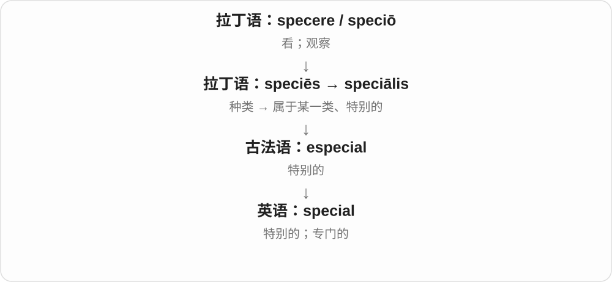

从“属于某一类”走向区别于一般情况。a special friend 强调特殊意义，a special tool 则强调专门用途。

**常见搭配与例句**

a special occasion；special treatment；something special。

> This photograph is special to me.

这张照片对我有特别的意义。

> We need a special tool to open the case.

打开这个盒子需要专门的工具。

**别混淆**

special 不一定贵或罕见；普通的小礼物也可能对你很特别。

### 2. specialize — 专门从事；专攻

**音标**：/ˈspeʃəlaɪz/

**先抓住这个画面**

specialize 像从一棵大树选一条枝干继续深挖：领域变窄，知识和服务变深。

**怎么拆**

special + -ize，构成“使专门化、专门从事”的动词；英式也拼 specialise。

**怎么变成今天的意思**

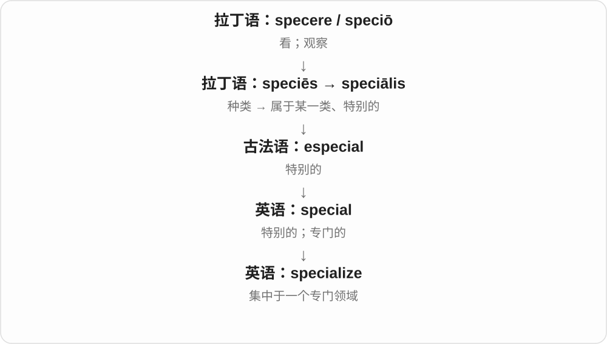

人可以专攻某学科，商店可以专营某类商品。常接 in，后面说明专注的领域。

**常见搭配与例句**

specialize in medicine；specialize in repairs；highly specialized。

> The shop specializes in old maps.

这家店专卖旧地图。

> She plans to specialize in environmental law.

她计划专攻环境法。

**别混淆**

know something 是有所了解；specialize in 通常意味着持续专门从事。

### 3. specialized — 专门的、专业化的；专门从事了〔过去式、过去分词及形容词〕

**音标**：/ˈspeʃəlaɪzd/

**先抓住这个画面**

为了某一个专门用途、领域，把工作做得更细，就是 specialized。工具、知识和训练都可以这样形容。

**怎么拆**

special + 动词后缀 -ize → specialize，专门从事、使专门化。现代去末尾 e，加完整 -ed，/z/ 后读 /d/；specialised 是对应拼写。

**怎么变成今天的意思**

**special + -ize → specialize**  
特别、专门的 → 专门从事、使专门化

↓

**specialize 去 e + -ed → specialized**  
专门化了；适合某个专门用途的

specialized knowledge 专门知识；specialized tools 专用工具；specialized in music 专攻音乐。

**常见搭配与例句**

specialized training 专门训练；a specialized field 一个专业领域。

> The task requires specialized knowledge.

这项任务需要专门知识。

> She specialized in the study of old maps.

她专门研究旧地图。

**别混淆**

specialized 强调用途或领域专门，不自动等于更高级或更好。special 只说特别，specialized 更常让人追问专门做什么。

### 4. actual — 实际的；真实的

**音标**：/ˈæktʃuəl/

**先抓住这个画面**

宣传图是一回事，真正拿到手、量出来、发生过的那个才是 actual。

**怎么拆**

经法语 actuel 接晚期拉丁 actuālis，再接 actus、agere“做、行动”。现代可认出 act 的词源联系，不拆成 act + u + al 三个现代部件。

**怎么变成今天的意思**

**拉丁 agere → actus → 晚期拉丁 actuālis**  
做、行动 → 行为、实施 → 实践中的

↓

**法语 actuel → 中古英语 actual**  
实际、真实的相应用法

the actual cost 是实际费用，the actual size 是实物大小，the actual reason 强调真正原因。actual 在现代英语里通常不表示“目前的”，那往往用 current。

**常见搭配与例句**

the actual cost；actual size；the actual number；actual experience。

> The actual cost was lower than we expected.

实际费用比我们预计的低。

> The model is shown at actual size.

模型按实物大小展示。

**别混淆**

actual 与 real 都可强调真实；actual 常拿实情对照估计、想象。法语 actuel 常有“当前”义，不能直接搬进英语。

### 5. actualize — 实现；使潜能成为现实〔较正式〕

**音标**：英 /ˈæktʃuəlaɪz/；美 /ˈæktʃuəlaɪz/

**先抓住这个画面**

能力、可能性还停在可以做到，actualize 把它推到真正做到。最常见的理解点是让潜能落地。

**怎么拆**

actual 实际的 + -ize；使成为实际。不是 actual 里 act 动作就能让每个用法自动等于 perform 表演。英式也可见 actualise。

**怎么变成今天的意思**

**actual**  
实际的、现实存在的

↓

**actual + -ize → actualize**  
使可能或潜能成为实际

actualize one’s potential 发挥、实现潜能；actualize a vision 把愿景实现。较正式，日常常直接用 realize、achieve、put into practice 等相应表达。

**常见搭配与例句**

actualize potential；actualize a vision。

> The programme helps students actualize their potential.

这个项目帮助学生发挥潜能。

> The team worked to actualize the original vision.

团队努力把最初的愿景变成现实。

**别混淆**

realize 还常指意识到，actualize 通常不代替这个认知义；“我意识到忘带钥匙”不用 I actualized that …。

### 6. actualise — 实现；使潜能成为现实〔常见英式拼写，较正式〕

**音标**：英 /ˈæktʃuəlaɪz/；美 /ˈæktʃuəlaɪz/

**先抓住这个画面**

原来只是可以做到，后来真的发挥出来；actualise 让可能性落到实际。

**怎么拆**

actualize 的常见 -ise 拼写变体；这一组 -ise／-ize 承接相同动词构词材料，不能推广到所有末尾有 ise 的词。

**怎么变成今天的意思**

**actualize 的既有词族**  
基础材料和动词意义相同

↓

**actualize／actualise**  
常见拼写变体，不是新造一个相反动作

actual + -ise，与 actualize 对应；actualise one’s potential 发挥潜能，不能代替 realize 的所有意识到义。

**常见搭配与例句**

actualise；具体宾语和搭配与 actualize 对应。

> The course aims to help learners actualise their potential.

课程旨在帮助学习者发挥潜能。

> The design actualises an idea developed over many years.

这个设计实现了一个酝酿多年的想法。

**别混淆**

actualise 和 actualize 在这里意义、基本读音对应；不是每个 -ise 词都能机械改 z，如 advise、surprise 要分别记。

### 7. realize — 意识到；实现；变现

**音标**：/ˈrɪəlaɪz/

**先抓住这个画面**

原来模糊的事忽然在脑中“成了真的”：啊，原来是这样。也可以把计划真正做出来。

**怎么拆**

real + -ize，-ize 常表示使成为或进入某种状态；形成与法语 réaliser 等相应形式有联系。不能把所有义项都死译为“使真实”。

**怎么变成今天的意思**

**拉丁 rēs → 晚期拉丁 reālis**  
事物 → 实际的

↓

**古法语 reel → 英语 real**  
真实的、实际存在的

↓

**real + -ize；与法语 réaliser 等对应**  
使成实际；使头脑清楚认识

↓

**英语 realize**  
意识到；实现；把资产变成现金

realize that 通常是意识到某事；realize a dream 是实现梦想。金融语境 realize a gain 表把账面收益变成已实现收益，realize assets 可指变现。

**常见搭配与例句**

realize that；realize how；realize a dream；realize a gain。

> I suddenly realized that I had left my keys at home.

我突然意识到钥匙落在家里了。

> She worked for years to realize her dream of opening a bakery.

她努力多年，实现了开一家面包店的梦想。

**别混淆**

realize 常有此前没明白、现在明白了的转折；know 只说知道。I realized I was wrong 比 I knew I was wrong 多了认识发生变化的感觉。

### 8. realise — 意识到；实现〔realize 的常见英式拼写〕

**音标**：/ˈrɪəlaɪz/

**先抓住这个画面**

看到 s 不必重新猜义，它和 realize 是同一个常用动词的两种拼写。

**怎么拆**

real + -ise；-ise 与 -ize 是这一类动词的拼写变体。法语 réaliser 也是相关形式；这里不是再接一个独立词 ise。

**怎么变成今天的意思**

**拉丁 rēs → 晚期拉丁 reālis**  
事物 → 实际的

↓

**古法语 reel → 英语 real**  
真实的、实际存在的

↓

**real + -ise → realise**  
与 realize 对应的拼写形式

realise 常用于英式英语，realize 在美式普遍，也用于部分英式编辑规范。两者用法和读音基本相同，一篇文章里保持所选拼写习惯即可。

**常见搭配与例句**

realise that；realise the importance；realise an ambition。

> I did not realise how late it was.

我没意识到已经这么晚了。

> The project helped her realise a long-held ambition.

这个项目帮助她实现了长久以来的抱负。

**别混淆**

realise 和 release“释放”拼写相近，但词源和含义不同；意识到错误用 realise a mistake，不能写 release a mistake。

### 9. item — 一件物品；一项条目、议题；一则消息

**音标**：/ˈaɪtəm/

**先抓住这个画面**

清单一行一行列东西，每行里的一项就是 item；后来也直接说购物篮里的一件物品。

**怎么拆**

借拉丁 item 也、另外。账目、列表里逐条引入“另外一项”，这个引项词逐渐变成条目本身的名称。不是 it + em 的英语拼合。

**怎么变成今天的意思**

**拉丁 item**  
也、另外，用于逐项列举

↓

**英语 item**  
被列出的一项；单件物品、消息等

an item on the agenda 一项议题；an item of clothing 一件衣物；a news item 一则新闻；three items 三件商品。

**常见搭配与例句**

a list of items；an item on the agenda。

> The next item on the agenda is the budget.

议程下一项是预算。

> I only bought three items at the shop.

我在店里只买了三件东西。

**别混淆**

item 强调一项、单件，article 可另指文章或一件物品，thing 更泛；议程的一项不是自动一篇 article。

### 10. items — 项目、条目；单件物品；一则内容〔复数〕

**音标**：/ˈaɪtəmz/

**先抓住这个画面**

把东西一项项列出来，每一项就是 item：清单的一条、商店的一件货、新闻中的一则都可以用。

**怎么拆**

item + -s，/m/ 后读 /z/。item 借拉丁 item 也、另外，原本在账目、列表里逐条引出另外一项，后来引项词变成条目、物件的名称。

**怎么变成今天的意思**

**拉丁 item：也、另外 → 英语列表、账目用语**  
另外一项……

↓

**列举用语成为名词 item；再加 -s → items**  
条目、一件物品 → 多个项目、物件

items on the list 清单上的项目；items of clothing 几件衣物；news items 新闻条目；items for sale 待售物品。

**常见搭配与例句**

check all the items；several small items。

> Please check the items on the list before you leave.

离开前，请检查清单上的项目。

> The box held a few small items of jewellery.

盒子里放着几件小首饰。

**别混淆**

items 很适合说可分开列、可分开数的东西。an item of information 是一条信息，information 本身通常不可数；item 帮它取得一项、一条的计数方式。

### 11. itemize — 逐项列出；分项开列

**音标**：/ˈaɪtəmaɪz/

**先抓住这个画面**

不是只给一个总数，而是把每一项摊开：车费多少、材料费多少，一行行列出来。

**怎么拆**

item 条目 + -ize，让内容按一个个 item 呈现。英式也常写 itemise。

**怎么变成今天的意思**

**item**  
清单中的一项

↓

**item + -ize → itemize**  
把内容逐项列出

itemize expenses 逐项列支出；an itemized bill 明细账单；itemize the damage 逐项列损坏情况。

**常见搭配与例句**

itemize costs；an itemized bill。

> Please itemize the expenses on your claim form.

请在报销表上逐项列出费用。

> The hotel sent us an itemized bill.

酒店给我们发了一份明细账单。

**别混淆**

summarize 抓总意、概括，itemize 展开各项；只给支出总额通常还不算已 itemized。

### 12. itemise — 逐项列出；分项开列〔常见英式拼写〕

**音标**：/ˈaɪtəmaɪz/

**先抓住这个画面**

把总账摊开成一行一项，让人看清每一笔是什么。itemise 和 itemize 做的是同一件事。

**怎么拆**

itemize 的常见 -ise 拼写变体；这一组 -ise／-ize 承接相同动词构词材料，不能推广到所有末尾有 ise 的词。

**怎么变成今天的意思**

**itemize 的既有词族**  
基础材料和动词意义相同

↓

**itemize／itemise**  
常见拼写变体，不是新造一个相反动作

itemise costs 分项列费用；an itemised receipt 明细收据。只有合计数的账单不因此已经叫 itemised。

**常见搭配与例句**

itemise；具体宾语和搭配与 itemize 对应。

> Please itemise the travel costs.

请逐项列出差旅费用。

> We requested an itemised receipt.

我们要求提供明细收据。

**别混淆**

itemise 和 itemize 在这里意义、基本读音对应；不是每个 -ise 词都能机械改 z，如 advise、surprise 要分别记。

### 13. custom — 习俗、惯例；光顾；定制的

**音标**：/ˈkʌstəm/

**先抓住这个画面**

大家一直这样做，慢慢变成惯例；一个人总来某家店买东西，也成了光顾的习惯。定制义则把目光落到特定顾客的需要。

**怎么拆**

经古法语 costume、盎格鲁法语 custume 等，接拉丁 consuetudo 习惯及 consuescere 习惯于。现代风俗、经常光顾、惯常税费和按顾客要求制作等义逐渐分开。

**怎么变成今天的意思**

**拉丁 consuetudo → 法语／中古英语 custume**  
习惯、惯常做法

↓

**现代 custom 的不同分支**  
风俗；光顾；为特定顾客制作的

a local custom 当地习俗；as is his custom 按他的习惯；Thank you for your custom 感谢惠顾，尤其英式；custom furniture 定制家具。

**常见搭配与例句**

follow a custom；custom software；a long-standing custom。

> It is a local custom to bring a small gift.

带一份小礼物是当地习俗。

> The workshop makes custom furniture for small apartments.

那间工坊为小公寓制作定制家具。

**别混淆**

custom 指习惯或定制，costume 指服装；二者同源而分途借入。habit 常说个人习惯，custom 常说群体或长期沿用的做法，也可用于个人。

### 14. customer — 顾客、客户；某种难易相处的人

**音标**：英 /ˈkʌstəmə/；美 /ˈkʌstəmər/

**先抓住这个画面**

到店里买东西、向服务方下单的人，是 customer。背后的旧线索是惯常交易、光顾，但现代第一次上门的也叫 customer。

**怎么拆**

现代可对应 custom + -er；历史经盎格鲁法语 custumer、古法语 coustumier 等，接中世纪拉丁惯例、税费词族。英语早期既见税费收取者，也发展出经常购买者、购买者等义。

**怎么变成今天的意思**

**拉丁／法语惯例、税费相关材料 → customer**  
早期税费人员、惯常买卖关系等

↓

**现代 customer**  
购买商品、服务的人；引申为要打交道的人

a regular customer 常客；a new customer 新顾客；customer service 客户服务；a tough customer 难对付的人，不必是真买东西的顾客。

**常见搭配与例句**

serve a customer；customer needs。

> The shop assistant helped a customer choose a coat.

店员帮一位顾客挑选外套。

> He is a tough customer in negotiations.

谈判时他是个难对付的人。

**别混淆**

customer 不要求已经来过很多次；consumer 侧重使用、消费产品的人，购买者与最终使用者可能不同。

### 15. customers — 顾客、客户；customer 的复数

**音标**：英 /ˈkʌstəməz/；美 /ˈkʌstəmərz/

**先抓住这个画面**

来购买商品或服务的人，是 customers。一个人可能只买过一次，也可能经常来，现代词义不要求每位顾客都已成为熟客。

**怎么拆**

customer + -s，词尾 /z/。现代可认作 custom + -er，但历史经盎格鲁法语 custumer、古法语 coustumier 等接惯例、税费词族；早期收取税费等用法与后来的购买者义分别看。

**怎么变成今天的意思**

**法语 custumer／coustumier 等相关词 → customer**  
惯例、税费、惯常往来词族中的人物用法

↓

**customer + -s → customers**  
现代多位购买商品、服务的人

regular customers 熟客；new customers 新顾客；customers of the shop 这家店的顾客；serve customers 接待顾客。

**常见搭配与例句**

customers waiting outside；help customers choose。

> The shop gives customers time to compare the different models.

店里让顾客有时间比较不同型号。

> Several regular customers helped choose books for the new display.

几位熟客帮忙为新展台挑选了书。

**别混淆**

customers 强调购买关系，clients 常见于专业服务、长期服务等场景，实际会重叠。customs 还可能指海关、关税或风俗，不能把它的所有义都硬塞到 customers 里。

### 16. customs — 习俗〔复数〕；关税、海关及其检查处

**音标**：/ˈkʌstəmz/

**先抓住这个画面**

local customs 讲当地习俗；go through customs 却是在机场、口岸过海关。两者都从习惯、惯常做法这一旧词族分支而来。

**怎么拆**

custom + -s；旧 custom 除习惯外也指惯常征收的通行税费，复数 customs 后来统称相应税费、负责收取检查的机构或区域。机构和场所义沿税费收取这一分支专门化。

**怎么变成今天的意思**

**custom 的惯例、惯常税费分支**  
习惯；按惯例征收的费用

↓

**customs 的专门化**  
多种习俗；关税、海关及检查区域

local customs 当地习俗；customs officers 海关人员；customs duties 关税；go through customs 过海关。普通过海关搭配通常不加 the。

**常见搭配与例句**

customs checks；respect local customs。

> We waited at customs after collecting our bags.

取完行李后，我们在海关检查处等候。

> The guide explained several local customs.

导游介绍了几种当地习俗。

**别混淆**

customs 的两类意思看搭配：learn about customs 多为了解习俗，baggage、officers、airport 等常指向海关。不能只凭末尾 s 就当多个风俗。

### 17. costume — 戏服、装扮服装；某时期或群体的服饰

**音标**：英 /ˈkɒstjuːm/；美 /ˈkɑːstuːm/

**先抓住这个画面**

演员一穿上，观众就看出他是古代人物、海盗或舞者。costume 往往突出某个角色、时代、群体的那套装扮。

**怎么拆**

经法语 costume，接意大利语 costume 风尚、习惯，上溯拉丁 consuetudo。与 custom 同源但不同路径、较晚借入，先有符合时代风俗的艺术表现等用法，后突出衣着。

**怎么变成今天的意思**

**拉丁 consuetudo → 意大利语、法语 costume**  
习俗、风尚；时代相符的表现

↓

**英语 costume**  
某种固定衣着、戏服、角色装扮

a pirate costume 海盗装；costume design 服装设计；traditional costume 传统服饰；a costume party 化装聚会。

**常见搭配与例句**

wear a costume；the costumes for a play。

> The children wore animal costumes for the school play.

孩子们为学校话剧穿上了动物戏服。

> The museum displays traditional costumes from the region.

博物馆展出该地区的传统服饰。

**别混淆**

clothes 泛指衣服；costume 常突出角色或文化、时代的整套外观。custom 定制与 costume 服饰可以同时出现，但不是一个单词的拼写变体。

### 18. costumes — 戏服、装扮服装；某时期或群体的服饰〔复数〕

**音标**：英 /ˈkɒstjuːmz/；美 /ˈkɑːstuːmz/

**先抓住这个画面**

演员穿上就能让人认出角色、年代的衣服，是 costumes。节日里专为扮成某个人物准备的衣服，也这样说。

**怎么拆**

costume 经法语接意大利语 costume 风俗、风尚，较早拉丁 consuetudo。与 custom 同源但借入路线不同；从时代风尚走向符合角色、时代的服饰。现代加 -s，/m/ 后读 /z/。

**怎么变成今天的意思**

**拉丁 consuetudo → 意大利语、法语 costume → 英语借词**  
习惯、风尚 → 角色或时代相符的衣着

↓

**costume + -s → costumes**  
多套戏服、装扮服装

stage costumes 舞台戏服；historical costumes 历史服饰；costumes for the play 这部戏的戏服。

**常见搭配与例句**

wear costumes 穿装扮服装；design the costumes 设计戏服。

> The actors tried on their costumes before rehearsal.

演员们排练前试穿了戏服。

> The exhibition includes costumes from several periods.

展览陈列了几个时期的服饰。

**别混淆**

costumes 不泛指每一件日常衣服；clothes 更普通。它强调角色、场合或某种传统风格。

### 19. costumed — 穿着戏服、特定装束的；给……配戏服了

**音标**：英 /ˈkɒstjuːmd/；美 /ˈkɑːstuːmd/

**先抓住这个画面**

人已经换上角色那套衣服，是 costumed；剧组为演员安排、穿上这些衣服，也可用这个动词。

**怎么拆**

costume 去词尾 e，加完整 -ed，/m/ 后读 /d/。衣着名借法语、意大利语，远接习俗、风尚的拉丁词族，动词再由名词发展。

**怎么变成今天的意思**

**拉丁 consuetudo → 意大利 costume → 法语、英语 costume**  
习俗、风尚；符合时代风俗的表现 → 特定衣着

↓

**英语 costume 名词 → 动词**  
戏服、装扮 → 给人穿上相应服装

↓

**costume + -ed → costumed〔去 e〕**  
过去配戏服；穿着角色装束的

costumed dancers 是穿着演出服的舞者；costumed as a sailor 是装扮成水手。

**常见搭配与例句**

costumed performers 穿演出服的表演者；elaborately costumed 服装精心复杂的。

> Costumed performers greeted visitors at the entrance.

穿着演出服的表演者在入口迎接游客。

> The actors were costumed as nineteenth-century travellers.

演员们被装扮成十九世纪的旅人。

**别混淆**

dressed 泛说穿着，costumed 更强调角色、时代、表演或特定装扮的服装。

### 20. costuming — 戏服设计、安排、穿戴的工作；正在配戏服

**音标**：英 /ˈkɒstjuːmɪŋ/；美 /ˈkɑːstuːmɪŋ/

**先抓住这个画面**

哪些衣服配哪个角色、哪个时代，都要安排；演出里这一整套服装工作可叫 costuming。

**怎么拆**

costume 去末尾不发音 e，加完整 -ing。由衣着名形成动词后，再作活动名词、进行形式。

**怎么变成今天的意思**

**拉丁 consuetudo → 意大利 costume → 法语、英语 costume**  
习俗、风尚；符合时代风俗的表现 → 特定衣着

↓

**英语 costume 名词 → 动词**  
戏服、装扮 → 给人穿上相应服装

↓

**costume + -ing → costuming〔去 e〕**  
给演出配衣服的过程、工作

costuming for a play 是一部戏的戏服工作；costuming the cast 则说正在给演员安排服装。

**常见搭配与例句**

period costuming 时代服装设计；costuming the production 为整部制作安排戏服。

> She is responsible for costuming the production.

她负责这部制作的戏服工作。

> The period costuming helped create the atmosphere.

时代服装设计帮助营造了氛围。

**别混淆**

costumes 是一件件戏服，costuming 是把戏服设计、安排、穿到角色身上的工作。

### 21. customary — 惯常的、按惯例的、习俗性的

**音标**：英 /ˈkʌstəməri/；美 /ˈkʌstəmeri/

**先抓住这个画面**

不必每次重新商量，大家通常就这样做。customary 说的是已经习惯、沿用的做法。

**怎么拆**

历史经中世纪拉丁 custumarius 等惯例、税费词族发展，接拉丁 consuetudo；现代可对应 custom 与形容词 -ary。早期税费相关义后来退到后面，惯常义成为重点。

**怎么变成今天的意思**

**拉丁 consuetudo → 中世纪拉丁相关形容词**  
惯例；税费相关材料

↓

**英语 customary**  
按既有习惯、惯例行事的

it is customary to do something 惯例是做某事；the customary greeting 惯常问候；his customary seat 他平常坐的位置。

**常见搭配与例句**

as is customary；the customary practice。

> It is customary to remove your shoes before entering.

进门前脱鞋是惯例。

> She took her customary seat by the window.

她坐到了窗边那个平常坐的位置。

**别混淆**

customary 是惯常的，custom 是定制的时含义不同：customary clothes 可指按惯例的衣着，custom clothes 常说按个人要求制作的衣服。

### 22. customize — 定制；按个人需求调整

**音标**：/ˈkʌstəmaɪz/

**先抓住这个画面**

不是只能接受统一版本，而是换颜色、布局、功能，把它调成适合自己的样子，这叫 customize。

**怎么拆**

custom 的定制材料 + -ize 构成动词；这里不是把海关 customs 的 s 删掉去解释。

**怎么变成今天的意思**

**custom**  
习惯、惯例；按客户要求的定制

↓

**custom + -ize → customize → customizable**  
按需求调整、定制；可定制的

customize a dashboard 定制仪表盘；customize settings 调整设置；customize a product 定制产品。

**常见搭配与例句**

customize settings；customize the layout。

> You can customize the layout of the home screen.

你可以按自己的需要调整主屏布局。

> The workshop customizes bicycles for individual riders.

这家工坊按每位骑行者的需求定制自行车。

**别混淆**

customize 侧重按需求调整，personalize 常更突出个人特色；两者有重合，不能在所有产品里硬分两个固定功能。

### 23. apologize — 道歉；表示歉意

**音标**：英 /əˈpɒlədʒaɪz/；美 /əˈpɑːlədʒaɪz/

**先抓住这个画面**

把“这件事让你受到了影响，我很抱歉”真正说出来。

**怎么拆**

英语 apology + -ize；早期也有为某事辩护义，现代最常用的是表示歉意。英式常另写 apologise。

**怎么变成今天的意思**

**希腊 légō / lógos**  
选取、收集 → 讲述；话语、说明、道理、计算

↓

**希腊 apo- + 说话成分 → apologeîsthai / apología**  
作出回应、为自己辩护

↓

**后期拉丁 apologia／法语 apologie → 英语 apology**  
申辩、解释 → 后来常表示认错与歉意

↓

**英语 apology + -ize → apologize**  
作出辩解或申辩 → 常指道歉

apologize to someone for something，把对象放在 to 后，把事情放在 for 后。不能直接写 apologize someone；也可以为遗憾的情况表示歉意，而不一定承认自己造成了全部问题。

**常见搭配与例句**

apologize to someone；apologize for doing something；apologize sincerely。

> I apologized to the neighbour for blocking the driveway.

我为挡住车道向邻居道了歉。

> The host apologized for the technical delay.

主持人为技术故障造成的延误表示歉意。

**别混淆**

apologize 是行为；apology 是名词，可说 apologize 或 make an apology。

### 24. apologized — 道歉了；已经表达歉意的

**音标**：英 /əˈpɒlədʒaɪzd/；美 /əˈpɑːlədʒaɪzd/

**先抓住这个画面**

把刚才、昨天说过的“对不起”放到过去叙事里，就是 apologized。

**怎么拆**

apologize 去末尾 e，加完整 -ed，/z/ 后读 /d/。apologized 与 apologised 保留两套基础拼写。

**怎么变成今天的意思**

**希腊 apo- 与说话材料 → apologia**  
为自己回应、辩护的话语

↓

**拉丁、法语相关形式 → 英语 apology → apologize／apologise**  
申辩、解释 → 常见道歉义；现代形成 -ize／-ise 动词

↓

**apologize + -ed → apologized〔去 e〕**  
过去表达歉意

apologized for the mistake 是为错误道歉；has apologized 是已经道过歉。

**常见搭配与例句**

apologized sincerely 真诚道歉了；apologized to everyone 向每个人道歉了。

> I apologized for forgetting her name.

我为忘了她的名字道歉。

> He has already apologized to everyone involved.

他已经向所有相关的人道过歉。

**别混淆**

apologized 说明表达过歉意；forgave 说明另一方原谅了。道歉动作和接受、原谅是两回事。

### 25. apologizing — 正在道歉；表达歉意的活动

**音标**：英 /əˈpɒlədʒaɪzɪŋ/；美 /əˈpɑːlədʒaɪzɪŋ/

**先抓住这个画面**

歉意正在往外说，就是 apologizing；这也能把“道歉这件事”整体放进句子。

**怎么拆**

apologize 去 e，加完整 -ing。历史上的辩护、解释材料发展出常见道歉义，现代词尾只标明活动形式。

**怎么变成今天的意思**

**希腊 apo- 与说话材料 → apologia**  
为自己回应、辩护的话语

↓

**拉丁、法语相关形式 → 英语 apology → apologize／apologise**  
申辩、解释 → 常见道歉义；现代形成 -ize／-ise 动词

↓

**apologize + -ing → apologizing〔去 e〕**  
道歉的过程、活动

without apologizing 是没有道歉，apologizing for the delay 是为耽误表达歉意。

**常见搭配与例句**

stop apologizing 停止反复道歉；a message apologizing for the error 一条为错误道歉的消息。

> She sent a message apologizing for the delay.

她发来一条消息，为延误道歉。

> He left without apologizing.

他没有道歉就走了。

**别混淆**

apologizing for doing something 常针对已经造成的不快；excusing something 常说解释、宽免其责任，用法方向不同。

### 26. apologizes — 道歉〔apologize 的第三人称单数〕

**音标**：英 /əˈpɒlədʒaɪzɪz/；美 /əˈpɑːlədʒaɪzɪz/

**先抓住这个画面**

说一个人平时认错、赔不是，主语是 he、she 等时用 apologizes。动作仍是把歉意表达给别人。

**怎么拆**

apologize + -s，保留 e，/z/ 后加出的词尾读 /ɪz/。它与 apologise 的三单 apologises 同音同义。

**怎么变成今天的意思**

**希腊 apo- 与说话材料 → apologia**  
为自己回应、辩护的话语

↓

**拉丁、法语相关形式 → 英语 apology → apologize／apologise**  
申辩、解释 → 常见道歉义；现代形成 -ize／-ise 动词

↓

**apologize + -s → apologizes**  
他、她表达歉意

apologizes for being late 是为迟到道歉；apologizes to her 是向她道歉。

**常见搭配与例句**

rarely apologizes 很少道歉；apologizes immediately 立刻道歉。

> She apologizes whenever she makes a mistake.

她每次犯错都会道歉。

> He apologizes to the group for arriving late.

他为迟到向大家道歉。

**别混淆**

apologizes 的末尾有 /aɪzɪz/，apologies 的末尾是 /dʒiz/；一个是做动作，一个是几份歉意、道歉话。

### 27. accessory — 配件；饰品；从犯〔正式、法律语境〕

**音标**：英 /əkˈsesəri/；美 /əkˈsesəri/

**先抓住这个画面**

主体已经在那里，再配一个包、围巾或设备附件，这些辅助东西是 accessories；人物语境里则可指帮助犯罪的一方。

**怎么拆**

借中世纪拉丁 accessorius，接 accessor 辅助者及 accedere 接近、附加的词族。现代不能把完整 access 访问权限直接等同每个 accessory 的来源和意思。

**怎么变成今天的意思**

**拉丁 accessor、accessorius 等**  
附加、辅助者及相应材料

↓

**英语 accessory**  
辅助配件、饰品；协助犯罪者等

fashion accessories 时尚配饰；phone accessories 手机配件；an accessory to a crime 犯罪的协助者。犯罪语境具体责任不能只由日常定义推出。

**常见搭配与例句**

fashion accessories；a phone accessory。

> The shop sells bags and other accessories.

店里卖包和其他配饰。

> A protective case is a useful phone accessory.

保护壳是一件实用的手机配件。

**别混淆**

accessory 是附加、辅助品，不是主设备本身；accomplice 同谋与 accessory 在正式用法中可能有区别，普通阅读先看参与角色。

### 28. accessories — 配件、附件；饰品〔复数〕

**音标**：英 /əkˈsesəriz/；美 /əkˈsesəriz/

**先抓住这个画面**

主要东西之外，再添上帮助使用、装饰搭配的部分，就是 accessories。手机配件、衣服配饰都能这样看。

**怎么拆**

accessory 的辅音字母加 y 改为 ies，结尾 /riz/。accessory 接中世纪拉丁 accessorius，来自 accessor 辅助者及 accedere 接近、附加词族。

**怎么变成今天的意思**

**拉丁辅助、附加词族 → accessory**  
辅助之物 → 配件、配饰

↓

**accessory → accessories**  
多个附件、装饰搭配物

phone accessories 手机配件；fashion accessories 时尚配饰；camera accessories 相机配件。

**常见搭配与例句**

matching accessories 相配的饰物；sell accessories 卖配件。

> The shop sells bags and accessories.

店里卖包和配饰。

> The camera comes with several useful accessories.

相机附带几件实用配件。

**别混淆**

accessories 不是主件本身，而是相关辅助或搭配物。accessory 的法律人物义是另一语境，这里先掌握最常见的配件、饰品。

### 29. accessorize — 用配饰搭配；给……配饰品

**音标**：英 /əkˈsesəraɪz/；美 /əkˈsesəraɪz/

**先抓住这个画面**

裙子已穿好，再加条腰带、一个包，把整身搭起来，这个动作是 accessorize。

**怎么拆**

accessory 的词干 + -ize；y 在这种扩展中不保留为完整 accessoryize，而成 accessorize。英式也可写 accessorise。

**怎么变成今天的意思**

**accessory**  
配件、饰品

↓

**accessory + -ize → accessorize**  
给服装等配饰品

accessorize an outfit 给一身衣服搭配饰；accessorize with a scarf 用围巾搭配。动词常取时尚配饰义，不是参与犯罪。

**常见搭配与例句**

accessorize an outfit；accessorize with。

> She accessorized the dress with a simple belt.

她用一条简单的腰带搭配那条裙子。

> The article shows how to accessorize a plain outfit.

文章介绍怎样给简单的一身衣服搭配饰品。

**别混淆**

accessorize 通常说增加配饰，dress 说穿衣、打扮范围更广；也不等于 grant access 授予访问权限。

### 30. moist — 湿润的；微湿的

**音标**：/mɔɪst/

**先抓住这个画面**

蛋糕内部有水分、口感不干，土壤有一点湿度又没泡在水里，都能说 moist。通常不是水往下滴的程度。

**怎么拆**

经中古英语接古法语 moiste 等湿润词；更早或混合拉丁霉、葡萄汁等材料，不能定成唯一清楚的现代拆分。

**怎么变成今天的意思**

**古法语 moiste 等 → 中古英语 moist → moist**  
微湿、有水分；更早拉丁材料关系未定

↓

**moist + -en → moisten**  
使微湿、变湿润

moist soil 湿润土壤；a moist cake 湿润松软的蛋糕；moist eyes 含泪湿润的眼睛。评价常随对象变化，蛋糕 moist 可以是称赞。

**常见搭配与例句**

moist soil；a moist cake；moist eyes。

> The soil should be moist rather than waterlogged.

土壤应当湿润，而不是积水。

> The cake stayed moist for several days.

蛋糕好几天都没有变干。

**别混淆**

moist 常中性或正面说保留水分；damp 在房间、衣物上常让人想到不舒服的潮气，两者仍有重叠。

### 31. moisture — 水分；湿气

**音标**：英 /ˈmɔɪstʃə/；美 /ˈmɔɪstʃər/

**先抓住这个画面**

叶子上的薄水珠、土壤里含的水、空气凝在窗上的湿气，都可说 moisture。通常是分散、附着的水分，不是一杯水的杯数。

**怎么拆**

经中古英语接古法语 moistour 潮湿、水分，与 moist 湿润的同族。不是现代 moisture 完全等于 moist 加一个普通 ure 就能代替它的法语借入史。

**怎么变成今天的意思**

**古法语 moistour → 中古英语 moisture**  
潮湿、水分的材料

↓

**英语 moisture；与 moist 对照**  
湿气、水分／湿润的

retain moisture 保持水分；moisture in the soil 土壤水分；moisture on the windows 窗上的湿气。通常为不可数名词。

**常见搭配与例句**

retain moisture；moisture content。

> The soil retains moisture well.

这种土壤保水性很好。

> Moisture had collected on the inside of the window.

窗户内侧凝起了水汽。

**别混淆**

moisture 是水分，humidity 尤常说空气湿度；地板上的一点水分不因此都叫 humidity。

### 32. moisturize — 给皮肤保湿；使滋润

**音标**：英 /ˈmɔɪstʃəraɪz/；美 /ˈmɔɪstʃəraɪz/

**先抓住这个画面**

皮肤干，抹上乳液，让它没那么干，这个护理动作常叫 moisturize。比给任何东西洒水的泛义更常见。

**怎么拆**

moisture 去末尾 e + -ize，形成提供、保持水分的动词；英式也常写 moisturise。

**怎么变成今天的意思**

**moist、moisture**  
湿润的、水分

↓

**moisture + -ize → moisturize**  
让皮肤获得或保持水分

moisturize your hands 给手部保湿；a moisturizing lotion 保湿乳液；可不带宾语说 I moisturize daily。

**常见搭配与例句**

moisturize the skin；a moisturizing cream。

> She moisturizes her hands after washing them.

她洗手后会给手部保湿。

> The lotion helps moisturize dry skin.

这款乳液帮助滋润干燥皮肤。

**别混淆**

moisten 更泛指把东西弄湿，moisturize 尤常用于皮肤护理；给信封封口处润湿通常不用护肤词。

### 33. moisturizer — 保湿霜、保湿乳等保湿护肤品

**音标**：英 /ˈmɔɪstʃəraɪzə/；美 /ˈmɔɪstʃəraɪzər/

**先抓住这个画面**

moisturize 是保湿动作，moisturizer 是拿来做这件事的产品。-er 在这里是东西，不是一个给别人抹乳液的职业。

**怎么拆**

moisturize + -er，动词末尾 e 与后缀连接形成 moisturizer；词义固定到常见保湿产品。

**怎么变成今天的意思**

**moisture → moisturize**  
水分 → 使皮肤保湿

↓

**moisturize + -er → moisturizer**  
用于保湿的产品

apply moisturizer 涂保湿霜、乳等；a facial moisturizer 面部保湿品。可数时说一种产品或一款保湿品，不可数时说涂的材料。

**常见搭配与例句**

apply moisturizer；a light moisturizer。

> He applied a little moisturizer to his hands.

他在手上涂了少量保湿乳。

> She keeps a bottle of moisturizer on the shelf.

她在架子上放了一瓶保湿品。

**别混淆**

moisturizer 是产品，moisture 是水分；不是直接把一瓶护肤品叫 a moisture。不同产品成分和功能还要看本身。

### 34. moisturise — 给皮肤保湿；使滋润〔常见英式拼写〕

**音标**：英 /ˈmɔɪstʃəraɪz/；美 /ˈmɔɪstʃəraɪz/

**先抓住这个画面**

皮肤干时抹乳液，让它滋润些；与 moisturize 是同一护理动作，不是清洁、洗掉水分。

**怎么拆**

moisturize 的常见 -ise 拼写变体；这一组 -ise／-ize 承接相同动词构词材料，不能推广到所有末尾有 ise 的词。

**怎么变成今天的意思**

**moisturize 的既有词族**  
基础材料和动词意义相同

↓

**moisturize／moisturise**  
常见拼写变体，不是新造一个相反动作

moisturise your hands 给手部保湿；moisturising cream 保湿霜。英式英语也使用 -ize 规范，一篇文章可随所采用规范统一。

**常见搭配与例句**

moisturise；具体宾语和搭配与 moisturize 对应。

> She moisturises her hands before bed.

她睡前会给手部保湿。

> This cream moisturises without feeling heavy.

这款霜用来保湿，感觉不厚重。

**别混淆**

moisturise 和 moisturize 在这里意义、基本读音对应；不是每个 -ise 词都能机械改 z，如 advise、surprise 要分别记。

### 35. minimize — 尽量减少；淡化；最小化〔界面、数学〕

**音标**：/ˈmɪnɪmaɪz/

**先抓住这个画面**

把损失、浪费压低，是 minimize；把严重问题说得很轻，也是 minimize。电脑把窗口收起，则取最小化显示的技术义。

**怎么拆**

拉丁 minimus 最小的 + -ize 形成使尽量小的动词；英语再把数量、影响、界面操作等具体化。

**怎么变成今天的意思**

**拉丁 minimus 最小的 + -ize → minimize**  
把量或作用降到尽量小

↓

**minimize + -ation → minimization**  
最小化；淡化严重程度的做法

minimize waste 减少浪费；minimize the risk 尽量降低风险；minimize a problem 淡化问题；minimize a window 最小化窗口。

**常见搭配与例句**

minimize waste；minimize a window。

> The design aims to minimize waste.

设计旨在尽量减少浪费。

> He tried to minimize the seriousness of the mistake.

他试图淡化错误的严重性。

**别混淆**

minimize 常是尽量降低，不必降为零；eliminate 才常说消除。淡化问题的用法还可能带负面评价。

### 36. apologise — 道歉〔apologize 的常见英式拼写〕

**音标**：英 /əˈpɒlədʒaɪz/；美 /əˈpɑːlədʒaɪz/

**先抓住这个画面**

做了让别人不快、添麻烦的事，把“对不起”说出来，就是 apologise。换成 s 拼写，意思、读音仍与 apologize 相同。

**怎么拆**

现代 apology 去 y，加 -ise；与 -ize 形式对应。apology 更早借希腊辩护话语词，经拉丁、法语后发展出常见歉意义。

**怎么变成今天的意思**

**希腊 apo- 与说话材料 → apologia**  
为自己回应、辩护的话语

↓

**拉丁、法语相关形式 → 英语 apology → apologize／apologise**  
申辩、解释 → 常见道歉义；现代形成 -ize／-ise 动词

apologise to someone for something 是因某事向某人道歉；to 接人，for 接原因。

**常见搭配与例句**

apologise for being late 为迟到道歉；apologise to the team 向团队道歉。

> I apologise for the delay.

我为延误道歉。

> She went back to apologise to her friend.

她回去向朋友道歉。

**别混淆**

apologise 是做道歉动作，apology 是一份道歉、歉意；不能在 I apologise 中把动词换成名词。

### 37. apologised — 道歉了〔apologise 的过去式、过去分词〕

**音标**：英 /əˈpɒlədʒaɪzd/；美 /əˈpɑːlədʒaɪzd/

**先抓住这个画面**

刚才已经把歉意表达出来，用 apologised。它说明道歉动作发生过，内容常由 for 引出。

**怎么拆**

apologise 去末尾 e，加完整 -ed；/z/ 后读 /d/。这一步接在已有 -ise 动词上，不直接给 apology 加过去式词尾。

**怎么变成今天的意思**

**希腊 apo- 与说话材料 → apologia**  
为自己回应、辩护的话语

↓

**拉丁、法语相关形式 → 英语 apology → apologize／apologise**  
申辩、解释 → 常见道歉义；现代形成 -ize／-ise 动词

↓

**apologise + -ed → apologised〔去 e〕**  
过去表达歉意

apologised for the confusion 是为造成混乱道歉；apologised to me 是向我道歉。

**常见搭配与例句**

apologised sincerely 真诚道歉了；apologised for arriving late 为迟到道歉了。

> He apologised for arriving late.

他为迟到道歉了。

> She apologised to me the next morning.

她第二天早上向我道歉。

**别混淆**

apologised 与 apologized 同义同音，主要是 s、z 拼写选择不同。

### 38. apologising — 正在道歉；表达歉意的活动

**音标**：英 /əˈpɒlədʒaɪzɪŋ/；美 /əˈpɑːlədʒaɪzɪŋ/

**先抓住这个画面**

正把“对不起”说给对方，或者一再为某件事赔不是，就是 apologising。它把道歉看成正在做的事。

**怎么拆**

apologise 去末尾 e，加完整 -ing；-ise 本身已经是基础动词的一部分。

**怎么变成今天的意思**

**希腊 apo- 与说话材料 → apologia**  
为自己回应、辩护的话语

↓

**拉丁、法语相关形式 → 英语 apology → apologize／apologise**  
申辩、解释 → 常见道歉义；现代形成 -ize／-ise 动词

↓

**apologise + -ing → apologising〔去 e〕**  
表达歉意的过程

apologising for interrupting 是为打断道歉；keep apologising 是一直道歉。

**常见搭配与例句**

apologising to the audience 向观众道歉；apologising for the noise 为噪声道歉。

> He kept apologising for the noise.

他一直为噪声道歉。

> She was apologising to the audience when the lights came back on.

她正向观众道歉时，灯又亮了。

**别混淆**

apologising 与 apologizing 是两种拼写；apologies 则是名词复数，不能直接替换进行形式。

### 39. apologises — 道歉〔apologise 的第三人称单数〕

**音标**：英 /əˈpɒlədʒaɪzɪz/；美 /əˈpɑːlədʒaɪzɪz/

**先抓住这个画面**

说她发现有错就道歉，单数主语用 apologises。末尾多一个轻读音节，不是名词道歉的复数。

**怎么拆**

apologise + -s，保留末尾 e，/z/ 后读 /ɪz/；-ise 里的 s 在这个动词里读 /z/。

**怎么变成今天的意思**

**希腊 apo- 与说话材料 → apologia**  
为自己回应、辩护的话语

↓

**拉丁、法语相关形式 → 英语 apology → apologize／apologise**  
申辩、解释 → 常见道歉义；现代形成 -ize／-ise 动词

↓

**apologise + -s → apologises**  
他、她道歉

apologises for the mistake 是为错误道歉，apologises to someone 是向谁表达歉意。

**常见搭配与例句**

always apologises 总会道歉；apologises for interrupting 为打断道歉。

> She always apologises when she interrupts.

她每次打断别人都会道歉。

> He apologises to the audience for the delay.

他为延误向观众道歉。

**别混淆**

apologises /-dʒaɪzɪz/ 是动词，apologies /-dʒiz/ 是名词复数；末尾读音差别帮助认词性。

### 40. compartment — 隔间；分格；舱室

**音标**：英 /kəmˈpɑːtmənt/；美 /kəmˈpɑːrtmənt/

**先抓住这个画面**

打开一个多格盒子，其中一个独立的小空间，就是 compartment。火车、行李包、机器里也有这样的分隔空间。

**怎么拆**

晚期拉丁语 compartīrī“分配、分隔”经意大利语 compartimento、法语 compartiment 进入英语。com- 与 partīrī 组合。

**怎么变成今天的意思**

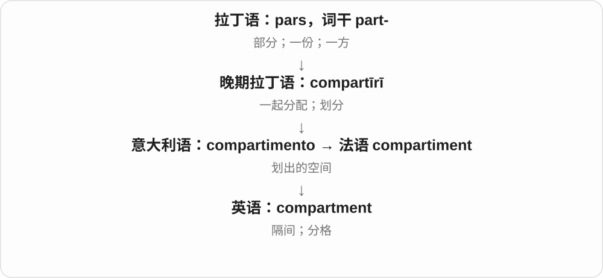

它从“划分”转向划出的空间本身。一个 bag 可以有 several compartments，而不是几个独立的包。

**常见搭配与例句**

a storage compartment；a train compartment；the glove compartment。

> Keep your passport in the inner compartment of the bag.

把护照放在包的内层分格里。

> Smoke was coming from the engine compartment.

发动机舱里正冒出烟。

**别混淆**

partition 常是隔板或划分动作；compartment 是隔开后得到的空间。

### 41. criticize — 批评；指出缺点；评论

**音标**：英、美 /ˈkrɪtɪsaɪz/

**先抓住这个画面**

认为某个行为或作品有问题，把自己的不满或判断说出来。

**怎么拆**

英语 critic + -ize；英式英语也常拼 criticise，两种拼写不是两个不同的词。

**怎么变成今天的意思**

**希腊语 krinein**  
分开、辨别、判断

↓

**希腊语 kritikos → 拉丁语 criticus → 法语 critique → 英语 critic**  
善于判断的 → 评论者、批评者

↓

**英语 critic + -ize → criticize**  
作出评价 → 尤其指出缺点、批评

常说 criticize someone for doing something。批评可以有理有据，也可以不公平；这个动词本身不保证批评正确。

**常见搭配与例句**

criticize someone for；criticize a decision；be widely criticized。

> They criticized the company for ignoring customer complaints.

他们批评公司不理会顾客投诉。

> You can criticize the argument without attacking the person.

你可以批评论点，而不攻击提出论点的人。

**别混淆**

criticize 常有负面判断；analyze 只是分析，并不预设赞成或反对。

### 42. maximize — 使最大化；充分利用；最大化窗口

**音标**：/ˈmæksɪmaɪz/

**先抓住这个画面**

在现有条件下，尽量把某个目标值或可用空间提高。

**怎么拆**

maximum 的 maxim- 词干 + -ize，英语形成的动词；不是 maxim“格言”变成一种做法。

**怎么变成今天的意思**

**拉丁 magnus → maximus**  
大的 → 最大的、最高的

↓

**拉丁 maximum → 英语 maximum**  
最大的量、最高程度

↓

**英语 maximum + -ize → maximize**  
最大值 → 尽量提高到最大

maximize space 是充分利用空间，maximize profit 是尽量提高利润。计算机里 maximize a window 是把窗口放到当前系统允许的最大显示尺寸，未必等于进入隐藏全部界面元素的全屏模式。

**常见搭配与例句**

maximize efficiency；maximize the use of；maximize space；maximize a window。

> The layout maximizes the use of natural light.

这个布局尽可能利用了自然光。

> Double-click the title bar to maximize the window.

双击标题栏可将窗口最大化。

**别混淆**

optimize 是把方案调到最合适，不一定让每个数都最大；maximize 必须看它要增大的是收益、面积还是其他目标。

### 43. stabilize — 使稳定；稳定下来

**音标**：/ˈsteɪbəlaɪz/

**先抓住这个画面**

原来晃来晃去、上下乱跳，现在逐渐控制住了，这个过程就是 stabilize。

**怎么拆**

stable 的词干 stabil- + -ize（使成为）。英式也常写 stabilise。

**怎么变成今天的意思**

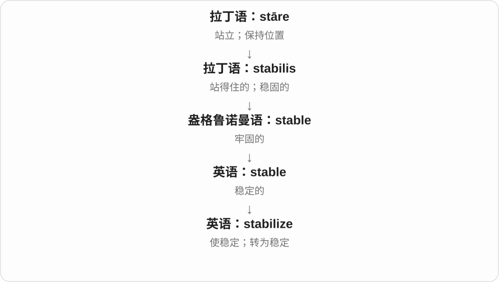

可以说人采取措施让它稳定，也可以说它自己稳定下来。它描述变化方向，不保证永久稳定。

**常见搭配与例句**

stabilize prices；stabilize the image；the situation stabilizes。

> The tripod helps stabilize the camera.

三脚架有助于稳住相机。

> After several weeks, the water level stabilized.

几周后，水位稳定了下来。

**别混淆**

stable 是已有的状态；stabilize 是进入或促成这个状态。

### 44. capitalize — 用大写书写；使资本化；利用机会

**音标**：/ˈkæpɪtəlaɪz/

**先抓住这个画面**

它有两幅常用画面：把小写 a 变成大写 A；把一个有利条件转成实际优势。

**怎么拆**

capital + -ize；首字母义用“大写”支线，经营义用“资本”支线。capitalize on 的利用义后来从获利、取得优势引申出来。

**怎么变成今天的意思**

**拉丁语：caput；属格 capitis**  
头；首领；顶端、主要部分

↓

**英语 capital 的并行义：大写；资本**  
同族不同用途

↓

**英语：capital + -ize → capitalize**  
写成大写；转成资本；利用优势

capitalize a name 是按规则用大写；capitalize on an opportunity 是利用机会。英式常拼 capitalise。

**常见搭配与例句**

capitalize the first letter；capitalize on experience。

> Capitalize the first word of each sentence.

把每句话的第一个词首字母大写。

> The team capitalized on its opponents’ mistakes.

这支队伍利用了对手的失误。

**别混淆**

capitalize on 强调把已有条件转成优势；exploit 还可能带不公平利用的批评。

### 45. vandal — 故意损坏公物、他人财物者

**音标**：/ˈvændəl/

**先抓住这个画面**

不是失手碰坏，而是故意砸、刻、破坏不属于自己的东西，这种人可叫 vandal。

**怎么拆**

普通名词来自 Vandals 汪达尔人的历史族名，以及后世把他们与破坏古罗马文物相联的叙述。英语的贬义名称反映后世评价，不能用它证明整个古代民族的行为都符合现代词义。

**怎么变成今天的意思**

**Vandal、Vandals 历史族名**  
后世叙述中与破坏相联

↓

**小写普通名词 vandal**  
故意破坏财物、文物的人

vandals damaged the statue 滋事破坏者损坏了雕像；a vandal 是行为人物名，复数 vandals。

**常见搭配与例句**

a group of vandals；damage caused by vandals。

> Vandals broke several windows at the school.

有人故意砸坏了学校的几扇窗户。

> The statue was damaged by vandals.

雕像被破坏者损坏了。

**别混淆**

vandal 故意破坏者，thief 窃贼重在偷走东西；破坏者可能并不拿走财物。

### 46. vandalism — 故意破坏公物、他人财物的行为

**音标**：/ˈvændəlɪzəm/

**先抓住这个画面**

vandal 是人，vandalism 是那种故意毁坏东西的行为；不需要把它想成一派拥护破坏的学说。

**怎么拆**

借法语 vandalisme，十八世纪末在批评文物破坏的语境使用，材料来自 Vandal 与 -isme；英语可对应 vandal + -ism。

**怎么变成今天的意思**

**Vandal 的历史命名 → 法语 vandalisme**  
用族名材料命名毁坏文物的行为

↓

**英语 vandalism**  
故意破坏公共、他人财物等行为

an act of vandalism 一次故意破坏行为；prevent vandalism 防止破坏；damage caused by vandalism 故意破坏造成的损失。

**常见搭配与例句**

an act of vandalism；prevent vandalism。

> The park closed temporarily after an act of vandalism.

公园发生故意破坏事件后暂时关闭。

> The campaign asks residents to report vandalism.

这项活动呼吁居民报告故意破坏公物的行为。

**别混淆**

vandalism 强调故意破坏，accidental damage 是意外损坏；损坏的结果相似，行为性质可能不同。

### 47. vandals — 故意毁坏财物者〔复数〕

**音标**：英、美 /ˈvændəlz/

**先抓住这个画面**

把公共设施砸坏、故意毁坏别人东西的人，是 vandals。重点是蓄意毁坏，不只是东西意外坏了。

**怎么拆**

普通名词 vandal 从历史 Vandals 汪达尔人族名的贬损印象发展；现代加 -s → vandals，词尾 /z/。名称的这种转用，不等于对历史族群的全部评价都是事实。

**怎么变成今天的意思**

**历史 Vandals 族名 → 英语 vandal 故意毁坏者**  
借旧时历史印象形成普通名词

↓

**vandal + -s → vandals**  
现代复数；小写常用于普通毁坏者称呼

vandals damaged something 是有人蓄意破坏某物；damage by vandals 是人为蓄意损坏；protect against vandals 是防止遭破坏。

**常见搭配与例句**

damage by vandals；vandals broke the windows；protect against vandals。

> Vandals broke the windows of the empty building.

有人蓄意打碎了那栋空楼的窗户。

> The statue had been damaged by vandals.

雕像遭到了蓄意毁坏。

**别混淆**

vandalism 说破坏行为，vandals 说实施者；Vandals 大写还可能指历史汪达尔人，靠上下文辨别。

### 48. vandalize — 故意损坏、破坏公物或他人财物

**音标**：/ˈvændəlaɪz/

**先抓住这个画面**

把 vandal 的破坏行为变成动词：他们砸坏站台、毁坏雕像，就可说 vandalize。

**怎么拆**

现代对应 vandal + -ize；历史也有由 vandalism 逆构的分析，不能把表面更短的动词绝对排在名词之前。

**怎么变成今天的意思**

**vandal、vandalism 的既有材料**  
故意破坏者与破坏行为名称

↓

**vandalize**  
可按 vandal + -ize 或由名词逆构分析的动词

vandalize a building 故意破坏建筑；a vandalized bus shelter 被人损坏的公交候车亭；英式也常见 vandalise。

**常见搭配与例句**

vandalize property；a vandalized monument。

> Someone vandalized the bus shelter overnight.

有人在夜里故意损坏了公交候车亭。

> The memorial had been vandalized.

那座纪念碑遭到了蓄意破坏。

**别混淆**

damage 损坏不必故意，vandalize 通常指故意破坏；这不是把物体装饰成汪达尔民族风格。

### 49. vandalise — 蓄意破坏公物、他人财物〔常见英式拼写〕

**音标**：/ˈvændəlaɪz/

**先抓住这个画面**

故意把站台、建筑或雕像弄坏，换成 s 拼写也仍是这种蓄意破坏。

**怎么拆**

vandalize 的常见 -ise 拼写变体；这一组 -ise／-ize 承接相同动词构词材料，不能推广到所有末尾有 ise 的词。

**怎么变成今天的意思**

**vandalize 的既有词族**  
基础材料和动词意义相同

↓

**vandalize／vandalise**  
常见拼写变体，不是新造一个相反动作

vandal／vandalism 的词族接 -ise，与 vandalize 对应；现代名词、动词的先后不能只按词形长短推断。

**常见搭配与例句**

vandalise；具体宾语和搭配与 vandalize 对应。

> The playground was vandalised during the night.

游乐场夜里遭到蓄意破坏。

> Someone had vandalised the information board.

有人蓄意破坏了信息告示牌。

**别混淆**

vandalise 和 vandalize 在这里意义、基本读音对应；不是每个 -ise 词都能机械改 z，如 advise、surprise 要分别记。

### 50. prioritize — 安排优先顺序；优先处理

**音标**：英 /praɪˈɒrətaɪz/；美 /praɪˈɔːrətaɪz/

**先抓住这个画面**

待办事项挤在一起时，把更重要的往前移；既可以排整张清单，也可以突出其中一项。

**怎么拆**

priority + -ize；现代英语在名词基础上形成动词。

**怎么变成今天的意思**

**古拉丁 pri；拉丁 prior**  
在前 → 较早的、居前的

↓

**中世纪拉丁 priōritās → 古法语 priorite → 英语 priority**  
居前的状态 → 优先地位、优先事项

↓

**英语 priority + -ize → prioritize**  
安排先后、给予优先地位

prioritize your tasks 是给任务排先后；prioritize safety 是优先考虑安全。它不意味着其他事项永远不做，而是先分配注意力和资源。

**常见搭配与例句**

prioritize tasks；prioritize A over B；learn to prioritize。

> We need to prioritize the tasks before starting work.

开工前，我们需要给任务排好优先顺序。

> The team prioritized reliability over adding more features.

团队把可靠性放在增加更多功能之前。

**别混淆**

organize 是一般组织整理；prioritize 特别问“哪件先、哪件更重要”。

### 51. visualize — 想象出画面；使可视化

**音标**：/ˈvɪʒuəlaɪz/

**先抓住这个画面**

visualize 是把没有摆在眼前的东西变成画面：可以在脑中想，也可以画成图让别人看。

**怎么拆**

visual + -ize，表示使成为可用视觉把握的形式。

**怎么变成今天的意思**

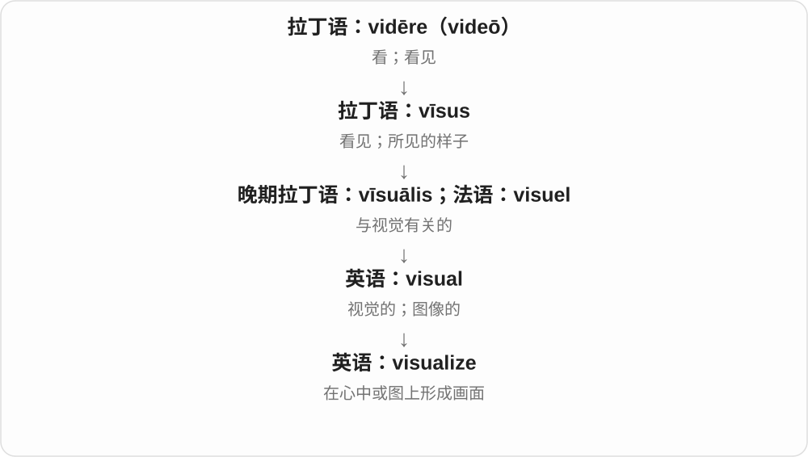

既能 visualize a room 想象房间，也能 visualize data 把数据画出来。两种用法都抓住成像。

**常见搭配与例句**

visualize success；visualize a scene；visualize data。

> Try to visualize the room before choosing the furniture.

挑家具前，试着在脑中想象房间的样子。

> The chart helps us visualize the changes over time.

这张图帮助我们直观看出随时间发生的变化。

**别混淆**

imagine 可涉及声音、感受等；visualize 特别强调图像。visualise 是常见英式拼写。

### 52. legalize — 使合法；使获得法律许可

**音标**：/ˈliːɡəlaɪz/

**先抓住这个画面**

以前法律不允许，规则改了以后，这件事可以依法进行。

**怎么拆**

legal + -ize“使成为”，英语动词；英式也拼 legalise。

**怎么变成今天的意思**

**拉丁语 lex，属格 legis**  
法律、规则

↓

**拉丁语 legalis**  
属于法律的；依法的

↓

**拉丁语直接借入，或经古法语 légal → 英语 legal**  
法律的；合法的

↓

**英语 legal + -ize → legalize**  
使变得合法

legalize an activity 强调改变其法律地位。它不保证人们一定赞同，也不等于所有限制都消失。

**常见搭配与例句**

legalize an activity；a proposal to legalize…。

> The bill would legalize street performances in designated areas.

该法案将允许在指定区域合法进行街头表演。

> The debate concerned whether to legalize the practice or keep the ban.

争论围绕应当让这种做法合法化，还是继续禁止它。

**别混淆**

decriminalize 通常说去掉刑事处罚；legalize 说使合法，两个政策动作的范围可能不同。

### 53. summarize — 总结；概括；扼要说明

**音标**：/ˈsʌməraɪz/

**先抓住这个画面**

把长话里的骨架留下，让别人快速知道重点。

**怎么拆**

summary + -ize，拼写去 y 加 -ize；英式也写 summarise。

**怎么变成今天的意思**

**拉丁 summus → summa**  
最高的 → 顶端、总体、总额、要点

↓

**拉丁 summarius → 英语 summary〔形容词〕；summarium → summary〔名词〕**  
扼要的；汇集主要内容的摘要

↓

**英语 summary + -ize → summarize**  
摘要 → 做成摘要、概括

summarize a discussion 是概括讨论内容；summarize findings 是汇总发现。只剪掉最后几段，不一定已经总结出了主旨。

**常见搭配与例句**

summarize the findings；summarize a discussion；to summarize。

> Could you summarize the main argument in two sentences?

你能用两句话概括主要论点吗？

> The table summarizes the results of all three surveys.

表格汇总了三次调查的结果。

**别混淆**

quote 是引用原话；summarize 是压缩、概括主要内容，可以换自己的说法。

### 54. plagiarize — 抄袭；把他人作品、想法当成自己的

**音标**：/ˈpleɪdʒəraɪz/

**先抓住这个画面**

拿来别人的文字或想法，却让人以为这是自己写、自己想出来的，是 plagiarize 的核心。不是所有引用、学习模仿都叫抄袭。

**怎么拆**

较早 plagiary 文学窃贼的材料 + -ize，远接拉丁 plagiarius 绑架者、掠夺者，古代已有把文学剽窃比作偷走别人东西的用法。英语动词并不比名词 plagiarism 更早。

**怎么变成今天的意思**

**拉丁 plagiarius → 英语 plagiary 等**  
绑架者、掠夺者 → 文学窃贼的比喻

↓

**plagiary + -ize → plagiarize**  
剽窃文字、想法

plagiarize a passage 抄袭一段文字；plagiarize from a source 抄袭某来源。引用、转述与署名关系是实际判断的重点，不能只数相同几个词。

**常见搭配与例句**

plagiarize a paragraph；plagiarize from。

> The student admitted plagiarizing several paragraphs.

那名学生承认抄袭了好几个段落。

> The editor checked whether the article had been plagiarized from another source.

编辑核查文章是否抄袭自别的来源。

**别混淆**

copy 可泛指复制，plagiarize 通常包含不当冒充自己的成分；合法、恰当署名的引用不因用了原话就自动变成 plagiarism。

### 55. plagiarism — 抄袭；剽窃行为或内容

**音标**：/ˈpleɪdʒərɪzəm/

**先抓住这个画面**

plagiarize 是做这个动作，plagiarism 把这类冒用他人成果的行为拿出来当名词。这里 -ism 不是某派哲学。

**怎么拆**

plagiary 的材料 + -ism，十七世纪已有；现代可与后来的 plagiarize 成组理解，但不要把这条学习顺序画成实际出现先后。

**怎么变成今天的意思**

**plagiary 等较早人物、行为材料**  
文学剽窃相关词族

↓

**plagiarism；后有 plagiarize 等扩展**  
剽窃的行为、现象与动词对应

accuse someone of plagiarism 指控某人抄袭；detect plagiarism 发现抄袭；a case of plagiarism 一例抄袭事件。指控与查证结果需要在表达中区分。

**常见搭配与例句**

an allegation of plagiarism；detect plagiarism。

> The university investigated the allegation of plagiarism.

大学调查了那项抄袭指控。

> The course teaches students how to avoid plagiarism.

这门课教学生如何避免抄袭。

**别混淆**

plagiarism 关注冒充他人成果，copyright infringement 著作权侵权是另一套法律概念；两者可能重叠，不能当作完全同义词。

### 56. plagiarist — 抄袭者；剽窃者

**音标**：/ˈpleɪdʒərɪst/

**先抓住这个画面**

plagiarize 是抄袭，plagiarism 是抄袭行为，plagiarist 是把别人成果冒充自己成果的人。

**怎么拆**

plagiarism 的词族接 -ist 形成人物名，历史还有更早 plagiary 文学窃贼的材料；不要按英语词长替整个词族编固定出现顺序。

**怎么变成今天的意思**

**plagiary、plagiarism 等较早材料**  
文学剽窃的人物、行为词族

↓

**plagiarist**  
抄袭、剽窃他人成果的人

an alleged plagiarist 被指控的抄袭者；a plagiarist’s work 抄袭者的作品。描述具体人时要分清指控与已确认事实。

**常见搭配与例句**

a plagiarist；an alleged plagiarist。

> The novel exposes its narrator as a plagiarist.

小说揭露叙述者原来是个抄袭者。

> The article distinguishes a careless citation error from the deliberate work of a plagiarist.

文章区分了疏忽造成的引用错误与抄袭者的蓄意剽窃。

**别混淆**

plagiarist 指人，plagiarism 指行为；write about plagiarism 讨论抄袭，不等于自己就是 a plagiarist。

### 57. socialize — 与人交往；使学会群体生活；使社会化

**音标**：英 /ˈsəʊʃəlaɪz/；美 /ˈsoʊʃəlaɪz/

**先抓住这个画面**

走进人群一起聊天活动；更宽地说，是逐渐学会与别人共同生活的规则。

**怎么拆**

social + -ize；英式常也写 socialise。

**怎么变成今天的意思**

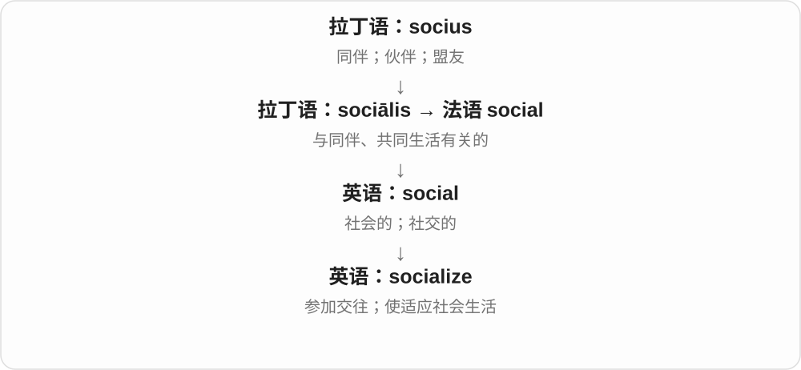

socialize with friends 是与朋友交往；children are socialized… 可谈儿童如何学到行为规范。政治经济语境还可说使共同拥有或社会化管理。

**常见搭配与例句**

socialize with；socialize after work；socialize children into…。

> We sometimes socialize after work.

我们有时下班后一起聚聚。

> Children are socialized into the habits of their community.

儿童在成长中学会所在社群的习惯。

**别混淆**

socialize with someone 是交往；通常不用 socialize someone 表示跟他聊天，后者是使某人社会化。

### 58. jeopardize — 危及；使面临受损或失败的风险

**音标**：英 /ˈdʒepədaɪz/；美 /ˈdʒepərdaɪz/

**先抓住这个画面**

原本还能守住的东西，被某个行为推到了危险边缘。

**怎么拆**

jeopardy + -ize“使进入某状态”；英式也常写 jeopardise。

**怎么变成今天的意思**

**拉丁 iocus／jocus**  
玩笑、游戏、消遣

↓

**古法语 jeu“游戏” + parti“分开的” → jeu parti**  
胜负未分的局面；结果不确定

↓

**盎格鲁法语及中古英语 → jeopardy**  
不确定的局面 → 危险、风险

↓

**英语 jeopardy + -ize → jeopardize**  
危险处境 → 使处于危险

jeopardize your career 是让职业前途面临风险，jeopardize the agreement 是可能使协议破裂。这个动词强调造成风险，不必已经导致最终失败；所以常用来说明一个决定可能付出的代价。

**常见搭配与例句**

jeopardize safety；jeopardize a project；jeopardize someone’s chances。

> Ignoring the warning could jeopardize everyone’s safety.

无视这条警告可能危及所有人的安全。

> She did not want to jeopardize her chances of promotion.

她不想让自己的晋升机会受到影响。

**别混淆**

destroy 表示破坏已经达到很强程度；jeopardize 可以还在风险阶段。不要把它一律译成“彻底毁掉”。

### 59. modernize — 使现代化；更新

**音标**：英 /ˈmɒdənaɪz/；美 /ˈmɑːdərnaɪz/

**先抓住这个画面**

把旧设备、旧制度或旧做法更新到当下需要的水平。

**怎么拆**

可分析为英语 modern + -ize，也有法语 moderniser 的借入影响；两种解释都接 modern，不必强行指定唯一造词地点。

**怎么变成今天的意思**

**拉丁语：modus**  
尺度、分寸；方式

↓

**拉丁语 modo → modernus；法语及英语 modern(e)**  
如今 → 现代的

↓

**英语 modern + -ize／法语 moderniser → modernize**  
使采用较新的形式、方法

modernize a railway 可能包括轨道、信号和管理的更新；不是把外壳换漂亮就一定完成了。英式也写 modernise。

**常见搭配与例句**

modernize the system；modernize infrastructure。

> The city plans to modernize its railway stations.

这座城市计划更新火车站的设施。

> The firm modernized its training methods.

公司更新了培训方法。

**别混淆**

renovate 常是修缮建筑；modernize 明确强调采用较新的技术或做法。

### 60. normalize — 使正常化；使被视为正常；归一化、规范化

**音标**：英 /ˈnɔːməlaɪz/；美 /ˈnɔːrməlaɪz/

**先抓住这个画面**

把失衡的情况拉回常态，或者把原本不被接受的事逐渐变成“大家习惯了”；技术中则是调整到约定尺度。

**怎么拆**

英语 normal + -ize“使……”。英式也常写 normalise，属于同一个词。

**怎么变成今天的意思**

**拉丁 norma**  
木工直角尺；由此指规则、标准

↓

**拉丁 normalis → 英语 normal**  
按直角尺的；合乎规则、常态的；几何中为垂直的

↓

**英语 normal + -ize → normalize**  
使达到常态、共同标准；使被视为正常

normalize relations 是使关系正常化；normalize overwork 是让过度工作变得被习以为常。数学中把非零向量除以它的长度可得到单位向量；数据中的 normalize 方法不止一种，并非一律变成正态分布。

**常见搭配与例句**

normalize relations；normalize a vector；normalize the data；normalize a practice。

> The two countries agreed to normalize diplomatic relations.

两国同意使外交关系正常化。

> To normalize this nonzero vector, divide it by its length.

要把这个非零向量归一化，就用它除以自身长度。

**别混淆**

normalize 说明向某种常态或标准调整；具体标准要看语境。standardize 与它有重叠，但不是在所有技术领域都能互换。

### 61. materialize — 实现；出现、显现

**音标**：英 /məˈtɪəriəlaɪz/；美 /məˈtɪriəlaɪz/

**先抓住这个画面**

原来只是一个计划、一种期待，后来真在眼前出现了；也可说人像突然冒出来。

**怎么拆**

material + -ize，使成物质形态的构词联系，后来通用于实现、出现。现代不是只说把材料加工出来。

**怎么变成今天的意思**

**拉丁 māteria → 晚期拉丁 māteriālis**  
木材、材料、物质 → 物质的、材料的

↓

**法语及中古英语 → material**  
物质的、重要的；材料、布料、资料等用法

↓

**material + -ize → materialize**  
取得实际形态 → 实现、显现

plans materialize 计划实现，an opportunity materializes 机会出现，fail to materialize 没能出现、兑现。

**常见搭配与例句**

plans materialize；fail to materialize；materialize out of nowhere。

> The promised funding never materialized.

承诺的资金始终没有到位。

> A waiter seemed to materialize beside our table.

一位服务员像突然冒出来似的来到桌边。

**别混淆**

materialize 常让计划、结果、人物作主语；realize a plan 常是人实现计划。The plan materialized 与 We realized the plan 结构不同。

### 62. synthesize — 综合；合成

**音标**：/ˈsɪnθəsaɪz/

**先抓住这个画面**

主动把不同材料接起来，得到一种物质、声音或新的理解。

**怎么拆**

synthesis 的词干 + -ize；英式也拼 synthesise。

**怎么变成今天的意思**

**古希腊语 tithenai，词典形 tithemi**  
放、安置、设定

↓

**希腊语 syn- + tithenai → syntithenai → synthesis**  
放在一起 → 组合、综合

↓

**拉丁语 synthesis → 英语 synthesis**  
把部分组合成整体；合成

↓

**英语 synthesis + -ize → synthesize**  
综合、合成 → 进行这种操作

synthesize information 是综合信息；synthesize a compound 是合成化合物。也能说生物体合成某种分子，所以不必把这个动词一律理解为人工制造。

**常见搭配与例句**

synthesize information；synthesize a compound；synthesize sound。

> The report synthesizes evidence from interviews and surveys.

报告综合了访谈与调查中的证据。

> Cells synthesize proteins from amino acids.

细胞用氨基酸合成蛋白质。

**别混淆**

combine 泛指放到一起；synthesize 通常强调形成有结构的成果或物质。

### 63. subsidize — 补贴；资助部分费用

**音标**：/ˈsʌbsɪdaɪz/

**先抓住这个画面**

subsidize 像从旁边垫上一部分钱，让某项服务能继续运转，或让使用者付得起。

**怎么拆**

subsidy 去 y 加 -ize，英语中派生为动词；英式也拼 subsidise。

**怎么变成今天的意思**

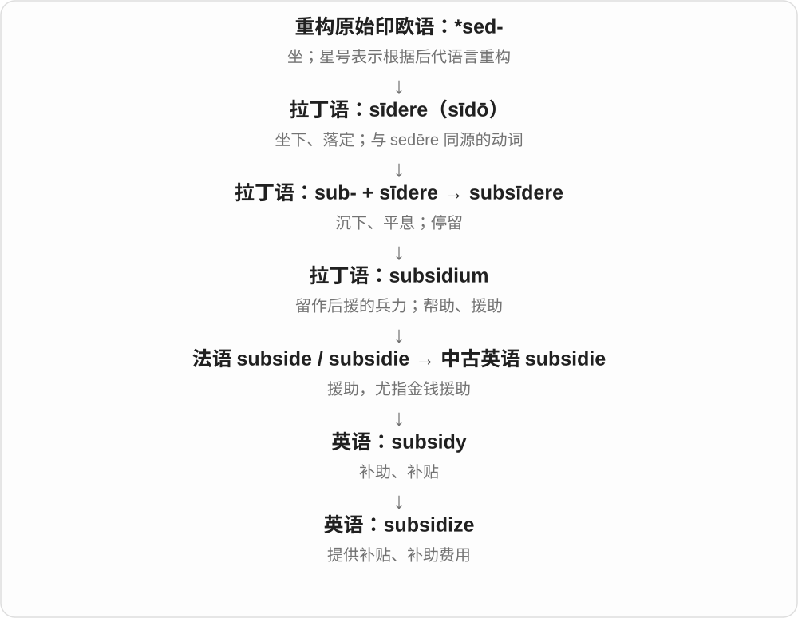

可由政府、机构或其他收入来源提供补贴。某业务 subsidizes another 也可说用一项业务收入支持另一项。

**常见搭配与例句**

subsidize public transport；subsidize the cost；heavily subsidize。

> The council subsidizes bus fares for local students.

地方政府为当地学生补贴公交车费。

> Sales from the shop help subsidize the museum’s free events.

商店收入帮助补贴博物馆免费活动的开支。

**别混淆**

sponsor 往往强调赞助关系、宣传或支持身份；subsidize 更突出补贴成本。

### 64. categorize — 分类；把……归为某类

**音标**：/ˈkætəɡəraɪz/

**先抓住这个画面**

面前一堆东西，你决定哪些放同一格、分别叫什么类，是 categorize。把人归成一种类型，也是在做这种分类。

**怎么拆**

category 类别去 y 接 -ize → categorize；category 远接希腊断言、范畴的材料，现代动词强调归类动作。

**怎么变成今天的意思**

**category 类别 + -ize → categorize**  
按类别把对象分组

↓

**categorize + -ation → categorization**  
分类的过程、方法、结果

categorize by size 按大小分类；categorize something as something 将某物归为某类；categorize into groups 分组。

**常见搭配与例句**

categorize by；categorize as。

> The files are categorized by topic.

文件按主题分类。

> She categorized the problem as a design issue.

她把问题归为设计问题。

**别混淆**

categorize 是归类，characterize 是描述特征；描述可以帮助分类，但不等于已经选定类别。

### 65. generalize — 概括；归纳；作笼统判断

**音标**：/ˈdʒenərəlaɪz/

**先抓住这个画面**

看过几个点，试着画出一条能覆盖更多点的线；线画得好是归纳，画过头就是以偏概全。

**怎么拆**

general + -ize，形成表示使普遍化、作概括的动词；与法语 généraliser 等对应形式相关。

**怎么变成今天的意思**

**拉丁 genus → generālis**  
种类 → 涉及整体、同类共有的

↓

**法语 general → 中古英语 general**  
普遍的、总体的

↓

**general + -ize → generalize**  
把个别经验推向更一般的结论

generalize from a small sample 是从小样本作概括；generalize about a group 是对某群体作一般判断。研究中合理概括很有用，词本身不必然贬义。

**常见搭配与例句**

generalize from；generalize about；generalize the findings。

> It is risky to generalize from a single example.

只凭一个例子就推开来说，很容易出错。

> Can we generalize these findings to other age groups?

这些发现能推广到其他年龄组吗？

**别混淆**

generalize 说从个别推向一般；summarize 是压缩已有内容。概括规律可能超过已观察个案，摘要通常围绕原文。

### 66. finalize — 最终敲定；定稿

**音标**：/ˈfaɪnəlaɪz/

**先抓住这个画面**

finalize 是把还在讨论、修改的东西敲定下来：“就按这个版本办。”它强调最后确认，而不仅是手头动作做完。

**怎么拆**

final + -ize，-ize 常表示“使成为……”。这里就是使安排进入最终状态。

**怎么变成今天的意思**

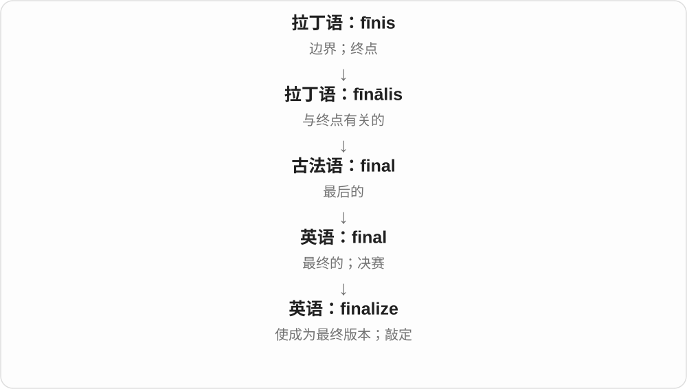

final 是最终的，finalize 把这个状态变成动作。合同、计划、名单和日程都可以被 finalize。

**常见搭配与例句**

finalize the details（敲定细节）；finalize an agreement（最终确定协议）；finalize the schedule（确定最终日程）。

> We will finalize the schedule tomorrow.

我们明天会敲定最终日程。

> The two sides are still finalizing the details of the agreement.

双方仍在敲定协议的细节。

**别混淆**

finish 是一般的完成；finalize 更强调从草案或待定状态变成正式、最终的版本。

### 67. revitalize — 使恢复活力；振兴

**音标**：/riːˈvaɪtəlaɪz/

**先抓住这个画面**

原来变得沉闷、衰弱或停滞，重新让它活跃起来。

**怎么拆**

英语 re-“重新” + vital“有生命力的” + -ize“使成为”。这是英语中的构词，借用的是 vital 的生命力含义。

**怎么变成今天的意思**

**拉丁 vīta；与 vīvere“活着”同族**  
生命

↓

**拉丁 vītālis → 古法语 vital，亦直接拉丁借入**  
与生命有关的；维系生命的

↓

**英语 vital**  
生命所必需；至关重要；充满活力

↓

**英语 re- + vital + -ize → revitalize**  
重新赋予活力

常用于地区、经济、企业、传统或活动。revitalize a town 不是字面把死人救活，而是让城镇重新有生意、活动和人气。

**常见搭配与例句**

revitalize an area；revitalize the economy；revitalize a tradition。

> The new library helped revitalize the town centre.

新图书馆帮助市中心恢复了活力。

> The group hopes to revitalize a local storytelling tradition.

这个团体希望让当地的讲故事传统重新活跃起来。

**别混淆**

renovate 常说翻修建筑；revitalize 更看重恢复活动与生机，翻修可能是其中一种办法。

### 68. revolutionize — 彻底改变、使发生革命性变化

**音标**：/ˌrevəˈluːʃənaɪz/

**先抓住这个画面**

不只是修补细节，而是把原来的做法、可能性大幅翻新；有时宣传中也用得很夸张。

**怎么拆**

revolution + -ize，动词使发生重大变革。英式也见 revolutionise，本页同词说明，不另设重复词头。

**怎么变成今天的意思**

**拉丁 re- + volvere → revolvere → revolūtiō**  
向回、再次 + 滚动 → 转回、循环

↓

**法语 revolucion、拉丁名词等 → 英语 revolution**  
转动、天体循环 → 局势巨变、革命

↓

**revolution + -ize → revolutionize**  
使制度、技术、做法等彻底改变

revolutionize transport 彻底改变交通，revolutionize the way we work 彻底改变工作方式，revolutionize an industry 改造某行业。

**常见搭配与例句**

revolutionize transport；revolutionize the way；revolutionize an industry。

> The railway revolutionized travel between the cities.

铁路彻底改变了城市间的出行方式。

> The new method could revolutionize the way the team processes data.

新方法可能彻底改变团队处理数据的方式。

**别混淆**

revolutionize 强调巨大变化，improve 改善可以很小；一个细节优化不必夸成颠覆全行业。

### 69. fantasize — 幻想；想象令人向往的情景

**音标**：/ˈfæntəsaɪz/

**先抓住这个画面**

让脑中的小电影继续演，自己先在想象里体验一遍。

**怎么拆**

fantasy 去掉 -y 后加动词后缀 -ize；英式还常拼 fantasise。

**怎么变成今天的意思**

**希腊 phaínein／phaínesthai**  
使显现、显现出来；与光亮有关

↓

**希腊 phantasía → 拉丁 phantasia**  
显现的形象；想象

↓

**古法语 fantaisie → 中古英语 fantasie → fantasy**  
想象中的画面；幻想

↓

**英语 fantasy + -ize → fantasize**  
进行幻想、把情景在脑中展开

常跟 about doing：fantasize about travelling。通常说令人向往、未必会成真的情景；它本身不包含可实施的步骤，因此不等于已经计划去做。

**常见搭配与例句**

fantasize about doing；fantasize that…。

> During the long commute, he fantasized about living beside the sea.

漫长的通勤途中，他幻想着住在海边。

> She sometimes fantasizes that her little bakery has become famous.

她有时幻想自己的小面包店已经出了名。

**别混淆**

plan 要考虑怎样落实；fantasize 可以只停留在想象。imagine 的范围更广，也包括推测普通或不愉快的情形。

### 70. familiarize — 使熟悉；让自己熟悉

**音标**：英 /fəˈmɪliəraɪz/；美 /fəˈmɪljəraɪz/

**先抓住这个画面**

带一个人认路、试用工具、了解规则，让原本陌生的东西逐渐变得顺手。

**怎么拆**

现代可拆 familiar + -ize“使……”。历史上也有法语 familiariser 的借入分析，不能只认定为英语新造词；英式也常写 familiarise。

**怎么变成今天的意思**

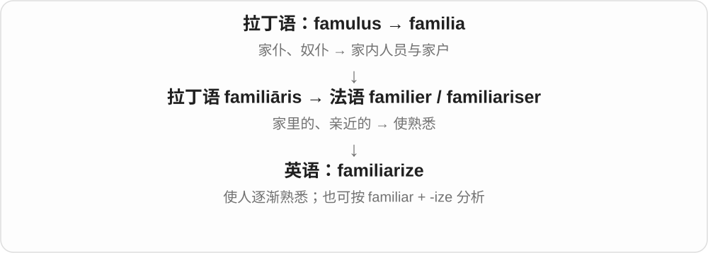

常见 familiarize yourself with，也可说 familiarize someone with。需要说明谁变熟悉，以及熟悉什么。

**常见搭配与例句**

familiarize yourself with；familiarize new staff with…。

> Take a few minutes to familiarize yourself with the controls.

花几分钟熟悉一下这些控制装置。

> The tour familiarized new students with the campus.

这次参观让新生熟悉了校园。

**别混淆**

familiarize 是使熟悉的过程；be familiar 是已经熟悉的状态。

### 71. terrorize — 恐吓、使长期处于恐惧中

**音标**：英 /ˈterəraɪz/；美 /ˈterəraɪz/

**先抓住这个画面**

让一个人或一群人怕得不敢正常生活、行动，通常比吓一跳更强，也常带反复威吓的感觉。

**怎么拆**

terror + -ize，构成使陷入恐惧的动词。英式还见 terrorise，不另设词头。

**怎么变成今天的意思**

**拉丁语 terrēre → terror**  
使害怕 → 极度恐惧

↓

**法语 terreur → 中古英语 terrour → terror**  
强烈恐惧；令人恐惧的人或事物

↓

**terror + -ize → terrorize**  
使陷入极度恐惧；以恐惧控制

terrorize a neighbourhood 恐吓一个街区的居民，terrorize someone into silence 吓得某人不敢说话。

**常见搭配与例句**

terrorize someone；terrorize a neighbourhood；terrorize someone into silence。

> The bullies had terrorized the younger children for months.

那些欺凌者恐吓年幼的孩子已经好几个月。

> In the story, a dragon terrorizes the village.

故事里，一条龙让全村人惶恐不安。

**别混淆**

startle 常突然吓一跳，terrorize 是更强的恐吓、使害怕；日常 bullying 欺凌也能 terrorize，动词不限定政治目的。

### 72. colonize — 殖民；建立殖民地；移入并形成种群

**音标**：英 /ˈkɒlənaɪz/；美 /ˈkɑːlənaɪz/

**先抓住这个画面**

来到一个地方并建立持续存在的群体；政治语境还涉及控制。

**怎么拆**

现代按 colony + -ize 理解，早期构词也联系拉丁 colōnus 的词干；英式也写 colonise。

**怎么变成今天的意思**

**拉丁 colere；分词 cultus**  
耕作、照料；居住；尊敬、崇奉

↓

**拉丁 colōnus → colōnia**  
耕作者、定居者 → 定居点

↓

**中古英语 colane / colonye → 英语 colony**  
殖民地；定居群体；生物群体

↓

**英语 colon- + -ize → colonize**  
建立殖民地；生物迁入并建立种群

历史语境可指建立殖民统治。生态学里植物 colonize bare ground，是迁入裸地并扎根；细菌 colonize a surface 是在表面定植，不自动等于造成感染。

**常见搭配与例句**

colonize an island；colonize bare ground；colonize a surface。

> The empire attempted to colonize the island.

这个帝国试图在岛上建立殖民地。

> Small plants quickly colonized the bare ground.

小型植物很快在裸地上扎根扩展。

**别混淆**

settle 可说普通定居；政治语境的 colonize 往往还包含外来控制。生物学用法属于扩展义。

### 73. energize — 使有活力；给……通电

**音标**：英 /ˈenədʒaɪz/；美 /ˈenərdʒaɪz/

**先抓住这个画面**

像给没劲的状态充进一股动力：人开始振作，电气设备则得到电能。

**怎么拆**

energy 去 -y 加 -ize；与 energise 是同一个词的拼写变体。

**怎么变成今天的意思**

**希腊语 ergon**  
工作、行动、做出的事

↓

**希腊语 energeia → 后期拉丁语 energia；法语 énergie**  
活动、发挥作用

↓

**英语 energy**  
起初也指表达的力量，后来用于精力与物理能量

↓

**英语 energy + -ize → energize**  
赋予能量或活力

energize the audience 是让观众兴奋起来；energize a circuit 是使电路带电，技术语境不能只译成鼓舞。

**常见搭配与例句**

energize a team；feel energized；energize a circuit。

> The lively discussion energized the whole team.

热烈的讨论让整个团队振奋起来。

> The technician checked the connections before energizing the circuit.

技术人员在给电路通电前检查了连接。

**别混淆**

encourage 偏鼓励信心；energize 更突出把行动的劲头带起来。

### 74. scrutinize — 仔细检查、审视

**音标**：/ˈskruːtənaɪz/

**先抓住这个画面**

不是扫一眼，而是把细节拿到眼前，看看哪里有问题。合同、照片、账目、表情都能被 scrutinize。

**怎么拆**

scrutiny 去末 y + -ize → scrutinize，对应仔细审查的动词。更早接拉丁 scrutari 搜查；与 screw 螺丝无关。-ise 变体见 scrutinise。

**怎么变成今天的意思**

**晚期拉丁、法语审查词接拉丁 scrutari 搜查**  
仔细搜索、查看

↓

**scrutiny → scrutinize／scrutinise**  
审查名词派生成仔细检查的动作

scrutinize the details 细查细节；scrutinize the evidence 审视证据；scrutinize a face 仔细端详面孔。

**常见搭配与例句**

scrutinize the details；scrutinize the evidence。

> She scrutinized the photograph for signs of editing.

她仔细查看照片，寻找编辑痕迹。

> The committee will scrutinize the spending figures.

委员会将仔细审查支出数字。

**别混淆**

scrutinize 强调仔细看、检查，不代表已经证实有错；criticize 批评则直接表达评价。

### 75. legitimize — 使获得正当性；使合法；使得到认可

**音标**：/lɪˈdʒɪtɪmaɪz/

**先抓住这个画面**

给一种做法或权力补上被认可的理由、程序或身份，让它显得站得住。

**怎么拆**

legitimate 的词干 + -ize，英语构词；-ate 被替换。英式也拼 legitimise。

**怎么变成今天的意思**

**拉丁语 lex，属格 legis**  
法律、规则

↓

**拉丁语 legitimus**  
符合法律的

↓

**中世纪拉丁语 legitimare → legitimatus**  
使合法 → 得到合法承认的

↓

**中古英语 legitimat → legitimate**  
合法的；正当、真实的

↓

**英语 legitimate → legitimize**  
正当的 → 使获得正当地位

可以是实际依法确认，也可以说通过公开仪式、说法或程序建立认可，甚至批评这种做法只是在包装不正当行为。

**常见搭配与例句**

legitimize authority；legitimize a practice。

> The public vote helped legitimize the new committee.

公开投票帮助新委员会获得了认可。

> Critics said the report tried to legitimize an unfair practice.

批评者说，这份报告试图把一种不公平的做法说成正当的。

**别混淆**

legalize 聚焦法律许可；legitimize 更广，可以涉及社会认可和正当理由。

### 76. penalize — 处罚；使吃亏；置于不利地位

**音标**：/ˈpiːnəlaɪz/，亦读 /ˈpenəlaɪz/

**先抓住这个画面**

给一个违规动作扣分，或者一种安排让某类人无缘无故少了机会；两者都让对方承担了不利后果。

**怎么拆**

近代英语 penal + -ize。可联系 penalty 的处罚义来记，但不是直接把 penalty 词尾换掉；英式也常写 penalise。

**怎么变成今天的意思**

**古希腊 poinē → 拉丁 poena**  
赔偿、罚金、处罚；后来也指折磨、痛苦

↓

**拉丁 poenalis；中世纪拉丁 penalis**  
与惩罚有关的

↓

**古法语 peinal／拉丁语直接借入 → 英语 penal**  
刑罚的；处罚性的

↓

**英语 penal + -ize → penalize**  
施加处罚；让某人处于不利地位

penalize someone for breaking a rule 是因违规处罚。a system that penalizes beginners 则可能批评制度让新手吃亏，并没有说新手犯错。

**常见搭配与例句**

penalize someone for something；unfairly penalize；penalize an infringement。

> The referee penalized the player for holding an opponent.

裁判因那名球员拉拽对手而对其作出处罚。

> The new schedule would penalize staff who depend on buses.

新排班会让依赖公交出行的员工吃亏。

**别混淆**

punish 一般更直接说惩罚；penalize 常用于罚分、规则处罚，也常用于无过错却受不利影响的场景。

### 77. patronize — 光顾、支持；以居高临下的态度对待

**音标**：英 /ˈpætrənaɪz/；美 /ˈpeɪtrənaɪz/

**先抓住这个画面**

一条路是做支持者；另一条路是摆出“我比你懂，我来照顾你”的优越姿态。

**怎么拆**

patron + -ize，或受法语 patroniser 借入影响；表示做 patron，再发展出屈尊相待的贬义。英式另常写 patronise。

**怎么变成今天的意思**

**拉丁 pater／patris**  
父亲

↓

**拉丁 patronus → 法语 patron**  
保护者、支持者；也有榜样、模型义

↓

**英语 patronize／法语 patroniser 一支**  
做支持者、给予帮助

↓

**英语 patronize 的扩展义**  
光顾商家；居高临下地对待

patronize local shops 是光顾本地商店，Don’t patronize me 则是“别把我当不懂事的人哄”。后者表面可能很客气，问题在于默认自己高人一等。必须看宾语和语境，不能把两种意思混成“瞧不起商店”。

**常见搭配与例句**

patronize local businesses；don’t patronize me；patronize the arts。

> We try to patronize small shops in our neighbourhood.

我们尽量光顾社区里的小店。

> Please explain the problem without patronizing me.

请解释问题，但别用居高临下的态度对我说话。

**别混淆**

support 通常没有屈尊意味；patronize 对人的用法常可能带这种负面含义。语气客气不一定等于尊重。

### 78. standardize — 标准化；统一规范或格式

**音标**：英 /ˈstændədaɪz/；美 /ˈstændərdaɪz/

**先抓住这个画面**

大家原来各写各的日期、各量各的尺寸，现在约定同一套规则，让结果能比较、能配合。

**怎么拆**

standard + -ize，形成使符合标准的动词。standardise 是同义拼写；-ize 常见于美式，也用于部分英式规范。

**怎么变成今天的意思**

**standard 的历史旗帜、标杆义 → 通行参照**  
已有基础词精讲，现代作为统一要求或形式

↓

**standard + -ize／-ise；non- + standard**  
使统一到标准；非标准形式

standardize the format 统一格式，standardize measurements 统一测量标准。标准可以是技术要求，也可以是组织约定。

**常见搭配与例句**

standardize the format；standardize measurements；standardize procedures。

> We need to standardize the date format across the database.

我们需要统一整个数据库的日期格式。

> The company standardized its training procedures.

公司统一了培训流程。

**别混淆**

standardize 让一致，improve 改善；一致以后未必每个方面都更好，仍需看采用的标准。

### 79. synchronize — 使同步；同步发生

**音标**：英、美 /ˈsɪŋkrənaɪz/

**先抓住这个画面**

把两只表对到同一时间，或者让声音和嘴唇动作刚好对上。

**怎么拆**

联系希腊语 synchronizein“同时发生”的拉丁化形式，来自 synchronos；不是只由英语 synchronous 去尾巴加 -ize。

**怎么变成今天的意思**

**希腊语：syn- + chronos → synchronos**  
一起；时间 → 同时的

↓

**希腊语 synchronizein 的拉丁化形式 → 英语 synchronize**  
同时发生；后来也指使时间一致

常说 synchronize A with B；英式也拼 synchronise。文件同步通常意味着把不同位置的相应数据对齐。

**常见搭配与例句**

synchronize watches；synchronize with；synchronize files。

> We synchronized our watches before leaving.

出发前我们校准了手表，让时间一致。

> The editor synchronized the sound with the video.

剪辑师把声音与画面对齐了。

**别混淆**

coordinate 只要配合得当；synchronize 尤其强调时间或对应状态一致。

### 80. personalize — 按个人定制；使针对个人

**音标**：英 /ˈpɜːsənəlaɪz/；美 /ˈpɜːrsənəlaɪz/

**先抓住这个画面**

原来人人拿到一样的，现在加上你的名字、喜好或需要，变成适合你的那一份。

**怎么拆**

personal + -ize 使成为，形成动词；英式也常写 personalise。它也可把一般问题变成针对个人的事情。

**怎么变成今天的意思**

**拉丁语 persōna → persōnālis → 法语 personal**  
人、角色 → 与个人有关的

↓

**中古英语 personal → 现代英语 personal**  
个人的、私人的；针对个人的

↓

**personal + -ize → personalize**  
个人的 → 使具有个人特点、适合个人

personalize a gift 在礼物上加名字等个性内容，personalize the settings 按自己需要调整设置；personalize a dispute 则是把争论变成针对个人。

**常见搭配与例句**

personalize a gift；personalize a message；personalize your settings。

> You can personalize the notebook with a name on the cover.

你可以在封面加名字，把笔记本做成个人专属款。

> Please discuss the decision without personalizing the disagreement.

请就决定本身讨论，别把分歧变成针对个人。

**别混淆**

personalize 常强调面向具体个人，customize 可按个人或组织要求改动；两者实际范围有交叠。

### 81. sterilize — 使无菌、灭菌；使不能繁殖、施行绝育

**音标**：英 /ˈsterɪlaɪz/；美 /ˈsterəlaɪz/

**先抓住这个画面**

把 sterile 这种状态做出来；面对器械说无菌，面对生殖能力则可能说绝育，不能只看一个中文消毒。

**怎么拆**

sterile 去 e + -ize。医学灭菌与绝育是现代不同用法；英式也常见 sterilise。

**怎么变成今天的意思**

**拉丁 sterilis → 法语 stérile → sterile**  
不生育、不结果 → 无产出

↓

**sterile + -ize → sterilize**  
使不能繁殖；医学中使达到无菌状态

↓

**sterilize + -ation → sterilization**  
上述处理的过程、结果

sterilize instruments 给器械灭菌，sterilize containers 给容器灭菌，sterilize an animal 使动物绝育。具体操作不是词尾本身给出的。

**常见搭配与例句**

sterilize instruments；sterilize containers；sterilize an animal。

> The instruments were sterilized before use.

器械使用前经过了灭菌。

> The report distinguishes sterilizing equipment from simply cleaning it.

报告区分了器材灭菌和单纯清洁。

**别混淆**

sterilize 灭菌与 disinfect 消毒不完全相同：前者以去除、消灭所有形式微生物为标准，后者并非都覆盖细菌芽孢。clean 清洁又是另一概念。

### 82. fertilize — 给……施肥；使受精

**音标**：英 /ˈfɜːtəlaɪz/；美 /ˈfɜːrtəlaɪz/

**先抓住这个画面**

让土地更能长作物，或让生殖细胞结合、启动新生命的发育过程。

**怎么拆**

现代可按 fertile + -ize 理解；有法语 fertiliser 借入分析，也有英语派生分析。生物学“使受精”是后来发展的义项。

**怎么变成今天的意思**

**拉丁语：ferre；第一人称 ferō**  
带、承载；承受；生出

↓

**拉丁语：fertilis**  
能生出、产出的；多产的

↓

**法语 fertile → fertiliser；或英语 fertile + -ize**  
使有生产、繁育能力

↓

**英语：fertilize**  
施肥；后来也指使受精

fertilize a field 是施肥；fertilize an egg 是使卵细胞受精。英国英语也常拼 fertilise。中文的两个动作不同，却都接着“能产出”这个意象。

**常见搭配与例句**

fertilize the soil；fertilize an egg；a fertilized egg。

> They fertilize the vegetable beds with compost.

他们用堆肥给菜畦施肥。

> The diagram shows a sperm cell fertilizing an egg.

图中展示了一个精子与卵细胞结合使其受精的过程。

**别混淆**

pollinate 是把花粉传到受粉部位；fertilize 是受精，不能把传粉与受精当成同一步。

### 83. conceptualize — 把……形成概念；构想；从某种框架理解

**音标**：/kənˈseptʃuəlaɪz/

**先抓住这个画面**

面对一堆具体事情，把它们整理成一个能在脑中抓住的模型：把城市看成网络，就是一种 conceptualize。

**怎么拆**

conceptual + -ize → conceptualize；-ize 构成形成、处理为某种状态的动词。英式也常拼 conceptualise，意思基本相同。

**怎么变成今天的意思**

**拉丁 concipere、conceptus → 中世纪拉丁 conceptualis**  
把握、构想 → 概念相关的

↓

**英语 conceptual → conceptually、conceptualize**  
在概念上；形成概念、构想

↓

**conceptual + -ize → conceptualize**  
形成、组织概念；按概念框架理解

conceptualize something as ... 把某物理解成……；conceptualize a problem 构想问题的框架。可以先构思，也可以重新理解已存在的事物。

**常见搭配与例句**

conceptualize a problem；conceptualize something as a network。

> The researchers conceptualized the city as a network of neighbourhoods.

研究者把城市理解为由各街区组成的网络。

> It took time to conceptualize the problem in a useful way.

花了一些时间，才形成了有助于解决问题的理解框架。

**别混淆**

conceptualize 形成概念框架，visualize 形成视觉画面；理解抽象规则也可以 conceptualize，并不一定在脑中看见图片。

### 84. criminalize — 将某行为规定为犯罪、使犯罪化

**音标**：/ˈkrɪmɪnəlaɪz/

**先抓住这个画面**

原来不作为刑事犯罪处理的行为，被规则、立法纳入犯罪范围；是在改变分类，不只是骂它不好。

**怎么拆**

criminal + -ize，形成使成为犯罪、按犯罪处理的动词。英式也见 criminalise，不另设词头。

**怎么变成今天的意思**

**拉丁语 crīmen、crīmin- → crīminālis**  
指控、罪等 → 与罪有关的

↓

**法语 criminal、criminel → 中古英语 cryminal → criminal**  
犯罪的、刑事的；名词罪犯

↓

**criminal + -ize → criminalize**  
把某种行为归入犯罪处理范围

criminalize an activity 将某活动规定为犯罪，criminalize behaviour 将某行为犯罪化。具体何种行为在哪儿违法，要另查适用规则。

**常见搭配与例句**

criminalize an activity；criminalize behaviour；a law criminalizing。

> The article debates whether the activity should be criminalized.

文章讨论是否应把那项活动规定为犯罪。

> The historian compared laws that criminalized the same behaviour in different periods.

历史学者比较了不同时期把同一行为规定为犯罪的法律。

**别混淆**

criminalize 设为犯罪、decriminalize 去犯罪化；criticize 批评不是同一个动作，反对行为不等于已将它入刑。

### 85. equalize — 使相等；使均衡；追平比分；调节音频均衡

**音标**：/ˈiːkwəlaɪz/

**先抓住这个画面**

把原先有差距的两边拉到同一水平，或调整各部分的平衡。

**怎么拆**

equal + -ize“使成为”；英语构词。音频用法从调平、补偿各频段响应发展而来，不要求把每个频段设成同一个数。

**怎么变成今天的意思**

**拉丁 aequus**  
平、等量、公平、平稳

↓

**拉丁 aequalis → 中古英语 equal**  
相等的、均匀的

↓

**英语 equal**  
相等；匹敌；地位相等的人

↓

**英语 equal + -ize → equalize**  
使相等、调平；比赛中追平

equalize pressure 是使压力平衡；球队 equalize 是把比分扳平；equalize a recording 是调整频率响应。体育用法通常不及物，直接说 the team equalized。

**常见搭配与例句**

equalize pressure；equalize the score；equalize opportunities；equalize a recording。

> The valve allows the pressure on both sides to equalize.

阀门使两侧压力能够达到平衡。

> The visitors equalized with a goal in the final minute.

客队在最后一分钟进球，把比分扳平。

**别混淆**

equate 是设为或看作相等；equalize 常要真的做调整，使两边趋于相等或平衡。

### 86. privatize — 使私有化；把公营业务转为私人所有或经营

**音标**：英、美 /ˈpraɪvətaɪz/

**先抓住这个画面**

把原来由公共部门持有或经营的一块业务，交给私人这一边。

**怎么拆**

现代形式可看作 private + -ize；现代政策义的历史也常解释为从更早的 privatization 反构，不能一律画成先有动词再有名词。

**怎么变成今天的意思**

**拉丁语 privus → privare / privatus**  
单独的、个人的 → 分开、剥去；与公共部分分开的

↓

**拉丁语 privatus → 英语 private**  
属于个人的、非公共的；私下的

↓

**英语 private + -ization → privatization**  
使成为私人的过程；现代政策词也有德语相关术语影响

↓

**英语 privatization → privatize〔现代政策义常按反构解释〕**  
把公共企业、服务转为私人所有或经营

常指企业所有权转移，也有人较宽泛地用于服务交给私人经营。具体方案转的是资产、经营权还是部分职责，需要看上下文。

**常见搭配与例句**

privatize an industry；privatize a service；plans to privatize。

> The proposal would privatize part of the transport network.

这项提案将使部分交通网络私有化。

> The council debated whether to privatize the service.

议会讨论了是否把这项服务交给私人经营。

**别混淆**

outsource 是外包工作，不必改变所有权；privatize 常涉及公共与私人控制关系的改变。

### 87. hypnotize — 催眠；使着迷、使看得出神

**音标**：英美 /ˈhɪpnətaɪz/

**先抓住这个画面**

把一个人的注意力带进很专注的状态；比喻时就是“看得挪不开眼”。

**怎么拆**

19 世纪在 hypnotic 的 hypnot- 上接动词后缀 -ize，形成 hypnotize。它并非由较晚的英语 hypnosis 倒过来派生；历史上这组词与 James Braid 的研究有关。

**怎么变成今天的意思**

**希腊 hypnos → hypnoun → hypnotikos**  
睡眠 → 使入睡 → 使人入睡的

↓

**后期拉丁 hypnoticus → 法语 hypnotique → 英语 hypnotic**  
早期常形容有助入睡的药物

↓

**19 世纪英语 hypnotic 的 hypnot- + -ize → hypnotize**  
使进入催眠状态；后来也比喻使人着迷

hypnotize someone 是对某人实施催眠；be hypnotized by the flames 常只是被火焰吸住了目光。后一种写法不需要真的发生催眠程序，属于文学和日常描写的延伸。

**常见搭配与例句**

hypnotize a volunteer；be hypnotized by something；hypnotize someone into doing something。

> The performer tried to hypnotize a volunteer from the audience.

表演者试着催眠一位来自观众席的志愿者。

> We sat by the fire, hypnotized by the moving flames.

我们坐在火边，看着跳动的火焰出了神。

**别混淆**

hypnotize 是动词，hypnotic 是形容词。mesmerize 在普通描写里也常是“迷住”，但现代词源路线不同。

### 88. internalize — 内化、使成为内在认识；把情绪等往心里收

**音标**：英 /ɪnˈtɜːnəlaɪz/；美 /ɪnˈtɜːrnəlaɪz/

**先抓住这个画面**

原来是别人提醒你的规则，后来不用提醒也自然按它想、按它做，就内化了；也可说把批评、情绪收进心里。

**怎么拆**

internal + -ize，使进入内部、成为内在的一部分。英式也见 internalise；具体是学习规则还是把情绪往心里吞，要看对象。

**怎么变成今天的意思**

**拉丁 internus、internālis → internal**  
内部的、在里面的

↓

**internal + -ize → internalize**  
使外在内容成为内部认识、反应的一部分

internalize a rule 内化规则，internalize a lesson 真正吸收教训，internalize criticism 把批评往心里收。

**常见搭配与例句**

internalize a rule；internalize a lesson；internalize criticism。

> With practice, she internalized the basic rules.

通过练习，她把基本规则变成了自然习惯。

> He tended to internalize every criticism.

他总倾向于把每句批评都往心里收。

**别混淆**

internalize 常不止 memorize 记住，还涉及变成习惯、理解；internalize criticism 也不一定表示批评真实正确。

### 89. theorize — 提出理论；推想；尝试解释

**音标**：英 /ˈθɪəraɪz/；美 /ˈθiːəraɪz/

**先抓住这个画面**

看见一些线索后，说出“我认为背后的原因可能是这样”。

**怎么拆**

theory 去 y + -ize，形成“进行理论思考、提出解释”的动词。

**怎么变成今天的意思**

**希腊 theoros → theorein／theoria**  
观看者 → 观看、思考／观察与思考

↓

**晚期拉丁 theoria → 法语 théorie 等借入路线**  
思考、学说

↓

**英语 theory**  
解释事物的想法、理论；一门领域的原理

↓

**英语 theory + -ize → theorize**  
形成理论、提出解释

theorize that 后面接提出的解释；theorize about 后面接所讨论的问题。这个动作可以是认真构建理论，也可以是日常推测；动词本身不能替代证据，更不等于已经证实。

**常见搭配与例句**

theorize that；theorize about；theorize how。

> They theorize that the marks were made by flowing water.

他们推测这些痕迹是流水造成的。

> We can theorize about the delay, but we need more information.

我们可以推想延误的原因，但还需要更多信息。

**别混淆**

theorize 是提出或组织解释；demonstrate、prove 强调展示依据或完成证明，语气更强。

### 90. localize — 使本地化；定位；限制在局部

**音标**：英 /ˈləʊkəlaɪz/；美 /ˈloʊkəlaɪz/

**先抓住这个画面**

让东西适合某个地方，也可以把问题找准或控制在某一小块地方。

**怎么拆**

local + -ize；英语构词，并可参照法语 localiser。英式也写 localise。

**怎么变成今天的意思**

**拉丁语 locus**  
地方、位置

↓

**后期拉丁语 localis；法语 local → 中古英语 local**  
属于某地的 → 当地的

↓

**英语 local + -ize → localize**  
使与某地相适合；确定或限制所在处

localize an app 不只是逐字翻译，还可能调整货币、日期和文化表达；localize the fault 则是缩小范围、找到故障位置。

**常见搭配与例句**

localize software；localize the source；localized pain。

> The team localized the app for Spanish-speaking users.

团队为西班牙语用户对应用作了本地化调整。

> The tests helped localize the fault to one circuit.

测试帮助把故障定位到一条电路。

**别混淆**

translate 主要转换语言；localize 为一个地区调整整个使用体验。

### 91. hypothesize — 提出假说；假定

**音标**：英 /haɪˈpɒθəsaɪz/；美 /haɪˈpɑːθəsaɪz/

**先抓住这个画面**

把一个可能解释说出来，让它成为下一步可以推演、检验的对象。

**怎么拆**

hypothesis 的词干 + -ize；英式也常拼 hypothesise。

**怎么变成今天的意思**

**古希腊语 tithenai，词典形 tithemi**  
放、安置、设定

↓

**希腊语 hypo- + thesis → hypothesis**  
放在下面作基础 → 作为论证基础的设想

↓

**晚期拉丁语 hypothesis／法语 hypothese → 英语 hypothesis**  
假定、假说

↓

**英语 hypothesis + -ize → hypothesize**  
假说 → 提出假说

hypothesize that... 后面接完整设想。严谨写作通常还会说明为什么这样想、如何检验；这个动词本身不表示已经证明。

**常见搭配与例句**

hypothesize that；hypothesize a link；hypothesize about。

> They hypothesize that light affects the timing of flowering.

他们提出假说，认为光照会影响开花时间。

> The paper hypothesizes a link between the two patterns.

论文提出，这两种模式可能存在联系。

**别混淆**

conclude 是得出结论；hypothesize 是提出待检验或待讨论的解释，两者证据状态不同。

### 92. idolize — 把……当偶像崇拜；极度崇拜；英式也拼 idolise

**音标**：英、美 /ˈaɪdəlaɪz/

**先抓住这个画面**

把一个人放得太高，高到几乎看不见他的普通和缺点。

**怎么拆**

英语 idol + -ize，把偶像概念变成“当作偶像看待”的动作。早期英语已经有过分钦佩的比喻义，不能想当然画成先有英语宗教动词，再很晚用于普通人。

**怎么变成今天的意思**

**英语 idol**  
受崇拜的形象或人物

↓

**idol + -ize → idolize**  
把人或物当偶像看待

↓

**常见人际与文化用法**  
极度崇拜、把对象理想化

idolize a singer 是对歌手怀有很强的崇拜，不只是觉得他唱得不错。孩子也可能 idolize an older sibling，把哥哥姐姐看得近乎完美；语境可以温和，也可以批评盲目崇拜。

**常见搭配与例句**

idolize a celebrity；idolize an older sibling；be idolized by fans。

> As a child, he idolized his older sister and copied everything she did.

小时候，他非常崇拜姐姐，她做什么他都跟着学。

> The documentary asks why audiences idolize leaders they know so little about.

这部纪录片追问，为什么观众会极度崇拜自己其实并不了解的领袖。

**别混淆**

admire 可以是清醒地欣赏某项优点；idolize 往往程度更强，可能忽略缺点。理想化 idealize 更侧重把实际情况想得完美，不一定有偶像崇拜。

### 93. formalize — 使正式化；明确为规则或文件

**音标**：英 /ˈfɔːməlaɪz/；美 /ˈfɔːrməlaɪz/

**先抓住这个画面**

原来大家只是口头说好，现在把它写成正式协议，或整理成一套明确规则。

**怎么拆**

formal + -ize，使具有正式形式；英式也写 formalise。

**怎么变成今天的意思**

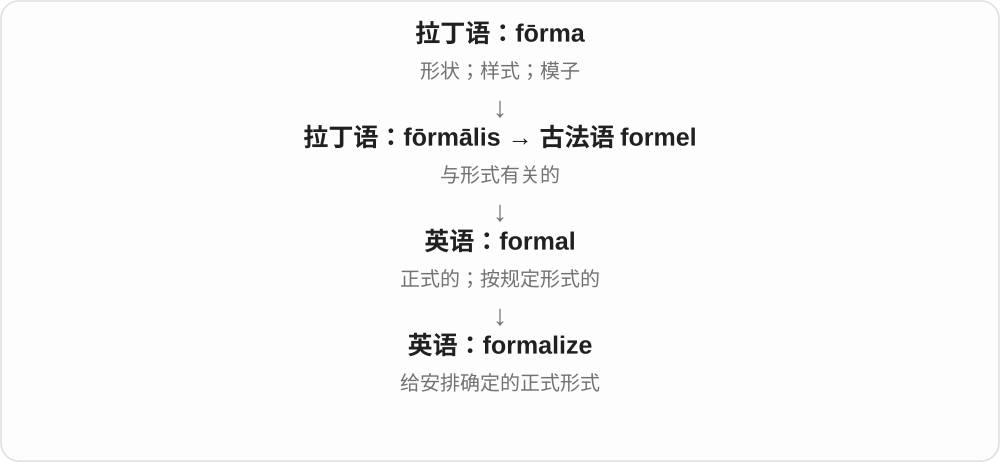

可以正式确认合作，也可以把直觉想法表达成严密模型。重点是把形式定清楚。

**常见搭配与例句**

formalize an agreement；formalize a relationship；formalize a theory。

> They signed a contract to formalize the partnership.

他们签订合同，使合作关系正式确立。

> The paper formalizes the idea as a mathematical model.

论文把这个想法表述成一个严格的数学模型。

**别混淆**

formulate 是把内容想清楚、表达出来；formalize 是给它正式或严格的形式。

### 94. monopolize — 垄断；独占；霸占

**音标**：英 /məˈnɒpəlaɪz/；美 /məˈnɑːpəlaɪz/

**先抓住这个画面**

把可供大家分享的空间或资源，几乎全抓到自己手里。

**怎么拆**

monopoly 去掉末尾 -y，接动词后缀 -ize。现代英语中形成动词，不是古希腊整词直接变成同样拼写。

**怎么变成今天的意思**

**希腊 monos**  
单独；唯一；一个

↓

**希腊 monos + polein → monopolion**  
一个卖方独占出售权

↓

**拉丁 monopolium → 英语 monopoly**  
垄断；独占

↓

**英语 monopoly + -ize → monopolize**  
形成垄断或独占

可以 monopolize a market，也可以 monopolize a conversation：一个人一直说，别人插不进去。后者是日常比喻，不需要真有商业交易。

**常见搭配与例句**

monopolize the market；monopolize attention；monopolize the conversation。

> One speaker monopolized the discussion for half an hour.

一位发言者霸占了半小时的讨论时间。

> The company tried to monopolize access to the data.

这家公司试图独占这些数据的使用权。

**别混淆**

dominate 是占主导地位；monopolize 更突出别人几乎无法分享，通常带批评。

### 95. vaporize — 气化；使变成蒸气

**音标**：英、美 /ˈveɪpəraɪz/

**先抓住这个画面**

让一小滴液体或一块材料转到气态，散开成为蒸气。

**怎么拆**

英语 vapor + -ize，“使成为蒸气”；英式也写 vaporise。和 evaporate 相关，但不是把它开头的 e 随意删掉形成的。

**怎么变成今天的意思**

**拉丁 vapor / vaporem**  
热气、蒸气

↓

**古法语 vapor、盎格鲁法语 vapour；也有拉丁直接借入**  
蒸气、湿气

↓

**中古英语 vapour → 现代 vapor / vapour**  
蒸气；现代区分气态物质与雾滴

↓

**英语 vapor + -ize / -ise → vaporize / vaporise**  
变成蒸气或使气化

vaporize 可以说物质自行气化，也可以说热量或装置使它气化。科学语境强调状态改变；科幻或夸张叙述中，它还可能表示把东西彻底摧毁得像消失了一样。

**常见搭配与例句**

vaporize a liquid；vaporize a sample；the liquid vaporizes。

> The laser vaporized a tiny spot on the sample.

激光使样品上的一个小点气化了。

> The liquid must vaporize before it enters the next chamber.

液体必须先气化，再进入下一个腔室。

**别混淆**

vaporize 比 evaporate 用途更宽，常用于主动加热或高能处理；atomize 是打散成小液滴，不等于真正变为气体。

### 96. incentivize — 激励；设置诱因促使

**音标**：/ɪnˈsentɪvaɪz/

**先抓住这个画面**

改变奖励、成本或条件，让一种行动更值得去做。

**怎么拆**

incentive + -ize，去末尾 e 后接动词后缀；英式也写 incentivise。

**怎么变成今天的意思**

**拉丁语 canere，词典形 cano**  
唱、吟诵

↓

**拉丁语 incinere → incentivus / 晚期拉丁语 incentivum**  
起调 → 激发；可能受 incendere“点燃”影响

↓

**英语 incentive**  
促使人行动的理由、奖励

↓

**英语 incentive + -ize → incentivize**  
激励因素 → 提供激励、使有动力

可以 incentivize people to save energy，也可以 incentivize investment。它常见于政策、管理讨论；奖励设计不当也可能激励出不希望的行为。

**常见搭配与例句**

incentivize participation；incentivize people to；incentivize investment。

> The scheme incentivizes households to reduce electricity use.

这项计划为家庭减少用电提供激励。

> Paying only for speed can incentivize careless work.

只按速度付酬，可能促使人做事草率。

**别混淆**

encourage 更宽，包括口头鼓励；incentivize 往往具体改变利益或条件。

### 97. popularize — 使流行；推广；使通俗易懂

**音标**：英 /ˈpɒpjələraɪz/；美 /ˈpɑːpjələraɪz/

**先抓住这个画面**

把原来局限在小圈子里的东西，带到更多人面前。

**怎么拆**

popular + -ize；与 popularise 是拼写变体。

**怎么变成今天的意思**

**拉丁 populus**  
人民、人群；更早来源未定

↓

**拉丁 populāris → 古法语 populaire／拉丁借词 → 中古英语 populer**  
属于大众；大众熟知的

↓

**现代英语 popular**  
受欢迎的；大众的；通俗的

↓

**英语 popular + -ize → popularize**  
使大众熟悉、喜爱；把知识讲给大众听

可以 popularize a sport，推广运动；也可以 popularize science，把专业知识讲得易懂。易懂不等于改得不准确。

**常见搭配与例句**

popularize an idea；popularize science；help popularize a sport。

> The television series helped popularize astronomy.

这部电视系列节目帮助普及了天文学。

> The athlete helped popularize the sport in her hometown.

这位运动员帮助这项运动在家乡流行起来。

**别混淆**

advertise 强调宣传广告；popularize 强调扩大认知、使用或让内容更通俗。

### 98. unionize — 组织工会；加入工会组织

**音标**：/ˈjuːnjənaɪz/

**先抓住这个画面**

unionize 像把单独发声的员工组织进一个共同代表体系，以集体方式讨论工作事务。

**怎么拆**

union + -ize，表示组织成工会。

**怎么变成今天的意思**

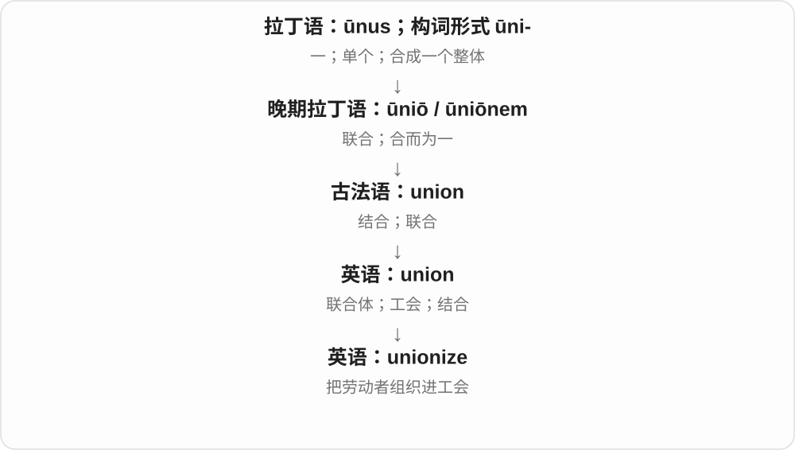

既可说 workers unionize，也可说 unionize a workplace。重点是组织形式发生变化。

**常见搭配与例句**

unionize the workforce；vote to unionize；efforts to unionize。

> The staff voted to unionize.

员工投票决定成立工会。

> The campaign aimed to unionize workers across several sites.

这场行动旨在把几个工作地点的员工组织进工会。

**别混淆**

这里的 unionize 从 union 来，开头 /ˈjuːn/。罕见化学动词 un- + ionize 是另一种构词，读 /ʌnˈaɪənaɪz/。

### 99. humanize — 使更有人情味；使具有人性特征

**音标**：英、美 /ˈhjuːmənaɪz/

**先抓住这个画面**

让原本像编号、机器或抽象对象的东西，显出具体的人和感受。

**怎么拆**

human + -ize“使成为”；历史也与 humane 的仁慈义交织。英式常写 humanise。

**怎么变成今天的意思**

**拉丁语 humanus，与 homo / homin- 同族**  
人的；有教养、有人情味的

↓

**古法语 humain → 英语 human / humane**  
人的，也曾包含仁慈的意思

↓

**英语 human + -ize → humanize**  
使具有人性、人的特征；使更体恤人

讲一个人的日常故事可以 humanize him，让读者不只看到标签。humanize a service 是让服务更顾及人的体验。

**常见搭配与例句**

humanize a character；humanize the workplace；humanize a system。

> The small details humanize the character.

这些小细节让人物更有真实的人情味。

> The project aims to humanize the experience of hospital care.

项目旨在让医院照护更体恤人的体验。

**别混淆**

personalize 强调按某个人定制；humanize 强调显出人的感受、尊严或特征。

### 100. initialize — 初始化；设定初始状态

**音标**：/ɪˈnɪʃəlaɪz/

**先抓住这个画面**

让程序、设备先具备开始工作所需的起点：给变量一个初值，把资源准备好。

**怎么拆**

initial + -ize，使进入初始状态。英式也可拼 initialise；此处讲常见技术动词，不把每次初始化都说成清空所有数据。

**怎么变成今天的意思**

**拉丁 inīre → initium → initiālis**  
进去、开始 → 开端 → 开始的

↓

**经法语或拉丁借入 → initial**  
最初的；名字开头字母；后作签首字母动词

↓

**initial + -ize → initialize**  
设定开始所需的状态、数值或资源

initialize a variable 初始化变量，initialize the system 初始化系统；具体做了什么由那个系统的操作定义。

**常见搭配与例句**

initialize a variable；initialize the system；initialize the device。

> The program initializes the counter to zero.

程序把计数器初始化为零。

> The device takes a few seconds to initialize.

设备需要几秒钟完成初始化。

**别混淆**

initialize 建立初始条件，reset 重置，restart 重启；操作可能有交叉，但名称不保证执行步骤和数据影响完全相同。

### 101. centralize — 集中；使由中央统一管理

**音标**：英、美 /ˈsentrəlaɪz/

**先抓住这个画面**

把分散的决定权或资源，收拢到一个中心。

**怎么拆**

central + -ize，英语构词受到法语 centraliser 的模式影响。

**怎么变成今天的意思**

**希腊 kéntron → 拉丁 centrum**  
尖点、刺；圆规固定的一点 → 圆心、中心

↓

**拉丁 centrālis，经法语或直接借入英语 central**  
中心的；处在关键位置的

↓

**英语 central + -ize，仿法语 centraliser → centralize**  
使集中到一个中心

可以集中采购、存储、管理或权力；不是简单把电脑搬到房间中间。英式常写 centralise。

**常见搭配与例句**

centralize operations；centralize control；centralize in…。

> The company centralized its customer support operations.

公司把客户支持业务集中起来管理。

> The reform centralized authority in the ministry.

改革把权限集中到了该部门。

**别混淆**

organize 只是组织；centralize 明确把控制或活动向中心汇聚。

### 102. sanitize — 作卫生处理；净化；删去令人不快的部分

**音标**：/ˈsænɪtaɪz/

**先抓住这个画面**

先把环境变得卫生；比喻时，则把难看、不体面的内容擦掉。

**怎么拆**

从 sanitary 的 sanit- 词干加 -ize 形成；英式也写 sanitise。不是“让人恢复理智”的 sane + -ize。

**怎么变成今天的意思**

**拉丁 sanus**  
健康、健全；更早来源未定

↓

**拉丁 sanitas → 法语 sanitaire → 英语 sanitary**  
健康 → 公共卫生、卫生条件相关的

↓

**英语 sanit- + -ize → sanitize**  
从 sanitary 取词干，表示使卫生；后来也指删去不体面内容

sanitize equipment 说进行卫生处理；sanitize a story 则可能把暴力、失败或丑闻删掉，让它显得体面。在技术卫生语境里，sanitize 不等于确保完全无菌。

**常见搭配与例句**

sanitize equipment；sanitize a surface；sanitize an account of events。

> The team sanitized the equipment before it was packed away.

团队对设备进行了卫生处理后，才把它收好。

> The film sanitizes the past by leaving out the conflict.

这部电影删去了冲突，把过去粉饰得过于体面。

**别混淆**

sterilize 强调灭菌；sanitize 通常是把微生物降到相应卫生标准的水平。比喻义还可能带粉饰的批评。

### 103. commercialize — 使商业化；把……推向商业应用

**音标**：英 /kəˈmɜːʃəlaɪz/；美 /kəˈmɜːrʃəlaɪz/

**先抓住这个画面**

让原先只是研究、创作或公共活动的东西，进入可以出售、经营和获取收入的环节。

**怎么拆**

commercial + -ize“使成为”，英语动词构词；英式也拼 commercialise。

**怎么变成今天的意思**

**拉丁语 merx，属格 mercis**  
货物、商品

↓

**拉丁语 commercium；后期拉丁语 commercialis**  
商业往来；商业的

↓

**法语 commerce → 英语 commerce；另一分析经法语 commercial 借入**  
英语 commerce + -al 与法语形容词借入两种分析

↓

**英语 commercial**  
商业的；以营利为目的的

↓

**英语 commercial + -ize → commercialize**  
使具有商业用途或经营形式

commercialize a discovery 可以是中性地把发现做成产品；commercialize a tradition 可能带把传统拿来赚钱的批评。要看对象和语气。

**常见搭配与例句**

commercialize technology；commercialize a discovery。

> The university helped the researchers commercialize their new sensor.

大学帮助研究人员把新传感器推向商业应用。

> Some residents opposed plans to commercialize the annual celebration.

一些居民反对把年度庆典商业化的计划。

**别混淆**

monetize 强调获得收入的办法；commercialize 更广，可包含产品化、生产、销售和市场推广。

### 104. marginalize — 使边缘化、排挤到次要位置

**音标**：英 /ˈmɑːdʒɪnəlaɪz/；美 /ˈmɑːrdʒɪnəlaɪz/

**先抓住这个画面**

人还在会议室，却总轮不到他说话；议题还在文件里，却被挤到无人处理的角落。这是影响力和参与空间被推到边上。

**怎么拆**

marginal + -ize，使处于边缘。常说社会群体、观点、议题被削弱地位；统计学另有取边缘分布的专门义。

**怎么变成今天的意思**

**拉丁 margo/margin- → marginālis → marginal**  
边、边缘 → 边缘的、差距很小的

↓

**marginal + -ize → marginalize**  
让人或事退到边缘、失去重要位置

↓

**marginalize + -ation → marginalization**  
被排除、失去参与和发声空间的过程

marginalize a community 使一个群体边缘化，marginalized voices 被忽视的声音，marginalize an issue 把议题挤到次要位置。

**常见搭配与例句**

marginalize a community；marginalized voices；marginalize an issue。

> The new process risks marginalizing smaller organizations.

新流程可能让较小机构更难参与、被挤到边缘。

> Her concerns were marginalized during the discussion.

讨论中，她关心的问题被搁到了次要位置。

**别混淆**

marginalize 不一定把人赶走，剥夺参与、重视、资源也可形成边缘化；marginal improvement 小幅改善不能照成边缘化改善。

### 105. oxidize — 使氧化；发生氧化

**音标**：英 /ˈɒksɪdaɪz/；美 /ˈɑːksɪdaɪz/

**先抓住这个画面**

材料或化学物种发生了氧化变化，往往伴随电子归属的变化。

**怎么拆**

英语 oxide 加 -ize，造出动词。它与 oxidation 是一族，但名词的法语借入路线须独立看，不能凭现代配对倒置历史。

**怎么变成今天的意思**

**希腊 oxýs**  
尖锐的；酸的

↓

**近代法语 oxygène**  
用希腊来源成分造出“产酸者”名称

↓

**法语 oxide / oxyde**  
由 oxygène 与 acide 的成分组合，命名氧化物

↓

**英语 oxide**  
氧化物

↓

**英语 oxide + -ize → oxidize**  
使氧化；发生氧化

metal oxidizes 可以说金属发生氧化；an agent oxidizes another substance 可以说某试剂使另一物质氧化。反应对象不是都必须直接碰到空气。

**常见搭配与例句**

oxidize readily；oxidize a substance；be oxidized；an oxidizing agent。

> The exposed surface gradually oxidized.

暴露的表面逐渐氧化了。

> In this reaction, the metal is oxidized as it loses electrons.

在这个反应中，金属失去电子而被氧化。

**别混淆**

oxidize 描述化学变化；oxygenate 说供氧或使含氧，并不自动意味着同一反应。

### 106. crystallize — 结晶、使结晶；形成明确形态、使想法清晰

**音标**：/ˈkrɪstəlaɪz/

**先抓住这个画面**

溶液里的物质排成晶体，是具体结晶；一堆模糊念头终于收束成一个清楚方案，也是 crystallize。

**怎么拆**

crystal + -ize 的构词关系，双写 ll 反映拉丁 crystallus、希腊 krýstallos 的词干传统，并非所有现代 -al 词加 -ize 都按这条拼写。英式也常写 crystallise。

**怎么变成今天的意思**

**希腊 krýos → krýstallos**  
寒霜 → 清冰、透明似冰的物质

↓

**拉丁 crystallus 等 → 英语 crystal**  
水晶；后来泛指有序微观结构的晶体，另有精制玻璃用法

↓

**英语派生与比喻**  
crystallize 结晶、形成明确想法；crystallization 过程；crystallography 研究结构

↓

**crystal + -ize → crystallize**  
形成晶体；比喻让模糊想法变得明确

sugar crystallizes 糖结晶，crystallize into a plan 逐渐形成明确计划，crystallize your thinking 让思路清晰成形。

**常见搭配与例句**

sugar crystallizes；crystallize into；crystallize your thinking。

> The sugar began to crystallize as the solution cooled.

溶液冷却时，糖开始结晶。

> Our ideas gradually crystallized into a clear proposal.

我们的想法逐渐形成一份清楚的提案。

**别混淆**

crystallize 想法不必真变硬，也不保证想法正确；强调从模糊走向明确、稳定形态。

### 107. immobilize — 使不能动；使停止活动

**音标**：英 /ɪˈməʊbəlaɪz/；美 /ɪˈmoʊbəlaɪz/

**先抓住这个画面**

immobilize 是把还能动的东西限制住，让它不能继续移动或行动。

**怎么拆**

来自法语 immobiliser；现代可分析为 immobile + -ize，英式也拼 immobilise。

**怎么变成今天的意思**

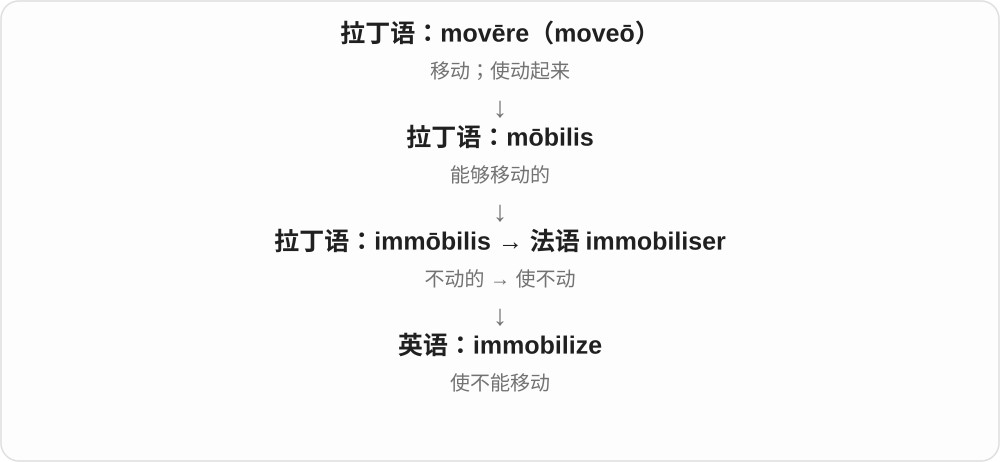

可形容设备被故障卡住、交通被天气阻断，也可用于身体固定的描述。

**常见搭配与例句**

immobilize a vehicle；be immobilized by；immobilize a joint。

> The heavy snow immobilized several vehicles.

大雪使几辆车无法行驶。

> The locking mechanism immobilizes the wheel.

锁定机构让轮子不能转动。

**别混淆**

immobile 是状态，immobilize 是使进入这种状态的动作。

### 108. memorialize — 纪念；以作品、设施或活动使人长久记住

**音标**：/məˈmɔːriəlaɪz/

**先抓住这个画面**

不只心里想念，还留下某种可被后来人看到、读到或参与的东西，让记忆延续。

**怎么拆**

英语 memorial + -ize，作动词；历史上也有递交书面陈情的用法，常用纪念义取 memorial“纪念物、纪念安排”这一面。英式也拼 memorialise。

**怎么变成今天的意思**

**拉丁 memor**  
记着的；放在心上的

↓

**拉丁 memoria → memorialis；晚期拉丁名词 memoriale**  
记忆 → 与记忆有关的；纪念物

↓

**古法语 memorial 及拉丁语借入 → 中古英语／英语 memorial**  
纪念的；纪念物或纪念活动

↓

**英语 memorial + -ize → memorialize**  
作纪念、使记忆留存；另有较旧陈情义

用一座花园、一篇文章或一部电影 memorialize 某人，都可能是在为其留下一份纪念；不局限于立碑。

**常见搭配与例句**

memorialize someone in；memorialize an event；be memorialized by；a film memorializing。

> The new garden memorializes the volunteers who cared for the community.

新花园纪念了那些照顾社区的志愿者。

> The film memorializes a way of life that has largely disappeared.

这部电影为一种已大多消失的生活方式留下了纪念。

**别混淆**

remember 可以完全发生在内心；memorialize 常涉及外在表达或记录。commemorate 与它接近，常强调某次纪念行为。

### 109. romanticize — 把……理想化、美化得浪漫

**音标**：英 /rəʊˈmæntɪsaɪz/；美 /roʊˈmæntɪsaɪz/

**先抓住这个画面**

只留夕阳、自由、冒险，把泥泞、疲惫、风险剪掉；把现实剪成美好传奇，就是 romanticize。

**怎么拆**

romantic + -ize，形成使之具有理想化、传奇情调的动词；英式也常写 romanticise。这里 c 后接 i 的部分读 /s/。

**怎么变成今天的意思**

**拉丁 Rōmānicē 等 → 古法语 romanz/romant**  
罗曼语、用俗语写的叙事

↓

**英语 romance / romantic**  
传奇、富想象叙事 → 爱情、浪漫；理想化

↓

**艺术与一般评价**  
Romanticism 特定流派；romanticize 把现实美化成故事

↓

**romantic + -ize → romanticize**  
把实际的人、生活、历史描绘得理想而浪漫

romanticize the past 美化过去，romanticize rural life 把乡村生活理想化，romanticize hardship 美化苦难。

**常见搭配与例句**

romanticize the past；romanticize rural life；romanticize hardship。

> The film romanticizes life on the road.

电影把漂泊路上的生活美化了。

> It is easy to romanticize the past and forget its difficulties.

人很容易美化过去，忘掉当年的困难。

**别混淆**

romanticize 不只是添加恋爱剧情，更多说滤掉难处后的理想化；describe romantically 有时中性，romanticize 常带批评。

### 110. digitize — 把……转成数字形式；将资料数字化

**音标**：/ˈdɪdʒɪtaɪz/

**先抓住这个画面**

把纸、磁带等材料里的内容，变成计算机能保存和处理的数据。

**怎么拆**

digit + -ize；早期还出现过与手指操作有关的用法，今天通常学习数字技术义。

**怎么变成今天的意思**

**拉丁语 digitus**  
手指、脚趾；与计数有关的用法

↓

**英语 digit**  
一个数码；也可指手指或脚趾

↓

**digit + -ize → digitize**  
现代常指把资料转成数字形式

扫描旧照片、把磁带转成音频文件，都可以说 digitize。重点是改变内容的表示和保存形式，不只是把原物放到另一个房间。扫描得到图片不等于已经识别出可搜索文字，后者还需要相应处理。

**常见搭配与例句**

digitize photographs；digitize an archive；digitize recordings。

> Volunteers are helping the library digitize old newspapers.

志愿者正在帮助图书馆把旧报纸数字化。

> We digitized the tapes so that the recordings would be easier to share.

我们把磁带转成数字文件，让录音更方便分享。

**别混淆**

digitize 是转换动作，digital 是属性。把纸质目录搬到办公室里并没有 digitize 它。

### 111. evangelize — 传福音；积极宣扬、推广〔比喻〕

**音标**：/ɪˈvændʒəlaɪz/

**先抓住这个画面**

宗教语境是向人传播福音；科技、商业话题里也可比喻热心讲一种做法的好处，希望更多人采用。

**怎么拆**

经法语、晚期拉丁 evangelizare 接希腊 euangelizein 传播好消息，eu- 好 + angel- 消息、使者的材料。词尾与 -ize 同族，但整个历史词不是今天英语临时拼出来。

**怎么变成今天的意思**

**希腊 euangelizein → 拉丁 evangelizare、法语相关形式**  
传播好消息、福音

↓

**英语 evangelize**  
传福音；比喻积极倡导、推广

evangelize about a technology 积极宣讲某技术；evangelize a community 可在宗教场景说向社群传福音。比喻义通常比简单 mention 提一下强。

**常见搭配与例句**

evangelize about；evangelize for a cause。

> The book describes how missionaries evangelized in the region.

书中描述了传教士怎样在当地传福音。

> He spends much of his time evangelizing about open standards.

他花很多时间积极推广开放标准。

**别混淆**

explain 是解释，evangelize 常带热心劝说、传播信念的劲头；不等于所有介绍产品的中性动作。

### 112. polarize — 使两极分化；使产生偏振；使极化

**音标**：英 /ˈpəʊləraɪz/；美 /ˈpoʊləraɪz/

**先抓住这个画面**

在人群中，像把分散的意见拉向两边；在光学中，则说光振动方向的性质发生变化。

**怎么拆**

借自法语 polariser，接 polaris；现代可分析为 polar + -ize。最初是光学术语，社会分化义后来发展。

**怎么变成今天的意思**

**希腊 polos → 拉丁 polus**  
旋转轴；轴端

↓

**中世纪拉丁 polaris／法语 polaire**  
极点相关的

↓

**法语 polariser → 英语 polarize**  
使产生偏振或极性

↓

**社会用法**  
使分向明显对立的两边

polarize voters 是使选民形成更尖锐的对立；polarize light 是使光产生偏振。社会义的“两派站队”适合记忆，但不能拿来当光学定义：光没有政治上的两种意见。

**常见搭配与例句**

polarize opinion；polarize voters；polarize a community；polarize light。

> The proposal could polarize an already divided community.

这项提案可能让原本就有分歧的社区更加对立。

> The experiment used a filter to polarize the light.

实验使用滤光片使光产生偏振。

**别混淆**

polarize 不只是 provoke 引起反应，而是突出反应朝对立方向分化。英式英语也常写 polarise，读音一样。

### 113. contextualize — 放入背景中理解；交代语境

**音标**：/kənˈtekstʃuəlaɪz/

**先抓住这个画面**

把单独摘出的一句话或一件事，放回它发生的环境里。

**怎么拆**

contextual + -ize；-ize 表示使之成为、按某方式处理。英式英语也常拼 contextualise。

**怎么变成今天的意思**

**拉丁 texere，分词 textus**  
编织；织成的

↓

**拉丁 con- + texere → contexere → contextus**  
一起织 → 连在一起的结构

↓

**英语 context**  
文字前后的关系；也指事件所处的背景

↓

**英语 contextual + -ize → contextualize**  
让读者从相关情境理解对象

介绍一张旧照片时，补上拍摄年代、当时生活条件和人物身份，就是在 contextualize。解释背景不等于替任何行为辩护；只是让判断有更完整的依据。

**常见搭配与例句**

contextualize a quotation；contextualize an event；historically contextualize。

> The introduction contextualizes the letters by explaining the war in which they were written.

导言通过介绍写信时的战争背景，帮助读者理解这些书信。

> We need to contextualize the figure before deciding whether it is unusually high.

判断这个数字是否异常偏高之前，需要先说明相关背景。

**别混淆**

summarize 把内容压缩；contextualize 把内容放回背景，反而可能需要补充信息。

### 114. politicize — 使政治化；使人产生政治意识、参与政治

**音标**：英 /pəˈlɪtɪsaɪz/；美 /pəˈlɪtəsaɪz/

**先抓住这个画面**

原先被当作技术或生活问题的事情，开始被放进立场、权力和公共选择里讨论；也可以是一个人因此开始关心政治。

**怎么拆**

politic / politics 词族 + -ize；较早可表示从事政治，后来常用为及物动词“使……政治化”。

**怎么变成今天的意思**

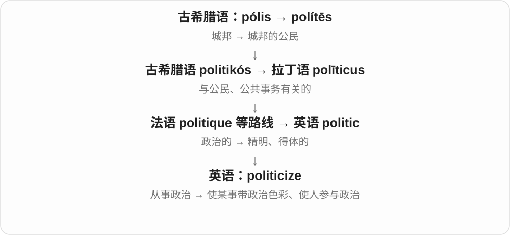

有时带批评：把救灾争论变成党派争斗；也可中性描述：经历让年轻人意识到公共决策与自己有关。不要把所有 politicize 都译成负面的“政治炒作”。

**常见搭配与例句**

politicize an issue；politicize a debate；politicize a generation。

> The mayor urged both parties not to politicize the rescue effort.

市长敦促双方不要把救援工作变成党派争斗。

> The campaign politicized many students who had never followed public affairs.

这场运动让许多原本不关注公共事务的学生有了政治意识。

**别混淆**

politicize 是让政治含义突出；politicking 是实际争取支持、进行政治周旋。

### 115. verbalize — 用语言表达；把想法说出来

**音标**：英 /ˈvɜːbəlaɪz/；美 /ˈvɜrbəlaɪz/

**先抓住这个画面**

心里有一团感觉或想法，现在试着把它整理成别人能听懂的话。

**怎么拆**

现代可认 verbal + -ize；早期英语还受法语 verbaliser 影响，历史上有多说话和使成动词等义。

**怎么变成今天的意思**

**拉丁 verbum**  
词；话语；语法中的动词

↓

**晚期拉丁 verbalis → 法语 verbal／英语 verbal**  
与词语有关；语言的、口头的

↓

**法语 verbaliser 与英语 verbal + -ize**  
形成动词用法

↓

**现代常见 verbalize**  
把感受、想法表达成语言

verbalize your feelings 是把感受说出来；verbalize a concern 是明确表达担忧。重点不是声音够大，而是把原来未说清的内在想法转成词语。

**常见搭配与例句**

verbalize feelings；verbalize a concern；struggle to verbalize。

> She found it difficult to verbalize what was bothering her.

她很难把困扰自己的事说清楚。

> The exercise asks students to verbalize their reasoning.

这个练习要求学生用语言说出自己的推理过程。

**别混淆**

say 是普通说；verbalize 更强调把想法形成语言。语法学中另可表示把词变成动词，需看上下文。

### 116. victimize — 欺凌、迫害；使受害、使上当

**音标**：/ˈvɪktɪmaɪz/

**先抓住这个画面**

有人把欺骗、不公、伤害加到别人身上；victimize 把受害者身份翻成使对方受害的动作。

**怎么拆**

victim + -ize，使进入相应受害处境。另有 victimise 的常见英式拼法，不能把 -ize 当“本人自愿成为”。

**怎么变成今天的意思**

**拉丁 victima → 法语 victime、英语 victim**  
祭献中的牺牲对象，深源不定

↓

**英语受害者义**  
遭人、事故、处境等伤害的人

↓

**victim + -ize → victimize**  
使别人遭受伤害、欺凌或诈骗

victimize vulnerable people 伤害、欺凌脆弱者，be victimized by a scam 被骗局坑害，victimize an employee 不公对待员工。

**常见搭配与例句**

victimize someone；be victimized by；repeatedly victimized。

> The scheme was designed to victimize inexperienced buyers.

这个骗局专门坑害缺乏经验的买家。

> The character is repeatedly victimized by his classmates.

这个人物反复受到同学欺凌。

**别混淆**

victimize 动作主体可为人或安排，victim 是承受者；criticize 批评本身不必等于不公欺凌。

### 117. liberalize — 放宽限制；使自由化；使更开放

**音标**：/ˈlɪbərəlaɪz/

**先抓住这个画面**

原来准入要过很多关、某些交易不能做，现在把限制放松一些，让更多行动成为可能。

**怎么拆**

liberal + -ize，英语使动词；英式也常拼 liberalise。不是把人“变成慷慨的人”的唯一意思，现代常用于政策和制度。

**怎么变成今天的意思**

**拉丁 liber**  
自由的；不受束缚的

↓

**拉丁 liberalis → 古法语 liberal／直接拉丁借入**  
适合自由人的；慷慨的

↓

**中古英语 → 英语 liberal**  
慷慨、宽容；近代又形成政治用法

↓

**英语 liberal + -ize → liberalize**  
使规则、制度或政策更宽松开放

liberalize trade 是放宽贸易限制；liberalize rules 是放宽规定。具体减少了什么限制，要从上下文找，单词本身没有保证结果一定好或坏。

**常见搭配与例句**

liberalize trade；liberalize the market；liberalize regulations。

> The government proposed to liberalize rules on foreign investment.

政府提议放宽外国投资规定。

> The university liberalized its policy on taking courses outside one’s major.

大学放宽了跨专业选课政策。

**别混淆**

liberate 常说把人或群体从束缚中释放；liberalize 常说调整制度、政策，使限制减少。

### 118. weaponize — 使武器化；把……当武器利用

**音标**：/ˈwepənaɪz/

**先抓住这个画面**

原本可能只是信息、情绪或普通工具，现在被拿来对付别人；词抓的是用途变成对抗手段。

**怎么拆**

weapon + -ize，使成为、使具有武器作用。也见 weaponise 的英式拼法；比喻语境不要求发生物理改造。

**怎么变成今天的意思**

**古英语 wǣpn → 中古英语 wepen → weapon**  
用于攻击、防御的器物，深源不定

↓

**weapon + -ize → weaponize**  
赋予武器用途，或把事物用于对抗

weaponize information 把信息当攻击工具，weaponize fear 利用恐惧打击对方，weaponized language 被用来攻击的语言。

**常见搭配与例句**

weaponize information；weaponize fear；weaponized language。

> The essay argues that fear can be weaponized in public debate.

文章认为，恐惧可能被用作公共争论中的攻击工具。

> She felt that her private messages had been weaponized against her.

她觉得自己的私人消息被拿来当成了攻击她的武器。

**别混淆**

weaponize 强调把事物转成攻击、对抗工具，use 只说使用；批评某人 weaponizes a mistake，是说他拿错误打击别人。

### 119. institutionalize — 使制度化；把人送入机构长期照护；使适应机构生活

**音标**：英 /ˌɪnstɪˈtjuːʃənəlaɪz/；美 /ˌɪnstɪˈtuːʃənəlaɪz/

**先抓住这个画面**

把做法固定成规则，也可以把人的生活安排进长期运行的机构里。

**怎么拆**

institutional + -ize；英式也写 institutionalise。几个意思都从 institution 已确立的制度或机构分出来，不是一个意思适合所有场景。

**怎么变成今天的意思**

**拉丁 stare → statuere**  
站立 → 使站稳、设立、安排

↓

**拉丁 in- + statuere → instituere**  
设立、安排、教导

↓

**拉丁 institutio → 古法语 institucion → 英语 institution**  
设立、安排 → 已建立的机构、制度、习惯

↓

**英语 institutional + -ize → institutionalize**  
形成固定制度；让人进入或适应机构生活

institutionalize a practice 是把某种做法变为制度。be institutionalized 说人时，常指曾长期住在照护或治疗机构；institutionalized habits 则可能说长期形成的固定习惯。

**常见搭配与例句**

institutionalize a practice；institutionalize cooperation；be institutionalized。

> The agreement aims to institutionalize regular dialogue between the two teams.

协议旨在让两个团队的定期对话成为固定机制。

> The novel follows a woman who had been institutionalized for many years.

小说讲述了一位曾在机构中生活多年、接受照护的女性的经历。

**别混淆**

standardize 侧重统一标准；institutionalize 侧重形成持续制度。谈人时更不能直接译成标准化。

### 120. democratize — 使民主化；让更多人能使用或参与

**音标**：英 /dɪˈmɒkrətaɪz/；美 /dɪˈmɑːkrətaɪz/

**先抓住这个画面**

把原来少数人控制的门打开，让更多人参与决定，或获得原本难以接触的资源。

**怎么拆**

借法语 démocratiser；现代可联系 democratic 与 -ize“使成为”。

**怎么变成今天的意思**

**古希腊 krátos**  
力量；权力、支配

↓

**希腊 dêmos + -kratía → dēmokratía**  
人民 + 治理 → 民主政体

↓

**中世纪拉丁 dēmocratia → 法语 démocratie**  
民主制度

↓

**法语 démocratiser → 英语 democratize**  
使更民主；扩大参与和获取机会

可说 democratize institutions，也可说 democratize access。商业宣传中常用后一义，具体是否降低门槛仍要看实际。

**常见搭配与例句**

democratize access to；democratize decision making。

> The reforms sought to democratize local decision making.

改革试图让地方决策更加民主。

> Free online courses can democratize access to education.

免费网络课程能让更多人获得教育机会。

**别混淆**

popularize 是使流行或普及；democratize 更突出扩大参与、减少少数人的专享地位。

### 121. compartmentalize — 分隔；分门别类、分开处理〔想法、生活领域等〕

**音标**：英 /ˌkɒmpɑːtˈmentəlaɪz/；美 /kəmˌpɑːrtˈmentəlaɪz/

**先抓住这个画面**

像把东西放进不同小格：工作归工作，私人生活归私人生活；不让一格的情绪、信息总冲进另一格。

**怎么拆**

compartment 隔间 + -al → compartmental，再接 -ize。中间的 -al 不能漏掉；更早 compartment 经法语、意大利语接划分的拉丁材料。

**怎么变成今天的意思**

**compartment → compartmental**  
隔开的部分 → 相应形容词

↓

**compartmental + -ize → compartmentalize**  
分成隔开的部分；比喻分开处理

compartmentalize information 把信息分隔管理；compartmentalize work and personal life 把工作与私人生活分开。可以是实用安排，也可能被批评人为割裂，按场景看。

**常见搭配与例句**

compartmentalize information；compartmentalize one’s life。

> She tries to compartmentalize work and personal life.

她尽量把工作和私人生活分开处理。

> The organisation compartmentalized sensitive information.

机构将敏感信息分隔管理。

**别混淆**

categorize 主要是归类，compartmentalize 更有分隔、不互相渗透的感觉；不是所有分类表都强调这种隔离。

### 122. trivialize — 轻视；把重要事情说得无足轻重

**音标**：/ˈtrɪviəlaɪz/

**先抓住这个画面**

本来有分量的事情，被说得像一点不值一提的小事。

**怎么拆**

trivial + -ize；把事情变成、或表现成 trivial 的样子。

**怎么变成今天的意思**

**拉丁 via**  
道路、路径

↓

**拉丁 tri- + via → trivium → triviālis**  
三岔路口 → 公共场所的、寻常的

↓

**英语 trivial**  
寻常、不重要；专业语境中也指最简单的情形

↓

**英语 trivial + -ize → trivialize**  
使显得琐碎、不重要

一句“大家都这样”可能 trivialize someone’s experience，把对方真正遇到的困难轻轻带过。它常批评低估重要性，不是正常地把复杂说明讲简单。

**常见搭配与例句**

trivialize a problem；trivialize someone’s experience；avoid trivializing the issue。

> The joke trivialized the difficulties the workers had faced.

那个笑话把工人们经历的困难说得轻飘飘的。

> A short explanation need not trivialize a serious subject.

解释得简短，并不一定会把严肃话题讲得无足轻重。

**别混淆**

simplify 是减少复杂度，可能很有帮助；trivialize 是压低事情的分量，常带批评。

### 123. idealize — 把……理想化；把……描绘得过于完美

**音标**：英、美 /aɪˈdiːəlaɪz/

**先抓住这个画面**

像在回忆上加一层滤镜：保留好看的部分，把麻烦、缺点和矛盾淡化。

**怎么拆**

英语 ideal + -ize，意为“使成为、看作理想的”。英式也写 idealise。来源是 ideal 的理想形式义，不是“制造一个新 idea”的普通说法。

**怎么变成今天的意思**

**晚期拉丁 idealis → 英语 ideal**  
理想的

↓

**英语 ideal + -ize → idealize**  
把对象看作或描绘成理想状态

↓

**日常与研究用法**  
美化人物、过去；为模型作理想化处理

人们可能 idealize childhood，只记得暑假和朋友，忘了当时也有烦恼。科学写作中 idealize 也可中性地说把问题简化到便于分析的状态；不总是在责备人骗人。

**常见搭配与例句**

idealize the past；idealize a relationship；idealize a public figure；idealize a system。

> People sometimes idealize a childhood they barely remember.

人们有时会把自己记忆已模糊的童年想得过于美好。

> The model idealizes the surface as perfectly smooth.

这个模型把表面理想化为完全光滑的状态。

**别混淆**

admire 是欣赏某些真实优点；idealize 常把对象看得过于完美。improve 是实际改进，idealize 可能只改变描述或想象。

### 124. radicalize — 使立场激进化；变得激进

**音标**：/ˈrædɪkəlaɪz/

**先抓住这个画面**

一个人或团体对既有制度越来越不满，转向更彻底的改变主张。

**怎么拆**

radical + -ize 使成为；英式也写 radicalise。

**怎么变成今天的意思**

**拉丁 radix，属格 radicis**  
植物的根；引申为根源、基础

↓

**拉丁 radicalis → 中古英语 radical**  
与根有关 → 根本的、彻底改变的

↓

**英语 radical + -ize → radicalize**  
激进的 → 使观点、立场转向激进

events radicalize a movement 是事件促使运动走向激进。新闻里也常涉及极端思想，但词本身的范围并不只限暴力组织。

**常见搭配与例句**

radicalize a movement；become radicalized；radicalize opinion。

> The crackdown helped radicalize parts of the protest movement.

镇压促使抗议运动的一部分转向更激进的立场。

> The study asks why some political groups radicalize over time.

研究探讨一些政治团体为何会随着时间变得激进。

**别混淆**

persuade 泛指说服；radicalize 特指立场趋于激进。不同意某项政策不自动意味着被激进化。

### 125. satirize — 讽刺；以讽刺手法表现

**音标**：/ˈsætəraɪz/

**先抓住这个画面**

把某个人、制度或习惯放进夸张的镜子里，让它的问题显出来，就是 satirize。

**怎么拆**

satire 的词干 + -ize → satirize，去末 e，形成使用讽刺手法的动词；英式也常写 satirise。

**怎么变成今天的意思**

**拉丁 lanx satura 满满的混合盘 → satura、satira**  
杂集、杂诗，后来批评恶习的文学形式

↓

**法语 satire、拉丁 satira → 英语 satire**  
用幽默、夸张等揭出问题；派生性质、人、动作

↓

**satire + -ize → satirize**  
把某事作为讽刺表现的对象

satirize bureaucracy 讽刺官僚作风；satirize fashionable trends 讽刺时髦潮流，后面直接接对象。

**常见搭配与例句**

satirize bureaucracy；satirize social conventions。

> The play satirizes the obsession with status.

这出戏讽刺人们对地位的迷恋。

> The cartoon satirizes a system in which every simple task needs ten signatures.

漫画讽刺一种连简单事情都得要十个人签字的制度。

**别混淆**

criticize 可以直接讲道理指出问题；satirize 通常让人通过幽默、夸张、反讽看见问题。

### 126. proselytize — 劝人改信；积极拉人接受某种主张〔常含不满〕

**音标**：英 /ˈprɒsələtaɪz/；美 /ˈprɑːsələtaɪz/

**先抓住这个画面**

不只是说出自己的信仰，而是努力让对方也改信、加入；政治理念等也可这样用，有时带拉人入派的批评。

**怎么拆**

proselyte 新皈依者的材料 + -ize；proselyte 经拉丁接希腊 proselytos 来到的人、后来加入者等。现代不拆成 prose 散文 + lytize。

**怎么变成今天的意思**

**希腊 proselytos → proselyte 的词族**  
来到者、新加入或皈依者

↓

**proselyte + -ize → proselytize**  
劝人改变信仰、加入某主张

proselytize for a religion 劝人改信某宗教；proselytize among students 在学生中拉人接受主张。可与 discuss 讨论的语气明显不同。

**常见搭配与例句**

proselytize for；attempt to proselytize。

> The meeting was intended for discussion, not for proselytizing.

这次会议本是用来讨论的，不是拉人改信的。

> He denied trying to proselytize for any political movement.

他否认自己试图为任何政治运动拉人入派。

**别混淆**

evangelize 原义强调传播福音，proselytize 更突出让别人改变信仰或立场；实际语境可重叠，二者也可能带不同评价。

### 127. economize — 节省；减少不必要的开支或消耗

**音标**：英 /ɪˈkɒnəmaɪz/；美 /ɪˈkɑːnəmaɪz/

**先抓住这个画面**

看看哪里花得多，把不必要的消耗收下来。

**怎么拆**

economy + -ize；早期有管理家务之意，后来常说节约开支和资源。

**怎么变成今天的意思**

**希腊 oîkos；相关 oikía**  
家、住处、家庭

↓

**希腊 oikonomía → 拉丁 oeconomia**  
管理一家人的事务、资源

↓

**法语／中世纪拉丁借入 → 中古英语 yconomye → economy**  
资源管理、节省 → 经济体系

↓

**英语 economy + -ize → economize**  
管理家计 → 节省资源、支出

economize on fuel 是节约燃料；we need to economize 是需要省着点。它通常强调少花、少浪费，并不自动表示找到赚钱办法。

**常见搭配与例句**

economize on fuel；economize on space；economize wherever possible。

> We can economize on fuel by combining several deliveries into one trip.

把几次配送合成一趟，可以节约燃料。

> The family decided to economize without giving up their weekly library visit.

这家人决定节省开支，同时保留每周去图书馆的习惯。

**别混淆**

save 可以是把钱存起来，也可挽救；economize 更聚焦安排支出和用量，减少浪费。

### 128. accessorise — 用配饰搭配〔常见英式拼写〕

**音标**：英 /əkˈsesəraɪz/；美 /əkˈsesəraɪz/

**先抓住这个画面**

衣服穿好，再配腰带、项链、包；accessorise 把附加配饰带进整体装扮。

**怎么拆**

accessorize 的常见 -ise 拼写变体；这一组 -ise／-ize 承接相同动词构词材料，不能推广到所有末尾有 ise 的词。

**怎么变成今天的意思**

**accessorize 的既有词族**  
基础材料和动词意义相同

↓

**accessorize／accessorise**  
常见拼写变体，不是新造一个相反动作

accessory 的词干接 -ise，y 不保留成 accessoryise；accessorise with a necklace 用项链搭配。

**常见搭配与例句**

accessorise；具体宾语和搭配与 accessorize 对应。

> She accessorised the outfit with a silver necklace.

她用一条银项链搭配那身衣服。

> The guide explains how to accessorise for a formal event.

指南介绍参加正式活动时怎样搭配饰品。

**别混淆**

accessorise 和 accessorize 在这里意义、基本读音对应；不是每个 -ise 词都能机械改 z，如 advise、surprise 要分别记。

### 129. compartmentalise — 分隔；把不同领域分开处理〔常见英式拼写〕

**音标**：英 /ˌkɒmpɑːtˈmentəlaɪz/；美 /kəmˌpɑːrtˈmentəlaɪz/

**先抓住这个画面**

把工作、家庭等放进不同小格，不让一边的事情总淹到另一边，是常见的比喻画面。

**怎么拆**

compartmentalize 的常见 -ise 拼写变体；这一组 -ise／-ize 承接相同动词构词材料，不能推广到所有末尾有 ise 的词。

**怎么变成今天的意思**

**compartmentalize 的既有词族**  
基础材料和动词意义相同

↓

**compartmentalize／compartmentalise**  
常见拼写变体，不是新造一个相反动作

compartment + -al + -ise，-al 这一层在 s 拼写里也保留；可以分隔信息，也可以分开处理生活领域。

**常见搭配与例句**

compartmentalise；具体宾语和搭配与 compartmentalize 对应。

> He tries to compartmentalise his different responsibilities.

他尽量把不同职责分开处理。

> The team compartmentalised the information for security reasons.

团队出于安全考虑把信息分隔管理。

**别混淆**

compartmentalise 和 compartmentalize 在这里意义、基本读音对应；不是每个 -ise 词都能机械改 z，如 advise、surprise 要分别记。

## 这一组要分清什么

itemize 逐项列出／summarize 概括；moisturize 皮肤保湿／moisten 泛指弄湿；actualize 实现不代替 realize 所有意识到用法；vandalize 蓄意破坏／damage 不必故意。

## 串起来练习

Please itemize the costs before we finalize and standardize the process.

在最终确定并统一流程之前，请先把费用逐项列出来。
