# 0207 · -able — 能、可以、适合、值得，或容易处于某种状态

[逐词精讲目录](../00_逐词精讲目录.md) · [总目录](../00_总目录_按常用程度.md)

## 核心词根与来源

最有用的是从动作想到物品、人的性质：customize 按需求调整，customizable 就是可以这样调整；approach 走近、接洽，approachable 就是好接近。能力、可能性、适合程度和评价会交叠，具体意思仍要连对象一起记。

**-ABLE：先问“这件事能对它做吗”，再看固定用法**

readable 能读、好读；detachable 能拆下；forgivable 可以原谅。perishable 则是容易坏，formidable 是强大得令人敬畏，不能全部死译成能被。

- **辨认与英美拼写**：recognize · recognise · recognizable · recognisable · unrecognizable
- **互换、定制和拆装**：interchange · interchangeable · customize · customizable · retract · retractable · detach · detachable
- **接近、味觉与接受**：approach · approachable · palate · palatable
- **探明、避免与保存**：fathom · unfathomable · avoid · avoidable · perish · perishable
- **论证、计量与原谅**：argue · arguable · quantify · quantifiable · forgive · forgivable
- **结构歧义和固定历史**：lock · unlock · unlockable · flap · unflappable · formidable
- **循环使用和处理**：refill · refillable · compost · compostable
- **approach → approaches：靠近与处理的路径**：approach · approaches
- **approach → approaching：空间、时间与行动上的靠近**：approach · approaches · approaching
- **approach → approached：走近、着手与接洽**：approach · approaches · approached · approaching
- **recognise → recognised：认出、承认、受到认可**：recognise · recognised
- **flap：扑动、拍打与可翻动的片**：flap · flaps · flapped · flapping
- **swap：互换，以及可以替换的 swappable**：swap · swaps · swapped · swapping · swappable
- **attach、detach、detached 与 detachable 的对照**：detached

## 词形与演化规律

接法语 -able、拉丁 -abilis，属于更广的 -bilis 系列；和 -ible 有历史关系，现代拼写不能只靠听音选择。readable 等可以在英语中接本源词继续构词；其他词可能整体借入。它与独立词 able 的历史来源不同，虽长期被使用者联想在一起。常见去 e：recognize → recognizable、forgive → forgivable；保留 e：changeable、interchangeable；y 改 i：quantify → quantifiable。unflappable 的 p 双写。formidable 的 formid- 接恐惧材料，不是 form 形成。

法语接晚期拉丁 appropiare，关联 prope 近；s 读 iz。

法语接晚期拉丁 appropiare，关联 prope 近。

法语接晚期拉丁 appropiare，过去式在 ch 后读 t。

与 recognize、recognized 对应拼写，接拉丁 recognoscere 再认、承认的词族。

flap 大概拟声，名词、动词各有较早记录；垂挂片、盖片义可能由动词发展。这里同时方便对照 unflappable 的不慌张，不把所有 flap 都先翻成惊慌。

swap 早有打击义，达成交易、交换义可能接拍手成交的画面，但这个具体语义桥只是分析。swappable 双写 p 加完整 -able，表示可以换的。

detached 是 detach 加完整 -ed，/tʃ/ 后读 /t/。在这里与 detachable 学习，不是 -able 派生词；现代可说分开的、独立房屋或冷静客观的态度。

## 单词速览（按词族由简到繁）

同一基础词的相关扩展放在一起，先读基础形式，再读扩展；各组之间优先读常用的。具体词源关系见各词讲解。

| 单词 | 音标 | 核心意思 |
|---|---|---|
| [available](#w-1) | 英、美 /əˈveɪləbəl/ | 可获得、可使用的；有空的 |
| [approach](#w-243) | 英 /əˈprəʊtʃ/；美 /əˈproʊtʃ/ | 靠近；着手处理；接洽；方法 |
| [approaches](#w-262) | 英 /əˈprəʊtʃɪz/；美 /əˈproʊtʃɪz/ | 方法、途径；接近路线〔复数〕；靠近、着手处理〔第三人称单数〕 |
| [approaching](#w-263) | 英 /əˈprəʊtʃɪŋ/；美 /əˈproʊtʃɪŋ/ | 接近、临近；着手处理〔现在分词及分词形容词〕 |
| [approached](#w-264) | 英 /əˈprəʊtʃt/；美 /əˈproʊtʃt/ | 走近、接近了；着手、接洽了〔过去式、过去分词〕 |
| [approachable](#w-101) | 英 /əˈprəʊtʃəbəl/；美 /əˈproʊtʃəbəl/ | 平易近人的；容易接近、易于理解的 |
| [avoid](#w-244) | /əˈvɔɪd/ | 避开；避免 |
| [avoidable](#w-86) | /əˈvɔɪdəbəl/ | 可以避免的 |
| [recognize](#w-245) | 英、美 /ˈrekəɡnaɪz/ | 认出；承认；认可 |
| [recognise](#w-249) | /ˈrekəɡnaɪz/ | 认出；承认；认可〔recognize 的常见英式拼写〕 |
| [recognised](#w-265) | /ˈrekəɡnaɪzd/ | 认出了、承认了；受认可的〔过去式、过去分词及形容词〕 |
| [recognizable](#w-31) | /ˈrekəɡnaɪzəbəl/ | 认得出的；可辨认的 |
| [recognisable](#w-87) | /ˈrekəɡnaɪzəbəl/ | 认得出的；可辨认的〔recognizable 的拼写变体〕 |
| [unrecognizable](#w-120) | /ˌʌnˈrekəɡnaɪzəbəl/ | 认不出的；面目全非的 |
| [lock](#w-246) | 英 /lɒk/；美 /lɑːk/ | 锁、上锁；固定；船闸；一绺头发〔另旧词形〕 |
| [lockable](#w-221) | 英 /ˈlɒkəbəl/；美 /ˈlɑːkəbəl/ | 可上锁、可锁定的 |
| [unlock](#w-250) | 英 /ʌnˈlɒk/；美 /ʌnˈlɑːk/ | 开锁、解锁；开启潜能、使可用〔比喻〕 |
| [unlockable](#w-173) | 英 /ʌnˈlɒkəbəl/；美 /ʌnˈlɑːkəbəl/ | 可解锁的；也可指无法上锁的〔取决于拆法〕 |
| [valuable](#w-2) | 英、美 /ˈvæljuəbəl/ | 有价值的；贵重的；很有用的 |
| [argue](#w-247) | 英 /ˈɑːɡjuː/；美 /ˈɑːrɡjuː/ | 争论、争吵；论证、主张 |
| [arguable](#w-132) | 英 /ˈɑːɡjuəbəl/；美 /ˈɑːrɡjuəbəl/ | 有理由主张的；可争论、有疑问的 |
| [suitable](#w-3) | /ˈsuːtəbl/；英式也 /ˈsjuːtəbl/ | 合适的；适用的 |
| [reliable](#w-4) | /rɪˈlaɪəbəl/ | 可靠的；可信赖的 |
| [remarkable](#w-5) | 英 /rɪˈmɑːkəbəl/；美 /rɪˈmɑːrkəbəl/ | 非凡的；值得注意的；显著的 |
| [acceptable](#w-6) | /əkˈseptəbəl/ | 可以接受的；达标的 |
| [considerable](#w-7) | 英 /kənˈsɪdərəbl/；美 /kənˈsɪdərəbl/ | 相当大的；可观的；值得重视的 |
| [forgive](#w-248) | 英 /fəˈɡɪv/；美 /fərˈɡɪv/ | 原谅；宽恕；免除债务 |
| [forgivable](#w-183) | 英 /fəˈɡɪvəbəl/；美 /fərˈɡɪvəbəl/ | 可原谅的；情有可原的 |
| [affordable](#w-8) | 英 /əˈfɔːdəbəl/；美 /əˈfɔːrdəbəl/ | 负担得起的、价格可承受的 |
| [sustainable](#w-9) | /səˈsteɪnəbəl/ | 可持续的；能够长期维持的 |
| [variable](#w-10) | 英 /ˈveəriəbəl/；美 /ˈveriəbəl/ | 可变的；多变的；变量 |
| [miserable](#w-11) | /ˈmɪzərəbəl/ | 难受的；悲惨的；糟糕的；少得可怜的 |
| [notable](#w-12) | 英 /ˈnəʊtəbəl/；美 /ˈnoʊtəbəl/ | 值得注意的；显著的；著名的；名流 |
| [profitable](#w-13) | /ˈpɹɒf.ɪ.tə.bl̩/ | 有利润的；有收获的 |
| [swap](#w-269) | 英 /swɒp/；美 /swɑp/ | 交换、互换；换用；一次互换 |
| [swapped](#w-270) | 英 /swɒpt/；美 /swɑpt/ | 交换、换用、替换了 |
| [swapping](#w-271) | 英 /ˈswɒpɪŋ/；美 /ˈswɑpɪŋ/ | 正在交换、换用；交换活动 |
| [swaps](#w-272) | 英 /swɒps/；美 /swɑps/ | 交换、换用〔第三人称单数〕；互换、交换活动〔复数〕 |
| [swappable](#w-273) | 英 /ˈswɒpəbəl/；美 /ˈswɑpəbəl/ | 可以互换、替换的 |
| [enjoyable](#w-14) | /ɪnˈdʒɔɪəbəl/ | 令人愉快的；有乐趣的 |
| [renewable](#w-15) | 英 /rɪˈnjuːəbəl/；美 /rɪˈnuːəbəl/ | 可续期、可更新的；可再生的 |
| [accountable](#w-16) | /əˈkaʊntəbəl/ | 须负责的；应接受问责的 |
| [desirable](#w-17) | 英 /dɪˈzaɪərəbl/；美 /dɪˈzaɪrəbl/ | 值得拥有的、令人向往的；理想的、可取的 |
| [detach](#w-261) | /dɪˈtætʃ/ | 拆下；分离；使抽离 |
| [detached](#w-274) | 英、美 /dɪˈtætʃt/ | 分开的；独立式的；冷静客观的；拆下了〔过去式、过去分词〕 |
| [detachable](#w-96) | /dɪˈtætʃəbəl/ | 可拆卸的；可分离的 |
| [questionable](#w-18) | /ˈkwestʃənəbəl/ | 可疑的；有争议的；不太可靠或不太妥当的 |
| [unquestionable](#w-138) | /ʌnˈkwestʃənəbəl/ | 毫无疑问的；无可争议的 |
| [predictable](#w-19) | /prɪˈdɪktəbəl/ | 可预测的；不出所料的 |
| [noticeable](#w-20) | 英 /ˈnəʊtɪsəbl/；美 /ˈnoʊtɪsəbl/ | 明显的；能察觉到的 |
| [understandable](#w-21) | 英 /ˌʌndəˈstændəbəl/；美 /ˌʌndərˈstændəbəl/ | 能理解的；情有可原的 |
| [respectable](#w-22) | /rɪˈspektəbəl/ | 体面的；值得尊重的；相当不错的 |
| [fashionable](#w-23) | /ˈfæʃənəbl̩/ | 流行的；时髦的 |
| [formidable](#w-24) | 英 /ˈfɔːmɪdəbəl/ 或 /fəˈmɪdəbəl/；美 /ˈfɔːrmɪdəbəl/ | 强大得令人敬畏的；难以对付的；艰巨的 |
| [adjustable](#w-25) | 英、美 /əˈdʒʌstəbəl/ | 可调节的 |
| [disposable](#w-26) | 英 /dɪˈspəʊzəbəl/；美 /dɪˈspoʊzəbəl/ | 一次性的、用后丢弃的；可供支配的 |
| [knowledgeable](#w-27) | 英 /ˈnɒlɪdʒəbl/；美 /ˈnɑːlɪdʒəbl/ | 知识丰富的；很懂某领域的 |
| [payable](#w-28) | /ˈpeɪəbəl/ | 应付的；可支付的；付给……的 |
| [flap](#w-251) | /flæp/ | 拍打、扑扇；活动片、盖片；慌乱〔尤英式〕 |
| [flaps](#w-266) | /flæps/ | 扑动、拍动〔第三人称单数〕；盖片、翼片等〔复数〕 |
| [flapping](#w-267) | /ˈflæpɪŋ/ | 正在扑动、拍打的；扑扑的拍动 |
| [flapped](#w-268) | /flæpt/ | 扑动、拍动了；松松地拍打了 |
| [unflappable](#w-228) | /ʌnˈflæpəbəl/ | 临危不乱的；遇事沉着的 |
| [interchange](#w-252) | 动词英 /ˌɪntəˈtʃeɪndʒ/、美 /ˌɪntərˈtʃeɪndʒ/；名词重音常在前 | 互换、交流；立交枢纽、换乘处 |
| [interchangeable](#w-49) | 英 /ˌɪntəˈtʃeɪndʒəbəl/；美 /ˌɪntərˈtʃeɪndʒəbəl/ | 可互换的；可替换使用的 |
| [forgettable](#w-107) | 英 /fəˈɡetəbl/；美 /fərˈɡetəbl/ | 容易被忘的；平淡、不值得记住的 |
| [unforgettable](#w-29) | 英 /ˌʌnfəˈɡetəbl/；美 /ˌʌnfərˈɡetəbl/ | 难忘的 |
| [despicable](#w-30) | /dɪˈspɪkəbəl/，亦 /ˈdespɪkəbəl/ | 卑鄙的；令人鄙视的 |
| [preferable](#w-32) | 英、美 /ˈprefrəbl/ | 更可取的；较好的 |
| [reputable](#w-33) | 美 /ˈrepjətəbəl/ | 声誉好的；值得信赖的 |
| [playable](#w-34) | /ˈpleɪəbəl/ | 可玩的；可演奏的；可供比赛的 |
| [manageable](#w-35) | /ˈmænɪdʒəbəl/ | 能处理的；可以控制的；难度适中的 |
| [identifiable](#w-36) | /aɪˌdentɪˈfaɪəbəl/ | 可辨认的、能确认身份的 |
| [sizable](#w-37) | /ˈsaɪzəbəl/ | 相当大的；可观的 |
| [palate](#w-253) | /ˈpælət/ | 腭、上腭；味觉、品味 |
| [palatable](#w-77) | /ˈpælətəbəl/ | 可口的；尚能入口的；可以接受的 |
| [taxable](#w-38) | /ˈtæksəbəl/ | 应纳税的；可征税的 |
| [foreseeable](#w-39) | 英 /fɔːˈsiːəbl/；美 /fɔːrˈsiːəbl/ | 可预见的 |
| [undeniable](#w-40) | /ˌʌndɪˈnaɪəbəl/ | 不可否认的；明显存在的 |
| [relatable](#w-41) | /rɪˈleɪtəbəl/ | 令人有共鸣、容易理解的；可以联系起来、讲述的〔依语境〕 |
| [measurable](#w-42) | /ˈmeʒərəbəl/ | 可测量的；能看出、能量出的 |
| [perish](#w-254) | /ˈperɪʃ/ | 死亡、丧生；消亡、毁灭 |
| [perishable](#w-115) | 英 /ˈperɪʃəbəl/；美 /ˈperɪʃəbəl/ | 易腐坏的；不耐储存的；易腐食品〔复数〕 |
| [attributable](#w-43) | /əˈtrɪbjʊtəbəl/ | 可归因于的；可归于的 |
| [punishable](#w-44) | /ˈpʌnɪʃəbl/ | 可受处罚的；应受处罚的 |
| [believable](#w-45) | /bɪˈliːvəbəl/ | 可信的；合情合理、令人信服的 |
| [readable](#w-46) | /ˈriːdəbəl/ | 可读的；清楚易读的；读起来顺畅的 |
| [removable](#w-47) | /rɪˈmuːvəbəl/ | 可拆卸的；可去除的 |
| [wearable](#w-48) | 英 /ˈweərəbl/；美 /ˈwerəbl/ | 可穿戴的；适合日常穿着的；穿戴设备〔名词〕 |
| [customize](#w-255) | /ˈkʌstəmaɪz/ | 定制；按个人需求调整 |
| [customizable](#w-92) | /ˈkʌstəmaɪzəbəl/ | 可定制的；可按需求调整的 |
| [imaginable](#w-50) | /ɪˈmædʒɪnəbl/ | 想象得到的；能设想到的 |
| [unimaginable](#w-65) | /ˌʌnɪˈmædʒɪnəbl/ | 难以想象的；超出常人经验的 |
| [unthinkable](#w-51) | /ʌnˈθɪŋkəbl/ | 难以想象的；不能接受的 |
| [advisable](#w-52) | /ədˈvaɪzəbəl/ | 可取的；明智的；值得建议的 |
| [dependable](#w-53) | 英、美 /dɪˈpendəbəl/ | 可靠的；值得依赖的 |
| [fathom](#w-256) | /ˈfæðəm/ | 理解、弄明白；测水深；英寻〔长度单位〕 |
| [unfathomable](#w-102) | /ʌnˈfæðəməbəl/ | 难以理解的；深不可测的 |
| [inflatable](#w-54) | 英、美 /ɪnˈfleɪtəbəl/ | 可充气的；充气物品 |
| [quantify](#w-257) | 英 /ˈkwɒntɪfaɪ/；美 /ˈkwɑːntɪfaɪ/ | 量化；确定、表达数量 |
| [quantifiable](#w-135) | 英 /ˈkwɒntɪfaɪəbəl/；美 /ˈkwɑːntɪfaɪəbəl/ | 可量化的；可用数量表示的 |
| [refill](#w-258) | 动词 /ˌriːˈfɪl/；名词 /ˈriːfɪl/ | 再装满、补充；续杯、补充装 |
| [refillable](#w-193) | /ˌriːˈfɪləbəl/ | 可再次装满、补充的 |
| [lovable](#w-55) | /ˈlʌvəbəl/ | 惹人喜爱的；可爱的 |
| [negotiable](#w-56) | 英 /nɪˈɡəʊʃəbəl/；美 /nɪˈɡoʊʃəbəl/ | 可商量的；可转让的；可通过的 |
| [achievable](#w-57) | /əˈtʃiːvəbəl/ | 能够实现的 |
| [compost](#w-259) | 英 /ˈkɒmpɒst/；美 /ˈkɑːmpoʊst/ | 堆肥；把有机物作堆肥处理 |
| [compostable](#w-238) | 英 /ˈkɒmpɒstəbəl/；美 /ˈkɑːmpoʊstəbəl/ | 可堆肥处理的 |
| [reusable](#w-58) | /ˌriːˈjuːzəbəl/ | 可重复使用的；可复用的 |
| [agreeable](#w-59) | /əˈɡriːəbəl/ | 令人愉快的；随和的；愿意接受的 |
| [laughable](#w-60) | 英 /ˈlɑːfəbl/；美 /ˈlæfəbl/ | 可笑、荒唐得让人发笑的 |
| [unbeatable](#w-61) | /ʌnˈbiːtəbəl/ | 无法击败的；无可比拟的 |
| [conceivable](#w-62) | /kənˈsiːvəbəl/ | 想象得到的；可能的 |
| [downloadable](#w-63) | 英 /ˌdaʊnˈləʊdəbl/；美 /ˌdaʊnˈloʊdəbl/ | 可下载的、供下载的 |
| [preventable](#w-64) | /prɪˈventəbəl/ | 可以预防的；本可避免的 |
| [debatable](#w-66) | /dɪˈbeɪtəbl/ | 有争议的、尚可商榷的；可讨论的 |
| [breakable](#w-166) | /ˈbreɪkəbəl/ | 易碎的；可被打破的 |
| [unbreakable](#w-67) | /ʌnˈbreɪkəbəl/ | 不易打破的；坚不可摧的；坚定的 |
| [adaptable](#w-68) | 英、美 /əˈdæptəbəl/ | 适应力强的；可改作他用的 |
| [workable](#w-69) | 英 /ˈwɜːkəbəl/；美 /ˈwɜːrkəbəl/ | 可行的；可加工的 |
| [observable](#w-70) | 英 /əbˈzɜːvəbəl/；美 /əbˈzɜːrvəbəl/ | 可观察到的；可检测的 |
| [attainable](#w-71) | /əˈteɪnəbəl/ | 可以达到、取得的 |
| [unattainable](#w-104) | /ˌʌnəˈteɪnəbəl/ | 无法达到、无法获得的 |
| [pleasurable](#w-72) | 英 /ˈpleʒərəbəl/；美 /ˈpleʒərəbəl/ | 令人享受的；带来乐趣的 |
| [unmistakable](#w-73) | /ˌʌnmɪˈsteɪkəbl/ | 不会认错的；明显无疑的 |
| [objectionable](#w-74) | 英、美 /əbˈdʒekʃənəbl/ | 令人反感的；不可接受的 |
| [obtainable](#w-75) | /əbˈteɪnəbəl/ | 可以获得的；拿得到的 |
| [marketable](#w-76) | 英 /ˈmɑːkɪtəbl/；美 /ˈmɑːrkɪtəbl/ | 适销的；有销路的；具备市场吸引力的 |
| [transferable](#w-78) | 英 /trænsˈfɜːrəbl/；美 /trænsˈfɜːrəbl/ | 可转让的；可迁移应用的 |
| [doable](#w-79) | /ˈduːəbəl/ | 做得到的；可行的 |
| [detectable](#w-80) | /dɪˈtektəbəl/ | 能检测出的；能察觉的 |
| [programmable](#w-81) | 英 /ˈprəʊɡræməbəl/；美 /ˈproʊɡræməbəl/ | 可编程的；可预设运行方式的 |
| [retract](#w-260) | /rɪˈtrækt/ | 缩回；收回言论；撤回 |
| [retractable](#w-93) | /rɪˈtræktəbəl/ | 可缩回的；可收起的 |
| [enforceable](#w-82) | 英 /ɪnˈfɔːsəbəl/；美 /ɪnˈfɔːrsəbəl/ | 可强制执行的、能够落实执行的 |
| [actionable](#w-84) | /ˈækʃənəbəl/ | 可据此采取行动的；可作为起诉依据的 |
| [allowable](#w-85) | /əˈlaʊəbl/ | 允许的；可接受的；在限度内的 |
| [expendable](#w-88) | 英、美 /ɪkˈspendəbəl/ | 可消耗的；可替换的；被认为可以牺牲的 |
| [hospitable](#w-89) | 英 /hɒsˈpɪtəbəl/；美 /hɑːˈspɪtəbəl/，也读 /ˈhɑːspɪtəbəl/ | 好客的；适宜生存或活动的；乐于接纳的 |
| [likable](#w-90) | /ˈlaɪkəbəl/ | 讨人喜欢的；让人容易产生好感的 |
| [regrettable](#w-91) | /rɪˈɡretəbl/ | 令人遗憾的、可惜的；不妥而值得后悔的 |
| [verifiable](#w-94) | /ˌverɪˈfaɪəbəl/ | 可核实的；可验证的 |
| [controllable](#w-95) | 英 /kənˈtrəʊləbəl/；美 /kənˈtroʊləbəl/ | 可控制的；能调节的 |
| [scalable](#w-97) | /ˈskeɪləbəl/ | 可扩展的；可调整规模的 |
| [printable](#w-98) | 英 /ˈprɪntəbəl/；美 /ˈprɪntəbəl/ | 可打印的；适宜刊印的 |
| [replaceable](#w-100) | /rɪˈpleɪsəbəl/ | 可替换的、可更换的 |
| [chargeable](#w-147) | 英 /ˈtʃɑːdʒəbl/；美 /ˈtʃɑːrdʒəbl/ | 需收费的；可记账的；可充电的〔较宽泛〕 |
| [rechargeable](#w-99) | 英 /ˌriːˈtʃɑːdʒəbl/；美 /ˌriːˈtʃɑːrdʒəbl/ | 可反复充电的 |
| [bearable](#w-103) | 英 /ˈbeərəbəl/；美 /ˈberəbəl/ | 可以忍受的 |
| [distinguishable](#w-105) | /dɪˈstɪŋɡwɪʃəbəl/ | 可以区分的；可以辨认的 |
| [enviable](#w-106) | /ˈenviəbəl/ | 令人羡慕的 |
| [searchable](#w-108) | 英 /ˈsɜːtʃəbl/；美 /ˈsɜːrtʃəbl/ | 可搜索、可检索的 |
| [impressionable](#w-109) | 英 /ɪmˈpreʃənəbəl/；美 /ɪmˈpreʃənəbəl/ | 容易受影响的；易受感染的 |
| [treatable](#w-110) | /ˈtriːtəbl/ | 可治疗的；可以处理的 |
| [presentable](#w-111) | /prɪˈzentəbəl/ | 像样、整洁的；可以拿给人看的 |
| [executable](#w-112) | /ˈeksɪkjuːtəbl/；也读 /ˌeksɪˈkjuːtəbl/ | 可执行的；可执行程序、文件 |
| [livable](#w-113) | /ˈlɪvəbəl/ | 宜居的；能住的；可以忍受的 |
| [passable](#w-114) | 英 /ˈpɑːsəbəl/；美 /ˈpæsəbəl/ | 可通行的；还过得去的、尚可的 |
| [impassable](#w-125) | 英 /ɪmˈpɑːsəbəl/；美 /ɪmˈpæsəbəl/ | 无法通过的；无法通行的 |
| [recoverable](#w-116) | 英 /rɪˈkʌvərəbəl/；美 /rɪˈkʌvərəbəl/ | 可找回、可恢复、可追回的 |
| [traceable](#w-117) | /ˈtreɪsəbəl/ | 可追踪的；可追溯来源的 |
| [redeemable](#w-118) | /rɪˈdiːməbl/ | 可兑换的；可赎回的；可挽救的 |
| [irrevocable](#w-119) | /ɪˈrevəkəbl/ | 不可撤销的；不能收回的 |
| [breathable](#w-121) | /ˈbriːðəbəl/ | 可供呼吸的；透气的 |
| [changeable](#w-122) | /ˈtʃeɪndʒəbəl/ | 多变的；可更改的 |
| [refundable](#w-123) | /rɪˈfʌndəbəl/ | 可退款的；可退还的 |
| [excitable](#w-124) | /ɪkˈsaɪtəbəl/ | 容易激动的；可兴奋的 |
| [expandable](#w-126) | /ɪkˈspændəbəl/ | 可扩大的；可扩展的 |
| [reachable](#w-127) | /ˈriːtʃəbəl/ | 可到达、可够到的；能联系上的 |
| [unreachable](#w-133) | /ʌnˈriːtʃəbəl/ | 无法到达、够到的；联系不上的 |
| [answerable](#w-128) | 英 /ˈɑːnsərəbəl/；美 /ˈænsərəbəl/ | 应负责的；须向……交代的；可回答的 |
| [repeatable](#w-129) | /rɪˈpiːtəbəl/ | 可重复的；重复时结果稳定的 |
| [recyclable](#w-131) | /ˌriːˈsaɪkləbəl/ | 可回收再利用的 |
| [collectable](#w-134) | /kəˈlektəbəl/ | 可收取的；值得收藏的；收藏品 |
| [foldable](#w-137) | 英 /ˈfəʊldəbəl/；美 /ˈfoʊldəbəl/ | 可折叠的 |
| [viewable](#w-139) | /ˈvjuːəbəl/ | 可观看的；可查看的 |
| [reviewable](#w-223) | /rɪˈvjuːəbəl/ | 可审查的；可复核的 |
| [washable](#w-140) | 英 /ˈwɒʃəbəl/；美 /ˈwɑːʃəbəl/ | 可洗的、耐洗的 |
| [walkable](#w-142) | 英 /ˈwɔːkəbəl/；美 /ˈwɑːkəbəl/ | 可以步行到达的；适宜步行的 |
| [consumable](#w-143) | 英 /kənˈsjuːməbəl/；美 /kənˈsuːməbəl/ | 消耗性的；可食用的；耗材 |
| [drinkable](#w-144) | /ˈdrɪŋkəbl/ | 可以饮用的；还算能喝的 |
| [explainable](#w-190) | 英、美 /ɪkˈspleɪnəbl/ | 可以解释的；能够说明原因的 |
| [unexplainable](#w-146) | 英、美 /ˌʌnɪkˈspleɪnəbl/ | 无法解释的；说不清原因的 |
| [solvable](#w-148) | 英 /ˈsɒlvəbəl/；美 /ˈsɑːlvəbəl/ | 可解决的；可求解的 |
| [watchable](#w-149) | 英 /ˈwɒtʃəbəl/；美 /ˈwɑːtʃəbəl/ | 值得看的；还看得下去的；可观看的 |
| [selectable](#w-150) | /sɪˈlektəbəl/ | 可选择的；可被选中的 |
| [winnable](#w-151) | /ˈwɪnəbəl/ | 有望赢的；可以争取获胜的 |
| [teachable](#w-152) | /ˈtiːtʃəbəl/ | 可教会的；愿意学习的；适于教学的 |
| [countable](#w-154) | /ˈkaʊntəbəl/ | 可数的；可计数的 |
| [configurable](#w-155) | 英 /kənˈfɪɡərəbl/；美 /kənˈfɪɡjərəbl/ | 可配置的；可以按需调整设置的 |
| [reportable](#w-156) | 英 /rɪˈpɔːtəbəl/；美 /rɪˈpɔːrtəbəl/ | 应报告的；可报告的 |
| [provable](#w-158) | 英 /ˈpruːvəbəl/；美 /ˈpruːvəbəl/ | 可证明的 |
| [testable](#w-159) | /ˈtestəbəl/ | 可检验的；可测试的 |
| [quotable](#w-161) | 英 /ˈkwəʊtəbəl/；美 /ˈkwoʊtəbəl/ | 值得引用的、适合摘引的 |
| [tunable](#w-162) | 英 /ˈtjuːnəbl/；美 /ˈtuːnəbl/ | 可调音的；可调谐、可调整的 |
| [deployable](#w-163) | /dɪˈplɔɪəbəl/ | 可部署的、可展开使用的 |
| [deliverable](#w-165) | 英 /dɪˈlɪvərəbl/；美 /dɪˈlɪvərəbl/ | 可交付的；可交付成果 |
| [employable](#w-167) | /ɪmˈplɔɪəbəl/ | 具备就业条件的、能被雇用的 |
| [extendable](#w-168) | /ɪkˈstendəbəl/ | 能够延长、展开的 |
| [tradable](#w-169) | /ˈtreɪdəbəl/ | 可交易、可买卖的 |
| [transportable](#w-170) | 英 /trænsˈpɔːtəbəl/；美 /trænsˈpɔːrtəbəl/ | 可运输的；可迁移的 |
| [definable](#w-172) | /dɪˈfaɪnəbəl/ | 可定义的；可明确界定的 |
| [fixable](#w-174) | /ˈfɪksəbəl/ | 可以修好的；可以解决的 |
| [addressable](#w-175) | 英、美 /əˈdresəbəl/ | 可寻址的；可处理的；可服务到的 |
| [maneuverable](#w-176) | 英 /məˈnuːvərəbəl/；美 /məˈnuːvərəbəl/ | 容易操控转向的；机动灵活的 |
| [exploitable](#w-179) | /ɪkˈsplɔɪtəbəl/ | 可利用的、可开发的；可乘之机的 |
| [saleable](#w-180) | /ˈseɪləbl/ | 好卖的；具备出售条件的 |
| [clickable](#w-181) | /ˈklɪkəbəl/ | 可点击的〔界面元素等〕 |
| [exchangeable](#w-182) | /ɪksˈtʃeɪndʒəbəl/ | 可交换、可兑换、可更换的 |
| [survivable](#w-185) | 英 /səˈvaɪvəbəl/；美 /sərˈvaɪvəbəl/ | 可以生还的；有生存能力的 |
| [stackable](#w-186) | /ˈstækəbəl/ | 可堆叠的；〔部分场景〕可叠加使用的 |
| [billable](#w-188) | /ˈbɪləbəl/ | 可计费的；可向客户收费的 |
| [editable](#w-192) | /ˈedɪtəbəl/ | 可编辑、可修改的 |
| [repairable](#w-196) | 英 /rɪˈpeərəbəl/；美 /rɪˈperəbəl/ | 可以修理的；可以修复的 |
| [unsinkable](#w-197) | /ʌnˈsɪŋkəbəl/ | 不会沉没的；不可击垮、百折不挠的 |
| [shareable](#w-199) | 英 /ˈʃeərəbəl/；美 /ˈʃerəbəl/ | 可分享的；适合传播、共用的 |
| [maintainable](#w-201) | /meɪnˈteɪnəbəl/ | 能够维持的；便于维护的 |
| [bookable](#w-202) | /ˈbʊkəbəl/ | 可预订的 |
| [dispensable](#w-203) | 英、美 /dɪˈspensəbəl/ | 可以省去的；并非必需的；可替代的 |
| [adoptable](#w-207) | 英 /əˈdɒptəbəl/；美 /əˈdɑːptəbəl/ | 可采用的；可被收养或领养的 |
| [discoverable](#w-211) | 英 /dɪˈskʌvərəbəl/；美 /dɪˈskʌvərəbəl/ | 可发现的、能被找到的 |
| [electable](#w-212) | /ɪˈlektəbəl/ | 有望当选的；可被选出的 |
| [bankable](#w-217) | /ˈbæŋkəbəl/ | 有赚钱把握、能带来收入的；银行可接受的 |
| [bendable](#w-225) | /ˈbendəbl/ | 可弯曲、可弯折的 |
| [switchable](#w-227) | /ˈswɪtʃəbəl/ | 可切换的、可转换的 |
| [purchasable](#w-229) | 英 /ˈpɜːtʃəsəbəl/；美 /ˈpɜːrtʃəsəbəl/ | 可购买的、可以买到的 |
| [buildable](#w-230) | /ˈbɪldəbəl/ | 可建造的；适合建造的 |
| [degradable](#w-231) | 英、美 /dɪˈɡreɪdəbəl/ | 可降解的；可分解的 |
| [drivable](#w-232) | /ˈdraɪvəbəl/ | 可以驾驶的；可供车辆通行的 |
| [trainable](#w-233) | /ˈtreɪnəbəl/ | 可训练的；能接受培训的 |
| [insurable](#w-235) | 英 /ɪnˈʃɔːrəbəl/；美 /ɪnˈʃʊrəbəl/ | 可保的；可以承保的 |
| [translatable](#w-242) | /trænzˈleɪtəbəl/ | 可翻译的；能转换、应用到另一环境的 |

## 逐词讲解

### 1. available — 可获得、可使用的；有空的

**音标**：英、美 /əˈveɪləbəl/

**先抓住这个画面**

东西在那里，并且你现在有机会拿来用；说人 available，则通常是他有时间回应或参加。

**怎么拆**

avail + -able；从“能起作用、有益”发展到“可供使用、可以取得”。

**怎么变成今天的意思**

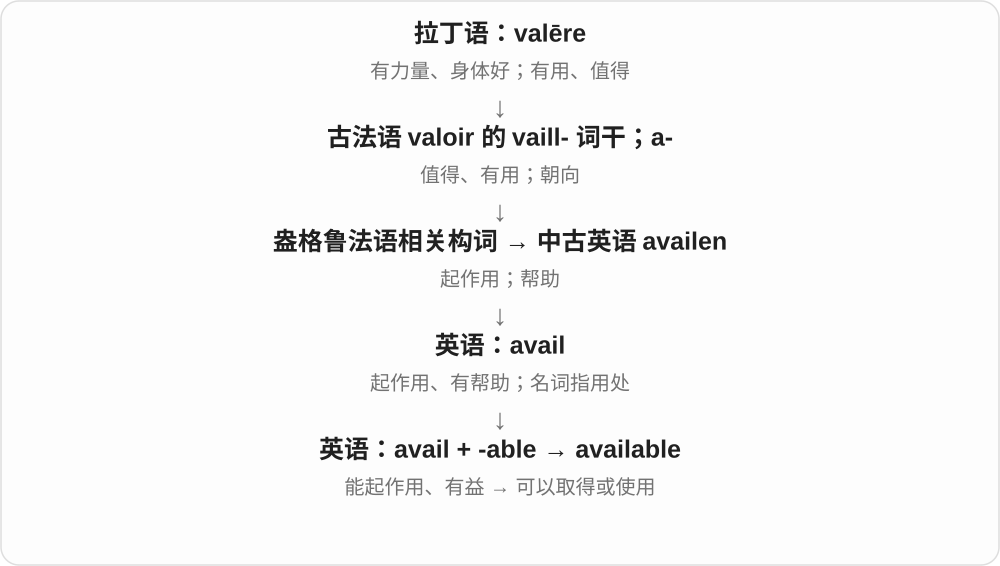

available online 是网上可获得；available for a meeting 是有空开会。东西存在不等于一定 available：可能已售完、被预约，或你没有权限。

**常见搭配与例句**

available to users；available for purchase；readily available。

> The guide is available online at no charge.

这份指南可以在网上免费获取。

> Are you available for a short meeting tomorrow?

你明天有空开个短会吗？

**别混淆**

accessible 强调能接近、能使用的便利或条件；available 强调有得用、有得取。

### 2. approach — 靠近；着手处理；接洽；方法

**音标**：英 /əˈprəʊtʃ/；美 /əˈproʊtʃ/

**先抓住这个画面**

人向门口走近，是 approach；你从哪个角度接近一个问题，也就是怎样着手处理它。作名词常说这套办法。

**怎么拆**

经古法语接晚期拉丁 appropiare 靠近，关联拉丁 prope 近。没有一个常用英语 proach 可以独立拿来解释。

**怎么变成今天的意思**

**晚期拉丁 appropiare → 古法语 aprochier**  
靠近；与 prope 近的材料相联

↓

**英语 approach → approachable**  
接近；处理事情的方式；可接近、平易近人的

approach a problem 处理问题；approach someone about something 就某事接洽某人；an approach to learning 学习方法。

**常见搭配与例句**

approach the entrance；an approach to。

> We slowed down as we approached the village.

靠近村庄时，我们放慢了速度。

> She suggested a different approach to the problem.

她提出了一种处理这个问题的新方法。

**别混淆**

动词 approach 通常直接接对象：approach the door；名词方法常用 an approach to the problem。不要把两个结构混在一起。

### 3. approaches — 方法、途径；接近路线〔复数〕；靠近、着手处理〔第三人称单数〕

**音标**：英 /əˈprəʊtʃɪz/；美 /əˈproʊtʃɪz/

**先抓住这个画面**

走近一个地方，可以走不同路线；着手解决一个问题，也可以从不同方向进入。approaches 就能数这些处理路径，也能说某人正在靠近。

**怎么拆**

approach + -es，/tʃ/ 后读 /ɪz/。approach 借古法语，接晚期拉丁 appropiare 靠近，关联拉丁 prope 近。

**怎么变成今天的意思**

**晚期拉丁 appropiare → 法语 → approach**  
走近、靠近 → 接近问题的方式

↓

**approach + -es → approaches**  
多种方法、路线；或某物正在接近

different approaches to a problem 处理问题的不同方法；approaches the station 接近车站。

**常见搭配与例句**

new approaches to teaching 新的教学方式；the approaches to the bridge 通向桥梁的道路。

> The teachers compared different approaches to reading.

老师们比较了不同的阅读教学方式。

> The train slows as it approaches the station.

火车接近车站时减速。

**别混淆**

approaches to 后的 to 可是名词结构里的介词；approaches the town 则是动词直接接目的地。方法义保留的是接近问题的方向感。

### 4. approaching — 接近、临近；着手处理〔现在分词及分词形容词〕

**音标**：英 /əˈprəʊtʃɪŋ/；美 /əˈproʊtʃɪŋ/

**先抓住这个画面**

距离越来越短，是 approaching；日期离现在越来越近也一样。处理问题时逐渐走近、从某个角度进入，又成为着手应对。

**怎么拆**

approach + -ing，直接加 ing。approach 经法语接晚期拉丁 appropiare 靠近，较早关联 prope 近。

**怎么变成今天的意思**

**晚期拉丁 appropiare → 法语 → approach**  
空间靠近 → 时间临近、着手处理

↓

**approach + -ing → approaching**  
正在接近；形容即将到来的事

an approaching train 驶近的列车；approaching the deadline 临近截止日期；approaching a problem 着手处理问题。

**常见搭配与例句**

the approaching winter 即将到来的冬天；approaching the task differently 换个方式处理任务。

> We could hear the approaching train.

我们能听见列车正在驶近。

> The team is approaching the problem from a new angle.

团队正从一个新角度处理这个问题。

**别混淆**

approaching 常直接接接近的对象，不需要每次加 to；an approach to a problem 是名词结构，才有对应的介词。

### 5. approached — 走近、接近了；着手、接洽了〔过去式、过去分词〕

**音标**：英 /əˈprəʊtʃt/；美 /əˈproʊtʃt/

**先抓住这个画面**

离目标越来越近，可以是人走近房子，也可以是开始接触问题、找人商量。approached 把这个靠近放进过去叙述。

**怎么拆**

approach + -ed，/tʃ/ 后读 /t/，末尾 /tʃt/，不额外加音节。approach 经法语接晚期拉丁 appropiare 靠近，关联 prope 近。

**怎么变成今天的意思**

**晚期拉丁 appropiare → 法语 → approach**  
靠近 → 接近目标、着手处理或接洽

↓

**approach + -ed → approached**  
走近、处理或接洽发生了

approached the house 走近房子；approached the problem 着手处理问题；approached someone about an idea 找某人谈一个想法。

**常见搭配与例句**

as the train approached 火车驶近时；approached with care 谨慎处理、接近。

> We approached the house along a narrow path.

我们沿着窄路走近房子。

> She approached the teacher about starting a reading club.

她找老师商量成立阅读俱乐部。

**别混淆**

approached 后常直接接接近、处理的对象。approached someone about something 中，人是被接洽的一方，about 后是要谈的事。

### 6. approachable — 平易近人的；容易接近、易于理解的

**音标**：英 /əˈprəʊtʃəbəl/；美 /əˈproʊtʃəbəl/

**先抓住这个画面**

遇到问题敢去问他，不怕被摆脸色，这种让人愿意接近的人叫 approachable。用在学科、文章上，也可说不那么吓人、容易入门。

**怎么拆**

approach + -able；从能走近、接触的意义，发展到心理上容易亲近、内容容易进入。

**怎么变成今天的意思**

**晚期拉丁 appropiare → 古法语 aprochier**  
靠近；与 prope 近的材料相联

↓

**英语 approach → approachable**  
接近；处理事情的方式；可接近、平易近人的

an approachable teacher 平易近人的老师；an approachable introduction 易读的入门介绍。

**常见搭配与例句**

friendly and approachable；an approachable style。

> The new manager is friendly and approachable.

新经理友善、平易近人。

> The book offers an approachable introduction to astronomy.

这本书提供了容易入门的天文学介绍。

**别混淆**

approachable 说人好接近，available 说有空、可用；一个老师很亲切，也可能当天没空。

### 7. avoid — 避开；避免

**音标**：/əˈvɔɪd/

**先抓住这个画面**

不想撞上障碍，就绕着走；不想发生误会，就提前说清楚。avoid 可以是避开对象，也可以是设法不让某事发生。

**怎么拆**

经法语相应形式进入英语，较早有清空、腾出的意义材料，与 void、vacuous 的较远历史材料相关；现代不等于把 a 与 void 随意拼出全部词义。

**怎么变成今天的意思**

**古法语 esvuidier、盎格鲁诺曼语相应形式**  
清空、腾空等旧义

↓

**中古英语 avoiden → avoid**  
从清空、离开等走到避开、避免

avoid someone 避开某人；avoid a mistake 避免错误；avoid doing something 避免做某事。

**常见搭配与例句**

avoid doing；avoid a collision。

> We left early to avoid the traffic.

我们早早出发，避开车流。

> Try to avoid making the same mistake again.

尽量别再犯同样的错误。

**别混淆**

avoid 后接动词通常用 -ing：avoid making mistakes；不是 avoid to make。prevent 更常用 prevent someone from doing。

### 8. avoidable — 可以避免的

**音标**：/əˈvɔɪdəbəl/

**先抓住这个画面**

不是命中注定非发生不可，本来有办法绕开、预防的错误或损失，就是 avoidable。

**怎么拆**

avoid + -able；强调存在避免的可能，不断言当时每个人都已经知道具体怎样避免。

**怎么变成今天的意思**

**avoid**  
避开、避免

↓

**avoid + -able → avoidable**  
可以避免的

an avoidable mistake 可避免的错误；avoidable delays 本可避免的延误。

**常见搭配与例句**

entirely avoidable；an avoidable accident。

> The review identified several avoidable mistakes.

复盘发现了几处本可避免的错误。

> Better planning could have prevented these avoidable delays.

更好的规划本来能防止这些可避免的延误。

**别混淆**

avoidable 是可避免，inevitable 是不可避免；unavoidable 才是否定 avoidable。

### 9. recognize — 认出；承认；认可

**音标**：英、美 /ˈrekəɡnaɪz/

**先抓住这个画面**

眼前的人或事与脑中的已知信息对上了；也可以把某个身份、事实或贡献正式承认下来。

**怎么拆**

远源是拉丁语 recognoscere，re-“再” + cognoscere“认识”。英语早期形式可能来自法语 reconoistre 的词干，也可能从 recognizance 反构；不能只说现代 re- + cognize。

**怎么变成今天的意思**

**拉丁语：gnoscere / noscere；notus**  
开始认识、了解；已知的

↓

**拉丁语：co- + gnoscere → cognoscere / cognitus**  
认识、辨认、查明

↓

**拉丁语：re- + cognoscere → recognoscere / recognitus**  
再次认识；认出、确认

↓

**法语 reconoistre 词干；或 recognizance 反构〔有不同解释〕**  
认出、承认的英语形成路线

↓

**英语：recognize**  
认出；承认事实、身份、贡献

recognize someone 是认出某人；recognize that… 是承认、意识到某事；recognize achievement 是认可功绩。英式也常拼 recognise。

**常见搭配与例句**

recognize a face；recognize a problem；recognize someone’s contribution。

> I recognized her voice immediately.

我立刻认出了她的声音。

> The committee recognized his contribution to the project.

委员会认可了他对项目的贡献。

**别混淆**

remember 是记得；recognize 常是遇到后辨认出来，或明确承认其成立。

### 10. recognise — 认出；承认；认可〔recognize 的常见英式拼写〕

**音标**：/ˈrekəɡnaɪz/

**先抓住这个画面**

看到熟悉的脸，脑子里对上号；或承认一个事实、认可某种地位，都可用 recognise。换成 s，基本用法不换。

**怎么拆**

与 recognize 同源，历史接拉丁 recognoscere 再认、承认等材料；-ise 与 -ize 是这里的拼写变体，不分成两个意思。

**怎么变成今天的意思**

**recognize、recognise**  
认出、承认的同一常用动词的拼写变体

↓

**-able → recognizable、recognisable；再加 un-**  
认得出的；认不出的

recognise someone 认出某人；recognise that 承认、认识到某事；recognise an achievement 肯定成就。

**常见搭配与例句**

recognise a voice；recognise that。

> I recognised her voice immediately.

我一下就认出了她的声音。

> They recognise the need for better communication.

他们承认需要更好的沟通。

**别混淆**

recognise 是认出、承认；realise 是意识到、实现。认出了这张脸，与意识到自己认错人，是不同动作。

### 11. recognised — 认出了、承认了；受认可的〔过去式、过去分词及形容词〕

**音标**：/ˈrekəɡnaɪzd/

**先抓住这个画面**

再次碰见，知道这是谁，是 recognised；承认某人的贡献有价值，也会用 recognised。它把辨认和认可这两层意思连起来。

**怎么拆**

recognise 与 recognize 对应，连拉丁 recognoscere：re- 再与认知材料，有再认、承认义。现代 recognise 去末尾 e，加完整 -ed，/z/ 后读 /d/。

**怎么变成今天的意思**

**拉丁 recognoscere 的再认、承认词族 → recognise、recognize**  
认出来 → 承认、认可

↓

**recognise 去 e + -ed → recognised**  
已辨认、已认可；与 recognized 是拼写对应

recognised her voice 认出了她的声音；recognised his contribution 认可他的贡献；a recognised expert 获公认的专家。

**常见搭配与例句**

widely recognised 广泛认可的；recognised the need 承认有这种需要。

> I recognised her voice immediately.

我立刻认出了她的声音。

> The award recognised his contribution to the project.

这个奖肯定了他对项目的贡献。

**别混淆**

recognised a face 是辨认，recognised an achievement 是认可成就。不要把每次 recognised 都限定成以前亲眼见过这个对象。

### 12. recognizable — 认得出的；可辨认的

**音标**：/ˈrekəɡnaɪzəbəl/

**先抓住这个画面**

脸换了发型、声音隔着电话，你还是能对上号，这就叫 recognizable：保留着足以被认出来的特征。

**怎么拆**

recognize 去 e 加 -able → recognizable；不是表示已经被认出的过去分词，而是具有可辨认性。

**怎么变成今天的意思**

**recognize、recognise**  
认出、承认的同一常用动词的拼写变体

↓

**-able → recognizable、recognisable；再加 un-**  
认得出的；认不出的

a recognizable voice 可辨认的声音；instantly recognizable 一眼、一听就能认出来。

**常见搭配与例句**

instantly recognizable；a recognizable pattern。

> The melody was instantly recognizable.

这段旋律一听就能认出来。

> The logo remains recognizable even at a small size.

标志缩得很小，仍然认得出来。

**别混淆**

recognizable 是能认出，recognized 可说已被认出或被公认；可辨认不等于有正式认可。

### 13. recognisable — 认得出的；可辨认的〔recognizable 的拼写变体〕

**音标**：/ˈrekəɡnaɪzəbəl/

**先抓住这个画面**

和 recognizable 同样表示能认出来；文章选用 recognise 系列时，就常对应写 recognisable。

**怎么拆**

recognise 去 e 加 -able；s 与 z 的差别是这组词的拼写习惯，常用意义不变。

**怎么变成今天的意思**

**recognize、recognise**  
认出、承认的同一常用动词的拼写变体

↓

**-able → recognizable、recognisable；再加 un-**  
认得出的；认不出的

easily recognisable 很容易辨认；a recognisable style 辨识度高的风格。

**常见搭配与例句**

instantly recognisable；easily recognisable。

> Her style is easily recognisable.

她的风格很容易认出来。

> The tower is a recognisable feature of the skyline.

这座塔是天际线上很有辨识度的地标。

**别混淆**

recognisable 与 recognizable 不用人为分成英式人脸、美式物品等不同意思；只需保持拼写习惯一致。

### 14. unrecognizable — 认不出的；面目全非的

**音标**：/ˌʌnˈrekəɡnaɪzəbəl/

**先抓住这个画面**

原来的地方变得太多，你走到跟前也对不上记忆，这种几乎认不出来的状态就是 unrecognizable。

**怎么拆**

un- 不 + recognizable 可辨认的；先否定整个形容词，不是另造一个常用动词 unrecognize 来解释。

**怎么变成今天的意思**

**recognize、recognise**  
认出、承认的同一常用动词的拼写变体

↓

**-able → recognizable、recognisable；再加 un-**  
认得出的；认不出的

almost unrecognizable 几乎认不出；change beyond recognition 与其意思相近。

**常见搭配与例句**

almost unrecognizable；completely unrecognizable。

> The street was almost unrecognizable after the rebuilding.

重建后，这条街几乎认不出来了。

> The recording made his voice unrecognizable.

录音让他的声音听起来完全认不出来。

**别混淆**

unrecognizable 是看不出原貌；unrecognized 是未被认出、未获认可。一个侧重辨认困难，一个侧重实际未认出或认可状态。

### 15. lock — 锁、上锁；固定；船闸；一绺头发〔另旧词形〕

**音标**：英 /lɒk/；美 /lɑːk/

**先抓住这个画面**

锁把原来能开的地方固定住；船闸控制水位与通行，也从闭合、围住来理解。a lock of hair 却是一绺头发，不是头发被锁上了。

**怎么拆**

锁和关闭接古英语 loc、lūcan 等，现代名词、动词形式相互影响。头发接古英语 locc，直接祖先不同，更远是否相关不强定。

**怎么变成今天的意思**

**古英语 loc〔闩、闭合装置等〕、lūcan〔关〕→ 中古英语 lok 等**  
闭住、固定；现代锁与上锁动作

↓

**另一旧名词：古英语 locc → lock**  
一绺头发、卷发；更远关系有不同分析

↓

**现代锁的扩展**  
固定、船闸、擒抱；僵局、相扣等

lock the door 锁门，a door lock 门锁，lock into place 卡到固定位置，a canal lock 运河船闸，a lock of hair 一绺头发。

**常见搭配与例句**

lock the door；under lock and key；a canal lock；a lock of hair。

> Please lock the door before you leave.

离开前请锁门。

> She kept a lock of her baby’s hair in a small box.

她把宝宝的一绺头发保存在小盒子里。

**别混淆**

close 关上、lock 锁住：门可已经关上却没锁。lock 发式义与门锁不能只按一个动作硬推。

### 16. lockable — 可上锁、可锁定的

**音标**：英 /ˈlɒkəbəl/；美 /ˈlɑːkəbəl/

**先抓住这个画面**

设计上能锁，可能现在开着，也可能没放钥匙进去。-able 说能力，不说当前状态。

**怎么拆**

lock + -able，形成能上锁的形容词。

**怎么变成今天的意思**

**古英语 loc〔闩、闭合装置等〕、lūcan〔关〕→ 中古英语 lok 等**  
闭住、固定；现代锁与上锁动作

↓

**lock + -able → lockable**  
可以上锁、锁定的

a lockable cabinet 可锁柜，lockable wheels 可锁脚轮，a lockable box 可锁盒子。

**常见搭配与例句**

a lockable cabinet；a lockable box；lockable wheels。

> Keep the documents in a lockable cabinet.

把文件放在可上锁的柜子里。

> The desk has a lockable drawer.

这张桌子有个可上锁抽屉。

**别混淆**

lockable 能锁、locked 已锁、locking 锁定功能或过程；可锁并非当前一定锁好。

### 17. unlock — 开锁、解锁；开启潜能、使可用〔比喻〕

**音标**：英 /ʌnˈlɒk/；美 /ʌnˈlɑːk/

**先抓住这个画面**

把阻止开启的锁解除，东西就能用了；潜力、信息、机会原来取不到，后来能释放，也借这个动作说。

**怎么拆**

有古英语 onlūcan、中古英语 unloken 等旧形，现代对应 un- 逆转 + lock。不是形容某东西不叫锁，而是把锁住状态解除。

**怎么变成今天的意思**

**古英语 loc〔闩、闭合装置等〕、lūcan〔关〕→ 中古英语 lok 等**  
闭住、固定；现代锁与上锁动作

↓

**旧 onlūcan、unloken → unlock；现代对应 un- + lock**  
解除闭锁 → 使机会、能力等可发挥

unlock the door 开门锁，unlock a phone 解锁手机，unlock potential 发挥潜能，unlock new opportunities 开启新机会。

**常见搭配与例句**

unlock the door；unlock a phone；unlock potential；unlock opportunities。

> She unlocked the door but did not open it yet.

她开了门锁，但还没有推开门。

> The course helped unlock his interest in science.

课程帮助激发了他对科学的兴趣。

**别混淆**

unlock 解除锁定、open 打开，先 unlock 后门仍可能没被推开；潜能比喻也不表示已经完成所有目标。

### 18. unlockable — 可解锁的；也可指无法上锁的〔取决于拆法〕

**音标**：英 /ʌnˈlɒkəbəl/；美 /ʌnˈlɑːkəbəl/

**先抓住这个画面**

游戏里的隐藏角色能靠完成任务解锁，是 unlockable。谈坏锁、没有锁的设施时，同一个词也可能表示无法锁上；必须读上下文。

**怎么拆**

两种括号：unlock + -able → 能解锁；un- + lockable → 不能上锁。un- 在前者属于 unlock 解锁的动作，在后者是否定整个可上锁形容词。

**怎么变成今天的意思**

**unlock + -able**  
可以解锁的

↓

**un- + lockable**  
不能上锁的；与上一行是两种分析，不是先后演变

unlockable characters 可解锁角色；描述门时最好明确写 cannot be locked 或 can be unlocked，避免双义。

**常见搭配与例句**

unlockable content；an unlockable character。

> The game includes several unlockable characters.

游戏里有几个可解锁角色。

> The report called the door unlockable, meaning that it could not be locked.

报告把这扇门称为 unlockable，意思是它无法上锁。

**别混淆**

前缀位置相同不代表作用范围相同。unreadable 通常是不能读、难读；unlockable 的两个拆法是特别直观的结构歧义例子。

### 19. valuable — 有价值的；贵重的；很有用的

**音标**：英、美 /ˈvæljuəbəl/

**先抓住这个画面**

值得你花心思保存、认真听取或好好利用。可以是一颗宝石，也可以是一条省去很多麻烦的建议。

**怎么拆**

value + -able；英语派生，词尾 e 去掉后加 -able。

**怎么变成今天的意思**

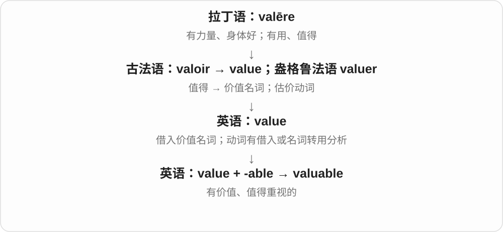

valuable information 常是“很有用的信息”，不一定能卖钱。复数名词 valuables 专指珠宝等贵重物品。

**常见搭配与例句**

valuable advice；a valuable lesson；keep valuables safe。

> The interview gave us valuable information about the problem.

这次访谈给了我们关于这个问题的重要信息。

> Please keep your valuables with you during the journey.

旅途中请随身保管贵重物品。

**别混淆**

expensive 是价格高；valuable 可以贵重，也可以只对某件事有帮助。

### 20. argue — 争论、争吵；论证、主张

**音标**：英 /ˈɑːɡjuː/；美 /ˈɑːrɡjuː/

**先抓住这个画面**

可以是两个人各不相让地争，也可以是作者安静地拿理由支持观点。共同点是把自己的主张推到台面上。

**怎么拆**

经法语 arguer 接拉丁 arguere 显示、证明、指责；不是只从今天吵架义往回解释。

**怎么变成今天的意思**

**拉丁 arguere 显示、证明、指责 → 法语 arguer**  
把理由、指控摆出来

↓

**英语 argue；拉丁 argumentum 经法语 → argument**  
论证、争论；理由或争吵

argue with someone 与某人争论；argue about a topic 争论话题；argue that 主张；argue for/against 为某观点提供支持或反对理由。

**常见搭配与例句**

argue that；argue with；argue for/against。

> They argued about who should pay.

他们为该谁付钱争论。

> The author argues that the policy needs to change.

作者论证这项政策需要改变。

**别混淆**

argue that 在论文里通常是提出论证，不一定是发火。quarrel 更聚焦争吵、失和。

### 21. arguable — 有理由主张的；可争论、有疑问的

**音标**：英 /ˈɑːɡjuəbəl/；美 /ˈɑːrɡjuəbəl/

**先抓住这个画面**

这说法能提出理由支持，但还不是铁板钉钉；arguable 因而可以从“有理由这样说”，也可以从“还值得争论”两面表达。

**怎么拆**

argue 去 e 加 -able → arguable；-able 保留可以论证、讨论的意义，具体是在支持主张还是质疑确定性，要看句子。

**怎么变成今天的意思**

**argue**  
争论；提出理由论证

↓

**argue + -able → arguable**  
有理由主张；可争论的

It is arguable that… 可以提出理由认为……；an arguable point 是可以论证、也可有争议的观点。

**常见搭配与例句**

It is arguable that；an arguable case。

> It is arguable that the simpler design works better.

有理由认为，较简单的设计效果更好。

> Whether the change was necessary remains arguable.

这次改动是否必要，仍有讨论余地。

**别混淆**

arguable 不是 unarguable 无可争辩的；副词 arguably 常表示可以说、按一种有依据的看法，并非绝对断言。

### 22. suitable — 合适的；适用的

**音标**：/ˈsuːtəbl/；英式也 /ˈsjuːtəbl/

**先抓住这个画面**

放到这个人、用途、场合里，条件对得上、用得顺。

**怎么拆**

suit 动词适合 + -able，形成关系形容词。这里重点是适配某个用途，不是衣服能被穿上的单一意思。

**怎么变成今天的意思**

**拉丁 sequī、secūtus → 通俗拉丁 \*sequita**  
跟随；跟随、追随相关形式

↓

**古法语 suite、siute → 英语 suit**  
随从、追随、成套 → 套服、花色、诉讼；相配、适合

↓

**suit + -able → suitable**  
与人、用途或场合相合的

suitable for children 适合儿童，suitable for the job 适合工作，a suitable time 合适时间。要说明适合什么，不能只空泛说很好。

**常见搭配与例句**

suitable for；a suitable time；a suitable candidate。

> The film is suitable for older children.

影片适合年龄较大的儿童。

> We need a suitable place for the meeting.

我们需要一个合适的开会地点。

**别混淆**

suitable 合用途，available 当前可用；一个候选人合适但可能没空，一个空房可用但可能不适合需求。

### 23. reliable — 可靠的；可信赖的

**音标**：/rɪˈlaɪəbəl/

**先抓住这个画面**

reliable 描述在需要的时候表现稳定、能够让人放心依靠的对象。人、消息来源、设备和服务都可以 reliable。一次表现很好，不一定就证明长期可靠。

**怎么拆**

rely + -able；y 在派生中变 i。这里 -able 表示“可以被依靠的”，不是简单给 rely 加“能够”就译成“能够依靠别人的”。

**怎么变成今天的意思**

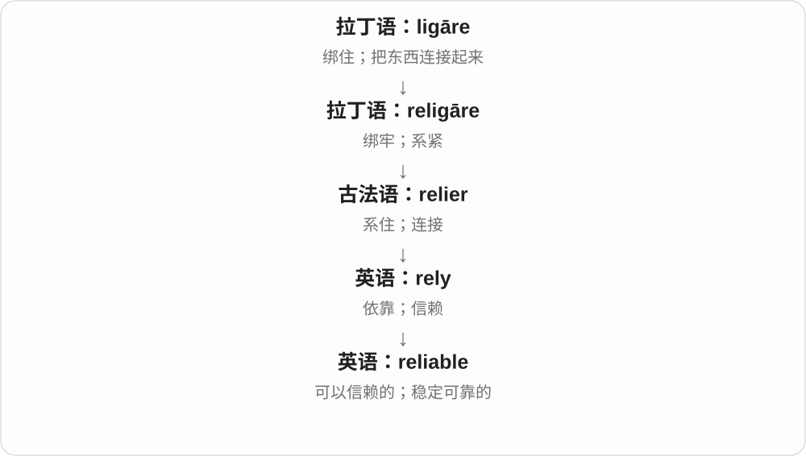

rely 是“依靠”的动作，reliable 把目光转向依靠的对象：它是否值得被信任。英语在本土构词阶段形成这个形容词，不能把整词当作拉丁语直接借词。

**常见搭配与例句**

a reliable source（可靠来源）；a reliable car（可靠的汽车）；reliable information（可信的信息）。

> We need a reliable source before publishing the story.

刊发这则报道前，我们需要可靠的消息来源。

> This old car is still surprisingly reliable.

这辆旧车仍然出人意料地可靠。

**别混淆**

reliable 强调可依赖的表现；accurate 强调具体内容准确。一把每次都偏同样数值的尺可能重复性好，却不准确。

### 24. remarkable — 非凡的；值得注意的；显著的

**音标**：英 /rɪˈmɑːkəbəl/；美 /rɪˈmɑːrkəbəl/

**先抓住这个画面**

普通的事看过就过，这件事却让你停下来：这点真值得提一句。

**怎么拆**

联系法语 remarquable，认形 remark + -able 值得、能够被注意到。现代常带非凡、突出的评价，不只是任何可写评语的东西。

**怎么变成今天的意思**

**法语 remarquer → 英语 remark**  
重新标出、注意；后来评论、指出

↓

**现代 remark 词族**  
评论、说到；值得注意的、显著的

↓

**remark + -able；法语 remarquable → remarkable**  
值得注意、提到的 → 非凡、显著的

a remarkable achievement 非凡成就，a remarkable similarity 惊人的相似；不一定只夸好，a remarkable lack of detail 也可批评细节少得惊人。

**常见搭配与例句**

a remarkable achievement；a remarkable change；a remarkable similarity。

> She made remarkable progress in a short time.

她在短时间内取得了显著进步。

> There is a remarkable similarity between the two designs.

这两个设计有惊人的相似之处。

**别混淆**

remarkable 值得注意、突出，ordinary 普通；remarkable 不保证一定美好，具体评价看后面名词。

### 25. acceptable — 可以接受的；达标的

**音标**：/əkˈseptəbəl/

**先抓住这个画面**

想象给东西设一条最低标准：过了这条线，虽然未必出色，但能接受。这就是 acceptable。

**怎么拆**

现代分析是 accept + -able“可以被接受的”；英语词形也承接法语和晚期拉丁语 acceptābilis。

**怎么变成今天的意思**

它常用于质量、价格、行为和方案。acceptable 不自动等于 excellent：一个方案可以只是够用，但仍达到了你设定的条件。

**常见搭配与例句**

an acceptable solution；acceptable to someone；an acceptable standard。

> We need to find a solution that is acceptable to both sides.

我们需要找到双方都能接受的方案。

> The room was small, but the price was acceptable.

房间很小，但价格可以接受。

**别混淆**

acceptable 是能否接受；accepted 是已经被接受。一个尚无人采用的方案，也可能本身很合理、可接受。

### 26. considerable — 相当大的；可观的；值得重视的

**音标**：英 /kənˈsɪdərəbl/；美 /kənˈsɪdərəbl/

**先抓住这个画面**

量、程度大到不能当小事忽略，常是可观的一笔钱、明显的努力或差距。

**怎么拆**

consider + -able，早有值得考虑、重视义，现代最常见固定为数量、程度相当大。不要机械只翻成能被考虑。

**怎么变成今天的意思**

**拉丁 considerare → 法语 considerer → 英语 consider**  
仔细察看、思量；更深的星辰词解释不作确定事实

↓

**现代 consider**  
考虑、斟酌 → 认为、看作；顾及

↓

**consider + -able → considerable**  
值得重视 → 数量、程度可观

considerable effort 相当大的努力，considerable damage 严重损失，a considerable amount 可观数量。

**常见搭配与例句**

considerable effort；considerable damage；a considerable amount。

> The repairs required considerable effort.

维修需要相当大的努力。

> There is a considerable difference between the two estimates.

两项估算差距很大。

**别混淆**

considerable 可观，considerate 体贴是另一个常见词；拼写近不等于都在说替人着想。

### 27. forgive — 原谅；宽恕；免除债务

**音标**：英 /fəˈɡɪv/；美 /fərˈɡɪv/

**先抓住这个画面**

把本来还想追究的那笔账，选择放下。

**怎么拆**

古英语 forgiefan 已有给予、免除债务、宽恕等义；for- 在这里可能起完全的加强作用，不是现代介词为了。宽恕义与拉丁语相似构词模式的影响有关。

**怎么变成今天的意思**

**古英语 for-；giefan**  
可能为完全的加强成分；给予

↓

**古英语 forgiefan**  
给予、准许；免除、宽恕

↓

**现代 forgive**  
原谅过错；免除债务

forgive someone for something 是原谅某人的某件事。“放下账本”是理解宽恕的画面，不等于必须忘掉事情、认定对方没错，或恢复原来的关系。金融语境中 forgive a debt 则是免除偿还义务。

**常见搭配与例句**

forgive–forgave–forgiven；forgive someone for doing something；forgive a debt。

> She forgave him for forgetting the appointment.

她原谅了他忘记约定这件事。

> Forgiving the mistake does not mean pretending it never happened.

原谅那个错误，不等于假装它从未发生。

**别混淆**

forgive 是原谅，condone 常指容许或纵容不当行为。可以原谅一个人，同时仍认为他的行为不对。

### 28. forgivable — 可原谅的；情有可原的

**音标**：英 /fəˈɡɪvəbəl/；美 /fərˈɡɪvəbəl/

**先抓住这个画面**

做错了，但考虑原因、程度，别人觉得还能放下、不必一直追究，可以说 forgivable。

**怎么拆**

forgive 去 e 加 -able → forgivable；将原谅这个动作转成错误、疏忽具有的可原谅性质。

**怎么变成今天的意思**

**forgive**  
原谅、不再因过错责怪

↓

**forgive + -able → forgivable**  
可以原谅的

a forgivable mistake 可原谅的错误；an entirely forgivable oversight 完全情有可原的疏忽。

**常见搭配与例句**

a forgivable error；quite forgivable。

> It was a forgivable mistake for a beginner.

对初学者来说，这是个情有可原的错误。

> Her confusion was forgivable given the unclear instructions.

说明写得不清楚，她感到困惑是可以理解的。

**别混淆**

forgivable 是评价可原谅，forgiven 是已经被原谅；认为可以原谅，不保证当事人已经原谅。

### 29. affordable — 负担得起的、价格可承受的

**音标**：英 /əˈfɔːdəbəl/；美 /əˈfɔːrdəbəl/

**先抓住这个画面**

相对于某个人、群体的收入与资源，买了还承受得住。不是只看商品标价小不小。

**怎么拆**

afford + -able，表示能够承担花费的。词义随 afford 负担得起分支，不是这个房子能够主动提供什么。

**怎么变成今天的意思**

**古英语 ġeforþian → 中古英语 aforth 等 → afford**  
促进、完成、提供等旧义

↓

**现代 afford 的两条常见分支**  
资源足够承担；事物能够提供某种机会、景观等

↓

**afford + -able → affordable**  
花费可被相应人群承担的

affordable housing 可负担住房，affordable prices 可承受价格，an affordable option 负担得起的选择。

**常见搭配与例句**

affordable housing；affordable prices；an affordable option。

> We are looking for an affordable place to stay.

我们在找负担得起的住宿。

> The shop offers affordable school supplies.

商店提供价格可承受的学习用品。

**别混淆**

affordable 相对支付能力，cheap 价格低；对高收入者 affordable 的东西，对另一人未必 affordable。

### 30. sustainable — 可持续的；能够长期维持的

**音标**：/səˈsteɪnəbəl/

**先抓住这个画面**

sustainable 像一种生活或生产方式，今天能运转，明天也不至于把维持它的资源和条件耗光。

**怎么拆**

sustain + -able。

**怎么变成今天的意思**

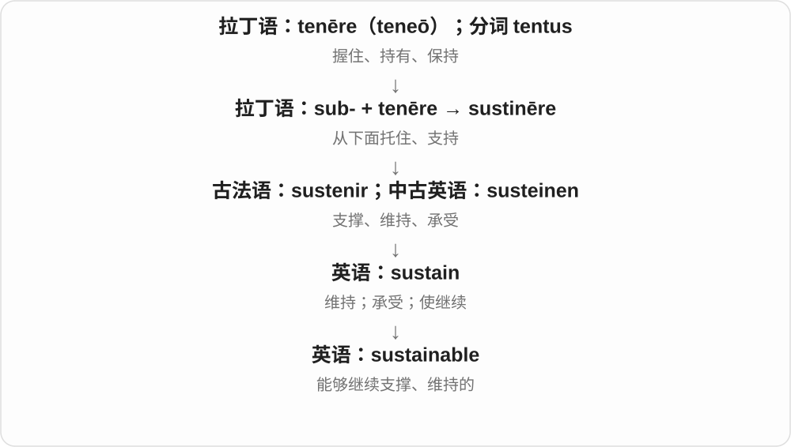

环境话题最常见，但也能说工作强度、财务模式、增长速度。不能只翻成绿色或环保而丢掉持续的含义。

**常见搭配与例句**

sustainable development；a sustainable pace；a sustainable business model。

> We need a sustainable pace of work, not constant overtime.

我们需要能长期维持的工作节奏，而不是持续加班。

> The project explores more sustainable ways to use local resources.

项目探索更可持续地使用本地资源的方法。

**别混淆**

renewable 是资源可再生；sustainable 是整体做法能否长期维持，两者相关但不完全相同。

### 31. variable — 可变的；多变的；变量

**音标**：英 /ˈveəriəbəl/；美 /ˈveriəbəl/

**先抓住这个画面**

某个位置不是永远固定一个值，可以随时间、条件或观察对象而不同。

**怎么拆**

借古法语 variable，来自后期拉丁语 variabilis，基于 variare；现代可联系 vary 与 -able，名词变量义由形容词专门化。

**怎么变成今天的意思**

**拉丁语 varius**  
不同的、多样的；带不同颜色的

↓

**拉丁语 variare → 后期拉丁语 variabilis → 古法语 variable**  
变化 → 可以变化的

↓

**英语 variable**  
多变的；后来也指变量

variable weather 是天气多变；数学中的 variable 是用来表示可取不同值的量，统计中也可以是颜色、职业等类别。

**常见搭配与例句**

a variable rate；a random variable；an independent variable。

> The weather is very variable in spring.

春天天气变化很大。

> Age was one of the variables recorded in the survey.

年龄是调查记录的变量之一。

**别混淆**

constant 是固定不变的量；variable 不一定是数字，编程里也不保证每一种变量都允许重新赋值。

### 32. miserable — 难受的；悲惨的；糟糕的；少得可怜的

**音标**：/ˈmɪzərəbəl/

**先抓住这个画面**

心里难过、身体难受，或生活条件差得让人看不到乐趣。

**怎么拆**

拉丁 miserabilis 来自 miserari 怜悯，最终接 miser 不幸的；经法语借入，不是由现代 miser 守财奴加 -able 才得来。

**怎么变成今天的意思**

**拉丁 miser**  
痛苦、不幸、可怜的；更远来源未定

↓

**拉丁 miserari → miserabilis；法语 miserable → 英语 miserable**  
令人同情 → 难受、悲惨、糟糕的

feel miserable 是感到很难受；miserable weather 是糟糕天气；a miserable sum 是少得可怜的一点钱。都围绕让人不好受、不满意。

**常见搭配与例句**

feel miserable；miserable conditions；miserable weather；a miserable failure。

> She felt miserable after spending the weekend alone with a cold.

她感冒后独自在家过了一周末，感觉很难受。

> The workers were paid a miserable sum for a long day’s work.

工人干了一整天，只得到少得可怜的报酬。

**别混淆**

unhappy 主要说不快乐；miserable 往往更强，也可包含身体不适或恶劣处境。

### 33. notable — 值得注意的；显著的；著名的；名流

**音标**：英 /ˈnəʊtəbəl/；美 /ˈnoʊtəbəl/

**先抓住这个画面**

重要或突出到值得你在旁边做个记号。

**怎么拆**

现代可联想 note + -able；常用“值得注意”义经古法语 notable 接拉丁 notabilis，后者来自 notare“标记”。旧时“有用、善于持家”等义还可能混入日耳曼来源，此处不把旧义都归同一线。

**怎么变成今天的意思**

**拉丁 nota → notare**  
标记、符号；做记号、记下

↓

**拉丁 notabilis → 古法语 notable**  
值得标记、注意的

↓

**中古英语 notable → 现代 notable**  
值得注意；显著；著名

a notable change 是值得留意的变化，不保证是好变化。a notable scientist 才偏著名；复数 notables 也可指当地名流或要人。

**常见搭配与例句**

a notable exception；a notable achievement；notable for something；local notables。

> The report contains one notable exception to the general trend.

报告中有一个值得注意的例外，与总体趋势不同。

> Several local notables attended the opening ceremony.

几位当地知名人士参加了开幕式。

**别混淆**

noticeable 强调能够察觉；notable 强调值得注意。声音可以很容易听到，却未必值得特别讨论。

### 34. profitable — 有利润的；有收获的

**音标**：/ˈpɹɒf.ɪ.tə.bl̩/

**先抓住这个画面**

一项生意赚回的钱超过成本，就是 profitable；一次讨论让你学到东西，也可以是有收获的。

**怎么拆**

古法语 profitable 借入英语；现代可以直接看出 profit + -able，表示能带来收益的。

**怎么变成今天的意思**

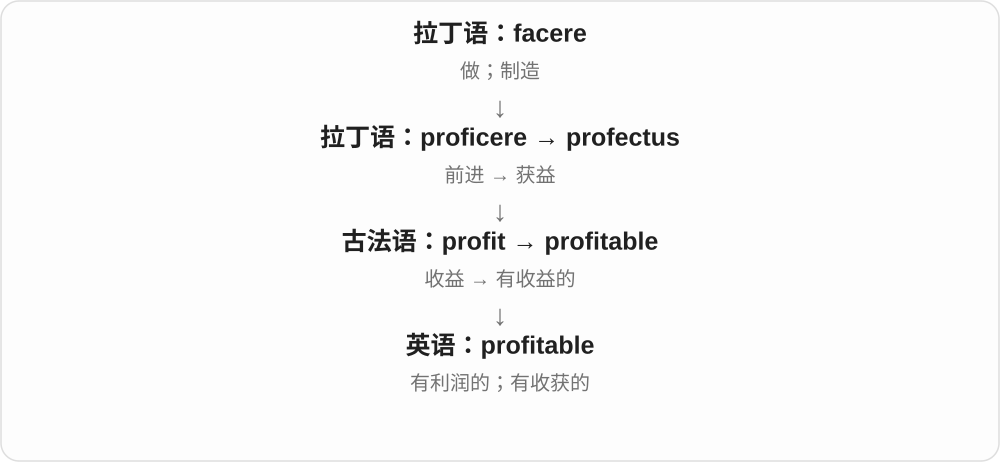

收益可以是钱，也可以是知识与经验。说 profitable business 通常直指赚钱，说 profitable discussion 则较正式地指有所得。

**常见搭配与例句**

a profitable business；a profitable discussion；become profitable。

> The business became profitable in its third year.

这家企业第三年开始盈利。

> We had a profitable discussion about the design.

我们就设计进行了一次很有收获的讨论。

**别混淆**

popular 是受欢迎；profitable 是有收益。很热闹的店也可能赔钱。

### 35. swap — 交换、互换；换用；一次互换

**音标**：英 /swɒp/；美 /swɑp/

**先抓住这个画面**

你坐我的位置，我坐你的，两边互换，是 swap。它很适合日常换座位、换班、换东西，也能说把一种东西换成另一种。

**怎么拆**

旧 swappen 曾说打击、拍打，来源未定；后来达成交易、交换义可能通过拍手成交联系，但那条具体桥只是分析。现代使用直接抓双方互换或替换的动作。

**怎么变成今天的意思**

**中古英语 swappen：打击、拍打，远源未定**  
可能模仿拍击声

↓

**达成交易 → 交换**  
可能借拍手成交的画面衔接，但具体过程只是分析

swap seats 交换座位；swap shifts 换班；swap A for B 用 A 换 B。

**常见搭配与例句**

swap stories 交流各自经历；a book swap 图书交换活动。

> Can we swap seats so I can sit by the window?

我们能换个座位，让我坐窗边吗？

> I want to swap this heavy bag for a lighter one.

我想把这个重包换成轻一点的。

**别混淆**

swap 常是互换或以一种换另一种，buy 明确购买；交换故事不是把其中一个人的故事永久交出去。

### 36. swapped — 交换、换用、替换了

**音标**：英 /swɒpt/；美 /swɑpt/

**先抓住这个画面**

原来用纸杯，后来改用可重复用的杯子，是 swapped paper cups for reusable ones。它把原先和后来两边清楚摆出来。

**怎么拆**

swap 双写 p 加完整 -ed，/p/ 后读 /t/；过去式、过去分词。

**怎么变成今天的意思**

**中古英语 swappen：打击、拍打，远源未定**  
可能模仿拍击声

↓

**达成交易 → 交换**  
可能借拍手成交的画面衔接，但具体过程只是分析

↓

**swap + -ed → swapped**  
过去完成互换或替换，双写末尾 p

swapped seats 交换了座位；swapped A for B 用 B 替掉 A。

**常见搭配与例句**

swapped stories over dinner 晚饭时交流经历；swapped the old battery。

> We swapped seats halfway through the journey.

旅途中途我们换了座位。

> The café swapped plastic straws for paper ones.

咖啡馆把塑料吸管换成了纸吸管。

**别混淆**

swapped A for B 中，A 是拿去换、被替下的，B 是换来的；方向不要只看中文一个换字。

### 37. swapping — 正在交换、换用；交换活动

**音标**：英 /ˈswɒpɪŋ/；美 /ˈswɑpɪŋ/

**先抓住这个画面**

几个人坐着轮流讲自己的经历，是 swapping stories；把旧部件换成新部件，也能用 swapping。

**怎么拆**

swap 双写 p 加 -ing；动作形式可作名词谈交换活动，内部的现代意义不靠旧打击义逐字推。

**怎么变成今天的意思**

**中古英语 swappen：打击、拍打，远源未定**  
可能模仿拍击声

↓

**达成交易 → 交换**  
可能借拍手成交的画面衔接，但具体过程只是分析

↓

**swap + -ing → swapping**  
互换、替换的过程或活动

swapping stories 交流经历；swapping shifts 换班。

**常见搭配与例句**

swapping one item for another；swapping contact details 交换联系方式。

> The neighbours spent the evening swapping stories.

邻居们一晚上都在交流各自的经历。

> Swapping the old bulb for an LED one was easy.

把旧灯泡换成 LED 灯泡很容易。

**别混淆**

swapping contact details 通常是彼此提供，不是删除自己原有资料；具体交换常只是双方都获得信息。

### 38. swaps — 交换、换用〔第三人称单数〕；互换、交换活动〔复数〕

**音标**：英 /swɒps/；美 /swɑps/

**先抓住这个画面**

她每周和同事换一次班，动词用 swaps；社区办的几场图书交换活动，名词也可用 swaps。

**怎么拆**

swap + -s，/p/ 后读 /s/；动词三单与名词复数同形。金融中的 swaps 则是互换合约的特定用法。

**怎么变成今天的意思**

**中古英语 swappen：打击、拍打，远源未定**  
可能模仿拍击声

↓

**达成交易 → 交换**  
可能借拍手成交的画面衔接，但具体过程只是分析

↓

**swap + -s → swaps**  
他或它交换；多次交换、交换活动等

swaps shifts with a colleague 和同事换班；book swaps 图书交换活动。

**常见搭配与例句**

swaps one thing for another；clothes swaps 衣物交换活动。

> She swaps shifts with a colleague once a month.

她每月和一位同事换一次班。

> The library hosts book swaps for local families.

图书馆为本地家庭举办图书交换活动。

**别混淆**

swaps 说双方交换，gives away 说赠送出去；一场 clothes swap 通常不只是一方向外捐衣服。

### 39. swappable — 可以互换、替换的

**音标**：英 /ˈswɒpəbəl/；美 /ˈswɑpəbəl/

**先抓住这个画面**

电池用完，不必把整台设备丢掉，取下来换一块就行，这块电池就是 swappable。重点是设计上能换。

**怎么拆**

swap 双写 p 加完整 -able；-able 写可以进行相应动作的性质，不是单独用一个 -ble 解释。

**怎么变成今天的意思**

**中古英语 swappen：打击、拍打，远源未定**  
可能模仿拍击声

↓

**达成交易 → 交换**  
可能借拍手成交的画面衔接，但具体过程只是分析

↓

**swap + -able → swappable**  
可以交换、替换，双写末尾 p

a swappable battery 可更换电池；swappable parts 可替换部件。

**常见搭配与例句**

easily swappable 容易换的；a swappable cover 可更换外壳。

> The device comes with a swappable battery.

这台设备配有可更换电池。

> The keyboard has swappable keycaps.

这把键盘的键帽可以更换。

**别混淆**

swappable 说能换，removable 只说能取下；某个盖子可以取下清洗，却未必提供别的盖子供替换。

### 40. enjoyable — 令人愉快的；有乐趣的

**音标**：/ɪnˈdʒɔɪəbəl/

**先抓住这个画面**

事情本身让参与者能感到乐趣，不必达到惊心动魄、终生难忘的程度。

**怎么拆**

enjoy + -able 可……的，形容能够让人享受其中乐趣的。

**怎么变成今天的意思**

**拉丁 gaudium、gaudia → 法语 joie → 中古英语 joye**  
喜悦、快乐

↓

**古法语 enjoier → 中古英语 enjoyen → enjoy**  
给予、感受喜悦 → 喜欢、享受；享有

↓

**enjoy + -able → enjoyable**  
享受 → 能带来乐趣的

an enjoyable evening 愉快夜晚，an enjoyable experience 有乐趣的经历；既能说轻松消遣，也能说有挑战却有乐趣的活动。

**常见搭配与例句**

an enjoyable evening；an enjoyable experience；make learning enjoyable。

> We had an enjoyable evening with friends.

我们和朋友度过了一个愉快夜晚。

> The teacher made the lesson enjoyable.

老师让这堂课很有乐趣。

**别混淆**

enjoyable 事物令人愉快，joyful 人、场面充满喜悦；一节 enjoyable 的课可以很安静，不一定满屋欢呼。

### 41. renewable — 可续期、可更新的；可再生的

**音标**：英 /rɪˈnjuːəbəl/；美 /rɪˈnuːəbəl/

**先抓住这个画面**

合同到期后还能续，是 renewable；能源来自自然中持续补充的来源，也叫 renewable。共同点是来源或有效期能够得到延续。

**怎么拆**

renew 更新、续期 + -able 能够……的。合同、资源等语境各自固定了可续与可再生的用法。

**怎么变成今天的意思**

**re- 再 + new 新**  
使恢复、更新

↓

**renew → renewal、renewable**  
更新行动；能够续期、补充的性质

a renewable contract 可续期合同，renewable energy 可再生能源，renewable resources 可再生资源。renewables 也可概称可再生能源。

**常见搭配与例句**

a renewable contract；renewable energy；renewable resources。

> The job comes with a renewable annual contract.

这份工作采用可续期的一年期合同。

> The school project compares several sources of renewable energy.

学校项目比较几种可再生能源来源。

**别混淆**

renewable 说明能够补充、更新，不表示任何地点、任何时刻都能无限供给；reusable 说同一件物品可反复使用。

### 42. accountable — 须负责的；应接受问责的

**音标**：/əˈkaʊntəbəl/

**先抓住这个画面**

你做了决定，就要能向相关的人说明理由、交代结果，而不是做完就没人能追问。

**怎么拆**

接古法语 acontable；也可按 account + -able 分析，核心是“能被要求交代账目、行为”。

**怎么变成今天的意思**

**拉丁 putare**  
修剪、清理；计算、考虑、判断

↓

**拉丁 com- 一起 + putare → computare**  
合起来计算、盘算

↓

**古法语 aconter → acontable**  
交代账目 → 需要交代的

↓

**英语 accountable**  
须对行为负责、接受问责的

be accountable to someone 是向谁负责；be accountable for something 是对什么事负责。这个词说责任关系，不等于已经认定犯错。

**常见搭配与例句**

accountable to the board；accountable for decisions；hold someone accountable。

> The manager is accountable to the board.

经理向董事会负责。

> Each team is accountable for the accuracy of its own figures.

每个团队都要对自己数字的准确性负责。

**别混淆**

responsible 可以只说负责做事；accountable 更突出需要说明、接受监督及承担相应责任。

### 43. desirable — 值得拥有的、令人向往的；理想的、可取的

**音标**：英 /dɪˈzaɪərəbl/；美 /dɪˈzaɪrəbl/

**先抓住这个画面**

不是我此刻一定想要，而是这东西有让人想要的条件：好位置、好结果、合适技能都可 desirable。

**怎么拆**

借古法语 desirable，现代对应 desire 去 e + -able。历史上不只是先有现代英语 desire，再当场加尾巴。

**怎么变成今天的意思**

**拉丁 dēsīderāre → 古法语 desirer 等 → desire**  
渴望、想得到、感到缺少

↓

**古法语 desirable → desirable；现代对照 desire + -able**  
值得想要、合意、可取

a desirable location 理想位置，a desirable outcome 理想结果，desirable skills 理想技能，highly desirable 很受欢迎。

**常见搭配与例句**

a desirable location；a desirable outcome；desirable skills；highly desirable。

> The flat is in a desirable location.

公寓位于一个理想地段。

> Experience is desirable but not essential.

有经验更好，不过不是必要条件。

**别混淆**

desirable 可取、受欢迎，desired 实际被希望、指定要的；人想要某事并不自动证明那事可取。

### 44. detach — 拆下；分离；使抽离

**音标**：/dɪˈtætʃ/

**先抓住这个画面**

把原来连在一起的部分解开、拿下来，是 detach；把自己从情绪、争执中抽离，也可比喻地用。

**怎么拆**

经古法语 destachier 的材料进入英语，与 attach 连接的词族相联；现代可比较 attach 接上、detach 拆开，但不把 tach 当作常用英语词。

**怎么变成今天的意思**

**古法语 destachier 等 → 英语 detach**  
解开、分离的材料；与 attach 有历史联系

↓

**detach → detachable**  
分开、拆下；可以拆下的

detach A from B 把 A 从 B 上分开；detach oneself from 从……抽离。

**常见搭配与例句**

detach the cable；detach from。

> Detach the strap from the bag.

把带子从包上拆下来。

> She tried to detach herself from the argument.

她试着从这场争论中抽身。

**别混淆**

detach 突出分开连接，destroy 是毁坏；一个可拆卸部件 detach 后仍可完好。

### 45. detached — 分开的；独立式的；冷静客观的；拆下了〔过去式、过去分词〕

**音标**：英、美 /dɪˈtætʃt/

**先抓住这个画面**

把连着的东西分开，是 detached；房子不与邻居共墙，是 a detached house；看事情时不被情绪牵着走，也能说 detached。

**怎么拆**

detach + -ed → detached，/tʃ/ 后读 /t/，末尾 /tʃt/。detach 借法语 détacher 解开，联系 des- 分开与 attachier 系住的材料。

**怎么变成今天的意思**

**法语 des- + attachier 的解开、分离词族 → détacher**  
从连接状态中分出来

↓

**英语 detach → detached**  
现代分开的状态，再有独立房屋、客观态度等形容词义

detached from the wall 是从墙上脱开；a detached house 是独立式住宅；a detached view 是较客观、不卷入情绪的看法。

**常见搭配与例句**

detached from the wall；a detached house；a detached view。

> The handle had become detached from the drawer.

把手已经从抽屉上脱开了。

> She tried to take a detached view of the disagreement.

她试着客观冷静地看待这场分歧。

**别混淆**

detached 可夸冷静客观，也可能说显得疏离；语气看上下文。detachable 则是能够拆下，和已经分开的状态不同。

### 46. detachable — 可拆卸的；可分离的

**音标**：/dɪˈtætʃəbəl/

**先抓住这个画面**

背包带、相机配件能从主体上拿下来，就叫 detachable；是否方便重新装上，还看产品设计。

**怎么拆**

法语有 détachable，英语也对应 detach + -able；让拆下变成物品具有的性质。

**怎么变成今天的意思**

**古法语 destachier 等 → 英语 detach**  
解开、分离的材料；与 attach 有历史联系

↓

**detach → detachable**  
分开、拆下；可以拆下的

a detachable hood 可拆卸风帽；a detachable strap 可拆卸肩带。

**常见搭配与例句**

a detachable keyboard；a detachable cover。

> The jacket has a detachable hood.

这件夹克的风帽可以拆下来。

> The tablet comes with a detachable keyboard.

这台平板配有可拆卸键盘。

**别混淆**

detachable 说连接部分可拆，portable 说便于携带；可拆不一定轻便，便携也不一定可拆。

### 47. questionable — 可疑的；有争议的；不太可靠或不太妥当的

**音标**：/ˈkwestʃənəbəl/

**先抓住这个画面**

questionable 是看完之后还想在旁边打个问号：“这个靠谱吗？这样做合适吗？”

**怎么拆**

question + -able，原本有可以被询问之义，后来转向可以被质疑；现代主要评价真实性、质量或做法。

**怎么变成今天的意思**

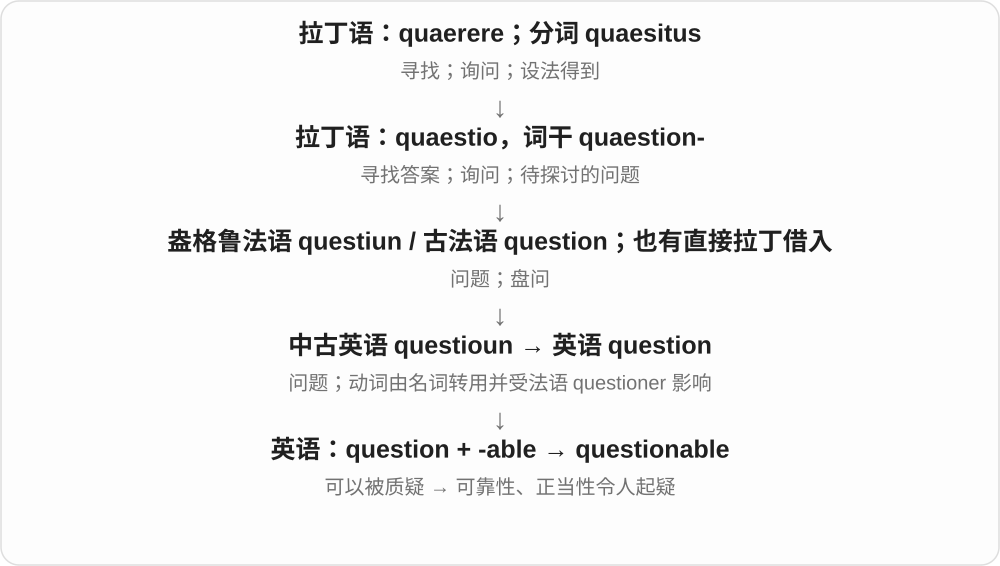

questionable evidence 可能不可靠；questionable behaviour 可能不妥当。它常比直接说 false / dishonest 更保留，但仍明显表达怀疑。

**常见搭配与例句**

questionable quality；questionable motives；a questionable decision。

> The report relies on figures of questionable accuracy.

报告所用数字的准确性令人怀疑。

> Charging visitors twice was a questionable decision.

向游客收两次费用，这个决定不太妥当。

**别混淆**

questioning 描写正在追问或怀疑的态度；questionable 描写被人怀疑的对象。

### 48. unquestionable — 毫无疑问的；无可争议的

**音标**：/ʌnˈkwestʃənəbəl/

**先抓住这个画面**

unquestionable 是证据或表现摆在那里，几乎没有给合理怀疑留下空间。

**怎么拆**

un- + questionable，把可以被质疑的性质否定。

**怎么变成今天的意思**

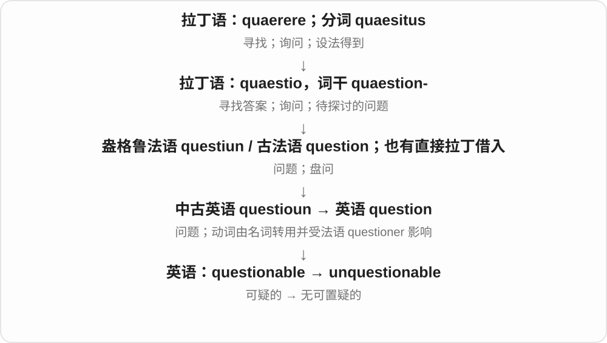

an unquestionable achievement 肯定取得了成就；unquestionable honesty 强烈肯定诚实。它表达说话者的确定判断，不是禁止别人开口提问。

**常见搭配与例句**

unquestionable talent；unquestionable importance；beyond question。

> Her contribution to the project is unquestionable.

她对这个项目的贡献毋庸置疑。

> The photograph provides unquestionable evidence that the bridge was already damaged.

这张照片确凿地证明，那座桥当时已经损坏。

**别混淆**

unquestioned 可能只是尚无人质疑；unquestionable 更强，意思是确实没有什么可争辩的。

### 49. predictable — 可预测的；不出所料的

**音标**：/prɪˈdɪktəbəl/

**先抓住这个画面**

还没往下看，你已经大概知道会发生什么。规律稳定时这是优点，故事老套时也可能是缺点。

**怎么拆**

predict + -able：能够提前预测的。

**怎么变成今天的意思**

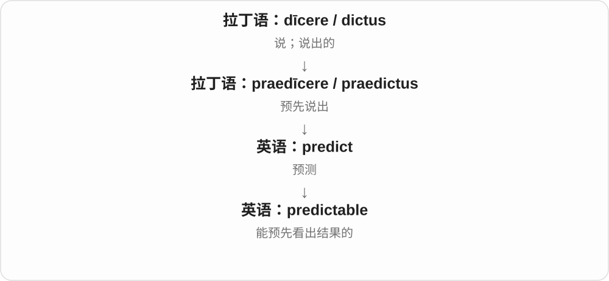

-able 把动作变成一种性质。predictable income 是比较稳定可预期的收入；a predictable ending 则可能嫌结局缺乏新意。

**常见搭配与例句**

a predictable pattern；a predictable result；highly predictable。

> The machine follows a predictable cycle.

这台机器按一个可预测的周期运行。

> The film was enjoyable, though its ending was predictable.

电影挺好看，只是结局容易猜到。

**别混淆**

predictable 不一定是 boring。稳定的设备表现很可预测，通常值得高兴；小说太可预测才可能乏味。

### 50. noticeable — 明显的；能察觉到的

**音标**：英 /ˈnəʊtɪsəbl/；美 /ˈnoʊtɪsəbl/

**先抓住这个画面**

变化大到能进入注意：不需要放大镜，也不只是理论上存在。

**怎么拆**

notice + -able；保留词尾 e，使 c 继续按 /s/ 读。

**怎么变成今天的意思**

**拉丁语：gnoscere / noscere；notus**  
开始认识、了解；已知的

↓

**拉丁语 notitia → 法语 notice → 英语 notice**  
知道、知悉 → 注意；告知的信息

↓

**英语：notice + -able → noticeable**  
能够被察觉到的

a noticeable difference 是能感觉出来的差别；它不一定特别巨大，但足够明显。

**常见搭配与例句**

a noticeable improvement；a noticeable change。

> There was a noticeable improvement in her pronunciation.

她的发音有了明显进步。

> The new windows made a noticeable difference to the noise level.

换上新窗户后，噪声水平有了能明显察觉的变化。

**别混淆**

significant 可以强调重要或统计显著；noticeable 重点是人能察觉，不能直接等同统计显著。

### 51. understandable — 能理解的；情有可原的

**音标**：英 /ˌʌndəˈstændəbəl/；美 /ˌʌndərˈstændəbəl/

**先抓住这个画面**

内容讲得能听懂，或人的反应放进处境里一看就不难理解。

**怎么拆**

understand + -able，中古英语有 understondable 等形式；able 说能够被理解，不表示已经有人表示同意。

**怎么变成今天的意思**

**古英语 understandan → 中古英语 understanden**  
已表示理解、领会；更早语义桥梁有争议

↓

**英语 understand**  
理解含义、处境；领会

↓

**understand + -able → understandable**  
能领会；处境上容易理解

understandable instructions 能看懂的说明，an understandable reaction 可以理解的反应。后者不一定在说句子语言简单。

**常见搭配与例句**

an understandable reaction；understandable concern；easily understandable。

> The instructions are clear and understandable.

说明清楚易懂。

> Her disappointment was understandable.

她失望也不难理解。

**别混淆**

understandable 事情能理解，understanding 人善解人意；an understandable teacher 可能是老师讲得能听懂，不等于体谅学生。

### 52. respectable — 体面的；值得尊重的；相当不错的

**音标**：/rɪˈspektəbəl/

**先抓住这个画面**

respectable 像达到大家认为过得去、拿得出手的标准：可以形容名声，也能形容成绩或数量。

**怎么拆**

respect + -able，表示可以受到尊重、认可的。

**怎么变成今天的意思**

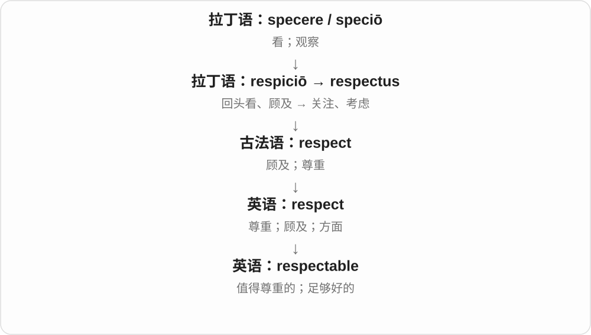

社会评价义强调体面、可信；a respectable score 则只说分数相当不错，不是在评价道德。

**常见搭配与例句**

a respectable profession；a respectable result；a respectable amount。

> She built a respectable career in engineering.

她在工程领域建立了体面的事业。

> The team achieved a respectable score.

球队取得了相当不错的分数。

**别混淆**

respectable 说别人值得尊重；respectful 说一个人表现出尊重。

### 53. fashionable — 流行的；时髦的

**音标**：/ˈfæʃənəbl̩/

**先抓住这个画面**

橱窗、街头和社交圈里都常见某种样式，人们觉得它跟得上潮流，它就是 fashionable。

**怎么拆**

fashion + -able，表示合乎当前风尚的。

**怎么变成今天的意思**

fashion 是流行样式，形容词把人、衣物或活动放进这种流行之中。也能形容时下受欢迎的观点。

**常见搭配与例句**

fashionable clothes；a fashionable neighbourhood；become fashionable。

> Wide trousers became fashionable again.

宽松长裤又流行起来了。

> It is fashionable to discuss simplicity, but harder to practise it.

谈论简单生活很流行，真正做到却更难。

**别混淆**

stylish 强调有风格、好看；fashionable 强调当下流行，两者并不总一致。

### 54. formidable — 强大得令人敬畏的；难以对付的；艰巨的

**音标**：英 /ˈfɔːmɪdəbəl/ 或 /fəˈmɪdəbəl/；美 /ˈfɔːrmɪdəbəl/

**先抓住这个画面**

对手实力强到你不敢小看，任务大到让你先吸一口气，这种带着敬畏、难度的强大就是 formidable。

**怎么拆**

经法语接拉丁 formidabilis，来自 formidare 害怕、formido 恐惧。它不是现代 form 形成 + able 可形成。

**怎么变成今天的意思**

**拉丁 formido → formidare、formidabilis**  
恐惧 → 令人畏惧的

↓

**法语 formidable → 英语 formidable**  
可怕；强大、艰巨到令人敬畏

a formidable opponent 强大的对手；a formidable task 艰巨任务；formidable expertise 深厚到令人敬畏的专业本领。

**常见搭配与例句**

a formidable challenge；a formidable reputation。

> She proved a formidable opponent in the debate.

辩论中，她证明自己是个强劲的对手。

> Restoring the building was a formidable task.

修复这座建筑是一项艰巨任务。

**别混淆**

formidable 不必等于邪恶、可憎；你尊敬的专家也可以 formidable，因为能力让人不敢小看。

### 55. adjustable — 可调节的

**音标**：英、美 /əˈdʒʌstəbəl/

**先抓住这个画面**

它留了一个旋钮、滑轨或设置，让你按需要改。

**怎么拆**

adjust + -able，表示能够被调整。

**怎么变成今天的意思**

**拉丁语：ad**  
朝向；靠近；加到

↓

**晚期拉丁语：adiuxtāre〔一种主要分析〕**  
使靠近；iuxta 是“紧挨着”

↓

**古法语 ajoster / ajuster；后来的 adjuster**  
调整；拼写又受拉丁 iustus“合适、公正”影响

↓

**中古英语 adjust 的早期形式；近代再借法语 → adjust**  
把位置、尺寸或做法调合适

↓

**英语：adjust + -able → adjustable**  
可以调节的

adjustable height 是高度可调；这个词只说明能调，不说明调节是自动进行的。

**常见搭配与例句**

adjustable straps；an adjustable chair；adjustable settings。

> The backpack has adjustable shoulder straps.

这个背包的肩带可以调节。

> We bought a desk with adjustable height.

我们买了一张高度可调的书桌。

**别混淆**

adaptive 常能根据条件自己变化；adjustable 也可能完全需要手动。

### 56. disposable — 一次性的、用后丢弃的；可供支配的

**音标**：英 /dɪˈspəʊzəbəl/；美 /dɪˈspoʊzəbəl/

**先抓住这个画面**

杯子设计成用后扔掉，是 disposable；钱可以由你支配，又有较早可供使用的分支。因此 disposable income 是可支配收入。

**怎么拆**

dispose + -able，去词尾 e。较早有可舍弃、可供使用等义，现代一次性用品义后来突出；不能拿一次性杯子的意思反套收入。

**怎么变成今天的意思**

**拉丁 dis- 分开 + pōnere 放置 → dispōnere**  
安排、分配、布置

↓

**法语 disposer → 英语 dispose**  
安排、使倾向；dispose of 处置、处理掉

↓

**名词与性质分支**  
disposal 处置、支配；disposable 可处置、一次性，另可供支配

↓

**dispose + -able → disposable**  
可处置、可供使用 → 用后丢弃的设计性质

a disposable cup 一次性杯子，disposable gloves 一次性手套，disposable income 可支配收入，可用于消费或储蓄，统计口径还涉及税费、转移等。

**常见搭配与例句**

a disposable cup；disposable gloves；disposable income。

> The picnic set contains disposable cups.

野餐套装里有一次性杯子。

> The chart compares household disposable income over several years.

图表比较家庭可支配收入几年的变化。

**别混淆**

disposable income 不等于花掉日常开支后才剩的零花钱，也不表示收入只用一次。一次性物品则看其设计用途。

### 57. knowledgeable — 知识丰富的；很懂某领域的

**音标**：英 /ˈnɒlɪdʒəbl/；美 /ˈnɑːlɪdʒəbl/

**先抓住这个画面**

脑中不只是有几条消息，而是能把一个领域说清楚。

**怎么拆**

knowledge + -able；这里后缀形成具有相关知识的形容词，不表示“可以被知识”。后缀不能只背一个机械译法。

**怎么变成今天的意思**

**英语 knowledge**  
知识、了解

↓

**knowledge + -able → knowledgeable**  
知识丰富、熟悉某领域的

a knowledgeable guide 是懂得多、讲得明白的导游。knowledgeable about music 是很懂音乐；不要求他什么领域都知道。它常是具体领域里的称赞。

**常见搭配与例句**

knowledgeable about a subject；a knowledgeable guide；knowledgeable staff。

> The guide was knowledgeable about the region’s wildlife.

导游很了解这个地区的野生动物。

> Ask Maya; she is very knowledgeable about old cameras.

问问玛雅吧，她很懂老相机。

**别混淆**

knowledgeable 强调掌握知识；intelligent 强调理解、推理等能力。聪明的人也可能对某个领域还不了解。

### 58. payable — 应付的；可支付的；付给……的

**音标**：/ˈpeɪəbəl/

**先抓住这个画面**

还没说钱已经到账，而是说明这笔钱该付、怎样付或应付给谁。

**怎么拆**

pay + -able，在支付语境中既可表示能够付，也常固定为应当付的。不能见 -able 就一律只译成有能力。

**怎么变成今天的意思**

**拉丁 pācāre → 中世纪拉丁相关用法**  
使平静、平息 → 满足、结清

↓

**古法语 paiier → 中古英语 payen → pay**  
给付、支付

↓

**pay + -able → payable**  
可付；应支付；指定收款对象

payable in advance 是应预付，payable on arrival 是到达时支付，payable to 某人常见于支票。accounts payable 是应付账款这一会计名词。

**常见搭配与例句**

payable in advance；payable on arrival；payable to；accounts payable。

> The fee is payable on arrival.

费用到达时支付。

> Make the cheque payable to the school.

请把支票收款人写为学校。

**别混淆**

paid 是已付或有偿，payable 是应付、可付；账款 payable 不等于已经 paid。

### 59. flap — 拍打、扑扇；活动片、盖片；慌乱〔尤英式〕

**音标**：/flæp/

**先抓住这个画面**

鸟翅膀一上一下拍，松布被风掀得来回动，都可说 flap。名词还能说能翻动的盖片，或一阵慌乱。

**怎么拆**

中古英语已有 flap 一类形式，动词常认为与拍打声、动作的拟声有关。身体或物体乱动的画面，又通到忙乱、惊慌用法。

**怎么变成今天的意思**

**中古英语 flap 等；动词常解释为拟声材料**  
拍打、摆动

↓

**flap 的慌乱、使慌乱用法 → unflappable**  
不易被扰乱、临事镇定的

flap one’s wings 扑扇翅膀；a pocket flap 口袋盖片；get in a flap 慌起来〔常见英式〕。

**常见搭配与例句**

flap its wings；a flap of fabric。

> The bird flapped its wings and rose into the air.

鸟扑扇翅膀，飞了起来。

> A loose flap of fabric covered the opening.

一片松动的布盖着开口。

**别混淆**

flap 说反复拍动或活动盖片；flip 常说快速翻一下，频率、动作画面不同。

### 60. flaps — 扑动、拍动〔第三人称单数〕；盖片、翼片等〔复数〕

**音标**：/flæps/

**先抓住这个画面**

鸟的翅膀一上一下拍，是 it flaps；口袋、信封上能翻开的那片盖子，则是 flaps。用可翻动、垂搭的片来理解实物义。

**怎么拆**

flap + -s，/p/ 后读 /s/；名词复数和动词三单同形。基础词大概拟声，片状物义有自己的发展，不全指鸟翅。

**怎么变成今天的意思**

**较早 flap 动词、名词可能拟声**  
扑动、拍打及一拍的声感

↓

**松松拍动 → 可翻动的片、盖片等名词义**  
现代 flaps 要分动作与实物，不把全部意义都定成同一派生顺序

↓

**flap + -s → flaps**  
它扑动；多片盖片、翼片等

flaps its wings 扑动翅膀；pocket flaps 口袋盖；wing flaps 飞机襟翼。

**常见搭配与例句**

flaps in the wind 在风里拍动；the flaps of an envelope。

> The pigeon flaps its wings before taking off.

鸽子起飞前扑动翅膀。

> The jacket has two large pocket flaps.

这件外套有两个大口袋盖。

**别混淆**

flaps 可说物体自身拍动，也可说把翅膀等拍起来；一个 -s 外形不能独自决定它是名词还是动词。

### 61. flapping — 正在扑动、拍打的；扑扑的拍动

**音标**：/ˈflæpɪŋ/

**先抓住这个画面**

帐篷有一角没绑牢，风一吹就来回拍，叫 flapping；手臂、翅膀也能这样上下拍动。

**怎么拆**

flap 双写 p 加 -ing；可作动作形式或修饰性质，不是多出一个独立词根 flapp。

**怎么变成今天的意思**

**较早 flap 动词、名词可能拟声**  
扑动、拍打及一拍的声感

↓

**松松拍动 → 可翻动的片、盖片等名词义**  
现代 flaps 要分动作与实物，不把全部意义都定成同一派生顺序

↓

**flap + -ing → flapping**  
扑动、松动部分来回拍打的过程

flapping wings 扑动的翅膀；flapping fabric 拍动的布。

**常见搭配与例句**

a flapping sound 扑扑声；flapping in the breeze。

> We woke to the sound of the tent flapping in the wind.

我们被帐篷在风中拍动的声音弄醒。

> The child ran around with arms flapping like wings.

孩子像扑翅膀一样上下拍着双臂跑来跑去。

**别混淆**

flapping wings 明确拍动翅膀，gliding 常是展开翅膀滑翔；鸟飞着不等于翅膀一直在拍。

### 62. flapped — 扑动、拍动了；松松地拍打了

**音标**：/flæpt/

**先抓住这个画面**

风吹进来，晾着的衣服来回拍；鸟张开翅膀扑几下，过去发生了就是 flapped。动作有来回拍打的节奏。

**怎么拆**

flap 双写 p 加完整 -ed，/p/ 后读 /t/；没有新增音节。

**怎么变成今天的意思**

**较早 flap 动词、名词可能拟声**  
扑动、拍打及一拍的声感

↓

**松松拍动 → 可翻动的片、盖片等名词义**  
现代 flaps 要分动作与实物，不把全部意义都定成同一派生顺序

↓

**flap + -ed → flapped**  
过去拍动、扑动，双写末尾 p

flapped in the wind 在风中拍动；flapped its wings 扑动翅膀。

**常见搭配与例句**

flapped against the window 拍打窗户；flapped open 翻动着打开。

> The sheets flapped in the strong wind.

床单在大风中来回拍动。

> The bird flapped its wings and rose from the ground.

鸟扑动翅膀，从地上飞了起来。

**别混淆**

flapped 常是松动部分反复拍，waved 范围更广，也可指人有意挥手；不要把旗子 flapped 自动理解为有人挥旗。

### 63. unflappable — 临危不乱的；遇事沉着的

**音标**：/ʌnˈflæpəbəl/

**先抓住这个画面**

周围的人急得团团转，他仍能稳稳地处理事情，这种不容易被弄慌的人叫 unflappable。

**怎么拆**

un- 不 + flap 使慌乱的材料 + -able，p 双写；不是不会扇翅膀，而是不容易被扰乱。

**怎么变成今天的意思**

**中古英语 flap 等；动词常解释为拟声材料**  
拍打、摆动

↓

**flap 的慌乱、使慌乱用法 → unflappable**  
不易被扰乱、临事镇定的

an unflappable manner 沉着的态度；remain unflappable 保持镇定。

**常见搭配与例句**

an unflappable leader；remain unflappable。

> The unflappable nurse calmly reorganized the crowded waiting room.

沉着的护士平静地重新安排拥挤的候诊室。

> He remained unflappable when the presentation equipment failed.

演示设备出故障时，他仍然镇定自若。

**别混淆**

unflappable 侧重压力中不慌，indifferent 是不关心；镇定的人可能非常在乎，只是不乱。

### 64. interchange — 互换、交流；立交枢纽、换乘处

**音标**：动词英 /ˌɪntəˈtʃeɪndʒ/、美 /ˌɪntərˈtʃeɪndʒ/；名词重音常在前

**先抓住这个画面**

两边交换想法、把两个位置互换，是动作；道路、交通线路交会、让人换到另一条线的地方，也可叫 interchange。

**怎么拆**

经法语相应形式，现代可对应 inter- 相互 + change 改换；名词、动词各有用法与重音习惯。

**怎么变成今天的意思**

**古法语 entrechange 等 → 英语 interchange**  
相互交换的材料

↓

**interchange + -able → interchangeable**  
能互换、替换使用的

an interchange of ideas 思想交流；a motorway interchange 高速公路立交枢纽；interchange parts 互换部件。

**常见搭配与例句**

an interchange of ideas；a road interchange。

> The workshop encouraged an interchange of ideas.

研讨会鼓励交流想法。

> Take the next exit after the interchange.

过了立交枢纽后，从下一个出口离开。

**别混淆**

interchange 是交换或交会处，intersection 是交叉路口等；交通中不能只凭中文都像路口就忽略道路结构。

### 65. interchangeable — 可互换的；可替换使用的

**音标**：英 /ˌɪntəˈtʃeɪndʒəbəl/；美 /ˌɪntərˈtʃeɪndʒəbəl/

**先抓住这个画面**

这个零件装在两台机器上都合适，换来换去也能用，就是 interchangeable。词语若在某些句子里能互换，也可这样说。

**怎么拆**

interchange + -able；常用拼写保留 change 的 e，帮助保留 g 的 /dʒ/ 读音。

**怎么变成今天的意思**

**古法语 entrechange 等 → 英语 interchange**  
相互交换的材料

↓

**interchange + -able → interchangeable**  
能互换、替换使用的

interchangeable parts 可互换零件；be interchangeable with 与……可互换。

**常见搭配与例句**

interchangeable with；interchangeable parts。

> The two cameras use interchangeable lenses.

这两款相机使用可互换镜头。

> These terms are not interchangeable in this context.

在这个语境里，这两个术语不能互换。

**别混淆**

interchangeable 要有具体使用条件；两词意思近似，不代表在所有句子里完全 interchangeable。

### 66. forgettable — 容易被忘的；平淡、不值得记住的

**音标**：英 /fəˈɡetəbl/；美 /fərˈɡetəbl/

**先抓住这个画面**

经历完没留下印象，通常是在说作品、表演平平，而不是说某人爱忘事。

**怎么拆**

forget + -able，双写 t，形成容易被忘的评价形容词。unforgettable 难忘已精讲，同族放一起读。

**怎么变成今天的意思**

**古英语 forgietan → 英语 forget**  
忘记；保留 forgot、forgotten 等不规则变化

↓

**forget + -able → forgettable**  
容易被忘 → 不值得记住、平庸

a forgettable film 平淡电影，a forgettable performance 不出彩表演。

**常见搭配与例句**

a forgettable film；a forgettable performance；a forgettable season。

> The film was pleasant but forgettable.

电影还算愉快，但没留下什么印象。

> The team ended a forgettable season with a draw.

球队以一场平局结束了平淡的赛季。

**别混淆**

forgettable 让别人记不住，forgetful 自己容易忘事；一个形容作品，一个常形容记性。

### 67. unforgettable — 难忘的

**音标**：英 /ˌʌnfəˈɡetəbl/；美 /ˌʌnfərˈɡetəbl/

**先抓住这个画面**

印象太深，想忘也很难。

**怎么拆**

现代可理解为 un- 不 + forget 忘记 + -able 能够……的。unforgettable 的现存早期记录还早于 forgettable 的部分词典首证，不能凭现代拆法断言历史上先有 forgettable 再加 un-。

**怎么变成今天的意思**

**英语 un-；forget；-able**  
不；忘记；能够……的

↓

**英语 unforgettable**  
难以忘记的

常用来夸一次旅行、一次表演或一个人留下深刻印象，也可以描述痛苦而难忘的经历。重点是记忆深，不自动等于快乐、美好。

**常见搭配与例句**

an unforgettable experience；an unforgettable performance；make a day unforgettable。

> The concert was an unforgettable experience.

那场音乐会是一次难忘的经历。

> The frightening sound left an unforgettable impression on her.

那个可怕的声音给她留下了难以忘却的印象。

**别混淆**

unforgettable 是给人留下很深印象；forgetful 是这个人容易忘事。两个词描述的方向正好不同。

### 68. despicable — 卑鄙的；令人鄙视的

**音标**：/dɪˈspɪkəbəl/，亦 /ˈdespɪkəbəl/

**先抓住这个画面**

despicable 常用于严重伤害别人、令人觉得卑劣的行为，评价很重。

**怎么拆**

借自晚期拉丁语 dēspicābilis，与 dēspicere“鄙视”有关；字面是值得被鄙视的。

**怎么变成今天的意思**

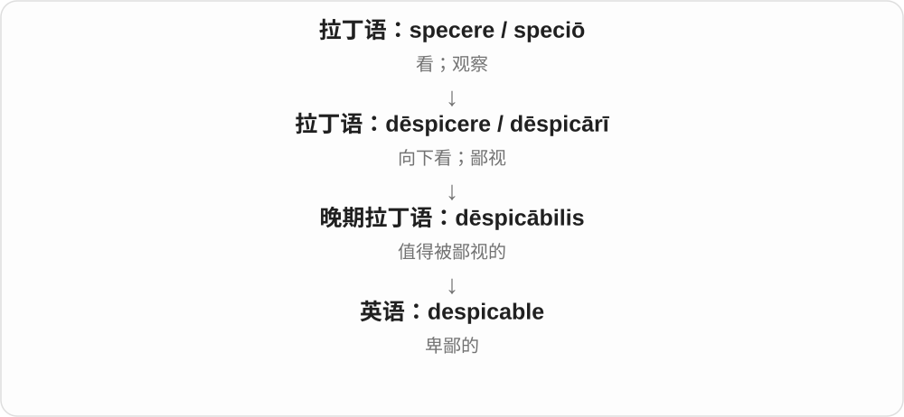

它把评价放在行为或人身上：不是说这个人很会鄙视别人，而是说他招来鄙视。

**常见搭配与例句**

a despicable act；despicable behavior；a despicable lie。

> Stealing from vulnerable people is despicable.

偷走弱势者的东西是卑鄙的。

> The character commits a despicable act of betrayal.

这个角色做出了卑鄙的背叛行为。

**别混淆**

despising 是正在鄙视；despicable 是令人鄙视。日常小失误不宜轻易用这个重词。

### 69. preferable — 更可取的；较好的

**音标**：英、美 /ˈprefrəbl/

**先抓住这个画面**

综合条件看，选它比选另一个更合适。

**怎么拆**

可按 prefer + -able 理解，早期构词可能仿法语 préférable。它表达值得优先选，不是“能够喜欢”。

**怎么变成今天的意思**

**拉丁语：ferre；第一人称 ferō**  
带、承载；承受；生出

↓

**拉丁语：prae- + ferre → praeferre**  
放到前面；优先看待

↓

**盎格鲁法语 preferer → 中古英语 preferren**  
提拔；更看重

↓

**英语：prefer**  
更喜欢；宁可选择

↓

**英语：prefer + -able〔可能仿法语 préférable〕**  
值得优先选择的

↓

**英语：preferable**  
相比之下更可取的

A is preferable to B 是常见形式。preferable 常给出实用判断，比 I prefer 更少强调个人口味。

**常见搭配与例句**

preferable to；a preferable alternative；It is preferable to…。

> A short delay is preferable to sending the wrong document.

稍微晚一点，总比发错文件好。

> For this journey, a direct train would be preferable.

这段行程选直达列车更合适。

**别混淆**

preferred 是已经更受喜欢；preferable 是被判断为更值得选择。

### 70. reputable — 声誉好的；值得信赖的

**音标**：美 /ˈrepjətəbəl/

**先抓住这个画面**

当你把这家店的名字说出来，别人通常会说“它做事靠得住”：这就是 reputable 的正面判断。

**怎么拆**

repute 名词 + -able，英语派生。早期有“可纳入考虑”的意思，后来稳定为享有好评价，不能照字面只译成“能被认为的”。

**怎么变成今天的意思**

**拉丁 putare**  
修剪、清理；计算、考虑、判断

↓

**拉丁 re- + putare → reputare**  
反复盘算、考虑、评价

↓

**古法语 reputer／直接拉丁来源 → 英语 repute**  
认为、评价；后有声望名词义

↓

**英语 repute 名词 + -able → reputable**  
后来稳定为有好名声、可信的

常修饰商家、出版机构、来源和专业人员。强调长期口碑和可信度，不等于名气最大或从不犯错。

**常见搭配与例句**

a reputable company；a reputable source；a reputable publisher。

> The article cites several reputable sources.

文章引用了几家可信的来源。

> She bought the instrument from a reputable dealer.

她从一家口碑良好的商家购买了乐器。

**别混淆**

reputed 是据说如此；reputable 是口碑好。famous 只说出名，不保证可信。

### 71. playable — 可玩的；可演奏的；可供比赛的

**音标**：/ˈpleɪəbəl/

**先抓住这个画面**

把游戏、曲子或球场拿到手，条件允许它真正进入活动。

**怎么拆**

play + -able，-able 表能够被做、适合进行。play 的不同义项分别对应游戏、乐曲、比赛条件。

**怎么变成今天的意思**

**古英语 plegian／plegan；plega**  
游戏、活动；游戏这一名词

↓

**中古英语 pleyen／pleye → 英语 play**  
玩、比赛、表演、演奏；剧作等

↓

**play + -able → playable**  
能玩、能演奏或适合比赛的

a playable demo 是可试玩演示版，a playable pitch 是能比赛的球场，playable music 可说演奏得出来。强调基本能进行，不保证质量非常好。

**常见搭配与例句**

a playable demo；a playable character；a playable pitch。

> The studio released a playable demo.

工作室发布了可试玩的演示版。

> The pitch was wet but still playable.

球场虽湿，但仍可以比赛。

**别混淆**

playable 是可进行，enjoyable 是令人享受；一个程序能玩，不表示一定好玩。

### 72. manageable — 能处理的；可以控制的；难度适中的

**音标**：/ˈmænɪdʒəbəl/

**先抓住这个画面**

manageable 像把一大堆工作分成几小块，每块都在你现在能处理的范围内。

**怎么拆**

manage + -able；保留 e，帮助维持 g 的软音。

**怎么变成今天的意思**

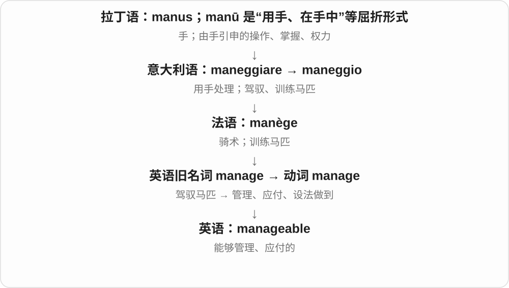

可说工作量、费用、症状或头发。manageable 不一定轻松，只是尚能处理。

**常见搭配与例句**

a manageable workload；manageable costs；manageable steps。

> Break the project into manageable tasks.

把项目拆成可以应付的小任务。

> The monthly cost is high but still manageable.

每月费用较高，但仍在可以承担的范围内。

**别混淆**

easy 是容易；manageable 是应付得了，事情仍可能需要努力。

### 73. identifiable — 可辨认的、能确认身份的

**音标**：/aɪˌdentɪˈfaɪəbəl/

**先抓住这个画面**

虽换了衣服、画面有点模糊，仍能看出是谁；也可说某个规律、特征清楚到能认出来。

**怎么拆**

identify + -able，y 在后缀前变 i，形成 identifi-able；表示能被识别，不是已经辨认完的 identified。

**怎么变成今天的意思**

**拉丁 idem 这一“相同”词族 → 法语 identité、identifier 等**  
把对象认作同一个；确定身份

↓

**法语 identifier → 英语 identify**  
认出、鉴定；认同

↓

**identify + -able → identifiable**  
能够被认出、区分

easily identifiable 容易识别，an identifiable pattern 可辨认规律，personally identifiable information 可识别个人身份的信息。

**常见搭配与例句**

easily identifiable；an identifiable pattern；an identifiable feature。

> The building is easily identifiable by its red roof.

这栋楼凭红屋顶很容易认出来。

> The study found no identifiable pattern.

研究没有发现可辨认的规律。

**别混淆**

identifiable 是能辨认，identical 是相同；两件 identical 的制服可能反而让不同人难以 identifiable，意思不互换。

### 74. sizable — 相当大的；可观的

**音标**：/ˈsaɪzəbəl/

**先抓住这个画面**

不是普通地有尺寸，而是大到值得专门提一句：可观的一笔钱、数量或差距。

**怎么拆**

size + -able，常规写 sizable，也见 sizeable。这里成词后的固定义是相当大，不能机械译成能被定尺寸。

**怎么变成今天的意思**

**古法语 assise 的缩短形式 sise、cise → 中古英语 sise**  
规定、限度；规定的量

↓

**英语 size**  
数量、规格 → 大小、尺寸；按尺寸调整

↓

**size + -able → sizable**  
具有显著大小 → 相当大的

a sizable sum 一笔可观金额，a sizable crowd 相当多的人；可修饰抽象差距、比例。

**常见搭配与例句**

a sizable sum；a sizable crowd；a sizable difference。

> They received a sizable donation.

他们收到了一笔可观的捐款。

> There is a sizable gap between the two estimates.

两项估算之间有相当大的差距。

**别混淆**

sizable 强调规模可观，sized 常需前文交代具体大小；a sizable company 与 a medium-sized company 重点不同。

### 75. palate — 腭、上腭；味觉、品味

**音标**：/ˈpælət/

**先抓住这个画面**

先是嘴巴上面的那一片；后来用嘴里的部位代指品尝能力，所以一个人会不会品酒，也可说他的 palate。

**怎么拆**

借拉丁 palatum，上腭的身体名词再引申为味觉、辨别味道的能力。更远来源未定，不必编造拉丁字母拆词。

**怎么变成今天的意思**

**拉丁 palatum → 英语 palate**  
上腭、口腔顶部

↓

**味觉引申；palatable**  
味觉、品味；吃得下、能接受的

the roof of the mouth 与身体义相关；a refined palate 讲究、敏锐的味觉；please the palate 取悦味蕾。

**常见搭配与例句**

a refined palate；suit the palate。

> The tea has a flavour that appeals to a delicate palate.

这茶的滋味合乎细腻的品味。

> The dentist examined his palate.

牙医检查了他的腭部。

**别混淆**

palate 是腭、味觉；palette 是调色板、配色；pallet 是货托。常见口音里读音接近，却不是一个词。

### 76. palatable — 可口的；尚能入口的；可以接受的

**音标**：/ˈpælətəbəl/

**先抓住这个画面**

食物吃起来还行，是 palatable；一个方案原本让人反感，修改后让人能接受，也叫 more palatable。都是能让人咽得下的画面。

**怎么拆**

palate 味觉、腭的材料 + -able，末尾 e 在常用拼写中不保留；从味觉接受扩展到心理上接受。

**怎么变成今天的意思**

**拉丁 palatum → 英语 palate**  
上腭、口腔顶部

↓

**味觉引申；palatable**  
味觉、品味；吃得下、能接受的

make something palatable 使……可口、可接受；palatable to voters 让选民能够接受的。

**常见搭配与例句**

more palatable；palatable to。

> The sauce made the vegetables more palatable.

酱汁让蔬菜更容易入口。

> They revised the proposal to make it more palatable to residents.

他们修改提案，让居民更容易接受。

**别混淆**

palatable 有时只是吃得下、能接受，未必 delicious 美味绝伦；方案 palatable 也不等于人人热烈支持。

### 77. taxable — 应纳税的；可征税的

**音标**：/ˈtæksəbəl/

**先抓住这个画面**

这部分收入、交易或财产属于计算税款的范围；具体哪些算，要按适用规则判断。

**怎么拆**

tax + -able，可被征税。形容词说明纳税属性，不表示税已经付完。

**怎么变成今天的意思**

**拉丁 taxāre → 法语 taxer、taxe → 英语 tax**  
评定、估量、征收

↓

**现代 tax**  
税；征税 → 增加负担、耗费能力

↓

**tax + -able → taxable**  
可被征税 → 应纳税的

taxable income 应纳税收入，a taxable benefit 应税福利；词义学习不等于给出某一地区的具体征税结论。

**常见搭配与例句**

taxable income；a taxable benefit；taxable earnings。

> The form asks for the amount of taxable income.

表格要求填写应纳税收入金额。

> The guide explains which benefits are taxable.

指南说明哪些福利应纳税。

**别混淆**

taxable 应纳税，taxed 已被征税；pretax 税前是计算阶段，不是免税。

### 78. foreseeable — 可预见的

**音标**：英 /fɔːˈsiːəbl/；美 /fɔːrˈsiːəbl/

**先抓住这个画面**

根据眼下的信息，大致能提前想到。

**怎么拆**

foresee + -able 能够……的；沿用 foresee 的事先看见这一比喻。

**怎么变成今天的意思**

**英语 foresee**  
预见

↓

**foresee + -able → foreseeable**  
能够预见的

a foreseeable problem 是当时有理由提前想到的问题，不是事后才说“早就该知道”。for the foreseeable future 表示在目前能预想到的一段将来，并没有规定统一的天数或年份。

**常见搭配与例句**

foreseeable risks；a foreseeable consequence；for the foreseeable future。

> Traffic delays were a foreseeable consequence of closing the bridge.

封桥造成交通延误是可以预见的后果。

> We plan to stay here for the foreseeable future.

在可预见的将来，我们打算继续住在这里。

**别混淆**

foreseeable 不等于 certain 必然发生。某风险可以预见，却仍然只有一定可能性。

### 79. undeniable — 不可否认的；明显存在的

**音标**：/ˌʌndɪˈnaɪəbəl/

**先抓住这个画面**

证据或表现就摆在那里，很难诚实地说它不存在。

**怎么拆**

un-“不” + deniable“可否认的”，后者对应 deny + -able；两个否定方向合成“不能否认”。

**怎么变成今天的意思**

**拉丁语 negare**  
否认、拒绝，说“不”

↓

**拉丁语 de- + negare → denegare**  
加强拒绝、否认

↓

**古法语 denoier → 中古英语 denyen → deny**  
否认；拒绝给予

↓

**英语 deny → deniable；un- + deniable → undeniable**  
可否认 → 不可否认

undeniable talent 是明摆着的才华；undeniable evidence 是难以否认的证据。它加强说话者的判断，不自动替代证据论证。

**常见搭配与例句**

undeniable evidence；an undeniable fact；undeniable talent。

> Her contribution to the project is undeniable.

她对项目的贡献无可否认。

> There is undeniable evidence of water damage.

水损的证据清楚得无法否认。

**别混淆**

undeniable 强调无法否认存在或真实性；inevitable 强调无法避免发生。

### 80. relatable — 令人有共鸣、容易理解的；可以联系起来、讲述的〔依语境〕

**音标**：/rɪˈleɪtəbəl/

**先抓住这个画面**

看见角色的烦恼，心想我也这样，便觉得 relatable。日常最常用的不是可以讲，而是与自己的经验接得上。

**怎么拆**

relate + -able，去末尾 e；能力义随 relate 的联系、讲述、心理共鸣各自形成，今天人物、故事的共鸣义很常见。

**怎么变成今天的意思**

**拉丁 referre 带回，其分词 relātus → 法语 relater 等**  
带回消息、报告、讲述

↓

**英语 relate 的发展**  
讲述；联系、有关联；再有心理上的理解、共鸣

↓

**relate + -able → relatable**  
可联系、可讲述；容易从自身经验理解

a relatable character 令人共鸣的角色，a relatable story 有共鸣的故事，find something relatable 觉得某事贴近自己的经历。

**常见搭配与例句**

a relatable character；a relatable story；find it relatable。

> The film’s main character is flawed but relatable.

电影主角有缺点，却让人能理解、产生共鸣。

> Her story made the abstract problem feel relatable.

她的故事让那个抽象问题变得贴近人的经验。

**别混淆**

relatable 不等于 likeable 讨喜；一个犯错的角色也可能让人觉得很真实、能理解。related 只说明已有关联，并不自动令人共鸣。

### 81. measurable — 可测量的；能看出、能量出的

**音标**：/ˈmeʒərəbəl/

**先抓住这个画面**

变化不能只凭“感觉不错”，还得有办法辨认出大小或程度。

**怎么拆**

古法语 mesurable，接拉丁 mēnsūrābilis；现代可按 measure + -able 理解。

**怎么变成今天的意思**

**拉丁 mētīrī，分词 mēnsus**  
测量、量出大小

↓

**拉丁 mēnsūrābilis → 古法语 mesurable → 英语 measurable**  
可以量度、受度量约束的 → 可测量的

measurable progress 通常强调进步有证据可查，不只是印象。它不要求所有指标都用厘米，也可以用时间、比例或事先规定的评分方法来衡量。

**常见搭配与例句**

measurable progress；measurable impact；a measurable goal。

> The new schedule produced a measurable improvement in attendance.

新安排使出勤率出现了可量出的改善。

> Set a goal with a clear, measurable outcome.

设定一个结果明确、可以衡量的目标。

**别混淆**

visible 是看得见；measurable 强调能通过某种尺度判断程度，两者并不相同。

### 82. perish — 死亡、丧生；消亡、毁灭

**音标**：/ˈperɪʃ/

**先抓住这个画面**

生命、事物没能继续存活、存在下去，是 perish。常比普通 die 更正式、带悲剧或危险场景。

**怎么拆**

经古法语 perir 及 periss- 词干形式接拉丁 perire，历史对应 per- 穿过与 ire 去的材料；已经形成消逝、死亡的整体词义，不能今天只按走过去直译。

**怎么变成今天的意思**

**拉丁 perire → 法语 perir、periss-**  
消逝、死亡、毁灭

↓

**英语 perish → perishable**  
死亡、消亡；会腐坏、不耐储存的

perish in a fire 在火灾中丧生；perish from hunger 因饥饿死亡；perish the thought 是较戏剧化的千万别这么想。

**常见搭配与例句**

perish in；perish from。

> Many plants perished in the severe frost.

许多植物在严霜中枯死了。

> The report records those who perished at sea.

报告记载了那些在海上丧生的人。

**别混淆**

perish 多为不及物，表示自身死亡、消亡；kill 是使别的生命死亡的及物动词。

### 83. perishable — 易腐坏的；不耐储存的；易腐食品〔复数〕

**音标**：英 /ˈperɪʃəbəl/；美 /ˈperɪʃəbəl/

**先抓住这个画面**

牛奶、鲜鱼放久了会坏，perishable goods 就是这类保存时间受限制、容易变质的东西。

**怎么拆**

与中古英语、法语相应形式相关，现代对应 perish + -able；从会消亡、损坏集中到商品尤其食品容易腐坏。

**怎么变成今天的意思**

**拉丁 perire → 法语 perir、periss-**  
消逝、死亡、毁灭

↓

**英语 perish → perishable**  
死亡、消亡；会腐坏、不耐储存的

perishable food 易腐食品；perishable goods 易腐货物；perishables 作复数名词说这类商品。

**常见搭配与例句**

perishable goods；perishable products。

> The shop has a separate section for perishable goods.

商店设有专门存放易腐商品的区域。

> Fresh berries are highly perishable.

鲜浆果很容易变质。

**别混淆**

perishable 说容易变质，edible 说能吃；食品可食用但易坏，两词判断的不是同一件事。

### 84. attributable — 可归因于的；可归于的

**音标**：/əˈtrɪbjʊtəbəl/

**先抓住这个画面**

某个结果可以有理由地算到某个原因头上，或者某件作品可以归到某位作者名下。

**怎么拆**

attribute + -able；这里接动词“归于”。

**怎么变成今天的意思**

**拉丁 tribuere**  
分派、给予、支付；传统词源常联系 tribus“群体、部族”

↓

**拉丁 ad- + tribuere → attribuere / attribūtus**  
分派给、归于

↓

**英语 attribute**  
动词归于；名词属性

↓

**英语 attribute + -able → attributable**  
归因、归属 → 可以归于的

常说 be attributable to。partly attributable to 表示部分归因，并非唯一原因；entirely attributable to 的断言更强。

**常见搭配与例句**

be attributable to；partly attributable to；directly attributable to。

> The delay was partly attributable to bad weather.

延误部分是由恶劣天气造成的。

> The improvement is attributable to several changes in the process.

改善可以归因于流程中的几项调整。

**别混淆**

attractive 是有吸引力，attributable 是可归于；共同的 attr- 开头不代表后面意思相同。

### 85. punishable — 可受处罚的；应受处罚的

**音标**：/ˈpʌnɪʃəbl/

**先抓住这个画面**

规则把某种行为列入“做了可能受罚”的范围；这描述规则上的后果，还没有说处罚已经发生。

**怎么拆**

英语 punish + -able，在中古英语时期已有形式；-able 在这里表示可能、应当受到某种处理。

**怎么变成今天的意思**

**古希腊 poinē → 拉丁 poena**  
赔偿、罚金、处罚；后来也指折磨、痛苦

↓

**拉丁 poenire → punire**  
使承受处罚

↓

**古法语 punir，变化词干 puniss- → 中古英语 punishen → punish**  
处罚；后来也泛指造成重创

↓

**英语 punish + -able → punishable**  
可被处罚的；按规则应受处罚的

常见 punishable by a fine，以罚款处罚；punishable offence 是可处罚的违法行为。它说明某种行为在规则中被列为应受处罚。

**常见搭配与例句**

punishable by a fine；a punishable offence；punishable under the rules。

> Under the game’s rules, that move is punishable by a loss of points.

按这个游戏的规则，那一步操作可被罚分。

> The guide explains which violations are punishable.

指南说明了哪些违规行为会受到处罚。

**别混淆**

punishable 是具有受罚可能或规定后果；punished 是已经受罚。

### 86. believable — 可信的；合情合理、令人信服的

**音标**：/bɪˈliːvəbəl/

**先抓住这个画面**

故事、解释或人物行为能接得上，让人觉得这事说得通。

**怎么拆**

believe + -able，省去 e；-able 表能够被相信。中古英语已有相应形式，不必把它理解为事实一定得到证实。

**怎么变成今天的意思**

**古英语 belīefan 等 → 中古英语 beleven / bileven**  
相信、信任；与准许、信赖旧词族相关

↓

**英语 believe**  
相信某说法；信赖某人或理念

↓

**believe + -able → believable**  
能够让人相信的

a believable explanation 是说得通的解释，a believable character 是塑造可信的人物。虚构作品也能 believable，并不代表人物真实存在。

**常见搭配与例句**

a believable story；a believable character；perfectly believable。

> Her explanation sounded believable.

她的解释听起来可信。

> The actor made the fictional character feel believable.

演员让虚构人物显得真实可信。

**别混淆**

believable 让人觉得可信，true 符合事实；谣言可能编得 believable，却仍是假的。

### 87. readable — 可读的；清楚易读的；读起来顺畅的

**音标**：/ˈriːdəbəl/

**先抓住这个画面**

不只文字还认得出，文章也可能写得让人愿意一路读下去。

**怎么拆**

read + -able，-able 表能够、适合。可从物理上看得清、技术上读得出，延伸到文风流畅好读。

**怎么变成今天的意思**

**古英语 rǣdan → 中古英语 reden**  
劝告、解释；读懂文字

↓

**英语 read**  
阅读；解读；读出信息

↓

**read + -able → readable**  
能读出；容易、值得读下去

readable handwriting 是能辨认的字迹，a highly readable book 是好读的书；machine-readable 是机器可读的常见短语拼法。不同可读性要按对象区分。

**常见搭配与例句**

a readable account；clear and readable；a highly readable book。

> Her notes were still readable despite the water damage.

笔记虽被水浸过，仍能读清。

> He wrote a lively, readable history of the town.

他写了一部生动易读的小镇历史。

**别混淆**

legible 更专注字迹能否辨认，readable 还可评价文风；看得清每个字，也可能整篇文章很难懂。

### 88. removable — 可拆卸的；可去除的

**音标**：/rɪˈmuːvəbəl/

**先抓住这个画面**

removable 像一个盖子能取下来，而不必把整个东西破坏掉。

**怎么拆**

remove + -able，表示能被移除。

**怎么变成今天的意思**

可形容零件、衬里、存储设备或痕迹。能取下不代表拆卸毫不费力。

**常见搭配与例句**

a removable cover；removable storage；a removable lining。

> The jacket has a removable lining.

这件夹克有可拆卸内衬。

> The box comes with a removable tray.

盒子配有可取出的托盘。

**别混淆**

movable 是能移动位置；removable 是能从原有组合中取下。

### 89. wearable — 可穿戴的；适合日常穿着的；穿戴设备〔名词〕

**音标**：英 /ˈweərəbl/；美 /ˈwerəbl/

**先抓住这个画面**

衣服做得再特别，能舒服、合适地穿出门才叫 wearable；科技里也指能戴在身上的设备。

**怎么拆**

wear + -able，最基本是能穿戴。技术名词 wearables 借指手表、追踪器等穿戴设备；不是所有小电子产品都自动属此类。

**怎么变成今天的意思**

**古英语 werian → 中古英语 weren → wear**  
穿、覆盖身体

↓

**穿用、使用造成损耗**  
衣物穿旧 → 磨损、使疲惫等引申

↓

**中古英语类推不规则变化**  
由旧规则过去形转向 wore、worn，受同韵动词影响

↓

**wear + -able → wearable**  
可穿戴、好穿；后作穿戴设备名词

wearable technology 穿戴技术，a wearable device 穿戴设备，a wearable design 适合实际穿着的设计。

**常见搭配与例句**

wearable technology；a wearable device；wearable designs。

> The collection combines unusual shapes with wearable designs.

这组服装把独特造型与适合实际穿着的设计结合起来。

> The company makes wearable devices for tracking activity.

公司制造用于记录活动的穿戴设备。

**别混淆**

wearable 能戴、适合穿，portable 可携带；电脑能放包里 portable，不一定设计来穿在身上 wearable。

### 90. customize — 定制；按个人需求调整

**音标**：/ˈkʌstəmaɪz/

**先抓住这个画面**

不是只能接受统一版本，而是换颜色、布局、功能，把它调成适合自己的样子，这叫 customize。

**怎么拆**

custom 的定制材料 + -ize 构成动词；这里不是把海关 customs 的 s 删掉去解释。

**怎么变成今天的意思**

**custom**  
习惯、惯例；按客户要求的定制

↓

**custom + -ize → customize → customizable**  
按需求调整、定制；可定制的

customize a dashboard 定制仪表盘；customize settings 调整设置；customize a product 定制产品。

**常见搭配与例句**

customize settings；customize the layout。

> You can customize the layout of the home screen.

你可以按自己的需要调整主屏布局。

> The workshop customizes bicycles for individual riders.

这家工坊按每位骑行者的需求定制自行车。

**别混淆**

customize 侧重按需求调整，personalize 常更突出个人特色；两者有重合，不能在所有产品里硬分两个固定功能。

### 91. customizable — 可定制的；可按需求调整的

**音标**：/ˈkʌstəmaɪzəbəl/

**先抓住这个画面**

颜色、按钮、流程能按你的需要改，就叫 customizable；不是说已经改好了，而是允许、支持你这样改。

**怎么拆**

customize 去 e 加 -able → customizable；它把定制动作改成产品、界面的可调整性质。

**怎么变成今天的意思**

**custom**  
习惯、惯例；按客户要求的定制

↓

**custom + -ize → customize → customizable**  
按需求调整、定制；可定制的

a customizable interface 可定制界面；customizable options 可调整选项。

**常见搭配与例句**

highly customizable；a customizable template。

> The app has a customizable toolbar.

这个应用有可定制的工具栏。

> They sell customizable notebooks in several sizes.

他们出售多种尺寸的可定制笔记本。

**别混淆**

customizable 是可以定制；customized 是已经定制过的。一个说能力，一个说完成后的状态。

### 92. imaginable — 想象得到的；能设想到的

**音标**：/ɪˈmædʒɪnəbl/

**先抓住这个画面**

把脑中能列出的可能性铺开：只要还能想到，就在 imaginable 的范围里。

**怎么拆**

来自古法语 imaginable 或晚期拉丁 imaginabilis；现代可理解 imagine + -able，但历史形容词已经在借入语言中存在。

**怎么变成今天的意思**

**拉丁 imago，属格 imaginis，宾格 imaginem**  
像、形象、相似的表示；imagin- 是词干

↓

**拉丁 imaginari → 晚期拉丁 imaginabilis**  
想象 → 可想象的

↓

**古法语 imaginable／直接晚期拉丁 → 中古英语 ymaginable → imaginable**  
能想象得到的

often the best/worst imaginable 把程度推到“你能想到的最好／最坏”。every imaginable colour 是“凡能想到的颜色”，是强调丰富，不需要真列完物理上所有颜色。

**常见搭配与例句**

every imaginable excuse；the worst situation imaginable；all imaginable possibilities。

> The shop sells ribbons in every imaginable colour.

这家店卖的丝带，几乎什么颜色都有。

> It was the worst timing imaginable.

这个时机糟糕得简直不能更糟了。

**别混淆**

imaginable 说能够设想；possible 说有可能成立。能想象的情景未必符合现实条件。

### 93. unimaginable — 难以想象的；超出常人经验的

**音标**：/ˌʌnɪˈmædʒɪnəbl/

**先抓住这个画面**

尺度大到脑中原有的画框装不下：可能是惊人的距离、痛苦，也可能是从前没想过的便利。

**怎么拆**

英语 un- 不 + imaginable；否定的是“想象得到”，不是说某人没有想象力。

**怎么变成今天的意思**

**拉丁 imago，属格 imaginis，宾格 imaginem**  
像、形象、相似的表示；imagin- 是词干

↓

**拉丁 imaginari → 晚期拉丁 imaginabilis**  
想象 → 可想象的

↓

**古法语 imaginable／直接晚期拉丁 → 中古英语 ymaginable → imaginable**  
能想象得到的

↓

**英语 un- + imaginable → unimaginable**  
可想象的 → 难以想象、超出经验的

常用于强调程度或变化之大。previously unimaginable 指以前未能设想，如今可能已经做到；所以 unimaginable 并不等于逻辑上永远不可能。

**常见搭配与例句**

unimaginable suffering；an unimaginable scale；previously unimaginable opportunities。

> The project gave students opportunities that had once seemed unimaginable.

这个项目给了学生一些曾经似乎遥不可想的机会。

> The storm caused destruction on an unimaginable scale.

风暴造成的破坏规模令人难以想象。

**别混淆**

unimaginative 是缺乏创意；unimaginable 是事情令人难以想象。

### 94. unthinkable — 难以想象的；不能接受的

**音标**：/ʌnˈθɪŋkəbl/

**先抓住这个画面**

不是想不到画面，就是觉得这种选择根本不能考虑。

**怎么拆**

un- 不 + think 思考 + -able 可……的；可理解为不可想象、不可考虑。

**怎么变成今天的意思**

**英语 un-；think；-able**  
不；思考；可以……的

↓

**unthinkable**  
不可想象的；不可接受的

A year ago, this seemed unthinkable 可以是当时难以想象；Abandoning them is unthinkable 则常是在表达价值判断：不能接受丢下他们。后者并非大脑真的无法想出这个动作。

**常见搭配与例句**

an unthinkable idea；an unthinkable loss；seem unthinkable。

> Working together seemed unthinkable only a year ago.

就在一年前，合作似乎还是难以想象的事。

> Leaving the injured climber behind was unthinkable.

把受伤的登山者丢下是不可接受的。

**别混淆**

unthinkable 不自动等于 impossible。事情可能发生，只是当事人不愿接受，或原先完全没想到。

### 95. advisable — 可取的；明智的；值得建议的

**音标**：/ədˈvaɪzəbəl/

**先抓住这个画面**

advisable 是你问“这样做妥不妥”时，别人会点头建议的做法。

**怎么拆**

advise + -able，字面是可以建议采用的。

**怎么变成今天的意思**

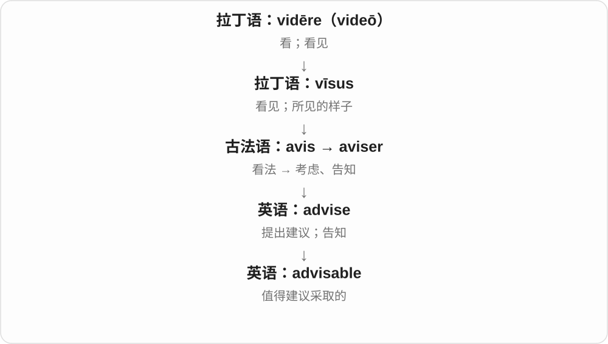

它评价行动是否稳妥，并不是说某人“很听劝”。常用 It is advisable to… 给出较正式建议。

**常见搭配与例句**

advisable to do…；highly advisable；not advisable。

> It is advisable to save your work frequently.

经常保存工作内容是明智的。

> A warm jacket is advisable for the evening walk.

晚上散步最好带件暖和的外套。

**别混淆**

advisable 描述做法；advisory 描述提供建议的角色或机构。

### 96. dependable — 可靠的；值得依赖的

**音标**：英、美 /dɪˈpendəbəl/

**先抓住这个画面**

你把事情交给它或他，通常不用担心关键时刻掉链子。

**怎么拆**

英语 depend + -able，意思是“可以依靠的”。这里 -able 表示值得或能够被依靠，不是“容易产生依赖”。

**怎么变成今天的意思**

**拉丁 pendēre；相关动词 pendere**  
悬垂；使悬挂、称量

↓

**拉丁 de- + pendere → dependere**  
从某物垂下 → 依靠、取决于

↓

**古法语 dependre／拉丁借入 → 英语 depend**  
依靠；由另一条件决定

↓

**英语 depend + -able → dependable**  
能够被信赖的

a dependable colleague 做事稳妥；a dependable car 平时运作可靠。它强调持续、稳定地履行作用，不一定表示最耀眼或性能最强。

**常见搭配与例句**

a dependable colleague；dependable transport；a dependable source；highly dependable。

> We need a dependable person to open the shop each morning.

我们需要一个可靠的人每天早上开店。

> The old car is slow but dependable.

这辆旧车跑得慢，但很可靠。

**别混淆**

dependent 是需要别人支持，dependable 是能给别人可靠支持。reliable 与 dependable 很接近。

### 97. fathom — 理解、弄明白；测水深；英寻〔长度单位〕

**音标**：/ˈfæðəm/

**先抓住这个画面**

先想像把深度探到底：fathom 原有长度、测深的联系；脑子里探不透别人为何这么做，就会说 cannot fathom。

**怎么拆**

延续古英语与双臂张开、怀抱、计量有关的材料。英寻后来定为六英尺；由测深转向理解的画面有助记忆，不需要编成每次测量都直接拿手臂量海。

**怎么变成今天的意思**

**古英语 fæþm 等**  
张开的双臂、怀抱；以臂展相关的长度计量

↓

**英语 fathom**  
英寻；测水深；引申为探明、理解

↓

**un- + fathom + -able → unfathomable**  
难以探究、理解的

cannot fathom why/how 想不明白为何、怎样；a depth of ten fathoms 十英寻深。

**常见搭配与例句**

cannot fathom why；fathom the reason。

> I cannot fathom why he refused the offer.

我想不明白他为什么拒绝那个提议。

> The chart gives the depth in fathoms.

海图用英寻标注深度。

**别混淆**

fathom 现代日常动词常见于 cannot fathom，表示很难理解；普通听懂一句话通常用 understand，不必刻意换正式词。

### 98. unfathomable — 难以理解的；深不可测的

**音标**：/ʌnˈfæðəməbəl/

**先抓住这个画面**

海太深，像探不到底；动机太奇怪，像脑子也摸不到底。unfathomable 用这份探不透的感觉说深度或理解困难。

**怎么拆**

un- 不 + fathom 测深、理解 + -able；可看作否定 fathomable 能探明、理解的。

**怎么变成今天的意思**

**古英语 fæþm 等**  
张开的双臂、怀抱；以臂展相关的长度计量

↓

**英语 fathom**  
英寻；测水深；引申为探明、理解

↓

**un- + fathom + -able → unfathomable**  
难以探究、理解的

an unfathomable mystery 难以理解的谜；for some unfathomable reason 出于某种令人费解的原因。

**常见搭配与例句**

unfathomable depths；an unfathomable reason。

> For some unfathomable reason, the file had been renamed.

不知出于什么令人费解的原因，文件被改名了。

> The ocean seemed to have unfathomable depths.

大海仿佛深不可测。

**别混淆**

unfathomable 是难探透、难理解；invisible 是看不见。一个谜写在纸上看得清楚，也可能 unfathomable。

### 99. inflatable — 可充气的；充气物品

**音标**：英、美 /ɪnˈfleɪtəbəl/

**先抓住这个画面**

平时可以收起来，灌进气体后撑出形状。

**怎么拆**

英语 inflate 去掉末尾 e，加 -able“能够被……的”；形容词再可转作名词，表示充气玩具、充气船等。

**怎么变成今天的意思**

**拉丁 flare**  
吹气、吹起

↓

**拉丁 in- + flare → inflare → inflatus**  
向里面吹气 → 吹胀；分词形式

↓

**中古英语 inflaten → inflate**  
使膨胀；后来也指抬高、夸大

↓

**英语 inflate + -able → inflatable**  
可充气的；再转指充气物品

an inflatable mattress 是充气床垫。作为名词，a giant inflatable 可以是活动现场那个巨大的充气装饰，具体是什么形状由上下文说明。

**常见搭配与例句**

an inflatable boat；an inflatable mattress；inflatable toys；a giant inflatable。

> We packed an inflatable mattress for the camping trip.

我们为露营带上了一张充气床垫。

> A giant inflatable stood outside the shop during the sale.

促销期间，商店外立着一个巨大的充气装饰。

**别混淆**

inflatable 说设计上能充气，inflated 说已经充气或被吹胀的状态。没打气的充气床垫仍然是 inflatable。

### 100. quantify — 量化；确定、表达数量

**音标**：英 /ˈkwɒntɪfaɪ/；美 /ˈkwɑːntɪfaɪ/

**先抓住这个画面**

只说“影响挺大”还很模糊；改成节省几小时、少花多少钱，就是在尝试 quantify：给影响一个数量表达。

**怎么拆**

接中世纪拉丁相应数量构词，现代可认 quant- 数量 + -ify 使成、表示成。不能以为加上数字就自动准确。

**怎么变成今天的意思**

**拉丁 quantus 等数量材料 → 中世纪拉丁 quantificare 等**  
多少；用数量来表达

↓

**英语 quantify → quantifiable**  
量化；能量化的

quantify the impact 量化影响；quantify the benefits 量化收益；hard to quantify 难以量化。

**常见搭配与例句**

quantify the cost；difficult to quantify。

> The team tried to quantify the time saved by the new tool.

团队试着量化新工具节省的时间。

> Some benefits are difficult to quantify.

有些好处很难用数字表达。

**别混淆**

quantify 是给出数量表达，qualify 常说取得资格、加以限定；一个突出多少，一个常与资格、条件有关。

### 101. quantifiable — 可量化的；可用数量表示的

**音标**：英 /ˈkwɒntɪfaɪəbəl/；美 /ˈkwɑːntɪfaɪəbəl/

**先抓住这个画面**

能给它一个数量、尺度来表达，就叫 quantifiable；例如节省的时间可计量，感受是否值得也许没那么容易量化。

**怎么拆**

quantify 的 y 改 i，加 -able → quantifiable；读音仍保留 /faɪ/，字母改写不等于把发音改成短 i。

**怎么变成今天的意思**

**拉丁 quantus 等数量材料 → 中世纪拉丁 quantificare 等**  
多少；用数量来表达

↓

**英语 quantify → quantifiable**  
量化；能量化的

quantifiable results 可量化结果；quantifiable benefits 可量化收益。

**常见搭配与例句**

a quantifiable impact；quantifiable evidence。

> The project produced quantifiable improvements in speed.

项目让速度有了可量化的提升。

> We need clear, quantifiable goals.

我们需要清楚、可以量化的目标。

**别混淆**

quantifiable 是可以量化，quantified 是已经量化；可量化的指标也可能被测错，不自动等于可靠。

### 102. refill — 再装满、补充；续杯、补充装

**音标**：动词 /ˌriːˈfɪl/；名词 /ˈriːfɪl/

**先抓住这个画面**

杯子用掉一部分再加，笔芯写完换补充芯，都是把消耗掉的内容补回来。

**怎么拆**

re- 再 + fill；可动词说再填充，也可名词说补充的量、替换装。常见名词与动词重音不同。

**怎么变成今天的意思**

**日耳曼语 full 词族 → 古英语 fyllan → fill**  
使满、装满；补足

↓

**re- + fill → refill**  
再装、补充；补充的一份或替换装

refill a bottle 再装满瓶子，a free refill 免费续杯，a pen refill 替换笔芯，refill the dispenser 给分配器补充。

**常见搭配与例句**

refill a bottle；a free refill；a pen refill；refill the dispenser。

> Could you refill my water bottle?

能帮我把水瓶再装满吗？

> The café offers one free refill.

咖啡馆提供一次免费续杯。

**别混淆**

refill 补充原来的内容，replace 更换对象；refill a bottle 通常不是换一个新瓶子。

### 103. refillable — 可再次装满、补充的

**音标**：/ˌriːˈfɪləbəl/

**先抓住这个画面**

墨水用完还能加，瓶子空了还能补装内容物，这类设计就叫 refillable。它强调可以补充，不是只能用掉就扔。

**怎么拆**

refill 再装满 + -able；refill 对应 re- 再次 + fill 装满。

**怎么变成今天的意思**

**re- + fill → refill**  
再次装满、补充

↓

**refill + -able → refillable**  
可补充使用的

a refillable pen 可加墨的笔；a refillable bottle 可补装的瓶子；a refillable cartridge 可补充的墨盒等。

**常见搭配与例句**

a refillable container；a refillable pen。

> She uses a refillable fountain pen.

她用一支可以加墨的钢笔。

> The shop sells shampoo in refillable bottles.

这家店用可补装的瓶子出售洗发水。

**别混淆**

refillable 是能补充，reusable 是能再用；可重复使用的物品不一定需要往里补充内容物。

### 104. lovable — 惹人喜爱的；可爱的

**音标**：/ˈlʌvəbəl/

**先抓住这个画面**

也许有点笨拙或淘气，却让人忍不住喜欢、愿意包容。

**怎么拆**

love + -able；-able 表可被、值得，词末 e 常在此拼写中省去。也见 loveable，不能以为这两种拼写指不同性格。

**怎么变成今天的意思**

**古英语 lufu；lufian**  
爱；爱、喜爱这一动作

↓

**中古英语 love → 英语 love**  
爱；喜爱；亲爱之情

↓

**love + -able → lovable**  
值得爱、容易让人喜爱的

常用于人、动物或角色：a lovable character 不一定完美，可能缺点恰好增加亲切感。比 lovely 更突出对象让人产生喜爱之情。

**常见搭配与例句**

a lovable child；a lovable character；a lovable rogue。

> The dog is noisy but very lovable.

这只狗虽然吵，却非常讨人喜欢。

> The actor turned a minor role into a lovable character.

这位演员把一个小角色演得很惹人喜爱。

**别混淆**

lovable 是容易让人爱，loving 是主动给予爱。a loving parent 是充满关爱的家长，不只说他可爱。

### 105. negotiable — 可商量的；可转让的；可通过的

**音标**：英 /nɪˈɡəʊʃəbəl/；美 /nɪˈɡoʊʃəbəl/

**先抓住这个画面**

标出的价格还留有余地，是 negotiable；道路能设法通过，或票据可转让，也沿 negotiate 的不同用法各自形成意义。

**怎么拆**

与 negotiate 的词族相连，现代把 -ate 动词形式换成 -able 得到 negotiable；历史也联系法语 négociable。

**怎么变成今天的意思**

**拉丁 neg- 不 + otium 闲暇 → negotium**  
没有闲暇 → 工作、事务、生意

↓

**negotiari、negotiatio 等**  
做生意、商谈及其过程

↓

**英语 negotiation、negotiate**  
协商达成条件；negotiate 也可说设法通过障碍

↓

**negotiable 的 -able 形式**  
可协商、转让或通过

The price is negotiable. 价格可以商量；negotiable terms 可商谈条件。票据里的 negotiable 是专门转让术语，需看文书背景。

**常见搭配与例句**

a negotiable price；negotiable terms。

> The price is negotiable if you buy the whole set.

如果买整套，价格可以商量。

> The exact starting date is negotiable.

具体开始日期可以协商。

**别混淆**

negotiable 不表示一定会降价，只说明有商谈余地；专门票据义不等于日常讨价还价。

### 106. achievable — 能够实现的

**音标**：/əˈtʃiːvəbəl/

**先抓住这个画面**

目标像一个够得着的台阶：需要努力，但确实可以走上去。

**怎么拆**

achieve + -able，去词尾 e；表示目标可以达到。

**怎么变成今天的意思**

**拉丁语：caput；属格 capitis**  
头；首领；顶端、主要部分

↓

**古法语：a- + chief → achever / achiever**  
到达头端、终点 → 完成；更早形成另有分析

↓

**中古英语 acheven / achieven → 英语 achieve**  
完成；达到目标

↓

**英语：achieve + -able → achievable**  
实现 → 可以实现的

常与 goal、target 搭配。achievable 不等于轻松，只表示具备实现的可能。

**常见搭配与例句**

an achievable goal；realistic and achievable；make something achievable。

> Set an achievable goal for your first month.

给第一个月定一个能实现的目标。

> With enough practice, this standard is achievable.

经过充分练习，这个标准是能达到的。

**别混淆**

possible 是一般可能；achievable 更常用于人要争取的结果。

### 107. compost — 堆肥；把有机物作堆肥处理

**音标**：英 /ˈkɒmpɒst/；美 /ˈkɑːmpoʊst/

**先抓住这个画面**

落叶、厨余等有机物经过分解形成可改善土壤的材料，叫 compost；把材料这样处理，也可用作动词。

**怎么拆**

经古北法语接拉丁 compositus，与 componere 放到一起相联。原先混合的材料，在英语中固定到堆肥等用法；不是所有混合物都叫 compost。

**怎么变成今天的意思**

**拉丁 componere → compositus → 法语 compost**  
放到一起、混合的材料

↓

**英语 compost → compostable**  
堆肥；可以堆肥处理的

a compost heap 堆肥堆；add compost to soil 给土壤加入堆肥；compost food scraps 将厨余作堆肥处理。

**常见搭配与例句**

a compost heap；compost leaves。

> They added compost to the vegetable beds.

他们给菜畦加入了堆肥。

> The school composts leaves from the playground.

学校把操场上的落叶作堆肥处理。

**别混淆**

compost 是处理形成的堆肥、相应过程；普通 soil 土壤并不等同于 compost。

### 108. compostable — 可堆肥处理的

**音标**：英 /ˈkɒmpɒstəbəl/；美 /ˈkɑːmpoʊstəbəl/

**先抓住这个画面**

不是只说最终会变碎，而是材料能在相应堆肥条件下分解、进入堆肥过程。产品写 compostable，还要看是哪种处理条件。

**怎么拆**

compost + -able；由处理动作形成可接受这种处理的性质。这个词尾本身不说明家庭、工业条件或需要多长时间。

**怎么变成今天的意思**

**拉丁 componere → compositus → 法语 compost**  
放到一起、混合的材料

↓

**英语 compost → compostable**  
堆肥；可以堆肥处理的

compostable packaging 可堆肥包装；industrially compostable 适于工业堆肥条件。标为 compostable 的塑料未必能在家用堆肥箱中处理。

**常见搭配与例句**

compostable packaging；compostable materials。

> The label says the packaging is compostable under industrial conditions.

标签说明这种包装可在工业堆肥条件下处理。

> The café asked its supplier about compostable cups.

咖啡馆向供应商了解可堆肥杯子的情况。

**别混淆**

compostable 与 biodegradable 可生物降解相关但不完全相同；可堆肥也不自动等于可投进普通塑料回收。读具体标识与处理条件。

### 109. reusable — 可重复使用的；可复用的

**音标**：/ˌriːˈjuːzəbəl/

**先抓住这个画面**

用过一次还有下一次，不必完成这次任务就丢掉或重新制作。

**怎么拆**

reuse 再使用 + -able 能够；去末尾 e 再接后缀。reuse 本身是 re- + use，不要求物品回到完全未使用的状态。

**怎么变成今天的意思**

**re- 再次；英语 use 使用**  
形成 reuse 再利用的动词

↓

**reuse + -able → reusable**  
能够再用，也用于代码或内容的复用

a reusable bottle 是可反复使用的瓶子；reusable code 是其他地方还能调用的代码。还可以说 make something reusable，让某个成品便于再次使用。

**常见搭配与例句**

a reusable container；reusable packaging；reusable code。

> She carries a reusable bottle to work.

她上班随身带一个可重复使用的水瓶。

> We put the common logic into a reusable function.

我们把通用逻辑放进一个可复用的函数。

**别混淆**

recyclable 是可回收处理成材料，reusable 是可再次使用；同一物品可能两者都符合，也可能只符合其中之一。

### 110. agreeable — 令人愉快的；随和的；愿意接受的

**音标**：/əˈɡriːəbəl/

**先抓住这个画面**

让人相处舒服、体验舒服，或者让人愿意点头说“这样可以”。

**怎么拆**

中古英语借古法语 agreable，接 agreer。现代可看 agree + -able，但不是只有“能够同意”这一义。

**怎么变成今天的意思**

**拉丁 gratus**  
令人喜欢、受欢迎；也指心怀感谢

↓

**古法语 gré → agreer → agreable**  
合意 → 使人愉快、可接受的

↓

**中古英语 agreable → agreeable**  
令人愉快的；愿意接受的

an agreeable afternoon 是愉快的下午。be agreeable to a proposal 可说愿意接受提议；若主语是安排，则 agreeable to everyone 是人人觉得可接受。

**常见搭配与例句**

agreeable company；agreeable to a suggestion；an agreeable climate。

> We spent an agreeable afternoon by the river.

我们在河边度过了一个愉快的下午。

> She was agreeable to a later starting time.

她愿意接受晚一点开始。

**别混淆**

agreeing 是正在赞同；agreeable 描述性质或接受意愿。

### 111. laughable — 可笑、荒唐得让人发笑的

**音标**：英 /ˈlɑːfəbl/；美 /ˈlæfəbl/

**先抓住这个画面**

往往不是夸幽默，而是说借口、建议糟得没法认真当真。

**怎么拆**

laugh + -able，可引人发笑；现代常带荒唐、滑稽、不值认真对待的批评语气。

**怎么变成今天的意思**

**古英语 hliehhan、hlæhhan 等 → 中古英语 laughen → laugh**  
笑

↓

**古英语 hleahtor → 中古英语 laughter → laughter**  
笑、笑声的旧名词；不由现代 laugh + -er 人物后缀造出

↓

**laugh + -able → laughable**  
可引人发笑；常转为荒唐可笑的评价

a laughable excuse 可笑借口，a laughable suggestion 荒唐建议。

**常见搭配与例句**

a laughable excuse；a laughable suggestion；seem laughable。

> The excuse was so weak that it was laughable.

借口太站不住脚，简直可笑。

> What once seemed laughable later became possible.

曾经看似荒唐的事情，后来成为了可能。

**别混淆**

funny 可以夸好笑，laughable 更常贬荒唐；称人的主张 laughable 比单说 I disagree 强得多。

### 112. unbeatable — 无法击败的；无可比拟的

**音标**：/ʌnˈbiːtəbəl/

**先抓住这个画面**

对手赢不了它；广告里也常夸价格、服务好到难以超过。

**怎么拆**

un- 不 + beatable 可被击败的，后者 beat + -able。否定整个可被击败的性质，不是停止打人。

**怎么变成今天的意思**

**古英语 bēatan → 中古英语 beten → beat**  
敲、打、击

↓

**现代 beat**  
连续敲击 → 节拍；击败、疲惫与特定巡行范围等

↓

**beat + -able → beatable；un- → unbeatable**  
可被战胜 → 无法战胜

an unbeatable team 无敌队伍，an unbeatable price 极具竞争力的价格；商业夸赞未必是严格验证的世界纪录。

**常见搭配与例句**

an unbeatable team；an unbeatable price；an unbeatable offer。

> At their best, the team seemed unbeatable.

球队状态最佳时，似乎无人能敌。

> The café offers breakfast at an unbeatable price.

咖啡馆以极有竞争力的价格供应早餐。

**别混淆**

unbeatable 宣称难以超过，unbeaten 尚未被击败；尚未输不等于逻辑上永远输不了。

### 113. conceivable — 想象得到的；可能的

**音标**：/kənˈsiːvəbəl/

**先抓住这个画面**

一件事虽然没发生，但脑中还能画出它怎么发生，就 conceivable。它表示想得到这种可能，不保证它会发生。

**怎么拆**

conceive + -able；去掉不发音的 e，再加 -able，表示可以被设想。

**怎么变成今天的意思**

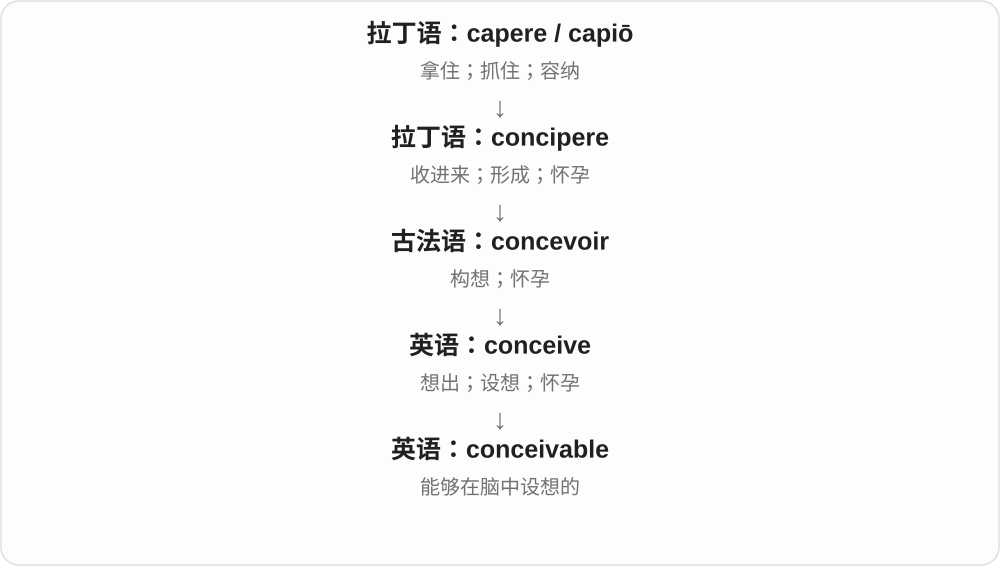

从“构想”变成“可被构想”，进而说某种情况并非不可能。every conceivable way 就是所有想得到的办法。

**常见搭配与例句**

every conceivable…；It is conceivable that…；a conceivable explanation。

> We tried every conceivable way to contact him.

我们尝试了所有想得到的办法联系他。

> It is conceivable that the meeting will be postponed.

会议有可能推迟。

**别混淆**

conceivable 的门槛较低：能设想即可。probable 则说发生的可能性较大。

### 114. downloadable — 可下载的、供下载的

**音标**：英 /ˌdaʊnˈləʊdəbl/；美 /ˌdaʊnˈloʊdəbl/

**先抓住这个画面**

网页上能拿到本地保存、安装的文件，就可说 downloadable；它说提供方式，不自动说免费。

**怎么拆**

download + -able 可……，组成可下载的形容词；-able 是能力、可能性，不是 table 桌子的一段。

**怎么变成今天的意思**

**down + load → download**  
从远端把数据载到本地；down 是传输关系的传统方向说法

↓

**download + -able/-er**  
可下载；执行下载的人或工具

a downloadable file 可下载文件，downloadable content 可下载内容，a downloadable guide 可下载指南。

**常见搭配与例句**

a downloadable file；downloadable content；a downloadable guide。

> The museum provides a downloadable map.

博物馆提供可下载地图。

> Some downloadable content requires a separate purchase.

有些可下载内容需要另行购买。

**别混淆**

downloadable 可下载不等于 free 免费，也不等于已经 downloaded 下载好了；一个说可能，一个说结果。

### 115. preventable — 可以预防的；本可避免的

**音标**：/prɪˈventəbəl/

**先抓住这个画面**

如果提前采取合适行动，这件坏事原本不必发生，它就可以说是 preventable。

**怎么拆**

prevent + -able，表示能够被防止的。

**怎么变成今天的意思**

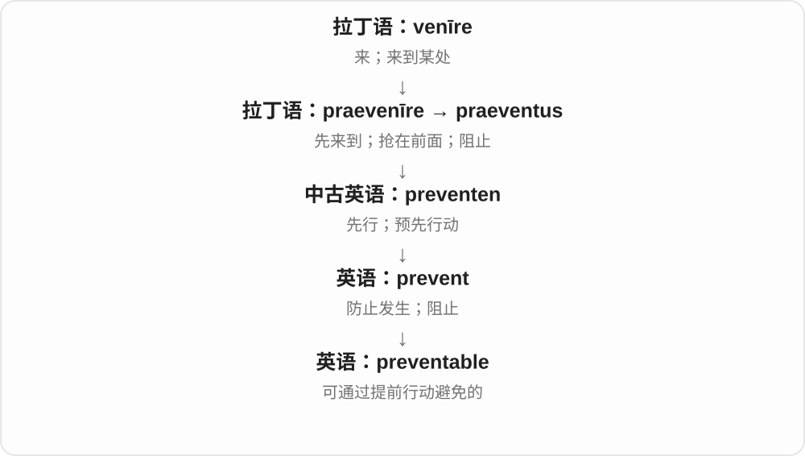

它讨论可避免性；不能仅凭词义就认定某个人必然有过错。a preventable error 强调有办法减少或避免错误。

**常见搭配与例句**

a preventable accident；preventable damage；largely preventable。

> The review found that several errors were preventable.

复盘发现，几个错误本来可以避免。

> The guide explains how to reduce preventable damage during transport.

指南介绍如何减少运输中本可避免的损坏。

**别混淆**

preventable 是能防止；preventive 是用来防止的。事故可以 preventable，措施则是 preventive。

### 116. debatable — 有争议的、尚可商榷的；可讨论的

**音标**：/dɪˈbeɪtəbl/

**先抓住这个画面**

结论还不能当作板上钉钉，拿出来还会有人提出不同理由；that is debatable 常委婉说“这可不一定”。

**怎么拆**

借法语 debatable 等相应形式，现代对应 debate 去 e + -able。能辩论与仍有争议在常用语境相连，不是证明它已经错了。

**怎么变成今天的意思**

**拉丁 battuere → 法语 batre、debatre → debate**  
击打、争斗 → 争论、讨论

↓

**法语 debatable → debatable；对应 debate + -able**  
可争论、尚无定论

a debatable point 可商榷之处，highly debatable 很有争议，it is debatable whether 是否……仍有争议。

**常见搭配与例句**

a debatable point；highly debatable；it is debatable whether。

> Whether the plan will save money is debatable.

方案能否省钱还有争议。

> That is a debatable point, so let us examine the evidence.

那点可以商榷，我们来看看证据。

**别混淆**

debatable 有讨论余地，不等于 definitely false 确定错误；undebatable 则通常无可争议，但是否真的如此仍看具体论证。

### 117. breakable — 易碎的；可被打破的

**音标**：/ˈbreɪkəbəl/

**先抓住这个画面**

碰一下、摔一下可能会坏，或者某种记录、约束并非永远不能打破。

**怎么拆**

break + -able 可……的；-able 表可能性、可承受动作，不说明一定已经破了。

**怎么变成今天的意思**

**古英语 brecan → 中古英语 breken**  
打破、折断

↓

**英语 break**  
破坏完整或连续状态；中断、休息、突破等引申

↓

**break + -able → breakable**  
能被打破 → 易碎或可打破的

breakable glassware 易碎玻璃器皿，breakable items 易碎物品；breakables 作复数名词可指这些易碎品。

**常见搭配与例句**

breakable items；breakable glass；pack breakables carefully。

> Wrap the breakable items in soft cloth.

用软布包好易碎物品。

> These cups are breakable, so please handle them carefully.

这些杯子易碎，请小心拿放。

**别混淆**

breakable 可能破，broken 已经破；fragile 易碎、脆弱与前者有交叠，但语境和搭配不全相同。

### 118. unbreakable — 不易打破的；坚不可摧的；坚定的

**音标**：/ʌnˈbreɪkəbəl/

**先抓住这个画面**

经得住冲击、压力或考验，难被破坏；讲友情、意志时常带夸张和赞美。

**怎么拆**

un- 不 + breakable 可打破的，否定整个形容词，不是 unbreak + -able 这一普通现代动词派生。

**怎么变成今天的意思**

**古英语 brecan → 中古英语 breken**  
打破、折断

↓

**英语 break**  
破坏完整或连续状态；中断、休息、突破等引申

↓

**breakable → unbreakable**  
可打破 → 难以或不能打破

an unbreakable bond 牢固的关系，an unbreakable rule 不可破的规矩；产品宣传说 unbreakable 不等于任何条件下都绝对不会损坏。

**常见搭配与例句**

an unbreakable bond；unbreakable glass；unbreakable resolve。

> They formed an unbreakable bond during the expedition.

他们在探险中结下了牢固的情谊。

> Her unbreakable resolve impressed the team.

她坚定不移的决心给团队留下了深刻印象。

**别混淆**

unbreakable 强调难破或不可破，unbroken 强调目前没有断、未被打破；an unbroken record 不说明未来也破不了。

### 119. adaptable — 适应力强的；可改作他用的

**音标**：英、美 /əˈdæptəbəl/

**先抓住这个画面**

换了环境也能找到活法，换了用途也能改得过来。

**怎么拆**

adapt + -able，表示有适应或被改用的可能。

**怎么变成今天的意思**

**拉丁语：ad**  
朝向；靠近；加到

↓

**拉丁语：aptāre → adaptāre**  
使合适 → 调整到合适

↓

**中古英语 adapten → 英语 adapt**  
适应；改编

↓

**英语：adapt + -able → adaptable**  
能适应的；可改装的

人 adaptable 是不容易被变化难住；设备 adaptable to 是能被改成适合某种需要。

**常见搭配与例句**

highly adaptable；adaptable to；an adaptable design。

> Children can be remarkably adaptable in a new school.

孩子在新学校里有时会表现出很强的适应力。

> The shelving is adaptable to rooms of different sizes.

这种搁架可以调整来适应不同大小的房间。

**别混淆**

flexible 强调有弹性、能变通；adaptable 更突出变过之后能适合新条件。

### 120. workable — 可行的；可加工的

**音标**：英 /ˈwɜːkəbəl/；美 /ˈwɜːrkəbəl/

**先抓住这个画面**

方案放到真实条件里，确实能推着走，不只是纸上好看。

**怎么拆**

work + -able，-able 表能够被或可以。work 有运作、奏效和加工等义，因此可行与可加工两义各有对象。

**怎么变成今天的意思**

**古英语 weorc；wyrcan → 中古英语 work／werken**  
工作、做出的事物；做、制作

↓

**英语 work**  
工作；运作；做出的成果

↓

**work + -able → workable**  
可以奏效、实施或加工的

a workable solution 是能执行的解决方案，未必最完美。workable clay 则说黏土适合加工，不是在给它评价工作效率。

**常见搭配与例句**

a workable plan；a workable compromise；workable material。

> We finally found a workable compromise.

我们终于找到了一个可行的折中办法。

> Add a little water to make the clay more workable.

加一点水，让黏土更容易加工。

**别混淆**

workable 关注实际可操作，working 可指正在运作或暂用。a working draft 是供修改的草稿，a workable draft 强调方案能行得通。

### 121. observable — 可观察到的；可检测的

**音标**：英 /əbˈzɜːvəbəl/；美 /əbˈzɜːrvəbəl/

**先抓住这个画面**

变化已经不是凭空猜想，而是能通过眼睛、仪器或系统记录看出来。

**怎么拆**

observe + -able，能被观察到的。

**怎么变成今天的意思**

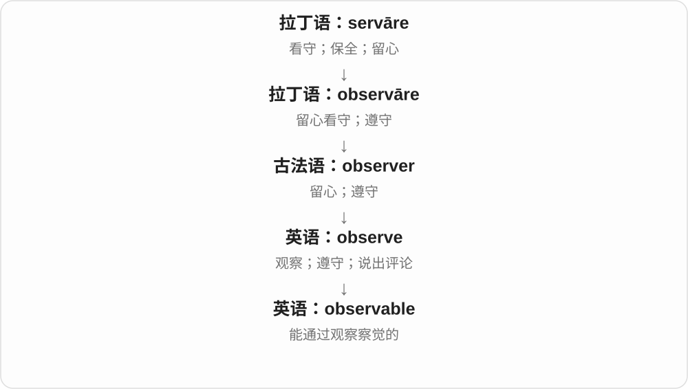

不一定肉眼可见；仪器检测到的变化也可以 observable。它说能否观察，不自动说明原因已经查清。

**常见搭配与例句**

an observable change；observable effects；directly observable。

> There was no observable change in the sample.

样本没有出现可观察到的变化。

> The effect is observable only with special equipment.

这种效应只能借助专门设备观察到。

**别混淆**

obvious 是显而易见；observable 只是可观察到，仍可能需要精密设备。

### 122. attainable — 可以达到、取得的

**音标**：/əˈteɪnəbəl/

**先抓住这个画面**

目标虽还没到手，但按条件与努力范围是够得着的。

**怎么拆**

attain + -able“能够……的”，说明目标或结果具有达到的可能。

**怎么变成今天的意思**

**拉丁 tangere；完成分词 tactus**  
碰、触及、达到

↓

**拉丁 ad- + tangere → attingere；俗拉丁 \*attangere**  
触到、达到

↓

**古法语 ataindre／ataign- → 中古英语 atteinen → attain**  
够到 → 达到目标、水平

↓

**英语 attain + -able → attainable**  
能够达到的

set attainable goals 是设定够得着的目标。attainable 不表示轻松、不用努力，只表示并非超出实际可能。

**常见搭配与例句**

an attainable goal；an attainable standard；readily attainable。

> The coach helped her set challenging but attainable goals.

教练帮助她设定有挑战但能够达到的目标。

> The required accuracy is attainable with the existing equipment.

用现有设备能够达到所要求的精度。

**别混淆**

easy 说容易；attainable 说做得到。艰难却可以完成的目标仍是 attainable。

### 123. unattainable — 无法达到、无法获得的

**音标**：/ˌʌnəˈteɪnəbəl/

**先抓住这个画面**

目标摆在那里，却超出了当前条件下能够触及的范围。

**怎么拆**

un-“不” + attainable；否定的是实现、取得的可能性。

**怎么变成今天的意思**

**拉丁 tangere；完成分词 tactus**  
碰、触及、达到

↓

**拉丁 ad- + tangere → attingere；俗拉丁 \*attangere**  
触到、达到

↓

**古法语 ataindre／ataign- → 中古英语 atteinen → attain**  
够到 → 达到目标、水平

↓

**英语 attainable → un- + attainable → unattainable**  
够得着的 → 无法达到的

an unattainable ideal 是难以成为现实的理想；unattainable at present 强调目前条件下做不到。词本身不规定这种限制永远不能改变。

**常见搭配与例句**

an unattainable ideal；an unattainable goal；financially unattainable。

> Perfect accuracy is unattainable in this measurement.

这项测量无法做到绝对准确。

> The target seemed unattainable until the team changed its method.

团队改变方法之前，这个目标看起来无法实现。

**别混淆**

unattained 只说尚未达到；unattainable 进一步说达不到。没实现不一定代表不可能实现。

### 124. pleasurable — 令人享受的；带来乐趣的

**音标**：英 /ˈpleʒərəbəl/；美 /ˈpleʒərəbəl/

**先抓住这个画面**

做这件事的过程本身有滋味，你愿意继续体会。

**怎么拆**

pleasure + -able，表示能够带来 pleasure。

**怎么变成今天的意思**

常形容 experience、activity、sensation。比 pleasant 更容易突出享受的感受，而不仅是没有不舒服。

**常见搭配与例句**

a pleasurable experience；a pleasurable activity。

> Cooking became a pleasurable part of her evening routine.

做饭成了她晚间日常里一件享受的事。

> The warm bath was especially pleasurable after the long walk.

长途步行之后，泡个温水澡格外舒服。

**别混淆**

pleasant 可以是温和舒服；pleasurable 更直接强调乐趣与享受，实际语境有重叠。

### 125. unmistakable — 不会认错的；明显无疑的

**音标**：/ˌʌnmɪˈsteɪkəbl/

**先抓住这个画面**

特征太清楚，很难把它当成别的东西。

**怎么拆**

un- 不 + mistake 认错 + -able 可以……的；现代可理解为不能弄错。也有 unmistakeable 拼写。

**怎么变成今天的意思**

**英语 un-；mistake；-able**  
不；认错；可以……的

↓

**unmistakable**  
不会认错的、明显的

an unmistakable voice 是一听就认得出的声音；unmistakable signs 是非常明显的迹象。它强调辨认或理解上几乎没有混淆余地，不等于这个东西从来不会出错。

**常见搭配与例句**

an unmistakable voice；unmistakable signs；unmistakable excitement。

> I heard the unmistakable sound of her laugh in the next room.

我听见隔壁传来她那一听就认得出的笑声。

> There were unmistakable signs of excitement in the crowd.

人群中有非常明显的兴奋迹象。

**别混淆**

unmistakable 是不会被认错；infallible 是不会犯错。一个人的声音很独特，并不说明他的判断永远正确。

### 126. objectionable — 令人反感的；不可接受的

**音标**：英、美 /əbˈdʒekʃənəbl/

**先抓住这个画面**

不是单纯“我不喜欢”，而是觉得某种内容或行为有理由反对。

**怎么拆**

objection + -able，表示会引起异议、反感的。

**怎么变成今天的意思**

**拉丁语：iacere；分词 iactus**  
投掷、抛出

↓

**拉丁语：ob- + iacere → obicere / obiect-**  
放在面前；提出反对

↓

**拉丁语及法语 → 英语 objection**  
反对、异议

↓

**英语：objection + -able → objectionable**  
会引起反对、令人反感的

常描述言论、行为或规定；评价标准受语境影响。

**常见搭配与例句**

objectionable behaviour；find something objectionable。

> Several viewers found the joke objectionable.

几位观众认为这个笑话令人反感。

> The agreement contained a clause she considered objectionable.

协议中有一项条款，她认为不可接受。

**别混淆**

unpleasant 可以只是让人不舒服；objectionable 更容易包含不应该、不可接受的判断。

### 127. obtainable — 可以获得的；拿得到的

**音标**：/əbˈteɪnəbəl/

**先抓住这个画面**

obtainable 像你确实有路可以找到或拿到某样东西，不是只能想想。

**怎么拆**

obtain + -able。

**怎么变成今天的意思**

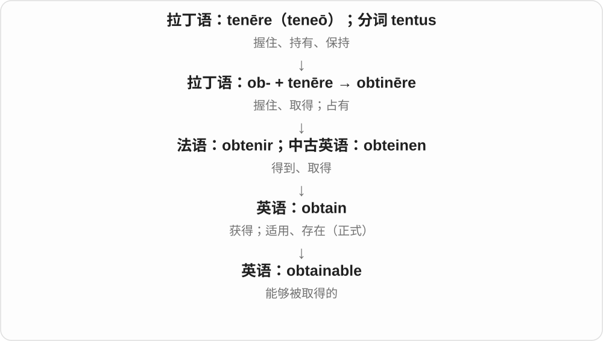

强调可取得性，不必表示免费、便宜或随处都有。

**常见搭配与例句**

readily obtainable；obtainable from…；easily obtainable information。

> Copies are obtainable from the university archive.

可以从大学档案馆获取副本。

> The materials are inexpensive and readily obtainable.

这些材料不贵，而且容易买到。

**别混淆**

available 常说可用、可供应；obtainable 更强调通过某种方式能成功取得。

### 128. marketable — 适销的；有销路的；具备市场吸引力的

**音标**：英 /ˈmɑːkɪtəbl/；美 /ˈmɑːrkɪtəbl/

**先抓住这个画面**

拿到市场上，会有人愿意考虑买；说技能时，就是有人愿意为你的能力付钱。

**怎么拆**

market + -able，英语构词，表示能够销售或具有市场需求。

**怎么变成今天的意思**

**拉丁语 merx，属格 mercis**  
货物、商品

↓

**拉丁语 mercari**  
做买卖、交易

↓

**拉丁语 mercatus → 北部古法语 market / 古法语 marchiet**  
交易；市场

↓

**中古英语 market〔也承接晚期古英语形式〕**  
集市；买卖的范围

↓

**英语 market + -able → marketable**  
适合出售；具有市场吸引力

marketable skills 是找工作时有需求的技能。用于货物时，也可能强调品相或条件已经适合出售。

**常见搭配与例句**

marketable skills；a marketable product。

> The course helped her develop marketable skills.

这门课帮助她掌握了有就业市场需求的技能。

> Only the undamaged fruit was considered marketable.

只有没有损坏的水果被认为适合出售。

**别混淆**

available 是可以取得；marketable 强调具备销售条件或吸引买家的能力。

### 129. transferable — 可转让的；可迁移应用的

**音标**：英 /trænsˈfɜːrəbl/；美 /trænsˈfɜːrəbl/

**先抓住这个画面**

换了主人或使用场景，它仍能被接过去继续用。

**怎么拆**

transfer + -able。也有 transferrable 拼法；本页用常见 transferable。

**怎么变成今天的意思**

**拉丁语：ferre；第一人称 ferō**  
带、承载；承受；生出

↓

**拉丁语：trans- + ferre → transferre**  
带到另一边；转移

↓

**英语：transfer**  
转移、转让；调动、换乘

↓

**英语：transfer + -able → transferable**  
能够转移或转用的

transferable ticket 可以交给别人使用；transferable skills 是换职业也派得上用场的能力，如组织、沟通。词义不只限于实物。

**常见搭配与例句**

transferable skills；a transferable ticket；readily transferable。

> The ticket is transferable to another person.

这张票可以转给别人使用。

> Teaching gave her many transferable skills.

教学工作让她积累了许多换岗位也能使用的能力。

**别混淆**

portable 常说东西容易携带或系统容易移植；transferable 也可以说权利、技能能转交转用。

### 130. doable — 做得到的；可行的

**音标**：/ˈduːəbəl/

**先抓住这个画面**

这件事有办法完成，不至于超出手头条件。

**怎么拆**

do＋-able“可以……的”，中古英语已有 doable。日耳曼本源动词接上来自法语、拉丁语体系的后缀，是英语常见的混合构词。

**怎么变成今天的意思**

**古英语 dōn**  
做、实施、放置

↓

**中古英语 doable**  
do 接 -able，表示能够做成

↓

**英语 doable**  
现实条件下可以完成的

doable 往往是在估量时间、精力和资源：很难，但不是没办法。它不保证一定成功，只说方案还落在可完成的范围内。

**常见搭配与例句**

a doable task；a doable plan；difficult but doable；make something doable。

> The deadline is tight, but the project is doable.

期限很紧，但这个项目还是做得完的。

> Breaking the work into small steps made it feel doable.

把工作拆成小步骤后，感觉就能做下去了。

**别混淆**

possible 范围很宽，理论上可能也算；doable 常更贴近实际执行。

### 131. detectable — 能检测出的；能察觉的

**音标**：/dɪˈtektəbəl/

**先抓住这个画面**

信号足够明显，现有方法能够把它找出来。

**怎么拆**

英语 detect + -able；-able 表示可以被进行该动作。

**怎么变成今天的意思**

**拉丁 tegere / tectus**  
盖住；tectus 是分词词干

↓

**拉丁 dē- + tegere → dētegere / dētectus**  
去掉遮盖、揭露

↓

**拉丁 dētectus → 英语 detect**  
发现隐藏或不明显的东西

↓

**英语 detect + -able → detectable**  
能够被发现或检测出来的

a detectable difference 是能辨出的差别。是否 detectable 与方法、仪器和条件有关：人耳听不见的声音，仪器可能检测得到。

**常见搭配与例句**

detectable by；detectable levels；a detectable change。

> The change was barely detectable to the human eye.

这种变化用肉眼几乎察觉不到。

> The instrument found a detectable signal above the background noise.

仪器在背景噪声之上发现了可检测的信号。

**别混淆**

visible 是眼睛看得见；detectable 可以靠听、闻或仪器发现，不限视觉。

### 132. programmable — 可编程的；可预设运行方式的

**音标**：英 /ˈprəʊɡræməbəl/；美 /ˈproʊɡræməbəl/

**先抓住这个画面**

设备的动作不是永远固定死的，你能用程序或设定告诉它何时、怎样运行。

**怎么拆**

program + -able，双写 m；表示能够被编程或预先设定。

**怎么变成今天的意思**

**希腊语 graphein 与 gramma / grammat-**  
写、画 → 写下或画出的符号、字母

↓

**希腊语 prographein → programma**  
预先写出、公开写出 → 公告

↓

**后期拉丁语 programma → 法语 programme → 英语 program / programme**  
公告 → 事先列出的安排、节目；后来指计算机指令

↓

**英语 program + -able → programmable**  
可接受程序或运行安排的

programmable thermostat 可以按时段调温；不一定每个用户都要手写代码才能使用。

**常见搭配与例句**

a programmable timer；a programmable device；programmable settings。

> The programmable timer turns the lights on at sunset.

这个可编程定时器在日落时打开灯。

> The robot has a programmable sequence of movements.

机器人的动作序列可以编程设置。

**别混淆**

automatic 是会自动运行；programmable 强调运行规则可被设定，自动不一定等于可编程。

### 133. retract — 缩回；收回言论；撤回

**音标**：/rɪˈtrækt/

**先抓住这个画面**

retract 是把已经伸出去的东西拉回来：猫收起爪子，人收回先前说过的话。

**怎么拆**

re-（回）+ trahere（拉）形成 retrahere；言论撤回义也联系到拉丁语 retractāre，经法语 rétracter 传入。两条路线同属“拉”的词族。

**怎么变成今天的意思**

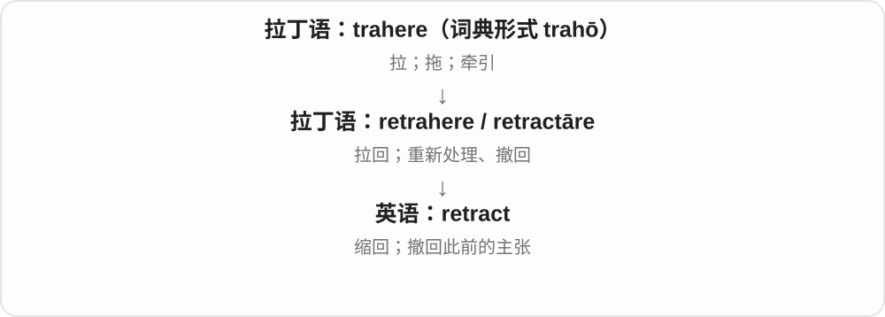

物理缩回和撤回主张共享“收回”的画面。撤回不等于自动修复后果，只是表示不再维持原来的说法。

**常见搭配与例句**

retract a statement；retract a claim；retract the landing gear；retract one’s claws。

> The newspaper retracted its claim after checking the records.

报纸核对记录后撤回了原来的说法。

> The aircraft retracted its landing gear after takeoff.

飞机起飞后收起了起落架。

**别混淆**

retract 是收回；deny 是否认。一个人可以 deny making a statement，声称自己根本没说过，并非 retract 已承认说过的话。

### 134. retractable — 可缩回的；可收起的

**音标**：/rɪˈtræktəbəl/

**先抓住这个画面**

圆珠笔尖按一下伸出来，再按一下收回去；这种能收回原处的结构就是 retractable。

**怎么拆**

retract + -able；retract 的词族接拉丁 re- 回 + trahere 拉、tract- 变化词干。

**怎么变成今天的意思**

**拉丁 re- + trahere、tract- → retract**  
向回拉、收回

↓

**retract + -able → retractable**  
可缩回、收起的

a retractable roof 可开合、收起的屋顶；a retractable pen 可伸缩笔尖的笔；retractable landing gear 可收放起落架。

**常见搭配与例句**

a retractable roof；retractable landing gear。

> The stadium has a retractable roof.

这座体育场有可开合的屋顶。

> She clicked the retractable pen before writing.

她按出伸缩笔的笔尖，开始写字。

**别混淆**

retractable 是能收回原位；detachable 是能拆下来。部件可缩回，不意味着能取下来单独放。

### 135. enforceable — 可强制执行的、能够落实执行的

**音标**：英 /ɪnˈfɔːsəbəl/；美 /ɪnˈfɔːrsəbəl/

**先抓住这个画面**

不是只把规定写在纸上，还能要求遵守、真正落实；可执行说的是约束能不能落地。

**怎么拆**

enforce 使执行 + -able，表示能被执行。enforce 的 force 材料联系力量，但现代不必字字翻成动用武力。

**怎么变成今天的意思**

**法语 enforcier 等 → 英语 enforce**  
强化、用力等旧义 → 使规定真正执行

↓

**enforce + -able → enforceable**  
能够落实、强制执行

an enforceable rule 可执行的规则，an enforceable agreement 有执行约束力的协议，legally enforceable 可依法执行的。

**常见搭配与例句**

an enforceable rule；an enforceable agreement；legally enforceable。

> The team wanted a clear and enforceable rule.

团队想要一条清楚且能落实的规则。

> The textbook asks whether the promise is legally enforceable.

教材提出一个问题：这项承诺是否可以依法强制执行。

**别混淆**

enforceable 能执行，enforced 已在执行或被执行；写得清楚也不自动保证实际上能执行。

### 136. actionable — 可据此采取行动的；可作为起诉依据的

**音标**：/ˈækʃənəbəl/

**先抓住这个画面**

actionable 像一条不只告诉你“有问题”，还足够具体、能让你决定下一步怎么做的信息。

**怎么拆**

action + -able；法律义联系 action“诉讼”，一般用法联系 action“行动”。

**怎么变成今天的意思**

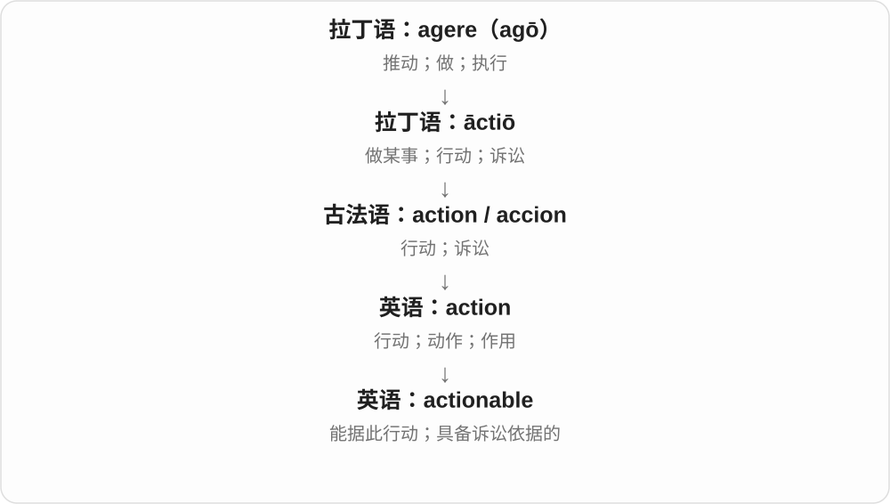

工作中 actionable feedback 要能帮助改进。法律语境中的 actionable 则是专门判断，不能简单理解为“很值得做”。

**常见搭配与例句**

actionable advice；actionable information；an actionable claim。

> The review gave us three actionable suggestions.

这次评审给了我们三条可以落实的建议。

> The lawyer considered whether the statement was actionable.

律师考虑这项陈述是否构成起诉依据。

**别混淆**

interesting information 只是有意思；actionable information 能支持具体行动。

### 137. allowable — 允许的；可接受的；在限度内的

**音标**：/əˈlaʊəbl/

**先抓住这个画面**

规则画出一条界线，界线以内可以接受、可以计入的，就是 allowable。

**怎么拆**

经中古英语接古法语 alouable，与 allouer 同族；现代可分析 allow + -able。不是每个 -able 都只说物理上做得到。

**怎么变成今天的意思**

**拉丁 allocāre〔安排、分配〕；allaudāre〔赞同、称赞〕**  
两条来源在法语相近形式中汇合

↓

**法语 alouer 等 → 英语 allow**  
分配、承认、认可 → 允许；为某事留出条件

↓

**法语 alouable → 英语 allowable**  
可认可、可允许；符合限度

the maximum allowable weight 最大允许重量，an allowable error 允许误差，allowable expenses 可计入的费用。具体界线依规则而定。

**常见搭配与例句**

maximum allowable weight；allowable limits；allowable error。

> The bag exceeds the maximum allowable weight.

包的重量超过允许上限。

> The difference falls within the allowable margin of error.

差异在允许误差范围内。

**别混淆**

possible 可能做到，allowable 规则上允许；possible but not allowable 可以发生，却不合规定。

### 138. expendable — 可消耗的；可替换的；被认为可以牺牲的

**音标**：英、美 /ɪkˈspendəbəl/

**先抓住这个画面**

用完可以补，损失了也被认为能够承受。用于人时，会让人感到自己被当作随时可丢弃的资源。

**怎么拆**

英语 expend + -able；原来是可花费、可用掉的，再扩展为损失后可替换、可牺牲。它不含 expensive“昂贵”的意思。

**怎么变成今天的意思**

**拉丁 expendere → 英语 expend**  
花费、耗用

↓

**英语 expend + -able → expendable**  
可以耗用的 → 可被替换或舍弃的

expendable supplies 可指用后需补充的物资；treat workers as expendable 是把工人看作可以随便替换的人，常带批评。它说可被消耗或放弃，不必表示价值真的低。

**常见搭配与例句**

expendable supplies；expendable resources；treat someone as expendable。

> The budget distinguishes reusable equipment from expendable supplies.

预算区分了可重复使用的设备和消耗性物资。

> The workers objected to being treated as expendable.

工人们反对被当作可以随意替换的人。

**别混淆**

dispensable 重在不是必需，可以省掉；expendable 重在可以被消耗、失去或牺牲。expensive 只说花费高。

### 139. hospitable — 好客的；适宜生存或活动的；乐于接纳的

**音标**：英 /hɒsˈpɪtəbəl/；美 /hɑːˈspɪtəbəl/，也读 /ˈhɑːspɪtəbəl/

**先抓住这个画面**

一个人让来客舒服，一个地方让生命或活动能安顿下来，都可以说 hospitable。

**怎么拆**

借法语 hospitable；hospit- 接拉丁 hospes / hospitari 的待客词族，-able 是形容词形式。词源资料对中世纪拉丁 hospitabilis 是否作为直接中间形式有不同处理，这里不硬设必经节点。

**怎么变成今天的意思**

**拉丁 hospes，词干 hospit-**  
客人；接待客人的主人

↓

**拉丁 hospitari / hospit- 词族 → 法语 hospitable**  
作客、接待相关词干 → 好客的

↓

**英语 hospitable**  
热情接待的；引申为条件适合的

hospitable people 热情待客；hospitable to life 说有适宜生命的条件。对新想法也可 hospitable，像给它一个可以留下来的空间。

**常见搭配与例句**

a hospitable welcome；hospitable to visitors；a hospitable environment。

> Our neighbours were hospitable and invited us in for tea.

邻居很热情，邀请我们进去喝茶。

> The sheltered valley offers a hospitable environment for many plants.

这个避风山谷为许多植物提供了适宜的环境。

**别混淆**

friendly 可只是态度友善；hospitable 常包括接待、安顿和让对方感到欢迎。

### 140. likable — 讨人喜欢的；让人容易产生好感的

**音标**：/ˈlaɪkəbəl/

**先抓住这个画面**

一个人未必完美，但相处时真诚、有趣，让你愿意继续认识，就可以叫 likable。说的是容易赢得好感。

**怎么拆**

like〔喜欢〕加 -able，表示容易被喜欢。likable 尤见北美英语；likeable 尤见英国英语，两种拼写含义和读音相同，本条一起说明。

**怎么变成今天的意思**

**英语 like；-able**  
喜欢；可被、容易被

↓

**英语 likable／likeable**  
容易让人喜欢的

常形容人、小说人物或个性。a likable villain 可以是做坏事却让观众觉得有魅力的反派；这个词不自动保证其品德正确。

**常见搭配与例句**

a likable person；a likable character；warm and likable。

> She is a likable colleague who makes new staff feel welcome.

她是一位讨人喜欢的同事，总让新员工感到受欢迎。

> The novel has a flawed but likable main character.

小说的主人公有缺点，却很讨人喜欢。

**别混淆**

likable 说讨人喜欢；likely 说可能发生。popular 是实际受到很多人欢迎，likable 是容易让人产生好感的特质，两者不必同时存在。

### 141. regrettable — 令人遗憾的、可惜的；不妥而值得后悔的

**音标**：/rɪˈɡretəbl/

**先抓住这个画面**

镜头对准事情：这个错误、损失、决定让人回头觉得可惜，就是 regrettable。

**怎么拆**

regret + -able，重读音节以单个辅音字母结尾，接元音开头后缀时双写 t。-able 在这里走值得被遗憾的评价义。

**怎么变成今天的意思**

**古法语 regreter**  
哀叹、怀念而悲伤；后半可能接日耳曼语哭泣词

↓

**英语 regret**  
遗憾、后悔，希望当初不是这样

↓

**regret + -able → regrettable**  
值得遗憾、令人后悔的事情或情况

a regrettable mistake 令人遗憾的错误，a regrettable incident 令人遗憾的事件，deeply regrettable 十分令人遗憾。

**常见搭配与例句**

a regrettable mistake；a regrettable incident；deeply regrettable。

> The delay was regrettable but unavoidable.

这次延误令人遗憾，但确实无法避免。

> It was a regrettable mistake, and we corrected it quickly.

那是个令人遗憾的错误，我们很快改正了。

**别混淆**

regrettable 不等于无法避免，也不保证故意或违法；它先表达负面评价。regretful 则说承受遗憾情绪的一方。

### 142. verifiable — 可核实的；可验证的

**音标**：/ˌverɪˈfaɪəbəl/

**先抓住这个画面**

verifiable 表示一条说法留有可以检查的抓手：记录、证据或方法都在，别人能够去核实。

**怎么拆**

verify + -able；y 改为 i，表示“能够被验证的”。注意核实动作的核心仍是 verify，不是 very。

**怎么变成今天的意思**

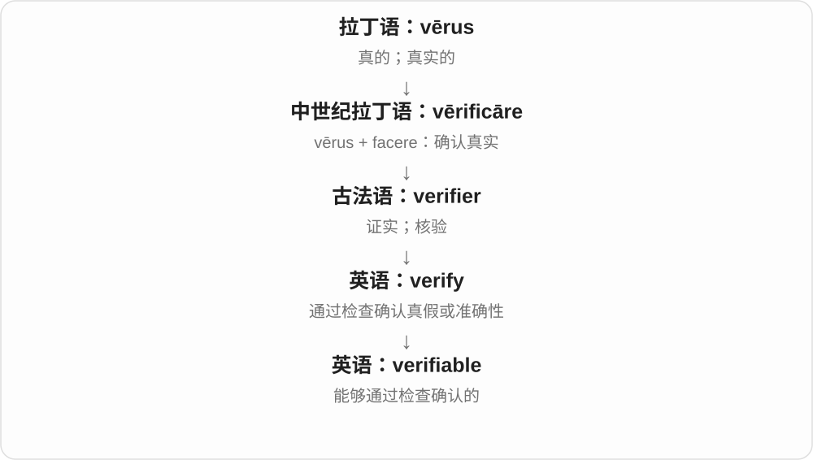

verifiable 说的是“有办法查”，不等于已经查过，更不等于查过后一定为真。a verifiable claim 比没有任何检查办法的说法更容易接受审查。

**常见搭配与例句**

verifiable facts（可核实的事实）；a verifiable claim（可查证的说法）；independently verifiable（可独立核实的）。

> The article should rely on verifiable facts.

这篇文章应以可核实的事实为依据。

> Her explanation includes several independently verifiable details.

她的解释包含几个可以独立核实的细节。

**别混淆**

verifiable 是“可以核实”；verified 是“已经核实”。把能力和完成状态分开，就不容易读错。

### 143. controllable — 可控制的；能调节的

**音标**：英 /kənˈtrəʊləbəl/；美 /kənˈtroʊləbəl/

**先抓住这个画面**

controllable 像一个有有效旋钮的过程：你采取行动，能把方向或程度调到想要的范围。

**怎么拆**

control + -able，末尾 l 双写后加后缀。

**怎么变成今天的意思**

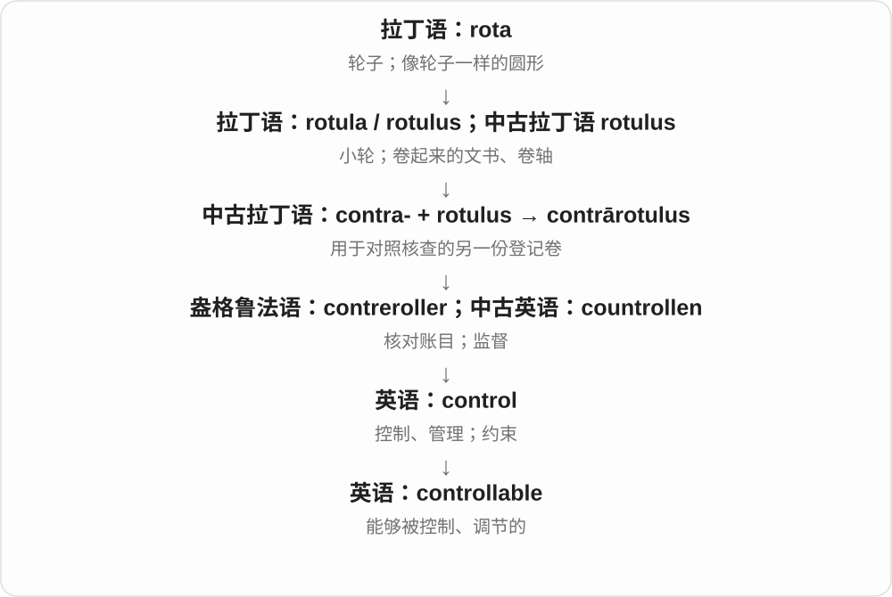

说明有控制的可能，不保证现在已经控制得好。计划中常区分可控制因素和外部条件。

**常见搭配与例句**

controllable factors；a controllable process；easily controllable。

> The brightness is fully controllable from the panel.

亮度可以通过面板完全调节。

> We focused on the factors that were controllable.

我们把注意力放在能够控制的因素上。

**别混淆**

controlled 是已经受控；controllable 是有能力控制，讲的是可能性。

### 144. scalable — 可扩展的；可调整规模的

**音标**：/ˈskeɪləbəl/

**先抓住这个画面**

需求变大时，它能跟着扩容，而不是很快就撑不住。

**怎么拆**

scale + -able，去末尾 e；现代主要承接规模、容量可调整的意义。

**怎么变成今天的意思**

**拉丁语 scala，常用复数 scalae**  
梯子、台阶；与 scandere“攀登”相连

↓

**中古英语 scale / scalen → 英语 scale**  
梯子、刻度；攀登 → 等级、音阶、比例、规模

↓

**英语 scale + -able → scalable**  
调整规模 → 能随需要调整规模的

a scalable system 能在工作量增加时相应扩展；a scalable business model 说业务扩大后仍能运转。这个词描述能力，不保证增长没有成本或限制。

**常见搭配与例句**

a scalable system；a scalable solution；a scalable business model。

> We need a scalable system that can serve more users.

我们需要一个能扩展容量、服务更多用户的系统。

> The pilot project tested whether the approach was scalable.

试点项目检验了这种方法能否扩大实施规模。

**别混淆**

large 是现在大；scalable 是具备调整、扩大的能力，小系统也可能很 scalable。

### 145. printable — 可打印的；适宜刊印的

**音标**：英 /ˈprɪntəbəl/；美 /ˈprɪntəbəl/

**先抓住这个画面**

内容已经准备好，能够或适合被印出来。

**怎么拆**

print + -able 可……的。

**怎么变成今天的意思**

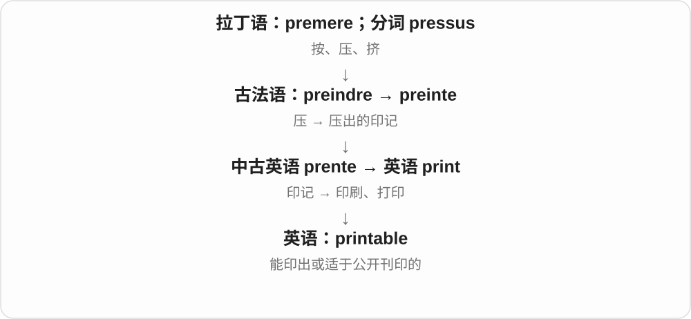

a printable worksheet 是可打印练习纸；a printable character 是能显示为可见符号的字符。语境也可讨论内容是否适合公开。

**常见搭配与例句**

a printable version；printable characters；a printable worksheet。

> The website provides a printable version of the timetable.

网站提供了可打印的时间表版本。

> The form accepts only printable characters.

这个表单只接受可显示的字符。

**别混淆**

printable 只说能否、是否适合打印；printed 是已经印出来。

### 146. replaceable — 可替换的、可更换的

**音标**：/rɪˈpleɪsəbəl/

**先抓住这个画面**

坏了可以换一个新的，或这个角色可以由别人接手。重点在有替代办法。

**怎么拆**

replace + -able，保留 e，形成可被替换的形容词。这里接替换义，不把所有 replace 的历史和现代义都压成重新摆放。

**怎么变成今天的意思**

**replace 的替换、更换等现代用法**  
换一个来接替；另有放回等用法背景

↓

**replace + -able → replaceable**  
可以换掉、可以找到替代的

a replaceable battery 可更换电池，replaceable parts 可换零件，easily replaceable 容易替代的。

**常见搭配与例句**

a replaceable battery；replaceable parts；easily replaceable。

> The device has a replaceable battery.

这台设备的电池可以更换。

> The damaged part is easily replaceable.

损坏的零件很容易更换。

**别混淆**

replaceable 可替换，repairable 可修理；可换不保证能修，能修也不保证有替代件。

### 147. chargeable — 需收费的；可记账的；可充电的〔较宽泛〕

**音标**：英 /ˈtʃɑːdʒəbl/；美 /ˈtʃɑːrdʒəbl/

**先抓住这个画面**

一项服务要收钱，一笔费用能记到某个项目账上，都可以用 chargeable。

**怎么拆**

charge + -able，后缀表示可、需按相应方式处理，具体接的是收费、记账等哪一义要看语境。

**怎么变成今天的意思**

**拉丁 carrus〔车〕→ 晚期拉丁 carricāre**  
把货装上车、装载

↓

**法语 chargier／charge → 英语 charge**  
负担、装入 → 责任、费用、指控、电荷等分支

↓

**charge + -able → chargeable**  
可收取、应计入费用；可接受充电

a chargeable service 收费服务，expenses chargeable to the project 可计入项目的费用。电池可反复充电常用 rechargeable 更清楚。

**常见搭配与例句**

a chargeable service；chargeable hours；chargeable to an account。

> Technical support is a chargeable service after the first year.

第一年后技术支持是收费服务。

> These expenses are chargeable to the research project.

这些费用可记入研究项目账下。

**别混淆**

chargeable 不等于有价值的 valuable；它常说费用归属或是否收费。free of charge 与 chargeable 在收费语境相反。

### 148. rechargeable — 可反复充电的

**音标**：英 /ˌriːˈtʃɑːdʒəbl/；美 /ˌriːˈtʃɑːrdʒəbl/

**先抓住这个画面**

电用完后能补进去再用，这是物品的一项设计能力。

**怎么拆**

recharge + -able，去末尾 e 接 -able。表示可重新充电，不能只因为此刻有电就叫 rechargeable。

**怎么变成今天的意思**

**拉丁 carrus〔车〕→ 晚期拉丁 carricāre**  
把货装上车、装载

↓

**法语 chargier／charge → 英语 charge**  
负担、装入 → 责任、费用、指控、电荷等分支

↓

**recharge + -able → rechargeable**  
能够再次充电使用的

rechargeable batteries 充电电池，a rechargeable lamp 可充电灯。常描述设备或储能部件的能力。

**常见搭配与例句**

rechargeable batteries；a rechargeable lamp；a rechargeable device。

> The lamp has a rechargeable battery.

这盏灯装有可充电电池。

> We use rechargeable batteries in the recorder.

我们在录音机里用充电电池。

**别混淆**

charged 已经有电、充过电，是状态；rechargeable 可以再充，是能力。两者可以同时成立。

### 149. bearable — 可以忍受的

**音标**：英 /ˈbeərəbəl/；美 /ˈberəbəl/

**先抓住这个画面**

虽不好受，但还在撑得住的范围里。

**怎么拆**

bear 忍受 + -able 可以……的；表示某种处境能被承受。

**怎么变成今天的意思**

**古英语 beran → 中古英语 beren**  
承载、带来；生育；忍受

↓

**英语 bear；过去式 bore，过去分词通常 borne**  
承受、携带、产生；出生表达中使用 born

↓

**bear + -able → bearable**  
承受 → 可以忍受的

make something bearable 让某事变得能忍受；just bearable 勉强能承受。它不一定好，只是没超过承受线。

**常见搭配与例句**

make life bearable；barely bearable；more bearable。

> A small fan made the crowded room more bearable.

一台小风扇让拥挤的房间稍微好受一些。

> The long wait was bearable because we had books to read.

我们有书可读，所以漫长的等待还算能忍受。

**别混淆**

bearable 可忍受，comfortable 舒服；酷热稍缓后 bearable，仍未必称得上 comfortable。

### 150. distinguishable — 可以区分的；可以辨认的

**音标**：/dɪˈstɪŋɡwɪʃəbəl/

**先抓住这个画面**

差异足够明显，眼睛、耳朵或分析方法能够把它们分开。它说的是“能不能辨”，不保证辨起来轻松。

**怎么拆**

distinguish + -able，英语形容词，表示能够被区分或察觉。

**怎么变成今天的意思**

**拉丁 distinguere〔dis- + -stinguere〕**  
分开、标出区别；更古老的刺、推等分析有分歧

↓

**法语 distinguer／词干 distinguiss-，也有直接拉丁借入分析**  
辨别、区分

↓

**中古英语 distingwen 等 → 现代 distinguish**  
辨别；使出众；现代词尾受 -ish 类形式影响

↓

**英语 distinguish + -able → distinguishable**  
能看出、听出或判断出区别的

distinguishable from 是与某物可以区分；barely distinguishable 是勉强能辨。远处一个形状从背景里显出来，也可以这样说。

**常见搭配与例句**

clearly distinguishable；barely distinguishable；distinguishable from。

> The two fabrics are distinguishable by touch.

这两种布料摸一摸就能区分。

> The distant tower was barely distinguishable from the grey sky.

远处的塔几乎融进灰色天空，勉强才能看出来。

**别混淆**

different 说实际不同；distinguishable 说这种不同能够被辨认。两个物体不同，却可能肉眼分不出来。

### 151. enviable — 令人羡慕的

**音标**：/ˈenviəbəl/

**先抓住这个画面**

enviable 是别人看了会想“我也希望有”的好处，比如自由的时间、稳定的表现或好口碑。

**怎么拆**

envy 去 y 加 -iable，对应 envy + -able。

**怎么变成今天的意思**

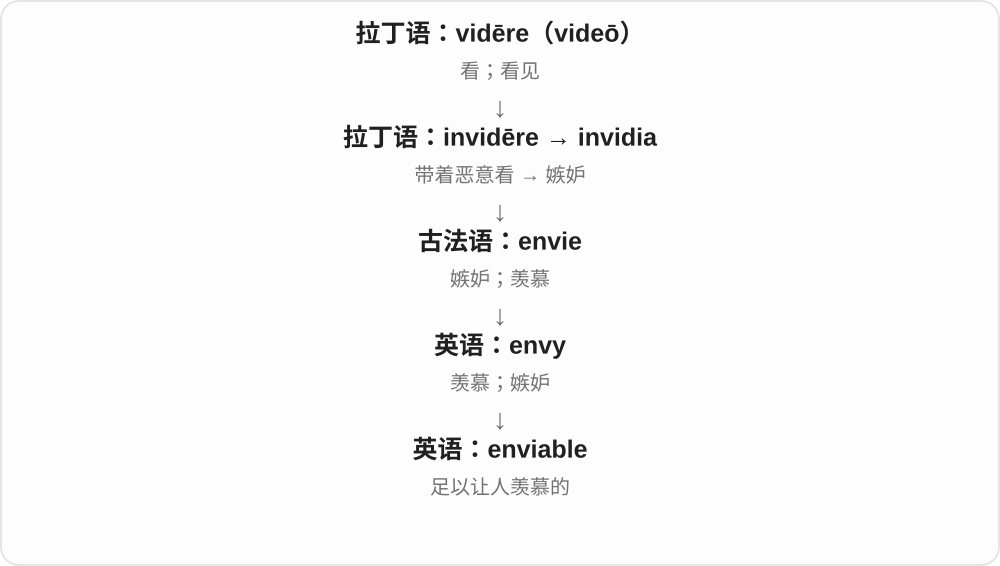

这里形容引起羡慕的条件，通常是赞赏；不是说拥有者自己正在嫉妒。

**常见搭配与例句**

an enviable reputation；an enviable position；an enviable record。

> The school has an enviable reputation for music.

这所学校在音乐方面的声誉令人羡慕。

> She has the enviable freedom to choose her own hours.

她有可以自行安排工作时间的自由，令人羡慕。

**别混淆**

enviable 令人羡慕，envious 感到羡慕；主客方向不同。

### 152. searchable — 可搜索、可检索的

**音标**：英 /ˈsɜːtʃəbl/；美 /ˈsɜːrtʃəbl/

**先抓住这个画面**

内容能被查询、定位；不必一页页靠眼睛慢慢翻。

**怎么拆**

search + -able，可被搜索、具备检索条件。常用于文档、数据库、网站内容。

**怎么变成今天的意思**

**晚期拉丁 circāre → 古法语 cerchier、盎格鲁法语 sercher**  
绕行、到处走查 → 寻找

↓

**中古英语 serchen → search**  
搜寻、查找、搜查

↓

**search + -able → searchable**  
可以搜索、检索的

a searchable database 可检索数据库，searchable text 可搜索文本，make the archive searchable 让档案可检索。

**常见搭配与例句**

a searchable database；searchable text；a searchable archive。

> The library created a searchable archive of old newspapers.

图书馆建立了可检索的旧报纸档案。

> The scanned pages were converted into searchable text.

扫描页面被转换成了可搜索文本。

**别混淆**

searchable 可检索不等于公开给所有人；publicly accessible 公开可访问是权限问题，两个性质可分开。

### 153. impressionable — 容易受影响的；易受感染的

**音标**：英 /ɪmˈpreʃənəbəl/；美 /ɪmˈpreʃənəbəl/

**先抓住这个画面**

像还软的泥，别人的言行很容易在心里留下形状。

**怎么拆**

来自法语 impressionnable，与 impression 词族相关；现代可看作 impression + -able。

**怎么变成今天的意思**

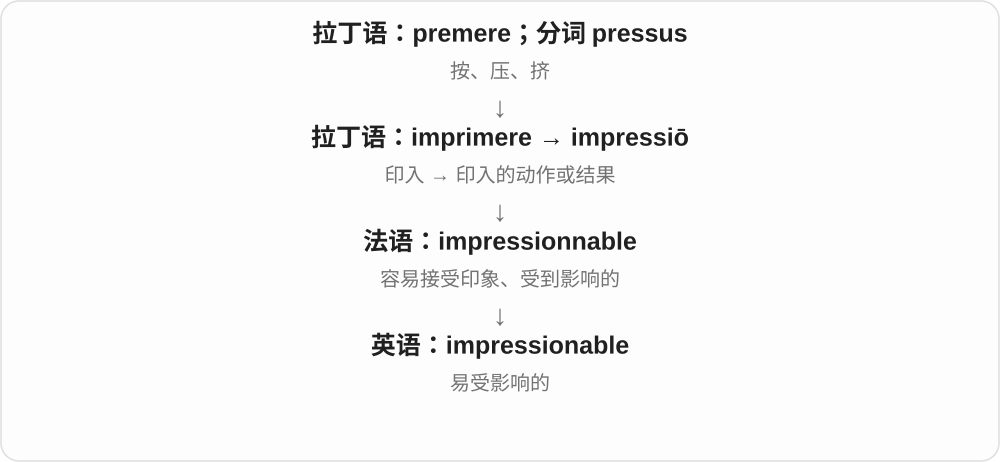

常形容年轻人或容易被强烈体验影响的人。并非称赞对方特别值得留下印象。

**常见搭配与例句**

an impressionable child；at an impressionable age。

> The story made a strong impact on me at an impressionable age.

在我容易受影响的年纪，那个故事给了我很大触动。

> The teacher was aware of her influence on impressionable students.

老师知道自己会影响那些容易受感染的学生。

**别混淆**

impressive 是让别人受影响；impressionable 是自己容易受影响。

### 154. treatable — 可治疗的；可以处理的

**音标**：/ˈtriːtəbl/

**先抓住这个画面**

有办法进行治疗或处理，仍要分清能干预和能完全消除。

**怎么拆**

treat + -able；中古英语已有对应形式，也与法语 traitable 相关。医疗义对应 treat 治疗，不是请客的 treat 加能请客。

**怎么变成今天的意思**

**法语 traiter → 英语 treat**  
处理、对待；治疗

↓

**treat + -able → treatable**  
可以施以治疗、处理的

a treatable condition 可治疗的病症，a treatable problem 可处理的问题；这个词本身不说明具体方法或疗效幅度。

**常见搭配与例句**

a treatable condition；a treatable problem；considered treatable。

> The doctor explained that the condition was treatable.

医生解释说这种病症可以治疗。

> The report describes it as a treatable problem rather than an inevitable outcome.

报告把它描述为可处理的问题，而非不可避免的结果。

**别混淆**

treatable 可治疗，不必等于 curable 可治愈；treatment 治疗过程和 cure 治愈结果的着眼点不同。

### 155. presentable — 像样、整洁的；可以拿给人看的

**音标**：/prɪˈzentəbəl/

**先抓住这个画面**

状态已经收拾到能见人、能摆到别人面前，不至于太乱或太粗糙。

**怎么拆**

present 展示 + -able 可以……的，表示适合展示、见人的；重音随动词 present 一支。

**怎么变成今天的意思**

**拉丁语 praesens；相关 praesentāre**  
在眼前、在场；把东西放到眼前、呈上

↓

**经法语进入英语 present 词族**  
当前、在场；礼物；展示、提交

↓

**present + -able → presentable**  
展示 → 能拿得出来、整洁像样的

make oneself presentable 收拾到能见人；a presentable draft 可以给人看的草稿。通常不要求极致漂亮，只要达到合适展示状态。

**常见搭配与例句**

look presentable；make the room presentable；a presentable draft。

> Give me ten minutes to make the room presentable.

给我十分钟把房间收拾得像样些。

> The draft is presentable, though it still needs editing.

草稿已经可以拿出来看，不过仍需编辑。

**别混淆**

presentable 不等于 perfect 完美，也不等于 present 在场；可以是一份还可改进、但足以拿出来讨论的稿子。

### 156. executable — 可执行的；可执行程序、文件

**音标**：/ˈeksɪkjuːtəbl/；也读 /ˌeksɪˈkjuːtəbl/

**先抓住这个画面**

一般说事情可以实行；电脑上常说一个文件能作为程序启动执行，而不只是供人阅读的一页文字。

**怎么拆**

execute + -able，末尾 e 去掉，-able 表可被执行。名词 executable 从可执行的文件这一形容用法转来，读音、重音有变体。

**怎么变成今天的意思**

**拉丁 ex- + sequī → exsequī；分词 exsecūtus**  
跟随到底、把事做完

↓

**法语 executer → 英语 execute**  
执行、实行；执行刑罚等

↓

**现代专门用法**  
完成动作、运行程序；execution 指执行过程或方式

↓

**execute + -able → executable**  
能够执行的 → 可执行文件、程序

an executable file 可执行文件，an executable program 可运行程序，an executable plan 可实施的计划。文件是否可执行涉及格式、运行环境与权限。

**常见搭配与例句**

an executable file；an executable program；an executable plan。

> The download contains an executable and a user guide.

下载包里有一个可执行程序和一份用户指南。

> The file is executable only in the supported environment.

这个文件只有在支持的环境中才能执行。

**别混淆**

executable 不保证程序安全、正确或在所有系统都能跑；也不只等于文件名后有 .exe，其他系统和文件类型同样可以执行。

### 157. livable — 宜居的；能住的；可以忍受的

**音标**：/ˈlɪvəbəl/

**先抓住这个画面**

一个地方不仅还站着，还具备让人住下来、过日子的基本条件。

**怎么拆**

live + -able，末尾 e 省去；也拼 liveable。-able 在此表示适合居住、足以生活，而非直播能够播放。

**怎么变成今天的意思**

**古英语 libban / lifian → 中古英语 live 等形式**  
活着、生活

↓

**英语动词 live /lɪv/**  
活；居住；过某种生活

↓

**live + -able → livable**  
适合居住；生活得下去的

a livable city 可以综合交通、环境、住房等评价；a livable room 可表示整理修好后能住。不同人对宜居的要求不完全一样。

**常见搭配与例句**

a livable city；make a place livable；a livable space。

> They repaired the roof to make the house livable.

他们修好屋顶，让房子能住人。

> The plan aims to make the city more livable.

计划希望让这座城市更加宜居。

**别混淆**

livable 强调能居住、好生活，lively 强调热闹活泼；喧闹街区可以 lively，却未必让你觉得 livable。

### 158. passable — 可通行的；还过得去的、尚可的

**音标**：英 /ˈpɑːsəbəl/；美 /ˈpæsəbəl/

**先抓住这个画面**

路能让人过去；质量也只是刚好能让人点头放行。

**怎么拆**

pass + -able，或借古法语 passable；两种历史分析都围绕“能够通过”。

**怎么变成今天的意思**

**拉丁 passus**  
一步、步幅

↓

**通俗拉丁 \*passare → 古法语 passer → 英语 pass**  
迈步 → 经过、通过

↓

**法语 passable／英语 pass + -able → passable**  
可以通行 → 可以接受、尚可

a passable road 是能走得通的路；a passable meal 是尚可的一顿饭，并不是什么赞不绝口的评价。记住“过得了关”就能连接两义：一条是空间的关，一条是质量门槛。

**常见搭配与例句**

a passable road；barely passable；a passable performance；passable English。

> The road was muddy but still passable.

路很泥泞，但仍然可以通行。

> He speaks passable French, enough for everyday conversations.

他的法语还过得去，足够应付日常交谈。

**别混淆**

passable 只有尚可，excellent 才是出色。impassable 是无法通行的；别混进 impassive“面无表情”的另一条词源。

### 159. impassable — 无法通过的；无法通行的

**音标**：英 /ɪmˈpɑːsəbəl/；美 /ɪmˈpæsəbəl/

**先抓住这个画面**

路还在，但积雪、洪水或障碍把“走过去”的可能性堵住了。

**怎么拆**

im- 不 + passable“可以通过的”；pass + -able。

**怎么变成今天的意思**

**拉丁 pandere / pandō**  
展开、伸开

↓

**拉丁 passus**  
伸开腿跨出的一步；步幅

↓

**通俗拉丁 \*passāre → 古法语 passer → 英语 pass**  
迈步而过 → 经过、通过

↓

**英语 pass → passable；im- + passable → impassable**  
可通行 → 无法通行

常形容道路、山口或河流。强调在当前条件下无法通过，不表示它永远不可能被修好。

**常见搭配与例句**

an impassable road；render a route impassable；become impassable。

> Heavy snow made the mountain road impassable.

大雪使山路无法通行。

> The route becomes impassable after prolonged rain.

长时间下雨后，这条路线就走不通了。

**别混淆**

impassible 是不受痛苦或情感影响的另一个词，接“承受”词族；不要与 impassable 的“通过”混淆。

### 160. recoverable — 可找回、可恢复、可追回的

**音标**：英 /rɪˈkʌvərəbəl/；美 /rɪˈkʌvərəbəl/

**先抓住这个画面**

东西虽然丢失、状态虽然受损，但还有办法拿回来或恢复。强调可能性，不代表已经成功。

**怎么拆**

recover + -able，中古英语已有相应形式。后缀表示能被恢复、追回，不是某人愿意帮忙的意思。

**怎么变成今天的意思**

**拉丁语 recuperāre → 法语 recovrer 等 → recover**  
重新取得、恢复、找回

↓

**recover + -able → recoverable**  
能够找回、恢复或追回的

recoverable data 可恢复数据，recoverable costs 可追回费用，recoverable resources 可开采回收的资源〔专门语境〕。

**常见搭配与例句**

recoverable data；recoverable costs；still recoverable。

> The technician said some of the data was still recoverable.

技术人员说，一部分数据仍能恢复。

> The report separates recoverable costs from other expenses.

报告把可追回费用与其他开支分开列出。

**别混淆**

recoverable 可能性，recovered 已恢复；可追回费用也不等于费用已经入账，具体资格依场景。

### 161. traceable — 可追踪的；可追溯来源的

**音标**：/ˈtreɪsəbəl/

**先抓住这个画面**

顺着记录或证据，能找回它从哪来、经过哪里，就是 traceable。不是说现在正在查，而是说有条件查得到。

**怎么拆**

trace + -able，去末尾 e，表示能被追踪、追溯。也有专门数学用法，此处先学日常、管理常见含义。

**怎么变成今天的意思**

**古法语 trace／tracer → 中古英语 trace／tracen**  
痕迹、轮廓；描画、跟随、追查

↓

**英语 trace 的不同常用方向**  
沿痕追溯；按轮廓描画；留下的细微痕迹、微量

↓

**trace + -able → traceable**  
具备追踪、追溯的可能性

traceable to a source 可追溯到某来源，traceable products 可追溯产品，an easily traceable error 容易追查的错误。

**常见搭配与例句**

traceable to；traceable products；easily traceable。

> Each batch is traceable to its supplier.

每批产品都能追溯到供应商。

> The error was traceable to a missing line in the file.

错误可追查到文件中缺失的一行。

**别混淆**

traceable 说可追查，不保证产品必定优质，也不等于 transparent 一切信息都已公开。

### 162. redeemable — 可兑换的；可赎回的；可挽救的

**音标**：/rɪˈdiːməbl/

**先抓住这个画面**

手里的东西能兑现，或一个局面仍能挽回。

**怎么拆**

英语 redeem + -able，表示“可以被 redeem”。不同宾语承接 redeem 的不同义项，不是 -able 自己产生了“优惠券”的意思。

**怎么变成今天的意思**

**拉丁语 emere；分词 emptus**  
买、取得；更早有“取”的含义

↓

**拉丁语 redimere**  
red- 向回 + emere：买回、赎回

↓

**古法语 redimer；拉丁 redimere**  
英语借入的相关来源

↓

**中古英语 redemen → 英语 redeem**  
赎回、拯救；后来也有弥补、兑换等义

↓

**英语 redeem + -able → redeemable**  
可以兑换、赎回或挽救的

券上写 redeemable for coffee，意思是能换咖啡；redeemable against a purchase 表示能用于抵扣消费。形容人物或局面时，它也可以表示还没坏到无法挽救。

**常见搭配与例句**

redeemable for goods；redeemable against a purchase；redeemable at a shop；a redeemable character。

> The voucher is redeemable for two cinema tickets.

这张券可以兑换两张电影票。

> The author presents the villain as flawed but still redeemable.

作者把反派写成有缺点、却仍有机会改过的人。

**别混淆**

valid 说券等仍然有效；redeemable 说明它能怎样兑现。有效期限与兑换条件仍是两个问题。

### 163. irrevocable — 不可撤销的；不能收回的

**音标**：/ɪˈrevəkəbl/

**先抓住这个画面**

决定一旦落下，就不能再把它叫回来；irrevocable 强调这一步具有终局性。

**怎么拆**

来自拉丁 irrevocabilis，可经法语 irrévocable 借入。否定 in- 在 r 前成为 ir-，后接 revocabilis“可撤回的”。现代能拆 ir- + revocable，借入史却是独立的。

**怎么变成今天的意思**

**拉丁 vocare**  
呼唤、叫来、称呼；与 vox“声音”同族

↓

**拉丁 revocare → revocabilis → 否定 in- + revocabilis → irrevocabilis**  
收回 → 可以收回 → 不可收回；n 在 r 前同化

↓

**法语 irrévocable／直接借入 → 英语 irrevocable**  
不可撤销的；不能改变的

an irrevocable decision 是不能收回的决定；也可说某件事带来无法回到从前的变化。具体法律文本中的效力不能只凭这个词推断。常见重音在 rev。

**常见搭配与例句**

an irrevocable decision；an irrevocable commitment；irrevocable change。

> The story turns on one irrevocable decision.

故事围绕一个无法收回的决定展开。

> She knew that publishing the letter would be an irrevocable step.

她知道，公开这封信将是无法收回的一步。

**别混淆**

irreversible 更广泛地说过程不能反转；irrevocable 常用于决定、承诺、授权等不能撤回。

### 164. breathable — 可供呼吸的；透气的

**音标**：/ˈbriːðəbəl/

**先抓住这个画面**

空气让人能吸，是 breathable air；布料让湿气、空气适当通过，也说 breathable，但不是衣服自己长肺在呼吸。

**怎么拆**

breathe + -able，去掉末尾 e，接能呼吸、允许气体通过的能力。词干沿 breathe /briːð/，不是 breath /breθ/。

**怎么变成今天的意思**

**古英语 breath 词族 → 中古英语 brethen → breathe**  
气息名词基础上形成呼吸动词

↓

**breathe + -able → breathable**  
可呼吸；可让气体、水汽通过

breathable air 可呼吸空气，breathable fabric 透气面料，a breathable jacket 透气外套。

**常见搭配与例句**

breathable air；breathable fabric；a breathable jacket。

> The jacket is made from a lightweight, breathable fabric.

外套采用轻薄透气的面料。

> The astronauts checked the supply of breathable air.

宇航员检查了可供呼吸的空气储备。

**别混淆**

breathable 透气性不等于 waterproof 防水性，两种性质可按材料结构组合；不能只凭透气一词推定所有天气用途。

### 165. changeable — 多变的；可更改的

**音标**：/ˈtʃeɪndʒəbəl/

**先抓住这个画面**

一会儿晴一会儿雨，是容易变；设置能换，是可以变。

**怎么拆**

现代对应 change + -able，保留 e；历史有中古英语 chaungeable、古北法语 chaungeable，来路与 change 相连。

**怎么变成今天的意思**

**拉丁 cambīre / 晚期拉丁 cambiāre → 古法语 changier**  
交换、更换

↓

**中古英语 changen / change → 英语 change**  
更换、改变；变化、找零

↓

**change + -able → changeable**  
可改变的；容易改变的

changeable weather 是多变天气，a changeable schedule 是可变、易变的日程。-able 不保证变化已经发生，只说能力、倾向。

**常见搭配与例句**

changeable weather；a changeable mood；a changeable schedule。

> The weather is very changeable in spring.

春天天气很多变。

> The design includes changeable panels.

设计包含可更换面板。

**别混淆**

changeable 易变或可变，changed 已变；一个 changeable plan 到现在也可能 unchanged。

### 166. refundable — 可退款的；可退还的

**音标**：/rɪˈfʌndəbəl/

**先抓住这个画面**

这笔钱虽然先付出去了，但在规定情形下还有退回来的可能。

**怎么拆**

refund + -able，表示可以被退还。

**怎么变成今天的意思**

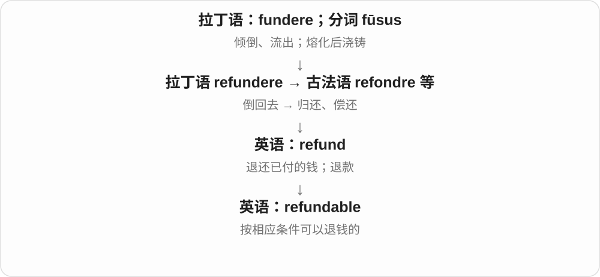

a refundable ticket 是可以退票款的票；a refundable deposit 是可以退还的押金。是否全退、何时能退，要看具体条件。

**常见搭配与例句**

a refundable deposit；fully refundable；refundable tickets。

> The booking requires a refundable deposit.

这次预订需要交一笔可退押金。

> We chose refundable tickets because our plans might change.

因为行程可能变化，我们选择了可退款的票。

**别混淆**

refundable 说能退钱；returnable 说商品等能退回，两者不必在每种交易中完全相同。

### 167. excitable — 容易激动的；可兴奋的

**音标**：/ɪkˈsaɪtəbəl/

**先抓住这个画面**

一点动静就容易把它调动起来，门槛比较低。

**怎么拆**

excite + -able 能够、容易。

**怎么变成今天的意思**

**拉丁 ciēre → citāre**  
使动起来、唤起 → 召唤、促动

↓

**拉丁 ex- + ciēre → excitāre → 法语 exciter**  
向外唤起、激发

↓

**英语 excite**  
使兴奋；激发

↓

**英语 excitable**  
容易受到激发的

an excitable child 容易兴奋或激动；excitable tissue 在生理学里能对刺激产生电活动。后者是专业性质，不是在说组织有情绪。

**常见搭配与例句**

an excitable crowd；excitable cells；excitable tissue。

> The puppy is friendly but very excitable.

这只小狗很友好，但特别容易兴奋。

> The lecture explained how excitable cells respond to stimulation.

讲座解释了可兴奋细胞如何响应刺激。

**别混淆**

excited 是此刻状态；excitable 是容易进入那种状态的倾向或能力。

### 168. expandable — 可扩大的；可扩展的

**音标**：/ɪkˈspændəbəl/

**先抓住这个画面**

东西现在有一个大小，但设计上留了继续撑开、增加容量的余地。

**怎么拆**

expand + -able“能够……的”。

**怎么变成今天的意思**

**拉丁 pandere / pandō**  
展开、伸开

↓

**拉丁 ex- + pandere → expandere**  
向外展开

↓

**法语相关形式与拉丁借入 → 英语 expand**  
扩展、扩大、展开

↓

**英语 expand + -able → expandable**  
扩展 → 可以扩展的

可形容行李箱、存储容量或界面区域。expandable storage 说可以增加存储能力，具体能加多少、怎样加，要由产品条件说明，词本身不保证无限。

**常见搭配与例句**

expandable storage；an expandable suitcase；an expandable section。

> The suitcase has an expandable section for extra clothes.

行李箱有一个可以扩大的夹层，用来多装些衣服。

> The device offers expandable storage.

这台设备支持扩展存储空间。

**别混淆**

expanded 是已经扩大；expandable 是能够扩大。expanded storage 与 expandable storage 描述不同状态。

### 169. reachable — 可到达、可够到的；能联系上的

**音标**：/ˈriːtʃəbəl/

**先抓住这个画面**

从某个位置、通过某种方式，能够到那里或找到那个人；能力还没变成已完成动作。

**怎么拆**

reach + -able，可被到达、接触，现代也常说通信可达。

**怎么变成今天的意思**

**古英语 ræcan → 中古英语 rechen → reach**  
伸到、够到、到达

↓

**现代 reach**  
身体可及 → 联系得到；达到数值、协议与能力范围

↓

**reach + -able → reachable**  
可以到达、联系上的

reachable by train 乘火车可达，reachable by phone 电话可联系；easy to reach 常是更日常的替代。

**常见搭配与例句**

reachable by train；reachable by phone；easily reachable。

> The island is reachable by ferry.

这座岛可以乘渡船到达。

> I will be reachable by email during the trip.

旅途中可以通过邮件联系到我。

**别混淆**

reachable 可以联系不等于 willing to answer 愿意接听；accessible 也可说可进入、易用，范围不完全同一。

### 170. unreachable — 无法到达、够到的；联系不上的

**音标**：/ʌnˈriːtʃəbəl/

**先抓住这个画面**

距离、障碍或通信状态让你到不了、找不到；不一定永久如此。

**怎么拆**

un- 不 + reachable，否定可达性。拆分先认 reach → reachable，再加 un-。

**怎么变成今天的意思**

**古英语 ræcan → 中古英语 rechen → reach**  
伸到、够到、到达

↓

**现代 reach**  
身体可及 → 联系得到；达到数值、协议与能力范围

↓

**un- + reachable → unreachable**  
可达性的否定 → 无法到达、联系

an unreachable shelf 够不着的架子，an unreachable goal 难以实现的目标；the server is unreachable 服务器无法连接。

**常见搭配与例句**

an unreachable goal；unreachable by phone；an unreachable server。

> The cabin was unreachable after the road washed away.

道路被冲毁后，无法到达那座小屋。

> His phone was switched off, so he was unreachable.

他的手机关机了，因此联系不上。

**别混淆**

unreachable 无法联系与 unwilling 不愿意不同；电话没信号的人可能愿意回复但暂时联系不上。

### 171. answerable — 应负责的；须向……交代的；可回答的

**音标**：英 /ˈɑːnsərəbəl/；美 /ˈænsərəbəl/

**先抓住这个画面**

有人能追问你为什么这样做，你必须给出交代；另一个用法只是问题能否回答。

**怎么拆**

answer + -able，先常接 answer 负责、作解释的分支，也有能被回答的字面能力义。不能只看 -able 就漏掉常用责任含义。

**怎么变成今天的意思**

**古英语 andswaru、andswarian → 中古英语 answere**  
回应；and- 对应、反向 + swaru 郑重表态词族

↓

**英语 answer**  
答复、答案；接听、应门；为行为作出解释、负责

↓

**answer + -able → answerable**  
负责、作解释 → 须交代；另有能回答义

answerable to the board 向董事会负责，answerable for a decision 为决定负责；an answerable question 一个可回答的问题。

**常见搭配与例句**

answerable to；answerable for；an answerable question。

> The manager is answerable to the board.

经理向董事会负责。

> The research question needs to be clear and answerable.

研究问题需要明确且可以回答。

**别混淆**

answerable to 谁来追问、监督，answerable for 为哪件事负责；两个介词的角色不同。

### 172. repeatable — 可重复的；重复时结果稳定的

**音标**：/rɪˈpiːtəbəl/

**先抓住这个画面**

不只是偶然成功一次，而是把步骤再做一遍，事情仍能按预期发生。

**怎么拆**

英语 repeat + -able，表示可以被重复；技术语境进一步关注重复时结果是否一致。

**怎么变成今天的意思**

**拉丁 petere**  
朝向、寻求、争取；也可指扑向、攻击或请求

↓

**拉丁 re- 再 + petere → repetere**  
再次寻求、再次去做 → 重说、重做

↓

**古法语 repeter／直接拉丁借入 → 中古英语 repeten → repeat**  
重复说或做；后来名词可指重播或重复部分

↓

**英语 repeat + -able → repeatable**  
可以再次进行；在规定重复条件下能得到相近结果的

a repeatable process 是能按步骤再执行的过程；repeatable measurements 强调规定条件下多次结果接近。接近并不自动意味着没有误差，也不等于已知真实值。

**常见搭配与例句**

a repeatable process；repeatable results；a repeatable test。

> We need a repeatable process rather than a lucky result.

我们需要可重复的流程，而不是一次碰巧成功。

> The team designed a simple, repeatable test.

团队设计了一项简单且可重复的测试。

**别混淆**

repeated 是已经重复过；repeatable 是能够重复。重复性好与测得准是两个需要分别检查的性质。

### 173. recyclable — 可回收再利用的

**音标**：/ˌriːˈsaɪkləbəl/

**先抓住这个画面**

这种材料可以再加工，但它现在还不一定已经被回收。

**怎么拆**

recycle 去掉末尾 -e，加 -able“能够被……的”。

**怎么变成今天的意思**

**希腊 kýklos**  
圆；轮；一圈循环

↓

**后期拉丁 cyclus；古法语 cicle**  
循环的周期

↓

**中古英语 cicle → 英语 cycle**  
一轮过程、周期；后来也作循环的动词

↓

**英语 re- + cycle → recycle**  
使材料或事物再次进入使用过程

↓

**英语 recycle + -able → recyclable**  
能够回收再利用的

recyclable packaging 是可回收包装。它说材料或产品具备回收条件；具体投放还要看当地回收系统接收什么，不能只凭词义推断所有地方都能收。

**常见搭配与例句**

recyclable materials；recyclable packaging；widely recyclable。

> The box is made from recyclable cardboard.

盒子用可回收纸板制成。

> The label says the bottle is recyclable.

标签上写着瓶子可回收。

**别混淆**

recycled 是已经回收再利用过的；recyclable 是可以这样处理的。一个说经历，一个说可能性。

### 174. collectable — 可收取的；值得收藏的；收藏品

**音标**：/kəˈlektəbəl/

**先抓住这个画面**

collectable 像可以领回的款项，也像值得归入收藏的一件物品。

**怎么拆**

collect + -able；与 collectible 常作不同拼写使用。

**怎么变成今天的意思**

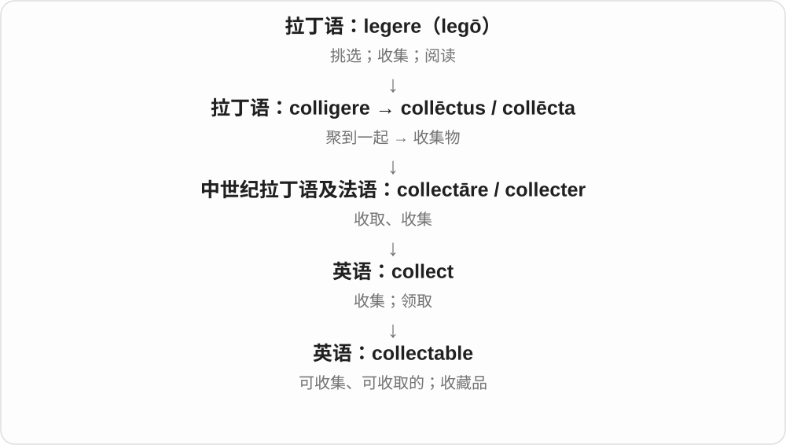

用在玩具、邮票上强调收藏，用在债款上强调可收回；不是凡拼成 -able 就只能说款项。

**常见搭配与例句**

collectable items；collectable stamps；collectable amounts。

> The market sells old books and other collectable items.

市场出售旧书和其他收藏物品。

> The accountant estimated the amount still collectable.

会计估算了仍可收回的金额。

**别混淆**

collectable 和 collectible 在收藏义上可互换；拼写偏好因地区、文体而异。

### 175. foldable — 可折叠的

**音标**：英 /ˈfəʊldəbəl/；美 /ˈfoʊldəbəl/

**先抓住这个画面**

平时展开用，需要收纳时能折小，就是 foldable。椅子、桌子、设备都可以用同样的能力关系来形容。

**怎么拆**

fold + -able，表示能被折叠。能力性质不说明折叠次数、耐用程度，也不要求所有部位都柔软。

**怎么变成今天的意思**

**古英语 fealdan → 中古英语 folden → fold 动词**  
把材料弯回、折叠

↓

**fold + -able → foldable**  
具有折叠能力的

a foldable chair 折叠椅，a foldable table 折叠桌，a foldable screen 可折叠屏幕。物件可通过关节、铰链或材料本身实现折叠。

**常见搭配与例句**

a foldable chair；a foldable table；a foldable screen。

> They carried a foldable table to the picnic.

他们带着一张折叠桌去野餐。

> The chair is foldable and easy to store.

这把椅子可以折叠，容易收纳。

**别混淆**

foldable 强调折叠能力，flexible 强调柔性、灵活。通过硬铰链折叠的椅子不必整体柔软。

### 176. viewable — 可观看的；可查看的

**音标**：/ˈvjuːəbəl/

**先抓住这个画面**

viewable 表示内容能打开、展示给人看，像文件已经放在可以访问的页面上。

**怎么拆**

view + -able，表示能够被查看。

**怎么变成今天的意思**

常见于数字内容的访问与显示。能查看不代表有权编辑或下载。

**常见搭配与例句**

viewable online；viewable by members；viewable on a phone。

> The photographs are viewable online.

这些照片可以在线查看。

> The file is viewable but cannot be edited.

这个文件可以查看，但不能编辑。

**别混淆**

visible 是看得见；viewable 常关心是否能访问、播放或查看内容。

### 177. reviewable — 可审查的；可复核的

**音标**：/rɪˈvjuːəbəl/

**先抓住这个画面**

reviewable 表示决定或材料还能拿出来重新看、重新评价，并非永远定死。

**怎么拆**

review + -able。

**怎么变成今天的意思**

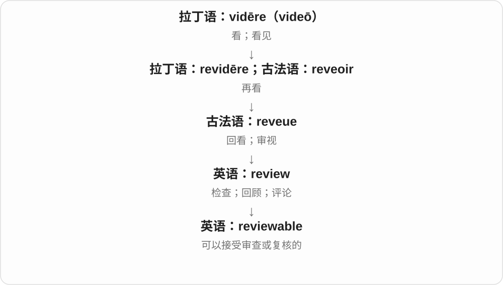

用于正式流程时，说明某种决定在规定条件下能被重新审视；一般也可说文件便于审看。

**常见搭配与例句**

a reviewable decision；a reviewable process；easily reviewable changes。

> The policy states that the decision is reviewable.

政策说明这一决定可以复核。

> Small changes make the document more easily reviewable.

把修改控制在小范围内，会让文档更容易审查。

**别混淆**

reviewable 不等于会被改变；重新审查以后也可能维持原决定。

### 178. washable — 可洗的、耐洗的

**音标**：英 /ˈwɒʃəbəl/；美 /ˈwɑːʃəbəl/

**先抓住这个画面**

不是只要沾得上水就算，而是按合适的方法洗后仍能用，不至于把东西洗坏。

**怎么拆**

wash + -able，可以被洗。machine washable 还把方式限定为机洗；单说 washable 不自动保证任何水温和程序都行。

**怎么变成今天的意思**

**古英语 wascan → 中古英语 wasshen → wash**  
用水洗、使湿润

↓

**英语 wash**  
洗；冲刷；洗涤液、薄涂层等名词义

↓

**wash + -able → washable**  
适合洗涤、洗后不易损坏

washable covers 可洗的罩套，washable paint 可洗掉的颜料，machine washable 可机洗。具体对象决定是物品能洗，还是污渍能洗掉。

**常见搭配与例句**

washable covers；washable paint；machine washable。

> The cushions have removable, washable covers.

靠垫的套子可以拆下清洗。

> Use washable paint for the children’s project.

给孩子们的手工作品用可洗掉的颜料。

**别混淆**

washable 可洗，waterproof 防水；能洗的布未必阻挡雨水，防水物也未必适合机洗。

### 179. walkable — 可以步行到达的；适宜步行的

**音标**：英 /ˈwɔːkəbəl/；美 /ˈwɑːkəbəl/

**先抓住这个画面**

脚能走得到，也愿意走；有时距离够近，有时道路环境让人容易步行。

**怎么拆**

walk + -able 可以……的，构成可步行、适合步行的形容词。

**怎么变成今天的意思**

**古英语 wealcan、wealcian 等相关形式**  
转动、移动；揉搓、踩踏等旧义

↓

**中古英语 walken → 英语 walk**  
逐渐形成现代走路、步行等常用义

↓

**walk + -able → walkable**  
走路 → 可步行、适宜步行的

a walkable distance 可以步行的距离；a walkable neighbourhood 适合步行的街区，通常涉及道路连接、设施可达性等，不只是单点距离。

**常见搭配与例句**

a walkable city；a walkable distance；a walkable neighbourhood。

> The station is a walkable distance from our flat.

车站离我们的公寓不远，可以走过去。

> They wanted a walkable neighbourhood with shops close by.

他们想住在商店就在附近、适合步行的街区。

**别混淆**

nearby 只说附近，不保证有合适的人行路径；walkable 强调走路可行或方便。

### 180. consumable — 消耗性的；可食用的；耗材

**音标**：英 /kənˈsjuːməbəl/；美 /kənˈsuːməbəl/

**先抓住这个画面**

打印机可以用很多年，里面的墨水却不断用完；墨水属于 consumables。

**怎么拆**

consume + -able；可表示能被消耗，也可指本来就会随使用耗尽的东西。

**怎么变成今天的意思**

**拉丁 sūmere；过去分词 sūmptus**  
拿取；取用

↓

**拉丁 con- + sūmere → cōnsūmere**  
完全取用、耗尽

↓

**古法语 consumer → 中古英语 consumen → consume**  
消耗；吃喝；吞没

↓

**英语 consume + -able → consumable**  
消耗 → 会耗尽的；耗材

作名词常用复数 consumables，指纸张、墨水等需补充的材料。食品语境中也可说可供食用，必须看对象。

**常见搭配与例句**

consumable supplies；printer consumables；consumable goods。

> Ink and paper are regular consumables for the office.

墨水和纸是办公室经常使用的耗材。

> The budget includes both equipment and consumable supplies.

预算包括设备和消耗性用品。

**别混淆**

disposable 强调用后丢弃；consumable 强调使用时耗掉，墨水是耗材却不是一件用完丢弃的器具。

### 181. drinkable — 可以饮用的；还算能喝的

**音标**：/ˈdrɪŋkəbl/

**先抓住这个画面**

可能是在说水可供饮用，也可能只是评价一杯咖啡虽不出色但还能喝；语气要看场景。

**怎么拆**

drink + -able，中古英语已有相应形式。可被喝的能力、适宜性延伸到口味勉强可接受。

**怎么变成今天的意思**

**古英语 drincan、drynċ → 中古英语 drinken、drink → drink**  
喝；饮品，名动词都有旧形式

↓

**现代 drink—drank—drunk**  
喝饮料、喝酒；相关醉态形容词发展

↓

**drink + -able → drinkable**  
适合饮用；口味可接受

drinkable water 可饮用水，barely drinkable 勉强能喝，quite drinkable 还算不错、能喝。

**常见搭配与例句**

drinkable water；barely drinkable；quite drinkable。

> The sign says the water is drinkable.

牌子上说这里的水可以饮用。

> The coffee was weak but drinkable.

咖啡淡了些，但还算能喝。

**别混淆**

drinkable 可能说适宜饮用或味道过得去；delicious 明确好喝。便宜饮料 quite drinkable 不等于在作实验室检测结论。

### 182. explainable — 可以解释的；能够说明原因的

**音标**：英、美 /ɪkˈspleɪnəbl/

**先抓住这个画面**

事情看着奇怪，但能找到线索，把其中道理讲明白。

**怎么拆**

explain + -able。

**怎么变成今天的意思**

**拉丁语：planus；planum**  
平坦的；平面、平地

↓

**拉丁语：ex- + planare → explanare**  
铺平、展开 → 讲清楚

↓

**法语及拉丁语 → 英语 explain**  
使人明白；解释

↓

**英语：explain + -able → explainable**  
能够被解释的

explainable AI 关注让人理解系统行为或结果的解释；可解释不自动等于预测总是正确。

**常见搭配与例句**

an explainable difference；explainable by…。

> The difference is explainable by the change in temperature.

这个差异可以用温度变化来解释。

> The team wants the model’s decisions to be explainable.

团队希望模型的判断能够得到清楚解释。

**别混淆**

understandable 可表示能理解，也可表示情有可原；explainable 更着眼于能否给出解释。

### 183. unexplainable — 无法解释的；说不清原因的

**音标**：英、美 /ˌʌnɪkˈspleɪnəbl/

**先抓住这个画面**

事情发生了，可暂时找不到能把它讲通的原因。

**怎么拆**

un-“不” + explainable“可解释的”。

**怎么变成今天的意思**

**拉丁语：planus；planum**  
平坦的；平面、平地

↓

**拉丁语：ex- + planare → explanare**  
铺平、展开 → 讲清楚

↓

**法语及拉丁语 → 英语 explain**  
使人明白；解释

↓

**英语：explain → explainable → unexplainable**  
可解释的 → 无法解释的

常表达说话者目前无法解释，不必理解成从此绝不可能有解释。

**常见搭配与例句**

an unexplainable feeling；an unexplainable event。

> She felt an unexplainable sense of unease.

她有一种说不清原因的不安。

> What seemed unexplainable at first became clear after the inspection.

起初看似无法解释的情况，检查之后就明白了。

**别混淆**

unexplained 是尚未得到解释；unexplainable 更强调难以或无法解释。

### 184. solvable — 可解决的；可求解的

**音标**：英 /ˈsɒlvəbəl/；美 /ˈsɑːlvəbəl/

**先抓住这个画面**

问题还没解出来，但有办法把它解出来，或者在某些条件下能找到解。

**怎么拆**

英语 solve 去末尾 e，加 -able；与早先借入的 soluble 同源而构词路线不同。

**怎么变成今天的意思**

**拉丁语 solvere；分词 solutus**  
松开、解开；清偿、解释

↓

**中古英语 solven → 英语 solve**  
松解、分散 → 解答、解决

↓

**英语 solve + -able → solvable**  
能够被解决、求解

a solvable puzzle 是有解的谜题，不一定容易。数学里的 solvable group 是“可解群”的专门名称，有严格定义，不能按字面理解成“所有问题都能解决的群”。

**常见搭配与例句**

a solvable problem；solvable by a particular method；a solvable group。

> The puzzle is solvable, but it requires patience.

这个谜题有解，不过需要耐心。

> The equation is solvable by an elementary method.

这个方程可以用一种初等方法求解。

**别混淆**

solvable 强调能找到解；easy 强调难度低。化学可溶通常用 soluble。

### 185. watchable — 值得看的；还看得下去的；可观看的

**音标**：英 /ˈwɒtʃəbəl/；美 /ˈwɑːtʃəbəl/

**先抓住这个画面**

内容能把注意力留住，至少不无聊到让人想关掉。

**怎么拆**

watch + -able，能被观看、值得观看；在影评语境常变成可以一看的评价。

**怎么变成今天的意思**

**古英语 wæċċe〔名词〕、wæċċan〔动词〕→ 中古英语 wacche / wacchen**  
清醒守望、观察、值守

↓

**英语 watch**  
持续看、留意、守卫；闹醒计时装置后发展出便携表义

↓

**watch + -able → watchable**  
能看；有一定吸引力、值得一看

a watchable comedy 可以一看的喜剧，highly watchable 很吸引人。单说 watchable 有时只是还不错，并不等于杰作。

**常见搭配与例句**

a watchable film；highly watchable；surprisingly watchable。

> The plot is simple, but the film is very watchable.

情节简单，不过电影挺好看。

> Good performances made the series surprisingly watchable.

好表演让这部剧意外地还挺能看下去。

**别混淆**

watchable 是可看、好看程度评价，watched 已看过；a watchable film 你也可能尚未 watched。

### 186. selectable — 可选择的；可被选中的

**音标**：/sɪˈlektəbəl/

**先抓住这个画面**

selectable 像菜单里亮着、可以点选的项目，说明系统允许你选它。

**怎么拆**

select + -able。

**怎么变成今天的意思**

常见于界面、设置或设备说明；能选不代表当前已经选上。

**常见搭配与例句**

a selectable option；selectable text；user-selectable settings。

> The menu contains three selectable options.

菜单中有三个可选项目。

> The text in the image is not selectable.

图片里的文字不能直接选取。

**别混淆**

selectable 是可选；selected 是已选；selective 是有选择性的。

### 187. winnable — 有望赢的；可以争取获胜的

**音标**：/ˈwɪnəbəl/

**先抓住这个画面**

局面不保证能赢，但仍有路可走、胜利够得着。

**怎么拆**

win + -able，双写 n；-able 表可实现的可能，不是过去式赢过。

**怎么变成今天的意思**

**古英语 winnan / ġewinnan → 中古英语 winnen**  
努力、争取；获得、征服

↓

**英语 win**  
赢；获得；争取到

↓

**win + -able → winnable**  
可以获胜、争取到的

a winnable game 有希望赢的比赛，a winnable seat 有望争取到的席位。评价可能会出错，不是事实结果已经确定。

**常见搭配与例句**

a winnable game；a winnable contest；a winnable seat。

> The coach believed the game was still winnable.

教练认为比赛仍有希望赢。

> They focused their effort on winnable contests.

他们把精力放在有望取胜的竞争中。

**别混淆**

winnable 有获胜可能，won 已赢；一个 winnable game 最后仍可能输掉。

### 188. teachable — 可教会的；愿意学习的；适于教学的

**音标**：/ˈtiːtʃəbəl/

**先抓住这个画面**

技能能通过教来掌握；人愿意听、愿意改；一个时机又恰好适合把道理讲明白。

**怎么拆**

teach + -able 可……的，形成可教、易受教的形容词。a teachable moment 是值得把握的教学契机，不是这一分钟自己在听课。

**怎么变成今天的意思**

**古英语 tǣċan → 中古英语 techen → teach**  
指示、展示、指导、教导

↓

**现代 teach 词族**  
让人学会；教学者、活动及可教性

↓

**teach + -able → teachable**  
能教 → 技能可教授、人愿学或时机适教

a teachable skill 可教会的技能，a teachable student 愿意学习的学生，a teachable moment 教育契机。

**常见搭配与例句**

a teachable skill；remain teachable；a teachable moment。

> Clear writing is a teachable skill.

清晰写作是一项可以教会的技能。

> The mistake became a teachable moment for the whole team.

这个错误成了全团队的一次学习契机。

**别混淆**

teachable 可教、愿学，与 talented 有天赋不同；愿受教不说明起点一定更聪明。

### 189. countable — 可数的；可计数的

**音标**：/ˈkaʊntəbəl/

**先抓住这个画面**

普通意思是能一项项数。语法里，把名词看成一个个独立单位；数学里，则问能不能给集合中的元素排上不重不漏的编号。

**怎么拆**

count + -able，英语形容词派生，后来分别用于语法和集合论。

**怎么变成今天的意思**

**拉丁 putare**  
修剪、清理；计算、考虑、判断

↓

**拉丁 com- 一起 + putare → computare**  
合起来计算、盘算

↓

**古法语 conter〔动词〕；conte〔名词〕**  
计数、叙说；一次计算

↓

**中古英语 counten／count → 英语 count**  
数、算入；总数、一次计数

↓

**英语 count + -able → countable**  
可计数的；语法和数学中的可数

a book、two books 中 book 是可数名词。数学常把有限集合与可列无限集合都叫 countable；例如所有整数虽无限，仍能按 0、1、-1、2、-2…列出。这里“可列”并不自动要求存在高效算法。

**常见搭配与例句**

a countable noun；a countable set；countably infinite。

> “Suggestion” is a countable noun in this sentence.

这个句子中的 suggestion 是可数名词。

> The set of integers is infinite but countable.

整数集是无限的，但它可数。

**别混淆**

日常数不完不等于数学不可数；语法上可数也取决于词的具体义项，不是现实物体大小。

### 190. configurable — 可配置的；可以按需调整设置的

**音标**：英 /kənˈfɪɡərəbl/；美 /kənˈfɪɡjərəbl/

**先抓住这个画面**

产品没有把所有选择固定死，而是留出选项，让不同用户把它调成适合自己的样子。

**怎么拆**

configure + -able，去末尾 e 后加后缀，表示能够被配置。重点在可调整的能力，不表示已经完成配置。

**怎么变成今天的意思**

**拉丁 figura（与 fingere 同族）**  
形状、形象；表达的形式

↓

**拉丁 figurare → configurare（con- + figurare）**  
塑造 → 按一定形式安排、构成

↓

**法语 configurer／直接拉丁借入 → 英语 configure**  
安排形状；后来设置系统的组成和选项

↓

**英语 configure + -able → configurable**  
允许调整组成、布局或设置的

a configurable dashboard 可以选择显示哪些内容；user-configurable 常说用户自己能调的。可配置到什么程度，要看产品实际提供的选项。

**常见搭配与例句**

highly configurable；a configurable interface；configurable options；a configurable dashboard。

> The dashboard is configurable, so each team can choose its own charts.

仪表板可以配置，因此每个团队都能选择自己要看的图表。

> The software includes configurable reminders for upcoming tasks.

软件提供可调整的提醒功能，用于提示即将到来的任务。

**别混淆**

customizable 范围更宽，可能连外观、功能都允许改；configurable 常聚焦已有选项怎样组合，不一定可以任意开发新功能。

### 191. reportable — 应报告的；可报告的

**音标**：英 /rɪˈpɔːtəbəl/；美 /rɪˈpɔːrtəbəl/

**先抓住这个画面**

reportable 给某件事贴上一个标签：“这件事需要报上去”或“可以作为报告内容”。具体是哪一种，要看规则和语境。

**怎么拆**

report + -able，表示可被报告；在制度用语中常进一步表示应当报告。

**怎么变成今天的意思**

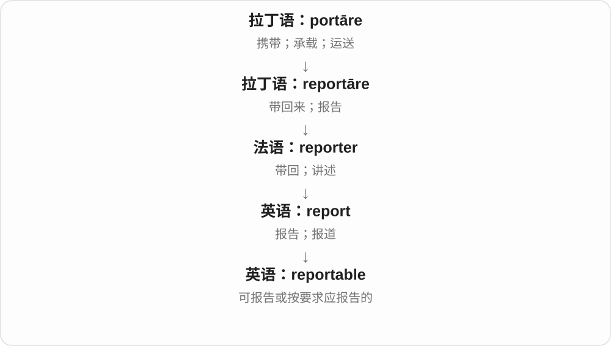

reportable incident 通常指符合某种报告条件的事件。后缀 -able 不总只表达纯粹能力，在特定搭配里也可承载制度要求。

**常见搭配与例句**

a reportable incident（须报告的事件）；reportable data（可报告的数据）；reportable income（按相关规则需申报的收入）。

> The handbook explains which incidents are reportable.

手册说明了哪些事件需要报告。

> The study produced no reportable results at that stage.

研究在那个阶段还没有可报告的结果。

**别混淆**

reportable 是是否需要或能够报告；reported 是已经报告。看到 reportable，不能推断通知已经发出。

### 192. provable — 可证明的

**音标**：英 /ˈpruːvəbəl/；美 /ˈpruːvəbəl/

**先抓住这个画面**

不仅觉得像真的，而且原则上有办法拿出证明。

**怎么拆**

prove + -able“能够……的”；与 probable 深层同源，现代意思已经分开。

**怎么变成今天的意思**

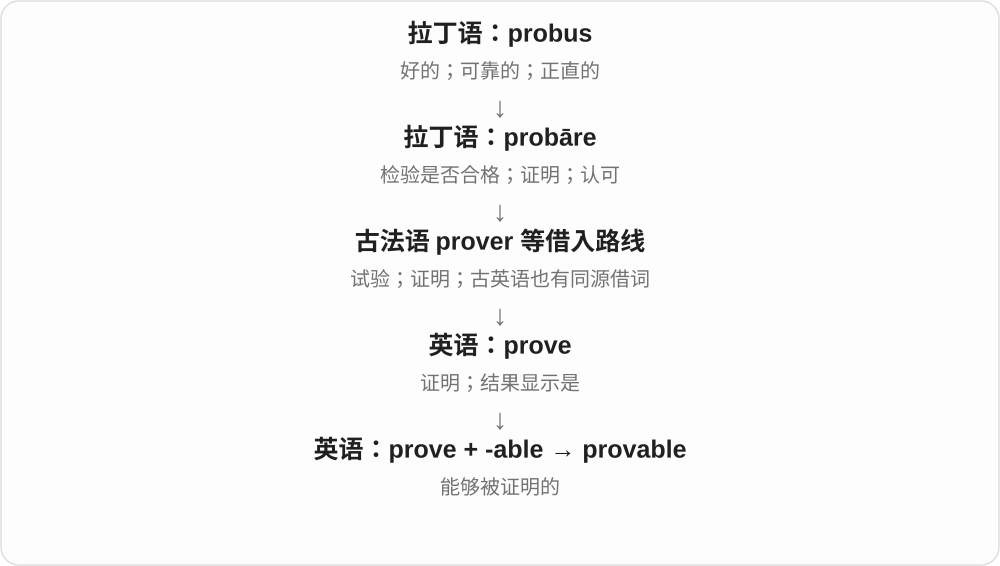

常说 provable facts 或 provable within a system，后者强调在指定规则内可以推出。

**常见搭配与例句**

a provable claim；mathematically provable。

> The conclusion is provable from the stated assumptions.

这个结论可以从列出的假设中证明。

> She focused on facts that were independently provable.

她把注意力放在可独立证实的事实上。

**别混淆**

provable 是可证明；probable 是很可能，后者不能保证存在严格证明。

### 193. testable — 可检验的；可测试的

**音标**：/ˈtestəbəl/

**先抓住这个画面**

能想出办法，用观察或实验去检查它，而不是永远只能凭感觉争论。

**怎么拆**

test + -able 可被、能，构成可测试的形容词。这个能力描述只说存在检验办法，不预先给出真假结论。

**怎么变成今天的意思**

**拉丁 testum → 古法语 test、teste**  
陶制容器；检验金属所用的器皿

↓

**英语 test**  
金属检验 → 检查品质、能力与结果

↓

**test + -able → testable**  
能够被检验的

a testable hypothesis 可检验假设，a testable prediction 可检验预测，testable code 易于开展测试的代码。

**常见搭配与例句**

a testable hypothesis；a testable claim；testable code。

> The team turned the idea into a testable hypothesis.

团队把这个想法变成了可检验的假设。

> The design makes each component separately testable.

这种设计使每个组件都能单独测试。

**别混淆**

testable 能检验，tested 已经检验；testable hypothesis 不等于已证实的理论。

### 194. quotable — 值得引用的、适合摘引的

**音标**：英 /ˈkwəʊtəbəl/；美 /ˈkwoʊtəbəl/

**先抓住这个画面**

一句话短、准、醒目，别人一听就想拿来复述；quotable 常夸这种容易被记住、被引用的特点。

**怎么拆**

quote 去末尾 e + -able，可供、值得被引用。这里的值得引用不保证内容就真实。

**怎么变成今天的意思**

**拉丁 quotus → 中世纪拉丁 quotāre**  
第几个 → 编号、标出位置

↓

**法语 coter 等 → 英语 quote**  
标出处 → 引用原话；报出价格

↓

**quote + -able → quotable**  
可以、适合或值得引用的

a quotable line 值得摘引的一句，highly quotable 很适合引用，quotable remarks 容易被摘引的话。

**常见搭配与例句**

a quotable line；a quotable phrase；highly quotable。

> The speech contained several quotable lines.

演讲里有几句很值得摘引的话。

> Her answer was brief, clear and highly quotable.

她的回答简短清楚，很适合被引用。

**别混淆**

quotable 是适合引用，quoted 是已经被引用；一句话可以很 quotable，却还没人真的 quoted it。

### 195. tunable — 可调音的；可调谐、可调整的

**音标**：英 /ˈtjuːnəbl/；美 /ˈtuːnəbl/

**先抓住这个画面**

留了可拧动的空间，能够调到需要的状态。

**怎么拆**

tune + -able，表示可以被调节；通常写 tunable，另见 tuneable。

**怎么变成今天的意思**

**希腊 teinein → tonos**  
拉伸 → 张紧、琴弦张力；音调

↓

**拉丁 tonus → 古法语 ton → 英语 tone**  
声音、音调 → 语气等

↓

**中古英语 tone／tune 两种形式**  
同族变体；元音变化的具体原因不明

↓

**英语 tune**  
曲调；调准音高或设备

↓

**英语 tune + -able → tunable**  
可以调准音高、频率或参数的

a tunable laser 是波长可调的激光器，tunable parameters 是可以调整的参数。这个词表达调整能力，不说明已经调好了，也不保证可调范围无限；要看具体设备或设计。

**常见搭配与例句**

tunable parameters；a tunable filter；a tunable laser。

> The filter has a tunable frequency range.

这个滤波器的频率范围可以调节。

> The program exposes several tunable parameters.

这个程序提供了几个可调整的参数。

**别混淆**

tuned 表示调过或处于某种调谐状态，tunable 表示具备调节可能。

### 196. deployable — 可部署的、可展开使用的

**音标**：/dɪˈplɔɪəbəl/

**先抓住这个画面**

东西已经能被放到需要的位置展开、投入用，就是 deployable。它说可用来部署，不是保证任何地方都能立刻用。

**怎么拆**

deploy + -able，并有法语 déployable 对应形式；保留 y。形容词接可被部署，也可在专门语境中作可部署资源的名词。

**怎么变成今天的意思**

**拉丁 dis- 分开 + plicare 折叠 → 法语 desploiier、déployer**  
把折拢的东西展开

↓

**英语 deploy → 部署兵力、资源、系统；+ -able、re-**  
展开到可用位置；可部署；再次、重新部署

↓

**deploy + -able／法语对应形式 → deployable**  
能展开、部署使用的性质

deployable equipment 可部署设备；a deployable package 可部署软件包；deployable resources 可调配资源。

**常见搭配与例句**

deployable equipment；a deployable package。

> The exercise used lightweight, deployable equipment.

演练使用了轻便、可部署的设备。

> The build produces a deployable software package.

构建过程生成可部署的软件包。

**别混淆**

deployable 不是已经 deployed；前者讲可部署性，后者讲动作已经发生或相应状态。

### 197. deliverable — 可交付的；可交付成果

**音标**：英 /dɪˈlɪvərəbl/；美 /dɪˈlɪvərəbl/

**先抓住这个画面**

项目不能只说“我们努力了”，还得拿出一个约定能交出的东西：报告、原型、上线功能，都可能是 a deliverable。

**怎么拆**

deliver + -able，英语形容词，后来也作可数名词指可交付成果。不是“快递员”的称呼。

**怎么变成今天的意思**

**拉丁 liber**  
自由的；不受束缚的

↓

**拉丁 liberare → 晚期拉丁 de- + liberare → deliberare**  
使自由、解除束缚

↓

**古法语／盎格鲁法语 delivrer → 中古英语 deliveren**  
释放、救出；交给、交付

↓

**英语 deliver**  
送达、交付；发表；实现；较旧用法保留解救义

↓

**英语 deliver + -able → deliverable**  
能够交付的 → 约定要交出的项目成果

形容词问能否交付；名词问最终要交什么。The deliverables are listed below 中是复数名词，通常译成果或交付物。

**常见搭配与例句**

project deliverables；a key deliverable；define the deliverables；deliverable by Friday。

> The main deliverable is a working prototype with a short user guide.

主要交付成果是一个可运行的原型和一份简短用户指南。

> We need to confirm whether the full report is deliverable by Friday.

我们需要确认完整报告是否能在周五前交付。

**别混淆**

milestone 是进度节点，deliverable 是交出的成果；某个节点可能以交付一份成果为标志，但概念不同。

### 198. employable — 具备就业条件的、能被雇用的

**音标**：/ɪmˈplɔɪəbəl/

**先抓住这个画面**

拥有让雇主愿意考虑聘用的技能、条件。说具备机会和能力，不是已经拿到工作。

**怎么拆**

employ + -able；employ 经法语 employer 接拉丁 implicāre 等旧路径，现代 employable 说可被雇用，不要硬译成可被缠绕。

**怎么变成今天的意思**

**法语 employer → employ**  
使用、雇用

↓

**employ + -able → employable**  
具备被雇用的条件

become more employable 提升就业能力，employable skills 有助就业的技能，highly employable 很有就业竞争力。

**常见搭配与例句**

become more employable；highly employable；employable skills。

> The course aims to make graduates more employable.

这门课旨在提高毕业生的就业能力。

> Her language skills make her highly employable.

她的语言能力使她很有就业竞争力。

**别混淆**

employable 能被雇用，employed 已受雇，unemployed 未就业；一个人可以暂未就业却具备很强的就业能力。

### 199. extendable — 能够延长、展开的

**音标**：/ɪkˈstendəbəl/

**先抓住这个画面**

extendable 像一张平时收着、来客时还能拉长的桌子。

**怎么拆**

extend + -able；也有 extendible 拼法。

**怎么变成今天的意思**

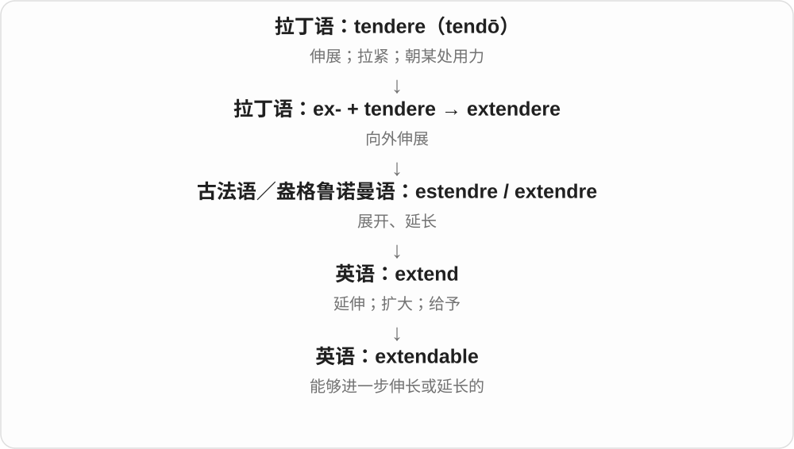

可说物件长度，也可说合同、期限能否续长。

**常见搭配与例句**

an extendable table；an extendable handle；an extendable contract。

> The table has an extendable top.

这张桌子的桌面可以拉长。

> The permit is extendable for another month.

这份许可可以再延长一个月。

**别混淆**

extendable 与 extensible 有重叠；前者日常物件和期限更常见，后者常见于技术设计。

### 200. tradable — 可交易、可买卖的

**音标**：/ˈtreɪdəbəl/

**先抓住这个画面**

能够进入交易，而不是只能自用、不能转让；具体是否允许还得看物件和规则。

**怎么拆**

trade + -able，常写 tradable，也见 tradeable。可交易是属性，不能从这个词自动推出值钱或容易脱手。

**怎么变成今天的意思**

**中古低地德语 trade 路径、轨迹 → 中古英语 trade**  
道路、做事的途径

↓

**现代 trade**  
惯常活动、行业 → 手艺、职业；商业交易

↓

**trade + -able → tradable**  
可以被交易的

tradable goods 可贸易商品，tradable assets 可交易资产，tradable cards 可交换的卡片。

**常见搭配与例句**

tradable goods；tradable assets；tradable cards。

> The game includes tradable cards.

这款游戏包含可交换的卡片。

> The report distinguishes tradable goods from local services.

报告区分可贸易商品与本地服务。

**别混淆**

tradable 能交易，traded 已交易；profitable 有利可图是另一个判断。

### 201. transportable — 可运输的；可迁移的

**音标**：英 /trænsˈpɔːtəbəl/；美 /trænsˈpɔːrtəbəl/

**先抓住这个画面**

transportable 只说“有办法运走”。一间组合式房屋能被卡车拉走，也可以是 transportable，虽然没人能把它塞进背包。

**怎么拆**

transport + -able，表示可以被运输。

**怎么变成今天的意思**

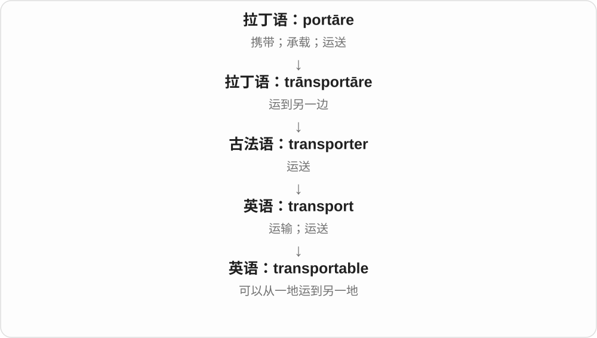

比起 portable，它常允许更大的体积和更复杂的运输方式。重点在能移动到另一个地点，不在日常携带是否轻松。

**常见搭配与例句**

a transportable unit（可运输单元）；transportable equipment（可运输设备）；a transportable building（可搬迁建筑）。

> The exhibition is packed into transportable units.

展览被装成可运输的单元。

> The laboratory was designed to be transportable by truck.

这间实验室被设计成可以用卡车运走。

**别混淆**

portable 通常暗示方便带着用；transportable 可以需要起重机、车辆或拆装。

### 202. definable — 可定义的；可明确界定的

**音标**：/dɪˈfaɪnəbəl/

**先抓住这个画面**

definable 表示一件事的边界可以说清楚：有明确的条件，能够判断什么算它、什么不算它。

**怎么拆**

define + -able；去掉末尾 e 再加 -able，表示“可以被界定的”。

**怎么变成今天的意思**

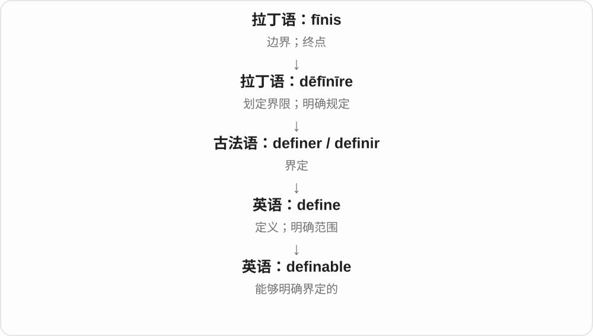

define 是画边界，definable 是这条边界能画出来。a clearly definable goal 因而是一个能把具体要求说清楚的目标。

**常见搭配与例句**

a definable goal（可明确界定的目标）；clearly definable limits（能够清楚界定的界限）。

> We need a clearly definable goal for the first stage.

第一阶段需要一个能够明确界定的目标。

> The boundary between the two styles is not easily definable.

这两种风格之间的界限不容易说清。

**别混淆**

definable 说“可以界定”；defined 说“已经界定”。有能力做和已经做完不是一回事。

### 203. fixable — 可以修好的；可以解决的

**音标**：/ˈfɪksəbəl/

**先抓住这个画面**

问题确实存在，但还有办法处理，不是已经无可挽回。

**怎么拆**

fix + -able；直接由现代动词的修理、解决义派生。

**怎么变成今天的意思**

**拉丁语 figere → 分词 fixus**  
插入、钉住、使固定 → 固定的

↓

**可能经古法语 \*fixer → 中古英语 fixen → fix**  
固定、把目光停住；后来指安排、修理；\* 为重建形式

↓

**英语 fix + -able → fixable**  
修好、解决 → 能够修好、解决的

a fixable fault 是可修复的故障；a fixable mistake 是可补救的错误。只说明存在办法，不表示一定便宜、容易或立刻能完成。

**常见搭配与例句**

a fixable problem；a fixable fault；easily fixable。

> The mechanic said the fault was fixable.

修理师说这个故障可以修好。

> The report contains several easily fixable errors.

报告中有几个很容易纠正的错误。

**别混淆**

fixed 是已经解决；fixable 只是有解决的可能。

### 204. addressable — 可寻址的；可处理的；可服务到的

**音标**：英、美 /əˈdresəbəl/

**先抓住这个画面**

能准确找到它并对它做事；问题则是有办法着手处理。

**怎么拆**

address + -able，对应 address“定位、处理、面向”的不同义项。

**怎么变成今天的意思**

**拉丁语：ad**  
朝向；靠近；加到

↓

**通俗拉丁语 \*directiāre → \*addirectiāre**  
使直；引向

↓

**古法语 adrecier → 英语 address**  
指向、对着说；处理；写地址

↓

**英语 address + -able → addressable**  
能被定位、处理或覆盖的

计算机的 addressable memory 是可用地址访问的内存；addressable market 是产品能够服务的市场范围，不等于实际已经拿下的市场。

**常见搭配与例句**

addressable memory；an addressable problem；total addressable market。

> Each light in the strip is individually addressable.

灯带上的每一盏灯都可以单独寻址控制。

> Most of the complaints are addressable with clearer instructions.

大多数投诉反映的问题都能通过更清楚的说明来处理。

**别混淆**

available memory 说当前可用多少；addressable memory 说地址系统能够访问到多少。

### 205. maneuverable — 容易操控转向的；机动灵活的

**音标**：英 /məˈnuːvərəbəl/；美 /məˈnuːvərəbəl/

**先抓住这个画面**

maneuverable 像一辆能在窄处轻松转弯的小车，能按需要迅速改变位置或方向。

**怎么拆**

maneuver + -able；对应英式 manoeuvrable。

**怎么变成今天的意思**

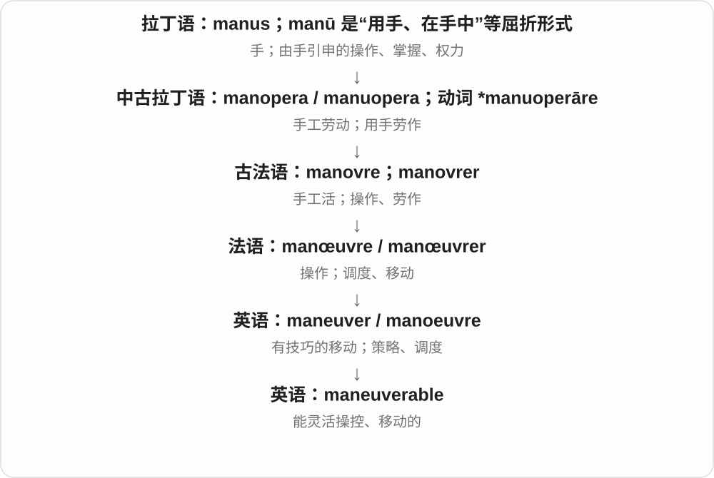

常描述车辆、船只、器材等的操控表现，不只是说它能够向前走。

**常见搭配与例句**

a maneuverable vehicle；highly maneuverable；light and maneuverable。

> The compact cart is easy to push and highly maneuverable.

这辆小推车很好推，转向也很灵活。

> The smaller boat is more maneuverable in narrow channels.

较小的船在狭窄水道里更容易操控。

**别混淆**

mobile 是可以移动；maneuverable 进一步说转向、调整位置是否容易。

### 206. exploitable — 可利用的、可开发的；可乘之机的

**音标**：/ɪkˈsplɔɪtəbəl/

**先抓住这个画面**

资源存在可以开发的价值，漏洞留下可以利用的机会，都可 exploitable。它先说能被用上，具体是好事还是危险，取决于谁利用什么。

**怎么拆**

借法语对应形式或由 exploit + -able 形成，历史上有不同分析。-able 在这里表示可以被利用、开发的性质。

**怎么变成今天的意思**

**拉丁 explicitum，接 explicare 展开、完成 → 法语 esploit、esploitier**  
完成、成果、收益，再向利用发展

↓

**exploit + -able／法语对应形式 → exploitable**  
能被利用、开发的

exploitable resources 可开发资源；an exploitable weakness 可被利用的弱点；an exploitable opportunity 可利用机会。

**常见搭配与例句**

exploitable resources；an exploitable weakness。

> The survey identified commercially exploitable resources.

调查识别了具有商业开发价值的资源。

> The review found an exploitable weakness in the design.

审查发现设计中存在一个可被利用的弱点。

**别混淆**

exploitable 可利用不等于已经被利用；exploited 才常是已利用、被剥削的过去分词状态。

### 207. saleable — 好卖的；具备出售条件的

**音标**：/ˈseɪləbl/

**先抓住这个画面**

有人愿意买，或者整理到适合拿出去卖的状态；不是说已经卖完。

**怎么拆**

sale + -able，另有 salable 拼写，尤见美式。后缀说可出售、适销，不自动说明销量已经很好。

**怎么变成今天的意思**

**晚期古英语 sala；可能有古诺尔斯语 sala 影响**  
售卖行为，与 sell 同属旧日耳曼词族

↓

**现代 sale**  
销售、出售；降价促销，复数 sales 另有集合用法

↓

**sale + -able → saleable〔也拼 salable〕**  
能找到买家、适合出售的

a saleable product 适销产品，a saleable condition 可出售状态，saleable skills 有市场价值的技能。

**常见搭配与例句**

a saleable product；saleable condition；saleable skills。

> The repair put the furniture back into saleable condition.

修理使家具恢复到可出售的状态。

> The course aims to teach saleable skills.

课程旨在教授有市场需求的技能。

**别混淆**

saleable 能卖、适合卖，sold 已卖；bestselling 已体现畅销表现，不只是有可能卖掉。

### 208. clickable — 可点击的〔界面元素等〕

**音标**：/ˈklɪkəbəl/

**先抓住这个画面**

看着不只是文字或图形，点下去会触发动作。重点是界面能响应点击。

**怎么拆**

click + -able，形成可以被点击、点后发生动作的形容词。历史有其他专门用法，日常先学界面义。

**怎么变成今天的意思**

**拟声 click → 英语 click**  
短促、清脆的咔哒声；使发此声

↓

**英语 click 的动作与比喻**  
按下鼠标、点击；突然明白、彼此合拍

↓

**click + -able → clickable**  
可以点击、对点击有响应的

a clickable link 可点击链接，a clickable icon 可点击图标，make the image clickable 把图片设置为可点。

**常见搭配与例句**

a clickable link；a clickable icon；a clickable image。

> The blue words are clickable links.

蓝色文字是可点击链接。

> Make the whole button clickable, not just its label.

让整个按钮都能点击，而不只是按钮上的文字。

**别混淆**

clickable 可点，不等于 visible 可见；能看见的字不一定是链接，隐藏元素也可能在技术上设置了响应。

### 209. exchangeable — 可交换、可兑换、可更换的

**音标**：/ɪksˈtʃeɪndʒəbəl/

**先抓住这个画面**

可以拿它去换别的东西。具体能换什么、按什么规则换，要看后面的 for 和实际语境。

**怎么拆**

exchange + -able，形成能被交换的形容词，保留 e；并非所有以 e 结尾的词接后缀都去 e。

**怎么变成今天的意思**

**通俗拉丁语重建形 \*excambiāre → 法语 eschanger、eschange**  
交换、更换；有 ex- 与交换词基背景

↓

**中古英语 eschaungen、eschaunge → exchange**  
词形后来向 ex- 调整；交换、兑换和交易场所等

↓

**exchange + -able → exchangeable**  
可以交换、换取其他东西的

exchangeable for cash 可兑现金，exchangeable tickets 可更换的票券；具体限制由票券条款说明。

**常见搭配与例句**

exchangeable for；freely exchangeable；exchangeable goods。

> These vouchers are exchangeable for meals.

这些券可换餐食。

> The item is exchangeable for another size.

这件商品可以换其他尺码。

**别混淆**

exchangeable 可交换，interchangeable 可互换使用；两种零件能互相顶替使用，通常说 interchangeable，不只是可以买卖换手。

### 210. survivable — 可以生还的；有生存能力的

**音标**：英 /səˈvaɪvəbəl/；美 /sərˈvaɪvəbəl/

**先抓住这个画面**

有两种看法：危险还留着活路，或系统本身经得住危险。

**怎么拆**

英语 survive + -able。-able 可让它表示某种遭遇“能被熬过去”，也可形容物件“能够活下来”。

**怎么变成今天的意思**

**拉丁 super**  
在上方、超过、越过

↓

**后期拉丁 super- + vivere → supervivere**  
超过某时点而活着；比别人活得久

↓

**古法语／盎格鲁法语 survivre → 英语 survive**  
继续活着、幸存；继续存在

↓

**英语 survive + -able → survivable**  
能够从中生还；能够继续存在

a survivable accident 说事故仍有生还可能；a survivable communications system 说通信系统受破坏后仍能维持功能。可生还不等于必然无伤。

**常见搭配与例句**

a survivable accident；a survivable system。

> The protective cabin helped make the crash survivable.

防护舱使这次撞击仍有生还可能。

> Engineers designed a survivable network with several backup routes.

工程师用多条备用路径设计了抗毁生存能力较强的网络。

**别混淆**

survival 是结果；survivable 只说明存在生还或存续的可能。

### 211. stackable — 可堆叠的；〔部分场景〕可叠加使用的

**音标**：/ˈstækəbəl/

**先抓住这个画面**

椅子形状设计得能一把套一把叠起，就 stackable。优惠、功能也可能像层层叠加一样共同使用。

**怎么拆**

stack + -able，形成能够被堆叠的性质；再由物理堆叠扩成可组合、累计的用法。

**怎么变成今天的意思**

**斯堪的纳维亚词，联系古诺尔斯 stakkr → stack**  
草垛、堆放成堆的东西

↓

**stack + -able → stackable**  
可堆叠 → 可共同叠加使用

stackable chairs 可叠放的椅子，stackable containers 可堆叠容器，stackable discounts 可叠加优惠，是否真能叠加以相应规则为准。

**常见搭配与例句**

stackable chairs；stackable containers。

> The hall uses stackable chairs to save space.

大厅使用可叠放椅子来节省空间。

> These stackable containers fit neatly in the cupboard.

这些可堆叠容器能整齐收进橱柜。

**别混淆**

stacked 是已经堆好，stackable 是能够这样堆；能堆并不表示此刻已堆。

### 212. billable — 可计费的；可向客户收费的

**音标**：/ˈbɪləbəl/

**先抓住这个画面**

做了这项工作，可以按约定写进给客户的账单；重点是费用能不能算给客户。

**怎么拆**

bill 开账单 + -able 可被，形成可计费的。常用于律师、顾问、技术服务等的时间或工作项目。

**怎么变成今天的意思**

**中世纪拉丁 bulla 印封文件 → 法语 bille 等 → 英语 bill**  
书面文件 → 账单、法案、海报等

↓

**bill + -able → billable**  
可以列入账单 → 可计费的

billable hours 可计费工时，billable work 可收费工作；不是所有上班时间都必然属于 billable hours。

**常见搭配与例句**

billable hours；billable time；billable work。

> She recorded six billable hours for the project.

她为这个项目记录了六小时可计费工时。

> The contract explains which expenses are billable.

合同说明了哪些开支可以向客户收费。

**别混淆**

billable 可收费，paid 已付款、带薪；一段 billable time 可以尚未实际收款。

### 213. editable — 可编辑、可修改的

**音标**：/ˈedɪtəbəl/

**先抓住这个画面**

文件里的文字、表格能直接改动，便是 editable；截图上看得到字，却未必能像原文档一样编辑。

**怎么拆**

edit + -able，表示能够接受编辑的性质。

**怎么变成今天的意思**

**拉丁 ēdere、ēditus 等出版相关形式 → editor**  
把作品刊出、整理出版的人

↓

**editor → edit〔逆构〕**  
英语从较长的人物名称取出动词，也受法语 éditer 影响

↓

**edit + -able → editable**  
能够编辑、修改的

an editable file 可编辑文件，editable text 可编辑文字，an editable template 可编辑模板。

**常见搭配与例句**

an editable file；editable text；an editable template。

> Please send an editable version of the document.

请发送可编辑版本的文档。

> The names are editable, but the logo is fixed.

名称可以修改，但标志是固定的。

**别混淆**

editable 说能否编辑，readable 说能否读取、读懂。文件可读，不表示有编辑权限或内容结构方便改。

### 214. repairable — 可以修理的；可以修复的

**音标**：英 /rɪˈpeərəbəl/；美 /rɪˈperəbəl/

**先抓住这个画面**

repairable 像摔坏的手机：虽然现在不能正常用，但换件、维修后仍有机会恢复。

**怎么拆**

repair + -able，是英语中可直接拆出的派生词；重音随 repair 保留在后面的音节。

**怎么变成今天的意思**

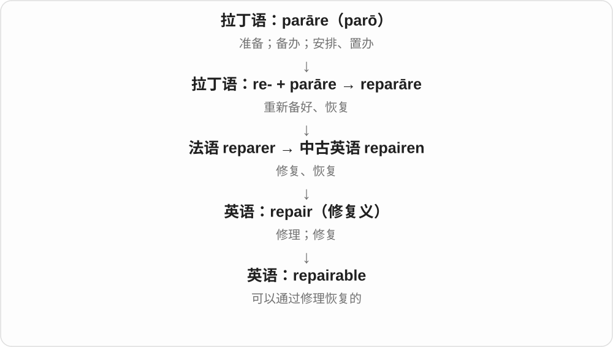

它说存在修复的可能，不保证修起来便宜、方便或值得。有的东西 technically repairable，却不经济。

**常见搭配与例句**

a repairable fault；repairable damage；easily repairable。

> The technician confirmed that the screen was repairable.

技术员确认这块屏幕可以修好。

> The damage is repairable, but the work will take time.

损坏可以修复，但需要花些时间。

**别混淆**

reparable 更书面，也常谈抽象损害；repairable 特别自然地用于机器、物品和故障。

### 215. unsinkable — 不会沉没的；不可击垮、百折不挠的

**音标**：/ʌnˈsɪŋkəbəl/

**先抓住这个画面**

字面是不能沉；形容人的乐观、精神时，则像怎样打击都不被压下去。

**怎么拆**

un- 不 + sink + -able 能被……的。先形成能被沉下去的结构，再整体否定。

**怎么变成今天的意思**

**古英语 sincan → 中古英语 sinken → sink**  
往下沉、没入

↓

**向下、容纳排水的扩展**  
沉下；心情低落；下水处、洗涤槽

↓

**un- + sink + -able → unsinkable**  
不能被沉没 → 不可击垮的精神等

an unsinkable boat 不会沉的船，unsinkable optimism 打不倒的乐观，an unsinkable spirit 百折不挠的精神。

**常见搭配与例句**

unsinkable optimism；an unsinkable spirit。

> Her unsinkable optimism kept the group going.

她打不倒的乐观让团队坚持下去。

> The advertisement described the model boat as unsinkable.

广告把这艘模型船描述为不会沉没。

**别混淆**

对船的 unsinkable 是一种性能主张，词本身不验证它；对人的比喻则强调顽强乐观。

### 216. shareable — 可分享的；适合传播、共用的

**音标**：英 /ˈʃeərəbəl/；美 /ˈʃerəbəl/

**先抓住这个画面**

能交给别人一起看、一起用；内容平台里还常夸它容易让人想转发。

**怎么拆**

share + -able，通常保留 e，形成可分享性质词；另有 sharable 拼写。不是一旦可分享，就代表拥有转发任何内容的许可。

**怎么变成今天的意思**

**古英语 sċearu → 中古英语 schare → share**  
切分、分出的部分，与 shear 等词族相关

↓

**英语 share**  
一份、股份；分享、共同使用、共同承担

↓

**share + -able → shareable**  
分享 → 可分享、适于传播的

shareable content 适合分享传播的内容，a shareable link 可分享链接；shareable portions 可供多人分享的份量。

**常见搭配与例句**

shareable content；a shareable link；a shareable document。

> The app creates a shareable link to the album.

应用会生成一个可分享的相册链接。

> The café serves small, shareable dishes.

咖啡馆供应适合大家分着吃的小份菜。

**别混淆**

shareable 能、适合分享，shared 已分享、共同使用；a shared folder 共享文件夹不是在赞它很有传播力。

### 217. maintainable — 能够维持的；便于维护的

**音标**：/meɪnˈteɪnəbəl/

**先抓住这个画面**

maintainable 像一台零件容易找到、结构看得明白的机器，出了问题能照料、修改，长期用下去也撑得住。

**怎么拆**

maintain + -able。

**怎么变成今天的意思**

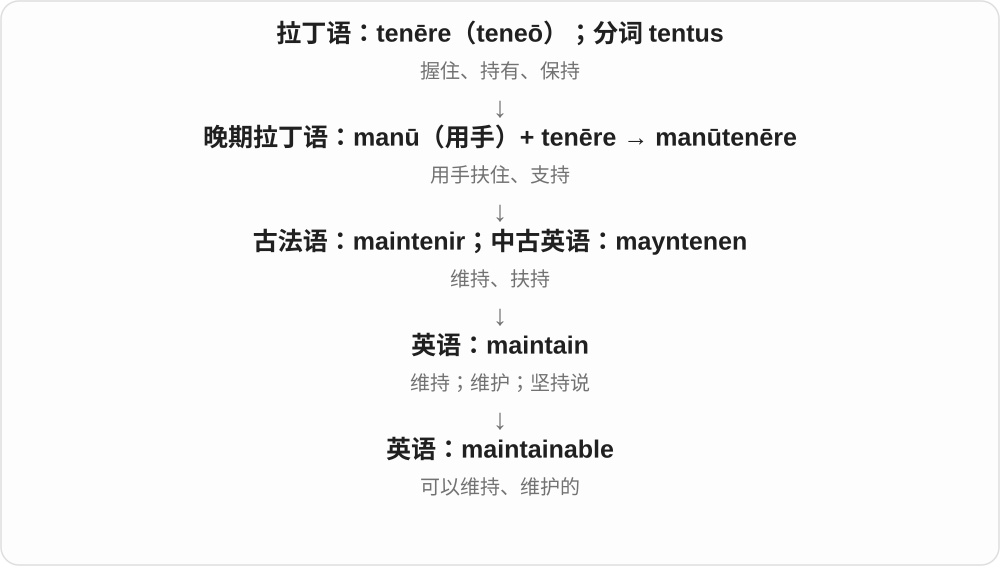

在软件和工程中常特别强调容易维护；在其他语境也可说某个水平或状态能持续保持。

**常见搭配与例句**

maintainable software；a maintainable system；a maintainable level。

> Clear naming makes the code more maintainable.

清楚的命名让代码更容易维护。

> The team chose a design that would remain maintainable for years.

团队选择了一种多年后仍能维护的设计。

**别混淆**

reliable 是运行可靠；maintainable 是便于维护。一个系统暂时可靠，也可能很难修改。

### 218. bookable — 可预订的

**音标**：/ˈbʊkəbəl/

**先抓住这个画面**

房间、时段已经开放，可以把预约登记上去。

**怎么拆**

book 动词 + -able，表示能够预订。不是书的内容值得相信这个意思。

**怎么变成今天的意思**

**古英语 bōc → 中古英语 bok / book**  
书、书面记录

↓

**英语 book**  
书；账簿；预订、登记等动词用法

↓

**book + -able → bookable**  
可以预约、预订的

bookable online 是可网上预订，bookable time slots 是可预约时段。实际是否还有空位、需付款等看具体服务。

**常见搭配与例句**

bookable online；a bookable room；bookable time slots。

> The meeting rooms are bookable online.

会议室可在网上预订。

> The calendar shows the bookable time slots.

日历显示可预约时段。

**别混淆**

bookable 可预订，booked 已被预订；available 可用更宽，不一定需要预约。

### 219. dispensable — 可以省去的；并非必需的；可替代的

**音标**：英、美 /dɪˈspensəbəl/

**先抓住这个画面**

把它拿走，主要事情依然能够继续，所以并非缺它不可。

**怎么拆**

接中世纪拉丁 dispensabilis，与 dispensare“准予豁免、分配”有关；现代也能按 dispense with + -able 理解。早期“可豁免”逐渐扩展为“可省掉”。

**怎么变成今天的意思**

**拉丁 dis- + pendere → dispendere**  
分别称出、支付

↓

**拉丁反复式 dispensare**  
按份分配、管理；后来也有准予豁免的用法

↓

**中世纪拉丁 dispensabilis → 英语 dispensable**  
可获豁免的 → 可以省去的

↓

**现代一般用法**  
非必要、可不使用或可被替代的

dispensable details 是可删去的细节；feel dispensable 是觉得自己可有可无。说人 dispensable 往往会显得冷漠，表示对方的作用不被珍惜。

**常见搭配与例句**

dispensable details；a dispensable feature；feel dispensable；entirely dispensable。

> Several decorative features are dispensable if we need to reduce costs.

如果需要降低成本，有些装饰功能可以省去。

> The manager’s remarks made experienced staff feel dispensable.

经理的话让经验丰富的员工觉得自己可有可无。

**别混淆**

indispensable 加 in- 后正好反过来，表示不可或缺。expendable 常强调可以消耗、牺牲，dispensable 更强调可以不用。

### 220. adoptable — 可采用的；可被收养或领养的

**音标**：英 /əˈdɒptəbəl/；美 /əˈdɑːptəbəl/

**先抓住这个画面**

条件允许把它接纳进来，或它已经适合进入收养、领养程序。

**怎么拆**

adopt + -able；说具有可被采用或接纳的条件。

**怎么变成今天的意思**

**拉丁语 optare**  
选择、希望；更早来源有争议

↓

**拉丁语 ad- + optare → adoptare**  
为自己选择 → 接纳、收养

↓

**英语 adopt 的近源有不同解释**  
从 adoption 逆构，或借古法语 adopter / 拉丁 adoptare

↓

**英语 adopt**  
收养；正式采纳、采用

↓

**英语 adopt + -able → adoptable**  
采用、收养 → 可以被采用、收养的

动物救助材料里的 adoptable pets 指可供领养的宠物；方案语境里 adoptable proposal 指可采纳的提案。它不是 adored“深受喜爱的”。

**常见搭配与例句**

adoptable animals；an adoptable proposal；readily adoptable methods。

> The website lists adoptable cats from local shelters.

网站列出了当地收容所可供领养的猫。

> The committee asked for a practical, adoptable proposal.

委员会要求提出切实可采纳的方案。

**别混淆**

adaptable 是能适应、能调整；adoptable 是能被采用或收养。

### 221. discoverable — 可发现的、能被找到的

**音标**：英 /dɪˈskʌvərəbəl/；美 /dɪˈskʌvərəbəl/

**先抓住这个画面**

东西在那里，别人有办法搜到、察觉到它；不是它一定会主动出现，而是能被发现。

**怎么拆**

discover + -able，形成可被发现的形容词。词基结尾 r 直接接后缀，不需要删一个并不存在的 e。

**怎么变成今天的意思**

**法语 descovrir、相关旧形式 → discover**  
揭去覆盖、显露 → 发现

↓

**discover + -able → discoverable**  
能够被发现、找到的

easily discoverable 容易找到的，make content discoverable 让内容可被检索发现，a discoverable device 可被发现的设备。

**常见搭配与例句**

easily discoverable；make discoverable；a discoverable device。

> The new index makes the articles more discoverable.

新索引让这些文章更容易找到。

> The device remained discoverable during the test.

测试期间，这个设备一直能被发现。

**别混淆**

discoverable 能找到，discovered 已找到；可被发现的设备也可能尚未被任何人连接。

### 222. electable — 有望当选的；可被选出的

**音标**：/ɪˈlektəbəl/

**先抓住这个画面**

electable 像候选人不仅符合报名要求，还具备争取足够支持的条件。

**怎么拆**

elect + -able。

**怎么变成今天的意思**

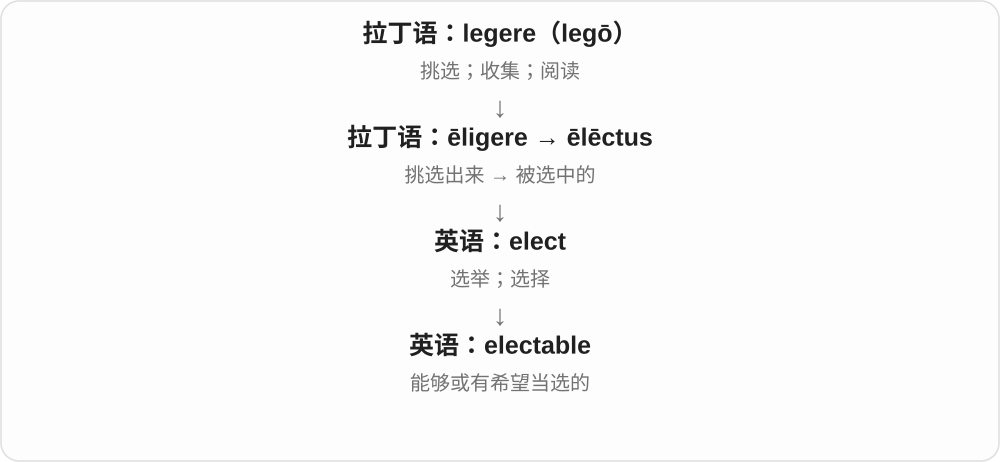

常说现实胜选能力，是评价而非保证；也可宽泛表示可以选出。

**常见搭配与例句**

an electable candidate；remain electable；politically electable。

> The party was searching for an electable candidate.

该党在寻找有胜选希望的候选人。

> Good polling numbers alone do not make someone electable.

仅有好看的民调数字，并不足以说明某人一定有胜选能力。

**别混淆**

eligible 资格合格；electable 有希望赢；elected 已经当选。

### 223. bankable — 有赚钱把握、能带来收入的；银行可接受的

**音标**：/ˈbæŋkəbəl/

**先抓住这个画面**

觉得这名字、项目或东西有足够把握带来钱，所以商业上敢依赖它。

**怎么拆**

bank + -able，可被银行接受、承兑等金融用法在先，再扩展为能保证商业收益、票房的评价。

**怎么变成今天的意思**

**法语 banque ← 意大利语 banca 等**  
兑换钱的柜台、桌凳 → 银行

↓

**bank + -able → bankable**  
银行可接受 → 商业上有收入把握的

a bankable star 有票房号召力的明星，a bankable idea 有商业前景的点子；这是商业评价，不是绝对盈利保证。

**常见搭配与例句**

a bankable star；a bankable name；a bankable project。

> The studio wanted a bankable star for the leading role.

制片公司想请一位有票房号召力的明星担任主演。

> They needed to turn the idea into a bankable project.

他们需要把想法变成一个有商业吸引力的项目。

**别混淆**

bankable 常说卖得动、能吸引资金，talented 说有才华；有才华与商业号召力不是同一个判断。

### 224. bendable — 可弯曲、可弯折的

**音标**：/ˈbendəbl/

**先抓住这个画面**

说材料具备弯过去的能力，不保证它眼下已经弯了。

**怎么拆**

bend + -able，-able 表可被做某动作。常带能弯而不直接折断的材料性质含义，允许程度仍看具体物件。

**怎么变成今天的意思**

**古英语 bendan → bend**  
给弓上弦、使弯；联系 bind/band 的绑束词族

↓

**英语形状与方向扩展**  
弯曲、弯腰、改变方向；bent 又表倾向、执意等

↓

**bend + -able → bendable**  
可被弯曲、弯折的

bendable wire 可弯金属丝，bendable plastic 可弯塑料，bendable material 可弯材料。

**常见搭配与例句**

bendable wire；bendable plastic；bendable material。

> The model has bendable arms and legs.

模型的手脚可以弯折。

> Use a bendable material for the curved section.

弧形部分用可弯曲的材料。

**别混淆**

bendable 说能力，bent 说已有形状；straight 直的材料仍可 bendable。bendy 较口语，bendable 更直接讲能否弯。

### 225. switchable — 可切换的、可转换的

**音标**：/ˈswɪtʃəbəl/

**先抓住这个画面**

预留了从 A 换到 B 的能力；不是说它此刻正在变，而是有这个切换选项。

**怎么拆**

switch 切换 + -able 可……的，组成能力、可操作性形容词。

**怎么变成今天的意思**

**铁路道岔、电路切换等机械用法**  
改变路径或状态；并非已证实全由鞭打动作单线演变

↓

**英语常用名词、动词与派生**  
开关、切换；switchable、switcher；switchblade、switchgear、switcheroo

↓

**switch + -able → switchable**  
允许或能够切换

switchable modes 可切换模式，switchable graphics 可切换显卡模式，a switchable power supply 可切换的电源。能切哪些档位仍看设备说明。

**常见搭配与例句**

switchable modes；switchable graphics；a switchable setting。

> The lamp has two switchable colour modes.

灯有两种可切换的色彩模式。

> The display has a switchable privacy setting.

显示屏有可切换的隐私设置。

**别混淆**

switchable 能换，switched 已被切换；adjustable 可调范围更广，不一定只有几个明确状态。

### 226. purchasable — 可购买的、可以买到的

**音标**：英 /ˈpɜːtʃəsəbəl/；美 /ˈpɜːrtʃəsəbəl/

**先抓住这个画面**

不是只能看、不能买，或只能靠做任务取得，而是提供了付钱获得的途径。

**怎么拆**

purchase 去 e 加 -able，形成可被购买的形容词。保留原词重音，不读成 chase 的长元音。

**怎么变成今天的意思**

**古法语 porchacier、盎格鲁法语 purchacer 等 → 中古英语 purchasen → purchase**  
追求、设法取得 → 获得

↓

**purchase + -able → purchasable〔去 e〕**  
可以通过购买得到的

purchasable items 可购买物品，purchasable content 可购买内容，make something purchasable 开放某物购买。

**常见搭配与例句**

purchasable items；purchasable content；make purchasable。

> The game lists all purchasable items in one menu.

游戏在一个菜单中列出所有可购买物品。

> The report is freely readable but not purchasable as a printed book.

报告可免费阅读，但没有纸质书可买。

**别混淆**

purchasable 有购买途径，affordable 付得起；一款很贵的商品可以买到，却未必是你能负担的。

### 227. buildable — 可建造的；适合建造的

**音标**：/ˈbɪldəbəl/

**先抓住这个画面**

方案能搭出来，或这块地适合盖房；别把两个对象混成一个意思。

**怎么拆**

build + -able；没有删掉中间的 d，也不按过去式 built 再加 able。

**怎么变成今天的意思**

**古英语 byldan / bytlan 等 → 中古英语 bilden / bylden**  
建造；与居所的旧词族相关

↓

**英语 build**  
建造、建立；逐步形成

↓

**build + -able → buildable**  
可建成；可供建设的

a buildable design 可实施建造的设计，buildable land 可建设用地。后者在实际材料中可能含规划、地形等条件，词义本身不替具体土地作许可结论。

**常见搭配与例句**

a buildable design；buildable land；a buildable site。

> The team turned the sketch into a buildable design.

团队把草图变成了能实际建造的设计。

> The map distinguishes buildable land from protected areas.

地图区分了可建设用地和保护区。

**别混淆**

buildable 能建，built 已建成；a buildable model 是能搭的模型，不表示已经组装好。

### 228. degradable — 可降解的；可分解的

**音标**：英、美 /dɪˈɡreɪdəbəl/

**先抓住这个画面**

原来的大结构能被拆散，变成较小的部分。

**怎么拆**

degrade + -able，英语可能性形容词。

**怎么变成今天的意思**

**拉丁 gradus；gradī / gradior**  
一步、台阶、等级；走、迈步

↓

**晚期拉丁 dē- + gradus → dēgradāre → 法语 dégrader**  
使落到较低等级

↓

**英语 degrade**  
降低地位、尊严或质量；使降解

↓

**英语 degrade + -able → degradable**  
能够发生降解的

必须看在什么温度、光照、化学或生物条件下分解。degradable 本身不保证能在自然环境中快速或完全生物降解。

**常见搭配与例句**

degradable material；chemically degradable；a degradable polymer。

> The study tested whether the material was degradable under ultraviolet light.

研究测试了这种材料能否在紫外线下发生降解。

> Degradable does not necessarily mean compostable.

可降解不一定意味着可堆肥。

**别混淆**

biodegradable 指生物过程可使其降解；degradable 的范围更宽。

### 229. drivable — 可以驾驶的；可供车辆通行的

**音标**：/ˈdraɪvəbəl/

**先抓住这个画面**

车还能开，或路况允许车开过去；一个说车，一个说路。

**怎么拆**

drive + -able，常去 e 写 drivable，也有 driveable 拼写。形容词说能否驾驶、通行，不说已经开过。

**怎么变成今天的意思**

**古英语 drīfan → 中古英语 driven**  
推着走、驱赶、使移动

↓

**英语 drive**  
驾驶；驱动；推动、逼使

↓

**drive + -able → drivable**  
可以驾驶；可行车的

a drivable car 可驾驶的车，a drivable road 可通车道路；实际条件按上下文限定，不是单词保证所有天气、车型都一样。

**常见搭配与例句**

a drivable car；a drivable road；remain drivable。

> The car was damaged but still drivable.

车虽受损，但还能开。

> The road becomes drivable again after the snow melts.

雪融后，这条路又能通车了。

**别混淆**

drivable 能开，driven 已驾驶或被推动；driving lessons 是驾驶课程，不是 drivable lessons。

### 230. trainable — 可训练的；能接受培训的

**音标**：/ˈtreɪnəbəl/

**先抓住这个画面**

有可能通过练习学会、改善；先说能够学，不是说已经学会。

**怎么拆**

train + -able，构成能被训练、可以培训的形容词。对象可以是人、动物，也可以是机器学习模型。

**怎么变成今天的意思**

**拉丁 trahere 拉 → 法语 traîner、train → 英语 train**  
拉出、延伸；一串随行之物

↓

**现代 train**  
火车；引导、培养 → 训练与培训

↓

**train + -able → trainable**  
可以被训练的

a trainable dog 易训练的狗，trainable staff 可培养的员工；trainable parameters 可训练参数。

**常见搭配与例句**

a trainable dog；trainable skills；trainable parameters。

> The breed is known for being intelligent and trainable.

这个犬种以聪明、易训练著称。

> The model has several trainable parameters.

模型有若干可训练参数。

**别混淆**

trainable 能训练，trained 已经训练；可训练不意味着训练结果必然完美。

### 231. insurable — 可保的；可以承保的

**音标**：英 /ɪnˈʃɔːrəbəl/；美 /ɪnˈʃʊrəbəl/

**先抓住这个画面**

某类风险符合保险安排的条件，能够被承保，可说它 insurable。

**怎么拆**

insure + -able（可以被……的），去掉末尾 e。

**怎么变成今天的意思**

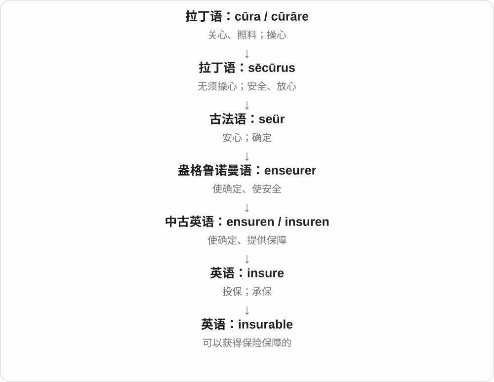

它说的是可被保险处理的资格或特征，并不等于已经买好保险，也不等于任何机构都愿意承保。

**常见搭配与例句**

an insurable risk；an insurable interest；be insurable。

> The textbook distinguishes insurable risks from other uncertainties.

教材把可保风险与其他不确定性区分开来。

> The broker asked whether the item was insurable.

经纪人询问这件物品是否可以承保。

**别混淆**

insured 是已投保或受保障；insurable 是具备可保性。

### 232. translatable — 可翻译的；能转换、应用到另一环境的

**音标**：/trænzˈleɪtəbəl/

**先抓住这个画面**

这层意思能不能顺利搬过去，技能能不能带到另一行业用；问的是可迁移、可转化性。

**怎么拆**

translate + -able，去末尾 e。是现代透明派生，与 translate 的跨语言、跨形式两种用法相连。

**怎么变成今天的意思**

**拉丁 trāns-；ferre 与其不规则分词 lātus**  
跨过；携带，与被带过去的形式

↓

**拉丁 trānslātus、trānslātiō、trānslātor 等**  
带过；转移过程；执行者，形成同族的平行词

↓

**法语、英语相应借入**  
translate、translation、translator；从运过去到跨语言传意思

↓

**translate + -able → translatable**  
可译；能换到别的语境、形式

easily translatable 容易翻译，translatable into English 可译成英文，skills translatable to another field 可用于另一领域的技能。

**常见搭配与例句**

easily translatable；translatable into；translatable to。

> The joke is not easily translatable into English.

这个笑话不容易译成英语。

> Her teaching skills were translatable to management.

她的教学技能也能转用到管理中。

**别混淆**

translatable 能译不等于 word-for-word 逐词对应；语气、文化背景常需要换表达，不把可译性理解成字对字搬运。

## 这一组要分清什么

customizable 可定制与 customized 已定制分开；forgivable 可原谅与 forgiven 已原谅分开；unlockable 的 unlock + able 与 un + lockable 可有不同意思；palatable 可以只是能接受，未必美味。

## 串起来练习

The detachable cover is washable, and the refillable bottle is designed to be reusable.

可拆卸的盖子能清洗，这个可补充使用的瓶子也设计为可以重复使用。
