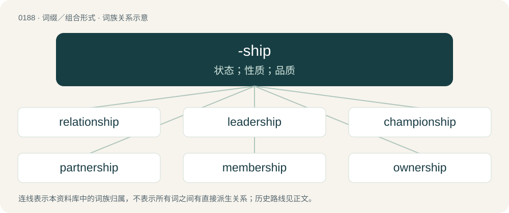

# 0209 · -ship — 状态；性质；品质

[总目录](../00_总目录_按常用程度.md)

**类型**：词缀／组合形式　｜　**来源语言**：见词源记录

## 核心含义与来源

- 核心含义：状态；性质；品质
- 英文含义：Appended to a noun to form a new noun denoting a property or state of being, time spent in a role, or a specialised union. In particular, the way a set of social duties associated with a particular role shapes or develop's one's character.
- 词形：-ship

**来源记录 1**（后缀／后置成分；Appended to a noun to form a new noun denoting a property or state of being, time spent in a role, or a specialised union. In particular, the way a set of social duties associated with a particular role shapes or develop's one's character.）

From Middle English -schipe, -shippe, from Old English -sċiepe, from Proto-West Germanic \*-skapi, from Proto-Germanic \*-skapiz. Compare Scots -schip, West Frisian -skip, Dutch -schap, German -schaft, Swedish -skap, Icelandic -skapur. Related to shape.

## 词族图

## 单词速览（常用到不常用）

| 单词 | 音标 | 释义 |
|---|---|---|
| [relationship](#w-1) | 英 /ɹɪˈleɪʃ(ə)nˌʃɪp/；/ɹəˈleɪʃ(ə)nˌʃɪp/ | n. 关系, 关联；\[医\] 关系 |
| [leadership](#w-2) | /ˈliːdə(ɹ)ʃɪp/ | n. 领导能力, 领导阶层 |
| [championship](#w-3) | /ˈtʃæm.pi.ən.ʃɪp/ | n. 冠军身份, 冠军称号, 捍卫 |
| [partnership](#w-4) | 英 /ˈpɑːtnəʃɪp/；美 /ˈpɑɹtnɚʃɪp/ | n. 合伙, 合股, 合作关系；\[经\] 合伙(合作)关系, 全体合伙人 |
| [membership](#w-5) | /ˈmembəʃip/ | n. 会员的资格, 全体会员, 会员数目；\[法\] 会员资格, 成员资格, 会籍 |
| [ownership](#w-6) | 英 /ˈəʊnəʃɪp/；美 /ˈoʊnɚʃɪp/ | n. 所有权, 物主身份；\[经\] 所有权, 所有制 |
| [friendship](#w-7) | /ˈfɹɛn(d)ʃɪp/ | n. 友谊, 友爱, 友善 |
| [landscape](#w-8) | 英 /ˈlan(d)skeɪp/ | n. 风景, 山水, 风景画；vi. 从事景观美化；vt. 美化...景观 |
| [worship](#w-9) | 英 /ˈwɜː.ʃɪp/；美 /ˈwɝ.ʃɪp/ | n. 崇拜, 礼拜, 尊敬；vi. 参加礼拜；vt. 崇拜, 尊敬 |
| [scholarship](#w-10) | 英 /ˈskɒləʃɪp/；美 /ˈskɑːləɹʃɪp/ | n. 学问, 学术成就, 奖学金 |
| [citizenship](#w-11) | 英 /ˈsɪtɪzənʃɪp/ | n. 国籍, 市民权, 市民的身份；\[法\] 公民权, 公民资格, 公民身分 |
| [township](#w-12) | 英 /ˈtaʊnʃɪp/ | n. 小镇, 镇区；\[法\] 镇区, 乡 |
| [fellowship](#w-13) | 英 /ˈfɛl.ə(ʊ).ʃɪp/；美 /ˈfɛl.ə.ʃɪp/ | n. 伙伴关系, 共同参与, 团体, 奖学金, 友谊；\[经\] 合伙关系, 研究员薪金, 研究员基金 |
| [censorship](#w-14) | 英 /ˈsɛnsəʃɪp/；美 /ˈsɛnsɚʃɪp/ | n. 检查制度；\[医\] 督察, 监察 |
| [sponsorship](#w-15) | /ˈspɔnsəʃip/ | n. 发起, 倡议, 主办, 保证人的地位, 教父的地位, 教母的地位 |
| [dictatorship](#w-16) | 英 /dɪkˈteɪtə(ɹ)ʃɪp/；美 /ˈdɪkteɪtəɹʃɪp/ | n. 独裁者之职位, 独裁, 独裁政权；\[法\] 专攻, 独裁权 |
| [internship](#w-17) | 英 /ˈɪntɜːnʃɪp/；美 /ˈɪntɝnʃɪp/ | n. 实习医师的职务；\[医\] 实习医师职位, 实习医师期 |
| [premiership](#w-18) | /ˈpremjəʃip;priˈmiə-,ˈpriːm-/ | n. 总理职位, 首相职权, 首相职位, 总理职权；\[法\] 总理职位 |
| [entrepreneurship](#w-19) | 英 /ˌɒn.tɹə.pɹəˈnɜːʃɪp/；美 /ˌɑn.tɹə.pɹəˈnɝ.ʃɪp/ | 企业家能力/职能; 企业家\[主办人等\]的身份\[地位、职权、能力\] |
| [hardship](#w-20) | 英 /ˈhɑːdˌʃɪp/；美 /ˈhɑɹdˌʃɪp/ | n. 艰难, 辛苦, 苦难；\[法\] 受苦, 吃苦, 苦难 |
| [apprenticeship](#w-21) | /əˈpɹɛn.tɪs.ʃɪp/ | n. 学徒身分, 见习(期)；\[经\] 学徒制, 学徒期 |
| [dealership](#w-22) | 英 /ˈdiːləʃɪp/ | n. 代理权, 经销权；\[法\] 商品经销特许权, 代理商 |
| [lordship](#w-23) | 英 /ˈlɔːd.ʃɪp/；美 /ˈlɔɹd.ʃɪp/ | n. 贵族身分, 主权, 支配 |
| [stewardship](#w-24) | /ˈstjuːwədʃip/ | n. steward的职务, 管理工作 |
| [companionship](#w-25) | /kəmˈpænjənʃɪp/ | n. 交往, 友谊, 一群同伴 |
| [courtship](#w-26) | 英 /ˈkɔːt.ʃɪp/；美 /ˈkɔɹt.ʃɪp/ | n. 求爱, 求婚, 求爱时期 |
| [authorship](#w-27) | /ˈɔːθəʃip/ | n. 原作者, 根源, 原创造者 |
| [kinship](#w-28) | 美 /ˈkɪnʃɪp/ | n. 亲属关系；\[法\] 亲属关系, 家族关系, 关系 |
| [viewership](#w-29) | /ˈvjuːəʃɪp/ | n. \[总称\]电视观众 |
| [readership](#w-30) | /ˈriːdəʃip/ | n. 读者, 读者人数 |
| [craftsmanship](#w-31) | 美 /ˈkɹæfts.mən.ʃɪp/ | n. 技术, 技艺 |
| [workmanship](#w-32) | /ˈwɜːk.mən.ʃɪp/ | n. 手艺, 技巧；\[化\] 技巧; 制造工艺 |
| [chairmanship](#w-33) | 英 /ˈtʃɛː.mənˌʃɪp/；美 /ˈtʃɛɹ.mənˌʃɪp/ | n. 主席的身份或资格 |
| [guardianship](#w-34) | /ˈgɑːdiənʃip/ | n. 监护, 保护, 守护；\[法\] 监护, 保护, 监护人的职责 |
| [governorship](#w-35) | /ˈ^ʌvənəʃip/ | n. 统治者的职位/任期 |
| [partisanship](#w-36) | 英 /ˌpɑːtɪˈzænʃɪp/；美 /ˈpɑɹtəzənˌʃɪp/ | n. 党派性, 党派偏见, 对党派的忠诚 |
| [mentorship](#w-37) | /ˈmentɔːʃɪp/ | n. 导师制, 辅导教师；师徒制 |
| [kingship](#w-38) | 美 /ˈkɪŋʃɪp/ | n. 君主身分, 王位, 王权；\[法\] 王权, 帝王统治, 君王的身分 |
| [receivership](#w-39) | /riˈsiːvəʃip/ | \[经\] 清算人(接收人)办公室, 清算人职能 |
| [professorship](#w-40) | /prəˈfesəʃip/ | n. 教授之职 |
| [homeownership](#w-41) |  | n. 私房屋主；自己拥有住房者 (homeowner的变形) |
| [mothership](#w-42) | /ˈmʌðəʃɪp/ | n. 航母 |
| [ridership](#w-43) | 美 /ˈɹaɪ.dəɹ.ʃɪp/ | n. 乘客数 |
| [marksmanship](#w-44) | 美 /ˈmɑɹksmənʃɪp/ | n. 射击术, 枪法 |
| [musicianship](#w-45) | /mjuːˈziʃənʃip/ | n. 音乐技巧,音乐感,音乐才能,音乐修养, 音乐鉴赏力 |
| [showmanship](#w-46) | /ˈʃəʊ.mən.ʃɪp/ | n. 安排演出的窍门, 吸引观众的窍门, 经营术, 招徕生意的手腕 |
| [ladyship](#w-47) | 英 /ˈleɪ.di.ʃɪp/ | n. 贵妇身分, 夫人, 小姐 |
| [discipleship](#w-48) | /dɪˈsaɪplʃɪp/ | n. 做弟子的身份（期间） |
| [editorship](#w-49) | /ˈeditəʃip/ | n. 编辑的职位, 编辑工作 |
| [survivorship](#w-50) | /səˈvaivəʃip/ | n. 幸存, 残存, 未死, 生者对死者名下财产的享有权；\[经\] 生存者所有权 |
| [directorship](#w-51) | /diˈrektəʃip/ | n. 管理者的职位 |
| [horsemanship](#w-52) | /ˈhɒːsmənʃip/ | n. 马术 |
| [proprietorship](#w-53) | /prəˈpraiətəʃip/ | n. 所有权；\[经\] 所有权, 业主权, 资本 |
| [librarianship](#w-54) | /lɪˈbrɛərɪənʃɪp/ | 图书馆长\[图书管理学专家\]的职位\[资格\] |
| [bipartisanship](#w-55) | 英 /ˈbaɪˌpɑː(ɹ)t.ɪ.zæn.ʃɪp/ | \[法\] 两党制 |
| [clerkship](#w-56) | /ˈkləːkʃip/ | n. 文书的职位 |
| [seamanship](#w-57) | 英 /ˈsiː.mənˌʃɪp/ | n. 航海技术 |
| [judgeship](#w-58) | /ˈdʒʌdʒʃip/ | n. 法官的地位；\[法\] 法官的职权, 任期或地位 |
| [swordsmanship](#w-59) | /ˈsɔːdzmənʃip/ | n. 剑术 |
| [comradeship](#w-60) | /ˈkɔmreidʃip/ | n. 同志关系, 友谊, 伙伴情谊 |
| [headship](#w-61) | /ˈhedʃip/ | n. 领导人地位, 能力, 校长职务 |
| [statesmanship](#w-62) |  | n. 治国之才, 政治家的才能, 政治家风度 |
| [trusteeship](#w-63) | /trʌsˈtiːʃip/ | n. 托管制度, 托管人职责 |
| [conservatorship](#w-64) |  | n. 英国管理委员的职位 |
| [salesmanship](#w-65) | /ˈseilzmənʃip/ | n. 售货, 售货术, 推销, 推销术, 游说, 游说术, 善于推销；\[经\] 推销术, 售货术 |
| [lectureship](#w-66) | /ˈletʃəʃip/ | n. 讲师职务 |
| [consulship](#w-67) | /ˈkɒnsəlʃip/ | n. 领事的职位, 领事的任期；\[法\] 领事的职位或任期 |
| [gamesmanship](#w-68) | /ˈgeimzmənʃip/ | n. 搅乱战术 |
| [ministership](#w-69) | /ˈmɪnɪstəʃɪp/ | 部长的职务（或官职） |
| [rulership](#w-70) | /ˈɹuːlə(ɹ)ʃɪp/ | n. 统治地位, 统治权；\[法\] 统治权, 统治地位及职权 |
| [traineeship](#w-71) | /treɪˈniːʃɪp/ | 受训练的情况\[时间\], 受训者的地位\[津贴\] |
| [ambassadorship](#w-72) | /æmˈbæsədəʃip/ | n. 大使的职位 |
| [mediumship](#w-73) | /ˈmiːdiəmʃip/ | n. 灵媒(或巫师)的能力(或功能、职业) |
| [speakership](#w-74) | /ˈspiːkəʃip/ | n. 议长的职位；\[法\] 议长的职务, 议长的任期 |
| [studentship](#w-75) |  | n. 学生身分, (英)大学奖学金 |

## 逐词详解

### 1. relationship

**词性**：名词　｜　**音标**：英 /ɹɪˈleɪʃ(ə)nˌʃɪp/；/ɹəˈleɪʃ(ə)nˌʃɪp/

**中文释义**：n. 关系, 关联；\[医\] 关系

**英文义项**：A connection or association; the condition of being related. / The links between the x-values and y-values of ordered pairs of numbers especially coordinates.

**构词拆分**：relation + -ship

**词源与演化**：

From relation + -ship. Displaced native Old English sibb.

**例句**：

> They have been in a relationship for ten years, but have never married.

该用例对应义项：A romantic or sexual involvement.

### 2. leadership

**词性**：名词　｜　**音标**：/ˈliːdə(ɹ)ʃɪp/

**中文释义**：n. 领导能力, 领导阶层

**英文义项**：The capacity of someone to lead others. / A group of leaders.

**构词拆分**：leader + -ship

**词源与演化**：

From leader + -ship.

**例句**：

> Wise, determined leadership matters most.

该用例对应义项：The capacity of someone to lead others.

### 3. championship

**词性**：名词　｜　**音标**：/ˈtʃæm.pi.ən.ʃɪp/

**中文释义**：n. 冠军身份, 冠军称号, 捍卫

**英文义项**：A competition to determine a champion, especially the final of a series of competitions. / The position of champion, or winner.

**构词拆分**：champion + -ship

**词源与演化**：

From champion + -ship.

**例句**：

> His championship of civil rights eventually bore fruit.

该用例对应义项：Defense or support of some cause.

### 4. partnership

**词性**：名词　｜　**音标**：英 /ˈpɑːtnəʃɪp/；美 /ˈpɑɹtnɚʃɪp/

**中文释义**：n. 合伙, 合股, 合作关系；\[经\] 合伙(合作)关系, 全体合伙人

**英文义项**：The state of being associated with a partner. / An association of two or more people to conduct a business.

**构词拆分**：partner + -ship

**词源与演化**：

From partner + -ship. Cognate with West Frisian partnerskip (“partnership”), Dutch partnerschap (“partnership”), Low German Partnerschop (“partnership”), German Partnerschaft (“partnership”), Danish partnerskab (“partnership”), Danish partnerskab (“partnership”), Norwegian Bokmål partnerskap (“partnership”), Norwegian Nynorsk partnerskap (“partnership”).

**用法示例／搭配（非完整句）**：

> scientists working in close partnership with colleagues overseas

该用例对应义项：The state of being associated with a partner.

### 5. membership

**词性**：名词　｜　**音标**：/ˈmembəʃip/

**中文释义**：n. 会员的资格, 全体会员, 会员数目；\[法\] 会员资格, 成员资格, 会籍

**英文义项**：The state of being a member of a group or organization. / The body of members of an organization.

**构词拆分**：member + -ship

**词源与演化**：

From member + -ship.

**例句**：

> The memberships of the state chapters elect delegates to the national convention.

该用例对应义项：The body of members of an organization.

### 6. ownership

**词性**：名词　｜　**音标**：英 /ˈəʊnəʃɪp/；美 /ˈoʊnɚʃɪp/

**中文释义**：n. 所有权, 物主身份；\[经\] 所有权, 所有制

**英文义项**：The state of having complete legal control of something; possession; proprietorship. / Responsibility for or control over something.

**构词拆分**：owner + -ship

**词源与演化**：

From owner + -ship.

**例句**：

> The successful candidate will take ownership of all internal design projects.

该用例对应义项：Responsibility for or control over something.

### 7. friendship

**词性**：名词　｜　**音标**：/ˈfɹɛn(d)ʃɪp/

**中文释义**：n. 友谊, 友爱, 友善

**英文义项**：The condition of being friends. / A friendly relationship, or a relationship as friends.

**构词拆分**：friend + -ship

**词源与演化**：

From Middle English frendshipe, from Old English frēondsċiepe, from Proto-West Germanic \*friundskapi. Equivalent to friend + -ship.

**例句**：

> Their friendship continued long after they left school.

离开学校很久之后，他们的友谊仍然持续着。

### 8. landscape

**词性**：名词　｜　**音标**：英 /ˈlan(d)skeɪp/

**中文释义**：n. 风景, 山水, 风景画；vi. 从事景观美化；vt. 美化...景观

**英文义项**：A portion of land or territory as defined by its landform, its geographical (and architectural) features. / A portion of land which the eye can comprehend in a single view, including all the objects thus seen.

**构词拆分**：By surface analysis, land + -ship

**词源与演化**：

From an alteration (due to Dutch landschap) of earlier landskip, lantschip, from Middle English \*landschippe, \*landschapp, from Old English landsċipe, landsċeap (“region, district, tract of land”); in some senses from Dutch landschap (“region, district, province, landscape”), from Middle Dutch landscap, lantscap (“region”), from Old Dutch \*landskepi, \*landskapi (“region”). Cognate with Scots landskape, landskep, landskip (“landscape”), West Frisian lânskip (“landscape”), Low German landschop (“landscape, district”), German Landschaft (“landscape, countryside, scenery”), Danish landskab (“landscape, countryside”), Swedish landskap (“landscape, scenery, province”), Icelandic landskapur (“countryside”). By surface analysis, land + -ship.

**用法示例／搭配（非完整句）**：

> The software patent landscape has changed considerably in the last years

该用例对应义项：a situation that is presented, a scenario

### 9. worship

**词性**：名词　｜　**音标**：英 /ˈwɜː.ʃɪp/；美 /ˈwɝ.ʃɪp/

**中文释义**：n. 崇拜, 礼拜, 尊敬；vi. 参加礼拜；vt. 崇拜, 尊敬

**英文义项**：The devotion accorded to a deity or to a sacred object. / The adoration (or latria) owed to God alone, as greater than the hyperdulia that is given to Saint Mary only and the veneration (or dulia) accorded to all other Roman Catholic saints.

**构词拆分**：By surface analysis, wor(th) + -ship

**词源与演化**：

Inherited from Middle English worschippe /worthschipe, inherited from Old English weorþsċiepe. Cognate with Scots worschip (“worship”). By surface analysis, wor(th) + -ship.

**例句**：

> Polytheistic theology and worship had to go underground.

该用例对应义项：The devotion accorded to a deity or to a sacred object.

### 10. scholarship

**词性**：名词　｜　**音标**：英 /ˈskɒləʃɪp/；美 /ˈskɑːləɹʃɪp/

**中文释义**：n. 学问, 学术成就, 奖学金

**英文义项**：A grant-in-aid to a student. / The character or qualities of a scholar.

**构词拆分**：scholar + -ship

**词源与演化**：

From scholar + -ship.

**例句**：

> I'd still be spinning my wheels if I hadn't gotten that scholarship.

### 11. citizenship

**词性**：名词　｜　**音标**：英 /ˈsɪtɪzənʃɪp/

**中文释义**：n. 国籍, 市民权, 市民的身份；\[法\] 公民权, 公民资格, 公民身分

**英文义项**：The state of being a citizen; the status of a citizen.

**构词拆分**：citizen + -ship

**词源与演化**：

From citizen + -ship. Displaced native Old English burgrǣden, equivalent to borough + -red.

**例句**：

> Award for good citizenship.

该用例对应义项：conduct as a citizen

### 12. township

**词性**：名词　｜　**音标**：英 /ˈtaʊnʃɪp/

**中文释义**：n. 小镇, 镇区；\[法\] 镇区, 乡

**英文义项**：The territory of a town. / A subdivision of a county.

**构词拆分**：town + -ship

**词源与演化**：

From Middle English towneship, townschip, tounshipe, tunscipe, from Old English tūnsċipe (“the inhabitants of a town; township”), equivalent to town + -ship.

**例句**：

> Vienna is a township in Ohio.

### 13. fellowship

**词性**：名词　｜　**音标**：英 /ˈfɛl.ə(ʊ).ʃɪp/；美 /ˈfɛl.ə.ʃɪp/

**中文释义**：n. 伙伴关系, 共同参与, 团体, 奖学金, 友谊；\[经\] 合伙关系, 研究员薪金, 研究员基金

**英文义项**：A company of people that share the same interest or aim. / Company, companions; a group of people or things following another.

**构词拆分**：fellow + -ship

**词源与演化**：

From Middle English felowschipe, felawshipe, felaȝschyp, equivalent to fellow + -ship; or perhaps adapted from Old Norse félagskapr, félagsskapr (“fellowship”). Compare Icelandic félagsskapur (“companionship, company, community”), Danish fællesskab (“fellowship”), Norwegian fellesskap (“fellowship”), and Old Swedish fælaghskap (“fellowship”)

**例句**：

> The grace of the Lord Jesus Christ and the love of God and the fellowship of the Holy Spirit be with you all.

该用例对应义项：A feeling of friendship, relatedness or connection between people.

### 14. censorship

**词性**：名词　｜　**音标**：英 /ˈsɛnsəʃɪp/；美 /ˈsɛnsɚʃɪp/

**中文释义**：n. 检查制度；\[医\] 督察, 监察

**英文义项**：The use of state or group power to control freedom of expression or press, such as passing laws to prevent undesirable media from being published or propagated.

**构词拆分**：censor + -ship

**词源与演化**：

From censor + -ship.

**例句**：

> There is more censorship in the twenty-first century than the Middle Ages.

### 15. sponsorship

**词性**：名词　｜　**音标**：/ˈspɔnsəʃip/

**中文释义**：n. 发起, 倡议, 主办, 保证人的地位, 教父的地位, 教母的地位

**英文义项**：The state or practice of being a sponsor. / The aid or support provided by a sponsor; backing or patronage.

**构词拆分**：sponsor + -ship

**词源与演化**：

From sponsor + -ship.

**例句**：

> The university awarded five sponsorships to the five most qualified applicants.

该用例对应义项：The aid or support provided by a sponsor; backing or patronage.

### 16. dictatorship

**词性**：名词　｜　**音标**：英 /dɪkˈteɪtə(ɹ)ʃɪp/；美 /ˈdɪkteɪtəɹʃɪp/

**中文释义**：n. 独裁者之职位, 独裁, 独裁政权；\[法\] 专攻, 独裁权

**英文义项**：A type of government where absolute sovereignty is allotted to an individual or a small clique. / A government which exercises autocratic rule.

**构词拆分**：dictator + -ship

**词源与演化**：

From dictator + -ship.

**例句**：

> There were no elections during Franco's dictatorship.

该用例对应义项：A government which exercises autocratic rule.

### 17. internship

**词性**：名词　｜　**音标**：英 /ˈɪntɜːnʃɪp/；美 /ˈɪntɝnʃɪp/

**中文释义**：n. 实习医师的职务；\[医\] 实习医师职位, 实习医师期

**英文义项**：A job taken by a student in order to learn a profession or trade. / The first year of a medical residency.

**构词拆分**：intern + -ship

**词源与演化**：

From intern + -ship.

**例句**：

> An internship is the most important credential for entering the job market.

### 18. premiership

**词性**：名词　｜　**音标**：/ˈpremjəʃip;priˈmiə-,ˈpriːm-/

**中文释义**：n. 总理职位, 首相职权, 首相职位, 总理职权；\[法\] 总理职位

**英文义项**：The office of a premier or prime minister. / The position held by the champion team at the end of a particular season (especially as used in Australian rules football).

**构词拆分**：premier + -ship

**词源与演化**：

From premier + -ship.

**例句**：

> His urbanity gained him the premiership.

### 19. entrepreneurship

**词性**：名词　｜　**音标**：英 /ˌɒn.tɹə.pɹəˈnɜːʃɪp/；美 /ˌɑn.tɹə.pɹəˈnɝ.ʃɪp/

**中文释义**：企业家能力/职能; 企业家\[主办人等\]的身份\[地位、职权、能力\]

**英文义项**：The art or science of innovation and risk-taking for profit in business. / The quality of being an entrepreneur.

**构词拆分**：entrepreneur + -ship

**词源与演化**：

From entrepreneur + -ship.

**例句**：

> His experience lies in the field of entrepreneurship and social responsibility services.

### 20. hardship

**词性**：名词　｜　**音标**：英 /ˈhɑːdˌʃɪp/；美 /ˈhɑɹdˌʃɪp/

**中文释义**：n. 艰难, 辛苦, 苦难；\[法\] 受苦, 吃苦, 苦难

**英文义项**：Difficulty or trouble; hard times. / A burden, a source of difficulty that could impose a barrier.

**构词拆分**：hard + -ship

**词源与演化**：

From Middle English hardshipe, equivalent to hard + -ship.

**例句**：

> When you visit the museum, we invite you to make a donation of $10 if this will not be a hardship.

该用例对应义项：A burden, a source of difficulty that could impose a barrier.

### 21. apprenticeship

**词性**：名词　｜　**音标**：/əˈpɹɛn.tɪs.ʃɪp/

**中文释义**：n. 学徒身分, 见习(期)；\[经\] 学徒制, 学徒期

**英文义项**：The condition of, or the time served by, an apprentice. / The system by which a person learning a craft or trade is instructed by a master for a set time under set conditions.

**构词拆分**：apprentice + -ship

**词源与演化**：

From apprentice + -ship.

**例句**：

> Some electricians learn their trade within an apprenticeship system instead of going to college.

### 22. dealership

**词性**：名词　｜　**音标**：英 /ˈdiːləʃɪp/

**中文释义**：n. 代理权, 经销权；\[法\] 商品经销特许权, 代理商

**英文义项**：A place that sells items, especially cars.

**构词拆分**：dealer + -ship

**词源与演化**：

From dealer + -ship.

**例句**：

> I visited the car dealership today.

该用例对应义项：A place that sells items, especially cars.

### 23. lordship

**词性**：名词　｜　**音标**：英 /ˈlɔːd.ʃɪp/；美 /ˈlɔɹd.ʃɪp/

**中文释义**：n. 贵族身分, 主权, 支配

**英文义项**：The state or condition of being a lord. / Title applied to a lord, bishop, judge, or another man with a title.

**构词拆分**：lord + -ship

**词源与演化**：

From Middle English lordschipe, from Old English hlāfordsċiepe, equivalent to lord + -ship. Cognate with Scots lairdschip. Doublet of lairdship.

**例句**：

> May I ask that the order be granted, if your lordship so pleases?

该用例对应义项：Title applied to a lord, bishop, judge, or another man with a title.

### 24. stewardship

**词性**：名词　｜　**音标**：/ˈstjuːwədʃip/

**中文释义**：n. steward的职务, 管理工作

**英文义项**：The rank or office of a steward. / The act of caring for or improving with time.

**构词拆分**：steward + -ship

**词源与演化**：

From Middle English stiwardshepe, equivalent to steward + -ship.

**例句**：

> Foresters believe in stewardship of the land.

该用例对应义项：The act of caring for or improving with time.

### 25. companionship

**词性**：名词　｜　**音标**：/kəmˈpænjənʃɪp/

**中文释义**：n. 交往, 友谊, 一群同伴

**英文义项**：The state of having or being a companion. / The state of being a journeyman.

**构词拆分**：companion + -ship

**词源与演化**：

From companion + -ship.

**例句**：

> He valued the companionship of his old friends.

该用例对应义项：The state of having or being a companion.

### 26. courtship

**词性**：名词　｜　**音标**：英 /ˈkɔːt.ʃɪp/；美 /ˈkɔɹt.ʃɪp/

**中文释义**：n. 求爱, 求婚, 求爱时期

**英文义项**：The act of wooing a person to enter into a romantic relationship or marriage; hence, the period during which a couple fall in love before their marriage. / The behaviour exhibited by an animal to attract a mate.

**构词拆分**：court (“demonstration of such respect as is traditionally given at court; attention directed to a person in power; behaviour designed to gain favour; politeness of manner; civility towards someone”) + -ship (suffix forming nouns indicating a property or state of being)

**词源与演化**：

From court (“demonstration of such respect as is traditionally given at court; attention directed to a person in power; behaviour designed to gain favour; politeness of manner; civility towards someone”) + -ship (suffix forming nouns indicating a property or state of being).

**例句**：

> Its was a brief and intense courtship.

该用例对应义项：a man's courting of a woman; seeking the affections of a woman (usually with the hope of marriage)

### 27. authorship

**词性**：名词　｜　**音标**：/ˈɔːθəʃip/

**中文释义**：n. 原作者, 根源, 原创造者

**英文义项**：The quality or state of being an author; the function or dignity of an author. / The source; the origin; the origination.

**构词拆分**：author + -ship

**词源与演化**：

From author + -ship.

**例句**：

> We are unaware of the authorship of this book.

该用例对应义项：The source; the origin; the origination.

### 28. kinship

**词性**：名词　｜　**音标**：美 /ˈkɪnʃɪp/

**中文释义**：n. 亲属关系；\[法\] 亲属关系, 家族关系, 关系

**英文义项**：Relation or connection by blood, marriage or adoption. / Relation or connection by nature or character.

**构词拆分**：kin + -ship

**词源与演化**：

From kin + -ship.

**例句**：

> Felt a deep kinship with the other students.

该用例对应义项：a close connection marked by community of interests or similarity in nature or character

### 29. viewership

**词性**：名词　｜　**音标**：/ˈvjuːəʃɪp/

**中文释义**：n. \[总称\]电视观众

**英文义项**：percentage of viewers that watched television programs or other video broadcasts.

**构词拆分**：viewer + -ship

**词源与演化**：

From viewer + -ship.

**例句**：

> My video channel on YouTube has a wide viewership.

### 30. readership

**词性**：名词　｜　**音标**：/ˈriːdəʃip/

**中文释义**：n. 读者, 读者人数

**英文义项**：The collected readers of a publication. / The role or office of a reader.

**构词拆分**：reader + -ship

**词源与演化**：

From reader + -ship.

**例句**：

> The village newspaper has a readership of only 200 people.

该用例对应义项：The collected readers of a publication.

### 31. craftsmanship

**词性**：名词　｜　**音标**：美 /ˈkɹæfts.mən.ʃɪp/

**中文释义**：n. 技术, 技艺

**英文义项**：The quality of being a craftsman. / An example of a craftsman's work.

**构词拆分**：craftsman + -ship

**词源与演化**：

From craftsman + -ship.

**例句**：

> The craftsmanship on the antique chair was exquisite.

该用例对应义项：An example of a craftsman's work.

### 32. workmanship

**词性**：名词　｜　**音标**：/ˈwɜːk.mən.ʃɪp/

**中文释义**：n. 手艺, 技巧；\[化\] 技巧; 制造工艺

**英文义项**：The skill of an artisan or craftsman. / The quality of something made by an artisan or craftsman.

**构词拆分**：workman + -ship

**词源与演化**：

From Middle English werkmanschipe, equivalent to workman + -ship.

**例句**：

> Too many irons in the fire result in bad workmanship.

### 33. chairmanship

**词性**：名词　｜　**音标**：英 /ˈtʃɛː.mənˌʃɪp/；美 /ˈtʃɛɹ.mənˌʃɪp/

**中文释义**：n. 主席的身份或资格

**英文义项**：The office, or the term, of a chairman.

**构词拆分**：chairman + -ship

**词源与演化**：

From chairman + -ship.

**例句**：

> Laos held the chairmanship of ASEAN in 2016.

### 34. guardianship

**词性**：名词　｜　**音标**：/ˈgɑːdiənʃip/

**中文释义**：n. 监护, 保护, 守护；\[法\] 监护, 保护, 监护人的职责

**英文义项**：The office or position of one acting as a guardian or conservator, especially in a legal capacity.

**构词拆分**：guardian + -ship

**词源与演化**：

From guardian + -ship.

**例句**：

> The celebrity was still incompetent and needed guardianship.

### 35. governorship

**词性**：名词　｜　**音标**：/ˈ^ʌvənəʃip/

**中文释义**：n. 统治者的职位/任期

**英文义项**：The office or term of a governor; the state or condition of being a governor.

**构词拆分**：governor + -ship

**词源与演化**：

From governor + -ship.

**例句**：

> The governorship is an elected office.

### 36. partisanship

**词性**：名词　｜　**音标**：英 /ˌpɑːtɪˈzænʃɪp/；美 /ˈpɑɹtəzənˌʃɪp/

**中文释义**：n. 党派性, 党派偏见, 对党派的忠诚

**英文义项**：An inclination to be partisan or biased; partiality.

**构词拆分**：partisan + -ship

**词源与演化**：

From partisan + -ship.

**例句**：

> No. It is not a matter of partisanship, it is a matter of America.

### 37. mentorship

**词性**：名词　｜　**音标**：/ˈmentɔːʃɪp/

**中文释义**：n. 导师制, 辅导教师；师徒制

**英文义项**：The role or state of being a mentor.

**构词拆分**：mentor + -ship

**词源与演化**：

From mentor + -ship.

**例句**：

> The camp counselors are supposed to provide guidance and mentorship to the students.

### 38. kingship

**词性**：名词　｜　**音标**：美 /ˈkɪŋʃɪp/

**中文释义**：n. 君主身分, 王位, 王权；\[法\] 王权, 帝王统治, 君王的身分

**英文义项**：The dignity, rank, or office of a king; the state of being a king. / A monarchy.

**构词拆分**：king + -ship

**词源与演化**：

From king + -ship.

### 39. receivership

**词性**：名词　｜　**音标**：/riˈsiːvəʃip/

**中文释义**：\[经\] 清算人(接收人)办公室, 清算人职能

**英文义项**：The office and duties of a receiver. / The state of being under the control of a receiver.

**构词拆分**：receiver + -ship

**词源与演化**：

From receiver + -ship.

**例句**：

> The business is in receivership.

该用例对应义项：the state of property that is in the hands of a receiver

### 40. professorship

**词性**：名词　｜　**音标**：/prəˈfesəʃip/

**中文释义**：n. 教授之职

**英文义项**：The office of a professor.

**构词拆分**：professor + -ship

**词源与演化**：

From professor + -ship.

### 41. homeownership

**词性**：名词

**中文释义**：n. 私房屋主；自己拥有住房者 (homeowner的变形)

**英文义项**：The state of being a homeowner.

**构词拆分**：homeowner + -ship；home + ownership

**词源与演化**：

From homeowner + -ship or home + ownership.

**例句**：

> Today, the homeownership rate in the United States stands at around 65%.

### 42. mothership

**词性**：名词　｜　**音标**：/ˈmʌðəʃɪp/

**中文释义**：n. 航母

**英文义项**：The state of being a mother.

**构词拆分**：mother + -ship

**词源与演化**：

From Middle English modership, equivalent to mother + -ship.

### 43. ridership

**词性**：名词　｜　**音标**：美 /ˈɹaɪ.dəɹ.ʃɪp/

**中文释义**：n. 乘客数

**英文义项**：The people who ride a form of transportation. / The position or office of a rider.

**构词拆分**：rider + -ship

**词源与演化**：

From rider + -ship. Compare Middle English ridership, rydershipe; apparently re-formed.

**例句**：

> The bus company was going bankrupt because their ridership was too small.

该用例对应义项：The people who ride a form of transportation.

### 44. marksmanship

**词性**：名词　｜　**音标**：美 /ˈmɑɹksmənʃɪp/

**中文释义**：n. 射击术, 枪法

**英文义项**：The ability to shoot accurately at a target.

**构词拆分**：marksman + -ship；marks + -manship

**词源与演化**：

From marksman + -ship or marks + -manship.

### 45. musicianship

**词性**：名词　｜　**音标**：/mjuːˈziʃənʃip/

**中文释义**：n. 音乐技巧,音乐感,音乐才能,音乐修养, 音乐鉴赏力

**英文义项**：The skill of a musician or of a composer.

**构词拆分**：musician + -ship

**词源与演化**：

From musician + -ship.

### 46. showmanship

**词性**：名词　｜　**音标**：/ˈʃəʊ.mən.ʃɪp/

**中文释义**：n. 安排演出的窍门, 吸引观众的窍门, 经营术, 招徕生意的手腕

**英文义项**：The quality or skill of giving an engaging or compelling performance; a stage presence.

**构词拆分**：showman + -ship

**词源与演化**：

From showman + -ship.

**例句**：

> The act was clean and well-rehearsed, but the performers lacked the showmanship that would have made it great.

该用例对应义项：The quality or skill of giving an engaging or compelling performance; a stage presence.

### 47. ladyship

**词性**：名词　｜　**音标**：英 /ˈleɪ.di.ʃɪp/

**中文释义**：n. 贵妇身分, 夫人, 小姐

**英文义项**：Term of respect for a woman of the peerage without using her title. / Formal form of address for a lady judge (as opposed to the informal "judge").

**构词拆分**：lady + -ship

**词源与演化**：

From Middle English ladyschipe, ladyshipe; equivalent to lady + -ship.

**例句**：

> "Her ladyship will be unable to attend tonight," he said, with a wink because he hadn't said why.

该用例对应义项：Term of respect for a woman of the peerage without using her title.

### 48. discipleship

**词性**：名词　｜　**音标**：/dɪˈsaɪplʃɪp/

**中文释义**：n. 做弟子的身份（期间）

**英文义项**：The condition of being a disciple. / The period during which a person is a disciple.

**构词拆分**：disciple + -ship

**词源与演化**：

From disciple + -ship.

### 49. editorship

**词性**：名词　｜　**音标**：/ˈeditəʃip/

**中文释义**：n. 编辑的职位, 编辑工作

**英文义项**：The position or job of being an editor

**构词拆分**：editor + -ship

**词源与演化**：

From editor + -ship.

### 50. survivorship

**词性**：名词　｜　**音标**：/səˈvaivəʃip/

**中文释义**：n. 幸存, 残存, 未死, 生者对死者名下财产的享有权；\[经\] 生存者所有权

**英文义项**：The state of being a survivor. / The number or percentage of young that survive to adulthood.

**构词拆分**：survivor + -ship

**词源与演化**：

From survivor + -ship.

### 51. directorship

**词性**：名词　｜　**音标**：/diˈrektəʃip/

**中文释义**：n. 管理者的职位

**英文义项**：The office of a director.

**构词拆分**：director + -ship

**词源与演化**：

From director + -ship.

**例句**：

> The corporate bylaws require a quorum of outside directors, so as to balance the directorship.

该用例对应义项：The office of a director.

### 52. horsemanship

**词性**：名词　｜　**音标**：/ˈhɒːsmənʃip/

**中文释义**：n. 马术

**英文义项**：The skill of horseriding, and sometimes of training and managing horses.

**构词拆分**：horseman + -ship

**词源与演化**：

From horseman + -ship.

**例句**：

> The retired cowboy showed off his horsemanship by doing tricks in the saddle.

该用例对应义项：The skill of horseriding, and sometimes of training and managing horses.

### 53. proprietorship

**词性**：名词　｜　**音标**：/prəˈpraiətəʃip/

**中文释义**：n. 所有权；\[经\] 所有权, 业主权, 资本

**英文义项**：The state of being a proprietor; ownership.

**构词拆分**：proprietor + -ship

**词源与演化**：

From proprietor + -ship.

### 54. librarianship

**词性**：名词　｜　**音标**：/lɪˈbrɛərɪənʃɪp/

**中文释义**：图书馆长\[图书管理学专家\]的职位\[资格\]

**英文义项**：The act of operating of a library; service as a librarian

**构词拆分**：librarian + -ship

**词源与演化**：

From librarian + -ship.

### 55. bipartisanship

**词性**：名词　｜　**音标**：英 /ˈbaɪˌpɑː(ɹ)t.ɪ.zæn.ʃɪp/

**中文释义**：\[法\] 两党制

**英文义项**：In the context of a two-party system, especially in the United States, cooperation between the competing political parties; governing in a bipartisan manner.

**构词拆分**：bipartisan + -ship

**词源与演化**：

From bipartisan + -ship.

### 56. clerkship

**词性**：名词　｜　**音标**：/ˈkləːkʃip/

**中文释义**：n. 文书的职位

**英文义项**：The state or business of a clerk. / A temporary job of assisting a judge in writing legal opinions, generally available to a beginning attorney for one to two years.

**构词拆分**：clerk + -ship

**词源与演化**：

From clerk + -ship.

### 57. seamanship

**词性**：名词　｜　**音标**：英 /ˈsiː.mənˌʃɪp/

**中文释义**：n. 航海技术

**英文义项**：Skill in, and knowledge of, the work of navigating, maintaining, and operating a vessel at sea.

**构词拆分**：seaman + -ship

**词源与演化**：

From seaman + -ship.

### 58. judgeship

**词性**：名词　｜　**音标**：/ˈdʒʌdʒʃip/

**中文释义**：n. 法官的地位；\[法\] 法官的职权, 任期或地位

**英文义项**：The office or status of a judge.

**构词拆分**：judge + -ship

**词源与演化**：

From judge + -ship.

### 59. swordsmanship

**词性**：名词　｜　**音标**：/ˈsɔːdzmənʃip/

**中文释义**：n. 剑术

**英文义项**：the skill of using a sword

**构词拆分**：swordsman + -ship

**词源与演化**：

From swordsman + -ship.

**例句**：

> I bear no ill-will to you, either for my bad luck or your better swordsmanship.

### 60. comradeship

**词性**：名词　｜　**音标**：/ˈkɔmreidʃip/

**中文释义**：n. 同志关系, 友谊, 伙伴情谊

**英文义项**：The company or friendship of others, or sharing a goal.

**构词拆分**：comrade + -ship

**词源与演化**：

From comrade + -ship.

**例句**：

> You will never get far without the co-operation, confidence and comradeship of other men and women.

### 61. headship

**词性**：名词　｜　**音标**：/ˈhedʃip/

**中文释义**：n. 领导人地位, 能力, 校长职务

**英文义项**：The position of a head or chief. / The position of a headmaster or headmistress.

**构词拆分**：head + -ship

**词源与演化**：

From head + -ship. Piecewise doublet of chiefship.

### 62. statesmanship

**词性**：名词

**中文释义**：n. 治国之才, 政治家的才能, 政治家风度

**英文义项**：The skill of being a good statesman, the ability to perform well in political office.

**构词拆分**：statesman + -ship

**词源与演化**：

From statesman + -ship.

### 63. trusteeship

**词性**：名词　｜　**音标**：/trʌsˈtiːʃip/

**中文释义**：n. 托管制度, 托管人职责

**英文义项**：Office or function of a trustee. / The administrative control of a territory granted to a country by the Trusteeship Council of the United Nations.

**构词拆分**：trustee + -ship

**词源与演化**：

From trustee + -ship.

### 64. conservatorship

**词性**：名词

**中文释义**：n. 英国管理委员的职位

**英文义项**：The legal status of a conservator, similar to guardianship or trusteeship. / The state of being under the control of a conservator.

**构词拆分**：conservator + -ship

**词源与演化**：

From conservator + -ship.

### 65. salesmanship

**词性**：名词　｜　**音标**：/ˈseilzmənʃip/

**中文释义**：n. 售货, 售货术, 推销, 推销术, 游说, 游说术, 善于推销；\[经\] 推销术, 售货术

**英文义项**：The art or skill of selling products, services or ideas through persuasion and effective communication. / A position as salesman.

**构词拆分**：salesman + -ship

**词源与演化**：

From salesman + -ship.

**例句**：

> He read a book on salesmanship but it didn't help.

该用例对应义项：skill in selling; skill in persuading people to buy

### 66. lectureship

**词性**：名词　｜　**音标**：/ˈletʃəʃip/

**中文释义**：n. 讲师职务

**英文义项**：A position as a lecturer. / A series of lectures, possibly by different lecturers, on a common theme.

**构词拆分**：lecture + -ship

**词源与演化**：

From lecture + -ship.

### 67. consulship

**词性**：名词　｜　**音标**：/ˈkɒnsəlʃip/

**中文释义**：n. 领事的职位, 领事的任期；\[法\] 领事的职位或任期

**英文义项**：The office of a consul, in its various senses. / The term of office of a consul.

**构词拆分**：consul + -ship

**词源与演化**：

From consul + -ship.

### 68. gamesmanship

**词性**：名词　｜　**音标**：/ˈgeimzmənʃip/

**中文释义**：n. 搅乱战术

**英文义项**：The use of legal but unsporting tactics to gain an advantage over one’s opponent.

**构词拆分**：game + -s- + -manship；gamesman + -ship

**词源与演化**：

From game + -s- + -manship or gamesman + -ship.

**例句**：

> They kept the other team waiting on the field until the last possible moment – that was a clear case of gamesmanship.

该用例对应义项：The use of legal but unsporting tactics to gain an advantage over one’s opponent.

### 69. ministership

**词性**：名词　｜　**音标**：/ˈmɪnɪstəʃɪp/

**中文释义**：部长的职务（或官职）

**英文义项**：The position held by a minister

**构词拆分**：minister + -ship

**词源与演化**：

From minister + -ship.

### 70. rulership

**词性**：名词　｜　**音标**：/ˈɹuːlə(ɹ)ʃɪp/

**中文释义**：n. 统治地位, 统治权；\[法\] 统治权, 统治地位及职权

**英文义项**：A position in which one rules or has sovereignty over others.

**构词拆分**：ruler + -ship

**词源与演化**：

From ruler + -ship.

### 71. traineeship

**词性**：名词　｜　**音标**：/treɪˈniːʃɪp/

**中文释义**：受训练的情况\[时间\], 受训者的地位\[津贴\]

**英文义项**：The condition of, or the time served by, a trainee; training.

**构词拆分**：trainee + -ship

**词源与演化**：

From trainee + -ship.

### 72. ambassadorship

**词性**：名词　｜　**音标**：/æmˈbæsədəʃip/

**中文释义**：n. 大使的职位

**英文义项**：The post or office of ambassador.

**构词拆分**：ambassador + -ship

**词源与演化**：

From ambassador + -ship.

### 73. mediumship

**词性**：名词　｜　**音标**：/ˈmiːdiəmʃip/

**中文释义**：n. 灵媒(或巫师)的能力(或功能、职业)

**英文义项**：The state of being a medium (psychic conduit); purported ability to mediate communication between spirits of the dead and living human beings.

**构词拆分**：medium + -ship

**词源与演化**：

From medium + -ship.

### 74. speakership

**词性**：名词　｜　**音标**：/ˈspiːkəʃip/

**中文释义**：n. 议长的职位；\[法\] 议长的职务, 议长的任期

**英文义项**：The position or tenure of the speaker of a legislative body.

**构词拆分**：speaker + -ship

**词源与演化**：

From speaker + -ship.

### 75. studentship

**词性**：名词

**中文释义**：n. 学生身分, (英)大学奖学金

**英文义项**：The position or role of a student. / An endowment or scholarship for a student.

**构词拆分**：student + -ship

**词源与演化**：

From student + -ship.

**例句**：

> The university is offering a number of PhD studentships.

该用例对应义项：An endowment or scholarship for a student.
