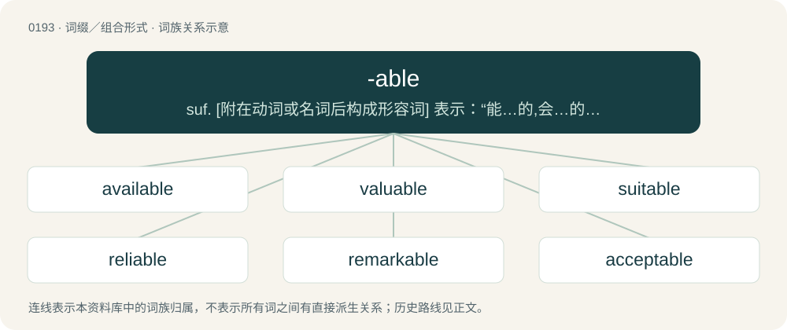

# 0215 · -able — suf. \[附在动词或名词后构成形容词\] 表示：“能…的,会…的”：durable; “可以…的”：drinkable; “具有…特性的”：fashionable; “有助于…的”,“倾向于…的”：peaceable; “易于…的”：breakable

[总目录](../00_总目录_按常用程度.md)

**类型**：词缀／组合形式　｜　**来源语言**：见词源记录

## 核心含义与来源

- 核心含义：suf. \[附在动词或名词后构成形容词\] 表示：“能…的,会…的”：durable; “可以…的”：drinkable; “具有…特性的”：fashionable; “有助于…的”,“倾向于…的”：peaceable; “易于…的”：breakable
- 英文含义：Able to be done; fit to be done.
- 词形：-able

**来源记录 1**（后缀／后置成分；Able to be done; fit to be done.）

Inherited from Middle English -able, borrowed from Old French -able, from Latin -ābilis, from -a- or -i- + -bilis (“capable or worthy of being acted upon”), from Proto-Indo-European i-stem form \*-dʰli- of \*-dʰlom (“instrumental suffix”). Not closely related etymologically, though currently related semantically, to able. Displaced native Old English -endlīc (equivalent to Modern English -andly, -andlike), and Modern English -worthy.

## 词族图

## 单词速览（常用到不常用）

| 单词 | 音标 | 释义 |
|---|---|---|
| [available](#w-1) | 英 /əˈveɪ.lə.bəl/ | a. 可利用的, 可获得的, 有效的；\[医\] 有效的, 可得的 |
| [valuable](#w-2) | /ˈvælju(ə)bl̩/ | a. 有价值的, 贵重的, 宝贵的, 可估价的；\[经\] 有价值的, 可估价的, 贵重的 |
| [suitable](#w-3) | /ˈsjuːtəbl/ | a. 适当的, 相配的；\[法\] 合适的, 适宜的, 适当的 |
| [reliable](#w-4) | /ɹɪˈlaɪəbl̩/ | a. 可靠的, 可信赖的；\[法\] 可靠的, 可信赖的, 确实的 |
| [remarkable](#w-5) | 英 /ɹɪˈmɑː.kə.bl̩/；美 /ɹɪˈmɑɹ.kə.bl̩/ | a. 不平常的, 值得注意的, 显著的 |
| [acceptable](#w-6) | /əkˈsɛp.tə.bəl/ | a. 可接受的, 合意的, 可忍受的 |
| [considerable](#w-7) | /kənˈsɪdəɹəbl̩/ | a. 相当的, 可观的, 重要的 |
| [affordable](#w-8) | 英 /əˈfɔː(ɹ).də.bəl/；美 /əˈfɔɹ.də.bəl/ | \[计\] 普及型 |
| [sustainable](#w-9) | /səˈsteɪnəbəl/ | a. 足可支撑的, 养得起的, 可以忍受的 |
| [variable](#w-10) | /ˈvєəriəbl/ | n. 易变的事物, 变数, 可变物, 变量；a. 可变的, 不定的, 易变的, 变量的；\[计\] 变量 |
| [miserable](#w-11) | /ˈmɪz(ə)ɹəbəl/ | a. 悲惨的；痛苦的；卑鄙的 |
| [notable](#w-12) | 英 /ˈnəʊtəbl̩/；美 /ˈnoʊtəbl̩/ | n. 著名人士, 值得注意之事物；a. 值得注意的, 显著的 |
| [profitable](#w-13) | 英 /ˈpɹɒf.ɪ.tə.bl̩/；美 /ˈpɹɑ.fɪ.tə.bl̩/ | a. 有利润的, 有利益的, 赚钱的；\[经\] 有利(可图)的, 合算的 |
| [enjoyable](#w-14) | /ɛnˈd͡ʒɔɪ.ə.bl̩/ | a. 可从中得到乐趣的, 令人愉快的 |
| [renewable](#w-15) | 英 /ɹɪˈnjuː.ə.bl̩/；美 /ɹɪˈnu.ə.bl̩/ | a. 可更新的, 可恢复的, 可继续的, 可换新的, 可重复的, 可重说的；\[计\] 可更新, 可再生的 |
| [accountable](#w-16) | /əˈkaʊntəbl̩/ | a. 负有责任的, 可说明的, 可解释的；\[经\] 负有责任的 |
| [desirable](#w-17) | 英 /dɪˈzaɪəɹəbəl/；美 /dɪˈzaɪɹəbəl/ | a. 令人想望的, 可取的 |
| [questionable](#w-18) | /ˈkwɛst͡ʃənəbl̩/ | a. 可疑的；\[法\] 可疑的, 有问题的, 不可靠的 |
| [predictable](#w-19) | /pɹəˈdɪktəbləl/ | a. 可预言的 |
| [noticeable](#w-20) | 英 /ˈnəʊtɪsəbl̩/；美 /ˈnoʊtɪsəbl̩/ | a. 显而易见的, 显著的, 值得注意的 |
| [understandable](#w-21) | /.ʌndəˈstændəbl/ | a. 可以理解的 |
| [respectable](#w-22) | /riˈspektəbl/ | a. 值得尊重的, 人格高尚的, 相当数量的；n. 品格高尚的人 |
| [fashionable](#w-23) | /ˈfæʃənəbl̩/ | a. 时髦的, 上流社会的, 流行的 |
| [formidable](#w-24) | 英 /fɔːˈmɪdəbəl/；美 /ˈfɔɹmɪdəbəl/ | a. 巨大的, 优秀的, 可怕的, 艰难的 |
| [adjustable](#w-25) | /əˈd͡ʒʌstəbəl/ | a. 可调节的；\[电\] 可调整的 |
| [disposable](#w-26) | 英 /dɪsˈpəʊzəbl̩/；美 /dɪsˈpoʊzəbl̩/ | a. 可任意处理的；\[法\] 可任意处理或处置的, 可自由使用的 |
| [knowledgeable](#w-27) | 英 /ˈnɒl.ɪ.d͡ʒə.bəl/；美 /ˈnɑ.lɪ.d͡ʒə.bəl/ | a. 聪明的, 有知识的 |
| [payable](#w-28) | /ˈpeɪəbl̩/ | a. 可付的, 到期的, 应付的, 有利益的；\[经\] 应付的 |
| [unforgettable](#w-29) | /ˌʌnfə(ɹ)ˈɡɛtəbəl/ | a. 忘不了的, 令人难忘的 |
| [despicable](#w-30) | /dɪˈspɪkəbəl/ | a. 可鄙的, 卑劣的 |
| [recognizable](#w-31) | /ˈrekəgnaizəbl/ | a. 可认识的, 可承认的, 可识别的；\[法\] 可被认出的, 可辩认的, 可被承认的 |
| [preferable](#w-32) | 英 /ˈpɹɛf.(ə.)ɹə.b(ə)l/；/pɹəˈfɜː.ɹə.b(ə)l/ | a. 更可取的, 更好的, 更合意的 |
| [reputable](#w-33) | /ˈɹɛpjʊtəbəl/ | a. 受好评的, 有声望的, 规范的；\[法\] 声誉好的, 可尊敬的 |
| [playable](#w-34) | /ˈpleɪəbəl/ | a. 可玩的, 可演奏的, 宜玩的, 宜演奏的 |
| [manageable](#w-35) | 英 /ˈmænɪd͡ʒəbəl/；美 /ˈmænəd͡ʒəbəl/ | a. 易办的, 易管理的, 易控制的 |
| [identifiable](#w-36) | /aiˈdentifaiəbl/ | a. 可辨认的；\[法\] 可证明为同一的, 可以办清的 |
| [sizable](#w-37) | /ˈsaɪzəbəl/ | a. 相当大的, 大小相当的 |
| [taxable](#w-38) | /ˈtæksəbəl/ | a. 可征税的, 应征税的；\[经\] 可征税的, 应纳税的 |
| [foreseeable](#w-39) | 英 /fɔːˈsiː.ə.bəl/；美 /fɔɹˈsi.ə.bəl/ | a. 可预知的, 能预测的；\[法\] 可预见的, 可预料的 |
| [undeniable](#w-40) | 英 /ˌʌn.dɪˈnaɪ.(j)ə.bəɫ/ | a. 不可否认的 |
| [relatable](#w-41) |  | 有关系的(relate的形容词形式) |
| [measurable](#w-42) | 英 /ˈmɛʒəɹəbəl/ | a. 可测量的, 不久的, 重要的 |
| [attributable](#w-43) | /əˈtɹɪbjuːtəbəl/ | a. 可归于...的 |
| [punishable](#w-44) | /ˈpʌnɪʃəbəl/ | a. 该罚的, 可罚的；\[法\] 该罚的, 可受惩处的 |
| [believable](#w-45) | /bɪˈliːvəbl̩/ | a. 可信的 |
| [readable](#w-46) | /ˈɹiː.də.bəl/ | a. 值得一读的, 易读的, 读起来津津有味的；\[电\] 可读的 |
| [removable](#w-47) | /riˈmuːvəbl/ | a. 可移去的, 可免职的, 可移动的；\[电\] 可移动的 |
| [wearable](#w-48) | 英 /wɛə̯ɹəbl̩/；美 /wɛə̯ɹəbl̩/ | a. 可穿用的；n. 衣服 |
| [interchangeable](#w-49) | 美 /ɪntɚˈt͡ʃeɪnd͡ʒəbl̩/ | a. 可互换的；\[化\] 可互换的 |
| [imaginable](#w-50) | 英 /ɪˈmadʒɪnəbəl/；美 /ɪˈmæd͡ʒɪnəbəl/ | a. 可想像的, 可能的 |
| [unthinkable](#w-51) | /ʌnˈθɪŋkəbəl/ | a. 不能考虑的, 不能想像的, 想像不到的, 不合理的 |
| [advisable](#w-52) | /ədˈvaizəbl/ | a. 适当的, 明智的 |
| [dependable](#w-53) | /diˈpendəbl/ | a. 可信任的, 可靠的, 可信赖的 |
| [inflatable](#w-54) | /ɪnˈfleɪtəbəl/ | a. 膨胀的, 得意的, 通货膨胀的 |
| [lovable](#w-55) | /ˈlʌvəbəl/ | a. 可爱的, 惹人爱的 |
| [negotiable](#w-56) | 英 /nɪˈɡəʊʃəbəl/；美 /nɪˈɡoʊʃəbəl/ | a. 可磋商的, 可转让的, 可通行的；\[经\] 可流通的, 可转让的 |
| [achievable](#w-57) | 英 /əˈt͡ʃiːvəbəl/；美 /əˈt͡ʃivəbəl/ | a. 做得成的, 可完成的, 可有成就的 |
| [reusable](#w-58) | /riːˈjuːzəbl/ | a. 可以再度使用的；\[计\] 可重复使用的; 可再用的 |
| [agreeable](#w-59) | 英 /əˈɡɹiːəbəl/；美 /əˈɡɹiəbəl/ | a. 令人愉快的, 同意的；\[医\] 佳适的 |
| [laughable](#w-60) | 英 /ˈlɑːfəbl̩/；美 /ˈlæfəbl̩/ | a. 可笑的, 有趣的 |
| [unbeatable](#w-61) | /.ʌnˈbiːtəbl/ | a. 无敌的, 无与伦比的 |
| [conceivable](#w-62) | /kənˈsiːvəbl̩/ | a. 想得到的, 可想象的, 可理解的 |
| [downloadable](#w-63) | 英 /ˌdaʊnˈləʊd.ə.bl̩/；美 /ˌdaʊnˈloʊd.ə.bl̩/ | a. 可下载的 |
| [preventable](#w-64) | /priˈventəb(ə)l/ | a. 可防止的, 可阻止的, 可预防的 |
| [unimaginable](#w-65) | /ˌʌnɪˈmædʒɪnəbəl/ | a. 不能想象的, 不可思议的 |
| [debatable](#w-66) | /diˈbeitəbl/ | a. 可争论的, 成问题的, 未决定的 |
| [unbreakable](#w-67) | /.ʌnˈbreikəbl/ | a. 不会破的, 不易打碎的 |
| [adaptable](#w-68) | 美 /əˈdæptəbəl/ | a. 能适应的, 适合的, 可修改的 |
| [workable](#w-69) | /ˈwəːkəbl/ | a. 可经营的, 可使用的；\[机\] 能工作的, 机械等能使用的, 材料等可加工的 |
| [observable](#w-70) | 英 /əbˈzɜː.və.bəl/；美 /əbˈzɝ.və.bəl/ | a. 可遵守的, 可庆祝的, 看得见的, 可辨别的, 观测得到的, 值得注意的, 显著的；n. 感觉到的事物, 现象 |
| [attainable](#w-71) | 英 /əˈteɪ.nə.bəl/ | a. 可到达的, 可得到的 |
| [pleasurable](#w-72) | /ˈplɛʒəɹəbəl/ | a. 快乐的, 愉快的, 舒适的, 心情舒畅的 |
| [unmistakable](#w-73) | /ˈʌnmisˈteikəbl/ | a. 不会弄错的, 不会被误解的, 不会搞错的, 明白无误的, 清楚明白的 |
| [objectionable](#w-74) | /əbˈdʒekʃənəbl/ | a. 会引起反对的, 令人讨厌的 |
| [obtainable](#w-75) | 英 /əbˈteɪnəbl̩/ | a. 能得到的 |
| [marketable](#w-76) | /ˈmɑːkitəbl/ | a. 可销售的, 销路好的, 市场的；\[经\] 有销路的, 可销售的 |
| [palatable](#w-77) | 英 /ˈpæl.ə.tə.bəl/ | a. 美味的, 好吃的, 可口的；\[医\] 适口的, 味美的 |
| [transferable](#w-78) | 英 /trɑːnsˈfɜːrəbl̩/；美 /trænsˈfɝrəbl̩/ | a. 可转移的；\[经\] 可转让的, 可过户的 |
| [doable](#w-79) | /ˈduː.ə.bəl/ | a. 可做的, 切实可行的 |
| [detectable](#w-80) | 英 /dɪˈtɛktəbəɫ/ | a. 可察觉的, 易发现的；\[计\] 可检测的 |
| [programmable](#w-81) | 英 /pɹəʊˈɡɹæməbəl/ | a. 可设计的, 可编程的 |
| [enforceable](#w-82) | /inˈfɔː səbl/ | a. 可实施的, 可强行的 |
| [veritable](#w-83) | 美 /ˈvɛ.ɹɪ.tə.bl/ | a. 名副其实的, 真实的, 确实的, 真的 |
| [actionable](#w-84) | 美 /ˈæk.ʃə.nə.bəl/；/ˈæk.ʃən.ə.bəl/ | a. 可提起诉讼的；\[经\] 能起诉的 |
| [allowable](#w-85) | /əˈlaʊ.əbəl/ | a. 允许的, 许可的, 容许的；\[经\] 允许产量 |
| [avoidable](#w-86) | /əˈvɔɪdəbl̩/ | a. 可避免的；\[法\] 可作为无效的, 可回避的, 可避免的 |
| [recognisable](#w-87) | 英 /ˈɹɛkə(ɡ)naɪzəbl̩/；美 /ˈɹɛkəɡnaɪzəbl̩/ | a. 可辨认的；可认识的；可承认的（=recognizable） |
| [expendable](#w-88) | /ɪkˈspɛndəbəl/ | a. 可消费的, 消耗性的, 可牺牲的, 值得消耗的, 可消耗的；n. 消耗物, 可牺牲的人, 可牺牲的物 |
| [hospitable](#w-89) | 英 /hɒsˈpɪtəbl̩/；美 /hɑsˈpɪtəbl̩/ | a. 好客的, 招待周到的 |
| [likable](#w-90) | /ˈlaɪkəbl̩/ | a. 可爱的 |
| [regrettable](#w-91) | /riˈgretəbl/ | a. 可悲的, 可惜的, 抱歉的 |
| [customizable](#w-92) |  | \[计\] 可定制的 |
| [retractable](#w-93) | /ɹiˈtɹæk.tɪ.bəl/ | a. 可缩回的, 伸缩自如的, 可取消的 |
| [verifiable](#w-94) | 英 /vɛɹ.ɪˈfaɪ.ə.bəl/；美 /ˌvɛɹ.əˈfaɪ.ə.bəl/ | a. 可核实的, 可证实的；\[法\] 可检验的, 可作证的, 可证实的 |
| [controllable](#w-95) | 美 /kənˈtɹoʊləbəl/ | a. 可管理的, 能操纵的, 可控制的；\[经\] 可控制的 |
| [detachable](#w-96) | 英 /dəˈtætʃəbl̩/ | a. 可分离的 |
| [scalable](#w-97) | 英 /ˈskeɪ.lə.bl̩/ | a. 可攀登的, 可用称量的, 可去鳞的 |
| [printable](#w-98) | /ˈprɪntəbl/ | a. 可印刷的, 适于出版的 |
| [rechargeable](#w-99) |  | \[电\] 接充电 |
| [replaceable](#w-100) | /ɹɪˈpleɪsəbəl/ | a. 可替换的, 可代替的, 可放在原处的；\[法\] 可归原处的, 可替换的, 可撤换的 |
| [approachable](#w-101) | 英 /əˈpɹəʊ.t͡ʃə.bəl/；美 /əˈpɹoʊ.t͡ʃə.bəl/ | a. 可接近的, 可亲近的；\[法\] 可接近的, 可进入的, 可亲近的 |
| [unfathomable](#w-102) | 英 /(ˌ)ʌnˈfæðəməbl̩/；美 /ˌʌnˈfæð(ə)məb(ə)l/ | a. 莫测高深的, 深不可测的, 无底的 |
| [bearable](#w-103) | /ˈbɛəɹəbəɫ/ | a. 可忍受的, 支承得住的 |
| [unattainable](#w-104) | 英 /ˌʌnəˈteɪnəbəl/ | a. 难到达的, 不可得到的 |
| [distinguishable](#w-105) | /disˈtiŋ^wiʃəbl/ | a. 区别得出的, 辩认得出的, 可辨别的 |
| [enviable](#w-106) | 英 /ˈɛn.vi.ə.bl̩/；美 /ˈɛn.vɪ.ə.b(ə)l/ | a. 令人羡慕的, 可羡慕的 |
| [forgettable](#w-107) | /fəˈgetəbl/ | a. 容易被忘的, 可忘记的 |
| [searchable](#w-108) | 美 /ˈsɝt͡ʃəbəl/ | \[计\] 可检索的 |
| [impressionable](#w-109) | /ɪmˈpɹɛ.ʃən.ə.bəl/ | a. 易感的, 敏感的, 可塑的 |
| [treatable](#w-110) |  | a. 好对付的, 能处理的, 能治疗的 |
| [presentable](#w-111) | 英 /pɹəˈzɛntəbəl/ | a. 体面的, 可表现的, 可提出的 |
| [executable](#w-112) | /ˈɛksəkjutəbl/ | a. 可执行的, 可以作成的, 可实行的；\[计\] 可执行的 |
| [livable](#w-113) | /ˈlivəbl/ | a. 生活过得有价值的, (生活)过得去的, 值得过的, 适于居住的 |
| [passable](#w-114) | 美 /ˈpæsəbəl/ | a. 可通行的, 可渡过的, 尚可的, 可流通的 |
| [perishable](#w-115) | /ˈpɛ.ɹɪ.ʃə.bəl/ | a. 易腐坏的, 会枯萎的, 易毁灭的, 不经久的；n. 易腐坏的东西 |
| [recoverable](#w-116) | 美 /ɹɪˈkʌvɚəb(ə)l/ | a. 可回复的, 可痊愈的, 可收回的；\[经\] 可收回的, 可补偿的 |
| [traceable](#w-117) | 美 /ˈtɹeɪsəbəl/ | a. 可追踪的, 可描绘的；\[经\] 可追溯的, 可追踪的 |
| [redeemable](#w-118) | /riˈdiːməbl/ | a. 可赎回的, 可挽救的, 可偿还的；\[经\] 可赎回的, 可换成现款的 |
| [irrevocable](#w-119) | 英 /ɪˈɹɛvəkəbəl/；美 /iˈɹɛvəkəbəl/ | a. 不能挽回的, 不能取消的, 不能变更的；\[经\] 不能撤销的, 不能恢复的 |
| [unrecognizable](#w-120) | 英 /ʌnˈɹɛkə(ɡ)naɪzəbəl/；美 /ʌnˈɹɛkəɡnaɪzəbəl/ | \[计\] 不可识别的 |
| [breathable](#w-121) | /ˈbɹiːðəbəl/ | a. 可以吸入的, 适宜于吸入的 |
| [changeable](#w-122) | /ˈt͡ʃeɪn.d͡ʒə.bəl/ | a. 可改变的 |
| [refundable](#w-123) | /riˈfʌndəbl/ | a. 可偿还的, 可归还的 |
| [excitable](#w-124) | /ɪkˈsaɪtəbəl/ | a. 能被激动的, 易兴奋的, 易怒的；\[医\] 应激的, \[可\]兴奋的 |
| [impassable](#w-125) | /ɪmˈpɑː.sə.bəl/ | a. 不能通行的, 不可逾越的；\[医\] 不通的, 不\[渗\]透的 |
| [expandable](#w-126) | /ikˈspændəbl/ | a. 可张开的；可膨胀的 |
| [reachable](#w-127) | /ˈɹiːtʃəbəl/ | \[计\] 可达的 |
| [answerable](#w-128) | 英 /ˈɑːnsəɹəb(ə)l/；美 /ˈæn.səɹ.ə.bl/ | a. 有责任的, 可回答的；\[法\] 应负责任的, 可驳斥的, 可答覆的 |
| [repeatable](#w-129) | 英 /ɹɪˈpiːtəbəl/；美 /ɹɪˈpitəbəl/ | \[计\] 可重复的 |
| [laudable](#w-130) | 英 /ˈlɔːdəbəl/；/ˈlɔdəbəl/ | a. 值得赞赏的, 值得佩服的；\[医\] 健康的 |
| [recyclable](#w-131) | /ˌriːˈsaɪkləbl/ | a. 可循环再用的 |
| [arguable](#w-132) | 英 /ˈɑːɡjuəbl/；美 /ˈɑɹɡjuəbl/ | a. 可辩论的, 可论证的；\[法\] 可争辩的, 可论证的 |
| [unreachable](#w-133) | /ʌnˈriːtʃəbl/ | a. 不能到达的, 不能得到的；\[计\] 执行不到的 |
| [collectable](#w-134) | /kəˈlektib(ə)l/ | a. 可收集的, 可搜集的, 可征收的 |
| [quantifiable](#w-135) | 英 /ˈkwɒn.tɪˌfaɪ.ə.bəl/；美 /ˈkwɑn.təˌfaɪ.ə.bəl/ | a. 可以计量的 |
| [impregnable](#w-136) | 英 /ɪmˈpɹɛɡ.nəˌb(ə)l/ | 【英文】Capable of being impregnated; impregnatable. |
| [foldable](#w-137) |  | \[计\] 可全并的 |
| [unquestionable](#w-138) | /ʌnˈkwɛs.t͡ʃən.ə.bl̩/ | a. 无疑问的, 确实的, 无可挑剔的；\[法\] 无可疑的, 确定的, 不成问题的 |
| [viewable](#w-139) | /ˈvjuːəbəl/ | 看得见的 |
| [washable](#w-140) | /ˈwɔʃəbl/ | a. 可洗的, 耐洗的 |
| [injectable](#w-141) | /ɪnˈd͡ʒɛktəbəl/ | \[医\] 可注射的 |
| [walkable](#w-142) | /ˈwɔːkəbəl/ | a. 适于步行的, 可以走去的 |
| [consumable](#w-143) | /kənˈsjuːməbəl/ | a. 可消耗的；n. 消耗品 |
| [drinkable](#w-144) | /ˈdɹɪŋk.ə.bəl/ | a. 可以喝的, 饮用的；n. 饮料 |
| [mashable](#w-145) |  | 【英文】Of a consistency suitable for mashing. |
| [unexplainable](#w-146) | 美 /ˌʌn.ɛksˈpleɪ.nə.bl̩/ | \[法\] 不能说明的, 无法解释的 |
| [chargeable](#w-147) | 美 /ˈt͡ʃɑɹd͡ʒəbəl/ | a. 应支付的；\[经\] 可记在某人帐上 |
| [solvable](#w-148) | 英 /ˈsɒlvəbəl/；美 /ˈsɑlvəbəl/ | a. 可以解的, 可以解决的；\[医\] 溶解的, 可溶的 |
| [watchable](#w-149) | /ˈwɔtʃəbl, ˈwɔː-/ | a. 值得注意的, 值得注视的 |
| [selectable](#w-150) | 英 /sɪˈlɛktəbl̩/；美 /səˈlɛktəbl̩/ | \[计\] 可选择的 |
| [winnable](#w-151) | /ˈwɪnəbəl/ | a. 能赢得的 |
| [teachable](#w-152) | /ˈtiːt͡ʃəbəl/ | a. 可教的, 听教训的 |
| [creditable](#w-153) | /ˈkɹɛdɪtəbəl/ | a. 可称誉的, 声誉好的, 可信的 |
| [countable](#w-154) | 美 /ˈkaʊn.tə.bəl/；/ˈkaʊn.tə.bəl/ | a. 能算的, 可计算的；n. 可数的东西, 可数名词 |
| [configurable](#w-155) | /kənˈfɪ.ɡə.ɹə.bəl/ | a. 结构的；可配置的 |
| [reportable](#w-156) | /riˈpɒːtəbl/ | a. 可报告的, 值得报告的 |
| [heritable](#w-157) | /ˈhɛɹɪtəbəl/ | a. 可继承的, 被遗传的, 可遗传的, 被继承的；\[计\] 可遣传的, 可继承的 |
| [provable](#w-158) | /ˈpɹuːvəbəl/ | a. 可证明的, 可查明的；\[法\] 可证明的, 可证实的 |
| [testable](#w-159) | 英 /ˈtɛs.tə.bəl/ | a. 可试验的, 有资格作证人的, 有资格立遗嘱的, 可根据遗嘱处理的 |
| [detestable](#w-160) | /dɪˈtɛstəbl̩/ | a. 可憎的, 可恶的 |
| [quotable](#w-161) | /ˈkwəʊtəbəl/ | a. 可引用的, 有引用价值的, 适于引用的 |
| [tunable](#w-162) | 英 /ˈtjuːnəb(ə)l/ | a. 可调音的, 能调谐的, 音调美的 |
| [deployable](#w-163) |  | a. 可开展的 |
| [implantable](#w-164) | /imˈplɑːntəbl;-ˈplæn-/ | a. \[医\]可植入的, 可移植的 |
| [deliverable](#w-165) | 英 /dɪˈlɪvɹəbəɫ/ | \[计\] 可交付的, 可投递的；\[经\] 可交割的 |
| [breakable](#w-166) | /ˈbɹeɪkəbəl/ | a. 会破的, 易破的；n. 易破的东西, 易碎的东西 |
| [employable](#w-167) | 英 /ɪmˈplɔɪəbəl/ | a. 适宜雇用的, 有资格任职的, 可利用的 |
| [extendable](#w-168) | /ɛkˈstɛndəbl̩/ | a. 可延长的；可展开的；可扩张的 |
| [tradable](#w-169) | /ˈtɹeɪdəbəl/ | a. 可贸易的, 可买卖的 |
| [transportable](#w-170) | 英 /tɹænˈspɔː(ɹ)təb(ə)l/；美 /tɹænsˈpɔɹtəbəl/ | a. 可运输的 |
| [peaceable](#w-171) | 英 /ˈpiːsəb(ə)l/ | a. 和平的, 太平的, 温顺的, 温和的, 平静的 |
| [definable](#w-172) | /diˈfainəbl/ | a. 可解说的, 可下定义的, 可解释的 |
| [unlockable](#w-173) |  | 【英文】Capable of being unlocked. |
| [fixable](#w-174) | /ˈfɪks.ə.bəl/ | a. 可固定的 |
| [addressable](#w-175) | /əˈdresəbl/ | a. 可寻址的 |
| [maneuverable](#w-176) | /məˈnuːvəɹəbəl/ | a. 操作灵活的, 有机动性的 |
| [revocable](#w-177) | /ˈrevəkəbl/ | a. 可废止的, 可取消的；\[经\] 可撤销的, 可废除的 |
| [differentiable](#w-178) | 英 /ˌdɪf.ə(ɹ)ˈɛn.ʃə.bəl/ | \[计\] 可微的 |
| [exploitable](#w-179) | /iksˈplɔitəbl/ | a. 可开发的, 可剥削的, 可利用的 |
| [saleable](#w-180) | 英 /ˈseɪləbl̩/ | a. 适销的, 价格适当的, 畅销的 |
| [clickable](#w-181) | /ˈklɪkəbəl/ | a. 可以点击的；可以打开的 |
| [exchangeable](#w-182) | /iksˈtʃeindʒəbl/ | a. 可交换的, 可兑换的, 可替换的 |
| [forgivable](#w-183) | /fəˈgivəbl/ | a. 可宽恕的；\[法\] 可宽恕的 |
| [indictable](#w-184) | /ɪnˈdaɪtəbəl/ | a. 可起诉的；\[法\] 可被控告的, 可提起公诉的 |
| [survivable](#w-185) | /səˈvaivəbl/ | 可长存的, 可存活的, 可免于死亡的 |
| [stackable](#w-186) | /ˈstækəbl/ | a. 可叠起堆放的,易叠起堆放的 |
| [impeachable](#w-187) | /imˈpiːtʃəbl/ | a. 可控告的, 可弹劾的, 可怀疑的；\[法\] 可控告的, 可弹劾的, 可怀疑的 |
| [billable](#w-188) | /ˈbɪləbəl/ | a. bill的变形 |
| [interoperable](#w-189) | /,intərˈɔpərəbl/ | \[计\] 可互用的, 相互作用的, 相互配合的 |
| [explainable](#w-190) |  | a. 可说明的, 可辩解的, 可解释的 |
| [fuckable](#w-191) | /ˈfʌkəbl̩/ | 可以亵渎的 |
| [editable](#w-192) | /ˈeditəbl/ | a. 可编辑的 |
| [refillable](#w-193) | 英 /ˌɹiːˈfɪləbɫ̩/；美 /ˌɹiˈfɪləbɫ̩/ | 适于再装的（如包装材料等） |
| [salvageable](#w-194) | /ˈsælvidʒəbl/ | a. 可抢救的；可打捞的；可挽回的；能利用的 |
| [integrable](#w-195) | /ˈɪntɪɡɹəbəl/ | \[计\] 可积分的 |
| [repairable](#w-196) | /ɹəˈpɛɹəbəl/ | a. 可修理的, 可赔偿的, 可挽回的；\[机\] 可修理的 |
| [unsinkable](#w-197) | /ˈʌnˈsiŋkəbl/ | a. 不会下沉的, 不会沉底的 |
| [knowable](#w-198) | /ˈnəuəbl/ | a. 可知的, 能认识的, 易知的 |
| [shareable](#w-199) | 英 /ˈʃɛəɹ.ə.bəl/；美 /ˈʃɛəɹ.ə.bəl/ | \[计\] 可共享的 |
| [computable](#w-200) | /kəmˈpjuːtəbəl/ | a. 可计算的 |
| [maintainable](#w-201) |  | a. 可维持的, 可维修的, 可保持的, 可供养的, 可主张的, 可坚持的 |
| [bookable](#w-202) | /ˈbjkəbl/ | a. 可预定的, 可预约的, 可预购的 |
| [dispensable](#w-203) | /dɪsˈpɛnsəbəl/ | a. 不是必要的, 可有可无的 |
| [rotatable](#w-204) | /ˈrəuteitəbl/ | a. 可旋转的, 可转动的, 可循环的, 可轮流的 |
| [certifiable](#w-205) | /ˈsəːtifaiəbl/ | a. 可证明的, 可保证的；\[医\] 法定的 |
| [deformable](#w-206) | /,diˈfɔːməbl/ | a. 可变形的 |
| [adoptable](#w-207) | /əˈdɒptəbl/ | a. 可采用的, 可收养的 |
| [estimable](#w-208) | /ˈɛstɪməbəl/ | a. 可尊敬的, 可估计的 |
| [absorbable](#w-209) | 美 /əbˈsɔɹb.ə.bl̩/ | a. 可吸收的, 容易被吸收的；\[医\] 可吸收的 |
| [danceable](#w-210) | /ˈdɑːnseɪbl/ | a. （指音乐）适合跳舞的 |
| [discoverable](#w-211) | 英 /dɪsˈkʌvɹəbəɫ/ | a. 发现的, 显露的 |
| [electable](#w-212) | /iˈlektəbl/ | a. 有候选资格的 |
| [patentable](#w-213) |  | a. 可给予专利权的, 可取得专利证的, 可给予专利证的, 可取得专利权的；\[法\] 可给予专利权的, 可以取得专利的 |
| [opposable](#w-214) | /əˈpəuzəbl/ | a. 可反对的, 可对抗的, 可对立的 |
| [assignable](#w-215) | /əˈsaɪnəbl̩/ | a. 可分配的, 可指定的, 可归属的；\[经\] 可以过户, 可分配的 |
| [beatable](#w-216) | /ˈbiːtəbl/ | a. 可打的；可击的；经打的（beat的变形） |
| [bankable](#w-217) | /ˈbæŋkəbəl/ | a. 银行能接受的；\[法\] 银行肯承兑的, 银行肯担保的 |
| [bootable](#w-218) | /ˈbuːtəbl/ | a. \[计\]可启动的；可引导的 |
| [reconfigurable](#w-219) |  | \[计\] 可重构的 |
| [chewable](#w-220) |  | a. chew的变形 |
| [lockable](#w-221) | 美 /ˈlɔ.kə.bəl/ | \[计\] 可封闭的, 可锁定的 |
| [marriageable](#w-222) | /ˈmæridʒəbl/ | a. 可结婚的, 适合结婚的 |
| [reviewable](#w-223) | /riˈvjuːəbl/ | a. 可回顾的, 可检查的, 应检查的, 可评论的 |
| [recordable](#w-224) | /riˈkɔːdəbl/ | a. 可记录的, 可录音的, 适于记录的, 适于录音的 |
| [bendable](#w-225) | /ˈbɛndəbəl/ | 可弯曲的 |
| [inhabitable](#w-226) | 英 /ɪnˈhæbɪtəbəl/；美 /ɪnˈhæbɪtəbəl/ | a. 可居住的, 可栖居的 |
| [switchable](#w-227) | /ˈswɪt͡ʃəbəl/ | 可有开关控制 |
| [unflappable](#w-228) | /ʌnˈflæpəbəl/ | a. 不慌张的, 镇定的 |
| [purchasable](#w-229) | /ˈpəːtʃəsəbl/ | a. 可买的, 可收买的 |
| [buildable](#w-230) | /ˈbildəbl/ | a. 可建造的,可信赖的；a. 可以建造的 |
| [degradable](#w-231) | /diˈgreidəbl/ | a. 可降解的 |
| [drivable](#w-232) | /ˈdɹaɪvəbl̩/ | a. 可驱动的, 可驾驶的 |
| [trainable](#w-233) | /ˈtɹeɪnəbəl/ | a. 可训练的, 可教育的 |
| [distributable](#w-234) | /disˈtribjutəbl/ | a. 可分配的, 可分成类的 |
| [insurable](#w-235) | /inˈʃurəbl/ | a. 可保险的；\[经\] 可保险的, 应保险的 |
| [steerable](#w-236) |  | a. 易驾驶的, 易操纵的, 易改变位置的；\[计\] 可操纵的, 可控制的 |
| [listenable](#w-237) | /ˈlisənəbl/ | a. 值得一听的 |
| [compostable](#w-238) |  | a. compost（混合物）的变形 |
| [dimmable](#w-239) | /ˈdɪmmeɪbl/ | a. 阴暗的, 昏暗的, 不明亮的 |
| [perceivable](#w-240) | /pəˈsiːvəbl/ | a. 可知觉的, 可认识的, 可理解的 |
| [repayable](#w-241) | /riˈpeiəbl/ | a. 可偿还的, 该付还的, 可报恩的, 应报复的 |
| [translatable](#w-242) | /tɹænzˈleɪtəbəl/ | a. 可译的, 可转变的 |

## 逐词详解

### 1. available

**词性**：形容词　｜　**音标**：英 /əˈveɪ.lə.bəl/

**中文释义**：a. 可利用的, 可获得的, 有效的；\[医\] 有效的, 可得的

**英文义项**：Such as one may avail oneself of; capable of being used for the accomplishment of a purpose. / Readily obtainable.

**构词拆分**：avail + -able

**词源与演化**：

From Middle English available, avayllable, avayleable, equivalent of avail + -able.

**例句**：

> I asked her if she was available, but she said she had a boyfriend.

该用例对应义项：Free to meet someone, speak on the telephone, enter a romantic relationship, or the like.

### 2. valuable

**词性**：形容词　｜　**音标**：/ˈvælju(ə)bl̩/

**中文释义**：a. 有价值的, 贵重的, 宝贵的, 可估价的；\[经\] 有价值的, 可估价的, 贵重的

**英文义项**：Having a great value. / Estimable; deserving esteem.

**构词拆分**：value + -able

**词源与演化**：

From value + -able.

**例句**：

> Truly valuable things have no price and cannot be bought.

该用例对应义项：Estimable; deserving esteem.

### 3. suitable

**词性**：形容词　｜　**音标**：/ˈsjuːtəbl/

**中文释义**：a. 适当的, 相配的；\[法\] 合适的, 适宜的, 适当的

**英文义项**：Having sufficient or the required properties for a certain purpose or task; appropriate to a certain occasion.

**构词拆分**：suit + -able

**词源与演化**：

From suit + -able.

**例句**：

> A tractor suitable (or fit) for heavy duty.

该用例对应义项：meant or adapted for an occasion or use

### 4. reliable

**词性**：形容词　｜　**音标**：/ɹɪˈlaɪəbl̩/

**中文释义**：a. 可靠的, 可信赖的；\[法\] 可靠的, 可信赖的, 确实的

**英文义项**：Suitable or fit to be relied on; worthy of dependence, reliance or trust; dependable, trustworthy / Such that either a sent packet will reach its destination, even if it requires retransmission, or the sender will be told that it didn't.

**构词拆分**：rely + -able

**词源与演化**：

From rely + -able.

**例句**：

> A reliable source of information.

该用例对应义项：worthy of reliance or trust

### 5. remarkable

**词性**：形容词　｜　**音标**：英 /ɹɪˈmɑː.kə.bl̩/；美 /ɹɪˈmɑɹ.kə.bl̩/

**中文释义**：a. 不平常的, 值得注意的, 显著的

**英文义项**：Worthy of remark; notable; interesting. / Uncommon; unusual.

**构词拆分**：remark + -able

**词源与演化**：

From remark + -able, from French remarquable.

**例句**：

> Her remarkable skill in mathematics is better than everyone else's in the class.

该用例对应义项：Worthy of remark; notable; interesting.

### 6. acceptable

**词性**：形容词　｜　**音标**：/əkˈsɛp.tə.bəl/

**中文释义**：a. 可接受的, 合意的, 可忍受的

**英文义项**：Capable, worthy, or sure of being accepted or received with pleasure; welcome; gratifying; pleasing to a receiver. / Barely worthy, less than excellent; passable.

**构词拆分**：accept + -able

**词源与演化**：

From Middle English acceptable, from Anglo-Norman and Middle French acceptable, from Late Latin acceptābilis (“worthy of acceptance”). Morphologically accept + -able.

**例句**：

> The designs were acceptable, but they were nothing special either.

该用例对应义项：Barely worthy, less than excellent; passable.

### 7. considerable

**词性**：形容词　｜　**音标**：/kənˈsɪdəɹəbl̩/

**中文释义**：a. 相当的, 可观的, 重要的

**英文义项**：Significant; worth considering. / Large in amount.

**构词拆分**：consider + -able

**词源与演化**：

From consider + -able.

**例句**：

> Soon I became a considerable figure in the music industry.

该用例对应义项：Significant; worth considering.

### 8. affordable

**词性**：形容词　｜　**音标**：英 /əˈfɔː(ɹ).də.bəl/；美 /əˈfɔɹ.də.bəl/

**中文释义**：\[计\] 普及型

**英文义项**：Able to be afforded; inexpensive or reasonably priced.

**构词拆分**：afford + -able

**词源与演化**：

From afford + -able.

**用法示例／搭配（非完整句）**：

> an affordable vacation in the local area

该用例对应义项：Able to be afforded; inexpensive or reasonably priced.

### 9. sustainable

**词性**：形容词　｜　**音标**：/səˈsteɪnəbəl/

**中文释义**：a. 足可支撑的, 养得起的, 可以忍受的

**英文义项**：Able to be sustained. / Able to be produced or sustained for an indefinite period without damaging the environment, or without depleting a resource; renewable.

**构词拆分**：sustain + -able

**词源与演化**：

From sustain + -able.

**用法示例／搭配（非完整句）**：

> sustainable economy

该用例对应义项：Able to be produced or sustained for an indefinite period without damaging the environment, or without depleting a resource; renewable.

### 10. variable

**词性**：形容词　｜　**音标**：/ˈvєəriəbl/

**中文释义**：n. 易变的事物, 变数, 可变物, 变量；a. 可变的, 不定的, 易变的, 变量的；\[计\] 变量

**英文义项**：Able to vary or be varied. / Likely to vary.

**构词拆分**：vary + -able

**词源与演化**：

Borrowed into Middle English in the 14th century from Old French variable, from Latin variare (“to change”), from varius (“different, various”). Equates to English vary + -able.

**用法示例／搭配（非完整句）**：

> variable winds or seasons; a variable quantity; a variable resistor

该用例对应义项：Able to vary or be varied.

### 11. miserable

**词性**：形容词　｜　**音标**：/ˈmɪz(ə)ɹəbəl/

**中文释义**：a. 悲惨的；痛苦的；卑鄙的

**英文义项**：In a state of misery: very sad, ill, or poor. / Very bad (at something); unskilled, incompetent; hopeless.

**构词拆分**：miser + -able

**词源与演化**：

Borrowed from Middle French miserable, from Old French, from Latin miserabilis, equivalent to miser + -able.

**例句**：

> He's good at some sports, like tennis, but he's just miserable at football.

该用例对应义项：Very bad (at something); unskilled, incompetent; hopeless.

### 12. notable

**词性**：形容词　｜　**音标**：英 /ˈnəʊtəbl̩/；美 /ˈnoʊtəbl̩/

**中文释义**：n. 著名人士, 值得注意之事物；a. 值得注意的, 显著的

**英文义项**：Worthy of note; remarkable; memorable; noted or distinguished. / Easily noted (without connotations of value); clearly noticeable, conspicuous.

**构词拆分**：note + -able

**词源与演化**：

Inherited from Middle English notable (“worthy of note, profitable, useful”), in some senses from Anglo-Norman notable (“noteworthy”), from Latin notābilis (“noteworthy, extraordinary”), from notō (“to note, mark”); in some senses from Middle English note (“benefit, profit, use, advantage”), from Old English notu (“t-use, profit, advantage, employment”) + -able; equivalent to note + -able. Compare English noteful (“useful”).

**例句**：

> In a land of hunchbacks, upright elegance will be a notable exception.

### 13. profitable

**词性**：形容词　｜　**音标**：英 /ˈpɹɒf.ɪ.tə.bl̩/；美 /ˈpɹɑ.fɪ.tə.bl̩/

**中文释义**：a. 有利润的, 有利益的, 赚钱的；\[经\] 有利(可图)的, 合算的

**英文义项**：Producing a profit. / Beneficial, serviceable, of use.

**构词拆分**：profit + -able

**词源与演化**：

From Old French profitable, equivalent to profit + -able.

**例句**：

> Profitable speculation on the stock market.

该用例对应义项：yielding material gain or profit

### 14. enjoyable

**词性**：形容词　｜　**音标**：/ɛnˈd͡ʒɔɪ.ə.bl̩/

**中文释义**：a. 可从中得到乐趣的, 令人愉快的

**英文义项**：Pleasant, capable of giving pleasure.

**构词拆分**：enjoy + -able

**词源与演化**：

From enjoy + -able.

**例句**：

> That was an enjoyable day; I had a lot of fun.

该用例对应义项：Pleasant, capable of giving pleasure.

### 15. renewable

**词性**：形容词　｜　**音标**：英 /ɹɪˈnjuː.ə.bl̩/；美 /ɹɪˈnu.ə.bl̩/

**中文释义**：a. 可更新的, 可恢复的, 可继续的, 可换新的, 可重复的, 可重说的；\[计\] 可更新, 可再生的

**英文义项**：Able to be renewed; capable of renewal. / Sustainable; able to be regrown or renewed; having an ongoing or continuous source of supply.

**构词拆分**：renew + -able

**词源与演化**：

From renew + -able.

**例句**：

> Solar and wind power are renewable, but coal is not.

该用例对应义项：Sustainable; able to be regrown or renewed; having an ongoing or continuous source of supply.

### 16. accountable

**词性**：形容词　｜　**音标**：/əˈkaʊntəbl̩/

**中文释义**：a. 负有责任的, 可说明的, 可解释的；\[经\] 负有责任的

**英文义项**：Obliged, when called upon, to answer (for one’s deeds); answerable. / Obliged to keep accurate records (of property or funds).

**构词拆分**：account + -able

**词源与演化**：

From account + -able. First attested around 1400.

**例句**：

> You will be held accountable for your misdemeanors.

该用例对应义项：Obliged, when called upon, to answer (for one’s deeds); answerable.

### 17. desirable

**词性**：形容词　｜　**音标**：英 /dɪˈzaɪəɹəbəl/；美 /dɪˈzaɪɹəbəl/

**中文释义**：a. 令人想望的, 可取的

**英文义项**：Worthy to be desired; pleasing; agreeable. / Sexually attractive.

**构词拆分**：desire + -able

**词源与演化**：

From Old French desirable. Morphologically desire + -able.

**例句**：

> This applicant has almost all desirable properties.

该用例对应义项：Worthy to be desired; pleasing; agreeable.

### 18. questionable

**词性**：形容词　｜　**音标**：/ˈkwɛst͡ʃənəbl̩/

**中文释义**：a. 可疑的；\[法\] 可疑的, 有问题的, 不可靠的

**英文义项**：Problematic; open to doubt or challenge. / Of dubious respectability or morality.

**构词拆分**：question + -able

**词源与演化**：

From question + -able.

**例句**：

> It is questionable if the universe is open or closed.

该用例对应义项：Problematic; open to doubt or challenge.

### 19. predictable

**词性**：形容词　｜　**音标**：/pɹəˈdɪktəbləl/

**中文释义**：a. 可预言的

**英文义项**：Able to be predicted.

**构词拆分**：predict + -able

**词源与演化**：

From predict + -able.

**用法示例／搭配（非完整句）**：

> a boring film with a predictable ending

该用例对应义项：Able to be predicted.

### 20. noticeable

**词性**：形容词　｜　**音标**：英 /ˈnəʊtɪsəbl̩/；美 /ˈnoʊtɪsəbl̩/

**中文释义**：a. 显而易见的, 显著的, 值得注意的

**英文义项**：Capable of being seen or noticed. / Worthy of note; significant.

**构词拆分**：notice + -able

**词源与演化**：

From notice + -able.

**例句**：

> Noticeable shadows under her eyes.

该用例对应义项：capable or worthy of being perceived

### 21. understandable

**词性**：形容词　｜　**音标**：/.ʌndəˈstændəbl/

**中文释义**：a. 可以理解的

**英文义项**：Capable of being understood; comprehensible. / Capable of being accepted or excused under the circumstances; permissible.

**构词拆分**：understand + -able

**词源与演化**：

From Middle English understondable, equivalent to understand + -able.

**例句**：

> I think that it's completely understandable if she turns down his offer.

### 22. respectable

**词性**：形容词　｜　**音标**：/riˈspektəbl/

**中文释义**：a. 值得尊重的, 人格高尚的, 相当数量的；n. 品格高尚的人

**英文义项**：Deserving respect. / Decent; satisfactory.

**构词拆分**：respect + -able

**词源与演化**：

From respect + -able.

**例句**：

> His accomplishments, morals, loyalty, and stature make him a respectable person.

该用例对应义项：Deserving respect.

### 23. fashionable

**词性**：形容词　｜　**音标**：/ˈfæʃənəbl̩/

**中文释义**：a. 时髦的, 上流社会的, 流行的

**英文义项**：Characteristic of or influenced by a current popular trend or style; in fashion; in vogue. / Established or favoured by custom or use; current; prevailing at a particular time.

**构词拆分**：fashion + -able

**词源与演化**：

From fashion + -able.

**用法示例／搭配（非完整句）**：

> the fashionable philosophy

该用例对应义项：Established or favoured by custom or use; current; prevailing at a particular time.

### 24. formidable

**词性**：形容词　｜　**音标**：英 /fɔːˈmɪdəbəl/；美 /ˈfɔɹmɪdəbəl/

**中文释义**：a. 巨大的, 优秀的, 可怕的, 艰难的

**英文义项**：Causing fear, dread, awe, or discouragement as a result of size, strength, or some other impressive feature; commanding respect; causing wonder or astonishment. / Difficult to defeat or overcome.

**词源与演化**：

From Middle English formidable, from Old French formidable, formible, from Latin formīdābilis (“formidable, terrible”) (whence -able), from formīdō (“fear, dread”).

**用法示例／搭配（非完整句）**：

> a formidable opponent

该用例对应义项：Difficult to defeat or overcome.

### 25. adjustable

**词性**：形容词　｜　**音标**：/əˈd͡ʒʌstəbəl/

**中文释义**：a. 可调节的；\[电\] 可调整的

**英文义项**：Capable of being adjusted. / Designed to be adjusted without difficulty.

**构词拆分**：adjust + -able

**词源与演化**：

From adjust + -able.

**例句**：

> The laser sight is pre-sighted from factory, but is user adjustable.

### 26. disposable

**词性**：形容词　｜　**音标**：英 /dɪsˈpəʊzəbl̩/；美 /dɪsˈpoʊzəbl̩/

**中文释义**：a. 可任意处理的；\[法\] 可任意处理或处置的, 可自由使用的

**英文义项**：That can be disposed of. / That is designed to be discarded rather than reused, refilled or repaired.

**构词拆分**：dispose + -able

**词源与演化**：

From dispos(e) + -able.

**例句**：

> Rather than purchase an expensive razor he bought a packet of cheap disposable ones.

该用例对应义项：That is designed to be discarded rather than reused, refilled or repaired.

### 27. knowledgeable

**词性**：形容词　｜　**音标**：英 /ˈnɒl.ɪ.d͡ʒə.bəl/；美 /ˈnɑ.lɪ.d͡ʒə.bəl/

**中文释义**：a. 聪明的, 有知识的

**英文义项**：Having knowledge, especially of a particular subject. / Educated and well-informed.

**构词拆分**：knowledge + -able

**词源与演化**：

From knowledge + -able.

**用法示例／搭配（非完整句）**：

> a knowledgeable man

该用例对应义项：Having knowledge, especially of a particular subject.

### 28. payable

**词性**：形容词　｜　**音标**：/ˈpeɪəbl̩/

**中文释义**：a. 可付的, 到期的, 应付的, 有利益的；\[经\] 应付的

**英文义项**：Due to be paid. / Able to be paid.

**构词拆分**：pay + -able

**词源与演化**：

From pay + -able.

**例句**：

> Is value-added tax payable on planning application fees?

该用例对应义项：Due to be paid.

### 29. unforgettable

**词性**：形容词　｜　**音标**：/ˌʌnfə(ɹ)ˈɡɛtəbəl/

**中文释义**：a. 忘不了的, 令人难忘的

**英文义项**：Very difficult or impossible to forget.

**构词拆分**：un- + forget + -able；un- + forgettable

**词源与演化**：

From un- + forget + -able or un- + forgettable.

**例句**：

> The things he subjected me to were horrible and unforgettable.

该用例对应义项：Very difficult or impossible to forget.

### 30. despicable

**词性**：形容词　｜　**音标**：/dɪˈspɪkəbəl/

**中文释义**：a. 可鄙的, 卑劣的

**英文义项**：Fit or deserving to be despised; contemptible; mean.

**构词拆分**：despise + -able

**词源与演化**：

From Late Latin dēspicābilis, from Latin dēspicor, a variant of dēspiciō (“to despise”), from de (“down”) + speciō (“to look at, behold”). First attested in the 1550s. Equivalent to despise + -able.

**例句**：

> Despicable means used to achieve laudable goals render the goals themselves despicable.

### 31. recognizable

**词性**：形容词　｜　**音标**：/ˈrekəgnaizəbl/

**中文释义**：a. 可认识的, 可承认的, 可识别的；\[法\] 可被认出的, 可辩认的, 可被承认的

**英文义项**：Able to be recognized.

**构词拆分**：recognize + -able

**词源与演化**：

From recognize + -able.

**例句**：

> The peacock (Inachis io) is a beautiful and easily recognizable butterfly.

### 32. preferable

**词性**：形容词　｜　**音标**：英 /ˈpɹɛf.(ə.)ɹə.b(ə)l/；/pɹəˈfɜː.ɹə.b(ə)l/

**中文释义**：a. 更可取的, 更好的, 更合意的

**英文义项**：Better than some other option; preferred.

**构词拆分**：prefer + -able

**词源与演化**：

From prefer + -able, probably after Middle French preferable. Compare preference, preferential, etc.

**例句**：

> Coffee is preferable to tea.

该用例对应义项：more desirable than another

### 33. reputable

**词性**：形容词　｜　**音标**：/ˈɹɛpjʊtəbəl/

**中文释义**：a. 受好评的, 有声望的, 规范的；\[法\] 声誉好的, 可尊敬的

**英文义项**：Having a good reputation; honourable.

**构词拆分**：repute + -able

**词源与演化**：

From repute + -able.

**例句**：

> She was a reputable businesswoman.

该用例对应义项：Having a good reputation; honourable.

### 34. playable

**词性**：形容词　｜　**音标**：/ˈpleɪəbəl/

**中文释义**：a. 可玩的, 可演奏的, 宜玩的, 宜演奏的

**英文义项**：Able to be played. / Of a move, giving a reasonable result; able to be played without losing.

**构词拆分**：play + -able

**词源与演化**：

From play + -able.

**例句**：

> Not all compact discs are playable in car stereos.

该用例对应义项：Able to be played.

### 35. manageable

**词性**：形容词　｜　**音标**：英 /ˈmænɪd͡ʒəbəl/；美 /ˈmænəd͡ʒəbəl/

**中文释义**：a. 易办的, 易管理的, 易控制的

**英文义项**：Capable of being managed or controlled. / Capable of being done or fulfilled; achievable.

**构词拆分**：manage + -able

**词源与演化**：

From manage + -able.

**例句**：

> Mr. George told British radio that the crisis is troublesome, but manageable.

### 36. identifiable

**词性**：形容词　｜　**音标**：/aiˈdentifaiəbl/

**中文释义**：a. 可辨认的；\[法\] 可证明为同一的, 可以办清的

**英文义项**：Capable of being distinguished and named.

**构词拆分**：identify + -able

**词源与演化**：

From identify + -able.

**例句**：

> I don't know where he was from because he had no identifiable accent.

该用例对应义项：Capable of being distinguished and named.

### 37. sizable

**词性**：形容词　｜　**音标**：/ˈsaɪzəbəl/

**中文释义**：a. 相当大的, 大小相当的

**英文义项**：Fairly large.

**构词拆分**：size + -able

**词源与演化**：

From size + -able.

**例句**：

> He gave a sizable cash donation, sizable enough that the IRS wondered where all that money came from.

该用例对应义项：Fairly large.

### 38. taxable

**词性**：形容词　｜　**音标**：/ˈtæksəbəl/

**中文释义**：a. 可征税的, 应征税的；\[经\] 可征税的, 应纳税的

**英文义项**：That can be taxed. / Subject to taxation.

**构词拆分**：tax + -able

**词源与演化**：

From tax + -able

**例句**：

> All economic problems would be solved, if they made complacency taxable.

### 39. foreseeable

**词性**：形容词　｜　**音标**：英 /fɔːˈsiː.ə.bəl/；美 /fɔɹˈsi.ə.bəl/

**中文释义**：a. 可预知的, 能预测的；\[法\] 可预见的, 可预料的

**英文义项**：Able to be foreseen or anticipated.

**构词拆分**：foresee + -able

**词源与演化**：

From foresee + -able.

**例句**：

> This project will not be finished in the foreseeable future.

该用例对应义项：Able to be foreseen or anticipated.

### 40. undeniable

**词性**：形容词　｜　**音标**：英 /ˌʌn.dɪˈnaɪ.(j)ə.bəɫ/

**中文释义**：a. 不可否认的

**英文义项**：Irrefutable, or impossible to deny.

**构词拆分**：un- + deny + -able

**词源与演化**：

From un- + deny + -able, compare deniable.

**例句**：

> Some believe that there is undeniable evidence of UFOs.

该用例对应义项：Irrefutable, or impossible to deny.

### 41. relatable

**词性**：形容词

**中文释义**：有关系的(relate的形容词形式)

**英文义项**：Able to be related to something else; connected with. / Able to be related to on a personal level.

**构词拆分**：relate + -able

**词源与演化**：

From relate + -able.

**例句**：

> The characters in the play are very warm and relatable.

该用例对应义项：Able to be related to on a personal level.

### 42. measurable

**词性**：形容词　｜　**音标**：英 /ˈmɛʒəɹəbəl/

**中文释义**：a. 可测量的, 不久的, 重要的

**英文义项**：Able to be measured. / Of significant importance.

**构词拆分**：measure + -able

**词源与演化**：

From Old French mesurable, equivalent to measure + -able. Doublet of mensurable.

**例句**：

> A measurable figure in literature.

该用例对应义项：of distinguished importance

### 43. attributable

**词性**：形容词　｜　**音标**：/əˈtɹɪbjuːtəbəl/

**中文释义**：a. 可归于...的

**英文义项**：Capable of being attributed. / Allowed to be attributed.

**构词拆分**：attribute + -able

**词源与演化**：

From attribute + -able.

**例句**：

> His lack of conversation is attributable to his shyness.

该用例对应义项：Capable of being attributed.

### 44. punishable

**词性**：形容词　｜　**音标**：/ˈpʌnɪʃəbəl/

**中文释义**：a. 该罚的, 可罚的；\[法\] 该罚的, 可受惩处的

**英文义项**：Subject to punishment; appropriate for punishment.

**构词拆分**：punish + -able

**词源与演化**：

From punish + -able.

**例句**：

> Littering in this area is punishable by a fine of up to $100.

该用例对应义项：Subject to punishment; appropriate for punishment.

### 45. believable

**词性**：形容词　｜　**音标**：/bɪˈliːvəbl̩/

**中文释义**：a. 可信的

**英文义项**：Capable of being believed; credible.

**构词拆分**：believe + -able

**词源与演化**：

From Middle English bilevable, beleevable, equivalent to believe + -able.

**用法示例／搭配（非完整句）**：

> believable account

该用例对应义项：Capable of being believed; credible.

### 46. readable

**词性**：形容词　｜　**音标**：/ˈɹiː.də.bəl/

**中文释义**：a. 值得一读的, 易读的, 读起来津津有味的；\[电\] 可读的

**英文义项**：Legible, possible to read or at least decipher. / Which can be read—i.e. accessed or played—by a certain technical type of device.

**构词拆分**：read + -able

**词源与演化**：

From read + -able.

**例句**：

> These assembly instructions aren't readable, I still don't have a clue how to start!

该用例对应义项：Enjoyable to read, of an acceptable stylistic quality or at least functionally composed.

### 47. removable

**词性**：形容词　｜　**音标**：/riˈmuːvəbl/

**中文释义**：a. 可移去的, 可免职的, 可移动的；\[电\] 可移动的

**英文义项**：Able to be removed.

**构词拆分**：remove + -able

**词源与演化**：

From remove + -able.

**例句**：

> Stuxnet spread by infected removable drives, such as USB drives.

### 48. wearable

**词性**：形容词　｜　**音标**：英 /wɛə̯ɹəbl̩/；美 /wɛə̯ɹəbl̩/

**中文释义**：a. 可穿用的；n. 衣服

**英文义项**：Able to be worn. / Suitable for wear by ordinary people, or in ordinary circumstances, as opposed to being unusual, uncomfortable, or otherwise difficult to wear.

**构词拆分**：wear + -able

**词源与演化**：

From wear + -able.

**用法示例／搭配（非完整句）**：

> a wearable device

该用例对应义项：Able to be worn.

### 49. interchangeable

**词性**：形容词　｜　**音标**：美 /ɪntɚˈt͡ʃeɪnd͡ʒəbl̩/

**中文释义**：a. 可互换的；\[化\] 可互换的

**英文义项**：Freely substitutable; that may be swapped at will. / Following each other in alternate succession; alternating.

**构词拆分**：interchange + -able

**词源与演化**：

From interchange + -able.

**例句**：

> Eli Whitney's development of interchangeable parts was a breakthrough for modern manufacturing. Prior to that, each part had to be made custom.

该用例对应义项：Freely substitutable; that may be swapped at will.

### 50. imaginable

**词性**：形容词　｜　**音标**：英 /ɪˈmadʒɪnəbəl/；美 /ɪˈmæd͡ʒɪnəbəl/

**中文释义**：a. 可想像的, 可能的

**英文义项**：Able to be imagined; conceivable. / Within the realm of consideration.

**构词拆分**：imagine + -able

**词源与演化**：

From Middle English ymaginable, from Latin imāginābilis; equivalent to imagine + -able.

**例句**：

> Killing people while they pray is the most despicable thing imaginable.

### 51. unthinkable

**词性**：名词　｜　**音标**：/ʌnˈθɪŋkəbəl/

**中文释义**：a. 不能考虑的, 不能想像的, 想像不到的, 不合理的

**英文义项**：Something, or various things collectively, that one dares not think about or do.

**构词拆分**：un- + think + -able

**词源与演化**：

From un- + think + -able.

**用法示例／搭配（非完整句）**：

> did the unthinkable

该用例对应义项：Something, or various things collectively, that one dares not think about or do.

### 52. advisable

**词性**：形容词　｜　**音标**：/ədˈvaizəbl/

**中文释义**：a. 适当的, 明智的

**英文义项**：Worthy of being recommended; desirable. / Capable of being advised or willing to be advised.

**构词拆分**：advise + -able

**词源与演化**：

From advise + -able.

**例句**：

> Such action is neither necessary nor advisable.

该用例对应义项：worthy of being recommended or suggested; prudent or wise

### 53. dependable

**词性**：形容词　｜　**音标**：/diˈpendəbl/

**中文释义**：a. 可信任的, 可靠的, 可信赖的

**英文义项**：Able, or easily able to be depended on.

**构词拆分**：depend + -able

**词源与演化**：

From depend + -able.

**例句**：

> He was a very dependable person.

该用例对应义项：Able, or easily able to be depended on.

### 54. inflatable

**词性**：形容词　｜　**音标**：/ɪnˈfleɪtəbəl/

**中文释义**：a. 膨胀的, 得意的, 通货膨胀的

**英文义项**：Able to be inflated or blown up.

**构词拆分**：inflate + -able

**词源与演化**：

From inflate + -able.

**例句**：

> One problem with inflatable boats is that they sometimes spring leaks.

### 55. lovable

**词性**：形容词　｜　**音标**：/ˈlʌvəbəl/

**中文释义**：a. 可爱的, 惹人爱的

**英文义项**：Inspiring or deserving love or affection; adorable or cute.

**构词拆分**：love + -able

**词源与演化**：

From Middle English lovable, loveable, luffeabill, lufabul, equivalent to love + -able.

**例句**：

> A mischievous but lovable child.

该用例对应义项：having characteristics that attract love or affection

### 56. negotiable

**词性**：形容词　｜　**音标**：英 /nɪˈɡəʊʃəbəl/；美 /nɪˈɡoʊʃəbəl/

**中文释义**：a. 可磋商的, 可转让的, 可通行的；\[经\] 可流通的, 可转让的

**英文义项**：Able to be traversed; navigable. / Able to be transferred to another person, with or without endorsement, in exchange for money.

**构词拆分**：negotiate + -able

**词源与演化**：

From negotiate + -able.

**例句**：

> Salary is negotiable, according to education and experience.

该用例对应义项：Open to negotiation or bargaining.

### 57. achievable

**词性**：形容词　｜　**音标**：英 /əˈt͡ʃiːvəbəl/；美 /əˈt͡ʃivəbəl/

**中文释义**：a. 做得成的, 可完成的, 可有成就的

**英文义项**：Capable of being achieved, which either means possible or probable. / Not linked to fate or outside influences.

**构词拆分**：achieve + -able

**词源与演化**：

From achieve + -able.

**用法示例／搭配（非完整句）**：

> achievable result

该用例对应义项：Capable of being achieved, which either means possible or probable.

### 58. reusable

**词性**：形容词　｜　**音标**：/riːˈjuːzəbl/

**中文释义**：a. 可以再度使用的；\[计\] 可重复使用的; 可再用的

**英文义项**：Able to be used again; especially after salvaging or special treatment or processing / (of a program) Able to be executed by several tasks without being reloaded; either reentrant or serially reusable

**构词拆分**：reuse + -able

**词源与演化**：

From reuse + -able.

**例句**：

> I try to use reusable bags and be a more green consumer.

### 59. agreeable

**词性**：形容词　｜　**音标**：英 /əˈɡɹiːəbəl/；美 /əˈɡɹiəbəl/

**中文释义**：a. 令人愉快的, 同意的；\[医\] 佳适的

**英文义项**：Able to agree; possible to be agreed. / Pleasant to the senses or the mind; pleasing, satisfying, palatable.

**构词拆分**：agree + -able

**词源与演化**：

From Middle English agreable, from Old French agreable. Equivalent to agree + -able.

**例句**：

> Agreeable to the order of the day, the House took up the report.

该用例对应义项：Pursuant, conformant, accordant.

### 60. laughable

**词性**：形容词　｜　**音标**：英 /ˈlɑːfəbl̩/；美 /ˈlæfəbl̩/

**中文释义**：a. 可笑的, 有趣的

**英文义项**：Worthless; worthy of contempt or derision.

**构词拆分**：laugh + -able

**词源与演化**：

From laugh + -able.

**例句**：

> The idea that he is going to make a speech is laughable.

### 61. unbeatable

**词性**：形容词　｜　**音标**：/.ʌnˈbiːtəbl/

**中文释义**：a. 无敌的, 无与伦比的

**英文义项**：That cannot be beaten, defeated or overcome

**构词拆分**：un- + beat + -able

**词源与演化**：

From un- + beat + -able. Beatable is a back-formation.

**例句**：

> At the moment you are unbeatable. Even the others notice.

### 62. conceivable

**词性**：形容词　｜　**音标**：/kənˈsiːvəbl̩/

**中文释义**：a. 想得到的, 可想象的, 可理解的

**英文义项**：Capable of being conceived or imagined.

**构词拆分**：conceive + -able

**词源与演化**：

From Middle English conceyvable, equivalent to conceive + -able.

**例句**：

> He has lied to me, the villain, in every conceivable way.

### 63. downloadable

**词性**：形容词　｜　**音标**：英 /ˌdaʊnˈləʊd.ə.bl̩/；美 /ˌdaʊnˈloʊd.ə.bl̩/

**中文释义**：a. 可下载的

**英文义项**：Capable of being downloaded.

**构词拆分**：download + -able

**词源与演化**：

From download + -able.

**例句**：

> Older games did not have downloadable content. They only had patches and expansion packs.

### 64. preventable

**词性**：形容词　｜　**音标**：/priˈventəb(ə)l/

**中文释义**：a. 可防止的, 可阻止的, 可预防的

**英文义项**：Capable of being prevented.

**构词拆分**：prevent + -able

**词源与演化**：

From prevent + -able.

**例句**：

> Conscious of preventable human suffering.

该用例对应义项：capable of being prevented

### 65. unimaginable

**词性**：形容词　｜　**音标**：/ˌʌnɪˈmædʒɪnəbəl/

**中文释义**：a. 不能想象的, 不可思议的

**英文义项**：Unable to be imagined; inconceivable or mind-boggling; beyond belief.

**构词拆分**：un- + imagine + -able

**词源与演化**：

From un- + imagine + -able.

**例句**：

> Lukas only needs a short amount of time to commit the unimaginable.

### 66. debatable

**词性**：形容词　｜　**音标**：/diˈbeitəbl/

**中文释义**：a. 可争论的, 成问题的, 未决定的

**英文义项**：Open to debate; not fully proved or confirmed. / Able to be debated; up for discussion.

**构词拆分**：debate + -able

**词源与演化**：

From Old French debatable (French débattable), equivalent to debate + -able.

**例句**：

> Those data are debatable: no one has been able to replicate them.

该用例对应义项：Open to debate; not fully proved or confirmed.

### 67. unbreakable

**词性**：形容词　｜　**音标**：/.ʌnˈbreikəbl/

**中文释义**：a. 不会破的, 不易打碎的

**英文义项**：Difficult or impossible to break and therefore able to withstand rough usage. / Resilient.

**构词拆分**：un- + break + -able

**词源与演化**：

From un- + break + -able.

**用法示例／搭配（非完整句）**：

> the unbreakable spirit of the rebels

该用例对应义项：Resilient.

### 68. adaptable

**词性**：形容词　｜　**音标**：美 /əˈdæptəbəl/

**中文释义**：a. 能适应的, 适合的, 可修改的

**英文义项**：Capable of being adapted. / Willing or able to adapt to circumstances; flexible.

**构词拆分**：adapt + -able

**词源与演化**：

From adapt + -able.

**用法示例／搭配（非完整句）**：

> an adaptable electric plug for international use

该用例对应义项：Capable of being adapted.

### 69. workable

**词性**：形容词　｜　**音标**：/ˈwəːkəbl/

**中文释义**：a. 可经营的, 可使用的；\[机\] 能工作的, 机械等能使用的, 材料等可加工的

**英文义项**：Capable of functioning. / Able to be worked or fashioned

**构词拆分**：work + -able

**词源与演化**：

From work + -able.

**例句**：

> They came up with a workable solution, until they could think of something better.

该用例对应义项：Capable of functioning.

### 70. observable

**词性**：形容词　｜　**音标**：英 /əbˈzɜː.və.bəl/；美 /əbˈzɝ.və.bəl/

**中文释义**：a. 可遵守的, 可庆祝的, 看得见的, 可辨别的, 观测得到的, 值得注意的, 显著的；n. 感觉到的事物, 现象

**英文义项**：Able to be observed. / Deserving to be observed; worth regarding; remarkable.

**构词拆分**：observe + -able

**词源与演化**：

From observe + -able.

**例句**：

> The strange new star was at the edge of the observable universe.

该用例对应义项：Able to be observed.

### 71. attainable

**词性**：形容词　｜　**音标**：英 /əˈteɪ.nə.bəl/

**中文释义**：a. 可到达的, 可得到的

**英文义项**：Able to be accomplished, achieved, or obtained.

**构词拆分**：attain + -able

**词源与演化**：

From attain + -able.

**例句**：

> Choose an attainable goal.

该用例对应义项：capable of being attained or accomplished

### 72. pleasurable

**词性**：形容词　｜　**音标**：/ˈplɛʒəɹəbəl/

**中文释义**：a. 快乐的, 愉快的, 舒适的, 心情舒畅的

**英文义项**：That gives pleasure

**构词拆分**：pleasure + -able

**词源与演化**：

From pleasure + -able.

**例句**：

> The massage was a pleasurable experience.

该用例对应义项：That gives pleasure

### 73. unmistakable

**词性**：形容词　｜　**音标**：/ˈʌnmisˈteikəbl/

**中文释义**：a. 不会弄错的, 不会被误解的, 不会搞错的, 明白无误的, 清楚明白的

**英文义项**：Unique, such that it cannot be mistaken for something else.

**构词拆分**：un- + mistake + -able

**词源与演化**：

From un- + mistake + -able.

**例句**：

> He bore an unmistakable reference to his father. It made his mother cry.

### 74. objectionable

**词性**：形容词　｜　**音标**：/əbˈdʒekʃənəbl/

**中文释义**：a. 会引起反对的, 令人讨厌的

**英文义项**：Arousing disapproval; worthy of objection; offensive.

**构词拆分**：objection + -able

**词源与演化**：

From objection + -able.

**例句**：

> Before removing objectionable material, you'll have to decide what will offend people.

该用例对应义项：Arousing disapproval; worthy of objection; offensive.

### 75. obtainable

**词性**：形容词　｜　**音标**：英 /əbˈteɪnəbl̩/

**中文释义**：a. 能得到的

**英文义项**：Able to be obtained.

**构词拆分**：obtain + -able

**词源与演化**：

From obtain + -able.

**例句**：

> Savings of up to 50 percent are obtainable.

该用例对应义项：capable of being obtained

### 76. marketable

**词性**：形容词　｜　**音标**：/ˈmɑːkitəbl/

**中文释义**：a. 可销售的, 销路好的, 市场的；\[经\] 有销路的, 可销售的

**英文义项**：Capable of being marketed. / Saleable (of goods) or employable (of people).

**构词拆分**：market + -able

**词源与演化**：

From market + -able.

**例句**：

> The quality and scarcity ensured that the product was eminently marketable.

该用例对应义项：Capable of being marketed.

### 77. palatable

**词性**：形容词　｜　**音标**：英 /ˈpæl.ə.tə.bəl/

**中文释义**：a. 美味的, 好吃的, 可口的；\[医\] 适口的, 味美的

**英文义项**：Pleasing to the taste, tasty. / Tolerable, acceptable.

**构词拆分**：palate + -able

**词源与演化**：

From palate + -able.

**例句**：

> For some instant noodles make a palatable, if not especially nutritious, meal.

该用例对应义项：Pleasing to the taste, tasty.

### 78. transferable

**词性**：形容词　｜　**音标**：英 /trɑːnsˈfɜːrəbl̩/；美 /trænsˈfɝrəbl̩/

**中文释义**：a. 可转移的；\[经\] 可转让的, 可过户的

**英文义项**：Able to be transferred.

**构词拆分**：transfer + -able

**词源与演化**：

From transfer + -able. Compare inferable, deferrable.

**例句**：

> To start a new career, you need transferable skills.

该用例对应义项：Able to be transferred.

### 79. doable

**词性**：形容词　｜　**音标**：/ˈduː.ə.bəl/

**中文释义**：a. 可做的, 切实可行的

**英文义项**：Possible to do; feasible. / Worthy of sexual conquest.

**构词拆分**：do + -able

**词源与演化**：

From Middle English doable, equivalent to do + -able.

**例句**：

> Look at that chick - she's so doable!

该用例对应义项：Worthy of sexual conquest.

### 80. detectable

**词性**：形容词　｜　**音标**：英 /dɪˈtɛktəbəɫ/

**中文释义**：a. 可察觉的, 易发现的；\[计\] 可检测的

**英文义项**：Able to be detected, noticeable.

**构词拆分**：detect + -able

**词源与演化**：

From detect + -able.

**例句**：

> There was a detectable pause before he continued. We all noticed it but no one commented.

该用例对应义项：Able to be detected, noticeable.

### 81. programmable

**词性**：形容词　｜　**音标**：英 /pɹəʊˈɡɹæməbəl/

**中文释义**：a. 可设计的, 可编程的

**英文义项**：Capable of being programmed.

**构词拆分**：program + -able

**词源与演化**：

From program + -able.

**例句**：

> Consider the Roomba, a programmable robotic vacuum which cleans floors on its own.

### 82. enforceable

**词性**：形容词　｜　**音标**：/inˈfɔː səbl/

**中文释义**：a. 可实施的, 可强行的

**英文义项**：Capable of being enforced.

**构词拆分**：enforce + -able

**词源与演化**：

From enforce + -able.

**例句**：

> There must be active and enforceable mechanisms to protect copyright exceptions and limitations, including fair use and fair dealing regimes.

### 83. veritable

**词性**：形容词　｜　**音标**：美 /ˈvɛ.ɹɪ.tə.bl/

**中文释义**：a. 名副其实的, 真实的, 确实的, 真的

**英文义项**：True; genuine. / As an intensifier: absolute, indisputable.

**构词拆分**：verity + -able

**词源与演化**：

From verity + -able, from Middle French veritable, from Old French veritable, from Latin veritabilis.

**例句**：

> A fair is a veritable smorgasbord.

该用例对应义项：True; genuine.

### 84. actionable

**词性**：形容词　｜　**音标**：美 /ˈæk.ʃə.nə.bəl/；/ˈæk.ʃən.ə.bəl/

**中文释义**：a. 可提起诉讼的；\[经\] 能起诉的

**英文义项**：Able to be acted on; able to be used as the basis for taking action. / Affording grounds for legal action.

**构词拆分**：action + -able

**词源与演化**：

From action + -able. Compare Late Latin actionabilis. See action.

**例句**：

> Clearly the libelous book is actionable, but I'm not commenting on anything to do with legal issues.

该用例对应义项：Affording grounds for legal action.

### 85. allowable

**词性**：形容词　｜　**音标**：/əˈlaʊ.əbəl/

**中文释义**：a. 允许的, 许可的, 容许的；\[经\] 允许产量

**英文义项**：Appropriate; acceptable. / Intellectually admissible; valid; probable.

**构词拆分**：allow + -able

**词源与演化**：

From Middle English allowable, alowable, a borrowing from Old French alouable (Modern French allouable), from allouer, equivalent to allow + -able.

### 86. avoidable

**词性**：形容词　｜　**音标**：/əˈvɔɪdəbl̩/

**中文释义**：a. 可避免的；\[法\] 可作为无效的, 可回避的, 可避免的

**英文义项**：Capable of being vacated; liable to be annulled or made invalid; voidable. / Capable of being avoided, shunned, or escaped.

**构词拆分**：avoid + -able

**词源与演化**：

From avoid + -able.

**例句**：

> The minister confessed that many of the deaths were avoidable.

该用例对应义项：Capable of being avoided, shunned, or escaped.

### 87. recognisable

**词性**：形容词　｜　**音标**：英 /ˈɹɛkə(ɡ)naɪzəbl̩/；美 /ˈɹɛkəɡnaɪzəbl̩/

**中文释义**：a. 可辨认的；可认识的；可承认的（=recognizable）

**英文义项**：Able to be recognised.

**构词拆分**：recognise + -able

**词源与演化**：

From recognise + -able.

**例句**：

> St Paul's Cathedral is one of the most famous and most recognisable sights in London.

### 88. expendable

**词性**：形容词　｜　**音标**：/ɪkˈspɛndəbəl/

**中文释义**：a. 可消费的, 消耗性的, 可牺牲的, 值得消耗的, 可消耗的；n. 消耗物, 可牺牲的人, 可牺牲的物

**英文义项**：Able to be expended; not inexhaustible. / Designed for a single use; not reusable.

**构词拆分**：expend + -able

**词源与演化**：

From expend + -able.

**例句**：

> Oil and other expendable resources are frequently the subject of military disputes.

该用例对应义项：Able to be expended; not inexhaustible.

### 89. hospitable

**词性**：形容词　｜　**音标**：英 /hɒsˈpɪtəbl̩/；美 /hɑsˈpɪtəbl̩/

**中文释义**：a. 好客的, 招待周到的

**英文义项**：cordial and generous towards guests / receptive and open-minded

**词源与演化**：

Borrowed from Middle French hospitable, formed from the root of Latin hospitare with the suffix -able. Displaced native Old English cumlīþe (literally “guest-gentle”).

**用法示例／搭配（非完整句）**：

> hospitable family

该用例对应义项：cordial and generous towards guests

### 90. likable

**词性**：形容词　｜　**音标**：/ˈlaɪkəbl̩/

**中文释义**：a. 可爱的

**英文义项**：Of a person, having qualities tending to result in being liked; friendly, personable. / Capable of, or suitable for, being liked.

**构词拆分**：like + -able

**词源与演化**：

From like + -able.

**例句**：

> She's a naturally likable person, with lots of friends.

该用例对应义项：Of a person, having qualities tending to result in being liked; friendly, personable.

### 91. regrettable

**词性**：形容词　｜　**音标**：/riˈgretəbl/

**中文释义**：a. 可悲的, 可惜的, 抱歉的

**英文义项**：Able to be regretted, especially deserving of regret.

**构词拆分**：regret + -able

**词源与演化**：

From regret + -able.

**例句**：

> The officers' actions were regrettable, yes, but there's nothing to be done now but to relocate everyone to the mainland in a calm and orderly manner.

该用例对应义项：Able to be regretted, especially deserving of regret.

### 92. customizable

**词性**：形容词

**中文释义**：\[计\] 可定制的

**英文义项**：Able to be customized.

**构词拆分**：customize + -able

**词源与演化**：

From customize + -able.

**例句**：

> It is customizable to your likings.

### 93. retractable

**词性**：形容词　｜　**音标**：/ɹiˈtɹæk.tɪ.bəl/

**中文释义**：a. 可缩回的, 伸缩自如的, 可取消的

**英文义项**：Capable of being retracted; retractile.

**构词拆分**：retract + -able

**词源与演化**：

From retract + -able.

**例句**：

> In the summer, the retractable roof of the pool is opened.

### 94. verifiable

**词性**：形容词　｜　**音标**：英 /vɛɹ.ɪˈfaɪ.ə.bəl/；美 /ˌvɛɹ.əˈfaɪ.ə.bəl/

**中文释义**：a. 可核实的, 可证实的；\[法\] 可检验的, 可作证的, 可证实的

**英文义项**：Able to be verified or confirmed. / Able to be qualified by a Boolean expression.

**构词拆分**：verify + -able

**词源与演化**：

From verify + -able.

**例句**：

> Do you have verifiable evidence to support that claim?

该用例对应义项：Able to be verified or confirmed.

### 95. controllable

**词性**：形容词　｜　**音标**：美 /kənˈtɹoʊləbəl/

**中文释义**：a. 可管理的, 能操纵的, 可控制的；\[经\] 可控制的

**英文义项**：Able to be controlled; subject to regulation or command.

**构词拆分**：control + -able

**词源与演化**：

From control + -able.

### 96. detachable

**词性**：形容词　｜　**音标**：英 /dəˈtætʃəbl̩/

**中文释义**：a. 可分离的

**英文义项**：Designed to be unfastened or disconnected without damage.

**构词拆分**：detach + -able

**词源与演化**：

From French détachable, detach + -able.

**例句**：

> Shirts with detachable collars.

该用例对应义项：designed to be unfastened or disconnected without damage

### 97. scalable

**词性**：形容词　｜　**音标**：英 /ˈskeɪ.lə.bl̩/

**中文释义**：a. 可攀登的, 可用称量的, 可去鳞的

**英文义项**：Capable of being climbed. / Able to be changed in scale; resizeable.

**构词拆分**：scale + -able

**词源与演化**：

From scale + -able.

**例句**：

> The scalable slope of a mountain.

该用例对应义项：capable of being scaled; possible to scale

### 98. printable

**词性**：形容词　｜　**音标**：/ˈprɪntəbl/

**中文释义**：a. 可印刷的, 适于出版的

**英文义项**：Worthy or capable of being printed. / Of a text character: having a visual representation, unlike the control characters.

**构词拆分**：print + -able

**词源与演化**：

From print + -able.

### 99. rechargeable

**词性**：形容词

**中文释义**：\[电\] 接充电

**英文义项**：Able to be recharged, especially of a battery that can be recharged from mains electricity via a charger.

**构词拆分**：recharge + -able

**词源与演化**：

From recharge + -able.

**例句**：

> The number of Sony rechargeable batteries supposed to be collected totalled 7,659,000 units.

### 100. replaceable

**词性**：形容词　｜　**音标**：/ɹɪˈpleɪsəbəl/

**中文释义**：a. 可替换的, 可代替的, 可放在原处的；\[法\] 可归原处的, 可替换的, 可撤换的

**英文义项**：Capable of being replaced.

**构词拆分**：replace + -able

**词源与演化**：

From replace + -able.

**例句**：

> He knew he was not easily replaceable at work.

该用例对应义项：Capable of being replaced.

### 101. approachable

**词性**：形容词　｜　**音标**：英 /əˈpɹəʊ.t͡ʃə.bəl/；美 /əˈpɹoʊ.t͡ʃə.bəl/

**中文释义**：a. 可接近的, 可亲近的；\[法\] 可接近的, 可进入的, 可亲近的

**英文义项**：Easily approached; easy to talk to.

**构词拆分**：approach + -able

**词源与演化**：

From approach + -able.

**例句**：

> Her boss was very approachable.

该用例对应义项：Easily approached; easy to talk to.

### 102. unfathomable

**词性**：形容词　｜　**音标**：英 /(ˌ)ʌnˈfæðəməbl̩/；美 /ˌʌnˈfæð(ə)məb(ə)l/

**中文释义**：a. 莫测高深的, 深不可测的, 无底的

**英文义项**：Especially of depth: physically incapable of being measured; immeasurable. / Impossible to grasp the extent of, or to fully know or understand.

**构词拆分**：un- (prefix meaning ‘not’) + fathom (“to measure the depth of (water); (figurative) to deeply understand (someone or something)”) + -able (suffix forming adjectives denoting things not able or fit to be done)

**词源与演化**：

From un- (prefix meaning ‘not’) + fathom (“to measure the depth of (water); (figurative) to deeply understand (someone or something)”) + -able (suffix forming adjectives denoting things not able or fit to be done).

**例句**：

> The sheer number of warriors the enemy attacked with was unfathomable.

该用例对应义项：Impossible to grasp the extent of, or to fully know or understand.

### 103. bearable

**词性**：形容词　｜　**音标**：/ˈbɛəɹəbəɫ/

**中文释义**：a. 可忍受的, 支承得住的

**英文义项**：Able to be borne; tolerable; endurable. / Able to be borne or carried; portable.

**构词拆分**：bear + -able

**词源与演化**：

From Middle English berable, equivalent to bear + -able.

**例句**：

> The heat of day was fierce until the sun set, when it became bearable.

### 104. unattainable

**词性**：形容词　｜　**音标**：英 /ˌʌnəˈteɪnəbəl/

**中文释义**：a. 难到达的, 不可得到的

**英文义项**：Impossible to attain or reach; unable to accomplish

**构词拆分**：un- + attain + -able

**词源与演化**：

From un- + attain + -able.

**例句**：

> I discovered a sense of peace that I had previously thought unattainable.

### 105. distinguishable

**词性**：形容词　｜　**音标**：/disˈtiŋ^wiʃəbl/

**中文释义**：a. 区别得出的, 辩认得出的, 可辨别的

**英文义项**：Able, or easily able to be distinguished.

**构词拆分**：distinguish + -able

**词源与演化**：

From distinguish + -able.

**用法示例／搭配（非完整句）**：

> Black is very distinguishable against a white background

该用例对应义项：Able, or easily able to be distinguished.

### 106. enviable

**词性**：形容词　｜　**音标**：英 /ˈɛn.vi.ə.bl̩/；美 /ˈɛn.vɪ.ə.b(ə)l/

**中文释义**：a. 令人羡慕的, 可羡慕的

**英文义项**：Arousing or likely to arouse envy.

**构词拆分**：envy + -able (suffix meaning ‘able or fit to be done’ forming adjectives)

**词源与演化**：

From envy + -able (suffix meaning ‘able or fit to be done’ forming adjectives).

**例句**：

> The small town of Taghit, in southwestern Algeria, enjoys an enviable tranquility.

### 107. forgettable

**词性**：形容词　｜　**音标**：/fəˈgetəbl/

**中文释义**：a. 容易被忘的, 可忘记的

**英文义项**：Possible to be forgotten. / Easily forgotten; not special or notable.

**构词拆分**：forget + -able

**词源与演化**：

From forget + -able.

### 108. searchable

**词性**：形容词　｜　**音标**：美 /ˈsɝt͡ʃəbəl/

**中文释义**：\[计\] 可检索的

**英文义项**：Capable of being searched, especially something that has an automated search function included. / Capable of being searched for.

**构词拆分**：search + -able

**词源与演化**：

From search + -able.

**例句**：

> The new searchable database is much more useful than the old paper records.

该用例对应义项：Capable of being searched, especially something that has an automated search function included.

### 109. impressionable

**词性**：形容词　｜　**音标**：/ɪmˈpɹɛ.ʃən.ə.bəl/

**中文释义**：a. 易感的, 敏感的, 可塑的

**英文义项**：Being easily influenced (especially of young people).

**构词拆分**：impression + -able

**词源与演化**：

From French impressionnable, equivalent to impression + -able. See also impressible.

**例句**：

> Sami was a young and impressionable teenager back then.

### 110. treatable

**词性**：形容词

**中文释义**：a. 好对付的, 能处理的, 能治疗的

**英文义项**：Able to be treated; not incurable. / Not intractable; moderate.

**构词拆分**：treat + -able

**词源与演化**：

From Middle English tretable, from treten (“treat”) and Old French traitable, Anglo-Norman tretable; equivalent to treat + -able.

**例句**：

> In the 1980s, AIDS was not a treatable disease, and as a consequence the mortality rate at that time was very high.

该用例对应义项：Able to be treated; not incurable.

### 111. presentable

**词性**：形容词　｜　**音标**：英 /pɹəˈzɛntəbəl/

**中文释义**：a. 体面的, 可表现的, 可提出的

**英文义项**：In good enough shape to be shown or offered to other people; tidy; attractive. / Acceptable; worth considering.

**构词拆分**：present + -able

**词源与演化**：

From Middle French presentable, from Old French, as if present + -able.

**例句**：

> Before we go out, let me just go to the washroom and make myself presentable.

该用例对应义项：In good enough shape to be shown or offered to other people; tidy; attractive.

### 112. executable

**词性**：名词　｜　**音标**：/ˈɛksəkjutəbl/

**中文释义**：a. 可执行的, 可以作成的, 可实行的；\[计\] 可执行的

**英文义项**：A file that can be run directly by a computer's hardware or a p-code interpreter with no further processing.

**构词拆分**：execute + -able

**词源与演化**：

From execute + -able.

**例句**：

> The program as written by the programmer is generally processed into an executable that can be run.

该用例对应义项：A file that can be run directly by a computer's hardware or a p-code interpreter with no further processing.

### 113. livable

**词性**：形容词　｜　**音标**：/ˈlivəbl/

**中文释义**：a. 生活过得有价值的, (生活)过得去的, 值得过的, 适于居住的

**英文义项**：Endurable, survivable, suitable for living in, inhabitable.

**构词拆分**：live + -able

**词源与演化**：

From live + -able.

**例句**：

> Istanbul has ceased to be a livable city.

### 114. passable

**词性**：形容词　｜　**音标**：美 /ˈpæsəbəl/

**中文释义**：a. 可通行的, 可渡过的, 尚可的, 可流通的

**英文义项**：That may be passed or traversed. / Tolerable; adequate; no more than satisfactory.

**构词拆分**：pass + -able

**词源与演化**：

From French passable, equivalent to pass + -able.

**例句**：

> The road is passable.

该用例对应义项：able to be passed or traversed or crossed

### 115. perishable

**词性**：形容词　｜　**音标**：/ˈpɛ.ɹɪ.ʃə.bəl/

**中文释义**：a. 易腐坏的, 会枯萎的, 易毁灭的, 不经久的；n. 易腐坏的东西

**英文义项**：Liable to perish, especially naturally subject to quick decomposition or decay.

**构词拆分**：perish + -able

**词源与演化**：

From Middle English \*persishable, perysabyl, equivalent to perish + -able. Compare Old French perissable (and modern French périssable).

**用法示例／搭配（非完整句）**：

> perishable foodstuffs

该用例对应义项：Liable to perish, especially naturally subject to quick decomposition or decay.

### 116. recoverable

**词性**：形容词　｜　**音标**：美 /ɹɪˈkʌvɚəb(ə)l/

**中文释义**：a. 可回复的, 可痊愈的, 可收回的；\[经\] 可收回的, 可补偿的

**英文义项**：Capable of being regained or recovered. / Restorable from sickness, faintness, danger, etc.

**构词拆分**：recover + -able

**词源与演化**：

From Middle English recoverabille, recoverable, recovererabyll (error), equivalent to recover + -able.

**用法示例／搭配（非完整句）**：

> a recoverable error

该用例对应义项：Capable of being brought back to a former condition, or recovered from.

### 117. traceable

**词性**：形容词　｜　**音标**：美 /ˈtɹeɪsəbəl/

**中文释义**：a. 可追踪的, 可描绘的；\[经\] 可追溯的, 可追踪的

**英文义项**：Capable of being traced; possible to track down. / Containing a Hamiltonian path.

**构词拆分**：trace + -able

**词源与演化**：

From trace + -able.

**例句**：

> There was no traceable evidence left when the detectives arrived.

该用例对应义项：Capable of being traced; possible to track down.

### 118. redeemable

**词性**：形容词　｜　**音标**：/riˈdiːməbl/

**中文释义**：a. 可赎回的, 可挽救的, 可偿还的；\[经\] 可赎回的, 可换成现款的

**英文义项**：Capable of being redeemed; able to be restored or recovered. / Capable of being paid off; subject to a right on the part of the debtor to discharge or of an issuer to repurchase

**构词拆分**：redeem + -able

**词源与演化**：

From redeem + -able.

**用法示例／搭配（非完整句）**：

> redeemable preferred stock

该用例对应义项：Capable of being paid off; subject to a right on the part of the debtor to discharge or of an issuer to repurchase

### 119. irrevocable

**词性**：形容词　｜　**音标**：英 /ɪˈɹɛvəkəbəl/；美 /iˈɹɛvəkəbəl/

**中文释义**：a. 不能挽回的, 不能取消的, 不能变更的；\[经\] 不能撤销的, 不能恢复的

**英文义项**：Unable to be retracted or reversed; final.

**构词拆分**：ir- + revoke + -able

**词源与演化**：

From Middle French irrévocable, from Latin irrevocabilis; equivalent to ir- + revoke + -able.

**例句**：

> Firm and irrevocable is my doom.

该用例对应义项：incapable of being retracted or revoked

### 120. unrecognizable

**词性**：形容词　｜　**音标**：英 /ʌnˈɹɛkə(ɡ)naɪzəbəl/；美 /ʌnˈɹɛkəɡnaɪzəbəl/

**中文释义**：\[计\] 不可识别的

**英文义项**：That cannot be recognized, especially because of substantial changes.

**构词拆分**：un- + recognize + -able

**词源与演化**：

From un- + recognize + -able.

**例句**：

> Yanni's once pristine residence has become unrecognizable.

### 121. breathable

**词性**：形容词　｜　**音标**：/ˈbɹiːðəbəl/

**中文释义**：a. 可以吸入的, 适宜于吸入的

**英文义项**：suitable for breathing / Letting air seep through.

**构词拆分**：breathe + -able

**词源与演化**：

From breathe + -able.

**用法示例／搭配（非完整句）**：

> breathable paint

该用例对应义项：Letting air seep through.

### 122. changeable

**词性**：形容词　｜　**音标**：/ˈt͡ʃeɪn.d͡ʒə.bəl/

**中文释义**：a. 可改变的

**英文义项**：Capable of being changed. / Subject to sudden or frequent changes.

**构词拆分**：change + -able

**词源与演化**：

From Middle English chaungeable, from Old Northern French chaungeable, from Late Latin cambiāre (“to change”), equivalent to change + -able.

**例句**：

> The weather is very changeable today: we've had bright sunshine, clouds, wind and rain in the same half-hour.

该用例对应义项：Subject to sudden or frequent changes.

### 123. refundable

**词性**：形容词　｜　**音标**：/riˈfʌndəbl/

**中文释义**：a. 可偿还的, 可归还的

**英文义项**：Able to be refunded in case of customer dissatisfaction, loss, breakage etc.

**构词拆分**：refund + -able

**词源与演化**：

From refund + -able.

**例句**：

> The entrance fee is refundable if you choose not to stay for more than half an hour.

该用例对应义项：Able to be refunded in case of customer dissatisfaction, loss, breakage etc.

### 124. excitable

**词性**：形容词　｜　**音标**：/ɪkˈsaɪtəbəl/

**中文释义**：a. 能被激动的, 易兴奋的, 易怒的；\[医\] 应激的, \[可\]兴奋的

**英文义项**：Easily excited. / Able to respond to external stimuli.

**构词拆分**：excite + -able

**词源与演化**：

From excite + -able.

**例句**：

> The excitable puppy jumped all over the furniture.

该用例对应义项：Easily excited.

### 125. impassable

**词性**：形容词　｜　**音标**：/ɪmˈpɑː.sə.bəl/

**中文释义**：a. 不能通行的, 不可逾越的；\[医\] 不通的, 不\[渗\]透的

**英文义项**：Incapable of being passed over, crossed, or negotiated. / Incapable of being overcome or surmounted.

**构词拆分**：in- + pass + -able

**词源与演化**：

From im- + pass + -able.

**例句**：

> In the winter, the road becomes impassable, and is groomed for cross-country skiing.

### 126. expandable

**词性**：名词　｜　**音标**：/ikˈspændəbl/

**中文释义**：a. 可张开的；可膨胀的

**英文义项**：Anything that can be expanded.

**构词拆分**：expand + -able

**词源与演化**：

From expand + -able.

**例句**：

> Mobile homes include doublewides, expandables, and single units.

该用例对应义项：Anything that can be expanded.

### 127. reachable

**词性**：形容词　｜　**音标**：/ˈɹiːtʃəbəl/

**中文释义**：\[计\] 可达的

**英文义项**：Within easy reach; accessible / That may be reached from another node in a graph by passing along one or more lines

**构词拆分**：reach + -able

**词源与演化**：

From reach + -able.

**例句**：

> The transmitter on Voyager was not reachable due to solar winds.

### 128. answerable

**词性**：形容词　｜　**音标**：英 /ˈɑːnsəɹəb(ə)l/；美 /ˈæn.səɹ.ə.bl/

**中文释义**：a. 有责任的, 可回答的；\[法\] 应负责任的, 可驳斥的, 可答覆的

**英文义项**：Required to justify one's actions (to somebody); accountable, responsible. / Able to be answered.

**构词拆分**：answer + -able

**词源与演化**：

From answer + -able.

**例句**：

> Parents are answerable for their child's acts.

该用例对应义项：morally or legally responsible to a higher authority

### 129. repeatable

**词性**：形容词　｜　**音标**：英 /ɹɪˈpiːtəbəl/；美 /ɹɪˈpitəbəl/

**中文释义**：\[计\] 可重复的

**英文义项**：Able to be repeated. / That gives the same results when repeated.

**构词拆分**：repeat + -able

**词源与演化**：

From repeat + -able.

**例句**：

> What he said was not repeatable in polite company.

该用例对应义项：able or fit to be repeated or quoted

### 130. laudable

**词性**：形容词　｜　**音标**：英 /ˈlɔːdəbəl/；/ˈlɔdəbəl/

**中文释义**：a. 值得赞赏的, 值得佩服的；\[医\] 健康的

**英文义项**：Worthy of being lauded. / Healthful; having a disposition to promote healing.

**构词拆分**：laud + -able

**词源与演化**：

From Middle English laudable, from Old French laudable or directly from Latin laudabilis; equivalent to laud + -able.

**用法示例／搭配（非完整句）**：

> laudable juices of the body

该用例对应义项：Healthful; having a disposition to promote healing.

### 131. recyclable

**词性**：形容词　｜　**音标**：/ˌriːˈsaɪkləbl/

**中文释义**：a. 可循环再用的

**英文义项**：Able to be recycled.

**构词拆分**：recycle + -able

**词源与演化**：

From recycle + -able.

**例句**：

> Soda cans are recyclable.

该用例对应义项：Able to be recycled.

### 132. arguable

**词性**：形容词　｜　**音标**：英 /ˈɑːɡjuəbl/；美 /ˈɑɹɡjuəbl/

**中文释义**：a. 可辩论的, 可论证的；\[法\] 可争辩的, 可论证的

**英文义项**：That can be argued; that can be proven or strongly supported with sound logical deduction, precedent, and evidence. / Open to doubt, argument or debate.

**构词拆分**：argue + -able

**词源与演化**：

From argue + -able.

### 133. unreachable

**词性**：形容词　｜　**音标**：/ʌnˈriːtʃəbl/

**中文释义**：a. 不能到达的, 不能得到的；\[计\] 执行不到的

**英文义项**：Unable to be reached; impossible to attain.

**构词拆分**：un- + reach + -able

**词源与演化**：

From un- + reach + -able.

**例句**：

> There's not a single goal that is unreachable by my own terms.

### 134. collectable

**词性**：形容词　｜　**音标**：/kəˈlektib(ə)l/

**中文释义**：a. 可收集的, 可搜集的, 可征收的

**英文义项**：Suitable for collecting.

**构词拆分**：collect + -able

**词源与演化**：

From collect + -able.

### 135. quantifiable

**词性**：形容词　｜　**音标**：英 /ˈkwɒn.tɪˌfaɪ.ə.bəl/；美 /ˈkwɑn.təˌfaɪ.ə.bəl/

**中文释义**：a. 可以计量的

**英文义项**：Capable of being quantified.

**构词拆分**：quantify + -able

**词源与演化**：

From quantify + -able.

### 136. impregnable

**词性**：形容词　｜　**音标**：英 /ɪmˈpɹɛɡ.nəˌb(ə)l/

**英文义项**：Capable of being impregnated; impregnatable.

**构词拆分**：impregnate (verb) + -able (suffix meaning ‘able or fit to be done’ forming adjectives)

**词源与演化**：

From impregnate (verb) + -able (suffix meaning ‘able or fit to be done’ forming adjectives). Impregnate is either derived from impregnate (“pregnant”, adjective), or from its etymon Medieval Latin or Late Latin impraegnātus (“made pregnant”), past participle of impraegnō (“to make pregnant”), from Latin im- (a variant of in- (prefix meaning ‘in, inside, within’)) + praegnāre (“pregnant”) (from praegnāns, a variant of praegnās (“pregnant”), from prae- (prefix meaning ‘before; in front’) + \*gnāscor (archaic), nāscor (“to be born; to grow, spring forth; to arise, proceed”) (ultimately from Proto-Indo-European \*ǵenh₁- (“to beget; to give birth; to produce”)).

### 137. foldable

**词性**：形容词

**中文释义**：\[计\] 可全并的

**英文义项**：That can be folded.

**构词拆分**：fold + -able

**词源与演化**：

From fold + -able.

**例句**：

> Have you ever seen a foldable bike?

### 138. unquestionable

**词性**：形容词　｜　**音标**：/ʌnˈkwɛs.t͡ʃən.ə.bl̩/

**中文释义**：a. 无疑问的, 确实的, 无可挑剔的；\[法\] 无可疑的, 确定的, 不成问题的

**英文义项**：Undeniable, obvious.

**构词拆分**：un- + question + -able

**词源与演化**：

From un- + question + -able, compare questionable.

**例句**：

> Paper, a Chinese invention created around two thousand years ago, left an unquestionable mark on every culture.

### 139. viewable

**词性**：形容词　｜　**音标**：/ˈvjuːəbəl/

**中文释义**：看得见的

**英文义项**：Able to be viewed. / Able to be seen; visible.

**构词拆分**：view + -able

**词源与演化**：

From view + -able.

**例句**：

> I love the scenery viewable from the Shinkansen.

### 140. washable

**词性**：形容词　｜　**音标**：/ˈwɔʃəbl/

**中文释义**：a. 可洗的, 耐洗的

**英文义项**：Capable of being washed without being damaged; especially by a specified method, for example machine-washable.

**构词拆分**：wash + -able

**词源与演化**：

From wash + -able.

**例句**：

> Acrylic blankets are both warm and washable.

该用例对应义项：capable of being washed without injury

### 141. injectable

**词性**：形容词　｜　**音标**：/ɪnˈd͡ʒɛktəbəl/

**中文释义**：\[医\] 可注射的

**英文义项**：Capable of being (or designed to be) injected.

**构词拆分**：inject + -able

**词源与演化**：

From inject + -able.

### 142. walkable

**词性**：形容词　｜　**音标**：/ˈwɔːkəbəl/

**中文释义**：a. 适于步行的, 可以走去的

**英文义项**：Able to be walked; suitable for pedestrians. / Short enough or close enough to be accessible by walking.

**构词拆分**：walk + -able

**词源与演化**：

From walk + -able.

**例句**：

> This route is no longer walkable since the bush and the vines grew over it.

该用例对应义项：Able to be walked; suitable for pedestrians.

### 143. consumable

**词性**：名词　｜　**音标**：/kənˈsjuːməbəl/

**中文释义**：a. 可消耗的；n. 消耗品

**英文义项**：A material or product that is produced for consumption.

**构词拆分**：consume + -able

**词源与演化**：

From consume + -able.

**用法示例／搭配（非完整句）**：

> printer consumables such as toner and ink cartridges

该用例对应义项：A material or product that is produced for consumption.

### 144. drinkable

**词性**：形容词　｜　**音标**：/ˈdɹɪŋk.ə.bəl/

**中文释义**：a. 可以喝的, 饮用的；n. 饮料

**英文义项**：Able to be drunk (as liquid). / Safe to drink.

**构词拆分**：drink + -able

**词源与演化**：

From Middle English drinkable, drynkeable, equivalent to drink + -able.

**例句**：

> If we have no more clean, drinkable water, we are doomed.

### 145. mashable

**词性**：形容词

**英文义项**：Of a consistency suitable for mashing. / Suitable for inclusion in a mashup.

**构词拆分**：mash + -able

**词源与演化**：

From mash + -able.

### 146. unexplainable

**词性**：形容词　｜　**音标**：美 /ˌʌn.ɛksˈpleɪ.nə.bl̩/

**中文释义**：\[法\] 不能说明的, 无法解释的

**英文义项**：That doesn't have a known or readily available explanation.

**构词拆分**：un- + explainable；explain + -able

**词源与演化**：

From un- + explainable. from explain + -able. from Latin explanō (“to flatten, spread out, make plain or clear, explain”).

**例句**：

> They were full of an unexplainable longing to be humiliated and insulted.

### 147. chargeable

**词性**：形容词　｜　**音标**：美 /ˈt͡ʃɑɹd͡ʒəbəl/

**中文释义**：a. 应支付的；\[经\] 可记在某人帐上

**英文义项**：Able to be charged. / That may be charged to an account.

**构词拆分**：charge + -able

**词源与演化**：

From charge + -able.

**例句**：

> The battery is chargeable by means of this device.

该用例对应义项：Able to be charged.

### 148. solvable

**词性**：形容词　｜　**音标**：英 /ˈsɒlvəbəl/；美 /ˈsɑlvəbəl/

**中文释义**：a. 可以解的, 可以解决的；\[医\] 溶解的, 可溶的

**英文义项**：Capable of being solved. / Having terminating derived series; see Solvable group on Wikipedia.Wikipedia

**构词拆分**：solve + -able

**词源与演化**：

From solve + -able. Piecewise doublet of soluble. More information The mathematical senses derive from Galois theory: Galois discovered that one could determine whether a given polynomial could be solved by radicals by studying the properties of a particular group attached to a particular field extension deriving from the polynomial in question; if the group satisfies some conditions then polynomial can be solved by radicals. Any group meeting these conditions — whether or not it arises from this process — is thus called solvable, as is any field extension giving rise to such a group. The Lie-theoretic sense is by analogy, the study of Lie algebras deriving much of its terminology from group theory. In regular use by the late 19th century.

**用法示例／搭配（非完整句）**：

> a solvable problem

该用例对应义项：Capable of being solved.

### 149. watchable

**词性**：形容词　｜　**音标**：/ˈwɔtʃəbl, ˈwɔː-/

**中文释义**：a. 值得注意的, 值得注视的

**英文义项**：That can be watched. / That is worth watching; interesting or thrilling to watch

**构词拆分**：watch + -able

**词源与演化**：

From watch + -able.

### 150. selectable

**词性**：形容词　｜　**音标**：英 /sɪˈlɛktəbl̩/；美 /səˈlɛktəbl̩/

**中文释义**：\[计\] 可选择的

**英文义项**：Capable of being selected.

**构词拆分**：select + -able

**词源与演化**：

From select + -able.

### 151. winnable

**词性**：形容词　｜　**音标**：/ˈwɪnəbəl/

**中文释义**：a. 能赢得的

**英文义项**：Able to be won or achieved.

**构词拆分**：win + -able

**词源与演化**：

From win + -able.

### 152. teachable

**词性**：形容词　｜　**音标**：/ˈtiːt͡ʃəbəl/

**中文释义**：a. 可教的, 听教训的

**英文义项**：Capable of being taught; apt to learn. / Willing to receive instruction or to learn; docile.

**构词拆分**：teach + -able

**词源与演化**：

From Middle English techeable, techeabyll, techeabylle, equivalent to teach + -able.

**例句**：

> Common sense is not a teachable subject.

该用例对应义项：That can be taught.

### 153. creditable

**词性**：形容词　｜　**音标**：/ˈkɹɛdɪtəbəl/

**中文释义**：a. 可称誉的, 声誉好的, 可信的

**英文义项**：Credible or believable. / That brings credit or honour; respectable.

**构词拆分**：credit + -able

**词源与演化**：

From credit + -able.

**例句**：

> Tom made a creditable attempt at dissuading Mary, but she was determined.

### 154. countable

**词性**：形容词　｜　**音标**：美 /ˈkaʊn.tə.bəl/；/ˈkaʊn.tə.bəl/

**中文释义**：a. 能算的, 可计算的；n. 可数的东西, 可数名词

**英文义项**：Capable of being counted; having a quantity. / Finite or countably infinite; having a one-to-one correspondence (bijection) with a subset of the natural numbers.

**构词拆分**：count (“to enumerate”) + -able

**词源与演化**：

From Middle English countable, equivalent to count (“to enumerate”) + -able.

**例句**：

> "Apple" is a countable noun, so it makes grammatical sense to have five apples.

### 155. configurable

**词性**：形容词　｜　**音标**：/kənˈfɪ.ɡə.ɹə.bəl/

**中文释义**：a. 结构的；可配置的

**英文义项**：Capable of being configured; customisable; permitting rearrangement or adjustment.

**构词拆分**：configure + -able

**词源与演化**：

From configure + -able.

### 156. reportable

**词性**：形容词　｜　**音标**：/riˈpɒːtəbl/

**中文释义**：a. 可报告的, 值得报告的

**英文义项**：That must be reported to the proper authorities; notifiable / Capable of being reported on.

**构词拆分**：report + -able

**词源与演化**：

From report + -able.

**用法示例／搭配（非完整句）**：

> reportable data elements

该用例对应义项：Capable of being reported on.

### 157. heritable

**词性**：形容词　｜　**音标**：/ˈhɛɹɪtəbəl/

**中文释义**：a. 可继承的, 被遗传的, 可遗传的, 被继承的；\[计\] 可遣传的, 可继承的

**英文义项**：That can legally be inherited. / Genetically transmissible from parent to offspring; hereditary.

**构词拆分**：herit + -able

**词源与演化**：

Inherited from Middle English heritable, from Anglo-Norman heritable; equivalent to herit + -able.

**例句**：

> Judaism doesn't believe in heritable original sin.

### 158. provable

**词性**：形容词　｜　**音标**：/ˈpɹuːvəbəl/

**中文释义**：a. 可证明的, 可查明的；\[法\] 可证明的, 可证实的

**英文义项**：Of a statement or hypothesis that can be proven.

**构词拆分**：prove + -able

**词源与演化**：

From Middle English provable, prevable, equivalent to prove + -able. Doublet of probable.

**例句**：

> This sentence is true, but not provable.

### 159. testable

**词性**：形容词　｜　**音标**：英 /ˈtɛs.tə.bəl/

**中文释义**：a. 可试验的, 有资格作证人的, 有资格立遗嘱的, 可根据遗嘱处理的

**英文义项**：Susceptible to being tested. / With respect to the scientific method, capable of being proven true or false.

**构词拆分**：test + -able

**词源与演化**：

From test + -able.

**例句**：

> Evolutionary psychology generally does not make testable predictions, so it is often viewed as a pseudoscience.

### 160. detestable

**词性**：形容词　｜　**音标**：/dɪˈtɛstəbl̩/

**中文释义**：a. 可憎的, 可恶的

**英文义项**：Stimulating disgust or detestation; offensive; shocking.

**构词拆分**：By surface analysis, detest + -able

**词源与演化**：

From Middle French détestable. By surface analysis, detest + -able.

**用法示例／搭配（非完整句）**：

> detestable manners

该用例对应义项：Stimulating disgust or detestation; offensive; shocking.

### 161. quotable

**词性**：形容词　｜　**音标**：/ˈkwəʊtəbəl/

**中文释义**：a. 可引用的, 有引用价值的, 适于引用的

**英文义项**：Capable or worthy of being quoted

**构词拆分**：quote + -able

**词源与演化**：

From quote + -able.

**用法示例／搭配（非完整句）**：

> a quotable sentence

该用例对应义项：Capable or worthy of being quoted

### 162. tunable

**词性**：形容词　｜　**音标**：英 /ˈtjuːnəb(ə)l/

**中文释义**：a. 可调音的, 能调谐的, 音调美的

**英文义项**：Able to be tuned.

**构词拆分**：tune + -able

**词源与演化**：

From tune + -able.

### 163. deployable

**词性**：形容词

**中文释义**：a. 可开展的

**英文义项**：Able to be deployed. / Ejectable, separable from the aircraft.

**构词拆分**：deploy + -able

**词源与演化**：

From French déployable, deploy + -able.

### 164. implantable

**词性**：形容词　｜　**音标**：/imˈplɑːntəbl;-ˈplæn-/

**中文释义**：a. \[医\]可植入的, 可移植的

**英文义项**：Capable of being, or designed to be, implanted (within the body etc.)

**构词拆分**：implant + -able

**词源与演化**：

From implant + -able.

### 165. deliverable

**词性**：形容词　｜　**音标**：英 /dɪˈlɪvɹəbəɫ/

**中文释义**：\[计\] 可交付的, 可投递的；\[经\] 可交割的

**英文义项**：Able to be delivered.

**构词拆分**：deliver + -able

**词源与演化**：

From deliver + -able.

**例句**：

> The packages were not deliverable because the roads had flooded out.

该用例对应义项：Able to be delivered.

### 166. breakable

**词性**：名词　｜　**音标**：/ˈbɹeɪkəbəl/

**中文释义**：a. 会破的, 易破的；n. 易破的东西, 易碎的东西

**英文义项**：Something that is (easily) breakable. / A set of customized hardware that is part of a drum kit. Breakables typically consist of: the drummer's cymbals including high-hats, the snare drum, the kick pedal and the drummer's stool.

**构词拆分**：break + -able

**词源与演化**：

From break + -able.

**例句**：

> We had to wrap all the breakables before the movers arrived.

该用例对应义项：Something that is (easily) breakable.

### 167. employable

**词性**：形容词　｜　**音标**：英 /ɪmˈplɔɪəbəl/

**中文释义**：a. 适宜雇用的, 有资格任职的, 可利用的

**英文义项**：Able to be employed.

**构词拆分**：employ + -able

**词源与演化**：

From employ + -able.

**例句**：

> Experience in volunteering can make you more employable.

### 168. extendable

**词性**：形容词　｜　**音标**：/ɛkˈstɛndəbl̩/

**中文释义**：a. 可延长的；可展开的；可扩张的

**英文义项**：Capable of being extended.

**构词拆分**：extend + -able

**词源与演化**：

From extend + -able.

### 169. tradable

**词性**：形容词　｜　**音标**：/ˈtɹeɪdəbəl/

**中文释义**：a. 可贸易的, 可买卖的

**英文义项**：Capable of being traded.

**构词拆分**：trade + -able

**词源与演化**：

From trade + -able.

**例句**：

> Oil is a tradable commodity.

该用例对应义项：Capable of being traded.

### 170. transportable

**词性**：形容词　｜　**音标**：英 /tɹænˈspɔː(ɹ)təb(ə)l/；美 /tɹænsˈpɔɹtəbəl/

**中文释义**：a. 可运输的

**英文义项**：Capable of being transported; easily moved. / Incurring the punishment of transportation or exile to another place.

**构词拆分**：transport + -able

**词源与演化**：

From transport + -able.

**用法示例／搭配（非完整句）**：

> a transportable offence

该用例对应义项：Incurring the punishment of transportation or exile to another place.

### 171. peaceable

**词性**：形容词　｜　**音标**：英 /ˈpiːsəb(ə)l/

**中文释义**：a. 和平的, 太平的, 温顺的, 温和的, 平静的

**英文义项**：Favouring peace rather than conflict; not aggressive, tending to avoid violence (of people, actions etc.). / Characterized by peace; peaceful, tranquil.

**构词拆分**：peace + -able

**词源与演化**：

From Anglo-Norman pesible, peisible, Middle French paisible, from pais (“peace”) + -ible; later remodelled after peace + -able.

**例句**：

> A quiet and peaceable person.

该用例对应义项：disposed to peace or of a peaceful nature

### 172. definable

**词性**：形容词　｜　**音标**：/diˈfainəbl/

**中文释义**：a. 可解说的, 可下定义的, 可解释的

**英文义项**：Able to be defined.

**构词拆分**：define + -able

**词源与演化**：

From define + -able.

**例句**：

> Many words are definable by using other words.

该用例对应义项：Able to be defined.

### 173. unlockable

**词性**：形容词

**英文义项**：Capable of being unlocked.

**构词拆分**：unlock + -able

**词源与演化**：

From unlock + -able.

### 174. fixable

**词性**：形容词　｜　**音标**：/ˈfɪks.ə.bəl/

**中文释义**：a. 可固定的

**英文义项**：Capable of being fixed, repairable. / attachable

**构词拆分**：fix + -able

**词源与演化**：

From fix + -able.

**例句**：

> The word has no fixable meaning.

该用例对应义项：attachable

### 175. addressable

**词性**：形容词　｜　**音标**：/əˈdresəbl/

**中文释义**：a. 可寻址的

**英文义项**：Able to be addressed.

**构词拆分**：address + -able

**词源与演化**：

From address + -able.

### 176. maneuverable

**词性**：形容词　｜　**音标**：/məˈnuːvəɹəbəl/

**中文释义**：a. 操作灵活的, 有机动性的

**英文义项**：Able to be maneuvered

**构词拆分**：maneuver + -able

**词源与演化**：

From maneuver + -able.

### 177. revocable

**词性**：形容词　｜　**音标**：/ˈrevəkəbl/

**中文释义**：a. 可废止的, 可取消的；\[经\] 可撤销的, 可废除的

**英文义项**：Having the ability of being revoked; capable of being revoked.

**构词拆分**：revoke + -able

**词源与演化**：

Borrowed from Middle French révocable, from Old French revocable, from Latin revocabilis; equivalent to revoke + -able.

**例句**：

> Your promotion to manager is revocable if you do something wrong.

该用例对应义项：Having the ability of being revoked; capable of being revoked.

### 178. differentiable

**词性**：形容词　｜　**音标**：英 /ˌdɪf.ə(ɹ)ˈɛn.ʃə.bəl/

**中文释义**：\[计\] 可微的

**英文义项**：Having a derivative, said of a function whose domain and codomain are manifolds. / able to be differentiated; distinguishable, as for example by differing appearance or measurable characteristics.

**构词拆分**：differentiate + -able

**词源与演化**：

From differentiate + -able.

**例句**：

> A function that is differentiable everywhere is continuous.

### 179. exploitable

**词性**：形容词　｜　**音标**：/iksˈplɔitəbl/

**中文释义**：a. 可开发的, 可剥削的, 可利用的

**英文义项**：Able to be exploited, especially commercially. / Easily fooled; credulous.

**构词拆分**：exploit + -able

**词源与演化**：

From Old French exploitable or exploit + -able.

### 180. saleable

**词性**：形容词　｜　**音标**：英 /ˈseɪləbl̩/

**中文释义**：a. 适销的, 价格适当的, 畅销的

**英文义项**：Suitable for sale; marketable; worth enough to try to sell; that can be sold (i.e., for which it is possible to find a willing and able buyer).

**构词拆分**：sale + -able

**词源与演化**：

From sale + -able.

**例句**：

> They held an estate sale last Saturday, which cleared out everything that was saleable; what's left will require a skip for disposal.

该用例对应义项：Suitable for sale; marketable; worth enough to try to sell; that can be sold (i.e., for which it is possible to find a willing and able buyer).

### 181. clickable

**词性**：形容词　｜　**音标**：/ˈklɪkəbəl/

**中文释义**：a. 可以点击的；可以打开的

**英文义项**：That establishes rapport with an audience. / That retains its shape after being cut by a blade or punched by a die.

**构词拆分**：click + -able

**词源与演化**：

c. 1943 (entertainment), c. 1965 (manufacturing), c. 1985 (computing) click + -able

**例句**：

> Putting a clickable link in your post is easy.

该用例对应义项：Causing some action to occur when clicked with a mouse or other pointing device.

### 182. exchangeable

**词性**：形容词　｜　**音标**：/iksˈtʃeindʒəbl/

**中文释义**：a. 可交换的, 可兑换的, 可替换的

**英文义项**：Able to be exchanged. / Having an associated right to be exchanged for another form of financial security.

**构词拆分**：exchange + -able

**词源与演化**：

From exchange + -able.

**例句**：

> This garment is exchangeable within three days.

### 183. forgivable

**词性**：形容词　｜　**音标**：/fəˈgivəbl/

**中文释义**：a. 可宽恕的；\[法\] 可宽恕的

**英文义项**：Able to be forgiven; worthy of forgiveness. / Of a loan, or a portion of it: such that repayment may be deferred for a period, or canceled, by the lender, if the borrower meets certain obligations.

**构词拆分**：forgive + -able

**词源与演化**：

From forgive + -able. Partially displaced non-native Middle English pardonable (“capable of being pardoned, forgivable”) from Old French pardonable (“forgivable”).

**例句**：

> For me, as a city dweller, it's forgivable.

### 184. indictable

**词性**：形容词　｜　**音标**：/ɪnˈdaɪtəbəl/

**中文释义**：a. 可起诉的；\[法\] 可被控告的, 可提起公诉的

**英文义项**：Subjecting one to an indictment. (of an act) / Able or deserving to be indicted. (of a person)

**构词拆分**：indict + -able

**词源与演化**：

From indict + -able.

**例句**：

> In a dictatorship laughing can be an indictable offense.

### 185. survivable

**词性**：形容词　｜　**音标**：/səˈvaivəbl/

**中文释义**：可长存的, 可存活的, 可免于死亡的

**英文义项**：Able to be survived. / Capable of surviving an attack, especially a nuclear strike.

**构词拆分**：survive + -able

**词源与演化**：

From survive + -able.

**例句**：

> The conditions they are living in are harsh but survivable.

该用例对应义项：Able to be survived.

### 186. stackable

**词性**：形容词　｜　**音标**：/ˈstækəbl/

**中文释义**：a. 可叠起堆放的,易叠起堆放的

**英文义项**：Capable of being stacked. / Capable of being combined with others on a single purchase.

**构词拆分**：stack + -able

**词源与演化**：

From stack + -able.

**例句**：

> The kitchen chairs are not stackable.

### 187. impeachable

**词性**：形容词　｜　**音标**：/imˈpiːtʃəbl/

**中文释义**：a. 可控告的, 可弹劾的, 可怀疑的；\[法\] 可控告的, 可弹劾的, 可怀疑的

**英文义项**：Able to be impeached (of a person). / That warrants impeachment (of an offence).

**构词拆分**：impeach + -able

**词源与演化**：

From impeach + -able.

### 188. billable

**词性**：形容词　｜　**音标**：/ˈbɪləbəl/

**中文释义**：a. bill的变形

**英文义项**：Capable of being billed for.

**构词拆分**：bill + -able

**词源与演化**：

From bill + -able.

### 189. interoperable

**词性**：形容词　｜　**音标**：/,intərˈɔpərəbl/

**中文释义**：\[计\] 可互用的, 相互作用的, 相互配合的

**英文义项**：(of a system or device) Able to communicate, and exchange data with another system or device. / Operationally compatible, e.g. with other armed forces.

**构词拆分**：interoperate + -able；inter- + operable

**词源与演化**：

From interoperate + -able; alternatively inter- + operable.

### 190. explainable

**词性**：形容词

**中文释义**：a. 可说明的, 可辩解的, 可解释的

**英文义项**：Able to be explained or understood

**构词拆分**：explain + -able

**词源与演化**：

From explain + -able from Latin explanō (“to flatten, spread out, make plain or clear, explain”).

### 191. fuckable

**词性**：形容词　｜　**音标**：/ˈfʌkəbl̩/

**中文释义**：可以亵渎的

**英文义项**：Capable of, or suitable for, being fucked; sexually attractive.

**构词拆分**：fuck + -able

**词源与演化**：

From fuck + -able.

### 192. editable

**词性**：形容词　｜　**音标**：/ˈeditəbl/

**中文释义**：a. 可编辑的

**英文义项**：Capable of being edited.

**构词拆分**：edit + -able

**词源与演化**：

From edit + -able.

**例句**：

> This page is editable by anyone.

该用例对应义项：Capable of being edited.

### 193. refillable

**词性**：形容词　｜　**音标**：英 /ˌɹiːˈfɪləbɫ̩/；美 /ˌɹiˈfɪləbɫ̩/

**中文释义**：适于再装的（如包装材料等）

**英文义项**：Capable of being filled again.

**构词拆分**：refill + -able

**词源与演化**：

From refill + -able.

**例句**：

> One lab in Houston is developing refillable implants placed under the skin to potentially deliver life-saving medicine at a low cost for various diseases.

### 194. salvageable

**词性**：形容词　｜　**音标**：/ˈsælvidʒəbl/

**中文释义**：a. 可抢救的；可打捞的；可挽回的；能利用的

**英文义项**：Capable of being salvaged, saved or repaired. Worth rescuing and keeping rather discarding or replacing.

**构词拆分**：salvage + -able

**词源与演化**：

From salvage + -able.

**例句**：

> The car wasn't salvageable after the engine fire. The insurance company totalled it and I bought a new one.

该用例对应义项：Capable of being salvaged, saved or repaired. Worth rescuing and keeping rather discarding or replacing.

### 195. integrable

**词性**：形容词　｜　**音标**：/ˈɪntɪɡɹəbəl/

**中文释义**：\[计\] 可积分的

**英文义项**：Able to be integrated.

**构词拆分**：integr(ate) + -able

**词源与演化**：

From French intégrable, equivalent to integr(ate) + -able.

### 196. repairable

**词性**：形容词　｜　**音标**：/ɹəˈpɛɹəbəl/

**中文释义**：a. 可修理的, 可赔偿的, 可挽回的；\[机\] 可修理的

**英文义项**：Able to be repaired.

**构词拆分**：repair + -able

**词源与演化**：

From repair + -able.

**例句**：

> Luckily, the damage from the accident was repairable.

该用例对应义项：Able to be repaired.

### 197. unsinkable

**词性**：形容词　｜　**音标**：/ˈʌnˈsiŋkəbl/

**中文释义**：a. 不会下沉的, 不会沉底的

**英文义项**：That cannot be sunk. / That cannot be overcome or defeated.

**构词拆分**：un- + sink + -able

**词源与演化**：

From un- + sink + -able.

**用法示例／搭配（非完整句）**：

> unsinkable optimism

该用例对应义项：That cannot be overcome or defeated.

### 198. knowable

**词性**：形容词　｜　**音标**：/ˈnəuəbl/

**中文释义**：a. 可知的, 能认识的, 易知的

**英文义项**：Capable of being known, understood or comprehended.

**构词拆分**：know + -able

**词源与演化**：

Attested since the 15th century; know + -able

**例句**：

> The proto-language of Afroasiatic is not well understood, and it's not clear how knowable it is at all.

### 199. shareable

**词性**：形容词　｜　**音标**：英 /ˈʃɛəɹ.ə.bəl/；美 /ˈʃɛəɹ.ə.bəl/

**中文释义**：\[计\] 可共享的

**英文义项**：Suitable for sharing.

**构词拆分**：share + -able

**词源与演化**：

From share + -able.

### 200. computable

**词性**：形容词　｜　**音标**：/kəmˈpjuːtəbəl/

**中文释义**：a. 可计算的

**英文义项**：Capable of being computed, or enumerated. / Of a problem, solvable by a Turing machine or any thereto Turing-equivalent model; Turing-computable.

**构词拆分**：compute + -able

**词源与演化**：

From compute + -able.

### 201. maintainable

**词性**：形容词

**中文释义**：a. 可维持的, 可维修的, 可保持的, 可供养的, 可主张的, 可坚持的

**英文义项**：Able to be maintained

**构词拆分**：maintain + -able

**词源与演化**：

From maintain + -able.

### 202. bookable

**词性**：形容词　｜　**音标**：/ˈbjkəbl/

**中文释义**：a. 可预定的, 可预约的, 可预购的

**英文义项**：Able to be booked or reserved. / Worth booking; likely to attract a large audience or similar.

**构词拆分**：book + -able

**词源与演化**：

From book + -able.

**例句**：

> The player was sent off for two bookable offences.

该用例对应义项：Warranting a booking (a yellow card).

### 203. dispensable

**词性**：形容词　｜　**音标**：/dɪsˈpɛnsəbəl/

**中文释义**：a. 不是必要的, 可有可无的

**英文义项**：Able to be done without; easily replaced. / Capable of being dispensed.

**构词拆分**：dispense + -able

**词源与演化**：

From dispense + -able.

**例句**：

> Dispensable items of personal property.

该用例对应义项：capable of being dispensed with or done without

### 204. rotatable

**词性**：形容词　｜　**音标**：/ˈrəuteitəbl/

**中文释义**：a. 可旋转的, 可转动的, 可循环的, 可轮流的

**英文义项**：Having the ability to rotate.

**构词拆分**：rotate + -able

**词源与演化**：

From rotate + -able.

### 205. certifiable

**词性**：形容词　｜　**音标**：/ˈsəːtifaiəbl/

**中文释义**：a. 可证明的, 可保证的；\[医\] 法定的

**英文义项**：That can or must be certified. / Mentally ill to such an extent that involuntary institutionalization is appropriate; crazy.

**构词拆分**：certify + -able

**词源与演化**：

From certify + -able.

**例句**：

> Tom is a certifiable pain in the ass.

### 206. deformable

**词性**：形容词　｜　**音标**：/,diˈfɔːməbl/

**中文释义**：a. 可变形的

**英文义项**：Capable of being reshaped.

**构词拆分**：deform + -able

**词源与演化**：

From French déformable; equivalent to deform + -able.

**例句**：

> The adaptive optical systems in modern astronomical telescopes compensate for atmospheric distortion by using deformable mirrors.

该用例对应义项：Capable of being reshaped.

### 207. adoptable

**词性**：形容词　｜　**音标**：/əˈdɒptəbl/

**中文释义**：a. 可采用的, 可收养的

**英文义项**：Able to be adopted. / Desirable to adopt.

**构词拆分**：adopt + -able

**词源与演化**：

From adopt + -able.

**例句**：

> Only after reaching three weeks of age are the infants considered adoptable.

该用例对应义项：Able to be adopted.

### 208. estimable

**词性**：形容词　｜　**音标**：/ˈɛstɪməbəl/

**中文释义**：a. 可尊敬的, 可估计的

**英文义项**：Worthy of esteem; admirable. / Capable of being estimated; estimatable.

**构词拆分**：esteem + -able；estimate + -able

**词源与演化**：

From Middle English estimable, estymable, from Old French estimable, from Latin aestimābilis. Equivalent to esteem + -able and estimate + -able.

### 209. absorbable

**词性**：形容词　｜　**音标**：美 /əbˈsɔɹb.ə.bl̩/

**中文释义**：a. 可吸收的, 容易被吸收的；\[医\] 可吸收的

**英文义项**：Capable of being absorbed or swallowed up.

**构词拆分**：absorb + -able

**词源与演化**：

From absorb + -able. First attested in the late 18th century.

**例句**：

> Many doctors are using some form of absorbable sutures.

### 210. danceable

**词性**：形容词　｜　**音标**：/ˈdɑːnseɪbl/

**中文释义**：a. （指音乐）适合跳舞的

**英文义项**：Suitable for dancing. / Danceworthy.

**构词拆分**：dance + -able

**词源与演化**：

From dance + -able.

### 211. discoverable

**词性**：形容词　｜　**音标**：英 /dɪsˈkʌvɹəbəɫ/

**中文释义**：a. 发现的, 显露的

**英文义项**：Able to be discovered. / Subject to legal discovery; able to be requested by an opposing party through a legal process such as a subpoena.

**构词拆分**：discover + -able

**词源与演化**：

From discover + -able.

### 212. electable

**词性**：形容词　｜　**音标**：/iˈlektəbl/

**中文释义**：a. 有候选资格的

**英文义项**：Able to be elected to office.

**构词拆分**：elect + -able

**词源与演化**：

From elect + -able.

### 213. patentable

**词性**：形容词

**中文释义**：a. 可给予专利权的, 可取得专利证的, 可给予专利证的, 可取得专利权的；\[法\] 可给予专利权的, 可以取得专利的

**英文义项**：Able to be protected by a patent; for which a patent can be granted.

**构词拆分**：patent + -able

**词源与演化**：

From patent + -able.

### 214. opposable

**词性**：形容词　｜　**音标**：/əˈpəuzəbl/

**中文释义**：a. 可反对的, 可对抗的, 可对立的

**英文义项**：Susceptible to being opposed or resisted. / Capable of being placed opposite something else.

**构词拆分**：oppose + -able

**词源与演化**：

From oppose + -able.

**例句**：

> The thumb is opposable to the forefinger.

该用例对应义项：Capable of being placed opposite something else.

### 215. assignable

**词性**：形容词　｜　**音标**：/əˈsaɪnəbl̩/

**中文释义**：a. 可分配的, 可指定的, 可归属的；\[经\] 可以过户, 可分配的

**英文义项**：Capable of being assigned (all senses). / Capable of being specified or shown.

**构词拆分**：assign + -able

**词源与演化**：

From assign + -able.

**例句**：

> In many programming languages, numeric values are not assignable to string variables.

该用例对应义项：Capable of being assigned (all senses).

### 216. beatable

**词性**：形容词　｜　**音标**：/ˈbiːtəbl/

**中文释义**：a. 可打的；可击的；经打的（beat的变形）

**英文义项**：Able to be beaten or bettered. / Able to be beaten or thrashed.

**构词拆分**：beat + -able

**词源与演化**：

From beat + -able, in the sense of "able to be bettered" as a back-formation from unbeatable.

### 217. bankable

**词性**：形容词　｜　**音标**：/ˈbæŋkəbəl/

**中文释义**：a. 银行能接受的；\[法\] 银行肯承兑的, 银行肯担保的

**英文义项**：Acceptable to a bank. / Certain to bring profit and success, especially in the entertainment industry.

**构词拆分**：bank + -able

**词源与演化**：

From bank + -able.

**用法示例／搭配（非完整句）**：

> a bankable film star

该用例对应义项：Certain to bring profit and success, especially in the entertainment industry.

### 218. bootable

**词性**：形容词　｜　**音标**：/ˈbuːtəbl/

**中文释义**：a. \[计\]可启动的；可引导的

**英文义项**：That can be booted; from which one can boot the system.

**构词拆分**：boot + -able

**词源与演化**：

From boot + -able.

### 219. reconfigurable

**词性**：形容词

**中文释义**：\[计\] 可重构的

**英文义项**：That can be reconfigured.

**构词拆分**：reconfigure + -able

**词源与演化**：

From reconfigure + -able.

### 220. chewable

**词性**：形容词

**中文释义**：a. chew的变形

**英文义项**：Capable of being chewed. / Chewy.

**构词拆分**：chew + -able

**词源与演化**：

From chew + -able.

### 221. lockable

**词性**：形容词　｜　**音标**：美 /ˈlɔ.kə.bəl/

**中文释义**：\[计\] 可封闭的, 可锁定的

**英文义项**：Capable of being locked.

**构词拆分**：lock + -able

**词源与演化**：

From lock + -able.

### 222. marriageable

**词性**：形容词　｜　**音标**：/ˈmæridʒəbl/

**中文释义**：a. 可结婚的, 适合结婚的

**英文义项**：Suitable for marriage.

**构词拆分**：marriage + -able

**词源与演化**：

From marriage + -able.

**例句**：

> Skura is a young woman of marriageable age.

### 223. reviewable

**词性**：形容词　｜　**音标**：/riˈvjuːəbl/

**中文释义**：a. 可回顾的, 可检查的, 应检查的, 可评论的

**英文义项**：Eligible for review or reconsideration. / Able to be evaluated in a review, as by critics.

**构词拆分**：review + -able

**词源与演化**：

From review + -able.

**例句**：

> Ordinarily an order allowing a claim is not reviewable on petition.

该用例对应义项：Eligible for review or reconsideration.

### 224. recordable

**词性**：形容词　｜　**音标**：/riˈkɔːdəbl/

**中文释义**：a. 可记录的, 可录音的, 适于记录的, 适于录音的

**英文义项**：That can be recorded; capturable. / Able to be used to record something.

**构词拆分**：record + -able

**词源与演化**：

From record + -able.

**例句**：

> Sound and movement are recordable by means of microphones and cameras.

该用例对应义项：That can be recorded; capturable.

### 225. bendable

**词性**：形容词　｜　**音标**：/ˈbɛndəbəl/

**中文释义**：可弯曲的

**英文义项**：Able to be bent or flexed or twisted without breaking.

**构词拆分**：bend + -able

**词源与演化**：

From bend + -able.

**例句**：

> It's bendable, stretchable, transparent, super light. The best conductor of heat, the best conductor of electricity.

### 226. inhabitable

**词性**：形容词　｜　**音标**：英 /ɪnˈhæbɪtəbəl/；美 /ɪnˈhæbɪtəbəl/

**中文释义**：a. 可居住的, 可栖居的

**英文义项**：Fit to live in; habitable.

**构词拆分**：inhabit + -able

**词源与演化**：

From inhabit + -able.

**例句**：

> Northern Algeria is the inhabitable portion of the country.

### 227. switchable

**词性**：形容词　｜　**音标**：/ˈswɪt͡ʃəbəl/

**中文释义**：可有开关控制

**英文义项**：Capable of being switched. / Being a switch; able to take either a dominant or a submissive role.

**构词拆分**：switch + -able

**词源与演化**：

From switch + -able.

### 228. unflappable

**词性**：形容词　｜　**音标**：/ʌnˈflæpəbəl/

**中文释义**：a. 不慌张的, 镇定的

**英文义项**：Remaining composed and level-headed at all times; impossible to fluster; not becoming frustrated or irritated easily.

**构词拆分**：un- + flap + -able

**词源与演化**：

From un- + flap (“to upset, stir”) + -able.

**例句**：

> Unflappable in a crisis.

该用例对应义项：not easily perturbed or excited or upset; marked by extreme calm and composure

### 229. purchasable

**词性**：形容词　｜　**音标**：/ˈpəːtʃəsəbl/

**中文释义**：a. 可买的, 可收买的

**英文义项**：Able to be purchased; available for purchase. / Affordable.

**构词拆分**：purchase + -able

**词源与演化**：

From purchase + -able.

### 230. buildable

**词性**：形容词　｜　**音标**：/ˈbildəbl/

**中文释义**：a. 可建造的,可信赖的；a. 可以建造的

**英文义项**：That can be built. / Suitable for building on.

**构词拆分**：build + -able

**词源与演化**：

From build + -able.

### 231. degradable

**词性**：形容词　｜　**音标**：/diˈgreidəbl/

**中文释义**：a. 可降解的

**英文义项**：Able to be chemically or biologically degraded. / Having a complementary qubit channel and some third noise channel, such that adding the noise to the original channel replicates the complementary channel.

**构词拆分**：degrade + -able

**词源与演化**：

From degrade + -able.

### 232. drivable

**词性**：形容词　｜　**音标**：/ˈdɹaɪvəbl̩/

**中文释义**：a. 可驱动的, 可驾驶的

**英文义项**：Capable of being driven (as a vehicle). / Capable of being driven on safely or successfully (as a road or other surface).

**构词拆分**：drive + -able

**词源与演化**：

c. 1820 drive + -able

**例句**：

> Felix managed to get his truck fully repaired and drivable again.

### 233. trainable

**词性**：形容词　｜　**音标**：/ˈtɹeɪnəbəl/

**中文释义**：a. 可训练的, 可教育的

**英文义项**：Capable of being trained, teachable, educatable.

**构词拆分**：train + -able

**词源与演化**：

From train + -able.

### 234. distributable

**词性**：形容词　｜　**音标**：/disˈtribjutəbl/

**中文释义**：a. 可分配的, 可分成类的

**英文义项**：Capable of being distributed

**构词拆分**：distribute + -able

**词源与演化**：

From distribute + -able.

### 235. insurable

**词性**：形容词　｜　**音标**：/inˈʃurəbl/

**中文释义**：a. 可保险的；\[经\] 可保险的, 应保险的

**英文义项**：Capable of being insured.

**构词拆分**：insure + -able

**词源与演化**：

From insure + -able.

### 236. steerable

**词性**：形容词

**中文释义**：a. 易驾驶的, 易操纵的, 易改变位置的；\[计\] 可操纵的, 可控制的

**英文义项**：Capable of being steered.

**构词拆分**：steer + -able

**词源与演化**：

From steer + -able.

### 237. listenable

**词性**：形容词　｜　**音标**：/ˈlisənəbl/

**中文释义**：a. 值得一听的

**英文义项**：Pleasant or easy to listen to.

**构词拆分**：listen + -able

**词源与演化**：

From listen + -able.

**例句**：

> Mozart's music was popular because he wrote listenable works.

该用例对应义项：Pleasant or easy to listen to.

### 238. compostable

**词性**：形容词

**中文释义**：a. compost（混合物）的变形

**英文义项**：Suitable for compost.

**构词拆分**：compost + -able

**词源与演化**：

From compost + -able.

**例句**：

> Avoid using plastic bags for food scraps; opt for compostable bags.

### 239. dimmable

**词性**：形容词　｜　**音标**：/ˈdɪmmeɪbl/

**中文释义**：a. 阴暗的, 昏暗的, 不明亮的

**英文义项**：Able to be dimmed: able to have illumination decreased in brightness without blowing out or degrading the service life of the LED or light bulb.

**构词拆分**：dim + -able

**词源与演化**：

From dim + -able.

**例句**：

> The store is having a sale on dimmable chandeliers.

该用例对应义项：Able to be dimmed: able to have illumination decreased in brightness without blowing out or degrading the service life of the LED or light bulb.

### 240. perceivable

**词性**：形容词　｜　**音标**：/pəˈsiːvəbl/

**中文释义**：a. 可知觉的, 可认识的, 可理解的

**英文义项**：Capable of being perceived; discernible.

**构词拆分**：perceive + -able

**词源与演化**：

From perceive + -able.

**例句**：

> Perceivable through the mist.

该用例对应义项：capable of being perceived especially by sight or hearing

### 241. repayable

**词性**：形容词　｜　**音标**：/riˈpeiəbl/

**中文释义**：a. 可偿还的, 该付还的, 可报恩的, 应报复的

**英文义项**：Able to be repaid. / to be repaid; owing.

**构词拆分**：repay + -able

**词源与演化**：

From repay + -able.

**例句**：

> Japan's ODA largely consists of concessionary yen credit repayable in 30 years, carrying an interest rate of 2% or so.

### 242. translatable

**词性**：形容词　｜　**音标**：/tɹænzˈleɪtəbəl/

**中文释义**：a. 可译的, 可转变的

**英文义项**：Capable of being translated into another language. / Capable of being transferred from one context or environment to another.

**构词拆分**：translate + -able

**词源与演化**：

From translate + -able.

**例句**：

> Her political skills were easily translatable to the marketing sector.

该用例对应义项：Capable of being transferred from one context or environment to another.
