# 0215 · -ance — 动作、过程、状态、性质；也可指具体所得或障碍

[逐词精讲目录](../00_逐词精讲目录.md) · [总目录](../00_总目录_按常用程度.md)

## 核心词根与来源

不能只背成某某性。allowance 可以是给的钱、允许的量，appliance 可以是器具，appearance 可以是出现、外表。一边认名词尾，一边问今天这个句子在说动作、状态，还是具体的东西。

**-ANCE：把做法、状态或结果当作一件事来谈**

avoid 避免 → avoidance 回避；hinder 妨碍 → hindrance 障碍；reluctant 不情愿的 → reluctance 不情愿。

- **出现、消失与重现**：appear · appearance · disappear · disappearance · reappear · reappearance
- **避开、迟疑与阻碍**：avoid · avoidance · reluctant · reluctance · hinder · hindrance
- **报复、惩罚与张扬**：vengeance · comeuppance · flamboyant · flamboyance
- **接受、配合与依赖**：acceptance · compliance · reliance
- **给出的量、工具与性质**：allowance · appliance · brilliance · resemblance
- **tolerant ↔ tolerance：性质与容许程度**：tolerant · tolerance
- **performance → performances：完成、表现与演出**：perform · performance · performances
- **perform → performs：把事情做出来、办到**：perform · performs · performance

## 词形与演化规律

经法语相应名词尾，远接拉丁 -antia、-entia 等材料；与 -ence 的历史相关。现代拼写不能只凭发音选，因为常读相近的 /əns/。常见 -ant 与 -ance 对应如 reluctant／reluctance，但 assistance 对 assist，也不能硬找每个词都有常用 -ant 形容词。hindrance 对 hinder 的常用拼写有缩短；vengeance 借法语，与报复词族相联；comeuppance 是英语短语材料加外来名词尾。

-ant／-ance 的形式对应可帮助记忆；tolerance 从承受、容忍发展出允许偏差的技术义。

perform 加 ance；较早法语 parfornir 完成词史保留。

法语 parfornir、performer 的历史，词形受 forme 影响，不硬拆拉丁 per 与 forma。

## 单词速览（按词族由简到繁）

同一基础词的相关扩展放在一起，先读基础形式，再读扩展；各组之间优先读常用的。具体词源关系见各词讲解。

| 单词 | 音标 | 核心意思 |
|---|---|---|
| [perform](#w-71) | 英 /pəˈfɔːm/；美 /pərˈfɔːrm/ | 执行；表演；表现 |
| [performance](#w-1) | 英 /pəˈfɔːməns/；美 /pərˈfɔːrməns/ | 表演；表现；性能；履行 |
| [performances](#w-72) | 英 /pəˈfɔːmənsɪz/；美 /pərˈfɔːrmənsɪz/ | 演出、表演；各次表现〔复数〕 |
| [performs](#w-73) | 英 /pəˈfɔːmz/；美 /pərˈfɔːrmz/ | 执行、做；表演、表现〔第三人称单数〕 |
| [insurance](#w-2) | 英 /ɪnˈʃɔːrəns/；美 /ɪnˈʃʊrəns/ | 保险；防范措施 |
| [avoid](#w-62) | /əˈvɔɪd/ | 避开；避免 |
| [avoidance](#w-25) | /əˈvɔɪdəns/ | 回避；避免 |
| [appear](#w-63) | 英 /əˈpɪə/；美 /əˈpɪr/ | 出现；看起来、似乎；出场 |
| [appearance](#w-3) | 英 /əˈpɪərəns/；美 /əˈpɪrəns/ | 外表；出现、露面 |
| [disappear](#w-64) | 英 /ˌdɪsəˈpɪə/；美 /ˌdɪsəˈpɪr/ | 消失；不见；不复存在 |
| [disappearance](#w-19) | 英 /ˌdɪsəˈpɪərəns/；美 /ˌdɪsəˈpɪrəns/ | 消失；失踪 |
| [reappear](#w-68) | 英 /ˌriːəˈpɪə/；美 /ˌriːəˈpɪr/ | 再次出现；重新露面 |
| [reappearance](#w-46) | 英 /ˌriːəˈpɪərəns/；美 /ˌriːəˈpɪrəns/ | 再次出现；重现 |
| [resistance](#w-4) | /rɪˈzɪstəns/ | 抵抗；阻力；抵抗力；电阻 |
| [alliance](#w-5) | /əˈlaɪəns/ | 联盟；同盟关系 |
| [guidance](#w-6) | /ˈɡaɪdəns/ | 指导；指引；导航、制导〔特定领域〕 |
| [compliance](#w-7) | 英、美 /kəmˈplaɪəns/ | 遵从；合规；顺从；顺应性〔技术〕 |
| [acceptance](#w-8) | /əkˈseptəns/ | 接受；认可；接纳 |
| [accordance](#w-9) | 英 /əˈkɔːdəns/；美 /əˈkɔːrdəns/ | 一致；符合；依照 |
| [governance](#w-10) | 英 /ˈɡʌvənəns/；美 /ˈɡʌvərnəns/ | 治理；决策、监督和责任的安排 |
| [tolerant](#w-70) | 英 /ˈtɒlərənt/；美 /ˈtɑːlərənt/ | 宽容的、能容忍的；耐受……的 |
| [tolerance](#w-69) | 英 /ˈtɒlərəns/；美 /ˈtɑːlərəns/ | 宽容、容忍；耐受力；允许偏差、公差 |
| [clearance](#w-11) | 英 /ˈklɪərəns/；美 /ˈklɪrəns/ | 许可；净空、间隙；清仓；清除 |
| [abundance](#w-12) | /əˈbʌndəns/ | 丰富；充足；大量 |
| [allowance](#w-13) | /əˈlaʊəns/ | 零用钱；津贴；配额、限额；考虑余地 |
| [dominance](#w-14) | 英 /ˈdɒmɪnəns/；美 /ˈdɑːmənəns/ | 主导地位；优势；显性关系 |
| [predominance](#w-49) | 英 /prɪˈdɒmɪnəns/；美 /prɪˈdɑːmənəns/ | 占主要地位；数量或影响上的优势 |
| [assurance](#w-15) | 英 /əˈʃɔːrəns/；美 /əˈʃʊrəns/ | 保证；自信；保险 |
| [reliance](#w-16) | /rɪˈlaɪəns/ | 依赖；信赖 |
| [reluctant](#w-65) | /rɪˈlʌktənt/ | 不情愿的；勉强的 |
| [reluctance](#w-27) | /rɪˈlʌktəns/ | 不情愿；犹豫、迟疑 |
| [inheritance](#w-17) | /ɪnˈherɪtəns/ | 继承；遗产；遗传；程序中的继承 |
| [relevance](#w-18) | /ˈreləvəns/ | 相关性；切题程度；现实意义 |
| [endurance](#w-20) | 英 /ɪnˈdjʊərəns/；美 /ɪnˈdʊrəns/ | 耐力；忍耐力；持续存在 |
| [vengeance](#w-21) | /ˈvendʒəns/ | 报复；复仇 |
| [remembrance](#w-22) | /rɪˈmembrəns/ | 怀念；纪念；回想〔较正式〕 |
| [resemblance](#w-23) | /rɪˈzembləns/ | 相像；相似之处 |
| [acquaintance](#w-24) | 英、美 /əˈkweɪntəns/ | 熟人；相识；了解 |
| [variance](#w-26) | 英 /ˈveəriəns/；美 /ˈveriəns/ | 差异；分歧；方差 |
| [brilliance](#w-28) | /ˈbrɪljəns/ | 光辉、耀眼；卓越才华、出色表现 |
| [hinder](#w-66) | 英 /ˈhɪndə/；美 /ˈhɪndər/ | 妨碍；阻碍；拖慢 |
| [hindrance](#w-39) | /ˈhɪndrəns/ | 障碍；妨碍；碍事的人或东西 |
| [appliance](#w-29) | 英、美 /əˈplaɪəns/ | 家用电器；器具、装置 |
| [issuance](#w-30) | /ˈɪʃuːəns/；亦 /ˈɪʃjuəns/ | 签发；发行；正式发放〔书面〕 |
| [annoyance](#w-31) | /əˈnɔɪəns/ | 烦恼；恼怒；烦人的事物 |
| [severance](#w-32) | /ˈsevərəns/ | 断绝；分离；离职解约相关补偿 |
| [grievance](#w-33) | /ˈɡriːvəns/ | 不满；委屈；申诉事项 |
| [impedance](#w-34) | /ɪmˈpiːdəns/ | 阻抗〔尤指电路〕 |
| [temperance](#w-35) | 英 /ˈtempərəns/；美 /ˈtempərəns/ | 节制、适度；节酒、禁酒运动相关的节制 |
| [observance](#w-36) | 英 /əbˈzɜːvəns/；美 /əbˈzɜːrvəns/ | 遵守；奉行；纪念或宗教仪式 |
| [deliverance](#w-37) | 英 /dɪˈlɪvərəns/；美 /dɪˈlɪvərəns/ | 解救；脱险；解脱〔正式或宗教用语〕 |
| [flamboyant](#w-67) | /flæmˈbɔɪənt/ | 华丽张扬的；炫目的；火焰式的〔建筑〕 |
| [flamboyance](#w-61) | /flæmˈbɔɪəns/ | 华丽张扬；炫目、鲜明的风格 |
| [radiance](#w-38) | 英、美 /ˈreɪdiəns/ | 光辉；明亮；喜悦的神采 |
| [sustenance](#w-40) | /ˈsʌstənəns/ | 食物；营养；维生、精神支撑 |
| [capacitance](#w-41) | /kəˈpæsɪtəns/ | 电容、电容量〔物理量〕 |
| [admittance](#w-42) | /ədˈmɪtəns/ | 准许进入；进入权；导纳 |
| [conveyance](#w-43) | /kənˈveɪəns/ | 运送；交通工具；〔正式〕产权转让及其文书 |
| [utterance](#w-44) | /ˈʌtərəns/ | 说出、表达；一句话、一段实际说出的语段 |
| [remittance](#w-47) | /rɪˈmɪtəns/ | 汇款；汇付款项 |
| [furtherance](#w-48) | 英 /ˈfɜːðərəns/；美 /ˈfɜːrðərəns/ | 促进；推进 |
| [conductance](#w-50) | /kənˈdʌktəns/ | 电导；传导能力 |
| [forbearance](#w-51) | 英 /fɔːˈbeərəns/；美 /fɔːrˈberəns/ | 耐心；宽容；克制 |
| [comeuppance](#w-55) | /kʌmˈʌpəns/ | 应得的惩罚；报应 |
| [contrivance](#w-56) | /kənˈtraɪvəns/ | 设计出的装置；巧妙安排；牵强手法 |
| [cognizance](#w-57) | 英 /ˈkɒɡnɪzəns/；美 /ˈkɑːɡnɪzəns/ | 知悉；察觉；审理权限〔法律〕 |

## 逐词讲解

### 1. perform — 执行；表演；表现

**音标**：英 /pəˈfɔːm/；美 /pərˈfɔːrm/

**先抓住这个画面**

一件事不只停留在计划里，而是真正做出来：执行任务、演奏曲子，也能看机器跑得怎样。

**怎么拆**

主要源于古法语 parfornir“完成”，经 performer 进入英语，词形受 forme 影响；不能简单讲成拉丁 per- + forma。

**怎么变成今天的意思**

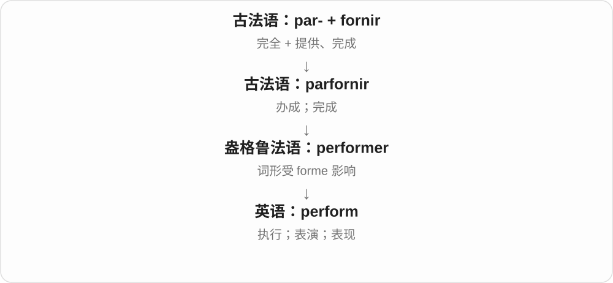

“把事情做出来”连起执行和表演。The computer performs well 说运行表现好，不是在演戏。

**常见搭配与例句**

perform a task；perform on stage；perform well；perform an experiment。

> The team performed a series of tests.

团队进行了一系列测试。

> The new laptop performs well even with several apps open.

即使同时打开几个应用，新笔记本电脑也运行良好。

**别混淆**

form 是形成；perform 是执行，历史来源不同，只发生过词形影响。

### 2. performance — 表演；表现；性能；履行

**音标**：英 /pəˈfɔːməns/；美 /pərˈfɔːrməns/

**先抓住这个画面**

不只是“做没做”，还看这次做出来是什么样、做得怎样。

**怎么拆**

perform + -ance，历史上中古英语已有相应名词；跟随 perform 的完成、执行来源。

**怎么变成今天的意思**

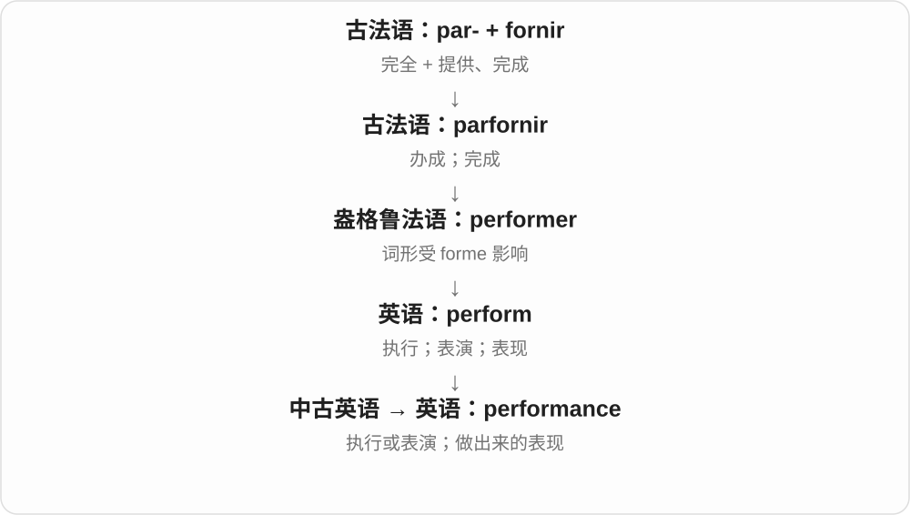

a performance 可以是一场演出；job performance 是工作表现；computer performance 是运行性能。

**常见搭配与例句**

a live performance；improve performance；job performance；academic performance。

> Her performance in the final scene was moving.

她在最后一幕中的表演很动人。

> The update improved the app’s performance.

更新提升了应用的运行性能。

**别混淆**

performance 是表现或一次演出；performer 才是做事、演出的人或表现主体。

### 3. performances — 演出、表演；各次表现〔复数〕

**音标**：英 /pəˈfɔːmənsɪz/；美 /pərˈfɔːrmənsɪz/

**先抓住这个画面**

把准备的本领在一次行动里做出来，就是 performance 的表现；搬到舞台上，是演出。performances 把不同场次、不同次表现分别数。

**怎么拆**

performance + -s，/s/ 后读 /ɪz/。perform + -ance 的名词在中古英语已有；perform 经法语 parfornir 完成、充分提供等材料，词形曾受 forme 影响，不按拉丁形式词硬拼。

**怎么变成今天的意思**

**法语完成词 → perform；加 -ance → performance**  
完成、执行 → 实际表现、演出

↓

**performance + -s → performances**  
多场演出；分别发生的表现

live performances 现场演出；recent performances 最近几次表现；give performances 进行表演。

**常见搭配与例句**

performances at the theatre 剧院演出；strong performances 出色表现。

> The festival includes performances by local musicians.

节庆包含当地音乐家的演出。

> Her recent performances show how much she has improved.

她最近几次的表现显示，她进步了很多。

**别混淆**

performance 泛说设备性能、工作表现时常不可数；performances 常数场次或一次次实际发挥。比较时要看是在说演出还是其他活动。

### 4. performs — 执行、做；表演、表现〔第三人称单数〕

**音标**：英 /pəˈfɔːmz/；美 /pərˈfɔːrmz/

**先抓住这个画面**

把某件事情真正做出来，是 performs。机器执行功能，演员演出，人也能在任务中表现好坏。

**怎么拆**

perform + -s，/m/ 后读 /z/。perform 接古法语 parfornir 完成，经 performer 等形式进入，词形受 forme 影响；不能把全部历史简化成拉丁 per- 加 forma。

**怎么变成今天的意思**

**古法语 parfornir、performer → perform**  
完全办成 → 执行、演出、表现

↓

**perform + -s → performs**  
某人、某物完成动作、发挥功能

performs a task 执行任务；performs on stage 登台表演；performs well 表现好。

**常见搭配与例句**

performs several functions 发挥几种功能；performs a song 演唱、演奏一首歌。

> The device performs several useful functions.

设备能完成几种实用功能。

> She performs with a small band.

她与一支小乐队一起演出。

**别混淆**

performs 不只艺术表演；机器、方法也能 perform well，说实际表现。名词 performance 则说表现、演出、完成情况等。

### 5. insurance — 保险；防范措施

**音标**：英 /ɪnˈʃɔːrəns/；美 /ɪnˈʃʊrəns/

**先抓住这个画面**

把可能发生的大损失，换成提前支付、按约定提供保障的安排，就是 insurance。也可比喻备用的防范措施。

**怎么拆**

由较早 ensurance 等形式发展而来，现代形式对应 insure + -ance。

**怎么变成今天的意思**

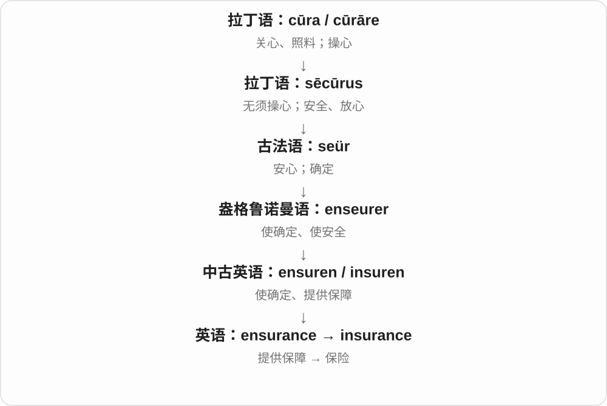

这个词把“让人有保障”固定在保险制度上。take a spare key as insurance 则比喻留个后手，并没有真正买保单。

**常见搭配与例句**

travel insurance；an insurance policy；insurance against…。

> The ticket price does not include travel insurance.

票价不包含旅行保险。

> I kept a backup copy as insurance against losing the file.

我保留了一份备份，以防文件丢失。

**别混淆**

insurance 是保障安排；premium 是保费；insurer 是承保方。三个词不是同一件事。

### 6. avoid — 避开；避免

**音标**：/əˈvɔɪd/

**先抓住这个画面**

不想撞上障碍，就绕着走；不想发生误会，就提前说清楚。avoid 可以是避开对象，也可以是设法不让某事发生。

**怎么拆**

经法语相应形式进入英语，较早有清空、腾出的意义材料，与 void、vacuous 的较远历史材料相关；现代不等于把 a 与 void 随意拼出全部词义。

**怎么变成今天的意思**

**古法语 esvuidier、盎格鲁诺曼语相应形式**  
清空、腾空等旧义

↓

**中古英语 avoiden → avoid**  
从清空、离开等走到避开、避免

avoid someone 避开某人；avoid a mistake 避免错误；avoid doing something 避免做某事。

**常见搭配与例句**

avoid doing；avoid a collision。

> We left early to avoid the traffic.

我们早早出发，避开车流。

> Try to avoid making the same mistake again.

尽量别再犯同样的错误。

**别混淆**

avoid 后接动词通常用 -ing：avoid making mistakes；不是 avoid to make。prevent 更常用 prevent someone from doing。

### 7. avoidance — 回避；避免

**音标**：/əˈvɔɪdəns/

**先抓住这个画面**

avoid 是绕开、不去碰，avoidance 是这种做法本身。既能是合理避险，也能是一直逃开该面对的问题。

**怎么拆**

中古英语已有 avoidaunce 等，现代对应 avoid + -ance。

**怎么变成今天的意思**

**古法语 esvuidier、盎格鲁诺曼语相应形式**  
清空、腾空等旧义

↓

**中古英语 avoiden → avoid**  
从清空、离开等走到避开、避免

↓

**avoid + -ance → avoidance**  
避开、回避的行为

conflict avoidance 回避冲突；risk avoidance 风险规避；avoidance of responsibility 逃避责任。

**常见搭配与例句**

avoidance of；an avoidance strategy。

> Their avoidance of the topic made everyone uncomfortable.

他们回避这个话题，让大家都很不自在。

> The design prioritizes collision avoidance.

这个设计优先考虑避免碰撞。

**别混淆**

avoidance 通常说避免、绕开；evasion 常含躲避责任、回答等意味，具体褒贬不能光看词尾。

### 8. appear — 出现；看起来、似乎；出场

**音标**：英 /əˈpɪə/；美 /əˈpɪr/

**先抓住这个画面**

眼前原先没有，现在看见了，是出现；眼前呈现某种样子，也能说看起来如何。

**怎么拆**

借古法语 aparoir，接拉丁 apparere，历史由 ad- + parere 显露组成。英语现代不能把 a- 当否定，再把 ppear 编成词根。

**怎么变成今天的意思**

**拉丁 ad- + parere 显露 → apparere → 古法语 aparoir**  
显出来、变得可见

↓

**中古英语 apperen → appear**  
出现 → 看起来、给人某种印象

appear on screen 出现在屏幕上，appear tired 看起来累，appear to be 似乎是；It appears that... 看起来……。

**常见搭配与例句**

appear on；appear to be；appear tired；It appears that。

> A message appeared on the screen.

屏幕上出现了一条消息。

> She appears to know the area well.

她似乎很熟悉这一带。

**别混淆**

appear 看起来不保证事实已证实；appear a problem 不说突然出现一个问题，改 a problem appeared。

### 9. appearance — 外表；出现、露面

**音标**：英 /əˈpɪərəns/；美 /əˈpɪrəns/

**先抓住这个画面**

可能问一个东西长什么样，也可能问某个人哪次出场；一个关注样子，一个关注出现事件。

**怎么拆**

历史借法语 apparence，接拉丁 apparentia，与 appear 同族；现代构词对应 appear + -ance，不必假装最初一定是在英语内部新加后缀。

**怎么变成今天的意思**

**拉丁 ad- + parere 显露 → apparere → 古法语 aparoir**  
显出来、变得可见

↓

**中古英语 apperen → appear**  
出现 → 看起来、给人某种印象

↓

**法语 apparence、拉丁 apparentia → appearance**  
显露 → 外观；出现

physical appearance 外表，make an appearance 露面，a guest appearance 嘉宾出场；appearances can be deceptive 外表可能骗人。

**常见搭配与例句**

physical appearance；make an appearance；a guest appearance。

> Do not judge the book by its appearance.

不要只凭外观评价这本书。

> The singer made a surprise appearance at the concert.

歌手在音乐会上惊喜现身。

**别混淆**

appearance 外观不等于实际品质；an appearance at a meeting 是一次露面，不是会议长相。

### 10. disappear — 消失；不见；不复存在

**音标**：英 /ˌdɪsəˈpɪə/；美 /ˌdɪsəˈpɪr/

**先抓住这个画面**

原来能看见、能找到，现在看不见、找不到了；并不自动说明东西化为乌有。

**怎么拆**

dis- 反向、解除 + appear，也有法语相应形式影响。现代通常不及物，后面不直接带被弄没的物品作普通宾语。

**怎么变成今天的意思**

**拉丁 ad- + parere 显露 → apparere → 古法语 aparoir**  
显出来、变得可见

↓

**中古英语 apperen → appear**  
出现 → 看起来、给人某种印象

↓

**dis- + appear → disappear**  
出现的反面 → 消失、不见

disappear into the crowd 消失在人群中，disappear from view 从视野消失；The keys disappeared 钥匙不见了。

**常见搭配与例句**

disappear into；disappear from view；disappear without trace。

> The boat disappeared into the fog.

船消失在雾中。

> My keys seem to have disappeared again.

我的钥匙似乎又不见了。

**别混淆**

disappear 不见，destroy 毁坏；人转过街角 disappears from view，并不表示被毁灭。

### 11. disappearance — 消失；失踪

**音标**：英 /ˌdɪsəˈpɪərəns/；美 /ˌdɪsəˈpɪrəns/

**先抓住这个画面**

原本看得见、找得到的人或东西不见了，disappearance 把这件事作为名词来谈。它本身不告诉你为何不见。

**怎么拆**

disappear + -ance；disappear 对应 dis- 与 appear 出现。把消失动作、事件名词化，不是另一个单独的 pear 梨词族。

**怎么变成今天的意思**

**dis- + appear → disappear**  
不再出现、消失

↓

**disappear + -ance → disappearance**  
消失、失踪的事件

the disappearance of a species 一个物种的消失；someone’s disappearance 某人的失踪；a mysterious disappearance 神秘失踪。

**常见搭配与例句**

the disappearance of；a sudden disappearance。

> The disappearance of the files delayed the project.

文件不见了，项目因此耽搁。

> The family reported his disappearance to the police.

家人向警方报告了他的失踪。

**别混淆**

disappearance 是不见了，death 是死亡；人失踪不自动等于已经死亡，必须依上下文。

### 12. reappear — 再次出现；重新露面

**音标**：英 /ˌriːəˈpɪə/；美 /ˌriːəˈpɪr/

**先抓住这个画面**

一度消失、离开视野后，又看到了它；也可以是以前的情况再度发生。

**怎么拆**

re- 再次 + appear，直接表示重新出现。不是把消失过程倒放才叫 reappear。

**怎么变成今天的意思**

**拉丁 ad- + parere 显露 → apparere → 古法语 aparoir**  
显出来、变得可见

↓

**中古英语 apperen → appear**  
出现 → 看起来、给人某种印象

↓

**re- + appear → reappear**  
重新显现 → 再次出现

reappear on screen 再现屏幕，reappear after a pause 间隔后再出现；a problem reappears 问题再现。

**常见搭配与例句**

reappear on；reappear after；reappear in view。

> The sun reappeared after the clouds passed.

云飘过后，太阳又出现了。

> The error reappeared when we restarted the program.

重新启动程序后，错误再次出现。

**别混淆**

reappear 再出现，repair 修理字形近但不同；修好了也可能 problem reappears。

### 13. reappearance — 再次出现；重现

**音标**：英 /ˌriːəˈpɪərəns/；美 /ˌriːəˈpɪrəns/

**先抓住这个画面**

消失了一阵的东西又露面了，就是 reappearance。可以是演员回来，也可以是一个旧问题重新出现。

**怎么拆**

对应 re- + appearance，或 reappear + -ance；这是同一词族的两种分析视角，不需要强定唯一英语构词先后。

**怎么变成今天的意思**

**appear、appearance**  
出现；出现的事件或样子

↓

**reappear、reappearance**  
再次出现；重现这件事

the reappearance of an old problem 旧问题重现；make a reappearance 再次露面。

**常见搭配与例句**

make a reappearance；the reappearance of。

> The reappearance of the error surprised the engineers.

错误再次出现，让工程师很意外。

> After a long absence, the singer made a reappearance on stage.

离开舞台很久后，这位歌手再次登台。

**别混淆**

reappearance 是再次出现；disappearance 是消失。re- 表再次，dis- 在这里把方向变成不再可见。

### 14. resistance — 抵抗；阻力；抵抗力；电阻

**音标**：/rɪˈzɪstəns/

**先抓住这个画面**

把那股“不肯被推动或穿过”的作用当成一个量或一种力量。

**怎么拆**

拉丁 resistentia 经古法语 resistence 借入中古英语，后拼作 resistance；现代对应 resist + -ance。

**怎么变成今天的意思**

**拉丁 sistere〔与 stāre“站”相关〕**  
使站住、放置；站定、停住

↓

**拉丁 re- + sistere → resistere**  
站住抵挡、顶回去

↓

**拉丁 resistentia → 古法语／中古英语 resistence → resistance**  
抵抗的作用、能力；后来扩展到物理和电学

遇到 resistance to change 是遇到反对改变的力量；air resistance 是空气对运动的阻碍；电阻则描述电流通过时受到的阻碍，用欧姆表示。三者共享“顶住”的画面，量的定义各有不同。

**常见搭配与例句**

resistance to change；air resistance；electrical resistance。

> The proposal met strong resistance from local residents.

这项提议遭到了当地居民的强烈反对。

> The technician measured the resistance between the two terminals.

技术员测量了两个端子之间的电阻。

**别混淆**

resistor 是一个元件；resistance 是性质或物理量，不只电阻器才有电阻。

### 15. alliance — 联盟；同盟关系

**音标**：/əˈlaɪəns/

**先抓住这个画面**

alliance 指人或团体为了共同目的形成的合作关系，也可指结成的联盟组织。它比一次临时帮忙更有持续合作的意味，但未必需要正式条约。

**怎么拆**

可与 ally + -ance 联系记忆，-ance 常形成表示状态或关系的名词。不过英语 alliance 是经法语 aliance 借入，不能把现代英语的组合分析当成它第一次产生的过程。

**怎么变成今天的意思**

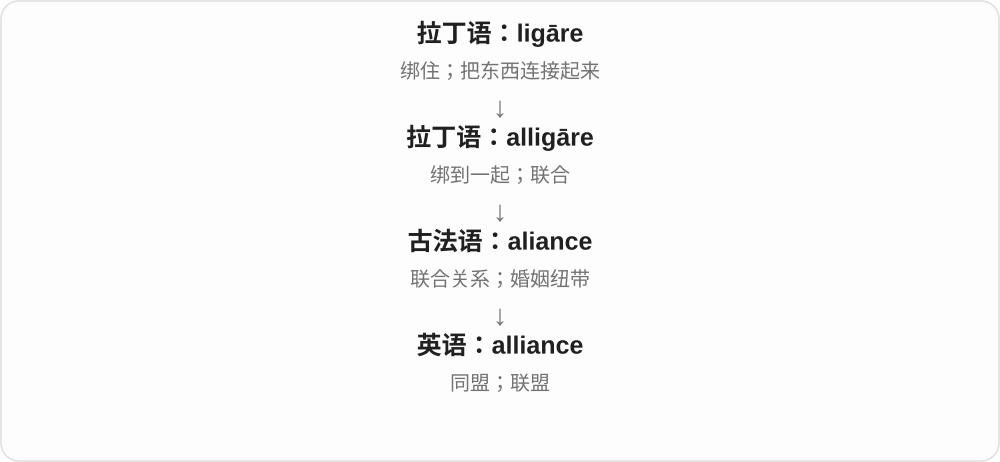

“绑在一起”在这里落到关系本身。它曾用于婚姻联合，继而用于家族、国家和其他组织的合作。ally 是关系中的参与者，alliance 是参与者之间形成的关系或组织。

**常见搭配与例句**

form / build an alliance（建立联盟）；a strategic alliance（战略联盟）；an alliance between A and B（A 与 B 的联盟）。

> The two universities formed an alliance to share research facilities.

两所大学结成联盟，共享研究设施。

> Their alliance lasted long after the election.

选举结束很久以后，他们的联盟仍然存在。

**别混淆**

alliance 不等于 merger：前者可以让各方保持独立，后者通常指组织或企业合并。

### 16. guidance — 指导；指引；导航、制导〔特定领域〕

**音标**：/ˈɡaɪdəns/

**先抓住这个画面**

不是替你把所有事做完，而是帮你判断方向、下一步；也可指设备对路线的引导。

**怎么拆**

guide 去 e + -ance，形成引导活动、过程名词。历史是英语动词与相应名词后缀的组合，不是 guidance 里多出独立 dance。

**怎么变成今天的意思**

**古法语 guier、guider 等 → 中古英语 guiden → guide**  
带路、引导；更远通常接日耳曼指路词

↓

**现代 guide**  
向导；指南；带领、指导；引导判断

↓

**guide + -ance → guidance**  
指导、引导的过程和帮助

under someone’s guidance 在某人指导下，seek guidance 寻求指点，career guidance 职业指导。通常不可数。

**常见搭配与例句**

under the guidance of；seek guidance；career guidance。

> She completed the project under her tutor’s guidance.

她在导师指导下完成了项目。

> We asked for guidance on how to proceed.

我们就下一步怎么做寻求指导。

**别混淆**

guidance 通常整体指导帮助，a guideline 是一条准则；需要几条具体建议可用 guidelines 或 pieces of advice，不随意说 three guidances。

### 17. compliance — 遵从；合规；顺从；顺应性〔技术〕

**音标**：英、美 /kəmˈplaɪəns/

**先抓住这个画面**

把“有没有照着要求做”作为一种状态来看；在工作中，常指流程和行为符合规定。

**怎么拆**

comply + -ance；英语派生。

**怎么变成今天的意思**

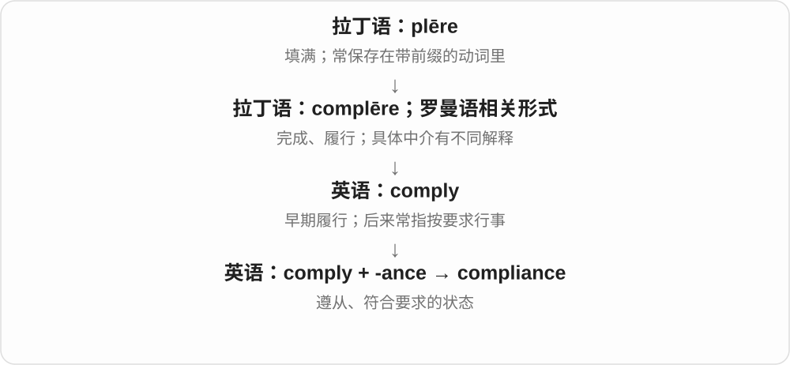

in compliance with 是按照、符合；a compliance check 是合规检查。工程等领域也用 compliance 表示受力时容易变形的程度，这不是说材料在心理上服从。

**常见搭配与例句**

in compliance with；ensure compliance；a compliance check。

> The team checked the design for compliance with the new standard.

团队检查了设计是否符合新标准。

> Her quiet compliance surprised everyone who had expected an argument.

她安静地照做了，这让原本以为会有争论的人都很意外。

**别混淆**

obedience 偏服从某人；compliance 也可以说设备、流程符合标准，不只用于人。

### 18. acceptance — 接受；认可；接纳

**音标**：/əkˈseptəns/

**先抓住这个画面**

accept 是点头接受这个动作，acceptance 是点头之后形成的认可。一个新想法慢慢被大家接受，就是 gaining acceptance。

**怎么拆**

现代可拆 accept + -ance；-ance 把动作变成名词。不要因为结尾相同，就把它与 alliance 归成同一词根。

**怎么变成今天的意思**

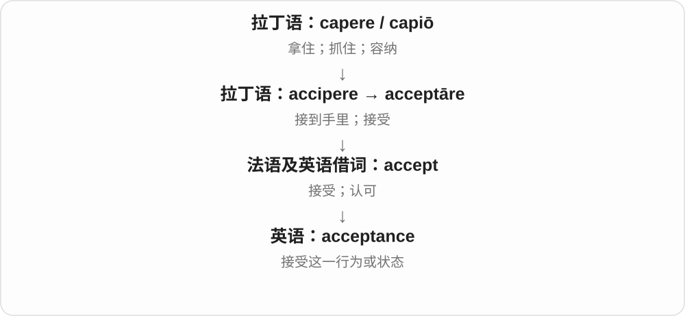

它可以指接受邀请，也可以指接纳某种差异、承认某个现实。重点是“原本可能拒绝，现在允许它进入自己的判断或关系”。

**常见搭配与例句**

gain acceptance（获得认可）；acceptance of…；an acceptance letter（录取或接受函）。

> The idea gradually gained acceptance among teachers.

这个想法逐渐获得了教师们的认可。

> Her family’s acceptance gave her confidence.

家人的接纳给了她信心。

**别混淆**

acceptance 不是 approval 的完全同义词：你可以接受某个现实，却并不赞成它。

### 19. accordance — 一致；符合；依照

**音标**：英 /əˈkɔːdəns/；美 /əˈkɔːrdəns/

**先抓住这个画面**

拿实际行动与规定对齐，两条线能合上，就是 in accordance with。

**怎么拆**

经古法语 acordance 传入；现代对应 accord + -ance。

**怎么变成今天的意思**

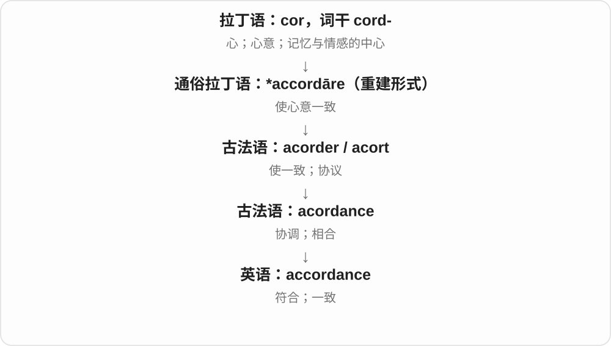

最常见的是 in accordance with，表示依照规则、协议或意愿行事。通常不单独说 an accordance。

**常见搭配与例句**

in accordance with the rules；in accordance with someone’s wishes。

> The work was completed in accordance with the plan.

工作按照计划完成了。

> The documents were stored in accordance with the instructions.

文件按要求存放了。

**别混淆**

according to 可以引述某人的说法；in accordance with 更强调行动符合规则或要求。

### 20. governance — 治理；决策、监督和责任的安排

**音标**：英 /ˈɡʌvənəns/；美 /ˈɡʌvərnəns/

**先抓住这个画面**

一个组织里，谁有权拍板？谁监督？出了问题谁负责？governance 重点在这套安排，而不只是每天把事情做完。

**怎么拆**

借自古法语 governance，来自 governer“治理”；中古英语为 governaunce。现代可认 govern + -ance，但这个名词有独立的法语借入历史。

**怎么变成今天的意思**

**拉丁 gubernare → 古法语 governer**  
治理、引导

↓

**古法语 governance → 中古英语 governaunce → governance**  
治理的行为、方式与安排

国家治理可以谈 governance，公司、学校和数据系统也能谈。corporate governance 看公司权力与监督如何安排；data governance 看数据的责任、规则与使用管理如何安排。它不是“政府”换个更正式的拼法。

**常见搭配与例句**

good governance；corporate governance；data governance；governance arrangements。通常不可数。

> The review found weaknesses in the charity’s governance.

审查发现这家慈善机构的治理安排存在薄弱之处。

> Clear data governance helps staff understand who can approve access.

明确的数据治理安排让员工知道谁有权批准访问。

**别混淆**

management 多关注具体实施，governance 更关注制度、权责与监督；实际工作有交集，但 governance 不必由政府来做。

### 21. tolerant — 宽容的、能容忍的；耐受……的

**音标**：英 /ˈtɒlərənt/；美 /ˈtɑːlərənt/

**先抓住这个画面**

别人有不同习惯或意见，你不一定赞同，但能容许它存在。换成植物、材料时，就是某种条件来了，它还能承受。

**怎么拆**

经法语 tolérant 及拉丁 tolerans、tolerant-，是 tolerare 承受、容忍的现在分词材料。现代可与 tolerate、tolerance 对照，历史不只是英语动词现场换成 -ant。

**怎么变成今天的意思**

**拉丁 tolerare → tolerans、tolerant-**  
承受、容忍 → 能承受、容忍的

↓

**法语、英语 tolerant**  
宽容；对某条件有耐受能力

tolerant of different views 容得下不同观点；a tolerant attitude 宽容的态度；tolerant of dry conditions 耐干旱条件的。

**常见搭配与例句**

be tolerant of mistakes；more tolerant toward others。

> A good discussion needs people who are tolerant of different views.

好的讨论需要能包容不同观点的人。

> These plants are tolerant of dry conditions.

这些植物能耐受干燥环境。

**别混淆**

tolerant 常说容得下差异，不一定是赞成。植物 tolerant of heat 能耐热，也不等于温度越高长得越好。

### 22. tolerance — 宽容、容忍；耐受力；允许偏差、公差

**音标**：英 /ˈtɒlərəns/；美 /ˈtɑːlərəns/

**先抓住这个画面**

能容得下多少、承受多少，是 tolerance 的共同线索。人可容许不同意见，材料可承受条件变化，零件尺寸也可允许一点点误差。

**怎么拆**

经法语 tolerance 和拉丁 tolerantia 承受、忍耐，接 tolerare。与 tolerant 的 -ant／-ance 有形式对应，但名词有自己的借入历史；后来发展出工程中允许偏差的用法。

**怎么变成今天的意思**

**拉丁 tolerare、tolerantia → 法语、英语 tolerance**  
承受、忍耐 → 宽容、耐受

↓

**容许范围的技术分支**  
尺寸等可接受的变化量、允许偏差

tolerance of different beliefs 对不同信仰的宽容；a low tolerance for noise 很受不了噪声；within tolerance 在允许偏差内；manufacturing tolerances 制造公差。

**常见搭配与例句**

show tolerance；a tolerance of one millimetre。

> She has very little tolerance for unnecessary noise.

她很受不了不必要的噪声。

> The parts must fit within the specified tolerance.

这些零件的配合必须在规定公差范围内。

**别混淆**

工程里的 tolerance 是允许偏差的范围，不等于已经测到的实际错误。a low tolerance for waiting 是不耐等的描述，不必机械译成宽容度。

### 23. clearance — 许可；净空、间隙；清仓；清除

**音标**：英 /ˈklɪərəns/；美 /ˈklɪrəns/

**先抓住这个画面**

障碍被拿掉后，可能是货架空了，也可能是车能通过的空间够了，或审批这道关放行了。

**怎么拆**

英语 clear + -ance；以清除动作和无阻碍状态为基础，形成多种具体名词义。

**怎么变成今天的意思**

**拉丁语 clarus**  
明亮、清楚、响亮；显著、出名

↓

**古法语 / 英法语 cler → 中古英语 clere → clear**  
清亮、明白 → 无遮挡、无疑惑

↓

**英语 clear + -ance → clearance**  
清除；通行空间；批准通过

security clearance 是接触特定敏感资料的资格许可；ground clearance 是车辆底部距地面的空间；clearance sale 是为清库存而促销。

**常见搭配与例句**

security clearance；customs clearance；a clearance sale；ground clearance。

> The truck did not have enough clearance to pass under the bridge.

这辆卡车没有足够的净空从桥下通过。

> Access to the files requires security clearance.

查阅这些文件需要安全许可。

> The shop is holding a clearance sale.

这家店正在清仓促销。

**别混淆**

permission 是一般许可；clearance 常带经过检查、审查或放行程序的意味。

### 24. abundance — 丰富；充足；大量

**音标**：/əˈbʌndəns/

**先抓住这个画面**

把拥有很多的状态或那一大批东西作为名词来讲。

**怎么拆**

拉丁 abundantia 经法语 abondance 等借入；现代可与 abundant 对照，但名词有自己的借入线。

**怎么变成今天的意思**

**拉丁 unda → undare**  
波浪 → 起浪、涌流

↓

**拉丁 abundare → abundantia；古法语 abondance → 英语 abundance**  
满溢 → 充足的数量、丰富

an abundance of fruit 是大量水果；in abundance 是充足地、大量地。an abundance of caution 是格外谨慎这一固定说法，不是真数有多少份谨慎。

**常见搭配与例句**

an abundance of；in abundance；an abundance of caution。

> The market offered an abundance of fresh vegetables.

市场上新鲜蔬菜供应充足。

> Wildflowers grew in abundance along the path.

小路边长着大量野花。

**别混淆**

abundant 是形容词，abundance 是名词；plenty 更日常，abundance 更常见于书面描述。

### 25. allowance — 零用钱；津贴；配额、限额；考虑余地

**音标**：/əˈlaʊəns/

**先抓住这个画面**

给某人预留的一份钱或额度：孩子每周零用钱、员工出差津贴、行李可带多少。

**怎么拆**

借古法语 alouance，经中古英语进入；现代可对应 allow + -ance。与 allow 一样涉及分配、批准，不是只讲允许的抽象名词。

**怎么变成今天的意思**

**拉丁 allocāre〔安排、分配〕；allaudāre〔赞同、称赞〕**  
两条来源在法语相近形式中汇合

↓

**法语 alouer 等 → 英语 allow**  
分配、承认、认可 → 允许；为某事留出条件

↓

**法语 alouance → 英语 allowance**  
获分配的钱、额度；考虑调整余地

a weekly allowance 每周零用钱，a travel allowance 出差津贴，baggage allowance 行李限额；make allowances for 考虑到、体谅某种情况。

**常见搭配与例句**

a weekly allowance；a travel allowance；baggage allowance；make allowances for。

> She saves part of her weekly allowance.

她把每周零用钱的一部分存起来。

> We should make allowances for his lack of experience.

我们应考虑到他经验不足。

**别混淆**

allowance 不全是 salary 工资；额度可按重量、金额等衡量。make allowances for inexperience 是体谅经验不足，不是给经验发津贴。

### 26. dominance — 主导地位；优势；显性关系

**音标**：英 /ˈdɒmɪnəns/；美 /ˈdɑːmənəns/

**先抓住这个画面**

不强调某一次“压过别人”的动作，而是看整体格局：哪一方在里面占上风。

**怎么拆**

英语 dominant 对应 -ance 构成状态名词，也可能受法语 dominance 影响；词源资料保留这两种可能，不强画唯一借入线。

**怎么变成今天的意思**

**拉丁 domus → dominus／domina**  
家、房屋 → 男主人／女主人，主人、掌权者

↓

**拉丁 dominari → dominans／dominantem**  
作主人、统治 → 居支配地位的

↓

**古法语 dominant／直接拉丁 → 英语 dominant**  
掌权的；占主导的

↓

**英语 dominant + -ance；可能受法语 dominance 影响**  
把占主导的性质、状态名词化

↓

**英语 dominance**  
主导地位；遗传学的显性关系

market dominance 指市场主导地位；social dominance 说群体中的地位关系。遗传学中它描述某性状下等位基因之间的关系，不是基因在人群中出现比例高。

**常见搭配与例句**

establish dominance；challenge someone’s dominance；dominance over；complete dominance。

> Smaller firms began to challenge the company’s market dominance.

较小的企业开始挑战这家公司的市场主导地位。

> The lesson distinguishes genetic dominance from allele frequency.

这节课区分了遗传显性关系与等位基因频率。

**别混淆**

dominance 的 -ance 对应状态；dominant 是形容词。prevalence 说普遍程度，并不等于遗传学的 dominance。

### 27. predominance — 占主要地位；数量或影响上的优势

**音标**：英 /prɪˈdɒmɪnəns/；美 /prɪˈdɑːmənəns/

**先抓住这个画面**

不只说“主要是什么”，而是把它占了大头这件事拿出来讨论。

**怎么拆**

英语 predominant 对应 -ance 的名词形式；不必先经英语 predominate 才能解释其构词。

**怎么变成今天的意思**

**拉丁 domus → dominus／domina**  
家、房屋 → 男主人／女主人，主人、掌权者

↓

**中世纪拉丁 prae- + dominari 的复合词族 → 法语 prédominant**  
居于更前、更优越地位的

↓

**英语 predominant**  
最主要的；数量或影响占上风的

↓

**英语 predominant + -ance → predominance**  
占主要地位这一状态

a predominance of small firms 表示小企业占大头；the predominance of one colour 表示一种颜色明显占主要部分。可描述数量，也可描述影响，不总是精确比例。

**常见搭配与例句**

a predominance of；the predominance of A over B；achieve predominance。

> The survey found a predominance of small family businesses.

调查发现，家族小企业占了多数。

> The predominance of dark colours gives the room a serious mood.

深色占主导，让房间显得庄重。

**别混淆**

dominance 常凸显控制优势；predominance 更适合描述结构中某一部分特别多或特别突出。

### 28. assurance — 保证；自信；保险

**音标**：英 /əˈʃɔːrəns/；美 /əˈʃʊrəns/

**先抓住这个画面**

别人给你一个可以放心的承诺，是 assurance；一个人说话沉着、有把握，也表现出 assurance。

**怎么拆**

经古法语 asseürance 传入，与 asseürer“使放心”对应；现代可看出 assure + -ance 的关系。

**怎么变成今天的意思**

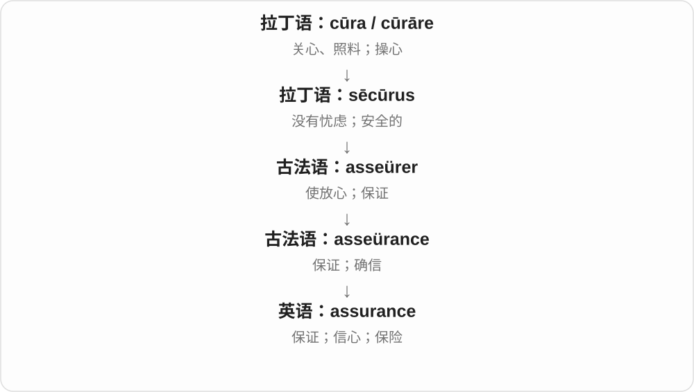

从使人放心的行为转为保证内容，也转为本人内在的信心。某些英式保险名称保留 assurance，如 life assurance。

**常见搭配与例句**

give an assurance；quality assurance；speak with assurance。

> We received assurances that the work would be finished soon.

我们得到保证，工作很快会完成。

> She answered the questions with quiet assurance.

她沉着自信地回答了问题。

**别混淆**

assurance 可以是信心，不一定是保险。assurances 常指若干承诺或保证。

### 29. reliance — 依赖；信赖

**音标**：/rɪˈlaɪəns/

**先抓住这个画面**

reliance 指正在依靠某人或某物的关系和状态，特别适合讨论依赖程度。它把焦点放在“依赖者”，而 reliability 评价“被依赖者”。

**怎么拆**

rely + -ance，y 变 i，-ance 构成状态名词。它与 alliance 的结尾相同，但前面的历史词形和现代意义不同。

**怎么变成今天的意思**

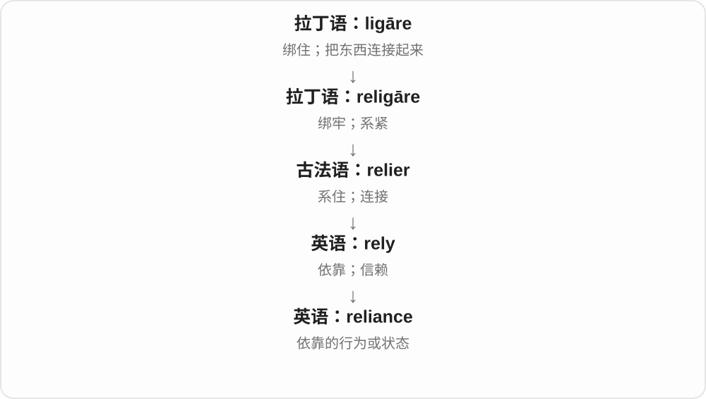

由“我依靠它”转成“我对它的依赖”，句子里的动作就变成可讨论的名词。常用的 on 也随之保留下来：rely on → reliance on。

**常见搭配与例句**

heavy reliance on…（高度依赖……）；reduce reliance on…（减少对……的依赖）。

> The city wants to reduce its reliance on private cars.

这座城市希望减少对私家车的依赖。

> Her reliance on the team grew as the project became more complex.

随着项目变得更复杂，她对团队的依赖增加了。

**别混淆**

reliance 可以是中性的，也可以暗示依赖过多；reliability 通常直接评价可靠程度。不要把 reliance on technology 译成“技术的可靠性”。

### 30. reluctant — 不情愿的；勉强的

**音标**：/rɪˈlʌktənt/

**先抓住这个画面**

嘴上可能答应，心里却还往后缩，不太想做，这种态度就是 reluctant。不是做不到，而是意愿上不积极。

**怎么拆**

借拉丁 reluctans，与 re- 向后及 luctari 挣扎、抗争相联；历史的抵抗画面走成心里的不愿意。

**怎么变成今天的意思**

**拉丁 re- + luctari → reluctari、reluctans**  
向后对抗、挣扎抵抗

↓

**英语 reluctant、reluctance**  
不情愿的；不情愿、迟疑的状态

be reluctant to do 不愿做；a reluctant agreement 勉强的同意；a reluctant hero 不情愿承担角色的英雄。

**常见搭配与例句**

reluctant to admit；reluctant to leave。

> She was reluctant to admit that she needed help.

她不太情愿承认自己需要帮助。

> He gave a reluctant nod.

他勉强点了点头。

**别混淆**

reluctant 是不情愿，unable 是不能；有能力但不愿做，与想做却做不到不同。

### 31. reluctance — 不情愿；犹豫、迟疑

**音标**：/rɪˈlʌktəns/

**先抓住这个画面**

reluctant 是人不太愿意，reluctance 是那份想往后缩的态度。解释为何答应得勉强时，常用这个名词。

**怎么拆**

接拉丁 reluctari、reluct- 等抵抗材料与 -ance；现代可与 reluctant 的 -ant／-ance 对应一起记，不需要另造常用动词 reluct。

**怎么变成今天的意思**

**拉丁 re- + luctari → reluctari、reluctans**  
向后对抗、挣扎抵抗

↓

**英语 reluctant、reluctance**  
不情愿的；不情愿、迟疑的状态

reluctance to do 不愿做；with reluctance 不情愿地；overcome someone’s reluctance 打消某人的顾虑、不情愿。

**常见搭配与例句**

reluctance to change；with great reluctance。

> Her reluctance to speak was understandable.

她不愿开口，是可以理解的。

> He accepted the invitation with obvious reluctance.

他明显很勉强地接受了邀请。

**别混淆**

reluctance 可以来自顾虑、不愿意，hesitation 更直接说迟疑；迟疑也可能只是正在想，不一定明确不愿。

### 32. inheritance — 继承；遗产；遗传；程序中的继承

**音标**：/ɪnˈherɪtəns/

**先抓住这个画面**

接下来这件事，或者接到手的那份东西。

**怎么拆**

经古法语、盎格鲁法语 enheritaunce 借入，与 enheriter 对应。现代可联系 inherit + -ance，但历史名词不是从现代英语动词再倒推回法语。

**怎么变成今天的意思**

**拉丁 hērēs，词干 hērēd-**  
继承者、承受遗产的人

↓

**后期拉丁 inhērēditāre → 古法语 enheriter / enheritaunce**  
使成为继承人；继承的行为、所得

↓

**中古英语 enheritaunce → 英语 inheritance**  
继承；所继承之物；后延伸到生物与程序

an inheritance 可指一份遗产；genetic inheritance 是遗传。在面向对象程序中，inheritance 让派生类接续基础类的成员和行为，不等于把两份代码随意复制粘贴。

**常见搭配与例句**

receive an inheritance；genetic inheritance；class inheritance。

> She received an inheritance from her grandfather.

她从祖父那里得到了一份遗产。

> The lesson explains how inheritance allows a class to reuse existing behaviour.

这节课解释继承如何让一个类复用已有行为。

**别混淆**

heritage 更常说集体承传的文化与历史；inheritance 可具体指一次继承及所得，也有技术用法。

### 33. relevance — 相关性；切题程度；现实意义

**音标**：/ˈreləvəns/

**先抓住这个画面**

问的不是“有没有信息”，而是“这条信息与现在要解决的事有多大关系”。

**怎么拆**

relevant 的相关名词形式，以 -ence 表性质；词尾 -ant 换成 -ence。

**怎么变成今天的意思**

**拉丁 levis → levare**  
轻 → 抬起、使负担减轻

↓

**拉丁 relevare → 中世纪拉丁 relevans**  
减轻负担、帮助 → 有帮助的

↓

**法语 relevant → 英语 relevant**  
与当前事情相联、适用的

↓

**英语 relevance**  
与当前事项有关、适用这一性质

the relevance of a study 说研究与某问题或现实需求的联系；question its relevance 是质疑它为什么与当前讨论有关。相关不等于重要到必须压过所有其他信息。

**常见搭配与例句**

relevance to；of direct relevance；question the relevance of。

> The teacher explained the relevance of the example.

老师解释了这个例子为什么与当前内容相关。

> The findings have direct relevance to classroom teaching.

这些发现与课堂教学直接相关。

**别混淆**

importance 是重要性；relevance 是对某个特定话题或目的的相关性，一件大事也可能与当前问题无关。

### 34. endurance — 耐力；忍耐力；持续存在

**音标**：英 /ɪnˈdjʊərəns/；美 /ɪnˈdʊrəns/

**先抓住这个画面**

不是只冲一下，而是能够撑很久：跑步时持续出力，困难里持续坚持，都需要 endurance。

**怎么拆**

现代对应 endure + -ance；词史也记录法语 endurance 从 endurer 形成的借入路线。早期还有持续存在义，后来忍受困难的能力尤其常用。

**怎么变成今天的意思**

**拉丁 durus → durare**  
硬、坚实 → 使变硬；持续、撑住

↓

**拉丁 in- + durare → indurare**  
使坚硬、使坚强

↓

**法语 endurer → endurance；英语也可分析 endure + -ance**  
持续存在、承受的状态或能力

↓

**英语 endurance**  
耐力、忍耐力

physical endurance 是身体耐力；mental endurance 是心理上的持久承受能力；an endurance event 是考验耐力的赛事。

**常见搭配与例句**

build endurance；test your endurance；an endurance race；beyond endurance。

> The long walk tested our endurance more than our speed.

这次长途步行考验的主要是耐力，而不是速度。

> Weeks of interrupted sleep had pushed her endurance to the limit.

连续几周睡眠被打断，让她的忍耐力到了极限。

**别混淆**

strength 常说能用多大力；endurance 说能持续多久。patience 强调耐心等待、不急躁，不完全等于身体或心理耐力。

### 35. vengeance — 报复；复仇

**音标**：/ˈvendʒəns/

**先抓住这个画面**

不是只想把损失补回来，而是觉得受了伤害，非要让对方也付出代价，这种报复就是 vengeance。

**怎么拆**

经盎格鲁诺曼语、古法语 vengeance 接 vengier 报复；与旧动词 venge 和 -ance 材料相联，不是 revenge 去 re 再任意加尾。

**怎么变成今天的意思**

**拉丁 vindicare → 古法语 vengier**  
报复、惩处；相关意义材料

↓

**法语 vengeance → 英语 vengeance；旧动词 venge + -ful → vengeful**  
报复；一心想报复的

seek vengeance 寻求报复；take vengeance on someone 向某人报复；with a vengeance 可表示猛烈地、变本加厉地。

**常见搭配与例句**

seek vengeance；with a vengeance。

> She refused to let a desire for vengeance control her life.

她不愿让复仇欲控制自己的人生。

> The rain returned with a vengeance.

雨又猛烈地下了起来。

**别混淆**

vengeance 突出报复，justice 突出公正；一个人把报复叫正义，不代表两词本来就同义。

### 36. remembrance — 怀念；纪念；回想〔较正式〕

**音标**：/rɪˈmembrəns/

**先抓住这个画面**

把过去的人与事重新放到心上，常带感情，或带一层郑重纪念的意味。

**怎么拆**

经古法语 remembrance，来自 remembrer“记得”，远接晚期拉丁 rememorari。现代可对应 remember + -ance，但法语已存在这个名词，英语名词并非只能从英语动词派生。

**怎么变成今天的意思**

**拉丁 memor**  
记着的；放在心上的

↓

**晚期拉丁 rememorari → 古法语 remembrer**  
再次记起、回想

↓

**古法语 remembrance → 中古英语 remembraunce → 英语 remembrance**  
回想、怀念、纪念

in remembrance of someone 是为了纪念某人；a day of remembrance 是纪念日。普通日常说“我记性好”用 memory，不说 good remembrance。

**常见搭配与例句**

in remembrance of；a remembrance ceremony；a day of remembrance；fond remembrance。

> They planted a tree in remembrance of their teacher.

他们种下一棵树来纪念老师。

> The gathering was a quiet occasion for remembrance rather than speeches.

这次聚会让大家安静地追思，没有安排演讲。

**别混淆**

memory 常说记忆能力或某一段回忆；remembrance 常强调怀念、纪念这一状态或行动，语气更庄重。

### 37. resemblance — 相像；相似之处

**音标**：/rɪˈzembləns/

**先抓住这个画面**

把“看起来像”这件事作为一个特点拿出来说。

**怎么拆**

借盎格鲁法语 resemblance，接 resembler；现代可按 resemble + -ance 理解，历史上名词有法语来源。

**怎么变成今天的意思**

**拉丁 similis**  
相像、同类；与 simul“一起、同时”同族

↓

**拉丁 simulāre → 晚期拉丁 similāre → 古法语 sembler**  
使相像 → 看起来像

↓

**盎格鲁法语 resembler → resemblance → 英语 resemblance**  
相像 → 相似状态、相似之处

a resemblance to someone 是与某人相像；bear a resemblance 是具有相似之处。相似本身不能证明有亲属关系或存在抄袭。

**常见搭配与例句**

bear a resemblance to；a striking resemblance；a family resemblance。

> The sisters bear a striking resemblance to each other.

姐妹俩长得非常像。

> The new design has little resemblance to the original sketch.

新设计与最初草图已经不太相像。

**别混淆**

similarity 范围较宽，可谈统计结构、机制等；resemblance 常强调外观或整体给人的相像感觉。

### 38. acquaintance — 熟人；相识；了解

**音标**：英、美 /əˈkweɪntəns/

**先抓住这个画面**

见过面、知道彼此是谁，但关系还不一定深到朋友的程度。

**怎么拆**

经盎格鲁法语 aquaintaunce、古法语 acointance 借入，来自 acointer“使相识”的名词支线；现代可对照 acquaint + -ance。

**怎么变成今天的意思**

**拉丁语：gnoscere / noscere；notus**  
开始认识、了解；已知的

↓

**拉丁语：co- + gnoscere → cognoscere / cognitus**  
认识、辨认、查明

↓

**拉丁语 accognoscere；通俗拉丁语 \*accognitare**  
熟悉、使相识〔重建形式〕

↓

**古法语 acointer → acointance → 英语 acquaintance**  
相识、熟悉；认识的人

an acquaintance 是一个熟人；acquaintance with a subject 是对该领域的了解。make someone’s acquaintance 是较正式的结识。

**常见搭配与例句**

a casual acquaintance；make someone’s acquaintance；acquaintance with…。

> He is an acquaintance from work, not a close friend.

他是工作中认识的人，不算亲密朋友。

> The job requires some acquaintance with local history.

这份工作要求对当地历史有所了解。

**别混淆**

friend 通常关系更亲近；acquaintance 只保证认识，不保证亲密。

### 39. variance — 差异；分歧；方差

**音标**：英 /ˈveəriəns/；美 /ˈveriəns/

**先抓住这个画面**

日常是彼此不一致；统计学则给“数据散得多开”一个精确数字。

**怎么拆**

中古英语 variance / variaunce 经法语 variance，并有拉丁语 variantia 等对应来源；根仍是 variare“变化”。

**怎么变成今天的意思**

**拉丁语 varius**  
不同的、多样的；带不同颜色的

↓

**拉丁语 variare / variantia；法语 variance**  
差异、变化、不一致

↓

**英语 variance**  
差别、分歧；后来用于统计方差

总体方差可想成：每个值与均值的距离先平方，再取平均。平方让正负偏差不互相抵消。at variance with 则是与某观点或事实不一致。

**常见搭配与例句**

the variance of a distribution；high variance；at variance with。

> The second data set has a larger variance.

第二组数据的方差更大。

> His account is at variance with the written record.

他的说法与书面记录不一致。

**别混淆**

standard deviation 是方差的平方根，单位与原数据相同；variance 的单位是原单位的平方。

### 40. brilliance — 光辉、耀眼；卓越才华、出色表现

**音标**：/ˈbrɪljəns/

**先抓住这个画面**

不是再说它很亮，而是把那种亮、那份出众拿出来当一件事谈：光彩，或令人佩服的才华。

**怎么拆**

由 brilliant 形成相应 -ance 名词，末尾 -ant 对应变为 -ance，并与法语 brillance 等比较。读音末尾 /ns/，不是 brilliance 里还必须读一个 t。

**怎么变成今天的意思**

**意大利语 brillare → 法语 briller、brillant → 英语 brilliant**  
闪耀、发亮 → 光彩夺目的

↓

**从光彩到表现出众**  
才智、点子、表演也可以让人眼前一亮

↓

**英语派生**  
brilliantly 以出色方式；brilliance 才华、光辉

↓

**brilliant → brilliance**  
从耀眼、杰出到光辉、才华这类名词

technical brilliance 高超技术，a moment of brilliance 一次灵光乍现的精彩表现，the brilliance of the colours 色彩的鲜明光彩。

**常见搭配与例句**

technical brilliance；a moment of brilliance；sheer brilliance。

> Everyone admired the brilliance of her argument.

大家都佩服她论证的精妙。

> The photograph captures the brilliance of the autumn colours.

照片捕捉到了秋色色彩的绚烂。

**别混淆**

brilliance 才华或表现，intelligence 智力范围更广；一次 brilliant move 可以体现 brilliance，却不等于评价一个人所有方面。

### 41. hinder — 妨碍；阻碍；拖慢

**音标**：英 /ˈhɪndə/；美 /ˈhɪndər/

**先抓住这个画面**

事情本来能往前走，有东西拖住它，让它更难、更慢，这叫 hinder。没有要求一定把它彻底挡住。

**怎么拆**

延续古英语 hindrian，与后方、落在后面的日耳曼语材料相联；现代这里是动词，不与所有拼写相同的形容词读法混为一谈。

**怎么变成今天的意思**

**古英语 hindrian → 中古英语 hindren**  
使落后、阻碍；与后方的日耳曼语材料相联

↓

**英语 hinder → hindrance**  
妨碍；造成妨碍的事物、状态

hinder progress 阻碍进展；hinder recovery 妨碍恢复；hinder someone from doing 也可见。

**常见搭配与例句**

hinder progress；hinder development。

> The narrow road hindered the rescue operation.

狭窄的道路妨碍了救援行动。

> Constant interruptions hindered her progress.

不断的打断拖慢了她的进度。

**别混淆**

hinder 是让事情更难、拖慢；prevent 更突出不让事情发生。受 hinder 的计划仍可能完成。

### 42. hindrance — 障碍；妨碍；碍事的人或东西

**音标**：/ˈhɪndrəns/

**先抓住这个画面**

hinder 是拖后腿，hindrance 是那件拖后腿的东西，或妨碍本身。常见一句 a help or a hindrance：到底帮忙还是添乱？

**怎么拆**

中古英语有 hinderance、hindrance 等形式，现代对应 hinder + -ance，常用拼写中间不保留完整 hinder 的 e。

**怎么变成今天的意思**

**古英语 hindrian → 中古英语 hindren**  
使落后、阻碍；与后方的日耳曼语材料相联

↓

**英语 hinder → hindrance**  
妨碍；造成妨碍的事物、状态

a hindrance to progress 进展的障碍；more of a hindrance than a help 帮倒忙多于帮忙；without hindrance 不受阻碍地。

**常见搭配与例句**

a hindrance to；without hindrance。

> The outdated software was a hindrance to efficient work.

过时的软件妨碍了高效工作。

> I was trying to help, but I became a hindrance.

我本来想帮忙，结果反而碍事了。

**别混淆**

hindrance 可以是制度、习惯或人造成的阻碍；barrier 更容易带一道挡住通路的屏障画面，仍要看具体场景。

### 43. appliance — 家用电器；器具、装置

**音标**：英、美 /əˈplaɪəns/

**先抓住这个画面**

把某种作用落实到一个能用的工具上；日常尤其指冰箱、洗衣机等家用设备。

**怎么拆**

英语 apply + -ance，早期有施用、运用义，后来具体指能为某种用途服务的器具。

**怎么变成今天的意思**

**拉丁语 plicare**  
折叠、使相接；与编织、弯曲一组词有更早联系

↓

**拉丁语 ad- + plicare → applicare**  
使贴到一起、连接；把力量用于某事

↓

**古法语 applier / aploier → 中古英语 aplien → apply**  
贴上、运用；后来也指申请

↓

**英语 apply + -ance → appliance**  
施用、运用 → 做特定工作的器具

household appliances 通常是家用电器。dental appliance 可以是牙科装置，并非所有 appliance 都必须插电。

**常见搭配与例句**

a kitchen appliance；household appliances；a dental appliance。

> The kitchen has several energy-efficient appliances.

厨房里有几件节能家电。

> The dentist explained how to clean the appliance.

牙医解释了如何清洁这个牙科装置。

**别混淆**

device 最宽泛；appliance 常是有特定实用功能的器具，家用设备是最熟悉的一类。

### 44. issuance — 签发；发行；正式发放〔书面〕

**音标**：/ˈɪʃuːəns/；亦 /ˈɪʃjuəns/

**先抓住这个画面**

不讲谁拿到手，而是把文件、证券、许可等正式发出去这一动作。

**怎么拆**

issue 发出、签发 + -ance 成动作名词，去末尾 e。较正式，常在机构、行政、金融文件出现。

**怎么变成今天的意思**

**拉丁 exīre → 法语 issir、issue → 英语 issue**  
向外走、流出、出口；后有结果等义

↓

**英语 issue 的不同分支**  
发出、签发及发行物；争讼待定点发展成议题、问题

↓

**issue + -ance → issuance**  
签发、发行 → 相应动作、过程名词

the issuance of a permit 许可证签发，bond issuance 债券发行；日常口语许多时候直接用 issuing 更自然。

**常见搭配与例句**

the issuance of；permit issuance；bond issuance。

> The office confirmed the issuance of the new permit.

办公室确认了新许可证已经签发。

> The report describes the process of bond issuance.

报告介绍了债券发行过程。

**别混淆**

issuance 是动作，issuer 是执行者；不是每个 issue 议题都变成 issuance，后者主要取发出、发行分支。

### 45. annoyance — 烦恼；恼怒；烦人的事物

**音标**：/əˈnɔɪəns/

**先抓住这个画面**

既可以是心里那股烦，也可以是让你烦的那个小麻烦。

**怎么拆**

经中古英语 anoyaunce 来自古法语 anoiance／anuiance，与 anuier 烦扰相关。现代可以联系 annoy + -ance，但名词本身沿法语路线传入。

**怎么变成今天的意思**

**古法语 anuier → anoiance／anuiance**  
烦扰 → 烦恼、困扰

↓

**中古英语 anoyaunce → annoyance**  
烦躁情绪；引起烦躁的事物

to my annoyance 是让我烦恼的是；a minor annoyance 是一个小麻烦。前者指情绪，通常不可数；后者指具体烦心事，可以用 a 或复数。

**常见搭配与例句**

to someone’s annoyance；show annoyance；a minor annoyance；a source of annoyance。

> To my annoyance, the printer ran out of paper halfway through.

让我恼火的是，打印到一半，打印机没纸了。

> The loose handle was a minor annoyance rather than a serious problem.

松动的把手只是个小麻烦，算不上严重问题。

**别混淆**

anger 更直接说愤怒；annoyance 常是受打扰后的烦躁。inconvenience 强调不方便，未必强调情绪。

### 46. severance — 断绝；分离；离职解约相关补偿

**音标**：/ˈsevərəns/

**先抓住这个画面**

severance 像把一条连着双方的线正式切断：可以断绝关系，也可以结束雇佣关系。

**怎么拆**

经古法语 sevrance、中古英语 severaunce，联系 sevrer“分开”；现代可对应 sever + -ance。

**怎么变成今天的意思**

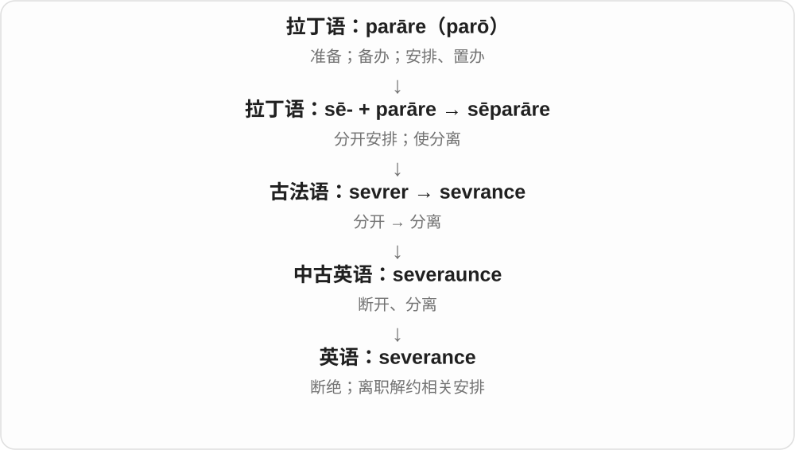

severance pay 是因结束雇佣关系而给付的补偿用语，具体是否有、怎么算取决于安排。severance 也能指与旧关系的切断。

**常见搭配与例句**

severance pay；a severance package；severance of ties。

> The agreement includes a severance package.

协议中包含一套离职补偿安排。

> The dispute led to a complete severance of ties.

这场争端导致双方关系彻底断绝。

**别混淆**

severance 着重断开关系；resignation 是员工主动辞职，两者不是同一个动作。

### 47. grievance — 不满；委屈；申诉事项

**音标**：/ˈɡriːvəns/

**先抓住这个画面**

心里有一笔账：我被这样对待，不公平，需要有人认真处理。

**怎么拆**

借自古法语 grevance、grievance，接 grever“伤害、加负担”；不是英语 grief 随意接 -ance。

**怎么变成今天的意思**

**拉丁语 gravis**  
重的；分量大、难承受、严肃的

↓

**拉丁语 gravare → 古法语 grever**  
使负担加重 → 使痛苦、伤害

↓

**古法语 grevance / grievance → 英语 grievance**  
损害、痛苦 → 对不公平待遇的不满或申诉

air a grievance 是把不满说出来；a grievance procedure 是组织处理员工申诉的程序。grievance 可以是主观委屈，也可以对应真实的不公，不能仅凭词语断定。

**常见搭配与例句**

have a grievance；air grievances；a formal grievance；a grievance procedure。

> The meeting gave staff a chance to air their grievances.

会议给了员工表达不满的机会。

> She submitted a formal grievance about the allocation of shifts.

她就排班安排提出了正式申诉。

**别混淆**

complaint 可以只是抱怨服务差；grievance 更常涉及被不公平对待及正式提出的问题。

### 48. impedance — 阻抗〔尤指电路〕

**音标**：/ɪmˈpiːdəns/

**先抓住这个画面**

电路面对不断变化的电流时，会有不同方式的“阻碍”：有的消耗能量，有的暂时储存又释放能量；阻抗把这些影响综合表达出来。

**怎么拆**

英语 impede + -ance，近代科学名词；电学用法由 Heaviside 于十九世纪提出。词根的“阻碍”帮助理解命名，但物理定义需要结合电压、电流和相位关系。

**怎么变成今天的意思**

**拉丁 pes，属格 pedis，词干 ped-**  
脚、足；也能由支撑作用说物体的脚

↓

**拉丁 in- + ped- → impedire**  
使脚受束缚 → 阻碍、妨碍

↓

**英语 impede**  
可由拉丁 impedire 借入；也有从较早英语 impediment 逆构的分析

↓

**英语 impede + -ance → impedance**  
阻碍作用 → 电路等系统中的阻抗

electrical impedance 通常以欧姆计；在交流电路中，它综合电阻和电抗的影响，往往随频率变化。耳机或扬声器的 impedance 是设备说明中常见的一项参数。

**常见搭配与例句**

electrical impedance；speaker impedance；impedance matching；high impedance。

> The manual lists the nominal impedance of each speaker.

说明书列出了每只扬声器的标称阻抗。

> The experiment measured how the circuit’s impedance changed with frequency.

实验测量了电路阻抗如何随频率变化。

**别混淆**

resistance 是电阻；impedance 范围更广，不能把所有阻抗都理解为把能量耗散成热的电阻。这个区别比记一个“阻挡”比喻更关键。

### 49. temperance — 节制、适度；节酒、禁酒运动相关的节制

**音标**：英 /ˈtempərəns/；美 /ˈtempərəns/

**先抓住这个画面**

有欲望、有冲动，但把它控制在适当范围，便是 temperance。历史上谈 temperance movement 时，通常特别落在饮酒节制、禁酒倡议。

**怎么拆**

经盎格鲁诺曼语 temperance 接拉丁 temperantia 节制，后者接 temperare 调节的分词词干。现代可看 temper + -ance 的性质联系。

**怎么变成今天的意思**

**拉丁 temperare 调和、适度调节 → 古英语 temprian → temper**  
把各种成分、性质调到合适程度

↓

**temperantia → temperance**  
自我节制；饮酒节制、禁酒语境

the virtue of temperance 节制这一品德，the temperance movement 节酒、禁酒运动。

**常见搭配与例句**

temperance in eating；the temperance movement。

> The essay praises temperance in eating and spending.

文章赞扬饮食和花费上的节制。

> The museum documents the history of the temperance movement.

博物馆记录了节酒与禁酒运动的历史。

**别混淆**

temperance 泛义是节制；历史运动具体有主张少喝或完全禁酒的不同用法，读背景再决定中文。

### 50. observance — 遵守；奉行；纪念或宗教仪式

**音标**：英 /əbˈzɜːvəns/；美 /əbˈzɜːrvəns/

**先抓住这个画面**

把规定或重要日子认真放在行动里：该遵循的遵循，该纪念的举行仪式。

**怎么拆**

经古法语 observance 来自拉丁语 observantia，承接 observāre 的遵守义。

**怎么变成今天的意思**

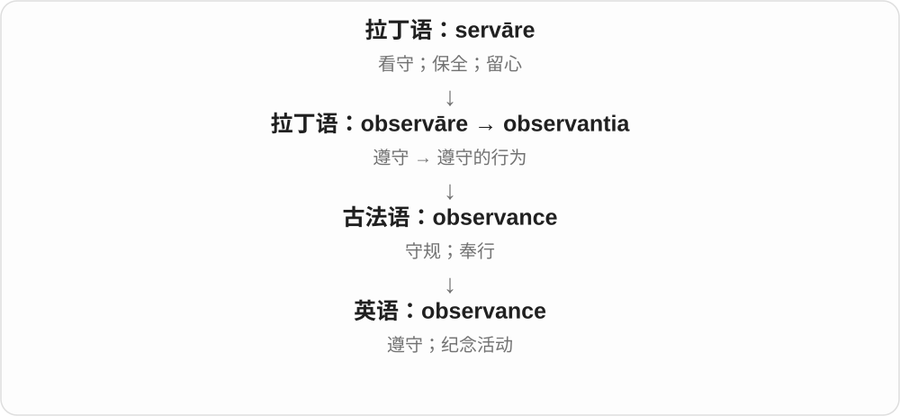

observance of rules 是遵守规定；religious observances 可指宗教仪式或习惯性活动。

**常见搭配与例句**

observance of the rules；religious observance；in observance of…。

> Strict observance of the rules is required.

必须严格遵守规定。

> The office is closed in observance of the holiday.

办公室因纪念这个节日而休息。

**别混淆**

observation 是观察；observance 是照着规定或惯例做，不能只凭相同词根互换。

### 51. deliverance — 解救；脱险；解脱〔正式或宗教用语〕

**音标**：英 /dɪˈlɪvərəns/；美 /dɪˈlɪvərəns/

**先抓住这个画面**

一直压在身上的危险或困境终于解除，人得以从中出来；它保留了 deliver 较早的“解救”那一面。

**怎么拆**

借古法语 delivrance，来自 delivrer“释放、解救”。现代能对应 deliver + -ance，但原有法语名词支线；不是送货 delivery 的通用替换词。

**怎么变成今天的意思**

**拉丁 liber**  
自由的；不受束缚的

↓

**拉丁 liberare → 晚期拉丁 deliberare → 古法语 delivrer**  
使自由、救出

↓

**古法语 delivrance → 中古英语 deliveraunce → 英语 deliverance**  
解救、脱离困境

deliverance from danger 是从危险中获救；宗教文本也常谈救赎或脱离恶。今天普通包裹送货应说 delivery，不说 deliverance。

**常见搭配与例句**

deliverance from danger；pray for deliverance；a sense of deliverance。

> The survivors described their rescue as a moment of deliverance.

幸存者把获救形容为终于脱险的一刻。

> The poem expresses a longing for deliverance from fear.

这首诗表达了摆脱恐惧的渴望。

**别混淆**

rescue 更日常具体；deliverance 较庄重，容易带精神或宗教色彩。delivery 则承担普通交付、配送等意义。

### 52. flamboyant — 华丽张扬的；炫目的；火焰式的〔建筑〕

**音标**：/flæmˈbɔɪənt/

**先抓住这个画面**

衣服颜色大胆，出场很有戏，动作、风格让人一眼注意到，就可能叫 flamboyant。想象火焰的曲线和亮色，但这只是理解画面，不是说人在燃烧。

**怎么拆**

借法语 flamboyant 燃烧的、火焰状的。英语早期用于有火焰状曲线的建筑风格，后来扩展到华丽、张扬的外表和行为。

**怎么变成今天的意思**

**法语 flambe、flamboyer → flamboyant**  
火焰、燃烧；像火焰般起伏的

↓

**英语建筑用语 flamboyant → 风格引申**  
火焰状曲线；华丽张扬、引人注目

↓

**flamboyance**  
这种鲜明张扬的风格、气质

a flamboyant performer 风格张扬的表演者；a flamboyant outfit 华丽惹眼的装束。

**常见搭配与例句**

a flamboyant style；a flamboyant personality。

> He arrived in a flamboyant purple coat.

他穿着一件惹眼的紫色外套来了。

> Her flamboyant stage style won a loyal following.

她张扬的舞台风格赢得了一批忠实观众。

**别混淆**

flamboyant 是显眼、华丽、张扬；flagrant 是明目张胆且严重的坏事，不能因为都与火焰历史材料有关就互换。

### 53. flamboyance — 华丽张扬；炫目、鲜明的风格

**音标**：/flæmˈbɔɪəns/

**先抓住这个画面**

flamboyant 描述那个人、那身衣服，flamboyance 则把惹眼、华丽、有戏的风格本身拿出来谈。

**怎么拆**

flamboyant 的相应性质名词，-ant／-ance 对应；保留火焰状、鲜明张扬这条词族线索。

**怎么变成今天的意思**

**法语 flambe、flamboyer → flamboyant**  
火焰、燃烧；像火焰般起伏的

↓

**英语建筑用语 flamboyant → 风格引申**  
火焰状曲线；华丽张扬、引人注目

↓

**flamboyance**  
这种鲜明张扬的风格、气质

the flamboyance of a performance 表演的华丽张扬；dress with flamboyance 穿得大胆惹眼。

**常见搭配与例句**

with flamboyance；stylistic flamboyance。

> The performance combined technical skill with theatrical flamboyance.

这场表演结合了技术功底与戏剧性的华丽风格。

> She toned down the flamboyance of the design.

她收敛了这个设计过于张扬的风格。

**别混淆**

flamboyance 可以是欣赏也可以是批评；extravagance 更常强调过度、奢侈。张扬并不自动表示花钱很多。

### 54. radiance — 光辉；明亮；喜悦的神采

**音标**：英、美 /ˈreɪdiəns/

**先抓住这个画面**

让人看到或感到的那一片明亮，也可以是一个人脸上的幸福光彩。

**怎么拆**

来源有英语 radiant 对应名词派生和中世纪拉丁 radiantia“光辉”借入两种分析；两者都接拉丁 radiare“发光”。不能把名词借入路线强行排除。

**怎么变成今天的意思**

**拉丁 radius**  
棒、辐条、光线；更早来源未定

↓

**拉丁 radiare → radians / radiantia**  
发光；发光的状态、光辉

↓

**两种来源分析**  
中世纪拉丁 radiantia 借入；或英语 radiant 对应名词派生

↓

**英语 radiance**  
光辉；美丽或喜悦的神采

the radiance of the morning sun 说晨光；the radiance of her smile 说笑容带来的明亮感觉。它通常比 brightness 更有描写感，适合景物和神态。

**常见搭配与例句**

the radiance of the sun；a warm radiance；the radiance of a smile。

> The room was filled with the soft radiance of the evening sun.

房间里洒满了夕阳柔和的光辉。

> There was a new radiance in his face after the good news.

听到好消息后，他脸上焕发出新的神采。

**别混淆**

radiant 是形容词，radiance 是名词。普通描写里的 radiance 不等于核放射性，也不是要求人真的发出可测的光。

### 55. sustenance — 食物；营养；维生、精神支撑

**音标**：/ˈsʌstənəns/

**先抓住这个画面**

sustenance 像让人继续活下去的那一份支撑，具体是食物，也可以是情感或精神上的滋养。

**怎么拆**

经古法语 sustenance 来自 sustenir“支撑、供养”，远源为拉丁语 sustinēre。

**怎么变成今天的意思**

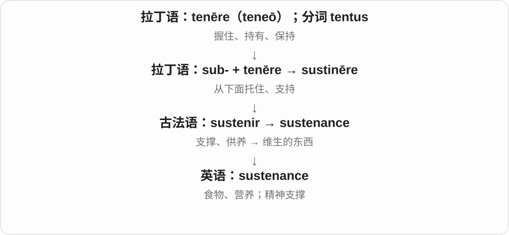

语气比 food 更书面，着重食物维持生命的作用。spiritual sustenance 不是给思想真的喂饭，而是能让人撑下去。

**常见搭配与例句**

provide sustenance；basic sustenance；emotional sustenance。

> The small farm provided sustenance for the family.

这个小农场为一家人提供维生食物。

> She drew emotional sustenance from her friends.

她从朋友那里获得了情感上的支撑。

**别混淆**

nutrition 侧重营养摄入或营养学；sustenance 侧重维生、支撑所需的东西，也可比喻使用。

### 56. capacitance — 电容、电容量〔物理量〕

**音标**：/kəˈpæsɪtəns/

**先抓住这个画面**

比较在相同电压下能分开储存多少电荷；这项能力的量就是 capacitance，不是器件本身的尺寸名称。

**怎么拆**

由 capacity 相关词干 capacit- + -ance，专化为电学储电能力。-ance 形成性质名词，不说 capacity 原样加 ance。

**怎么变成今天的意思**

**拉丁 capax〔词干 capac-〕、capācitās → 法语 capacité → capacity**  
能容纳 → 容量、能力

↓

**现代 capacit- 技术词干**  
接器件、性质后缀，命名储电能力和器件

↓

**capacit- + -ance → capacitance**  
储电能力对应的电学量

measure capacitance 测电容量，a capacitance value 电容值，capacitance in farads 以法拉计的电容量。

**常见搭配与例句**

measure capacitance；a capacitance value；capacitance in farads。

> The instrument measures capacitance.

这台仪器测量电容量。

> The textbook gives capacitance in farads.

教材用法拉表示电容量。

**别混淆**

capacitance 是量，capacitor 是物件；电容量不等于此刻电荷量，测量与使用条件也要区分。

### 57. admittance — 准许进入；进入权；导纳

**音标**：/ədˈmɪtəns/

**先抓住这个画面**

admittance 像门卫抬起栏杆让你进去，重点是能否进入；电路中借用“让电流通过”的画面形成导纳术语。

**怎么拆**

admit + -ance，是英语派生；电学意义是后来借用的专业用法。

**怎么变成今天的意思**

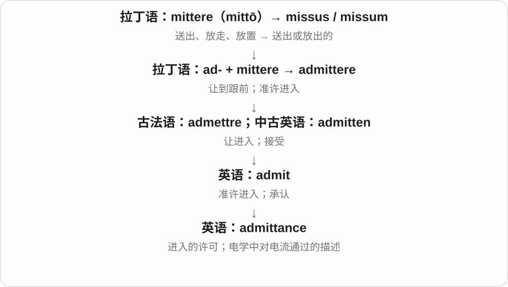

普通用法多见于门牌、正式说明。导纳与阻抗互为倒数，描述电路对交流电流的响应，不能只当成门票。

**常见搭配与例句**

no admittance；gain admittance to…；electrical admittance。

> The sign says no admittance without a pass.

牌子写着没有通行证不得进入。

> The engineer calculated the circuit’s admittance.

工程师计算了这个电路的导纳。

**别混淆**

admission 可讲承认或入场费；admittance 更专注进入本身。电学的 conductance“电导”只是导纳相关概念之一，不完全等同。

### 58. conveyance — 运送；交通工具；〔正式〕产权转让及其文书

**音标**：/kənˈveɪəns/

**先抓住这个画面**

convey 的运送动作变成名词是 conveyance，也能进一步指用来运送的车、船等。正式文件里还可能转到权利、产权从一方转给另一方。

**怎么拆**

承中古英语 conveiance、conveyaunce，对应 convey + -ance，形成动作、手段、结果等名词。运送与产权转让分支随 convey 的用法展开。

**怎么变成今天的意思**

**拉丁语 via 路相关材料 → 古法语 conveier → 中古英语 conveien → convey**  
伴送、运送，沿路带到目的地

↓

**convey → 传达信息；+ -or、-ance**  
运输、传递者或装置；运送、交通工具等名词

the conveyance of goods 货物运输；a means of conveyance 交通工具；a deed of conveyance 转让契据，属于专门文书语境。

**常见搭配与例句**

the conveyance of goods；a means of conveyance。

> The road was unsuitable for the conveyance of heavy equipment.

这条路不适合运输重型设备。

> The old carriage was their only means of conveyance.

那辆旧马车是他们唯一的交通工具。

**别混淆**

日常通常用 transport、vehicle；conveyance 更正式，看到 deed、title 时则要转到产权文书语境。

### 59. utterance — 说出、表达；一句话、一段实际说出的语段

**音标**：/ˈʌtərəns/

**先抓住这个画面**

一段话真从人嘴里说出来，是一次 utterance；也可把说出来的内容作为一个语段研究。它不要求总是完整长句。

**怎么拆**

中古英语已有 utteraunce 等，现代对应 utter 动词 + -ance。-ance 命名行为、实例或相关能力，而不是接形容词彻底。

**怎么变成今天的意思**

**中古英语 utteren 等，亦受大陆日耳曼语影响**  
把东西显露、放出 → 说出、表达

↓

**utter 动词 + -ance → utterance**  
说出的行为；实际说出的一个语言片段

a brief utterance 一句简短的话，every utterance 每一句话，give utterance to feelings 表达感受〔正式〕。语言学研究里可以分析一次实际发言。

**常见搭配与例句**

a brief utterance；give utterance to。

> Every utterance was recorded for the study.

研究录下了每一句发言。

> She gave utterance to feelings she had kept hidden.

她表达了藏在心里的感受。

**别混淆**

sentence 常看语法结构，utterance 常看实际使用的一次言语片段；一个回答 Yes. 也可构成 utterance。

### 60. remittance — 汇款；汇付款项

**音标**：/rɪˈmɪtəns/

**先抓住这个画面**

remittance 像把钱从你这里送到另一地点的收款人手里，既可说汇付这件事，也可说汇过去的钱。

**怎么拆**

remit + -ance。

**怎么变成今天的意思**

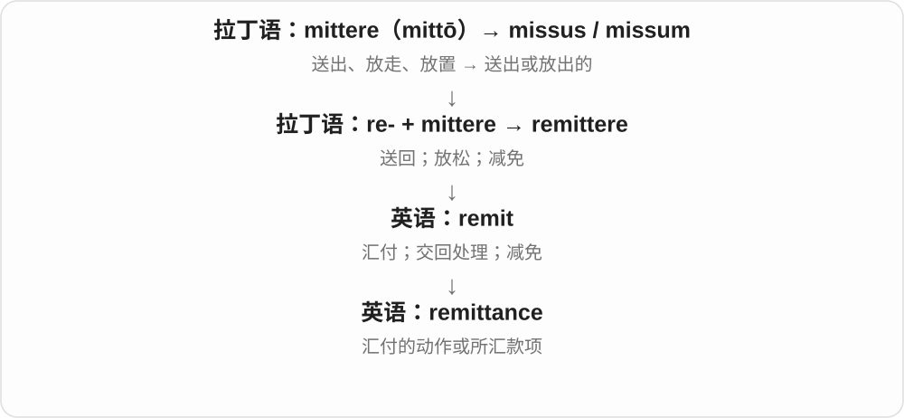

常用于正式付款、跨地区家庭汇款等语境。它专注款项转送，不是症状缓解。

**常见搭配与例句**

send a remittance；receive remittances；a remittance advice。

> She sends a monthly remittance to her family.

她每月给家人汇一笔钱。

> Please include the invoice number with your remittance.

汇款时请附上发票编号。

**别混淆**

remission 是减免或缓解；remittance 是把钱汇过去。减免费用与支付费用方向不同。

### 61. furtherance — 促进；推进

**音标**：英 /ˈfɜːðərəns/；美 /ˈfɜːrðərəns/

**先抓住这个画面**

把让一项事业、目标更向前这件事，作为一种正式的活动或目的来表达。

**怎么拆**

further 促进 + -ance，形成活动、过程名词。现代多见正式固定短语，不是更远距离的普通计量。

**怎么变成今天的意思**

**古英语 forþor / furþor → 中古英语 further**  
更向前、更远

↓

**英语 further**  
进一步；更远；额外的；促进

↓

**further + -ance → furtherance**  
促进 → 推进、促进这一过程

in furtherance of 为促进、为推进……；in furtherance of its aims 为实现、推进其目标。正式机构文件中常见。

**常见搭配与例句**

in furtherance of；the furtherance of education；in furtherance of a goal。

> The grant was awarded in furtherance of local education.

这笔资助用于促进当地教育。

> The society organizes talks in furtherance of its cultural aims.

学会举办讲座，推进其文化目标。

**别混淆**

furtherance 推进目标，不等于 further distance 更远距离；日常可按句子改用 to support、to advance 更直白。

### 62. conductance — 电导；传导能力

**音标**：/kənˈdʌktəns/

**先抓住这个画面**

电阻像给电流设阻碍，电导从另一面问：这段路径让电流通过有多容易。是一个量，不是泛指“导电这件事”。

**怎么拆**

conduct 传导 + -ance，形成量、性质名词，十九世纪出现。接 conduct 的物理传导一支，不接人的品行一支。

**怎么变成今天的意思**

**拉丁 condūcere、conductus 词族 → conduct**  
带领、引导；英语中发展传导等用法

↓

**conduct + -ance → conductance**  
传导能力、电导这一量

electrical conductance 电导，measure conductance 测电导。通常电导 G = 1/R，对应电阻倒数；常用单位 siemens，符号 S。

**常见搭配与例句**

electrical conductance；measure conductance；high conductance。

> The experiment measured the conductance of the wire.

实验测量了这段导线的电导。

> A lower resistance means a higher conductance.

电阻越低，电导越高。

**别混淆**

conductance 指具体对象的电导，conductivity 常说材料电导率；对象长度、粗细改变时，两者不能直接视为同一个量。

### 63. forbearance — 耐心；宽容；克制

**音标**：英 /fɔːˈbeərəns/；美 /fɔːrˈberəns/

**先抓住这个画面**

不是没有不满，而是压住冲动，给别人或困难留一点余地。

**怎么拆**

forbear 克制、容忍 + -ance，形成状态、品质名词；不是 forebear 祖先加后缀。

**怎么变成今天的意思**

**古英语 beran → 中古英语 beren**  
承载、带来；生育；忍受

↓

**英语 bear；过去式 bore，过去分词通常 borne**  
承受、携带、产生；出生表达中使用 born

↓

**forbear → forbearance**  
忍住、容忍 → 克制、宽容这一品质

show forbearance 表现出克制、宽容；thank someone for their forbearance 感谢对方耐心包容。通常比 patience 更正式。

**常见搭配与例句**

show great forbearance；patience and forbearance；test someone’s forbearance。

> She showed remarkable forbearance during the heated discussion.

在激烈讨论中，她表现出了难得的克制。

> Thank you for your forbearance while we reorganize the office.

办公室调整期间，感谢大家耐心包容。

**别混淆**

forbearance 常含面对烦扰仍克制的意思；patience 范围更广，也可只是耐心等待。金融语境另有暂缓执行、暂缓还款等专业用法。

### 64. comeuppance — 应得的惩罚；报应

**音标**：/kʌmˈʌpəns/

**先抓住这个画面**

一直欺负别人、以为自己不会吃亏的人，终于栽了跟头，旁观者觉得他活该，这就是 comeuppance 的典型口气。

**怎么拆**

由 come up 与 -ance 构成，通常解释与来到法庭、接受评判的用法有关；具体历史联系带推测性，不能把上法庭故事说成确定记载。

**怎么变成今天的意思**

**come up + -ance**  
与出面受评判相联的一种词源解释

↓

**现代 comeuppance**  
被说话者认为应得的惩罚、挫败

get one’s comeuppance 得到应有的惩罚；常用于故事结局、批评语境。

**常见搭配与例句**

get his comeuppance；get her comeuppance。

> Readers wanted the cruel landlord to get his comeuppance.

读者希望那个残酷的房东得到报应。

> In the final scene, the arrogant villain gets his comeuppance.

最后一幕里，傲慢的反派得到了应有的惩罚。

**别混淆**

comeuppance 带应得、活该的评价；misfortune 只说不幸，不预先断定受苦的人有错。

### 65. contrivance — 设计出的装置；巧妙安排；牵强手法

**音标**：/kənˈtraɪvəns/

**先抓住这个画面**

可以是动脑筋拼出的一件工具，也可以是为了达到结果而硬设的情节。

**怎么拆**

contrive + -ance，形成表示安排、设计结果的名词。

**怎么变成今天的意思**

**古法语 controver**  
设计、想出、编造

↓

**中古英语 contreve／controve → contrive**  
设法安排；想办法做成

↓

**contrive + -ance → contrivance**  
设计安排的过程或产物

an ingenious contrivance 可以赞一件巧妙装置；a plot contrivance 常批评剧情为了某结果刻意安排。核心是“人为想办法弄出来”，褒贬取决于成果自然不自然、实用不实用。

**常见搭配与例句**

an ingenious contrivance；a mechanical contrivance；a plot contrivance。

> The inventor showed us a small contrivance for opening jars.

发明者给我们看了一个开罐子的巧妙小装置。

> The sudden arrival of the missing witness was an obvious plot contrivance.

失踪证人突然出现，明显是个刻意安排的剧情手法。

**别混淆**

device 可中性指工具或文学手法；contrivance 常更突出精心设计，有时带牵强、复杂过头的感觉。

### 66. cognizance — 知悉；察觉；审理权限〔法律〕

**音标**：英 /ˈkɒɡnɪzəns/；美 /ˈkɑːɡnɪzəns/

**先抓住这个画面**

一件事进入了你的注意和认识范围；在法律语境中，法院可以把它纳入审理范围。

**怎么拆**

经盎格鲁法语 conysance、古法语 conoissance，来自 cognoscere 一支。英语早期没有 g，后来参照拉丁词形补回；cognize 反而是较晚从它反构的。

**怎么变成今天的意思**

**拉丁语：gnoscere / noscere；notus**  
开始认识、了解；已知的

↓

**拉丁语：co- + gnoscere → cognoscere / cognitus**  
认识、辨认、查明

↓

**古法语 conoistre → conoissance / 盎格鲁法语 conysance**  
认识 → 识别、知悉

↓

**中古英语 conisance → cognizance**  
知悉；g 后来按拉丁来源补入拼写

常见 take cognizance of…，表示注意到并认真考虑某事。法律上的 cognizance 还可能涉及管辖、审理，须看具体用法。

**常见搭配与例句**

take cognizance of the facts；within the court’s cognizance。

> The committee took cognizance of the new evidence.

委员会注意到并考虑了新证据。

> The matter fell within the court’s cognizance.

这件事属于该法院可审理的范围。

**别混淆**

recognition 常是认出或认可；cognizance 更正式地说知悉或把某事纳入考虑。

## 这一组要分清什么

disappearance 失踪不等于死亡；hindrance 妨碍不保证完全阻止；comeuppance 带应得的惩罚这一评价；appearance、performance 等要随场景理解，不能所有 -ance 都译成性。

## 串起来练习

Their reluctance to discuss the problem led to avoidance rather than acceptance.

他们不愿讨论这个问题，于是选择回避，而非接受它。
