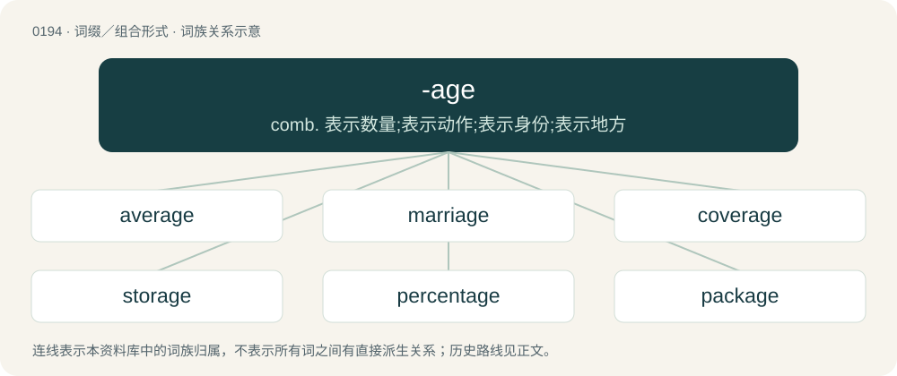

# 0216 · -age — comb. 表示数量;表示动作;表示身份;表示地方

[总目录](../00_总目录_按常用程度.md)

**类型**：词缀／组合形式　｜　**来源语言**：见词源记录

## 核心含义与来源

- 核心含义：comb. 表示数量;表示动作;表示身份;表示地方
- 英文含义：Forming nouns with the sense of appurtenance or collection.
- 词形：-age

**来源记录 1**（后缀／后置成分；Forming nouns with the sense of appurtenance or collection.）

From Middle English -age, from Old French -age, from Latin -āticum. Cognates include French -age, Italian -aggio, Portuguese -agem, Spanish -aje, Occitan -atge, Romanian -aj. Doublet of -atic.

## 词族图

## 单词速览（常用到不常用）

| 单词 | 音标 | 释义 |
|---|---|---|
| [average](#w-1) | 英 /ˈæv.(ə.)ɹɪd͡ʒ/；美 /ˈæv.ɚ.ɪd͡ʒ/ | n. 平均, 平均数, 一般水平, 海损；a. 平均的, 中等的, 平常的；vt. 算出...平均数, 平均做, 均分, 使平衡 |
| [marriage](#w-2) | 英 /ˈmæɹɪd͡ʒ/；/ˈmæɹɪd͡ʒ/ | n. 婚姻, 结婚, 婚礼, 合并；\[医\] 婚姻, 结婚 |
| [coverage](#w-3) | 英 /ˈkʌv.(ə.)ɹɪdʒ/ | n. 覆盖的范围, 保险总额, 新闻报导；\[化\] 可达范围; 覆盖度 |
| [storage](#w-4) | 英 /ˈstɔː.ɹɪd͡ʒ/；美 /ˈstɔɹ.ɪd͡ʒ/ | n. 存储器, 储藏, 保管, 库存, 仓库；\[计\] 存放处; 存储 |
| [percentage](#w-5) | /pə(ɹ)ˈsɛntɪd͡ʒ/ | n. 百分比, 比率, 部分, 可能性；\[计\] 百分比 |
| [package](#w-6) | 英 /ˈpæk.ɪd͡ʒ/ | n. 包裹, 套装软件, 包, 包装用物, 程序包；vt. 包装, 打包；a. 一揽子的 |
| [footage](#w-7) | /ˈfʊtɪd͡ʒ/ | n. 英尺长度, 英板尺, (影片的)连续镜头 |
| [voltage](#w-8) | 英 /ˈvəʊltɪd͡ʒ/；美 /ˈvoʊltɪd͡ʒ/ | n. 电压, 伏特数；\[化\] 电压 |
| [shortage](#w-9) | /ˈʃɔː(ɹ)tɪd͡ʒ/ | n. 不足, 缺乏；\[化\] 缺额 |
| [leverage](#w-10) | /ˈlɛv.(ə.)ɹɪd͡ʒ/ | n. 杠杆作用, 杠杆装置, 杠杆效率；\[医\] 杠杆率 |
| [luggage](#w-11) | 英 /ˈlʌɡ.ɪdʒ/ | n. 行李, 皮箱 |
| [drainage](#w-12) | /ˈdɹeɪnəd͡ʒ/ | n. 排水；\[医\] 引流\[法\], 导液\[法\], 排水\[设备\] |
| [salvage](#w-13) | /ˈsælvɪd͡ʒ/ | n. 海上救助, 抢救, 打捞, 抢救出来的财物；vt. 海上救助, 抢救, 打捞, 营救；\[计\] 文件恢复程序 |
| [mileage](#w-14) | /ˈmaɪləd͡ʒ/ | n. 英里数；\[经\] 运费(按英里计算的) |
| [sewage](#w-15) | 英 /ˈsuː.ɪd͡ʒ/；美 /ˈsu.ɪd͡ʒ/ | n. 脏水, 污水；\[医\] 污水, 污物 |
| [postage](#w-16) | 英 /ˈpəʊstɪd͡ʒ/；美 /ˈpoʊstɪd͡ʒ/ | n. 邮资；\[经\] 邮费, 邮资 |
| [underage](#w-17) | /ˈʌndəɹɪd͡ʒ/ | 【英文】A deficit or shortfall in funds, inventory, or capacity. |
| [lineage](#w-18) | 英 /ˈlɪn.i.ɪd͡ʒ/ | n. 血统, 直系；\[法\] 血统, 世系 |
| [patronage](#w-19) | 英 /ˈpætɹənɪd͡ʒ/；/ˈpeɪtɹənɪd͡ʒ/ | n. 赞助, 恩赐态度, 光顾, 任免权, 保护人的身分；\[经\] 光顾, 资助, 赞助 |
| [anchorage](#w-20) | 英 /ˈæŋkəɹɪd͡ʒ/；美 /ˈæŋkɚɪd͡ʒ/ | n. 下锚, 锚地, 停泊税；\[化\] 固着; 固定; 锚定 |
| [cleavage](#w-21) | /ˈkliːvɪd͡ʒ/ | n. 劈开, 裂片, 分裂；\[化\] 解理 |
| [rampage](#w-22) | /ˈɹæmpeɪd͡ʒ/ | n. 乱闹, 乱冲, 暴跳；vi. 乱闹, 狂暴 |
| [orphanage](#w-23) | /ˈɔː(ɹ)fənɪd͡ʒ/ | n. 孤儿院, 孤儿身份；\[法\] 孤儿身份, 孤儿, 孤儿院 |
| [brokerage](#w-24) | 英 /ˈbɹəʊkəɹɪd͡ʒ/；美 /ˈbɹoʊkəɹɪd͡ʒ/ | n. 经纪人, 回扣, 佣金, 中间人业务；\[经\] 经纪业, 佣金, 手续费 |
| [wreckage](#w-25) | /ˈɹɛkɪdʒ/ | n. 残骸, 失事, 破坏；\[经\] (船双等的)失事遭难 |
| [outage](#w-26) | 英 /ˈaʊ.tɪd͡ʒ/；美 /ˈaʊ.tɪd͡ʒ/ | n. (水、电、煤)断供, 储运损耗；\[化\] (蓄水池为了水膨胀)预留的容量; 排出量 |
| [leakage](#w-27) | /ˈliːkɪd͡ʒ/ | n. 漏, 漏出物, 泄漏；\[化\] 漏电; 漏水; 漏气; 渗漏; 漏失量; 漏出量 |
| [stoppage](#w-28) | /ˈstɔpidʒ/ | n. 停止, 中止, 阻塞, 阻碍, 堵塞, 故障, 停付, 扣除, 扣留, 停工, 罢工；\[化\] 停机 |
| [signage](#w-29) | 英 /ˈsaɪnɪd͡ʒ/ | n. 标记； 标识系统 |
| [linkage](#w-30) | /ˈlɪŋkɪdʒ/ | n. 联合, 连锁, 结合, 联动；\[计\] 连接 |
| [acreage](#w-31) | 英 /ˈeɪk(ə)ɹɪd͡ʒ/ | n. 英亩数, 土地面积；\[经\] 英亩数, 土地面积, 矿区租赁面积 |
| [blockage](#w-32) | 英 /ˈblɒkɪd͡ʒ/；美 /ˈblɑkɪd͡ʒ/ | n. 封锁, 妨碍；\[化\] 堵塞 |
| [frontage](#w-33) | /ˈfɹʌn.tɪd͡ʒ/ | n. 房子的正面, 前方, 临街地 |
| [tonnage](#w-34) | /ˈtʌnɪd͡ʒ/ | n. 吨位；\[化\] 吨位 |
| [breakage](#w-35) | /ˈbɹeɪkɪd͡ʒ/ | n. 破坏, 破损处, 破损量；\[化\] 破裂; 断裂 |
| [shrinkage](#w-36) | /ˈʃriŋkidʒ/ | n. 收缩, 收缩量, 减低；\[化\] 起皱; 收缩; 收缩量 |
| [sewerage](#w-37) | 英 /ˈsuː.ɹɪd͡ʒ/ | n. 排水设备, 污水；\[化\] 污水 |
| [visage](#w-38) | /ˈvɪz.ɪd͡ʒ/ | n. 脸, 面貌, 容貌 |
| [yardage](#w-39) | /ˈjɑːdidʒ/ | n. 车站旁牲畜栏的使用, 牲畜栏使用费；\[法\] 站内栏舍的使用权, 使用站内栏舍的费用 |
| [appendage](#w-40) | /əˈpɛndɪd͡ʒ/ | n. 附加物, 附器；\[医\] 附件, 附器 |
| [tutelage](#w-41) | /ˈtjuːtɪlɪd͡ʒ/ | n. 守护, 监护, 指导；\[法\] 监护, 保护, 指导 |
| [vicarage](#w-42) | 美 /ˈvɪkəɹɪd͡ʒ/ | n. 教区牧师的住宅 |
| [haulage](#w-43) | /hɔːləd͡ʒ/ | n. 拖曳, 运费, 牵引量；\[经\] 公路运输, 拖运费 |
| [wattage](#w-44) | /ˈwɒtɪd͡ʒ/ | n. 瓦(特)数；\[医\] 瓦特数 |
| [wastage](#w-45) | /ˈweɪstɪdʒ/ | n. 浪费, 浪费量, 废物；\[化\] 废物 |
| [slippage](#w-46) | /ˈslɪpɪdʒ/ | n. 滑移, 滑动, 滑程；\[经\] 延误 |
| [parsonage](#w-47) | /pɑːsnidʒ/ | n. 教区牧师的住所, 牧师住所 |
| [seepage](#w-48) | /ˈsiːpidʒ/ | n. 渗漏, 渗出物；\[化\] 渗流 |
| [spillage](#w-49) | /ˈspɪl.ɪd͡ʒ/ | n. 漏, 溢出, 溢出物；\[化\] 泄漏量 |
| [spoilage](#w-50) | /ˈspɒilidʒ/ | n. 变质, 糟蹋, 损耗, 损坏；\[经\] (原料,材料,产品)损坏 |
| [overage](#w-51) | /ˈəʊvəɹɪd͡ʒ/ | 【英文】A surplus of inventory or capacity or of cash that is greater than the amount in the record of an account. |
| [steerage](#w-52) | /ˈstiəridʒ/ | n. 统舱, 掌舵, 操纵, 管理 |
| [stowage](#w-53) | /ˈstəuidʒ/ | n. 装载, 装货, 装载方法, 装载物；\[经\] 堆装(法), 装载(法), 贮藏(法) |
| [trackage](#w-54) | 英 /ˈtɹæk.ɪdʒ/ | n. 轨道, 拉纤；\[法\] 铁路使用权, 轨道使用所交的费 |
| [amperage](#w-55) | 美 /ˈæm.pəɹ.əd͡ʒ/ | n. 安培数；\[医\] 安培度 |
| [cribbage](#w-56) | /ˈkɹɪbɪd͡ʒ/ | n. 克里比奇牌戏 |
| [mintage](#w-57) | /ˈmintidʒ/ | n. 造币, 铸币材料, 创造；\[经\] 造币费, 硬币 |
| [windage](#w-58) | /ˈwɪndɪd͡ʒ/ | n. 风力影响, 游隙, 风力修正量；\[医\] 气压伤 |

## 逐词详解

### 1. average

**词性**：名词　｜　**音标**：英 /ˈæv.(ə.)ɹɪd͡ʒ/；美 /ˈæv.ɚ.ɪd͡ʒ/

**中文释义**：n. 平均, 平均数, 一般水平, 海损；a. 平均的, 中等的, 平常的；vt. 算出...平均数, 平均做, 均分, 使平衡

**英文义项**：Any measure of central tendency, especially any mean, the median, or the mode. / The arithmetic mean.

**例句**：

> The average of 10, 20 and 24 is (10 + 20 + 24)/3 = 18.

该用例对应义项：The arithmetic mean.

### 2. marriage

**词性**：名词　｜　**音标**：英 /ˈmæɹɪd͡ʒ/；/ˈmæɹɪd͡ʒ/

**中文释义**：n. 婚姻, 结婚, 婚礼, 合并；\[医\] 婚姻, 结婚

**英文义项**：The state of being married. / A union of two or more people that creates a family tie and carries legal, social, or religious rights and responsibilities.

**构词拆分**：marry + -age

**词源与演化**：

From Middle English mariage, from Old French mariage, from marier (“to marry”), from Latin marītō (“marry”, verb, literally “give in marriage”), from marītus (“lover”, “nuptial”), from mas (“male, masculine, of the male sex”). Equivalent to marry + -age. Doublet of maritage. Displaced native Old English sinsċipe.

**例句**：

> You are cordially invited to the marriage of James Smith and Jane Doe.

该用例对应义项：A wedding; a ceremony in which people wed.

### 3. coverage

**词性**：名词　｜　**音标**：英 /ˈkʌv.(ə.)ɹɪdʒ/

**中文释义**：n. 覆盖的范围, 保险总额, 新闻报导；\[化\] 可达范围; 覆盖度

**英文义项**：An amount by which something or someone is covered. / The amount and type of attention given to an event or topic in news media or other media.

**构词拆分**：cover + -age

**词源与演化**：

From cover + -age. First attested in 1912. Compare Middle English coverage (“a charge for having or stall or booth at a fair”).

**例句**：

> Before laying sod on that clay, the ground needs two inches of coverage with topsoil.

该用例对应义项：An amount by which something or someone is covered.

### 4. storage

**词性**：名词　｜　**音标**：英 /ˈstɔː.ɹɪd͡ʒ/；美 /ˈstɔɹ.ɪd͡ʒ/

**中文释义**：n. 存储器, 储藏, 保管, 库存, 仓库；\[计\] 存放处; 存储

**英文义项**：The act of storing goods; the state of being stored. / An object or place in which something is stored.

**构词拆分**：store + -age

**词源与演化**：

From store + -age.

**例句**：

> I′d recommend backing up these files to storage before reinstalling the operating system.

该用例对应义项：Any computer device, including such as a disk, on which data is stored for a longer term than main memory.

### 5. percentage

**词性**：名词　｜　**音标**：/pə(ɹ)ˈsɛntɪd͡ʒ/

**中文释义**：n. 百分比, 比率, 部分, 可能性；\[计\] 百分比

**英文义项**：The amount, number or rate of something, regarded as part of a total of 100; a part of a whole. / A share of the sales, profits, gross margin or similar.

**词源与演化**：

From percent, from Latin per centum (“for every hundred”), + -age (suffix indicating a rate).

**例句**：

> A high percentage of secondary school leavers take a gap year.

该用例对应义项：The amount, number or rate of something, regarded as part of a total of 100; a part of a whole.

### 6. package

**词性**：名词　｜　**音标**：英 /ˈpæk.ɪd͡ʒ/

**中文释义**：n. 包裹, 套装软件, 包, 包装用物, 程序包；vt. 包装, 打包；a. 一揽子的

**英文义项**：Something which is packed, a parcel, a box, an envelope. / Something which consists of various components, such as a piece of computer software.

**构词拆分**：pack + -age

**词源与演化**：

Equivalent to pack + -age. Possibly influenced by Anglo-Latin paccagium or Old French pacquage.

**例句**：

> For third and short, they're going to bring in their jumbo package.

该用例对应义项：A football formation.

### 7. footage

**词性**：名词　｜　**音标**：/ˈfʊtɪd͡ʒ/

**中文释义**：n. 英尺长度, 英板尺, (影片的)连续镜头

**英文义项**：An amount of film or tape that has been used to record something, or the content of the recording. / A measurement in feet.

**构词拆分**：foot (unit of length) + -age

**词源与演化**：

From foot (unit of length) + -age. Video footage is so called because movie film and television tape was measured in feet. The same term is still applied by analogy to digital videos which are stored on hard drives or microchips. Compare typologically French métrage.

**例句**：

> The footage we shot at the riot yesterday got ruined.

该用例对应义项：An amount of film or tape that has been used to record something, or the content of the recording.

### 8. voltage

**词性**：名词　｜　**音标**：英 /ˈvəʊltɪd͡ʒ/；美 /ˈvoʊltɪd͡ʒ/

**中文释义**：n. 电压, 伏特数；\[化\] 电压

**英文义项**：The difference in electrostatic potential between two points in space, especially between live and neutral conductors or the earth.

**构词拆分**：volt + -age

**词源与演化**：

From volt + -age, ultimately derived from the name of Alessandro Volta, inventor of the modern battery.

**例句**：

> The voltage between the wires is too low to produce a spark.

该用例对应义项：The difference in electrostatic potential between two points in space, especially between live and neutral conductors or the earth.

### 9. shortage

**词性**：名词　｜　**音标**：/ˈʃɔː(ɹ)tɪd͡ʒ/

**中文释义**：n. 不足, 缺乏；\[化\] 缺额

**英文义项**：A lack or deficiency; an insufficient amount.

**构词拆分**：short + -age

**词源与演化**：

From short + -age.

**例句**：

> There is a shortage of money in Brian's wallet and bank account.

### 10. leverage

**词性**：名词　｜　**音标**：/ˈlɛv.(ə.)ɹɪd͡ʒ/

**中文释义**：n. 杠杆作用, 杠杆装置, 杠杆效率；\[医\] 杠杆率

**英文义项**：A force compounded by means of a lever rotating around a pivot. / Any influence which is compounded or used to gain an advantage.

**构词拆分**：lever + -age

**词源与演化**：

From lever + -age. The verb likely comes from martial arts/judo usage, where one would "use an opponent's leverage (i.e. their weight, height, centre of balance, etc.)" against them in order to defeat them.

**例句**：

> Their variable-cost-reducing investments have dramatically increased their leverage.

该用例对应义项：The ability to earn very high returns when operating at high-capacity utilization of a facility.

### 11. luggage

**词性**：名词　｜　**音标**：英 /ˈlʌɡ.ɪdʒ/

**中文释义**：n. 行李, 皮箱

**英文义项**：The bags and other containers that hold a traveller's belongings. / The contents of such containers.

**构词拆分**：lug (“to drag”) + -age

**词源与演化**：

1590s, lug (“to drag”) + -age, literally “that which is lugged, dragged around”. Compare baggage.

**例句**：

> There is a limit of two pieces of luggage for each passenger.

### 12. drainage

**词性**：名词　｜　**音标**：/ˈdɹeɪnəd͡ʒ/

**中文释义**：n. 排水；\[医\] 引流\[法\], 导液\[法\], 排水\[设备\]

**英文义项**：A natural or artificial means for the removal of fluids from a given area by its draining away. / A system of drains.

**构词拆分**：drain + -age

**词源与演化**：

From drain + -age.

**例句**：

> The drainage systems are not able to handle the water pressure.

### 13. salvage

**词性**：名词　｜　**音标**：/ˈsælvɪd͡ʒ/

**中文释义**：n. 海上救助, 抢救, 打捞, 抢救出来的财物；vt. 海上救助, 抢救, 打捞, 营救；\[计\] 文件恢复程序

**英文义项**：The rescue of a ship, its crew and passengers or its cargo from a hazardous situation. / The ship, crew or cargo so rescued.

**词源与演化**：

From Old French salver (see also save, from a variant form), from Late Latin salvare (“to make safe, secure, save”), from Latin salvus (“safe”) with the English suffix -age.

**用法示例／搭配（非完整句）**：

> salvage cars auction

该用例对应义项：Anything put to good use that would otherwise have been wasted, such as damaged goods.

### 14. mileage

**词性**：名词　｜　**音标**：/ˈmaɪləd͡ʒ/

**中文释义**：n. 英里数；\[经\] 运费(按英里计算的)

**英文义项**：The total distance travelled in miles or in air miles. / The number of miles travelled by a vehicle on a certain volume of fuel.

**构词拆分**：mile + -age

**词源与演化**：

From mile + -age.

**例句**：

> There’s quite a lot of mileage in language, speech and computing, particularly in research.

该用例对应义项：The amount of service that something has yielded or may yield in future.

### 15. sewage

**词性**：名词　｜　**音标**：英 /ˈsuː.ɪd͡ʒ/；美 /ˈsu.ɪd͡ʒ/

**中文释义**：n. 脏水, 污水；\[医\] 污水, 污物

**英文义项**：A suspension of water and solid waste, transported by sewers to be disposed of or processed.

**构词拆分**：sewer (“system of pipes used to remove human waste and to provide drainage”) + -age

**词源与演化**：

From sewer (“system of pipes used to remove human waste and to provide drainage”) + -age or from sew (“to drain or draw off water”) + -age.

**例句**：

> The city invested in a modern sewage system.

该用例对应义项：A suspension of water and solid waste, transported by sewers to be disposed of or processed.

### 16. postage

**词性**：名词　｜　**音标**：英 /ˈpəʊstɪd͡ʒ/；美 /ˈpoʊstɪd͡ʒ/

**中文释义**：n. 邮资；\[经\] 邮费, 邮资

**英文义项**：The system of transporting letters, and parcels. / The charge for posting an item.

**构词拆分**：post + -age

**词源与演化**：

From post + -age.

**例句**：

> I forgot to add a postage stamp before I mailed the letter.

### 17. underage

**词性**：名词　｜　**音标**：/ˈʌndəɹɪd͡ʒ/

**英文义项**：A deficit or shortfall in funds, inventory, or capacity.

**构词拆分**：under + -age

**词源与演化**：

From under + -age.

### 18. lineage

**词性**：名词　｜　**音标**：英 /ˈlɪn.i.ɪd͡ʒ/

**中文释义**：n. 血统, 直系；\[法\] 血统, 世系

**英文义项**：Descent in a line from a common progenitor; progeny; descending line of offspring or ascending line of parentage. / A number of lines of text in a column.

**构词拆分**：line + -age

**词源与演化**：

From Middle English linage, from Old French linage, from ligne, from Latin linea (“line”); equivalent to line + -age.

**例句**：

> Pray, of what land or lineage should I rightly call you?

### 19. patronage

**词性**：名词　｜　**音标**：英 /ˈpætɹənɪd͡ʒ/；/ˈpeɪtɹənɪd͡ʒ/

**中文释义**：n. 赞助, 恩赐态度, 光顾, 任免权, 保护人的身分；\[经\] 光顾, 资助, 赞助

**英文义项**：The act of providing approval and support; backing; championship. / Customers collectively; clientele; business.

**构词拆分**：patron + -age

**词源与演化**：

From Middle English patronage, from Old French patronage (modern French patronage). Equivalent to patron + -age. Piecewise doublet of patternage.

**例句**：

> His vigorous patronage of the conservatives got him in trouble with progressives.

该用例对应义项：The act of providing approval and support; backing; championship.

### 20. anchorage

**词性**：名词　｜　**音标**：英 /ˈæŋkəɹɪd͡ʒ/；美 /ˈæŋkɚɪd͡ʒ/

**中文释义**：n. 下锚, 锚地, 停泊税；\[化\] 固着; 固定; 锚定

**英文义项**：A harbor, river, or offshore area that can accommodate a ship at anchor, either for quarantine, queuing, or discharge. / A fee charged for anchoring.

**构词拆分**：anchor + -age

**词源与演化**：

From anchor + -age.

**例句**：

> Anchorage is five pounds a night outside the harbour.

该用例对应义项：A fee charged for anchoring.

### 21. cleavage

**词性**：名词　｜　**音标**：/ˈkliːvɪd͡ʒ/

**中文释义**：n. 劈开, 裂片, 分裂；\[化\] 解理

**英文义项**：The act of cleaving or the state of being cleft. / The hollow or separation between a woman's breasts, especially as revealed by a low neckline.

**构词拆分**：cleave + -age

**词源与演化**：

From cleave + -age.

**例句**：

> There was a cleavage between the liberal and conservative members.

该用例对应义项：the state of being split or cleft

### 22. rampage

**词性**：名词　｜　**音标**：/ˈɹæmpeɪd͡ʒ/

**中文释义**：n. 乱闹, 乱冲, 暴跳；vi. 乱闹, 狂暴

**英文义项**：A course of violent, frenzied action. / Wild partying, typically a drinking binge

**构词拆分**：ramp + -age

**词源与演化**：

From Scots rampage, equivalent to ramp + -age. Perhaps influenced by Middle English rampnen (“to force, ram”), from Old English \*hrampian, from Proto-West Germanic \*hrampōn (“to obstruct, hinder”), see ramp.

**例句**：

> What Tom is doing right now is a spiritual rampage.

### 23. orphanage

**词性**：名词　｜　**音标**：/ˈɔː(ɹ)fənɪd͡ʒ/

**中文释义**：n. 孤儿院, 孤儿身份；\[法\] 孤儿身份, 孤儿, 孤儿院

**英文义项**：A residential institution for the care and protection of orphans.

**构词拆分**：orphan + -age

**词源与演化**：

Attested since the 1570s; orphan + -age.

**例句**：

> Yanni even used his ill-gotten gains to buy medication for an orphanage.

### 24. brokerage

**词性**：名词　｜　**音标**：英 /ˈbɹəʊkəɹɪd͡ʒ/；美 /ˈbɹoʊkəɹɪd͡ʒ/

**中文释义**：n. 经纪人, 回扣, 佣金, 中间人业务；\[经\] 经纪业, 佣金, 手续费

**英文义项**：A business, firm, or company whose business is to act as a broker (e.g., stockbroker). / The occupation of being a broker.

**构词拆分**：broker + -age

**词源与演化**：

From broker + -age.

**例句**：

> When you see the sign for the stock brokerage, take the next right.

### 25. wreckage

**词性**：名词　｜　**音标**：/ˈɹɛkɪdʒ/

**中文释义**：n. 残骸, 失事, 破坏；\[经\] (船双等的)失事遭难

**英文义项**：Something wrecked, especially the remains or debris of something which has been severely damaged or destroyed.

**构词拆分**：wreck + -age

**词源与演化**：

From wreck + -age.

**例句**：

> They searched the wreckage for signs of survivors.

该用例对应义项：the remaining parts of something that has been wrecked

### 26. outage

**词性**：名词　｜　**音标**：英 /ˈaʊ.tɪd͡ʒ/；美 /ˈaʊ.tɪd͡ʒ/

**中文释义**：n. (水、电、煤)断供, 储运损耗；\[化\] (蓄水池为了水膨胀)预留的容量; 排出量

**英文义项**：A temporary suspension of operation, especially of electrical power supply. / The amount of something lost in storage or transportation.

**构词拆分**：out + -age

**词源与演化**：

From out + -age, on the model of shortage.

**例句**：

> There will be a network outage from 8 to 10 a.m.

该用例对应义项：a temporary suspension of operation (as of computers)

### 27. leakage

**词性**：名词　｜　**音标**：/ˈliːkɪd͡ʒ/

**中文释义**：n. 漏, 漏出物, 泄漏；\[化\] 漏电; 漏水; 漏气; 渗漏; 漏失量; 漏出量

**英文义项**：An act of leaking, or something that leaks. / The amount lost due to a leak.

**构词拆分**：leak + -age

**词源与演化**：

From leak + -age.

**例句**：

> Engineers discovered leakage in the fuel tank.

该用例对应义项：An act of leaking, or something that leaks.

### 28. stoppage

**词性**：名词　｜　**音标**：/ˈstɔpidʒ/

**中文释义**：n. 停止, 中止, 阻塞, 阻碍, 堵塞, 故障, 停付, 扣除, 扣留, 停工, 罢工；\[化\] 停机

**英文义项**：A pause or halt of some activity. / Something that forms an obstacle to continued activity; a blockage or obstruction.

**构词拆分**：stop + -age

**词源与演化**：

From stop + -age.

**例句**：

> A soccer match lasts 90 minutes, without considering stoppage time.

### 29. signage

**词性**：名词　｜　**音标**：英 /ˈsaɪnɪd͡ʒ/

**中文释义**：n. 标记； 标识系统

**英文义项**：Signs, particularly those imparting commercial, directional, or road traffic information, taken collectively. / A sign, a signboard.

**构词拆分**：sign + -age

**词源与演化**：

From sign + -age.

**例句**：

> The signage at the airport is designed to point the way clearly to important locations.

该用例对应义项：Signs, particularly those imparting commercial, directional, or road traffic information, taken collectively.

### 30. linkage

**词性**：名词　｜　**音标**：/ˈlɪŋkɪdʒ/

**中文释义**：n. 联合, 连锁, 结合, 联动；\[计\] 连接

**英文义项**：A mechanical device that connects things. / A connection or relation between things or ideas.

**构词拆分**：link + -age

**词源与演化**：

From link + -age.

**例句**：

> A linkage in my car's transmission is broken so I can't shift out of first gear.

该用例对应义项：A mechanical device that connects things.

### 31. acreage

**词性**：名词　｜　**音标**：英 /ˈeɪk(ə)ɹɪd͡ʒ/

**中文释义**：n. 英亩数, 土地面积；\[经\] 英亩数, 土地面积, 矿区租赁面积

**英文义项**：Size, as measured in acres. / An area of land measured in acres.

**构词拆分**：acre + -age

**词源与演化**：

From acre + -age.

**例句**：

> He wanted some acreage to build on.

该用例对应义项：an area of ground used for some particular purpose (such as building or farming)

### 32. blockage

**词性**：名词　｜　**音标**：英 /ˈblɒkɪd͡ʒ/；美 /ˈblɑkɪd͡ʒ/

**中文释义**：n. 封锁, 妨碍；\[化\] 堵塞

**英文义项**：The state or condition of being blocked. / The thing that is the cause of such a state, blocking a passage.

**构词拆分**：block + -age

**词源与演化**：

From block + -age.

**例句**：

> There was a blockage in the sewer, so we called out the plumber.

该用例对应义项：The thing that is the cause of such a state, blocking a passage.

### 33. frontage

**词性**：名词　｜　**音标**：/ˈfɹʌn.tɪd͡ʒ/

**中文释义**：n. 房子的正面, 前方, 临街地

**英文义项**：The front part of a property or building that faces the street. / The land between a property and the street.

**构词拆分**：front + -age

**词源与演化**：

From front + -age.

**例句**：

> Frontage roads are universal in Texas.

### 34. tonnage

**词性**：名词　｜　**音标**：/ˈtʌnɪd͡ʒ/

**中文释义**：n. 吨位；\[化\] 吨位

**英文义项**：The number of tons of water that a floating ship displaces. / The capacity of a ship's hold etc in units of 100 cubic feet.

**构词拆分**：tonne + -age

**词源与演化**：

From Old French tonnage. Equivalent to tonne + -age.

**例句**：

> Mary loved green eye shadow and she applied more than anyone in sheer tonnage.

### 35. breakage

**词性**：名词　｜　**音标**：/ˈbɹeɪkɪd͡ʒ/

**中文释义**：n. 破坏, 破损处, 破损量；\[化\] 破裂; 断裂

**英文义项**：The act of breaking. / Something that has been broken.

**构词拆分**：break + -age

**词源与演化**：

From break + -age.

**例句**：

> At the end of the party, there were two reported breakages.

该用例对应义项：Something that has been broken.

### 36. shrinkage

**词性**：名词　｜　**音标**：/ˈʃriŋkidʒ/

**中文释义**：n. 收缩, 收缩量, 减低；\[化\] 起皱; 收缩; 收缩量

**英文义项**：The act of shrinking, or the proportion by which something shrinks. / The loss of merchandise through theft, spoilage, and obsolescence: the shrinking of inventory.

**构词拆分**：shrink + -age

**词源与演化**：

From shrink + -age.

**例句**：

> Shrinkage is the retail trade's euphemism for shoplifting.

该用例对应义项：the act of stealing goods that are on display in a store

### 37. sewerage

**词性**：名词　｜　**音标**：英 /ˈsuː.ɹɪd͡ʒ/

**中文释义**：n. 排水设备, 污水；\[化\] 污水

**英文义项**：A network of sewer pipes that geographically transfers wastewater; a sewer system.

**构词拆分**：sewer + -age

**词源与演化**：

From sewer + -age.

### 38. visage

**词性**：名词　｜　**音标**：/ˈvɪz.ɪd͡ʒ/

**中文释义**：n. 脸, 面貌, 容貌

**英文义项**：Countenance; one's face. / The appearance or aspect of something, especially when expressive or distinctive.

**词源与演化**：

From Middle English visage, from Anglo-Norman visage, from Vulgar Latin \*vīsāticum, derived from Latin vīsus (“appearance, sight”), derived from vidēre (“to see”). Compare vision. See -age (“noun suffix”).

**例句**：

> Snowflakes fell gently across the mountain’s rugged visage.

该用例对应义项：The appearance or aspect of something, especially when expressive or distinctive.

### 39. yardage

**词性**：名词　｜　**音标**：/ˈjɑːdidʒ/

**中文释义**：n. 车站旁牲畜栏的使用, 牲畜栏使用费；\[法\] 站内栏舍的使用权, 使用站内栏舍的费用

**英文义项**：An amount or length measured in yards. / The use of a yard, or the fee charged for it.

**构词拆分**：yard + -age

**词源与演化**：

From yard + -age.

**例句**：

> What is the yardage of this golf course?

该用例对应义项：distance measured in the aggregate number of yards

### 40. appendage

**词性**：名词　｜　**音标**：/əˈpɛndɪd͡ʒ/

**中文释义**：n. 附加物, 附器；\[医\] 附件, 附器

**英文义项**：An external body part that projects from the body. / A natural prolongation or projection from a part of any organism.

**构词拆分**：append + -age

**词源与演化**：

From append + -age.

**例句**：

> The small building was added as an appendage to the main structure.

该用例对应义项：A natural prolongation or projection from a part of any organism.

### 41. tutelage

**词性**：名词　｜　**音标**：/ˈtjuːtɪlɪd͡ʒ/

**中文释义**：n. 守护, 监护, 指导；\[法\] 监护, 保护, 指导

**英文义项**：The act of guarding, protecting, or guiding. / The state of being under a guardian or a tutor; the care or protection enjoyed; being a ward or a tutee.

**词源与演化**：

From Latin tūtēla (“a watching, guardianship, protection”) + -age, from tuērī (“to watch, guard”). See tuition.

**用法示例／搭配（非完整句）**：

> the king's right of seigniory and tutelage

该用例对应义项：The act of guarding, protecting, or guiding.

### 42. vicarage

**词性**：名词　｜　**音标**：美 /ˈvɪkəɹɪd͡ʒ/

**中文释义**：n. 教区牧师的住宅

**英文义项**：The residence of a vicar. / The benefice, duties, or office of a vicar.

**构词拆分**：vicar + -age

**词源与演化**：

From vicar + -age.

### 43. haulage

**词性**：名词　｜　**音标**：/hɔːləd͡ʒ/

**中文释义**：n. 拖曳, 运费, 牵引量；\[经\] 公路运输, 拖运费

**英文义项**：The act of hauling. / The business of transporting heavy goods.

**构词拆分**：haul + -age

**词源与演化**：

From haul + -age.

**例句**：

> Haulage firms are experts at transporting goods across borders.

### 44. wattage

**词性**：名词　｜　**音标**：/ˈwɒtɪd͡ʒ/

**中文释义**：n. 瓦(特)数；\[医\] 瓦特数

**英文义项**：An amount or power (especially electric), expressed in watts, kilowatts etc. / The power requirement of some electric appliance.

**构词拆分**：watt + -age

**词源与演化**：

From watt + -age.

### 45. wastage

**词性**：名词　｜　**音标**：/ˈweɪstɪdʒ/

**中文释义**：n. 浪费, 浪费量, 废物；\[化\] 废物

**英文义项**：The amount or proportion of something that is wasted or lost by deterioration or other natural process. / The periodical turnover of personnel in an organisation by death, retirement or resignation, as perceived by those aspiring to promotion or appointment in the organisation.

**构词拆分**：waste + -age

**词源与演化**：

From waste + -age.

**例句**：

> The average wastage is 1.5% in the grocery department.

该用例对应义项：The amount or proportion of something that is wasted or lost by deterioration or other natural process.

### 46. slippage

**词性**：名词　｜　**音标**：/ˈslɪpɪdʒ/

**中文释义**：n. 滑移, 滑动, 滑程；\[经\] 延误

**英文义项**：The act of slipping, especially from a secure location. / The amount by which something has slipped.

**构词拆分**：slip + -age

**词源与演化**：

From slip + -age.

**例句**：

> Supply-chain problems led to a slippage in production last week.

该用例对应义项：A lessening of performance or achievement.

### 47. parsonage

**词性**：名词　｜　**音标**：/pɑːsnidʒ/

**中文释义**：n. 教区牧师的住所, 牧师住所

**英文义项**：The residence of the minister of a parish.

**构词拆分**：parson + -age

**词源与演化**：

From parson + -age.

**例句**：

> The parsonage was small, with only a bed and desk for study and worship.

### 48. seepage

**词性**：名词　｜　**音标**：/ˈsiːpidʒ/

**中文释义**：n. 渗漏, 渗出物；\[化\] 渗流

**英文义项**：The process by which something, especially a liquid, leaks through a porous substance; the process of seeping. (Also used figuratively: the process of diffusing.) / Water that has seeped or oozed through a porous soil.

**构词拆分**：seep + -age

**词源与演化**：

From seep + -age.

**例句**：

> What percentage of the seepage that comes in here is cleaned?

### 49. spillage

**词性**：名词　｜　**音标**：/ˈspɪl.ɪd͡ʒ/

**中文释义**：n. 漏, 溢出, 溢出物；\[化\] 泄漏量

**英文义项**：The process or action of spilling. / That which has been spilled.

**构词拆分**：spill + -age

**词源与演化**：

From spill + -age.

**例句**：

> The important fishing industry was brought to a standstill by the oil spillage.

### 50. spoilage

**词性**：名词　｜　**音标**：/ˈspɒilidʒ/

**中文释义**：n. 变质, 糟蹋, 损耗, 损坏；\[经\] (原料,材料,产品)损坏

**英文义项**：The part of something that has spoiled. / The process of spoiling.

**构词拆分**：spoil + -age

**词源与演化**：

From spoil + -age.

**例句**：

> To prevent spoilage, store in a cool, dry place.

该用例对应义项：The process of spoiling.

### 51. overage

**词性**：名词　｜　**音标**：/ˈəʊvəɹɪd͡ʒ/

**英文义项**：A surplus of inventory or capacity or of cash that is greater than the amount in the record of an account. / Excess; a state of being more than it ought to be.

**构词拆分**：over + -age

**词源与演化**：

From over + -age.

**例句**：

> You're entitled to bring a bag weighing fifty pounds onto the airplane, and will be charged extra for any overage.

该用例对应义项：Excess; a state of being more than it ought to be.

### 52. steerage

**词性**：名词　｜　**音标**：/ˈstiəridʒ/

**中文释义**：n. 统舱, 掌舵, 操纵, 管理

**英文义项**：The art of steering. / The section of a passenger ship that provided inexpensive accommodation with no individual cabins.

**构词拆分**：steer + -age

**词源与演化**：

From steer + -age.

### 53. stowage

**词性**：名词　｜　**音标**：/ˈstəuidʒ/

**中文释义**：n. 装载, 装货, 装载方法, 装载物；\[经\] 堆装(法), 装载(法), 贮藏(法)

**英文义项**：The act or practice of stowing. / A place where things are stowed.

**构词拆分**：stow + -age

**词源与演化**：

From stow + -age.

**例句**：

> Accommodations were so poor I think we were in stowage, with the rest of the cargo.

该用例对应义项：A place where things are stowed.

### 54. trackage

**词性**：名词　｜　**音标**：英 /ˈtɹæk.ɪdʒ/

**中文释义**：n. 轨道, 拉纤；\[法\] 铁路使用权, 轨道使用所交的费

**英文义项**：railway tracks collectively / The right of a railway company to use the tracks belonging to another; the charge levied for this right

**构词拆分**：track + -age

**词源与演化**：

From track + -age.

### 55. amperage

**词性**：名词　｜　**音标**：美 /ˈæm.pəɹ.əd͡ʒ/

**中文释义**：n. 安培数；\[医\] 安培度

**英文义项**：The electric current; charge transmitted per unit time, measured in amperes.

**构词拆分**：ampere + -age

**词源与演化**：

From ampere + -age.

### 56. cribbage

**词性**：名词　｜　**音标**：/ˈkɹɪbɪd͡ʒ/

**中文释义**：n. 克里比奇牌戏

**英文义项**：A point-counting card game for two players, with variants for three or four players; the cribbage board used for scoring to 61 or 121 points in numerous small increments is characteristic. / A variety of pocket billiards that, like the card game, awards points for pairs that total 15. A player who pockets a ball of a particular number must then immediately pocket the companion ball that brings the number to 15.

**构词拆分**：crib + -age

**词源与演化**：

From crib + -age. Named from the "crib" consisting of certain cards laid aside by each player.

### 57. mintage

**词性**：名词　｜　**音标**：/ˈmintidʒ/

**中文释义**：n. 造币, 铸币材料, 创造；\[经\] 造币费, 硬币

**英文义项**：The process of minting coins. / The batch of coins minted at one time.

**构词拆分**：mint + -age

**词源与演化**：

From mint + -age.

### 58. windage

**词性**：名词　｜　**音标**：/ˈwɪndɪd͡ʒ/

**中文释义**：n. 风力影响, 游隙, 风力修正量；\[医\] 气压伤

**英文义项**：Drag on the crankshaft caused by oil splashing out of the sump when rotating at high speeds. / The difference in diameter between the bore of a firearm and the shot.

**构词拆分**：wind + -age

**词源与演化**：

From wind + -age.
