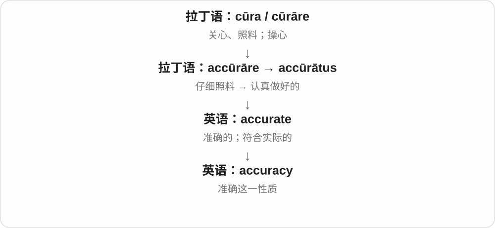
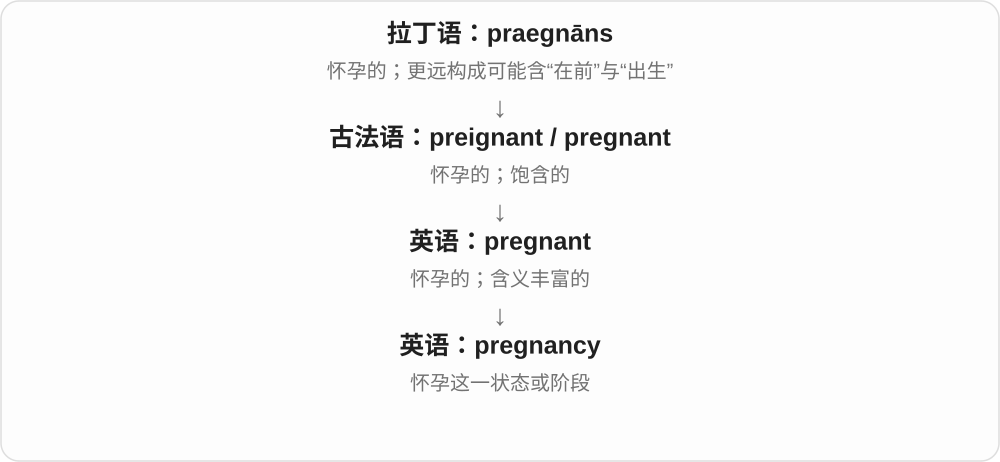
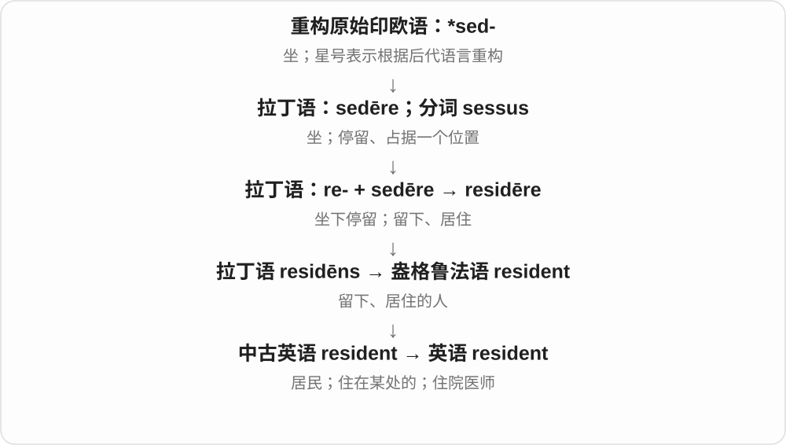
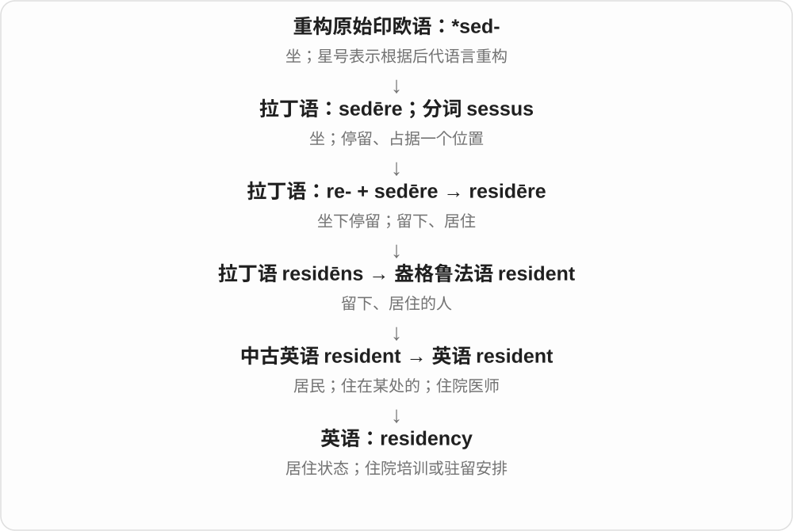
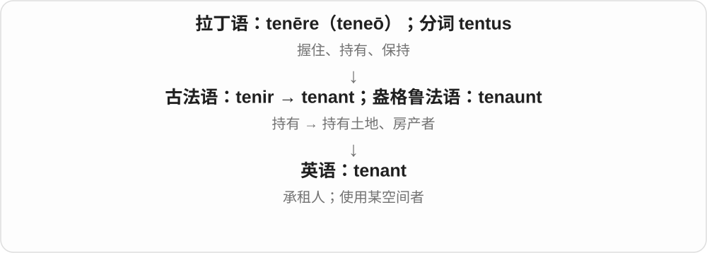
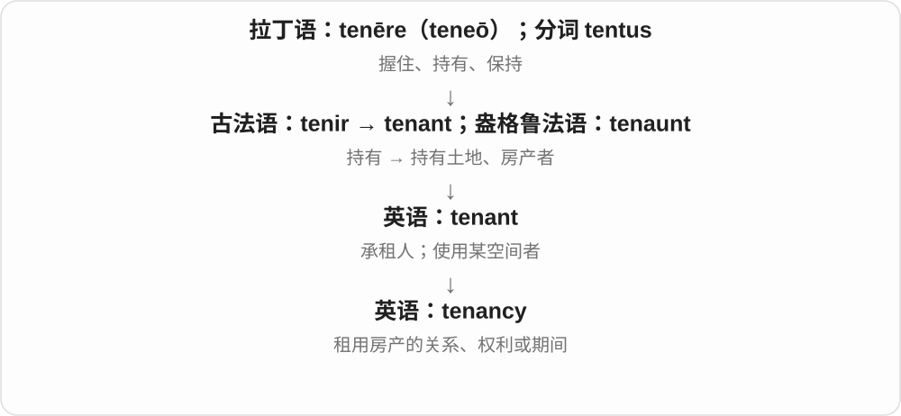
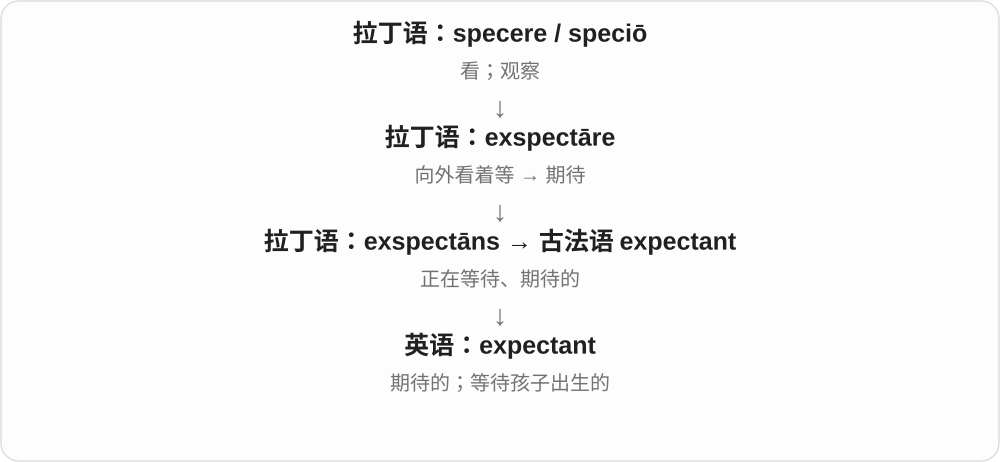
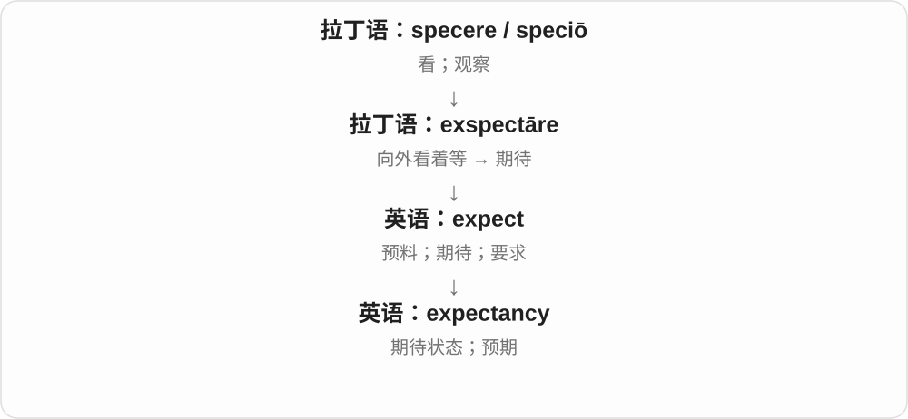

# 0216 · -cy — 性质、状态、行为；某些职位或任职期间

[逐词精讲目录](../00_逐词精讲目录.md) · [总目录](../00_总目录_按常用程度.md)

## 核心词根与来源

-cy 在英语中承接拉丁 -cia、-tia 等抽象名词词尾的材料，部分词经法语进入，和 -acy、-ancy、-ency 等形式有历史关系。最常见的学习对应有 efficient／efficiency、accurate／accuracy、resident／residency。它不只表示性质，也能命名 captaincy、chaplaincy 一类职务。

**CY：把某种情况或身份，拿出来作为一个名词**

efficient 说机器办事利落，efficiency 说它的效率；captain 是队长，captaincy 说队长职务。词尾把镜头从描述或人，移到状态、职务。

- **性质与程度**：efficient · efficiency；accurate · accuracy；fluent · fluency；deficient · deficiency
- **状态与行为**：pregnancy · expectancy · dependency · redundancy · truancy
- **居住和偿债情况**：residency · occupancy · tenancy；solvency · insolvency · bankruptcy
- **身份、职务及任期**：consultancy · captaincy · chaplain · chaplaincy · incumbent · incumbency
- **tenant → tenants：持有、使用空间的人**：tenant · tenants

## 词形与演化规律

-ent 常对应 -ency，-ant 常对应 -ancy；部分 -ate 形容词对应 -acy，如 accurate／accuracy。这是认形线索，不是见到任何英文词都能自由替换。许多词的借入历史不同；occupancy 对应 occupant，不能只按 occupation 职业猜义。

法语 tenir 的分词名词化，经盎格鲁法语借入。

## 单词速览（按词族由简到繁）

同一基础词的相关扩展放在一起，先读基础形式，再读扩展；各组之间优先读常用的。具体词源关系见各词讲解。

| 单词 | 音标 | 核心意思 |
|---|---|---|
| [recent](#w-43) | /ˈriːsənt/ | 最近的；新近的 |
| [recency](#w-42) | /ˈriːsənsi/ | 新近程度；距今远近 |
| [normal](#w-44) | 英 /ˈnɔːməl/；美 /ˈnɔːrməl/ | 正常的；通常的；垂直的；常态 |
| [normalcy](#w-26) | 英 /ˈnɔːməlsi/；美 /ˈnɔːrməlsi/ | 常态；正常状态 |
| [captain](#w-45) | /ˈkæptɪn/，也 /ˈkæptən/ | 队长；船长；机长；上尉等军衔；带领 |
| [captaincy](#w-22) | /ˈkæptənsi/ | 队长等的职位；任职期间；领导表现 |
| [emergency](#w-1) | 英 /ɪˈmɜːdʒənsi/；美 /ɪˈmɜːrdʒənsi/ | 紧急情况；突发急事 |
| [relevant](#w-46) | /ˈreləvənt/ | 相关的；切题的；适用的 |
| [relevancy](#w-28) | /ˈreləvənsi/ | 相关性；切题性 |
| [accurate](#w-47) | /ˈækjərət/ | 准确的；精确无误的 |
| [accuracy](#w-4) | /ˈækjərəsi/ | 准确性；准确度 |
| [pregnant](#w-48) | /ˈpreɡnənt/ | 怀孕的；意味深长的；充满的 |
| [pregnancy](#w-3) | /ˈpreɡnənsi/ | 怀孕；妊娠期 |
| [efficient](#w-49) | /ɪˈfɪʃənt/ | 效率高的 |
| [efficiency](#w-2) | /ɪˈfɪʃ.ən.si/ | 效率 |
| [decent](#w-50) | /ˈdiːsənt/ | 得体、体面的；像样、还不错的；厚道正派的 |
| [decency](#w-11) | /ˈdiːsənsi/ | 得体、体面；基本良知、礼貌、公德 |
| [resident](#w-51) | /ˈrezɪdənt/ | 居民；住在某处的；住院医师 |
| [residency](#w-8) | /ˈrezɪdənsi/ | 居住资格或状态；驻留项目；住院医师培训期 |
| [dependent](#w-52) | 英、美 /dɪˈpendənt/ | 依赖的；取决于……的；受供养的人 |
| [dependency](#w-10) | 英、美 /dɪˈpendənsi/ | 依赖；依赖关系；依赖项；属地 |
| [advocate](#w-53) | 名词 /ˈædvəkət/；动词 /ˈædvəkeɪt/ | 支持者；辩护者；提倡、支持 |
| [advocacy](#w-6) | /ˈædvəkəsi/ | 倡导；为人发声；辩护工作 |
| [bankrupt](#w-61) | /ˈbæŋkrʌpt/ | 破产的；破产者；使破产；彻底缺乏的 |
| [bankruptcy](#w-5) | /ˈbæŋkrʌptsi/ | 破产；彻底失败、匮乏〔比喻〕 |
| [transparent](#w-54) | 英 /trænsˈpærənt/；美 /trænsˈperənt/，亦读 /trænz-/ | 透明的；公开易查的；一眼能看穿的 |
| [transparency](#w-7) | 英 /trænsˈpærənsi/；美 /trænsˈperənsi/ | 透明度；公开透明；透明胶片、幻灯片 |
| [infant](#w-55) | /ˈɪnfənt/ | 婴儿；幼儿；初期的 |
| [infancy](#w-14) | /ˈɪnfənsi/ | 婴儿期；发展初期 |
| [occupy](#w-56) | 英 /ˈɒkjʊpaɪ/；美 /ˈɑːkjəpaɪ/ | 占用、占据；居住、使用；使忙于 |
| [tenant](#w-59) | /ˈtenənt/ | 房客；承租人；空间使用者 |
| [tenants](#w-72) | /ˈtenənts/ | 租户、承租人；租用单位〔复数〕 |
| [tenancy](#w-19) | /ˈtenənsi/ | 租赁关系；租期；租用权 |
| [consult](#w-57) | 动词 /kənˈsʌlt/；名词另读英 /ˈkɒnsʌlt/、美 /ˈkɑːnsʌlt/ | 请教；商议；查阅；一次咨询〔名词，尤美式〕 |
| [consultancy](#w-13) | /kənˈsʌltənsi/ | 咨询业务；顾问服务；咨询公司 |
| [inadequate](#w-58) | /ɪnˈædɪkwət/ | 不足的；不够合适、不胜任的 |
| [inadequacy](#w-27) | /ɪnˈædɪkwəsi/ | 不足；不胜任感；缺陷 |
| [incumbent](#w-60) | /ɪnˈkʌmbənt/ | 现任的；现任者；作为责任必须做的 |
| [incumbency](#w-35) | /ɪnˈkʌmbənsi/ | 在任；现任职位；任职期间 |
| [deficient](#w-66) | /dɪˈfɪʃənt/ | 不足的；缺乏某物的 |
| [deficiency](#w-9) | /dɪˈfɪʃənsi/ | 不足；缺乏；缺陷 |
| [redundant](#w-62) | /rɪˈdʌndənt/ | 多余的；重复不必要的；备用冗余的；被裁撤的 |
| [redundancy](#w-16) | /rɪˈdʌndənsi/ | 冗余；重复多余；岗位裁撤 |
| [fluent](#w-63) | /ˈfluːənt/ | 语言流利的；表达流畅的 |
| [fluency](#w-21) | /ˈfluːənsi/ | 流利程度；流畅性；熟练运用能力 |
| [expectant](#w-69) | /ɪkˈspektənt/ | 期待的；怀孕的；即将为人父母的 |
| [expectancy](#w-12) | /ɪkˈspektənsi/ | 期待；预期 |
| [solvent](#w-64) | 英 /ˈsɒlvənt/；美 /ˈsɑːlvənt/ | 有偿债能力的；溶剂 |
| [solvency](#w-29) | 英 /ˈsɒlvənsi/；美 /ˈsɑːlvənsi/ | 偿债能力；有清偿能力的状态 |
| [insolvent](#w-70) | 英 /ɪnˈsɒlvənt/；美 /ɪnˈsɑːlvənt/ | 无力偿债的；资不抵债的 |
| [insolvency](#w-18) | 英 /ɪnˈsɒlvənsi/；美 /ɪnˈsɑːlvənsi/ | 无力偿债；资不抵债等财务困境 |
| [chaplain](#w-65) | /ˈtʃæplɪn/ | 机构中的牧师、宗教关怀人员；随军牧师 |
| [chaplaincy](#w-34) | /ˈtʃæplɪnsi/ | chaplain 的职位、任期或服务工作 |
| [occupant](#w-67) | 英 /ˈɒkjəpənt/；美 /ˈɑːkjəpənt/ | 居住者；占用者；车内等的乘员 |
| [occupancy](#w-15) | 英 /ˈɒkjəpənsi/；美 /ˈɑːkjəpənsi/ | 居住、占用；入住情况 |
| [buoyant](#w-68) | 英 /ˈbɔɪənt/；美 /ˈbɔɪənt/、/ˈbuːjənt/ | 有浮力的；轻快乐观的；市场等旺盛的 |
| [buoyancy](#w-23) | /ˈbɔɪənsi/ | 浮力、浮性；轻快乐观、景气 |
| [numeracy](#w-31) | 英 /ˈnjuːmərəsi/；美 /ˈnuːmərəsi/ | 数字素养；基本计算与数字理解能力 |
| [truant](#w-71) | /ˈtruːənt/ | 逃学者；逃学、擅离职责的 |
| [truancy](#w-33) | /ˈtruːənsi/ | 逃学；旷课 |

## 逐词讲解

### 1. recent — 最近的；新近的

**音标**：/ˈriːsənt/

**先抓住这个画面**

从现在往回看，发生没多久；多久算最近，要看谈一封邮件还是一段历史。

**怎么拆**

借自拉丁语 recēns 新鲜、新近的，其变化词干 recent- 形成英语词形。现代按整个借词掌握，不必硬拆成今天的英语前后缀。

**怎么变成今天的意思**

**拉丁语 recēns，词干 recent-**  
新鲜的、新近的

↓

**英语 recent**  
最近的、近来发生的；距离现在不久

recent news 近期消息，in recent years 近年来。a recent graduate 最近毕业的人，不自动说明具体毕业了几个月。

**常见搭配与例句**

a recent study；in recent years；recent changes；a recent graduate。

> Have you read her most recent book?

你读过她最近那本书吗？

> There have been several changes in recent months.

最近几个月发生了几项变化。

**别混淆**

recent 说离现在不远，current 说当前正在存在、使用；一位 recent manager 可能是近来任职者，不一定就是 current manager 现任经理。

### 2. recency — 新近程度；距今远近

**音标**：/ˈriːsənsi/

**先抓住这个画面**

不是看事情发生多少次，而是看上一次发生离现在有多久。

**怎么拆**

recent 对应 -cy 性质名词，词末 t 不保留为 recency；表示新近这一性质或程度。

**怎么变成今天的意思**

**拉丁语 recēns，词干 recent-**  
新鲜的、新近的

↓

**英语 recent**  
最近的、近来发生的；距离现在不久

↓

**recent → recency**  
最近的 → 新近程度、距今远近

sort by recency 按新近程度排序；the recency of an update 更新距今多久。数据、分析、正式讨论中较常用。

**常见搭配与例句**

sort by recency；the recency of；frequency and recency。

> The list is sorted by recency, with the newest items first.

列表按新近程度排序，最新项目在前。

> The analysis compared the frequency and recency of purchases.

分析比较了购买频率与最近一次购买距今多久。

**别混淆**

recency 距今多久，frequency 发生多频繁；每天来过与最近一次来过，不是同一个指标。

### 3. normal — 正常的；通常的；垂直的；常态

**音标**：英 /ˈnɔːməl/；美 /ˈnɔːrməl/

**先抓住这个画面**

把现在的情形放到一把熟悉的尺子旁：如果落在平常会出现的范围里，就可说 normal。

**怎么拆**

来自拉丁 normalis，源于 norma“木工直角尺、准则”。现代可看作 norm + -al，但英语 normal 的记录早于英语名词 norm，不能据此倒写历史。

**怎么变成今天的意思**

**拉丁 norma**  
木工直角尺；由此指规则、标准

↓

**拉丁 normalis → 英语 normal**  
按直角尺的；合乎规则、常态的；几何中为垂直的

normal traffic 是平日的车流，back to normal 是恢复常态。几何里 normal to a surface 指垂直于表面在该点的切平面；这个“垂直”最接近木工直角尺的旧画面。normal school 的师范学校义另承法语 école normale“作为教学规范的学校”。

**常见搭配与例句**

under normal conditions；return to normal；a normal vector；normal school。

> The trains are running on a normal schedule again.

列车又按正常时刻表运行了。

> Draw a line normal to the surface at this point.

在这一点画一条垂直于表面的直线。

**别混淆**

normal 取决于所比较的情境；usual 强调平时常见。某事常见，不自动等于它理想或值得赞成。

### 4. normalcy — 常态；正常状态

**音标**：英 /ˈnɔːməlsi/；美 /ˈnɔːrməlsi/

**先抓住这个画面**

大事之后，人们想回到熟悉的日子：工作照常、商店开门、生活不用每天应急。

**怎么拆**

英语 normal + -cy。十九世纪已有记录，后来美国总统哈定在 1920 年的政治口号中推广了它，并非由他首次创造。

**怎么变成今天的意思**

**拉丁 norma**  
木工直角尺；由此指规则、标准

↓

**拉丁 normalis → 英语 normal**  
按直角尺的；合乎规则、常态的；几何中为垂直的

↓

**英语 normal + -cy → normalcy**  
正常状态；在美国英语中尤常见

return to normalcy 是常见搭配，含义通常与 return to normality 相同。它本身并不是“不标准英语”，也不专指某个政治时期。

**常见搭配与例句**

a return to normalcy；restore normalcy；a semblance of normalcy。

> The reopened cafés brought a little normalcy back to the street.

咖啡馆重新开门，给这条街带回了一点往日的生活气息。

> The family wanted some normalcy after months of moving.

搬来搬去几个月后，这家人希望日子能稳定下来。

**别混淆**

normalcy 较有美国英语色彩；normality 的使用地域更广，日常意思不必硬分。

### 5. captain — 队长；船长；机长；上尉等军衔；带领

**音标**：/ˈkæptɪn/，也 /ˈkæptən/

**先抓住这个画面**

captain 是一队人、一艘船或一架飞机里担任领头责任的人。

**怎么拆**

经古法语 capitaine，来自后期拉丁 capitaneus“首要的”；与 chieftain 是不同法语形式传下来的同源词。

**怎么变成今天的意思**

**拉丁语：caput；属格 capitis**  
头；首领；顶端、主要部分

↓

**后期拉丁 capitaneus → 古法语 capitaine**  
居首的 → 领队

↓

**中古英语 capitain / capteyn → 英语 captain**  
船长、队长；军衔名称

team captain 是队长；captain a team 是担任队长。军衔含义随军种变化：陆军 captain 常译上尉，海军常译上校，不能只背一个级别。

**常见搭配与例句**

the captain of；ship’s captain；captain the team。

> The captain checked the weather before leaving port.

船长出港前查看了天气。

> She captained the school team for two years.

她担任了两年校队队长。

**别混淆**

captain 是具体职务或军衔；chief 是更宽泛的负责人。

### 6. captaincy — 队长等的职位；任职期间；领导表现

**音标**：/ˈkæptənsi/

**先抓住这个画面**

队长本人是 captain；由谁当、当了多久、带队怎样，这个职位和任期就是 captaincy。

**怎么拆**

captain + -cy，英语职位或状态名词。

**怎么变成今天的意思**

**拉丁语：caput；属格 capitis**  
头；首领；顶端、主要部分

↓

**后期拉丁 capitaneus → 古法语 capitaine**  
居首的 → 领队

↓

**中古英语 capitain / capteyn → 英语 captain**  
船长、队长；军衔名称

↓

**英语：captain + -cy → captaincy**  
队长 → 队长职位、任期

take over the captaincy 是接任队长；under her captaincy 是在她带队期间。

**常见搭配与例句**

offer someone the captaincy；retain the captaincy。

> She accepted the captaincy at the start of the season.

赛季开始时，她接受了队长职位。

> The team improved under his captaincy.

在他带队期间，球队有了进步。

**别混淆**

captain 是人；captaincy 是这个人的职务或任期。

### 7. emergency — 紧急情况；突发急事

**音标**：英 /ɪˈmɜːdʒənsi/；美 /ɪˈmɜːrdʒənsi/

**先抓住这个画面**

事情突然冒出来，而且不能照原计划慢慢等，需要及时应对。

**怎么拆**

接拉丁 ēmergere“出现”、分词 ēmergēns 的词族；也按 emerge + -ency 分析。

**怎么变成今天的意思**

**拉丁 mergere，分词 mersus**  
浸入、沉下去

↓

**拉丁 ē- / ex-“出” + mergere → ēmergere**  
从浸没中出来、浮现

↓

**英语 emergency**  
突然出现的情况 → 需要立即应对的紧急情况

emergency exit 是紧急出口；an emergency meeting 是为紧急事项召开的会议。与 emergence 同根，但现代 emergency 已把重点放在情况的紧迫性。

**常见搭配与例句**

in an emergency；an emergency exit；emergency services。

> Keep the emergency exit clear.

请保持紧急出口畅通。

> The team held an emergency meeting that evening.

团队当晚召开了紧急会议。

**别混淆**

urgent 是形容事情急；emergency 是紧急情形本身。普通新情况可以 emerge，却未必构成 an emergency。

### 8. relevant — 相关的；切题的；适用的

**音标**：/ˈreləvənt/

**先抓住这个画面**

这条信息能帮我们处理眼前这件事，不是在旁边绕远路。

**怎么拆**

来自法语 relevant，经中古拉丁 relevans 接 relevare“减轻、帮助”；语义走向有帮助、与当前事项相联。

**怎么变成今天的意思**

**拉丁 levis → levare**  
轻 → 抬起、使负担减轻

↓

**拉丁 relevare → 中世纪拉丁 relevans**  
减轻负担、帮助 → 有帮助的

↓

**法语 relevant → 英语 relevant**  
与当前事情相联、适用的

relevant experience 是与当前工作要求相关的经验，不只是任何工作年限；a relevant example 是能说明眼前观点的例子。“帮得上眼前这件事”是好用的理解画面，但不是说任何有趣的信息都 relevant。

**常见搭配与例句**

relevant to；relevant information；relevant experience。

> Please include only experience relevant to this role.

请只写与这个职位相关的经历。

> That detail is interesting, but it is not relevant to the question.

那个细节很有趣，但与这个问题不相干。

**别混淆**

related 只要有联系；relevant 更常强调这种联系对当前话题或目的有用、切题。

### 9. relevancy — 相关性；切题性

**音标**：/ˈreləvənsi/

**先抓住这个画面**

同样是在问“这件材料跟我们正在谈的事搭得上吗”。

**怎么拆**

relevant 的 -ancy 名词形式；与 relevance 并存。

**怎么变成今天的意思**

**拉丁 levis → levare**  
轻 → 抬起、使负担减轻

↓

**拉丁 relevare → 中世纪拉丁 relevans**  
减轻负担、帮助 → 有帮助的

↓

**法语 relevant → 英语 relevant**  
与当前事情相联、适用的

↓

**英语 relevancy**  
相关、适用这一性质的另一名词形式

relevancy 与 relevance 大体同义，在一些法律或技术表达里较常见。日常和一般学术写作通常更容易遇到 relevance，不必硬给两词分配完全不同的中文意思。

**常见搭配与例句**

the relevancy of evidence；relevancy to a topic。

> The editor questioned the relevancy of the final paragraph.

编辑质疑最后一段与文章主题的关联。

> The discussion focused on the relevancy of the evidence.

讨论重点是这些证据是否与所谈问题相关。

**别混淆**

relevance 与 relevancy 是近义名词变体；relevancy 不是“更高一级的相关性”。

### 10. accurate — 准确的；精确无误的

**音标**：/ˈækjərət/

**先抓住这个画面**

地图画的位置、记录写的数字，和实际能对得上，就是 accurate。

**怎么拆**

来自拉丁语 accūrātus“认真处理好的”，ad- 在 c 前同化为 ac-，后接 cūrāre“照料、用心处理”。

**怎么变成今天的意思**

仔细做事容易做得正确，词义于是从认真细致转向结果准确。它评价的是与事实或目标符合，不是仅看小数点很多。

**常见搭配与例句**

accurate information；an accurate description；accurate measurements。

> The map gives an accurate picture of the coastline.

这张地图准确地描绘了海岸线。

> We need accurate figures before making a decision.

作决定前，我们需要准确的数字。

**别混淆**

precise 强调细致、精密或重复一致；accurate 强调对得准。测量数值很细，也可能整体偏离真实值。

### 11. accuracy — 准确性；准确度

**音标**：/ˈækjərəsi/

**先抓住这个画面**

不是问说得多漂亮，而是问结果与真实值、原文或目标差多少，这个质量叫 accuracy。

**怎么拆**

accurate + -cy；词尾调整后形成 accuracy。

**怎么变成今天的意思**

它把具体“准不准”变成可比较的指标。翻译、射击、记录、测量都能谈 accuracy，但衡量方式不同。

**常见搭配与例句**

check for accuracy；improve accuracy；the accuracy of a report。

> The editor checked the names for accuracy.

编辑核查了姓名是否准确。

> Practice improved the accuracy of her throws.

练习提高了她投掷的准确度。

**别混淆**

accuracy 不等于 detail“细节多”。内容很详细，仍可能处处不准。

### 12. pregnant — 怀孕的；意味深长的；充满的

**音标**：/ˈpreɡnənt/

**先抓住这个画面**

pregnant 的直接画面是正在孕育新生命；比喻用法像一句话里藏着还没展开的许多意思。

**怎么拆**

来自拉丁语 praegnāns，经法语传入；更远的构成通常联系 prae- 与古形 *gnāscī，但这一步保留“可能”。

**怎么变成今天的意思**

孕育着东西的画面可帮助理解 pregnant with meaning。某些旧有“有说服力”义的来源存在混合解释，不把一切硬拉成单线。

**常见搭配与例句**

be pregnant；pregnant with possibility；a pregnant pause。

> She announced that she was pregnant.

她宣布自己怀孕了。

> A pregnant pause followed his question.

他的问题之后，出现了一阵意味深长的沉默。

**别混淆**

pregnant pause 不是怀孕者停顿，而是充满意味、让人等待下文的沉默。

### 13. pregnancy — 怀孕；妊娠期

**音标**：/ˈpreɡnənsi/

**先抓住这个画面**

pregnancy 把“正在孕育生命”作为一个状态或阶段来谈，而不是形容某个人。

**怎么拆**

pregnant 去掉结尾 -t，与名词后缀 -cy 对应，形成 pregnancy。

**怎么变成今天的意思**

可以说 during pregnancy，也可以把一次妊娠经历作为可数事件。具体健康问题不能只从词的定义判断。

**常见搭配与例句**

during pregnancy；early pregnancy；announce a pregnancy。

> She kept a journal during her pregnancy.

她怀孕期间一直写日记。

> They shared the news of the pregnancy with their family.

他们把怀孕的消息告诉了家人。

**别混淆**

pregnant 是形容词，pregnancy 是名词：she is pregnant；her pregnancy。

### 14. efficient — 效率高的

**音标**：/ɪˈfɪʃənt/

**先抓住这个画面**

同样洗好一堆衣服，一台机器用更少的水和电：它更 efficient。画面是用较少投入把事情做好。

**怎么拆**

ex- + facere 形成 efficere，efficiens 本指产生作用的；英语后来突出投入与产出的关系。

**怎么变成今天的意思**

从能产生结果，收窄为不白费力气、时间和资源。它可以说人、机器，也可以说整个流程。

**常见搭配与例句**

an efficient system；efficient use of energy；highly efficient。

> This route is the most efficient way to deliver the parcels.

这条路线配送包裹最省时省力。

> The new heater is more energy efficient.

新取暖器更节能。

**别混淆**

effective 是达到目标，efficient 是达到目标时少浪费；两个维度可以分别评价。

### 15. efficiency — 效率

**音标**：/ɪˈfɪʃ.ən.si/

**先抓住这个画面**

efficiency 像一笔投入产出账：用了多少时间、精力和资源，换来多少有效成果。

**怎么拆**

英语借入拉丁语 efficientia；现代可与 efficient 对照，-ent 形容词常对应 -ency 名词。

**怎么变成今天的意思**

形容一台机器 efficient，是评价它；谈 its efficiency，则把这种表现变成可比较的指标。

**常见搭配与例句**

improve efficiency；energy efficiency；operational efficiency。

> Better scheduling improved the team’s efficiency.

更好的排期提高了团队效率。

> The label shows the machine’s energy efficiency.

标签标明了机器的能源效率。

**别混淆**

speed 只看快慢；efficiency 还看成本和浪费，快但返工多未必有效率。

### 16. decent — 得体、体面的；像样、还不错的；厚道正派的

**音标**：/ˈdiːsənt/

**先抓住这个画面**

达到该有的基本标准：住处像样、人做事不亏待别人、衣着足以见客。说 decent 往往是过得去到不错，不必夸顶级。

**怎么拆**

经法语或直接接拉丁 decēns，来自适合、合宜的 decēre。现代不拆成 de- 去掉 + cent 分币。

**怎么变成今天的意思**

**拉丁 decēre → decēns**  
适合、合宜 → 得体、合乎标准的

↓

**法语 décent → 英语 decent**  
体面、合宜 → 过得去、像样；人品厚道

a decent meal 像样的一餐，a decent salary 不错的工资，a decent person 厚道人；Are you decent? 可问穿好衣服、方便见人了吗。

**常见搭配与例句**

a decent meal；a decent salary；a decent person；Are you decent?。

> We finally found a decent place to stay.

我们终于找到了像样的住处。

> It was decent of you to help without being asked.

不用人开口你就来帮忙，真够厚道。

**别混淆**

decent /ˈdiːsənt/ 与 descent /dɪˈsent/ 下降、dissent /dɪˈsent/ 异议，重音、拼写和词源不同。

### 17. decency — 得体、体面；基本良知、礼貌、公德

**音标**：/ˈdiːsənsi/

**先抓住这个画面**

哪怕关系不好，至少别让人难堪、别做太过分的事；have the decency to apologize 是说连道歉这点起码礼貌也该有。

**怎么拆**

接拉丁 decentia 等相应名词，和 decent 同族；现代对应 decent + -cy，词尾 -t 对应名词 -cy，并非在完整 decent 后再原样拼 cy。

**怎么变成今天的意思**

**拉丁 decēre → decēns**  
适合、合宜 → 得体、合乎标准的

↓

**法语 décent → 英语 decent**  
体面、合宜 → 过得去、像样；人品厚道

↓

**拉丁 decentia → decency**  
合宜、得体的性质；基本道德和礼貌标准

common decency 基本公德，have the decency to 至少有礼貌去……，a sense of decency 正派感、礼义感。

**常见搭配与例句**

common decency；have the decency to；a sense of decency。

> He did not even have the decency to apologize.

他连道歉这点起码的礼貌都没有。

> Common decency should guide how we treat strangers.

我们对待陌生人应遵守基本公德。

**别混淆**

decency 抽象礼义、得体，decent 形容符合标准；decency 不只是穿戴好看，也能说怎样对人。

### 18. resident — 居民；住在某处的；住院医师

**音标**：/ˈrezɪdənt/

**先抓住这个画面**

resident 是在某处住着、持续待在那里的人，像把生活的落脚点安在这里。

**怎么拆**

拉丁 residēns 是 residēre“留下居住”的现在分词，经盎格鲁法语和中古英语借入；现代可对应 reside + -ent。

**怎么变成今天的意思**

local residents 是当地居民；resident in a town 是居住在城里。医疗语境中 a resident 通常是接受毕业后临床培训的医生，历史名称与过去住在医院有关。

**常见搭配与例句**

local residents；a permanent resident；resident in；a medical resident。

> Local residents asked for a safer crossing.

当地居民要求设置更安全的过街通道。

> The resident discussed the case with a senior doctor.

这位住院医师与资深医生讨论了病例。

**别混淆**

visitor 是来访者；resident 是在此居住的人，是否永久居住要看修饰语和具体制度。

### 19. residency — 居住资格或状态；驻留项目；住院医师培训期

**音标**：/ˈrezɪdənsi/

**先抓住这个画面**

residency 像被允许或安排在一个地方持续待上一段时间，可能为了生活，也可能为了培训或创作。

**怎么拆**

英语 reside + -ency 或 resident + -cy 的派生分析；没有必要虚构一个后来的拉丁借入环节。

**怎么变成今天的意思**

medical residency 是医生毕业后的住院培训；an artist residency 是艺术家驻留项目。residency requirements 是关于居住资格的条件。

**常见搭配与例句**

complete a residency；an artist residency；residency requirements。

> She completed her residency at a teaching hospital.

她在一家教学医院完成了住院医师培训。

> The writer spent three months on an artist residency.

这位作家参加了三个月的艺术家驻留项目。

**别混淆**

residence 可具体指住所；residency 更常说资格、状态或在机构中的一段驻留安排。

### 20. dependent — 依赖的；取决于……的；受供养的人

**音标**：英、美 /dɪˈpendənt/

**先抓住这个画面**

自己还不能完全支撑自己，或某个结果必须跟着另一个条件走。

**怎么拆**

接法语 dependant、拉丁 dependens／dependent- 的分词形容词路线，不是必须先有英语 depend 再加 -ent。名词的英式拼法常是 dependant，美式通常也用 dependent。

**怎么变成今天的意思**

**拉丁 pendēre；相关动词 pendere**  
悬垂；使悬挂、称量

↓

**拉丁 dependere 的分词 dependens；法语 dependant**  
依附、依赖的

↓

**英语 dependent／名词也拼 dependant**  
需要依靠的；受供养的人

be dependent on imports 是依赖进口；a dependent child 是经济上需要供养的孩子。数学里的 dependent variable 是因变量，也沿用“值取决于其他量”的关系。

**常见搭配与例句**

dependent on；financially dependent；dependent children；a dependent variable。

> The island is dependent on imported fuel.

这座岛依赖进口燃料。

> The form asks how many dependents live with the applicant.

表格询问有多少受供养者与申请人同住。

**别混淆**

dependable 是别人可以依靠的，dependent 是自己需要依靠的：一个人可以同时对某些资源 dependent，又在工作中很 dependable。

### 21. dependency — 依赖；依赖关系；依赖项；属地

**音标**：英、美 /dɪˈpendənsi/

**先抓住这个画面**

要让 A 运作，先得有 B：B 就可能是 A 的一个依赖项。这比笼统说“依赖”更容易数出具体的连接。

**怎么拆**

英语依 dependent 配出 -cy 名词，早期有受法语拼写影响的 dependancy；现代 dependency 成为常见形式。其软件义是后来的应用，不是古拉丁专门术语。

**怎么变成今天的意思**

**拉丁 pendēre；相关动词 pendere**  
悬垂；使悬挂、称量

↓

**拉丁 dependere 的分词 dependens；法语 dependant**  
依附、依赖的

↓

**英语 dependent／名词也拼 dependant**  
需要依靠的；受供养的人

↓

**英语 dependent → dependency**  
依赖状态；进一步指依赖的事物或附属地区

↓

**现代技术用法**  
完成任务或运行程序所需的前提、组件

软件说 install the dependencies，是安装程序需要的组件。项目说 a task dependency，是任务之间的先后或前提关系。历史、地理语境的 a dependency 则可指受另一国管辖的属地。

**常见搭配与例句**

software dependencies；a dependency on；a task dependency；resolve a dependency。

> The application cannot start because a required dependency is missing.

应用无法启动，因为缺少一个必要的依赖组件。

> The project plan shows the dependencies between tasks.

项目计划展示了任务之间的依赖关系。

**别混淆**

dependence 常说依赖这种状态；dependency 也能数成 one dependency、several dependencies。别把所有 dependency 都译成成瘾。

### 22. advocate — 支持者；辩护者；提倡、支持

**音标**：名词 /ˈædvəkət/；动词 /ˈædvəkeɪt/

**先抓住这个画面**

有人遇到困难，叫来一位能替他讲话的人；从“被叫来帮忙的人”，就能理解为人辩护、为主张发声。

**怎么拆**

名词经古法语 avocat 接拉丁 advocatus，它是 advocare 的过去分词名词化。英语动词可分析为名词转用，也有直接接拉丁分词的分析。

**怎么变成今天的意思**

**拉丁 vocare**  
呼唤、叫来、称呼；与 vox“声音”同族

↓

**拉丁 ad- 向、到 + vocare → advocare**  
叫到身边来，召来帮助

↓

**拉丁 advocatus → 古法语 avocat → 英语 advocate 名词**  
被叫来援助的人 → 辩护者、支持者

↓

**英语 advocate 动词：名词转用，或直接联系拉丁分词**  
公开支持、提倡

an advocate for children 替儿童权益发声；advocate change 提倡改变，advocate doing something 主张某种做法。名词和动词的结尾读音不同；法律职业义还要看所在制度。

**常见搭配与例句**

an advocate for reform；advocate change；advocate reducing waste。

> She became an advocate for students who needed extra support.

她成了需要额外支持的学生的代言人。

> The report advocates reducing unnecessary paperwork.

报告主张减少不必要的文书工作。

**别混淆**

support 可以是安静支持或实际帮忙；advocate 通常更强调站出来表达理由、推动主张。

### 23. advocacy — 倡导；为人发声；辩护工作

**音标**：/ˈædvəkəsi/

**先抓住这个画面**

不是单说“我赞成”，而是持续讲理由、争取关注，让某种需要或主张进入决策者的视野。

**怎么拆**

经古法语 avocacie 接中世纪拉丁 advocatia，与 advocare、advocatus 同族。名词有独立借入路线，并非英语 advocate 动词出现后才加 -cy。

**怎么变成今天的意思**

**拉丁 vocare**  
呼唤、叫来、称呼；与 vox“声音”同族

↓

**拉丁 ad- 向、到 + vocare → advocare**  
叫到身边来，召来帮助

↓

**拉丁 advocat- → 中世纪拉丁 advocatia → 古法语 avocacie**  
辩护、援助者的职务与活动

↓

**中古英语 advocacy → 现代英语 advocacy**  
支持、倡导、为他人利益发声

patient advocacy 是帮助病人表达需求、维护利益的工作；advocacy group 为某类议题或人群发声。它描述活动，不是人；人是 advocate。

**常见搭配与例句**

advocacy for equal access；an advocacy group；patient advocacy。

> Her advocacy helped make the station more accessible.

她持续的倡导推动了车站无障碍设施的改善。

> The organization provides advocacy for families seeking support.

这个组织帮助寻求支持的家庭表达需求、争取权益。

**别混淆**

advocacy 以支持某个立场或群体为方向；research 本身是研究，不一定承担倡导立场。

### 24. bankrupt — 破产的；破产者；使破产；彻底缺乏的

**音标**：/ˈbæŋkrʌpt/

**先抓住这个画面**

财力撑不住债务，也可比喻某方面已经空了。

**怎么拆**

接意大利 banca rotta／bancarotta，字面是破掉的钱商柜台；英语把后半部分按拉丁 rupt- 调整。旧时一定要砸烂柜台的故事并不宜当成确定史实，可能本来就是比喻。

**怎么变成今天的意思**

**拉丁 rumpere；完成分词 ruptus**  
打破、断裂；被打破的

↓

**意大利 banca rotta／bancarotta**  
破掉的钱商柜台；破产

↓

**英语 bankrupt，词尾按拉丁 rupt- 调整**  
破产的人；破产的；使破产

go bankrupt 是破产；bankrupt a company 是使公司破产。morally bankrupt 则批评道德上彻底失去原则，不是在讨论银行账户。词根里的破裂是历史形象，现代用法要看财务或比喻语境。

**常见搭配与例句**

go bankrupt；be declared bankrupt；bankrupt a business；morally bankrupt。

> The fictional company went bankrupt after years of mounting debts.

小说中的公司在债务连年增长后破产了。

> The critic described the proposal as morally bankrupt.

评论者批评这项提议在道德上毫无立足之地。

**别混淆**

bankrupt 不等于暂时没带钱；broke 在口语中可以只是手头拮据。正式破产还有具体制度含义，不能仅凭一次亏损就套用。

### 25. bankruptcy — 破产；彻底失败、匮乏〔比喻〕

**音标**：/ˈbæŋkrʌptsi/

**先抓住这个画面**

把偿债能力撑不住的状态或相关程序作为一件事来谈。

**怎么拆**

bankrupt + -cy，可能参照 insolvency 等状态名词形成；不是英语 bank + 一个独立的 ruptcy。

**怎么变成今天的意思**

**拉丁 rumpere；完成分词 ruptus**  
打破、断裂；被打破的

↓

**意大利 banca rotta／bancarotta**  
破掉的钱商柜台；破产

↓

**英语 bankrupt，词尾按拉丁 rupt- 调整**  
破产的人；破产的；使破产

↓

**英语 bankrupt + -cy → bankruptcy**  
破产状态、过程；比喻性的彻底失败

file for bankruptcy 是提出破产申请；the bankruptcy of an argument 是说一套论证彻底站不住脚。日常理解先抓“已经支撑不下去”，再看是否在正式法律语境。

**常见搭配与例句**

file for bankruptcy；face bankruptcy；bankruptcy proceedings；moral bankruptcy。

> The novel follows the family through the firm’s bankruptcy.

小说写了这家人在公司破产期间的经历。

> The essay exposes the intellectual bankruptcy of the argument.

文章揭示了那套论证在思想上的空洞无力。

**别混淆**

bankrupt 是形容词、动词或指人的名词；bankruptcy 是状态、事件或程序名词。具体程序不等同于所有财务困难。

### 26. transparent — 透明的；公开易查的；一眼能看穿的

**音标**：英 /trænsˈpærənt/；美 /trænsˈperənt/，亦读 /trænz-/

**先抓住这个画面**

隔着一层东西，仍能清楚看见后面；用来讲事情，就是过程和目的没有藏在黑箱里。

**怎么拆**

中世纪拉丁 transparens 是 transparere“透出来”的分词，来自 trans- + parere“显现”。整体借入英语，不是英语 parent 加 trans-。

**怎么变成今天的意思**

**拉丁 trans／trans-**  
越过、穿过；在另一边

↓

**中世纪拉丁 trans- + parere → transparere**  
从另一边显露出来；透光

↓

**中世纪拉丁 transparens／transparent- → 英语 transparent**  
透明的；后来也说信息公开、意图明显

transparent glass 让你看清后面的形状；a transparent process 让人知道事情怎样决定；a transparent excuse 却是借口太明显，一眼就能识破。计算机中 transparent to users 可指后台完成，用户无需感知操作细节。

**常见搭配与例句**

transparent glass；a transparent process；a transparent excuse；transparent to users。

> The transparent lid lets you check the food without opening the box.

透明盖子让你不用开盒就能查看食物。

> The selection process should be transparent to all applicants.

选拔过程应当向所有申请人公开清楚。

**别混淆**

translucent 是透光但未必能看清后面，磨砂玻璃可如此；opaque 是不透明。

### 27. transparency — 透明度；公开透明；透明胶片、幻灯片

**音标**：英 /trænsˈpærənsi/；美 /trænsˈperənsi/

**先抓住这个画面**

把“看不看得透”当成一种性质来衡量；材料看透的是物体，机构看透的是规则和决策。

**怎么拆**

中世纪拉丁 transparentia 借入英语；现代对应 transparent 的 -ent 换成 -ency。保留独立名词借入路线，不只按英语后缀倒推历史。

**怎么变成今天的意思**

**拉丁 trans／trans-**  
越过、穿过；在另一边

↓

**中世纪拉丁 transparere → transparens → transparentia**  
透出来 → 透明的 → 透明性质

↓

**英语 transparency**  
透明度；公开可查；可透光观看的图像胶片

a lack of transparency 常批评决定怎样作出不清楚。图像软件里透明度控制背景显露多少；老式投影设备使用的 a transparency 则是一张透明胶片，是可数名词。

**常见搭配与例句**

improve transparency；financial transparency；a transparency for a projector。

> The report calls for greater transparency in the selection process.

报告要求选拔过程更加透明。

> She placed a transparency on the overhead projector.

她把一张透明胶片放到高射投影仪上。

**别混淆**

clarity 可泛指表达或图像清晰；transparency 强调能看穿材料，或能查看事情背后的信息。

### 28. infant — 婴儿；幼儿；初期的

**音标**：/ˈɪnfənt/

**先抓住这个画面**

最初的画面是一个还不会说话的小孩子。

**怎么拆**

拉丁 in-“不” + fāns“正在说话的”组成 īnfāns，词形 īnfant- 进入英语。这里的 in- 不是“里面”。

**怎么变成今天的意思**

**拉丁 fārī**  
说、讲

↓

**拉丁 in- + fāns → īnfāns〔宾格 īnfantem〕**  
不 + 正在说话的 → 还不会说话的孩子

↓

**中古英语 infaunt → 英语 infant**  
婴儿、幼儿

日常指很小的孩子；具体年龄范围会随医疗、法律或学校语境变化。an infant industry 则把新兴行业比作刚开始成长的孩子，并不是行业真的不会讲话。

**常见搭配与例句**

an infant’s sleep；infant care；an infant industry。

> The infant slept in a cot beside the bed.

婴儿睡在床边的小床里。

> The report discusses support for an infant industry.

报告讨论了对一个新兴产业的支持。

**别混淆**

baby 日常范围更灵活；infant 比较正式。词源的“不会说话”帮助记忆，但不是现代判断年龄的唯一标准。

### 29. infancy — 婴儿期；发展初期

**音标**：/ˈɪnfənsi/

**先抓住这个画面**

像婴儿一样，已经开始存在，但还处在很早的成长阶段。

**怎么拆**

中古英语 infancie 接拉丁 īnfantia；现代可对应 infant + -cy，不能只按英语新派生画历史。

**怎么变成今天的意思**

**拉丁 fārī**  
说、讲

↓

**拉丁 in- + fāns → īnfāns〔宾格 īnfantem〕**  
不 + 正在说话的 → 还不会说话的孩子

↓

**拉丁 īnfantia → 中古英语 infancie → 英语 infancy**  
幼小的阶段；引申为事物的发展早期

in its infancy 特别常用来形容技术、项目或学科尚未成熟。它不等于“毫无价值”，只是现阶段还早，能力和规则可能都在形成。

**常见搭配与例句**

during infancy；from infancy；a technology in its infancy。

> The photographs show her brother from infancy to adolescence.

这些照片记录了她弟弟从婴儿期到青春期的成长。

> Research into the material is still in its infancy.

对这种材料的研究还处于起步阶段。

**别混淆**

childhood 范围比 infancy 广；early stage 是更中性的早期表达，不带婴儿成长的比喻。

### 30. occupy — 占用、占据；居住、使用；使忙于

**音标**：英 /ˈɒkjʊpaɪ/；美 /ˈɑːkjəpaɪ/

**先抓住这个画面**

椅子上有人，空间被占；一天全在开会，时间被占；一件事让你不停地想，注意力也被占。这个占住就是 occupy 的核心。

**怎么拆**

经法语 occuper 接拉丁 occupare，关联 ob- 与 capere 拿、抓的材料，拉丁词干在组合中改变。过去式 occupied 把 y 改 i 再加 -ed。

**怎么变成今天的意思**

**拉丁 ob- + capere 拿住的材料 → occupare**  
占住、抓住；组合后词干发生变化

↓

**法语 occuper → 英语 occupy → occupied 等**  
占空间、时间、注意力；处于被占用的状态

occupy a room 占用、使用房间；occupy time 占时间；occupy someone’s thoughts 占据某人心思；occupy territory 占领地区。

**常见搭配与例句**

occupy a room；occupy someone’s thoughts。

> The desk occupies most of the room.

桌子占了房间的大部分空间。

> The question occupied her thoughts all afternoon.

整个下午，她脑子里都在想那个问题。

**别混淆**

occupy 是占着、使用的状态或动作，own 是拥有产权；租客可以 occupy 一间房而不 own 它。

### 31. tenant — 房客；承租人；空间使用者

**音标**：/ˈtenənt/

**先抓住这个画面**

tenant 是实际住着、用着某个地方的人，现代最常见的是租房或租用商铺的一方。

**怎么拆**

来自法语 tenant，原为 tenir“持有”的现在分词；经盎格鲁法语进入英语。

**怎么变成今天的意思**

老意思是土地或空间的持有者，现代并不因此等于房产所有者。软件里的 tenant 借指共享系统中的一组独立客户。

**常见搭配与例句**

a tenant of the building；a commercial tenant；landlord and tenant。

> The tenant reported a leak in the kitchen.

房客报告厨房有漏水。

> The shop has had the same tenant for ten years.

这间店铺已经由同一位租户租用了十年。

**别混淆**

landlord 出租房产；tenant 租用房产。resident 只说居住者，不一定存在租赁关系。

### 32. tenants — 租户、承租人；租用单位〔复数〕

**音标**：/ˈtenənts/

**先抓住这个画面**

不是拥有房地本身，而是按约定占用、使用它的人或机构，常叫 tenants。可以住在里面，也可以在那里开店、办公。

**怎么拆**

tenant 经盎格鲁法语 tenaunt 接法语 tenir 持有的分词 tenant，较早拉丁 tenere。持有土地、使用空间的人发展出承租义。现代加复数 -s，尾 /nts/。

**怎么变成今天的意思**

**拉丁 tenere → 法语 tenir、tenant → 英语 tenant**  
持有 → 持有、使用房地者 → 承租人

↓

**tenant + -s → tenants**  
多位租户、多个租用单位

new tenants 新租户；tenants in the building 楼里的租户；commercial tenants 商业租户。

**常见搭配与例句**

the previous tenants 上一批租户；tenants sharing a house 合租房屋的人。

> The new tenants moved in on Monday.

新租户星期一搬了进来。

> The building has several small businesses as tenants.

这栋楼的租户包括几家小企业。

**别混淆**

tenants 不必都是住户，公司租办公室也能是 tenant。landlord 是出租方，两词按租赁关系的不同位置来辨认。

### 33. tenancy — 租赁关系；租期；租用权

**音标**：/ˈtenənsi/

**先抓住这个画面**

tenancy 像 tenant 与房屋之间那段被允许租用的关系，既包括租用资格，也常指这段租期。

**怎么拆**

tenant + -cy，表示承租者的状态、关系。

**怎么变成今天的意思**

用在租房和商用物业话题中。单词本身不规定合同长度、续租办法或任何地区的具体法律。

**常见搭配与例句**

a tenancy agreement；a fixed-term tenancy；end a tenancy。

> The tenancy begins on the first of June.

租期从六月一日开始。

> Both parties signed the tenancy agreement.

双方签署了租赁协议。

**别混淆**

tenant 是人；tenancy 是关系或期间；rent 常是租金或租用动作。

### 34. consult — 请教；商议；查阅；一次咨询〔名词，尤美式〕

**音标**：动词 /kənˈsʌlt/；名词另读英 /ˈkɒnsʌlt/、美 /ˈkɑːnsʌlt/

**先抓住这个画面**

自己还不够确定，就把人或资料请进判断过程：问专家、和同事商量、翻手册，都可以 consult。

**怎么拆**

借法语 consulter，接拉丁 consultare，是 consulere“商议、考虑”的反复或加强形式。consulere 更早常解释为召集商量，但不把未确定的远源当成现成英语拆分。

**怎么变成今天的意思**

**拉丁 consulere → consultare**  
商议、考虑 → 征求意见、商量

↓

**法语 consulter → 英语 consult**  
请教、商议；查阅

↓

**英语 consult〔名词用法〕**  
一次咨询，尤其专业会面

consult a person 是向某人请教；consult with a person 强调和对方商量；consult a source 是查资料。通常不说 consult to someone。

**常见搭配与例句**

consult an expert；consult with colleagues；consult the manual。

> Please consult the manual before changing these settings.

更改这些设置前，请查阅手册。

> The manager consulted with the team about the new schedule.

经理就新时间表和团队进行了商量。

**别混淆**

ask 可以只问一条消息；consult 往往为了获得意见或依据，再作判断。

### 35. consultancy — 咨询业务；顾问服务；咨询公司

**音标**：/kənˈsʌltənsi/

**先抓住这个画面**

把替别人分析问题、提供建议当作一种专业服务；也可以指经营这种服务的机构。

**怎么拆**

英语 consultant 的 -ant 换成 -ancy，或分析为 consult + -ancy；都是现代英语中的性质、业务名词构成。

**怎么变成今天的意思**

**拉丁 consulere → consultare**  
商议、考虑 → 征求意见、商量

↓

**法语 consulter → 英语 consult → consultant**  
请教 → 提供专业意见的人

↓

**英语 consultancy**  
顾问工作、咨询服务或咨询机构

做咨询业务用不可数 consultancy；一家机构可说 a consultancy。它卖的主要是知识和建议，未必替客户执行每一步。

**常见搭配与例句**

management consultancy；provide consultancy；a small consultancy。

> After leaving the company, she moved into consultancy.

离开公司后，她转行从事咨询工作。

> A local consultancy helped us assess the proposal.

一家当地咨询公司帮我们评估了这份提案。

**别混淆**

consultation 是一次咨询或咨询过程；consultancy 更常指这一行的业务、服务或公司。

### 36. inadequate — 不足的；不够合适、不胜任的

**音标**：/ɪnˈædɪkwət/

**先抓住这个画面**

不是完全没有，而是拿现有的量、能力、质量去对要求，仍差一截，就叫 inadequate。a map can be inadequate 是地图信息不够应付用途，不是它不漂亮。

**怎么拆**

in- 否定 + adequate，后者上接拉丁语使相等、相称的材料。否定足够、适配形成数量、质量、能力不足。

**怎么变成今天的意思**

**in- 否定 + adequate 足够、合适 → inadequate**  
不够应付相应要求，数量或质量都可能不足

↓

**inadequate → inadequately、inadequacy**  
做得不够充分；不足性质、具体缺陷

inadequate information 信息不足；inadequate for 不足以应付；inadequate preparation 准备不充分。

**常见搭配与例句**

inadequate for；inadequate information。

> The lighting was inadequate for detailed work.

这光线不足以做精细工作。

> The report was based on inadequate information.

报告依据的信息不充分。

**别混淆**

inadequate 依据具体要求判断；少量未必 inadequate，要求很高时很多也可能不够。

### 37. inadequacy — 不足；不胜任感；缺陷

**音标**：/ɪnˈædɪkwəsi/

**先抓住这个画面**

把达不到要求的那份不足单独拿出来，是 inadequacy。复数 inadequacies 常能数出具体短处；a feeling of inadequacy 则是主观觉得自己不够好，不自动说明实际能力真的差。

**怎么拆**

可对应 in- + adequacy，也可看 inadequate 的 -acy 名词形式。与 inadequate 相互对应，命名不足性质或具体缺陷。

**怎么变成今天的意思**

**in- 否定 + adequate 足够、合适 → inadequate**  
不够应付相应要求，数量或质量都可能不足

↓

**in- + adequacy／inadequate 的名词对应 → inadequacy**  
不足性质；具体短处；主观不胜任感

the inadequacy of the system 系统的不足；expose inadequacies 暴露缺陷；feelings of inadequacy 不够好的感觉。

**常见搭配与例句**

the inadequacy of；feelings of inadequacy。

> The review exposed several inadequacies in the system.

审查暴露了系统的几处缺陷。

> She wrote openly about her feelings of inadequacy.

她坦诚写下了自己总觉得不够好的感受。

**别混淆**

inadequacy 可客观说系统缺陷，也可主观说自我感受；不能把一种感受直接当作能力事实。

### 38. incumbent — 现任的；现任者；作为责任必须做的

**音标**：/ɪnˈkʌmbənt/

**先抓住这个画面**

选举报道中的 the incumbent 是已经坐在那个职位上的人；it is incumbent on you 则是说责任落在你身上，轮到你来承担。

**怎么拆**

拉丁 in-“在上面” + 与 cubare“躺”相关的 -cumbere → incumbere“倚靠、专注于、承担”等；其分词 incumbens／incumbent- 在中世纪拉丁用于职位持有者，进入英语名词和形容词。不是“孵化中的人”。

**怎么变成今天的意思**

**拉丁 incumbere → incumbens／incumbent-**  
倚在上面、承担；相关分词

↓

**中世纪拉丁的职位持有者名词 → 英语 incumbent**  
先见教会职位持有者，后扩展到各种现任者

↓

**分词形容词的责任用法 → incumbent on somebody**  
像责任落在某人身上：属于其义务

an incumbent mayor 是现任市长，不保证他会继续当选。the incumbent 可独立作名词。另一句型 It is incumbent on us to ... 则不是在谈职位是否现任，而是强调某件事属于我们的责任，语气正式。

**常见搭配与例句**

the incumbent president；defeat the incumbent；it is incumbent on/upon somebody to do something。

> The challenger narrowly defeated the incumbent.

挑战者以微弱优势击败了现任者。

> It is incumbent on the committee to explain its decision.

委员会有责任解释自己的决定。

**别混淆**

candidate 是候选人，incumbent 是现任者；现任者也可以再次参选。incumbent on somebody 的义务义不能翻成“现任在某人上面”。

### 39. incumbency — 在任；现任职位；任职期间

**音标**：/ɪnˈkʌmbənsi/

**先抓住这个画面**

一个人已经坐在这个职位上，这个在任状态、职位或这段任期，可以用 incumbency。

**怎么拆**

incumbent 现任者、在任的 + -cy；同族材料远接拉丁 incumbere 倚靠、压在上面等。现代政治用法落在已经担任职务，不是物理躺在椅子上。

**怎么变成今天的意思**

**拉丁 incumbere、incumbens 等**  
倚靠、落在其上等材料

↓

**incumbent → incumbency**  
在任者、在任的 → 在任状态、任期

the advantages of incumbency 在任优势；during her incumbency 在她任职期间。这个名词不表示一定连任成功。

**常见搭配与例句**

the advantage of incumbency；during his incumbency。

> The candidate benefited from the advantages of incumbency.

这位候选人受益于现任者的优势。

> The library expanded during her incumbency.

在她任职期间，图书馆扩大了规模。

**别混淆**

incumbent 指在任者或在任的，incumbency 指状态、职位或时间；candidate 是候选人，可能同时是现任者。

### 40. deficient — 不足的；缺乏某物的

**音标**：/dɪˈfɪʃənt/

**先抓住这个画面**

本该有一份，实际缺了一块；数量、成分或能力不够达到要求，都能落在 deficient 这个画面里。

**怎么拆**

借拉丁 deficiens，来自 deficere 缺少、失去、未能完成。de- + facere 做的材料在拉丁语里已有变化，现代不是 de + fic + ient 随便各分一个义。

**怎么变成今天的意思**

**拉丁 deficere → deficiens**  
缺少、未能达到 → 缺乏的

↓

**英语 deficient**  
不足；缺少必要成分或条件

be deficient in something 缺乏某物；a deficient system 有缺陷、达不到要求的系统。直接用 deficient 评价一个人，可能显得贬损，通常说清哪方面不足。

**常见搭配与例句**

deficient in detail；a deficient design。

> The report is deficient in detail.

这份报告细节不足。

> The design was found to be deficient in several respects.

人们发现这个设计在好几个方面都达不到要求。

**别混淆**

deficient 指不足或缺少，different 指不同；The report is deficient in detail 是细节不够，不是细节与别人不同。

### 41. deficiency — 不足；缺乏；缺陷

**音标**：/dɪˈfɪʃənsi/

**先抓住这个画面**

deficient 说“不够”，deficiency 把不够的状态或缺的那一块拿出来当名词说。

**怎么拆**

deficient 的 -ent 对应 -ency，也与拉丁 deficientia 相应。现代可用 deficient + -cy 记构词对应，但不是把完整 deficient 保留后再写一个 cy。

**怎么变成今天的意思**

**拉丁 deficiens、deficientia 的对应**  
缺少的及缺乏状态

↓

**英语 deficient／deficiency**  
不足的／不足、缺陷

a deficiency in the plan 计划中的缺陷；a deficiency of evidence 证据不足。具体营养或医学义也用这个词，但不能由一个词就判断某人缺什么。

**常见搭配与例句**

a serious deficiency；identify deficiencies。

> The review identified several deficiencies in the plan.

评审发现了计划中的几处不足。

> A deficiency of reliable data limited the study.

可靠数据不足限制了这项研究。

**别混淆**

deficiency 重在不足、缺欠，difference 是差别；不是每个差别都代表缺陷。

### 42. redundant — 多余的；重复不必要的；备用冗余的；被裁撤的

**音标**：/rɪˈdʌndənt/

**先抓住这个画面**

超出了当前必需的一份；有时是浪费，有时却是故意留的备用。

**怎么拆**

拉丁 redundans 来自 redundare 再涌出、满溢；现代直接借入形成多余义。

**怎么变成今天的意思**

**拉丁 unda → undare**  
波浪 → 起浪、涌流

↓

**拉丁 re(d)- + undare → redundare → redundans → 英语 redundant**  
又涌出、满溢 → 超出需要、多余

a redundant sentence 可删掉而不损失信息；redundant servers 可在一台出故障时接替工作。英式 be made redundant 说因岗位不再需要而被裁员，不是在评价这个人的价值。

**常见搭配与例句**

make redundant；redundant information；redundant systems。

> The editor removed several redundant sentences.

编辑删掉了几句多余的话。

> The system has redundant power supplies to improve reliability.

这个系统配有备用电源，以提高可靠性。

> Several staff members were made redundant after the office closed.

办公室关闭后，几名员工因岗位撤销而被裁员。

**别混淆**

duplicate 只说重复；redundant 常强调不必需或作为备用。dismissed 的离职原因可能不同，不能都当作岗位裁撤。

### 43. redundancy — 冗余；重复多余；岗位裁撤

**音标**：/rɪˈdʌndənsi/

**先抓住这个画面**

说超出必需部分的状态；技术里能用来保底，工作里也可能指岗位取消。

**怎么拆**

redundant + -cy，词尾 -ant 对应 -ancy；英语构成的名词。

**怎么变成今天的意思**

**拉丁 unda → undare**  
波浪 → 起浪、涌流

↓

**拉丁 re(d)- + undare → redundare → redundans → 英语 redundant**  
又涌出、满溢 → 超出需要、多余

↓

**英语 redundant → redundancy**  
多余、备用 → 冗余状态；后来也用于岗位裁撤

build redundancy into a system 是设计备用能力；reduce redundancy in writing 是减少赘余。英式 redundancy payments 是裁员相关补偿，不是重复支付。

**常见搭配与例句**

system redundancy；remove redundancy；voluntary redundancy；redundancy payments。

> The network was designed with enough redundancy to survive a single failure.

网络设计保留了足够冗余，使其能应对单点故障。

> The announcement included plans for voluntary redundancy.

公告包含了让员工自愿接受裁员的方案。

**别混淆**

backup 可指一份备份或备用物；redundancy 更常说整体设计中保留的重复能力，范围不只文件备份。

### 44. fluent — 语言流利的；表达流畅的

**音标**：/ˈfluːənt/

**先抓住这个画面**

说话像顺畅流水，不总是卡住、重新起头；重点是能自然连续地表达。

**怎么拆**

拉丁 fluēns 是 fluere 的现在分词，原指流动的，英语发展为语言流利。

**怎么变成今天的意思**

**拉丁 fluere；分词 fluēns、fluxus；相关 fluvius**  
流动；流动的；河流

↓

**拉丁 fluēns → 英语 fluent**  
流动的 → 话语流畅的

be fluent in a language 表示能流畅使用这种语言，并不等于每个专业词都懂、永不犯错。也可说动作或表达熟练顺畅。

**常见搭配与例句**

fluent in English；a fluent speaker。

> She is fluent in both Spanish and English.

她能流利地使用西班牙语和英语。

> His answer was fluent, but it contained a few errors.

他的回答很流畅，但有几处错误。

**别混淆**

fluent 强调顺畅运用；accurate 强调正确，流利与准确相关但不是同一指标。

### 45. fluency — 流利程度；流畅性；熟练运用能力

**音标**：/ˈfluːənsi/

**先抓住这个画面**

把 fluent 的状态当作一项能力来看：说、读或处理事情时，能不能顺畅地进行。

**怎么拆**

有资料接后期拉丁 fluentia，也有词源分析为英语 fluent + -cy；共同基础都是 fluere 的流动意象。

**怎么变成今天的意思**

**拉丁 fluere；分词 fluēns、fluxus；相关 fluvius**  
流动；流动的；河流

↓

**两种来源分析：后期拉丁 fluentia；或英语 fluent + -cy**  
流动状态；或流利这一性质

↓

**英语 fluency**  
流利；流畅性

语言学习中常谈 speaking fluency；数字、技术等领域也可比喻熟练运用。它不只等于说话快，过快而混乱也不算好表达。

**常见搭配与例句**

fluency in a language；improve fluency；reading fluency。

> Regular conversation helped improve her fluency.

经常交谈帮助她提高了流利程度。

> The activity develops fluency with basic number facts.

这项活动培养熟练运用基本数值关系的能力。

**别混淆**

fluency 是顺畅程度；vocabulary 是词汇储备，两者互相帮助但不能等同。

### 46. expectant — 期待的；怀孕的；即将为人父母的

**音标**：/ɪkˈspektənt/

**先抓住这个画面**

expectant 像一个人看着门，脸上写着“快来了吧”；也用来温和地描述等待孩子出生。

**怎么拆**

经古法语来自拉丁语 exspectāns“正在等待的”，是 exspectāre 的分词。

**怎么变成今天的意思**

期待义可写表情和人群；expectant mother 是孕妇，expectant parents 则指即将迎来孩子的父母。

**常见搭配与例句**

an expectant look；an expectant crowd；expectant parents。

> The children watched with expectant faces.

孩子们满脸期待地看着。

> The class welcomes expectant parents.

这门课欢迎准父母参加。

**别混淆**

expecting 可用在 be expecting a baby；expectant 常直接修饰 parent、mother 等名词。

### 47. expectancy — 期待；预期

**音标**：/ɪkˈspektənsi/

**先抓住这个画面**

expectancy 像大家看着舞台、等帷幕拉开的那种心情；也可表示根据资料作出的预期。

**怎么拆**

与 expect + -ancy 或 expectant + -cy 对应，构成状态名词。

**怎么变成今天的意思**

life expectancy 是某种统计条件下的预期寿命，不是对一个人寿命的保证。日常语境则常指期待气氛。

**常见搭配与例句**

a sense of expectancy；life expectancy；in an atmosphere of expectancy。

> A sense of expectancy filled the room.

房间里充满了期待的气氛。

> The chart compares life expectancy across several decades.

图表比较了几十年间的预期寿命。

**别混淆**

expectation 常有具体期待内容；expectancy 更常突出等待的状态，或固定统计表达。

### 48. solvent — 有偿债能力的；溶剂

**音标**：英 /ˈsɒlvənt/；美 /ˈsɑːlvənt/

**先抓住这个画面**

两条用法都接着“松解”：把债务清掉的人能还债，把其他物质溶开的物质是溶剂。

**怎么拆**

拉丁语 solvens / solvent- 是 solvere 的现在分词；形容词经法语 solvent 传入，化学名词也据拉丁词形形成。不是现代英语 solve 加一个随意的 -nt。

**怎么变成今天的意思**

**拉丁语 solvere；分词 solutus**  
松开、解开；清偿、解释

↓

**拉丁语 solvens / solvent-**  
松解、清偿的现在分词

↓

**法语 solvent 及拉丁语 → 英语 solvent**  
有偿债能力的；能溶解的；溶剂

The company is solvent 说公司有偿债能力。化学里的 a solvent 指溶液中承担溶解角色的成分，日常多为液体；水是常见溶剂，但溶剂不限于水，也不能笼统说都危险。

**常见搭配与例句**

remain solvent；a solvent for grease；an organic solvent。

> The company remained solvent despite a difficult year.

尽管这一年经营艰难，公司仍有偿债能力。

> In salt water, water acts as the solvent.

在盐水中，水充当溶剂。

**别混淆**

solvent 名词是溶剂，solute 是溶质。财务上有偿债能力也不等于任何时候都能立刻拿出足够现金。

### 49. solvency — 偿债能力；有清偿能力的状态

**音标**：英 /ˈsɒlvənsi/；美 /ˈsɑːlvənsi/

**先抓住这个画面**

问的是整体上能不能承担并清偿债务，不只是今天账户里有多少现金。

**怎么拆**

英语 solvent 转为状态名词，-ent 变为 -ency，词源仍通向 solvere“清偿、解除”。

**怎么变成今天的意思**

**拉丁语 solvere；分词 solutus**  
松开、解开；清偿、解释

↓

**拉丁语 solvens / solvent-**  
松解、清偿的现在分词

↓

**法语 solvent 及拉丁语 → 英语 solvent**  
有偿债能力的；能溶解的；溶剂

↓

**英语 solvent → solvency**  
有偿债能力 → 这种能力或状态

讨论 solvency 时，会关心债务与可用于偿付的资产、经营能力等。liquidity 更强调需要付款时能否及时拿出资金；两者会相互影响，不能机械划成完全不相干的事。

**常见搭配与例句**

long-term solvency；concerns about solvency；a solvency assessment。

> The auditors examined the company’s long-term solvency.

审计人员检查了公司的长期偿债能力。

> The report discusses liquidity and solvency as related but different concerns.

报告把流动性和偿债能力作为相关但不同的问题来讨论。

**别混淆**

profitability 是盈利能力；一时盈利不自动证明偿债无忧。solvency 也不是溶解度，后者是 solubility。

### 50. insolvent — 无力偿债的；资不抵债的

**音标**：英 /ɪnˈsɒlvənt/；美 /ɪnˈsɑːlvənt/

**先抓住这个画面**

债务已经到了无法正常清偿的地步，不是单说赚得少或今天没带现金。

**怎么拆**

现代可按 in-“不” + solvent 理解。历史上英语 insolvent 的记录比独立的 solvent 财务形容词更早，词源指向否定前缀与拉丁语 solvent-“清偿的”，不能硬画现代 solvent 先出现。

**怎么变成今天的意思**

**拉丁语 solvere；分词 solutus**  
松开、解开；清偿、解释

↓

**拉丁语 solvent-“清偿的”与否定 in-**  
不能清偿

↓

**英语 insolvent**  
无力偿债；相应财务状态

它常用于企业或个人无法清偿债务的情形。不同制度对具体认定有不同标准；读一般报道时先抓住无力还债，不要自动把它等同已经完成破产程序。

**常见搭配与例句**

become insolvent；an insolvent company；declare someone insolvent。

> The company became insolvent after losing its largest customer.

公司失去最大客户后陷入了无力偿债的境地。

> The report distinguishes insolvent firms from firms with temporary cash shortages.

报告区分了无力偿债的企业和只是暂时缺现金的企业。

**别混淆**

bankrupt 常涉及破产地位或程序；insolvent 描述偿债能力出了问题，两者相关而非所有语境都相同。

### 51. insolvency — 无力偿债；资不抵债等财务困境

**音标**：英 /ɪnˈsɒlvənsi/；美 /ɪnˈsɑːlvənsi/

**先抓住这个画面**

该还的钱到了，却没有足够财力偿还，或者负债与资产出现相应问题；insolvency 是这类偿债能力不足的状态名。

**怎么拆**

insolvent + -cy，对应 -ent／-ency；solvent 的偿付能力义来自 solve 松开、解决、清偿一条历史，in- 在这里否定。

**怎么变成今天的意思**

**solvent → in- + solvent = insolvent**  
有偿付能力 → 无偿付能力的

↓

**insolvent／insolvency**  
相关形容词与状态名词

face insolvency 面临无力偿债；insolvency proceedings 相关清偿程序的名称。这里读懂词义即可，具体法律标准和程序名称须看地区，不能把一句概括当法律定义。

**常见搭配与例句**

face insolvency；a risk of insolvency。

> Falling sales pushed the company towards insolvency.

销售额下滑使公司逐渐陷入无力偿债的困境。

> The report raised concerns about the firm’s insolvency risk.

报告提出了对这家公司偿债风险的担忧。

**别混淆**

insolvency 是财务状态概念，bankruptcy 是与破产有关的程序或身份名称；两者日常常有关联，不能认定任何场合完全相同。

### 52. chaplain — 机构中的牧师、宗教关怀人员；随军牧师

**音标**：/ˈtʃæplɪn/

**先抓住这个画面**

在医院、学校、军队等机构，为里面的人提供宗教或精神关怀的工作人员，可叫 chaplain；不只是在普通教堂主持礼拜。

**怎么拆**

经古法语 chapelain 接中世纪拉丁 cappellanus，与 cappella 小礼拜堂等词族相连。更早有圣马丁斗篷圣物的命名传统；把传统当背景，不能把每位现代 chaplain 解释成看管斗篷的人。

**怎么变成今天的意思**

**中世纪拉丁 cappellanus → 古法语 chapelain**  
与礼拜堂相关的宗教职务名

↓

**英语 chaplain**  
军队、医院、学校等机构中的宗教关怀人员

a hospital chaplain 医院宗教关怀人员；an army chaplain 随军牧师。现代机构所服务的信仰背景可多样，具体职责看所在机构。

**常见搭配与例句**

a hospital chaplain；a prison chaplain。

> The hospital chaplain spoke with the family.

医院的宗教关怀人员与那家人交谈。

> She works as a chaplain at a university.

她在一所大学担任宗教关怀人员。

**别混淆**

chaplain 强调服务的机构、群体，priest、minister 等更常体现宗派和教职称谓；这些词有交叉却不完全同义。

### 53. chaplaincy — chaplain 的职位、任期或服务工作

**音标**：/ˈtʃæplɪnsi/

**先抓住这个画面**

chaplain 是那位工作人员，chaplaincy 可以说这个岗位，也可以说机构提供的宗教关怀服务。

**怎么拆**

chaplain + -cy；这里 -cy 把人物身份转成职务、工作，而不是“没有 chaplain”的否定。

**怎么变成今天的意思**

**chaplain**  
机构中的宗教关怀人员

↓

**chaplain + -cy → chaplaincy**  
相应职务、服务工作

a hospital chaplaincy service 医院宗教关怀服务；the university chaplaincy 大学的相关服务部门、工作，具体按机构用法。

**常见搭配与例句**

a chaplaincy service；the university chaplaincy。

> The university expanded its chaplaincy services.

大学扩大了宗教关怀服务。

> He applied for a chaplaincy at the hospital.

他申请了医院的宗教关怀岗位。

**别混淆**

chaplain 是人，chaplaincy 是职务或服务；招聘 a chaplain 是招人，fund chaplaincy services 是资助相关服务。

### 54. occupant — 居住者；占用者；车内等的乘员

**音标**：英 /ˈɒkjəpənt/；美 /ˈɑːkjəpənt/

**先抓住这个画面**

房间有人住，这个人是 occupant；车里坐着的每个人，也可算这辆车的 occupants。重点是当时占着、用着那个空间。

**怎么拆**

借法语 occupant 或拉丁 occupans、occupantis 相关分词材料，同族 occupy 占用。现代可看 occupy 与 -ant 的对应，不能反推一定先由英语动词造出人物名。

**怎么变成今天的意思**

**拉丁 occupare、occupans → 法语相关形式**  
占用、占据及从事者的材料

↓

**英语 occupant**  
某空间的居住、使用者或乘员

the occupant of a room 房间的住客；vehicle occupants 车内人员。乘员不一定拥有车辆，住客也不一定是房主。

**常见搭配与例句**

the current occupant；the occupants of the car。

> The room’s previous occupant had left a note.

房间上一位住客留了一张字条。

> All the occupants got out of the car.

车内所有人都下了车。

**别混淆**

occupant 是实际居住、占用者，owner 是所有者；一间租来的房里，两种身份常是不同的人。

### 55. occupancy — 居住、占用；入住情况

**音标**：英 /ˈɒkjəpənsi/；美 /ˈɑːkjəpənsi/

**先抓住这个画面**

一间房有人住、一栋楼有人使用，是 occupancy 所看的状态；酒店算有多少房住了人，也围绕这个词。

**怎么拆**

occupant 居住者、占用者 + -cy，-ant 与 -ancy 对应；同族 occupy 经法语接拉丁 occupare 占据。不是只按 occupation 职业猜成工作。

**怎么变成今天的意思**

**拉丁 occupare → occupy、occupant**  
占用 → 占用者等词族

↓

**occupant／occupancy**  
占用者／占用、居住状态

occupancy rate 入住率或占用率；full occupancy 全部住满、全部占用；single occupancy 单人使用一间房等。具体统计分母按场景，不能所有场合当成同一个比例。

**常见搭配与例句**

a high occupancy rate；single occupancy。

> Hotel occupancy was high during the festival.

节日期间酒店入住率很高。

> The room price is based on single occupancy.

这个房价按单人入住计算。

**别混淆**

occupancy 看空间有没有、怎样被占用；occupation 还可指职业或占领，不能在所有意思上互换。

### 56. buoyant — 有浮力的；轻快乐观的；市场等旺盛的

**音标**：英 /ˈbɔɪənt/；美 /ˈbɔɪənt/、/ˈbuːjənt/

**先抓住这个画面**

先想一块软木轻轻浮在水上：不往下沉。心情被托起来、市场有活力，也能用 buoyant。

**怎么拆**

与 buoy 浮标、托起的材料相连，英语可对应 buoy + -ant；词源还与法语 bouyant、或西班牙语 boyante 漂浮的相联系，不把英语表面拆分当唯一借入路线。

**怎么变成今天的意思**

**法语或西班牙语相应漂浮词形；buoy 的词族**  
浮着、托起的材料

↓

**英语 buoyant**  
能浮的；情绪、活动被托起般有活力的

a buoyant mood 轻快乐观的心情；buoyant demand 旺盛的需求；a buoyant material 能浮起的材料。比喻义并不都指价格一定上涨。

**常见搭配与例句**

a buoyant mood；buoyant demand。

> Cork is a light, buoyant material.

软木是一种轻而能浮的材料。

> She remained in a buoyant mood after the interview.

面试后她仍然心情轻快、充满信心。

**别混淆**

buoyant 形容具体事物或状态，buoyancy 是浮力、浮性或乐观等名词；两者都不能只按中文浮躁来理解。

### 57. buoyancy — 浮力、浮性；轻快乐观、景气

**音标**：/ˈbɔɪənsi/

**先抓住这个画面**

物体浸在水里，水向上托着它，这股托力是 buoyancy；人遇到挫折仍能精神往上浮，也用 buoyancy 说乐观。

**怎么拆**

buoyant + -cy，词尾 -ant 对应 -ancy；也可看出 buoy + -ancy 的表面联系。由能浮的性质扩展到上托力，以及情绪、市场的轻快活跃。

**怎么变成今天的意思**

**buoy 浮标、托浮 → buoyant**  
能浮起、轻快的；形容词早期形成有借入等讨论

↓

**buoyant 去 -t + -cy → buoyancy**  
浮力、浮性；乐观、轻快情绪的比喻

the buoyancy of a boat 船的浮性，market buoyancy 市场活跃，emotional buoyancy 情绪上的乐观复原力。

**常见搭配与例句**

buoyancy in water；market buoyancy；natural buoyancy。

> The experiment compared the buoyancy of different objects.

实验比较了不同物体的浮性。

> Her natural buoyancy helped the team recover from the setback.

她天生的乐观帮助团队从挫折中恢复。

**别混淆**

浮力存在于液体也存在于气体，物体下沉时仍可能受向上的浮力；是否浮起还要比较重力等。

### 58. numeracy — 数字素养；基本计算与数字理解能力

**音标**：英 /ˈnjuːmərəsi/；美 /ˈnuːmərəsi/

**先抓住这个画面**

能把数字用到真实生活里，而不只是背出乘法表。

**怎么拆**

二十世纪仿 literacy“读写能力”，用拉丁 numerus 的词干形成；现代与 numerate 对应，-acy 表示能力或状态。

**怎么变成今天的意思**

**拉丁 numerus**  
数；数量

↓

**二十世纪英语类比 literacy / literate**  
把“读写能力”的命名方式用于数字

↓

**英语 numeracy，与 numerate 相对应**  
理解、运用数字的能力

看懂折扣、比较单价、读图表、判断百分比，都是 numeracy 的日常应用。通常不可数，用 numeracy skills 说相关技能。

**常见搭配与例句**

basic numeracy；numeracy skills；literacy and numeracy。

> The workshop teaches practical numeracy through shopping examples.

工作坊用购物例子教授实用的数字运用能力。

> The school assesses both literacy and numeracy.

学校同时评估读写能力和数字素养。

**别混淆**

arithmetic 偏向算术运算；numeracy 还包括理解数字在实际情境中意味着什么。

### 59. truant — 逃学者；逃学、擅离职责的

**音标**：/ˈtruːənt/

**先抓住这个画面**

按理应该在课堂，却没有获准就不去上课，这样的学生可叫 a truant；play truant 是常见逃学说法。

**怎么拆**

经古法语 truant、truand 等乞丐、流浪者、无赖的旧材料借入，英语逐渐用于逃避职责、擅自离开应在位置的人，尤指逃学者。更远来源不确定，不拆成 true 真 + ant。

**怎么变成今天的意思**

**古法语 truant、truand → 中古英语相应形式**  
带贬义的人物旧称

↓

**后来的 truant**  
擅离职责的人，尤指逃学者

play truant 逃学〔常见英式〕；a truant pupil 逃学学生。生病请假不是典型的 play truant。

**常见搭配与例句**

play truant；a truant pupil。

> He admitted playing truant from school.

他承认自己逃了学。

> The teacher contacted the parents of the truant pupils.

老师联系了那些逃学学生的家长。

**别混淆**

absent 缺席本身不说明原因，truant 常含未经许可、逃避上课或职责的意味。

### 60. truancy — 逃学；旷课

**音标**：/ˈtruːənsi/

**先抓住这个画面**

truant 是逃学的人或逃学的，truancy 把这种不获准就缺课的行为单独拿出来说。

**怎么拆**

truant + -cy，表面的 -ant 换成 -ancy。前面的 truant 是整体借入的旧词，不因为末尾像 -ant 就一定来自某个拉丁现在分词。

**怎么变成今天的意思**

**truant**  
逃学者、擅离职责的

↓

**truant + -cy → truancy**  
逃学这一行为、现象

reduce truancy 减少逃学；a truancy problem 逃学问题；truancy rates 逃学率。说问题时常关注反复出现的现象。

**常见搭配与例句**

persistent truancy；reduce truancy。

> The school introduced a programme to reduce truancy.

学校推出了一个减少逃学的项目。

> The report links persistent truancy to several social pressures.

报告把持续逃学与几种社会压力联系起来。

**别混淆**

truancy 不是所有 absence 缺勤、缺课；批准的病假通常不直接叫 truancy。

## 这一组要分清什么

deficiency 不足／difference 差别；occupancy 居住占用／occupation 职业等多义；truant、truancy 不等于所有缺课；incumbency 在任状态，不是连任结果。

## 串起来练习

The review found a deficiency in accuracy, even though efficiency had improved.

评审发现准确性仍有不足，尽管效率已提高。
