# 0218 · pan- — 面包；从共同吃饭延伸到相伴

[逐词精讲目录](../00_逐词精讲目录.md) · [总目录](../00_总目录_按常用程度.md)

## 核心词根与来源

拉丁语 pānis 的本义就是“面包”。最值得先学的是那条人际路线：com- 一起 + pānis 面包，形成“共食的伙伴”，再走到 companion、company 和 accompany。另一些词保留食品本义，或由存放面包的地方、容器得名。

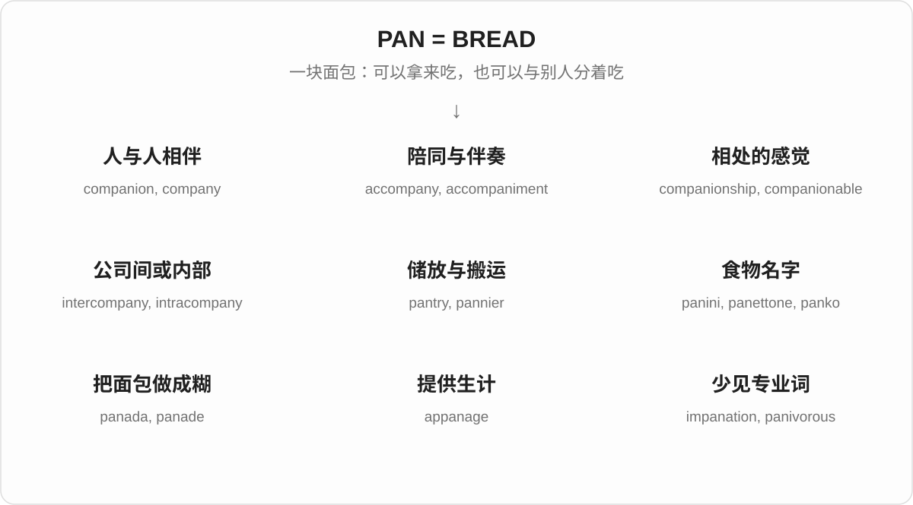

## 词形与演化规律

pan- / pani- 是拉丁语 pānis 在借词与组合词中的形式。意大利语 pane、西班牙语 pan、葡萄牙语 pão 都延续这条来源；日语 pan 又从葡萄牙语借入。这里不包括希腊语 pan-“全部”，也不把英语 pan“锅”硬归进来。

## 单词速览（常用到不常用）

| 单词 | 音标 | 核心意思 |
|---|---|---|
| [company](#w-1) | /ˈkʌmpəni/ | 公司；陪伴；一群人；剧团；连队 |
| [accompanied](#w-2) | /əˈkʌmpənid/ | 有人陪同的；附带着的；有伴奏的 |
| [companion](#w-3) | /kəmˈpænjən/ | 同伴；陪伴者；相伴的东西；参考读物 |
| [accompanying](#w-4) | /əˈkʌmpəniɪŋ/ | 随附的；伴随的；正在陪同的 |
| [accompany](#w-5) | /əˈkʌmpəni/ | 陪同；伴随；为……伴奏 |
| [pantry](#w-6) | /ˈpæntri/ | 食品储藏室；食品柜 |
| [accompaniment](#w-7) | /əˈkʌmpənimənt/ | 伴奏；配菜；伴随物 |
| [companionship](#w-8) | /kəmˈpænjənʃɪp/ | 陪伴；相伴的情谊 |
| [unaccompanied](#w-9) | /ˌʌnəˈkʌmpənid/ | 无人陪同的；无伴奏的 |
| [panini](#w-10) | /pəˈniːni/ | 意式三明治；意式夹馅面包 |
| [telco](#w-11) | 英 /ˈtelkəʊ/；美 /ˈtelkoʊ/ | 电信公司〔行业简称〕 |
| [accompanist](#w-12) | /əˈkʌmpənɪst/ | 伴奏者 |
| [panko](#w-13) | 英 /ˈpæŋkəʊ/；美 /ˈpæŋkoʊ/ | 日式面包糠 |
| [pannier](#w-14) | 英 /ˈpæniə/；美 /ˈpæniər/ | 驮篮；自行车侧挂包；裙撑 |
| [empanada](#w-15) | /ˌempəˈnɑːdə/ | 西班牙语地区常见的包馅饼 |
| [intercompany](#w-16) | 英 /ˌɪntəˈkʌmpəni/；美 /ˌɪntərˈkʌmpəni/ | 公司之间的 |
| [companionable](#w-17) | /kəmˈpænjənəbəl/ | 友善好相处的；相伴时轻松自在的 |
| [panettone](#w-18) | 英 /ˌpænɪˈtəʊni/；美 /ˌpænəˈtoʊni/ | 意式圣诞甜面包 |
| [appanage](#w-19) | /ˈæpənɪdʒ/ | 王室成员的封地或供养收入；随地位而来的特权 |
| [panino](#w-20) | 英 /pæˈniːnəʊ/；美 /pɑˈniːnoʊ/ | 意式面包夹馅三明治 |
| [panada](#w-21) | /pəˈnɑːdə/，也读 /pəˈneɪdə/ | 面包糊；用于增稠或黏合的糊状物 |
| [companionably](#w-22) | /kəmˈpænjənəbli/ | 友好自在地；像同伴一样融洽地 |
| [apanage](#w-23) | /ˈæpənɪdʒ/ | 王室封地、供养财产；附带特权〔appanage 的另一拼写〕 |
| [impanate](#w-24) | /ɪmˈpænət/；亦有 /ɪmˈpeɪneɪt/ | 体现于圣餐饼中的〔罕见神学用语〕 |
| [impanation](#w-25) | 英 /ˌɪmpæˈneɪʃən/；美 /ˌɪmpəˈneɪʃən/ | 圣餐中基督体现于饼酒的观念〔神学〕 |
| [intracompany](#w-26) | 英 /ˌɪntrəˈkʌmpəni/；美 /ˌɪntrəˈkʌmpəni/ | 公司内部的 |
| [panade](#w-27) | /pɑːˈnɑːd/ | 面包糊；烹饪中的黏合糊料 |
| [panatela](#w-28) | /ˌpænəˈtelə/ | 细长雪茄〔panatella 的另一拼写〕 |
| [panatella](#w-29) | /ˌpænəˈtelə/ | 一种细长雪茄 |
| [panelle](#w-30) | 意大利语读音 /paˈnɛlle/ | 西西里鹰嘴豆粉炸薄饼 |
| [panetela](#w-31) | /ˌpænəˈtelə/ | 细长雪茄〔另一拼写〕 |
| [panetella](#w-32) | /ˌpænəˈtelə/ | 细长雪茄〔另一拼写〕 |
| [panification](#w-33) | /ˌpænɪfɪˈkeɪʃən/ | 面包制作；把原料制成面包的过程 |
| [panivorous](#w-34) | /pæˈnɪvərəs/ | 吃面包的；以面包为食的〔少用〕 |

## 逐词讲解

### 1. company — 公司；陪伴；一群人；剧团；连队

**音标**：/ˈkʌmpəni/

**先抓住这个画面**

先想“一群在一起的人”。一起做生意是公司，一起演戏是剧团；有人陪着你，就是 company 的陪伴义。

**怎么拆**

经古法语 compaignie 借入，与 compaignon“同伴”同族，最终连到 com- + pānis“共食面包”。有词典重建后期拉丁语 *compania，但它不是已确证的书面中间词。

**怎么变成今天的意思**

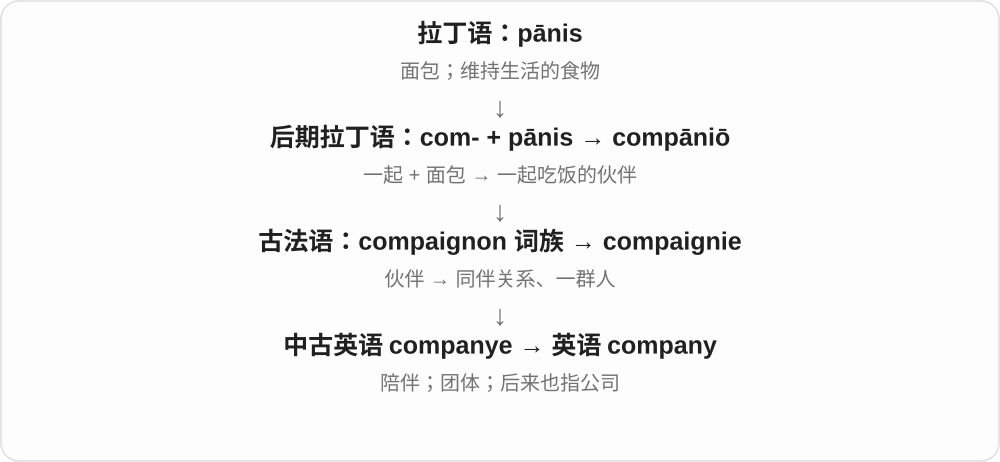

“共享面包”解释了伙伴这个历史起点，不表示现代公司必须共同吃饭。公司义可数：a company；陪伴义通常不可数：I enjoy your company。

**常见搭配与例句**

work for a company；keep someone company；a theatre company；in good company。

> She works for a small software company.

她在一家小软件公司工作。

> Would you keep me company while I wait?

我等的时候，你能陪陪我吗？

> A touring company performed the play in our town.

一个巡演剧团在我们镇上演了这部戏。

**别混淆**

company 是团体或陪伴；companion 是具体的同伴。keep me company 是“陪陪我”，不是替我保管公司。

### 2. accompanied — 有人陪同的；附带着的；有伴奏的

**音标**：/əˈkʌmpənid/

**先抓住这个画面**

看到某个人或东西时，旁边还有另一个一起出现。

**怎么拆**

accompany 的过去式、过去分词；辅音字母后的 y 改成 i，再加 -ed。

**怎么变成今天的意思**

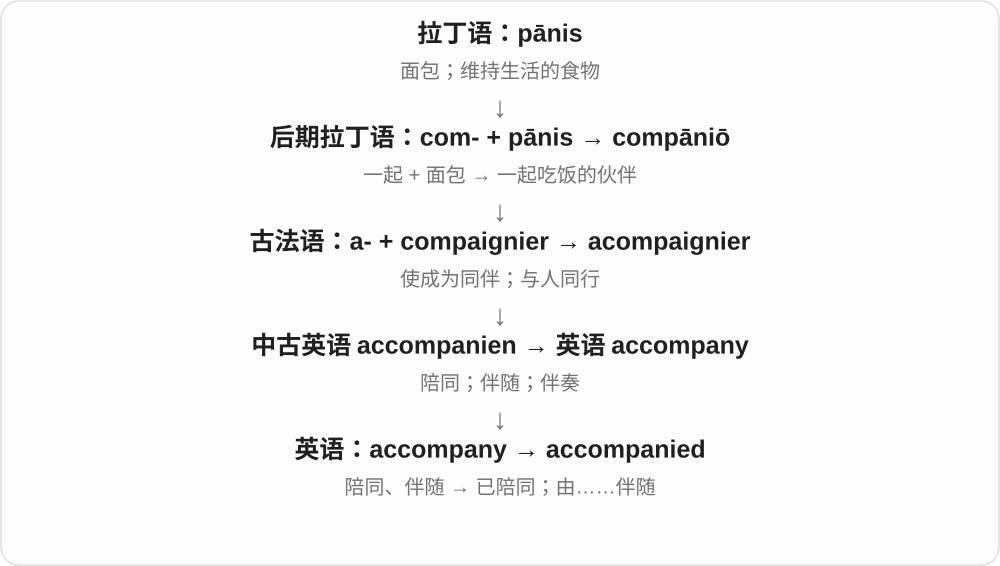

was accompanied by 可以讲人，也可以讲附带现象。The announcement was accompanied by applause，是宣布时同时响起掌声。

**常见搭配与例句**

accompanied by an adult；accompanied by applause；an accompanied song。

> The child was accompanied by her grandfather.

这个孩子由她爷爷陪着。

> The announcement was accompanied by warm applause.

宣布之后现场响起了热烈掌声。

**别混淆**

accompanied 是被陪同、带有伴随物；accompanying 常形容那个“随附的”东西。

### 3. companion — 同伴；陪伴者；相伴的东西；参考读物

**音标**：/kəmˈpænjən/

**先抓住这个画面**

与你一起走、一起待着的人。重点在“有人相伴”，关系可以亲密，也可以只是这段旅程同行。

**怎么拆**

古法语 compaignon 来自后期拉丁语 compāniō：com- 一起 + pānis 面包。这个“同桌伙伴”词可能仿照日耳曼语的类似构词。

**怎么变成今天的意思**

a travel companion 是旅伴；a companion to a novel 也可以是帮助你读小说的导读。它像一本在阅读路上陪着你的书。

**常见搭配与例句**

a travelling companion；a constant companion；a companion volume。

> My sister was my companion on the long train journey.

在那次漫长的火车旅行中，姐姐一路陪着我。

> This guide is a useful companion to the main textbook.

这本指南是主教材很实用的配套读物。

**别混淆**

friend 强调朋友关系；companion 强调相伴。旅途上暂时同行的人，不一定已是你的朋友。

### 4. accompanying — 随附的；伴随的；正在陪同的

**音标**：/əˈkʌmpəniɪŋ/

**先抓住这个画面**

主材料之外，还有一份跟着来的说明、图片或文件。

**怎么拆**

accompany + -ing，y 保留；作现在分词，也常放在名词前作形容词。

**怎么变成今天的意思**

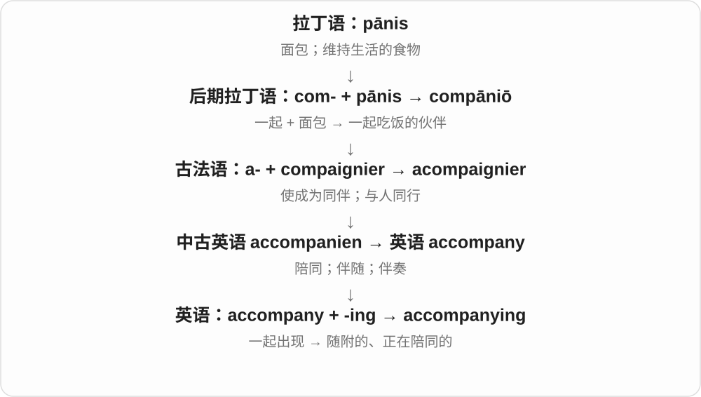

the accompanying diagram 是随文附上的图；a person accompanying someone 是正在陪着那个人。

**常见搭配与例句**

accompanying documents；the accompanying illustration。

> The accompanying diagram shows how the parts fit together.

随附的图展示了各个零件怎样组合。

> The volunteers accompanying the visitors wore blue badges.

陪同访客的志愿者戴着蓝色徽章。

**别混淆**

attached 往往强调附件或物理连接；accompanying 强调随主要对象一起提供。

### 5. accompany — 陪同；伴随；为……伴奏

**音标**：/əˈkʌmpəni/

**先抓住这个画面**

主角在做一件事，另一个人、声音或现象跟着一起出现。

**怎么拆**

从古法语 acompaignier 等形式借来，与“伙伴”词族相连。现代容易看成 a- + company，但历史上不是先有英语 company 再随手加 a。

**怎么变成今天的意思**

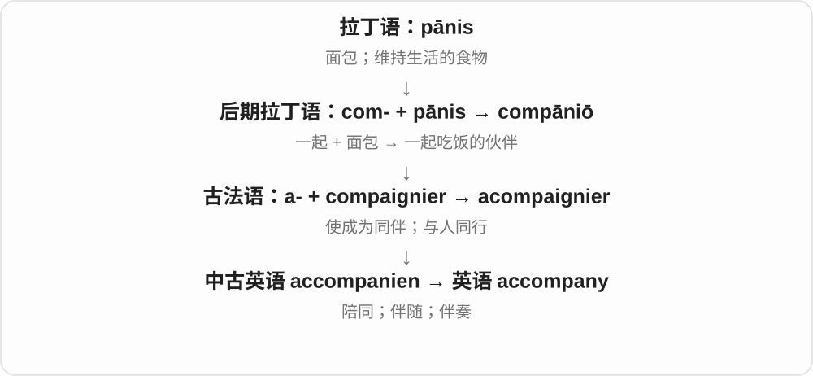

人可以 accompany 旅客；图表可以 accompany 报告；钢琴也能 accompany 歌手。三个场景都抓住“与主要对象一起出现”。

**常见搭配与例句**

accompany someone to a place；accompany a singer on the piano；be accompanied by。

> I will accompany you to the station.

我会陪你去车站。

> She accompanied the singer on the piano.

她弹钢琴为歌手伴奏。

> A short note accompanied the parcel.

包裹附有一张简短的便条。

**别混淆**

通常直接接宾语：accompany me，不说 accompany with me。说“由谁陪同”用 be accompanied by。

### 6. pantry — 食品储藏室；食品柜

**音标**：/ˈpæntri/

**先抓住这个画面**

厨房旁有一处专门放食物的地方。最早与存放面包有关，后来米、面、罐头都能放进去。

**怎么拆**

中古英语 panetrie 来自古法语 paneterie，并与中世纪拉丁语 panataria 相连；共同源头是 pānis“面包”。

**怎么变成今天的意思**

现代 pantry 可以是小房间，也可以是一组食品柜。food pantry 还可指向有需要的人发放食物的机构或地点。

**常见搭配与例句**

a kitchen pantry；pantry shelves；a community food pantry。

> We keep flour and rice in the pantry.

我们把面粉和大米放在食品储藏室里。

> The volunteers sorted donations at the community food pantry.

志愿者在社区食品救助站整理捐赠物资。

**别混淆**

pantry 主要储放食物；kitchen 是做饭的地方。pantry 的 pan 不表示炒锅。

### 7. accompaniment — 伴奏；配菜；伴随物

**音标**：/əˈkʌmpənimənt/

**先抓住这个画面**

主角旁边起衬托作用的那一部分：歌声旁边的琴声，主菜旁边的配菜。

**怎么拆**

借自法语 accompagnement，来自 accompagner“陪同、伴奏”；现代可对应 accompany + -ment。

**怎么变成今天的意思**

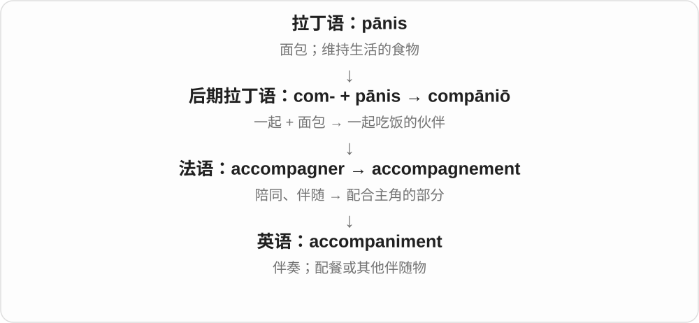

音乐是最常见场景之一；a good accompaniment to fish 可以是适合配鱼的菜或酱。通常不是主角，却与主角一起构成体验。

**常见搭配与例句**

piano accompaniment；an accompaniment to；to the accompaniment of。

> The melody sounds different with a piano accompaniment.

这段旋律配上钢琴伴奏后，听起来不一样了。

> The fresh salad is a good accompaniment to the grilled fish.

这份新鲜沙拉很适合搭配烤鱼。

**别混淆**

accompaniment 是配合的声音或东西；accompanist 是提供伴奏的人。

### 8. companionship — 陪伴；相伴的情谊

**音标**：/kəmˈpænjənʃɪp/

**先抓住这个画面**

不是点出“谁陪你”，而是说身边有人一起生活、聊天、做事的那种连接。

**怎么拆**

companion + -ship，-ship 在这里构成关系或状态的名词。

**怎么变成今天的意思**

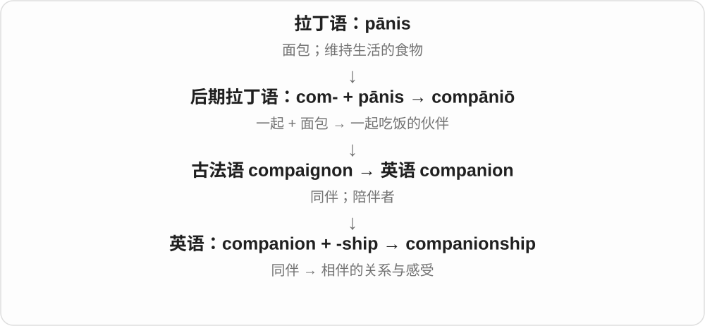

常用不可数形式。seek companionship 是想找个人相伴，未必专指恋爱，也不必一直说话。

**常见搭配与例句**

provide companionship；a need for companionship；companionship and support。

> The neighbours offered her practical help and companionship.

邻居们给她实际的帮助，也常陪着她。

> He enjoys the companionship of his dog on evening walks.

他很享受傍晚散步时有狗相伴。

**别混淆**

companion 指人；companionship 指人与人或人与动物相伴的关系。

### 9. unaccompanied — 无人陪同的；无伴奏的

**音标**：/ˌʌnəˈkʌmpənid/

**先抓住这个画面**

原本可能有人陪着，或有乐器跟着，现在这个陪伴部分没有出现。

**怎么拆**

un-“不、没有” + accompanied。

**怎么变成今天的意思**

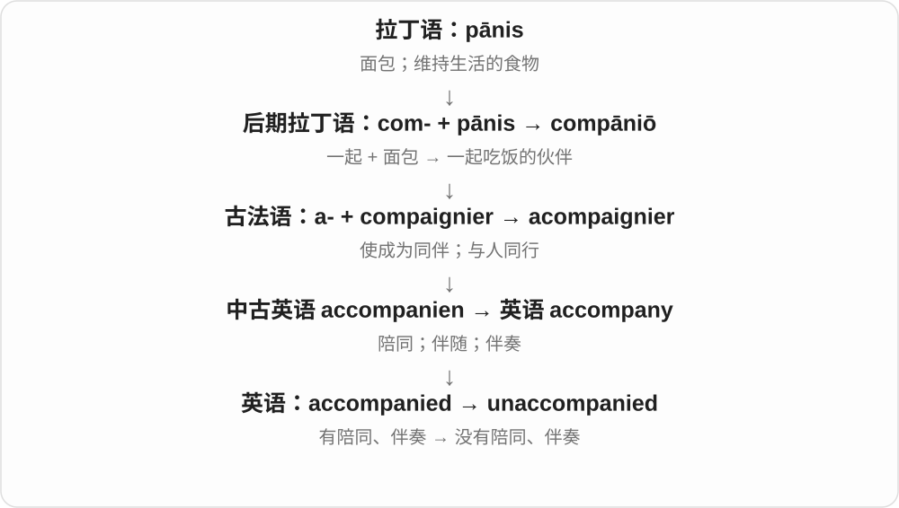

an unaccompanied child 是没有人陪同的孩子；unaccompanied singing 是没有乐器伴奏的演唱，可以是独唱，也可以是一群人合唱。

**常见搭配与例句**

travel unaccompanied；unaccompanied singing；an unaccompanied minor。

> She travelled unaccompanied for the first time.

她第一次独自出行，没有人陪同。

> The choir opened with an unaccompanied folk song.

合唱团以一首无伴奏民歌开场。

**别混淆**

unaccompanied 不等于只有一个人发声。合唱团没有乐器伴奏，同样可以是 unaccompanied。

### 10. panini — 意式三明治；意式夹馅面包

**音标**：/pəˈniːni/

**先抓住这个画面**

英语菜单上常见的夹馅面包，很多店会把它压烤到热而酥脆。

**怎么拆**

意大利语 panino“小面包”的复数 panini 被英语借入；英语后来也常把 panini 当单数，并出现复数 paninis。

**怎么变成今天的意思**

所以英语里 a panini 并不罕见，不必把意大利语复数规则硬套到每次英语点餐上。明确数量时也可说 a panini sandwich。

**常见搭配与例句**

a chicken panini；a panini press；toasted panini。

> She ordered a panini and a cup of coffee.

她点了一个意式三明治和一杯咖啡。

> The panini press left dark lines on the bread.

三明治压烤机在面包上留下了深色条纹。

**别混淆**

词尾 -i 是意大利语历史复数形式，不是“烤”或“夹馅”的词根。

### 11. telco — 电信公司〔行业简称〕

**音标**：英 /ˈtelkəʊ/；美 /ˈtelkoʊ/

**先抓住这个画面**

把 telephone company 这两个长词压短，变成行业里顺口说的“电信公司”。

**怎么拆**

tel(ephone) + co(mpany)；也与公司名称里 Tel. Co. 的缩写传统有关。与面包词根的联系藏在 company 里，不是 tel 本身。

**怎么变成今天的意思**

新闻和行业讨论中常用，范围可随语境包括固定电话、移动通信和其他电信业务；普通文章写 telecommunications company 更完整。

**常见搭配与例句**

a local telco；a major telco；telco services。

> The local telco is upgrading its network.

当地电信公司正在升级网络。

> Several telcos took part in the industry meeting.

几家电信公司参加了行业会议。

**别混淆**

telco 指企业；telecom 可指电信行业、业务或其相关事物。

### 12. accompanist — 伴奏者

**音标**：/əˈkʌmpənɪst/

**先抓住这个画面**

主唱在前面唱，他在旁边弹奏，听着主唱的速度和呼吸一起走。

**怎么拆**

accompany + -ist，表示从事伴奏的人；拼写中的 y 变为 i。

**怎么变成今天的意思**

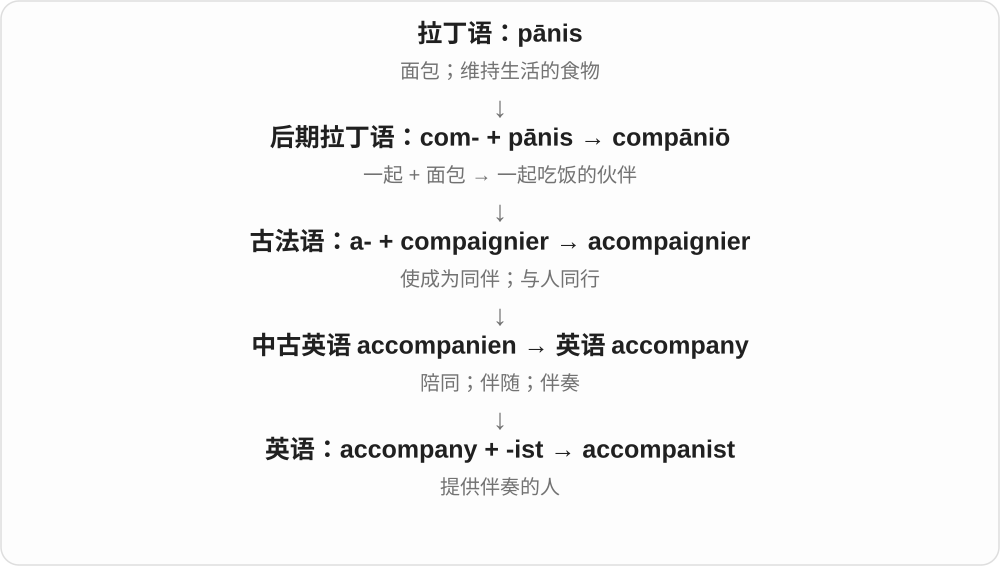

通常指钢琴等乐器的伴奏者。一个优秀的 accompanist 不只是把自己的音弹对，还要与演唱或独奏配合。

**常见搭配与例句**

a piano accompanist；work as an accompanist；rehearse with an accompanist。

> The singer rehearsed with her accompanist before the concert.

音乐会前，歌手与她的伴奏者一起排练。

> The accompanist followed the violinist’s slight change of tempo.

伴奏者跟上了小提琴手细微的速度变化。

**别混淆**

pianist 是钢琴演奏者；只有承担伴奏任务时才是在做 accompanist 的工作。

### 13. panko — 日式面包糠

**音标**：英 /ˈpæŋkəʊ/；美 /ˈpæŋkoʊ/

**先抓住这个画面**

炸物外面那层松脆、较粗的碎屑，原料来自面包。这个词绕经日语才进入英语。

**怎么拆**

日语 パン粉：pan 面包 + ko 粉。日语 pan 借自葡萄牙语 pão，后者来自拉丁语 pānis；不是英语 pan“锅”加 ko。

**怎么变成今天的意思**

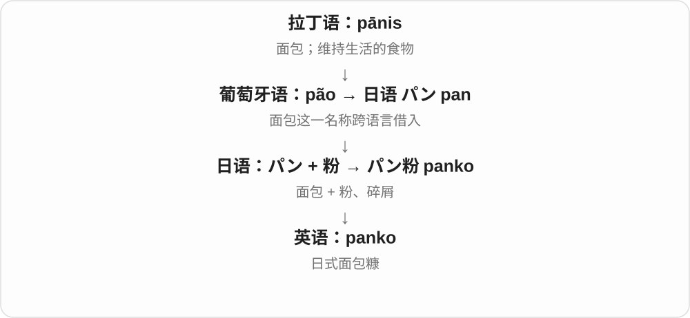

通常指较轻、呈片状的日式面包糠，可用来做炸物外衣，也能撒在烤菜上形成脆层。

**常见搭配与例句**

panko breadcrumbs；a panko coating；coat with panko。

> The mushrooms had a crisp panko coating.

蘑菇外面裹着一层酥脆的日式面包糠。

> She sprinkled panko over the vegetables before baking them.

她把蔬菜放进烤箱前，在上面撒了些日式面包糠。

**别混淆**

breadcrumbs 泛指面包屑；panko 是其中有特定质地的一类。它不是面粉。

### 14. pannier — 驮篮；自行车侧挂包；裙撑

**音标**：英 /ˈpæniə/；美 /ˈpæniər/

**先抓住这个画面**

原来是装面包的篮子，后来成了挂在动物或车两侧的载物容器。两边鼓起来的轮廓，也帮助理解裙撑义。

**怎么拆**

经古法语 panier / paniere 来自拉丁语 pānārium“面包篮”，由 pānis 派生。

**怎么变成今天的意思**

骑行中的 panniers 多是车后架两边的包，不必是藤篮。服装史中的 pannier 是把裙子两侧撑开的结构。

**常见搭配与例句**

bicycle panniers；a pair of panniers；a pannier skirt。

> She packed her clothes into the bicycle panniers.

她把衣服装进自行车两侧的挂包。

> The exhibition shows how panniers widened the sides of a dress.

展览展示了裙撑怎样把裙子两侧撑宽。

**别混淆**

backpack 背在人背上；pannier 通常挂在车或驮畜侧面。

### 15. empanada — 西班牙语地区常见的包馅饼

**音标**：/ˌempəˈnɑːdə/

**先抓住这个画面**

面皮把肉、蔬菜或其他馅料包起来，像给馅料穿上一个面包外壳。

**怎么拆**

借自西班牙语 empanada，来自 empanar“用面包或面团包裹”的分词阴性形式：em- 在里面 + pan 面包。

**怎么变成今天的意思**

许多西班牙语地区都有不同做法，可以烤也可以炸，馅料也多样。不要只记成某一种固定肉馅的饺子。

**常见搭配与例句**

a beef empanada；baked empanadas；an empanada filling。

> The stall sells empanadas filled with spinach and cheese.

这个摊位卖菠菜奶酪馅的包馅饼。

> She baked the empanadas until the pastry turned golden.

她把包馅饼烤到外皮金黄。

**别混淆**

empanada 是包好馅的食物；panada 常指面包或面粉调成的糊，少一个 em- 并非同一道菜。

### 16. intercompany — 公司之间的

**音标**：英 /ˌɪntəˈkʌmpəni/；美 /ˌɪntərˈkʌmpəni/

**先抓住这个画面**

画两个公司方框，一条线从甲公司跨到乙公司：这是 intercompany。

**怎么拆**

inter-“在……之间” + company，英语内部构词。

**怎么变成今天的意思**

常见于企业管理与会计语境，可以说同一集团下不同公司之间的往来；具体交易如何处理，要另看情境。

**常见搭配与例句**

intercompany communication；intercompany transactions；an intercompany agreement。

> The group uses one platform for intercompany communication.

这个集团用一个平台开展各公司之间的沟通。

> The report lists the intercompany transactions separately.

报告单独列出了公司之间的交易。

**别混淆**

intercompany 是不同公司之间；intracompany 是同一公司内部。

### 17. companionable — 友善好相处的；相伴时轻松自在的

**音标**：/kəmˈpænjənəbəl/

**先抓住这个画面**

两个人待在一起很舒服，不必绞尽脑汁找话题；连安静都不尴尬。

**怎么拆**

companion + -able；这里是“适合做同伴、具有好同伴的特点”，不能机械翻成“能够被陪伴”。

**怎么变成今天的意思**

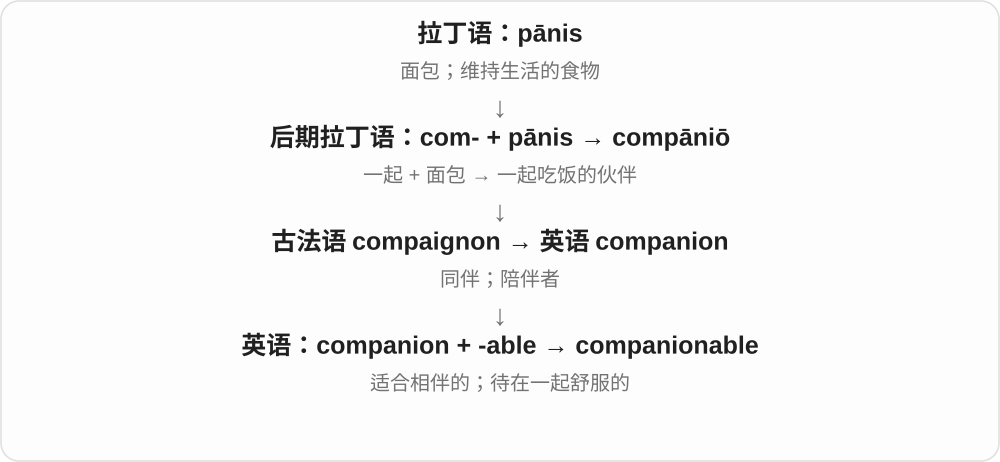

a companionable person 好相处；a companionable silence 是两个人默默相伴却自在的沉默。词的重点是相处的感觉。

**常见搭配与例句**

companionable silence；a companionable atmosphere。

> We sat in companionable silence and watched the rain.

我们自在地并排坐着，安静地看雨。

> She found him a companionable walking partner.

她觉得和他结伴散步很愉快。

**别混淆**

sociable 常指爱交际；companionable 不要求外向健谈，安静的人也可以很好相处。

### 18. panettone — 意式圣诞甜面包

**音标**：英 /ˌpænɪˈtəʊni/；美 /ˌpænəˈtoʊni/

**先抓住这个画面**

想象一只高高圆圆的甜面包，切开后常见葡萄干和糖渍果皮。

**怎么拆**

借自意大利语 panettone，源于米兰所在地区的伦巴第语 panaton 等形式，通常解释为 pane / pan“面包”的增大形式；不是英语 pan 加人名。

**怎么变成今天的意思**

中文有时叫圣诞蛋糕，但它是发酵的甜面包。如今也有巧克力等变体，名字不保证每一种都含相同果干。

**常见搭配与例句**

a slice of panettone；Christmas panettone。

> We shared a slice of panettone after dinner.

饭后我们分吃了一片意式圣诞甜面包。

> The bakery displayed tall panettones in colourful boxes.

面包店陈列着装在彩盒里的高圆甜面包。

**别混淆**

panettone 是特定传统食品；pancake 是另一种饼，不能因为开头相近就认成同一词族。

### 19. appanage — 王室成员的封地或供养收入；随地位而来的特权

**音标**：/ˈæpənɪdʒ/

**先抓住这个画面**

王位通常不能每个人分一份，但可以分出土地或收入，让其他王室成员有生活来源。

**怎么拆**

法语 appanage / apanage 连到中世纪拉丁语 appānāre“供给面包、供养”：ad- + pānis。

**怎么变成今天的意思**

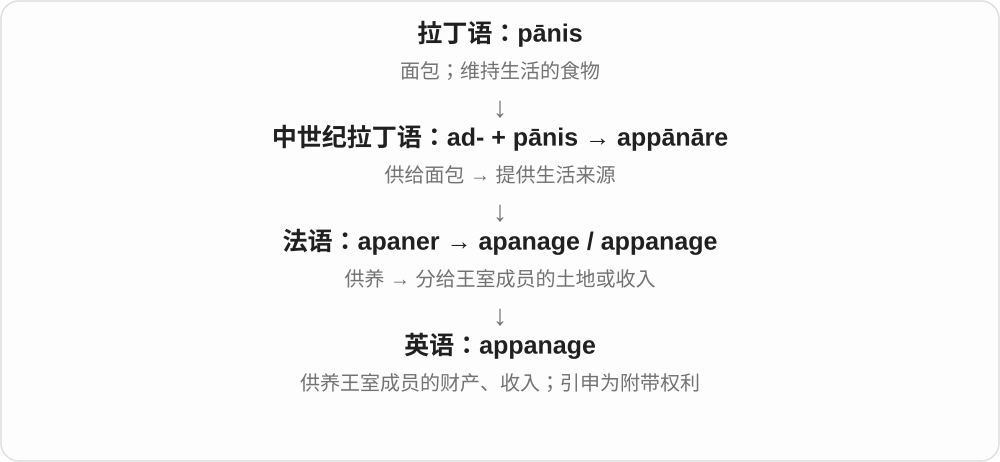

这条语义路很直观：给面包 → 保证生计 → 给予土地或收入。现代较少用，主要见于历史，也可比喻职位自带的好处。

**常见搭配与例句**

grant an appanage；receive land as an appanage；an appanage of office。

> The king granted his younger son an appanage.

国王赐给幼子一份封地与供养收入。

> The historian traced the revenues of the prince’s appanage.

历史学家追查了王子封地的收入。

**别混淆**

inheritance 是继承所得；appanage 强调被划出来用于供养的财产，不是所有继承都叫这个词。

### 20. panino — 意式面包夹馅三明治

**音标**：英 /pæˈniːnəʊ/；美 /pɑˈniːnoʊ/

**先抓住这个画面**

一小块面包剖开，夹上奶酪、蔬菜或其他馅料。名字最初就是“小面包”。

**怎么拆**

借自意大利语 panino，pane“面包” + 缩小后缀 -ino；pane 来自拉丁语 pānis。

**怎么变成今天的意思**

panino 在意大利语里是单数，panini 是复数。英语里保留 panino 的用法，也常把 panini 当成一个三明治的名称。

**常见搭配与例句**

a cheese panino；a toasted panino。

> I ordered a panino with cheese and tomatoes.

我点了一个夹奶酪和番茄的意式三明治。

> The café serves each panino with a small salad.

这家咖啡馆给每个意式三明治配一份小沙拉。

**别混淆**

panino 不必然表示经过压烤；是否烤热，要看菜单或做法。

### 21. panada — 面包糊；用于增稠或黏合的糊状物

**音标**：/pəˈnɑːdə/，也读 /pəˈneɪdə/

**先抓住这个画面**

面包或面粉遇到液体，变成柔软的糊；它能成为一道软食，也能帮助把肉馅黏在一起。

**怎么拆**

常追到西班牙语 panada，由 pan“面包”形成；pan 来自拉丁语 pānis。

**怎么变成今天的意思**

旧食谱中可能指煮软的面包食物；烹饪技术中常指用牛奶、水等调成的糊，具体原料依食谱而定。

**常见搭配与例句**

make a panada；a bread panada；add the panada to the mixture。

> The cook added a bread panada to the meat mixture.

厨师把面包糊加进肉馅里。

> The old recipe describes a panada made with milk and bread.

这份旧食谱描述了一种用牛奶和面包做的糊。

**别混淆**

panada 侧重湿软的糊；panko 是较干的面包糠。

### 22. companionably — 友好自在地；像同伴一样融洽地

**音标**：/kəmˈpænjənəbli/

**先抓住这个画面**

把“相处舒服”的感觉放到动作上：并肩坐着、随意聊着，谁也不拘束。

**怎么拆**

companionable + -ly，词尾 -able 变为 -ably。

**怎么变成今天的意思**

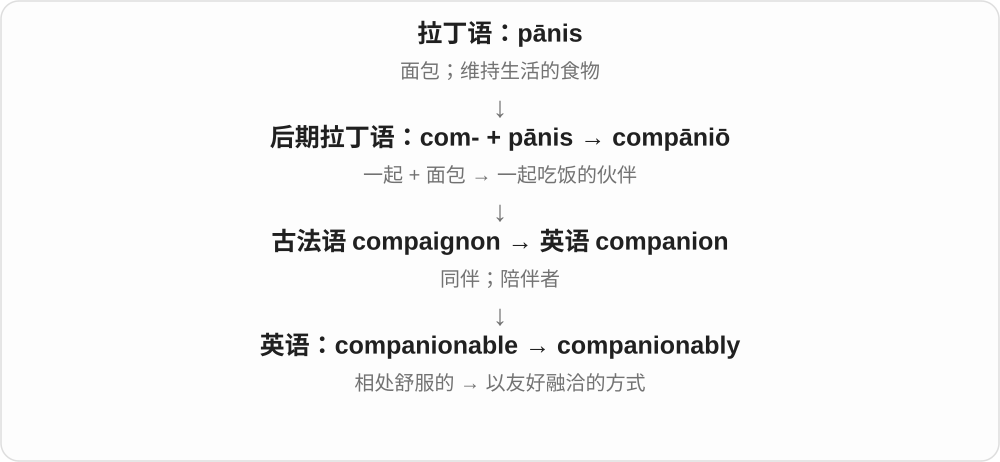

通常修饰 sit、walk、chat 等动作，带一点叙述或文学色彩；日常也可直接说 in a friendly way。

**常见搭配与例句**

sit companionably；chat companionably。

> They chatted companionably while washing the dishes.

他们洗碗时随意而融洽地聊着天。

> The two old friends walked companionably beside the river.

两位老朋友相伴沿河走着，轻松自在。

**别混淆**

comfortably 可以只是椅子坐着舒服；companionably 说的是人与人相处融洽。

### 23. apanage — 王室封地、供养财产；附带特权〔appanage 的另一拼写〕

**音标**：/ˈæpənɪdʒ/

**先抓住这个画面**

它和 appanage 说的是同一类供养安排，只是少了一个 p。

**怎么拆**

保留法语 apanage 的单 p 拼写，与 appanage 同源；不能把两个词形当作两种不同封地制度。

**怎么变成今天的意思**

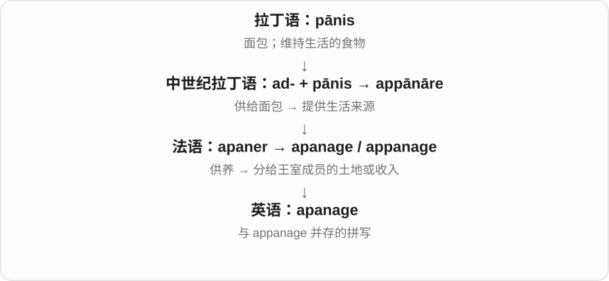

读历史文献时会遇到两种拼法。变化发生在拼写，不意味着一个只指土地、另一个只指金钱。

**常见搭配与例句**

an apanage；the revenues of an apanage。

> The younger prince received the estate as an apanage.

年幼的王子获赐这座庄园作为供养财产。

> The map marks the boundaries of the royal apanage.

地图标出了王室封地的边界。

**别混淆**

apanage 不是 appendage“附属部分”的拼写错误，两词来源不同。

### 24. impanate — 体现于圣餐饼中的〔罕见神学用语〕

**音标**：/ɪmˈpænət/；亦有 /ɪmˈpeɪneɪt/

**先抓住这个画面**

这个词把“存在于面包之中”压缩成一个形容词，讨论的是圣餐中的宗教观念。

**怎么拆**

来自中世纪拉丁语 impānātus：in-“在……中”在 p 前变为 im-，加 pānis“面包”及分词词尾。

**怎么变成今天的意思**

主要在历史神学文字中见到，也有旧动词用法。它表达某种解释或论辩立场，不能当成所有基督教传统共同采用的说法。

**常见搭配与例句**

an impanate body；the idea of Christ being impanate。

> The theologian rejected the idea of an impanate divine body.

这位神学家反对“神圣身体体现于圣餐饼中”的观念。

> The passage asks whether Christ should be described as impanate.

这段文字讨论是否应该用“体现于圣餐饼中”来描述基督。

**别混淆**

incarnate 是体现为肉身的；impanate 把词根换成“面包”。这是帮助看懂构词的对照，不表示两个教义相同。

### 25. impanation — 圣餐中基督体现于饼酒的观念〔神学〕

**音标**：英 /ˌɪmpæˈneɪʃən/；美 /ˌɪmpəˈneɪʃən/

**先抓住这个画面**

把 impanate 所描述的关系当成一种学说来讨论：基督怎样与圣餐的饼酒相联系。

**怎么拆**

来自中世纪拉丁语 impānātiō，基于 impānātus。现代可联系 impanate 与名词词尾 -ion，但历史上拉丁语已有名词。

**怎么变成今天的意思**

常与其他圣餐理论并列比较；核心涉及饼酒保持其本性时，怎样理解基督在其中的临在。用词与立场要结合具体作者。

**常见搭配与例句**

the doctrine of impanation；a debate over impanation。

> The chapter compares impanation with other accounts of the Eucharist.

这一章把该观念与其他圣餐解释作比较。

> The debate over impanation concerned how Christ was present in the sacrament.

围绕这一观念的辩论，讨论的是基督如何临在于圣餐之中。

**别混淆**

transubstantiation 通常译“实体转变说”；impanation 不是它的另一个拼法，也不宜笼统等同所有“圣餐临在”观念。

### 26. intracompany — 公司内部的

**音标**：英 /ˌɪntrəˈkʌmpəni/；美 /ˌɪntrəˈkʌmpəni/

**先抓住这个画面**

线没有跨出公司方框，只是从内部的一个部门连到另一个部门。

**怎么拆**

intra-“在……内部” + company，英语内部构词。

**怎么变成今天的意思**

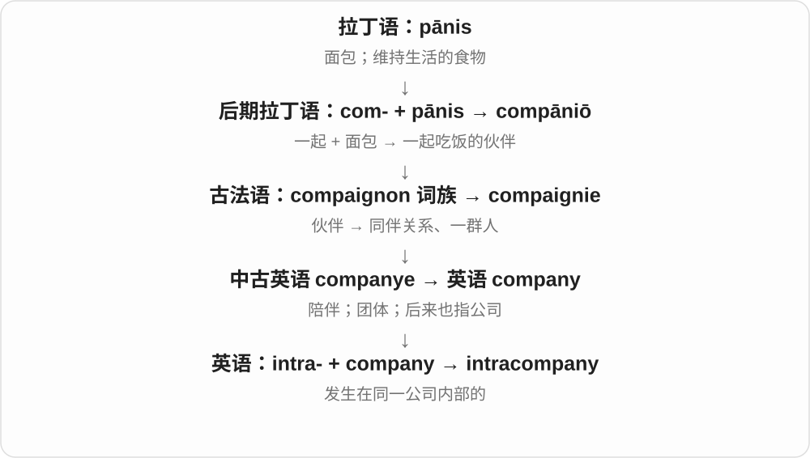

可形容部门沟通、内部调动和协作。重点是组织边界；同一公司内部的事情，也可能跨越不同城市。

**常见搭配与例句**

intracompany communication；an intracompany transfer。

> The new directory improves intracompany communication.

新的通讯录改善了公司内部沟通。

> She moved to the design team through an intracompany transfer.

她通过公司内部调动进入了设计团队。

**别混淆**

不要把 intra- 看成 inter-：前者在里面，后者在彼此之间。

### 27. panade — 面包糊；烹饪中的黏合糊料

**音标**：/pɑːˈnɑːd/

**先抓住这个画面**

把干的面包变成含水的软糊，用它给食物增添湿润感或帮助成形。

**怎么拆**

经法语 panade，与普罗旺斯语 panada“面包汤”相连，最终来自拉丁语 pānis；英语中与 panada 密切对应。

**怎么变成今天的意思**

在不同烹饪传统中，panade 可能是面包泡软的糊，也可能是以面粉、液体煮成的糊。看配方，不要把某一个配方当作词义的全部。

**常见搭配与例句**

a milk panade；prepare the panade；mix in the panade。

> She soaked the bread in milk to make a panade.

她把面包泡进牛奶里，做成面包糊。

> The panade helped the filling hold together.

这份糊料帮助馅料黏合成形。

**别混淆**

panade 与 panada 有大量重叠；它们不是“生面糊”和“熟面糊”的固定对立。

### 28. panatela — 细长雪茄〔panatella 的另一拼写〕

**音标**：/ˌpænəˈtelə/

**先抓住这个画面**

同一种细长雪茄，这个拼法保留单个 l。

**怎么拆**

由西班牙语 panatela 借入，最终连到 pānis“面包”；与 panatella 并列，不能拆成英语 pan + tale。

**怎么变成今天的意思**

读到这个词时，先把它识别为 panatella 的拼写变体。单个 l 没有额外的尺寸或材料含义。

**常见搭配与例句**

a panatela；an unopened box of panatelas。

> The character turned an unlit panatela between his fingers.

人物用手指转着一支未点燃的细长雪茄。

> An unopened box of panatelas appeared in the inventory.

清单上列着一盒未拆封的细长雪茄。

**别混淆**

panatela 与 panatella 的拼写差别不代表两种固定型号。

### 29. panatella — 一种细长雪茄

**音标**：/ˌpænəˈtelə/

**先抓住这个画面**

词源上借用了细长饼点的名字，因为两者都有细长的外形；不是说烟草里加了面包。

**怎么拆**

经美洲西班牙语 panatela / panetela，连到意大利语 panatella“小面包”与 pane；英语有数种并存拼写。

**怎么变成今天的意思**

主要在小说、历史材料或物品描述中遇到。这个名称描述一类雪茄的外形，不是所有雪茄的通称。

**常见搭配与例句**

a long panatella；a box of panatellas。

> An unlit panatella lay beside the letter in the film scene.

电影画面里，信旁放着一支未点燃的细长雪茄。

> The museum displayed an old box labelled panatellas.

博物馆展示了一个标着“细长雪茄”的旧盒子。

**别混淆**

panatella 是烟草制品名；panettone 是甜面包。名字相近，指的东西完全不同。

### 30. panelle — 西西里鹰嘴豆粉炸薄饼

**音标**：意大利语读音 /paˈnɛlle/

**先抓住这个画面**

它的名字属于“面包、小饼”这一支，但盘子里实际端上来的，是鹰嘴豆粉做成的薄片炸饼。

**怎么拆**

意大利语 panella 的复数；panella 由 pane“面包”派生。英语菜单与旅行文章常直接使用这个意大利食品名，读音可沿用原语。

**怎么变成今天的意思**

在巴勒莫，它常夹进面包里吃，也可以单独当小吃。因此“名字里有面包来源”不等于炸饼本身必须用面包屑制作。

**常见搭配与例句**

a plate of panelle；a sandwich filled with panelle。

> We tried panelle at a market in Palermo.

我们在巴勒莫的市场尝了鹰嘴豆粉炸薄饼。

> The sandwich was filled with warm panelle and a squeeze of lemon.

三明治里夹着热乎的炸薄饼，还挤了点柠檬汁。

**别混淆**

panini 常指夹馅面包；panelle 是可能被夹进去的炸薄饼，二者不是同一个词的单复数。

### 31. panetela — 细长雪茄〔另一拼写〕

**音标**：/ˌpænəˈtelə/

**先抓住这个画面**

仍然是细长雪茄；中间写 e、末段单个 l，只是拼写选择。

**怎么拆**

源于美洲西班牙语 panetela / panatela“细长饼点”等形式，最终来自拉丁语 pānis；英语与 panatella 等写法并存。

**怎么变成今天的意思**

这个词形有助于读旧广告、小说或收藏说明。不需要把每个变体重新记成一个新的意思。

**常见搭配与例句**

a panetela；a panetela box。

> The prop master placed a panetela box on the desk.

道具师在书桌上放了一个细长雪茄盒。

> A panetela was mentioned among the items in his pocket.

记录提到，他口袋里的物品中有一支细长雪茄。

**别混淆**

panetela 的 -tela 在这个借词里不是一个独立的英语词根。

### 32. panetella — 细长雪茄〔另一拼写〕

**音标**：/ˌpænəˈtelə/

**先抓住这个画面**

和 panatella 指同一类东西；这里中间写 e，后面仍是双 l。

**怎么拆**

与 panatella、panatela、panetela 同源同义，来自以“小面包、细长饼点”命名外形的借词路线。

**怎么变成今天的意思**

阅读时认出它即可。这里保留多个拼法，是为了遇见任一种都能辨认，而不是暗示它们分别是一种新产品。

**常见搭配与例句**

a panetella；a slender panetella。

> The novelist describes a slender panetella resting in an ashtray.

小说家写到，烟灰缸里搁着一支细长雪茄。

> The catalogue uses the spelling panetella on the label.

目录在标签上采用了 panetella 这种拼法。

**别混淆**

这四个拼法的差异是拼写变体，不能用字母数量推断雪茄长短。

### 33. panification — 面包制作；把原料制成面包的过程

**音标**：/ˌpænɪfɪˈkeɪʃən/

**先抓住这个画面**

把面粉、水等原料一步步变成可吃的面包。长词其实就在说“做面包”。

**怎么拆**

pan- 面包 + -ification 制成、制作过程；词源构件连到拉丁语 pānis 与 facere“做”，法语也有 panification。

**怎么变成今天的意思**

主要出现在食品科学、烘焙技术或较旧文献中。日常说 breadmaking 更自然，不需要每次烤面包都用长词。

**常见搭配与例句**

the process of panification；flour suitable for panification。

> The paper examines how fermentation affects panification.

论文研究发酵怎样影响面包制作。

> The laboratory compared several flours for their suitability for panification.

实验室比较了几种面粉是否适合制作面包。

**别混淆**

baking 包括烤饼干、蛋糕等；panification 专指制作面包。

### 34. panivorous — 吃面包的；以面包为食的〔少用〕

**音标**：/pæˈnɪvərəs/

**先抓住这个画面**

把 bread eater“吃面包的人”换成一件正式词汇的外衣。

**怎么拆**

pan- 来自 pānis“面包”，-i- 连接，-vorous 来自 vorāre“吞食”。它是近代构词，不是英语 pan“锅”派生。

**怎么变成今天的意思**

现在很少用于普通对话，较适合读旧文献或有意幽默的描述。它没有“所有东西都吃”的意思。

**常见搭配与例句**

panivorous habits；a panivorous population。

> The essay describes a largely panivorous population dependent on grain harvests.

这篇文章描述了一个主要吃面包、依赖谷物收成的群体。

> He jokingly called himself panivorous as he reached for another roll.

他又伸手拿了一个面包卷，开玩笑说自己是个“面包食客”。

**别混淆**

omnivorous 是杂食的；panivorous 的 pan 是拉丁语“面包”，不是希腊语“全部”。

## 这一组要分清什么

company 的公司义、陪伴义出自同一伙伴词族；companion 不是现代英语 company 加一个人称词尾。

pan-“面包”和 pan-“全部”只是拼写重合。panivorous 指吃面包，不是“什么都吃”。

食品名可以借到英语，也可以保留原语复数：panelle、panini 的词尾不能按普通英语词缀乱切。

panatella 等雪茄名称是由食物的形状借名；panettone 才是甜面包，不要看着像就混为一物。

## 串起来练习

先记一句：A companion keeps you company. 同伴陪着你。再把 accompany、accompaniment、accompanist 分成“动作、伴随的东西、提供伴奏的人”。
