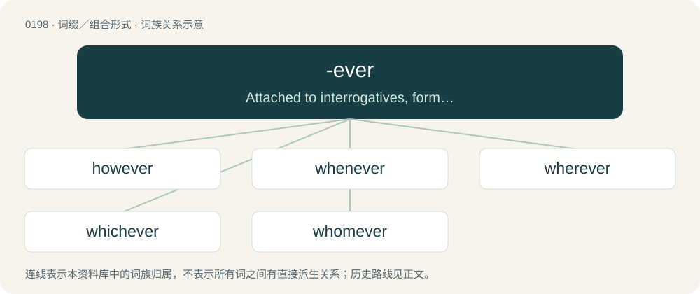

# 0220 · -ever — Attached to interrogatives, forms indefinite pronouns and adverbs.

[总目录](../00_总目录_按常用程度.md)

**类型**：词缀／组合形式　｜　**来源语言**：见词源记录

## 核心含义与来源

- 核心含义：Attached to interrogatives, forms indefinite pronouns and adverbs.
- 英文含义：Attached to interrogatives, forms indefinite pronouns and adverbs.
- 词形：-ever

**来源记录 1**（后缀／后置成分；Attached to interrogatives, forms indefinite pronouns and adverbs.）

From Middle English -ever, a cliticisation of the adverb ever.

## 词族图

## 单词速览（常用到不常用）

| 单词 | 音标 | 释义 |
|---|---|---|
| [however](#w-1) | 英 /haʊˈɛvə/；美 /haʊˈɛvɚ/ | adv. 然而, 无论如何, 究竟怎样；conj. 然而, 可是 |
| [whenever](#w-2) | 英 /wəˈnɛvə/；美 /wəˈnɛvɚ/ | conj. 每当；adv. 不论何时, 每逢 |
| [wherever](#w-3) | 英 /wɛəˈɹɛvə/；美 /(h)wɛɹˈɛvɚ/ | adv. 无论哪里 |
| [whichever](#w-4) | 美 /wɪt͡ʃˈɛvɚ/ | pron. 无论那一个, 任何一个 |
| [whomever](#w-5) | 美 /humˈɛvɚ/ | pron. （作动词或介词的宾语时, 有时候用来替代whoever） |

## 逐词详解

### 1. however

**词性**：副词　｜　**音标**：英 /haʊˈɛvə/；美 /haʊˈɛvɚ/

**中文释义**：adv. 然而, 无论如何, 究竟怎样；conj. 然而, 可是

**英文义项**：Nevertheless; yet, still; in spite of that. / In contrast.

**构词拆分**：how + -ever

**词源与演化**：

From Middle English however, how-ever, how-evere; equivalent to how + -ever. Compare howsoever.

**例句**：

> Any rule of thumb, however true (it is), is useless unless you understand its underlying logic.

该用例对应义项：Regardless of how; no matter how

### 2. whenever

**词性**：连词　｜　**音标**：英 /wəˈnɛvə/；美 /wəˈnɛvɚ/

**中文释义**：conj. 每当；adv. 不论何时, 每逢

**英文义项**：At any time that. / At the (single) time that, no matter when.

**构词拆分**：when + -ever

**词源与演化**：

From Middle English whan evere, whanne ever, whanne evere, whener, when ever; equivalent to when + -ever.

**例句**：

> Income must be reported in the period in which it is earned, whenever payment is actually received.

该用例对应义项：Regardless of the time that.

### 3. wherever

**词性**：副词　｜　**音标**：英 /wɛəˈɹɛvə/；美 /(h)wɛɹˈɛvɚ/

**中文释义**：adv. 无论哪里

**英文义项**：Where ever; an emphatic form of where. / In, at or to any place that one likes or chooses.

**构词拆分**：where + ever；where + -ever

**词源与演化**：

From where + -ever.

**例句**：

> Where do you want to have lunch? — Wherever; I don't mind.

该用例对应义项：In, at or to any place that one likes or chooses.

### 4. whichever

**词性**：限定词　｜　**音标**：美 /wɪt͡ʃˈɛvɚ/

**中文释义**：pron. 无论那一个, 任何一个

**英文义项**：Which ever; emphatic form of 'which'. / Regardless of the ... that; no matter which.

**构词拆分**：which + -ever

**词源与演化**：

From whiche ever, whiche evere, which ever, which evere; equivalent to which + -ever.

**例句**：

> Whichever book you borrow, be sure to return it to the library on time.

该用例对应义项：Regardless of the ... that; no matter which.

### 5. whomever

**词性**：代词　｜　**音标**：美 /humˈɛvɚ/

**中文释义**：pron. （作动词或介词的宾语时, 有时候用来替代whoever）

**英文义项**：Whatever person or persons (as object of verb or preposition).

**构词拆分**：whom + -ever

**词源与演化**：

From Middle English whomever; equivalent to whom + -ever.

**例句**：

> The letter is addressed to whomever it may concern.

该用例对应义项：Whatever person or persons (as object of verb or preposition).
